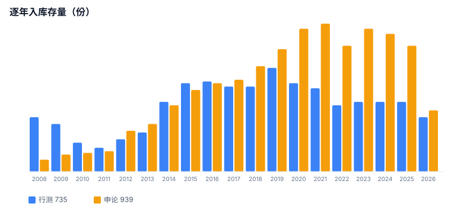
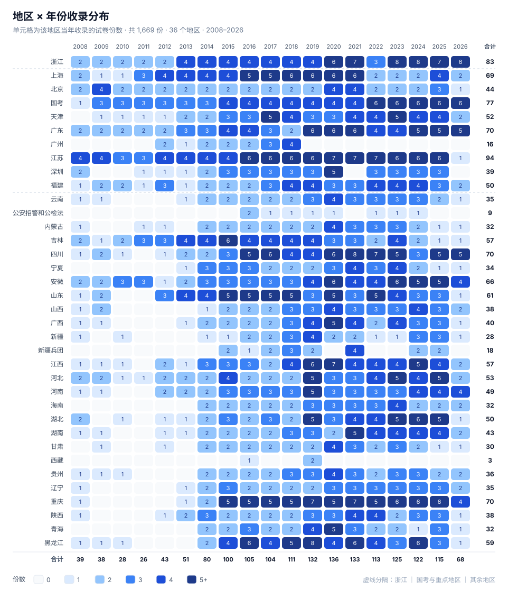

<p align="center">
  
</p>

<p align="center">
  本仓库将国考、省考的<b>行测</b>与<b>申论</b>真题整理为 Markdown，每份试卷一个文件，<br>
  包含题干、选项、给定材料、题图、参考答案与解析；可在线阅读、离线使用，也便于程序与 AI 处理。
</p>

<p align="center">
  <a href="国考/README.md">国考</a> ·
  <a href="省考/README.md">省考</a> ·
  <a href="catalog/INDEX.md">全部试卷索引</a> ·
  <a href="docs/COVERAGE.md">覆盖报告</a> ·
  <a href="docs/GAP-STATUS.md">已知缺口</a> ·
  <a href="docs/README.md">文档</a> ·
  <a href="tools/README.md">工具</a>
</p>

---

## 浏览试卷

按地区进入，即可看到该地区逐年、逐卷型的试卷表；标有 <sup>缺N</sup> 的试卷有 N 道题粉笔暂未收录。

<!-- gwy:regions:start -->
**[国考](国考/README.md)** 77 份 ｜ **[省考总览](省考/README.md)** ｜ [全部试卷索引](catalog/INDEX.md)

| 区域 | 地区（试卷份数） |
| --- | --- |
| **华东** | [浙江](省考/浙江/) 83 · [江苏](省考/江苏/) 94 · [上海](省考/上海/) 69 · [安徽](省考/安徽/) 66 · [福建](省考/福建/) 50 · [江西](省考/江西/) 57 · [山东](省考/山东/) 61 |
| **华北** | [北京](省考/北京/) 44 · [天津](省考/天津/) 52 · [河北](省考/河北/) 53 · [山西](省考/山西/) 38 · [内蒙古](省考/内蒙古/) 32 |
| **华中 · 华南** | [河南](省考/河南/) 49 · [湖北](省考/湖北/) 50 · [湖南](省考/湖南/) 43 · [广东](省考/广东/) 70 · [广州](省考/广州/) 16 · [深圳](省考/深圳/) 39 · [广西](省考/广西/) 40 · [海南](省考/海南/) 32 |
| **西南** | [重庆](省考/重庆/) 70 · [四川](省考/四川/) 70 · [贵州](省考/贵州/) 36 · [云南](省考/云南/) 35 · [西藏](省考/西藏/) 3 |
| **西北** | [陕西](省考/陕西/) 38 · [甘肃](省考/甘肃/) 30 · [青海](省考/青海/) 32 · [宁夏](省考/宁夏/) 34 · [新疆](省考/新疆/) 42 · [新疆兵团](省考/新疆兵团/) 9 |
| **东北** | [辽宁](省考/辽宁/) 35 · [吉林](省考/吉林/) 57 · [黑龙江](省考/黑龙江/) 59 |
| **其他** | [公安招警和公检法](省考/公安招警和公检法/) 9 |
<!-- gwy:regions:end -->

## 试卷格式

每道题后面紧跟一个默认折叠的答案块。以下为 [国考 2025 行测地市级](国考/2025/行测-地市级.md) 第 22 题（解析有删节）：

> ### 第 22 题
>
> 下列情形不在申请行政复议范围之内的是：
>
> A. 餐馆甲因食品卫生不达标，被吊销餐饮服务许可证，甲不服
>
> B. 建设单位乙在申请建筑工程施工许可证时，因申请材料不全被拒绝，乙不服
>
> C. 公务员丙不能胜任工作，其所属行政机关作出降职处理决定，丙不服
>
> D. 工人丁提出工伤认定申请，当地人力资源和社会保障局作出不予受理决定，丁不服
>
> <details><summary>第 22 题 · 答案与解析</summary>
>
> **参考答案（粉笔题库参考内容）**
>
> C
>
> **解析**
>
> 本题考查法律常识。……C项错误，根据《中华人民共和国行政复议法》第十二条第三项规定：“下列事项不属于行政复议范围：（三）行政机关对行政机关工作人员的奖惩、任免等决定。”针对公务员丙作出的降职处理决定，不在行政复议范围之内。……本题为选非题，故正确答案为C。
>
> </details>

每份试卷开头有题量与题型分布；资料分析、篇章阅读的材料放在对应题组之前，申论的给定材料放在全卷之前；题图与试卷放在同一目录，离线可显示；文件头注明来源链接与采集时间。

## 收录情况

<p align="center">
  
</p>

<details>
<summary><b>展开：地区 × 年份覆盖热力图</b></summary>
<br>
<p align="center">
  
</p>
</details>

粉笔题库目录中 2016–2026 年的国考、省考行测与申论已全部入库；浙江收录粉笔上的全部年份；2008–2015 年的试卷持续回补中。逐地区、逐年份的统计见 [覆盖报告](docs/COVERAGE.md)。

## 目录结构

| 路径 | 内容 |
| --- | --- |
| `国考/<年份>/<科目>-<卷型>.md` | 国考整卷：副省级 · 地市级 · 行政执法 |
| `省考/<地区>/<年份>/<科目>-<卷型>.md` | 省考整卷：A类 · B类 · 统考 · 县乡卷 · 选调生 … |
| `…/assets-fenbi-<试卷ID>/` | 该卷的题图，和试卷放在同一目录 |
| [`图片/`](图片/) | 早期整编试卷的题图 |
| [`catalog/`](catalog/) | [全部试卷索引](catalog/INDEX.md) · 逐卷清单 `manifest.jsonl`（题数、图片数、sha256） |
| [`docs/`](docs/) | 说明文档：覆盖、缺口、格式、质量标准，以及历史与协作记录 |
| [`reports/`](reports/) | 历次审计与修复记录 |
| [`资料缺失/`](资料缺失/) | 已知缺卷的占位索引（不是试卷） |
| [`tools/`](tools/) | 统计、导航、质量检查与采集脚本 |

广州市考、深圳市考是独立的考试序列，和广东省考并列，不互相替代。

## 已知缺口

| 类别 | 数量 | 跟踪 |
| --- | ---: | --- |
| 缺原题题干 | 280 题 · 60 卷 | [#155](https://github.com/ProfessorZhi/gwy-zhenti/issues/155) · [#156](https://github.com/ProfessorZhi/gwy-zhenti/issues/156) |
| 缺选项 / 答案对应待核 | 6 题 / 20 题 | [#157](https://github.com/ProfessorZhi/gwy-zhenti/issues/157) |
| 申论缺参考答案 | 7 题 · 3 卷 | [#158](https://github.com/ProfessorZhi/gwy-zhenti/issues/158) |
| 申论给定材料缺失 | 3 卷 | [#159](https://github.com/ProfessorZhi/gwy-zhenti/issues/159) |
| 整卷缺失 | 23 个卷次 | [#160](https://github.com/ProfessorZhi/gwy-zhenti/issues/160) |
| 考试身份待核（西藏） | 18 个卷次 | [#161](https://github.com/ProfessorZhi/gwy-zhenti/issues/161) |

缺口均来自来源本身未收录，卷内保留题位并标注“粉笔暂未收录本题”或“来源未提供”。汇总见 [#148](https://github.com/ProfessorZhi/gwy-zhenti/issues/148)，判定依据见 [缺口总账](docs/GAP-STATUS.md)。

## 勘误与反馈

欢迎所有人指出错误：错字、错题、答案或解析有误、缺图、卷别标错、排版问题，都可以提交。

- **提交勘误**：[使用勘误模板新建 issue](https://github.com/ProfessorZhi/gwy-zhenti/issues/new?template=erratum.yml)，填写试卷、题号、问题与依据。
- **补充缺失内容**：手里有缺题、缺答案或缺卷的原卷或可靠来源，请在对应的缺口 issue 下留言。
- **直接修改**：熟悉 Git 的话，也可以修改试卷 Markdown 后提交 Pull Request。

每份勘误都会核对后处理，结果回复在原 issue 下。

## 文档与工具

| 入口 | 内容 |
| --- | --- |
| [文档](docs/README.md) | 覆盖报告、缺口总账、文档格式、数据来源、质量标准、架构说明 |
| [工具](tools/README.md) | 每个脚本的用途与用法：统计导航、质量检查、排版、采集落盘、历史修复 |
| [报表](reports/README.md) | 历次审计、修复与查源报告，逐份标明现行或历史 |
| [试卷索引](catalog/INDEX.md) | 按科目、地区、年份列出全部试卷 |

## 说明

- 内容来自粉笔题库整理版（多为考生回忆版）及少量其他公开题本，未经官方认证；参考答案与解析来自第三方题库，不代表官方答案。
- 仅收国考、省考真题，不收模考、预测卷与讲义；缺失内容不以其他卷型、默认答案或 AI 生成内容填补。
- 第三方题本、答案解析与图片的转载许可尚未逐项核实，详见 [数据来源与许可](docs/SOURCES.md)。

<details>
<summary><b>维护：更新清单、索引与导航</b></summary>

```bash
python3 -I tools/refresh_manifest.py --write                # 刷新清单的字节数与 sha256
python3 -I tools/catalog_index.py --out catalog/INDEX.md     # 全部试卷索引
python3 -I tools/coverage_stats.py --svg docs/assets        # 逐年柱状图、覆盖热力图
python3 -I tools/repo_readmes.py                            # 首页横幅、地区入口、国考/省考/各地区导航页
python3 tools/cloud_quality.py --check --verify-images      # 结构与图片引用检查
```

采集与落盘流程见 [tools/fenbi/README.md](tools/fenbi/README.md)，验收标准见 [归档与质量标准](docs/QUALITY-STANDARD.md)。更新统计须注明 Git 基线与去重规则；补录原题须有同卷同题的来源证据。

</details>
