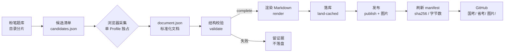
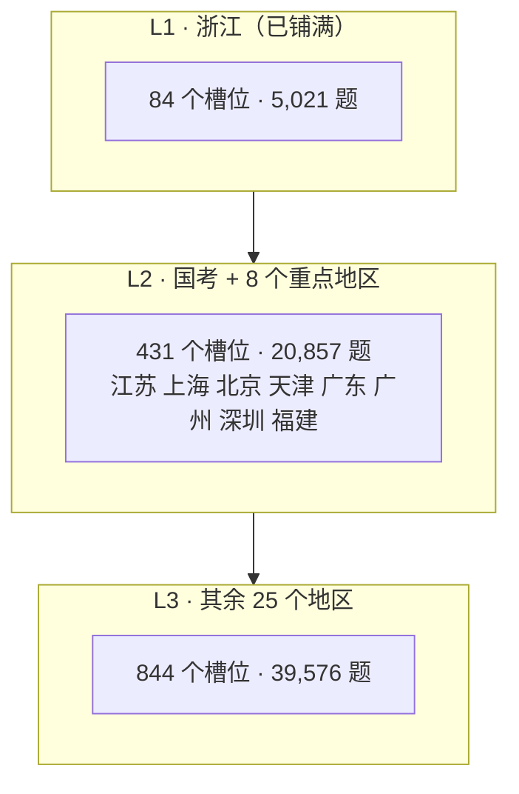

# 全国公务员考试真题库

<!-- CURRENT-STATUS -->
> 当前数据以 [总进度](docs/PROGRESS.md)、[逐卷清单](catalog/manifest.jsonl) 和 [质量事项](reports/QUALITY-AUDIT.md) 为准。下方历史阶段叙述不作为现行完整率。
<!-- /CURRENT-STATUS -->

**国考 · 省考｜行测 · 申论｜Markdown 图文真题 + 参考答案 + 解析**

本仓库把公开可取得的公务员考试原卷整理成**人和机器都能直接读**的 Markdown：题干、选项、给定材料、图表、答案、解析都在同一份文件里，图片走本地相对路径，断网也能看。

> 覆盖率是**进行中**的，不是"全国完整"。逐卷状态以 [`catalog/manifest.jsonl`](catalog/manifest.jsonl) 为准。

---

## 快速导航

| 我想…… | 去这里 |
| --- | --- |
| 直接做题 / 找某年某省某卷 | [`国考/`](国考/) · [`省考/`](省考/) |
| 按地区 / 年份浏览全部试卷 | [试卷目录索引](catalog/INDEX.md)（1,721 份，可点） |
| 看覆盖到哪一年、哪个地区 | [覆盖报告](docs/COVERAGE.md) · [九优先区逐年表](docs/COVERAGE-PRIORITY.md) |
| 了解采集与渲染怎么跑 | [架构与流水线](docs/ARCHITECTURE.md) |
| 了解一份 MD 长什么样 | [文档格式](docs/SCHEMA.md) |
| 看审核结论、已知缺口 | [质量报告](docs/QUALITY.md) · [入库与阅读标准](docs/QUALITY-STANDARD.md) · [进度](docs/PROGRESS.md) |
| 看上游来源与许可 | [来源与许可](docs/SOURCES.md) |

---

## 当前规模

数据取自 `catalog/manifest.jsonl`（逐份 SHA-256），统计脚本见 [docs/COVERAGE.md](docs/COVERAGE.md)。

| 指标 | 数量 |
| --- | ---: |
| 试卷 Markdown | **1,721 份** |
| 行测 / 申论 | 741 / 980 |
| 卷次槽位（地区 × 年份 × 科目 × 卷型） | 1,690 |
| 覆盖地区 | **36 个**（国考 + 35 个省/区/市/兵团） |
| 覆盖年份 | **2008 – 2026** |
| 题目 | **90,527 道** |
| 图片引用 | **19,490 处**（公式/符号小图与题干表格已转为文本，原图留作凭据） |
| 直接采集自粉笔题库 | 1,652 份 |
| 沿用原库整编 | 69 份 |


（**2016 年是分水岭**：粉笔目录里 2016–2026 的在范围条目已全部入库；2008–2015 的存量回补只剩 2 份行测卷和 1 份待核申论，见 [覆盖报告](docs/COVERAGE.md#待补清单)。）

---

## 数据流



一条硬约束：**浏览器采集只有一个进程**。多个 Writer 并行打开同一个 Profile 会互相顶掉登录态，所以并行只用在离线环节（候选核对、渲染、校验、审计）。

---

## 三层范围



同一份流水线、同一套验收标准，只是推进顺序不同。当前已按 **全量年份** 放开——粉笔上能看到多少年份，就收到多少年份。

---

## 目录结构

```text
.
├── 国考/<年份>/行测-<卷型>.md          # 副省级 / 地市级 / 行政执法
├── 省考/<地区>/<年份>/<科目>-<卷型>.md  # A类 / B类 / C类 / 统考 / …
├── 图片/<试卷标识>/                     # 该卷引用的全部图片，相对路径引用
├── catalog/manifest.jsonl              # 逐卷清单：路径、题数、图片数、sha256
├── docs/                               # 架构、覆盖、质量、格式
├── tools/fenbi/                        # 采集 / 校验 / 渲染 / 落地流水线
└── reports/                            # 历次审计与修复记录
```

可选卷型的写法见 [文档格式](docs/SCHEMA.md)。广州市考、深圳市考是**独立考试序列**，与广东省考并存、互不替代。

---

## 怎么读

- **按地区找**：`省考/浙江/2025/行测-A类.md`。年份目录下文件名即"科目-卷型"。
- **按题找**：每题有 `### 第 N 题` 锚点，GitHub 上可直接链接到题。
- **答案不剧透**：每道题下面紧跟一个 `<details>` 折叠块（`第 N 题 · 答案与解析`），默认收起，读完题就地展开。
- **图文不割裂**：资料分析、篇章阅读的材料紧跟在该题组之前；图形推理的图紧随题干；表格用原生 Markdown。
- **申论完整**：给定材料全文前置、逐段编号，题干里的"关联材料：材料 N"直接对应。

---

## 口径与限制

- **真题性质**：粉笔题库整理版本，**未经官方认证**。参考答案与解析来自第三方题库，不代表官方答案，也不代表高分答卷。
- **题号口径**：frontmatter 的 `题号口径` 说明题号来自采集源；与原卷的对应关系仍待人工核对。
- **重复与并集**：同一年份同科目下若同时存在"统考"和具体类级卷型，按不同卷处理；命名归一仍在进行。
- **不混入**：模考、预测题、讲义、事业单位、选调生等不属于国省考真题的对象一律不收。
- **授权**：本仓库为**公开仓库**（PUBLIC）。第三方上游的全文与图片转载授权**尚未逐一核实**，各卷 frontmatter 的 `校验状态` 已逐卷写明来源性质；使用风险由使用者自行承担。详见 [来源与许可](docs/SOURCES.md)。

---

## 更新与复现

```bash
# 采集（单进程，需已登录的浏览器 Profile）
FENBI_WORK_DIR=<workdir> DISPLAY=:77 node tools/fenbi/worker/worker.mjs

# 离线：校验 → 渲染 → 落地 → 发布
node tools/fenbi/driver/land-cached.mjs
node tools/fenbi/driver/publish.mjs
```

参数、候选文件格式、风险控制（403 / 验证码 / 登录态）见 [tools/fenbi/README.md](tools/fenbi/README.md)。
