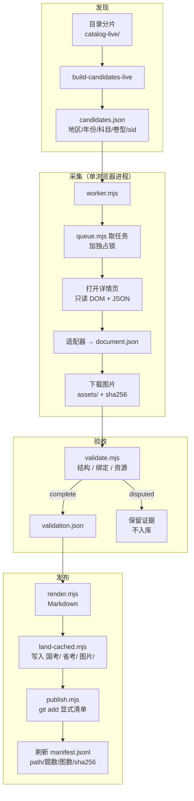
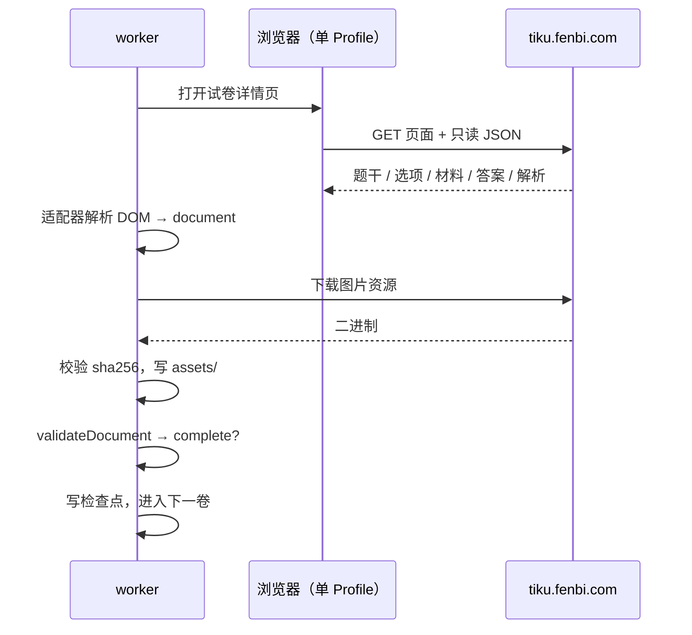
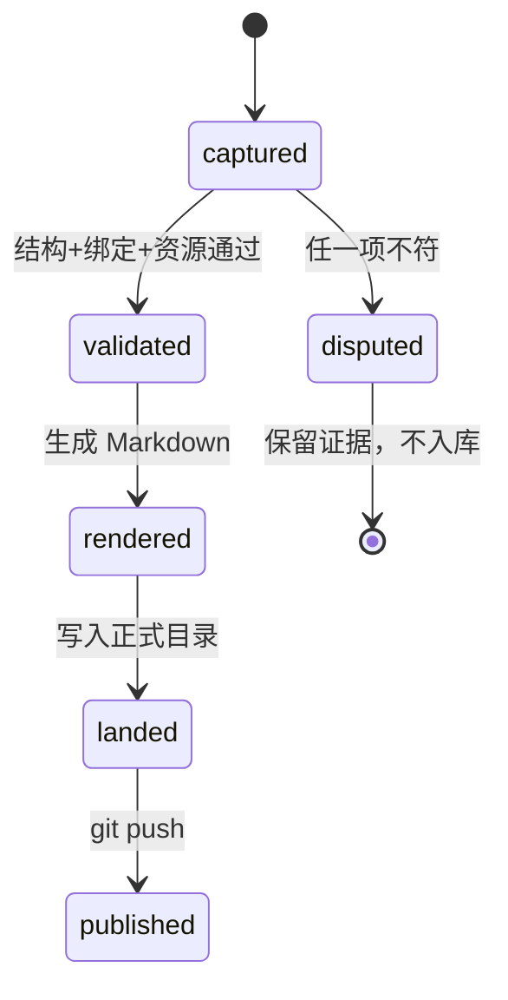

# 架构与流水线

这份文档说明：一份粉笔试卷从目录条目到仓库 Markdown 的全部环节、每步的产物与校验、以及失败时停在哪。

## 总览



三个原则贯穿全程：

1. **采集只读**。除了创建练习与提交（行测需要），不产生写操作；白名单外的写请求一律 `abort`。
2. **验收独立**。`validate.mjs` 不信任采集器的自述，重新核对题数、材料数、图片可达性与试卷身份绑定。
3. **落地可回滚**。每个任务键有独立目录与检查点；候选 Markdown 永远不等于正式卷。

## 阶段一：发现候选

输入是 `work/fenbi/catalog-live-*/` 的分片（由浏览器观察到的分类分页），输出 `candidates.json`：

```json
{
  "key": "js-2019-xingce-a",
  "subject": "xingce",
  "area": "江苏",
  "year": "2019",
  "paperLabel": "A类",
  "paperId": 53163,
  "url": "https://www.fenbi.com/spa/tiku/paper/..."
}
```

- **年份准入**由 `driver/year-policy.mjs` 的 `yearAllowed(area, year)` 决定。现行策略：**不限地区、不设历史下限**，上界为当前自然年（防未来年份脏数据）。
- 与 `catalog/manifest.jsonl` 求差，得到缺口清单；已入库的卷不再进队列。
- 广州、深圳作为独立考试序列与广东省考分开匹配，不互相顶替。

## 阶段二：采集



**为什么只能单进程**：登录态绑定在一个持久化浏览器 Profile 上，同时开两个采集进程会互踢登录、互相污染 `papers/` 目录。因此浏览器侧始终是一个进程（默认 3 个标签页），并行只用于离线环节。

**风控**：`watchRisk` 统计 `http403` / `http429` / `captcha` / `loginLost`，任一触发即 `stopReason: risk` 并停下，不硬闯。粉笔对"创建练习"有频率限制，触发后需要冷却。

## 阶段三：验收

`validate.mjs` 判定一份采集能否进入 `complete`：

| 检查 | 内容 |
| --- | --- |
| 结构 | 题号连续、选项非空、材料被至少一题引用 |
| 身份 | 详情页 `paperId` 与候选一致（`source-paper-identity` 证据） |
| 题数 | `expected.questions` 与实际题目数一致 |
| 资源 | 每个 `assets[]` 都 `downloaded`，`sha256` 与文件一致 |
| 内容 | 题干 / 答案非空；申论要求给定材料齐全 |



## 阶段四：渲染

`src/render.mjs` 负责把 `document.json` 变成可读的 Markdown：

- **frontmatter**：考试 / 地区 / 年份 / 科目 / 卷型 / 真题性质 / 来源 / 源试卷ID / 采集时间 / 题号口径 / 校验状态。
- **材料就近**：材料按"首个引用它的题"排序，编号 `材料 1…N`（取代内容哈希），资料分析的大材料直接插在题组前。跨组或多材料引用才保留 `关联材料：` 行。
- **申论**：给定材料全文前置，题干用 `关联材料：材料 N` 指回。
- **答案折叠**：答案区先渲染在卷末；`tools/polish_markdown.py` 再按题号把每个 `<details>` 搬到对应题目之后（`<summary>第 N 题 · 答案与解析</summary>`），默认折叠。
- **裸 `<` 保护**：`escapeStrayLt()` 只保留真标签，把「<72%」之类转成 `&lt;`，避免下游解析器把正文当标签吃掉。

## 阶段五：落地与发布

- `worker/land-cached.mjs`：从 `work/fenbi/papers/<key>/` 落到 `国考/` `省考/` `图片/`。
- `worker/publish.mjs`：只 `git add` 显式文件清单，不用 `git add -A`；不做 force push。
- `catalog/manifest.jsonl`：逐卷一行，记录路径、题数、图片引用数、字节数与 **sha256**。任何内容修改都必须刷新对应行。

## 运行目录

| 路径 | 内容 | 是否入库 |
| --- | --- | --- |
| `tools/fenbi/` | 框架、测试、说明 | ✅ |
| `catalog/` | 正式清单 | ✅ |
| `国考/` `省考/` `图片/` | 交付物 | ✅ |
| `work/fenbi/` | Profile、候选、缓存、日志 | ❌ |
| `work/fenbi/papers/<key>/` | 逐次采集版本 + 检查点 | ❌ |

## 运维入口

```bash
# 常驻服务（行测）
systemctl status fenbi-pipeline.service

# 手动单批
FENBI_WORK_DIR=<workdir> WORKER_TABS=3 DISPLAY=:77 node tools/fenbi/worker/worker.mjs
```

停采集：在 `work/fenbi/` 下创建 `STOP` 文件，worker 在下一个安全点退出。异常退出留下的锁要先确认对应进程是否还活着，再人工清理——工具不会自动删别人的锁。
