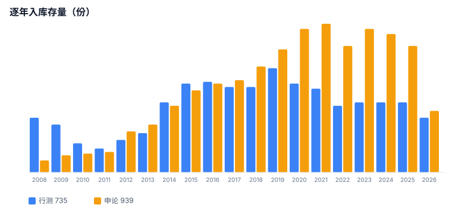
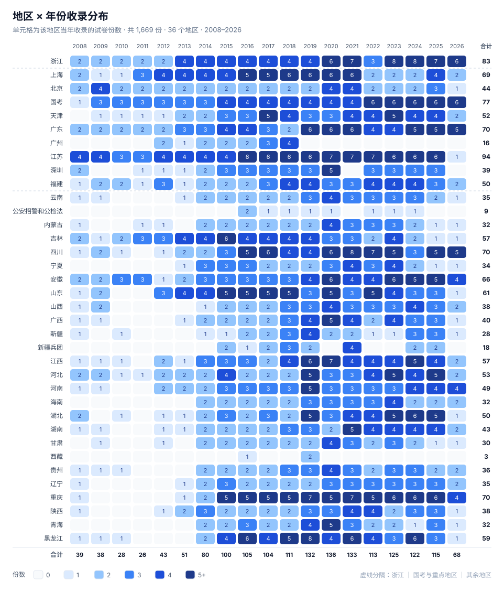

# 覆盖报告

统计口径：`catalog/manifest.jsonl` 逐卷一行；**槽位** = 去重后的 `(地区, 年份, 科目, 归一化卷型)`。同一槽位可能有多份文件（重复采集或多来源），因此文件数 ≥ 槽位数。

快照时间：2026-11-03。

> **覆盖范围不等于内容完整度。** 当前确认 A1 缺原题 **280 题位**、A2 缺选项 **6 题位**、B2 缺参考答案 **7 题位**；按文件题号去重后为 **293 个明确缺项题位**，并非完整率认证，见 [缺口总账](GAP-STATUS.md)。**图片引用已完成对账**：按当前 `catalog/manifest.jsonl` 全部卷的 `image_references` 求和为 **19,345**，与 [质量汇总](../reports/QUALITY-SUMMARY.json) 相同（2026-11-03 删除广东目录下 9 份与 `省考/广州/` 粉笔版重复的广州市考旧卷后重算）。

## 阅读本报告前：两种覆盖口径

**2008–2015 仅统计当前存量：405 个 MD 文件 / 392 个归一化卷型槽位（行测 226、申论 179），不再以粉笔目录或其他目录推算历史应有总数。**

**2016–2026 按所有真实考试建立独立基线**：当前 1,269 个 MD 文件 / 1,260 个槽位（行测 509、申论 760）；旧占位 23 个未收、18 个身份待核、重点地区另外 8 个年度科目格待核。初步查到的招录公告另明确至少 **28 个尚未归档的卷型位置**（部分与旧待核重合），详见 [全国真实考试覆盖与粉笔目录对照](COVERAGE-ALL-EXAMS.md)。**全国应有卷数的精确分母仍未建成，不能发布全国覆盖率。**

**粉笔目录单独对照**：只取 2016–2026，历史目录快照为 **1,169/1,169 已匹配**（行测 506、申论 663）。此前的 1,191/1,191 含浙江 2008–2015 的 22 条。粉笔内匹配 100% 不是全国真实考试覆盖 100%，更不是试卷内容质量认证。

## 总量
| 指标 | 数量 |
| --- | ---: |
| 试卷文件 | 1,674 |
| 槽位 | 1,652 |
| 地区 | 36 |
| 年份跨度 | 2008 – 2026 |
| 行测 / 申论 | 735 / 939 |
| 题目 | 89,728 |
| 图片引用 | 19,345 |
| 多层槽位（同槽多份） | 22 |
| 带源试卷ID（粉笔直采或回溯） | 1,652 |

> 题目取 manifest 的 `declared_questions`（卷面声明题数）。2026-10-30 全库核查：
> 申论每份都带 `### 第 N 题` 标题，锚点数与声明题数已全部一致
> （深圳 2019 原有一份 6/3 的合卷合成件，两卷粉笔版都在，合成件已删）。





---

## 分层
| 层级 | 范围 | 槽位 | 文件 | 粉笔直采 | 题目 |
| --- | --- | ---: | ---: | ---: | ---: |
| L1 | 浙江 | 83 | 83 | 83 | 4,996 |
| L2 | 国考 + 江苏、上海、北京、天津、广东、广州、深圳、福建 | 500 | 511 | 507 | 30,754 |
| L3 | 其余 26 个地区 | 1,069 | 1,080 | 1,062 | 53,978 |
| **合计** |  | **1,652** | **1,674** | **1,652** | **89,728** |

## 逐年
| 年份 | 行测 | 申论 | 合计 |
| --- | ---: | ---: | ---: |
| 2008 | 32 | 7 | 39 |
| 2009 | 28 | 10 | 38 |
| 2010 | 17 | 11 | 28 |
| 2011 | 14 | 12 | 26 |
| 2012 | 19 | 24 | 43 |
| 2013 | 23 | 28 | 51 |
| 2014 | 41 | 39 | 80 |
| 2015 | 52 | 48 | 100 |
| 2016 | 53 | 52 | 105 |
| 2017 | 50 | 54 | 104 |
| 2018 | 50 | 62 | 112 |
| 2019 | 61 | 72 | 133 |
| 2020 | 52 | 84 | 136 |
| 2021 | 49 | 87 | 136 |
| 2022 | 39 | 74 | 113 |
| 2023 | 41 | 84 | 125 |
| 2024 | 41 | 81 | 122 |
| 2025 | 41 | 74 | 115 |
| 2026 | 32 | 36 | 68 |
| **合计** | **735** | **939** | **1,674** |

2016 年及以后为主体存量；2008–2015 仅展示已有历史归档，不设追缺率。2016–2026 的独立考试卷型缺口和内容质量问题需要单独审计，不能因为粉笔目录匹配就宣称收齐。

---

## 分地区
| 地区 | 层级 | 份数 | 行测 | 申论 | 题目 | 图片引用 |
| --- | :--: | ---: | ---: | ---: | ---: | ---: |
| 江苏 | L2 | 94 | 53 | 41 | 6,771 | 2,073 |
| 浙江 | L1 | 83 | 42 | 41 | 4,996 | 1,261 |
| 国考 | L2 | 77 | 36 | 41 | 4,993 | 1,321 |
| 广东 | L2 | 70 | 34 | 36 | 3,435 | 1,033 |
| 四川 | L3 | 70 | 28 | 42 | 2,923 | 656 |
| 重庆 | L3 | 70 | 31 | 39 | 3,620 | 699 |
| 上海 | L2 | 69 | 33 | 36 | 4,364 | 1,238 |
| 安徽 | L3 | 66 | 20 | 46 | 2,391 | 501 |
| 山东 | L3 | 61 | 16 | 45 | 2,000 | 434 |
| 黑龙江 | L3 | 59 | 28 | 31 | 3,592 | 614 |
| 吉林 | L3 | 57 | 29 | 28 | 2,983 | 467 |
| 江西 | L3 | 57 | 25 | 32 | 3,353 | 536 |
| 河北 | L3 | 53 | 19 | 34 | 2,512 | 412 |
| 天津 | L2 | 52 | 23 | 29 | 2,847 | 436 |
| 湖北 | L3 | 50 | 24 | 26 | 3,005 | 534 |
| 福建 | L2 | 50 | 25 | 25 | 3,114 | 525 |
| 河南 | L3 | 49 | 21 | 28 | 2,669 | 575 |
| 北京 | L2 | 44 | 19 | 25 | 2,605 | 367 |
| 湖南 | L3 | 43 | 15 | 28 | 1,956 | 425 |
| 新疆 | L3 | 42 | 22 | 20 | 2,428 | 487 |
| 广西 | L3 | 40 | 16 | 24 | 1,866 | 411 |
| 深圳 | L2 | 39 | 18 | 21 | 1,815 | 284 |
| 山西 | L3 | 38 | 17 | 21 | 2,184 | 440 |
| 陕西 | L3 | 38 | 15 | 23 | 1,998 | 392 |
| 贵州 | L3 | 36 | 16 | 20 | 1,928 | 414 |
| 云南 | L3 | 35 | 15 | 20 | 1,800 | 379 |
| 辽宁 | L3 | 35 | 15 | 20 | 1,862 | 390 |
| 宁夏 | L3 | 34 | 12 | 22 | 1,534 | 373 |
| 内蒙古 | L3 | 32 | 15 | 17 | 1,893 | 392 |
| 海南 | L3 | 32 | 13 | 19 | 1,518 | 325 |
| 青海 | L3 | 32 | 16 | 16 | 1,949 | 332 |
| 甘肃 | L3 | 30 | 14 | 16 | 1,723 | 385 |
| 广州 | L2 | 16 | 8 | 8 | 810 | 169 |
| 公安招警和公检法 | L3 | 9 | 0 | 9 | 36 | 13 |
| 新疆兵团 | L3 | 9 | 0 | 9 | 31 | 17 |
| 西藏 | L3 | 3 | 2 | 1 | 224 | 35 |

> 新疆兵团的 B 类卷以申论为主，行测目前全部空缺；西藏仅 3 份，属于极端稀疏地区。

---

## 粉笔目录对照（不是全国应有卷次清单）

以下仅保留旧粉笔目录对照作为**单一来源覆盖指标**，不是全国真题应有总量。2015 年及以前条目只作历史差异记录，不作为新补卷目标；独立考试公告的缺位见 [双轨覆盖报告](COVERAGE-ALL-EXAMS.md)。

核对口径：把粉笔行测目录（`catalog-live-20261019`，19 个分片、855 行 / 734 个唯一 sourceId）与申论目录（`shenlun-catalog-20261021`，853 个唯一 sourceId）同库内 `catalog/manifest.jsonl` 逐条求差。主键是 frontmatter 的 **`源试卷ID`**；主键对不上的，再按（科目, 地区, 年份, 卷型）规范名回退。纯离线，不访问网络。快照 2026-10-30，仓库 1,787 行、其中 1,652 行带源试卷ID。

### 粉笔历史目录范围内（2016–2026 + 浙江全历史）：已匹配（不代表全国收齐）

| 科目 | 粉笔目录在范围内 | 本地命中 | 缺口 |
| --- | ---: | ---: | ---: |
| 行测 | 517 | 517 | **0** |
| 申论 | 674 | 674 | **0** |
| 合计 | 1,191 | 1,191 | **0** |

命中的 1,191 条里，**1,189 条源试卷ID严格一致**，另 2 条走规范名回退：

| 科目 | 粉笔条目 | 本地文件 | 回退原因 |
| --- | --- | --- | --- |
| 行测 | 江苏 2024 C 类 | `省考/江苏/2024/行测-C类.md` | 本地文件源ID与目录ID不同源，按（江苏, 2024, C 类）唯一命中 |
| 申论 | 四川 2017（卷型标注为空） | `省考/四川/2017/申论-下半年.md` | 目录侧卷型 unknown，本地下半年卷为该年度唯一候选 |

### 范围外：粉笔有、本库未收

| 类别 | 粉笔条数 | 本地 | 说明 |
| --- | ---: | --- | --- |
| 2016 前 · 行测（非浙江） | 217 个唯一 id | 215 | 见下表 2 条 |
| 2016 前 · 申论（非浙江） | 164 | 164 | 无缺口 |
| 模考 | 15 | 0 | 政策不收（见 README「不混入」） |
| 2027 国考申论 | 7 | 0 | 未来年份，尚未开考 |

### 历史粉笔目录差异：3 条（非本次全国补卷目标）

| # | 科目 | 卷 | sourceId | 状态 |
| ---: | --- | --- | ---: | --- |
| 1 | 行测 | 2015 黑龙江 边远地区卷 | 90041 | 待抓 |
| 2 | 行测 | 2014 四川 下半年 | 46413 | 待抓 |
| 3 | 申论 | 2017 四川（卷型未标注） | 78982 | 待核 |

前两条属于 2016 年前历史目录差异，按新政策**只记载、不设补齐任务**。第 3 条是四川 **2017** 申论，属于 2016 年以后的考试：粉笔侧只有会员信号（`member-signal-unbound`）且卷型未标注，仍应在全国真实考试口径下核对身份；不把其直接计为一个新增缺卷（本库已有四川 2017 下半年申论同年度候选）。

**2026-10-23 那版「338 卷待抓」怎么来的**：当时把 2016 前、模考、重复候选、跨地区条目全算进了缺口，而且本地清单里还有大量文件没回填源试卷ID，求差自然偏大。本轮以当前 manifest 重跑，范围内缺口归零。

### 补收限制

剩下这 3 条仍受粉笔详情页限流影响：打开早年卷会返回 403（行测「创建练习」`POST /api/xingce/exercises` 有频率限制）。采集侧按风控规则主动停，不硬闯；浏览器始终单进程。2026-10-23 的一次限流记录：

| 时间 (UTC) | 动作 | 结果 |
| --- | --- | --- |
| 2026-10-23 05:26 | 只读扫描 新疆兵团 列表（`GET /api/shenlun/papers/v2`） | **正常**，9 条、0 风控 |
| 2026-10-23 05:27 | 同一卷打开详情页（`/ti/view/paper/...`） | **403**，脚本立即中止，未写任何采集产物 |
| 2026-10-23 05:29 | 登录态探针 `GET login.fenbi.com/api/users/info` | **200**，账号仍在线 |

即：**登录没掉，是详情页被限流**。风控规则（`driver/service-risk.mjs`）是一小时内软信号 ≥3 次就 STOP，05:11 与 05:27 两次 403 已触发。恢复后先用单卷探针验证，再逐卷补收。

补抓工具（本轮新增，均在 `tools/fenbi/driver/`）：

```bash
# 1) 只读扫描某地区申论列表，产出 sourceId → 标题哈希（只写哈希，不写标题原文）
DISPLAY=:77 node tools/fenbi/driver/shenlun-inventory-scan.mjs --area 天津 --out <work>/shenlun-inventory/inventory-天津.json

# 2) 候选 → 扫描 → 逐卷只读采集（严格串行，遇 401/403/429/503 立即整体中止）
DISPLAY=:77 node tools/fenbi/driver/shenlun-batch.mjs --candidates <work>/shenlun-candidates.json --out-root /home/fjd/tmp/shenlun-capture-<date> --limit 3

# 3) 落库（写入仓库目录并过闸门）
CAPTURES_DIR=… INTEG_REPO=… RIGHTS_FILE=… node tools/fenbi/worker/land-shenlun.mjs
```

---

## 复现

```bash
# 从 manifest 重新统计
python3 tools/coverage_stats.py            # 输出总量 / 分层 / 逐年 / 分地区

# 与粉笔目录求差，生成待补清单
node tools/fenbi/driver/build-candidates-live.mjs
```
