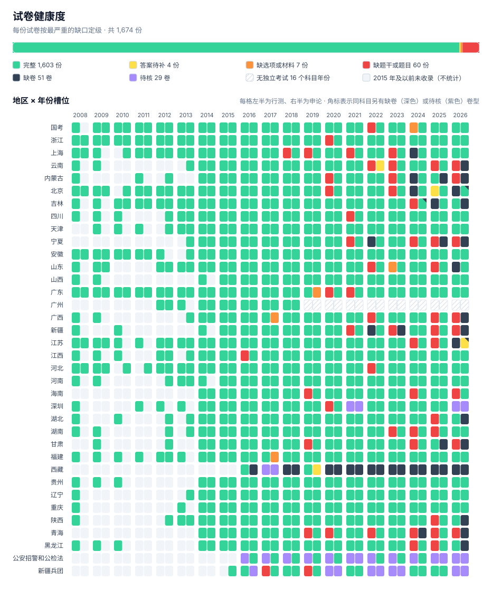

# 缺口总账

[← 返回首页](../README.md) · [文档](README.md)

<!-- 由 tools/gap_report.py 生成，勿手改 -->

## 统计口径

- **槽位台账**：以实际举行的考试为准，2016–2026 年每份应有试卷（地区 × 年份 × 科目 × 卷型）登记一行，状态为已收录、缺卷或无独立考试，每条均附官方公告等依据。应有试卷 = 已收录 + 缺卷，缺卷即台账中尚未收录的应有试卷；当年未单独组织考试的科目记为无独立考试，不计入应有试卷。2015 年及以前只统计已收录试卷。
- **专项收录**：公安招警和公检法（公安院校联考、政法干警等）不属于国考、省考，9 份试卷照常收录、可在目录中浏览，但不进入槽位台账，不计入应有试卷、收录率与缺口统计。
- **局部缺口**：已收录试卷内的缺失，按题计。行测分三级——缺题干、缺选项、缺答案，每题只计最严重的一级；申论分缺题目、缺材料、缺答案。
- **来源**：以粉笔为主，华图与网络检索补充。每份试卷在文件头 `来源` 与 `来源清单` 中记录实际采用的全部来源；缺卷指上述来源均未取得的应有试卷。

## 总览

**已收录 1,661 份试卷（不含公安招警等专项 9 份）：1,603 份完整，58 份有局部缺口**（55 份缺题干或题目、2 份缺选项或材料、1 份缺答案，每份按最严重一级只计一次）；另有 18 题参考答案与题目的对应关系存疑。**未收录：缺卷 67 份**（2016–2026 年）。

| 层级 | 类别 | 2016–2026 | 2008–2015 | 跟踪 |
| --- | --- | ---: | ---: | :---: |
| **缺卷** | 未收录的应有试卷 | 67 卷 | 不判定 | [#160](https://github.com/ProfessorZhi/gwy-zhenti/issues/160) |
| **行测** | 缺题干 | 254 题 · 55 卷 | — | [#155](https://github.com/ProfessorZhi/gwy-zhenti/issues/155) [#156](https://github.com/ProfessorZhi/gwy-zhenti/issues/156) |
|  | 缺选项 | 4 题 · 4 卷 | — | [#157](https://github.com/ProfessorZhi/gwy-zhenti/issues/157) |
|  | 缺答案 | — | — |  |
| **申论** | 缺题目 | — | — |  |
|  | 缺材料 | — | — |  |
|  | 缺答案 | — | — |  |

已收录试卷中 2016–2026 年 1,256 份。上表按题计，一份卷可同时出现在多行；另有 18 题参考答案与题目的对应关系存疑，见 [#157](https://github.com/ProfessorZhi/gwy-zhenti/issues/157)。

## 补录层次

重点地区：国考、浙江、江苏、上海、北京、天津、广东、广州、深圳、福建；浙江为重中之重，在所属级别内单独列出并优先补录。2015 年及以前不判定缺卷，只计已收录试卷的局部缺口。「缺选项或材料」中，行测按题计、申论按材料份数计。

| 层次 | 范围 | 缺卷 | 有缺题的试卷 | 缺题干或题目 | 缺选项或材料 | 缺答案 | 答案可能错位 |
| :---: | --- | ---: | ---: | ---: | ---: | ---: | ---: |
| **一** | 重点地区 2016–2026 | 13 卷 | 16 卷 | 91 题 | 3 | — | 18 题 |
|  | ↳ 其中**浙江** | 4 卷 | 1 卷 | 2 题 | — | — | — |
| **二** | 重点地区 2015 年及以前 | — | — | — | — | — | — |
|  | ↳ 其中**浙江** | — | — | — | — | — | — |
| **三** | 其他地区 2016–2026 | 54 卷 | 41 卷 | 163 题 | 1 | — | — |
| **四** | 其他地区 2015 年及以前 | — | — | — | — | — | — |

下列各表均按层次排列。

## 逐卷分布与健康度

每份试卷按最严重的缺口定级：**完整** → **缺答案**（缺参考答案，或参考答案与题目的对应关系存疑）→ **缺选项或材料** → **缺题干或题目**。

<table><tr><td>←⁠&nbsp;⁠左⁠右⁠滑⁠动⁠查⁠看⁠全⁠部⁠年⁠份⁠&nbsp;⁠·⁠&nbsp;⁠点⁠击⁠图⁠片⁠查⁠看⁠原⁠图⁠&nbsp;⁠→&nbsp;&nbsp;&nbsp;&nbsp;&nbsp;&nbsp;&nbsp;&nbsp;&nbsp;&nbsp;&nbsp;&nbsp;&nbsp;&nbsp;&nbsp;&nbsp;&nbsp;&nbsp;&nbsp;&nbsp;&nbsp;&nbsp;&nbsp;&nbsp;&nbsp;&nbsp;&nbsp;&nbsp;&nbsp;&nbsp;&nbsp;&nbsp;&nbsp;&nbsp;&nbsp;&nbsp;&nbsp;&nbsp;&nbsp;&nbsp;&nbsp;&nbsp;&nbsp;&nbsp;&nbsp;&nbsp;&nbsp;&nbsp;&nbsp;&nbsp;&nbsp;&nbsp;&nbsp;&nbsp;&nbsp;&nbsp;&nbsp;&nbsp;&nbsp;&nbsp;&nbsp;&nbsp;&nbsp;&nbsp;&nbsp;&nbsp;&nbsp;&nbsp;&nbsp;&nbsp;&nbsp;&nbsp;&nbsp;&nbsp;&nbsp;&nbsp;&nbsp;&nbsp;&nbsp;&nbsp;&nbsp;&nbsp;&nbsp;&nbsp;&nbsp;&nbsp;&nbsp;&nbsp;&nbsp;&nbsp;&nbsp;&nbsp;&nbsp;&nbsp;&nbsp;&nbsp;&nbsp;&nbsp;&nbsp;&nbsp;&nbsp;&nbsp;&nbsp;&nbsp;&nbsp;&nbsp;&nbsp;&nbsp;&nbsp;&nbsp;&nbsp;&nbsp;&nbsp;&nbsp;&nbsp;&nbsp;&nbsp;&nbsp;&nbsp;&nbsp;&nbsp;&nbsp;&nbsp;&nbsp;&nbsp;&nbsp;&nbsp;&nbsp;&nbsp;&nbsp;&nbsp;&nbsp;&nbsp;&nbsp;&nbsp;&nbsp;&nbsp;&nbsp;&nbsp;&nbsp;&nbsp;&nbsp;&nbsp;&nbsp;&nbsp;&nbsp;&nbsp;&nbsp;&nbsp;&nbsp;&nbsp;&nbsp;&nbsp;&nbsp;&nbsp;&nbsp;&nbsp;&nbsp;&nbsp;&nbsp;&nbsp;&nbsp;&nbsp;&nbsp;&nbsp;&nbsp;&nbsp;&nbsp;&nbsp;&nbsp;&nbsp;&nbsp;&nbsp;&nbsp;&nbsp;&nbsp;&nbsp;&nbsp;&nbsp;&nbsp;&nbsp;&nbsp;&nbsp;&nbsp;&nbsp;&nbsp;&nbsp;&nbsp;&nbsp;&nbsp;&nbsp;&nbsp;&nbsp;&nbsp;&nbsp;&nbsp;&nbsp;&nbsp;&nbsp;&nbsp;&nbsp;&nbsp;&nbsp;&nbsp;&nbsp;&nbsp;&nbsp;&nbsp;&nbsp;&nbsp;&nbsp;&nbsp;&nbsp;&nbsp;&nbsp;&nbsp;&nbsp;&nbsp;&nbsp;&nbsp;&nbsp;&nbsp;&nbsp;&nbsp;&nbsp;&nbsp;&nbsp;&nbsp;&nbsp;&nbsp;&nbsp;&nbsp;&nbsp;&nbsp;&nbsp;&nbsp;&nbsp;&nbsp;&nbsp;&nbsp;&nbsp;&nbsp;&nbsp;&nbsp;&nbsp;&nbsp;&nbsp;&nbsp;&nbsp;&nbsp;&nbsp;&nbsp;&nbsp;&nbsp;&nbsp;&nbsp;&nbsp;&nbsp;&nbsp;&nbsp;&nbsp;&nbsp;&nbsp;&nbsp;&nbsp;&nbsp;&nbsp;&nbsp;&nbsp;&nbsp;&nbsp;&nbsp;&nbsp;&nbsp;&nbsp;&nbsp;&nbsp;&nbsp;&nbsp;&nbsp;&nbsp;&nbsp;&nbsp;&nbsp;&nbsp;&nbsp;&nbsp;&nbsp;&nbsp;&nbsp;&nbsp;&nbsp;&nbsp;&nbsp;&nbsp;&nbsp;&nbsp;&nbsp;&nbsp;&nbsp;&nbsp;&nbsp;&nbsp;&nbsp;&nbsp;&nbsp;&nbsp;&nbsp;&nbsp;&nbsp;&nbsp;&nbsp;&nbsp;&nbsp;&nbsp;&nbsp;&nbsp;&nbsp;&nbsp;&nbsp;&nbsp;&nbsp;&nbsp;&nbsp;&nbsp;&nbsp;&nbsp;&nbsp;&nbsp;&nbsp;&nbsp;&nbsp;&nbsp;&nbsp;&nbsp;&nbsp;&nbsp;&nbsp;&nbsp;&nbsp;&nbsp;&nbsp;&nbsp;&nbsp;&nbsp;&nbsp;&nbsp;&nbsp;&nbsp;&nbsp;&nbsp;&nbsp;&nbsp;&nbsp;&nbsp;&nbsp;&nbsp;&nbsp;&nbsp;&nbsp;&nbsp;&nbsp;&nbsp;&nbsp;&nbsp;&nbsp;&nbsp;&nbsp;&nbsp;&nbsp;&nbsp;&nbsp;&nbsp;&nbsp;&nbsp;&nbsp;&nbsp;&nbsp;&nbsp;&nbsp;&nbsp;&nbsp;&nbsp;&nbsp;&nbsp;&nbsp;&nbsp;&nbsp;&nbsp;&nbsp;&nbsp;&nbsp;&nbsp;&nbsp;&nbsp;&nbsp;&nbsp;&nbsp;&nbsp;&nbsp;&nbsp;&nbsp;&nbsp;&nbsp;&nbsp;&nbsp;&nbsp;&nbsp;&nbsp;&nbsp;&nbsp;&nbsp;&nbsp;&nbsp;&nbsp;&nbsp;&nbsp;&nbsp;&nbsp;&nbsp;&nbsp;&nbsp;&nbsp;&nbsp;&nbsp;&nbsp;&nbsp;&nbsp;&nbsp;&nbsp;&nbsp;&nbsp;&nbsp;&nbsp;&nbsp;&nbsp;&nbsp;&nbsp;&nbsp;&nbsp;&nbsp;&nbsp;&nbsp;&nbsp;&nbsp;&nbsp;&nbsp;&nbsp;&nbsp;&nbsp;&nbsp;&nbsp;&nbsp;&nbsp;&nbsp;&nbsp;&nbsp;&nbsp;&nbsp;&nbsp;&nbsp;&nbsp;&nbsp;&nbsp;&nbsp;&nbsp;&nbsp;&nbsp;&nbsp;&nbsp;&nbsp;&nbsp;&nbsp;&nbsp;&nbsp;&nbsp;&nbsp;&nbsp;&nbsp;&nbsp;&nbsp;&nbsp;&nbsp;&nbsp;&nbsp;&nbsp;&nbsp;&nbsp;&nbsp;&nbsp;&nbsp;&nbsp;&nbsp;&nbsp;&nbsp;&nbsp;&nbsp;&nbsp;&nbsp;&nbsp;&nbsp;&nbsp;&nbsp;&nbsp;&nbsp;&nbsp;&nbsp;&nbsp;&nbsp;&nbsp;&nbsp;&nbsp;&nbsp;&nbsp;&nbsp;&nbsp;&nbsp;&nbsp;&nbsp;&nbsp;&nbsp;&nbsp;&nbsp;&nbsp;&nbsp;&nbsp;&nbsp;&nbsp;&nbsp;&nbsp;&nbsp;&nbsp;&nbsp;&nbsp;&nbsp;&nbsp;&nbsp;&nbsp;&nbsp;&nbsp; </td></tr></table>

| 地区 | 已收录 | 完整 | 缺答案 | 缺选项或材料 | 缺题干或题目 | 缺卷 |
| --- | ---: | ---: | ---: | ---: | ---: | ---: |
| 国考 | 77 | 76 | — | 1 | — | — |
| 江苏 | 94 | 92 | — | — | 2 | 5 |
| 浙江 | 83 | 82 | — | — | 1 | 4 |
| 四川 | 70 | 69 | — | — | 1 | — |
| 广东 | 70 | 68 | — | — | 2 | — |
| 重庆 | 70 | 70 | — | — | — | — |
| 上海 | 69 | 64 | — | — | 5 | 2 |
| 安徽 | 66 | 66 | — | — | — | — |
| 山东 | 61 | 59 | — | — | 2 | 1 |
| 黑龙江 | 59 | 57 | — | — | 2 | 1 |
| 吉林 | 57 | 56 | — | — | 1 | 3 |
| 江西 | 57 | 56 | — | — | 1 | — |
| 河北 | 53 | 52 | — | — | 1 | — |
| 天津 | 52 | 52 | — | — | — | — |
| 湖北 | 50 | 49 | — | — | 1 | 1 |
| 福建 | 50 | 50 | — | — | — | — |
| 河南 | 49 | 49 | — | — | — | — |
| 北京 | 45 | 42 | 1 | — | 2 | 2 |
| 湖南 | 43 | 42 | — | — | 1 | — |
| 广西 | 40 | 37 | — | — | 3 | 1 |
| 深圳 | 39 | 36 | — | 1 | 2 | — |
| 山西 | 38 | 38 | — | — | — | — |
| 陕西 | 38 | 37 | — | — | 1 | 1 |
| 贵州 | 36 | 36 | — | — | — | — |
| 云南 | 35 | 31 | — | — | 4 | 1 |
| 辽宁 | 35 | 35 | — | — | — | — |
| 宁夏 | 34 | 30 | — | — | 4 | 3 |
| 内蒙古 | 32 | 29 | — | — | 3 | 3 |
| 海南 | 32 | 29 | — | — | 3 | — |
| 青海 | 32 | 28 | — | — | 4 | 2 |
| 甘肃 | 30 | 27 | — | — | 3 | 2 |
| 新疆 | 28 | 24 | — | — | 4 | 3 |
| 新疆兵团 | 18 | 16 | — | — | 2 | 11 |
| 广州 | 16 | 16 | — | — | — | — |
| 西藏 | 3 | 3 | — | — | — | 21 |
| **合计** | **1,661** | **1,603** | **1** | **2** | **55** | **67** |

## 一、未收录卷次

2016–2026 年每个「地区 × 年份 × 科目」槽位均须为已收录，或在台账中登记为缺卷、无独立考试之一。

| 层次 | 年份 | 地区 | 科目 | 卷型 | 状态 | 依据 |
| :---: | :---: | --- | --- | --- | --- | --- |
| 一 · ★浙江 | 2022 | 浙江 | 申论 | A类 | 缺卷 | [公告](https://m.gwy.com/dfgwy/72771.html)：浙江省2022年度考录笔试按职位分类：A类综合类考行测A卷、申论A卷，B类基层类考行测B卷、申论B卷，C类行政执法类考行测C卷、申论C卷（D类优秀村干部考行测D卷与综合应用能力，本库不收录该类） |
| 一 · ★浙江 | 2022 | 浙江 | 申论 | B类 | 缺卷 | [公告](https://m.gwy.com/dfgwy/72771.html)：浙江省2022年度考录笔试按职位分类：A类综合类考行测A卷、申论A卷，B类基层类考行测B卷、申论B卷，C类行政执法类考行测C卷、申论C卷（D类优秀村干部考行测D卷与综合应用能力，本库不收录该类） |
| 一 · ★浙江 | 2022 | 浙江 | 申论 | C类 | 缺卷 | [公告](https://m.gwy.com/dfgwy/72771.html)：浙江省2022年度考录笔试按职位分类：A类综合类考行测A卷、申论A卷，B类基层类考行测B卷、申论B卷，C类行政执法类考行测C卷、申论C卷（D类优秀村干部考行测D卷与综合应用能力，本库不收录该类） |
| 一 · ★浙江 | 2022 | 浙江 | 行测 | B类 | 缺卷 | [公告](https://m.gwy.com/dfgwy/72771.html)：浙江省2022年度考录笔试按职位分类：A类综合类考行测A卷、申论A卷，B类基层类考行测B卷、申论B卷，C类行政执法类考行测C卷、申论C卷（D类优秀村干部考行测D卷与综合应用能力，本库不收录该类） |
| 一 | 2026 | 北京 | 申论 | 统考 | 缺卷 | [公告](https://www.beijing.gov.cn/gongkai/rsxx/gwyzk/202511/t20251110_4267508.html) |
| 一 | 2026 | 北京 | 行测 | 统考 | 缺卷 | [公告](https://www.beijing.gov.cn/gongkai/rsxx/gwyzk/202511/t20251110_4267508.html) |
| 一 | 2026 | 江苏 | 申论 | A类 | 缺卷 | [公告](https://www.jsxf.gov.cn/tzgg/art/2025/art_4b4f6c1ef283b21741ec26bc3c0ecc30.html) |
| 一 | 2026 | 江苏 | 申论 | C类 | 缺卷 | [公告](https://www.jsxf.gov.cn/tzgg/art/2025/art_4b4f6c1ef283b21741ec26bc3c0ecc30.html) |
| 一 | 2026 | 江苏 | 行测 | A类 | 缺卷 | [公告](https://www.jsxf.gov.cn/tzgg/art/2025/art_4b4f6c1ef283b21741ec26bc3c0ecc30.html) |
| 一 | 2026 | 江苏 | 行测 | B类 | 缺卷 | [公告](https://www.jsxf.gov.cn/tzgg/art/2025/art_4b4f6c1ef283b21741ec26bc3c0ecc30.html) |
| 一 | 2026 | 江苏 | 行测 | C类 | 缺卷 | [公告](https://www.jsxf.gov.cn/tzgg/art/2025/art_4b4f6c1ef283b21741ec26bc3c0ecc30.html) |
| 一 | 2024 | 上海 | 行测 | A类 | 缺卷 | 2024 上海市公务员招录公告（转载） |
| 一 | 2024 | 上海 | 行测 | B类 | 缺卷 | 2024 上海市公务员招录公告（转载） |
| 三 | 2026 | 云南 | 申论 | 待定 | 缺卷 | 同年另一科目已收录 |
| 三 | 2026 | 内蒙古 | 申论 | 待定 | 缺卷 | 同年另一科目已收录 |
| 三 | 2026 | 吉林 | 申论 | 待定 | 缺卷 | 同年另一科目已收录 |
| 三 | 2026 | 宁夏 | 申论 | 待定 | 缺卷 | 前两年均已收录，按例行年度考试计 |
| 三 | 2026 | 山东 | 行测 | 待定 | 缺卷 | 前两年均已收录，按例行年度考试计 |
| 三 | 2026 | 广西 | 申论 | 待定 | 缺卷 | 同年另一科目已收录 |
| 三 | 2026 | 新疆 | 申论 | 待定 | 缺卷 | 同年另一科目已收录 |
| 三 | 2026 | 新疆兵团 | 申论 | A类 | 缺卷 | [公告](http://btpta.xjbt.gov.cn/c/2026-01-27/8469267.shtml)：官方页明确申论 A/B/C，2026-03-14 14:00-16:30 |
| 三 | 2026 | 新疆兵团 | 申论 | B类 | 缺卷 | [公告](http://btpta.xjbt.gov.cn/c/2026-01-27/8469267.shtml)：官方页明确申论 A/B/C，2026-03-14 14:00-16:30 |
| 三 | 2026 | 新疆兵团 | 申论 | C类 | 缺卷 | [公告](http://btpta.xjbt.gov.cn/c/2026-01-27/8469267.shtml)：官方页明确申论 A/B/C，2026-03-14 14:00-16:30 |
| 三 | 2026 | 新疆兵团 | 行测 | 待定 | 缺卷 | [公告](http://btpta.xjbt.gov.cn/c/2026-01-27/8469267.shtml)：兵团考试信息网：2026-03-14 09:00-11:00 行测；官方页未给总人数 |
| 三 | 2026 | 湖北 | 申论 | 待定 | 缺卷 | 同年另一科目已收录 |
| 三 | 2026 | 甘肃 | 申论 | 待定 | 缺卷 | 同年另一科目已收录 |
| 三 | 2026 | 西藏 | 申论 | A类 | 缺卷 | [公告](https://hrss.xizang.gov.cn/xwzx/tzgg/202512/t20251202_512168.html) |
| 三 | 2026 | 西藏 | 申论 | B类 | 缺卷 | [公告](https://hrss.xizang.gov.cn/xwzx/tzgg/202512/t20251202_512168.html) |
| 三 | 2026 | 西藏 | 申论 | C类 | 缺卷 | [公告](https://hrss.xizang.gov.cn/xwzx/tzgg/202512/t20251202_512168.html) |
| 三 | 2026 | 西藏 | 行测 | 统考 | 缺卷 | [公告](https://hrss.xizang.gov.cn/xwzx/tzgg/202512/t20251202_512168.html) |
| 三 | 2026 | 陕西 | 申论 | 待定 | 缺卷 | 同年另一科目已收录 |
| 三 | 2026 | 青海 | 申论 | 待定 | 缺卷 | 同年另一科目已收录 |
| 三 | 2026 | 黑龙江 | 申论 | 待定 | 缺卷 | 同年另一科目已收录 |
| 三 | 2025 | 内蒙古 | 申论 | 待定 | 缺卷 | 同年另一科目已收录 |
| 三 | 2025 | 吉林 | 行测 | 待定 | 缺卷 | 前后两年均已收录，按例行年度考试计 |
| 三 | 2025 | 宁夏 | 申论 | 待定 | 缺卷 | 同年另一科目已收录 |
| 三 | 2025 | 甘肃 | 申论 | 待定 | 缺卷 | 同年另一科目已收录 |
| 三 | 2025 | 西藏 | 申论 | 统考 | 缺卷 | [公告](https://hrss.xizang.gov.cn/xwzx/tzgg/202501/t20250113_456938.html) |
| 三 | 2025 | 西藏 | 行测 | 统考 | 缺卷 | [公告](https://hrss.xizang.gov.cn/xwzx/tzgg/202501/t20250113_456938.html) |
| 三 | 2024 | 内蒙古 | 行测 | 待定 | 缺卷 | 同年另一科目已收录 |
| 三 | 2024 | 吉林 | 申论 | 统考 | 缺卷 | 同年另一科目已收录 |
| 三 | 2024 | 西藏 | 申论 | 统考 | 缺卷 | [公告](https://hrss.xizang.gov.cn/xwzx/tzgg/202403/t20240329_409829.html) |
| 三 | 2024 | 西藏 | 行测 | 统考 | 缺卷 | [公告](https://hrss.xizang.gov.cn/xwzx/tzgg/202403/t20240329_409829.html) |
| 三 | 2024 | 青海 | 申论 | 待定 | 缺卷 | 同年另一科目已收录 |
| 三 | 2023 | 新疆 | 申论 | 待定 | 缺卷 | 同年另一科目已收录 |
| 三 | 2023 | 新疆兵团 | 申论 | 待定 | 缺卷 | [公告](http://btpta.xjbt.gov.cn/c/2023-03-16/8269716.shtml)：兵团考试信息网《兵团2023年度考试录用公务员笔试成绩和资格复审等相关事项公告》及 http://btpta.xjbt.gov.cn/c/2023-04-04/8273047.shtml 面试公告：兵团单独组织 2023 年度考录并划定兵团机关、师市笔试合格线（官网旧页已下线，标题与摘要见搜索引擎收录） |
| 三 | 2023 | 新疆兵团 | 行测 | 待定 | 缺卷 | [公告](http://btpta.xjbt.gov.cn/c/2023-03-16/8269716.shtml)：兵团考试信息网《兵团2023年度考试录用公务员笔试成绩和资格复审等相关事项公告》及 http://btpta.xjbt.gov.cn/c/2023-04-04/8273047.shtml 面试公告：兵团单独组织 2023 年度考录并划定兵团机关、师市笔试合格线（官网旧页已下线，标题与摘要见搜索引擎收录） |
| 三 | 2023 | 西藏 | 申论 | 统考 | 缺卷 | [公告](https://hrss.xizang.gov.cn/xwzx/tzgg/202302/t20230208_340777.html) |
| 三 | 2023 | 西藏 | 行测 | 统考 | 缺卷 | [公告](https://hrss.xizang.gov.cn/xwzx/tzgg/202302/t20230208_340777.html) |
| 三 | 2022 | 宁夏 | 行测 | 待定 | 缺卷 | 同年另一科目已收录 |
| 三 | 2022 | 新疆 | 行测 | 待定 | 缺卷 | 同年另一科目已收录 |
| 三 | 2022 | 新疆兵团 | 申论 | 待定 | 缺卷 | [公告](https://www.huhst.edu.cn/chxy/info/1104/3501.htm)：《2022年新疆生产建设兵团面向社会招录公务员公告》（高校转载原文）：兵团组织 2022 年考试录用，计划 1507 名，2022-03-26 笔试行测、申论，申论分一类、二类、三类卷；兵团考试信息网旧页已下线 |
| 三 | 2022 | 新疆兵团 | 行测 | 待定 | 缺卷 | [公告](https://www.huhst.edu.cn/chxy/info/1104/3501.htm)：《2022年新疆生产建设兵团面向社会招录公务员公告》（高校转载原文）：兵团组织 2022 年考试录用，计划 1507 名，2022-03-26 笔试行测、申论，申论分一类、二类、三类卷；兵团考试信息网旧页已下线 |
| 三 | 2022 | 西藏 | 申论 | 统考 | 缺卷 | [公告](https://hrss.xizang.gov.cn/xwzx/tzgg/202203/t20220316_288669.html) |
| 三 | 2022 | 西藏 | 行测 | 统考 | 缺卷 | [公告](https://hrss.xizang.gov.cn/xwzx/tzgg/202203/t20220316_288669.html) |
| 三 | 2021 | 西藏 | 申论 | 统考 | 缺卷 | [公告](https://hrss.lasa.gov.cn/rsj/rsrc/202105/7a61953ad2974103bf7748eaf2f0504f.shtml) |
| 三 | 2021 | 西藏 | 行测 | 统考 | 缺卷 | [公告](https://hrss.lasa.gov.cn/rsj/rsrc/202105/7a61953ad2974103bf7748eaf2f0504f.shtml) |
| 三 | 2020 | 新疆兵团 | 申论 | 待定 | 缺卷 | [公告](http://www.xjbt.gov.cn/c/2020-07-19/8033058.shtml)：兵团政务网：2020-08-22/23 公共科目，1277人 |
| 三 | 2020 | 新疆兵团 | 行测 | 待定 | 缺卷 | [公告](http://www.xjbt.gov.cn/c/2020-07-19/8033058.shtml)：兵团政务网：2020-08-22/23 公共科目，1277人 |
| 三 | 2020 | 西藏 | 申论 | 统考 | 缺卷 | [公告](https://zjt.xizang.gov.cn/xwzx/xzxw/202006/t20200611_154437.html) |
| 三 | 2020 | 西藏 | 行测 | 统考 | 缺卷 | [公告](https://zjt.xizang.gov.cn/xwzx/xzxw/202006/t20200611_154437.html) |
| 三 | 2018 | 西藏 | 申论 | 统考 | 缺卷 | [公告](https://al.gov.cn/info/1034/2262.htm) |
| 三 | 2018 | 西藏 | 行测 | 统考 | 缺卷 | [公告](https://al.gov.cn/info/1034/2262.htm) |
| 三 | 2017 | 西藏 | 申论 | 统考 | 缺卷 | [公告](http://www.xznq.gov.cn/zxzx_yy_3432/201711/t20171109_2025419.html)：常规第二批 2017-11-25；另 2017-09-09 藏汉双语专项单列待定 |
| 三 | 2017 | 西藏 | 行测 | 统考 | 缺卷 | [公告](http://www.xznq.gov.cn/zxzx_yy_3432/201711/t20171109_2025419.html)：常规第二批 2017-11-25；另 2017-09-09 藏汉双语专项单列待定 |
| 三 | 2016 | 新疆兵团 | 申论 | 待定 | 缺卷 | 同年兵团考试录用行测已收录（省考/新疆兵团/2016/行测-统考.md，粉笔），兵团考录公共科目为行测、申论两科，故同年申论为应有试卷；官方原公告未能找回 |
| 三 | 2016 | 西藏 | 申论 | 待定 | 缺卷 | 同年另一科目已收录 |
| — | 2026 | 广州 | 申论 | 待定 | 无独立考试 | 2019 年起广州市公务员考试并入广东省考，使用广东省考试卷 |
| — | 2026 | 广州 | 行测 | 待定 | 无独立考试 | 2019 年起广州市公务员考试并入广东省考，使用广东省考试卷 |
| — | 2026 | 深圳 | 申论 | 待定 | 无独立考试 | [公告](http://www.zzb.sz.gov.cn/notice/announcement/content/post_1649287.html)：深圳市委组织部《广东省2026年考试录用公务员深圳市职位资格审核等有关事项的公告》，深圳职位纳入广东省考；深圳市考试院考试列表中最新的深圳单独专项招录为 2025 年服务高质量发展专项，2026 年未见单独专项招录（核查于 2026-11-09） |
| — | 2026 | 深圳 | 行测 | 待定 | 无独立考试 | [公告](http://www.zzb.sz.gov.cn/notice/announcement/content/post_1649287.html)：深圳市委组织部《广东省2026年考试录用公务员深圳市职位资格审核等有关事项的公告》，深圳职位纳入广东省考；深圳市考试院考试列表中最新的深圳单独专项招录为 2025 年服务高质量发展专项，2026 年未见单独专项招录（核查于 2026-11-09） |
| — | 2025 | 广州 | 申论 | 待定 | 无独立考试 | 2019 年起广州市公务员考试并入广东省考，使用广东省考试卷 |
| — | 2025 | 广州 | 行测 | 待定 | 无独立考试 | 2019 年起广州市公务员考试并入广东省考，使用广东省考试卷 |
| — | 2024 | 广州 | 申论 | 待定 | 无独立考试 | 2019 年起广州市公务员考试并入广东省考，使用广东省考试卷 |
| — | 2024 | 广州 | 行测 | 待定 | 无独立考试 | 2019 年起广州市公务员考试并入广东省考，使用广东省考试卷 |
| — | 2023 | 广州 | 申论 | 待定 | 无独立考试 | 2019 年起广州市公务员考试并入广东省考，使用广东省考试卷 |
| — | 2023 | 广州 | 行测 | 待定 | 无独立考试 | 2019 年起广州市公务员考试并入广东省考，使用广东省考试卷 |
| — | 2022 | 广州 | 申论 | 待定 | 无独立考试 | 2019 年起广州市公务员考试并入广东省考，使用广东省考试卷 |
| — | 2022 | 广州 | 行测 | 待定 | 无独立考试 | 2019 年起广州市公务员考试并入广东省考，使用广东省考试卷 |
| — | 2021 | 广州 | 申论 | 待定 | 无独立考试 | 2019 年起广州市公务员考试并入广东省考，使用广东省考试卷 |
| — | 2021 | 广州 | 行测 | 待定 | 无独立考试 | 2019 年起广州市公务员考试并入广东省考，使用广东省考试卷 |
| — | 2021 | 深圳 | 申论 | 待定 | 无独立考试 | [公告](http://hrss.sz.gov.cn/szksy/zwgk/tzgg/content/post_8528867.html)：深圳市考试院 2021-01-30 转发《广东省2021年考试录用公务员公告》，深圳职位纳入广东省考（2021-03-14 笔试），各招录机关体检、拟录用公示均依广东省2021年考录；深圳单独的专项招录为「2020年服务双区建设专项」（2020-11 发布）与「2022年服务双区建设专项」，无以 2021 年命名的深圳单独考试 |
| — | 2021 | 深圳 | 行测 | 待定 | 无独立考试 | [公告](http://hrss.sz.gov.cn/szksy/zwgk/tzgg/content/post_8528867.html)：深圳市考试院 2021-01-30 转发《广东省2021年考试录用公务员公告》，深圳职位纳入广东省考（2021-03-14 笔试），各招录机关体检、拟录用公示均依广东省2021年考录；深圳单独的专项招录为「2020年服务双区建设专项」（2020-11 发布）与「2022年服务双区建设专项」，无以 2021 年命名的深圳单独考试 |
| — | 2020 | 广州 | 申论 | 待定 | 无独立考试 | 2019 年起广州市公务员考试并入广东省考，使用广东省考试卷 |
| — | 2020 | 广州 | 行测 | 待定 | 无独立考试 | 2019 年起广州市公务员考试并入广东省考，使用广东省考试卷 |
| — | 2019 | 广州 | 申论 | 待定 | 无独立考试 | 2019 年起广州市公务员考试并入广东省考，使用广东省考试卷 |
| — | 2019 | 广州 | 行测 | 待定 | 无独立考试 | 2019 年起广州市公务员考试并入广东省考，使用广东省考试卷 |

完整台账见 [`catalog/exam-slots.jsonl`](../catalog/exam-slots.jsonl)（含已收录卷次）；未收录部分维护于 [`catalog/uncollected-slots.jsonl`](../catalog/uncollected-slots.jsonl)。

## 二、行测局部缺口

| 层次 | 试卷 | 缺题干 | 缺选项 | 缺答案 |
| :---: | --- | --- | --- | --- |
| 一 · ★浙江 | [浙江 2020 行测 A类](../省考/浙江/2020/行测-A类.md) | 2 题：49–50 | — | — |
| 一 | [北京 2023 行测 统考](../省考/北京/2023/行测-统考.md) | 35 题：15、17–27、111–125、128–135 | — | — |
| 一 | [上海 2021 行测 B类](../省考/上海/2021/行测-B类.md) | 13 题：18–21、80、119–126 | — | — |
| 一 | [江苏 2025 行测 C类](../省考/江苏/2025/行测-C类.md) | 12 题：27、29、35–37、42、75、77–78、80–81、85 | — | — |
| 一 | [广东 2020 行测 县级卷](../省考/广东/2020/行测-县级卷.md) | 7 题：69–75 | — | — |
| 一 | [深圳 2020 行测 行测2](../省考/深圳/2020/行测-行测2.md) | 6 题：9、12、31、52–53、61 | — | — |
| 一 | [广东 2021 行测 乡镇卷](../省考/广东/2021/行测-乡镇卷.md) | 5 题：91–95 | — | — |
| 一 | [江苏 2024 行测 A类](../省考/江苏/2024/行测-A类.md) | 4 题：76、96、110–111 | — | — |
| 一 | [上海 2019 行测 行政执法](../省考/上海/2019/行测-行政执法.md) | 1 题：32 | 1 题：59 | — |
| 一 | [北京 2020 行测 乡镇卷](../省考/北京/2020/行测-乡镇卷.md) | 2 题：42、89 | — | — |
| 一 | [国考 2024 行测 副省级](../国考/2024/行测-副省级.md) | — | 1 题：12 | — |
| 一 | [上海 2018 行测 行政执法](../省考/上海/2018/行测-行政执法.md) | 1 题：30 | — | — |
| 一 | [上海 2021 行测 行政执法](../省考/上海/2021/行测-行政执法.md) | 1 题：30 | — | — |
| 一 | [上海 2023 行测 A类](../省考/上海/2023/行测-A类.md) | 1 题：40 | — | — |
| 一 | [深圳 2020 行测 思维能力测验](../省考/深圳/2020/行测-思维能力测验.md) | 1 题：72 | — | — |
| 一 | [深圳 2020 行测 行测1](../省考/深圳/2020/行测-行测1.md) | — | 1 题：7 | — |
| 三 | [新疆 2023 行测 统考](../省考/新疆/2023/行测-统考.md) | 19 题：14–25、50、60–65 | — | — |
| 三 | [吉林 2024 行测 统考](../省考/吉林/2024/行测-统考.md) | 13 题：17–20、42–45、65–68、77 | — | — |
| 三 | [新疆 2025 行测 统考](../省考/新疆/2025/行测-统考.md) | 10 题：6–10、15–18、23 | — | — |
| 三 | [黑龙江 2024 行测 公安](../省考/黑龙江/2024/行测-公安.md) | 9 题：17–18、20、96–101 | — | — |
| 三 | [内蒙古 2020 行测 公安](../省考/内蒙古/2020/行测-公安.md) | 8 题：17–20、29、32、45、99 | — | — |
| 三 | [甘肃 2024 行测 统考](../省考/甘肃/2024/行测-统考.md) | 8 题：18–20、54、69–70、78、87 | — | — |
| 三 | [山东 2025 行测 统考](../省考/山东/2025/行测-统考.md) | 7 题：32、62、66、91–93、100 | — | — |
| 三 | [宁夏 2025 行测 统考](../省考/宁夏/2025/行测-统考.md) | 6 题：3、55–56、90、99–100 | — | — |
| 三 | [新疆 2026 行测 统考](../省考/新疆/2026/行测-统考.md) | 6 题：5–10 | — | — |
| 三 | [广西 2025 行测 统考](../省考/广西/2025/行测-统考.md) | 5 题：19–20、34、46–47 | — | — |
| 三 | [广西 2026 行测 统考](../省考/广西/2026/行测-统考.md) | 5 题：23、26、75、77、90 | — | — |
| 三 | [新疆 2021 行测 统考](../省考/新疆/2021/行测-统考.md) | 5 题：111–115 | — | — |
| 三 | [海南 2026 行测 统考](../省考/海南/2026/行测-统考.md) | 5 题：28、34、37、91、109 | — | — |
| 三 | [甘肃 2019 行测 统考](../省考/甘肃/2019/行测-统考.md) | 5 题：60、76–78、98 | — | — |
| 三 | [青海 2022 行测 统考](../省考/青海/2022/行测-统考.md) | 5 题：111–115 | — | — |
| 三 | [内蒙古 2026 行测 统考](../省考/内蒙古/2026/行测-统考.md) | 4 题：29–30、93、104 | — | — |
| 三 | [宁夏 2024 行测 统考](../省考/宁夏/2024/行测-统考.md) | 4 题：52–55 | — | — |
| 三 | [海南 2024 行测 统考](../省考/海南/2024/行测-统考.md) | 4 题：61、70、72、110 | — | — |
| 三 | [四川 2021 行测 统考](../省考/四川/2021/行测-统考.md) | 3 题：96–97、99 | — | — |
| 三 | [宁夏 2026 行测 统考](../省考/宁夏/2026/行测-统考.md) | 2 题：12、78 | 1 题：14 | — |
| 三 | [新疆兵团 2017 行测 统考](../省考/新疆兵团/2017/行测-统考.md) | 3 题：108–110 | — | — |
| 三 | [江西 2016 行测 法检](../省考/江西/2016/行测-法检.md) | 3 题：14、16、75 | — | — |
| 三 | [山东 2022 行测 统考](../省考/山东/2022/行测-统考.md) | 2 题：8–9 | — | — |
| 三 | [湖北 2025 行测 统考](../省考/湖北/2025/行测-统考.md) | 2 题：11–12 | — | — |
| 三 | [甘肃 2026 行测 统考](../省考/甘肃/2026/行测-统考.md) | 2 题：30、85 | — | — |
| 三 | [青海 2019 行测 统考](../省考/青海/2019/行测-统考.md) | 2 题：87、90 | — | — |
| 三 | [青海 2026 行测 统考](../省考/青海/2026/行测-统考.md) | 2 题：89–90 | — | — |
| 三 | [云南 2022 行测 统考](../省考/云南/2022/行测-统考.md) | 1 题：34 | — | — |
| 三 | [云南 2023 行测 统考](../省考/云南/2023/行测-统考.md) | 1 题：55 | — | — |
| 三 | [云南 2025 行测 统考](../省考/云南/2025/行测-统考.md) | 1 题：44 | — | — |
| 三 | [云南 2026 行测 统考](../省考/云南/2026/行测-统考.md) | 1 题：94 | — | — |
| 三 | [内蒙古 2023 行测 统考](../省考/内蒙古/2023/行测-统考.md) | 1 题：18 | — | — |
| 三 | [宁夏 2021 行测 统考](../省考/宁夏/2021/行测-统考.md) | 1 题：86 | — | — |
| 三 | [广西 2022 行测 统考](../省考/广西/2022/行测-统考.md) | 1 题：45 | — | — |
| 三 | [新疆兵团 2019 行测 统考](../省考/新疆兵团/2019/行测-统考.md) | 1 题：63 | — | — |
| 三 | [河北 2022 行测 统考](../省考/河北/2022/行测-统考.md) | 1 题：60 | — | — |
| 三 | [海南 2019 行测 统考](../省考/海南/2019/行测-统考.md) | 1 题：45 | — | — |
| 三 | [湖南 2024 行测 统考](../省考/湖南/2024/行测-统考.md) | 1 题：40 | — | — |
| 三 | [陕西 2025 行测 统考](../省考/陕西/2025/行测-统考.md) | 1 题：57 | — | — |
| 三 | [青海 2025 行测 统考](../省考/青海/2025/行测-统考.md) | 1 题：94 | — | — |
| 三 | [黑龙江 2025 行测 统考](../省考/黑龙江/2025/行测-统考.md) | 1 题：63 | — | — |

## 三、申论局部缺口

| 层次 | 试卷 | 缺题目 | 缺材料 | 缺答案 |
| :---: | --- | --- | --- | --- |

## 四、2015 年及以前题量明显偏少的试卷

早年试卷来源多按收录到的题目重新连续编号，缺失的题不留占位，按题号查不出来。以下试卷题量明显少于同类试卷，原卷题量尚未核对，暂不计入缺题数。

| 层次 | 试卷 | 收录题数 | 参照 |
| :---: | --- | ---: | --- |
| 二 | [北京 2010 申论 下半年](../省考/北京/2010/申论-下半年.md) | 2 | 申论一般 4–5 题 |
| 二 | [广州 2012 申论 统考](../省考/广州/2012/申论-统考.md) | 2 | 申论一般 4–5 题 |
| 二 | [广州 2014 申论 统考](../省考/广州/2014/申论-统考.md) | 2 | 申论一般 4–5 题 |
| 二 | [广州 2015 申论 统考](../省考/广州/2015/申论-统考.md) | 1 | 申论一般 4–5 题 |
| 二 | [江苏 2008 行测 C类](../省考/江苏/2008/行测-C类.md) | 100 | 本地区行测一般 130 题 |
| 二 | [江苏 2009 行测 C类](../省考/江苏/2009/行测-C类.md) | 100 | 本地区行测一般 130 题 |
| 二 | [江苏 2010 行测 C类](../省考/江苏/2010/行测-C类.md) | 100 | 本地区行测一般 130 题 |
| 二 | [江苏 2011 行测 C类](../省考/江苏/2011/行测-C类.md) | 100 | 本地区行测一般 130 题 |
| 二 | [江苏 2012 行测 A类](../省考/江苏/2012/行测-A类.md) | 95 | 本地区行测一般 130 题 |
| 二 | [江苏 2012 行测 C类](../省考/江苏/2012/行测-C类.md) | 85 | 本地区行测一般 130 题 |
| 二 | [江苏 2013 行测 C类](../省考/江苏/2013/行测-C类.md) | 100 | 本地区行测一般 130 题 |
| 二 | [江苏 2014 行测 C类](../省考/江苏/2014/行测-C类.md) | 100 | 本地区行测一般 130 题 |
| 二 | [江苏 2015 行测 A类](../省考/江苏/2015/行测-A类.md) | 100 | 本地区行测一般 130 题 |
| 二 | [江苏 2015 行测 B类](../省考/江苏/2015/行测-B类.md) | 100 | 本地区行测一般 130 题 |
| 二 | [江苏 2015 行测 C类](../省考/江苏/2015/行测-C类.md) | 95 | 本地区行测一般 130 题 |
| 四 | [吉林 2012 行测 乙级](../省考/吉林/2012/行测-乙级.md) | 50 | 本地区行测一般 100 题 |
| 四 | [吉林 2012 行测 甲级](../省考/吉林/2012/行测-甲级.md) | 63 | 本地区行测一般 100 题 |
| 四 | [新疆 2008 行测 统考](../省考/新疆/2008/行测-统考.md) | 48 | 本地区行测一般 115 题 |
| 四 | [新疆 2010 行测 统考](../省考/新疆/2010/行测-统考.md) | 20 | 本地区行测一般 115 题 |
| 四 | [新疆兵团 2015 行测 统考](../省考/新疆兵团/2015/行测-统考.md) | 82 | 本地区行测一般 115 题 |
| 四 | [贵州 2008 行测 统考](../省考/贵州/2008/行测-统考.md) | 88 | 本地区行测一般 115 题 |
| 四 | [辽宁 2015 行测 选调](../省考/辽宁/2015/行测-选调.md) | 92 | 本地区行测一般 120 题 |

## 补录原则

- 只采用同年、同地区、同科目、同卷型且题序一致的来源；补录后在文件头 `来源清单` 中登记来源与所补题号。
- 缺失内容不以其他卷型、默认答案或生成内容替代。
- 汇总跟踪见 [#148](https://github.com/ProfessorZhi/gwy-zhenti/issues/148)；读者勘误请使用 [勘误模板](https://github.com/ProfessorZhi/gwy-zhenti/issues/new?template=erratum.yml)。

