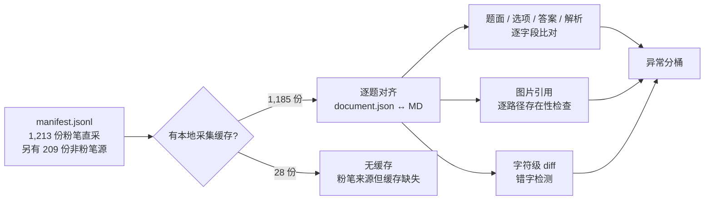

# 质量报告

一句话结论：**逐题比对 1,185 份卷、约 6.3 万道题，没有发现题目缺失、选项缺失、答案缺失、断图或错字。**审计中发现的两类实质问题——题面被 `关联材料` 行割裂、319 题漏渲染「考点 / 来源」——本轮已全部修复并复核。

审计快照：2026-10-23。

---

## 审计方法

不是抽查，是**确定性全量比对**：



对齐规则：

1. 把两侧文本归一化：去 Markdown 转义、去图片/链接语法、去 HTML 标签、`html.unescape`、NFKC、只保留汉字与字母数字。
2. 用 **4-gram 覆盖率** `cover(a, b)` 衡量「源内容有多少出现在 MD 里」；短于 4 字的串改用包含判定。
3. 覆盖率 < 0.9 记为待查，再按源文本长度、MD 长度分桶归因。

为什么要归一化：同一道题在网页上是 ``，在 MD 里是图片链接；选项字母 A/B/C/D 在两侧的位置也不同。不归一化会把纯排版差异误判成内容缺失——第一版脚本的 27,391 条「异常」几乎全是这个原因。

---

## 结果总表

| 检查项 | 异常 | 结论 |
| --- | ---: | --- |
| 题目块缺失 | **0** | 每道源题在 MD 里都有对应 `### 第 N 题` |
| 选项缺失 | **0** | 有选项的题，MD 选项数 = 源选项数 |
| 答案缺失 | **0** | 源有 `answerHtml` 的题，MD 都有答案正文 |
| 答案低覆盖 | **0** | 答案文本逐题一致 |
| 断图 | **0** | MD 引用的本地图片全部存在 |
| 错字（汉字替换） | **0** | 字符级对齐后，`replace` 片段里没有「两侧都是汉字且 ≤2 字」的差异 |
| 题面覆盖率 < 0.9 | 242 题 | 全部为排版/公式/图片差异，见下（修复前 1,003） |
| 题面篇幅骤减 | 85 处 | **全部为申论**，源 `prompt.html` 混入答案 DOM，MD 正确拆开 |
| 解析未渲染 | **0** 题 | 修复前 319 题 / 74 卷，本轮已补齐并复核 |
| 解析低覆盖 | 160 题 | 多为「参考答案说明」在源里被拆进解析字段 |
| 图片计数差 | 61 处 | 同一张图在源 DOM 出现两次，MD 去重 |
| HTML 残留 | 37 卷 | 本库自用的 `<details>/<summary>` 折叠块，非脏数据 |
| 材料数不符 | 91 卷 | MD 材料**多于**采集缓存（补齐过），不是缺失 |

---

## 题面覆盖率的归因

242 条待查全部做过归因，没有一条是正文丢失：

| 类别 | 数量 | 说明 |
| --- | ---: | --- |
| 申论旧格式 | 85 | 源 `prompt` 含整页答案 DOM，MD 只保留题干 |
| 行测公式/图形题 | 97 | 源文本去掉公式图片后不足 40 字，覆盖率指标失真 |
| 行测其他 | 60 | MD 文本不短于源，差异来自换行与附加说明 |

「题面篇幅骤减 85 处」同理：旧申论采集把答案一起塞进了 prompt，渲染时正确拆到了答案区。MD 短是**对的**。

---

## 本轮修复的两件事

### 1. 题面被 `关联材料` 行割裂（1,206 卷）

旧排版把全部材料堆在卷首，每道引用材料题在**题干与选项之间**插一行：

```markdown
2016年全球贸易总额约为多少万亿美元？

关联材料：dom-material-e6184e4fe7653ac1

A. 28
```

这一行既打断阅读，也把题干和选项的 4-gram 切断——1,003 条低覆盖里的大多数就是这么来的。现在行测的材料按首个引用它的题排序为 `材料 1…N`，直接插在题组前，题干里不再出现内部哈希；申论保留材料前置，只把内部 ID 换成 `材料 N`。

修复后低覆盖降到 242，且**正文零改动**（字符多重集逐卷比对，1206/1206 通过）。

### 2. 319 题缺「考点 / 来源」（74 卷）

表现：

```text
源 explanationHtml:  参考答案说明…… 考点：提出对策类 来源：2016年国家公务员考试申论题（副省级）…（另有解析视频入口说明）
MD 解析区（修复前）:  **解析状态：unknown（来源未提供）**
```

「参考答案说明」在 MD 里本来就有（在答案区），丢的是 **考点** 与 **来源** 两行，以及「本题只提供解析视频、无文字解析」这一事实。集中在 2016–2018 的国考与部分省考申论——早期采集批次的字段映射没有把这段拆出来。

修复直接从 `document.json` 取原文，不重新访问题库：

```markdown
**解析**

**考点**：提出对策类

**来源**：2016年国家公考《申论》题（副省级）

> 粉笔申论页面对本题只提供「解析视频」入口，该入口是会员推广位，页面无视频地址与文字解析。
```

复核：`expl_miss` 从 319 降到 **0**；`<details>` 开闭数不变；除被替换的那一行外没有删除任何正文。渲染器 `src/render.mjs` 同步加了 `explanationFragment()`，后续新采集的卷不会再出现同样问题。

---

## 已知的源头问题（非本库造成）

| 地区 / 卷 | 问题 | 处理 |
| --- | --- | --- |
| 江苏 2024 行测 A | 76/96/110/111 题在粉笔页面即缺失 | 照实保留缺口，不臆造 |
| 江苏 2025 行测 C | 27/29/35/36/37/42/75/77/78/80/81/85 题缺失 | 同上 |
| 江苏 2022C / 2023B / 2023C / 2024C / 2025C 申论 | 给定材料不全 | 标记待补 |
| 湖南 2025 行测 Q43 | 解析抓到整块卡片 DOM | 待重采 |
| 28 卷 | 无本地采集缓存（粉笔来源，缓存缺失） | 无法对源逐题核验，已在覆盖报告中标注 |

**本库不做的三件事**：不补写原卷没有的题、不把回忆版说成官方原卷、不用摘要顶替给定材料。

---

## 复现

审计脚本不依赖网络，只读 `work/fenbi/` 的采集缓存与仓库 MD：

```bash
python3 tools/audit_fidelity.py --manifest catalog/manifest.jsonl --work <采集工作区>
```

输出逐卷 JSON（题数、异常分桶、图片计数），可再聚合成上表。
