# 2008年国家公务员录用考试《行测》题

<!-- gwy:overview:start -->
> **国考 · 2008 · 行测 · 统考** ｜ 140 题 · 图片 79 处 · 答案随题折叠

| 题型模块 | 题量 | 题号 |
| --- | ---: | ---: |
| 言语理解与表达 | 40 | 1–40 |
| 数量关系 | 20 | 41–60 |
| 判断推理 | 35 | 61–95 |
| 常识判断 | 25 | 96–120 |
| 资料分析 | 20 | 121–140 |
| **合计** | **140** | |

导航：[题型与作答说明](#题型与作答说明) · [题目](#题目) · [材料 1](#材料-1)
<!-- gwy:overview:end -->

> 候选采集稿。参考答案及解析来自粉笔页面，不代表官方答案或真实高分答卷；来源使用许可与原卷对应关系仍需人工核实。

## 题型与作答说明

言语理解与表达

（40题）

本部分中每道题包含一段话或一个句子，后面是一个不完整的陈述，要求你从四个选项中选出一个来完成陈述。注意：答案可能是完成对所给文字主要意思的提要，也可能是满足陈述中其他方面的要求，你的选项应与所提要求最相符合。

数量关系

（20题）

本部分包括数字推理与数学运算两种类型的试题。

判断推理

（35题）

本部分包括图形推理、定义判断、类比推理与逻辑判断四种类型的试题。

常识判断

（25题）

根据题目要求，在四个选项中选出一个正确答案。

资料分析

（20题）

所给处的图、表、文字或综合性资料均有若干个问题要你回答。你应根据资料提供的信息进行分析、比较、计算和判断处理。

## 题目

### 第 1 题

在古典传统里，和谐的反面是千篇一律：“君子和而不同，小人同而不和”，所以和谐的一个条件是对于多样性的认同。中国人甚至在孔子之前就有了对于和谐的经典认识与体现。中国古代的音乐艺术很发达，特别是一些中国乐器，像钟、磬、瑟等各种完全不同的乐器按照一定的韵律奏出动听的音乐，但如果只有一种乐器就会非常单调。

对这段文字概括最准确的是：

A. 和谐源于中国古典音乐

B. 差异是和谐的必要条件

C. 中国人很早产生了和谐观念

D. 音乐是对和谐的经典认识和体现

第 1 题 · 答案与解析

**参考答案（粉笔题库参考内容）**

B

**解析**

根据提问方式可知本题为中心理解题。

由总结关系词“所以”可以判断出整个题干的语意重点是其后的内容，即“和谐的一个条件是对于多样性的认同”，然后作者以音乐为例对这一观点进行具体阐述。

因此结合选项，B项表述最为全面准确。

A、D项错误，“音乐”只是为阐释观点所举的例子，而非文段论述的主题；C项表述片面，未能抓住材料的语意重点。

故正确答案为B。

**考点**：关联词-因果

**来源**：2008年国家公务员录用考试《行测》题第1题

### 第 2 题

“黑马”一词其实是从英语舶来的，原指体育界一鸣惊人的后起之秀，后指实力难测的竞争者或在某一领域独树一帜的人，无贬义或政治含义。首先在英文中使用“黑马”的人，是英国前首相迪斯雷利，他在一本小说中这样描写赛马的场面：“两匹公认拔尖的赛马竟然落后了，一匹‘黑马’，以压倒性优势飞奔。看台上的观众惊呼：‘黑马！黑马！’”从此，“黑马”便成了一个有特殊意义的名词。

这段文字的主要意思是：

A. 论证“黑马”词义的起源

B. 阐释“黑马”一词的内涵

C. 分析“黑马”词义的演变

D. 介绍“黑马”的感情色彩

第 2 题 · 答案与解析

**参考答案（粉笔题库参考内容）**

A

**解析**

由提问方式可知本题为中心理解题。

材料首句指出“黑马”一词是“从英语舶来的”，并对其含义进行了简单说明，接下来阐述首先在英语中使用“黑马”这个词时的情形，点出其词义的起源。由此可知，题干主要说的就是“黑马”词义的起源。

因此，结合选项应该选择A。

B、D项只是材料的细节信息，没有抓住题干的语意重点，予以排除；C项为强干扰项，题干前半部分虽然用“原指······后指······”点出“黑马”词义发生过变化，此句的重点仍然是解释“黑马”的词义，题干后半部分说的是“黑马”这个词最初使用时的情形，如果选C的话，那么题干还应该包括其词义发生变化后的使用情形，因此C项排除。

故正确答案为A。

**考点**：分述句特征-引入铺垫

**来源**：2008年国家公务员录用考试《行测》题第2题

### 第 3 题

中国的沙漠的确为世界上的科学家提供了与火星环境最为相似的实验室。科学家们已经去过了地球上最为寒冷的南极洲，也去过了地球上最为干燥的智利阿塔卡马沙漠，但他们真正需要的是将这两者结合起来的极端环境。

这段文字重在说明：

A. 中国沙漠为外星研究提供理想场所

B. 中国沙漠比南极洲更适合进行生物研究

C. 科学家为何选择中国沙漠作为研究对象

D. 具有最极端的环境是中国沙漠的主要特点

第 3 题 · 答案与解析

**参考答案（粉笔题库参考内容）**

A

**解析**

文段开篇指出“中国的沙漠为世界上的科学家提供了与火星环境最为相似的实验室”，并对前文进行解释说明，即中国的沙漠具备最极端的环境，可以满足科学家们的研究需要。故文段意在强调“中国沙漠为外星研究提供了理想场所”，对应A项。
 B项“生物研究”无中生有，排除；C项 “研究对象”表述错误，根据文段“中国的沙漠······提供了与火星环境最为相似的实验室”可知，中国沙漠并不是“研究对象”，排除；D项“中国沙漠的主要特点”对应文段解释说明中的内容，非重点，排除。

故正确答案为A。

**考点**：分述句特征-其他

**来源**：2008年国家公务员录用考试《行测》题第3题

### 第 4 题

中国古人将阴历月的大月定为30天，小月定为29天，一年有12个月，即354天，比阳历年少了11天多。怎么办呢？在19个阴历年里加7个闰月，就和19个阳历年的长度几乎相等。这个周期的发明巧妙地解决了阴阳历调和的难题，比希腊人梅冬的发明早了160年。 这段文字主要阐明的是（   ）。

A. 古代阴历中闰月设置的规律与作用

B. 中国古代历法在当时有先进水平

C. 阴阳历调和问题在古代是个世界性问题

D. 中国古代如何解决阴阳历差异问题

第 4 题 · 答案与解析

**参考答案（粉笔题库参考内容）**

D

**解析**

这是一道中心理解题。文段先提出一个问题：阴历比阳历少了11天。接着提出中国古人解决该问题的对策：在19个阴历年里加7个闰月。第三句话通过和希腊人梅冬的对比肯定了中国古人的对调节阴阳历差异问题的贡献和智慧。由此可知文段重点在强调中国古代如何解决阴阳历问题，对应D项

。

A选项中的“规律和作用”未涉及，排除；

B选项说法不当，文中只说中国古人比希腊人对难题的解决早很多，但并不代表我们中国就是当时的先进水平，排除；

C选项只是谈及问题本身，没体现出对策，排除。

 故正确答案为D。

**考点**：关联词-因果

**来源**：2008年国家公务员录用考试《行测》题第4题

### 第 5 题

湿地指的是陆地和水体之间的过渡带，和森林、海洋一起并称地球三大生态体系，在维护生物多样性、调节气候、抵御洪水等方面起着重要作用。1998年那次长江大洪水让人们终于意识到湿地（尤其是和长江相通的许许多多湖泊和沼泽地）能够对洪水起到缓冲的作用。可是，许多湖泊因为围湖造田的需要而被人为隔离了，只留下一个很少开启的水闸和长江相通。于是，这些自然形成的水网被拦腰斩断，遇到洪水便无能为力了。

这段文字意在说明：

A. 围湖造田是一项弊大于利的错误举措

B. 占用湿地是造成长江洪水的重要因素

C. 人类应该反省自身行为对环境的破坏

D. 应该充分发挥湿地对洪水的缓冲作用

第 5 题 · 答案与解析

**参考答案（粉笔题库参考内容）**

D

**解析**

由提问可知本题为中心理解题。

文段首句点明了湿地的重要作用，接着通过列举1998年长江大洪水的事例来具体阐述湿地对于洪水的缓冲作用，并通过转折性引导词“可是”引出文段重点，即对湿地人为地破坏使湿地失去了对洪水的缓冲作用，带来巨大灾难。可见作者意在强调我们应该吸取教训，充分发挥湿地对洪水的缓冲作用，对应D项。

A、C两项错误，文段主要围绕“湿地”展开讨论，与文段不一致，排除；

B项，占用湿地不是造成洪水的因素，只是使湿地失去了缓冲的作用，排除。

故正确答案为D。

**考点**：关联词-对策

**来源**：2008年国家公务员录用考试《行测》题第5题

### 第 6 题

作为一个拥有五千年不间断文明史的古国，我国拥有十分丰富的非物质文化遗产。这些活态的文化不仅构成了中华民族深厚的文化底蕴，也承载着中华民族文化渊源的基因。但随着我国现代化建设的加速，文化标准化以及环境条件的变化，尚有不计其数的文化遗产正处于濒危状态，它们犹如一个个影子，随时都可能消亡。

对这段文字概括最准确的是：

A. 文化遗产保护工作要有新思路

B. 要重视现代化建设带来的新问题

C. 新形势下亟须加强文化遗产保护

D. 诸多因素威胁着文化遗产的生存状态

第 6 题 · 答案与解析

**参考答案（粉笔题库参考内容）**

D

**解析**

文段开篇指出 “非物质文化遗产”的重要性，后文通过转折关联词“但”强调由于现代化建设的加速，文化标准化以及环境条件的变化导致非物质文化遗产的生存状况令人堪忧，故文段旨在强调诸多因素威胁着文化遗产的生存状态，对应D项。
 A项“新思路”、B项“现代化建设带来的新问题”均为无中生有，排除；C项“加强文化遗产保护”并非对于文段内容的概括，文段中未提及，排除。

故正确答案为D。

**考点**：关联词-转折

**来源**：2008年国家公务员录用考试《行测》题第6题

### 第 7 题

能源价格高并非全是坏事，因为价格杠杆自会调节石油的流向，确保人类以剩下的石油找到更好的新能源，而不是全用到几十年前根本不存在的使夏天变凉爽的能源需求上。实际上，如果我们遵循价格杠杆，甚至无需教育消费者，人人都会做出理智的选择。那些价格杠杆不起作用的地方，多是机制本身有问题的地方，改进机制，才能使价格杠杆更有效。

这段文字的核心观点是：

A. 改革体制是充分发挥价格杠杆作用的前提

B. 能源的无谓浪费问题应该受到应有的重视

C. 提高能源价格有利于合理利用与节约能源

D. 要充分发挥价格杠杆调节能源流向的作用

第 7 题 · 答案与解析

**参考答案（粉笔题库参考内容）**

D

**解析**

由提问方式可知本题为中心理解题。

材料以能源价格高可以提高能源的使用效益为切入点，以“实际上”一词为转折，把话题落到了“价格杠杆”对能源利用的好处上，说明要充分发挥价格杠杆调节能源流向的作用。

因此，结合选项应该选择D。

文段主要讲的是价格杠杆在调节能源流向方面的积极意义，A项没有抓住主题词“能源”；B项未提及“价格杠杆”，均可排除；C项本身表述有误，遵循价格杠杆并不是一味地提高能源价格，予以排除。

故正确答案为D。

**考点**：关联词-转折

**来源**：2008年国家公务员录用考试《行测》题第7题

### 第 8 题

商业设计也许越来越被赋予艺术创作和欣赏的价值，但它根本的出发点和落脚点永远是把产品的特质用艺术的方式展现给顾客。如果一项商业设计不能让人联想到产品并对之产生好感，即使它再精美、再具创意，也不能算是成功的设计。说到底，广告在创意之外最重要的还是关联性，我们不想被一个美轮美奂的作品吸引，结果却看不出它与所代言的商品之间存在任何联系。

对这段文字概括最准确的是：

A. 独特的创意并非成就商业设计的绝对要素

B. 对于设计来说，吸引顾客应该是第一位的

C. 成功的设计必须能够艺术地展现产品特质

D. 商业设计应尽量强调广告与产品的关联性

第 8 题 · 答案与解析

**参考答案（粉笔题库参考内容）**

C

**解析**

由提问标志词“概括”可知本题为中心理解题。

观察材料可以发现材料整体上属于“提出观点—解释说明”的总—分结构。材料首先提出观点“商业设计的出发点和落脚点永远是把产品的特质用艺术的方式展现给顾客”，接下来的内容均是对这个观点的具体阐述。

因此，结合选项应该选择C，C项表述最为全面准确。

A项说法过于片面，没有提到与产品的关联性，不能概括整段材料；B项忽略了与产品的关联性，予以排除；D项曲解文意，题干中说的是“广告在创意之外最重要的还是关联性”，D项表述夸大了与产品关联性的重要性，而忽略了创意。

故正确答案为C。

**考点**：关联词-转折、分述句特征-其他

**来源**：2008年国家公务员录用考试《行测》题第8题

### 第 9 题

中国消费信贷市场的现状，使得对中国银行业投入巨资的西方银行在信用卡业务上仍是投资，没有盈利。不过，外资银行对中国信用卡市场并没有失掉信心。虽然中国的消费者没有透支消费的习惯，而这个“硬币”的另一面是中国居民的个人负债率很低，中国内地的个人消费信用市场才刚刚开始发展，这对外资银行是极具吸引力的。

这段文字中的“硬币”指代的是：

A. 中国银行业

B. 中国消费信贷市场

C. 中国消费者的消费习惯

D. 中国居民的经济状况

第 9 题 · 答案与解析

**参考答案（粉笔题库参考内容）**

C

**解析**

文段开篇指出，中国消费信贷市场的现状导致投入巨资的西方银行没有盈利，后文通过转折关联词“不过”指出外资银行对中国信用卡市场依然有信心，后文对其进行解释说明。通过“虽然中国的消费者没有透支消费的习惯，而这个‘硬币’的另一面是中国居民的个人负债率很低”可知，“硬币”之前的代词“这个”讨论的是“中国消费者没有透支消费的习惯”，所以“硬币”的含义指的就是“中国消费者的消费习惯”，对应C项。

A项“中国银行业”、B项“信贷市场”并非“硬币”所指代内容，排除；

D项，“经济状况”范围扩大，文段主要针对的是信用卡这一消费市场，排除。

故正确答案为C。

**考点**：实词

**来源**：2008年国家公务员录用考试《行测》题第9题

### 第 10 题

“缩略”是赶路人与时间搏斗的一种方式。也许，赶路人自有不得不缩略的苦衷，其中也许不乏积极因素，但从根本上说，所谓缩略，就是把一切尽快转化为物，转化为钱，转化为欲，转化为形式，直奔功利而去。缩略的标准是物质的而非精神的，是功利的而非审美的，是形式的而非内涵的。缩略之所以能够实现，其秘诀在于把精神性的水分一点点挤出去，像压缩饼干似的，卡路里倒是足够，滋味却没有了。对一次性的短暂人生来说，这不能不说是一种遗憾。

这段文字着重抒发怎样的感慨：

A. 急于实现目标，必然付出代价

B. 淹没在物欲中的人生是枯燥无味的

C. 人们只重目的，忽略了过程的享受

D. 时间可以转化为钱，却无法转化为美

第 10 题 · 答案与解析

**参考答案（粉笔题库参考内容）**

B

**解析**

由提问方式可知本题为中心理解题。

文段首句引出论题，“但”转折之后是文段讨论的重点，“滋味却没有了”“不能不说是一种遗憾”可推断出作者对于“缩略”这种生活方式是持否定态度的。文段说“缩略”是把一切尽快物化、经济化、形式化，其标准是物质的、功利的、形式的。接下来作者通过“压缩饼干”的比喻点明了“缩略人生”的“枯燥无味”。

因此，结合选项应该选择B。

A项“必然付出代价”较之“枯燥无味”的“遗憾”程度过重，文段也没有体现，排除；

C项是作者感慨的对象而非所发感慨本身的内容，排除；

D项，文章中主要说的是一种人生观，“时间”显然不是文段论述的主要内容，排除。

故正确答案为B。

**考点**：关联词-转折

**来源**：2008年国家公务员录用考试《行测》题第10题

### 第 11 题

将以下6个句子重新排列组合：

① 任何心理活动，任何创作，也许都具有“一次性”。

② 揣度别人是很困难的。子非鱼，安知鱼之乐？

③ 作者的回顾，事后的创作谈，能在多大程度上与实际创作情状复合，是值得怀疑的。

④ 甚至揣度自己也未见得容易多少。

⑤ 人不能把脚两次伸进同一条河里。

⑥ 比方说这篇小说写过这么久了，尽管我现在能尽力回忆当时写作的心境，但时过境迁，当时的心境是绝对不可能再完整准确地重现了。

排列组合最连贯的是：

A. ③⑥⑤②④①

B. ⑤①⑥③②④

C. ①⑥③⑤②④

D. ②④⑥③⑤①

第 11 题 · 答案与解析

**参考答案（粉笔题库参考内容）**

D

**解析**

观察选项可以发现，四个选项中④句都是紧跟在②句后面的，②句说的是“揣度别人”，④句说的是“揣度自己”。阅读所有选项可发现整个文段主要说的就是“揣度自己”，故②④句应该放在段首，②句作为引子，引出后文的“揣度自己”，四个选项中只有D项是把②④句排在最前面，当选。

故正确答案为D。

**考点**：确定捆绑、确定顺序

**来源**：2008年国家公务员录用考试《行测》题第11题

### 第 12 题

歌德评价帕格尼尼“在琴弦上展现了火一样的灵魂”。巴黎人为他的琴声陶醉，忘记了当时正在流行的霍乱。在维也纳，一个盲人听到他的琴声，以为是一个乐队在演奏，当得知这只是一个叫帕格尼尼的意大利人用一把小提琴奏出的声音时，盲人大叫一声：“这是个魔鬼！”

这段文字意在强调帕格尼尼：

A. 火一样的激情

B. 魔鬼般的演奏

C. 超强的模仿力

D. 高超的表演力

第 12 题 · 答案与解析

**参考答案（粉笔题库参考内容）**

D

**解析**

文段为并列结构，描写歌德、巴黎人以及维也纳的盲人都被帕格尼尼的小提琴演奏所征服，意在强调帕格尼尼的小提琴演奏能力很强，对应D项。

A、C两项的“激情”和“模仿力”在材料中均未提及，无中生有，排除；

B项“魔鬼般的演奏”仅对应盲人的话，表述片面，排除。

故正确答案为D。

**考点**：关联词-并列

**来源**：2008年国家公务员录用考试《行测》题第12题

### 第 13 题

费孝通在反思一生学术研究时，提出“文化自觉论”。他说：“生活在一定文化中的人对其文化有‘自知之明’，明白它的来历、形成的过程、所具有的特色和它发展的趋向，自知之明是为了加强文化转型的自主能力，取得决定适应新环境、新时代文化选择的自主地位。”

根据这段文字，“文化自觉”的主要作用是：

A. 使文化的发展方向更为可控

B. 使人们能更加适应不断发展的文化

C. 使人们更深刻地了解文化的来源和特点

D. 使不同文化之间的融合和转变更为容易

第 13 题 · 答案与解析

**参考答案（粉笔题库参考内容）**

A

**解析**

A项，根据文段“自知之明是为了加强文化转型的自主能力，取得决定适应新环境、新时代文化选择的自主地位”可知，“自主能力”“自主地位”意味着文化发展方向可由自身掌控，即更为可控，表述正确，当选；

B项，文段强调的是文化转型、文化选择的自主能力，是主动把握文化发展，而非人被动去适应文化，主客颠倒，排除；

C项，是文化自觉的内涵、定义本身，并非文化自觉带来的作用，排除；

D项，“不同文化之间的融合和转变”文段并未提及，无中生有，排除。

故正确答案为A。

**考点**：细节判断题

**来源**：2008年国家公务员录用考试《行测》题第13题

### 第 14 题

一个年轻人寄了许多份简历到一些广告公司应聘，其中有一家公司写了一封信给他：“虽然你自认为文采很好，但从你的来信中，我们发现了许多语法错误，甚至有一些错别字。”这个青年想如果这是真的，我应该感谢他们告诉我，然后改正。于是他给这个公司写了一封感谢信。几天后，他再次收到这家公司的信函，通知他被录用了。

这段文字主要想告诉我们：

A. 机会往往在不经意获得

B. 公司招聘时更看重求职者的态度

C. 谦虚能获得更多知识和别人的尊重

D. 良好的文字功底是成功求职的前提

第 14 题 · 答案与解析

**参考答案（粉笔题库参考内容）**

B

**解析**

材料介绍的是一个年轻人应聘成功的故事。公司在信中指出这个年轻人的不足，年轻人在接到这封信后随即写了感谢信，并自觉地弥补不足，最终被公司录用。文段旨在强调，年轻人的成功就在于他有感恩、认错和改正错误的态度，对应B项。

A项，“不经意”无中生有，文段中年轻人通过回复感谢信应聘成功，这并非“不经意”，排除；C项， “谦虚能获得知识”无中生有，排除；D项“文字功底”并非文段的重点，排除。

故正确答案为B。

**来源**：2008年国家公务员录用考试《行测》题第14题

### 第 15 题

气候变暖将会使中纬度地区因蒸发强烈而变得干旱，现在农业发达的地区将退化成草原，高纬度地区则会增加降水，温带作物将可以在此安家。但就全球来看，气候变暖对世界经济的负面影响是主要的，得到好处的仅是局部地区。

这段文字旨在说明气候变暖：

A. 会使全球降水总量减少

B. 对局部地区来说利大于弊

C. 将给世界经济带来消极影响

D. 将导致世界各国农业结构发生变化

第 15 题 · 答案与解析

**参考答案（粉笔题库参考内容）**

C

**解析**

文段开篇阐述了气候变暖对中高纬度地区的影响，尾句通过 “但”进行转折，指出从全球角度来看，气候变暖对世界经济的负面影响是主要的。故文段重在强调气候变暖对世界经济的负面影响，对应C项。

A项，文段未提及“全球降水总量减少”，无中生有，排除；

B项，文段重点在于转折之后的内容，即气候变暖对全球经济的负面影响，且文段并未对局部地区的“利与弊”进行对比，无中生有，排除；

D项，对应文段转折前内容，非重点，排除。

故正确答案为C。

**考点**：关联词-转折

**来源**：2008年国家公务员录用考试《行测》题第15题

### 第 16 题

华盛顿国立气象研究所的墙上有这么一句话：“当我们做对了，没有人会记得；当我们做错了，没有人会忘记。”

气象研究所的墙上写这句话的目的是：

A. 希望人们多理解气象工作的困难和苦衷

B. 督促员工致力于杜绝工作中的任何差错

C. 劝勉员工甘于默默无闻、不计个人名利

D. 突出气象研究工作本身所具有的特殊性

第 16 题 · 答案与解析

**参考答案（粉笔题库参考内容）**

B

**解析**

由提问方式可知本题为中心理解题。

材料中的那句格言以并列形式出现，但从语意上可以判断出作者意在强调后者，即“当我们做错了，没有人会忘记”，言外之意是我们（员工）不能有错误，情愿被人忘记，也不能因为犯错而被记得。“没有人会记得”“没有人会忘记”是用一种绝对化表达来强调要杜绝错误、精益求精。

因此，结合选项应该选择B。

A项曲解文意，作者是强调工作人员的态度，而非强调他人对气象工作的了解；C项只是对“当我们做对了，没有人会记得”的转述，不是作者要强调的重点；D项无中生有，文段没有体现气象研究工作的特殊性，墙上的格言可以适用于很多场合。

故正确答案为B。

**来源**：2008年国家公务员录用考试《行测》题第16题

### 第 17 题

虽然黑猩猩和人类的进化史大约有99.5％是共同的，但大多数思想家把黑猩猩视为与人类毫不相干的怪物，而把自己看成是万物之主。对一个进化论者来说，情况绝非如此。认为某一物种比另一物种高尚是毫无客观依据的。不论是黑猩猩和人类，还是蜥蜴和真菌，都是经过长达30亿年的所谓自然选择这一过程进化而来的。

这段文字意在阐明：

A. 大多数思想家并不理解进化论的思想

B. 真正的思想家应对所有物种一视同仁

C. 所有物种事实上都是自然选择的结果

D. 黑猩猩与人类的进化史实际极为相似

第 17 题 · 答案与解析

**参考答案（粉笔题库参考内容）**

B

**解析**

文段开篇指出大多数的思想家将黑猩猩视为与人类毫不相关的怪物，把自己看成是万物之王，接着指出对于一个进化论者来说情况并非如此，并指出真正的思想家应该将所有的物种视为经过自然选择进化来的，物种并无高低之分，故文段重在强调真正的思想家应对所有物种一视同仁，对应B项。

A项，“不理解进化论的思想”文段并未提及，无中生有，排除；

C项，为解释说明的内容，非重点，排除；

D项，对应文段转折之前的内容，非重点，排除。

故正确答案为B。

**考点**：关联词-转折

**来源**：2008年国家公务员录用考试《行测》题第17题

### 第 18 题

几次拿起《十字路口的顽童》这本书，几次又放下，因为不时会有画面打断我的思路，那是在我18年的教书生涯中遇到的一个个顽童的画面。有意思的是，其他学生凝固在我记忆中的是“图片”形象；而他们却是“视频”故事，他们所占据的老师“内存”实在是比其他孩子要大得多。这段文字表达的主要意思是：

A. 漫长的教学生涯给“我”留下很多回忆

B. 顽童让“我”想起曾经发生的许多故事

C. 顽皮学生留给“我”的印象更为生动深刻

D. 这本书触动“我”对教学生涯的许多联想

第 18 题 · 答案与解析

**参考答案（粉笔题库参考内容）**

C

**解析**

由提问方式可知本题为中心理解题。

文段将顽皮学生和其他学生给“我”的印象分别比作“视频”和“图片”，前者为故事，内容丰富和生动，而后者为形象，相对比较单一。通过这种对比，说明顽皮学生给“我”的印象更为生动深刻。

因此，结合选项应该选择C，C项表述最符合文意。

A、D两项表述过于笼统，未体现出“顽童”这一关键信息，排除；B项未体现出顽童比其他学生占据老师“内存”大这一特点，不如C贴切，排除。

故正确答案为C。

**考点**：关联词-转折

**来源**：2008年国家公务员录用考试《行测》题第18题

### 第 19 题

汽车是对环境影响较大的商品，汽车厂商支持环保事业、进行环保宣传，似乎是理所应当的。环保应当是汽车企业在发展中必须认真考虑的因素，但要求汽车企业没有利润甚至亏损来做环保，显然是不现实的，而且也不会持久。汽车企业在发展的同时采取新的技术措施，尽量减少对环境的污染，符合社会发展大趋势，才是长久之策。

这段文字的核心观点是：

A. 环保与实现企业利润存在矛盾

B. 发展环保事业应该注重从实际出发

C. 技术革新是解决汽车影响环境问题的关键

D. 汽车企业应在发展的同时充分重视环境保护

第 19 题 · 答案与解析

**参考答案（粉笔题库参考内容）**

C

**解析**

文段首先提到了一个矛盾：一方面汽车企业应该支持环保，而另一方面，无利润的支持又难以持久。接下来作者指出了这一矛盾的解决方法：汽车企业在发展的同时采取新的技术措施，即以技术革新来支持环保。由此可知，材料属于“提出问题—解决问题”的分-总结构，其文段重点强调的是要通过技术革新解决汽车环保的问题，对应C项。

A、B两项错误，均未提到“汽车企业”这一主题词，排除；D项为干扰项，只强调发展的同时要注重环境保护，没有提到“技术革新”这一主题词，排除。

故正确答案为C。

**考点**：关联词-对策

**来源**：2008年国家公务员录用考试《行测》题第19题

### 第 20 题

20世纪60年代以前，世界各国普遍注重防洪的工程措施，即通过修建大堤、水库等水利设施对洪水进行控制。但在60年代以后，世界各国在防洪规划中越来越重视非工程措施的运用，即通过洪水预警、灾情评估、洪灾保险等多种手段，结合各种工程措施，从而尽可能减少洪灾对人类经济、环境和社会发展的影响。

这段文字主要谈的是：

A. 世界各国防洪理念的转变

B. 世界各国控制洪水的新途径

C. 单纯重视防洪工程不能有效控制洪水

D. 非工程措施逐渐成为防洪规划的主导

第 20 题 · 答案与解析

**参考答案（粉笔题库参考内容）**

A

**解析**

由提问方式可知本题为中心理解题。

“但”表示转折关系，前面谈60年代以前防洪主要是工程措施，转折之后谈60年代以后防洪重视非工程措施，转折语意概括为“防洪理念的转变”。

因此，结合选项应该选择A。

B项表述错误，文段强调的是“防洪理念”，而不是“控制洪水的新途径”；C、D项表述片面，没有抓住材料的语意重点。

故正确答案为A。

**考点**：关联词-转折

**来源**：2008年国家公务员录用考试《行测》题第20题

### 第 21 题

建设资源节约型、环境友好型社会要注意＿＿＿＿＿＿，目前要着重解决影响社会经济发展，特别是严重危害人民群众健康的水污染、空气污染加剧问题。

填入画横线部分最恰当的一项是：

A. 可持续性

B. 轻重缓急

C. 孰轻孰重

D. 先后次序

第 21 题 · 答案与解析

**参考答案（粉笔题库参考内容）**

B

**解析**

本题考查成语语境最佳选择。由题干“目前要着重解决······”可知，空格内的词语应该包含前后、轻重两层含义。选项中只有B项“轻重缓急”能与“目前要着重”形成恰当的语境搭配。

A项“可持续性”与下文不能形成呼应，且不符逻辑，排除；C项只突出了轻重，D项只突出了先后，均不够全面，排除。

故正确答案为B。

**考点**：对应关系-前后呼应、成语填空

**来源**：2008年国家公务员录用考试《行测》题第21题

### 第 22 题

对一篇规范的论文，因版面限制而去砍综述、删注释，实在是＿＿＿＿＿＿的不智之举。

填入画横线部分最恰当的一项是：

A. 削足适履

B. 扬汤止沸

C. 矫枉过正

D. 舍本逐末

第 22 题 · 答案与解析

**参考答案（粉笔题库参考内容）**

A

**解析**

本题考查成语语境最佳选择。

阅读题干可知，空格内的成语必须和前面的“因版面限制而砍综述、删注释”相呼应。所谓“削足适履”是说为了把大脚穿进小鞋而把脚削小。因此，结合选项应该选择A。“削足”对应“砍综述、删注释”，“适履”与“版面限制”相对应。

B项“扬汤止沸”比喻办法不彻底，不能从根本上解决问题，C项“矫枉过正”比喻纠正错误超过了应有的限度，文段强调的是为了适应版面，而砍综述、删注释，并非“解决问题不彻底”或“纠正错误超限度”，二者均不如“削足适履”与文意对应更恰当，排除；D项“舍本逐末”指为了次要的而放弃了最主要的东西，不能用来说明综述和注释，排除。

故正确答案为A。

**考点**：对应关系-解释说明、成语填空

**来源**：2008年国家公务员录用考试《行测》题第22题

### 第 23 题

中华民族一直以其强烈的责任意识享誉世界，在建立市场经济体制的新的历史时期，尤其需要＿＿＿＿人们的责任意识，这既是构建社会主义和谐社会的必然＿＿＿＿，也是时代的呼唤。

填入画横线部分最恰当的一项是：

A. 增强  要求

B. 提高  结果

C. 加强  需要

D. 提升  途径

第 23 题 · 答案与解析

**参考答案（粉笔题库参考内容）**

A

**解析**

多个词语的选词填空题适合采用排除法。

先看第一个空，“提升意识”的搭配显然不恰当，D项排除。

从第二个空的选词来看，首先可以排除C项中的“需要”，因为“需要”与前面的“尤其需要”相重复。根据语意，第二个空格内的词语与后面的“呼唤”相对应，不可能是结果，只能是一种要求，故B项排除。

只有“增强人们的责任意识”、“必然要求”的搭配是最恰当也是最符合语意的。

故正确答案为A。

**考点**：实词填空、对应关系-前后呼应、词的辨析-搭配对象

**来源**：2008年国家公务员录用考试《行测》题第23题

### 第 24 题

中国古代数学家对“一次同余论”的研究有＿＿＿＿的独创性和继承性，“大衍求一术”在世界数学史上的崇高地位是不容＿＿＿＿的。正因为这样，在西方数学史著作中，一直公正地称求解一次同余组的剩余定理为“中国剩余定理”。

填入画横线部分最恰当的一项是：

A. 完全  否定

B. 明确  忽视

C. 绝对  动摇

D. 明显  怀疑

第 24 题 · 答案与解析

**参考答案（粉笔题库参考内容）**

D

**解析**

本题考查实词对象搭配的辨析与填空。

先看第一个空，独创性和继承性在某种程度上是互相矛盾的概念，“完全”或“绝对”的继承性常常意味着并非完全或绝对独创，由此可排除A、C项。

第二个空由“在西方数学史著作中，一直公正地称······”可知，“大衍求一术”在数学界的崇高地位是公认的事实，因此对其地位的看法应该是“不容怀疑”的，而非“不容忽视”。

故正确答案为D。

**考点**：实词填空、对应关系-前后呼应、词的辨析-搭配对象

**来源**：2008年国家公务员录用考试《行测》题第24题

### 第 25 题

随着广播、电视和报纸等大众传媒进入千家万户、覆盖城乡，其对社会舆论的影响力＿＿＿＿扩大，越来越成为广大群众的主要信息来源，在很大程度上＿＿＿＿着社会舆论。

填入画横线部分最恰当的一项是：

A. 日益  影响

B. 逐步  控制

C. 渐渐  干扰

D. 不断  引领

第 25 题 · 答案与解析

**参考答案（粉笔题库参考内容）**

D

**解析**

此题的突破口在第二空。根据“传媒影响力越来越大”、“成为大众的主要信息来源”可知，文段强调传媒对社会舆论产生了某种作用。且根据“越来越”可知，横线处词语与“影响力”构成递进关联关系。D项“引领”有引导之意，符合文意，保留。B项“控制舆论”与C项“干扰舆论”感情色彩偏消极，均与文段感情色彩不符，排除B、C两项；A项，“影响”与“影响力扩大”，语意重复，排除。

第一空代入验证，影响力不断扩大，符合文意，当选。

故正确答案为D。

**考点**：实词填空、词的辨析-感情色彩、词的辨析-搭配对象

**来源**：2008年国家公务员录用考试《行测》题第25题

### 第 26 题

近现代西方科学与人文两种文化经历了融合、冲突和消解三个时期，反映到教育理念上也相应地经历了科学教育与人文教育的相互＿＿、越走越远和共同反思三个阶段。这一历史发展表明，过分强调科学文化和科学教育，必然导致对人文的＿＿；而过分强调人文文化和人文教育，也会带来对科学技术的漠视。

填入画横线部分最恰当的一项是：

A. 渗透  排挤

B. 结合  无视

C. 渗透  轻视

D. 结合  限制

第 26 题 · 答案与解析

**参考答案（粉笔题库参考内容）**

C

**解析**

本题考查实词语境最佳选择。

阅读题干可知，“三个时期”与“三个阶段”相对应，则第一个空格内的词语应与“融合”相对应。“结合”只是说人或事物之间发生密切关系，而“渗透”则是强调相互融合的过程，因此，空格内填入“渗透”最为恰当。

第二个空应与“漠视”相对应，C项中的“轻视”满足要求。A项“排挤”有排斥、打击之意，与材料语境不合，予以排除。

故正确答案为C。

**考点**：实词填空、对应关系-前后呼应

**来源**：2008年国家公务员录用考试《行测》题第26题

### 第 27 题

上世纪 60 年代，赞助商的美元滚滚而来，赛车水平和速度＿＿般地飞跃，同时飞跃的还有车手的＿＿性。从此，规则制定者的头号任务就是让赛车慢下来。

填入画横线部分最恰当的一项是：

A. 奇迹  技术

B. 闪电  危险

C. 魔术  冒险

D. 戏剧  重要

第 27 题 · 答案与解析

**参考答案（粉笔题库参考内容）**

B

**解析**

本题考查实词语境最佳选择。

由题干末句“规则制定者的头号任务就是让赛车慢下来”可知，随着赛车的速度越来越快，赛车手参加比赛的危险性也在不断加大。因此第二个空格内填入“危险”，可以形成极佳的语境呼应。题干中强调的是赛车速度过快给车手带来的危险，这些危险是客观存在的，C项中的“冒险”指人主观上不顾危险地进行某种活动，所以“冒险”用在此处并不恰当。由此可排除A、C、D三项。

第一个空“闪电”较为恰当地表现出了“赛车水平和速度”的快速飞跃。

故正确答案为B。

**考点**：实词填空、对应关系-前后呼应

**来源**：2008年国家公务员录用考试《行测》题第27题

### 第 28 题

企业到底是不是适合开展连锁经营？能不能开展连锁经营？面对这两个问题，一些企业往往＿＿＿＿，＿＿＿＿发展时机。

填入画横线部分最恰当的一项是：

A. 无所适从  贻误

B. 一筹莫展  痛失

C. 举棋不定  耽误

D. 优柔寡断  错过

第 28 题 · 答案与解析

**参考答案（粉笔题库参考内容）**

A

**解析**

第一空考查成语，题干中“是不是”“能不能”涉及一个选择的问题。“一筹莫展”指一点计策也施展不出，一点办法也想不出来，形容事情没有进展；“优柔寡断” 指做事犹豫，缺乏决断。这两个成语均和选择无关，可以排除B、D两项。“无所适从”是说不知听从哪一个好，比喻不知怎么办才好；“举棋不定”是说拿着棋子不知该如何下，比喻犹豫不决。题干中说的是“选择”问题，“无所适从”比“举棋不定”更符合语境，排除C项。

第二空考查实词的搭配，“贻误时机”为固定搭配，且“贻误”一词在语气色彩方面也与句意相符。

故正确答案为A。

**考点**：混搭填空、词的辨析-搭配对象

**来源**：2008年国家公务员录用考试《行测》题第28题

### 第 29 题

事实证明：自从资本市场诞生以来，股市从来就不是一个投资场所，＿＿都是投机者在博弈。股票的价格从来就没有在经济学者理论上的＿＿价格驻足。更多的是在泡沫和负泡沫之间来回奔波。

填入画横线部分最恰当的一项是：

A. 实际  稳定

B. 基本  均衡

C. 事实  稳定

D. 本质  均衡

第 29 题 · 答案与解析

**参考答案（粉笔题库参考内容）**

B

**解析**

本题考查实词语境最佳选择。

材料虽然提到股市不是投资场所，但也未明确地说股市里都是投机者，联系生活常识，应该基本上都是投机者。因此，第一个空格内填入应“基本”，可以形成极佳的语境呼应。由此可排除A、C、D三项。

再看第二个空，“在泡沫和负泡沫之间来回奔波”并不仅仅说股票价格不稳定，更指其价格与正常价值关系失衡，因此用“均衡”。

故正确答案为B。

**考点**：实词填空、对应关系-前后呼应

**来源**：2008年国家公务员录用考试《行测》题第29题

### 第 30 题

由于古人视彗星出现为不祥，＿＿＿＿对其非常重视，几乎每一次出现都有比较＿＿＿＿的记录。

填入画横线部分最恰当的一项是：

A. 因此  隐晦

B. 加之  准确

C. 故而  详细

D. 反而  迷信

第 30 题 · 答案与解析

**参考答案（粉笔题库参考内容）**

C

**解析**

第一空考查虚词的搭配，根据关联词“由于”可以推断出，前两个分句之间存在明显的因果关系，所以应该在A、C两项之间选择，排除B、D两项。

第二空考查实词的搭配，联系前后语境可知，既然古人对彗星的出现很重视，那么每一次出现都应该记录得很“详细”而非“隐晦”，C项当选。

故正确答案为C。

**考点**：关联关系-因果关系、对应关系-前后呼应、混搭填空

**来源**：2008年国家公务员录用考试《行测》题第30题

### 第 31 题

一个从小吮吸母文化长大的人一旦来到异国他乡，往往会遭遇“文化冲击”( Culture Shock ) ，有人更＿＿＿＿地译为“文化休克”；这种不适应所在地文化、怀念故国文化的现象，就是乡愁。为了排遣深深的乡思、尽快适应和融入新的环境，大多数人都采取了＿＿＿＿＿＿的态度。

填入画横线部分最恰当的一项是：

A. 巧妙  事在人为

B. 形象  兼容并蓄

C. 生动  入乡随俗

D. 夸张  顺其自然

第 31 题 · 答案与解析

**参考答案（粉笔题库参考内容）**

C

**解析**

第一空考查实词的混搭，文段将“文化冲击”译为“文化休克”，可以说翻译得比较生动巧妙，但没有“夸张”的意味，由此可排除D项。

第二空考查成语的混搭，A项的“事在人为”指的是事情是靠人去做的，用于劝诫人要树立信心，不能用来形容人的态度，排除；B项的“兼容并蓄”是把不同内容不同性质的东西收纳保存之意，C项的“入乡随俗”指的是进入别的国家，就学习当地的风俗习惯，均与“来到异国他乡”的语境相适应，这里选“入乡随俗”更贴切，C项当选。

故正确答案为C。

**考点**：对应关系-前后呼应、混搭填空

**来源**：2008年国家公务员录用考试《行测》题第31题

### 第 32 题

有了国内外巨大的价差，石油企业更愿意将成品油销往海外。同时，国际石油投机商也迅速抓住了这个机会，以来料加工为＿＿，将低价成品油大量出口到境外大赚一笔，这样的情况又造成国内成品油供应紧张，＿＿了国内油品市场。

填入画横线部分最恰当的一项是：

A. 手段  影响

B. 掩护  扭曲

C. 名义  抑制

D. 幌子  牺牲

第 32 题 · 答案与解析

**参考答案（粉笔题库参考内容）**

B

**解析**

本题考查实词语境最佳选择。

根据文段可知，对于这种境外售油的行为作者是予以否定的，因此第一个空白处应该填入一个消极感情色彩的词汇，所以排除A项。

再看第二个空，文段说的是国际投机商的这种行为造成国内成品油供应紧张，使国内油品市场变得不正常。B项“扭曲”其本意为扭转变形，也比喻使失去原貌或变得不正常，填入空格内符合文意。C项的“抑制”通常其后接“发展”，不单纯接一个名词；D项“牺牲”语义过于强烈，予以排除。

故正确答案为B。

**考点**：实词填空、词的辨析-感情色彩、词的辨析-搭配对象、词的辨析-程度轻重

**来源**：2008年国家公务员录用考试《行测》题第32题

### 第 33 题

疯狂扩散的蓝藻起初并没有使人们感到＿＿。往年正常情况下，它顶多影响太湖的一些景观，不会带来什么骚乱。雨季一来，这些小生物会被大量的雨水冲刷稀释，人们会渐渐＿＿它，直到第二年的来临。还有一些农民把它们捞起来当肥料，＿＿地称之为“海油”。

填入画横线部分最恰当的一项是：

A. 焦虑  淡忘  亲切

B. 担忧  漠视  形象

C. 异样  适应  生动

D. 奇怪  习惯  幽默

第 33 题 · 答案与解析

**参考答案（粉笔题库参考内容）**

A

**解析**

本题考查实词语境最佳选择。

多个词语的选词填空题适合采用排除法。本题的突破口在于第二个空格。蓝藻被雨水冲刷稀释后离开了人们的视线，因此自然而然地就会被忘。“适应”“习惯”与文段句意相悖，排除C、D两项；“漠视”指冷淡地对待，强调一种漠不关心的态度。题干是说随着时间慢慢遗忘，不是在指明一种态度，且用“渐渐”修饰，“淡忘”最为恰当。另外，“使人们感到焦虑”、“亲切地称之为”均搭配得当，符合语境。

故正确答案为A。

**考点**：实词填空、对应关系-前后呼应

**来源**：2008年国家公务员录用考试《行测》题第33题

### 第 34 题

在当代，发展的竞争归根到底取决于人口素质。谁人口素质高、人力资本＿＿＿＿，谁就占据先机，谁就会走在发展的 ＿＿＿＿；谁人口素质低、人力资本＿＿＿＿＿不够，谁就会丧失发展的机遇，跟不上时代前进的步伐。

填入画横线部分最恰当的一项是：

A. 丰富  前沿  累积

B. 充足  前锋  积累

C. 强大  前端  聚集

D. 雄厚  前列  积聚

第 34 题 · 答案与解析

**参考答案（粉笔题库参考内容）**

D

**解析**

本题考查实词对象搭配的辨析与填空。

多个词语的选词填空题适合采用排除法。先看第一空，“人力资本”可用“雄厚”或“充足”来形容，与“丰富”、“强大”搭配不当，排除A、C。

再看第二个空的选词，“前锋”一般是指一类人，“走在发展的前锋”显然搭配不当，因此排除B项；“前列”指行列的前面，“走在发展的前列”表述正确。

第三空“积聚”是指积累聚集，“资本积聚”为经济学名词，属于固定搭配。

故正确答案为D。

**考点**：实词填空、词的辨析-搭配对象

**来源**：2008年国家公务员录用考试《行测》题第34题

### 第 35 题

水资源＿＿＿＿不是能够无限供给的，可持续发展的＿＿＿＿应当是建立污水回收系统，循环利用。多数城市的污水处理率还较低，污水处理费仅是自来水水费的一半左右，而仅凭＿＿＿＿我们就能判断，使污水重新进入城市水源循环的费用一定比采集清洁水的费用高得多。

填入画横线部分最恰当的一项是：

A. 自然  目标  想象

B. 既然  途径  观察

C. 显然  思路  直觉

D. 当然  基础  常识

第 35 题 · 答案与解析

**参考答案（粉笔题库参考内容）**

C

**解析**

本题考查实词语境最佳选择。

多个词语的选词填空题适合采用排除法。

本题的突破口在于第二个空格。“建立污水回收系统，循环利用”应是“可持续发展”的一种思路和途径，而非“基础”和“目标”，排除A、D两项。

第一空关联词“既然”通常要与“就、也、还”搭配，而文段中没有能与“既然”搭配的词，填入空格内，语句表达不通顺，因此B项排除。C项“显然”表示显而易见，符合语意，当选。

另外，由题干中的“仅凭······就能判断”可知，第三个空格内填入“直觉”最符合文意。

故正确答案为C。

**考点**：实词填空、对应关系-前后呼应、词的辨析-搭配对象

**来源**：2008年国家公务员录用考试《行测》题第35题

### 第 36 题

在为学（不管学什么）的道路上，＿＿＿＿来说，并不存在可以＿＿＿＿＿＿的“捷径”；但是，我们却＿＿＿＿避免或者少走弯路。这就需要有人给初学者指点门径，告诉他们正确的学习方法和步骤。

填入画横线部分最恰当的一项是：

A. 一般  一蹴而就  应该

B. 目前  一帆风顺  能够

C. 总体  平步青云  尽量

D. 客观  唾手可得  必须

第 36 题 · 答案与解析

**参考答案（粉笔题库参考内容）**

A

**解析**

文段出自张中行的《文言津津》。文段的意思是虽然为学的道路上没有捷径，但是我们仍要避免或少走弯路，要做到这一点，就需要有人给初学者指点门径。

第二空考查成语的混搭，该题的突破口在于第二个空格。根据语意，可以首先排除C项。“平步青云”指人一下子轻易登上很高的官位，用在此处，明显不合语意。

再看第三个空，考查的是虚词的混搭，首先可排除B项中的“能够”。因为题干已经点明初学者需要有人来指点门径，也就是我们自己“并不能够”避免或少走弯路，B项显然不合语意，排除。D项“必须”过于绝对，为学的道路上少走弯路并非强制性的要求，因此排除D项。

“一般来说”是说在通常情况下，其表述符合文意；“一蹴而就”比喻事情轻而易举，一下子就成功，填入空格内能与“走弯路”形成极佳的语境呼应，A项当选。

故正确答案为A。

**考点**：对应关系-前后呼应、混搭填空

**来源**：2008年国家公务员录用考试《行测》题第36题

### 第 37 题

10年过去了，1997年泰铢大幅贬值诱发的东南亚金融危机给整个地区带来的痛楚和无奈似乎还＿＿。发生在泰国的危机竟然波及整个东南亚地区，对泰铢汇率的“矫正”迅速＿＿为地区金融危机，至今仍让人＿＿。

填入画横线部分最恰当的一项是：

A. 记忆犹新  蔓延  扼腕叹息

B. 恍如昨日  扩展  谈虎色变

C. 历历在目  演变  心存余悸

D. 历久弥新  衍生  不寒而栗

第 37 题 · 答案与解析

**参考答案（粉笔题库参考内容）**

C

**解析**

多个词语的选词填空题适合采用排除法。

第二空考查实词的混搭，此题的突破口在于第二个空格，“对泰铢汇率的‘矫正’”和“地区金融危机”是两种不同性质的事件，可用“演变”或“衍生”来形容两者之间的关系。而“蔓延”和“扩展”是指同种性质的事物在程度上的加深，由此排除A、B项。

第一空考查成语的混搭，“历久弥新”指经历长久的时间而更加鲜活，比新的还要好，显然与文段中的“痛楚和无奈”搭配不当，D项排除；“历历在目”指清晰地出现在眼前，可以用来形容过去的伤痛和无奈，因此第一个空应填入C项“历历在目”。

第三个空考查成语的混搭，A项“扼腕叹息”是握着手腕发出叹息的声音，形容十分激动地发出长叹的情态，明显不合语意，予以排除；B项“谈虎色变”用来比喻一提到可怕的事就情绪紧张起来，连脸色都变了；D项“不寒而栗”指不冷却又不断打颤发抖，形容十分害怕；“心有余悸”意思是危险的事情虽然过去了，回想起来还感到害怕。相较之下，“心有余悸”最符合文段语意。

故正确答案为C。

**考点**：对应关系-前后呼应、混搭填空、词的辨析-搭配对象

**来源**：2008年国家公务员录用考试《行测》题第37题

### 第 38 题

不同管理层次、不同岗位上的人员，不管其工作内容有多大的＿＿，均有其工作的目标和重点。我们必须＿＿ 目标，抓住重点，有所取舍，集中＿＿做属于我们该做的事。

填入画横线部分最恰当的一项是：

A. 差距  制定  物力

B. 差别  明确  精力

C. 区别  实现  财力

D. 差异  确定  人力

第 38 题 · 答案与解析

**参考答案（粉笔题库参考内容）**

B

**解析**

本题考查近义实词词义侧重的辨析与填空。

多个词语的选词填空题适合采用排除法。

先看第一个空的选词。“差距”中的“距”有距离之意，强调事物之间相差的程度；“区别”中的“区”有区分、划分之意，强调的是“认识、比较事物之间不同的地方”；“差异”和“差别”为同义词，强调事物不同。文段中说的是“工作内容”，工作内容没有差距之分，故可以排除A项。

从“做属于我们该做的事”可以看出，事情还未开始做，所以前文不可能是“实现”目标，C项排除。

再看第三个空的选词，“精力”包含了“人力”、“物力”和“财力”，显然第三个空应该填入“精力”。

故正确答案为B。

**考点**：实词填空、对应关系-前后呼应、词的辨析-搭配对象

**来源**：2008年国家公务员录用考试《行测》题第38题

### 第 39 题

在这种人才供需状况下，简单地把市场当时＿＿＿＿不了的东西弄到某种库房里暂时存放，＿＿＿＿它的上市时间，显然不是解决问题的办法，＿＿＿＿你能把它们在库房里放一辈子。问题的关键其实在于，你得能让这些人在出库时正好避开供大于求的行业，最好还落在供不应求的行业中。

填入画横线部分最恰当的一项是：

A. 接受  预测  似乎

B. 容纳  改变  或许

C. 转化  控制  既然

D. 消化  拖延  除非

第 39 题 · 答案与解析

**参考答案（粉笔题库参考内容）**

D

**解析**

本题可从第三空入手，根据“弄到某种库房里暂时存放”“显然不是解决问题的办法，你能把它们在库房里放一辈子”可知，只有把“把它们在库房里放一辈子”，才是“解决问题的方法”，故横线处应填入表示条件关系的关联词，D项“除非”表示唯一的条件，符合语境，保留。A项“似乎”指仿佛、好像，B项“或许”指也许，表示不很肯定，C项“既然”用在上半句，下半句往往有“就、也、还”与之呼应，表示先对现实或已有的结论予以承认，而后进一步做出判断，均不能表示条件关系，与文意不符，排除。

第一空，代入验证。根据“在这种人才供需状况下”“最好还落在供不应求的行业中”可知，横线处应该表现当下人才供大于求之意，D项“消化”指熔化，消融或消化器官把食物变成可以被机体吸收的养料的过程，符合文意，保留。

第二空，代入验证。根据“弄到某种库房里暂时存放”可知，横线处应该体现延后人才的上市时间，D项“拖延”指延长时间处理事务或延长时空维度，符合文意，当选。

故正确答案为D。

**考点**：对应关系-前后呼应

**来源**：2008年国家公务员录用考试《行测》题第39题

### 第 40 题

作为一个公司领导，不需要、也不可能事必躬亲，但一定要＿＿，能够在注重细节当中比他人观察得更细致、＿＿，在某一细节的操作上做出榜样，并形成＿＿，使每个员工都不敢马虎，无法＿＿＿＿＿。只有这样，企业的工作才能真正做细。

填入画横线部分最恰当的一项是：

A. 明察秋毫  周密  威慑力  搪塞

B. 明辨是非  周详  使命感  推脱

C. 抓大放小  透彻  好习惯  塞责

D. 高瞻远瞩  入微  内聚力  敷衍

第 40 题 · 答案与解析

**参考答案（粉笔题库参考内容）**

A

**解析**

本题考查成语和实词的混搭填空。

多个词语的选词填空题适合采用排除法。文段旨在说明公司领导在细节方面如何有效管理员工。解题时要特别注意句中的对应关系。

文段第一空考查成语的搭配，“但一定要”后面有一句话，“能够在注重细节当中比他人观察得更细致”，而这句话正好就是明察秋毫成语的体现。“明辨是非”是指分清楚是和非、正确和错误；“抓大放小”意思是抓住主要矛盾和矛盾的主要方面，搞好宏观控制，对次要矛盾和矛盾的次要方面进行微观调节；“高瞻远瞩”比喻眼光远大。这三个成语在文段中都没有对应，因此排除B、C、D三项。

A项中“周密”与“细致”对应，“威慑力”对应“是每个员工不敢马虎”，“搪塞”也可与“马虎”形成对应。

故正确答案为A。

**考点**：对应关系-前后呼应、混搭填空

**来源**：2008年国家公务员录用考试《行测》题第40题

### 第 41 题

157，65，27，11，5，（  ）

A. 4

B. 3

C. 2

D. 1

第 41 题 · 答案与解析

**参考答案（粉笔题库参考内容）**

D

**解析**

前项－后项×2＝第三项。，，。

故正确答案为D。

**来源**：2008年国家公务员录用考试《行测》题第41题

### 第 42 题

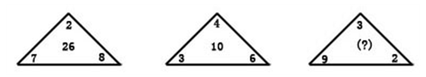

A. 12

B. 14

C. 16

D. 20

第 42 题 · 答案与解析

**参考答案（粉笔题库参考内容）**

C

**解析**

三角形两底角之和减去顶角，然后乘以2等于中间的数。，，。

故正确答案为C。

**来源**：2008年国家公务员录用考试《行测》题第42题

### 第 43 题

1，2/3，5/8，13/21，（    ）

A. 21/33

B. 35/64

C. 41/70

D. 34/55

第 43 题 · 答案与解析

**参考答案（粉笔题库参考内容）**

D

**解析**

先将1化为1/1。前一项的分母加分子等于后一项的分子；前一项的分母的2倍加分子等于后一项的分母。未知项的分子为13+21=34，分母为，故未知项为34/55。

故正确答案为D。

**来源**：2008年国家公务员录用考试《行测》题第43题

### 第 44 题

67，54，46，35，29，（  ）

A. 13

B. 15

C. 18

D. 20

第 44 题 · 答案与解析

**参考答案（粉笔题库参考内容）**

D

**解析**

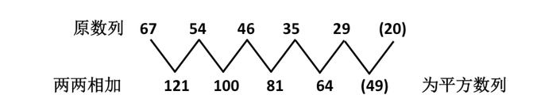

故正确答案为D。

**来源**：2008年国家公务员录用考试《行测》题第44题

### 第 45 题

14，20，54，76，（    ）

A. 104

B. 116

C. 126

D. 144

第 45 题 · 答案与解析

**参考答案（粉笔题库参考内容）**

C

**解析**

原数列为

平方数列为

修正项为

因此原数列的空缺项为。

故正确答案为C。

**来源**：2008年国家公务员录用考试《行测》题第45题

### 第 46 题

若x，y，z是三个连续的负整数，并且x>y>z，则下列表达式中正奇数的是：

A. yz－x

B. (x－y)(y－z)

C. x－yz

D. x(y+z)

第 46 题 · 答案与解析

**参考答案（粉笔题库参考内容）**

B

**解析**

解析一：

三个连续的负整数，有两种情形：奇、偶、奇；偶、奇、偶。分情况讨论：

（1）当x、y、z依次为奇、偶、奇数时，直接赋值x=-1，y=-2，z=-3，代入选项可排除C；

（2）当x、y、z依次为偶、奇、偶数时，直接赋值x=-2，y=-3，z=-4，代入选项可排除A、C、D。

解析二：

连续负整数，x-y=1，y-z=1。

故正确答案为B。

**来源**：2008年国家公务员录用考试《行测》题第46题

### 第 47 题

已知，那么x的值是多少：

A. -2/3

B. 2/3

C. -3/2

D. 3/2

第 47 题 · 答案与解析

**参考答案（粉笔题库参考内容）**

B

**解析**

求解在于不断地从整体出发，首先把左侧最长分数线下方看作一个整体，求出其值，然后逐步进行同样的操作，直至求出最终结果，如下所示：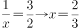

故正确答案为B。

**来源**：2008年国家公务员录用考试《行测》题第47题

### 第 48 题

{a_n}是一个等差数列，，，则数列前13项之和是：

A. 32

B. 36

C. 156

D. 182

第 48 题 · 答案与解析

**参考答案（粉笔题库参考内容）**

C

**解析**

将两个等式左右两侧直接相加得，又因为，可得a_7=12。而前13项的中位数恰好是a_7，于是可知前13项之和为。

等差数列推论：在等差数列中，项数相同时，若下标加和相同，则对应加和也相同。例如A_n表示等差数列的通项，则有，（下标加和3+11=4+10）。

故正确答案为C。

**考点**：数列问题

**来源**：2008年国家公务员录用考试《行测》题第48题

### 第 49 题

相同表面积的四面体，六面体，正十二面体以及正二十面体，其中体积最大的是：

A. 四面体

B. 六面体

C. 正十二面体

D. 正二十面体

第 49 题 · 答案与解析

**参考答案（粉笔题库参考内容）**

D

**解析**

根据等量最值原理，同样表面积的空间几何图形，越接近于球，体积越大。而四个选项中，正二十面体最接近于球，所以体积最大。

故正确答案为D。

**考点**：几何结论类-几何小题型

**来源**：2008年国家公务员录用考试《行测》题第49题

### 第 50 题

一个面积为2平方米的长方形纸张，对折3次后得到的小长方形的面积是：

A. (1/2)m^2

B. 1/3 m^2

C. 1/4 m^2

D. 1/8 m^2

第 50 题 · 答案与解析

**参考答案（粉笔题库参考内容）**

C

**解析**

每次对折，面积都变为原来的1/2，直接应用公式，三次之后变为原来的(1/2)^3=1/8。即面积是原来的。

倍增计数公式：若无死亡机制，如果每一个量每次变为原来的N倍。则经过M次后，数目为原来的N^M倍，各次数值成等比数列。

故正确答案为C。

**考点**：数列问题

**来源**：2008年国家公务员录用考试《行测》题第50题

### 第 51 题

编一本书的书页，用了270个数字（重复的也算，如页码115用了2个1和1个5，共3个数字），问这本书一共有多少页：

A. 117

B. 126

C. 127

D. 189

第 51 题 · 答案与解析

**参考答案（粉笔题库参考内容）**

B

**解析**

结合四个选项都是三位数即可得知最终的页码一定是100多，故此目标是计算从第1页到第99页用掉的数字，然后再逼近目标。

从第1页到第9页，用掉数字9个；从第10页到第99页，用掉数字共，因为一共有90页，每页用了2个数字。还剩余数字270-9-180=81个，将全部用于三位数页码的构造，故能编三位数页码为。因为三位数页码是从第100页开始，故第27页三位数页码是该书的第126页。

故正确答案为B。

**来源**：2008年国家公务员录用考试《行测》题第51题

### 第 52 题

5年前甲的年龄是乙的三倍，10年前甲的年龄是丙的一半，若用y表示丙当前的年龄，下列哪一项能表示乙的当前年龄：

A. y/6+5

B. 5y/3+10

C. (y-10)/3

D. 3y-5

第 52 题 · 答案与解析

**参考答案（粉笔题库参考内容）**

A

**解析**

y表示丙当年的年龄，10年前丙为y-10岁，10年前甲为岁，5年前甲为y/2岁，5年前乙的年龄为岁，则乙当前年龄为y/6+5岁。

故正确答案为A。

**考点**：年龄问题

**来源**：2008年国家公务员录用考试《行测》题第52题

### 第 53 题

为节约用水，某市决定用水收费实行超额超收，标准用水量以内每吨2.5元，超过标准的部分加倍收费。某用户某月用水15吨，交水费62.5元，若该用户下个月用水12吨，则应交水费多少钱：

A. 42.5元

B. 47.5元

C. 50元

D. 55元

第 53 题 · 答案与解析

**参考答案（粉笔题库参考内容）**

B

**解析**

解析一：

先将15吨全部看成超出的部分，则按照每吨5元收费，共计收费75元，而实际交水费62.5元，少交12.5元。这是因为标准量以内每吨2.5元，比整体看做超出部分计价少交2.5元，因此标准用水量为5吨。因此12吨应交水费为。

解析二：

设标准用水量上限为x吨，则有，解得x=5。用水12吨，应交水费。

故正确答案为B。

**考点**：分段计算问题

**来源**：2008年国家公务员录用考试《行测》题第53题

### 第 54 题

某零件加工厂按照工人完成的合格零件和不合格零件支付工资，工人每做出一个合格零件能得到工资10元，每做一个不合格零件将被扣除5元，已知某人一天共做了12个零件，得工资90元，那么他在这一天做了多少个不合格零件：

A. 2

B. 3

C. 4

D. 6

第 54 题 · 答案与解析

**参考答案（粉笔题库参考内容）**

A

**解析**

设做了不合格零件x个，合格零件(12-x)个，则有，解得x=2。

故正确答案为A。

**考点**：和差倍比问题

**来源**：2008年国家公务员录用考试《行测》题第54题

### 第 55 题

小华在练习自然数求和，从1开始，数着数着他发现自己重复数了一个数。在这种情况下，他将所数的全部数求平均，结果为7.4，请问他重复的那个数是：

A. 2

B. 6

C. 8

D. 10

第 55 题 · 答案与解析

**参考答案（粉笔题库参考内容）**

B

**解析**

设从1加到N，重复的数字为x，则有：

，因为，所以。

当N=13时，，解得x=12.6，非整数，舍去；

当N=14时，，解得x=6。

故正确答案为B。

**来源**：2008年国家公务员录用考试《行测》题第55题

### 第 56 题

共有100个人参加某公司的招聘考试，考试内容共有5道题，1－5题分别有80人，92人，86人，78人和74人答对，答对了3道和3道以上的人员能通过考试，请问至少有多少人能通过考试：

A. 30

B. 55

C. 70

D. 74

第 56 题 · 答案与解析

**参考答案（粉笔题库参考内容）**

C

**解析**

多集合反向构造，第一步：反向。第1道题错了100-80=20人，第2道题错了100-92=8人，第3道题错了100-86=14人，第4道题错了100-78=22人，第5道题错了100-74=26人。第二步：加和。20+8+14+22+26=90人。第三步：逆向考虑，为了让更多的人不及格，这90道错题分配的时候应该尽量的3道分给一个人，即可保证一个人不及格，所以一共可以分给最多30个人，保证30个人不及格，所以及格的至少会有100-30=70人。

故正确答案为C。

**考点**：非典型最值问题

**来源**：2008年国家公务员录用考试《行测》题第56题

### 第 57 题

一张节目表上原有3个节目，如果保持这3个节目的相对顺序不变，再添进去2个新节目，有多少种安排方法：

A. 20

B. 12

C. 6

D. 4

第 57 题 · 答案与解析

**参考答案（粉笔题库参考内容）**

A

**解析**

在三个节目中插入两个节目，首先安排第一个节目，3个节目会产生4个空，随机选择一个插入，有4种方法；此时会有4个节目，产生5个空，再将第二个节目插入，共有5种方法。分步用乘法连接，总的安排方法有种。

故正确答案为A。

**考点**：基础排列组合

**来源**：2008年国家公务员录用考试《行测》题第57题

### 第 58 题

某商场促销，晚上八点以后全场商品在原来折扣基础上再打9.5折，付款时满400元再减100元，已知某鞋柜全场8.5折，某人晚上九点多去该鞋柜买了一双鞋，花了384.5元，问这双鞋的原价为多少钱：

A. 550

B. 600

C. 650

D. 700

第 58 题 · 答案与解析

**参考答案（粉笔题库参考内容）**

B

**解析**

由题意，鞋的原价为，计算量比较大，而只要注意到分子484.5中含有因数3，而因数3没有被分母约掉，所以必然保留到最后结果中，而四个选项中只有B可以被3整除。

故正确答案为B。

**考点**：经济利润问题

**来源**：2008年国家公务员录用考试《行测》题第58题

### 第 59 题

甲、乙、丙、丁四个人去图书馆借书，甲每隔5天去一次，乙每隔11天去一次，丙每隔17天去一次，丁每隔29天去一次。如果5月18日他们四个人在图书馆相遇，问下一次四个人在图书馆相遇是几月几号：

A. 10月18日

B. 10月14日

C. 11月18日

D. 11月14日

第 59 题 · 答案与解析

**参考答案（粉笔题库参考内容）**

D

**解析**

每隔n天去一次即每(n+1)天去一次。下一次四个人相遇所隔天数应该是6、12、18、30的最小公倍数，即为180。而5月18日后的第180天约经过6个月，故为11月，故排除A、B。若下次相遇是11月18日，则经过日期不可能恰好为180天，所以11月14日为正确答案。

故正确答案为D。

**考点**：周期相遇问题、星期日期问题

**来源**：2008年国家公务员录用考试《行测》题第59题

### 第 60 题

甲、乙、丙三种货物，如果购买甲3件、乙7件、丙1件需花3.15元，如果购买甲4件、乙10件、丙1件需花4.2元，那么购买甲、乙、丙各1件需花多少钱：

A. 1.05

B. 1.4

C. 1.85

D. 2.1

第 60 题 · 答案与解析

**参考答案（粉笔题库参考内容）**

A

**解析**

这是不定方程组，无法解得每个未知数的具体值。换言之，未知数的解存在无穷多个，而题目中四个选项均为确定数值，所以未知数的具体值为多少并不影响甲+乙+丙的值，也即只需要求出其中一组解即可。对此，可以设定最复杂的那个为0，即乙=0，代入后解二元一次方程组，解得甲=1.05，丙=0，即可得甲+乙+丙=1.05。

故正确答案为A。

**来源**：2008年国家公务员录用考试《行测》题第60题

### 第 61 题

从所给四个选项中，选择最合适的一个填入问号处，使之呈现一定的规律性：

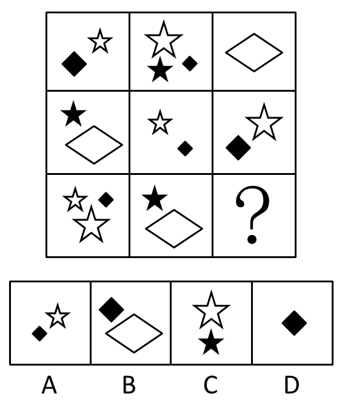

A. A

B. B

C. C

D. D

第 61 题 · 答案与解析

**参考答案（粉笔题库参考内容）**

D

**解析**

本题考查元素周遍。

已知的图形每一行图形中共包含6种元素：大白五角星、小白五角星、小黑五角星、大黑方块、小黑方块、白色菱形。第三行图形也应包含这些元素，而前两个图形中已经包含了这6种元素中的5个，只剩下1 个大黑方块。通过分析，只有D项中图形符合。

故正确答案为D。

**考点**：样式规律-遍历

**来源**：2008年国家公务员录用考试《行测》题第61题

### 第 62 题

从所给四个选项中，选择最合适的一个填入问号处，使之呈现一定的规律性：

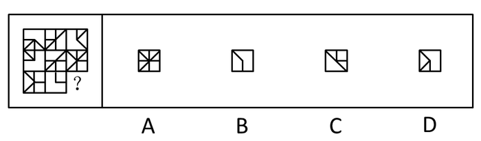

A. A

B. B

C. C

D. D

第 62 题 · 答案与解析

**参考答案（粉笔题库参考内容）**

D

**解析**

本题考查元素叠加。

已知的图形每一行前两个图叠加后去同存异形成第三个图形，通过分析只有D项中图形符合。

故正确答案为D。

**考点**：样式规律-加减同异

**来源**：2008年国家公务员录用考试《行测》题第62题

### 第 63 题

从所给四个选项中，选择最合适的一个填入问号处，使之呈现一定的规律性：

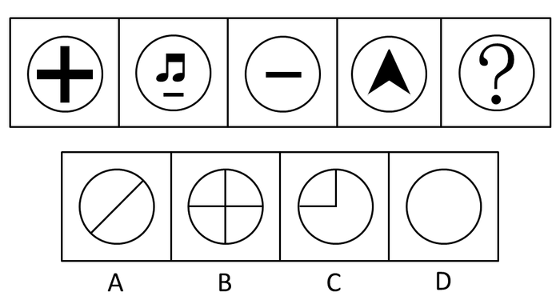

A. A

B. B

C. C

D. D

第 63 题 · 答案与解析

**参考答案（粉笔题库参考内容）**

D

**解析**

本题考查数面（封闭空间）。

已知图形的面数都为1，因此下一个图形的面数也应该为1。通过分析A、B、C和D四选项中图形的面数分别为2、4、2和1，因此只有D项中图形符合。

故正确答案为D。

**考点**：数量规律-面

**来源**：2008年国家公务员录用考试《行测》题第63题

### 第 64 题

从所给四个选项中，选择最合适的一个，使之呈现一定的规律性：

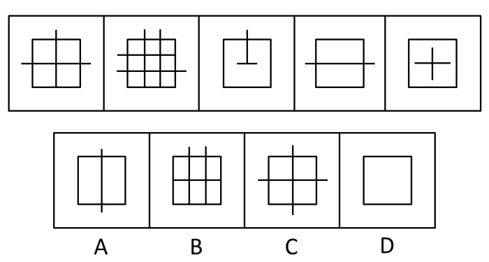

A. A

B. B

C. C

D. D

第 64 题 · 答案与解析

**参考答案（粉笔题库参考内容）**

C

**解析**

本题考查数线段露头数。

已知图形线段露头数分别为3、5、1、2、0，因此下一个图形线段露头数应该为4，从而构成0-5的连续自然数。通过分析，A、B、C和D四选项图形线段露头数分别为2、2、4和0，因此只有C项中图形符合。

故正确答案为C。

**考点**：数量规律-线

**来源**：2008年国家公务员录用考试《行测》题第64题

### 第 65 题

下面四个所给的选项中，哪一选项的盒子不能由左边给定的图形做成（   ）。

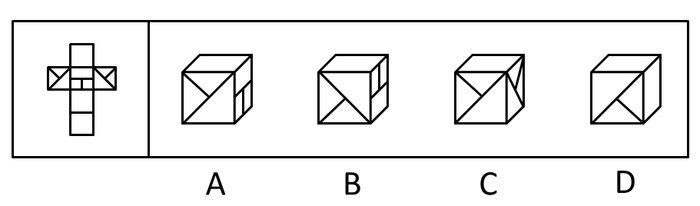

A. A

B. B

C. C

D. D

第 65 题 · 答案与解析

**参考答案（粉笔题库参考内容）**

C

**解析**

空间折纸盒，本题考查相对关系。

本题需要注意题干中问的是“不能由左边给定的图形做成”。通过左边图形分析可知，带有斜线对角线的两个面是平行面，在立体图中是不可能相邻的，因此可以断定C项中图形不能由左边给定的图形做成。

故正确答案为C。

**考点**：空间类-空间重构-六面体

**来源**：2008年国家公务员录用考试《行测》题第65题

### 第 66 题

立体农业是指农作物复合群体在时空上的充分利用。根据不同作物的不同特性，如高秆与矮秆、富光与耐荫、早熟与晚熟、深根与浅根、豆科与禾本科，利用它们在生长过程中的时空差，合理地实行科学的间种、套种、混种、轮种等配套种植，形成多种作物、多层次、多时序的立体交叉种植结构。根据上述定义，下列属于立体农业的是：

A. 甲在自己的玉米地里种植大豆

B. 乙在自己承包的鱼塘不但养鱼，还种植了很多莲藕

C. 丙在南方某地区承包了十亩稻田，特意引种了高产的水稻新品种

D. 丁前年承包了一座山，他在山上种植了大量苹果树，并在山上养殖了大量蜜蜂

第 66 题 · 答案与解析

**参考答案（粉笔题库参考内容）**

A

**解析**

第一步：抓住定义中的关键词。

“立体农业”定义的关键词包括“农作物复合群体”、“时空”。

第二步：逐一判断选项。

A项中在玉米地里种植大豆符合关键词“农作物复合群体”，因此属于“立体农业”；

B项中在鱼塘养鱼和种植莲藕，养鱼不符合关键词“农作物复合群体”，因此不属于“立体农业”；

C项中是单一作物水稻，不符合关键词“农作物复合群体”，因此不属于“立体农业”；

D项中在山上种植苹果树和养殖蜜蜂，养殖蜜蜂不符合关键词“农作物复合群体”，因此不属于“立体农业”。

故正确答案为A。

**考点**：主客体

**来源**：2008年国家公务员录用考试《行测》题第66题

### 第 67 题

天然孳息是指按照物质的自然生长规律而产生的果实与动物的出产物，与原物分离前，是原物的一部分。天然孳息，由所有权人取得；既有所有权人又有用益物权人的，由用益物权人取得。当事人另有约定的，按照约定。

根据上述定义，下列不属于天然孳息的是：

A. 送给他人的猫崽

B. 从羊身上剪下的羊毛

C. 牛被宰杀后发现的牛黄

D. 公园里的柿子树所结的果实

第 67 题 · 答案与解析

**参考答案（粉笔题库参考内容）**

A

**解析**

第一步：找出定义关键词。

“与原物分离前，是原物的一部分”。

第二步：逐一分析选项。

A项中并没有涉及原物母猫，从而猫崽不符合关键词“与原物分离前，是原物的一部分”，因此不属于天然孳息，当选；

B项中的羊毛，C项中的牛黄，D项中的果实均符合关键词“与原物分离前，是原物的一部分”，因此都属于天然孳息，排除。

本题为选非题，故正确答案为A。

**考点**：单定义-其他句式

**来源**：2008年国家公务员录用考试《行测》题第67题

### 第 68 题

绿色壁垒是指一些国家和国际组织通过制定环境标准和法规，为保护生态环境、人类以及动植物生命安全与健康而直接或间接采取的各种限制或者禁止贸易的措施，它是能对进出口贸易产生影响的一种非关税贸易壁垒。

根据上述定义，下列属于绿色壁垒行为的是：

A. 某大型连锁超市只销售通过绿色食品检验的进口农产品

B. 一家纺织品进出口公司销往欧洲的10余吨棉纱因检测出含有德国禁用的偶氮染料而停止出口

C. 某公司向国外出口大蒜，因途中货轮上的温控设施出问题，部分大蒜到港后变质，结果所有大蒜被退回

D. 一家工厂生产的木质卧室家具在美国市场销售量非常可观，但由于美国提高了木质卧室家具的关税，其出口量大受影响

第 68 题 · 答案与解析

**参考答案（粉笔题库参考内容）**

B

**解析**

第一步：抓住定义中的关键词。

关键词包括“国家和国际组织”、“环境标准”、“非关税”。

第二步：逐一判断选项。

A项中某大型连锁超市不符合关键词“国家和国际组织”，因此不属于绿色壁垒行为；

B项中情况符合关键词，因此属于绿色壁垒行为；

C项中某公司因温控设施出问题使得大蒜变质被退回，是产品质量问题，不符合关键词“环境标准”，因此不属于绿色壁垒行为；

D项中美国提高木质卧室家具的关税不符合关键词“非关税”，因此不属于绿色壁垒行为。

故正确答案为B。

**考点**：方式目的

**来源**：2008年国家公务员录用考试《行测》题第68题

### 第 69 题

失语症是指由于神经中枢病损导致抽象信号思维障碍，而丧失口语、文字的表达和领悟能力的临床症候群。

根据上述定义，下列可能患失语症的是：

A. “狼孩”回归社会后无法与人进行言语交流

B. 幼时高烧听力受损致使发音有极大缺陷，影响交流

C. 因受刺激精神失常，造成言语理解和表达上的困难

D. 因车祸头部受创，虽能模仿他人言语但经常答非所问

第 69 题 · 答案与解析

**参考答案（粉笔题库参考内容）**

D

**解析**

第一步：抓住定义中的关键词。

关键词包括“神经中枢病损”。

第二步：逐一判断选项。

A项中“狼孩”无法与人进行言语交流，B项中高烧听力受损致使发音有极大缺陷，C项中受刺激精神失常都不符合关键词“神经中枢病损”，因此均不可能患失语症；

D项中由于车祸头部受创，可能造成“神经中枢病损”，从而导致失语症。

故正确答案为D。

**考点**：原因结果

**来源**：2008年国家公务员录用考试《行测》题第69题

### 第 70 题

职业枯竭是指人们在自己长期从事的工作重压之下，产生身心能量被工作耗尽的感觉。根据上述定义，下列属于职业枯竭状态的是：

A. 老周不能胜任自己现有的工作，每天都会忙得焦头烂额

B. 刚参加工作的小李觉得这份工作太累，产生了跳槽的念头

C. 刘经理每天工作繁忙，缺乏充足的休息，情绪也越来越糟糕

D. 在从事过许多不同的职业之后，老王觉得所有工作都索然无味

第 70 题 · 答案与解析

**参考答案（粉笔题库参考内容）**

C

**解析**

第一步：抓住定义中的关键词。

“职业枯竭状态”的关键词包括“长期从事”、“工作重压”、“身心能量被工作耗尽”。

第二步：逐一判断选项。

A项中老周忙得焦头烂额是由于不能胜任这项工作， 是能力的问题，不是工作压力的问题，不符合关键词“工作重压”，因此不属于“职业枯竭状态”；

B项中小李刚参加工作不符合关键词“长期从事”，因此不属于“职业枯竭状态”；

C项中刘经理的状况符合关键词，因此属于“职业枯竭状态”；

D项中老王觉得工作都索然无味，不符合关键词“身心能量被工作耗尽”，并且“从事过许多不同的职业”，不属于“职业枯竭状态”。

故正确答案为C。

**考点**：大前提

**来源**：2008年国家公务员录用考试《行测》题第70题

### 第 71 题

价格垄断行为是指经营者通过相互串通或者滥用市场支配地位，操纵市场调节价，扰乱正常的生产经营秩序，损害其他经营者或者消费者合法权益，或者危害社会公共利益的行为。

根据上述定义，下列不属于价格垄断行为的是：

A. 几家大型电视机生产企业通过协议联手操纵价格

B. 某商场为了吸引顾客将部分商品低于成本价销售

C. 拥有专利权的工厂凭借市场支配地位，在经销商提货时强制限定转售价格

D. 一家占市场份额70％的大企业以回扣、赠送等方式变相降价，致使商品市场价低于成本价

第 71 题 · 答案与解析

**参考答案（粉笔题库参考内容）**

B

**解析**

第一步：找出定义关键词。

“相互串通或者滥用市场支配地位”、“操纵市场调节价”。

第二步：逐一分析选项。

A项中几家大型电视机生产企业，C项中拥有专利权的工厂，D项中大企业以回扣、赠送等方式变相降价都符合关键词“相互串通或者滥用市场支配地位”、“操纵市场调节价”，因此均属于价格垄断行为，排除；

B项中商场为了吸引顾客将部分商品降价，并不符合关键词“相互串通或者滥用市场支配地位”，因此不属于价格垄断行为，当选。

本题为选非题，故正确答案为B。

**考点**：方式目的

**来源**：2008年国家公务员录用考试《行测》题第71题

### 第 72 题

生态移民是指为了保护某个地区特殊的生态或让某个地区的生态得到修复而进行的移民，也指因自然环境恶劣，不具备就地扶贫的条件而将当地人民整体迁出的移民。

根据上述定义，下列属于生态移民的是：

A. 贵州省某山区因土地出现石质化现象，该地区村民被迁往他乡

B. 几百年前，中原一带的居民为躲避战争，整体迁到南方，成为客家人

C. 某村落位于山谷中，交通十分不便，为更快致富，村民集体研究决定移居山外

D. 张三的父母家住三峡库区，由于修水库，其父母将家产变卖，来到上海与张三一起居住

第 72 题 · 答案与解析

**参考答案（粉笔题库参考内容）**

A

**解析**

第一步：抓住定义中的关键词。

关键词包括“保护生态或自然环境恶劣”、“整体迁出”。

第二步：逐一判断选项。

A项中该地区村民被迁往他乡符合关键词，因此属于生态移民；

B项中居民为躲避战争迁到南方，不符合关键词“保护生态或自然环境恶劣”，因此不属于生态移民，而是战争移民；

C项中村民集体移居山外是因为交通十分不便，不符合关键词“保护生态或自然环境恶劣”，因此不属于生态移民；

D项中张三的父母到上海与张三一起居住，是个体移居，不符合关键词“整体迁出”，因此不属于生态移民。

故正确答案为A。

**考点**：方式目的

**来源**：2008年国家公务员录用考试《行测》题第72题

### 第 73 题

危机公关是指由于企业管理不善、同行竞争甚至遭遇恶意破坏或者是外界特殊事件的影响，而给企业或者品牌带来危机，企业针对危机所采取的一系列自救行动，包括消除影响、恢复形象等。

根据上述定义，下列属于危机公关的是（  ）。

A. 由于台风影响，某企业的户外广告牌被风吹倒，企业派员工前去修复

B. 某企业由于重要生产设备被盗，严重影响生产，高层领导召开紧急会议，研究对策

C. 某企业在行业竞争中失去领先地位，利润大幅下滑，企业高层领导决定转向新的领域

D. 某大型餐饮集团的一个连锁店由于卫生状况差被曝光后，该集团领导通过媒体向公众道歉，并借此机会发布新的企业卫生管理标准

第 73 题 · 答案与解析

**参考答案（粉笔题库参考内容）**

D

**解析**

第一步：抓住定义中的关键词。

关键词包括“给企业或者品牌带来危机”、“自救行动”。

第二步：逐一判断选项。

A项中企业的户外广告牌被风吹倒，不符合关键词“给企业或者品牌带来危机”，因此不属于危机公关；

B项中高层领导召开紧急会议，研究对策，并不是“自救行动”，因此不属于危机公关；

C项中企业高层领导决定转向新的领域，并没有针对问题进行自救，不符合关键词“自救行动”，因此不属于危机公关；

D项中餐饮集团领导的做法符合关键词，因此属于危机公关。

故正确答案为D。

**考点**：原因结果

**来源**：2008年国家公务员录用考试《行测》题第73题

### 第 74 题

附加值是附加价值的简称，是在产品原有价值的基础上，通过生产过程中的有效劳动新创造的价值，即附加在产品原有价值上的新价值。

根据上述定义，以下行为提高了产品附加价值的是：

A. 某明星为娱乐活动优胜者的奖品签名

B. 雨天商贩以高于市场价的价格在景区内销售雨具

C. 某生产饮料的厂家将产品由过去的罐装变为塑料包装

D. 个体商贩请人在白色T恤上画上各种漂亮的图案后出售

第 74 题 · 答案与解析

**参考答案（粉笔题库参考内容）**

D

**解析**

第一步：抓住定义中的关键词。

关键词包括“原有价值的基础上”、“有效劳动新创造的价值”。

第二步：逐一判断选项。

A项中明星为奖品签名不符合关键词“有效劳动新创造的价值”，因此不属于提高了产品附加价值；

B项中雨天商贩高价销售雨具不符合关键词“有效劳动新创造的价值”，因此不属于提高了产品附加价值；

C项中厂家将产品由过去的罐装变为塑料包装的做法，不符合关键词“原有价值的基础上”，因此不属于提高了产品附加价值；

D项中个体商贩的做法符合关键词，因此属于提高了产品附加价值。

故正确答案为D。

**考点**：方式目的

**来源**：2008年国家公务员录用考试《行测》题第74题

### 第 75 题

流通加工是指物品在从生产地到使用的过程中，根据需要施加包装、分割、计量、分拣、刷标志、贴标签、组装等简单作业的总称。

根据上述定义，下列属于流通加工的是：

A. 某工厂采购布匹、钮扣等材料，加工成时装并在市场上销售

B. 某运输公司在冷藏车皮中保存水果，使之在运到目的地时更新鲜

C. 杂货店将购时的西红柿按质量分成每斤1元和每斤2元两个档次销售

D. 某批发商在运输玻璃杯的过程中，为杯子加上防震外包装，以避免其碎裂

第 75 题 · 答案与解析

**参考答案（粉笔题库参考内容）**

D

**解析**

第一步：抓住定义中的关键词。

关键词包括“从生产地到使用的过程”\\“包装、分割、计量、分拣、刷标志、贴标签、组装等简单作业”。

第二步：逐一判断选项。

A项中工厂加工成时装是在生产地的生产过程，不符合关键词“从生产地到使用的过程”，因此不属于流通加工；

B项中冷藏保存水果只是保存，不符合关键词“包装、分割、计量、分拣、刷标志、贴标签、组装等简单作业”，因此不属于流通加工；

C项中西红柿分档销售不符合关键词“从生产地到使用的过程”，因此不属于流通加工；

D项中批发商为杯子加上防震外包装的做法符合关键词，因此属于流通加工。

故正确答案为D。

**考点**：大前提

**来源**：2008年国家公务员录用考试《行测》题第75题

### 第 76 题

法律：约束

A. 新闻：广播

B. 政策：规范

C. 历史：借鉴

D. 制度：学问

第 76 题 · 答案与解析

**参考答案（粉笔题库参考内容）**

B

**解析**

第一步：判断题干词语间逻辑关系。

法律约束构成主谓结构，并且“法律”的作用是“约束”。

第二步：判断选项词语间逻辑关系。

与题干相同逻辑关系的为B项，即政策规范构成主谓结构，“政策”的作用是“规范”。

A项中“新闻”是被“广播”，C项中“历史”是被“借鉴”，A和C两项前者相对于后者均是被动的；D项无明显逻辑关系。

故正确答案为B。

**考点**：逻辑关系-对应关系

**来源**：2008年国家公务员录用考试《行测》题第76题

### 第 77 题

京剧：芭蕾

A. 指南针：火药

B. 唐装：油画

C. 佛教：基督教

D. 武术：拳击

第 77 题 · 答案与解析

**参考答案（粉笔题库参考内容）**

D

**解析**

第一步：判断题干词语间逻辑关系。

题干词语属于并列关系。京剧和芭蕾都是舞台表演艺术，但京剧是中国传统艺术的一种，而芭蕾是外国传统艺术的一种。

第二步：判断选项词语间逻辑关系。

A选项，指南针和火药都是中国的四大发明之一，没有外国的，排除；

B选项，唐装和油画是不同类型的事物，不能并列，排除；

C选项，佛教是印度的传统宗教，基督教是西方国家的传统宗教，没有中国的，排除；

D选项，武术和拳击都是一种运动形式，武术源于中国，拳击源于国外，正确。

故正确答案为D。

**考点**：逻辑关系-并列关系

**来源**：2008年国家公务员录用考试《行测》题第77题

### 第 78 题

安居乐业：颠沛流离

A. 吸收：放弃

B. 简单：杂乱

C. 雪中送炭：雪上加霜

D. 巧夺天工：鬼斧神工

第 78 题 · 答案与解析

**参考答案（粉笔题库参考内容）**

C

**解析**

第一步：判断题干词语间逻辑关系。

“安居乐业”意思为安定愉快地生活和劳动。“颠沛流离”意思为由于灾荒或战乱而流转离散，形容生活艰难，四处流浪。题干两词是反义关系。

第二步：判断选项词语间逻辑关系。

A项中“吸收”的反义词应该为“释放”，而不是“放弃”。

B项中“简单”的反义词应该为“复杂”，而不是“杂乱”。

C项中“雪中送炭”意思为在下雪天给人送炭取暖，比喻在别人急需时给予物质上或精神上的帮助。“雪上加霜”比喻接连遭受灾难，损害愈加严重。两词是反义关系，与题干有相同的逻辑关系。

D项中“巧夺天工”意思为人工的精巧胜过天然，形容技艺十分巧妙。“鬼斧神工”意思为像鬼神制作出来的，形容艺术技巧高超，不是人力所能达到的。两词是近义关系。

故正确答案为C。

**考点**：语义关系-反义关系

**来源**：2008年国家公务员录用考试《行测》题第78题

### 第 79 题

蛹：蝶

A. 丑小鸭：白天鹅

B. 胚胎：婴儿

C. 种子：花朵

D. 蝌蚪：青蛙

第 79 题 · 答案与解析

**参考答案（粉笔题库参考内容）**

D

**解析**

第一步：判断题干词语间逻辑关系。

蛹会长成蝶，且是一个变态发育过程。注：经过卵、幼虫、蛹和成虫等4个时期的叫完全变态。完全变态的幼虫与成虫在形态构造和生活习性上明显不同。

第二步：判断选项词语间逻辑关系。

A项：丑小鸭会长成白天鹅，但不是一个变态发育过程，与题干逻辑关系不一致，排除；

B项：胚胎会发育成婴儿，但不是一个变态发育过程，与题干逻辑关系不一致，排除；

C项：种子会长成花朵，但不是一个变态发育过程，与题干逻辑关系不一致，排除；

D项：蝌蚪会长成青蛙，且是一个变态发育过程，与题干逻辑关系一致，当选。

故正确答案为D。

**考点**：逻辑关系-对应关系

**来源**：2008年国家公务员录用考试《行测》题第79题

### 第 80 题

窑：陶瓷

A. 学校：学生

B. 烤箱：面包

C. 砖场：砖

D. 整数：自然数

第 80 题 · 答案与解析

**参考答案（粉笔题库参考内容）**

B

**解析**

第一步：判断题干词语间逻辑关系。

题干两词是对应关系，且是制作场所与制作产物间的对应关系。

第二步：判断选项词语间逻辑关系。

A项：并不是制作场所与制作产物间的对应关系；

B项：烤箱是用来制作面包的，与题干逻辑关系相同；

C项：如果是“砖窑：砖”则其逻辑关系与题干相同；

D项：为包容关系。

故正确答案为B。

**考点**：逻辑关系-对应关系

**来源**：2008年国家公务员录用考试《行测》题第80题

### 第 81 题

国家：政府：行政

A. 公司：经理部：经理

B. 野战军：作战部：参谋

C. 董事会：经理部：职员

D. 总司令：军官：命令

第 81 题 · 答案与解析

**参考答案（粉笔题库参考内容）**

B

**解析**

第一步：判断题干前两词间的逻辑关系，并在选项中进行选择。

题干前两词是前者包含后者的包容关系，与之逻辑关系相同的是A项和B项。

第二步：答案不唯一时，再判断题干第二个词与第三个词间的逻辑关系，并在选项中进行选择。

题干中“政府”和“行政”是对应关系，即政府有行政职能。

A项中“经理部”和“经理”是包容关系；

B项中“作战部”和“参谋”是对应关系，即作战部有参谋职能。

因此与题干逻辑关系相同的即为B项。

故正确答案为B。

**考点**：逻辑关系-包容关系、逻辑关系-对应关系

**来源**：2008年国家公务员录用考试《行测》题第81题

### 第 82 题

争议：仲裁：听证

A. 诉讼：审判：旁听

B. 通货膨胀：宏观调控：货币政策

C. 突发事故：现场抢救：善后处理

D. 交通安全：交通法规：交通警察

第 82 题 · 答案与解析

**参考答案（粉笔题库参考内容）**

A

**解析**

第一步：判断题干词语间逻辑关系。

没有“争议”就没有“仲裁”，第一词是第二词的必要条件，二者为必要条件对应关系，“仲裁”时可“听证”，二者为程序与可选环节的对应关系。

第二步：判断选项词语间逻辑关系。

A项：没有“诉讼”就没有“审判”，第一词是第二词的必要条件，二者为必要条件对应关系，“审判”时可“旁听”，二者为程序与可选环节的对应关系，与题干逻辑关系一致，当选；

B项：没有“通货膨胀”也可能有“宏观调控”，第一词和第二词不是必要条件对应关系，与题干逻辑关系不一致，排除；

C项：没有“突发事故”也可能会有“现场抢救”，第一词和第二词不是必要条件对应关系，与题干逻辑关系不一致，排除；

D项：没有“交通法规”就没有“交通安全”，第二词是第一词的必要条件，与题干逻辑关系不一致，排除。

故正确答案为A。

**考点**：逻辑关系-对应关系

**来源**：2008年国家公务员录用考试《行测》题第82题

### 第 83 题

岩石：矿物：成份

A. 森林：树木：木材

B. 粘土：沙子：石头

C. 器官：组织：功能

D. 酒精：饮料：果汁

第 83 题 · 答案与解析

**参考答案（粉笔题库参考内容）**

C

**解析**

第一步：判断题干前两词间的逻辑关系，并在选项中进行选择。

题干前两词是前者包含后者的包容关系，与之相同逻辑关系的是A项和C项。

第二步：答案不唯一时，再判断题干第二个词与第三个词间的逻辑关系，并在选项中进行选择。

“矿物”中有不同的“成份”，二者为对应关系，相同特征的即为C项，“组织”有不同的“功能”。

故正确答案为C。

**考点**：逻辑关系-包容关系、逻辑关系-对应关系

**来源**：2008年国家公务员录用考试《行测》题第83题

### 第 84 题

（　　）对于 知识 ，相当于 分析 对于（　　）

A. 书本     理论

B. 学习     结论

C. 学问     研究

D. 学生     研究员

第 84 题 · 答案与解析

**参考答案（粉笔题库参考内容）**

B

**解析**

第一步：将选项逐一代入，判断各选项前后部分的逻辑关系。

A 项：书本是知识的载体，分析理论是动宾关系；

B 项：学习知识、分析结论都是动宾关系；

C 项：学问与知识是近义词，分析是对一件事情进行分门别类的整理，研究是探索、钻研，二者没有明显的逻辑关系；

D 项：学生学习知识，主宾关系，研究员分析，主谓关系。

第二步：逻辑关系相同即为答案。

根据第一步可知，逻辑关系完全相同的是B 项。

故正确答案为B。

**考点**：语法关系

**来源**：2008年国家公务员录用考试《行测》题第84题

### 第 85 题

电子政务 对于 纸张 ，相当于 （  ） 对于 （  ）

A. 电子邮件    信封

B. 网络歌手    歌迷

C. 网上购物    现金

D. 电脑游戏    软件

第 85 题 · 答案与解析

**参考答案（粉笔题库参考内容）**

C

**解析**

第一步：判断题干词语间逻辑关系。

题干两词是对应关系，且前者可以将后者电子化的对应关系，即“电子政务”是将“纸张”电子化。

第二步：判断选项词语间逻辑关系。

与题干相同逻辑关系的即为C项，即“网上购物”是将“现金”电子化。

A项中“电子邮件”对应的应该为“信纸”；

B项明显不是前者可以将后者电子化的对应关系；

D项是包容关系。

故正确答案为C。

**考点**：逻辑关系-对应关系

**来源**：2008年国家公务员录用考试《行测》题第85题

### 第 86 题

历史上一度盛行的古埃及、古巴比伦、古玛雅的语言文字已成历史尘埃，世界上现存的6000多种语言文字，平均每两周就消失一种。由此推算，到2050年，世界上将有90%的语言文字灭绝。

以下哪项如果为真，最能反驳以上观点：

A. 有许多语言文学家正在研究这些语言文字

B. 古代语言文字往往是随着文明被征服而灭绝的

C. 许多濒危语言文字已经得到了重视和有效的保护

D. 现代的非文盲比例与古代相比有非常显著的降低

第 86 题 · 答案与解析

**参考答案（粉笔题库参考内容）**

C

**解析**

第一步：找到论点和论据。

本题论点是到2050年，世界上将有90%的语言文字灭绝，论据是世界上现存的6000多种语言文字，平均每两周就消失一种。

第二步：判断削弱方式。

本题论点和论据间存在因果关系，所以需削弱论点。

第三步：逐一判断选项的作用。

A项中许多语言文学家研究这些语言文字，对题干观点没有明显的削弱作用；

B项中只涉及“古代语言文字”与题干结论无关，属于无关选项；

C项中许多濒危语言文字已经得到了重视和有效的保护，直接对题干观点进行削弱；

D项中只提到了“非文盲比例”现在与古代的区别，与题干无关，属于无关选项。

故正确答案为C。

**考点**：削弱论点

**来源**：2008年国家公务员录用考试《行测》题第86题

### 第 87 题

史书记载，春秋战国时期的古滇国历时五百余年，在云南历史上的地位颇为重要。古滇国的青铜文化吸收和融合了不同地区和民族的文化精华，然而东汉以后，古滇国却神秘消失，唐代以后的史书上竟没留下任何记载。近年来，抚仙湖南岸江川县李家山墓葬群出土了数千件古滇青铜器，抚仙湖北岸相连的晋宁石寨山曾出土滇王印。据此，考古学家推测云南抚仙湖水下古城就是神秘消失的古滇王城。

以下哪项如果为真，最能支持上述推测：

A. 在抚仙湖水下古城，也发现了大量青铜器

B. 按考古常规看，王国都城附近都是墓葬群

C. 抚仙湖水下古城与史料记载的古滇国都位于今云南省境内

D. 据专家推测，抚仙湖水下古城与古滇国处于同一历史时期

第 87 题 · 答案与解析

**参考答案（粉笔题库参考内容）**

B

**解析**

第一步：找出论点论据。

论点：云南抚仙湖水下古城就是神秘消失的古滇王城。

论据：抚仙湖南岸墓葬群出土了古滇青铜器；抚仙湖北岸出土了滇王印。

题干论证由抚仙湖南岸有古滇青铜器和北岸有滇王印，推出水下古城是古滇王城。但是南岸和北岸相隔很远，会不会是有其它原因导致两岸有不同的古滇国物品，比如贸易往来？那么就不能由此论证水下古城就是古滇王国了，所以，要加强上述推测，必须说明古滇青铜器和滇王印虽然所处两岸，但是都在古滇国的范围之内。

该题可以利用加强论据的方法来加强论点。

第二步：逐一分析选项。

A项，水下古城也发现了大量青铜器，可以一定程度上加强推测，但是依然存在上面分析的那个原因——青铜器的出现会不会是其他原因，而并非在古滇国范围之内。排除。

B项，“王国都城附近都是墓葬群”就说明，南岸墓葬群和北岸的滇王印同属古滇王国所有，那么整个水下古城就是古滇王城。加强论据从而加强了论点。正确。

C项，“史料记载”确实有一定加强，但是这是个放之四海而皆准的历史考古学常识，用在本题，力度不如B项，排除。

D项，该项本身也是“专家推测”，可靠性有待论证。另外，就算该项推测是可信的，依然如C项一样，是个历史考古学常识，力度不如B项，排除。

故正确答案为B。

**考点**：补充论据

**来源**：2008年国家公务员录用考试《行测》题第87题

### 第 88 题

从2005年7月开始，敦煌研究院对莫高窟采用了预约参观办法。这一措施合理有效地调控和平衡了游客流量，一方面加强了对洞窟的保护，另一方面给游客提供了更加优质的服务。实施预约参观办法以来，来莫高窟参观的人数逐年递增，年游客接待量由2004年的45万人次增加到2006年的55万人次。

由此可以推出：

A. 莫高窟预约参观的办法为游客提供了便利

B. 合理配置人力、物力资源可以实现利益最大化

C. 预约参观办法实施前莫高窟的游客流量不均衡

D. 科学合理地利用自然和人文资源能创造更大价值

第 88 题 · 答案与解析

**参考答案（粉笔题库参考内容）**

C

**解析**

日常结论题，根据题干信息逐一分析选项。

A项：题干仅提到“莫高窟预约参观的办法给游客提供了更加优质的服务”，并未提到是否为游客提供“便利”，无中生有，无法推出，排除；

B项：题干仅提到“实施预约参观办法以来，来莫高窟参观的人数逐年递增”，选项中“利益最大化”的表述过于绝对，无法推出，排除；

C项：题干中提到“莫高窟预约参观的办法合理有效地调控和平衡了游客流量”，即“实施预约参观办法以前，游客流量不平衡”，可以推出，当选；

D项：题干并未提及是否能创造“更大价值”，无中生有，无法推出，排除。

故正确答案为C。

**考点**：日常结论

**来源**：2008年国家公务员录用考试《行测》题第88题

### 第 89 题

某小学向当地教育行政主管部门申请增购一辆校车，以加强对师生的接送能力。该教育行政主管部门否决了这项申请，理由是：校车的数量必须与学校规模和师生数量相配套。根据该校目前的师生数量和规模，现有的校车已经足够了。以下哪一项假设最能支持教育行政主管部门的决定：

A. 调查显示，租用校车比购买校车更经济

B. 该小学的校车中，至少近期不会有车辆报废

C. 该地区小学适龄儿童数量今后不会有大的增长

D. 该教育行政主管部门没有扩大该校师生规模的计划

第 89 题 · 答案与解析

**参考答案（粉笔题库参考内容）**

B

**解析**

第一步：分析题干，找到论点和论据。

论点：教育行政主管部门否决了增购一辆校车的申请。

论据：校车的数量必须与学校规模和师生数量相配套。

第二步：逐一分析选项。

A 项：“租用校车比购买校车更经济”，与否决增购校车的申请无直接关系，属于无关项；

B 项：近期校车不会报废，说明目前的校车满足目前的师生数量和规模，支持了不购买的决定，对题干结论加强作用明显；

C 项：“该地区小学适龄儿童数量”范围扩大，并不是谈的该小学，属于无关项；

D 项：“没有扩大该校师生规模的计划”并不是当前的情况，属于无关项。

故正确答案为B。

**考点**：必要条件

**来源**：2008年国家公务员录用考试《行测》题第89题

### 第 90 题

甲、乙、丙三名学生参加一次考试，试题一共十道，每道题都是判断题，每题10分，判断正确得10分，判断错误得零分，满分100分。他们的答题情况如下：

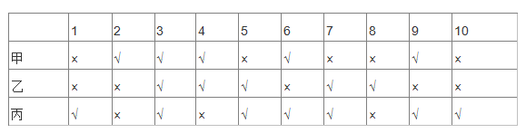

考试成绩公布后，三个人都是70分，由此可以推出，1－10题的正确答案是：

A. ×、×、√、√、√、×、√、×、√、×

B. ×、×、√、√、√、√、√、×、√、×

C. ×、×、√、√、√、√、√、√、√、×

D. ×、×、√、×、√、√、√、√、√、×

第 90 题 · 答案与解析

**参考答案（粉笔题库参考内容）**

B

**解析**

第一步：两两比较进行分析。

先看甲和乙的答案。甲和乙的答案不同的有2、5、6、7、8、9 这六道题目，根据已知条件，他们都得了70 分，就是说他们都做错了三道，所以甲错的三道题目肯定在这六道题目当中，乙做错的三道题目也在这六道题目当中。因为如果在这六道题目当中，甲做错的题目小于三道，则乙做错的题目就大于三道了，所以剩下的四道题1、3、4、10 是甲和乙都做对的题目。

再看乙和丙的答案。乙和丙的答案不同的题目有1、4、6、8、9、10 这六道题目，同理乙和丙的错题也都在这六道题目当中，那么乙和丙都做对的题是2、3、5、7 这四道题目。因此1、2、3、4、5、7、10 这几道的答案就确定下来了。现在只剩下6、8、9 三道题。

第二步：根据第一步中结论和题干信息继续分析。

根据甲的答案，现在知道甲错的题有2、5、7 这三道题，所以6、8、9 这三道是甲做对的题。

综上，这十道题答案为：×、×、√、√、√、√、√、×、√、×。

故正确答案为B。

**考点**：组合排列-单题-其他

**来源**：2008年国家公务员录用考试《行测》题第90题

### 第 91 题

有专家建议，为盘活土地资源，有效保护耕地，让农民像城市人一样住进楼房是个不错的选择，这样就可以将农民现有的住房“叠起来”，从而节省大量土地资源。

以下哪项如果为真，最能削弱上述专家的观点：

A. 由于农民的生活习惯，他们大多表示不愿意住楼房

B. 建楼房消耗的资源与建现有的农民住房消耗的资源差不多

C. 有农民表示，即使搬进楼房居住，他们也不会将现有的房子拆掉

D. 农民住进楼房后远离田地，影响农业生产，会从效益上降低土地资源的利用

第 91 题 · 答案与解析

**参考答案（粉笔题库参考内容）**

D

**解析**

第一步：找到论点和论据。

论点：为盘活土地资源，有效保护耕地，让农民像城市人一样住进楼房是个不错的选择，这样就可以将农民现有的住房“叠起来”，从而节省大量土地资源。

第二步：逐一分析选项。

A项：农民大多不愿意住楼房，是农民自己的生活习惯问题，与农民住楼房是否能够节省土地资源无关，属无关选项，排除；

B项：两种情况消耗的资源差不多，与农民住楼房是否能够节省土地资源无关，属无关选项，排除；

C项：搬进楼房居住的农民也不会将现有的房子拆掉，说明农民住楼房并不会节省土地资源，可以削弱，保留；

D项：影响农业生产，进而降低土地资源的利用，说明无法盘活土地资源，可以削弱，保留。

比较CD两项，C选项只是有农民表示，而D是整体性的客观陈述，力度D选项强于C选项。

故正确答案为D。

**考点**：削弱论点

**来源**：2008年国家公务员录用考试《行测》题第91题

### 第 92 题

我国酸雨主要出现于长江以南，北方只有零星分布。这是因为北方常有沙尘天气，来自沙漠的沙尘和当地土壤都偏碱性。

由此可以推出：

A. 长江以北地区的酸性污染物排放较少

B. 长江以南地区的土壤偏碱性的较少

C. 沙尘天气可有效降低酸雨出现的几率

D. 有酸雨的地区出现沙尘天气的几率较小

第 92 题 · 答案与解析

**参考答案（粉笔题库参考内容）**

C

**解析**

第一步：抓住每句话中的对象及其关系。

第一句说明酸雨南多北少，第二句说明北方有偏碱性的沙尘和当地土壤，两句间是因果关系。

第二步：判断整体关系。

北方的沙尘和当地土壤偏碱性使得酸雨南多北少。

第三步：逐一判断选项的作用。

A项中说污染物排放，题干未提及，因此无法推出；

B项中说南方土壤偏碱性较少，因为酸雨少的原因有两方面，沙尘和当地土壤偏碱性，因此不能因为南方多酸雨就认为土壤偏碱性较少，有可能沙尘少是主要原因，因此无法推出；

C项正是对题干的抽象概括，说明沙尘天气可以降低酸雨出现的概率；

D项中说多酸雨地区少沙尘天气，正好颠倒了题干中论证的因果关系，错误。

故正确答案为C。

**考点**：日常结论

**来源**：2008年国家公务员录用考试《行测》题第92题

### 第 93 题

有专家认为，家庭装修中使用符合环保标准的建材只能保证有害物质的含量符合相关行业要求，并不代表完全不含有害物质。因此在装修中大量甚至过度使用建材，仍会导致有害物质累积超标。

由此可以推出：

A. 建材行业应该进一步严格环保标准

B. 建材行业应努力降低产品的有害物质含量

C. 挑选好的建材可以有效避免室内空气质量不合格

D. 适量使用建材才能减少室内空气中的有害物质

第 93 题 · 答案与解析

**参考答案（粉笔题库参考内容）**

D

**解析**

第一步：抓住每句话中的对象。

第一句说明符合环保标准的建材同样含有害物质，第二句说明大量甚至过度使用建材会导致有害物质累积超标。

第二步：判断整体关系。

大量甚至过度使用符合环保标准的建材会导致有害物质累积超标。

第三步：逐一判断选项的作用。

A项中“进一步严格环保标准”无法得出，题干中讲导致有害物质累积超标的主要原因是大量甚至过度使用建材，而不是环保标准；

B项同样忽视了导致有害物质累积超标主要原因是大量甚至过度使用建材，因此无法推出；

C项中也没能抓住问题主要原因是大量甚至过度使用建材，因此也无法推出；

D项中抓住了问题的主要原因，适量使用建材控制了数量，完全符合题干所要表达的。

故正确答案为D。

**考点**：日常结论

**来源**：2008年国家公务员录用考试《行测》题第93题

### 第 94 题

为适应城市规划调整及自身发展的需要，某商业银行计划对全市营业网点进行调整，拟减员3%，并撤销三个位于老城区的营业网点，这三个营业网点的人数正好占该商业银行总人数的3%。计划实施后，上述三个营业网点被撤销，整个商业银行实际减员1.5%。此过程中，该银行内部人员有所调整，但整个银行只有减员，没有增员。

据此可知，下列陈述正确的有（　　）。

Ⅰ、有的营业网点调入了新成员

Ⅱ、没有一个营业网点调入新成员的总数超出该银行原来总人数的1.5%

Ⅲ、被撤销营业网点中的留任人员不超过该银行原来总人数的1.5%

A. 只有Ⅰ

B. 只有Ⅰ和Ⅱ

C. 只有Ⅱ和Ⅲ

D. Ⅰ、Ⅱ和Ⅲ

第 94 题 · 答案与解析

**参考答案（粉笔题库参考内容）**

A

**解析**

第一步：抓住每句话中的对象。

第一句计划减员3%，撤销的三个营业网点人数正好占商业银行总人数的3%；第二句三个营业网点被撤销，整个商业银行实际减员1.5%；第三句银行内部只有减员，没有增员。

第二步：逐一分析并判断选项的正确。

如果有的营业网点没有调入新成员，那么实际减员一定是3% 。而实际减员1.5%，所以有的营业网点一定加入新成员，因此Ⅰ正确；

三个营业网点的人数可以一起全部放到其他的一个营业网点，那么那个营业网点就增加3%，但其他营业网点又裁员1.5%，所以可能一个营业网点增加1.5%以上，因此Ⅱ错误；

被撤销的营业网点的人员可能全部留下来了，而从其他营业网点减员了，因此Ⅲ错误。

综上，只有Ⅰ正确。

故正确答案为A。

**考点**：日常结论

**来源**：2008年国家公务员录用考试《行测》题第94题

### 第 95 题

最近一项调查显示，近年来在某市高收入人群中，本地人占70%以上，这充分说明外地人在该市获得高收入相当困难。

以下哪项如果为真，才能支持上述结论：

A. 外地人占该市总人口的比例高达40%

B. 外地人占该市总人口的比例不足30%

C. 该市中低收入人群中，外地人占40%

D. 该市中低收入人群中，本地人占不足30%

第 95 题 · 答案与解析

**参考答案（粉笔题库参考内容）**

A

**解析**

第一步：找到论点和论据。

本题论点是外地人在该市获得高收入相当困难，论据是近年来在某市高收入人群中，本地人占70%以上。

第二步：判断加强方式。

本题论点与论据间不存在明显因果关系，所以需加强论证，高收入人群本地人口所占比例大于全市人口本地人口所占比例。

第三步：逐一判断选项的作用。

A项中使得论据和论点间搭桥，只有高收入人口中70％以上是本地人，同时外地人在城市总人口中占有较大比重，才能更好说明外地人获得高收入困难。否则如果外地人很少的话，高收入中有超过70％的是本地人也属于正常现象，也就无从谈起外地人获得高收入困难；

B项中与A项意思相反，不是加强反而是削弱；

C项和D项中谈到了中低收入人口比重，与题干无关，属于无关选项。

故正确答案为A。

**考点**：搭桥

**来源**：2008年国家公务员录用考试《行测》题第95题

### 第 96 题

下列关于法律体系的表述中，不正确的是：

A. 法律体系由法律部门组成

B. 我国社会主义法律体系尚不完备

C. 中华法系也即我国的社会主义法律体系

D. 法律体系是一国法律有机联系的统一体

第 96 题 · 答案与解析

**参考答案（粉笔题库参考内容）**

C

**解析**

“中华法系”指中国的封建法律和亚洲一些仿效这种法律的国家法律的总称。中华法系是世界上五大法系之一，即：中华法系、大陆法系、英美法系、伊斯兰法系、印度法系，其中印度法系和中华法系已经解体。

本题为选非题，故正确答案为C。

**考点**：法理学

**来源**：2008年国家公务员录用考试《行测》题第96题

### 第 97 题

我国有权制定行政法规的主体，限于：

A. 国务院

B. 国务院和省级人民政府

C. 国务院及国务院各部、各委员会

D. 国务院和省级人民政府及较大市的人民政府

第 97 题 · 答案与解析

**参考答案（粉笔题库参考内容）**

A

**解析**

《中华人民共和国宪法》第八十九条第一款明确规定：作为最高国家行政机关，国务院可以“根据宪法和法律，规定行政措施，制定行政法规，发布决定和命令。”《立法法》第五十六条第一款规定：“国务院根据宪法和法律，制定行政法规。”《宪法》第90条规定：“各部、各委员会根据法律和国务院的行政法规、决定、命令，在本部门的权限内，发布命令、指示和规章。”由此可见，国务院有行政法规制定权，其下属各部委有发布规章的权力。

故正确答案为A。

**本题相关知识点：**

行政法规调整的对象一般是行政管理领域带有普遍性、全局性、原则性以及意义重大的问题。行政规章的调整对象则限定在行政管理领域中某些特殊的、局部的、具体的问题。

行政法规的制定主体是我国的中央政府，而行政规章的制定主体或是中央政府的组成部分，或是地方政府。行政法规的效力高于行政规章。行政法规可以直接依据宪法、全国人大及其常委会制定的法律（尤其是其中的行政法），对一般公民法人或其他组织在行政管理领域的权利义务作出具体规定；对于各种行政违法行为的处罚，可以在符合宪法、法律的前提下，作出带有创制性的规定；并且可以在不违背宪法、法律的情况下，对某些尚未受到法律调整的社会生活作出行政法规的调整。

**考点**：宪法

**来源**：2008年国家公务员录用考试《行测》题第97题

### 第 98 题

某省人民政府的规章与国务院某一部门的规章不一致，按照法律规定，下列做法正确的是：

A. 由国务院裁决

B. 由最高人民法院裁决

C. 由国务院法制办公室裁决

D. 由全国人民代表大会常务委员会对违法的规章予以撤销

第 98 题 · 答案与解析

**参考答案（粉笔题库参考内容）**

A

**解析**

根据《立法法》第八十六条：地方性法规、规章之间不一致时，由有关机关依照下列规定的权限作出裁决：（一）同一机关制定的新的一般规定与旧的特别规定不一致时，由制定机关裁决；（二）地方性法规与部门规章之间对同一事项的规定不一致，不能确定如何适用时，由国务院提出意见，国务院认为应当适用地方性法规的，应当决定在该地方适用地方性法规的规定；认为应当适用部门规章的，应当提请全国人民代表大会常务委员会裁决；（三）部门规章之间、部门规章与地方政府规章之间对同一事项的规定不一致时，由国务院裁决。根据授权制定的法规与法律规定不一致，不能确定如何适用时，由全国人民代表大会常务委员会裁决。

本题属于部门规章之间、部门规章与地方政府规章之间对同一事项的规定不一致的情形，应由国务院裁决。

故正确答案为A。

**考点**：宪法

**来源**：2008年国家公务员录用考试《行测》题第98题

### 第 99 题

我国对法律溯及力问题，实行的原则是：

A. 法在任何情况下均溯及既往

B. 法在任何情况下均不溯及既往

C. 法在一般情况下均溯及既往，但为了更好地保护公民、法人或者其他组织的权利和利益而作的特别规定除外

D. 法在一般情况下不溯及既往，但为了更好地保护公民、法人或者其他组织的权利和利益而作的特别规定除外

第 99 题 · 答案与解析

**参考答案（粉笔题库参考内容）**

D

**解析**

根据《立法法》规定，法律、行政法规、地方性法规、自治条例和单行条例、规章不溯及既往，但为了更好地保护公民、法人与其他组织的权利和利益而作的特别规定除外。

故正确答案为D。

**本题相关知识点：**法律的溯及力，也称法律溯及既往的效力，是指法律对其生效以前的事件和行为是否适用。如果适用就具有溯及力，如果不适用，该法就不具有溯及力。就现代法而言，法律一般只能适用于生效后发生的事件和行为，不适用于生效前的事件和行为，即采取法律不溯及既往的原则。《立法法》第八十四条规定了不溯及既往内容：法律、行政法规、地方性法规、自治条例和单行条例、规章不溯及既往，但为了更好地保护公民、法人和其他组织的权利和利益而作的特别规定除外。

**考点**：法理学

**来源**：2008年国家公务员录用考试《行测》题第99题

### 第 100 题

根据我国宪法和有关法律的规定，下列构成违宪或违法的行为是：

A. 国家主席代表中华人民共和国接受外国使节

B. 某自治州人民代表大会常务委员会制定本自治州的《自治条例》

C. 国务院某部发布《关于认真学习贯彻&lt;行政机关公务员处分条例>的通知》

D. 国务院根据全国人民代表大会常务委员会的授权决定，对储蓄存款利息所得减征个人所得税

第 100 题 · 答案与解析

**参考答案（粉笔题库参考内容）**

B

**解析**

A项错误，符合宪法和有关法律的规定，属于合法行为；

B项正确，自治州人民代表大会常务委员会没有制定自治条例的权力，属于违法行为；

C项错误，符合宪法和有关法律的规定，属于合法行为；

D项错误，符合宪法和有关法律的规定，属于合法行为。

故正确答案为B。

**本题相关知识点：**

违宪是宪法学中重要的概念，是指违反宪法的非法行为。违宪行为是最高的违法行为。但是违宪的内涵相当丰富，主要包括以下几个方面：第一、违宪的主体是国家机关及其工作人员，因为国家机关及其工作人员是宪法上的义务主体。第二、违宪违反的是宪法、宪法性法律甚至宪法惯例。第三、违宪同样会产生法律责任，一般通过违宪审查机制来实现。

违法，是指国家机关及其工作人员、企业事业单位、公民和社会团体，违反法律（包括其他法规）的规定，从而给社会造成某种危害的有过错的行为。

**考点**：宪法

**来源**：2008年国家公务员录用考试《行测》题第100题

### 第 101 题

下列人员中，通常由县级以上地方各级人民代表大会选举产生的是：

A. 局长、厅长、委员会主任

B. 副局长、副厅长、委员会副主任

C. 人民法院副院长、人民检察院副检察长

D. 副省长、副市长、副州长、副县长、副区长

第 101 题 · 答案与解析

**参考答案（粉笔题库参考内容）**

D

**解析**

本题考查我国地方各级人民代表大会的相关职能与职责。

根据我国《地方各级人民代表大会和地方各级人民政府组织法》第8条，应由县级以上的地方各级人民代表大会选举产生的人员有：本级人民代表大会常务委员会的组成人员；省长、副省长，自治区主席、副主席，市长、副市长，州长、副州长，县长、副县长，区长、副区长；本级人民法院院长和人民检察院检察长；上一级人民代表大会代表。

A项，根据我国《地方各级人民代表大会和地方各级人民政府组织法》第44条第10项规定，局长、厅长、委员会主任由本级人民代表大会常务委员会任免。该项不符合题意，应排除。

B项，根据我国《地方各级人民代表大会和地方各级人民政府组织法》第65条规定，各厅、局、委员会、科分别设厅长、局长、主任、科长，在必要的时候可以设副职。副局长、副厅长、委员会副主任由本部门党组（党委）和省委组织部考核提出意见，由省政府党组提名，报请省委常委会研究决定，再由省政府发文任命。该项与题意不符，应排除。

C项，根据我国《地方各级人民代表大会和地方各级人民政府组织法》第44条第11项规定，人民法院副院长、人民检察院副检察长由本级人民代表大会常务委员会任免。该项与题意不符，应排除。

D项，根据我国《地方各级人民代表大会和地方各级人民政府组织法》第8条规定，副省长、副市长、副州长、副县长、副区长应在由县级以上的地方各级人民代表大会选举产生人员之列。该项符合题意，应选。

故正确答案为D。

**考点**：宪法

**来源**：2008年国家公务员录用考试《行测》题第101题

### 第 102 题

下列关于土地所有权的说法中正确的是：

A. 土地全部属于国家所有

B. 城市土地属于国家所有

C. 土地全部属于集体所有

D. 农村和城市郊区的土地，除由法律规定属于集体所有的以外，属于国家所有

第 102 题 · 答案与解析

**参考答案（粉笔题库参考内容）**

B

**解析**

根据法律规定，城市的土地属于国家所有。农村和城市郊区的土地，除由法律规定属于国家所有的以外，属于集体所有；宅基地和自留地、自留山，也属于集体所有。所以土地并不是国家专属所有。矿藏和水流（包括海洋）是专属于国家所有的。

故正确答案为B。

本题相关知识点：

关于自然资源的归属，《中华人民共和国宪法》第九条规定：矿藏、水流、森林、山岭、草原、荒地、滩涂等自然资源，都属于国家所有，即全民所有；由法律规定属于集体所有的森林和山岭、草原、荒地、滩涂除外。国家保障自然资源的合理利用，保护珍贵的动物和植物。禁止任何组织或者个人用任何手段侵占或者破坏自然资源。

关于土地所有权，《中华人民共和国宪法》第十条规定：城市的土地属于国家所有。农村和城市郊区的土地，除由法律规定属于国家所有的以外，属于集体所有；宅基地和自留地、自留山，也属于集体所有。国家为了公共利益的需要，可以依照法律规定对土地实行征收或者征用并给予补偿。 任何组织或者个人不得侵占、买卖或者以其他形式非法转让土地。土地的使用权可以依照法律的规定转让。一切使用土地的组织和个人必须合理地利用土地。

**考点**：宪法

**来源**：2008年国家公务员录用考试《行测》题第102题

### 第 103 题

“行政机关实施行政管理，应当依照法律、法规、规章的规定进行；没有法律、法规、规章的规定，行政机关不得作出影响公民、法人和其他组织合法权益或者增加公民，法人和其他组织义务的决定”。这主要体现了依法行政中的哪一项要求：

A. 合法行政

B. 合理行政

C. 程序正当

D. 诚实守信

第 103 题 · 答案与解析

**参考答案（粉笔题库参考内容）**

A

**解析**

国务院印发的《全面推进依法行政实施纲要》关于合法行政的条款：行政机关实施行政管理，应当依照法律、法规、规章的规定进行；没有法律、法规、规章的规定，行政机关不得作出影响公民、法人和其他组织合法权益或者增加公民、法人和其他组织义务的决定。

故正确答案为A。

**考点**：行政法

**来源**：2008年国家公务员录用考试《行测》题第103题

### 第 104 题

小王参加公务员录用考试被某机关录用，在试用期内因违反公务员纪律被取消录用，小王不服，他可以采取的正确做法是：

A. 向人民政府申请行政复议

B. 向人民法院提起行政诉讼

C. 向公务员主管部门提出申诉

D. 向人事争议仲裁委员会申请仲裁

第 104 题 · 答案与解析

**参考答案（粉笔题库参考内容）**

C

**解析**

新《公务员法》 第九十五条第一款规定：“公务员对涉及本人的下列人事处理不服的，可以自知道该人事处理之日起三十日内向原处理机关申请复核；对复核结果不服的，可以自接到复核决定之日起十五日内，按照规定向同级公务员主管部门或者作出该人事处理的机关的上一级机关提出申诉；也可以不经复核，自知道该人事处理之日起三十日内直接提出申诉：（一）处分；（二）辞退或者取消录用；（三）降职；（四）定期考核定为不称职；（五）免职；（六）申请辞职、提前退休未予批准；（七）不按照规定确定或者扣减工资、福利、保险待遇；（八）法律、法规规定可以申诉的其他情形。”因此，ABD项不符合题意。

故正确答案为C。

**考点**：行政法

**来源**：2008年国家公务员录用考试《行测》题第104题

### 第 105 题

下列哪一情形，不在人民法院受理的行政诉讼案件的范围内：

A. 税务机关对纳税人采取的强制执行措施

B. 工商行政管理机关拒绝颁发企业法人营业执照

C. 公安机关对现行犯或者重大嫌疑分子的刑事拘留

D. 中国证券监督管理委员会对上市公司的罚款决定

第 105 题 · 答案与解析

**参考答案（粉笔题库参考内容）**

C

**解析**

最高人民法院关于执行《中华人民共和国行政诉讼法》若干问题的解释第一条：公民、法人或者其他组织对下列行为不服提起诉讼的，不属于人民法院行政诉讼的受案范围，其中即包括“公安、国家安全等机关依照刑事诉讼法的明确授权实施的行为”，公安机关对现行犯或重大嫌疑分子刑事拘留即属于这一行为。

故正确答案为C。

**考点**：行政法

**来源**：2008年国家公务员录用考试《行测》题第105题

### 第 106 题

根据法律规定，以下属于行政裁决的是：

A. 深圳仲裁委员会对民事纠纷的仲裁

B. 山西省人民政府对污染环境企业的限期治理决定

C. 某人事争议仲裁委员会对履行聘任合同争议的裁决

D. 国家知识产权局专利复审委员会根据利害关系人申请，宣告某专利权无效

第 106 题 · 答案与解析

**参考答案（粉笔题库参考内容）**

D

**解析**

行政裁决是指行政机关或法定授权的组织，依照法律授权，对当事人之间发生的、与行政管理活动密切相关的、与合同无关的民事纠纷进行审查，并作出裁决的具体行政行为。

A项错误，属于民事范畴；

B项错误，属于行政处罚；

C项错误，属于民事范畴；

D项正确，属于行政裁决。

故正确答案为D。

**本题相关知识点**

仲裁是对平等主体的公民、法人或其他组织之间发生的合同纠纷和其他财产权益纠纷作出裁决；行政裁决则是由国家行政管理机关依其行政职权，对领导与被领导、管理与被管理之间的隶属关系进行的裁决。

**考点**：行政法

**来源**：2008年国家公务员录用考试《行测》题第106题

### 第 107 题

按照《律师法》规定，申请领取律师执业证书，司法行政机关应当自收到申请之日起30日内作出是否颁发的决定，而按照《行政许可法》的规定，行政机关一般应当自受理行政许可申请之日起20日内作出行政许可决定。2004年7月初，张某向省司法厅申请领取律师执业证书，司法厅的正确做法是：

A. 依据《律师法》，在30日内作出是否颁发的决定

B. 依据《行政许可法》，在20日内作出是否颁发的决定

C. 因法律关于期限的规定不一致，报请全国人大常委会裁决后再作决定

D. 可以选择依据《律师法》或者《行政许可法》关于期限的规定作出决定

第 107 题 · 答案与解析

**参考答案（粉笔题库参考内容）**

A

**解析**

《行政许可法》第42条规定：“除可以当场作出行政许可决定的外，行政机关应当自受理行政许可申请之日起20日内作出行政许可决定。20日内不能作出决定的，经本行政机关负责人批准，可以延长10日，并应当将延长期限的理由告知申请人。但是，法律、法规另有规定的，依照其规定。”

本题“申请领取律师执业证书”属于《律师法》另有规定的情形，应当依据《律师法》，在30日内作出是否颁发律师执业证书的决定。

故正确答案为A。

**考点**：行政法

**来源**：2008年国家公务员录用考试《行测》题第107题

### 第 108 题

关于主动公开的政府信息，行政机关的下列哪一做法符合《政府信息公开条例》的规定：

A. 甲县规定，乡、镇政府制作的政府信息，统一由县政府负责公开

B. 乙市一项行政事业性收费的标准发生变动，在标准变动以后第30日予以公开

C. 丙区规定，行政机关应当编制、公布政府信息公开指南或政府信息公开目录，并及时更新

D. 丁市政府在市图书馆设置政府信息查阅场所，并配备相应的设备，为公民、法人或者其他组织获取政府信息提供便利

第 108 题 · 答案与解析

**参考答案（粉笔题库参考内容）**

D

**解析**

A项错误，根据《政府信息公开条例》第十条第一款规定：“行政机关制作的政府信息，由制作该政府信息的行政机关负责公开。行政机关从公民、法人和其他组织获取的政府信息，由保存该政府信息的行政机关负责公开；行政机关获取的其他行政机关的政府信息，由制作或者最初获取该政府信息的行政机关负责公开。法律、法规对政府信息公开的权限另有规定的，从其规定。”题中，乡、镇政府制作的政府信息应由乡、镇政府负责公开。

B项错误，根据《政府信息公开条例》第二十六条规定：“属于主动公开范围的政府信息，应当自该政府信息形成或者变更之日起20个工作日内及时公开。法律、法规对政府信息公开的期限另有规定的，从其规定。”题中，乙市在标准变动后第30日予以公开违反了上述规定的时间限制。

C项错误，根据《政府信息公开条例》第十二条第一款规定：“行政机关编制、公布的政府信息公开指南和政府信息公开目录应当及时更新。“政府信息公开指南”和“政府信息公开目录”都应及时更新，二者并不是择一关系。题中，丙区规定政府信息公开指南或政府信息公开目录都应及时更新，与上述规定不一致。

D项正确，根据《政府信息公开条例》第二十五条第一款规定：“各级人民政府应当在国家档案馆、公共图书馆、政务服务场所设置政府信息查阅场所，并配备相应的设施、设备，为公民、法人和其他组织获取政府信息提供便利。”

故正确答案为D。

**考点**：行政法

**来源**：2008年国家公务员录用考试《行测》题第108题

### 第 109 题

卫生部和国家工商行政管理总局对某国有企业共同作出一项行政处罚，该企业不服欲申请行政复议，应当如何处理：

A. 该企业应当向国务院申请行政复议，由国务院作出行政复议决定

B. 该企业可以同时向两个机构申请行政复议，由国务院作出行政复议决定

C. 该企业可以同时向这两个机构申请行政复议，由作出具体行政行为的国务院机构共同作出行政复议决定

D. 该企业可以向其中任何一个机构申请行政复议，由作出具体行政行为的国务院机构共同作出行政复议决定

第 109 题 · 答案与解析

**参考答案（粉笔题库参考内容）**

D

**解析**

《行政复议法实施条例》第二十三条规定：“申请人对两个以上国务院部门共同作出的具体行政行为不服的，依照行政复议法第二十五条的规定，可以向其中任何一个国务院部门提出行政复议申请，由作出具体行政行为的国务院部门共同作出行政复议决定。”

故正确答案为D。

本题相关知识点：行政复议，是指公民、法人或者其他组织不服行政主体作出的行政行为，认为行政主体的行政行为侵犯了其合法权益，依法向法定的行政复议机关提出复议申请，行政复议机关依法对该具体行政行为进行合法性、合理性审查，并作出行政复议决定的行政行为。是公民、法人或其他组织通过行政救济途径解决行政争议的一种方法。

**考点**：行政法

**来源**：2008年国家公务员录用考试《行测》题第109题

### 第 110 题

对于完善依法行政的财政保障机制，下列做法正确的是：

A. 行政经费统一由财政纳入预算予以保障，并实行国库集中支付

B. 完善分散灵活的公共财政体制，逐步实现规范的部门预算，统筹安排和规范使用财政资金，提高财政资金使用效益

C. 清理和规范行政事业性收费等政府非税收入；统一行政机关工作人员工资和津补贴制度，迅速解决同一地区不同行政机关相同职级工作人员收入差距较大的矛盾

D. 行政机关不得设立任何形式的“小金库”；严格执行“收支两条线”制度。行政事业性收费和罚没收入应当全部或部分上缴财政，允许一定条件下返还

第 110 题 · 答案与解析

**参考答案（粉笔题库参考内容）**

A

**解析**

《全面推进依法行政实施纲要》中“完善依法行政的财政保障机制”的相关内容：完善集中统一的公共财政体制，逐步实现规范的部门预算，统筹安排和规范使用财政资金，提高财政资金使用效益；完善财政转移支付制度，加大转移支付力度，缓解基层财政困难；清理和规范行政事业性收费等政府非税收入；完善和规范行政机关工作人员工资和津补贴制度，逐步解决同一地区不同行政机关相同职级工作人员收入差距较大的矛盾；行政机关不得设立任何形式的“小金库”；严格执行“收支两条线”制度，行政事业性收费和罚没收入必须全部上缴财政，严禁以各种形式返还；行政经费统一由财政纳入预算予以保障，并实行国库集中支付。

所以，B、C、D项都是错误的。

故正确答案为A。

**考点**：行政法

**来源**：2008年国家公务员录用考试《行测》题第110题

### 第 111 题

王某与他人合作投资成立了一家有限责任公司，王某任法定代表人。后来公司倒闭，公司资产不足以偿还债务。公司的债权人要求王某偿还不足部分。下列说法正确的是：

A. 王某投资成立有限责任公司，王某无需承担公司债务

B. 王某是公司的投资人，公司的债权人可以要求王某偿还

C. 王某是公司的法定代表人，公司的债权人可以要求王某偿还

D. 王某与他人合作投资，王某应当按照出资比例对公司的债务承担偿还责任

第 111 题 · 答案与解析

**参考答案（粉笔题库参考内容）**

A

**解析**

我国《公司法》第三条规定：公司是企业法人，有独立的法人财产，享有法人财产权。公司以其全部财产对公司的债务承担责任。有限责任公司的股东以其认缴的出资额为限对公司承担责任；股份有限公司的股东以其认购的股份为限对公司承担责任。因此，A项正确。

故正确答案为A。

**考点**：劳动法和经济法

**来源**：2008年国家公务员录用考试《行测》题第111题

### 第 112 题

根据《国家赔偿法》的规定，国家赔偿的主要方式是（    ）。

A. 支付赔偿金

B. 返还财产

C. 消除影响

D. 恢复原状

第 112 题 · 答案与解析

**参考答案（粉笔题库参考内容）**

A

**解析**

《国家赔偿法》第二十五条规定，“国家赔偿以支付赔偿金为主要方式。能够返还财产或者恢复原状的，予以返还财产或者恢复原状。”

故正确答案为A。

**考点**：行政法

**来源**：2008年国家公务员录用考试《行测》题第112题

### 第 113 题

张某11周岁，小学五年级学生，经常在其学校门口的一家小卖部买零食和一些学习用品，部分赊账，年终时共欠小卖部340元。小卖部老板拿着账单要求张某父亲付款，遭到张某父亲拒绝。

下列说法正确的是：

A. 张某购买零食和学习用品的行为是无效的民事行为，其父亲作为监护人，无需赔偿

B. 张某购买零食和学习用品的行为是合法有效的民事行为，其父亲作为监护人，应当付款

C. 张某购买零食和学习用品的行为是无效的民事行为，其父亲作为监护人，应当赔偿

D. 张某购买零食和学习用品的行为是合法有效的民事行为，应当由其自己付款，不应当由其父亲付款。

第 113 题 · 答案与解析

**参考答案（粉笔题库参考内容）**

B

**解析**

我国《中华人民共和国民法典》第十九条规定：“八周岁以上的未成年人为限制民事行为能力人，实施民事法律行为由其法定代理人代理或者经其法定代理人同意、追认，但是可以独立实施纯获利益的民事法律行为或者与其年龄、智力相适应的民事法律行为”。11岁的张某是限制民事行为能力人，他购买零食和学习用品的行为与其年龄、智力相适应，因此合法有效。

我国《中华人民共和国民法典》第二十七条规定：“父母是未成年子女的监护人”。张某父亲作为监护人，应当付款。

故正确答案为B。

**考点**：民法典

**来源**：2008年国家公务员录用考试《行测》题第113题

### 第 114 题

方某在晚上牵狗散步，狗突然挣脱绳索，奔向童某（3岁），并咬伤童某。当时童某父亲正在用手机给朋友打电话。关于本案，下列说法正确的是：

A. 方某应当负全部责任

B. 方某和童某父亲都要承担责任

C. 意外事件，方某不需要承担责任

D. 童某父亲没有看管好自己的孩子，应当负全部责任

第 114 题 · 答案与解析

**参考答案（粉笔题库参考内容）**

A

**解析**

《侵权责任法》第七十八条规定：“饲养的动物造成他人损害的，动物饲养人或者管理人应当承担侵权责任，但能够证明损害是因被侵权人故意或者重大过失造成的，可以不承担或者减轻责任”，这属于一起典型的动物伤人的特殊侵权案例。特殊侵权实行的是无过错原则，即只要侵权人的行为客观上造成了他人的人身损害，侵权人就要承担损害赔偿责任，至于侵权人是否存在过错不在考虑之列。根据该条之规定，侵权人的唯一免责事由只能是其能证明是因为受害人故意或第三人故意造成损害后果的才予以免责，本案显然不符合免责条件。故方某应负全责，而童某的父亲在本案中无须承担监护不力的后果。

故正确答案为A。

**考点**：民法典

**来源**：2008年国家公务员录用考试《行测》题第114题

### 第 115 题

陈某与陆某是邻居。陈某家建房挖地基，导致陆某房屋墙面出现裂缝。陆某遂找陈某要求修缮，遭到陈某拒绝。关于本案，下列说法正确的是：

A. 陈某不可以挖地建房，因为挖地建房会损坏邻居陆某的房屋

B. 陆某家墙面出现裂缝，属于意外事件，陈某不需要承担责任

C. 陈某可以挖地建房，但对邻居陆某房屋造成的损害应当给予赔偿

D. 陈某在自家的地基上建房，造成陆某家的墙面出现裂缝，不需要承担责任

第 115 题 · 答案与解析

**参考答案（粉笔题库参考内容）**

C

**解析**

《物权法》第九十一条：不动产权利人挖掘土地、建造建筑物、铺设管线以及安装设备等，不得危及相邻不动产的安全。第九十二条：不动产权利人因用水、排水、通行、铺设管线等利用相邻不动产的，应当尽量避免对相邻的不动产权利人造成损害；造成损害的，应当给予赔偿。

故正确答案为C。

**考点**：民法典

**来源**：2008年国家公务员录用考试《行测》题第115题

### 第 116 题

我国《合同法》对买卖合同中标的物风险的负担作出了较为详细的规定；下列有关风险负担的表述正确的是：

A. 特定物的风险在合同成立后即由买受人承担

B. 需要运输的标的物，自交付给买受人后风险转移给买受人

C. 在途货物的风险除另有约定外自合同成立后即转移给买受人

D. 在由于标的存在质量瑕疵，买受人拒绝受领的情况下，风险转移给买受人

第 116 题 · 答案与解析

**参考答案（粉笔题库参考内容）**

C

**解析**

《合同法》第一百四十四条：出卖人出卖交由承运人运输的在途标的物，除当事人另有约定的以外，毁损、灭失的风险自合同成立时起由买受人承担。

故正确答案为C。

**考点**：民法典

**来源**：2008年国家公务员录用考试《行测》题第116题

### 第 117 题

关于国有资产管理，下列说法不正确的是：

A. 国家举办的事业单位对其直接支配的动产享有所有权

B. 国家出资的企业，由国务院、地方人民政府依照法律，行政法规规定分别代表国家履行出资人职责，享有出资人权益

C. 履行国有财产管理、监督职责的机构及其工作人员，应当促进国有财产保值增值

D. 违反国有财产管理规定，在企业合并过程中，擅自对外提供担保造成国有财产损失的，应当依法承担法律责任

第 117 题 · 答案与解析

**参考答案（粉笔题库参考内容）**

A

**解析**

《中华人民共和国民法典》第二百四十六条：法律规定属于国家所有的财产，属于国家所有即全民所有。国有财产由国务院代表国家行使所有权。法律另有规定的，依照其规定。《中华人民共和国民法典》第二百五十六条：国家举办的事业单位对其直接支配的不动产和动产，享有占有、使用以及依照法律和国务院的有关规定收益、处分的权利。由法律条文可见，国家举办的事业单位不是其直接支配的不动产或动产的所有人，但是可以根据法律和国务院的有关规定，获得国家的授权，代表国家行使包括占有、使用、收益及处分在内的物权。

故正确答案为A。

**考点**：民法典

**来源**：2008年国家公务员录用考试《行测》题第117题

### 第 118 题

甲欲杀死乙，在乙饭碗里投放毒药，不料朋友丙分食了乙的饭菜，甲为了杀死乙，没有阻止丙，结果导致乙和丙均中毒死亡。甲对丙死亡所持的心理态度是：

A. 过于自信的过失

B. 疏忽大意的过失

C. 间接故意

D. 直接故意

第 118 题 · 答案与解析

**参考答案（粉笔题库参考内容）**

C

**解析**

本题考查法律常识。

间接故意，行为人明知自己的行为可能发生危害社会的结果，并且放任这种结果发生的心理态度。放任，是指行为人对于危害结果的发生，虽然没有希望、积极地追求，但也没有阻止、反对，而是放任自流，听之任之，任凭、同意它的发生。

显然对于丙的死亡，甲并不是持积极追求的心态，故属于间接故意。

故正确答案为C。

**考点**：刑法

**来源**：2008年国家公务员录用考试《行测》题第118题

### 第 119 题

王某持匕首抢劫张某，在争斗中王某头部撞击墙角昏迷倒地，匕首掉在地上。张某见状，捡起匕首往王某心脏部位猛刺数下，导致王某死亡。对于张某用匕首刺死王某的行为，下列说法正确的是：

A. 属于正当防卫，不负刑事责任

B. 属于意外事件，不负刑事责任

C. 属于防卫过当，应当负刑事责任

D. 属于故意杀人，应当负刑事责任

第 119 题 · 答案与解析

**参考答案（粉笔题库参考内容）**

D

**解析**

《刑法》第20条规定：“为了使国家、公共利益、本人或者他人的人身、财产和其他权利免受正在进行的不法侵害，而采取的制止不法侵害的行为，对不法侵害人造成损害的，属于正当防卫，不负刑事责任。”本案中王某晕倒，其不法侵害已经停止，故张某行为不属于正当防卫，更不属于防卫过当。

故意杀人罪指故意非法地剥夺他人生命的行为，本案中张某对王某的死，主观上持故意心态，客观上实施了剥夺其生命的行为，构成故意杀人罪，应负刑事责任。

故正确答案为D。

**考点**：刑法

**来源**：2008年国家公务员录用考试《行测》题第119题

### 第 120 题

下列关于共同犯罪的说法，正确的是：

A. 被胁迫的人，在身体受到强制、完全丧失意志自由时实施某种危害行为的，也是胁从犯

B. 乙组织妇女卖淫，丙为其寻找卖淫女、联系嫖客，但从不直接参与管理活动。对丙应当以乙组织卖淫罪的共犯论处

C. 甲是某国有控股公司的财务人员，在某晚故意不关财务室窗子、不锁保险柜，然后指使中学生乙（16周岁）潜入财务室窃取甲保管的公款、甲乙构成贪污罪共犯

D. 丁是某国有保险机构工作人员，唆使投保人戊将自己投保的汽车烧毁后向保险公司理赔，然后利用自己办理理赔的职务便利为丁理赔8万元，二人平分。丁戊构成贪污罪共犯

第 120 题 · 答案与解析

**参考答案（粉笔题库参考内容）**

D

**解析**

A项错误，我国刑法第二十五条第一款明确规定：“共同犯罪是指二人以上共同故意犯罪。”共同犯罪必须具备三个条件：（1）犯罪主体必须是两个以上达到刑事责任年龄、具有刑事责任能力的人；（2）具有共同的犯罪故意；（3）具有共同的犯罪行为。这三个条件缺一即不构成共同犯罪。胁从犯是指在共同犯罪中被胁迫参加犯罪的人，并不具备犯罪故意条件；

B项错误，丙从不参与组织卖淫，但其在卖淫者和嫖客之间牵线搭桥、勾通撮合，使他人卖淫活动得以实现的行为单独构成了介绍卖淫罪；

C项错误，职务犯罪：指国家工作人员、企业工作人员或者其他工作人员利用职务上的便利，进行非法活动或者对工作严重不负责任，不履行或者不正确履行职责，破坏国家对职务的管理职能，依照刑法应当受到处罚的行为的总称。C项中甲属于职务犯罪，而学生乙已经达到刑事责任年龄，应判为盗窃罪，二者不具有共同的犯罪行为；

D项正确，贪污罪，是指国家工作人员和受国家机关、国有公司、企业、事业单位、人民团体委托管理、经营国有财产的人员，利用职务上的便利，侵吞、窃取、骗取或者以其他手段非法占有公共财物的行为。D项符合共同犯罪必须具备三个条件，国有保险公司骗保属于贪污罪，则丁和戊构成贪污罪。

故正确答案为D。

**考点**：刑法

**来源**：2008年国家公务员录用考试《行测》题第120题

## 材料 1

根据所给图表、文字资料完成各题。

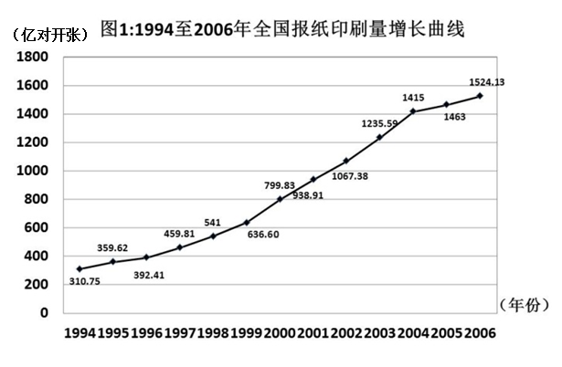

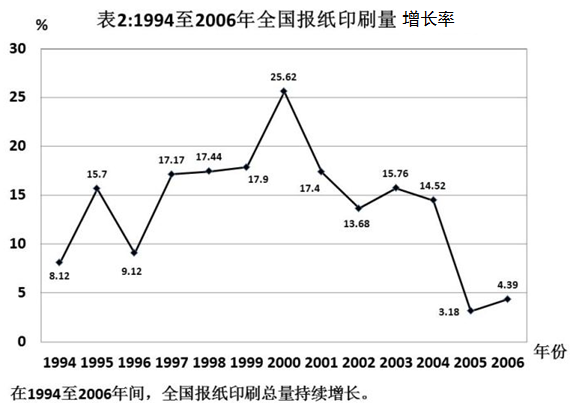

        以2004年为例，年印刷量在10亿对开张以上的企业有30家，其中印刷量增长的企业占90％，而且全部增长5％以上，增长率达两位数的企业占66.67％。年印刷量在5亿至10亿对开张之间的企业有26家，其中印刷量增长的有25家，增长率达到两位数的有19家。

        到了2005年，年印刷量在10亿对开张以上的企业有29家，其中印刷量增长的有17家，增长5％以上的有11家，而保持两位数增长的有8家。印刷量减少的企业有11家。年印刷量在5亿至10亿对开张之间的企业有31家，其中印刷量增长的有20家，增长5％以上的有16家，保持两位数增长的有13家。印刷量减少的企业有10家。

        再看2006年，年印刷量在10亿对开张以上的企业有31家，其中印刷量增长的有19家，增长5％以上的有14家，保持两位数增长的有10家。印刷量减少的企业有11家。年印刷量在5亿至10亿对开张之间的企业有28家，其中印刷量增长的有20家，增长5％以上的有14家，保持两位数增长的有7家。印刷量减少的企业有8家。

### 第 121 题

2004年印刷量增长率在5％以上的企业有多少家：

A. 19

B. 49

C. 55

D. 无法判断

第 121 题 · 答案与解析

**参考答案（粉笔题库参考内容）**

D

**解析**

题目没有给出所有规模企业2004年的印刷量增长率，无法判断。

故正确答案为D。

**考点**：直接找数、综合资料

**来源**：2008年国家公务员录用考试《行测》题第121题

### 第 122 题

2005年，年印刷量在5亿对开张以上的企业中，印刷量增长率为负的企业所占比例是：

A. 16.6%

B. 32.3%

C. 35.0%

D. 38.3%

第 122 题 · 答案与解析

**参考答案（粉笔题库参考内容）**

C

**解析**

2005年年印刷量在5亿对开张以上的企业29+31=60家，印刷量增长率为负的企业有11+10=21家，印刷量增长率为负的企业所占比例是。

故正确答案为C。

**考点**：现期比重、综合资料

**来源**：2008年国家公务员录用考试《行测》题第122题

### 第 123 题

2006年，年印刷量在10亿对开张以上的企业中，印刷量增长5%以上，且低于10%的企业有多少家：

A. 3

B. 4

C. 5

D. 8

第 123 题 · 答案与解析

**参考答案（粉笔题库参考内容）**

B

**解析**

2006年年印刷量在10亿对开张以上的企业中，有14家企业印刷量增长5%以上，有10家企业印刷量保持两位数增长。则印刷量增长5%以上，且低于10%的企业有14-10=4家。

故正确答案为B。

**考点**：简单加减计算、综合资料

**来源**：2008年国家公务员录用考试《行测》题第123题

### 第 124 题

以下关于1994至2006年年印刷量、年增长率的说法中，正确的是：

A. 年平均增长率在10％以上

B. 年增长量最多的是2001年

C. 年增长率大于10％有8个年份

D. 1998年的年增长量不到2002年的一半

第 124 题 · 答案与解析

**参考答案（粉笔题库参考内容）**

A

**解析**

A选项正确，1994至2006年年印刷量、年增长率为(8.12+15.7+9.12+17.17+17.44；

B选项错误，2001年的年增长量为938.91-799.83=139.08，而2004年的年增长量为，2004年的年增长量大于2001年；

C选项错误，观察折线图易知，年增长率大于10%有9个年份，分别是1995年和；

D选项错误，1998年的年增长量为541-459.81=81.19，2002年的增长量为，，故1998年的年增长量超过2002年的一半。

故正确答案为A。

**考点**：综合分析、综合资料

**来源**：2008年国家公务员录用考试《行测》题第124题

### 第 125 题

2005年与2006年相比，年印刷量在5亿对开张以上的企业中，以下正确的一行是（　）。

| 项目 | 2005 | 2006 |
| --- | ---: | ---: |
| A. 年印刷量减少的企业数 | 11 | 11 |
| B. 年增长率低于 5%的企业数 | 33 | 31 |
| C. 年增长率在两位数的企业数 | 13 | 10 |
| D. 年印刷量 10 亿对开张以上的企业占企业总数的百分比 | 49% | 50% |

> 表格文字由原题截图转写，原截图保留在下方备查。

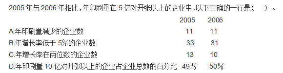

第 125 题 · 答案与解析

**参考答案（粉笔题库参考内容）**

B

**解析**

A选项错误，2005年印刷量在5亿对开张以上的企业，有11+10=21家印刷量减少的企业。2006年印刷量在5亿对开张以上的企业，有11+8=19家印刷量减少的企业；

B选项正确，2005年印刷量在5亿对开张以上的企业，有(17-11)+(29-17)+(20-16)+(31-20)=33家年增长率低于5%的企业。2006年印刷量在5亿对开张以上的企业，有(19-14)+(31-19)+(20-14)+(28-20)=31家年增长率低于5%的企业；

C选项错误，2005年印刷量在5亿对开张以上的企业，增长率在两位数的企业数为8+13=21家。2006年印刷量在5亿对开张以上的企业，增长率在两位数的企业数为10+7=17家；

D选项错误，2005年年印刷量10亿对开张以上的企业占企业总数的百分比为，2006年年印刷量10亿对开张以上的企业占企业总数的百分比为。

故正确答案为B。

需要注意的是，B选项当中年增长率低于5%的企业还包括了增长率为负的企业。

**考点**：综合分析、综合资料

**来源**：2008年国家公务员录用考试《行测》题第125题

### 第 126 题

根据资料，下列可以解释报纸印刷量增长率变化的事例是：

A. 1994年各大报纸的发行量出现萎缩

B. 2003至2005年出现电子报纸等新媒体

C. 2000至2002年各大报纸纷纷增加版面

D. 1997至1999年各大报纸刊登的广告数量持续减少

第 126 题 · 答案与解析

**参考答案（粉笔题库参考内容）**

B

**解析**

A选项错误，1994年的增长率为正，因此各大报纸发行量不可能出现萎缩；

B选项正确，2003年至2005年报纸的印刷量增长变缓（注意，这并不代表减少），电子报纸等新媒体的出现可以解释这一现象；

C选项错误，如果2000年至2002年各大报纸纷纷增加了版面，那么年印刷量应该增加更快；

D选项错误，“广告数量”属于无关信息。

故正确答案为B。

**考点**：综合分析、综合资料

**来源**：2008年国家公务员录用考试《行测》题第126题

## 材料 2

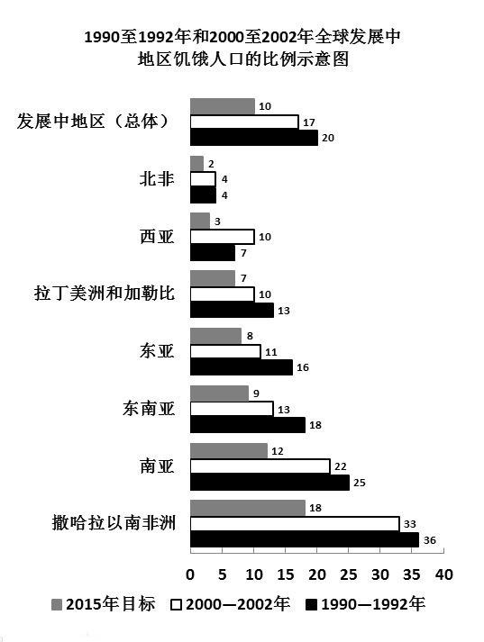

### 第 127 题

1990－2002年间，当地人民食物获取状况恶化的地区是：

A. 拉丁美洲和加勒比

B. 南亚

C. 撒哈拉以南非洲

D. 西亚

第 127 题 · 答案与解析

**参考答案（粉笔题库参考内容）**

D

**解析**

观察图表发现，只有西亚地区2000至2002饥饿人口的比例高于1990至1992年，因此当地人民食物获取状况恶化的地区是西亚。

故正确答案为D。

**考点**：直接找数、统计图

**来源**：2008年国家公务员录用考试《行测》题第127题

### 第 128 题

按1990－2002年间的发展趋势，有几个地区将能够达到或超过2015年发展中地区（总体）的目标水平：

A. 3个

B. 4个

C. 5个

D. 6个

第 128 题 · 答案与解析

**参考答案（粉笔题库参考内容）**

B

**解析**

发展中地区（总体）的2015年目标为饥饿人口百分比降至10%。有四个地区按照其发展趋势可以达到这个目标，分别为北非、拉丁美洲和加勒比、东亚、东南亚。

本题要注意题干中的“按发展趋势”，而不是2015年的目标（西亚二者相矛盾）。

故正确答案为B。

**考点**：现期计算、统计图

**来源**：2008年国家公务员录用考试《行测》题第128题

### 第 129 题

若南亚地区1992年总人口数为15亿，该地区平均人口年增长率为2%，那么2002年南亚地区饥饿人口总量为多少亿人？

A. 3.30

B. 3.96

C. 4.02

D. 4.82

第 129 题 · 答案与解析

**参考答案（粉笔题库参考内容）**

C

**解析**

1992-2002年南亚地区平均人口增长率为2%，1992年总人口数为15亿，则1993年南亚地区总人口数亿，同比增长了0.3亿，已知1993年后每年同比增长率均不变，而基期在不断变化但变化较小，则1993年后每年人口增长量均略大于0.3亿，则2002年南亚地区人口总量亿，根据图示比重：2002年南亚地区饥饿人口总量亿。由M值略大于18亿，则N值略大于3.96亿。

故正确答案为C。

**考点**：现期计算

**来源**：2008年国家公务员录用考试《行测》题第129题

### 第 130 题

下列说法中，不能从图示信息中获得支持的是：

I.1992－2002年间，北非饥饿人口的数量并没有因人口总量的变化而变化

II.1992－2002年间，东南亚和南亚地区的饥饿人口比例基本能反映发展中地区的总体概况

III.1992－2002年间，发展中地区的饥饿人口主要集中在南亚地区和撒哈拉以南非洲地区

IV.1992－2002年间，东亚地区在改善人民饥饿状况的工作方面最为突出

A. I

B. II和III

C. I和III

D. I和IV

第 130 题 · 答案与解析

**参考答案（粉笔题库参考内容）**

C

**解析**

Ⅰ表述错误：，饥饿人口的比例没有发生改变，因此如果人口总量发生变化之后，饥饿人口数量肯定也会发生变化；

Ⅱ表述正确：整体上这两个地区的饥饿人口比例与“发展中地区的总体概况”最为接近；

Ⅲ表述错误：材料当中只给出了比例，未涉及具体人数；

Ⅳ表述正确：东亚的饥饿人口比例下降特别明显（事实上是最明显的），说明东亚地区在改善人民饥饿状况的工作方面最为突出。

故正确答案为C。

**考点**：统计图、综合分析

**来源**：2008年国家公务员录用考试《行测》题第130题

## 材料 3

某市2005年就该市城镇居民和农民参加体育锻炼及其影响因素，开展了一项调查。调查结束后按城乡、性别分别进行了统计，统计结果如下两张表所示。

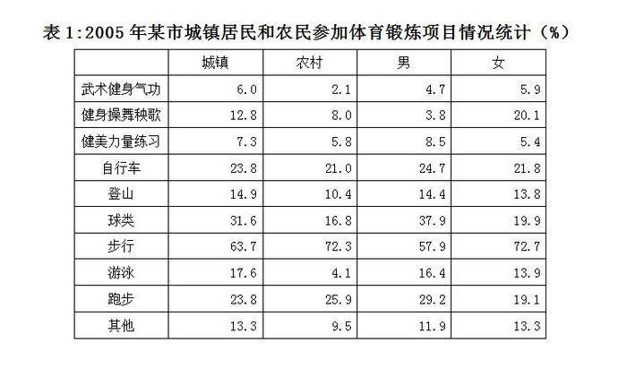

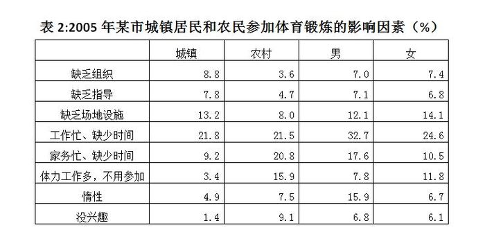

### 第 131 题

在各项体育项目的普及程度上，农村与城镇相比：

A. 登山高于城镇

B. 步行低于城镇

C. 自行车高于城镇

D. 健身操舞秧歌低于城镇

第 131 题 · 答案与解析

**参考答案（粉笔题库参考内容）**

D

**解析**

观察图表易知，参与健身操舞秧歌的人数比例农村为8.0%，城镇为12.8%。农村与城镇相比，健身操舞秧歌的普及程度低于城镇。

故正确答案为D。

**考点**：直接找数、统计表

**来源**：2008年国家公务员录用考试《行测》题第131题

### 第 132 题

与男性相比，在女性中更普及的体育项目是：

A. 球类 步行

B. 跑步 游泳

C. 步行 健身 操舞 秧歌

D. 健身 操舞 秧歌 跑步

第 132 题 · 答案与解析

**参考答案（粉笔题库参考内容）**

C

**解析**

观察图表易知，女性比男性更普及的项目有武术健身气功、健身操舞秧歌、步行及其他。

故正确答案为C。

**考点**：直接找数、统计表

**来源**：2008年国家公务员录用考试《行测》题第132题

### 第 133 题

根据表2，在被调查的全体人群中，选择“缺乏组织”的人占全体人群的比例可能是：

A. 5.2％

B. 6.2％

C. 7.1％

D. 8.2％

第 133 题 · 答案与解析

**参考答案（粉笔题库参考内容）**

C

**解析**

由于选择“缺乏组织”的男性比例为7.0%，而女性比例为7.4%，因此全体人群中选择“缺乏组织”的人口比例一定介于这两个数之间，只有C选项符合这个条件。

故正确答案为C。

**考点**：直接找数、综合资料

**来源**：2008年国家公务员录用考试《行测》题第133题

### 第 134 题

无法从表2获得支持的判断是：

A. 家务过多成为影响男性参加体育锻炼的第二大因素

B. 惰性对女性参加体育锻炼的影响小于对男性的影响

C. 无论城镇或农村，兴趣都是影响人们参加体育锻炼的最重要因素之一

D. 无论城镇或农村，男或女，工作忙已成为影响人们参加体育锻炼的第一大因素

第 134 题 · 答案与解析

**参考答案（粉笔题库参考内容）**

C

**解析**

A选项正确，影响男性参加体育锻炼的第一大因素为工作忙、缺少时间，所占比重为32.7%。影响男性参加体育锻炼的第二大因素为家务忙、缺少时间，所占比重为17.6%；

B选项正确，惰性对女性参加体育锻炼的影响所占比重为6.7%，对男性的影响所占比重为15.9%，故惰性对女性参加体育锻炼的影响小于对男性的影响；

C选项错误，在城市，兴趣影响人们参加体育锻炼的比重仅为1.4%，不是最重要的因素之一；

D选项正确，无论城镇或农村，男或女，工作忙已成为影响人们参加体育锻炼的第一大因素，其所占比重依次为21.8%、21.5%、32.7%、24.6%。

本题为选非题，故正确答案为C。

**考点**：综合分析、综合资料

**来源**：2008年国家公务员录用考试《行测》题第134题

### 第 135 题

无法从表1、表2获得支持的判断是：

A. 农民对体育锻炼的不恰当看法和认识更普遍一些

B. 与城镇居民相比，农民参加体育锻炼的项目比较单调

C. 在全民健身方面，培养农民参加体育锻炼的兴趣可能比城镇居民更迫切

D. 男性因工作压力放弃体育锻炼的更多一些，而女性因家务压力放弃体育锻炼更多一些

第 135 题 · 答案与解析

**参考答案（粉笔题库参考内容）**

D

**解析**

A选项正确，农民因“惰性”和“没兴趣”等消极原因不参加体育锻炼的比重高于城镇居民，可以判断农民对体育锻炼的不恰当看法和认识更普遍一些；

B选项正确，城镇居民中有10%以上人数参加的体育项目有8项，而农民仅有5项，因此农民参加体育锻炼的项目比较单调；

C选项正确，有9.1%的农民因没有兴趣而放弃体育锻炼，城镇居民的比例仅为1.4%，因此培养农民参加体育锻炼的兴趣可能比城镇居民更迫切；

D选项错误，男性中因工作压力放弃体育锻炼的比例高达32.7%，高于其他因素。女性中因家务压力和工作压力放弃体育锻炼的比例分别为10.5%、24.6%，因工作压力放弃体育锻炼的更多一些。

本题为选非题，故正确答案为D。

**考点**：综合分析、综合资料

**来源**：2008年国家公务员录用考试《行测》题第135题

## 材料 4

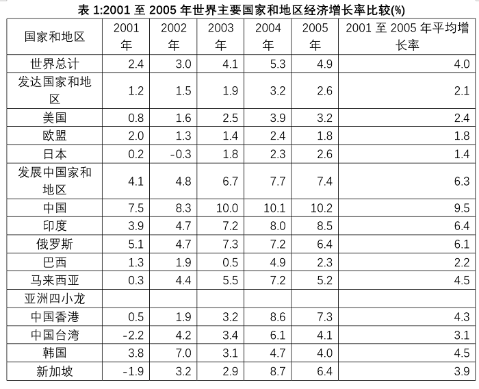

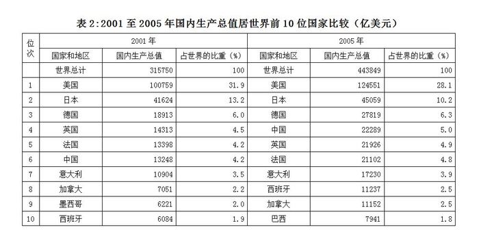

### 第 136 题

2005年和2001年相比较，国内生产总值占世界的比重变化幅度最大的国家是：

A. 美国

B. 日本

C. 中国

D. 法国

第 136 题 · 答案与解析

**参考答案（粉笔题库参考内容）**

A

**解析**

美国国内生产总值占世界的比重减少了3.8个百分点，它的变化幅度最大。

故正确答案为A。

注意：“比重变化幅度”可以是比重增加幅度，也可以是比重减少幅度。

**考点**：直接找数、统计表

**来源**：2008年国家公务员录用考试《行测》题第136题

### 第 137 题

2001到2005年间，完全符合曲线所显示的经济发展趋势的国家和地区有：

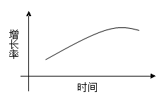

A. 2个

B. 3个

C. 4个

D. 5个

第 137 题 · 答案与解析

**参考答案（粉笔题库参考内容）**

B

**解析**

该增长率曲线先单调递增之后略微下降，符合这个规律的有3个国家或地区，分别是美国、马来西亚和中国香港。

故正确答案为B。

注意：此题作答时务必不要将“发达国家和地区”与“发展中国家和地区”两栏当做国家数进去。

**考点**：直接找数、统计表

**来源**：2008年国家公务员录用考试《行测》题第137题

### 第 138 题

下面描述不正确的是：

A. 从2001年开始，我国国内生产总值及其占世界的比重一直在上升

B. 大部分国家和地区经济增速在2001至2004年不断加快，2005年有所减缓

C. 从2001年开始，发达国家经济增长速度一般低于主要发展中国家和地区

D. 2001至2005年间，香港经历了比台湾、新加坡更加剧烈的经济波动和发展

第 138 题 · 答案与解析

**参考答案（粉笔题库参考内容）**

D

**解析**

A选项正确，中国国内生产总值的增长率始终保持正值且为表格所统计的所有国家中最高，因此中国国内生产总值及其占世界的比重一直在上升；

B选项正确，根据表1可以明显看出，大部分国家和地区经济增速在2001至2004年不断加快，2005年有所减缓；

C选项正确，根据表1可以明显看出，发达国家经济增长速度一般低于主要发展中国家和地区；

D选项错误，2001至2005年间，新加坡的经济波动比香港更大。

故正确答案为D。

**考点**：统计表、综合分析

**来源**：2008年国家公务员录用考试《行测》题第138题

### 第 139 题

下列说法正确的是：

I.2001至2005年间，与主要发展中国家相比，亚洲四小龙的经济增长相对放慢

II.2001至2005年间，日本经济开始摆脱“停滞”状态，经济形势逐渐好转

III.2001至2005年间，国内生产总值在世界排名的变化趋势和其占世界比重的变化趋势是一致的

A. I

B. II

C. I和II

D. II和III

第 139 题 · 答案与解析

**参考答案（粉笔题库参考内容）**

C

**解析**

I正确：亚洲四小龙的平均增长率比主要发展中国家低，其经济增长相对放慢；

II正确：日本在2001、2002两年经济增长率在0％左右徘徊，从2003年开始经济增长率开始逐渐增大，经济形势逐渐好转；

III错误：英国、法国国内生产总值在世界排名均下降，但是占世界比重均上升。

故正确答案为C。

**考点**：统计表、综合分析

**来源**：2008年国家公务员录用考试《行测》题第139题

### 第 140 题

能从表1、表2获得支持的说法是：

I.整个世界的财富越来越集中到少数几个发达国家中

II.传统的世界经济强国在世界经济中的排名和地位已经发生了根本性变化

III.主要的发展中国家在世界经济中扮演着越来越重要的角色

A. I

B. II

C. III

D. I和II

第 140 题 · 答案与解析

**参考答案（粉笔题库参考内容）**

C

**解析**

I错误：由表2可以看出，世界的财富越来越分散到各个国家当中；

II错误：世界经济强国的排名和地位没有太大变化，比如美国、日本、德国仍然占据着前三的位置，因此没有发生根本性变化；

III正确：主要的发展中国家中国和巴西国内生产总值占世界的比重均增加，且排名上升。

故正确答案为C。

**考点**：统计表、综合分析

**来源**：2008年国家公务员录用考试《行测》题第140题

