# 2009年国家公务员录用考试《行测》题

<!-- gwy:overview:start -->
> **国考 · 2009 · 行测 · 统考** ｜ 140 题 · 图片 13 处 · 答案随题折叠

| 题型模块 | 题量 | 题号 |
| --- | ---: | ---: |
| 常识判断 | 25 | 1–25 |
| 言语理解与表达 | 40 | 26–65 |
| 判断推理 | 35 | 66–100 |
| 数量关系 | 20 | 101–120 |
| 资料分析 | 20 | 121–140 |
| **合计** | **140** | |

导航：[题型与作答说明](#题型与作答说明) · [题目](#题目) · [材料 1](#材料-1)
<!-- gwy:overview:end -->

> 候选采集稿。参考答案及解析来自粉笔页面，不代表官方答案或真实高分答卷；来源使用许可与原卷对应关系仍需人工核实。

## 题型与作答说明

常识判断

（25题）

根据题目要求，在每个选项中选出一个正确答案。

言语理解与表达

（40题）

本部分包括表达与理解两方面的内容。请根据题目要求，在四个选项中选出一个最恰当的答案

判断推理

（35题）

本部分包括图形推理、定义判断、类比推理与逻辑判断四种类型的试题。

数量关系

（20题）

本部分包括数字推理与数学运算两种类型的试题。

资料分析

（20题）

所给出的图、表、文字或综合性资料均有若干个问题要你回答，你应根据资料提供的信息进行分析、比较、计算和判断处理。

## 题目

### 第 1 题

北京奥运会开幕式上展示的巨大的“和”字，其蕴含的思想源自：

A. 墨家

B. 道家

C. 儒家

D. 法家

第 1 题 · 答案与解析

**参考答案（粉笔题库参考内容）**

C

**解析**

北京奥运会开幕式上的“和”字与儒家“以和为贵”的思想相统一。孔子在《论语·学而》中说到：“礼之用，和为贵。先王之道，斯为美，小大由之。”

故正确答案为C。

本题相关知识点：

墨家思想的主张主要可归纳为十个：兼爱（人人平等互助互爱）、非攻（反对侵略战争）、尚贤（不分贵贱唯才是举）、尚同（政令、思想、言语、行动等要与圣王的意志相同一）、天志（天是有意志的最高主宰）、明鬼（辨明鬼神的存在）、非命（反对命运之说）、非乐（反对奢靡的音乐活动）、节用（反对奢侈浪费）、节葬（反对厚葬久丧）。

道家是中国古代主要思想流派之一，代表人物有老子、庄子、慎到、杨朱等。道家以道、无、自然、天性为核心理念，认为天道无为、道法自然，据此提出无为而治、以雌守雄、以柔克刚等政治、军事策略。道家的理论奠定于老子，庄子是老子之后道家理论最重要的开创者。

法家是先秦诸子中对法律最为重视的一派，他们以在法律界及法理学方面做出了卓越贡献而闻名，并提出了一整套的理论和方法。这为后来建立的中央集权的秦朝制定各项政策提供了相当有效的理论依据。法家主要代表人物有李悝、慎到、商鞅、申不害、李斯、韩非子等。

**考点**：文化常识

**来源**：2009年国家公务员录用考试《行测》题第1题

### 第 2 题

今年是改革开放三十周年，三十年前我国的经济体制改革始于：

A. 上海

B. 安徽

C. 广东

D. 浙江

第 2 题 · 答案与解析

**参考答案（粉笔题库参考内容）**

B

**解析**

1978年11月24日，安徽凤阳县小岗村的18户农民勇于打破旧的生产关系的束缚，实现家庭联产承包责任制，揭开我国农村改革和经济体制改革的序幕。

故正确答案为B。

本题容易误选C项，误以为设立深圳为经济特区是我国经济体制改革的开始。实际上，深圳经济特区设立于1980年，而小岗村实行生产责任制是在1978年。

**考点**：宏观经济与调控政策

**来源**：2009年国家公务员录用考试《行测》题第2题

### 第 3 题

经济学上所推崇的“橄榄型”收入分配结构，是指低收入和高收入相对较少、中等收入占绝大多数的分配结构。我国正在采取、实施“提低、扩中、调高、打非、保困”的方针，使收入分配朝着“橄榄型”方向发展。

这主要是为了促进：

A. 生产的发展

B. 效率的提高

C. 社会的公平

D. 内需的扩大

第 3 题 · 答案与解析

**参考答案（粉笔题库参考内容）**

C

**解析**

本题考查我国收入分配结构调整的目的。

A项，国家对收入分配结构的调整属于分配领域的调整，不是为了促进生产的发展。该项应排除。

B项，国家调整收入分配结构的主要目的是促进社会公平，而不是提高生产效率。该项应排除。

C项，国家对收入分配进行调控，使其朝更加合理的“橄榄型”分配结构的方向发展，目的是要促进社会成员之间权利和利益分配的合理化，促进社会公平。该项应选。

D项，扩大内需需要借助国家的宏观调控手段，但调整收入分配结构的目的不是扩大内需，而是促进社会公平。该项应排除。

故正确答案为 C。

**考点**：宏观经济与调控政策

**来源**：2009年国家公务员录用考试《行测》题第3题

### 第 4 题

新中国成立以后，我国政府制定了“两弹一星”的战略决策，这一战略目标的实现是在：

A. 20 世纪 50～60 年代

B. 大跃进时期

C. 20 世纪 60～70 年代

D. 文革时期

第 4 题 · 答案与解析

**参考答案（粉笔题库参考内容）**

C

**解析**

“两弹一星”最初是指原子弹、导弹和人造卫星。“两弹”中的一弹是原子弹，后来演变为原子弹和氢弹的合称，另一弹是导弹；“一星”则是人造地球卫星。1964年10月16日，我国成功爆炸了第一颗原子弹；1967年，我国第一颗氢弹又试验成功；1960年，我国第一枚探空火箭和近程导弹发射成功；1964年，我国自行设计和研制的中近程导弹发射成功；1966年，我国第一颗装有核弹头的地地导弹飞行爆炸成功；1970年4月24日，我国第一颗人造卫星发射成功。因此“两弹一星”战略目标的实现是在20世纪60~70年代。

故正确答案为C。

本题相关知识点：对于中国而言，“两弹一星”是在非常艰苦、没有外援的环境下所研发出来的成果。“两弹一星”精神象征了在欠缺良好环境的情况下，从事科学技术开发研究的精神，也是科教兴国政策的开端。“两弹一星”精神可当成政治语汇用在科技发展、高等教育、人才培育等领域上，例如，“用‘两弹一星’精神创建一流大学”、“用‘两弹一星’精神开发资讯产业”等。

**考点**：中国历史

**来源**：2009年国家公务员录用考试《行测》题第4题

### 第 5 题

从 2006 年元旦起我国政府正式取消了延续 2600 年的农业税。

我国农业税的征收始于：

A. 春秋时期鲁国的初税亩

B. 战国时期的商鞅变法

C. 秦朝的按亩纳税

D. 西汉的编户齐民

第 5 题 · 答案与解析

**参考答案（粉笔题库参考内容）**

A

**解析**

据史料记载，农业税始于春秋时期鲁国的“初税亩”，到汉初形成制度。《左传》记载：“宣公十五年秋七月，初税亩”。 “初税亩”按照字面来翻译，就是“开始按照土地每亩的单位来收税”,这是文献上最早的税收制度。解答本题时，可依据时间来推算，以2006年为起点，2600年前刚好是公元前594年，正是鲁国时期鲁宣公十五年。

故正确答案为A。

本题相关知识点：

商鞅变法始于公元前356年，当时在位的国君是秦孝公。商鞅变法是一场封建地主阶级的改革运动，在经济上确立了封建土地私有制，促进了秦国封建经济和封建生产力的繁荣发展，为秦国的富国强兵乃至统一全国奠定了雄厚的经济物质基础。

**考点**：中国历史

**来源**：2009年国家公务员录用考试《行测》题第5题

### 第 6 题

地热资源、太阳能、水能资源均丰富的地区是：

A. 青藏高原

B. 海南岛

C. 塔里木盆地

D. 四川盆地

第 6 题 · 答案与解析

**参考答案（粉笔题库参考内容）**

A

**解析**

青藏高原位于板块交界处，有丰富的地热资源；青藏高原河流湖泊多，且落差大，所以水能丰富；又因为青藏高原海拔高、空气稀薄、太阳辐射强，所以太阳能丰富。

故正确答案为A。

本题相关知识点：

青藏高原有中国目前最大的地热电站——羊八井热电站。青藏高原是亚洲不少大江大河的源头，长江、黄河、澜沧江、怒江、雅鲁藏布江等都发源于这里。

塔里木盆地位于中国西北部的新疆，中国面积最大的内陆盆地。盆地的中部是著名的塔克拉玛干沙漠，边缘为山麓、戈壁和绿洲（冲积平原）。

四川盆地又称为巴蜀盆地、信封盆地或紫（红）色盆地，中国四大盆地之一，也是中国各大盆地中形态最典型、纬度最南、海拔最低的盆地。四川盆地聚居着四川、重庆的大部分人口，是中国和世界上人口最稠密的区域之一，也是巴蜀文化的摇篮，号称“天府之国”。

**考点**：自然地理

**来源**：2009年国家公务员录用考试《行测》题第6题

### 第 7 题

下列表述错误的一项是：

A. 党的十七大报告明确指出，要更好地实施科教兴国战略、人才强国战略、可持续发展战略

B. 今年5月12日发生的四川汶川特大地震，是新中国成立以来破坏性最强、波及最广、救灾难度最大的一次地震

C. 神舟七号载人航天飞行圆满成功，标志着我国成为世界上第二个独立掌控空间出舱关键技术的国家

D. 科学发展观，第一要义是发展，核心是以人为本，最基本的要求是全面协调可持续，根本方法是统筹兼顾

第 7 题 · 答案与解析

**参考答案（粉笔题库参考内容）**

C

**解析**

2008年9月25日，我国航天员翟志刚、刘伯明、景海鹏同志乘坐神舟七号载人航天飞船成功进入太空，在顺利完成空间出舱活动和空间科学实验任务后，于9月28日安全返回地面。这次载人航天飞行圆满成功，对我国空间技术发展具有里程碑意义，标志着我国继苏联、美国之后，成为世界上第三个独立掌握空间出舱关键技术的国家。

本题为选非题，故正确答案为C。

本题相关知识点：

在神舟七号载人航天飞行任务中，翟志刚成为我国第一个进行太空行走的航天员，被授予“航天英雄”称号。刘伯明和景海鹏则获得“英雄航天员”的荣誉称号。

**考点**：中国地理

**来源**：2009年国家公务员录用考试《行测》题第7题

### 第 8 题

晚于欧洲文艺复兴运动（14至15世纪）的历史大事是：

A. 毕昇发明活字印刷术

B. 哥白尼提出“日心说”

C. 成吉思汗统一蒙古

D. 英国工业革命

第 8 题 · 答案与解析

**参考答案（粉笔题库参考内容）**

D

**解析**

毕昇发明活字印刷术是在1041～1048年，成吉思汗统一蒙古是在1206年，哥白尼提出“日心说”是在1514年，发表于1543年（16世纪），英国工业革命发生在18世纪。哥白尼提出“日心说”和英国工业革命都晚于欧洲文艺复兴运动，但后者比前者更符合“历史大事”的要求。

故正确答案为D。

**来源**：2009年国家公务员录用考试《行测》题第8题

### 第 9 题

我国领导人多次表示，西藏事务完全是中国内政，“西藏问题”的实质是：

A. 民族问题

B. 人权问题

C. 宗教问题

D. 主权问题

第 9 题 · 答案与解析

**参考答案（粉笔题库参考内容）**

D

**解析**

2008年4月12日，胡锦涛在三亚会见来访的澳大利亚总理陆克文时表示：“西藏事务完全是中国内政。我们和达赖集团的矛盾，不是民族问题，不是宗教问题，也不是人权问题，而是维护祖国统一和分裂祖国的问题。”所以“西藏问题”的实质是主权问题。

故正确答案为D。

**考点**：中国地理

**来源**：2009年国家公务员录用考试《行测》题第9题

### 第 10 题

以下节气按时间顺序排列正确的是：

A. 立春、惊蛰、雨水、春分

B. 小暑、大暑、处暑、立秋

C. 白露、秋分、寒露、霜降

D. 立冬、小雪、小寒、冬至

第 10 题 · 答案与解析

**参考答案（粉笔题库参考内容）**

C

**解析**

二十四节气经常出现在常识判断题中，可借助口诀辅助记忆：春雨惊春清谷天，夏满芒夏暑相连，秋处露秋寒霜降，冬雪雪冬小大寒。具体节气为：春（立春）雨（雨水）惊（惊蛰）春（春分）清（清明）谷（谷雨）天，夏（立夏）满（小满）芒（芒种）夏（夏至）暑相连（小暑、大暑），秋（立秋）处（处暑）露（白露）秋（秋分）寒（寒露）霜降（霜降），冬（立冬）雪（小雪）雪（大雪）冬（冬至）小大寒（小寒、大寒）。

故正确答案为C。

**考点**：自然地理

**来源**：2009年国家公务员录用考试《行测》题第10题

### 第 11 题

下列历史时间排序正确的一组是：

A. 齐桓公称霸→商鞅变法→秦统一天下

B. 司马迁修《史记》→文景之治→王莽篡汉

C. 玄武门之变→黄巢起义→安史之乱

D. 杯酒释兵权→岳飞抗金→王安石变法

第 11 题 · 答案与解析

**参考答案（粉笔题库参考内容）**

A

**解析**

本题考查历史常识。

A项正确，齐桓公公元前685年至公元前643年在位，商鞅变法发生在公元前356年，秦朝统一天下是在公元前221年；

B项错误，司马迁修《史记》是在汉武帝时期（公元前140年~前88年），在文景之治（公元前180年~前141年）之后；

C项错误，黄巢起义发生于唐朝末年，而安史之乱发生于唐玄宗的天宝年间；

D项错误，王安石变法发生在北宋中期，岳飞抗金发生在北宋末年、南宋初期。

故正确答案为A。

**考点**：中国历史

**来源**：2009年国家公务员录用考试《行测》题第11题

### 第 12 题

关于中国改革开放 30 周年成就的描述，下列符合实际的是：

A. 国内生产总值平均增长速度接近 10%

B. 人均 GDP 已接近中等发达国家水平

C. 主要污染物排放总量逐年减少

D. 已成为世界贸易第一大国

第 12 题 · 答案与解析

**参考答案（粉笔题库参考内容）**

A

**解析**

本题考查新思想。

A项，十七大报告（2007年）中提到，我国国内生产总值平均增长速度连续几年接近10%，所以A项表述符合实际；

B项，人均GDP接近中等发达国家水平，是我国现代化战略的第三个目标，计划在本世纪五十年代实现，B项提到的是“已接近”，不符合实际；

C项，在改革开放的这三十年间，主要污染物排放总量并没有逐年减少，C项表述不符合实际；

D项，2009年世界贸易第一大国是美国，D项表述不符合实际。

故正确答案为A。

本题相关知识点：

在国务院新闻办公室2011年11月7日发表的《中国的对外贸易》白皮书中提到，中国货物进出口总额从1978年的206亿美元跃升至2010年的29740亿美元，年均增长16.8％，连续两年成为世界货物贸易第一出口大国和第二进口大国。

**考点**：其他建设、重要事件

**来源**：2009年国家公务员录用考试《行测》题第12题

### 第 13 题

下列做法在日常生活中可行的是：

A. 医用酒精和工业酒精的主要成份相同，都可用于伤口消毒

B. 喝牛奶、豆浆等富含蛋白质的食品可有效缓解重金属中毒现象

C. 由于淀粉有遇碘变蓝的特性，可利用淀粉检验加碘食盐的真假

D. 低血糖症状出现时，吃馒头要比喝葡萄糖水见效快

第 13 题 · 答案与解析

**参考答案（粉笔题库参考内容）**

B

**解析**

A项错误，工业酒精与医用酒精的主要成分——乙醇相同，但是工业酒精中含有部分甲醇，而甲醇对人体有害，不能直接用于伤口消毒；

B项正确，误服重金属会使人体内组织中的蛋白质变性而中毒，如果立即服用大量鲜牛奶、蛋清、豆浆，可使重金属跟牛奶、蛋清、豆浆中的蛋白质发生变性作用，从而减轻重金属对机体的危害；

C项错误，遇淀粉变蓝的是碘单质，而食盐中的碘为碘酸钾，为一种稳定的化合物，不会有本选项所说的效果；

D项错误，馒头中的淀粉需要经过消化吸收才能转化为葡萄糖，故产生效果的周期长。

故正确答案为B。

**考点**：生活常识

**来源**：2009年国家公务员录用考试《行测》题第13题

### 第 14 题

美国次贷危机中的“次”是指：

A. 贷款人的第二次贷款

B. 贷款人的收入较低，信用等级较低

C. 贷款机构的实力和规模较小

D. 贷款机构的信用等级较低

第 14 题 · 答案与解析

**参考答案（粉笔题库参考内容）**

B

**解析**

次贷即“次级按揭贷款”，“次”的意思是与“高”“优”相对应的。美国抵押贷款市场的“次级”（Subprime）及“优惠级”（Prime）是以借款人的信用条件作为划分界限的。根据信用的高低，放贷机构对借款人区别对待，从而形成了两个层次的市场。信用低的人申请不到优惠贷款，只能在次级市场寻求贷款。

故正确答案为B。

**考点**：市场经济

**来源**：2018年福建省选调生考试《行政职业能力测验》第22题

### 第 15 题

关于气象，下列说法正确的是：

A. 沙尘暴发源于蒙古高原

B. 厄尔尼诺现象是由温室气体增多引发的

C. 美国西海岸有暖流、东海岸有寒流通过

D. 飓风指的是在大西洋上生成的热带气旋

第 15 题 · 答案与解析

**参考答案（粉笔题库参考内容）**

D

**解析**

A项错误，沙尘暴天气多发生在内陆沙漠地区，源地主要有非洲的撒哈拉沙漠，北美中西部和澳大利亚也是沙尘暴天气的源地之一。蒙古高原西北部边缘为砾质戈壁，往东南为砂质戈壁，高原中部和东南部为伏沙和明沙。伏沙带分布于阴山北麓和大兴安岭西麓，呈弧形断续相连；明沙主要有巴音戈壁沙漠、海里斯沙漠、白音察干沙漠、浑善达克沙地、乌珠穆沁沙地、呼伦贝尔沙地等，同样是内陆的沙漠。故蒙古高原是沙尘暴发源地之一，选项表述过于绝对。

B项错误，厄尔尼诺现象又称厄尔尼诺海流，是太平洋赤道带大范围内海洋和大气相互作用后失去平衡而产生的一种气候现象。关于其起因，目前尚无定论。

C项错误，美国西海岸是加利福尼亚寒流，东海岸是墨西哥湾暖流和北大西洋暖流，此项的表述与实际刚好相反。

D项正确，飓风指大西洋和北太平洋东部地区强大而深厚的热带气旋，其意义和台风类似，只是产生地点不同。

故正确答案为D。

本题相关知识点：

从1999年到2002年春季，我国境内共发生53次（1999年9次，2000年14次，2001年18次，2002年12次）沙尘天气，其中有33次起源于蒙古国中南部戈壁地区。

飓风和台风都是指风速达到33米/秒以上的热带气旋，只是因发生的地域不同，才有了不同名称。生成于西北太平洋和我国南海的强烈热带气旋被称为“台风”；生成于大西洋、加勒比海以及北太平洋东部的则称“飓风”；而生成于印度洋、阿拉伯海、孟加拉湾的则称为“旋风”。

**考点**：自然地理

**来源**：2009年国家公务员录用考试《行测》题第15题

### 第 16 题

下列对 CPI（居民消费价格指数）的认识正确的是：

A. CPI 反映一定时期内居民所购生活消费品的价格程度的绝对数

B. CPI 用来分析消费品非零售价对居民生活费用支出的影响程度

C. CPI 反映居民所购生活消费品的价值和服务项目价格变动趋势

D. CPI 是采用指数商品加权平均的方法算出来的

第 16 题 · 答案与解析

**参考答案（粉笔题库参考内容）**

D

**解析**

本题考查经济常识。

A项错误，CPI是在特定时段内度量一组代表性消费商品及服务项目的价格水平随时间而变动的相对数，绝对数的说法错误。

B项错误，CPI用来分析消费品零售价对居民生活费用支出的影响程度，非零售价说法错误。

C项错误，CPI反映居民所购生活消费品的价格和服务项目价格变动趋势，价值说法错误。

D项正确，CPI是采用指数商品价格加权平均的方法计算出来的，不同的商品有不同的权重。

故正确答案为D。

**考点**：市场经济

**来源**：2009年国家公务员录用考试《行测》题第16题

### 第 17 题

下列陈述中错误的是：

A. 隐形飞机机身涂料的主要作用是吸收电磁波

B. 混沌理论在很多研究领域有重要应用

C. U盘格式化后，信息不可恢复

D. 土星环是圆的

第 17 题 · 答案与解析

**参考答案（粉笔题库参考内容）**

C

**解析**

A项正确，从原理上来说，隐形飞机的隐形并不是让我们的肉眼都看不到，它的目的是让雷达无法侦察到飞机的存在。隐形飞机在现阶段能够尽量减少或者消除雷达接收到的有用信号，所以隐形飞机的机身会采用非金属材料或者雷达吸波材料，吸收掉电磁波；

B项正确，混沌理论，是系统从有序突然变为无序状态的一种演化理论，是对确定性系统中出现的内在“随机过程”形成的途径、机制的研讨，在很多研究领域有重要应用；

C项错误，U盘格式化后，信息是可以恢复或可以部分恢复的；

D项正确，土星环由蜂窝般的太空碎片、岩石和冰组成，大部分环是对称地绕土星转的，从地球上观察类似椭圆。也有不对称的，有完整的、比较完整的、残缺不全的。环的形状有锯齿形的，有辐射状的。从这个来看应该属于不规则状。

本题为选非题，故正确答案为C。

**考点**：生活常识

**来源**：2009年国家公务员录用考试《行测》题第17题

### 第 18 题

下列能够依次展示美国、英国、法国和日本影响力的文化符号是：

A. 感恩节、巨石阵、卢浮宫、浮士绘

B. 硅谷、哈佛大学、白金汉宫、东照宫

C. 爵士乐、金色大厅、圣女贞德、新干线

D. 劳斯莱斯、芭比娃娃、巴尔扎克、桂离宫

第 18 题 · 答案与解析

**参考答案（粉笔题库参考内容）**

A

**解析**

A项正确，展示了美、英、法、日四个国家影响力的文化符号；

B项错误，哈佛大学是美国一所著名大学，白金汉宫是英国的王宫；

C项错误，金色大厅是奥地利维也纳的著名音乐厅；

D项错误，劳斯莱斯是世界顶级豪华轿车厂商，1906年成立于英国，芭比娃娃则是美国的。

故正确答案为A。

**考点**：文化常识

**来源**：2009年国家公务员录用考试《行测》题第18题

### 第 19 题

下列关于法律与道德关系的表述中，错误的是：

A. 法律和道德都属于社会规范的范畴，均具有规范性

B. 法律由国家强制力保障实施，而道德主要通过社会舆论和内心自律得以实施

C. 违法行为一定是违反道德的，但违反道德的行为不一定是都违法

D. 法律和道德可以互为促进

第 19 题 · 答案与解析

**参考答案（粉笔题库参考内容）**

C

**解析**

违法行为不一定违反道德，比如向经济条件贫困的患者销售药效一致的低价仿制药，虽然违反了我国药品管理等相关法律法规，但不违反道德。

本题为选非题，故正确答案为C。

**考点**：法理学

**来源**：2009年国家公务员录用考试《行测》题第19题

### 第 20 题

根据我国有关法律的规定，下列哪一种行为是不合法的：

A. 某乡人民代表大会选举产生乡长、副乡长

B. 国务院某部门制定规章设定行政许可

C. 国务院发布《关于加强市县政府依法行政的决定》

D. 全国人民代表大会常务委员会批准2008年中央预算调整方案

第 20 题 · 答案与解析

**参考答案（粉笔题库参考内容）**

B

**解析**

根据《行政许可法》的相关规定，只有法律、法规和国务院的决定可以设定行政许可，省级人民政府的规章依据法定条件可以设定临时性行政许可，其它规范性文件一律不得设定行政许可，包括国务院各部委、省会市人民政府制定的规章均没有行政许可的设定权，B项“国务院某部门制定规章设定行政许可”是不合法的。

本题为选非题，故正确答案为B。

本题相关知识点：

《中华人民共和国地方各级人民代表大会和地方各级人民政府组织法》第九条规定，乡、民族乡、镇的人民代表大会行使选举乡长、副乡长，镇长、副镇长的职权，A项合法。

《国务院关于加强市县政府依法行政的决定》是在2008年发布的。

一般来说，中央财政预算方案是不会调整的，由国务院制订，全国人民代表大会通过，如有预算要进行调整，例如出现大灾难等突发性事件，可以提请全国人大常委会审查批准。

**考点**：宪法、行政法

**来源**：2009年国家公务员录用考试《行测》题第20题

### 第 21 题

下列机构中，有权依法制定地方政府规章的是：

A. 某直辖市人民代表大会

B. 某省人民政府的工作部门

C. 某自治区人民代表大会常务委员会

D. 某省人民政府所在地的市人民政府

第 21 题 · 答案与解析

**参考答案（粉笔题库参考内容）**

D

**解析**

《立法法》第七十三条规定：“省、自治区、直辖市和较大的市的人民政府，可以根据法律、行政法规和本省、自治区、直辖市的地方性法规，制定规章。”某省人民政府所在地的市人民政府属于较大的市的人民政府，有权制定地方政府规章。省、自治区和直辖市人民代表大会或人民代表大会常务委员会制定的是地方性法规。

故正确答案为D。

本题相关知识点：

全国人民代表大会和全国人民代表大会常务委员会行使国家立法权。

全国人民代表大会制定和修改刑事、民事、国家机构的和其他的基本法律。

全国人民代表大会常务委员会制定和修改除应当由全国人民代表大会制定的法律以外的其他法律；在全国人民代表大会闭会期间，对全国人民代表大会制定的法律进行部分补充和修改，但是不得同该法律的基本原则相抵触。

**考点**：宪法

**来源**：2009年国家公务员录用考试《行测》题第21题

### 第 22 题

行政处罚是指行政机关依法对违反行政管理秩序的公民、法人或其他组织给予制裁的行政行为。

据此，下列属于“行政处罚”的是：

A. 暂扣违章司机的机动车驾驶证

B. 对醉酒的人约束至酒醒

C. 对严重违反《公务员法》的公务员给予开除处分

D. 对到期不缴纳税款的纳税人，按日加收滞纳税款万分之五的滞纳金

第 22 题 · 答案与解析

**参考答案（粉笔题库参考内容）**

A

**解析**

判别是否属于行政处罚，最重要的是看有关行为是否违犯了《行政处罚法》的相关规定。

A项的行为属于《行政处罚法》第九条第三项规定“行政处罚的种类：（三）暂扣许可证件、降低资质等级、吊销许可证件”的范畴；

B项根据《治安管理处罚法》规定，对醉酒的人约束至酒醒属于行政强制措施；

C项对严重违反《公务员法》的公务员给予开除处分属于行政处分；

D项对到期不缴纳税款的纳税人，按日加收滞纳税款万分之五的滞纳金是《中华人民共和国税收征收管理法》所规定的，不属于行政处罚范畴。

故正确答案为A。

**本题相关知识点：**

《行政处罚法》第九条规定了行政处罚的种类，包括：

（一）警告、通报批评；

（二）罚款、没收违法所得、没收非法财物；

（三）暂扣许可证件、降低资质等级、吊销许可证件；

（四）限制开展生产经营活动、责令停产停业、责令关闭、限制从业；

（五）行政拘留；

（六）法律、行政法规规定的其他行政处罚。

注意：法律可以设定各种行政处罚。限制人身自由的行政处罚，只能由法律设定。

**考点**：行政法

**来源**：2009年国家公务员录用考试《行测》题第22题

### 第 23 题

下列行为中构成犯罪的是：

A. 赵某，30 岁，醉酒驾车撞死路人

B. 刘某，13 岁，盗窃价值人民币 50 万元的财物

C. 张某，30 岁，遇人抢劫奋起反击，将对方打成重伤

D. 王某，30 岁，为了躲避仇人追杀，抢了路人的摩托车逃跑

第 23 题 · 答案与解析

**参考答案（粉笔题库参考内容）**

A

**解析**

A项，《刑法》第十八条规定：“醉酒的人犯罪，应当负刑事责任。”所以A项30岁的赵某醉酒驾车撞死路人，构成犯罪；

B项，刘某13岁，根据《刑法》第十七条第三款规定：“已满十二周岁不满十四周岁的人，犯故意杀人、故意伤害罪，致人死亡或者以特别残忍手段致人重伤造成严重残疾，情节恶劣，经最高人民检察院核准追诉的，应当负刑事责任。”其盗窃行为不构成犯罪；

C项，属于正当防卫；

D项，属于紧急避险；

C、D两项均属于合法行为。

故正确答案为A。

**本题相关知识点：**

正当防卫和紧急避险是法律常识的常考点，对这两个概念，《刑法》的规定如下。

《刑法》第二十条：“为了使国家、公共利益、本人或者他人的人身、财产和其他权利免受正在进行的不法侵害，而采取的制止不法侵害的行为，对不法侵害人造成损害的，属于正当防卫，不负刑事责任。正当防卫明显超过必要限度造成重大损害的，应当负刑事责任，但是应当减轻或者免除处罚。”

《刑法》第二十一条：“为了使国家、公共利益、本人或者他人的人身、财产和其他权利免受正在发生的危险，不得已采取的紧急避险行为，造成损害的，不负刑事责任。紧急避险超过必要限度造成不应有的损害的，应当负刑事责任，但是应当减轻或者免除处罚。”

**考点**：刑法

**来源**：2009年国家公务员录用考试《行测》题第23题

### 第 24 题

甲被车撞伤倒地，行人乙拦下一辆出租车，将甲送往医院，乙支付了车费，其间甲的手机丢失。下列表述中正确的是：

A. 车费由甲承担，甲手机丢失的损失由乙赔偿

B. 车费不由甲承担，甲手机丢失的损失由乙赔偿

C. 车费由甲承担，甲手机丢失的损失不由乙赔偿

D. 车费不由甲承担，甲手机丢失的损失不由乙赔偿

第 24 题 · 答案与解析

**参考答案（粉笔题库参考内容）**

C

**解析**

《民法总则》第一百二十一条规定：“没有法定的或者约定的义务，为避免他人利益受损失而进行管理的人，有权请求受益人偿还由此支出的必要费用”。乙送甲去医院是为了甲的利益，有权要求受益人甲偿还由此支出的必要费用。乙对甲的手机没有保管义务，甲手机丢失，乙无过错，所以甲手机丢失的责任不由乙赔偿。

故正确答案为C。

**考点**：民法典

**来源**：2009年国家公务员录用考试《行测》题第24题

### 第 25 题

根据《突发事件应对法》的规定，下列说法正确的是：

A. 突发事件即为紧急状态

B. 突发事件的预警级别从高到低依次用红色、橙色、蓝色和黄色来标示

C. 突发事件包括自然灾害、事故灾难、公共卫生事件和社会安全事件

D. 突发事件发生后，发生地县级人民政应当立即采取措施控制事态发展，并立即向上一级人民政府报告，不得越级上报

第 25 题 · 答案与解析

**参考答案（粉笔题库参考内容）**

C

**解析**

A项错误，突发事件即为紧急状态，这种说法过于绝对；

B项错误，《突发事件应对法》第四十二条规定：“可以预警的自然灾害、事故灾难和公共卫生事件的预警级别，按照突发事件发生的紧急程度、发展势态和可能造成的危害程度分为一级、二级、三级和四级，分别用红色、橙色、黄色和蓝色标示，一级为最高级别。”；

C项正确，《突发事件应对法》所称的突发事件，是指突然发生，造成或者可能造成严重社会危害，需要采取应急处置措施予以应对的自然灾害、事故灾难、公共卫生事件和社会安全事件；

D项错误，《突发事件应对法》第七条规定，“突发事件发生后，发生地县级人民政府应当立即采取措施控制事态发展，组织开展应急救援和处置工作，并立即向上一级人民政府报告，必要时可以越级上报。”

故正确答案为C。

**考点**：其他法律法规

**来源**：2009年国家公务员录用考试《行测》题第25题

### 第 26 题

一方水土养一方人，一方人筑一方城，边地城市风貌的千姿百态，原本就是＿＿＿＿＿＿的事情。

填入划横线部分最恰当的一项是：

A. 水到渠成

B. 司空见惯

C. 顺其自然

D. 顺理成章

第 26 题 · 答案与解析

**参考答案（粉笔题库参考内容）**

D

**解析**

此题考查成语的语境搭配和不同侧重点辨析。

题干用“一方水土养一方人，一方人筑一方城”指出原因，“城市风貌的千姿百态”是其逻辑结果，两句之间存在逻辑的顺承。D项“顺理成章”比喻某种原因合乎逻辑或常理而发生某种结果，强调的是合乎逻辑或常理，与题干逻辑结构符合，当选。

A项“水到渠成”本义指水流过的地方自然形成一条水道，引申为只要条件成熟，事情自然会成功，强调的是条件要充分，排除；B项“司空见惯”比喻本来有些奇怪的事情，现在大家看惯了也就不觉得奇怪了，不符合语境，排除；C项“顺其自然”强调的是不人为干涉事物发展进程，但题干讲的是城市风貌的形成，这与人的活动密切相关，排除。

故正确答案为D。

**考点**：对应关系-前后呼应、成语填空、词的辨析-词义侧重

**来源**：2009年国家公务员录用考试《行测》题第26题

### 第 27 题

很多大学生希望毕业后找到一份工作，稳步发展，可是也有许多人不愿＿＿＿＿＿＿，他们有相对稳定的家庭背景，有工作能力，却在寻找生活的另一种可能性。

填入划横线部分最恰当的一项是：

A. 按部就班

B. 墨守成规

C. 人云亦云

D. 步入后尘

第 27 题 · 答案与解析

**参考答案（粉笔题库参考内容）**

A

**解析**

此题考查成语的语境搭配。

文段提到了“毕业后找到一份工作，稳步发展”一句是解题的核心所在，暗示着遵循着一定的规律和程序生活。“可是”后面是转折，意思是有许多家庭背景稳定的人不想按常态生活。

因此，结合选项应该选择A，“按部就班”指按照一定的步骤，顺序进行。

B项“墨守成规”指思想固执保守，守着老规矩不放，不思改革进取，材料中“找到一份工作，稳步发展”并不是老规矩，而是一种生活状态，C项“人云亦云”指没有主见，只会随声附和，D项“步入后尘”比喻追随、模仿别人，均不符合语境，排除。

故正确答案为A。

**考点**：关联关系-转折关系、对应关系-前后呼应、成语填空

**来源**：2009年国家公务员录用考试《行测》题第27题

### 第 28 题

柏克和阿伦特等思想家把博爱和同情视为感伤主义，是滥情、不理智的表现，认为结果会＿＿＿＿＿＿，达不到改善弱者境遇的效果。贫困等问题的解决还是要靠政治，而非部分人的善心。

填入划横线部分最恰当的一项是：

A. 适得其反

B. 事与愿违

C. 南辕北辙

D. 雪上加霜

第 28 题 · 答案与解析

**参考答案（粉笔题库参考内容）**

B

**解析**

此题考查成语填空。

分析题干可知空格后的“达不到改善弱者境遇的效果”，是对划横线部分的进一步解释，所以空格处的意思应与“达不到改善弱者境遇的效果”相近。

因此，结合选项应该选择B，“事与愿违”指事情没能按照预想的方向发展，符合语境。

A项“适得其反”指恰恰得到与预期相反的结果，题干只是说没有达到改善的效果，并没有提到出现相反的结果，排除；C项“南辕北辙”指想往南而车子却向北行，比喻行动和目的正好相反，D项“雪上加霜”比喻接连遭受灾难，苦上加苦，强调境遇进一步恶化，均不符合文意，排除。

故正确答案为B。

**考点**：对应关系-前后呼应、成语填空

**来源**：2009年国家公务员录用考试《行测》题第28题

### 第 29 题

我从不怀疑“城市车”概念的＿＿＿＿性，因为这是全世界都需要的东西：干净、简洁、低能源消耗。我们不是在＿＿＿＿让“城市车”概念成真，而是必须让它实现。

填入划横线部分最恰当的一项是：

A. 超前 梦想

B. 可行 尝试

C. 实用 期待

D. 科学 努力

第 29 题 · 答案与解析

**参考答案（粉笔题库参考内容）**

B

**解析**

此题考查实词的语境搭配和填空。

第一个空，这里应填一个表示“城市车”概念性质的词语。“可行性”意为行得通，可操作，因为全世界都需要，所以“可行”，结合选项应该选择B。

“超前性”意为超越目前正常条件的，即具有未来性、预见性，由“全世界都需要”并不能推出概念超前性，故A不选；“实用性”意为有实际使用价值，一般针对的是具体事物，“城市车”作为一个概念不具有使用价值，只有当其实现以后才具有实用性，所以C也不选；“科学性”指经得起推敲，符合客观规律，由“全世界都需要”并不能推出概念很科学，所以D也不选。

第二个空，由“必须让它实现”可知不能仅仅是“尝试”，印证B项正确。

故正确答案为B。

**考点**：实词填空、对应关系-前后呼应、词的辨析-搭配对象

**来源**：2009年国家公务员录用考试《行测》题第29题

### 第 30 题

互联网并非＿＿＿＿＿＿，整齐划一的技术革命的产物，而是在各种混乱、争论和复杂的利益纠葛中发展成今天的规模和影响力，正是一个个小的草根网络，最终汇集成一个＿＿＿＿＿＿的大潮流。

填入划横线部分最恰当的一项是：

A. 一呼百应 铺天盖地

B. 自上而下 不可逆转

C. 有条不紊 举世瞩目

D. 运筹帷幄 波涛汹涌

第 30 题 · 答案与解析

**参考答案（粉笔题库参考内容）**

B

**解析**

第一空，因逗号表并列，横线处成语与“整齐划一”相近，即统一领导、部署，且因“并非······而是”构成反义并列，所填成语与后文“各种混乱、争论和复杂”成反义，即“明确、统一”，B项“自上而下”指从上到下，符合文意，当选。A项“一呼百应”是指响应的人很多，侧重人们响应号召，“号召”在文段无对应，排除；C项“有条不紊”指做事、说话有条有理，丝毫不乱，搭配对象为人，与“技术革命”搭配不当，排除；D项“运筹帷幄”指拟定作战策略，引申为筹划、指挥，语义不符合语境，排除。

第二空，验证B项，草根网络不断壮大，其汇聚成的大潮流自然是“不可逆转”的，符合语境，当选。

故正确答案为B。

**考点**：关联关系-并列关系、对应关系-前后呼应、成语填空

**来源**：2009年国家公务员录用考试《行测》题第30题

### 第 31 题

如果我们继续让市场决定命运，让政府在稀缺石油和食品上互相＿＿＿＿，资源将会成为全球经济增长的瓶颈，但如果世界各国在研究、开发以及传播节能技术和可再生能源上进行＿＿＿＿，快速的经济增长就有可能成为现实。

填入划横线部分最恰当的一项是：

A. 争夺 支持

B. 制约 分工

C. 竞争 合作

D. 抵制 改革

第 31 题 · 答案与解析

**参考答案（粉笔题库参考内容）**

C

**解析**

此题考查实词的语境搭配。

第一个空，题干的意思是：在市场的决定下，必然带来“政府在稀缺的石油和食品上”的相互矛盾，从而引起资源的短缺，B项“制约”、D项“抵制”不能体现这种矛盾冲突，所以排除，在A、C项中选择。

第二个空，由转折词“但”可知，前后两句之间是转折关系，横线处的两个词应该是相反、相对的。“竞争”与“合作”构成反对关系，所以C项最为合适。A项“争夺”与“支持”不能体现相反的意思，所以不符合文意。

故正确答案为C。

**考点**：实词填空、对应关系-前后呼应

**来源**：2009年国家公务员录用考试《行测》题第31题

### 第 32 题

实践表明，＿＿＿＿＿良善的制度设计，住房保障已不再是政府的财政包袱，相反，它还是经济增长的＿＿＿＿＿。住房保障本身已表现出一种强大可持续的生命力，并成为能够产生稳定回报的投资品。

填入划横线部分最恰当的一项是：

A. 基于 机遇

B. 出于 动力

C. 由于 前提

D. 鉴于 表现

第 32 题 · 答案与解析

**参考答案（粉笔题库参考内容）**

A

**解析**

此题考查实词和虚词的混搭填空。

第一个空，“基于”意为由于，表示原因；“出于”表示动机，适用对象为人。由“良善的制度设计”可知，这里不是强调人的动机，所以选A项不选B项。

第二个空，根据题干中的关键词“相反”可知，空格处应填入与“包袱”词义相反的词。“机遇”符合文意，所以排除C、D两项。

故正确答案为A。

**考点**：关联关系-并列关系、实词填空、词的辨析-搭配对象、词的辨析-词义侧重

**来源**：2009年国家公务员录用考试《行测》题第32题

### 第 33 题

作家、出版社、图书零售商依然依靠传统的纸质书利润分成系统获取各自最主要的收入，网络盗版被视为＿＿＿＿这一系列利益的首害。2000年曾＿＿＿＿＿＿于电子出版的许多出版社后来都放缓了推出电子化新书的脚步，主要原因便是担心这样会加快网络盗版的速度，减少图书的销售量。

填入划横线部分最恰当的一项是：

A. 冲击 争先恐后

B. 侵蚀 跃跃欲试

C. 破坏 摩拳擦掌

D. 分割 踌躇满志

第 33 题 · 答案与解析

**参考答案（粉笔题库参考内容）**

B

**解析**

此题考查实词和成语的混搭填空。

第一个空，填入“侵蚀”，符合句子结构要求和感情色彩要求，验证B项正确。

第二个空，“争先恐后”是指争着向前，唯恐落后。在2000年电子出版作为新兴出版形态还存在一定的风险，故各出版社不可能争先恐后，排除A项；“摩拳擦掌”形容战斗或劳动之前，人们精神振奋，跃跃欲试的样子，“踌躇满志”形容心满意足，从容得意的样子，这两个词显然不符合语意，排除C、D项；“跃跃欲试”形容急切地想试试，符合电子出版刚刚兴起时各出版社急切想要尝试的心态，符合题意，B项当选。

故正确答案为B。

**考点**：对应关系-前后呼应、混搭填空、词的辨析-感情色彩

**来源**：2009年国家公务员录用考试《行测》题第33题

### 第 34 题

什么是人才，可谓＿＿＿＿，在全球化和信息化时代，人才应该具备的几点基本素质倒是＿＿＿＿的，很多大企业认为，引领未来企业发展的，也是企业最缺乏的人才必须具备三大条件：领导才能、谈判能力和全球思维。

填入划横线部分最恰当的一项是：

A. 众说纷纭 统一

B. 莫衷一是 固定

C. 见仁见智 共通

D. 因人而异 公认

第 34 题 · 答案与解析

**参考答案（粉笔题库参考内容）**

C

**解析**

第一空，根据文意，对“什么是人才”大家的看法是不一样的。A项“众说纷纭”指各有各的说法，议论纷纷；B项“莫衷一是”是指不能断定哪个对，哪个不对，也指意见纷纭，分歧很大，不能得出一致的结论；C项“见仁见智”是对同一个问题，不同的人从不同的立场或角度有不同的看法。都表示了对某种意见或问题不统一，保留；D项“因人而异”表示因人不同而有所差异，不能表现对问题的意见不统一，排除D项。

第二空，A项“统一”、B项“固定”的意思太过绝对，用在人才基本素质的评定上显然不妥；C项“共通”强调通行或适用于各个领域，使用上较为灵活，更符合语境，当选。

故正确答案为C。

【出处】《韩国：怎么实现“人才大国”》

**考点**：对应关系-前后呼应、对应关系-解释说明、混搭填空、词的辨析-程度轻重

**来源**：2009年国家公务员录用考试《行测》题第34题

### 第 35 题

托马斯·弗里德曼认为获取信息的＿＿＿＿性改变了人类的思考方式，就好像计算器发明后计算好的人不再占明显优势，记忆力好也不再作为评判人聪明的＿＿＿＿标准。

填入划横线部分最恰当的一项是：

A. 便捷 必然

B. 公平 客观

C. 对称 绝对

D. 广泛 首要

第 35 题 · 答案与解析

**参考答案（粉笔题库参考内容）**

A

**解析**

此题考查实词的语境搭配。【争议题】

支持A答案理由：

第一空，举例：计算器发明后，计算速度比人脑快，体现出了计算器对计算的方便快捷优势，对前文应该选择“便捷”，选A项。再看第二个空，记忆力好是评价人聪明的一个“必然”标准，放在此处符合语境，且语意通顺。验证A项正确。

故正确答案为A。

（题库解析偏向A，欢迎学员进行讨论）

支持B答案理由：

第一空，和后句的原因应该是相同的，计算器发明后，计算速度比人脑快，只要大家都有一个计算器，就不会显出谁优谁劣，记忆力问题同样如此。以前知识的不对等，使得有些人走上了高端，但那种本事未必有多大价值，让这种不对等越来越小的是科技的发展，计算器即为象征，作者强调的正是这种机会的对等。所以应该选择“公平”。

故正确答案为B。

**考点**：实词填空、对应关系-前后呼应

**来源**：2009年国家公务员录用考试《行测》题第35题

### 第 36 题

看过许多名人访谈，他们无不谈到过去某段时期的迷茫与困惑，低调与失败。彼时，如果他们向命运低头，他们就是失败者。只有冷静下来，摆正心态，才有＿＿＿＿、赢取辉煌的可能，可见，平日的积累与锻炼固然重要，但关键时刻的＿＿＿＿与爆发力却能成就一个真正的王者。

填入划横线部分最恰当的一项是：

A. 背水一战 表现

B. 反败为胜 勇气

C. 逆水行舟 速度

D. 反戈一击 突破

第 36 题 · 答案与解析

**参考答案（粉笔题库参考内容）**

B

**解析**

此题考查成语和实词的混搭填空。

根据语境可知，空格处和空格后“赢取辉煌”是并列关系，语义相近。

第一个空，“反败为胜”指扭转战局，赢得胜利，符合语境。“背水一战”比喻在艰难情况下跟敌人决一死战，“逆水行舟”一般与不进则退连用，比喻不努力就要后退。“反戈一击”指调转武器向自己所属阵营进行攻击，比喻恩将仇报陷害自己的朋友或盟友的行为。这三个词都没有“赢”的意思，不符合语境。

第二个空，“勇气”和爆发力成就王者，与前文向命运低头成为失败者构成反义关系，符合文意。

故正确答案为B。

**考点**：关联关系-并列关系、混搭填空

**来源**：2009年国家公务员录用考试《行测》题第36题

### 第 37 题

城市的＿＿＿＿化发展使城市的文化个性正在逐渐消解，并失去城市的文化竞争能力，每个城市都试图以摩天大楼林立、水泥立交纵横作为现代化城市的＿＿＿＿，但不容忽视的问题是，城市的文化品格和文化生态也正在悄然消解。

填入划横线部分最恰当的一项是：

A. 单一 目标

B. 机械 符号

C. 模式 标志

D. 无序 要素

第 37 题 · 答案与解析

**参考答案（粉笔题库参考内容）**

C

**解析**

此题考查实词的语境搭配。

第一个空，根据空格后“使城市的文化个性正在逐渐消解”可知空格处是要强调城市发展的趋同，“单一化”“模式化”可以表达此意，“机械化”“无序化”不符合语境，所以排除B、D两项，在A、C两项中选择。

第二个空，可以明显看出“摩天大楼林立、水泥立交纵横”是现代化城市的“标志”，并不能作为现代化城市的“目标”，所以C项当选。

故正确答案为C。

**考点**：实词填空、对应关系-前后呼应

**来源**：2009年国家公务员录用考试《行测》题第37题

### 第 38 题

判断一家公司是否具有成长性，这家公司的产品或服务有没有市场＿＿＿＿至关重要。有些公司可能有几年时间保持了较快的增长，但是如果所从事的行业空间有限，就注定了高增长只是＿＿＿＿＿＿。

填入划横线部分最恰当的一项是：

A. 份额 过眼云烟

B. 需求 无源之水

C. 前景 空中楼阁

D. 潜力 昙花一现

第 38 题 · 答案与解析

**参考答案（粉笔题库参考内容）**

D

**解析**

此题考查实词和成语的混搭。

第一个空，根据“是否具有成长性”容易判断空格处应填“前景”或“潜力”，而不是“份额”“需求”，所以排除A、B两项，在C、D两项中选择。

第二个空，材料的意思是如果所从事的行业空间有限，那么高增长就只是暂时的事情，不能长久。“昙花一现”比喻美好的事物或景象出现了一下，很快就消失。符合文意，D项当选；“空中楼阁”指空中所显现的阁楼，悬挂在空中的楼房亭阁，指脱离实际的理论、计划或虚构的东西。题干中“有几年保持了较快的增长”表明已经出现过，所以并不是虚构的，C项排除。

故正确答案为D。

**考点**：对应关系-前后呼应、混搭填空

**来源**：2009年国家公务员录用考试《行测》题第38题

### 第 39 题

今天的汉语变化之快，已经是字典的改版＿＿＿＿＿＿的了，而所有的这些背后，是一个＿＿＿＿＿＿的社会。

填入划横线部分最恰当的一项是：

A. 鞭长莫及 纷繁复杂

B. 望尘莫及 日新月异

C. 难以企及 欣欣向荣

D. 措手不及 瞬息万变

第 39 题 · 答案与解析

**参考答案（粉笔题库参考内容）**

B

**解析**

此题考查成语的语境搭配和语义辨析。

材料的意思是字典的改版已经跟不上汉语变化之快了，反映出社会变化之快。

先从第二个空入手。第二个空，应填入表示社会变化快的成语。“日新月异”指每天都在更新，每月都有变化，指发展或进步迅速，不断出现新事物、新气象；“瞬息万变”指在极短的时间内就有很多变化；都符合文意。“纷繁复杂”指事情复杂；“欣欣向荣”形容草木长得茂盛，比喻事业蓬勃发展，兴旺昌盛；都不符合文意。所以排除A、C两项，在B、D两项中选择。

第一个空，“望尘莫及”指的是望见前面骑马的人走过扬起的尘土而不能赶上，比喻远远落在后面，现在多用于形容在某些事物上明显比不过别人，符合文意，B项当选。“措手不及”指的是事出突然，来不及应付。显然汉语的变化再快也不是突然发生的，只能说字典的改版不能赶上汉语的变化，因此排除D项。

故正确答案为B。

**考点**：对应关系-前后呼应、成语填空

**来源**：2009年国家公务员录用考试《行测》题第39题

### 第 40 题

在消费品领域，人们的审美观、价值观是非常＿＿＿＿的，什么是高雅的什么是大众的，人们在不同的时代、不同的情境下，会有不同的理解。如果让西方饮茶习惯去＿＿＿＿茶饮料领域，他们不习惯的绿茶就永远出不了顶级品牌。

填入划横线部分最恰当的一项是：

A. 时尚 改变

B. 灵活 占领

C. 主观 主导

D. 多元 适应

第 40 题 · 答案与解析

**参考答案（粉笔题库参考内容）**

C

**解析**

此题考查实词的语境搭配。

第一个空，根据“在不同的时代、不同的情境下，会有不同的理解”可知人们的审美观、价值观是主观的、多元的。“时尚”和“灵活”在此处都不符合语境，所以排除A、B，在C、D中选择。

第二个空，“主导”指主要的并且引导事物向某个方面发展的，饮茶习惯对于茶饮料市场的影响应该是导向性的，所以“主导”符合语境；习惯“适应”领域，搭配不当，所以排除D。

故正确答案为C。

**考点**：实词填空、对应关系-前后呼应

**来源**：2009年国家公务员录用考试《行测》题第40题

### 第 41 题

如今每年出版的长篇小说已经超过千部，但与这种发展相＿＿＿＿的还有人们“力作乏陈”的呼喊声。在我看来，中国文学目前的整个发展缺乏一种＿＿＿＿性，对诺贝尔奖的看重，可能源于一种在茫然中寻找航向的期待。

填入划横线部分最恰当的一项是：

A. 矛盾　独立

B. 始终　超越

C. 冲突　规划

D. 伴随　方向

第 41 题 · 答案与解析

**参考答案（粉笔题库参考内容）**

D

**解析**

此题考查实词的语境搭配。

本题突破口在第二个空。从题干“对诺贝尔奖的看重，可能源于一种在茫然中寻找航向的期待”可知中国文学目前的整个发展缺乏一种“方向性”，而非“独立性”“超越性”“规划性”，所以D项符合语境，A、B、C三项都错误。

第一个空，相“伴随”填入此处符合语境，且语义通顺，把文学发展缺乏方向性，只多不精的状态很好地表现了出来，验证D项正确。

故正确答案为D。

**考点**：实词填空、对应关系-前后呼应

**来源**：2009年国家公务员录用考试《行测》题第41题

### 第 42 题

也许是看到了“群体智慧”所爆发的惊人力量，很多风险投资开始重新＿＿＿＿“人”的作用。与＿＿＿＿＿＿的新搜索技术相比，他们更愿意将赌注押在混合型搜索引擎的研发上，即利用人的智慧弥补机器算法的不足。这种搜索引擎有一个＿＿＿＿的名字：社会型搜索。

填入划横线部分最恰当的一项是：

A. 关注　天花乱坠　动听

B. 重视　层出不穷　奇特

C. 估量　眼花缭乱　时髦

D. 考虑　变幻莫测　贴切

第 42 题 · 答案与解析

**参考答案（粉笔题库参考内容）**

C

**解析**

此题考查实词和成语的混搭填空。

第二个空，题干的意思是与众多的新搜索技术相比，风投更愿意把赌注押在混合搜索引擎技术研发上。“天花乱坠”是形容说话有声有色，极其动听（多指夸张而不符合实际），“变幻莫测”比喻变化快，使人不可捉摸，无法预料，都不能形容“新搜索技术”，所以排除。“层出不穷”指接连不断地出现，没有穷尽，“眼花缭乱”指眼睛看着复杂纷繁的东西而感到迷乱，用来形容新技术的多而快，均符合语境。所以排除A、D两项，在B、C两项中选择。

第三个空，“奇特”指跟寻常的不一样，奇怪而特别。“时髦”形容人的装饰衣着或其他事物新颖入时。很显然，此处“时髦”比“奇特”更合适。

故正确答案为C。

**考点**：对应关系-前后呼应、混搭填空

**来源**：2009年国家公务员录用考试《行测》题第42题

### 第 43 题

就如同那些古典爱好者批驳ipod播放器在玷污耳朵一样，喜欢闻书香的人更＿＿＿＿。太多人无法想象没有书架的家居环境，无法接受电子文字＿＿＿＿纸质书籍所拥有的心理感情空间，尽管他们都＿＿＿＿电子纸张是一场未来十年注定将要发生的大趋势。

填入划横线部分最恰当的一项是：

A. 挑剔 代替 承认

B. 偏执 挤占 明白

C. 保守 填充 认为

D. 高雅 侵占 觉得

第 43 题 · 答案与解析

**参考答案（粉笔题库参考内容）**

B

**解析**

此题考查实词的语境搭配。

第一空，“古典爱好者批驳iPod播放器在玷污耳朵”“喜欢闻书香”这些举动反应的是这些人对音质纯粹和阅读纸质书的坚持，并不能看出“保守”或“高雅”，他们只是执着于原有的生活方式。可以由第一句话看出古典爱好者是挑剔的，然后“更”字表示程度上的更进一层，所以，爱书者的态度当选“偏执”。由此可以看出B项正确。

第三个空，“承认”“认为”“觉得”都带有下意识的认同感，分析材料可知，“爱书香的人”是不愿意认同电子纸张是大趋势这一未来发展现状的，所以不选。而“明白”表示知道，了解，是客观的认知，所以“明白”更符合语境。

第二空，电子文字“挤占”纸质书籍的生存空间，“挤压”带有强迫性，把违背“爱书者”主观意愿的情绪形象表达了出来，符合语境。第二、三个空验证了B项确实正确。

故正确答案为B。

**考点**：实词填空、对应关系-前后呼应

**来源**：2009年国家公务员录用考试《行测》题第43题

### 第 44 题

在上世纪90年代之前，中国的粮食进口量从没有＿＿＿＿供应量的5%，但是，随着畜牧业的发展，特别是工厂式畜牧业的＿＿＿＿，商品饲料的需求量大为增加，这种状况会＿＿＿＿中国粮食自给的基础政策。

填入划横线部分最恰当的一项是：

A. 达到 兴盛 动摇

B. 低于 扩大 冲击

C. 超过 兴起 挑战

D. 大于 扩充 违反

第 44 题 · 答案与解析

**参考答案（粉笔题库参考内容）**

C

**解析**

此题考查实词和虚词的混搭填空。

分析可知题干想要表达的意思是：上世纪90年代之前中国粮食进口量很少，基本可以自给自足，但是随着畜牧业的发展，这种状况发生了改变。

第一个空，要表示90年代之前进口量很小，基本控制在5%这个范围内，所以“从没有超过”或“从没有大于”可以表示这个意思。“从没有达到”中有期望达到的意思，不符合文意；“从没有低于”是进口量大的意思，也不符合文意。所以排除A、B两项，在C、D两项中选择。

第二个空，“兴起”是开始出现并兴盛起来，强调从无到有、从弱到强的过程，符合材料中畜牧业逐步发展壮大的意思。“扩充”指扩大充实，不能体现强弱的变化，所以排除D项，选C项。

第三个空，进口量增加，对中国粮食自给的政策是个“挑战”，符合语境，且语义通顺，验证C项正确。

故正确答案为C。

**考点**：对应关系-前后呼应、混搭填空

**来源**：2009年国家公务员录用考试《行测》题第44题

### 第 45 题

历史是前进的历史，历史是革命的历史、辉煌的历史、悲哀的历史。人们总会在＿＿＿＿＿＿之后，认认真真地＿＿＿＿历史的是非功过。然而，无论什么样的历史，什么样时段的历史，当它面对一个人的时候，总是会毫不留情地＿＿＿＿他的灵魂。

填入划横线部分最恰当的一项是：

A. 事过境迁 评价 拷问

B. 尘埃落定 回顾 净化

C. 痛定思痛 检验 感化

D. 物是人非 反省 触动

第 45 题 · 答案与解析

**参考答案（粉笔题库参考内容）**

A

**解析**

此题考查成语和实词的混搭。

突破口在第三个空，根据空格前“毫不留情地”可知，空格处应为表达激烈情感的“拷问”。“感化”“净化”“触动”传达的是柔性的情绪，在语境上与“毫不留情”营造的语境不能搭配，所以果断排除B、C、D三项，选A项。

第一个空，根据成语的语义辨析进行确认。材料说的是人们会在事情过后认真的评价历史。“事过境迁”指的是事情已经过去，情况也变了。“尘埃落定”比喻事情经过许多变化，终于有了结果，或经过一阵混乱后将结果确定下来。“痛定思痛”指的是创痛平复或悲痛的心情平静以后，再回想当时所受的痛苦。“物是人非”指的是东西还是原来的东西，可是人已不是原来的人了，多用于怀念故人。根据句意可知A项表述最为恰当。

第二个空，“评价”是非功过，搭配合理，语义通顺，符合语境，A项当选。

故正确答案为A。

**考点**：对应关系-前后呼应、混搭填空

**来源**：2009年国家公务员录用考试《行测》题第45题

### 第 46 题

旅行是什么？德波顿并不想急于提供答案；旅行是为了什么？德波顿似乎也不热心去考求。但释卷之后，相信每个读者都会得到一种答案——这答案，既是思辨的，也是感性的；既酣畅淋漓，又难以言说，因为它更像是一种情绪，令人沉醉而不自知。

这段文字表达的主要意思是：

A. 读者读后会得到模糊不清的答案

B. 读者领略到了德波顿的淡然无为

C. 德波顿没有解答读者提出的问题

D. 德波顿给了读者宝贵的精神享受

第 46 题 · 答案与解析

**参考答案（粉笔题库参考内容）**

D

**解析**

本题为中心理解题。材料通过两个设问表达了主题“旅行是什么，旅行是为了什么，德波顿看似没有刻意考求”。然后用转折词“但”引出重点：虽然德波顿在书中看似没有直接提出，可是读者读完书后，却都会得出答案。最后用“破折号”具体解释了答案是什么：“既是思辨的，也是感性的；既酣畅淋漓，又难以言说。因为它更像是一种情绪，令人沉醉而不自知”，可见德波顿的书给了读者精神上的沉醉与享受。D项表述正确。

A项的“模糊不清”、C项的“没有解答”明显与原文不符，所以不选；B项“淡然无为”材料中并没有体现。

故正确答案为D。

**考点**：关联词-转折

**来源**：2009年国家公务员录用考试《行测》题第46题

### 第 47 题

一种经济理论或者经济模型是对经济现象的某些方面的描述，它要比其描述的现实简单，理论要舍弃不重要的东西。至于什么重要，什么不重要，取决于经济学家的假设，假设不同，提出的理论也不一样。经济学家们对同一现象往往有很多的理论解释，主要就是因为强调的东西常常不一样。因此，理论就不等同于真理，可以争辩，可以错，也可以被推翻。

这段文字意在说明：

A. 如何发展经济理论

B. 经济理论的内在本质

C. 经济理论的主要功能

D. 如何看待经济理论

第 47 题 · 答案与解析

**参考答案（粉笔题库参考内容）**

D

**解析**

据提问“意在”可知此题是中心理解题。材料首先阐述了经济理论和模型由于经济学家的假设不同、侧重不同，所以同一现象存在很多理论解释，然后用“因此”引出材料的总结：理论不等同于真理，理论可以争辩、可以错、可以被推翻。材料“分总”结构清晰，主旨在于“总”的部分。因此，结合选项应该选择D项。由主旨句可以引申得出材料的主要意思是如何看待经济理论，D项正确。

“如何发展”“理论的内在本质”“理论的功能”都不是材料谈论的内容，所以A、B、C三项都不选。

故正确答案为D。

**考点**：关联词-因果

**来源**：2009年国家公务员录用考试《行测》题第47题

### 第 48 题

跟电影中创意以导演为中心不同，电视行业创意的中心是编剧。编剧在电视行业中之所以重要，是因为小画框给视觉发挥的空间没那么大，语言艺术就显得特别重要。情景剧有故事情节作为吸引力，而喜剧秀就完全是靠演员的表现和语言魅力了。又都是在棚里拍，从拍摄上讲是纯技术活儿，创意都在于对话和表演。

这段文字的主旨概括最标准的是：

A. 比较电视与电影行业创意上的差异

B. 强调语言魅力对电视行业的重要性

C. 分析电视行业各种构成要素之间的关系

D. 解释电视行业创意以编剧为中心的原因

第 48 题 · 答案与解析

**参考答案（粉笔题库参考内容）**

D

**解析**

据提问可知此题是中心理解题。文段首句提出了电影与电视创意中心的差别，即电影以导演为中心，电视以编剧为中心。接下来对“电视以编剧为中心”这一观点进行解释说明，用“之所以······是因为”这一个倒装句来阐述其原因。接着用“情景剧靠情节吸引”“喜剧秀靠语言魅力”“创意在对话”再次印证了编剧的重要性。因此材料的主旨是重点解释电视行业创意以编剧为中心的原因，D项正确。

A项表述太过宽泛，材料重点不在电影和电视的“不同”，而是主讲电视；B项中的“语言”、C项中的“构成要素”都不是本段的重点论述对象，所以不选。

故正确答案为D。

**考点**：主题词、分述句特征-其他

**来源**：2009年国家公务员录用考试《行测》题第48题

### 第 49 题

随着全球肉类产量的进一步增加，畜牧业对全球温室效应的影响也会增长。目前畜牧业用地已经占到地球土地面积的30%。作为牧业增长最为迅速的一个门类，畜牧业还会占用更多的土地用来生产饲料和放牧。在拉丁美洲，为给牧场腾出空间，已经有70%的森林遭到砍伐。目前畜牧业对全球825个陆地生态区中的306个造成了威胁，并且威胁到1699个濒危物种。

这段文字意在说明：

A. 应严格控制畜牧业发展

B. 畜牧业造成的污染严重

C. 畜牧业发展面临的瓶颈

D. 发展畜牧业的环境代价

第 49 题 · 答案与解析

**参考答案（粉笔题库参考内容）**

D

**解析**

据提问可知此题是中心理解题。

分析材料可知五句话是并列结构，分别通过数字描述了畜牧业对温室效应、土地、森林、陆地生态区的消极影响，都在说畜牧业的发展给环境带来了负面影响，即发展畜牧业付出的环境代价。所以D项正确。

A项引申过度；B项是畜牧业造成消极影响的其中一个方面；C项无中生有。

故正确答案为D。

**考点**：关联词-并列

**来源**：2009年国家公务员录用考试《行测》题第49题

### 第 50 题

詹姆斯·乔伊斯的《尤利西斯》手稿在拍卖会上露面时，考虑到手稿并不完整，只是其中一个章节，拍卖行保守给出60万至90万美元的估价，最终成交价却高达150万美元。《尤利西斯》是爱尔兰的文学国宝，第一次公开出版却在巴黎，手稿也一直留在国外，几十年来爱尔兰人都以此为憾事，得到手稿拍卖的消息，爱尔兰国家图书馆便决定不惜代价把手稿买回都柏林，最终的高价，文学价值和民族感情各占一半。

这段文字主要说明：

A. 《尤利西斯》手稿为什么拍出高价

B. 爱尔兰人具有强烈的民族情感

C. 文学手稿的价值有时难以估量

D. 《尤利西斯》手稿深受爱尔兰人喜爱

第 50 题 · 答案与解析

**参考答案（粉笔题库参考内容）**

A

**解析**

据提问“主要”可知此题是中心理解题。

材料首先讲述了不完整的《尤利西斯》手稿拍出高价这一事实，接着分析了出现这一现象的原因“文学价值和民族感情各占一半”。

A项完整表述了材料的内容，当选。

B项是手稿拍出高价的其中一个原因，包含于A项之中；C表述过于宽泛，材料主体是“《尤利西斯》手稿”；D项是一种客观存在的现象，是材料内容的一部分。综上所述：排除B、C、D三项。

故正确答案为A。

**考点**：主题词、分述句特征-引入铺垫

**来源**：2009年国家公务员录用考试《行测》题第50题

### 第 51 题

尽管黄金的地位已经不如昔日，但魔力依然不减。纸币在通货膨胀面前无能为力，而黄金天生具备保值功能，在通货膨胀时代尤为耀眼，美元和黄金价格犹如跷跷板的两端，在美元持续贬值的背景下，黄金价格会自然走高，在股市风险加大时，黄金市场会成为避风港，最近国际市场金价走高，和美国次贷危机引发的股市震荡不无关系。

这段文字的主旨概括最准确的是：

A. 预测黄金市场未来的走势

B. 说明影响金价的各种因素

C. 解释黄金受到追捧的原因

D. 分析黄金投资的国际环境

第 51 题 · 答案与解析

**参考答案（粉笔题库参考内容）**

C

**解析**

据提问可知此题是中心理解题。材料第一句用转折词“但”引出黄金的魅力不减。接着从不同方面解释了魅力不减的原因：通货膨胀下不贬值，股市风险形势下是资金的避风港等，是典型的“总分”结构，主旨句为第一句，即黄金魔力不减。C项“受到追捧”其实就是原文“魔力不减”的同义替换，所以当选。

A项“预测走势”、B项“影响金价的原因”、D项“黄金投资的国际环境”材料中并没有提到，属于无中生有，排除。

故正确答案为C。

**考点**：关联词-转折、分述句特征-其他

**来源**：2009年国家公务员录用考试《行测》题第51题

### 第 52 题

心理矫治作为一项专业性、科学性很强的教育改造手段，其意义不仅在于促进服刑人员改造，也在于降低服刑人员出狱后重复犯罪机率。当然，由于我国心理学学科建设尚未成熟，心理矫治工作虽然在监狱管理系统中已初见成效，但在监狱系统中大范围运用还需假以时日。

这段文字主要是说心理矫治：

A. 在监狱管理中发挥着重要作用

B. 亟待在监狱系统中进行大范围运用

C. 是一种处于发展中的有效教育改造手段

D. 发展有赖于心理学学科建设的发展成熟

第 52 题 · 答案与解析

**参考答案（粉笔题库参考内容）**

C

**解析**

据提问可知此题是中心理解题。材料第一句陈述了心理矫治的意义和作用：促进服刑人员改造和降低复犯几率。接着通过关联词“当然”和“但”强调心理矫治由于受到心理学学科发展的限制，在监狱系统中大范围运用还需要假以时日。综合整则材料的意思，即心理矫治是一种处于发展中的有效教育改造手段。C项即肯定了其意义和作用，又提到了其发展的过程，最为全面准确，当选。

A项表述片面，仅仅提到了其作用，并没有对转折词之后的内容进行陈述；B项表述有误，“亟待”一词使用不准确，材料中已经提到需要“假以时日”，由此可知B项不符合题意；D项表述片面，仅仅提到其发展受限，却没有陈述心理矫治的意义。综上所述，排除A、B、D三项。

故正确答案为C。

**考点**：关联词-转折

**来源**：2009年国家公务员录用考试《行测》题第52题

### 第 53 题

一个小女孩趴在窗台上，看窗外的人正埋葬她心爱的小狗，不禁泪流满面，悲恸不已。她的外祖父见状，连忙引她到另一个窗口，让她欣赏他的玫瑰花园。果然小女孩的心情顿时明朗。老人托起外孙女的下巴说：“孩子，你开错了窗户”。

老人说“你开错了窗户”是想告诉小女孩：

A. 看世界的角度不同，心境也会不同

B. 环境对人的情绪状态有很大的影响

C. 通过转化视角，能摆脱失败和痛苦

D. 人应该懂得从不同的角度看待问题

第 53 题 · 答案与解析

**参考答案（粉笔题库参考内容）**

D

**解析**

据提问可知此题是中心理解题。

材料通过故事讲述道理。老人的话一方面指出小女孩某方面的错误，另一方面更是传达一种道理，“从一个窗户到另一个窗户”实际所谈的就是看问题角度的转换，即面对问题时的正确做法——要从多个角度看问题。

四个选项中只有D项是一种应对的策略：应该转换看问题的角度。且D项“应该懂得”更能体现老人对小孩的教育与启发关系，故选择D项。

A项、C项侧重于具体事实陈述，都在说转换视角的好处，而没有提出对策，引申不够，作为意图选项不如D项，因此二者不选；材料不是谈环境的重要性，而是告诉人们面对不利环境，要怎样去做，B项不选。注意开窗看外面看到的不是同一事物并不代表看的不是同一个问题，文段中的所谓“问题”指的是小女孩“开窗所见”这一行为，“换一扇窗户”则是要从“不同角度”看待问题。A项、D项要表达的道理是一样的，而D项是对策，作为意图选项优于A项。

故正确答案为D。

**来源**：2009年国家公务员录用考试《行测》题第53题

### 第 54 题

随着“谁主张，谁举证”这一司法原则的强化，能否搜集到有力的证据，成为民事诉讼的关键。目前，虽然人们的调查取证意识增强了，但搜集、保存和运用证据的能力还较弱，许多当事人往往只好委托律师或其他人员进行调查取证，因此民事类调查取证的需求越来越大。

这段文字意在说明：

A. 民事诉讼中调查取证的主要途径

B. 当事人取证意识与取证能力之间的差距

C. 民事诉讼调查取证需求增大的原因

D. 搜集证据成为诉讼胜败关键的法律依据

第 54 题 · 答案与解析

**参考答案（粉笔题库参考内容）**

C

**解析**

据提问“意在”可知此题是中心理解题。

材料首先提出搜集证据是民事诉讼的关键这一司法原则。接着通过转折词“但”表达了当事人搜集、保存和运用证据的能力较弱这一现状，最后通过“因此”进行总结，即取证需求增大。

可以发现整个材料通过前后两句的对比，表达了一种司法原则的要求和生活实际的差距，从而想要通过这种差距阐述民事诉讼中取证需求增大的原因，C项最符合题意要求，当选。

A项“主要途径”在材料中并无体现；B项也是民事诉讼调查取证需求增大的原因，包含于C项之中；D项是材料为了引出主体“调查取证”而陈述的客观事实。综上所述，排除A、B、D三项。

故正确答案为C。

**考点**：关联词-因果

**来源**：2009年国家公务员录用考试《行测》题第54题

### 第 55 题

云南地处世界两大生物多样性热点地区的交界处，高海拔的青藏高原在云南迅速过渡到低海拔的马来半岛。云南的大部分河流都是南北走向，热带动植物随着北上的是湿热空气，一直深入到云南的大部分地区。因此，云南在4%的国土面积上拥有全国50%以上的植物种类，70%以上的动物种类和80%以上的植被类型。

这段文字意在强调：

A. 云南的地形与生物多样性的关系

B. 云南生物多样性的特点很突出

C. 云南具有特殊的自然地理条件

D. 云南的气候与生物多样性的联系

第 55 题 · 答案与解析

**参考答案（粉笔题库参考内容）**

A

**解析**

文段开篇介绍云南地处两大生物多样性热点地区交界处、高低海拔过渡地带、河流是南北走向等地形特征，最后通过“因此”给出结论，云南拥有丰富动植物种类和植被类型，强调了云南地形与生物多样性的联系。对应A项。

B项，仅指出云南生物多样性，未指出云南地形的特点，排除；

C项，未提及文段核心话题“生物多样性”，偏离文段重点，排除；

D项，文段强调的是云南地形与生物多样性的联系，而非气候与生物多样性的联系，排除。

故正确答案为A。

**考点**：关联词-因果

**来源**：2009年国家公务员录用考试《行测》题第55题

### 第 56 题

北京天坛祈年殿、圜丘的各层组排，均是以天阳之数“九”及其倍数呈扇环形展开的，即由内层至外层分别为九、一十八、三十六……这个天阳之数“九”来源于《易经》乾卦的“九”，如《易经·乾》“上九，亢龙有悔”，即言“九”为阳数之极，此时为阳之亢极。神圣的祈年大殿用“九”及其倍数排列，寓含着崇尚天阳的信息，这是《易经》符号学在古代建筑中的体现。

这段文字意在说明：

A. 我国古代建筑体现着功用、审美的特点

B. 我国古代建筑蕴藏着一种数字符号信息

C. 《易经》与我国古代建筑中的符号信息

D. 我国建筑艺术的最高境界暗含符号信息

第 56 题 · 答案与解析

**参考答案（粉笔题库参考内容）**

B

**解析**

据提问可知此题是中心理解题。

材料先指出了天坛祈年殿、圜丘等古代建筑的风格特点，又谈到了《易经》中对于“九”的释义。最后一句话总结祈年大殿用“九”及其倍数排列，是符号学在古代建筑中的体现。

引申可知材料意在说明我国古代建筑中蕴藏了一种潜移默化的数字符号信息。所以B项正确。

A项“功用”“审美”在材料中并不能体现，文段着重介绍的是古代建筑的数字符号寓意，排除A项；C项首先选项本身有歧义，根据断句不同可以理解为是“《易经》”与“我国古代建筑中的符号信息”，也可理解为是“《易经》与我国古代建筑”中的“符号信息”，选项本身有歧义；D项表述有所偏差，“最高境界”无从得出，排除。

故正确答案为B。

**考点**：主题词

**来源**：2009年国家公务员录用考试《行测》题第56题

### 第 57 题

今天，人们往往以为老虎一直都生活在山上，并不知道它们从平原退出的历史。唐宋时期，随着经济文化中心从黄河流域转移到长江流域，北方人口大量南迁，华南虎彻底退出平原地区。之后出现的“调虎离山”“放虎归山”、“坐山观虎斗”等成语，表明当时人们已经误认为老虎是山地物种，并不知道老虎是因为人类活动的侵犯而“被逼上山”的。

对这段文字的主旨概括最准确的是：

A. 描述老虎随人类活动退向山区的历史

B. 澄清人们对老虎生活区域的认识误区

C. 说明了老虎“被逼上山”的时代背景

D. 分析人类活动对老虎生存环境的影响

第 57 题 · 答案与解析

**参考答案（粉笔题库参考内容）**

B

**解析**

据提问可知此题是中心理解题。材料第一句首先提出论点，即人们对老虎的生活区域有认识上的偏差，老虎并非一直生活在山上而是从平原退出。接下来引用了唐宋时期随着人口南迁，老虎被“逼出平原”的历史以及一些成语表明“老虎是山地动物”的看法，来证明人们对老虎生活区域的认识存在偏差并对此作出了澄清。因此，结合选项应该选择B项。

A项不是材料的主要内容。材料只是用老虎因人类活动退向山区的历史来澄清人们一直以来对老虎生活区域认识上的误区，排除；C项“时代背景”、D项“影响”表述片面，都不是材料主要内容，排除。

故正确答案为B。

**考点**：分述句特征-其他

**来源**：2009年国家公务员录用考试《行测》题第57题

### 第 58 题

周庄旅游收入已连续多年超亿元大关。在苏南，与周庄媲美的文化古镇虽不在少数，但旅游收入却只能望周庄而兴叹。当地的一位老人说，上世纪 70 年代陈逸飞画了这里的双桥，此画在美国展出时获奖并被石油大亨哈默斥巨资收藏。1979 年邓小平访美时，哈默将此画赠给他，并说这是中国上海附近的一个小镇。如今，游览江南古镇，周庄已成为首选。

对这段文字理解最准确的是：

A. 文化传播可以成为城镇发展的重要契机

B. 旅游是城镇经济快速发展的突破口

C. 文化交流是国际交流的重要内容

D. 文化是促进经济发展的重要力量

第 58 题 · 答案与解析

**参考答案（粉笔题库参考内容）**

A

**解析**

据提问可知此题是细节判断题。

根据材料可知周庄旅游收入非常高，原因就在于陈逸飞的画作为一个契机将周庄介绍给中国和世界。这就体现了文化传播对推动城镇发展有重要作用。

因此，结合选项应该选择A。

B项表述有所偏差，根据材料，旅游并不是城镇经济发展的突破口，而是文化传播与交流，排除；C项表述也有所偏差，其中“国际交流”这一概括过大，在材料中并没有提及，排除；D项和A项比较而言，D项仅仅提到了文化，而A项提到了“文化传播”。而材料中陈述陈逸飞的画由中国流入国外是一种文化的传播。因此最恰当的一项应该是A项。

故正确答案为A。

**考点**：细节判断题

**来源**：2009年国家公务员录用考试《行测》题第58题

### 第 59 题

近年来，全球纸价持续上涨，据分析，纸浆的价格会越来越高，而出于环保的原因，全球的纸浆生产能力却在减弱。油价的上涨会让问题变得更糟糕，而据预测，这一上涨趋势并不会在短期内逆转。当纸价上涨到一定程度，必然反映到书价上，即使不考虑买书人会因为额外支出而减少购买，增加的占用资金也会令书店的经营风险增加。

对这段文字的主旨概括最准确的是：

A. 说明书价必然上涨的诸多原因

B. 分析未来图书零售业的发展趋势

C. 指示能源问题与图书行业的关系

D. 预测图书零售业将面临经营困境

第 59 题 · 答案与解析

**参考答案（粉笔题库参考内容）**

D

**解析**

据提问可知此题是中心理解题。

材料首句提到纸价上涨、纸浆生产能力减弱的现状，然后第二句话提到油价上涨的现状。接着引出这两种状况引发的结果，即“即使不考虑买书人会因为额外支出而减少购买，增加的占用资金也会令书店的经营风险增加”。所以材料主要讲的就是纸价与油价的全面上涨必然会影响图书零售业的销售前景。

因此D项“预测图书零售业将面临经营困境”正确，当选。

A项书价上涨是图书零售业面临风险的其中一个原因，排除；B项“发展趋势”表述错误，排除；C项“能源问题与图书行业的关系”在材料中并没有体现，排除。

故正确答案为D。

**考点**：分述句特征-引入铺垫

**来源**：2009年国家公务员录用考试《行测》题第59题

### 第 60 题

西方学者提出的“日常生活审美化”理论，从其产生的客观基础而论，它是在科技飞速发展，物质生活质量逐渐提高，人们日益从物质需求向精神需求过渡的前提下而出现的一种理论对现实的回应。这种回应的出现，一方面是客观现实对理论的要求，另一方面也是西方哲学、美学及文学艺术理论发展的必然规律。

这段文字意在说明“日常生活审美化”理论：

A. 出现的时代背景及理论基础

B. 已获得了各方面的广泛认可

C. 主要满足了人们的精神需求

D. 与百姓的日常生活密切相关

第 60 题 · 答案与解析

**参考答案（粉笔题库参考内容）**

A

**解析**

据提问可知此题是中心理解题。材料第一句话讲的是“日常生活审美化”理论产生的客观基础，即科技发展、生活质量提高、人们从物质需求过渡到精神需求，也就是时代背景；第二句话讲“日常生活审美化”理论出现的原因，即现实对理论的要求和西方哲学、美学及文艺学理论发展的必然规律，也就是日常生活审美化理论出现的理论基础。因此材料谈论的就是“日常生活审美化”理论出现的时代背景及理论基础，A项正确。

故正确答案为A。

**考点**：关联词-并列

**来源**：2009年国家公务员录用考试《行测》题第60题

### 第 61 题

随着科学的进步与基因治疗方法的建立，基因兴奋剂的使用已成为可能，但检测运动员是否使用过基因兴奋剂则非常困难。虽然可以从蛋白质组学检测发现其踪迹，但检测基因一般需要运动员身体组织样本，这涉及是否尊重运动员的问题。另外，目前的检测技术还无法跟上基因改造的步伐，世界反兴奋剂机构除了将基因兴奋剂列入禁止目录，也在吸纳世界上最优秀的基因技术专家为自己服务，希望研发出基因兴奋剂检测技术，取得相关前沿成果。

这段文字说明基因兴奋剂检测：

A. 需要不断完善技术手段

B. 遭遇的困境与解困思路

C. 需建立完备的检测体系

D. 面临的道德与技术难题

第 61 题 · 答案与解析

**参考答案（粉笔题库参考内容）**

D

**解析**

据提问可知此题是中心理解题。分析可知材料是“提出观点—解释说明”的“总分”结构。首先提出“基因兴奋剂检测非常困难”，然后用并列关系词“另外”从两方面解释，一是“是否尊重运动员”的道德难题，二是“检测技术还无法跟上基因改造的步伐”的技术难题。因此，结合选项应该选择D项。

A、C两项说法本身无误，但是过于空泛，没有针对核心论点“难题”；B项干扰性很强，“解困思路”材料未谈及，即使说“吸纳······，希望开发······”，也只是说明技术落后，至多也是针对技术难题的设想，不构成整个难题的解困思路。

故正确答案为D。

**考点**：关联词-并列、关联词-转折、分述句特征-引入铺垫

**来源**：2009年国家公务员录用考试《行测》题第61题

### 第 62 题

专家在研究“威廉斯综合症”时意外地发现，有着音乐、数字天赋的人，他们的天赋其实是基因排列失常造成的，而且同样的基因失序也会导致精神分裂症等精神病，大多数一出生就患有“威廉斯综合症”的孩子，他们体内的7号染色体错排了20个基因，在全球每两万人当中，就有一人会出现这种情况。

作者接下来最有可能着重介绍的是：

A. 什么是“威廉斯综合症”

B. 7号染色体对人类的重要意义

C. “威廉斯综合症”的典型病例

D. 基因失序与天才

第 62 题 · 答案与解析

**参考答案（粉笔题库参考内容）**

D

**解析**

据提问可知此题是接语选择题。

材料句首“专家在研究‘威廉斯综合症’时意外地发现，有着音乐、数字天赋的人，他们的天赋其实是基因排列失常造成的”。由此考生就应推测，这个“意外”可能才是专家想着重介绍的内容。材料第一句陈述了专家的意外发现，然后分析基因排列失常的人会出现两种情况：获得天赋或者患精神病。材料第二句对基因失序致病的内容进行了介绍，那么下一步显然要介绍基因失序的另一个方面：基因失序与天才。

故正确答案为D。

【文段出处】《天才与疯子仅一线之隔：基因失常造就天才》

**考点**：接语选择题

**来源**：2009年国家公务员录用考试《行测》题第62题

### 第 63 题

面对繁忙的交通，我们总觉得是无序的，一旦拨云见日，会发现在“混乱”之下依然存在着群体协作：每一辆车都有其目标，每一个驾驶员都努力避免交通事故，这是个体行为；在路上行驶时，汽车首尾相接，车距狭小但并不碰撞，车距加大时就加速，车距小时就减速，这就是群体协作。如果拒绝协作，马路将会成为废铜烂铁的堆积地，有趣的是，这主要并不是交警指挥的结果，而是每一位驾驶员追求自身目标后的无意结果。

这段文字意在强调：

A. 个体行为是群体协作的基础

B. 个体行为与群体协作并不矛盾

C. 群体协作是人类社会生活中非常重要的因素

D. 群体协作是个体实现目标时自然体现的结果

第 63 题 · 答案与解析

**参考答案（粉笔题库参考内容）**

D

**解析**

据提问“意在”可知此题是中心理解题。

材料首先提出观点，即无序的个体行为中存在着群体协作，接着用冒号进行了举例方面的解释说明，最后重新点题，并指出“协作”是个体行为的“无意结果”。材料属于“提出观点—解释说明—重申评价”的“总分总”结构，主要想要表达观点也就是“总”的部分，即群体协作是个体实现目标时无意的、自然体现的结果。

因此，结合选项应该选择D。

A、B两项不是材料想表达的主要内容，排除；C项只说群体协作的重要性，并没有突出群体协作是个体实现目标的“无意结果”这一重要内容，排除。

故正确答案为D。

**考点**：分述句特征-多角度论述

**来源**：2009年国家公务员录用考试《行测》题第63题

### 第 64 题

设计美术馆向来是建筑师莫大的机遇，他们会因此得到可以尽情实战最炫目华彩技法的舞台。而在梵·高美术馆，从最初设计草图的里特维尔德，到负责设计配楼的黑川纪章，再加上为他们拾遗补缺的凡·古尔，都不约而同地采取了非常低调内敛的姿态，绝无半分喧宾夺主的企图。是不是该猜测，他们面对着如此特殊的对象，都明白了自己的使命就是不要用华丽去玷污了梵·高？就把绚丽全都留给画笔下那如焰火般旋转的星空吧！

对这段文字的主旨概括最准确的是：

A. 说明梵·高具有璀璨的艺术成就

B. 探讨梵·高美术馆风格朴素的缘由

C. 三位建筑师独特的设计风格

D. 梵·高美术馆统一风格形成的背景

第 64 题 · 答案与解析

**参考答案（粉笔题库参考内容）**

B

**解析**

据提问可知此题是中心理解题。

材料首先提到了在设计美术馆时建筑师通常选择的风格是华丽炫目，接着用转折词“而”引出梵·高美术馆的不同特点，即低调内敛，最后对这一建筑风格进行了解释说明，即建筑师们不想用华丽玷污了梵·高。

因此，结合选项应该选择B。整个材料都是在探讨该美术馆风格朴素的理由，B项正确。

A项表述在材料中并没有提及，无从得出，排除；C项“建筑师的设计风格”只是材料内容的一部分而已，并非主要内容，排除；D项“风格形成的背景”的表述也不准确，材料讲述的并非背景，而是缘由，排除。

故正确答案为B。

**考点**：关联词-转折

**来源**：2009年国家公务员录用考试《行测》题第64题

### 第 65 题

过去20年中，美国玉米年产量一直在全球产量的40%左右波动，2003～2004年度占到41.8%，玉米出口更曾占到世界粮食市场的75%。美国《新能源法案》对玉米乙醇提炼的大规模补贴，使得20%的玉米从传统的农业部门流入工业部门，粮食市场本来紧绷的神经拉得更紧。由于消费突涨，2006～2007年度全球玉米库存出现历史低位，比2005～2006年度剧减了2800万吨。难怪一年中全球粮油主产区的任何地方出现持续干旱或洪涝灾害，全球期货现货市场都会出现强烈反应。

这段文字意在表明：

A. 全球粮食市场正面临着库存紧张的严重危机

B. 美国在世界玉米市场中占着举足轻重的地位

C. 美国生物能源业的发展影响全球粮食供求关系

D. 对玉米乙醇提炼的补贴是一个不合时宜的举措

第 65 题 · 答案与解析

**参考答案（粉笔题库参考内容）**

C

**解析**

据提问“意在”可知此题是中心理解题。文段提出由于美国对玉米乙醇的补贴增大，导致玉米流向工业部门，造成粮食供求紧张，所以文段主要想表达的观点是玉米乙醇提炼的发展影响了粮食的供求关系，提炼主题词就是“乙醇提炼”（生物能源业）和“粮食供求”。材料最后一句“难怪”提示了作者想要表达的观点，即陈述美国生物能源业发展对全球粮食供求的影响，对应C项，当选。

A项只体现了粮食供应紧张，未说明关键原因，排除；B项是材料的背景部分，非文段重点，排除； D项文段未提及“不合时宜的举措”，无中生有，排除。

故正确答案为C。

**考点**：主题词、分述句特征-引入铺垫

**来源**：2009年国家公务员录用考试《行测》题第65题

### 第 66 题

请从所给的四个选项中，选择最合适的一个填入问号处，使之呈现一定的规律性：

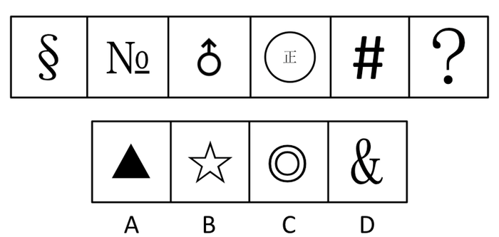

A. A

B. B

C. C

D. D

第 66 题 · 答案与解析

**参考答案（粉笔题库参考内容）**

B

**解析**

元素组成凌乱，考虑数面（封闭空间）。已知图形中每个图形都有且只有一个面，因此下一个图形也应该有且只有一个面。通过分析，A、B、C和D四个选项中图形的面数分别为0、1、2和2，因此只有B项图形符合。

故正确答案为B。

**考点**：数量规律-面

**来源**：2009年国家公务员录用考试《行测》题第66题

### 第 67 题

请从所给的四个选项中，选择最合适的一个填入问号处，使之呈现一定的规律性：

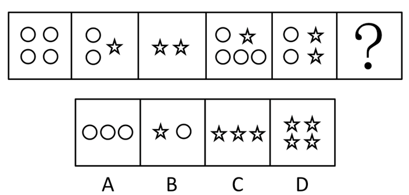

A. A

B. B

C. C

D. D

第 67 题 · 答案与解析

**参考答案（粉笔题库参考内容）**

C

**解析**

本题考查元素换算。

由已知图形可知圆圈与五角星的换算关系为：1个五角星＝3个圆圈，将这一关系代入已知图形中可发现，已知图形可等价的圆圈的个数分别为4、5、6、7、8，因此下一个图形可等价的圆圈的个数应该为9。通过分析，A、B、C和D四个选项中图形可等价的圆圈的个数分别为3、4、9和12，因此只有C项中图形符合。

故正确答案为C。

**考点**：数量规律-素

**来源**：2009年国家公务员录用考试《行测》题第67题

### 第 68 题

请从所给的四个选项中，选择最合适的一个填入问号处，使之呈现一定的规律性：

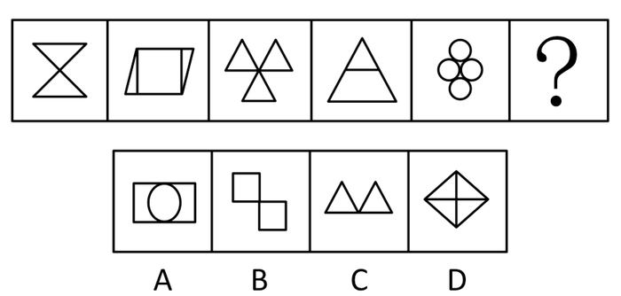

A. A

B. B

C. C

D. D

第 68 题 · 答案与解析

**参考答案（粉笔题库参考内容）**

A

**解析**

思路1：本题考查数元素种类。

已知图形每个图形中元素的种类数分别为1、2、1、2、1，因此下一个图形中元素的种类数应该为2。通过分析，A、B、C和D四个选项图形中元素的种类数分别为2、1、1和1，因此只有A项中图形符合。

故正确答案为A。

思路2：元素组成规则，观察图形均由几部分拼接而成。

继续观察图形，可发现图形中图形拼接方式分为点连接（面和面无公共边）和线连接（面和面有公共边）两种，且呈交替排列，点连接，线连接，点连接，线连接，点连接，问号处应选择线连接图形，故正确答案选D。

由于本题出现在2009年，2009年左右公务员考试的命题特征，元素是考查的重点，因此， A选项更为符合当年的命题特性，故本题正确答案为A。

**考点**：数量规律-素

**来源**：2009年国家公务员录用考试《行测》题第68题

### 第 69 题

请从所给的四个选项中，选择最合适的一个填入问号处，使之呈现一定的规律性：

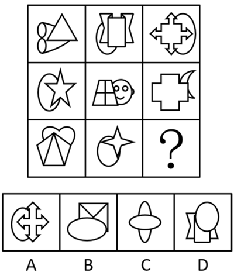

A. A

B. B

C. C

D. D

第 69 题 · 答案与解析

**参考答案（粉笔题库参考内容）**

A

**解析**

元素组成不同，优先考虑属性规律。观察发现题干图形有曲有直，可以考虑曲直性。题干图形都是有曲有直图形，据此可以排除C项；继续观察发现，题干图形都是直线图形覆盖曲线图形，只有A项符合。

故正确答案为A。

**考点**：属性规律-曲直性、特殊规律-图形间关系

**来源**：2009年国家公务员录用考试《行测》题第69题

### 第 70 题

右边四个所给的选项中，哪一项能折成左边给定的图形：

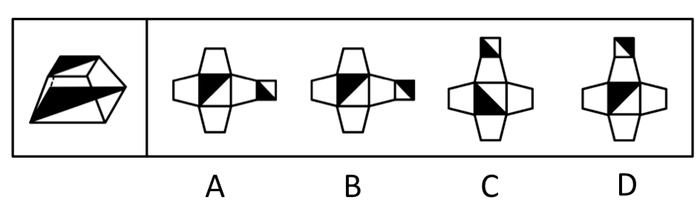

A. A

B. B

C. C

D. D

第 70 题 · 答案与解析

**参考答案（粉笔题库参考内容）**

B

**解析**

解析1：

本题考查立体图形的折叠。通过观察立体图形发现，大黑三角形与小黑三角形是相对关系，即三条边都分别是对应平行的。通过分析，只有B项中图形符合。

解析2：

大黑三角形与小黑三角形的直角顶点由一条边连接，通过这一点可以判断出B项。

故正确答案为B。

**来源**：2009年国家公务员录用考试《行测》题第70题

### 第 71 题

广义而言，集体记忆即是一个具有自己特定文化内聚性和统一性的群体对自己过去的记忆。这种群体可以是一个政治宗教集团、一个地区文化共同体，也可以是一个民族或是一个国家。这种记忆可以是分散的、零碎的、口头的，也可以是集中的、官方的、文字的，可以是对最近一个事件的回忆，也可以是对远古祖先事迹的追溯。

根据上述定义，下列属于集体记忆的是：

A. 我国广泛流传的大禹治水的传说

B. 某市宣传地方旅游资源的记录片

C. 某政府机构关于某项工作的文件汇编

D. 我国某大学内介绍邻国历史的教材

第 71 题 · 答案与解析

**参考答案（粉笔题库参考内容）**

A

**解析**

第一步：抓住定义中的关键词。

关键词包括“群体”、“自己过去的记忆”。

第二步：逐一判断选项。

A项中的广泛流传的大禹治水的传说，完全符合关键词，因此属于集体记忆，当选；

B项中的旅游资源的记录片，不是对过去的记忆，不符合关键词“自己过去的记忆”，因此不属于集体记忆，排除；

C项中的某项工作的文件汇编，不是对过去的记忆，不符合关键词“自己过去的记忆”，因此不属于集体记忆，排除；

D项中的介绍邻国历史的教材，是对别人的过去的记忆，不符合关键词“自己过去的记忆”，因此不属于集体记忆，排除。

故正确答案为A。

**考点**：单定义-其他句式

**来源**：2009年国家公务员录用考试《行测》题第71题

### 第 72 题

隐性广告是指将产品或品牌及其代表性的视觉性符号，甚至服务性内容策略性地融入电影、电视剧或其他电视节目及其他传播内容中（隐藏于载体并与载体融为一体），使观众在接受传播内容事物的同时，不自觉地接受商品或品牌信息，继而达到广告主所期望的传播目的。

根据上述定义，下列属于隐性广告的是：

A. 电视台在转载世界杯足球比赛中场休息时播放的某知名饮品的广告

B. 某知名运动品牌赞助奥运会某国家体育代表运动员的领奖服

C. 某电子产品生产商赞助拍摄电影，电影放映前播放该产品广告

D. 某电视台知名女主播穿着某品牌提供的服装参加亲戚的婚礼

第 72 题 · 答案与解析

**参考答案（粉笔题库参考内容）**

B

**解析**

第一步：抓住定义中的关键词。

关键词包括“隐藏于载体并与载体融为一体”、“传播目的”。

第二步：逐一判断选项。

A项中球赛是球赛，广告是广告，二者并未融为一体，C项中电影是电影，广告是广告，二者也没有融为一体，A、C两项均不符合关键词“隐藏于载体并与载体融为一体”，因此都不属于隐性广告，排除；

B项中运动品牌赞助运动员的领奖服，完全符合关键词，因此属于隐性广告，当选；

D项中女主播穿着某品牌提供的服装参加亲戚的婚礼，参加婚礼显然属于私人活动，不属于传播内容，不符合关键词“传播目的”，因此不属于隐性广告，排除。

故正确答案为B。

**考点**：方式目的

**来源**：2009年国家公务员录用考试《行测》题第72题

### 第 73 题

缺陷补偿是指个体在充当社会角色时不可能事事成功，当自我角色目标失败时，常常可能会对相关的社会角色的重要性做重新评价，从而进行自我定义以补偿自己的角色缺陷。

根据上述定义，下列属于缺陷补偿的是：

A. 小王认为评上优秀员工是晋升的关键，因此当评选失利后决定在下一次评选中再接再厉

B. 小张有份很不错的工作，他参加公务员考试是抱着试试看的态度，所以当他得知自己没有通过考试时并未觉得太遗憾

C. 袁女士离婚后全身心投入工作，取得了很大的成绩，她认为事业成功比婚姻幸福更为重要

D. 黄某大学毕业后求职不顺利，他觉得这是由于自己不是名牌大学毕业生，否则就业会容易的多

第 73 题 · 答案与解析

**参考答案（粉笔题库参考内容）**

C

**解析**

第一步：抓住定义中的关键词。

关键词包括“自我角色目标失败”、“相关的社会角色”、“重新评价”。

第二步：逐一判断选项。

A项中小王评选失利后只是决定在下一次的评选中再接再厉，不符合关键词“重新评价”，因此不属于缺陷补偿，排除；

B项中当小张得知自己没有通过考试时并未觉得太遗憾，同样不符合关键词“重新评价”，因此不属于缺陷补偿，排除；

C项中袁女士离婚后（自我角色目标失败），认为事业成功比婚姻幸福更为重要（对相关的社会角色的重要性做重新评价），符合关键词，因此属于缺陷补偿，当选；

D项中黄某求职不顺利，觉得这是由于自己不是名牌大学毕业生，是他个人，并没有对“相关的社会角色”进行评价，因此不属于缺陷补偿，排除。

故正确答案为C。

**考点**：单定义-其他句式

**来源**：2009年国家公务员录用考试《行测》题第73题

### 第 74 题

职业社会化是指个体按社会需求选择职业，掌握从事某种职业的知识和技能，以及从事某种职业后进行知识、技能更新再训练的过程。

根据上述定义，下列属于职业社会化的是：

A. 食堂管理员张某看到很多领域急需翻译人才，利用业余时间学习取得翻译资格证后到某公司任职

B. 青年张某参军后被分配至汽车班，学得精湛的修车技艺，退役后自己开了一间修理部

C. 某公司会计李某热爱厨艺，业余时间参加了一个培训班，学习营养知识，提高烹饪技艺

D. 下岗女工陈某在抚育孩子期间，积累了丰富的知识和经验，后在朋友建议下开办了一所幼儿园

第 74 题 · 答案与解析

**参考答案（粉笔题库参考内容）**

A

**解析**

第一步：抓住定义中的关键词。

关键词包括“按社会需求”。

第二步：逐一判断选项。

A项中张某看到很多领域急需翻译人才后学习取得翻译资格证，符合关键词，因此属于职业社会化，当选；

B项中张某参军后被分配至汽车班，退役后自己开了一间修理部，这跟社会需求没有关系，不符合关键词“按社会需求”，因此不属于职业社会化，排除；

C项中李某热爱厨艺，参加了一个培训班，这也跟社会需求没有关系，不符合关键词“按社会需求”，因此不属于职业社会化，排除；

D项中陈某开办幼儿园是根据自己的知识和经验，跟社会需求没有关系，不符合关键词“按社会需求”，因此不属于职业社会化，排除。

故正确答案为A。

**考点**：单定义-其他句式

**来源**：2009年国家公务员录用考试《行测》题第74题

### 第 75 题

差异性市场策略是指企业在对整体市场细分的基础上，针对每个细分市场的需求特点，设计和生产不同的产品，制定并实施不同的市场营销组合策略（各种营销手段的综合运用），试图以差异性的产品满足差异性的市场需求。

根据上述定义，下列属于差异性市场策略的是：

A. 某汽车生产企业面向工薪阶层，主要生产经济型轿车，这种轿车售价低，耗油少，深受工薪阶层欢迎

B. 某超市推行会员制，根据会员积分的多少，赠予不同档次的礼品

C. 某企业生产的电脑在市场上销路很好，为拓宽市场，又开始研发手机

D. 某化妆品生产企业针对不同年龄阶段的消费者生产、销售不同种类的润肤露

第 75 题 · 答案与解析

**参考答案（粉笔题库参考内容）**

D

**解析**

第一步：抓住定义中的关键词。

关键词包括“整体市场细分”、“差异性的产品”、“差异性的市场”。

第二步：逐一判断选项。

A项中汽车生产企业主要生产经济型轿车，并没有细分整体市场，不符合关键词“整体市场细分”，因此不属于差异性市场策略，排除；

B项中不同档次的礼品不是产品，不符合关键词“差异性的产品”，因此不属于差异性市场策略，排除；

C项中企业生产电脑，为拓宽市场，又研发手机，针对的是原有市场，且电脑和手机是完全不同的产品，不符合关键词“差异性的产品”和“差异性的市场”，因此不属于差异性市场策略，排除；

D项中化妆品生产企业的做法完全符合关键词，因此属于差异性市场策略，当选。

故正确答案为D。

**考点**：方式目的

**来源**：2009年国家公务员录用考试《行测》题第75题

### 第 76 题

现在统计中常用的人均可支配收入由四部分构成，分别是工资性收入、转移性收入、经营性收入和财产性收入。财产性收入一般是指家庭拥有的动产（如银行存款、有价证券等）、不动产（如房屋、车辆、土地、收藏品等）所得的收入。它包括出让财产使用权获得的利息、租金、专利收入等；财产营运所获得的红利收入、财产增值收益等。

根据上述定义，下列属于财产性收入的是：

A. 王某家传的青花瓷器在展览会上被专家估价为200万元

B. 李某买了一辆载重10吨的货车跑运营，每年收入8万元以上

C. 赵某为公司作出重大贡献，公司给予10万元的奖励

D. 高某在闹市有一间房屋，某厂家在房顶安放了广告牌，并支付给他一定费用

第 76 题 · 答案与解析

**参考答案（粉笔题库参考内容）**

D

**解析**

第一步：抓住定义中的关键词。

关键词包括“家庭拥有的动产、不动产”、“所得的收入”。

第二步：逐一判断选项。

A项中只是估价并没有获得收入，不符合关键词“所得的收入”，因此不属于财产性收入，排除；

B项中“8万元”包含了自己的劳动，不是单纯的财产性收入，排除；

C项中的“10 万元的奖励”，是因为“赵某为公司作出重大贡献”，属于赵某的劳动收入，不属于财产性收入，排除；

D项中高某得到的“广告费”符合关键词，因此属于财产性收入，当选。

故正确答案为D。

**考点**：单定义-其他句式

**来源**：2009年国家公务员录用考试《行测》题第76题

### 第 77 题

有一些植物需经过低温后才能开花并成长结果。通过低温诱导促使植物开花结果的作用称为春化作用。

根据上述定义，下列未利用春化作用原理的是：

A. 洋葱开花影响其品质，因此在春季种植前高温处理越冬贮藏的鳞茎，以降低其感受低温的能力，从而得到较大鳞茎

B. 使用赤霉素，二年生天仙子、白菜、甜菜和胡萝卜等不经低温处理就可以开花

C. 将萌发的冬小麦种子装在罐中，放在冬季的低温下40至50天后在春季播种，可获得和秋播同样的收成

D. 在第一年将二年生药用植物当归的块根挖出，贮藏在高温下，以减少第二年的抽薹率而获得较好的块根

第 77 题 · 答案与解析

**参考答案（粉笔题库参考内容）**

B

**解析**

第一步：找出定义关键词。

“低温诱导”。

第二步：逐一分析选项。

A项中的降低洋葱感受低温的能力，C项中的将萌发的冬小麦种子放在冬季的低温下40至50天，D项中的贮藏在高温下，以减少第二年的抽薹率而获得较好的块根，都是“通过低温诱导”，符合关键词“低温诱导”，因此均是利用春化作用原理，排除；

B项中所说的使用赤霉素，不经低温处理就可以开花，不符合关键词“低温诱导”，因此是未利用春化作用原理，当选。

本题为选非题，故正确答案为B。

**考点**：方式目的

**来源**：2009年国家公务员录用考试《行测》题第77题

### 第 78 题

产品召回是指生产商将已经送到批发商、零售商或最终用户手上的产品收回。产品召回的典型原因是所售出的产品被发现存在缺陷。产品召回制度是针对厂家原因造成的批量性问题而出现的，其中，对于质量缺陷的认定和厂家责任的认定是最关键的核心。

根据上述定义，下列属于产品召回的是：

A. 某商家作出承诺，产品有问题可以无条件退货

B. 某超市发现卖出的罐头已过期变质，及时告知消费者前来退货或换货

C. 因质检把关不严，某厂一批次品流入市场，厂家告知消费者前来退货

D. 某玩具厂因某种玩具有害物质超标，向提起诉讼的部分消费者退货赔偿

第 78 题 · 答案与解析

**参考答案（粉笔题库参考内容）**

C

**解析**

第一步：抓住定义中的关键词。

关键词包括“厂家原因”、“批量性问题”。

第二步：逐一判断选项。

A项中的商家退货、B项中的超市退货或换货均是商家或超市的问题，不符合关键词“厂家原因”，因此A、B两项均不属于产品召回，排除；

C项中厂家告知退货完全符合关键词，因此属于产品召回，当选；

D项中是某种产品有害物质超标，不符合关键词“批量性问题”，因此不属于产品召回，排除。

故正确答案为C。

**考点**：单定义-其他句式

**来源**：2009年国家公务员录用考试《行测》题第78题

### 第 79 题

环境影响评价是指拟定开发计划或建设项目时，事前对该计划或项目将给大气、水体、土壤、生物以及由它们组成的环境系统带来什么影响，这些影响的结果又将对人类的健康和生活环境以及自然环境和经济、文化、历史环境造成什么影响所进行的调查、预测与评价，以及据此制定出防止或减少环境污染和破坏的对策与措施。

根据上述定义，下列属于环境影响评价的行为是：

A. 某市在建设污染水处理厂之前，请专家根据城市规模对该厂日处理污水能力进行调查、预测与评价

B. 某市建高架桥后，附近几栋楼的居民反映该桥严重影响了采光，市政府组织相关部门进行评估以决定如何处理

C. 某市在治理一条古老的河道前，请专家考证该河道的历史，以开发旅游资源

D. 某市在建设机场前，预测飞机噪声并提出机场周围土地利用控制性建议

第 79 题 · 答案与解析

**参考答案（粉笔题库参考内容）**

D

**解析**

第一步：抓住定义中的关键词。

关键词包括“事前”、“环境系统影响”、“调查、预测与评价”、“制定出对策与措施”。

第二步：逐一判断选项。

A项中只是进行“调查、预测与评价”，并不符合关键词“制定出对策与措施”，因此不属于环境影响评价，排除；

B项中不是项目建设之前，而是后续问题处理，不符合关键词“事前”，因此不属于环境影响评价，排除；

C项中是开发旅游资源，不符合关键词“环境系统影响”，因此不属于环境影响评价，排除；

D项中建设机场前的行为完全符合关键词，因此属于环境影响评价，当选。

故正确答案为D。

**考点**：单定义-其他句式

**来源**：2009年国家公务员录用考试《行测》题第79题

### 第 80 题

政府采购是指国家各级政府为从事日常的政务活动或为了满足公共服务的目的，利用国家财政性资金和政府借款购买货物、工程和服务的行为。政府采购不仅是指具体的采购过程，而且是采购政策、采购程序、采购过程及采购管理的总称，是一种对公共采购进行管理的制度。

根据上述定义，下列不属于政府采购的是：

A. 某市政府规定，单笔超过一定金额的办公用品必须报有关部门集中采购

B. 某市政府为方便市民出行，租用电信公司的短信平台给市民发送免费短信

C. 某县政府为改善当地教育条件，拨专项资金给某小学翻修校舍，并规定必须严格按招标程序进行

D. 某市政府通过公开竞标方式选择一家酒店作为指定接待酒店

第 80 题 · 答案与解析

**参考答案（粉笔题库参考内容）**

C

**解析**

第一步：找出定义关键词。

“国家各级政府”、“为日常的政务活动或为了满足公共服务”、“利用国家财政性资金和政府借款”、“购买货物、工程和服务”。

第二步：逐一分析选项。

A 项：采购办公用品，符合“为日常的政务活动”而采购的货物，符合定义，排除；

B 项：为方便市民出行而租用电信公司的短信平台，符合“为了满足公共服务”而采购的服务，符合定义，排除；

C 项：改善教育条件，拨专项资金翻修校舍，属于政府财政拨款，将资金拨给学校，招标的是学校而不是政府，不属于政府购买工程或服务，不符合定义，当选；

D 项：通过竞标指定接待酒店，符合“为日常的政务活动”而采购的服务，符合定义，排除。

本题为选非题，故正确答案为C。

**考点**：主客体

**来源**：2009年国家公务员录用考试《行测》题第80题

### 第 81 题

杂志  对于（  ）相当于（  ）对于  农民

A. 编辑 蔬菜

B. 书刊 农村

C. 传媒 农业

D. 报纸 果农

第 81 题 · 答案与解析

**参考答案（粉笔题库参考内容）**

A

**解析**

将选项逐一代入，判断前后部分的逻辑关系。

A项中“编辑”既能做动词也能做名词。前面部分是产物与生产者间的对应关系，后面部分是产物与生产者间的对应关系，对应关系正确，当选；

B项中前面部分是包容关系，后面部分是对应关系，排除；

C项中前面部分是前者小概念后者大概念间的对应关系，后面部分是前者大概念后者小概念间的对应关系，对应关系相反，排除；

D项中前面部分是并列关系，后面部分是包容关系，排除。

故正确答案为A。

**考点**：逻辑关系-对应关系

**来源**：2009年国家公务员录用考试《行测》题第81题

### 第 82 题

（  ）对于  行动  相当于（  ）对于  航行

A. 目标 灯塔

B. 信心 风帆

C. 激情 桅杆

D. 毅力 水手

第 82 题 · 答案与解析

**参考答案（粉笔题库参考内容）**

A

**解析**

第一步：将选项逐一代入，判断各选项前后部分的逻辑关系。

A中前面部分是指导与被指导间的对应关系，后面部分是指导与被指导间的对应关系。行动需要目标，航行需要灯塔；

B中前面部分是无明显逻辑关系，后面部分是后者依靠前者的对应关系；

C中前面部分是无明显逻辑关系，后面部分是后者依靠前者的对应关系；

D中前面部分是无明显逻辑关系，后面部分是前者控制后者的对应关系。

第二步：逻辑关系相同即为答案。

根据第一步可知，逻辑关系完全相同的是A。

故正确答案为A。

**考点**：逻辑关系-对应关系

**来源**：2009年国家公务员录用考试《行测》题第82题

### 第 83 题

寡  对于（  ）相当于  利  对于（  ）

A. 孤 弊

B. 众 钝

C. 多 益

D. 少 害

第 83 题 · 答案与解析

**参考答案（粉笔题库参考内容）**

B

**解析**

第一步：将选项逐一代入，判断各选项前后部分的逻辑关系。

A中前面部分是近义词关系，后面部分是反义词关系；

B中前面部分是反义词关系，后面部分是反义词关系；

C中前面部分是反义词关系，后面部分是近义词关系；

D中前面部分是近义词关系，后面部分是反义词关系。

第二步：逻辑关系相同即为答案

根据第一步可知，逻辑关系完全相同的是B。

故正确答案为B。

**考点**：语义关系-反义关系

**来源**：2009年国家公务员录用考试《行测》题第83题

### 第 84 题

（  ）对于  手机  相当于  交流  对于（  ）

A. 电视 文学

B. 电脑 文化

C. 信号 文字

D. 通讯 语言

第 84 题 · 答案与解析

**参考答案（粉笔题库参考内容）**

D

**解析**

第一步：将选项逐一代入，判断各选项前后部分的逻辑关系。

A中前面部分是并列关系，后面部分是对应关系；

B中前面部分是并列关系，后面部分是对应关系；

C中前面部分是必然因果关系，后面部分是对应关系；

D中前面部分是后者是前者实现工具的对应关系，后面部分是后者是前者实现工具的对应关系。手机的功能在于通讯；语言的功能在于交流。

第二步：逻辑关系相同即为答案。

根据第一步可知，逻辑关系完全相同的是D。

故正确答案为D。

**考点**：逻辑关系-对应关系

**来源**：2009年国家公务员录用考试《行测》题第84题

### 第 85 题

签约：解约

A. 结婚：离婚

B. 订货：收货

C. 上班：下班

D. 借款：贷款

第 85 题 · 答案与解析

**参考答案（粉笔题库参考内容）**

A

**解析**

第一步：判断题干词语间逻辑关系。

题干两词是对应关系，且是或然对应关系，前者是好的结果，后者是不好的结果。“签约”是“解约”的前提。

第二步：判断选项词语间逻辑关系。

A项与题干的逻辑关系相同。

B项中“收货”，C项中“下班”，D项中“贷款”均不是不好的结果，与题干不符。

故正确答案为A。

**考点**：逻辑关系-对应关系

**来源**：2009年国家公务员录用考试《行测》题第85题

### 第 86 题

冠心病：传染病

A. 熊猫：哺乳动物

B. 鲤鱼：两栖动物

C. 京剧：豫剧

D. 细菌：病毒

第 86 题 · 答案与解析

**参考答案（粉笔题库参考内容）**

B

**解析**

第一步：判断题干词语间逻辑关系。

冠心病是一种病，传染病是一类病，但冠心病不是传染病。

第二步：判断选项词语间逻辑关系。

A项：熊猫是一种哺乳动物，二者为包容关系中的种属关系，与题干逻辑关系不一致，排除；

B项：鲤鱼是一种动物，两栖动物是一类动物，但鲤鱼不是两栖动物，与题干逻辑关系一致，当选；

C项：京剧与豫剧是两种戏曲，二者为并列关系，与题干逻辑关系不一致，排除；

D项：细菌与病毒是两种微生物，二者为并列关系，与题干逻辑关系不一致，排除。

故正确答案为B。

**考点**：逻辑关系-包容关系

**来源**：2009年国家公务员录用考试《行测》题第86题

### 第 87 题

文物：博物馆：展示

A. 显示器：主机：办公

B. 灯塔：探照灯：导航

C. 医生：病房：手术

D. 学生：学校：学习

第 87 题 · 答案与解析

**参考答案（粉笔题库参考内容）**

D

**解析**

第一步：判断题干词语间逻辑关系。

文物放在博物馆进行展示，博物馆是文物展示的地点，两词为场所对应关系。

第二步：判断选项词语间逻辑关系。

A项：显示器是电脑的组成部分，而主机也是电脑的组成部分，两词是并列关系，与题干逻辑关系不一致，排除；

B项：灯塔上有探照灯，探照灯是灯塔的一部分，不是灯塔导航的地点，两词是组成关系，与题干逻辑关系不一致，排除；

C项：病房不是医生进行手术的地点，不存在场所对应关系，与题干逻辑关系不一致，排除；

D项：学生在学校里进行学习，学校是学生学习的场所，两词为场所对应关系，与题干逻辑关系一致，当选。

故正确答案为D。

**考点**：语法关系、逻辑关系-对应关系

**来源**：2009年国家公务员录用考试《行测》题第87题

### 第 88 题

电梯：大厦：城市

A. 肥皂：浴室：客厅

B. 水草：小溪：山谷

C. 飞禽：走兽：森林

D. 奶牛：牛奶：超市

第 88 题 · 答案与解析

**参考答案（粉笔题库参考内容）**

B

**解析**

第一步：判断题干词语间逻辑关系。

题干三词是包容关系，且是后一个词包含前一个词的包容关系。

第二步：判断选项词语间逻辑关系。

与题干相同逻辑关系的即为B。

A中“浴室”和“客厅”是并列关系，排除；

C中“飞禽”和“走兽”是并列关系，排除；

D中“奶牛”和“牛奶”是前一个词包含后一个词的包容关系，排除。

故正确答案为B。

**考点**：逻辑关系-包容关系

**来源**：2009年国家公务员录用考试《行测》题第88题

### 第 89 题

图书：印刷厂：出版社

A. 桌椅：家具厂：木材厂

B. 水果：经销商：种植户

C. 电影：制片人：剧作家

D. 房子：建筑商：开发商

第 89 题 · 答案与解析

**参考答案（粉笔题库参考内容）**

D

**解析**

第一步：判断题干词语间逻辑关系。

题干中三者是对应关系，图书是产品，印刷厂是中间环节，出版社是主控环节。

第二步：判断选项词语间逻辑关系。

A项，桌椅是产品，家具厂是主控环节，木材厂是中间环节，家具厂和木材厂顺序错误，与题干逻辑关系不一致；

B项，种植户只是种植了水果，并不是主控环节，与题干逻辑关系不一致；

C项，剧作家为电影写剧本，但剧作家不是主控环节，与题干逻辑关系不一致；

D项，房子是产品，建筑商是中间环节，开发商是主控环节，与题干逻辑关系一致，与题干逻辑关系一致。

第三步：再次标注答案。

故正确答案为D。

**考点**：逻辑关系-对应关系

**来源**：2009年国家公务员录用考试《行测》题第89题

### 第 90 题

打折：促销：竞争

A. 奖金：奖励：激励

B. 日食：天体：宇宙

C. 娱乐：游戏：健康

D. 京剧：艺术：美感

第 90 题 · 答案与解析

**参考答案（粉笔题库参考内容）**

A

**解析**

第一步：判断题干词语间逻辑关系。

题干两词是对应关系，且后一个词是前一个词目的的对应关系，即打折为了促销，促销为了竞争。

第二步：判断选项词语间逻辑关系。

与题干相同逻辑关系的即为A项，即奖金为了奖励，奖励为了激励；

B项不是后一个词是前一个词目的的对应关系，排除；

C项中娱乐是游戏的目的，即前一个词是后一个词目的的对应关系，排除；

D项中京剧和艺术是包容关系，排除。

故正确答案为A。

**考点**：逻辑关系-对应关系

**来源**：2009年国家公务员录用考试《行测》题第90题

### 第 91 题

有的人即便长时间处于高强度的压力下，也不会感到疲劳，而有的人哪怕干一点活也会觉得累。这除了体质或习惯不同之外，可能与基因不同有关。英国格拉期哥大学的研究小组通过对50名慢性疲劳综合症患者基因组的观察，发现这些患者的某些基因与同年龄、同性别健康人的基因是有差别的。

以下哪项如果为真，最能支持该研究成果应用于慢性疲劳综合症的诊断和治疗：

A. 基因鉴别已在一些疾病的诊断中得到应用

B. 科学家们鉴别出了导致慢性疲劳综合症的基因

C. 目前尚无诊断和治疗慢性疲劳综合症的方法

D. 在慢性疲劳综合症患者身上有一种独特的基因

第 91 题 · 答案与解析

**参考答案（粉笔题库参考内容）**

B

**解析**

第一步：分析题干信息。

本题研究成果是患者的某些基因与同年龄、同性别健康人的基因是有差别的。

第二步：逐一判断选项的作用。

要将研究成果应用于“慢性疲劳综合症的诊断和治疗”就必须要找出导致慢性疲劳综合症的原因。

A中说基因鉴别已在一些疾病的诊断中得到应用，在一定程度上支持了将研究成果应用于该疾病；

B中说法恰好将研究成果和疾病联系在一起，并给出疾病的原因，加强支持了将研究成果应用于该疾病；

C中说法对将研究成果应用于该疾病几乎无作用，属于无关选项；

D中说慢性疲劳综合症患者身上有一种独特的基因，一定程度上也支持了将研究成果应用于该疾病。

综上，B的内容支持力度最强。

故正确答案为B。

**考点**：必要条件

**来源**：2009年国家公务员录用考试《行测》题第91题

### 第 92 题

有三个骰子，其中红色骰子上 2、4、9 点各两面；绿色骰子上 3、5、7 点各两面；蓝色骰子上 1、6、8 点各两面。两个人玩骰子的游戏，游戏规则是两人各选一个骰子，然后同时掷，谁的点数大谁获胜。

那么，以下说法正确的是：

A. 先选骰子的人获胜的概率比后选骰子的人高

B. 选红色骰子的人比选绿色骰子的人获胜概率高

C. 没有任何一种骰子的获胜概率能同时比其他两个高

D. 获胜概率的高低与选哪种颜色的骰子没有关系

第 92 题 · 答案与解析

**参考答案（粉笔题库参考内容）**

C

**解析**

第一步：分析题干信息。

红色骰子点数：2、4、9；绿色骰子点数：3、5、7；蓝色骰子点数：1、6、8。由此可知：

红色中2和4分别小于绿色中的3和5，而红色中9大于绿色中7；

绿色中5和7分别小于蓝色中的6和8，而绿色中3大于蓝色中1；

蓝色中1和8分别小于红色中的2和9，而蓝色中6大于红色中4；

进而可以得到获胜概率是：绿＞红，蓝＞绿，红＞蓝。

第二步：逐一分析并判断选项的正确。

A中先选骰子的人获胜的概率比后选骰子的人高，该说法不正确，因为后者可选有两个点数大于前者的骰子，这样就比前者有更高的胜率，因此A项错误；

B中选红色骰子的人比选绿色骰子的人获胜概率高，该说法不正确，因为红色骰子有两种点数2和4分别小于绿色的3和5，从而有红色胜率小于绿色，因此B项错误；

C中没有任何一种骰子的获胜概率能同时比其他两个高，由第一步中的结论“绿＞红，蓝＞绿，红＞蓝”可知，该说法正确，因此C项正确；

D中获胜概率的高低与选哪种颜色的骰子没有关系，该说法不正确，因为是两个人玩，总有一种骰子的胜率大于另一种股子，因此D项错误。

故正确答案为C。

**考点**：日常结论

**来源**：2009年国家公务员录用考试《行测》题第92题

### 第 93 题

某国家先后四次调高化肥产品出口关税以抑制化肥产品出口。但是，该国化肥产品的出口仍在增加，在国际市场上仍然具有很强的竞争力。

以下不能解释这一情况的是：

A. 国际市场上化肥产品处于供不应求的状态

B. 该国化肥产品的质量在国际市场上口碑很好

C. 该国化肥产品的价格在关税提高后仍然比其他国家低

D. 该国化肥产品的产量仍在不断增加

第 93 题 · 答案与解析

**参考答案（粉笔题库参考内容）**

D

**解析**

第一步：分析题干信息。

题干反映的情况是该国调高化肥产品出口关税后化肥产品的出口仍在增加，仍然具有很强的竞争力。

第二步：逐一判断选项的作用。

A项中该化肥产品处于供不应求的状态，B项中该国化肥产品的质量口碑很好，C项中该国化肥产品价格在关税提高后仍然比其他国家低，是从供求关系、产品质量和价格等方面解释原因的，因此都能够解释题干反映的情况；

D项该化肥产品的产量不断增加，只是涉及到了供应，没有涉及需求，因此不能够解释题干反映的情况。

本题为选非题，故正确答案为D。

**考点**：原因解释

**来源**：2009年国家公务员录用考试《行测》题第93题

### 第 94 题

当受到害虫侵袭时，大豆和其他植物会产生一种叫做茉莉酸盐的荷尔蒙，从而启动一系列化学反应，合成更多蛋白酶抑制剂，增强自身的抵抗力。害虫吃下这种化合物以后，其消化功能会受到抑制。植物生物学家德鲁西亚发现高浓度二氧化碳会导致植物丧失分泌茉莉酸盐的能力，整个“防御通道”由此将被关闭，于是大豆类作物的抗虫害能力便随着二氧化碳含量的增多而逐渐减弱。

由此可以推出：

A. 大豆产量会受到空气状况的影响

B. 茉莉酸盐的主要作用是抵抗害虫

C. 不能产生茉莉酸盐的植物将很难抵御害虫

D. 减少空气中的二氧化碳会增加大豆的抗虫害能力

第 94 题 · 答案与解析

**参考答案（粉笔题库参考内容）**

A

**解析**

日常结论题，根据题干信息逐一分析选项。

A项：题干说“大豆类作物的抗虫害能力便随着二氧化碳含量的增多而逐渐减弱”，也就表明大豆产量会受到空气状况的影响，可以推出，当选；

B项：产生茉莉酸盐从而启动一系列化学反应，合成更多蛋白酶抑制剂，增强自身的抵抗力，而不是茉莉酸盐自身能够抵抗害虫，无法推出，排除

C项：题干中没有提及不能产生茉莉酸盐的植物将很难抵御害虫，无法推出，排除；

D项：题干只说二氧化碳的增加会导致植物丧失分泌茉莉酸盐的能力，并没有说减少空气中的二氧化碳就会增加大豆的抗虫害能力，无法推出，排除。

故正确答案为A。

**考点**：日常结论

**来源**：2009年国家公务员录用考试《行测》题第94题

### 第 95 题

二氧化硫是造成酸雨的重要原因，某地区饱受酸雨困扰，为改善这一状况，该地区 1～6 月份累计减排 11.8 万吨二氧化硫，同比下降 9.1%。根据监测，虽然本地区空气中的二氧化硫含量降低，但是酸雨的频率却上升了7.1%。

以下最能解释这一现象的是：

A. 该地区空气中的部分二氧化硫是从周围地区飘移过来的

B. 虽然二氧化硫的排放得到控制，但其效果要经过一段时间才能显现

C. 尽管二氧化硫的排放总量减少，但二氧化硫在污染物中所占的比重没有变

D. 机动车的大量增加加剧了氮氧化物的排放，而氮氧化物也是造成酸雨的重要原因

第 95 题 · 答案与解析

**参考答案（粉笔题库参考内容）**

D

**解析**

第一步：分析题干。

本题需要解释的矛盾是：本地区空气中的二氧化硫含量已经降低了，但是酸雨的频率却上升了。

第二步：逐一分析选项。

A项只是介绍二氧化硫的来源，无法解释矛盾，不正确；

B项谈到效果经过一段时间才能显现，不能解释为何酸雨的频率却上升的事实，不正确；

C项二氧化硫在污染物中的含量不变，无法解释酸雨的频率上升，不正确；

D项说“机动车的大量增加加剧了氮氧化物的排放，而氮氧化物也是造成酸雨的重要原因”，这就很好地解释了题干中的矛盾；既然本地区空气中的二氧化硫含量已经降低了，那么必定有其他的原因“导致了酸雨的频率上升”，正确。

故正确答案为D。

**考点**：原因解释

**来源**：2009年国家公务员录用考试《行测》题第95题

### 第 96 题

“东胡林人”遗址是新石器时代早期的人类文化遗址，在遗址中发现的人骨化石经鉴定属两个成年男性个体和一个少年女性个体。在少女遗骸的颈部位置有用小螺壳串制的项链，腕部佩戴有牛肋骨制成的骨镯。这说明在新石器时代早期，人类的审美意识已经开始萌动。

以下哪项如果为真，最能削弱上述判断：

A. 新石器时代的饰品通常是石器

B. 出土的项链和骨镯都十分粗糙

C. 项链和骨镯的作用主要是表示社会地位

D. 两个成年男性遗骸的颈部有更大的项链

第 96 题 · 答案与解析

**参考答案（粉笔题库参考内容）**

C

**解析**

第一步：找到论点和论据。

本题论点是在新石器时代早期，人类的审美意识已开始萌动，论据是少女遗骸的颈部位置有用小螺壳串制的项链，腕部佩戴有牛肋骨制成的骨镯。

第二步：判断削弱方式。

论点强调审美意识，论据强调项链和骨镯，所以论点与论据间不存在明显因果关系，需削弱论证，在论点和论据间拆桥。

第三步：逐一判断选项的作用。

A、B两项均与审美意识无直接关系；

C项即在审美意识和项链、骨镯间拆桥，证明二者无关，当选；

D项有加强题干的作用，属无关项。

故正确答案为C。

**考点**：拆桥

**来源**：2009年国家公务员录用考试《行测》题第96题

### 第 97 题

甲、乙和丙，一位是山东人，一位是河南人，一位是湖北人。现在只知道：丙比湖北人的年龄大，甲和河南人不同岁，河南人比乙年龄小。

由此可以推知：

A. 甲不是湖北人

B. 河南人比甲年龄小

C. 河南人比山东人年龄大

D. 湖北人年龄最小

第 97 题 · 答案与解析

**参考答案（粉笔题库参考内容）**

D

**解析**

第一步：找突破口

本题突破口是信息量最大对象，即河南人。由“甲和河南人不同岁”知，甲不是河南人，由“河南人比乙年龄小”知，乙不是河南人，因此河南人是丙。

第二步：抄信息于表中，即将题干和第一步的所有信息放在一个表中

人：                      丙              乙

                      ＜               ＜

地：   湖北          河南

第三步：填空，即填上每一个集合的空格

人： （甲）           丙              乙

                      ＜               ＜

地：   湖北          河南         （山东）

通过分析，只有D项符合。

故正确答案为D。

**考点**：从最大信息开始推

**来源**：2009年国家公务员录用考试《行测》题第97题

### 第 98 题

有关专家指出，月饼高糖、高热量，不仅不利于身体健康，甚至演变成了“健康杀手”。月饼要想成为一种健康食品，关键要从工艺和配料两方面进行改良，如果不能从工艺和配料方面进行改良，口味再好，也不能符合现代人对营养方面的需求。

由此不能推出的是：

A. 只有从工艺和配料方面改良了的月饼，才能符合现代人对营养方面的需求

B. 如果月饼符合了现代人对营养方面的需求，说明一定从工艺和配料方面进行了改良

C. 只要从工艺和配料方面改良了月饼，即使口味不好，也能符合现代人对营养方面的需求

D. 没有从工艺和配料方面改良月饼，却能符合现代人对营养方面需求的情况是不可能存在的

第 98 题 · 答案与解析

**参考答案（粉笔题库参考内容）**

C

**解析**

第一步：翻译题干。利用充分必要条件。

题干中“如果不能从工艺和配料方面进行改良，口味再好，也不能符合现代人对营养方面的需求”可翻译为：－（工艺改良∧配料改良）→－符合现代人对营养方面的需求。

第二步：逐一翻译选项并判断选项的正确。利用逆否规则。

A项：符合现代人对营养方面的需求→工艺改良∧配料改良，是题干推导关系的逆否规则，因此能够推出；

B项：符合现代人对营养方面的需求→工艺改良∧配料改良，是题干推导关系的逆否规则，因此能够推出；

C项：工艺改良∧配料改良→符合现代人对营养方面的需求，“工艺改良∧配料改良”属否前件，无法推出绝对表达的结论，因此不能推出；

D项：－（工艺改良∧配料改良）→－符合现代人对营养方面的需求，是题干推导关系，因此能够推出。

本题为选非题，故正确答案为C。

**考点**：常规翻译

**来源**：2009年国家公务员录用考试《行测》题第98题

### 第 99 题

所有的恐龙都是腿部直立地“站在”地面上的，这不同于冷血爬行动物四肢趴伏在地面上。恐龙的骨组织构造与温血哺乳动物的骨组织构造相似；恐龙的肺部结构和温血动物非常相近。在现代生态系统中（例如非洲草原），温血的捕食者（例如狮子）与被捕食者（例如羚羊）之间的比值是一个常数，对北美洲恐龙动物群的统计显示其中捕食者和被捕食者之间的比例与这个常数近似。这些都说明恐龙不是呆头呆脑、行动迟缓的冷血动物，而是新陈代谢率高、动作敏捷的温血动物。

以下哪项如果为真，最不能反驳上述推理：

A. 有些海龟骨组织构造与哺乳动物类似，却是冷血动物

B. 鲸类等海生哺乳动物并不是直立的，却是温血动物

C. 关于北美洲恐龙动物群捕食者和被捕食者比例的统计有随意性

D. 冷血动物和温血动物生理结构上的主要差别在于心脏结构而非肺部结构

第 99 题 · 答案与解析

**参考答案（粉笔题库参考内容）**

B

**解析**

第一步：分析题干，找到论点和论据。

论点：恐龙不是冷血动物，而是温血动物。

论据：（1）恐龙都是直立的；（2）恐龙的骨组织构造与温血哺乳动物的骨组织构造相似；（3）恐龙的肺部结构和温血动物非常相近；（4）在现代的生态系统中，温血的捕食者与被捕食者之间的比值是一个常数，与北美洲恐龙动物群的统计显示其中捕食者和被捕食者之间的比例近似。

第二步：逐一判断选项的作用。

A项：“有些海龟骨组织构造与哺乳动物类似，却是冷血动物”，这构成了对论据（2）的反驳，因此削弱题干推理；

B项：“鲸类等海生哺乳动物并不是直立的，却是温血动物”，这对论据（1）不能构成反驳，如果要构成反驳，应该说：虽然某种动物是直立的，却不是温血的，因此最不能反驳题干推理；

C项：“关于北美洲恐龙动物群捕食者和被捕食者比例的统计有随意性”，这构成了对论据（4）的反驳，因此削弱题干推理；

D项：“冷血动物和温血动物生理结构上的主要差别在于心脏结构而非肺部结构”，这构成了对论据（3）的反驳，因此削弱题干推理。

故正确答案为B。

**考点**：削弱-实验类、削弱选非题

**来源**：2009年国家公务员录用考试《行测》题第99题

### 第 100 题

生物化学家们宣布，他们已掌握了有效控制植物体内拟南芥酶的技术。使用这种技术，人类就可以改变蔬菜和水果的气味。拟南芥酶是两种植物的综合体，包括二烯氧化物和过氧化氢酶，它能产生茉莉味和绿叶挥发物GLV，后者决定了蔬菜和水果的芳香特点。

由此可推出：

A. 茉莉花中含有的拟南芥酶比其他花多

B. 在掌握这项技术之前，人类无法改变植物的气味

C. 如果去掉了拟南芥酶，蔬菜和水果将改变气味

D. 决定蔬菜和水果气味的是二烯氧化物和过氧化氢酶

第 100 题 · 答案与解析

**参考答案（粉笔题库参考内容）**

C

**解析**

第一步：抓住每句话中的对象。

第一句说明生物化学家掌握了有效控制植物体内拟南芥酶的技术，第二句说明人类使用上述技术可以改变蔬菜和水果的气味，第三句说明拟南芥酶产生的绿叶挥发物GLV决定了蔬菜和水果的芳香特点。

第二步：逐一判断选项的作用。

A中茉莉花在题干中没有涉及，属引入新概念，因此A项无法推出，排除；

B中说“在掌握这项技术之前，人类无法改变植物的气味”，而题干说“使用这种技术，人类就可以改变蔬菜和水果的气味”，如果不使用这种技术，人类是否可以改变蔬菜和水果的气味是不确定的，由此可知B项无法推出，排除；

C项根据题干，拟南芥酶产生的绿叶挥发物GLV决定了蔬菜和水果的芳香特点，若去掉了拟南芥酶，就不会有绿叶挥发物GLV，蔬菜和水果就会失去芳香的味道，因此C项可以推出，当选；

D项说“决定蔬菜和水果气味的是二烯氧化物和过氧化氢酶”，根据题干的最后一句“拟南芥酶是两种植物的综合体，包括二烯氧化物和过氧化氢酶，它能产生茉莉味和绿叶挥发物GLV，后者决定了蔬菜和水果的芳香特点。”可知，是“绿叶挥发物GLV”决定了蔬菜和水果的芳香特点，因此D项也是无法推出的，排除。

故正确答案为C。

**考点**：日常结论

**来源**：2009年国家公务员录用考试《行测》题第100题

### 第 101 题

5，12，21，34，53，80，（    ）

A. 121

B. 115

C. 119

D. 117

第 101 题 · 答案与解析

**参考答案（粉笔题库参考内容）**

D

**解析**

数列无特征规律，优先考虑多级数列。后项减前项可得：7，9，13，19，27，再次作差得：2，4，6，8，构成公差为2的等差数列。则所求项为8+2+27+80=117。

故正确答案为D。

**来源**：2009年426联考《行测》题（天津/陕西/湖北）第86题

### 第 102 题

7，7，9，17，43，（    ）

A. 119

B. 117

C. 123

D. 121

第 102 题 · 答案与解析

**参考答案（粉笔题库参考内容）**

C

**解析**

观察数列，无明显特征且变化平缓，优先考虑多级数列。后项减前项得新数列：0，2，8，26，（    ）；继续作差得：2，6，18，（    ），是公比为3的等比数列，则两次作差后下一项为18 × 3 = 54。故新数列下一项为54+26=80，则原数列所求项=80+43=123。

故正确答案为C。

**来源**：2009年国家公务员录用考试《行测》题第102题

### 第 103 题

1，9，35，91，189，（    ）

A. 361

B. 341

C. 321

D. 301

第 103 题 · 答案与解析

**参考答案（粉笔题库参考内容）**

B

**解析**

观察数列，无明显特征且变化平缓，优先考虑多级数列。作差，后一项减前一项得二级数列：8，26，56，98，二级数列没有明显特征且变化平缓。继续作差得新数列：18，30，42，是公差为12的等差数列，则新数列下一项为42+12=54。二级数列下一项为54+98=152，则原数列所求项=152+189=341。

故正确答案为B。

**来源**：2009年国家公务员录用考试《行测》题第103题

### 第 104 题

0，1/6，3/8，1/2，1/2，（    ）

A. 5/13

B. 7/13

C. 5/12

D. 7/12

第 104 题 · 答案与解析

**参考答案（粉笔题库参考内容）**

C

**解析**

由题干可知本题为分数数列，观察分子分母，增减规律不统一，考虑反约分。将原数列转化为：0/5，1/6，3/8，6/12，10/20，（    ）。分子为：0，1，3，6，10，（    ）。无明显规律考虑作差，得到新数列：1，2，3，4，则下一项为5，故所求项分子为10+5=15；分母为：5，6，8，12，20，（    ）。无明显规律考虑作差，得到新数列：1，2，4，8，是公比为2的等比数列，则下一项为8×2=16，故所求项分母为16+20=36。故原数列所求项为15/36=5/12。

故正确答案为C。

**来源**：2009年国家公务员录用考试《行测》题第104题

### 第 105 题

153，179，227，321，533，（    ）

A. 789

B. 919

C. 1229

D. 1079

第 105 题 · 答案与解析

**参考答案（粉笔题库参考内容）**

D

**解析**

数列作差、递推均无规律且起伏较大，考虑幂次数列。原数列可以表示为：153 = 150 + 3^1、179=170+3^2、227 = 200 + 3^3、321 = 240 + 3^4、533=290+3^5，幂次项底数均为3，指数为连续的自然数，则所求项的幂次项为3^6。

修正项分别为150、170、200、240、290，两两作差得到：20、30、40、50，是公差为10的等差数列，则下一项为50+10=60，故所求项的修正项为60+290=350，则所求项为350 + 3^6 = 350 + 729 = 1079。

故正确答案为D。

**来源**：2009年国家公务员录用考试《行测》题第105题

### 第 106 题

当第29届奥运会于北京时间2008年8月8日20时正式开幕时，全世界和北京同一天的国家占：

A. 全部

B. 1/2

C. 1/2以上

D. 1/2以下

第 106 题 · 答案与解析

**参考答案（粉笔题库参考内容）**

A

**解析**

方法一：全球分为东西各12区。根据东加西减原理，北京东8区晚8点时，东12区是8日夜里24点；此时西12区时间与对应东12区相差一天，为7日24点，所以全球正好都处在8日。

方法二：15个经度相差1个小时，北京属于东8区，当北京在20时的时候，有20个区的地区在0时之后（即同一天），也就是有20 × 15 = 300度的地区在0～20时，另外有20～24时的地区，刚好是4个区，即4×15=60度，300+60=360度，即整个地球。

故正确答案为A。

**考点**：星期日期问题

**来源**：2009年国家公务员录用考试《行测》题第106题

### 第 107 题

小王忘记了朋友手机号码的最后两位数字，只记得倒数第一位是奇数，则他最多要拨号多少次才能保证拨对朋友的手机号码：

A. 90

B. 50

C. 45

D. 20

第 107 题 · 答案与解析

**参考答案（粉笔题库参考内容）**

B

**解析**

最后一位是奇数，有1、3、5、7、9五种可能；倒数第二位有0～9共10种可能，故最多要拨号C(10,1)C(5,1) = 50次。

故正确答案为B。

**考点**：基础排列组合

**来源**：2009年国家公务员录用考试《行测》题第107题

### 第 108 题

用6位数字表示日期，如980716表示的是1998年7月16日。如果用这种方法表示2009年的日期，则全年中六个数字都不相同的日期有多少天：

A. 12

B. 29

C. 0

D. 1

第 108 题 · 答案与解析

**参考答案（粉笔题库参考内容）**

C

**解析**

根据题目条件，显然要知道有多少个符合要求的日期，只需实际构造即可，而在构造的过程中，显然顺序是先安排月份，再安排具体日期。假设2009年AB月CD日，满足要求，它可以简写成“09ABCD”。由于月份当中不能有0，所以不能是01~10月，而11月有两个1，也应该排除，故AB＝12；此时原日期可简写成“0912CD”，由于已经出现了0、1、2，所以肯定不是01~30号，而31号里又有1了，排除，因此满足题目要求的日期为0个。

故正确答案为C。

**考点**：星期日期问题

**来源**：2009年国家公务员录用考试《行测》题第108题

### 第 109 题

已知甲、乙两人共有260本书，其中甲的书有13%是专业书，乙的书有12.5%是专业书，问甲有多少本非专业书：

A. 75

B. 87

C. 174

D. 67

第 109 题 · 答案与解析

**参考答案（粉笔题库参考内容）**

B

**解析**

由“甲的书有13%是专业书”可知，甲的专业书 = 甲的书 × 13%，所以甲的书是100的倍数，甲的非专业书是87的倍数，排除A、D。由“乙的书有12.5%是专业书”可知，乙的专业书 = 乙的书 × 12.5%=乙的书×1/8，所以乙的书是8的倍数。结合选项，若甲的非专业书为174本，则甲有200本书，那么乙的书有60本，不是8的倍数，排除C。

故正确答案为B。

**考点**：和差倍比问题

**来源**：2009年国家公务员录用考试《行测》题第109题

### 第 110 题

一条隧道，甲单独挖要20天完成，乙单独挖要10天完成。如果甲先挖1天，然后乙接替甲挖1天，再由甲接替乙挖1天······，两人如此交替工作，那么，挖完这条隧道共用多少天：

A. 14

B. 16

C. 15

D. 13

第 110 题 · 答案与解析

**参考答案（粉笔题库参考内容）**

A

**解析**

根据题意，设总工程量为20（20和10的公倍数），则甲、乙工作效率分别为1、2，甲乙循环挖隧道时，每一次循环（2天）的工作量为3，因为6 ＜ 20/3 ＜ 7， 则6次循环（12天）后，剩余工程量为20−3×6=2，此时轮到甲继续工作1天后，还需要乙工作半天，故总天数为12+2=14天。

故正确答案为A。

**考点**：周期余数问题、给完工时间型

**来源**：2009年国家公务员录用考试《行测》题第110题

### 第 111 题

甲、乙两人卖数量相同的萝卜，甲打算卖1元2个，乙打算卖1元3个。如果甲、乙两人一起按2元5个的价格卖掉全部的萝卜，总收入会比预想的少4元钱。

问两人共有多少个萝卜？

A. 420

B. 120

C. 360

D. 240

第 111 题 · 答案与解析

**参考答案（粉笔题库参考内容）**

D

**解析**

设甲、乙两人萝卜数量均为6x个，则共有萝卜12x个。根据经济利润公式总收入 = 单价 × 数量，可列方程为6x×1/2+6x×1/3-12x×2/5=4，解得x=20，则萝卜一共有12x=240个。

故正确答案为D。

**考点**：经济利润问题

**来源**：2009年国家公务员录用考试《行测》题第111题

### 第 112 题

甲买了3支签字笔、7支圆珠笔和1支铅笔，共花了32元；乙买了4支同样的签字笔、10支圆珠笔和1支铅笔，共花了43元。如果同样的签字笔、圆珠笔、铅笔各买一支，共用多少钱：

A. 21元

B. 11元

C. 10元

D. 17元

第 112 题 · 答案与解析

**参考答案（粉笔题库参考内容）**

C

**解析**

设签字笔x元，圆珠笔y元，铅笔z元，根据题意可得：3x+7y+z=32，4x+10y+z=43，为不定方程组。从选项可以看出，无论三支笔的价格为何，三种笔各一支的总价为固定值，因此只需找到上述不定方程的一组特解即可，由此令y=0，代入解得x=11，z=-1，由此可知x+y+z=10。

故正确答案为C。

**来源**：2009年国家公务员录用考试《行测》题第112题

### 第 113 题

一种溶液，蒸发掉一定量的水后，溶液的浓度为10%；再蒸发掉同样多的水后，溶液的浓度变为12%；第三次蒸发掉同样多的水后，溶液的浓度将变为多少？

A. 14%

B. 17%

C. 16%

D. 15%

第 113 题 · 答案与解析

**参考答案（粉笔题库参考内容）**

D

**解析**

浓度问题无具体数值考虑赋值法，赋值不变量溶质为10与12的公倍数60，公式浓度=溶质/溶液可转化为溶液=溶质/浓度，则第一次蒸发水后溶液为60/10% = 600，第二次蒸发水后溶液为60/12%=500，则蒸发的水为600-500=100。故第三次蒸发水后溶液浓度为60/(500-100)=15%。

故正确答案为D。

**来源**：2009年国家公务员录用考试《行测》题第113题

### 第 114 题

某公司甲、乙两个营业部共有50人，其中32人为男性。已知甲营业部的男女比例为5：3，乙营业部的男女比例为2：1。

问甲营业部有多少名女职员：

A. 18

B. 16

C. 12

D. 9

第 114 题 · 答案与解析

**参考答案（粉笔题库参考内容）**

C

**解析**

设甲营业部有3x名女职员，乙营业部有y名女职员，则有5x+2y=32；32+3x+y=50，解得x=4，y=6，故甲营业部有3×4＝12名女职员。

故正确答案为C。

**考点**：和差倍比问题

**来源**：2009年国家公务员录用考试《行测》题第114题

### 第 115 题

要求厨师从12种主料中挑选出2种、从13种配料中挑选出3种来烹饪某道菜肴，烹饪的方式共有7种，那么该厨师最多可以做出多少道不一样的菜肴：

A. 131204

B. 132132

C. 130468

D. 133456

第 115 题 · 答案与解析

**参考答案（粉笔题库参考内容）**

B

**解析**

根据题意，从12种主料中挑出2种，共有C_12^2 = (12×11)/(2×1) = 66种；从13种配料中挑出3种，共有C_13^3 = (13×12×11)/(3×2×1) = 286种；从7种烹饪方式中选1种，共有7种，分步用乘法，因此总的方法数为66 × 286 × 7种，尾数为2。

故正确答案为B。

**考点**：基础排列组合

**来源**：2009年国家公务员录用考试《行测》题第115题

### 第 116 题

如下图所示，X、Y、Z分别是面积为64、180、160的三张不同形状的纸片。它们部分重叠放在一起盖在桌面上，总共盖住的面积为290。 X与Y、Y与Z、Z与X重叠部分面积分别为24、70、36。问阴影部分的面积是多少：

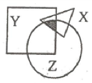

A. 15

B. 16

C. 14

D. 18

第 116 题 · 答案与解析

**参考答案（粉笔题库参考内容）**

B

**解析**

设阴影部分面积为x，根据三集合标准公式：A+B+C-A∩B-B∩C-A∩C+A∩B∩C=总数-都不，代入数据可得64+180+160-24-70-36=290-x，解得x=16。

故正确答案为B。

**考点**：三集合

**来源**：2009年国家公务员录用考试《行测》题第116题

### 第 117 题

甲、乙、丙、丁四个队共同植树造林，甲队造林的亩数是另外三个队造林总亩数的1/4，乙队造林的亩数是另外三个队造林总亩数的1/3，丙队造林的亩数是另外三个队造林总亩数的一半，已知丁队共造林3900亩。

问甲队共造林多少亩：

A. 9000

B. 3600

C. 6000

D. 4500

第 117 题 · 答案与解析

**参考答案（粉笔题库参考内容）**

B

**解析**

甲队占总造林亩数的(1/4)/(1 + 1/4) = 1/5，乙队占(1/3)/(1 + 1/3) = 1/4，丙队占(1/2)/(1+1/2)=1/3，丁队占1 − 1/5 − 1/4 − 1/3 = 13/60。总造林亩数为3900 ÷ 13/60 = 18000亩，甲队造林18000 × 1/5 = 3600亩。

故正确答案为B。

注释：如果其中一个分量为其他几个分量之和的772/77，那么它占总量的比例为m/(n+m)，特别的，其中一个分量为其他几个分量之和的1/n（或者其他几个分量之和为其中一个分量的n倍），则它为总量的1/(n+1)。

**考点**：和差倍比问题

**来源**：2009年国家公务员录用考试《行测》题第117题

### 第 118 题

100人参加7项活动，已知每个人只参加一项活动，而且每项活动参加的人数都不一样。那么，参加人数第四多的活动最多有几个人参加：

A. 22

B. 21

C. 24

D. 23

第 118 题 · 答案与解析

**参考答案（粉笔题库参考内容）**

A

**解析**

设第四多的人数为x人，要使x取值最大，则参加其他活动的人数应尽量少，因每项活动参加的人数都不一样，后面三个比“第四多”的少，且取值最小就是1、2、3，构造数列如下：

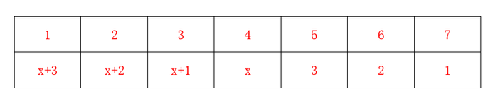

根据题意，总人数为100人，则x+3+x+2+x+1+x+3+2+1=100，解得x=22。

故正确答案为A。

**考点**：构造数列

**来源**：2009年国家公务员录用考试《行测》题第118题

### 第 119 题

一个水库在年降水量不变的情况下，能够维持全市12万人20年的用水量，在该市新迁入3万人之后，该水库只够维持15年的用水量，市政府号召节约用水，希望能将水库的使用寿命提高到30年。

那么，该市市民平均需要节约多少比例的水才能实现政府制定的目标？

A. 2/5

B. 2/7

C. 1/3

D. 1/4

第 119 题 · 答案与解析

**参考答案（粉笔题库参考内容）**

A

**解析**

水量有增长有消耗，判定本题为牛吃草问题。设单位进水量为x，原有水量为y，根据牛吃草问题公式Y=(N-X)\*T，可列方程为y=(12-x)×20=(12+3-x)×15，解得x=3。设市民平均用水量变为原来的n倍，则(15-3)×15=(15n-3)×30，解得n = 3/5，则市民平均节约用水1−3/5 = 2/5。

故正确答案为A。

**来源**：2009年国家公务员录用考试《行测》题第119题

### 第 120 题

某校按字母A到Z的顺序给班级编号，按班级编号加01、02、03······，给每位学生按顺序定学号，若A～K班级人数从15人起每班递增1名，之后每班按编号顺序递减2名，则第256名学生的学号是多少：

A. M12

B. N11

C. N10

D. M13

第 120 题 · 答案与解析

**参考答案（粉笔题库参考内容）**

D

**解析**

由题意知，A～K班级人数是首项为15，公差为1的等差数列，根据a_n=a1+(n-1)×d，K班级人数aK=15+(11-1)×1=25人。根据等差数列求和公式Sn = ((a1 + an)/2) × n，A～K班级总人数为(15+25)/2×11=220人。由K班之后每班递减2人可知：K班之后班级人数是首项为25，公差为-2的等差数列。则L班人数aL=aK−2×1=25−2=23人，此时A～L班级总人数为220+23=243&lt;256，不满足题意，依次往下，M班人数aM = aK − 2 × 2 = 25 − 4 = 21人，此时A～M班级总人数为243+21=264>256，可知第256名学生的学号为M。距离256为256-243=13，因此第256名学生的学号为M13。

故正确答案为D。

**考点**：数列问题

**来源**：2009年国家公务员录用考试《行测》题第120题

## 材料 1

根据所给图表、文字资料完成各题。

        在2008年8月8日至24日奥运会期间，北京市的空气质量不仅天天达标，而且有10天达到一级，全面兑现了对奥运会空气质量的承诺。下图是2008年1～8月北京市大气质量检测情况，图中一、二、三、四级是空气质量等级。一级空气质量最好，一级和二级都是质量达标天气。2008年北京的空气质量控制目标是全年达标天数累计达256天。

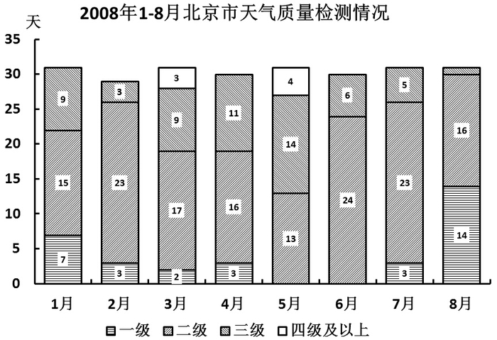

### 第 121 题

1～8 月空气合格天数超过20天的月份有多少个：

A. 4

B. 5

C. 6

D. 7

第 121 题 · 答案与解析

**参考答案（粉笔题库参考内容）**

B

**解析**

定位图形材料，1～8月空气合格天数如下：

1月：7+15=22>20；

2月：3+23=26>20；

3月:2+17=19&lt;20；

4月: 3+16=19&lt;20；

5月: 13&lt;20；

6月: 24>20；

7月: 3+23=26>20；

8月: 14+16=30>20。

可以看出，1～8月空气合格天数超过20天的月份有5个。

故正确答案为B。

**考点**：简单加减计算、综合资料

**来源**：2009年国家公务员录用考试《行测》题第121题

### 第 122 题

1～8 月间，月平均空气质量合格天数约为多少天：

A. 22

B. 24

C. 26

D. 28

第 122 题 · 答案与解析

**参考答案（粉笔题库参考内容）**

A

**解析**

根据题干“1～8月间，月平均······”，结合材料时间为2008年1～8月，可判定本题为现期平均数计算问题。结合图形材料可知，1～8月空气质量合格天数分别为：22（7+15）、26（3+23）、19（2+17）、19（3+16）、13、24、26（3+23）、30（14+16）天，取中间值20，计算差值部分之和为2+6-1-1-7+4+6+10=19，故月平均合格天数为19/8 + 20 ≈ 22天。

故正确答案为A。

**考点**：现期平均数、综合资料

**来源**：2009年国家公务员录用考试《行测》题第122题

### 第 123 题

若将空气质量达标任务平均分配到各月，截至 8 月末，全年 256 天空气质量达标的计划完成情况是：

A. 完成进度较慢

B. 完成进度正常

C. 完成进度提前

D. 无法判断

第 123 题 · 答案与解析

**参考答案（粉笔题库参考内容）**

C

**解析**

根据题干“若将空气质量达标任务平均分配到各月，截至8月末，全年256天空气质量达标的计划完成情况是”，结合选项为“较慢、提前”，可判定本题为平均数的比较问题。结合上题计算结果，1～8月平均空气质量达标天数22天，根据题干全年空气质量达标的计划天数为256天，则月平均空气质量达标的计划天数为256 ÷ 12 ≈ 21.3天&lt;22天，故空气质量达标的计划完成情况是完成进度提前。

故正确答案为C。

**考点**：两期平均数比较、综合资料

**来源**：2009年国家公务员录用考试《行测》题第123题

### 第 124 题

第二季度与第一季度相比，空气达标天数的比重：

A. 上升了3.3%

B. 下降了3.3%

C. 上升了12%

D. 下降了12%

第 124 题 · 答案与解析

**参考答案（粉笔题库参考内容）**

D

**解析**

根据题干“第二季度与第一季度相比，······比重”，可判定本题为两期比重问题。由于2008年是闰年，2月份有29天，故第一季度共31+29+31=91天，空气质量达标的天数为22+26+19=67天；第二季度共30+31+30=91天，空气质量达标的天数为19+13+24=56天，则与第一季度相比，空气达标天数的比重差为56/91−67/91=(56−67)/91=−11/91≈−12%，即比重下降了12%。

故正确答案为D。

**考点**：两期比重、综合资料

**来源**：2009年国家公务员录用考试《行测》题第124题

### 第 125 题

下列关于2008年1～8月间北京空气质量的描述不正确的是：

A. 3～5月的空气质量较差

B. 各月份空气质量相差不大

C. 8月是空气质量最好的一个月

D. 有一个月的空气质量达标天数少于15天

第 125 题 · 答案与解析

**参考答案（粉笔题库参考内容）**

B

**解析**

A项：根据图形资料可知，3～5月空气达标天数均少于20天，是前八个月最少的月份，故3～5月的空气质量较差，正确；

B项：五月份与八月份相比，空气质量达标天数不足八月份的一半，因此各月空气质量差距较大，错误；

C项：八月份的空气质量有30天达标，是各月空气质量达标天数最多的月份，正确；

D项：五月份空气质量达标天数为13天，少于15天，正确。

本题为选非题，故正确答案为B。

**考点**：综合分析、综合资料

**来源**：2009年国家公务员录用考试《行测》题第125题

## 材料 2

根据以下资料，完成各题。

2006 年全国农村外出从业劳动力流向及从业情况统计表（单位：%）

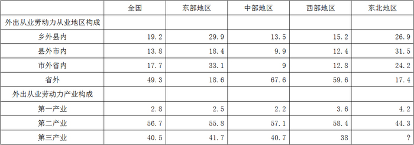

        2006 年，全国农村外出从业劳动力中，男性劳动力 8434 万人，占 64%。从年龄构成上看，20 岁以下占 16.1%；21～30 岁占 36.5%；31～40 岁占 29.5%；41～50 岁占 12.8%；51 岁以上占 5.1%。从文化程度看，文盲占 1.2%；小学文化程度占 18.7%；初中文化程度占 70.1%；高中文化程度占 8.7%；大专及以上文化程度占 1.3%。

### 第 126 题

全国农村外出从业的女性劳动力约有多少万人：

A. 4744

B. 5397

C. 9901

D. 13178

第 126 题 · 答案与解析

**参考答案（粉笔题库参考内容）**

A

**解析**

根据题干“全国农村外出从业的女性劳动力约有多少万人”，结合材料给出的2006年男性劳动力人数以及占总外出从业劳动力人数的比重，可判定本题为现期比重问题。定位文字材料可得：男性劳动力为8434万人，占总外出从业劳动力的64%，则女性占总外出从业劳动力的100%-64%=36%，根据公式：比重 = 部分量/总体量，则女性劳动力人数为8434/64% × 36% = (8434×36)/64= (4217 × 9)/8 ≈ 4200 × 1.1 = 4200 × (1 + 0.1) = 4620万人，与A项最接近。

故正确答案为A。

**考点**：现期比重、综合资料

**来源**：2009年国家公务员录用考试《行测》题第126题

### 第 127 题

表中“？”处的数值应为：

A. 41.6

B. 42.5

C. 51.5

D. 52.4

第 127 题 · 答案与解析

**参考答案（粉笔题库参考内容）**

C

**解析**

根据题干“表中‘？’处的数值应为”，结合材料从事第一产业、第二产业、第三产业的人相加起来应当恰好为100%，可判定本题为现期比重计算问题。定位表格材料，可知东北地区从事第一产业、第二产业的人为4.2%和44.3%，故从事第三产业的人为100%-4.2%-44.3%=51.5%。

故正确答案为C。

**考点**：现期比重、综合资料

**来源**：2009年国家公务员录用考试《行测》题第127题

### 第 128 题

假设不同性别劳动力会在三大产业间均匀分布，则全国男性农村外出从业劳动力从事第二产业的约有多少万人：

A. 3416

B. 3736

C. 4342

D. 4782

第 128 题 · 答案与解析

**参考答案（粉笔题库参考内容）**

D

**解析**

根据题干 “······全国男性农村外出从业劳动力从事第二产业的约有多少万人”，结合表格材料给出的所占比重，可判定本题为现期比重计算问题。定位文字材料可知，全国农村外出从业劳动力中，男性劳动力8434万人；根据不同性别的劳动力在三大产业间均匀分布，定位表格材料，可知全国从事第二产业的人数占男性总人数56.7%。根据公式：比重 = 部分量/总体量，则男性农村外出从业劳动力从事第二产业的人数为8434×56.7%≈8400×57%= (8000+400) × 57% = 8000 × 57% + 400 × 57%= 4560+228 = 4788万人，与D项最接近。

故正确答案为D。

**考点**：现期比重、综合资料

**来源**：2009年国家公务员录用考试《行测》题第128题

### 第 129 题

关于农村外出从业劳动力的描述，无法从上述资料中推出的是：

A. 外出劳动力大多从事第二产业

B. 东部和东北地区的劳动力大部分会留在省内

C. 各地区的劳动力流向主要取决于本地的生活习惯

D. 不同地区劳动力对从业地区选择的倾向性差异很大

第 129 题 · 答案与解析

**参考答案（粉笔题库参考内容）**

C

**解析**

A项：定位表格材料可知，2006年，全国农村第二产业外出从业劳动力占外出从业劳动力总数的56.7%，正确；

B项：定位表格材料可知，东部地区省外从业的外出劳动力仅占总数的18.6%，东北地区省外从业的外出劳动力仅占总数的17.4%，正确；

C项：各地区的劳动力流向主要取决于本地的生活习惯在材料中无任何支持，故无法得出，错误；

D项：定位表格材料可知，不同地区劳动力对从业地区选择的倾向性差异很大，正确。

本题为选非题，故正确答案为C。

**考点**：综合分析、综合资料

**来源**：2009年国家公务员录用考试《行测》题第129题

### 第 130 题

关于农村外出从业劳动力的描述，能够从上述资料中推出的是：

A. 东北地区劳动力对从业地的选择差异最小

B. 超过7500万男性劳动力为高中以下文化程度

C. 中西部地区劳动力大部分流向东部和东北地区

D. 大专及以上文化程度仅占1.3%，说明高学历的劳动力多数都在家从业

第 130 题 · 答案与解析

**参考答案（粉笔题库参考内容）**

A

**解析**

A项：定位表格材料可知，东北地区劳动力对从业地的选择比例在各地区比较时最为均衡，因此选择差异最小，正确；

B项：定位文字材料，高中及以上文化程度的劳动力有10% ，但这是针对男性、女性一起统计的结果，不能代表男性劳动力中高中及以上文化程度的劳动力百分比，错误；

C项：资料中并未涉及各地区劳动力的流向问题，因此该项无法知道，错误；

D项：定位文字材料，大专及以上文化程度的劳动力占1.3% ，与该部分劳动力的从业地之间没有任何关系，错误。

故正确答案为A。

**考点**：综合分析、综合资料

**来源**：2009年国家公务员录用考试《行测》题第130题

## 材料 3

根据以下资料，完成各题。

某港口 2007 年生产统计表

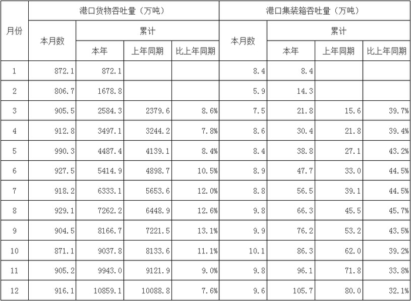

### 第 131 题

2007年该港口货物吞吐量最高的季度是：

A. 第一季度

B. 第二季度

C. 第三季度

D. 第四季度

第 131 题 · 答案与解析

**参考答案（粉笔题库参考内容）**

B

**解析**

方法一：定位表格第三列（累计本年数据）可知，第一季度港口货物吞吐量为：2584.3万吨；第二季度为5414.9−2584.3≈5415−2584=2831万吨；第三季度为8166.7 − 5414.9 ≈ 8167 − 5415 = 2752万吨；第四季度为：10859.1 − 8166.7 ≈ 10859 − 8167 = 2692万吨。因此2007年该港口货物吞吐量最高的季度是第二季度。

方法二：定位表格第二列（本月数据）可以看出，第二季度的货物吞吐量中，4、5、6月份均高于910万吨，且该年度的最大吞吐量（5月份990.3万吨）也在该季度。因此2007年该港口货物吞吐量最高的季度是第二季度。

故正确答案为B。

**考点**：简单加减计算、统计表

**来源**：2009年国家公务员录用考试《行测》题第131题

### 第 132 题

2006年4月到2007年12月间，港口货物吞吐量高于900万吨的月份有多少个：

A. 10

B. 11

C. 12

D. 13

第 132 题 · 答案与解析

**参考答案（粉笔题库参考内容）**

C

**解析**

根据题干“2006年4月到2007年12月间，港口货物吞吐量高于900万吨的月份有······”，结合材料时间为2007年，可判定本题为基期计算问题。从表中第二列可以看出，2007年有9个月份的港口货物吞吐量高于900万吨。表中第四列，后项减前项，可知从2006年4月到2006年12月间港口货物吞吐量依次为：

4月＝3244.2－2379.6＜900万吨；

5月＝4139.1－3244.2＜900万吨；

6月＝4898.7－4139.1＜900万吨；

7月＝5653.6－4898.7＜900万吨；

8月＝6448.9－5653.6＜900万吨；

9月＝7221.5－6448.9＜900万吨；

10月＝8133.6－7221.5＞900万吨；

11月＝9121.9－8133.6＞900万吨；

12月＝10088.8－9121.9＞900万吨。

故2006 年有3个月份的港口货物吞吐量高于900万吨，则2006年4月到2007年12月间，港口货物吞吐量高于900万吨的月份有3+9=12个。

故正确答案为C。

**考点**：基期计算、统计表

**来源**：2009年国家公务员录用考试《行测》题第132题

### 第 133 题

2007年4～12月间港口集装箱吞吐量同比增长率最高的月份是：

A. 5 月

B. 6 月

C. 7 月

D. 8 月

第 133 题 · 答案与解析

**参考答案（粉笔题库参考内容）**

A

**解析**

根据题干“2007年4～12月间港口集装箱吞吐量同比增长率最高的月份”，判定本题为一般增长率比较问题。定位统计表可得：

2007年5月-8月的港口集装箱吞吐量分别为：5月8.4万吨；6月8.9万吨；7月8.8万吨；8月9.8万吨。

2006年5月-8月的的港口集装箱吞吐量分别为：

5月：27.1－21.8＝5.3万吨；

6月：33－27.1＝5.9万吨；

7月：39.1－33＝6.1万吨；

8月：45.5－39.1＝6.4万吨。

根据增长率 = (现期量 − 基期量)/基期量 = 增长量/基期量，可得5-8月的增长率分别为：

5月：(8.4 − 5.3)/5.3 = 3.1/5.3；

6月：(8.9 − 5.9)/5.9 = 3.0/5.9；

7月：(8.8−6.1)/6.1=2.7/6.1；

8月：(9.8 - 6.4)/6.4 = 3.4/6.4。

与6月、7月相比，5月所对应的基期量（分母）最小，而增长量（分子）最大，故可排除6月、7月，只需比较3.1/5.3与3.4/6.4的大小关系即可。分母倍数大，则分母大的分数小，故：3.1/5.3 ＞ 3.4/6.4，所以5月的同比增长率最高。

故正确答案为A。

**考点**：一般增长率、统计表

**来源**：2009年国家公务员录用考试《行测》题第133题

### 第 134 题

2007 年，港口货物吞吐量和集装箱吞吐量均低于全年平均水平的月份有几个：

A. 2

B. 3

C. 4

D. 5

第 134 题 · 答案与解析

**参考答案（粉笔题库参考内容）**

A

**解析**

根据题干“2007年······吞吐量均低于全年平均水平······”可判定本题为现期平均数计算问题。定位表格可得：2007年全年港口货物月平均吞吐量为10859.1/12 ≈ 904.9万吨，12个月内，低于该值的月份为1、2、9、10月，共4个月；

2007年全年港口集装箱月平均吞吐量为105.7/12 ≈ 8.81万吨，12个月内，低于该值的月份为1、2、3、4、5、7月，共6个月。其中两者均在平均数量之下的有1、2两个月份。

故正确答案为A。

**考点**：现期平均数、统计表

**来源**：2009年国家公务员录用考试《行测》题第134题

### 第 135 题

能够从上述资料中推出的是：

A. 2006年第一季度，月均港口货物吞吐量超过800万吨

B. 2007年第一季度，港口集装箱吞吐量高于全年平均水平

C. 2006年 4～12 月间港口集装箱吞吐量低于6万吨的月份有3个

D. 2007年第四季度的所有月份港口货物吞吐量均比上一年同期有所下降

第 135 题 · 答案与解析

**参考答案（粉笔题库参考内容）**

D

**解析**

A项：定位表格第四列可知：2006年3月累计港口货物吞吐量为2379.6万吨。根据公式：平均数 = 总数/个数，则 2006年第一季度，月均港口货物吞吐量2379.6/3 ＜ 800万吨，错误；

B项：定位表格第七列可知：2007年3月累计集装箱吞吐量为21.8万吨，2007年12月累计105.7万吨。根据公式：平均数 = 总数/个数，代入数据可得2007年第一季度月均集装箱吞吐量为21.8/3≈7.3万吨，全年平均水平为105.7/12 ≈ 8.8万吨，前者低于后者，错误；

C项：定位表格第八列可知，2006年4-12月港口集装箱吞吐量分别为，4月：21.8-15.6>6万吨；5月：27.1-21.8&lt;6万吨；6月：33.0-27.1&lt;6万吨；7月：39.1-33.0>6万吨；8月：45.5-39.1>6万吨；9月：53.2-45.5>6万吨；10月：62.0-53.2>6万吨；11月：71.8-62>6万吨；12月：80-71.8>6万吨。低于6万吨的有5、6两个月，错误；

D项：定位第二、四列可知：2006年10-12月港口货物吞吐量分别为，10月：8133.6 − 7221.5 ≈ 8134 − 7222 = 912万吨；11月：9121.9 − 8133.6 ≈ 9122 − 8134 = 988万吨；12月：10088.8 − 9121.9 ≈ 10089 − 9122 = 967万吨。2007年10-12月港口货物吞吐量分别为871.1万吨、905.2万吨、916.1万吨。故2007年第四季度的所有月份港口货物吞吐量均比上一年同期有所下降，正确。

故正确答案为D。

**考点**：统计表、综合分析

**来源**：2009年国家公务员录用考试《行测》题第135题

## 材料 4

根据以下资料，完成各题。

        全国 2007 年认定登记的技术合同共计 220868 项，同比增长 7%，总成交金额 2226 亿元，同比增长 22.44%；平均每项技术合同成交金额突破百万元大关，达到 100.78 万元。

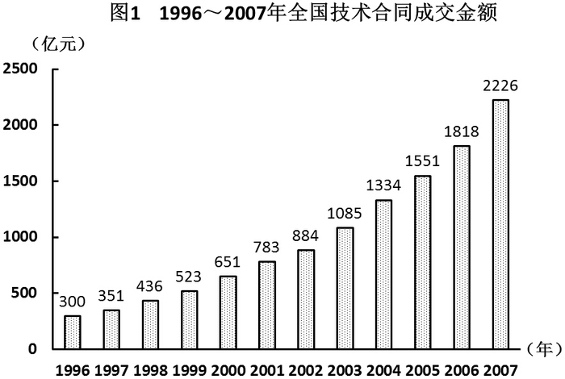

        2007 年全国共签订技术开发合同 73320 项，成交金额 876 亿元，分别比上年增长了 13.5% 和 22.2%；共签订技术转让合同 11474 项，成交金额 420 亿元，成交金额同比增长 30.8%；技术服务和技术咨询合同成交金额分别为 840 亿元和 90 亿元，分别比上年增长了 20.9% 和 5.9%。

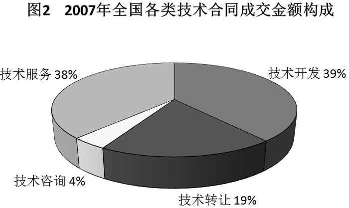

        2007 年，在全国认定登记的技术合同中，涉及技术秘密、计算机软件、专利、集成电路、生物医药、动植物新品种等各类知识产权的技术合同共计 109740 项，成交金额 1477 亿元，较上年增长 23.5%，其中，技术秘密和计算机软件著作权的技术交易成交额居第一，第二，技术秘密合同成交 76261 项，成交金额 1008 亿元，较上年增长 29.2%；计算机软件著作权合同成交 27617 项，成交金额 255 亿元，较上年增长了 15.4%。

### 第 136 题

2007年平均每项技术合同成交金额同比增长率为多少：

A. 8.15%

B. 14.43%

C. 25.05%

D. 35.25%

第 136 题 · 答案与解析

**参考答案（粉笔题库参考内容）**

B

**解析**

根据题干“2007年平均······同比增长率······”，可判定本题为平均数的增长率问题。定位文字材料第一段可得：2007年认定登记的技术合同同比增长7%，总成交金额同比增长22.44%，根据公式：平均数增长率r = (a − b)/(1 + b)，可得2007年平均每项技术合同成交金额同比增长率=(22.4%-7%)/(1+7%)≈15%/1.1≈15%−1.5% = 13.5%，与B项最为接近。

故正确答案为B。

**考点**：平均数的增长率、综合资料

**来源**：2009年国家公务员录用考试《行测》题第136题

### 第 137 题

根据图 1 所提供的信息，以下关于全国合同成交金额的描述正确的是：

A. 1997年至2007年间，年增长率逐年提高

B. 1997年至2007年间，年增长金额逐年递增

C. 1996年至2007年的年平均成交金额约为800亿元

D. 2007年的成交金额未能实现比1996年翻三番的目标

第 137 题 · 答案与解析

**参考答案（粉笔题库参考内容）**

D

**解析**

A项：定位柱状图，根据公式：增长率 = (现期量 - 基期量)/基期量，则2001年全国技术合同成交金额增长率为(783 − 651)/651 = 132/651，2002年全国技术合同成交金额增长率为(884 − 783)/783 = 101/783，根据分数性质，132/651 ＞ 101/783，2002年增长率低于2001年，不是逐年提高，错误；

B项：定位柱状图，2001年全国合同成交增长金额为783-651=132亿元，2002年全国合同成交增长金额为884-783=101亿元，2002年低于2001年，不是逐年提高，错误；

C项：定位柱状图， 1996年至2007年平均成交金额= (300+351+436+523+651+783+884+1085+1334+1551+1818+2226)/12=11942/12≈995亿元，错误；

D项：定位柱状图，2007年的成交金额为2226亿元，1996年为300亿元。翻3番，即变为原来的2^3=8倍，2226＜300×8=2400，因此，未实现翻三番目标，正确。

故正确答案为D。

**考点**：综合分析、综合资料

**来源**：2009年国家公务员录用考试《行测》题第137题

### 第 138 题

下列关于2006年技术开发、技术转让、技术咨询和技术服务等四类合同占全国成交金额比重的图形，描述正确的是：

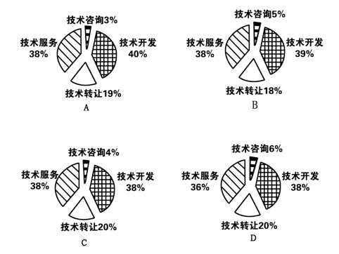

A. A

B. B

C. C

D. D

第 138 题 · 答案与解析

**参考答案（粉笔题库参考内容）**

B

**解析**

根据题干“2006年技术开发、技术转让、技术咨询和技术服务等四类合同占全国成交金额比重”，结合材料时间为2007年，选项为饼状图，可判定本题为基期比重问题。

定位文字材料第一、二段和饼图可得：2007年全国总成交金额同比增长22.44%，技术开发成交金额同比增长22.2%、技术转让成交金额同比增长30.8%、技术服务成交金额同比增长20.9%、技术咨询成交金额同比增长5.9%；2007年技术开发，技术转让，技术咨询和技术服务等四类合同占全国成交金额比重分别为39%、19%、4%、38%。

根据两期比重比较的方法“部分增长率（a）＞整体增长率（b），比重上升；反之，比重下降”可知：

技术咨询成交金额：5.9%(a)&lt;22.44%(b)，2007年比重（4%）&lt;2006年比重，排除A、C两项；

技术转让成交金额：30.8%(a)>22.44%(b)，2007年比重（19%）>2006年比重，排除D项。

故正确答案为B。

**考点**：基期比重、综合资料

**来源**：2009年国家公务员录用考试《行测》题第138题

### 第 139 题

2006年技术秘密合同成交金额占全国技术合同总成交金额的比重是多少：

A. 42.9%

B. 45.3%

C. 65.2%

D. 68.2%

第 139 题 · 答案与解析

**参考答案（粉笔题库参考内容）**

A

**解析**

根据题干“2006年······占······的比重······”，结合材料时间为2007年，可判定本题为基期比重问题。定位柱状图和文字材料第三段可得：2006年全国技术合同成交金额为1818亿元，2007年技术秘密合同成交金额1008亿元，较上年增长29.2%。根据公式：基期量 = 现期量/(1+r)，则2006年技术秘密合同成交金额为1008/(1+29.2%)亿元，根据公式：比重=部分/总体，则2006年技术秘密合同成交金额占全国技术合同总成交金额的比重= 1008/((1+29.2%)×1818)≈ 1000/(1.3 × 1800) = 10/23.4≈42.7%，与A项最为接近。

故正确答案为A。

**考点**：基期比重、综合资料

**来源**：2009年国家公务员录用考试《行测》题第139题

### 第 140 题

能够从上述资料中推出的是：

A. 计算机软件著作权合同平均每项的成交金额是所有技术合同中最高的

B. 2007年技术服务和技术咨询合同总数不到全国认定的技术合同总数的一半

C. 如果保持2007年的增速，全国技术合同成交总金额将在2010年突破 3500亿元

D. 2007年技术开发、技术转让、技术咨询、技术服务的成交金额同比增长都超过10%

第 140 题 · 答案与解析

**参考答案（粉笔题库参考内容）**

C

**解析**

A项：定位文字材料第三段可知：专利、集成电路、生物医药、动植物新品种等各类知识产权的平均每项成交金额无法得知，故无法根据已知信息判断计算机软件著作权合同的平均每项成交金额在所有技术合同中的位次，错误；

B项：定位文字材料第一、二段可知：2007年技术开发和技术转让合同项数总和为：73320+11474=84794项，不到技术合同总数220868项的一半，由此可知，技术服务和技术咨询两项合同总数超过技术合同总数的一半，错误；

C项：定位文字材料第一段可知：2007年全国技术合同总成交金额2226亿元，同比增长22.44%，按照该增速，到2010年，技术合同成交总金额为2226 × (1 + 22.44%)^3 ＞2226 × 1.22 × 1.22 × 1.22 ≈4000^+ ＞ 3500亿元，正确；

D项：定位文字材料第二段可知：2007年技术咨询成交金额同比增长5.9%&lt;10%，错误。

故正确答案为C。

**考点**：综合分析、综合资料

**来源**：2009年国家公务员录用考试《行测》题第140题

