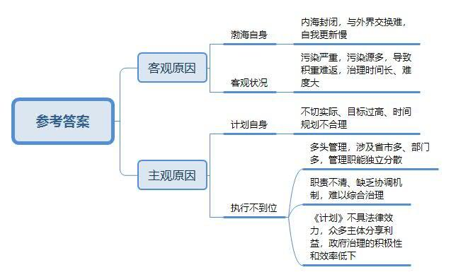
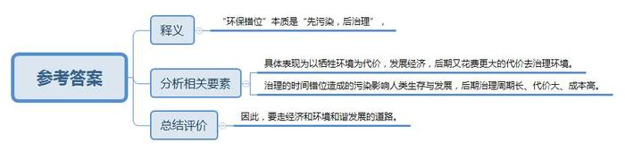
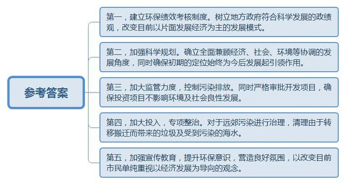
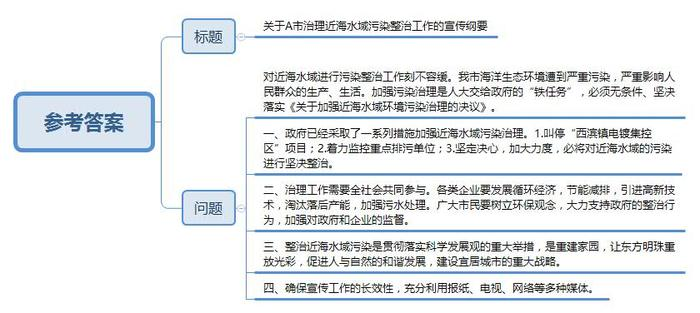
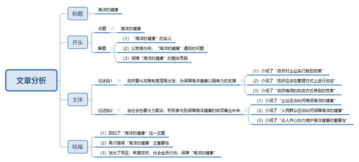

# 2010年国家公考《申论》题（地市级）

<!-- gwy:overview:start -->
> **国考 · 2010 · 申论 · 地市级** ｜ 5 题 · 图片 5 处 · 答案随题折叠

导航：[题目](#题目) · [材料 1](#材料-1)
<!-- gwy:overview:end -->

> 候选采集稿。参考答案及解析来自粉笔页面，不代表官方答案或真实高分答卷；来源使用许可与原卷对应关系仍需人工核实。

## 给定材料

### 材料 1

海洋是人类家园的组成部分，为人类社会的发展提供了丰富而宝贵的资源。海洋资源包括旅游、可再生能源、油气、渔业、港口和海水六大类。我国海域内，有海洋生物两万多种，其中，海洋鱼类3000多种。天然气资源量14万亿立方米，滨海砂矿资源储量31亿吨，海洋可再生源理论蕴藏量6.3亿千瓦。海洋石油资源量约240亿吨。

随着工业化、城市化的快速发展和人口数量的增长，全球海洋污染愈益严重。海洋污染的治理难度非常大，特别是像渤海这样的内海，海水封闭性强，自身交换能力差，一旦污染，它的自我更新周期至少需要15年。渤海素有我国“鱼仓”、“盐仓”和“海洋公园”的美誉，但近30年来污染加剧，情况堪忧。调查显示，1983年渤海鱼类有63种，2004年只有30种，带鱼、鳓鱼、真鲷、银鲳等几乎绝迹。2000年至2007年，渤海发生赤潮灾害87次，累计赤潮面积2.05万平方公里。

2001年，国务院正式批准由国家环保总局、国家海洋局、交通部等有关部门和天津、河北、辽宁、山东四省市联合制定的《渤海碧海行动计划》（以下简称《碧海计划》），旨在促使渤海近岸海域海洋环境质量的改善，努力实现海洋生态环境良性循环。《碧海计划》总投资500多亿元，实现项目427个，主要包括城市污水处理、海上污染应急、海岸生态建设、船舶污染治理等内容。实施区域包括天津、河北、辽宁、山东辖区内的13个沿海城市和渤海海域，以每五年为一个阶段实施。近岸海域环境保护拟分阶段推进，分为近期、中期和远期目标。2001年至2005年要实现的近期目标是：渤海海域环境污染得到初步控制，生态破坏的趋势得到初步缓解。

科学调查与监测结果证明，陆源污染对渤海威胁最大，入海河流流域周边的生活污水、工业废水、农药及化肥污染是三大陆源污染源；此外，船舶石油泄漏、海上石油开采和海水养殖中的添加剂也会对海洋造成严重污染。在近期治理阶段，为遏制陆源排污，做了大量工作，但我国四大海区中，渤海沿岸超标排放的入海排污口最多，比例高达90％以上。渤海沿岸有分属在三省一市的13个城市，渔、盐、农、航运、石油、旅游、工业等众多行业在渤海进行经济开发活动，海洋、环保、农业、交通等政府管理部门以及三省一市地方政府又各自具有相关的管理职能，因此，很难进行海陆一体化的综合治理。有人戏谑这是“群龙闹海”——“海洋部门不上岸，环保部门不下海，管排污的不管治理，管治理的管不了排污。”众多主体分享渤海的环境效益与经济效益，这就使渤海成为典型的“公地”，直接影响沿海地方政府治理的积极性，造成治理工作效率低下。《碧海计划》只是一个政策性文件，不具有法律强制性效应，执行过程中，难以借助法律手段实现管理体系、监测体系、投资体系、统计体系、评价体系的对接统一，这也直接影响了治理的效果。有关权威部门发布的2004年渤海环境质量公报显示：“污染范围比上年扩大。未达到清洁海域水质标准的面积约2.7万平方公里，较上年面积增加约0.6万平方公里，占渤海总面积的35％。其中，轻度污染、中度污染和严重污染海域面积较上年分别增加了44％、56％和57％，污染程度明显加重。近几年的连续监测结果显示，进入21世纪以后，渤海环境污染仍未得到有效控制，轻度、中度和严重污染海域面积呈上升趋势。”显然，《碧海计划》近期目标难以如期实现，但是很多专家也指出，不能否定实施《碧海计划》的积极意义，它毕竟为其后《渤海环境保护总体规划（2008－2020年）》的制定提供了可借鉴的经验教训。

2008年11月，国务院批准了《渤海环境保护总体规划（2008－2020年）》。规划确定了加强重点环节和关键领域保护与防治，建立渤海污染与生态保护系统；面源点源治防联动，建立陆域污染源控制和综合治理系统；全面实施节水治污战略，建立流域水资源和水环境综合管理与整治系统等五大主要建设任务，体现了渤海环境保护任务的综合性、战略性与长期性，并强调在海洋开发过程中，全面推进节水、节能、节地、节材和综合利用，确保引进项目为低消耗、低排放、低污染和高效益的企业和产品，促进海洋环境的可持续利用。

### 材料 2

1996年联合国第二次人居大会提出了“宜居城市”的概念。在现代化城市建设中，首先要考虑经济、文化、社会环境、自然环境的协调发展，只有这样，才能打造良好的人居环境，进而满足居民物质和精神生活的需求，使城市成为适宜所有居民环境，使城市成为适宜所有居民工作、生活和居住的家园。

扼守渤海海口的W市曾被联合国有关机构授予“宜居城市”称号。W市为了进一步建设“宜居城市”，准备扩大城市的“宜居”范围，决定把污染海水的养殖业逐步取消或迁出市区，此项计划已进入实施阶段。如W市城区东侧的海湾，以前有成片的养殖区，自从开发附近岛屿为旅游风景区，先前的海水养殖逐渐外迁到了70公里以外的外海。最近，W市又着手将污染环境的渔港码头搬迁到郊区。渔港码头搬迁后的新址在市区最北端的远遥村。记者看到，村边到处都是生活垃圾和建筑垃圾，刚刚下过大雨，污水冲刷着垃圾堆，向大海直扑下来，沙滩脏得没处下脚，海水散发出扑鼻的恶臭，新码头的修建已经动工，眼下正在用建筑垃圾填海，渔港码头搬迁到这里，引起了当地村民的不满。村民们说，它们会转移污染，会把这里的海水弄脏，村子弄脏，村里的小渔船也将没有生存空间。另外，远遥村的村民们还养着几千亩扇贝，等渔港搬来后，这项生产也难以为继了。W市对海岸环境的整治，是从“景观治理”的角度来搞的，而市区的渔村，没有主打的旅游项目，常年以传统的渔业、海水养殖业为经济支柱。“远遥村的人也是W市人呀，他们什么时候也能过上‘宜居’的日子？”

W市所辖的银滩自然环境优美，在2002年11月被国家旅游局批准为4A级旅游区。银滩开发初期的定位是建一个旅游区，后来外省某大油田在此处投资4亿元买地盖房，准备将4000户油田职工家属搬迁过来。紧跟着，又有几家石油化企业出来开发房地产，盖楼卖给自己的职工，相关石油、石化产业也准备搬迁过来。大喜过望的W市提出口号：“把银滩打造成不出石油的石油城！”据称，如果这些油田所开发的楼盘全部售出，可以安置60万人，现在整个银滩开发区大约只有2万居民。银滩管委会宣传科科长告诉记者：“某大油田投资5亿元，正在银滩以北建一个工业园，已经奠基了。”

W市今后怎样发展，怎样建设“宜居城市”引起社会的极大关注。很多市民认为，这里的城市建设年年上项目，名气越来越大，收入肯定越来越多，前景应该看好。一位出租车司机说，十年前W市还破破烂烂的，现在真像个大城市了，来这儿旅游的人很多了，钱也好赚了。记者问他：“你们就不担心人多了，这里就不再清静了吗？”这位司机说：“挣不到钱，怎么生活，光清静有啥用？”

### 材料 3

兵库县是日本重要的工业区和港口区，沿海岸线的许多地区，工厂林立，许多海岸都被砌成了高大笔直的混凝土大坝，而这些工厂所在的陆地，很多都是填海形成的。20世纪中期，日本经济高速发展，人口迅速增加，国土面积狭小的日本开始规划填海造地，从1945年到1975年，日本政府总计填海造地11.8万公顷（相当于两个新加坡的面积）并统一进行工业布局，将炼油、石油化工、钢铁和造船等资源消耗型企业配置于东京湾以南的沿太平洋带状工业地带上，使原料码头与产品码头成为工厂的一部分，减少中转运输费用。日本有关专家指出，港口与工业区紧密结合在一起的布局不仅使能源消耗量大的钢铁、水泥、制铝、发电和汽车业等成本下降，促进了这些行业以及造船、机械和建筑等工业部门的发展，而且使以石油为原料的石油冶炼、石油化学、合成纤维、塑料制品和化学肥料等工业迅速发展，据统计，占日本国土总面积31%的临海地带，汇集了全国52%的人口和58%的工业产值。

在获得巨大收益的同时，大肆填海造地发展工业经济，也给日本带来了巨大的后遗症。最明显的问题就是海洋污染，很多靠近陆地的水域里已经没有生物活动。整个日本的近海海域经历了20世纪六七十年代的严重工业污染，尽管后来政府立法要求工厂和城市限制排污，情况得到了一些缓解，但要恢复到以前的情况非常困难。由于工厂和城市长期排放污染物，海底大量滋生细菌，导致赤潮频发。其次是滩涂减少了约3.9万公顷，后来每年仍然以约2000公顷的速度消失。过度的填海还导致日本一些港外航道的水流明显减慢，天然湿地减少，海岸线上的生物多样性迅速下降，由于海水自净能力减弱，水质日益恶化。因此，日本政府现在又不得不投入巨资，希望能够恢复生态环境，国家为此设立了专门的“再生补助项目”基金，并且引导地方政府、居民、企业、民间组织等社会各界积极参与改变和修复被破坏的海洋环境。例如20世纪80年代，地处神户地区的日本钢铁公司搬走后，兵库县大型钢铁厂变成了一块综合性绿地。在治理工作中，兵库县政府还鼓励大家在自己家周围和工厂区种植植物，所有费用都由政府提供，并且在树木种植之后政府还提供三分之一的管理经费给一些民间公益组织进行维护、管理。当地官员表示：“我们计划用100年来彻底改变和恢复这一地区的生态环境。”难怪环保专家这样说：“兵库县堪称‘环保错位’的典型。”现在，日本的各种海洋环保研究机构正在不断进行各种试验，希望能够找到恢复海洋生态环境的更好的方法，这些实验包括人造海滩及人造海岸、人造海洋植物生存带等等。经过把各种技术组合起来进行实验，各种小鱼小虾、贝壳和海洋微生物已经出现在人造海滩、海岸周围，显示着环境的改善。日本专家介绍说：“我们已经感受到这项工作的难度，这是一项非常漫长的工作，而且所需要的资金和技术投入是非常巨大的。”关于恢复海洋环境的工作思路，日本专家表示：“必须充分考虑自然、海洋和人类三者的和谐，恢复生物的多样性的生态环境。”

### 材料 4

A市早在宋代就享有“东海明珠”的美誉。眼下，这里正在打一场保卫“蓝色国土”的扫黑战役。此“黑”非黑社会势力，而是污染所致的“黑水”。A市海岸带流淌的黑水是漂染、造纸、电镀等企业排放的废水。J市与S市为A市所辖的县级市。早在1997年，濒临海湾的J市准备在郊区西滨兴建“电镀集中控制区”。当时环保专家对选址作了这样的评估：“西滨镇位于J市城市上风向，地面水的下游，沿岸海域养殖较多，若从环境角度考虑，建水污染型企业并不适宜。但在J市现有的条件中，相对于其它地区，此处还是相对较好的选择。在不增加污染负荷的情况下，选址还是可行的。”于是J市便决意将“电镀集中控制区”建在西滨镇。当时，J市考虑的只是本辖区的环境尽量不受污染。至于会不会危及下游S市，那是其次的问题。事实上，兴建“电镀集控区”，可能造成一系列的后果。一是集控区电镀、造纸、漂染、制革等企业排放的工业废水具有严重化学毒质，对水产资源有毁灭性的破坏。二是A市所属的几个海湾都是内海腹地浅水湾，海水自净能力差，工业污水将随退潮排出，随涨潮返回，难于排向深海。三是海湾一带是省级蛏苗生产基地，也是红膏鲟、海鳗和虾类的产卵、成苗地，海水污染不仅严重损害上述珍贵水产资源，也给该地区群众生产、生活造成严重危害。四是贝类具有附集重金属的特点，受污染贝类上市后影响人民群众的身体健康。为此，省水产厅发文，明确提出“按环保的条件评估，不宜在J市西滨镇设立电镀集控区。”但是，就在为选址争议期间，西滨镇已经陆续兴建了一些严重污染环境的工厂，使下游S市附近的水头村深受其害。水头村曾是远近闻名的蛏苗生产基地，80％的村民从事水产养殖，正常的年景，全村的养蛏收入都在四五千万元，所缴税款比一些乡镇的数额多得多。自从村里的溪流注入了来自上游西滨镇的污水，就成了墨汁一般的臭水沟，几千亩滩涂养殖区被污水渗透沉积，已经一片荒芜。据村民介绍，他们村所受的污染已经有好几年了，蛏苗的养殖面积和产量逐年下降，至2004年，全村蛏苗近乎绝收，经济损失三四千万元，村民失去了固定收入，年轻人被迫外出打工。多数人健康状况每况愈下，癌症患者呈逐年上升趋势。省渔业环境监测站对滩涂养殖区蛏苗死亡原因进行监测的结论是：受蛏苗培育区内海水中高浓度铜的影响，其他超标污染物铅、锌、挥发酚、多氯联苯等也起了协同作用，这也是培育区内水质、底质环境逐年恶化的结果。

2006年1月，A市人代会通过《关于加强近海水域环境污染治理的决议》，确定将“A市近海水域的污染整治”列为政府必须无条件完成的一项“铁任务”。《决议》内容简明了，几乎一句话就是一个措施和目标：市政府组织开展近海水域环保状况勘察调查，制定年度治理计划；加快环保基础设施建设，控制近海陆源污染物排放；加强环境监管，巩固治理成效；按照“谁污染谁治理”的原则，征收超标排污费；监督企业完善治污设施并保证正常运行，确保达标排放；落实县（市、区）长环保目标责任制和重点乡镇领导干部环保绩效考核制度，督促本地区污染源治理。2月市政府通过了市环保局主持编制的《A市近海水域污染专项整治方案》。3月有关部门完成了全市近海水域的污染源调查。4月市政府出台了对近海海湾沿岸进行综合治污的具体规划。5月，市人大、政府多位领导同志到J市、S市检查整治工作。据悉，J市计划5年内投入24亿元用于近海水域污染专项整治。除了保证资金的投入，目前，J市即将完成对23家污染企业的在线监控，污水处理厂首期4万吨规模的厂区土建工程已经完成，年内拟试运行，市中心区的生活污水有望得到妥善处理。最令人鼓舞的是“西滨镇电镀集中控制区”项目已被市政府彻底否决，污染源头将被切断。S市政府也出台了“专项整治方案”，将全市70家企业列入污染源监测名单。市政府还计划在四五年内投入3.4亿元用于海水治污，并将在今后5年内逐步淘汰全市的畜禽养殖业，尽力减少污染源。该市政府呼吁，对一些重污染企业将要拿出“壮士断腕”的勇气，如此作为，方可保证将整治工作“进行到底”。

### 材料 5

天津地处环渤海中心，拥有153公里的海岸线，其中滨海新区是海洋开发的主要地区，在临港工业区的施工工地，记者看到，一根硕大的管道将几公里外港口疏浚了航道的泥沙源源不断地抽吸过来，在这里吹填造陆。工程负责人介绍：“这样做既疏浚了航道又进行了吹填造陆。”临海工业区总体规范填海造陆80平方公里，而工业区在建设之中就始终坚持科学选址、科学规划、科学围填，目前一期20平方公里已全面完成建设，成为国家级现代化的循环经济示范区。天津临海工业区主任说：“天津的南面污水一直影响到整个滩涂，形成一个浅滩，适合围海，会改造这块的生态环境又达到发展经济的需要。”那么在这里围海造地，到底有没有改善当地的生态环境呢？记者注意到在新建的陆地上，原来被污染的海滩，已经变成了绿洲，草坪、树木随处可见，码头作业区的海水也变得清澈碧绿。

假日的天津港东疆港区，人们纷纷来到海边游泳度假，孩子们在柔软的沙滩上嬉戏游玩，但谁也想不到脚下金黄色的沙滩是人造的，沙子是天津港的建设人员千里迢迢特意用船从广西运过来，这又是为什么呢？天津负责人介绍说：“东疆港区在建设之初就充分考虑生态环境的要求，港口布局按三大块布置，既有生产区又有物流加工区，还给天津市民留有十公里的生态岸线。”发展工业与环境保护融为一体，是天津滨海新区在发展海洋经济上的一大亮点，而在规划中将陆地与海洋的开发取长补短，有机结合形成互补，则是滨海新区海洋开发的又一特色。采访中记者了解到，天津市海洋部门为了鼓励围垦企业优先考虑环境保护，制定了一定的鼓励政策，如“对于企业预留生态岸线，给予使用金的相应减免”等等。

## 题目

### 第 1 题

**《渤海碧海行动计划》近期目标难以实现有多方面的原因。请依据“给定资料**1**”分别进行概括。（10分）**

关联材料：材料 1

作答要求：

要求：准确、全面。不超过200字。

第 1 题 · 答案与解析

**参考答案（粉笔题库参考内容）**

一、客观原因：

1.渤海自身：内海封闭，与外界交换难，自我更新慢；

2.客观状况：污染严重，污染源多，导致积重难返，治理时间长、难度大。

二、主观原因：

1.计划自身：不切实际、目标过高、时间规划不合理；

2.执行不到位：（1）多头管理，涉及省市多、部门多，管理职能独立分散；（2）职责不清、缺乏协调机制，难以综合治理；（3）《计划》不具法律效力，众多主体分享利益，政府治理的积极性和效率低下。

**参考答案说明：**答案从“客观原因”和“主观原因”两大层面入手，其中“客观原因”分成“渤海自身”“客观状况”这两个方面，“主观原因”分成“计划自身”“执行不到位”这两个方面，进行了分条撰写。各条要点之间在内容上是相互独立。并且撰写每条要点时，都提炼出了概括性强的总结词并前置，满足了题目“分别……概括”的要求。

**解析状态：unknown（来源未提供）**

### 第 2 题

**“给定资料**3**”中环保专家认为“兵库县堪称‘环保错位’的典型“。请结合资料内容，对“环保错位”的实质进行阐释。（10分）**

关联材料：材料 3

作答要求：

要求：准确、简明。不超过150字。

第 2 题 · 答案与解析

**参考答案（粉笔题库参考内容）**

“环保错位”本质是“先污染，后治理”，具体表现为以牺牲环境为代价，发展经济，后期又花费更大的代价去治理环境。治理的时间错位造成的污染影响人类生存与发展，后期治理周期长、代价大、成本高。因此，要走经济和环境和谐发展的道路。

**参考答案说明**：思路方面，本参考答案按照词句解释题“释义+分析相关要素+总结评价”的一般答题思路展开。内容方面，本参考答案先解释了“环保错位”的具体所指；接着分析了“环保错位”的具体表现，以及“环保错位”造成的消极影响；最后进行了总结评价，给出了解决“环保错位”的对策。

**解析状态：unknown（来源未提供）**

### 第 3 题

**针对W市在进一步建设“宜居城市”过程中存在的具体问题，参考给定资料，提出解决这些问题的具体建议。（20分）**

关联材料：材料 1、材料 2、材料 3、材料 4、材料 5

作答要求：

要求：

（1）准确全面，切实可行；

（2）条理清楚，表达简明。不超过300字。

第 3 题 · 答案与解析

**参考答案（粉笔题库参考内容）**

建议如下：

第一，建立环保绩效考核制度。树立地方政府符合科学发展的政绩观，改变目前以片面发展经济为主的发展模式。

第二，加强科学规划。确立全面兼顾经济、社会、环境等协调的发展角度，同时确保初期的定位始终为今后发展起引领作用。

第三，加大监管力度，控制污染排放。同时严格审批开发项目，确保投资项目不影响环境及社会良性发展。

第四，加大投入，专项整治。对于远郊污染进行治理，清理由于转移搬迁而带来的垃圾及受到污染的海水。

第五，加强宣传教育，提升环保意识，营造良好氛围，以改变目前市民单纯重视以经济发展为导向的观念。

**参考答案说明****：**本参考答案从“建立环保绩效考核制度”“加强科学规划”“加大监管力度”“加大投入”“加强宣传教育”五个方面对建设“宜居城市”的建议进行了分条撰写。各条答案要点之间在内容上是并列关系，没有交叉。

**解析状态：unknown（来源未提供）**

### 第 4 题

**A市市政府准备大力宣传推进对近海水域的污染整治工作，请你结合给定资料，以市政府工作人员的身份，草拟一份宣传纲要。（20分）**

关联材料：材料 1、材料 2、材料 3、材料 4、材料 5

作答要求：

要求：

（1）对有关宣传内容的要点进行提纲挈领地陈述；

（2）体现政府精神，使全市各界关心、支持污染整治工作；

（3）通俗易懂。不超过400字。

第 4 题 · 答案与解析

**参考答案（粉笔题库参考内容）**

关于A市治理近海水域污染整治工作的宣传纲要

对近海水域进行污染整治工作刻不容缓。我市海洋生态环境遭到严重污染，严重影响人民群众的生产、生活。加强污染治理是人大交给政府的“铁任务”，必须无条件、坚决落实《关于加强近海水域环境污染治理的决议》。

一、政府已经采取了一系列措施加强近海水域污染治理。1.叫停“西滨镇电镀集控区”项目；2.着力监控重点排污单位；3.坚定决心，加大力度，必将对近海水域的污染进行坚决整治。二、治理工作需要全社会共同参与。各类企业要发展循环经济，节能减排，引进高新技术，淘汰落后产能，加强污水处理。广大市民要树立环保观念，大力支持政府的整治行为，加强对政府和企业的监督。三、整治近海水域污染是贯彻落实科学发展观的重大举措，是重建家园，让东方明珠重放光彩，促进人与自然的和谐发展，建设宜居城市的重大战略。四、确保宣传工作的长效性，充分利用报纸、电视、网络等多种媒体。

**参考答案说明：**（1）本题虽然不要求考虑格式，但为了保险起见，建议加上标题。（2）正文部分，一方面从内容来看，围绕着“近海水域污染整治”这一主题，本参考答案的开头先写到了“近海水域污染整治工作的迫切性”；主体部分从“政府治理近海水域污染的举措”“号召社会各界共同参与整治工作”“整治工作的目的和意义”“宣传的方式”等四个方面给出了具体的对策、宣传意义、宣传方式等。另一方面，形式上，本参考答案做到了分段、分条撰写，整体上条理较为清晰。（3）本参考答案能够结合题目“体现政府精神，使全市各界关心、支持污染整治工作”“通俗易懂”的要求，突出宣传类公文特点，在语言表达上使用了“让东方明珠重放光彩”等具有号召性、有感染力的词汇。

**解析状态：unknown（来源未提供）**

### 第 5 题

**结合给定资料中的具体事例，以“海洋的健康”为题目，自选角度，写一篇文章。（40分）**

关联材料：材料 1、材料 2、材料 3、材料 4、材料 5

作答要求：

要求：

（1）中心明确，事实与观点紧密结合；

（2）言语畅达，条理清楚；

（3）总字数800～1000字。

第 5 题 · 答案与解析

**参考答案（粉笔题库参考内容）**

**参考范文****1**

**海洋的健康**

**——论治理海洋中的污染转移问题**

假日的天津港东疆港区，人们纷纷来到海边游泳度假，孩子们在柔软的沙滩上嬉戏游玩，但谁也想不到脚下金黄色的沙滩是人造的，沙子是天津港的建设人员千里迢迢特意用船从广西运过来，据工作人员介绍，之所以不就地取沙是为了环保的需要。

但是在我们津津乐道东疆港区的经验的同时我们是否有考虑到环保治理的成本问题。东疆港区千里迢迢从广西运沙会花费多少费用？而在沙子挖掘和运输的过程中又会耗费多少能源？运输过程中又会带来多大的污染？对广西地区的沙子的开采又是否会影响到当地的生态环境？如果这些问题没有处理好，那么天津的东疆港区就是在拿纳税人的钱做面子工程，就是在以天津的经济上的强势掠夺作为西部地区的广西的资源，就是在用别的污染来掩盖对海洋的污染。这样的行为无异于挖肉补疮，拆东墙补西墙。

东疆港区并不是一个特例，转移污染的做法在我们国家并不少见。扼守渤海海口的W市曾被联合国有关机构授予“宜居城市”称号。W市为了进一步建设“宜居城市”，决定把污染海水的养殖业逐步取消或迁出市区，同时准备把先前的海水养殖逐渐外迁到了70公里以外的外海。最近，W市又着手将污染环境的渔港码头搬迁到郊区。渔港码头搬迁后的新址在市区最北端的远遥村。这样的做法就是将近海的污染变成远海的污染，将城市周边海域的污染变成对一些农村地区海域的污染，将对海洋污染的治理的负担由政府转嫁给了农民。W市的这些做法破坏了一些农村赖以生存的基础，引起了当地村民强烈不满。很显然，W市的这样的做法不仅不能够解决海洋的污染问题，反而会使海洋的污染由一个生态问题变成一个社会问题，甚至政治问题。

维护海洋的健康我们不能将海洋这片海域的污染转移成为那片海域的污染，不能将东部地区的污染转移成西部地区的污染，不能将对城市的污染转移成为对农村的污染，不能将海洋的污染转移成为对陆地的污染。这种转移只会使污染的范围越来越宽，只会让污染的程度越来越深，让污染越来越立体化，交叉化，多样化。

转移污染解决不了海洋的健康问题，治理污染才是唯一的出路。对待海洋的污染问题，我们不能搞损人利己的地方保护，更不能搞这种自欺欺人的鸵鸟政策，而必须面对事实本身，全面地，综合地，彻底地解决好污染问题。

**参考范文****2**

**海洋的健康**

健康的海洋，既是从生态角度出发，让海洋自身具有健康的躯体，也是从经济角度出发，使海洋产生为人所用的经济效益。“健康”是海洋的权利，更是人类的宝贵财富。然而，以渤海为例，由于内海封闭性强，与外界水体交换慢，以及政府政策执行不到位等原因，污染问题层见叠出，且大有愈演愈烈之势。为杜绝顽疾的广泛传播，必须要重视渤海为人类敲响的警钟，在海洋开发的同时兼顾海洋保护，既要金海银海，更要银滩碧海。

确保海洋的健康，是对科学发展观的贯彻落实，是促进人与自然和谐发展的重要一环，更是人类社会可持续发展的重要举措。日本兵库县，大肆填海造地发展工业经济，在获得巨大收益的同时，也给日本带来了巨大的后遗症。这种以牺牲环境为代价的海洋开发模式，造成的污染严重影响了人民群众的生产、生活。反观天津临港工业区，始终坚持科学选址、科学规划、科学围填，最终既收获了蓝天碧水、绿洲草地，又为当地人民群众创造了经济收益，可谓一举两得。为此，需要由上而下，全民行动，为保障海洋健康而倾尽所能。

**政府要从政策制度层面出发，为保障海洋健康以有力支持。**天津港东疆港区之所以实现了人与海的和谐发展，正是因为海洋部门为了鼓励围垦企业优先考虑环境保护，制定了一定的鼓励政策，让相关企业在东港区建设初期，便充分考虑到生态环境的要求。而W市在建设“宜居城市”的过程中，由于政府相关部门的监管力度，宣传方式，专项投入以及考核机制等不够健全或执行不力，导致曾经静谧和谐的远遥村，成为了垃圾污染转移的中转站，让一度无限优美的海景俨然成为了经济发展牺牲品。

与此同时，**全社会也要大力配合，积极参与到保障海洋健康的各项事业中来。**用众人之力，则无不胜也。海洋的健康，既需要各类企业挺身入局，也需要广大市民主动参与。一方面，企业需要大力要发展循环经济，节能减排，引进高新技术，淘汰落后产能，加强污水处理，做海洋保护的运动员。另一方面，人民群众应当增强环保自律，要树立环保观念，大力支持政府的整治行为，做政府和企业的监督员。唯有众人齐心，才能让海之蓝永存。

海底游鱼乐,天边过雁愁。虽非鱼，但我们深知鱼之乐源自健康、清澈、洁净的大海，人类的快乐又何尝不是如此？海洋是所有生命的摇篮，只有海洋健康，才有生命的健康。为此政府要有“踏石留印，抓铁有痕”的决心，要不遗余力地做好治理大海的领头羊；社会各界更要广泛参与，积极配合，为了人与海洋和谐共生的目标协心同力！

**文章分析**

**海洋的健康**

【**标题的优点：**严格按照题目的要求，以“海洋的健康”为标题。】

健康的海洋，（1）既是从生态角度出发，让海洋具有健康的躯体，也是从经济角度出发，使海洋产生经济效益。“健康”是海洋的权利，更是人类的宝贵财富。然而，（2）以渤海为例，由于内海封闭性强，与外界水体交换慢，以及政府政策执行不到位等原因，污染问题层见叠出，且大有愈演愈烈之势。为（3）杜绝顽疾的广泛传播，必须要重视渤海为人类敲响的警钟，在海洋开发的同时兼顾海洋保护，既要金海银海，更要银滩碧海。

【**★开头的优点：**内容方面。范文的开头是紧扣题目给定的“海洋的健康”这一标题展开的。首先，开头第一句话点出主题，做到了主题明确。其次，对“海洋的健康”这一主题进行了分析阐述，指出了（1）“海洋的健康”的含义。（2）以渤海为例，“海洋的健康”遇到的问题。（3）保障“海洋的健康”的整体思路。注意以上三个方面的阐述在逻辑上有先后顺序：先写“含义”，再写“问题”，最后写“解决思路”。★文字表达方面：使用了“既是……也……”“然而……”等关联词，使语言表达有逻辑性，并且使用了比喻、拟人等修辞手法，使文字表达更加形象、有力。】

确保海洋的健康，是对科学发展观的贯彻落实，是促进人与自然和谐发展的重要一环，更是人类社会可持续发展的重要举措。日本兵库县，大肆填海造地发展工业经济，在获得巨大收益的同时，也给日本带来了巨大的后遗症。这种以牺牲环境为代价的海洋开发模式，造成的污染严重影响了人民群众的生产、生活。反观天津临港工业区，始终坚持科学选址、科学规划、科学围填，最终既收获了蓝天碧水、绿洲草地，又为当地人民群众创造了经济收益，可谓一举两得。为此，需要由上而下，全民行动，为保障海洋健康而倾尽所能。

【**过渡段的优点：**范文过渡段分析了“海洋的健康”的重要性方面的内容，此外，还要注意过渡段末尾的“为此，需要由上而下，全民行动，为保障海洋健康而倾尽所能”是用来引起下文的过渡句。】

**政府要从政策制度层面出发，为保障海洋健康以强有力的支撑。**天津港东疆港区之所以实现了人与海的和谐发展，（1）正是因为海洋部门为了鼓励围垦企业优先考虑环境保护，制定了一定的鼓励政策，让相关企业在东港区建设初期，便充分考虑到生态环境的要求。（2）而W市在建设“宜居城市”的过程中，由于政府相关部门的监管力度，宣传方式，专项投入以及考核机制等不够健全或执行不力，（3）导致曾经静谧和谐的远遥村，成为了垃圾污染转移的中转站，让一度无限优美的海景俨然成为了经济发展牺牲品。

【**论述段****1****的优点：**★观点句：范文的观点句是紧扣“海洋的健康”这一文章主题提出的。形式上，它在段首处直接写出，位置突出，容易发现。关键词突出，内容上，关键词突出，内容要点明确，可以明显看出它是从“政府”入手，指出了“政策制度层面的措施”。★论述内容：（1）介绍了“政府对企业实行鼓励政策”；（2）介绍了“政府应该在管理方式上进行改进”；（3）介绍了“政府错误的执政方式导致的危害”。注意：以上几个方面的内容都是紧扣“政府要从政策制度层面出发，为保障海洋健康以强有力的支撑”这个观点句进行分析论述的，论述的针对性强，内容层次丰富。并且这几个方面的论述是有内在逻辑顺序的，先讲对策，再讲影响。最后，在论述方法和论据的选取上做到了讲道理、举例子相结合，使得文章内容丰富多样。】

与此同时，**全社会也要大力配合，积极参与到保障海洋健康的各项事业中来。**用众人之力，则无不胜也。海洋的健康，既需要各类企业挺身入局，也需要广大市民主动参与。一方面，（1）企业需要大力要发展循环经济，节能减排，引进高新技术，淘汰落后产能，加强污水处理，做海洋保护的运动员。另一方面，（2）人民群众应当增强环保自律，要树立环保观念，大力支持政府的整治行为，做政府和企业的监督员。（3）唯有众人齐心，才能让海之蓝永存。

【**论述段****2****的优点：**★观点句：范文的观点句是紧扣“海洋的健康”这一文章主题提出的。形式上，它在段首处直接写出，位置突出，容易发现。关键词突出，内容上，关键词突出，内容要点明确，可以明显看出它是从“全社会”入手，指出了“全民行动积极保障海洋的健康”。★论述内容：（1）介绍了“企业应当如何确保海洋的健康”；（2）介绍了“人民群众应当如何保障海洋的健康”；（3）介绍了“众人齐心协力维护海洋健康的重要性”。注意：以上几个方面的内容都是紧扣“全社会也要大力配合，积极参与到保障海洋健康的各项事业中来”这个观点句进行分析论述的，论述的针对性强，内容层次丰富。并且这几个方面的论述是有内在逻辑顺序的，先讲企业和人民群众的措施，再讲影响。最后，在论述方法的选取上，以讲道理为主，鞭辟入里，思路清晰。】

【**论述段之间的关系：**★内容的内在逻辑：范文的论述段之间是依照“从宏观到微观提出对策”的逻辑展开的。论述段1先写了“政府保障海洋健康应当采取的措施”，论述段2再写了“企业、个人保障海洋健康应当采取的对策”。★段与段的外在衔接：论述段2的段首处的过渡句“与此同时”，起到了承接论述段1、引出了论述段2的作用。】

海底游鱼乐,天边过雁愁。虽非鱼，（1）但我们深知鱼之乐源自健康、清澈、洁净的大海，人类的快乐又何尝不是如此？（2）海洋是所有生命的摇篮，只有海洋健康，才有生命的健康。（3）为此政府要有“踏石留印，抓铁有痕”的决心，要不遗余力地做好治理大海的领头羊；社会各界更要广泛参与，积极配合，为了人与海洋和谐共生的目标协心同力！

【**结尾的优点**：（1）范文的结尾回扣了“海洋的健康”这一主题。（2）再次强调“海洋的健康”之重要性；（3）发出了号召，希望政府、社会全员行动，保障“海洋的健康”。】

**解析状态：unknown（来源未提供）**

