# 2010年国家公务员录用考试《行测》题

<!-- gwy:overview:start -->
> **国考 · 2010 · 行测 · 统考** ｜ 140 题 · 图片 22 处 · 答案随题折叠

| 题型模块 | 题量 | 题号 |
| --- | ---: | ---: |
| 言语理解与表达 | 40 | 1–40 |
| 数量关系 | 15 | 41–55 |
| 判断推理 | 35 | 56–90 |
| 资料分析 | 25 | 91–115 |
| 常识判断 | 25 | 116–140 |
| **合计** | **140** | |

导航：[题型与作答说明](#题型与作答说明) · [题目](#题目) · [材料 1](#材料-1)
<!-- gwy:overview:end -->

> 候选采集稿。参考答案及解析来自粉笔页面，不代表官方答案或真实高分答卷；来源使用许可与原卷对应关系仍需人工核实。

## 题型与作答说明

言语理解与表达

（40题）

本部分包括表达与理解两方面的内容，请根据题目要求，在四个选项中选出一个最恰当的答案。

数量关系

（15题）

本部分包括数字推理与数学运算两种类型的试题。

判断推理

（35题）

本部分包括图形推理、定义判断、类比推理与逻辑判断四种类型的试题。

资料分析

（25题）

所给出的图、表、文字或综合性资料均有若干个问题要你回答，你应根据资料提供的信息进行分析、比较、计算和判断处理。

常识判断

（25题）

根据题目要求，在四个选项中选出一个最恰当的答案。

## 题目

### 第 1 题

“诗是不可译的，中国古典诗歌更是不可译的。”爱好古典诗歌的中国人，包括不少作家、学者、翻译家常常如是说，语气中带着七分＿＿＿＿ 三分＿＿＿＿。然而，话说回来，如果没有翻译，中国古典诗歌如何走出国门，走向世界呢？

依次填入划横线部分最恰当的一项是：

A. 自豪 遗憾

B. 无奈 悲伤

C. 感伤 埋怨

D. 骄傲 惭愧

第 1 题 · 答案与解析

**参考答案（粉笔题库参考内容）**

A

**解析**

本题考查实词的语境填空。

根据语境可知，横线部分所填入的词语应是相反的关系，用来表达作家、学者、翻译家说这句话的态度。根据前文“诗是不可译的，中国古典诗歌更是不可译的”可以看出说话人的自豪感，体现出了“中国诗歌的独一无二”，但同时又为“不可翻译”所带来的“走出国门”的难题担忧，所以带有三分“遗憾”，最佳选项为A。

B、C两项中的“悲伤”以及“埋怨”没有体现，故排除；D项中的“骄傲”带有一定程度的贬义成分，不符合文意，也排除。

故正确答案为A。

**考点**：实词填空、对应关系-前后呼应、词的辨析-感情色彩

**来源**：2010年国家公务员录用考试《行测》题第1题

### 第 2 题

茶艺与茶道精神是中国茶文化的核心，“艺”是指制茶、烹茶、品茶等艺茶之术，“道”是指艺茶过程中所\_\_\_\_\_\_的精神。有道而无艺，那是\_\_\_\_\_\_的理论；有艺而无道，艺则无精、无神。

依次填入画横线部分最恰当的一项是：

A. 传达 虚浮

B. 包涵 虚无

C. 贯穿 空洞

D. 体现 枯燥

第 2 题 · 答案与解析

**参考答案（粉笔题库参考内容）**

C

**解析**

本题考查近义实词的辨析。

本题的切入点为第二空。横线部分要修饰“理论”，“虚浮”指浮而不实，侧重于不实际，而文段侧重于修饰理论的内涵空洞不丰富，与文意不符，排除A项；“虚无”指有而若无，实而若虚，文段的意思并非强调理论“没有”，排除 B 项；“空洞”指空无所有，“枯燥”指单调，无趣味，横线部分要与分号后的“有艺而无道，艺则无精、无神”中的无神相对应，则需选“空洞”一词来形容理论的内容不充实，排除D项。

再看第一空，“贯穿”与前文中的“过程”一词相对应。

故正确答案为C。

**考点**：实词填空、对应关系-前后呼应、词的辨析-词义侧重

**来源**：2010年国家公务员录用考试《行测》题第2题

### 第 3 题

从20世纪90年代“人类基因工程”计划启动之日起，美国、日本、欧洲等展开了一场激烈的基因专利争夺战，因为谁拥有专利，就意味着谁能在国际上获得\_\_\_\_\_\_基因产业的“王牌”，谁就能拥有今后基因开发的庞大市场，为此，美国等少数发达国家大量地将阶段性研究成果\_\_\_\_\_\_申请了专利。

依次填入画横线部分最恰当的一项是：

A. 垄断 抢先

B. 操作 独立

C. 控制 自发

D. 专营 及时

第 3 题 · 答案与解析

**参考答案（粉笔题库参考内容）**

A

**解析**

本题考查近义实词的辨析填空。

先看第一空，“垄断”原指站在市集的高地上操纵贸易，后泛指把持和独占，率先拥有专利就意味着首先占领了基因市场，符合文意。“操作”指劳动，劳作，没有体现出“争夺”的意义。“专营”是指专门经营某种商品，不符合文意。“控制”指掌握住对象不使其任意活动或超出范围，或使其按控制者的意愿活动，与“垄断”相比，垄断和产业、市场搭配更为合适，故第一空选填“垄断”。

再看第二空，根据上文可知，“争夺战”主要是为了争夺最先申请到专利的机会，即“先到先得”，“抢先”指赶在别人前头，体现出了“争夺”的激烈，所以第二空填入“抢先”合适。

故正确答案为A。

**考点**：实词填空、对应关系-前后呼应、词的辨析-搭配对象、词的辨析-词义侧重

**来源**：2010年国家公务员录用考试《行测》题第3题

### 第 4 题

明代工艺品的名字大都先强调年号，然后再强调东西本身。但景泰蓝不是在景泰年间出现，而是在元代就出现了。到了景泰年间，皇家的重视使它＿＿＿＿，因此有了今天这样一个通俗易懂且带有文学色彩的名字——景泰蓝。

填入划横线部分最恰当的一项是：

A. 声名鹊起

B. 如日中天

C. 声名大噪

D. 享誉中外

第 4 题 · 答案与解析

**参考答案（粉笔题库参考内容）**

A

**解析**

通过分析语境可知，景泰蓝早在元代就出现了，到景泰年间因为皇家的重视，景泰蓝迅速的有了很大名气。A项，“声名鹊起”形容知名度在短时间内迅速提高，强调从不出名到出名这一过程，能够体现出景泰年间皇家重视对景泰蓝名气提升的作用，当选。

B项，“如日中天”指好像太阳正在天顶，比喻事物正发展到十分兴盛的阶段，体现不出皇家重视对景泰蓝名气的提升作用，排除。

C项，“声名大噪”指名声广泛地传播开去，强调的是名声程度高，而原文强调的是从无到有的过程，排除。

D项，“享誉中外”指在国内外社会取得声誉，文中没有“国内外有名”的语境提示，排除。

故正确答案为A。

**考点**：关联关系-因果关系、成语填空

**来源**：2010年国家公务员录用考试《行测》题第4题

### 第 5 题

五四运动后，许多人开始追求真理。追求真理的人们开始用新的眼光看中国、看世界，从对各种社会思潮、政治主张和政治力量的\_\_\_\_\_\_中认真思考，逐渐看到西方的种种社会\_\_\_\_\_\_，开始怀疑资产阶级共和国的救国方案。

依次填入画横线部分最恰当的一项是：

A. 识别 通病

B. 甄别 矛盾

C. 辨别 现象

D. 鉴别 弊端

第 5 题 · 答案与解析

**参考答案（粉笔题库参考内容）**

D

**解析**

本题考查近义实词的辨析填空。

首先看第一空，从“认真思考”可知，要选择语义重一些的词语，因此选“甄别”或“鉴别”。“识别”指区分真假；“辨别”指对不同的事物在认识上加以区别，两者均不需要“认真思考”，故不选。“鉴别”指审查辨别；“甄别”强调认真、慎重地鉴别，两者需要“认真思考”，排除A、C两项，在B、D两项中选择。

再看第二空，从“开始怀疑资产阶级共和国的救国方案”可知，“弊端”一词程度相对较重，且含有一定的贬义，用在此处比“矛盾”合适，所以第二空选填“弊端”，D项符合题意。

故正确答案为D。

**考点**：实词填空、对应关系-前后呼应、词的辨析-词义侧重

**来源**：2010年国家公务员录用考试《行测》题第5题

### 第 6 题

世界主要经济发展发达国家和地区目前已就发展低碳经济达成共识：以经济发展模式由“高碳”向“低碳”转型为＿＿＿＿，通过市场机制下的经济手段推动低碳经济的发展，以减缓人类活动对气候的破坏并逐渐达到一种互相＿＿＿＿的良性发展状态。

依次填入画横线部分最恰当的一项是：

A. 契机 适应

B. 目标 协调

C. 手段 促进

D. 标志 制约

第 6 题 · 答案与解析

**参考答案（粉笔题库参考内容）**

A

**解析**

第一空，由文意可知世界主要的国家和地区，要将经济发展模式由“高碳”转变为“低碳”以形成良性发展状态。故第一空应是发展过程中重要的一个环节、一个过程，对应A项“契机”，“契机”通常指事物发展过程中的关键环节，符合文意，当选。B项“目标”指想要达到的境地或标准；C项“手段”是为达到某种目的而采取的方法和措施；D项“标志”是生活中人们用来表明某一事物特征的记号，故B、C、D项均不是发展中的环节，排除。

第二空，A项“适应”代入验证，经济发展模式与环境达到一种互相适应的良性发展状态，符合文意。

故正确答案为A。

**考点**：实词填空、对应关系-前后呼应

**来源**：2010年国家公务员录用考试《行测》题第6题

### 第 7 题

与先辈不同，新生代的中国研究人员不愿意＿＿＿＿接受古籍中的描写，在希冀精确追溯中国历史的尝试中，他们所＿＿＿＿的是实物、数据以及更为“西式”的方法。

依次填入划横线部分最恰当的一项是：

A. 被动 依靠

B. 全盘 倚重

C. 直接 擅长

D. 无端 强调

第 7 题 · 答案与解析

**参考答案（粉笔题库参考内容）**

B

**解析**

本题考查近义实词的辨析填空。

材料两句话之间暗含转折关系，后一个空易于切入，“实物、数据以及更为‘西式’的方法”都是凭借、手段、工具，所以“擅长”“强调”二词语意不合，C、D两项排除；“依靠”和“倚重”都对，但“倚重”更佳，从语体色彩上来说，“倚重”属于书面色彩，用在第二个空格处得体大方，语境协调，因此选B项。

回到第一个空格，“直接”与“间接”对应，“无端”强调没有缘由，“被动”与“主动”相对，“全盘”强调不假思索地都拿来，根据转折语境，“全盘”更符合语意语境可知，B项正确。

故正确答案为B。

**考点**：关联关系-转折关系、实词填空

**来源**：2010年国家公务员录用考试《行测》题第7题

### 第 8 题

研究发现，睡眠存在障碍与很多疾病有着难以\_\_\_\_\_\_的联系。有时候通过改善睡眠状态，可连带对另一种疾病的治疗起到\_\_\_\_\_\_的功效。

依次填入画横线部分最恰当的一项是：

A. 割裂 一石二鸟

B. 分割 正本清源

C. 确认 投石问路

D. 区分 釜底抽薪

第 8 题 · 答案与解析

**参考答案（粉笔题库参考内容）**

A

**解析**

本题考查成语和实词的混搭填空。

本题的切入点为第二空，文中说“改善睡眠可连带对另外一种病起到治疗作用”，也就是说一件事得到两种好处，即一石二鸟，原意为扔一颗石子打到两只鸟，故第二空选填“一石二鸟”；“釜底抽薪”的意思是把柴火从锅底抽掉，比喻从根本上解决问题；“投石问路”原指夜间潜入某处前，先投以石子，看看有无反应，借以探测情况，比喻进行试探；“正本清源”的意思是从根本上整顿，从源头上清理，比喻从根本上加以整顿清理，均不合语境，排除。

再看第一空，通过后面改善睡眠状态所起到的功效可知，睡眠障碍与疾病紧密相关，“难以割裂”可以表达出这种紧密的关系。

故正确答案为A。

**考点**：对应关系-前后呼应、混搭填空

**来源**：2010年国家公务员录用考试《行测》题第8题

### 第 9 题

古训“失之毫厘，谬以千里”与“胡蜂效应”＿＿＿，两者都告诫要特别注意初始条件。对微小差别应该保持高度的灵敏度和警觉性。事物发展结果往往对初始条件具有较为敏感的依赖性，初始条件的极其细微的改变，都会在系统后期出现＿＿＿，从而引起结果的极大差异。

依次填入划横线部分最恰当的一项是：

A. 殊途同归 问题

B. 不谋而合 歪曲

C. 异曲同工 偏差

D. 大同小异 变异

第 9 题 · 答案与解析

**参考答案（粉笔题库参考内容）**

C

**解析**

本题考查成语和实词的辨析填空。

先看第一空，根据下文中的“都”可知“失之毫厘，谬以千里”与“胡蜂效应”表达的是完全一致的，“异曲同工”意思是不同的曲调演得同样好，做法不相同而效果一样好，用在此处正确。“殊途同归”指通过不同的途径，到达同一个目的地，比喻采取不同的方法而得到相同的结果，文中只是两句话的说法不同，而不是方法不同，排除A项。“不谋而合”指事先没有商量过，意见或行动却完全一致，一般指人，用在此处不合适，排除B项。“大同小异”指大体相同，略有差异，文中并未提到差异，排除D项。

再看第二空，所填入的词语应体现出“细微的改变”在过程中的反应，因此不会是“歪曲”，更不会是“变异”，根据下文中的“从而”可知“偏差”合适，与“极大差异”构成因果关系。

故正确答案为C。

**考点**：对应关系-前后呼应、混搭填空、词的辨析-搭配对象

**来源**：2010年国家公务员录用考试《行测》题第9题

### 第 10 题

对大多数人来说，岗位是个人历练成长的基石，除了极少数的人能＿＿＿创建自己的事业，大多数人都必须走一条相同的路：在岗位上磨练，依托＿＿＿奠定未来事业的基础。

依次填入划横线部分最恰当的一项是：

A. 直接 组织

B. 主动 团队

C. 独立 同事

D. 一手 集体

第 10 题 · 答案与解析

**参考答案（粉笔题库参考内容）**

A

**解析**

第一空，根据“除了极少数······，大多数······”可知，前后构成相反关系。文中大多数人是在岗位上磨练，积累经验，依托某种力量才得以建立自己的事业，也就是说大多数人不是直接创建了自己的事业，而是通过间接努力成就自己的事业，那么极少数人应与之相反，即无需磨炼，直接创建自己的事业，对应A项“直接”。B项“主动”、C项“独立”、D项“一手”均不能与后文“需在岗位上磨练，积累经验，间接建立事业”语义相反，故排除B、C、D三项。

第二空，代入验证，A项“组织”符合文意，当选。

故正确答案为A。

**考点**：关联关系-并列关系、实词填空

**来源**：2010年国家公务员录用考试《行测》题第10题

### 第 11 题

胡蜂在本能下\_\_\_\_\_\_营造自己的生活、生存中心。它的巢是\_\_\_\_\_\_的房子。蔡伦在改进造纸术之前目睹过胡蜂的建筑过程而受到启发，无疑便是世界上最早的仿生学家了。

依次填入画横线部分最恰当的一项是：

A. 独具匠心 名不虚传

B. 自然而然 货真价实

C. 兢兢业业 巧夺天工

D. 无师自通 名副其实

第 11 题 · 答案与解析

**参考答案（粉笔题库参考内容）**

D

**解析**

本题考查近义成语的辨析。

第一空，根据前文“在本能下”可知横线部分所填入的词语应该体现出“本能作用”的效果；“无师自通”指没有老师的传授就能通晓，体现了胡蜂依靠自己的本能生活；“自然而然”指自由发展，必然这样,非人力干预而自然如此；“独具匠心”形容巧妙而独特的构思，常指文学艺术方面与众不同；“兢兢业业”形容做事谨慎、勤恳。由此可知，A、C两项均不合语境，排除。

第二空，横线部分所填入的词语用来修饰胡蜂的巢，“名副其实”指名声或名义和实际相符，放入文中指胡蜂的巢就是真正的“房子”；“货真价实”指货物质地优良，价钱公道，往往用来修饰货物或者交易中的商品，不能修饰“房子”，排除B项。

故正确答案为D。

**考点**：对应关系-前后呼应、成语填空、词的辨析-搭配对象

**来源**：2010年国家公务员录用考试《行测》题第11题

### 第 12 题

在现实生活中，做人的学问往往比做事的学问更具有实用价值，更重要也更难掌握。做事仅靠技术就能＿＿＿，做人则是一门弹性极强的艺术。讲求的是无法量化和＿＿＿的分寸感，做事学一次即有毕业的可能，做人却活到老学到老，要一辈子下功夫。

依次填入划横线部分最恰当的一项是：

A. 独当一面 学习

B. 如鱼得水 把握

C. 游刃有余 控制

D. 臻于佳境 复制

第 12 题 · 答案与解析

**参考答案（粉笔题库参考内容）**

D

**解析**

本题考查成语和实词的辨析填空。

第一空，强调的是做事仅靠技术就能做得很好，对应C、D两项。C项“游刃有余”比喻做事熟练，解决问题轻松利落，D项“臻于佳境”指达到最佳境界，形容状态极佳或解决问题非常轻松，均能体现事情做得很好。A项“独当一面”指单独承当一方面的工作或使命，B项“如鱼得水”像鱼得到水一样，比喻得到跟自己最相投的人或最合适的环境，也比喻有所依靠，两者只能形容人而不能形容“做事”，故A、B两项均排除。在C、D项中选择。

第二空，用来修饰“分寸感”，由“做人则是一门弹性极强的艺术”“做人却活到老学到老，要一辈子下功夫”可知“做人”的学问很难掌握，但可以学习。故“做人”的分寸感可以通过学习控制，却无法完全“复制”，因此D项符合题意，排除C项。

故正确答案为D。

**考点**：对应关系-前后呼应、混搭填空

**来源**：2010年国家公务员录用考试《行测》题第12题

### 第 13 题

“器大者声必闳，志高者意必远。”新闻作品要想成为历史的“宏音”、时代的“响箭”，新闻记者就必须胸怀全局、＿＿＿、深入＿＿＿新闻的理性力量，使新闻语言具有一种理性美。

依次填入划横线部分最恰当的一项是：

A. 高瞻远瞩 分析

B. 高屋建瓴 发掘

C. 见微知著 彰显

D. 由表及里 剖析

第 13 题 · 答案与解析

**参考答案（粉笔题库参考内容）**

B

**解析**

本题考查实词和成语的混搭填空。

首先看第一空，“高瞻远瞩”指站得高，看得远，比喻眼光远大。“高屋建瓴”指把瓶子里的水从高屋顶上倾倒，比喻居高临下，不可阻遏。“见微知著”比喻知道一个小小的细节就继续琢磨，见到事情的苗头，就能知道它的实质和发展趋势。“由表及里”指从表面现象看到本质。从前文中的“胸怀全局”可知横线部分所填入的词语要体现出“整体”观念，应从“高瞻远瞩”和“高屋建瓴”中选择，排除C、D两项。

再看第二空，“分析”是指把一件事情、一种现象、一个概念分成较简单的组成部分，找出这些部分的本质属性和彼此之间的关系。“发掘”是指把难以或未曾发现的事物、道理揭示出来，根据前文中的“深入”一词，可知“发掘”更符合语境，新闻记者要深入“发掘”新闻的理性力量，即把难以或未曾发现的事物、道理揭示出来。

故正确答案为B。

**考点**：对应关系-前后呼应、混搭填空、词的辨析-程度轻重

**来源**：2010年国家公务员录用考试《行测》题第13题

### 第 14 题

既然编全集，希望完整地＿＿＿＿某一文人学者的形象，正反两方面的资料便都应该保留下来。可说实话，古往今来，经得起这么折腾的人物不是很多，你很认真地为其辑佚、整理、不放过任何＿＿＿＿＿＿，好不容易弄出全集来，不只没加分，还减分。

依次填入画横线部分最恰当的一项是：

A. 描绘 蛛丝马迹

B. 还原 一鳞半爪

C. 展现 闲言细语

D. 呈现 只言片语

第 14 题 · 答案与解析

**参考答案（粉笔题库参考内容）**

D

**解析**

本题从第二空入手，由“完整地······正反两方面的资料便都应该保留下来”可知，此处强调“你”在编全集时不遗漏任何信息、资料。A项“蛛丝马迹”比喻事情所留下的隐约可寻的痕迹和线索，常用于破案侦查等，排除；C项“闲言细语”指没有根据的话，多指人们嘴里传来传去的话，含有消极感情色彩，排除。B项“一鳞半爪”比喻零星片段的事物，D项“只言片语”指个别的词句，片段的话语，两者均能表达零星片段的意思，但此处论述的话题是“编全集”，强调保留人物正反两方面的资料，完整呈现人物形象，用于不遗漏文字资料的语境，“只言片语”更为恰当，“一鳞半爪”多用于表示残缺不全的事物，排除。

第一空，代入验证。所填词语搭配“形象”，D项“呈现”指显出，露出，与“形象”搭配得当，当选。

故正确答案为D。

**考点**：对应关系-前后呼应、混搭填空、词的辨析-感情色彩

**来源**：2010年国家公务员录用考试《行测》题第14题

### 第 15 题

媒介的诞生是为了推动人类社会的发展，而人们使用媒介的独特性也是为了不断提升和完善自己的生活，这两者本来都有良好的\_\_\_\_\_\_。然而，科学技术与人类意识发展上的失衡，导致媒介在被过度使用的过程中有时会脱离人的\_\_\_\_\_\_。

依次填入画横线部分最恰当的一项是：

A. 出发点 掌控

B. 适应性 规划

C. 侧重点 控制

D. 目的性 约束

第 15 题 · 答案与解析

**参考答案（粉笔题库参考内容）**

A

**解析**

本题考查近义实词的辨析填空。

先看第一空，横线部分所填入的词语应为前两句的总结，根据前两句中的“为了”可知“媒介”和“人们使用媒介”的初衷都是很好的，故“出发点”合适，“目的性”本身并无好坏之分，排除。“适应性”和“侧重点”从文中无法表达出来，故排除。

再看第二空，“然而”表转折，说明现在媒体的使用已经脱离了原来的设想，即不受人的控制，“掌控”用在此处合适。

故正确答案为A。

**考点**：实词填空、对应关系-前后呼应

**来源**：2010年国家公务员录用考试《行测》题第15题

### 第 16 题

在确立以夏、商、周为核心的中国上古史基本框架的基础上，“夏商周断代工程”将历谱推定、文献梳理、考古与碳十四测定等课题研究成果加以整合，提出了夏商周年表。尽管这个年代表还有不够＿＿＿之处，但它的提出毕竟标志着中国的上古史已不是＿＿＿的传说，而是可信的历史了。

依次填入划横线部分最恰当的一项是：

A. 细致 子虚乌有

B. 精准 虚无缥缈

C. 合理 扑朔迷离

D. 精确 空穴来风

第 16 题 · 答案与解析

**参考答案（粉笔题库参考内容）**

B

**解析**

本题考查成语与实词的混搭填空。

根据转折关联词“尽管······但······”可知，第一句指出年代表的不足之处，“但”后面来肯定其意义。“细致之处”与“合理之处”表述不准确，这个年代表是在原已有的上古史基本框架的基础上，所以这个年代表不可能不“合理”，年表没有“细致”与否的问题，所以排除A、C两项。

再看第二空，通过“不是······而是······”可知，前后语义相反，横线处要体现不可信、虚幻的、不存在的意思，并且搭配“传说”，只有B项“虚无缥缈”正确，形容空虚渺茫，就是指看不见，摸不着虚幻但又实际存在的东西，当选。而D项“空穴来风”用法不当，后面一般不接宾语，可改为“上古史的传说并非空穴来风”。

故正确答案为B。

**考点**：关联关系-并列关系、关联关系-转折关系、混搭填空

**来源**：2010年国家公务员录用考试《行测》题第16题

### 第 17 题

成本过高是可再生能源发展的最大＿＿＿。就电力而言，风电是最接近商业化的可再生能源，但成本仍然比火力发电高；太阳能发电成本就更高了，是火电的数倍。因而降低成本是可再生能源＿＿＿化发展的关键。

依次填入划横线部分最恰当的一项是：

A. 阻碍 产业

B. 障碍 规模

C. 问题 市场

D. 瓶颈 现代

第 17 题 · 答案与解析

**参考答案（粉笔题库参考内容）**

B

**解析**

本题可从第二空入手，根据文意可知，成本过高使得可再生能源不能够商业化、大范围的发展，B项“规模”指事物包含的范围，填入文段语义合适。A项“产业化”是指某种产业在市场形成的系列和品牌，需大规模发展后才实现的，文中强调的是由于成本高，“风电、太阳能”均还不能大规模发展，不是其不能形成品牌，形成产业化，排除A项；C项“市场”与D项“现代”均与事物发展的范围无关，排除。

第一空，B项“障碍”代入验证，“最大障碍”语义合适，当选。

故正确答案为B。

**考点**：实词填空、对应关系-前后呼应

**来源**：2010年国家公务员录用考试《行测》题第17题

### 第 18 题

面对不断出现的消费和产业成长热点，企业的注意力应首先放在寻求高成长产业的“先进入”＿＿＿上，以＿＿＿供不应求阶段的高额利润，而其进入者不断增加，竞争加剧后，企业则应将重点放在低成本为＿＿＿的价格竞争上，以保住和扩大市场份额。

依次填入划横线部分最恰当的一项是：

A. 缺口 垄断 特征

B. 前景 瓜分 手段

C. 机遇 谋取 基础

D. 许可 获取 支撑

第 18 题 · 答案与解析

**参考答案（粉笔题库参考内容）**

C

**解析**

本题考查近义实词的辨析填空。

本题的切入点为第二空，横线部分所填入的词语应与“利润”搭配，应当是“谋取”或“获取”，排除A、B两项。

再看第三空，价格竞争应该是以低成本为“基础”的，而不是为“支撑”，排除D。

回到第一空，C项"机遇"代入验证“先进入”的应当是“机遇”，从而获得高额利润，而非“许可”，当选。

故正确答案为C。

**考点**：实词填空、词的辨析-搭配对象

**来源**：2010年国家公务员录用考试《行测》题第18题

### 第 19 题

颜真卿“守其正，全其节”的气节备受后世\_\_\_\_\_\_，人见其书，往往\_\_\_\_\_\_他的人品。欧阳修称“其字画刚劲独立，不袭前迹，有似其为人”，即使对其楷书有些\_\_\_\_\_\_的米芾，也认为可以从颜体中感到一种“昂然不可侵犯之色”。

依次填入画横线部分最恰当的一项是：

A. 推崇 联想 微词

B. 仰慕 追怀 保留

C. 称颂 认同 不满

D. 赞誉 映照 非议

第 19 题 · 答案与解析

**参考答案（粉笔题库参考内容）**

A

**解析**

本题考查近义实词的辨析填空。

本题的切入点为第二空，第二个空所在处的含义是颜真卿的字让人想到他的人品，而“认同”是指已经确认，不合文意，排除。“追怀”指回忆，追念，一般指的是同时代的人，排除B项。“映照人品”搭配不当，故第二空选填“联想”。

再看第三空，文意为米芾对颜真卿的楷书显然是不十分认同的，但对颜体却是十分推崇的，“微词”指隐含批评和不满的话语，符合文意，当选。“不满”“非议”语意过重，均排除。

回到第一空，A项“推崇”代入验证，“备受推崇”搭配恰当，当选。

故正确答案为A。

**考点**：实词填空、词的辨析-搭配对象、词的辨析-程度轻重

**来源**：2010年国家公务员录用考试《行测》题第19题

### 第 20 题

回到故乡时，发现故乡的传统生活方式正在消亡，村里的人们曾经拥有一个＿＿＿＿而完整的精神世界，但是外面的世界改变了这一切，这个村正在＿＿＿而又急速的转型，只是生活在其中的人＿＿＿。

依次填入划横线部分最恰当的一项是：

A. 美好 不着痕迹 似信非信

B. 淳朴 潜移默化 漠然无知

C. 单一 默不作声 懵懵懂懂

D. 封闭 悄无声息 浑然不觉

第 20 题 · 答案与解析

**参考答案（粉笔题库参考内容）**

D

**解析**

本题考查成语和实词的辨析填空。

首先看第二空，“潜移默化”指人的思想或性格受其他方面的感染而不知不觉地起了变化；“默不作声”指不说话不出声，表示沉默的样子，两者都不能用来形容村庄，故排除B、C两项。

再看第一空，由“外面的世界改变了这一切”可知，村里人们原来的精神世界是“封闭而完整”的。“美好”与“外面的世界”无法构成对比，不符合文意，故排除。

再看第三空，D项“浑然不觉”代入验证，“浑然不觉”指完全没有感觉到，用在此处最为合适，与前文的“悄无声息”形成对照，“悄无声息”指没有一点声音、动静，不被人所察觉，比喻做事毫无声音，符合文意，当选。

故正确答案为D。

**考点**：对应关系-前后呼应、混搭填空、词的辨析-搭配对象

**来源**：2010年国家公务员录用考试《行测》题第20题

### 第 21 题

法国著名寓言作家拉封·丹笔下有这样一则寓言：北风和南风比威力，看谁能把行人身上的大衣吹掉。北风呼呼地刮，想让凛冽的狂风刮走人们身上的衣服，结果行人为抵御寒冷侵袭，把大衣裹得更紧。南风徐徐吹动，温暖和煦，行人觉得很暖和，便解开纽扣，脱掉了大衣，南风获胜。

这个寓言意在告诉人们：

A. 方法得当柔可克刚

B. 实践是检验真理的唯一标准

C. 具体问题具体分析

D. 工欲善其事，必先利其器

第 21 题 · 答案与解析

**参考答案（粉笔题库参考内容）**

A

**解析**

根据提问“意在”可知本题为中心理解题。

材料中提到北风很用力地刮，反而起了反效果；而南风很轻柔，巧妙地便让行人脱掉了大衣。南风的“徐徐吹动”战胜了北风的“呼呼猛刮”，传达的是方法得当，柔可胜刚的道理。A项表达符合题意，为正确答案。

B项，理论与实践的统一是马克思主义的一个最基本的原则，任何理论都要不断接受实践的检验。材料并未涉及这一原则，应排除。

C项，具体问题具体分析是马克思主义活的灵魂，要求人们在做事、想问题时，要根据事情的不同情况采取不同措施。材料未涉及，应排除。

D项，“工欲善其事,必先利其器”是说，工匠想要使他的工作做好，一定要先让工具锋利；比喻要做好一件事，准备工作非常重要。材料也未涉及，应排除。

故正确答案为A。

**来源**：2010年国家公务员录用考试《行测》题第21题

### 第 22 题

呈现大自然多样性的热带森林是许多动物最后的栖息地，它们的存在对人类来说极其重要。面对热带森林被严重破坏的状况，人们很容易忘记，这是温带地区大部分森林已经遭遇过的：在已开发地区，大量原始森林消失了；在开发区，尤其在严重降雨区平原森林砍伐严重，一旦那些山坡的植物被冲坏，就会引起诸如洪水和泥土坍塌等问题。多数植物种类分布广泛，能够承受局部砍伐并幸存下来，但也有些种类分布范围很狭窄，过量砍伐会使之永远消失。

根据这段文字，可以看出作者的意图是：

A. 呼吁重视与加强对温带森林的保护

B. 说明温带森林实际上更易遭到破坏

C. 分析乱砍滥伐森林的严重后果

D. 强调森林对人类生存的重要性

第 22 题 · 答案与解析

**参考答案（粉笔题库参考内容）**

D

**解析**

文段开篇指出热带森林的重要性。后指出热带森林正像温带森林一样被严重破坏，后面大段篇幅描绘了森林被严重破坏后的危害，所以无论是热带森林还是温带森林对于人类来说都具有重要的意义，D项所述符合文意。

A项，文段是由热带森林说到温带森林，并没有孰轻孰重之别，其最终目的是为了强调森林对人类生存的重要性，A项中加强对“温带森林”的保护表述过于片面，排除；B项“更易遭到破坏”无中生有，排除；C项表述不准确，热带森林被严重破坏不一定就是人类乱砍滥伐的结果，排除。

故正确答案为D。

**考点**：分述句特征-多角度论述

**来源**：2010年国家公务员录用考试《行测》题第22题

### 第 23 题

有人说，凡是知识都是科学的，凡是科学都是无颜色的，并且在追求知识时，我们要知道没有颜色的态度，假使这种说法不随意扩大，我也认同。但我们要知道，只要是一个活生生的人，便必然有颜色。对无颜色的知识的追求，必定潜伏着一种有颜色的力量，在后面或底层加以推动。这一推动力量，不仅决定一个人追求知识的方向与成果，也决定一个人对知识是否真诚。

这段文字中“有颜色的力量”指的是：

A. 研究态度

B. 价值取向

C. 道德水准

D. 兴趣爱好

第 23 题 · 答案与解析

**参考答案（粉笔题库参考内容）**

B

**解析**

分析文意可知，“保持没有颜色的态度”是客观的态度，与之对应的“有颜色”即表示主观。“研究态度”和“道德水准”只是主观的表象，不符合“在后面或底层加以推动”首先排除A、C两项；

进一步分析选项，“兴趣爱好”与“价值取向”相比，后者对人的发展起着更大的决定作用。由原文“这一推动力量，不仅决定······也决定······”可知，“有颜色的力量”指的是最根源的主观力量，即“价值取向”，对应B项。

故正确答案为B。

**考点**：句子

**来源**：2010年国家公务员录用考试《行测》题第23题

### 第 24 题

中国古代的科学著作大多是经验型的总结，而不是理论型的探讨，所记各项发明都是为了解决国家与社会生活中的实际问题，而不是试图在某一研究领域获得重大突破。从研究方法上来说，中国科技重视综合性的整体研究，重视从总体上把握事物，而不是把研究对象从错综复杂的联系中分离出来，独立研究它们的实体和属性，细致探讨它们的奥秘。这使得中国古代的科学技术没有向更高层次发展。

这段文字重在说明：

A. 研究方法的缺陷使中国古代科技长期停滞不前

B. 解决实际问题是推动中国古代科技发展的动力

C. 中国古代的科学研究关注的重点及其历史背景

D. 中国古代的科技水平没有长足进步的根本原因

第 24 题 · 答案与解析

**参考答案（粉笔题库参考内容）**

D

**解析**

文段首句指出中国古代科学著作多是经验型总结，目的是解决实际问题，而不是追求在某一研究领域获得重大突破。第二句指出在研究方法上，中国科技注重综合性整体研究，尾句以“这使得”对前文进行总结。故文段重在通过前文的分析解释中国古代的科学技术没有向更高层次发展的原因，对应D项。

A项，“研究方法”表述片面，且“停滞不前”表述绝对，排除；

B项，文段明确指出“解决实际问题”是中国古代科技的特点，但这一特点最终导致的是“古代的科学技术没有向更高层次发展”，该项与文意相悖，排除。

C项，文段并未提及“历史背景”，无中生有，排除。

故正确答案为D。

【文段出处】《中国文化要略》

**考点**：关联词-因果

**来源**：2010年国家公务员录用考试《行测》题第24题

### 第 25 题

古希腊古罗马是西方文明的摇篮，西方哲学、美学及各种艺术形式始于此，西方的音乐文化也由此开始，这个时期出现过最早基于口头传唱的希腊长诗，如《伊利亚特》和《奥德赛》；数学家毕达哥拉斯揭示了音乐与数学之间的关系；著名的三大悲剧家埃斯库罗斯、欧里庇得斯、索福克勒斯既是戏剧家也是音乐家，在他们的戏剧中，音乐发挥了奇妙的作用。

从这段文字可以看出，古希腊古罗马时期音乐文化的特点是：

A. 含义比现在更为狭窄

B. 与其他艺术及科学联系密切

C. 与艺术和哲学有严格的区分

D. 内容主要涉及数学和戏剧

第 25 题 · 答案与解析

**参考答案（粉笔题库参考内容）**

B

**解析**

根据提问和选项内容可知该题为中心理解题。材料为“分—分—分”结构，最早基于口头传唱的希腊长诗是音乐与文学的结合；毕达哥拉斯揭示了音乐与数学的关系；三大悲剧家所展示的是戏剧与音乐的结合。由此可见在古希腊古罗马时期，音乐与其他艺术及科学联系密切，对应B项。

A项表述错误，古希腊古罗马时期音乐文化的含义比现在更为宽广，排除；C项与B项矛盾，不符合文意，排除；D项表述不全面，根据文章的举例，还涉及“文学”，排除。

故正确答案为B。

**考点**：关联词-并列

**来源**：2010年国家公务员录用考试《行测》题第25题

### 第 26 题

传统的动物资源保护措施主要是划定保护区或建立保种基础。这些措施能很好地保护物种的多样性，但也存在一些缺点：保护区面积大，偷猎现象屡禁不止；建立良种基地保护地方品种投资大，时间长，容易出现近亲繁殖、物种衰退等现象。试管、克隆、冷冻保存等生物技术新成果的问世，为动物遗传资源的保护和利用开辟了新途径，建造“动物诺亚方舟”不再是天方夜谭。

这段文字主要介绍了：

A. 保护动物物种多样性所取得的突破性进展

B. 动物资源保护促成了生物技术新成果的诞生

C. 生物技术的进步为动物资源保护开辟了新天地

D. 传统资源保护措施所遇到的困难和取得的进步

第 26 题 · 答案与解析

**参考答案（粉笔题库参考内容）**

C

**解析**

根据提问“主要介绍”可知本题为中心理解题。材料可分为两部分，“传统的动物资源保护措施······容易出现近亲繁殖、物种衰退等现象”主要讲传统的动物保护措施所存在的缺点，最后一句提到新生物技术成果的问世，“为动物遗传资源的保护和利用开辟了新途径”，这句正是文段的主旨句，C项为该句的同义替换。

A项不够具体，未提到“生物技术的进步”；B项因果颠倒；D项偷换概念，“取得的进步”应为“生物技术”所取得的，而非“传统资源保护措施”。

故正确答案为C。

**考点**：关联词-对策

**来源**：2010年国家公务员录用考试《行测》题第26题

### 第 27 题

今天，随着科学技术的迅速发展，人们的物质与精神文化需求日益增长，小范围、低水平的科普活动已经不适应时代的发展。“理解科学”这个大“科普”，便成为迫切需要全社会关注的重大课题。随着科学技术的纵深发展，科学技术逐渐形成了自己的概念和逻辑体系，也渐渐远离了大众的视线与常识。人们很难凭借以往的知识结构和经验，来准确理解科学及其所引起的各种变化，很难判断其社会价值与意义，这就使得一些科学技术成为横亘在人类发展道路上的知识壁垒。

这段文字意在说明：

A. 公民的科学素养与飞速发展的科学存在差距

B. 提高科普工作水平所面临的种种困难

C. 现代科学技术有成为知识壁垒的可能

D. 在新形势下提升科普工作水平的必要性

第 27 题 · 答案与解析

**参考答案（粉笔题库参考内容）**

D

**解析**

文段第一句交代了小范围、低水平的科普活动不适应时代发展的大背景，接下来提出对策：“理解科学”这个大“科普”，便成为迫切需要全社会关注的重大课题，并在后文论述了对策的原因。D项全面而又准确地表达了文段的旨意，即“在新形势下提升科普工作水平的必要性”。

A项只概括了文段的一部分；B项表述文段中无反映；C项偷换概念，“一些科学技术”不等同于全部的“现代科学技术”。

故正确答案为D。

**考点**：关联词-对策

**来源**：2010年国家公务员录用考试《行测》题第27题

### 第 28 题

几千年前，在非洲湿热的原始森林里，土著居民围着火堆，跟随各种复杂节奏自由而热烈地边舞边唱。这种歌声，也许在某些“文明人”眼里算不上音乐。然而，这样的声音却是最原始的，是在恶劣环境里顽强的本能所发出的生命之音，如果说布鲁斯音乐是很多音乐的根源，那么，上面所说的便是这个根源的根源。

这段文字是一篇文章的引言，文章接下来最应该讲述的是：

A. 人类本能在原始音乐中的表现

B. 布鲁斯音乐与土著音乐的源流关系

C. 土著音乐产生的历史背景

D. 自然环境与音乐风格的关系

第 28 题 · 答案与解析

**参考答案（粉笔题库参考内容）**

B

**解析**

本题为接语选择题，需通读全文，重点关注文段最后论述的核心话题。文段先描述了非洲土著居民在原始森林里的歌声，指出其是原始的生命之音，最后指出土著音乐是布鲁斯音乐根源的根源。故下文应继续围绕“土著音乐与布鲁斯音乐的关系”这一话题展开，对应 B 项。

A 项 、C 项、D 项均为前文已经论述过的内容，且都未提及“布鲁斯音乐”，与文段最后论述的核心话题不一致，排除。

故正确答案为 B。

**考点**：接语选择题

**来源**：2010年国家公务员录用考试《行测》题第28题

### 第 29 题

一只小型广告灯箱一年可以杀死约35万只昆虫。亮如白昼的夜晚还会严重影响昆虫特别是成虫的生命周期。昆虫是自然界食物链中的一个重要环节，很多小型动物、鸟类和蝙蝠以昆虫为主要食物，许多植物靠昆虫授粉，如果昆虫的种类和数量发生变化，必将严重影响生态环境。过度的照明对能源浪费和环境污染的压力更是不言而喻。

这段文字意在强调：

A. 光照对动植物生长的主要影响

B. 自然界各物种之间的关系密切

C. 光污染对自然生态平衡的干扰

D. 昆虫在自然界中的重要作用

第 29 题 · 答案与解析

**参考答案（粉笔题库参考内容）**

C

**解析**

根据提问“意在”可知本题为中心理解题。

文段从广告灯箱杀死昆虫入手，谈及光污染对生态环境的负面影响。概括主体就是“光污染”对“生态平衡”的干扰作用，所以答案选C项。

A、B两项内容在文中均未涉及；D项内容非文段重点，文段主要通过“昆虫在自然界中的重要作用”以及“光污染对昆虫生活的严重影响”来说明主旨。

故正确答案为C。

**考点**：主题词

**来源**：2010年国家公务员录用考试《行测》题第29题

### 第 30 题

有人说，经济领域与道德领域的规则不一样，经济领域强调的是“经济人”角色，以取得更大、更多的利润为做事原则；而道德领域则要求奉献、利他、互助等。其实，经济领域固然有供求信号、等价交换、产权明晰、利润最大化等规则，但既然它是人们的社会活动，道德原则也会每时每刻渗透其中，两者难以清晰地割裂开来。

这段文字意在强调：

A. 市场经济中伦理道德的作用是必然存在的

B. 社会性是经济领域和道德领域的共同属性

C. 社会活动中各领域的价值观念在相互渗透

D. 在社会活动中需兼顾经济原则与道德原则

第 30 题 · 答案与解析

**参考答案（粉笔题库参考内容）**

A

**解析**

文段开篇介绍了有人认为经济领域与道德领域不同，经济领域强调的是“经济”，而道德领域讲究“奉献、互助”等。即这些人将经济领域与道德领域完全割裂开来。后文通过转折关联词“但”强调了“道德原则也会每时每刻渗透其中，两者难以清晰地割裂开来”，即伦理道德的作用必然影响经济领域，在其中存在，对应A项。

B项“社会性”在文段中并未提及，排除；C项“各领域的价值观念”概念扩大，文段只提到了经济领域和道德领域，排除；D项“需兼顾”并非文段重点，文段并未强调要同时重视两种原则，而是强调道德的价值必然在经济领域中存在，排除。

故正确答案为A。

**考点**：关联词-转折

**来源**：2010年国家公务员录用考试《行测》题第30题

### 第 31 题

与硬实力相比，软实力偏重的是一种影响力、一种精神性。一个城市的软实力是外界对这个城市吸引力、感染力的直觉反应和头脑印记，是市民对这座城市的认同与依恋，是城市管理者智慧与情怀的折射。软实力与硬实力结合，构成了一个城市的整体实力，而两者相加并非一个常数，软实力直接影响着硬实力效能的发挥。软实力像一条绳子，硬实力像一堆硬干柴，绳子虽软，却可以把硬干柴紧紧捆绑在一起，形成铸造一座美好城市的巨大能量。

这段文字意在说明：

A. 城市整体实力的概念及其构成

B. 城市软实力的内涵及其重要性

C. 城市软实力和硬实力各有侧重

D. 城市软实力和硬实力相得益彰

第 31 题 · 答案与解析

**参考答案（粉笔题库参考内容）**

B

**解析**

根据提问“意在”可知本题为中心理解题。

文段虽然提到了硬实力与软实力两个方面，但显然更加侧重软实力。前两句讲述了一个城市软实力的内涵，即“外界对这个城市······情怀的折射”；后两句讲述了软实力对城市的重要性，即“直接影响着硬实力效能的发挥”“铸造一座美好城市的巨大能量”，B 项表述最为准确。文段的主题词是软实力，硬实力不是重点，排除 C、D 两项；文段的重点不是“整体实力”，排除 A 项。

故正确答案为 B。

**考点**：主题词

**来源**：2010年国家公务员录用考试《行测》题第31题

### 第 32 题

改革开放以来，我国经济总体上保持了高速增长态势，但劳动就业的增长却远远低于经济增长的速度。目前，尽管我国服务业吸纳劳动就业的比重在不断上升，甚至已经成为吸纳就业的主力军，并且基本消化了包括从农业和制造业中转移出来的劳动力存量在内的所有新增劳动力，但与发达国家相比，它对劳动就业的贡献率还是太低。我们务必利用产业结构调整和增长模式转变的机会，发掘服务业对发展经济和扩大就业的巨大潜力。

这段文字主要说明了：

A. 产业结构调整是我国服务业快速发展的重要契机

B. 服务业是保障我国就业快速增长的重要推动因素

C. 我国服务业对劳动就业的吸纳能力有待进一步拓展

D. 就业与经济增长不一致的主要原因在于服务业发展滞后

第 32 题 · 答案与解析

**参考答案（粉笔题库参考内容）**

C

**解析**

根据提问“主要”可知本题为中心理解题。阅读全段，由转折关联词“尽管······但······”可以看出，“但”后面内容为文段的重点，即服务业“对劳动就业的贡献率还是太低”，应“发掘服务业对发展经济和扩大就业的巨大潜力”，C项表述为该句的同义替换，为正确答案。

A项未抓住主题词“劳动就业”，未指出服务业对劳动就业的贡献，排除；B项是文段转折前的内容，不是重点，排除；D项为分析就业与经济增长不一致的原因，不是重点，排除。

故正确答案为C。

**考点**：关联词-转折

**来源**：2010年国家公务员录用考试《行测》题第32题

### 第 33 题

①单纯罗列史料，构不成历史

②只有在史料引导下发挥想象力，才能把历史人物和事件的丰富内涵表现出来

③历史研究不仅需要发掘史料，而且需要史学家通过史料发挥合理想象

④所谓合理想象，就是要尽可能避免不实之虚构

⑤这是一种悖论，又难以杜绝

⑥但是，只要想象就难以避免不实虚构出现

将以上6个句子重新排列，语序正确的是：

A. ④⑤⑥③②①

B. ③①②④⑥⑤

C. ⑤③②①④⑥

D. ①③④⑥⑤②

第 33 题 · 答案与解析

**参考答案（粉笔题库参考内容）**

B

**解析**

首先根据选项判断首句，⑤句含有代词“这”，指代不明不适合做首句，排除C项。⑥句出现转折关联词“但是”，讲得是“想象难以避免不实虚构”，观察选项④句讲得是“想象要尽可能避免不实之虚构”，二者话题一致，且前后语义相反，构成转折关系，故④⑥两句为捆绑句，排除A项。B、D两项可对比尾句，②句引出“想象力”的话题，④⑥两句正是对②句的解释说明，故②不适合做尾句，排除D项。而⑤句“这”指代④⑥两句的内容，④⑥两句语义相互对立，是一种悖论，符合逻辑。

故正确答案为B。

**考点**：确定捆绑、确定首句-非首句特征

**来源**：2010年国家公务员录用考试《行测》题第33题

### 第 34 题

①在丹麦、瑞典等北欧国家发现和出土的大量石斧、石制矛头、箭头和其他石制工具以及用树干造出的独木舟便是遗证

②陆地上的积冰融化后，很快就出现了苔藓、地农和细草，这些冻土原始植物引来了驯鹿等动物

③又常年受着从西面和西南面刮来的大西洋暖湿气流的影响，很适合生物的生长

④动物又吸引居住在中欧的猎人在夏天来到北欧狩猎

⑤北欧虽说处于高纬度地区，但这一带正是北大西洋暖流流经的地方

⑥这大约发生在公元前8000年到公元前6000年的中石器时代

将以上6个句子重新排列，语序正确的是：

A. ⑥②④①⑤③

B. ⑤②③④①⑥

C. ⑥⑤③②④①

D. ⑤③②④⑥①

第 34 题 · 答案与解析

**参考答案（粉笔题库参考内容）**

D

**解析**

首先对比选项判断首句，⑥句中的“这”显然是承接前面叙述的内容，无法做开头，排除A、C两项。⑤句提到了大西洋暖流，且③句说的也是大西洋暖湿气流，故将⑤③两句捆绑，排除B项。

故正确答案为D。

**考点**：确定捆绑、确定首句-非首句特征

**来源**：2010年国家公务员录用考试《行测》题第34题

### 第 35 题

避讳是为了表示对封建君主和尊者的敬畏，必须避免直接说出他们的名字而采用别的方式加以表达，它是封建宗法制度的产物，又是家天下和尊祖敬宗的体现。它起源于西周，完备于秦汉，盛行于唐宋，到清代的雍正、乾隆年间发展到极致。避讳作为封建社会特有的禁忌制度目前已经消亡了，但是，不许犯忌和害怕犯忌的双向心理并没有消除，避讳已经演变为某些趋吉避凶的习俗，在现实生活中的影响依然存在。

根据这段文字，以下说法正确的是：

A. 封建社会的发展使得避讳愈来愈严格

B. 趋吉避凶的心理使人们进行各种避讳

C. 在当今现实生活中仍然存在避讳现象

D. 避讳由统治者运用国家权力强令实行

第 35 题 · 答案与解析

**参考答案（粉笔题库参考内容）**

C

**解析**

本题为细节判断题。

由最后一句“避讳已经演变为某些趋吉避凶的习俗，在现实生活中的影响依然存在”可知，C项正确。

A项中原文意思是，随着封建社会的发展，避讳变得愈来愈严格，“封建社会的发展”并不构成其原因，错误；B项以偏概全，“趋吉避凶的心理”是当今现实生活避讳现象存在的原因，在封建社会则是“为了表示对封建君主和尊者的敬畏”，错误；D项内容在文中并未涉及，错误。

故正确答案为C。

**考点**：细节判断题

**来源**：2010年国家公务员录用考试《行测》题第35题

### 第 36 题

在安科莱，以畜牧为生的希马人和以农业为生的伊鲁人共同居住；在亚利桑那，纳瓦霍人以前靠狩猎和采集为生，现在主要以畜牧为主，他们与经营农业的霍皮人为邻；澳洲东南沿海地带以前住着以狩猎和劫掠粮食为生的土著居民，现在却住着从事农业、畜牧业及工业的欧洲人。

作者列举这些事实意在说明：

A. 环境迫使人们接受某种生活方式

B. 人们对自然环境有很强的适应能力

C. 不同文化的族群完全有可能和谐相处

D. 地理环境并非人类生产方式的决定因素

第 36 题 · 答案与解析

**参考答案（粉笔题库参考内容）**

D

**解析**

根据提问“意在”可知本题为中心理解题。文段中的三个分句列举了几种在同一地理位置生活着不同生产方式的人群的情况。由此可知，生存环境并不能决定生产方式，D 项属于该结论的同义互换，正确。

A 项的理解没有依据，“迫使”一词无法体现；B 项中的“适应能力”在文段中没有体现；C 项由最后一个分句可知，其主要谈及澳洲东南沿海地带以前的人和现在的人的状况，不是同一时期，故体现不出不同文化种群能否和谐相处的问题。

故正确答案为 D。

**考点**：关联词-并列

**来源**：2010年国家公务员录用考试《行测》题第36题

### 第 37 题

哲学曾经是一种生活方式。所谓苏格拉底的哲学，不只是和别人对话的方法，以及他在对话中提出的种种理论，更是他不立文字、浪迹街头、四处与人闲聊的生活方式。哲学从一开始就不是一种书面的研究，而是一种过日子的办法。只不过我们后来都忘记了这段，把它变成远离日常的艰深游戏。即便是很多人眼中刻板的康德，也不忘区分“学院意义的哲学”和“入世意义的哲学”，并且以后者为尊。

这段文字意在说明：

A. 哲学源于生活，应服务于民众

B. 如今的哲学发展偏离了他的本质

C. 康德和苏格拉底的哲学观念一脉相承

D. 当代人们对哲学的诠释方式发生了改变

第 37 题 · 答案与解析

**参考答案（粉笔题库参考内容）**

A

**解析**

文段首先指出“哲学曾经是一种生活方式”，并以苏格拉底的哲学为例进行论证，表明哲学来源于生活；接着进一步指出哲学一开始不是书面的研究，而是过日子的方法，后举出康德的例子，进一步表明要以“入世意义的哲学”为尊，故文段重点强调哲学是一种生活方式，应指导生活、服务群众，对应A项。

B、D两项文段通过对哲学认识现象的描述，重在强调哲学本质的解读，即“哲学是一种生活方式，应指导生活、服务群众”，而B、D两项均只论述了表面的现象，过于肤浅，排除；C项“康德和苏格拉底的哲学观念一脉相承”文段并未提及，无中生有，排除。

故正确答案为A。

**考点**：关联词-并列

**来源**：2016年重庆市选调优秀大学生到基层工作考试《行测》题第41题

### 第 38 题

炮制技术被认为是中医药的核心技术，也是中医独有的传统技能，掌握它就等于掌握了中医药市场。国外企业通常通过在我国开办饮片加工厂、聘请国内炮制专家“偷学”炮制技术，目前这样的外资企业达到几十家。这是因为，一些地方政府对国家在特殊领域的规定并不了解，无从管起；还有一些地方政府虽明知这些规定，但为了经济指标，对此不管不顾。调研表明，国内实际饮片厂数量比国家药监局公布的多几百家。

这段文字意在表明：

A. 国家应加强对炮制技术保密工作的管理

B. 政府应加强对设立中药饮片厂的资格审查

C. 我国中医药行业的发展受到外资企业的威胁

D. 地方政府应该加强对中医药行业相关规定的了解

第 38 题 · 答案与解析

**参考答案（粉笔题库参考内容）**

A

**解析**

文段首先指出炮制技术是中医药的核心技术，随后介绍了现阶段我国在炮制技术方面存在的问题，即国外企业在“偷学”这种技术，并分析了原因，故文段为“提出问题—分析问题”的结构，A 项为针对问题提出的对策，当选。

B、C、D 三项均未提到文段主题词“炮制技术”，排除。

故正确答案为 A。

**考点**：关联词-对策

**来源**：2010年国家公务员录用考试《行测》题第38题

### 第 39 题

世界记忆工程是世界遗产项目的延续。世界遗产项目是联合国教科文组织于1972年发起的，比世界记忆工程早20年，它关注的是自然和人工环境中具有突出意义和普遍价值的文化和自然遗产，如具有历史、美学、考古、科学和人类学研究价值的建筑物或遗址。而世界记忆工程关注的是文献遗产，具体讲就是手稿、图书馆和档案馆保存的任何介质的珍贵文件，以及口述历史的记录等。

根据这段文字，世界遗产项目与世界记忆工程的主要区别体现在：

A. 文化与档案

B. 实物与遗迹

C. 实物与记录

D. 遗产与文献

第 39 题 · 答案与解析

**参考答案（粉笔题库参考内容）**

C

**解析**

本题为细节判断题。

材料主要介绍了世界遗产项目和世界记忆工程，“世界遗产项目”主要关注的是“文化和自然遗产”，如建筑物或遗址，是实物；“世界记忆工程”主要关注的是“文献”遗产，如珍贵文件和记录，是一种文字记录，所以两者的主要区别是实物与记录，C项为正确答案。

A项中的“文化”不准确，两者都具有文化内涵；B项珍贵文件和记录不是“遗迹”，排除；D项，世界遗产项目和世界记忆工程都是关于“遗产”的项目，只不过研究的遗产内容不同，“遗产”不是区别，而是共性，排除。

故正确答案为C。

**考点**：细节判断题

**来源**：2010年国家公务员录用考试《行测》题第39题

### 第 40 题

中国古代礼制要求服装尽力遮掩身体的各种凹凸，在裁制冕服时可以忽略人体各部位的三维数据，不需要进行细致的测量。冕服章纹要有效地体现等级区别，图案就必须清晰可辨、鲜明突出。这使中国古代服饰中与服饰图案相关的绘、染、织、绣等工艺技术相当发达，也使中国古代服装的裁制向着有利于突出图案的方向发展。与西方重视身体三维数据、要求服装紧窄合体的立体剪裁法不同，中国古代无论是冕服对人所占空间的扩大，还是图案对冕服平面风格的要求，都指向了中国传统服装宽大适体的平面剪裁法。

这段文字意在说明：

A. 礼制对官员服装的规定制约了中国古代服饰艺术的发展

B. 中西方剪裁方法的分化以冕服的产生与发展为特征

C. 中国古代服装的剪裁方法推动了印染技术的发展

D. 礼制的要求使中国传统服装采用了平面剪裁法

第 40 题 · 答案与解析

**参考答案（粉笔题库参考内容）**

D

**解析**

根据提问“意在”可知本题为中心理解题。

文段开始就提到中国古代礼制要求服装忽略三维数据，后面具体描述中国古代服装的特点，与西方的服装立体剪裁法不同。文段最后一句为对前面内容的总结，“无论是冕服对人所占空间的扩大，还是图案对冕服平面风格的要求”，都是中国礼制的要求，而这些要求使得中国传统服装采用平面剪裁法，D项所述符合文意，当选。

A项中“制约了中国古代服饰艺术的发展”属无中生有，排除；B项，文段只论述了中国古代服饰的发展方向，并没有提到中西方剪裁方法分化特征的问题，排除；C项偷换概念，应该是冕服章纹图案的等级要求推动了印染技术的发展，而不是裁剪方法，排除。

故正确答案为D。

**考点**：分述句特征-引入铺垫

**来源**：2010年国家公务员录用考试《行测》题第40题

### 第 41 题

1，6，20，56，144，（  ）

A. 256

B. 244

C. 352

D. 384

第 41 题 · 答案与解析

**参考答案（粉笔题库参考内容）**

C

**解析**

观察数列无明显特征，且作差、递推均无规律，考虑因数分解数列。将原数列转化为：1×1、3×2、5×4、7×8、9×16。乘号左侧分别为1、3、5、7、9，是公差为2的等差数列，则下一项为9+2=11；乘号右侧分别为1、2、4、8、16，是公比为2的等比数列，则下一项为16×2=32。故原数列所求项应为11 × 32 = 352。

故正确答案为C。

**来源**：2010年国家公务员录用考试《行测》题第41题

### 第 42 题

1，2，6，15，40，104，（ ）

A. 273

B. 329

C. 185

D. 225

第 42 题 · 答案与解析

**参考答案（粉笔题库参考内容）**

A

**解析**

方法一：数列无明显特征，优先考虑多级数列。后项减前项得到新数列：1，4，9，25，64，（    ），各项均为幂次数，可转化为1^2，2^2，3^2，5^2，8^2，（    ）。底数为简单递推和数列，即：第一项＋第二项＝第三项，指数均为2，则新数列下一项为(5+8)^2= 13^2 = 169。所求项为104＋169＝273。

方法二：数列各项均为合数，考虑因数分解数列。原数列可分别分解为：1×1，1×2，2×3，3×5，5×8，8×13，（    ）。乘号左侧分别为1，1，2，3，5，8，乘号右侧分别为1，2，3，5，8，13，均为简单递推和数列，则所求项为（5+8）×（8+13）=13×21=273。

故正确答案为A。

**来源**：2010年国家公务员录用考试《行测》题第42题

### 第 43 题

3， 2，11，14，（  ），34

A. 18

B. 21

C. 24

D. 27

第 43 题 · 答案与解析

**参考答案（粉笔题库参考内容）**

D

**解析**

数列依次递增，且各项均为幂次数附近的数，考虑幂次修正数列。原数列可转化为1^2+2、2^2-2、3^2+2、4^2-2、（    ）、6^2-2，幂次项的底数为自然数列，指数均为2，修正项为+2、-2交替循环，故题干所求项为5^2+2=27。

故正确答案为D。

**来源**：2010年国家公务员录用考试《行测》题第43题

### 第 44 题

2，3，7，16，65，321，（  ）

A. 4542

B. 4544

C. 4546

D. 4548

第 44 题 · 答案与解析

**参考答案（粉笔题库参考内容）**

C

**解析**

数列无明显特征，且变化幅度较大，优先考虑递推数列。观察发现，7＝2²＋3，16＝3²＋7，65＝7²＋16，321＝16²＋65，即规律为第三项=第一项^2+第二项，则所求项为65^2 + 321 = 4546。

故正确答案为C。

注：本题计算可用尾数法，尾数为6直接锁定答案。

**来源**：2010年国家公务员录用考试《行测》题第44题

### 第 45 题

1，1/2 ，6/11，17/29 ，23/38 ，（  ）

A. 28/45

B. 117/191

C. 31/47

D. 122/199

第 45 题 · 答案与解析

**参考答案（粉笔题库参考内容）**

D

**解析**

数列大部分为分数，优先考虑分数数列。原数列可转化为：1/1、2/4、6/11、17/29、46/76，观察发现，后一项分子=前一项分子+前一项分母，则所求项分子为46+76=122；后一项分母=后一项分子+前一项分母+1，则所求项分母为76+122+1=199。故所求项为122/199。

故正确答案为D。

**来源**：2010年国家公务员录用考试《行测》题第45题

### 第 46 题

某单位订阅了30份学习材料发放给3个部门，每个部门至少发放9份材料。问一共有多少种不同的发放方法？

A. 7

B. 9

C. 10

D. 12

第 46 题 · 答案与解析

**参考答案（粉笔题库参考内容）**

C

**解析**

方法一：先给每个部门各发放9份材料，此时有3份材料未发放。

①将3份材料发放给同一个部门，有C_3^1=3种方法；

②将3份材料发放给两个部门，先给一个部门2份，再给另一个部门1份，有A_3^2=6种方法；

③将3份材料发放给三个部门，有1种方法。

故一共有3+6+1=10种发放方法。

方法二：先给每个部门发放8份材料，剩余30 − 3 × 8 = 6份材料，故至少发放9份材料相当于将6份材料发放给3个部门，每个部门至少发放1份。由插板法公式可得：有C_(6-1)^(3-1)=C_5^2=10种发放方法。

故正确答案为C。

**考点**：同素分堆问题

**来源**：2010年国家公务员录用考试《行测》题第46题

### 第 47 题

某高校对一些学生进行问卷调查。在接受调查的学生中，准备参加注册会计师考试的有63人，准备参加英语六级考试的有89人，准备参加计算机考试的有47人，三种考试都准备参加的有24人，准备选择两种考试都参加的有46人，不参加其中任何一种考试的有15人。问接受调查的学生共有多少人？

A. 120

B. 144

C. 177

D. 192

第 47 题 · 答案与解析

**参考答案（粉笔题库参考内容）**

A

**解析**

根据三集合容斥非标准公式：A+B+C-满足两项-满足三项x^2=总数-都不，可知接受调查的学生共有63+89+47−46−24×2+15=120人。

故正确答案为A。

**考点**：三集合

**来源**：2010年国家公务员录用考试《行测》题第47题

### 第 48 题

某地劳动部门租用甲、乙两个教室开展农村实用人才培训。两教室均有5排座位，甲教室每排可坐10人，乙教室每排可坐9人。两教室当月共举办该培训27次，每次培训均座无虚席，当月培训1290人次。

问甲教室当月共举办了多少次这项培训：

A. 8

B. 10

C. 12

D. 15

第 48 题 · 答案与解析

**参考答案（粉笔题库参考内容）**

D

**解析**

方法一：设甲、乙两个教室各举办培训x次、y次，由两教室当月共举办培训27次，则x＋y＝27；由共培训1290人次，则5 × 10x + 5 × 9y=1290，解得x＝15。

方法二：设甲、乙两个教室各举办培训x、y次，则50x＋45y＝1290，由于50x、1290均为偶数，故45y也为偶数，y为偶数。由两教室共举办培训x+y=27次，可知x为奇数。结合选项，只有D项为奇数。

方法三：设甲、乙两个教室各举办培训x、y次，则50x＋45y＝1290，45y与1290均是3的倍数，则50x也为3的倍数，50不是3的倍数，则可知x为3的倍数，排除A、B两项； 剩二代一，将C项x=12，y=27-12=15代入上式，结果不为1290，排除。

正确答案为D。

**考点**：和差倍比问题

**来源**：2010年国家公务员录用考试《行测》题第48题

### 第 49 题

某城市居民用水价格为：每户每月不超过5吨的部分按4元/吨收取，超过5吨不超过10吨的部分按6元/吨收取，超过10吨的部分按8元/吨收取。某户居民两个月共交水费108元，则该户居民这两个月用水总量最多为多少吨：

A. 21

B. 24

C. 17.25

D. 21.33

第 49 题 · 答案与解析

**参考答案（粉笔题库参考内容）**

A

**解析**

在花费相同的情况下，要使两个月用水量最多，须使水价相对较便宜阶段的用水量最大，即两个月的“不超过5吨”和“5吨到10吨”部分的水量尽量多，通过计算2 × (4 × 5 + 6 × 5) = 100元，剩余108-100=8元，由于超出10吨的部分按8元/吨收取，故用水量为2×10＋1＝21吨。

故正确答案为A。

**考点**：分段计算问题、统筹规划问题

**来源**：2010年国家公务员录用考试《行测》题第49题

### 第 50 题

一公司销售部有4名区域销售经理，每人负责的区域数相同，每个区域都正好有两名销售经理负责，而任意两名销售经理负责的区域只有1个相同。

问这4名销售经理总共负责多少个区域的业务：

A. 12

B. 8

C. 6

D. 4

第 50 题 · 答案与解析

**参考答案（粉笔题库参考内容）**

C

**解析**

由题意，每个区域正好有两名销售经理负责，可知2个经理一组对应一个区域；而根据题意，任意两名销售经理负责的区域只有1个相同，可知2个经理一组仅对应一个区域。因此区域数等于从4个经理中任选2个经理的组合数，故共有C_4^2=6个区域。

故正确答案为C。

**考点**：基础排列组合

**来源**：2010年国家公务员录用考试《行测》题第50题

### 第 51 题

一商品的进价比上月低了5%，但超市仍按上月售价销售，其利润率提高了6个百分点，则超市上月销售该商品的利润率为：

A. 12%

B. 13%

C. 14%

D. 15%

第 51 题 · 答案与解析

**参考答案（粉笔题库参考内容）**

C

**解析**

假设上月进价为100，根据商品进价比上月低5%，则本月进价为100 × (1 − 5%) = 95。设商品售价为x，由利润率提高6个百分点，可得(x − 95)/95 − (x − 100)/100 = 6%，解得x=114。则超市上月销售该商品的利润率为：(114 − 100)/100 = 14%。

故正确答案为C。

**考点**：经济利润问题

**来源**：2010年国家公务员录用考试《行测》题第51题

### 第 52 题

一位长寿老人生于19世纪90年代，有一年他发现自己的年龄的平方刚好等于当年的年份。问这位老人出生于哪一年？

A. 1894年

B. 1892年

C. 1898年

D. 1896年

第 52 题 · 答案与解析

**参考答案（粉笔题库参考内容）**

B

**解析**

根据老人生于19世纪90年代，可知老人出生年份在1890至1899年之间，由年龄的平方等于当年年份，40^2 = 1600、50^2 = 2500，可知这一年老人应在40至50岁之间。43^2 = 1849，44^2 = 1936，45^2=2025，当老人年龄为43或45岁时，其出生年份分别为：1849-43=1806；2025－45＝1980年，均不符合“19世纪90年代”（1890至1899年）；若老人44岁，当年年份为44^2 = 1936，则出生年份为1936－44＝1892，符合“19世纪90年代”。故这位老人出生于1892年。

故正确答案为B。

**考点**：年龄问题

**来源**：2010年国家公务员录用考试《行测》题第52题

### 第 53 题

科考队员在冰面上钻孔获取样本，测量不同空心之间的距离，获得的部分数据分别为1米、3米、6米、12米、24米、48米。问科考队员至少钻了多少个孔：

A. 4

B. 5

C. 6

D. 7

第 53 题 · 答案与解析

**参考答案（粉笔题库参考内容）**

D

**解析**

方法一：当所钻的孔构成环形时，钻的孔最少，但由于距离构成的数列任一项都大于前项之和，故不可能构成封闭回路，因此该六条线段至少有7个端点，即至少钻7个孔。

方法二：将所测距离看成6条线段，要想钻孔数尽可能少，则要线段端点尽可能重合。由于任选多条线段，总有一条线段长度大于其余选出的线段和，所以题目中6条线段不可能组成多边形。6条线段彼此首尾相连，但无法组成多边形的情况下，至少有7个端点，即至少钻7个孔。

故正确答案为D。

**考点**：几何其他题型

**来源**：2010年国家公务员录用考试《行测》题第53题

### 第 54 题

某旅游部门规划一条从甲景点到乙景点的旅游线路，经测试，旅游船从甲到乙顺水匀速行驶需3小时；从乙返回甲逆水匀速行驶需4小时，假设水流速度恒定，甲乙之间的距离为y公里，旅游船在静水中匀速行驶y公里需x小时，则x满足的方程为：

A. 1/(4−x)=1/x+1/3

B. 1/(3+x)=1/4+1/x

C. 1/3 − 1/x = 1/4 + 1/x

D. 1/3 − 1/x = 1/x − 1/4

第 54 题 · 答案与解析

**参考答案（粉笔题库参考内容）**

D

**解析**

设船在静水中的速度为v_船，即y/x。v_顺 = v_船 + v_水=y/x+v水=y/3，推出v水=y/3−y/x；v逆 = v船 − v水= y/x - v水 = y/4，推出v_水 = y/x - y/4；两个方程两个未知数，联立方程，v水=y/3−y/x=y/x-y/4，那么1/3 − 1/x = 1/x − 1/4。

故正确答案为D。

**考点**：流水行船

**来源**：2010年国家公务员录用考试《行测》题第54题

### 第 55 题

某机关20人参加百分制的普法考试，及格线为60分，20人的平均成绩为88分，及格率为95%。所有人得分均为整数，且彼此得分不同。问成绩排名第十的人最低考了多少分：

A. 88

B. 89

C. 90

D. 91

第 55 题 · 答案与解析

**参考答案（粉笔题库参考内容）**

B

**解析**

由题意可知：及格率为95%，则有20 × (1 − 95%) = 1人不合格；

要使第十人得分最低，则其他人得分应尽量高，因此不及格的人得分59分，前九名的分数分别是100、99、98、97、96、95、94、93、92分，此十人成绩之和为(100 + 92)/2 × 9 + 59 = 923分，此时剩下的10人总分为20 × 88 − 923 = 837分；设第十名的成绩为a，则剩下的9人成绩依次为a-1、a-2、a-3、······、a-9，则10a-45=837，解得a=88.2；因此成绩排名第十的人最低考了89分。

故正确答案为B。

**考点**：构造数列

**来源**：2010年国家公务员录用考试《行测》题第55题

### 第 56 题

从所给的四个选项中，选择最合适的一个填入问号处，使之呈现一定的规律性：

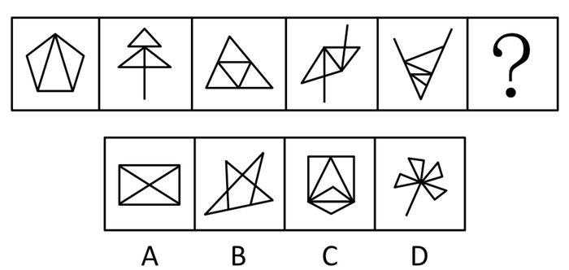

A. A

B. B

C. C

D. D

第 56 题 · 答案与解析

**参考答案（粉笔题库参考内容）**

A

**解析**

考查某种元素的个数，而且其个数需要重复数。

题干各图中包含的三角形（包括整体和各个部分）的数量分别为3、4、5、6、7，构成等差数列，所以第6幅图应包含8个三角形。

故正确答案为A。

**考点**：数量规律-素

**来源**：2010年国家公务员录用考试《行测》题第56题

### 第 57 题

请从所给的四个选项中，选择最合适的一个填入问号处，使之呈现一定的规律性：

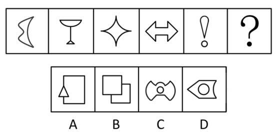

A. A

B. B

C. C

D. D

第 57 题 · 答案与解析

**参考答案（粉笔题库参考内容）**

D

**解析**

观察题干中五幅图的对称轴，分别呈横向、竖向、横竖向、横竖向、竖向，对称轴的方向呈轴对称分布，所以第六幅图应具有横向的对称轴。

故正确答案为D。

**考点**：属性规律-对称性

**来源**：2010年国家公务员录用考试《行测》题第57题

### 第 58 题

请从所给的四个选项中，选择最合适的一个填入问号处，使之呈现一定的规律性：

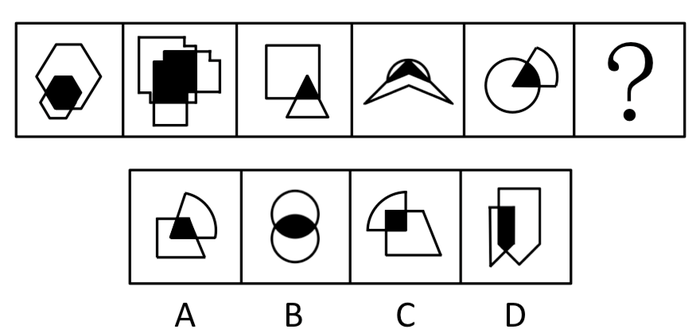

A. A

B. B

C. C

D. D

第 58 题 · 答案与解析

**参考答案（粉笔题库参考内容）**

D

**解析**

元素整体凌乱，但单个元素有规律，是对图形内部特征的考查。观察发现，两个图形相交形成的黑色阴影部分与组成该图形的其中一个图形形状相同。依此规律，可判断D项符合。

故正确答案为D。

**考点**：特殊规律-图形间关系

**来源**：2010年国家公务员录用考试《行测》题第58题

### 第 59 题

请从所给的四个选项中，选择最合适的一个填入问号处，使之呈现一定的规律性：

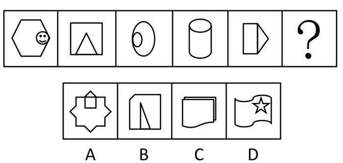

A. A

B. B

C. C

D. D

第 59 题 · 答案与解析

**参考答案（粉笔题库参考内容）**

B

**解析**

已知图形中均含有两个图形，大图包含小图，小图和大图相切或共线，并且小图在大图内的位置按照顺时针变化。依此规律可知，第六个图形中小图应在大图内下部，且和大图相切或共线，B项符合。

故正确答案为B。

**考点**：特殊规律-图形间关系

**来源**：2010年国家公务员录用考试《行测》题第59题

### 第 60 题

从所给的四个选项中，选择最合适的一个填入问号处，使之呈现一定的规律性：

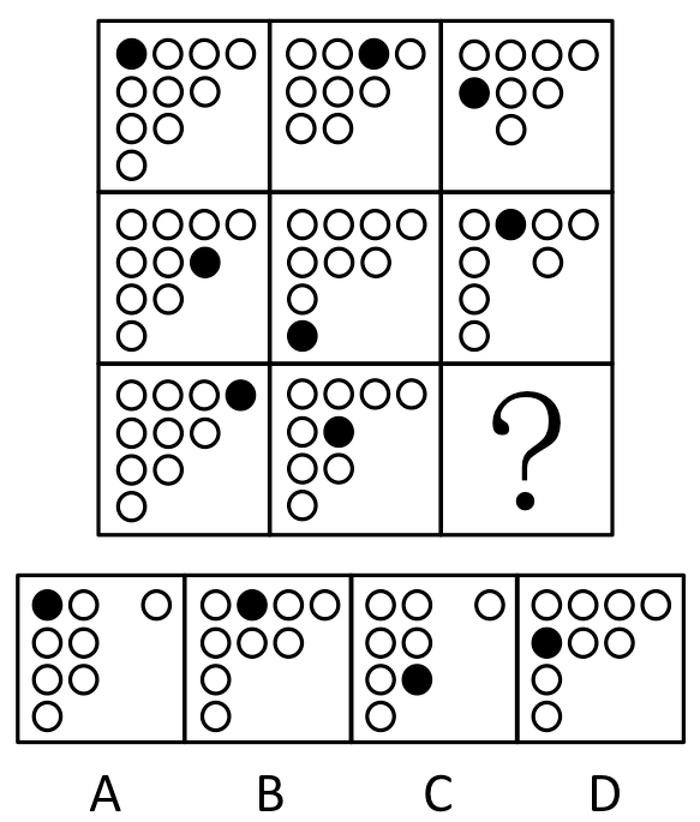

A. A

B. B

C. C

D. D

第 60 题 · 答案与解析

**参考答案（粉笔题库参考内容）**

C

**解析**

观察发现，第一行图形中第1列由下至上依次减少1个圆圈；第二行图形中第2列由下至上依次减少1个圆圈；第3行图形中第3列由下至上依次减少1个圆圈。据此排除B、D两项；观察小黑圈移动规律可知，小黑圈每次移动两格，右侧没有圆圈就移至下一行，排除A项。只有C项符合。

故正确答案为C。

**考点**：数量规律-复合

**来源**：2010年国家公务员录用考试《行测》题第60题

### 第 61 题

从所给的四个选项中，选择最合适的一个填入问号处，使之呈现一定的规律性：

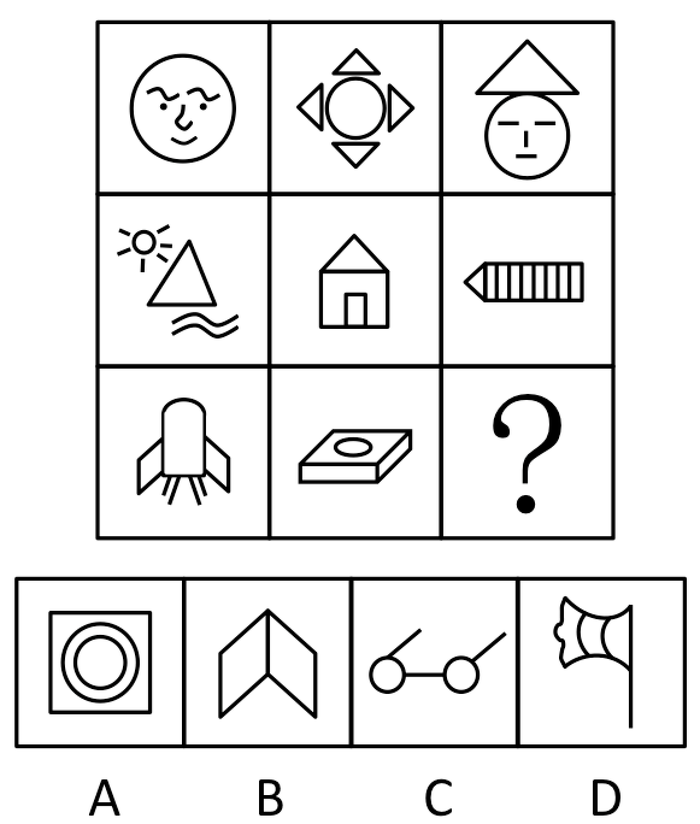

A. A

B. B

C. C

D. D

第 61 题 · 答案与解析

**参考答案（粉笔题库参考内容）**

B

**解析**

元素组成凌乱，所以要观察图形整体。以行为单位，考虑单元素的周遍。已知每一行三幅图形均有一个相同的元素，第一行都有圆形，第二行都有三角形，第三行都有平行四边形。

故正确答案为B。

**考点**：数量规律-素、样式规律-遍历

**来源**：2010年国家公务员录用考试《行测》题第61题

### 第 62 题

从所给的四个选项中，选择最合适的一个填入问号处，使之呈现一定的规律性：

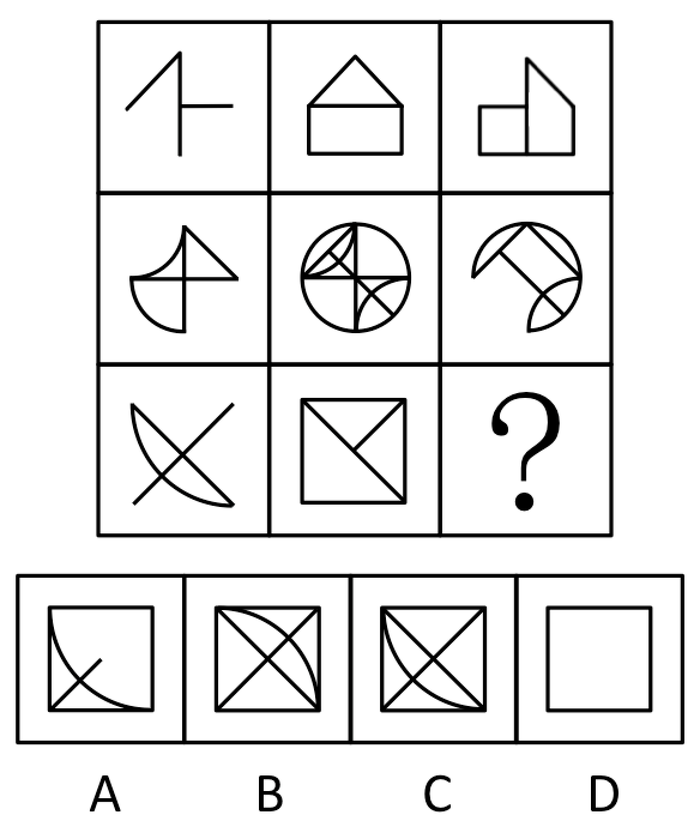

A. A

B. B

C. C

D. D

第 62 题 · 答案与解析

**参考答案（粉笔题库参考内容）**

A

**解析**

元素组成相似，考查叠加运算。每一行前两个图形叠加后去同存异得到第三个图形。依此规律，对第三行进行叠加运算得到A项。

故正确答案为A。

**考点**：样式规律-加减同异

**来源**：2010年国家公务员录用考试《行测》题第62题

### 第 63 题

从所给的四个选项中，选择最合适的一个填入问号处，使之呈现一定的规律性：

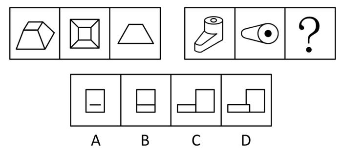

A. A

B. B

C. C

D. D

第 63 题 · 答案与解析

**参考答案（粉笔题库参考内容）**

A

**解析**

第一个图形是立体图形，第二个图形是俯视图，第三个图形是主视图或侧视图。

C项和D项首先排除，不存在如下中间那条红色短竖线；

再看A、B两项，如下图，俯视图中的线3是圆的直径，而线2是圆左边的两条斜线与圆相切的两个点a和点b连接而成的，线2与线3不可能是一条线，因为点a和点b如果是点A和点B，其相切的直线应是平行的，而不是圆左边的两条斜线。线3与A、B项两个图形的宽是一样的，而线2与线3是不一样长的，因此在侧视图中，线2应与A、B项两个图形的宽的两端没有相接，即为A项的小短线，排除B。

注意：线1比线2短，因此在选项中线1被线2包含了。

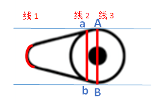

故正确答案为A。

**考点**：空间类-三视图

**来源**：2010年国家公务员录用考试《行测》题第63题

### 第 64 题

左边给定的是纸盒的外表面，右边哪一项能由它折叠而成：

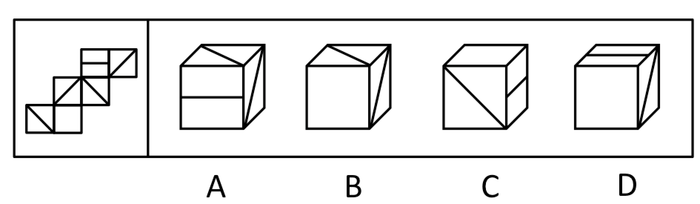

A. A

B. B

C. C

D. D

第 64 题 · 答案与解析

**参考答案（粉笔题库参考内容）**

B

**解析**

本题为空间重构题，首先将题干进行标号如图1所示：

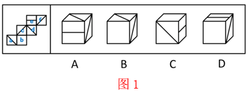

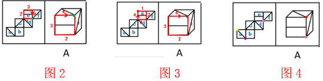

A项：横线面为e面，两个对角线面有df、cd、ac、af四种情况：

（1）假设选项为面def，那么图2中绿色点为三个面的公共点，以公共点为起点，在题干和选项中对e面沿顺时针方向进行画边，题干第一条边与e面中的横线平行，选项第一条边与横线垂直，因此不可能是面def；

（2）题干cd面两条对角线相交于一点，选项中两条对角线并不相交，因此不可能是面ecd；

（3）假设选项为面ace，那么图3中红色点为三个面的公共点，以公共点为起点，在题干和选项中对e面沿顺时针方向进行画边，题干第一条边与横线平行，选项第一条边与横线垂直，因此不可能是面ace；

（4）假如选项为面aef，那么三个面的交点必须和一条对角线相交，面f与面e的交点（图4粉色点）为面def的交点，因此不能为面aef的交点，那么面aef的交点只能为面a上的紫色点或者黄色点，但是题干中，黄色点是面ac的交点，紫色点是面ab的交点，均不可能为面aef的交点，因此选项不可能是面aef。

四种情况均不可能，A项错误，排除；

B项：与题干展开图一致，当选；

C项：面e与面b为相对面，不能同时出现，排除；

D项：面e与面b为相对面，不能同时出现，排除。

故正确答案为B。

**考点**：空间类-空间重构-六面体

**来源**：2010年国家公务员录用考试《行测》题第64题

### 第 65 题

左边给定的是纸盒的外表面，右边哪一项能由它折叠而成：

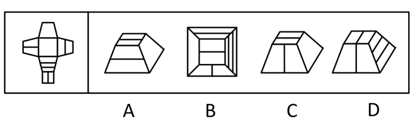

A. A

B. B

C. C

D. D

第 65 题 · 答案与解析

**参考答案（粉笔题库参考内容）**

C

**解析**

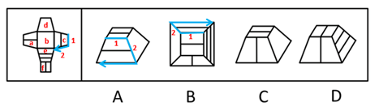

本题考查空间重构，注意给定的是纸盒的外表面。

A项：如图，在面c上画边，题干中边2对应的是面e，A项边2对应的是空白面，排除；

B项：如图，在面c上画边，题干中边2对应的是面e，B项边2对应的是空白面，排除；

C项：与题干展开图一致，当选；

D项：如图，上面为面f，右侧面为面e，题干中两面中线条为垂直关系，而选项中为平行关系，相对位置错误，排除。

故正确答案为C。

**来源**：2010年国家公务员录用考试《行测》题第65题

### 第 66 题

差别比例税率是指一种税设两个或两个以上的税率，不同纳税人按不同比例计算应纳税额的税率；累进税率是指随着征税对象的数额由低到高逐级累进，所使用的税率也随之逐级提高的税率。

根据上述定义，下列各项中所提到的税率，属于差别比例税率的是：

A. 对于某企业来说，需缴纳25%的企业所得税，还需缴纳5%的营业税

B. 我国个人所得税中对工资薪金所得适用的税率随工资薪金所得增多而逐渐增多，从5%到45%共分为九档

C. 2009年1月20日至12月31日，我国对1.6升及以下排量的乘用车按5%征收车辆购置税，对1.6升以上排量乘用车按10%征收车辆购置税

D. 我国自2009年1月1日起实施成品油税费改革，将成品油价内征收的汽油消费税单位税额每升提高0.8元，即由每升0.2元提高到1元

第 66 题 · 答案与解析

**参考答案（粉笔题库参考内容）**

C

**解析**

第一步：找出定义关键词。

差别比例税率强调“一种税设两个或两个以上的税率”“不同纳税人按不同比例”，而累进税率强调“随着征税对象的数额由低到高逐级累进”“税率也随之逐级提高”。

第二步：逐一分析选项。

A项：“25%的企业所得税”和“5%的营业税”是两种不同的税，不符合“一种税设两个或两个以上的税率”，不符合定义；

B项：“税率随工资薪金所得增多而逐渐增多”符合税率“随着征税对象的数额由低到高逐级累进”，符合累进税率定义；

C项：“车辆购置税”是一种税，“1.6升及以下排量”和“1.6升以上排量”符合 “不同纳税人按不同比例”，“5%”和“10%”符合“一种税设两个或两个以上的税率”，因此符合差别比例税率的定义；

D项：“单位税额每升提高 0.8元”不能体现“不同纳税人按不同比例”，不符合定义。

故正确答案为C。

**考点**：常规问法

**来源**：2010年国家公务员录用考试《行测》题第66题

### 第 67 题

美国社会学家默顿将社会功能划分为显功能和潜功能两个层次，显功能是有助于系统的调整和适应的客观后果，这种适应和调整是系统中的参与者所期望达到或能预料、认识到的；潜功能是没有被预料也没有被认识的客观后果。

下列选项不包含对潜功能描述的一项是：

A. 电视剧《渴望》播放期间，万人空巷，社会治安明显好转

B. 张某根据自己的家庭收入状况，贷款30万买了一套房子，由于利率上升，自己的生活变得捉襟见肘

C. 为抵御外族入侵，秦始皇修筑了长城，客观上促进了我国民间建筑工艺的发展

D. 来自偏远山区的小刘为了摆脱贫困，让父母过上好日子，从小刻苦学习，做事认真，没几年功夫就成为一家大型企业的负责人，也使自己成为家乡父老教育孩子的榜样

第 67 题 · 答案与解析

**参考答案（粉笔题库参考内容）**

B

**解析**

第一步：找出定义关键词。

显功能：“有助于系统的调整和适应的客观后果”、“系统中的参与者所期望达到或能预料、认识到的”；

潜功能：“没有被预料也没有被认识的客观后果”。

第二步：逐一分析选项。

A项：播放一部电视剧，居然引起了社会治安的好转，这显然是大家都没有预料到的，属于潜功能，符合定义，排除；

B项：张某贷款买房后利率上升是可以预料到的，生活困难属于没有预料到的，但产生的影响局限在个人身上，不能成为社会影响，不符合定义，当选；

C项：修筑长城原本的目的是用于国防军事，却促进了民间建筑工艺的发展，这也是原本没有预料到的，属于潜功能，符合定义，排除；

D项：小刘为了摆脱贫困而从小刻苦学习，学业有成，摆脱贫困是可以预料到的，但成为大型企业的负责人，并成为家乡父老教育孩子的榜样，这是其原本没有预料到的，而且产生了一定的社会影响，属于潜功能，符合定义，排除。

本题为选非题，故正确答案为B。

**考点**：常规问法

**来源**：2010年国家公务员录用考试《行测》题第67题

### 第 68 题

角色模糊是指个人所体验到的工作角色定位的不确定性，包括工作职责的不确定、工作目标的不确定等，因此常造成工作流程上的混乱和工作效率的低下。

根据上述定义，下列属于角色模糊的是：

A. 张大夫身兼数职，是某医院骨科主任，同时又担任该医院的副院长、该地区医学会委员等，工作繁忙使他日益憔悴

B. 苏丽刚升任客服部的副总监，有些事务她不知道是否该自己处理，如果处理了是否会超出目前的权限，也不知道去问谁，对于这些事务她通常就不处理

C. 小陈刚当上小学老师，想跟学生做朋友，尽管她现在跟学生的关系很亲密，可她发现学生们不怕她，不听话，甚至作业也不交

D. 小张刚参加工作，满怀热情，一心想在工作岗位上充分发挥自己的专业特长，但却不得不经常做些与其专业无关的工作，他因此觉得心理落差很大

第 68 题 · 答案与解析

**参考答案（粉笔题库参考内容）**

B

**解析**

第一步：抓住定义中的关键词。

“角色模糊”定义的关键词有“工作职责的不确定”、“工作目标的不确定”、“工作流程上的混乱和工作效率的低下”。

第二步：逐一判断选项。

A项“身兼数职”“工作繁忙使他日益憔悴”不能说明“工作流程上的混乱和工作效率的低下”，不符合“角色模糊”定义；

B项苏丽“不知道是否该自己处理”“也不知道去问谁”体现了“工作职责的不确定”、“工作目标的不确定”，而苏丽“通常就不处理”更是说明了“工作流程上的混乱”，符合“角色模糊”定义；

C项小学老师想跟学生做朋友没有体现“工作职责的不确定”、“工作目标的不确定”，而“学生们不怕她、不听话，甚至作业也不交”并不是小陈工作角色定位的不确定性造成的，不符合“角色模糊”定义；

D项“不得不经常做些与其专业无关的工作”没有体现工作职责的不确定”、“工作目标的不确定”，而“觉得心理落差很大”并不能说明“工作流程上的混乱和工作效率的低下”。

故正确答案为B。

**考点**：原因结果

**来源**：2010年国家公务员录用考试《行测》题第68题

### 第 69 题

生态入侵是指人们有意识或者无意识地把某些生物带入适宜其栖息和繁衍的地区，使得该生物种群不断扩大，分布区不断稳定地扩展，从而危害当地的生产和生活，改变当地生态环境的过程。

根据上述定义，下列属于生态入侵的是：

A. 某实验室由于管理不当将试验用的致病性结核菌株散播了出去，造成结核病在周围居民中流行

B. 美国科学家将从我国引进的野生大豆与当地品种杂交，培育出抗大豆萎黄病的优良品种，该品种现已彻底取代了美国传统大豆

C. 某地发生大面积放射性核素泄露，使某种植物发生变异，其繁殖能力超强，逐渐取代了该地域内的其他植物

D. 产于南美洲的凤眼莲花朵艳丽，曾经作为观赏植物被我国引进，致使云南滇池因为凤眼莲的疯狂蔓延而鱼虾绝迹

第 69 题 · 答案与解析

**参考答案（粉笔题库参考内容）**

D

**解析**

第一步：抓住定义中关键词。

生态入侵的要件是“把某些生物带入适宜其栖息和繁衍的地区”、“生物种群不断扩大，分布区不断稳定地扩展”且“危害当地的生产和生活，改变当地生态环境”。三个要件缺一不可。

第二步：逐一判断选项。

A项“致病性结核菌株散播”不符合“把某些生物带入适宜其栖息和繁衍的地区”，“造成结核病在周围居民中流行”没有“改变当地生态环境”；

B项“培育出抗大豆萎黄病的优良品种”不符合“危害当地的生产和生活”；

C项“放射性核素泄露使某种植物发生变异”不符合“把某些生物带入适宜其栖息和繁衍的地区”，“逐渐取代了该地域内的其他植物”并不能说明“危害当地的生产和生活”；

D项被我国引进的“凤眼莲的疯狂蔓延”体现了“把某些生物带入适宜其栖息和繁衍的地区”、“生物种群不断扩大，分布区不断稳定地扩展”，而“致使云南滇池鱼虾绝迹”说明了“危害当地的生产和生活，改变当地生态环境”。

故正确答案为D。

**考点**：原因结果

**来源**：2010年国家公务员录用考试《行测》题第69题

### 第 70 题

宜家效应是指劳动会增加人们对劳动成果的感情，当人们自己动手制作东西时，他们都会觉得自己的创作特别有价值。

根据上述定义，下列最能体现宜家效应的是：

A. 让人们亲手做折纸，然后连同他人做的折纸放在一起竞价，结果大家都愿意为自己做的折纸出更高的价钱

B. 某公司为方便人们制作蛋糕，推出方便蛋糕粉，使蛋糕的制作非常简单

C. 某家具生产商生产的家具需要顾客买回家后，按照产品说明书来完成家具的拼装组合工作

D. 学校鼓励学生自己动手制作各种教具，不仅锻炼了学生的动手能力，还节约了教学成本

第 70 题 · 答案与解析

**参考答案（粉笔题库参考内容）**

A

**解析**

第一步：抓住定义中关键词。

定义的关键词有“增加人们对劳动成果的感情”、“觉得自己的创作特别有价值”。

第二步：逐一判断选项。

A项人们“为自己做的折纸出更高的价钱”，可以说明人们“觉得自己的创作特别有价值”，符合定义；

B项“使蛋糕的制作非常简单”没有体现人们“觉得自己的创作特别有价值”；

C项顾客“按照产品说明书来完成家具的拼装组合工作”没有体现人们“自己的创作”，更没有体现“增加人们对劳动成果的感情”；

D项“学校鼓励学生自己动手制作各种教具”不能说明学生“觉得自己的创作特别有价值”。

故正确答案为A。

**考点**：单定义-其他句式

**来源**：2010年国家公务员录用考试《行测》题第70题

### 第 71 题

证实性偏见是指过于关注支持自己决策的信息。当我们在主观上认为某种观点正确的时候，往往倾向于寻找那些能够支持这一观点的信息，而忽略掉那些可能推翻这一观点的信息。

根据上述定义，下列属于证实性偏见的是：

A. 小张前天夜里梦见自己的钱包被偷，昨天钱包真的被偷了；昨晚他又梦见自己被车撞，结果今天一整天没敢出门

B. 小张总觉得室友最近的表现很反常，好像出什么事了，第二天公安局的人找到小张询问情况，证实了他的猜测，室友被扯进了一起盗窃案

C. 自从小王产生辞职的念头以后，总觉得经理处处刁难他，甚至看不起他，就连经理和他开个玩笑，都认为是对他的嘲笑

D. 小林今年未考上重点大学，他明知是因为自己实力不够，但他总是对同学说：“要不是考试前患了感冒，我肯定考得更好。”

第 71 题 · 答案与解析

**参考答案（粉笔题库参考内容）**

C

**解析**

第一步：抓住定义中关键词。

定义的关键词有“寻找那些能够支持这一观点的信息”、“主观上认为某种观点正确”、“忽略掉那些可能推翻这一观点的信息”。

第二步：逐一判断选项。

A项、B项没有体现“寻找那些能够支持这一观点的信息”；

C项“总觉得经理处处刁难他，甚至看不起他”体现了“主观上认为某种观点正确”，符合题干定义；

D项“明知是因为自己实力不够”、“要不是考试前患了感冒，我肯定考得更好”观点不一致，不符合“主观上认为某种观点正确”。

故正确答案为C。

**考点**：单定义-其他句式

**来源**：2010年国家公务员录用考试《行测》题第71题

### 第 72 题

存疑时有利于被告原则是指在刑事诉讼中遇到事实无法查清或查清事实所需成本过高的情况，依照有利于被告的原则判决。

根据上述定义，下列表现符合该原则的是：

A. 因缺少直接证据证实被告人有罪，法院对被告人做出无罪判决

B. 无法确定某犯罪行为是否超过追诉时效时，应当追诉

C. 检察机关认为被告人犯罪情节显著轻微，决定免于起诉

D. 法院在认定被告人犯有数罪或一罪之间存在疑问时，发回公安机关补充侦查

第 72 题 · 答案与解析

**参考答案（粉笔题库参考内容）**

A

**解析**

第一步：抓住定义中关键词。

定义的关键词有“事实无法查清或查清事实所需成本过高”、“有利于被告”。

第二步：逐一判断选项。

A项“因缺少直接证据证实被告人有罪”有利于被告，符合“事实无法查清或查清事实所需成本过高”，符合定义；

B项“无法确定某犯罪行为是否超过追诉时效时”显然不符合“有利于被告”；

C项“认为被告人犯罪情节显著轻微”说明事实已经查清；

D项“存在疑问时，发回公安机关补充侦查”并未直接判决，说明对被告不利。

B、C、D三项均不能说明“事实无法查清或查清事实所需成本过高”。

故正确答案为A。

**考点**：单定义-其他句式

**来源**：2010年国家公务员录用考试《行测》题第72题

### 第 73 题

同类群体影响力是指人们对他人（尤其是类似群体）的行为总会做出某种反应；类似程度越高，影响力就越大。比如对某种良好行为规范大力宣传，往往会成为所谓的"磁心"，吸引人们仿效。

下列做法中不会带来同类群体影响力的是：

A. 某地节水办告知那些用水量高的用户，他们的用水量明显高出了周围的邻居

B. 某森林公园设置告示牌，告知偷盗林木者将受到高于林木价钱10倍的罚款

C. 酒店在房间内放置标语，提醒客人大多数客人都不是每天要更换毛巾

D. 老师在墙报上贴小红花，表扬那些完成作业好，守纪律的小学生

第 73 题 · 答案与解析

**参考答案（粉笔题库参考内容）**

B

**解析**

第一步：找出定义关键词。

“对他人（尤其是类似群体）的行为总会做出某种反应”、“类似程度越高，影响力就越大”。

第二步：逐一分析选项。

A项，某地节水办的做法是通过对高用水量用户的水量明显高出周围邻居的告知，影响这些高用水量用户的用水习惯，高用水量用户与普通用户是可以相互影响的，两个群体属于类似群体，符合定义，排除；

B项，告示牌有警示作用的，告示牌告示的对象是“偷盗林木者”，但对于某森林公园来说接待的更多的是游客，“偷盗林木者”与游客是两类群体，游客的做法是无法影响“偷盗林木者”的，所以“偷盗林木者”与游客不属于类似群体，不会带来同类群体影响力，不符合定义，当选；

C项，酒店放置的标语，是利用部分不要求每天都更换毛巾的客人的做法影响其他客人的每天更换毛巾的做法，换毛巾与否是细小的习惯细节，归根到底都是客人的做法，客人的两种不同行为是可以相互影响的，符合定义，排除；

D项，老师在墙报上贴小红花用以表扬完成作业好，守纪律的小学生的做法，是利用优秀学生的做法影响其他学生的表现，两类学生行为是可以互相影响的，而且属于类似群体，符合定义，排除。

本题为选非题，故正确答案为B。

**考点**：单定义-其他句式

**来源**：2010年国家公务员录用考试《行测》题第73题

### 第 74 题

蓄积器官是毒物在体内的蓄积部位，毒物在蓄积器官内的浓度高于其他器官，但对蓄积器官不一定显示毒作用。这种毒作用也可以通过某种病理生理机制，由另一个器官表现出来，这种器官叫作效应器官。

根据上述定义，下列判断正确的是：

A. 大气污染物中的铅经肺吸收后可转移并积存于人的骨骼中，损害骨骼造血系统，所以铅的蓄积器官是肺

B. 大气污染物中的二氧化硫经人体的上呼吸道和气管吸入人体，并直接刺激上呼吸道和气管，所以上呼吸道和气管是蓄积器官

C. 有机磷酸酯农药作用于神经系统，会造成神经突触处乙酰胆碱蓄积，使人产生流涎、瞳孔缩小等症状，所以神经系统是有机磷酸酯的效应器官

D. 沉积于网状内皮系统的放射性核素对肝、脾损伤较重，引起中毒性肝炎，所以网状内皮系统是蓄积器官

第 74 题 · 答案与解析

**参考答案（粉笔题库参考内容）**

D

**解析**

第一步：抓住定义中的关键词。

蓄积器官的关键词有“浓度高于其他器官”、“不一定显示毒作用”、“由另一个器官表现出来”。

第二步：逐一判断选项。

A项：“铅经肺吸收后可转移并积存于人的骨骼中”没有体现“浓度高于其他器官”、“不一定显示毒作用”，也没有“由另一个器官表现出来”，不符合定义，排除；

B项：如果“上呼吸道和气管是蓄积器官”为真，那么“直接刺激上呼吸道和气管”没有体现“浓度高于其他器官”“不一定显示毒作用”，也没有“由另一个器官表现出来”，不符合定义，排除；

C项：“使人产生流涎、瞳孔缩小等症状”，符合“由另一个器官表现出来”，神经系统符合蓄积器官的定义，神经系统应是蓄积器官而不是效应器官，不符合定义，排除；

D项：“对肝、脾损伤较重，引起中毒性肝炎”符合“浓度高于其他器官”“通过某种病理生理机制，由另一个器官表现出来”，符合定义，当选。

故正确答案为D。

**考点**：特殊问法

**来源**：2010年国家公务员录用考试《行测》题第74题

### 第 75 题

偶然防卫是指在客观上被害人正在或者即将对被告人或他人的人身进行不法侵害，但被告人主观上没有认识到这一点，出于非法侵害的目的而对被害人使用了武力，客观上起到了人身防卫的效果。

根据上述定义，下列行为不属于偶然防卫的一项是：

A. 甲与乙积怨很深，某日发生冲突后，甲回家拿了手枪打算去杀乙，两人在路上正好碰上，甲先开枪杀死了乙，但开枪时不知乙的右手已抓住口袋中的手枪正准备对其射击

B. 甲正准备枪杀乙时，丙在后面对甲先开了一枪，将其打死，而丙在开枪时并不知道甲正准备杀乙，纯粹是出于报复泄恨的目的杀甲，结果保护了乙的生命

C. 甲与乙醉酒后发生激烈冲突，两人相互厮打至马路上，正当甲要捡起路边砖头击打乙时，围观群众中有人喊“警察来啦”，甲受惊吓不慎跌落路边河沟溺水身亡，乙安全无事

D. 甲身穿警服带着电警棍，冒充警察去“抓赌”，甲抓住乙搜身时，乙将甲打伤后逃离，甲未能得手

第 75 题 · 答案与解析

**参考答案（粉笔题库参考内容）**

C

**解析**

第一步：找出定义关键词。

关键词有“客观上被害人正在或者即将对被告人或他人的人身进行不法侵害”、“被告人主观上没有认识到”、“客观上起到了人身防卫的效果”。

第二步：逐一分析选项。

A项：乙要拿枪射击甲，而甲主观上没有意识到这一点，先开枪杀死了乙，是出于非法目的对乙进行了武力，属于偶然防卫，符合定义，排除；

B项：“甲正准备枪杀乙时”体现了“客观上进行不法侵害”，“丙在开枪时并不知道甲正准备杀乙”体现了“主观上没有认识到”，“保护了乙的生命”说明“客观上起到了人身防卫的效果”，符合定义，排除；

C项：甲受惊跌落水中身亡，不是乙出于非法侵害的目的对他使用了武力，而是因为围观群众的喊叫受到了惊吓，不属于偶然防卫，不符合定义，当选；

D项：甲冒充警察，抓住乙搜身体现了客观上不法侵害，而乙在主观上没有意识到的情况下，将甲打伤后逃离，属于偶然防卫，符合定义，排除。

本题为选非题，故正确答案为C。

**考点**：单定义-其他句式

**来源**：2010年国家公务员录用考试《行测》题第75题

### 第 76 题

身份证：身份

A. 执业证：资格

B. 结婚证：配偶

C. 房产证：房屋

D. 毕业证：学位

第 76 题 · 答案与解析

**参考答案（粉笔题库参考内容）**

A

**解析**

第一步：判断题干词语间逻辑关系。

身份证可以证明身份，且是唯一的证明，前者是证明后者的唯一有效证件。

第二步：判断选项词语间逻辑关系。

A项：执业证可以证明资格，且是唯一的证明，与题干逻辑关系一致，当选；

B项：结婚证标明的是配偶关系而非配偶，与题干逻辑关系不一致，排除；

C项：房产证标明的是房屋的所有权而非房屋，与题干逻辑关系不一致，排除；

D项：学位证才标明学位，毕业证标明的是学历，与题干逻辑关系不一致，排除。

故正确答案为A。

**考点**：逻辑关系-对应关系

**来源**：2010年国家公务员录用考试《行测》题第76题

### 第 77 题

茶壶：紫砂：雕刻

A. 电线：金属：生产

B. 马路：柏油：铺设

C. 房门：木材：油漆

D. 夹克：布料：制作

第 77 题 · 答案与解析

**参考答案（粉笔题库参考内容）**

B

**解析**

第一步：判断题干词语间逻辑关系。

紫砂可以制成茶壶，为原材料对应关系，雕刻是紫砂茶壶制作的一项工艺，为制作工艺对应。

第二步：判断选项词语间逻辑关系。

A项：金属为电线的原材料，但是，生产不是一种制作工艺，与题干逻辑关系不一致，排除；

B项：柏油是马路的原材料，铺设是建柏油马路的一项制作工艺，与题干逻辑关系一致，当选；

C项：木材是房门的原材料，但油漆不是制作房门的一项制作工艺，与题干逻辑关系不一致，排除；

D项：布料是夹克的原材料，但制作不是一种具体的工艺，与题干逻辑关系不一致，排除。

故正确答案为B。

**考点**：逻辑关系-对应关系

**来源**：2010年国家公务员录用考试《行测》题第77题

### 第 78 题

骨骼  对于  （  ）  相当于  （  ）  对于  房屋

A. 人体：梁柱

B. 上肢：窗户

C. 关节：钢筋

D. 肌肉：电梯

第 78 题 · 答案与解析

**参考答案（粉笔题库参考内容）**

A

**解析**

将选项逐一代入，判断前后部分的逻辑关系。

A项中“骨骼”是“人体”的支柱，而“梁柱”是“房屋”的支柱，两者均是包容关系中的组成关系；

B、C两项是包容关系，但与题干前后位置相反且逻辑关系不一致；

D项“骨骼”和“肌肉”是并列关系，而“电梯”和“房屋”是包容关系，前后逻辑关系也不一致。

由以上分析可知，A项前后逻辑关系一致。

故正确答案为A。

**考点**：逻辑关系-包容关系

**来源**：2010年国家公务员录用考试《行测》题第78题

### 第 79 题

（  ）  对于  大脑  相当于  资料  对于  （  ）

A. 智力︰书籍

B. 记忆︰硬盘

C. 细胞︰图书馆

D. 学习︰阅读

第 79 题 · 答案与解析

**参考答案（粉笔题库参考内容）**

B

**解析**

第一步：将选项逐一代入，判断前后两部分的逻辑关系。

A项中智力是抽象的，大脑是智力的载体，而资料和书籍是包容关系，书籍是一种资料，前后逻辑关系不一致；

B项大脑可以存储记忆，而硬盘可以存储资料，两者均是对应关系，后者是前者的存储载体；C项前者是包容关系，大脑由脑细胞构成，而图书馆除了资料外还有其他共同构成；

C项逻辑关系不如B项明显；

D项通过大脑来学习，而资料和阅读构成动宾结构，前后逻辑关系不一致。

第二步：逻辑关系相同即为答案

由以上分析可知，B项前后逻辑关系一致。

故正确答案为B。

**考点**：逻辑关系-对应关系

**来源**：2010年国家公务员录用考试《行测》题第79题

### 第 80 题

（  ）  对于  建筑  相当于  计划  对于  （  ）

A. 设计：成果

B. 图纸：工作

C. 材料：战略

D. 施工：目标

第 80 题 · 答案与解析

**参考答案（粉笔题库参考内容）**

B

**解析**

第一步：将选项逐一代入，判断前后两部分的逻辑关系。

A项中建筑按照设计来完成，而计划和成果没有明显的逻辑关系，只有结果按照计划来完成，而成果一般指好的结果；

B项中建筑按照图纸来施工，工作按照计划来进行，前后均属于对应关系；

C项材料是名词，而计划是动词，前后词性不同；

D项建筑靠施工完成，目标靠执行完成而不是计划。

第二步：逻辑关系相同即为答案。

由以上分析可知，B项前后逻辑一致。

故正确答案为B。

**考点**：逻辑关系-对应关系

**来源**：2010年国家公务员录用考试《行测》题第80题

### 第 81 题

海洋中珊瑚的美丽颜色来自于其体内与之共存的藻类生物，其中虫黄藻是最重要的一类单细胞海藻。二者各取所需，相互提供食物。全球气候变暖造成的海水升温导致虫黄藻等藻类大量死亡，进而造成珊瑚本身死亡，引发珊瑚礁白化现象，然而研究发现，珊瑚能通过选择耐热的其他藻类生物等途径，来应对气候变暖带来的挑战。

以下哪项如果为真，将削弱这一研究发现：

A. 一些虫黄藻能够比耐热的其他藻类耐受更高的海水温度

B. 有些藻类耐热性的形成需要一个长期的过程

C. 有些虫黄藻逐渐适应了海水温度的升高并存活下来

D. 有些已白化的珊瑚礁中也发现了死去的耐热藻类生物

第 81 题 · 答案与解析

**参考答案（粉笔题库参考内容）**

D

**解析**

第一步：找到论点和论据。

论点：研究发现珊瑚能通过选择耐热的其他藻类生物等途径，来应对气候变暖带来的挑战。

论据：全球气候变暖造成的海水升温导致虫黄藻等藻类大量死亡，进而造成珊瑚本身死亡。

第二步：判断削弱方式。

要构成削弱，可对其论点进行削弱，使得珊瑚不能够通过耐热的其他藻类生物途径存活。

第三步：逐一判断选项的作用。

A项说明海水升温也可能会导致耐热的其他藻类死亡，但一些不代表全部，可能大部分虫黄藻耐受的海水温度没有耐热的其他藻类高，削弱程度有限；

B、C两项和论点没有明显的关系，都是无关项；

D项说明其他耐热藻类并不一定能帮助珊瑚应对气候变暖，直接削弱了论点。

故正确答案为D。

**考点**：削弱论点

**来源**：2010年国家公务员录用考试《行测》题第81题

### 第 82 题

有医学研究显示，吃维生素和矿物质补充剂对人体没有显著帮助，有时甚至会对人体造成伤害。一些医生给出劝告，不要再吃维生素和矿物质补充剂了，而应该通过均衡的饮食来补充人体所需的维生素和矿物质。

以下哪项如果为真，最能削弱上述研究结果：

A. 一项对3万名妇女进行的7年追踪调查发现，服用维生素D加上钙补充剂并没有给她们的身体造成伤害

B. 一项对1万名男性展开的8年追踪调查显示，不服用维生素和矿物质补充剂并没有增加他们患病的风险

C. 一项对1万名发达地区和欠发达地区老年人的对照调查显示，他们的健康状况差异不显著

D. 一项对2万名儿童展开的3年追踪调查显示，不服用维生素和矿物质补充剂的儿童，营养缺乏的发生率较高

第 82 题 · 答案与解析

**参考答案（粉笔题库参考内容）**

D

**解析**

第一步：找到论点和论据。

论点：吃维生素和矿物质补充剂对人体没有显著帮助。

论据：无。

本题只有论点没有论据，削弱优先考虑削弱论点。

第二步：逐一判断选项的作用。

A项：服用维生素D加上钙补充剂并没有给她们的身体造成伤害，但论点强调的是吃维生素和矿物质对人体有没有帮助，无法削弱，排除；

B项：不服用维生素和矿物质补充剂并没有增加他们患病的风险，而题干讨论的是服用是否有帮助，无关项，无法削弱，排除；

C项：发达地区和欠发达地区老年人的健康状况差异不显著，不能说明是否和吃维生素和矿物质补充剂有关系，无关项，无法削弱，排除；

D项：不服用维生素和矿物质补充剂的儿童营养缺乏的发生率较高，反向说明服用维生素和矿物质补充剂是有作用的，削弱论点，可以削弱，当选。

故正确答案为D。

**考点**：削弱-实验类、削弱论点

**来源**：2010年国家公务员录用考试《行测》题第82题

### 第 83 题

甲乙丙丁四人的车分别为白色、银色、蓝色和红色。在问到他们各自车的颜色时，甲说：“乙的车不是白色。”乙说：“丙的车是红色的。”丙说：“丁的车不是蓝色的。”丁说：“甲、乙、丙三人中有一个人的车是红色的，而且只有这个人说的是实话。”

如果丁说的是实话，那么以下说法正确的是：

A. 甲的车是白色的，乙的车是银色的

B. 乙的车是蓝色的，丙的车是红色的

C. 丙的车是白色的，丁的车是蓝色的

D. 丁的车是银色的，甲的车是红色的

第 83 题 · 答案与解析

**参考答案（粉笔题库参考内容）**

C

**解析**

第一步：找突破口。

本题突破口为丁说的是真话。由于只有一辆红车，且红车的人说的是真话，所以乙说假话。

第二步：看其他的话。

甲、乙、丙三人中有一个人的车是红色的。

由乙的话为假可知，丙的车不是红色的，并且丙说的是假话；由丙的话为假可知，丁的车应是蓝色的，且甲说的话必为真；由甲的话为真可知，甲是红车，且乙的车不是白色，那么乙的车是银色，因此丙的车是白色。

故正确答案为C。

**考点**：框架题

**来源**：2010年国家公务员录用考试《行测》题第83题

### 第 84 题

在一次考古发掘中，考古人员在一座唐代古墓中发现多片先秦时期的夔文（音kui，一种变体的龙文）陶片。对此，专家解释说，由于雨水冲刷等原因，这些先秦时期的陶片后来被冲至唐代的墓穴中。

以下哪项如果为真，最能质疑上述专家的观点：

A. 在这座唐代古墓中还发现多件西汉时期的文物

B. 这座唐代古墓保存完好，没有漏水、毁塌迹象

C. 并非只有先秦时期才使用夔文，唐代文人以书写夔文为能事

D. 唐代的墓葬风俗是将墓主生前喜爱的物品随同墓主一同下葬

第 84 题 · 答案与解析

**参考答案（粉笔题库参考内容）**

B

**解析**

第一步：找出论点和论据。

论点：雨水冲刷是出现夔文陶片的原因。

论据：无明显论据。

第二步：逐一分析选项。

A项：提到古墓中还有西汉文物，未提及夔文陶片，也未提及雨水冲刷，无关选项，排除；

B项：直接说明古墓没有漏水迹象，表明雨水冲刷并非原因，否定论点，当选；

C项：说明唐代人也写夔文，并未提及雨水冲刷是否是出现夔文陶片的原因，不明确选项，排除；

D项：说明唐代墓葬的风俗，并未提及雨水冲刷是否是出现夔文陶片的原因，不明确选项，排除。

故正确答案为B。

**考点**：削弱论点

**来源**：2010年国家公务员录用考试《行测》题第84题

### 第 85 题

以下是一则广告：本网络文学培训班有着其他同类培训班所没有的特点，除了传授高超的写作技巧、帮助同学打开认识世界的多维视角和宏观视野、丰富学员的文化知识和艺术涵养外，还负责向毕业班学员提供切实有效的就业咨询。去年进行咨询的毕业班学员，100%都找到了工作。为了在网络文学创作事业上开创一片天地，欢迎加入我们的行列。

为了确定该广告的可信任，以下相关问题必须询问清楚的是：

I  去年共举办了多少期这类培训班，共有多少学员毕业？

II  去年有多少毕业班学员进行了就业咨询？

III 对于找到工作的学员，就业咨询究竟起到了什么作用？

IV 咨询者找到的是否都是网络文学创作工作？

A. I、II、III和IV

B. I、II和III

C. II、III和IV

D. III、IV

第 85 题 · 答案与解析

**参考答案（粉笔题库参考内容）**

C

**解析**

第一步：找到论点论据。

论点：该培训班能提供切实有效的网络文学创作事业方面的就业咨询。

论据：去年进行咨询的毕业班学员100%都找到了工作。

第二步：逐一分析选项。

I：培训班的期数和毕业学员的数量与广告所宣传的咨询的毕业班学员的情况无关，所以不需必须问清；

II：必须问清，能够验证样本的大小。如果量太少，则没有代表性，看不出真实效果；

III：必须问清，能够验证该就业咨询是否切实有效。如果学员进行了就业咨询，但是对其就业没有起到多大作用，则说明该培训班效果不大。

IV：必须问清，能够验证该就业咨询是否切实有效。如果咨询者找到的不是网络文学创作的工作，也就说明该培训班无法提供切实有效的网络文学创作事业方面的就业咨询，说明该培训班效果不大。

由此可见，确定该广告的可信任，必须满足II、III和IV条件。

故正确答案为C。

**来源**：2010年国家公务员录用考试《行测》题第85题

### 第 86 题

在由发展中国家向经济发达国家前进的过程中，大量资本支持是必不可少的条件，而高储蓄率是获得大量资本的必要条件。就目前来说，中国正处于经济起飞时期，因此储蓄率高是当前经济发展中一种正常而合理的现象。

由此可以推出：

A. 有了大量的资本支持，就可以实现由发展中国家向发达国家的跨越

B. 有了高储蓄率，就可以获得大量的资本支持

C. 如果没有获得大量的资本支持，说明储蓄率不高

D. 如果没有高储蓄率，就不能实现向发达国家的转变

第 86 题 · 答案与解析

**参考答案（粉笔题库参考内容）**

D

**解析**

第一步：翻译题干。

（1）由发展中国家向经济发达国家前进→大量资本；

（2）大量资本→高储蓄率；

将（1）（2）串联可得（3）：由发展中国家向经济发达国家前进→大量资本→高储蓄率。

第二步：逐一分析选项。

A项：翻译为“大量资本→实现由发展中国家向发达国家的跨越”，是对条件（1）的肯后，肯后无法推出确定性结论，无法推出，排除；

B项：翻译为“高储蓄率→大量资本”，是对条件（2）的肯后，肯后无法推出确定性结论，无法推出，排除；

C项：翻译为“-大量资本→—高储蓄率”，是对条件（2）的否前，否前无法推出确定性结论，无法推出，排除；

D项：翻译为“-高储蓄率→—实现向发达国家的转变”，是对条件（3）的否后，否后必否前，可以推出，当选。

故正确答案为D。

**考点**：常规翻译

**来源**：2010年国家公务员录用考试《行测》题第86题

### 第 87 题

当代知名的动漫设计大师，绝大部分还没从动漫设计学校毕业就已经离开学校，开始自己的动漫设计生涯。因此，有人认为动漫设计的专业学习对学生们今后的职业发展并没能提供有力的帮助。

以下哪项如果为真，能够最有力地反驳上述推论：

A. 动漫设计大师都承认，他们学习了动漫设计学校的基础课程

B. 知名动漫公司在招聘设计师时，很看重应聘人员的毕业院校

C. 调查显示，动漫设计学校毕业生的平均年收入要显著高于同类院校其他专业的毕业生

D. 在动漫设计行业中职业发展比较好的从业者，基本都毕业于动漫设计学校

第 87 题 · 答案与解析

**参考答案（粉笔题库参考内容）**

A

**解析**

第一步：找到论点和论据。

论据：当代知名的动漫设计大师，绝大部分还没从动漫设计学校毕业就已经离开学校，开始自己的动漫设计生涯。

论点：有人认为动漫设计的专业学习对学生们今后的职业发展并没能提供有力的帮助。

本题论点讨论的是动漫设计的专业学习对学生职业发展无有力帮助，论据讨论的是知名动漫设计大师大多未毕业就离校开展设计生涯，二者话题紧密相关，削弱优先考虑削弱论点。

第二步：逐一分析选项。

A项：说明动漫设计的专业课程对知名动漫设计大师的事业是有帮助的，直接削弱论点，当选；

B项：知名动漫公司看重的是毕业院校的背景，没有直接提及动漫设计的专业内容在其中起到的作用，削弱力度不如A项，排除；

C项：选项是不同专业之间的比较，且年收入高低也不等同于职业发展的好坏，无法削弱，排除；

D项：说明职业发展比较好的从业者具有动漫设计学校的背景，仅说明了二者间有联系，但没有直接提及动漫设计的专业学习起到的作用，削弱力度不如A项，排除。

故正确答案为A。

**考点**：削弱论点

**来源**：2010年国家公务员录用考试《行测》题第87题

### 第 88 题

以往，境内企业进出口只能以美元或第三方货币结算，在合同签约至合同执行完毕期间汇率的变化会使企业的实际盈收出现波动，现在银行推出了人民币结算业务。由于人民币是境内企业的本币，合同计价和企业运营的主要货币相一致，境内企业在合同签订前能够切实了解交易的成本和收入，从而防范了汇率风险。因此，使用跨境贸易人民币结算业务的企业必定会增多。

以下哪项如果为真，最佳作为上述论证的前提条件：

A. 有了跨境贸易人民币结算业务，开展对外贸易的企业数量会越来越多

B. 在与国内企业发展贸易时，由于人民币币值保持稳定，境外企业愿意使用人民币作为结算货币

C. 有了跨境贸易人民币结算业务，国内企业可以更方便地将跨境贸易开展到世界各地

D. 由于国内巨大的市场空间，越来越多的境外企业愿意与国内企业开展贸易往来

第 88 题 · 答案与解析

**参考答案（粉笔题库参考内容）**

B

**解析**

第一步：找到论点和论据。

论据：境内企业使用人民币结算业务可以防范汇率风险。

论点：使用跨境贸易人民币结算业务的企业必定会增多。

本题论据讨论的是“境内”企业使用人民币结算业务可以防范汇率风险，据此推出论点“使用跨境贸易人民币结算业务的企业”必定会增多，二者话题不一致，缺少“境外”企业，且提问方式为“前提条件”，加强优先考虑搭桥，补充“境外”企业也愿意使用跨境贸易人民币结算业务。

第二步：逐一分析选项。

A项：开展对外贸易的企业数量增多，不等于使用跨境贸易人民币结算业务的企业数量增多，话题不一致，无法加强，排除；

B项：指出境外企业愿意使用人民币作为结算货币，补充“境外”使用跨境贸易人民币结算业务的企业的情况，搭桥项，可以加强，当选；

C项：指出跨境贸易人民币结算业务对“境内”企业的好处，有利于“境内”企业的增多，但没有提及“境外”企业，不是论点成立的前提条件，排除；

D项：越来越多的境外企业愿意与国内企业开展贸易往来，不能说明境外企业使用人民币结算业务可以防范汇率风险，无法加强，排除。

故正确答案为B。

**考点**：搭桥

**来源**：2010年国家公务员录用考试《行测》题第88题

### 第 89 题

某国人口总量自2005年起开始下降，预计到2100年，该国人口总数将只有现在的一半。为此，该国政府出台了一系列鼓励生育的政策。但到目前为止，该国妇女平均只生育1.3个孩子，远低于维持人口正常更新的水平（2.07个）。因此，有人认为该国政府实施的这些鼓励生育的政策没有达到预期效果。

以下哪项如果为真，最能反驳上述论断：

A. 该国政府实施的这些鼓励生育的政策是一项长期国策，短时间内看不出效果

B. 如果该国政府没有出台鼓励生育政策，该国儿童人口总数会比现在低很多

C. 如果该国政府出台更加有效的鼓励生育政策，就可以提高人口数量

D. 近年来该国人口总数呈缓慢上升的趋势

第 89 题 · 答案与解析

**参考答案（粉笔题库参考内容）**

B

**解析**

第一步：找到论点和论据。

论据：出台了一系列政策后，仍低于维持人口正常更新的水平。

论点：该国政府实施的鼓励生育的政策没达到预期效果。

本题论点论据讨论的均是鼓励生育的政策没有达到预期效果，话题一致，削弱优先考虑削弱论点。

第二步：逐一分析选项。

A项：“看不出效果”即不知道是否有效果，并不能说明鼓励生育的政策一定会起到作用，不明确选项，无法削弱，排除；

B项：如果“没有出台鼓励生育政策，儿童人口总数会比现在低很多”，可以得出政策的出台起到了增加人口的作用，削弱论点，当选；

C项：“更有效的政策能提高人口数量”，证明现在的政策确实没有达到预期效果，加强了题干论点，无法削弱，排除；

D项：“人口总数呈缓慢上升的趋势”与题干“政策出台”无关，无关项，无法削弱，排除。

故正确答案为B。

**考点**：削弱-实验类、削弱论点

**来源**：2010年国家公务员录用考试《行测》题第89题

### 第 90 题

甲国生产了一种型号为su-34的新型战斗机，乙国在是否要引进这种战斗机的问题上，出现了两种不同的声音。支持者认为su-34较以往引进的su-30有更加强大的对地攻击作战能力。

以下哪项如果为真，最能削弱支持者的声音：

A. 目前市场上有比su-34性能更好的其他型号战斗机

B. su-30足以满足对地攻击的需要，目前乙国需要提升的是对空攻击作战能力

C. 目前还没有实际数据显示究竟是su-34还是su-30有更加强大的对地攻击作战能力

D. 甲乙两国目前在双边贸易中存在诸多摩擦，引入su-34会有很多实际困难

第 90 题 · 答案与解析

**参考答案（粉笔题库参考内容）**

B

**解析**

第一步：找到论点和论据。

论点：支持者认为要引进这种su-34战斗机。

论据：支持者认为SU-34较以往引进的SU-30有更加强大的对地攻击作战能力。

本题论点讨论的是乙国应引进 su-34 战斗机，论据讨论的是su-34的对地攻击作战能力优于su-30，二者话题紧密相关，削弱优先考虑削弱论点。

第二步：逐一分析选项。

A项：市场上有比su-34性能更好的其他型号战斗机，不代表不应该引进该战机，无法削弱，排除；

B项：说明乙国需要的是对空攻击作战能力，而不是对地作战能力，削弱了论证关系，进而削弱论点，可以削弱，当选；

C项：“没有实际数据”证明su-34还是su-30有更加强大的对地攻击作战能力，不明确二者谁的对地攻击作战能力更强大，不明确选项，无法削弱，排除；

D项：引入存在困难，不代表不应该引进，无法削弱，排除。

故正确答案为B。

**考点**：拆桥

**来源**：2010年国家公务员录用考试《行测》题第90题

## 材料 1

根据以下资料，完成各题。

        中国汽车工业协会发布的2009年4月份中国汽车产销数据显示，在其他国家汽车销售进一步疲软的情况下，国内乘用车销量却持续上升，当月销量已达83.1万辆，比3月份增长7.59%，同比增长37.37%。

        乘用车细分为基本型乘用车（轿车）、多功能车（MPV）、运动型多用途车（SUV）和交叉型乘用车。其中，轿车销量比三月份增长8.3%，同比增长33.04%；MPV销量比3月份下降3.54%，同比下降4.05%；SUV销量比3月份增长19.27%，同比增长22.55%；交叉型乘用车销量比3月份增长3.62%，同比增长70.66%。轿车、MPV、SUV、和交叉型乘用车销量占4月份乘用车总销量的比重分别为71%、2%、6%和21%。

### 第 91 题

与上年同期相比，2009年4月份乘用车销量约增长了多少万辆：

A. 13.2

B. 22.6

C. 31.1

D. 40.4

第 91 题 · 答案与解析

**参考答案（粉笔题库参考内容）**

B

**解析**

根据“与上年同期相比，2009年4月份······约增长了······万辆”，可判定本题为增长量计算问题。定位文字材料第一段可得：2009年4月份，国内乘用车当月销量已达83.1万辆，同比增长37.37%。代入公式：增长量=现期量/(1+r)×r， 则与上年同期相比，2009年4月份乘用车销量约增长了83.1/(1+37.37%) × 37.37%≈ 83/(1 + 1/3) × 1/3= 83/4 ≈ 21万辆，与B项最接近。

故正确答案为B。

**考点**：增长量计算、文字资料

**来源**：2010年国家公务员录用考试《行测》题第91题

### 第 92 题

2009年3月份轿车销量约为多少万辆：

A. 64

B. 59

C. 54

D. 50

第 92 题 · 答案与解析

**参考答案（粉笔题库参考内容）**

C

**解析**

根据“2009年3月份轿车销量约为······万辆”，且材料时间为2009年4月，可判断此题为基期计算问题。定位文字材料第一段与第二段可知：2009年4月乘用车销量达83.1万辆，其中，轿车销量比三月份增长8.3%，轿车销量占4月份乘用车总销量的比重为71%，代入公式：基期量=现期量/(1+r)，则2009年3月轿车销量为：(83.1 × 71%)/(1+8.3%)≈59/1.08≈55万辆，与C项最接近。

故正确答案为C。

**考点**：基期计算、文字资料

**来源**：2010年国家公务员录用考试《行测》题第92题

### 第 93 题

2008年4月，SUV销量比MPV销量约：

A. 少2.3万辆

B. 多2.3万辆

C. 少3.4万辆

D. 多3.4万辆

第 93 题 · 答案与解析

**参考答案（粉笔题库参考内容）**

B

**解析**

根据题干“2008年4月，SUV销量比MPV销量约多/少······万辆”，材料时间为2009年4月，可判断此题为基期和差问题。定位文字材料第一段与第二段可知： 2009年4月份，当月销售已达83.1万辆；其中，MPV销量同比下降4.05%；SUV销量同比增长22.55%；MPV、SUV销量占4月份乘用车总销量的比重分别为2%、6% 。代入公式：基期量 =现期量/(1+r)，则2008年4月，SUV销量比MPV销量多的数量为：(83.1 × 6%)/(1 + 22.55%) − (83.1 × 2%)/(1 − 4.05%)≈ 83.1 × (6%/1.2 − 2%/1)= 83.1×(5%−2%)= 83.1 × 3% ≈ 2.5万辆，与B项最接近。

故正确答案为B。

**考点**：基期和差、文字资料

**来源**：2010年国家公务员录用考试《行测》题第93题

### 第 94 题

关于2009年3月份各种车型销量在总销量中所占比重的描述，以下正确的是：

A. 交叉型乘用车低于21%

B. SUV超过6%

C. MPV超过2%

D. 轿车超过71%

第 94 题 · 答案与解析

**参考答案（粉笔题库参考内容）**

C

**解析**

根据题干“关于2009年3月份······在······中所占比重······”，结合资料时间为2009年4月，可判定本题为两期比重问题。定位文字材料第一段，“2009年4月份，当月销售已达83.1万辆，比3月份增长7.59%”；定位文字材料第二段，“其中，轿车销量比3月份增长8.3%；MPV销量比3月份下降3.54%；SUV销量比3月份增长19.27%；交叉型乘用车销量比3月份增长3.62%。轿车、MPV、SUV和交叉型乘用车销量占4月份乘用车总销量的比重分别为71%、2%、6%和21%”。根据两期比重比较理论：部分增长率a＞整体增长率b时，现期比重＞基期比重；部分增长率a&lt;整体增长率b时，现期比重&lt;基期比重。

A项（交叉型乘用车）：3.62%（a）＜7.59%（b），现期比重＜基期比重，即4月的比重（21%）＜3月的比重，错误；

B项（SUV）：19.27%（a）＞7.59%（b），现期比重＞基期比重，即4月的比重（6%）＞3月的比重，错误；

C项（MPV）：-3.54%（a）＜7.59%（b），现期比重＜基期比重，即4月的比重（2%）＜3月的比重，正确；

D项（轿车）：8.3%（a）＞7.59%（b），现期比重＞基期比重，即4月的比重（71%）＞3月的比重，错误。

故正确答案为C。

**考点**：两期比重、文字资料

**来源**：2010年国家公务员录用考试《行测》题第94题

### 第 95 题

关于2009年4月乘用车销量的描述不正确的是：

A. 轿车销量比上年同期增加了20万辆以上

B. SUV以外车型销量占乘用车总销量比重比上月有所下降

C. MPV车型当时不受市场追捧

D. 同比增长率最高的是交叉型乘用车

第 95 题 · 答案与解析

**参考答案（粉笔题库参考内容）**

A

**解析**

A项：定位文字材料第一段与第二段最后一句，“2009年4月份国内乘用车当月销量已达83.1万辆，轿车销量占4月份乘用车总销量的比重为71%”，则2009年4月份轿车销量为83.1 × 71%。“轿车销量同比增长33.04%”，则轿车销量比上年同期增加了：(83.1×71%)/(1+33.04%)×33.04%≈(83×0.7)/(1+1/3)×1/3≈(83×0.7)/4≈21×0.7=14.7万辆＜20万辆，错误；

B项：由94题可知，SUV车型占总销量比重环比上升，故SUV以外车型所占比重应环比有所下降，正确；

C项：定位文字材料第二段，MPV车型销量仅占总销量的2%，故可推知MPV不受市场追捧，正确；

D项：定位文字材料第二段，交叉型车辆同比增速为70.66%，为同比增速最高，正确。

本题为选非题，故正确答案为A。

**考点**：文字资料、综合分析

**来源**：2010年国家公务员录用考试《行测》题第95题

## 材料 2

根据以下资料完成各题。

        2008年，某省农产品进出口贸易总额为7.15亿美元，比上年增长25.2%。其中，出口额为5.02亿美元，增长22.1%；进口额为2.13亿美元，增长33.2%。农产品进出口贸易额占全省对外贸易总额的4.5%。出口额居前5位的产品为蔬菜、畜产品、水果、粮食和茶叶，而绿茶出口额占茶叶出口额的四分之三。全省农产品对东欧、非洲、拉美等国家和地区的市场进一步开拓，出口额比上一年进一步增长。其中，对美国的出口额增长16.0%；对日本的出口额增长7.3%；对韩国的出口额增长59.8%；对东盟的出口额增长58.6%。

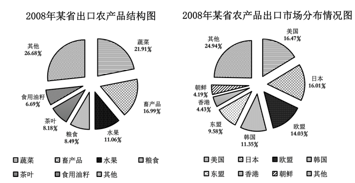

### 第 96 题

2008年，该省的对外贸易总额约为多少亿美元：

A. 158.89

B. 134.66

C. 91.78

D. 79.25

第 96 题 · 答案与解析

**参考答案（粉笔题库参考内容）**

A

**解析**

根据“2008年，该省的对外贸易总额约为······亿美元”，已知部分和比重求总体，且时间与材料一致，可判断此题为现期比重问题。定位文字材料，“农产品进出口贸易总额为7.15亿美元，占全省对外贸易总额的4.5％”，因此该省的对外贸易总额约为：7.15/4.5% ＞ 7/5 × 100 = 1.4 × 100 = 140亿美元，结合选项，只有A项符合。

故正确答案为A。

**考点**：现期比重、综合资料

**来源**：2010年国家公务员录用考试《行测》题第96题

### 第 97 题

2008年，该省的绿茶出口额约为多少万美元：

A. 4387

B. 3080

C. 2255

D. 1307

第 97 题 · 答案与解析

**参考答案（粉笔题库参考内容）**

B

**解析**

根据“2008年，该省的绿茶出口额约为······万美元”，已知总体和比重求部分，且时间与材料一致，可判断此题为现期比重问题。定位文字和图形材料，“该省出口额为5.02亿美元，茶叶占该省农产品出口的8.18%，而绿茶出口额占茶叶出口额的四分之三”，因此绿茶出口额约为：5.02×8.18%×3/4≈0.4×3/4=0.3亿美元=3000万美元，与B项最接近。

故正确答案为B。

**考点**：现期比重、综合资料

**来源**：2010年国家公务员录用考试《行测》题第97题

### 第 98 题

2008年，该省农产品对外贸易顺差比上年增长了：

A. 5%

B. 15%

C. 25%

D. 35%

第 98 题 · 答案与解析

**参考答案（粉笔题库参考内容）**

B

**解析**

根据“2008年，该省农产品对外贸易顺差比上年增长了······”且选项都是百分数，结合贸易顺差=出口额-进口额，即出口额=贸易顺差+进口额，存在部分与整体的关系，可判断此题为混合增长率问题。定位文字资料，“出口额为5.02亿美元，增长22.1%；进口额为2.13亿美元，增长33.2%”。根据“混合增长率居中不正中”可得进口额增长率(33.2%)＞出口额增长率(22.1%)＞贸易顺差增长率，排除C、D两项。根据偏向量大的，2008年对外贸易顺差值为5.02-2.13=2.89亿美元＞进口额，则22.1%-贸易顺差增长率＜33.2%-22.1%=11.1%，故贸易顺差增长率＞22.1%-11.1%=11%，排除A项。

故正确答案为B。

**考点**：混合增长率、综合资料

**来源**：2010年国家公务员录用考试《行测》题第98题

### 第 99 题

与2007年相比，2008年该省出口韩国的农产品总额约增长了多少万美元？

A. 5100

B. 4500

C. 3200

D. 2100

第 99 题 · 答案与解析

**参考答案（粉笔题库参考内容）**

D

**解析**

根据“与2007年相比，2008年该省······总额约增长了······万美元”，可判断此题为增长量计算问题。定位文字材料，“2008年，某省农产品进出口贸易总额为7.15亿美元······其中，出口额为5.02亿美元，增长22.1%；······对韩国的出口额增长59.8%”；定位饼状图二，2008年对韩国出口额占11.35%。部分量=比重×整体，则2008年该省出口韩国的农产品总额约为5.02亿×11.35%，代入公式增长量=现期量/(1+增长率)×增长率可得，2008年该省出口韩国的农产品总额约增长(5.02亿 × 11.35%)/(1 + 59.8%) × 59.8%≈ (5.02亿×11.35%)/(1+1/1.7) × 1/1.7≈ 0.57亿/(1+1.7) = 0.57亿/2.7 ≈ 0.21亿=2100万，对应D项。

故正确答案为D。

**考点**：增长量计算、综合资料

**来源**：2010年国家公务员录用考试《行测》题第99题

### 第 100 题

能够从上述资料中推出的是：

A. 2008年，该省蔬菜的出口额超过一亿美元

B. 2008年，该省出口日本的农产品总额接近8000万美元

C. 2008年，该省的粮食出口额比上年有所增长

D. 2007年，该省对东亚及东南亚地区的农产品出口占总出口额的一半以上

第 100 题 · 答案与解析

**参考答案（粉笔题库参考内容）**

A

**解析**

A项：定位图形材料可得，2008年该省蔬菜的出口额为5.02 × 21.91% ＞ 5 × 20% = 1亿美元，即超过了1亿美元，正确；

B项：定位图形材料可知，2008年该省出口日本的农产品总额为5.02×16.01% ＞ 5×0.16 = 0.8亿美元=8000万美元，即超过了8000万美元，并非接近，错误；

C项：由材料信息无法得知2007年该省的粮食出口额，无法推出，错误；

D项：由材料信息无法得知2007年该省对东亚及东南亚地区的农产品出口额，无法推出，错误。

故正确答案为A。

**考点**：综合分析、综合资料

**来源**：2010年国家公务员录用考试《行测》题第100题

## 材料 3

根据以下资料，完成各题。

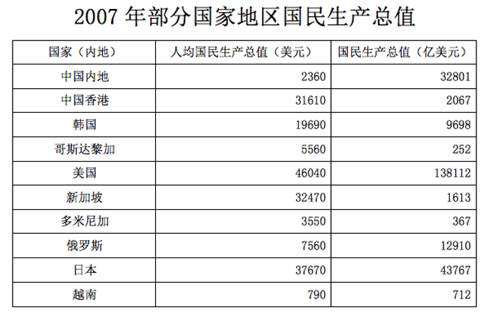

| 国家（内地） | 人均国民生产总值（美元） | 国民生产总值（亿美元） |
| --- | ---: | ---: |
| 中国内地 | 2360 | 32801 |
| 中国香港 | 31610 | 2067 |
| 韩国 | 19690 | 9698 |
| 哥斯达黎加 | 5560 | 252 |
| 美国 | 46040 | 138112 |
| 新加坡 | 32470 | 1613 |
| 多米尼加 | 3550 | 367 |
| 俄罗斯 | 7560 | 12910 |
| 日本 | 37670 | 43767 |
| 越南 | 790 | 712 |

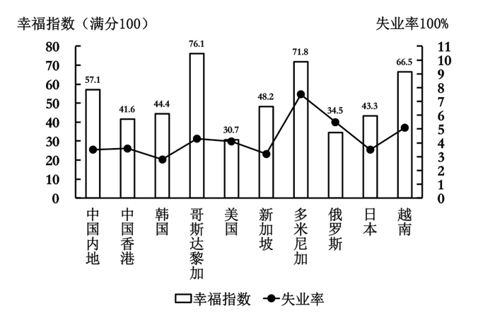

### 第 101 题

2007年，下列国家（地区）中人口最少的是：

A. 中国香港

B. 哥斯达黎加

C. 新加坡

D. 多米尼加

第 101 题 · 答案与解析

**参考答案（粉笔题库参考内容）**

B

**解析**

根据“2007年，下列国家（地区）中人口最少的是”，表格材料已知国民生产总值和人均生产总值，且时间与材料一致，可判断此题是现期平均数问题。根据人口= 国民生产总值/人均国民生产总值可得：中国香港人口为2067/31610≈0.065亿人，哥斯达黎加人口为252/5560≈0.045亿人，新加坡人口为1613/32470≈0.050亿人，多米尼加人口为367/3550≈0.10亿人。故哥斯达黎加人口最少。

故正确答案为B。

**考点**：现期平均数、综合资料

**来源**：2010年国家公务员录用考试《行测》题第101题

### 第 102 题

资料中失业率最高与最低的国家（地区），其幸福指数相差：

A. 22.1

B. 28.5

C. 27.4

D. 31.4

第 102 题 · 答案与解析

**参考答案（粉笔题库参考内容）**

C

**解析**

定位图形材料可知，失业率最高的国家是多米尼加，其幸福指数为71.8；失业率最低的国家是韩国，其幸福指数为44.4，则两国的幸福指数相差：71.8－44.4＝27.4。

故正确答案为C。

**考点**：简单加减计算、综合资料

**来源**：2010年国家公务员录用考试《行测》题第102题

### 第 103 题

资料中人均国民生产总值和幸福指数均排名前五的国家（地区）有几个：

A. 1

B. 2

C. 3

D. 4

第 103 题 · 答案与解析

**参考答案（粉笔题库参考内容）**

A

**解析**

定位表格材料可知，人均国民生产总值排名前五位的国家（地区）为美国、日本、新加坡、中国香港和韩国。又根据图形材料可知，幸福指数排名前五位的国家（地区）分别是哥斯达黎加、多米尼加、越南、中国内地和新加坡。两者对比可知，两项都排名前五的国家（地区）只有新加坡，即两者都满足的国家（地区）有1个。

故正确答案为A。

**考点**：直接找数、综合资料

**来源**：2010年国家公务员录用考试《行测》题第103题

### 第 104 题

能够从上述资料中推出的是：

A. 资料中只有一个亚洲国家（地区）的失业率高于美国

B. 美国的失业人口少于俄罗斯

C. 人均国民生产总值排名第二的国家（地区），幸福指数排名第八

D. 资料中人均国民生产总值越高的国家失业率越低

第 104 题 · 答案与解析

**参考答案（粉笔题库参考内容）**

A

**解析**

A项：定位图形材料可知，亚洲国家中只有越南的失业率高于美国，正确；

B项：定位表格和图形材料，可得美国的失业人口数为(138112/46040)×4%≈3×0.04=0.12亿人，俄罗斯的失业人口数为12910/7560×6%≈12/7×0.06≈0.103亿人，美国高于俄罗斯，错误；

C项：定位表格和图形材料，可知人均国民生产总值排名第二的国家（地区）是日本，其幸福指数排名第七，并非第八，错误；

D项：定位表格和图形材料，可知美国的人均国民生产总值最高，但失业率并非最低，错误。

故正确答案为A。

**考点**：综合分析、综合资料

**来源**：2010年国家公务员录用考试《行测》题第104题

### 第 105 题

下列说法与资料相符的有几个：

1.国民生产总值小于1000亿美元的国家（地区），幸福指数均高于其他国家（地区）；

2.人口过亿的国家（地区）失业率越低，幸福指数越高；

3.比中国内地失业率低的国家（地区），幸福指数均低于中国内地；

4.人均国民生产总值超过2万美元的国家（地区），幸福指数均低于其他国家（地区）。

A. 0

B. 1

C. 2

D. 3

第 105 题 · 答案与解析

**参考答案（粉笔题库参考内容）**

C

**解析**

1.定位表格最后一列可知，国民生产总值小于1000亿美元的国家（地区）有哥斯达黎加、多米尼加、越南，定位柱状图，其幸福指数也排在前三名，正确。

2.如果人口= 国民生产总值/人均国民生产总值 ＞ 1，则人口过亿，定位表格数据可知，人口过亿的国家（地区）有中国内地、美国、俄罗斯和日本（或通过常识也可判断人口过亿的国家），通过观察折线图和柱状图，美国与俄罗斯相比，失业率低，幸福指数也低，错误。

3.定位折线图和柱状图可知，比中国内地失业率低的有韩国、新加坡，其幸福指数也低于中国内地，正确。

4.定位表格第二列和柱状图可知，人均国民生产总值超过2万美元的国家（地区）有中国香港、美国、新加坡和日本，观察柱状图可知，日本、中国香港和新加坡的幸福指数均大于俄罗斯，错误。

综上，说法与资料相符的有2个。

故正确答案为C。

**考点**：综合分析、综合资料

**来源**：2010年国家公务员录用考试《行测》题第105题

## 材料 4

根据以下资料，完成各题。

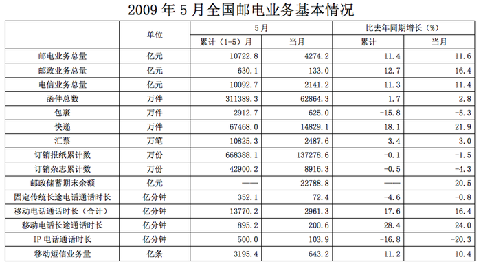

### 第 106 题

2009年1-5月，邮电系统平均每月订销报纸、杂志约多少亿份：

A. 13.7

B. 14.2

C. 14.6

D. 17.8

第 106 题 · 答案与解析

**参考答案（粉笔题库参考内容）**

B

**解析**

根据题干“2009年1-5月，邮电系统平均每月订销报纸、杂志约多少亿份”，结合材料时间为2009年，可判断此题为现期平均数问题。定位表格材料第三列第9、10行可得：2009年1-5月，订销报纸累计668388.1万份≈66.8亿份，订销杂志累计42900.2万份≈4.3亿份。则2019年1-5月，邮电系统平均每月定销报纸、杂志约有：= 总数/个数 = (66.8+4.3)/5= 71.1/5 ≈ 14.2亿份，与B项最接近。

故正确答案为B。

**考点**：现期平均数、统计表

**来源**：2010年国家公务员录用考试《行测》题第106题

### 第 107 题

按2009年5月业务同比增长率从高到低排列，以下正确的是：

A. 函件—包裹—快递

B. 汇票—包裹—快递

C. 快递—汇票—函件

D. 函件—汇票—包裹

第 107 题 · 答案与解析

**参考答案（粉笔题库参考内容）**

C

**解析**

定位表格材料可得：2009年5月，函件、包裹、快递、汇票的同比增长率分别为2.8%、-5.3%、21.9%、3.0%。则同比增长率从高到低排序为：快递＞汇票＞函件＞包裹，符合这个排列顺序的只有C项。

故正确答案为C。

**考点**：排序类、统计表

**来源**：2010年国家公务员录用考试《行测》题第107题

### 第 108 题

2008年1-5月，移动电话长途通话时长约是固定传统长途电话通话时长的多少倍：

A. 3.4

B. 2.5

C. 1.9

D. 0.5

第 108 题 · 答案与解析

**参考答案（粉笔题库参考内容）**

C

**解析**

根据“2008年1-5月，······约是······的多少倍”，且材料时间为2009年1-5月，可判断此题为基期倍数问题。定位表格材料可得：2009年1-5月，固定传统长途电话通话时长为352.1亿分钟（B），比去年同期增长-4.6%（b）；移动电话长途通话时长为895.2亿分钟（A），比去年同期增长28.4%（a）；代入基期倍数公式：A/B×(1+b)/(1+a)，可得2008年内1-5月，移动电话长途通话时长是固定传统长途电话通话时长的倍数约为：895.2/352.1 × (1 − 4.6%)/(1 + 28.4%)≈ 90/35 × 0.95/1.3 ≈ 1.9，与C项最接近。

故正确答案为C。

**考点**：基期倍数、统计表

**来源**：2010年国家公务员录用考试《行测》题第108题

### 第 109 题

假如平均每条移动短信的业务费用为0.1元，则2009年5月移动短信业务总量占当月电信业务总量的比重约为：

A. 2.8%

B. 3.0%

C. 3.2%

D. 6.4%

第 109 题 · 答案与解析

**参考答案（粉笔题库参考内容）**

B

**解析**

根据“2009年5月······占······的比重约为”，可判断此题为现期比重问题。定位表格材料可得：2009年5月，移动短信业务量为643.2亿条，电信业务总量为2141.2亿元。则2009年5月移动短信业务总量占当月电信业务总量的比重约为(643.2 × 0.1)/2141.2 ≈ 64.32/2140 ≈ 3%。

故正确答案为B。

**考点**：现期比重、统计表

**来源**：2010年国家公务员录用考试《行测》题第109题

### 第 110 题

能够从上述资料中推出的是：

A. 2009年5月，各项电信业务与去年同期相比均有所增长

B. 2009年5月，各项邮政业务营业状况均好于1-4月平均水平

C. 2009年5月，移动电话长途通话占移动电话通话总时长的10%以上

D. 2009年1-5月，电信业务同比增长率高于邮政业务

第 110 题 · 答案与解析

**参考答案（粉笔题库参考内容）**

B

**解析**

A项：定位表格材料可得，有些电信业务相比去年同期是有所下降的，如IP电话通话时长，错误；

B项：要知道5月业务状况好于1-4月平均水平，即判断5月 ＞ (1−4月)/4，则5月 ＞ ((1 − 5)月 − 5月)/4，整理得5月 ＞ (1 − 5月)/5，只要看5月业务量大于1-5月累计量的1/5即可，定位表格材料可知，B项正确；

C项：定位表格材料可知，移动电话长途通话时长为200.6亿分钟，移动电话通话时长为2961.3亿分钟，200.6 ＜ 2961.3 × 10%，即前者占后者比重不足10%，错误；

D项：定位表格材料可知，电信业务总量同比增长率为11.3%，邮政业务同比增长率为12.7%，前者慢于后者，错误。

故正确答案为B。

**考点**：统计表、综合分析

**来源**：2010年国家公务员录用考试《行测》题第110题

## 材料 5

根据以下资料完成各题。

        新中国成立后，经过60年特别是改革开放以来的建设，我国公共卫生体系初步建立，卫生服务能力明显增强。2008年全国共有卫生机构27.8万个，比1949年增加约75倍；卫生技术人员为503万人，比1949年增加9.0倍；医院和卫生院床位数为374.8万张，比1949年增加45.9倍；每千人口医院，卫生院床位数为2.8张，远高于1949年0.15张的水平。

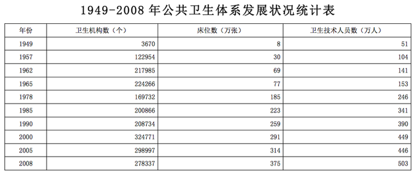

### 第 111 题

1949-2008年，我国卫生机构平均每年约增加：

A. 4736

B. 4655

C. 4578

D. 4397

第 111 题 · 答案与解析

**参考答案（粉笔题库参考内容）**

B

**解析**

根据“1949-2008年，我国卫生机构平均每年约增加······”，结合选项都是具体数值，可判断此题为年均增长量问题。定位表格材料可得，1949年、2008年，我国卫生机构数分别为3670个、278337个。代入公式年均增长量=(现期量-基期量)/年份差= (278337 - 3670)/(2008 - 1949) ≈ 4655个。

故正确答案为B。

**考点**：年均增长量、综合资料

**来源**：2010年国家公务员录用考试《行测》题第111题

### 第 112 题

建国以来，我国医院和卫生院床位数年平均增长率最高的时期为：

A. 1957-1962年

B. 1962-1965年

C. 1965-1978年

D. 1978-1985年

第 112 题 · 答案与解析

**参考答案（粉笔题库参考内容）**

A

**解析**

根据“······我国医院和卫生院床位数年平均增长率最高的时期为······”，可判断此题为年均增长率问题。由年均增长率的公式为(1 + r)^n = 末期值/初期值，定位表格材料，将各个选项的年份及床位数代入公式，得到：

A项，n=1962-1957=5，则(1+r)^5=69/30=2.3；

B项，n=1965-1962=3，则(1+r)^3 = 77/69 ≈ 1.1；

C项，n=1978-1965=13，则(1 + r)^13 = 185/77 ≈ 2.4；

D项，n=1985-1978=7，则(1+r)^7 = 223/185 ≈ 1.2；

A、D两项相比，D项的指数7比A项的5大，但是整体1.2比A项2.3小，所以D项底数比A项小，故D项的年均增长率r比A项小，排除D项；

A、B两项相比，B项(1+r)^3 = 1.1，所以(1 + r)^6 = 1.21，指数6大于A项5，但整体1.21小于A项2.3，所以B项的年均增长率r比A项小，排除B项；

A、C两项相比，A项(1+r)^5 = 2.3，所以(1+r)^10 = 2.3^2，指数10小于C项13，整体2.3^2大于C项2.4，故A项的年均增长率r比C项的大，排除C项。

故正确答案为A。

**考点**：年均增长率、综合资料

**来源**：2010年国家公务员录用考试《行测》题第112题

### 第 113 题

与1978年相比，2008年平均每个卫生机构的卫生技术人员数约增加了：

A. 5%

B. 15%

C. 25%

D. 35%

第 113 题 · 答案与解析

**参考答案（粉笔题库参考内容）**

C

**解析**

根据“与1978年相比，2008年平均每个卫生机构的卫生技术人员数约增加······”，结合选项都是百分数，可判断此题为平均数的增长率问题。定位表格材料可得，1978年卫生技术人员及卫生机构数分别为246万人、169732个；2008年卫生技术人员及卫生机构数分别为503万人、278337个。根据公式平均数= 卫生技术人员数/卫生机构数、增长率=(现期量−基期量)/基期量=现期量/基期量−1可得，2008年平均每个卫生机构的卫生技术人员数比1978年增加了(503/278337) ÷ (246/169732) - 1 ≈ (500×170000)/(250×280000) - 1 ≈ 1.22 - 1 = 22%，与C项最接近。

故正确答案为C。

**考点**：平均数的增长率、综合资料

**来源**：2010年国家公务员录用考试《行测》题第113题

### 第 114 题

2008年，每万人拥有的卫生机构数量约是1949年的多少倍？

A. 3

B. 8

C. 15

D. 30

第 114 题 · 答案与解析

**参考答案（粉笔题库参考内容）**

D

**解析**

根据“2008年，每万人拥有的卫生机构数量约是1949年的······倍”，可判断此题为现期倍数问题。

解法一：每万人拥有的卫生机构数量，即卫生机构数/人口数。定位表格材料，可知2008年与1949年的卫生机构数分别为278337个和3670个。定位文字材料最后一句和表格，可知2008年与1949年的人口数分别为375000/2.8万人和8000/0.15万人。所以2008年与1949年相比，每万人拥有的卫生机构数的倍数为278337/(375000/2.8) ÷ 3670/(8000/0.15) ≈ 280000/130000 ÷ 3700/53000 ≈ 2.1 ÷ 0.07 = 30倍。

解法二：要求平均数的倍数，只需要用分子的倍数除以分母的倍数即可。定位文字材料第二句可知，卫生机构数的倍数为75+1=76倍。由常识可知，2008年人口大约13亿人，1949年人口大约5亿人，其倍数大约为2.6倍。所以平均数的倍数为76 ÷ 2.6 ≈ 30倍。

（如果不慎将1949年人口错估成4-6亿人，由于选项差距大，也可选出答案）

故正确答案为D。

**考点**：现期倍数、综合资料

**来源**：2010年国家公务员录用考试《行测》题第114题

### 第 115 题

能够从上述资料中推出的是：

A. 1957年我国卫生技术人员总数首次超过百万

B. 1949年我国每千人口拥有的卫生技术人员数不足1人

C. 2005-2008年，医院和卫生院床位数年均增长率超过10%

D. 20世纪80年代后期，我国卫生机构的数量呈现负增长态势

第 115 题 · 答案与解析

**参考答案（粉笔题库参考内容）**

B

**解析**

A项：定位表格材料可知，1949年—1957年之间还有其他年份，材料信息不全，无法断定1957年就是我国卫生技术人员总数“首次”超过百万，错误；

B项：定位文字材料，“每千人口医院，卫生院床位数为2.8张，远高于1949年0.15张的水平”，可判断1949年每千人口拥有床位0.15张，已知该年有床位8万张，人数为80000/0.15千人。技术人员总数为51万人，则每千口人拥有的卫生技术人员数为：510000/(80000/0.15)=(51×0.15)/8=7.65/8＜1。正确；

C项：定位表格材料，由年均增长率的公式为(1 + r)^n = 末期值/初期值，代入数据且若r>10%，即314×1.1^3小于375，已知375/314 ＜ 1.2 ＜ 1.1^3，则假设不成立，错误；

D项：定位表格材料，可以看出1985—1990年我国卫生机构的数量增加，错误。

故正确答案为B。

**考点**：综合分析、综合资料

**来源**：2010年国家公务员录用考试《行测》题第115题

### 第 116 题

关于新中国成立60周年取得的成就，下列说法不正确的是：

A. 截止2008年底，我国已成为世界第三大经济体

B. 截止2008年底，我国进出口贸易总额已跃居世界第一

C. 2008年我国国民平均受教育年限已提高到8.7年，相当于初中文化程度

D. 我国人均期望寿命由新中国成立前的不足40岁上升到70多岁

第 116 题 · 答案与解析

**参考答案（粉笔题库参考内容）**

B

**解析**

本题考查时事政治。

A项正确，截止2008年底，我国已取代德国成为继美国和日本之后的世界第三大经济体。

B项错误，截止2008年底，我国进出口贸易总额已跃居世界第三，仅次于德国和美国。

C项正确，2008年我国国民平均受教育年限已提高到8.7年，相当于初中文化程度，2017年已超过13.3年，相当于大学一年级水平。

D项正确，新中国成立之前，中国人均期望寿命只有35岁，到了2015年，中国居民人均预期寿命达到76.34岁。

本题为选非题，故正确答案为B。

**考点**：重要事件

**来源**：2010年国家公务员录用考试《行测》题第116题

### 第 117 题

改革开放以来，我国主要区域政策经历了不同的阶段：

①以经济特区为重心的沿海地区优先发展阶段；

②以缩小区域差异为导向的西部大开发阶段；

③以浦东开发为龙头的沿江沿边地区重点发展阶段；

④以区域协调发展为导向的共同发展阶段。

这四个阶段按时间顺序排列为：

A. ①②③④

B. ①③②④

C. ②③①④

D. ②①③④

第 117 题 · 答案与解析

**参考答案（粉笔题库参考内容）**

B

**解析**

本题考查人文常识。

本题是从宏观上来阐述经济区域的发展。首先，我国区域经济政策选了一个点，就是经济特区，1979年开始建立深圳特区；其次，我们国家的经济政策是趋向于“以点带面”来发展，所以有了以浦东开发为龙头的沿江沿边地区重点发展；随着我国经济区域发展的面越来越广，因此有了“西部大开发”战略；随着以点带面的成功，最后走向共同发展，即以区域协调发展为导向的共同发展阶段。

故正确答案为B。

**考点**：中国历史

**来源**：2010年国家公务员录用考试《行测》题第117题

### 第 118 题

关于我国重大工程与建设项目，下列说法不正确的是：

A. 三峡工程是目前世界上建筑规模最大的水利工程

B. “嫦娥一号”是中国自主研发的首个月球探测卫星

C. 2008年建成通车的杭州湾跨海大桥是目前世界上最长的桥梁

D. 2006年全线通车青藏铁路是目前世界上海拔最高的铁路

第 118 题 · 答案与解析

**参考答案（粉笔题库参考内容）**

C

**解析**

本题考查科技常识。

美国的庞恰特雷恩湖桥长达38.4公里，是世界上最长的桥，杭州湾跨海大桥长达36公里，是世界第二长的桥梁，也是世界上最长的跨海大桥。

故正确答案为C。

【备注】本题解析中表述已过时，截至2020年4月，世界第一长桥是我国的丹昆特大桥（全长164.851公里，2011年6月30日全线正式开通运营），世界最长的跨海大桥是我国的港珠澳大桥（桥隧全长55公里，2018年10月24日全线正式开通运营）。

**考点**：科技理论与成就

**来源**：2010年国家公务员录用考试《行测》题第118题

### 第 119 题

下列关于国际组织的表述不正确的是：

A. 蒙古国是上海合作组织的成员国之一

B. 国际货币基金组织是联合国的专门机构

C. 博鳌亚洲论坛是第一个总部设在中国的国际会议组织

D. 石油输出国组织通过实行石油生产配额制维护石油生产国利益

第 119 题 · 答案与解析

**参考答案（粉笔题库参考内容）**

A

**解析**

本题考查国际组织的有关知识。

A项错误，截至2018年底，蒙古国是上海合作组织的观察员国（另外伊朗、阿富汗和白俄罗斯也是观察员国），不是成员国。

B项正确，国际货币基金组织是联合国下属专门机构，其职责是监察货币汇率和各国贸易情况，提供技术和资金协助，确保全球金融制度运作正常。其总部设在华盛顿。

C项正确，博鳌亚洲论坛成立于2001年2月27日，是第一个总部设在中国的国际会议组织。首届年会在海南省博鳌举行。

D项正确，石油输出国组织其宗旨是协调和统一成员国的石油政策，通过实行石油生产配额制，维护各自和共同的利益。

本题为选非题，故正确答案为A。

**考点**：国际经济及组织

**来源**：2010年国家公务员录用考试《行测》题第119题

### 第 120 题

在经济衰退时期，有利于扩大内需的政策措施是：

A. 提高税率

B. 提高存款准备金率

C. 降低税率

D. 缩减财政支出

第 120 题 · 答案与解析

**参考答案（粉笔题库参考内容）**

C

**解析**

本题考查经济常识。

经济衰退时期，社会总需求不足，需要采取政策，刺激消费和投资，扩大内需。

A项错误，提高税率使得企业和个人可用资金减少，不利于刺激投资和消费，不利于扩大内需。

B项错误，提高存款准备金率会使商业银行将更多的货币存储在中央银行，商业银行的信贷可用资金会减少，不利于刺激投资和消费，不利于扩大内需。

C项正确，降低税率会使企业和个人可用资金增加，会刺激投资和消费，有利于扩大内需。

D项错误，财政支出也是内需的重要组成部分，缩减财政支出不利于扩大内需。

故正确答案为C。

**考点**：宏观经济与调控政策

**来源**：2010年国家公务员录用考试《行测》题第120题

### 第 121 题

衡量一个国家经济总量的指标不包括（    ）。

A. 国民总收入

B. 货币总量

C. 国内生产总值

D. 外汇储备

第 121 题 · 答案与解析

**参考答案（粉笔题库参考内容）**

B

**解析**

本题考查衡量国家经济总量的指标。

A项，国民总收入是反映国家整体经济活动的重要指标，亦是国际投资者非常重视的国际统计项目，常在宏观经济学的研究中被用于衡量国家经济总量。

B项，货币总量是指投入流通中的纸币的总额，对货币总量进行研究，有利于国家货币决策机构控制货币供应量，有效地调节经济活动。但是，货币总量不被用于衡量一个国家的经济总量。

C项，国内生产总值（GDP）是指一个国家所有常驻单位在一定时期内生产的所有最终产品和劳务的市场价值。GDP是国民经济核算的核心指标，也是衡量一个国家或地区总体经济状况的重要指标。

D项，外汇储备是指为了应付国际支付的需要，各国的中央银行及其他政府机构所集中掌握的外汇资产，主要用于清偿国际收支逆差，以及干预外汇市场以维持该国货币的汇率，是衡量国家经济总量的指标之一。

本题为选非题，故正确答案为B。

**考点**：宏观经济与调控政策

**来源**：2010年国家公务员录用考试《行测》题第121题

### 第 122 题

下列关于中国近代史上的事件表述不正确的是：

A. 北洋水师是19世纪末中国建立的第一支近代海军舰队

B. 第五次反“围剿”失败后，中国工农红军开始长征

C. 中国人民解放军第二炮兵组建于20世纪60年代中期

D. 日军在东北发动的“七七事变”标志着全面侵华战争的开始

第 122 题 · 答案与解析

**参考答案（粉笔题库参考内容）**

D

**解析**

A项正确，北洋水师，是中国清朝后期建立的第一支近代化海军舰队，同时也是中国清代政府建立的四支近代海军中实力最强、规模最大的一支。

B项正确，1934年10月，第五次反围剿失败后，中央主力红军为了摆脱国民党军队的包围追击，被迫实行战略大转移，退出中央根据地进行长征。

C项正确，中国人民解放军第二炮兵，是中央军委直属特殊兵种，组建于1966年7月1日，由地对地战略导弹部队和常规战役战术导弹部队组成。

D项错误，“七七事变”于1937年7月7日发生在河北卢沟桥，属于华北，不是东北。

本题为选非题，故正确答案为D。

**考点**：中国历史

**来源**：2010年国家公务员录用考试《行测》题第122题

### 第 123 题

关于我国的湖泊，下列叙述正确的是（    ）。

A. 最大的淡水湖在江西

B. 最大的咸水湖在西藏

C. 海拔最高的湖在新疆

D. 海拔最低的湖在四川

第 123 题 · 答案与解析

**参考答案（粉笔题库参考内容）**

A

**解析**

本题考查我国湖泊的基本常识。

A项，我国最大的淡水湖是鄱阳湖，位于江西省北部。该项表述正确，应选。

B项，我国最大的咸水湖是青海湖，位于青海省西北部的青海湖盆地内，并非西藏。该项表述错误，应排除。

C项，我国海拔最高的湖是纳木错，位于藏北高原东南部，并非新疆。该项表述错误，应排除。

D项，我国海拔最低的湖是艾丁湖，位于新疆维吾尔自治区吐鲁番市，并非四川。该项表述错误，应排除。

故正确答案为A。

**考点**：中国地理

**来源**：2010年国家公务员录用考试《行测》题第123题

### 第 124 题

一艘油轮自科威特港驶往大连，其最短航线为：

A. 波斯湾→红海→马六甲海峡→南海→黄海→东海

B. 波斯湾→阿拉伯海→马六甲海峡→南海→东海→黄海

C. 红海→阿拉伯海→孟加拉湾→南海→东海→黄海

D. 红海→孟加拉湾→马六甲海峡→南海→黄海→东海

第 124 题 · 答案与解析

**参考答案（粉笔题库参考内容）**

B

**解析**

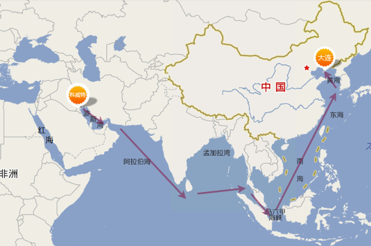

故正确答案为B。

**考点**：世界地理

**来源**：2010年国家公务员录用考试《行测》题第124题

### 第 125 题

下列对哲学家及其思想的认定不正确的是：

A. 老子早于庄子，庄子早于韩非子

B. 亚里士多德师从柏拉图，柏拉图师从苏格拉底

C. 毛泽东的实践观同于列宁，列宁的实践观同于马克思

D. 尼采的非理性主义源于叔本华，叔本华的非理性主义源于培根

第 125 题 · 答案与解析

**参考答案（粉笔题库参考内容）**

D

**解析**

本题考查古今中外的哲学家及其思想。

A项正确，老子（传说前600年左右—前470年左右），是春秋时道家创始人；庄子（约前369年—前286年），是战国时期道家思想的传承者；韩非子(约公元前280—前233年)，战国末期法家代表人物，是荀子的学生。

B项正确，苏格拉底（前469年至前399年），是著名的古希腊哲学家；柏拉图（前427年至前347年），师从苏格拉底；亚里士多德（前384年至前322年），师从柏拉图，是亚历山大大帝的老师。

C项正确，马克思、列宁和毛泽东的实践观都是科学的实践观，是同一条真理之河中的三个不同阶段。三者之间存在着密不可分的内在联系；前者是后者直接的理论来源，后者是对前者的继承和发展。

D项错误，叔本华的唯意志论开创了西方非理性主义之先河。尼采深受叔本华思想影响，把叔本华的生命意志发展为强力意志。弗朗西斯·培根是英国唯物主义哲学家，实验科学和近代归纳法的创始人，是一位理性主义者。

本题为选非题，故正确答案为D。

**考点**：文化常识

**来源**：2010年国家公务员录用考试《行测》题第125题

### 第 126 题

中国儒家的主要经典著作为“四书五经”，其中“四书”指的是：

A. 《史记》、《中庸》、《论语》、《孟子》

B. 《春秋》、《大学》、《中庸》、《论语》

C. 《礼记》、《大学》、《汉书》、《孟子》

D. 《大学》、《中庸》、《论语》、《孟子》

第 126 题 · 答案与解析

**参考答案（粉笔题库参考内容）**

D

**解析**

“四书五经”是“四书”和“五经”的合称，是中国儒家经典的书籍。“四书”指的是《论语》《孟子》《大学》和《中庸》；而“五经”指的是《诗经》《尚书》《礼记》《周易》《春秋》，简称为“诗、书、礼、易、春秋”。

故正确答案为D。

**考点**：文学常识

**来源**：2010年国家公务员录用考试《行测》题第126题

### 第 127 题

下列有关现代科技的说法中，正确的是（    ）。

A. 高温超导体是指其超导临界温度在摄氏零度以上

B. 纳米材料是指结构单元的尺度达到纳米级而原有性能保持不变的材料

C. 杂交水稻是通过基因重组改变水稻的基因来提高产量的

D. 转基因食品是指转移动植物的基因并加以改变、制造出具备新特征的食品

第 127 题 · 答案与解析

**参考答案（粉笔题库参考内容）**

D

**解析**

本题考查现代科技中高温超导体、纳米材料、杂交水稻、转基因食品等术语的定义。

A项错误，高温超导体通常是指在液氮温度77K(−196℃)以上超导的材料，其超导临界温度只是相比一般超导体高出许多，但实际温度仍然在摄氏零度以下。

B项错误，纳米材料的结构单元达到纳米尺度以后，性能就会发生突变，出现特殊性能。

C项错误，杂交水稻只是选用两个在遗传上有一定差异，同时优良性状又能互补的水稻品种进行杂交，并未对水稻的基因进行改变。

D项正确，转基因食品是利用现代分子生物技术转移和改变动植物的基因，使其在形状、营养品质、消费品质等方面具有新特征的食品。

故正确答案为D。

**考点**：科技理论与成就

**来源**：2010年国家公务员录用考试《行测》题第127题

### 第 128 题

下列有关能源的表述正确的是：

A. 目前核电站对核能的利用方式分为核聚变和核裂变两种

B. 氢气是一种可实现二氧化碳零排放的能源

C. 太阳能电池的工作原理是光化学转换

D. 可燃冰是一种稀缺的能源资源

第 128 题 · 答案与解析

**参考答案（粉笔题库参考内容）**

B

**解析**

本题考查能源方面的知识。

A项错误，核能的利用方式分为核聚变和核裂变两种，但到目前为止，达到工业应用规模的核能只有核裂变能，而核聚变能只实现了军用，即制造氢弹。 因此，目前核电站对核能的利用方式只有核裂变一种。

B项正确，氢气是最洁净的燃料。氢气的燃烧产物是水，对环境不产生任何污染。因而可以实现二氧化碳的零排放。

C项错误，太阳能电池是通过光电效应或者光化学效应直接把光能转化成电能的装置。以光电效应工作的晶硅太阳能电池为主流，而以光化学效应工作的薄膜电池实施太阳能电池则还处于萌芽阶段。

D项错误，天然气水合物又称“可燃冰”，是分布于深海沉积物或陆域的永久冻土中，由天然气与水在高压低温条件下形成的类冰状的结晶物质。其资源密度高，全球分布广泛。

故正确答案为B。

**考点**：化学常识

**来源**：2010年国家公务员录用考试《行测》题第128题

### 第 129 题

下列对人物及其贡献表述不正确的是：

A. 凯恩斯撰写了《国富论》，使经济学成为一门独立科学

B. 孟德尔发现遗传学定律，为遗传因子理论奠定了框架基础

C. 冯·诺依曼开创了现代计算机理论，其体系结构沿用至今

D. 法拉第发现电磁感应定律，并据此发明了早期的发电机

第 129 题 · 答案与解析

**参考答案（粉笔题库参考内容）**

A

**解析**

A项中，撰写《国富论》的人为苏格兰人亚当·斯密，他所著的《国富论》成为了第一本试图阐述欧洲产业和商业发展历史的著作。这本书发展出了现代的经济学学科，也提供了现代自由贸易、资本主义和自由意志主义的理论基础。而凯恩斯是20世纪初英国经济学家，他提出利用财政、货币手段干预市场，改善经济状况，是20世纪初使美国走出大萧条困境的重要人物。

故正确答案为A。

**考点**：文学常识

**来源**：2010年国家公务员录用考试《行测》题第129题

### 第 130 题

下列关于武器装备的说法不正确的是：

A. 核潜艇装备的主要是核武器

B. “歼十”战斗机是国产飞机

C. 弩是中国最早发明的

D. AK-47是前苏联研制的一种自动步枪

第 130 题 · 答案与解析

**参考答案（粉笔题库参考内容）**

A

**解析**

核潜艇是潜艇中的一种类型，指以核反应堆为动力来源设计的潜艇，主要用于军事。核潜艇一般分为两种，一种携带洲际弹道导弹（可装核弹头）的战略核潜艇，它和战略轰炸机、路基战略导弹一起，作为保持核威慑的一种手段。另一种为攻击性核潜艇，主要打击军事装备，如水面舰艇、陆地军事目标等，不一定携带核武器。

故正确答案为A。

**考点**：科技理论与成就

**来源**：2010年国家公务员录用考试《行测》题第130题

### 第 131 题

我国社会主义民族关系的基本特征是：平等、团结、互助、（  ）。

A. 合作

B. 繁荣

C. 友爱

D. 和谐

第 131 题 · 答案与解析

**参考答案（粉笔题库参考内容）**

D

**解析**

本题考查新思想。

平等、团结、互助、和谐是我国社会主义民族关系的本质特征，平等是基石，团结是主线，互助是保障，和谐是本质。

故正确答案为D。

此题可以借助谐音，取四组词的首字“和平互团”来记忆民族关系的特征。

**考点**：其他建设

**来源**：2010年国家公务员录用考试《行测》题第131题

### 第 132 题

如果父亲和孩子都是A型血，那么孩子的母亲的血型有几种可能：

A. 四种

B. 三种

C. 两种

D. 一种

第 132 题 · 答案与解析

**参考答案（粉笔题库参考内容）**

A

**解析**

按照下图可以展现各种ABO配偶所生子女的血型表格:  红色部分为符合父亲和孩子都是A型血的情况。则母亲可能的血型有A、B、AB、O四种可能。

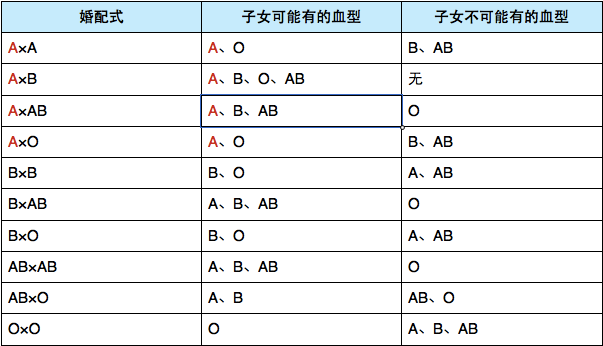

故正确答案为A。

**考点**：生物常识

**来源**：2010年国家公务员录用考试《行测》题第132题

### 第 133 题

关于宇宙的起源，最具代表性、影响最大的理论是（    ）。

A. 黑洞理论

B. 大爆炸理论

C. 暗物质学说

D. 能量守恒定律

第 133 题 · 答案与解析

**参考答案（粉笔题库参考内容）**

B

**解析**

本题考查关于宇宙起源的著名理论。

A项，黑洞是宇宙空间内存在的一种密度无限大体积无限小的天体，黑洞的引力很大，使得视界内的逃逸速度大于光速。黑洞理论基于爱因斯坦的相对论，被著名物理学家霍金拓展后，为大众所知。但是，黑洞理论与宇宙起源的关系不大。该项应排除。

B项，宇宙大爆炸理论，简称大爆炸理论，是描述宇宙诞生初始条件及其后续演化的宇宙学模型，这一模型得到了当今科学研究和观测最广泛且最精确的支持，是关于宇宙起源最有影响的理论。该项应选。

C项，在宇宙学中，暗物质是指那些不发射任何光及电磁辐射的物质，暗物质学说与宇宙起源关系不大。该项应排除。

D项，能量守恒定律是自然界的基本定律之一，表述的是能量不会消灭和创生，不会减少和增加，只会转移和转化。该定律与宇宙起源问题没有关系。该项应排除。

故正确答案为B。

**考点**：科技理论与成就

**来源**：2010年国家公务员录用考试《行测》题第133题

### 第 134 题

下列关于医学知识的说法不正确的是：

A. 肝脏的主要功能之一是分解排除血液中的毒素

B. 放疗中要使用放射线进行照射

C. 砒霜在中医里可以入药

D. 针灸中的“灸”是指用针扎刺人体穴位

第 134 题 · 答案与解析

**参考答案（粉笔题库参考内容）**

D

**解析**

本题考查科技常识。

A项正确，肝脏是人体最重要的代谢和解毒器官。人体代谢过程中所产生的一些有害废物及外来的毒物、毒素、药物的代谢和分解产物，均在肝脏解毒。

B项正确，放射治疗是利用一种或多种电离辐射对恶性肿瘤及一些良性病进行的治疗，即利用放射线照射治疗。

C项正确，砒霜在中医中常用于治疗痔疮，瘰疬，痈疽恶疮，走马牙疳，癣疮，寒痰哮喘，疟疾，休息痢等疾病。

D项错误，针灸是针法和灸法的总称。针法是指用针扎刺人体穴位来预防和治疗疾病。灸法是以预制的灸炷或灸草在体表一定的穴位上烧灼、熏熨，利用热的刺激来预防和治疗疾病。

本题为选非题，故正确答案为D。

**考点**：其他

**来源**：2010年国家公务员录用考试《行测》题第134题

### 第 135 题

下列有关生活常识的叙述正确的是：

A. 空调工作的时候有水流出而冰箱没有，由此可判断常见的家用空调和电冰箱的制冷原理不同

B. 鸡蛋带壳在微波炉中加热比较好，这样受热更快更均匀

C. 液晶电视机与等离子电视机的成像原理相同

D. 使用无磷洗衣粉是因为磷易造成环境水体富营养化，破坏水质

第 135 题 · 答案与解析

**参考答案（粉笔题库参考内容）**

D

**解析**

A项错误，空调的制冷原理为压缩机将制冷剂压缩为高温高压的气态制冷剂，然后送到冷凝器（室外机）散热后成为常温高压的液态制冷剂，所以室外机吹出来的是热风。然后到毛细管，进入蒸发器（室内机），由于制冷剂从毛细管到达蒸发器后空间突然增大，压力减小，液态的制冷剂就会汽化，变成气态低温的制冷剂，从而吸收大量的热量，蒸发器就会变冷，室内机的风扇将室内的空气从蒸发器中吹过，所以室内机吹出来的就是冷风；空气中的水蒸汽遇到冷的蒸发器后就会凝结成水滴，顺着水管流出去，这就是空调会出水的原因。冰箱制冷原理是压缩机压缩制冷剂使其压力和温度升高，而冰箱外部的热交换线圈帮助制冷剂散热。当制冷剂冷却时，制冷剂会液化成液体并流经安全阀。当制冷剂流经安全阀时，液态制冷剂从高压区流向低压区，因此它会膨胀并蒸发。在蒸发过程中，它会吸收热量，发挥制冷效果。冰箱内的线圈帮助制冷剂吸收热量，使冰箱内部保持低温。然后，重复该循环。所以空调和冰箱的制冷原理是一样的，都是通过制冷剂的汽化来降低温度。

B项错误，微波是一种高频率的电磁波，其本身并不产生热，微波炉是利用其内部的磁控管，将电能转变成微波，以2450MHz的振荡频率穿透食物来进行加热的。当微波被食物吸收时，食物内的极性分子(如水、脂肪、蛋白质、糖等)会以每秒24.5亿次的频率快速振荡，使得分子间互相作用而产生大量热。因为微波炉的加热方式与明火加热方式不同，鸡蛋在微波炉中加热时，由于外壳和内膜的阻碍，会导致内部水蒸气无法释放到外界。水蒸气越积越多的情况下，鸡蛋内部会因压力过大，发生爆炸。所以微波炉不能用来加热一些带有膜壳或外皮的食物，比如鸡蛋、板栗等。

C项错误，液晶电视机和等离子电视机成像原理不一样，液晶属于被动发光型，需要背光灯来提供光源，而等离子属于主动发光型，通过电压驱动激发荧光物质发光来显示画面。

D项正确，合成洗衣粉中的增净剂磷酸盐是造成湖泊等水体富营养化的“元凶”。所谓富营养化是指水体中含有大量的磷、氮等植物生长所需的营养物质，造成藻类和其他浮游生物爆发性繁殖，水体中的溶解性氧量下降，水质恶化，导致鱼类和其它生物大量死亡的现象，常被形象地称为“赤潮”“水华”。

故正确答案为D。

**考点**：生活常识

**来源**：2010年国家公务员录用考试《行测》题第135题

### 第 136 题

下列关于我国上下级国家之间关系的说法正确的是：

A. 上下级人民政府之间是领导与被领导的关系

B. 上下级人民政府之间是业务指导与被指导的关系

C. 上下级人民代表大会之间是领导与被领导的关系

D. 上下级人民法院之间是领导与被领导的关系，上下级人民检察院之间是监督与被监督的关系

第 136 题 · 答案与解析

**参考答案（粉笔题库参考内容）**

A

**解析**

A项正确，B项错误，我国上下级政府间是领导与被领导的关系；

C项错误，上下级人民代表大会之间是监督与被监督的关系；

D项错误，上下级法院之间是监督与被监督的关系，上下级检察院之间是领导与被领导的关系。

故正确答案为A。

**来源**：2010年国家公务员录用考试《行测》题第136题

### 第 137 题

下列关于国家行政机关之间的说法正确的是：

A. 各级国家行政机关都有权实施行政处罚

B. 行政诉讼实行举证责任倒置原则，因此，行政机关承担全部举证责任

C. 国家行政机关公务员被判处刑罚的，给予开除处分

D. 国务院的法定会议形式分为国务院常务会议、国务院全体会议、国务院办公会议

第 137 题 · 答案与解析

**参考答案（粉笔题库参考内容）**

C

**解析**

A项错误，根据我国《行政处罚法》的规定，只有享有法定权限的法定机关或经过法律、法规授权的组织才可以实施行政处罚；

B项错误，行政诉讼中的举证责任倒置是指在通常情况下由行政机关承担举证责任，但并不代表原告人不承担任何举证责任；

D项错误，国务院法定会议只包括常务会议和全体会议，不包括办公会议。

故正确答案为C。

**考点**：行政法

**来源**：2010年国家公务员录用考试《行测》题第137题

### 第 138 题

下列做法符合《政府信息公开条列》的是：

A. 甲县规定，乡、镇的政府信息统一由县政府负责公开

B. 乙省不允许本省内各级行政机关提供政府信息时收取任何费用

C. 丙区规定行政机关应当编制，公布政府信息公开指南或政府信息公开目录并及时更新

D. 丁市政府在图书馆设置政府信息查询场所并配备相应的设备，为公民、法人或者其他组织获取政府信息提供便利

第 138 题 · 答案与解析

**参考答案（粉笔题库参考内容）**

D

**解析**

本题考查《中华人民共和国政府信息公开条例》（2008年）的有关规定。

A项错误，根据该条例第三条特别款规定，县级以上地方人民政府办公厅（室）或者县级以上地方人民政府确定的其他政府信息公开工作主管部门负责推进、指导、协调、监督本行政区域的政府信息公开工作。

B项错误，根据该条例第二十七条，行政机关依申请提供政府信息，除可以收取检索、复制、邮寄等成本费用外，不得收取其他费用。收取费用的标准由国务院价格主管部门会同国务院财政部门制定。

C项错误，根据该条例第十九条，行政机关应当编制、公布政府信息公开指南和政府信息公开目录，并及时更新。C项中的“或”字错误，应当为“和”字。

D项正确，根据该条例第十六条，各级人民政府应当在国家档案馆、公共图书馆设置政府信息查阅场所，并配备相应的设施、设备，为公民、法人或者其他组织获取政府信息提供便利。

故正确答案为D。

**考点**：行政法

**来源**：2010年国家公务员录用考试《行测》题第138题

### 第 139 题

根据《食品安全法》，下列说法正确的：

A. 对食品生产、食品流通实施监督的部门分别为质量监督部门、工商行政管理部门

B. 食品安全监督管理部门在进行抽样检验时，不需要购买样品

C. 名人在虚假广告中向消费者推荐食品，使消费者的合法权益受到损害的，应当由食品生产经营者和销售者承担连带责任

D. 食品安全监督管理部门可以对食品实施免检

第 139 题 · 答案与解析

**参考答案（粉笔题库参考内容）**

A

**解析**

本题考查《中华人民共和国食品安全法》（2015年）的有关规定。

A项正确，根据《食品安全法》第五条规定：国务院质量监督、工商行政管理和国家食品药品监督管理部门依照本法和国务院规定的职责，分别对食品生产、食品流通、餐饮服务活动实施监督管理。

（注：该题为2010年国考题，故当时A项正确，2015年10月1日起实施的新法已经删除了该条内容。）

B项错误，根据《食品安全法》第八十七条规定，进行抽样检验，应当购买抽取的样品，委托符合本法规定的食品检验机构进行检验，并支付相关费用；不得向食品生产经营者收取检验费和其他费用。

C项错误，根据《食品安全法》第一百四十条规定，社会团体或者其他组织、个人在虚假广告或者其他虚假宣传中向消费者推荐食品，使消费者的合法权益受到损害的，应当与食品生产经营者承担连带责任。

D项错误，根据新实施的《食品安全法》规定，食品安全监督管理部门对食品不得实施免检，将此前国务院废除免检的措施法制化。

故正确答案为A。

**考点**：劳动法和经济法

**来源**：2010年国家公务员录用考试《行测》题第139题

### 第 140 题

下列说法正确的是：

A. 肖某明知自己的自行车车闸不好使，却自以为技术过硬而飞速行驶，当行至一交叉路口时，将一幼儿当场撞死，肖某的行为属于间接故意犯罪

B. 某单位犯行贿罪，应依法对单位判处罚金，并对直接负责的主管人员和其他直接责任人员判刑

C. 吴某被取保候审，在此期间吴某不得行使选举权

D. 某公司承诺向灾区捐款，该公司可以在交付捐款前撤销承诺

第 140 题 · 答案与解析

**参考答案（粉笔题库参考内容）**

B

**解析**

本题考查法律的相关知识。

A项错误，间接故意是指行为人预见到危害结果发生的可能性，而加以放任。过于自信的过失，是指行为人已经预见自己的行为可能发生危害社会的结果，但轻信能够避免。肖某的行为属于过于自信的过失，因为他主观上对撞死幼儿的行为没有持放任的态度，不属于间接故意。

B项正确，我国《刑法》第三百九十三条规定：“单位为谋取不正当利益而行贿，或者违反国家规定，给予国家工作人员以回扣、手续费，情节严重的，对单位判处罚金，并对其直接负责的主管人员和其他直接责任人员，处五年以下有期徒刑或者拘役。”

C项错误，犯罪嫌疑人在取保候审期间，只要年满18周岁，没有被剥夺政治权利，都享有被选举权。根据《宪法》第3条规定，享有选举权和被选举权的条件有三：须是中华人民共和国公民，须年满18周岁，须没有被剥夺政治权利。

D项错误，《慈善法》第四十一条规定，捐赠人应当按照捐赠协议履行捐赠义务。公司对公益、慈善性事业的捐款、捐赠，承诺不能撤销。

故正确答案为B。

**考点**：其他法律法规

**来源**：2010年国家公务员录用考试《行测》题第140题

