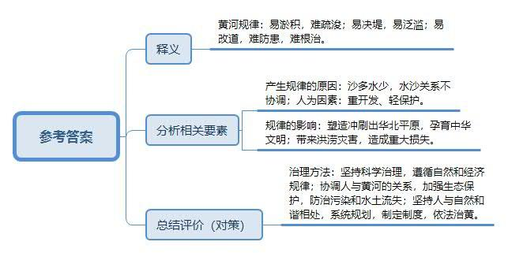
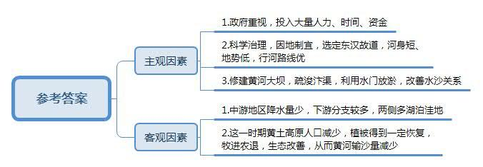
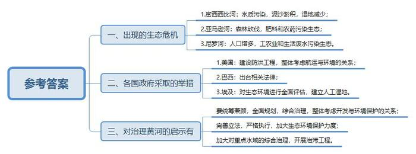
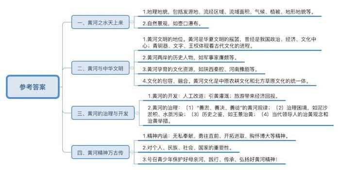
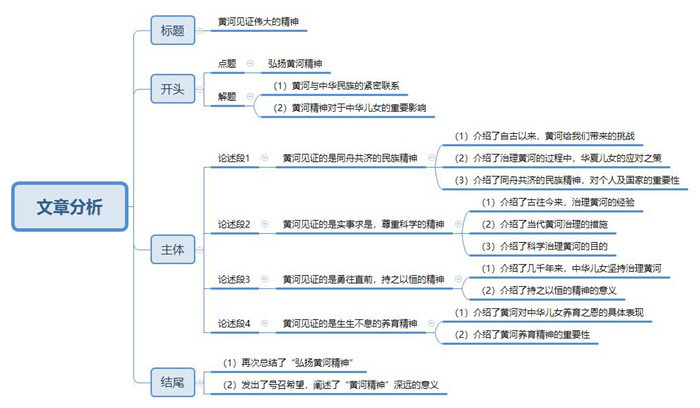

# 2011年国家公考《申论》题（副省级）

<!-- gwy:overview:start -->
> **国考 · 2011 · 申论 · 副省级** ｜ 5 题 · 图片 5 处 · 答案随题折叠

导航：[题目](#题目) · [材料 1](#材料-1)
<!-- gwy:overview:end -->

> 候选采集稿。参考答案及解析来自粉笔页面，不代表官方答案或真实高分答卷；来源使用许可与原卷对应关系仍需人工核实。

## 给定材料

### 材料 1

黄河是中华民族的母亲河，是华夏文明的摇篮。黄河从青海源头，向东流经四川、甘肃、宁夏、内蒙古、陕西、山西、河南等省区，在山东垦利县注入渤海，全长5464千米，流域面积75.24万平方千米。黄河流域是中华文化的发祥地之一。几十万年以前，这里就有了人类的踪迹，新石器时代的遗址，遍及黄河沿岸。进入阶级社会以后，在相当长的历史时期内，黄河流域是我国政治、经济、文化的中心。黄河流域是我国开发最早的地区之一，在世界其他地区大都还处在蒙昧状态的时候，我们勤劳勇敢的祖先就在这块广阔的土地上斩荆棘、辟蒿莱，劳动生息，创造灿烂夺目的古代文明。黄河流域四季分明，植被繁茂，山溪密布，旱有密布如网的河流可供灌溉，涝有山岗丘峦可退。这里有第一个能显示华夏文明的建筑群夏王朝宫殿群，还有商王朝第一座有宫殿都城偃师商城和郑州商城。商王朝迁徙到安阳殷墟时，甲骨文字已是常用的规范文字。青铜器更显现了殷商王国政权的演化过程。文字和王权的出现，是黄河文明发展进程中的一个重大转折点，“中国”一词最早的所指也是黄河流域。

古往今来，黄河两岸上演了一幕幕威武雄壮的历史话剧，鼓舞着一代代中国人奋勇前进。黄河流域地灵人杰，涌现了许许多多伟大的历史人物，杰出唯物主义思想家荀况，著名的政治家蔺相如，优秀的军事家廉颇、卫青、霍去病，名垂千古的文学巨匠司马迁、杜甫、白居易、关汉卿以及为民族解放事业捐躯的杨靖宇、吉鸿昌……他们如历史长河中灿烂的群星，放射出耀眼的光芒，为推进社会进步作出了巨大的贡献，这是黄河的骄傲，也是每一个中国人的骄傲。

“黄河之水天上来，奔流到海不复还”，黄河第一景观该是那闻名天下的壶口瀑布。黄河流经此地时，敛水成束，倾泻在30多米深的石槽中，形似茶壶注水，正如古书云：“盖河漩涡，如一壶然。”在这里，黄河河床陡然收束并下陷，湍急的河水骤然被挤进狭小的空间，瞬时就形成了万马奔腾的场面。浪花飞溅，波涛奔涌，浑浊的河水被两岸的石壁无情挤压后，又反身冲向河水中央，形成了白色“V”字形的水浪，翻滚着从壶口落下30多米深的谷底，愤怒的河水发出震天的怒吼，同时腾起了冲天的水浪和白雾。白雾中又幻化出了美丽的彩虹，若能在这里聆听人民音乐家冼星海的《黄河大合唱》，你定会觉得空前庄严神圣，热血沸腾……黄河在这里完成了她的交响乐中最华美壮丽的乐章。

北宋画家张择端的长卷《清明上河图》，浓缩了中华古都的繁华盛况，弥散着浓浓的生活气息，这是世界绘画史上的瑰宝。陕西的秦腔、河南的豫剧，承载着博大精深的黄河文化，唱出了黄河儿女的心声与愿景，世代流传。屹立在孟门山上的大禹雕像又会令瞻仰者忆起那惊天地、泣鬼神的治水英雄的功绩……黄河之水从源头到入海口，汩汩滔滔，孕育着取之不尽的文化资源。

在黄河文化演进发展的历史过程中，黄河的治理开发与管理保护占有重要的地位。从某种意义上说，广大人民群众的“治黄”实践活动，是黄河文化发展的沃土，而黄河经济的发展又为黄河文化建设提供了雄厚的经济基础。

### 材料 2

“母亲河”的水量并不丰沛，但却以占全国河川径流2.4%的有限水资源，滋养着全国12%的人口，灌溉着15%的耕地。新中国成立60多年来，当代治黄工作取得了举世瞩目的成就：依靠已建成的防洪工程体系，“上拦下排，两岸分滞”控制洪水，战胜了花园口1万至1.5万立方米∕秒的洪水7次，1.5万立方米/秒以上的3次，确保了沿黄地区工农业生产和人民群众的安全；在黄河流域已建成和在建的大中小型水库3147座，全河引水工程已建成4600多处，引黄灌溉已由解放前的1200万亩，发展到11000万亩，增长了8倍。黄河水的利用多达307亿立方米，为全国各江河利用率之首；新中国成立60多年来，有计划地进行了三次人工改道，彻底扭转了历史上黄河口居民“十年河东，十年河西”的险恶局面；随着河口流路的稳定，黄河三角洲由过去一片荒芜变为富庶的鱼米之乡。黄河流域丰富的旅游资源，也为当地人民带来了极大的经济回报。但黄河毕竟是一条桀骜不驯的大河，广义的说，黄河资源的开发利用就包含着对黄河的治理。为了抵御河患、造福人民，早在两千多年前，我国就开始修建黄河大堤。黄河大堤承载了黄河的记忆，见证了黄河的沧桑，既记录了人类利用黄河、改造黄河、与大自然斗争的宏伟经历，又记录了黄河以其自然破坏力给人类带来的灾难和不幸；既传承了我国劳动人民治理黄河的成就和精神，又反映了人与自然相互斗争、相互依存的辩证关系。

但是近年来，随着经济的发展，黄河流域废污水排放量比20世纪80年代多了一倍，化工和矿业污染事件不断发生。黄河中下游几乎所有支流的水质常年处于劣五类状态，支流变成“排污沟”，黄河污染触目惊心。“一碗河水半碗沙”，黄河是世界上含沙量最大的河流。全国人大代表、黄河水利委员会负责人提交了《关于尽快立项建设黄土高原粗泥沙集中来源区拦沙工程的建议》，建议通过加大对黄土高原1.88万平方千米粗泥沙集中来源区的治理力度，来改善黄河水沙关系、延长水库使用寿命、减少下游河道泥沙淤积。据史料记载，从公元前602年至1938年的2540年间，黄河下游共决口1590次，改道26次。究其原因，主要是黄河携带的大量泥沙淤塞河道。长期的淤积使水位抬高，黄河下游河道成为名副其实的地上悬河，黄河底床比河南开封市地面高13米，比新乡市高20米，“一旦堤防决口，就是灭顶之灾”。

### 材料 3

长期以来，美国对密西西比河的开发活动主要是防洪和扩大航运，这两项工程耗费了巨大的财力、物力和人力资源，但水质问题却是影响着密西西比河全流域“健康”的一个关键性问题。美国地表排放有毒废水量最大的有15个州，其中5个州分布在密西西比河沿岸。这里很多河段都达不到美国政府于1972年颁布的《清洁水法》中有关适于鱼类生存和人们游泳方面的水质标准。调查表明，排入上密西西比河的许多化学物质来自农业生产过程中被污染的废水。虽然美国政府对密西西比河的治理十分重视，建设了大量工程，但计划中的工程仅完成60％左右，实际还只能勉强防御一般性大洪水。航运一直是上密西西比河重要的商业活动。明尼苏达州到密苏里州之间的河段建造了27座船闸和大坝，虽然极大地改善了航运条件，但很少考虑到这些大坝对整个生态系统的负面影响，航运和其他活动与密西西比河流域生态环境的相容性仍是密西西比河管理的一个重要课题。泥沙淤积是上密西西比河的主要环境问题，过量泥沙使水生植物的光透射性减少，并淤填在上密西西比河的回水区。上密西西比河的渠化、一系列船闸、大坝以及通航水库也形成了一个拦截泥沙的系统。湿地减少也是密西西比河流域的一个关键性问题。上密西西比河至今仍没有全面规划，近年才从整体考虑研究航运与环境的关系，但尚未根本解决整个上游流域存在的问题，发生严重水灾的可能性依然存在。

科学家警告说，森林砍伐已经使亚马逊河众多支流的水文状况发生了巨大变化，干流受到影响只是一个时间问题。目前亚马逊河的7000条支流正逐渐干涸，另外肥料和农药也对这些支流的生态造成了很大影响。近年来，亚马逊地区的森林砍伐速度加快，一些森林被开垦为养牛场，还有很多林区则开垦成农田，用来进行大规模的粮食作物和经济作物种植。大豆的种植面积很大，而大豆如要在赤道地区生长则需要大量的肥料和浓度很高的农药，势必引发水质污染。为使亚马逊河免遭干涸的命运，巴西政府制定的一项法律规定，禁止农民砍伐沿河岸50米以内的森林；另一项法律则规定，只能伐20％的森林，其他80%的森林可以根据政府批准的林业管理规划选择性地进行砍伐。但是，在这个面积超过整个欧洲的亚马逊地区，上述法律以及其他环境法规常常受到漠视。

埃及地处北非，是严重干旱缺水的国家，工农业及生活用水全靠尼罗河。曼扎拉湖位于尼罗河三角洲的北端，是一个长60千米、宽40千米的长方形湖泊，它对尼罗河的“健康”起到至关重要的作用。每年埃及各地的工业、农业和生活污水几乎都通过5条水渠流入该湖中。上个世纪90年代以前，因为人口激增，工业和农业及生活废水排放量大幅增加，加上没有进行有效的治理，导致曼扎拉湖水质急剧恶化，湖里鱼类几乎绝迹，湖周围的鸟类也大量减少，生态环境受到严重破坏。面对严峻的现实，埃及政府对这里的生态环境进行了全面评估并得出了这样的认识：消除曼扎拉湖的污染，改善曼扎拉湖的水质，不仅对提高湖区周边人民群众的生活水平有重要意义，而且对于整个埃及也具有重要的示范作用。曼扎拉湖治污工程于1992年开始实施，其人工湿地的工程包括扬水站、污水沉降池、污水处理池、幼鱼池和渔场等，2001年工程全部完工。经过人工湿地处理后的湖水已经基本消除了其中的污染物质，如原湖水中富氧物质的70％、总浮游物的80％、氮磷总量的50％和粪便的98%都已不复存在。记者在参观这一人工湿地工程时看到，污水源源不断地流入第一、第二和第三沉降池，经过多次过滤和清污处理之后再引入幼鱼池，鱼池里的水清澈透明，鱼儿在池中悠闲地游动。经过鱼池再流入曼扎拉湖的水便不再是被污染的湖水。如今这里又恢复了勃勃生机。

### 材料 4

“维持黄河的健康生命”是被广泛宣传的一句口号。黄河的健康标准是什么呢？通常说法有四条，即：堤防不决口，河道不断流，水质不超标，河床不抬高。初闻此话，似觉有理。但实际上这不能算作黄河自身的健康标准。从黄河的发育史可知，黄河在有人类活动之前的许多年，曾是相互之间并不连通的四段，最下面的一段为三门峡所阻隔未能入海，那时它是一条内陆河，而此时黄河的生命非常健康，正处于它的蓬勃发育时期。在有了人类活动之后，黄河是三年两决口，百年一改道。因此，若舍掉人类存续与黄河的相互关系，单就黄河本身而言，黄河健康生命的主要表现形式就是“三善”，即“善淤、善决、善徙”，这是一个为几千年历史所反复证明的基本事实。否则，也就不会有25万平方千米的华北大平原，而这恰是该地区几亿人安身立命的根本。自1946年黄河水利委员会指导治黄以来，黄河伏秋大汛没有决口，可谓“三年安澜”；其后几十年固堤防洪成了治黄的主要手段，成绩很大，但代价也很大，其结果是黄河河床不断淤高，这为未来埋下了很大隐患。

毛泽东同志历来重视水利建设，治理黄河更是他牵肠挂肚的一件大事。1952年10月，毛泽东第一次出京视察的地方就是黄河。他不无忧虑地问：“黄河涨上天怎么样？”毛泽东在水面比开封城高出三四米的黄河柳园口，感慨地说：“这就是悬河啊。”毛泽东接着指出：“南方水多，北方水少，借一点来是可以的。”南水北调这个雄伟的战略构想就这样被提出来了。毛泽东视黄河为“中华民族的象征”，他敬畏黄河，审慎思考着黄河的开发与治理，他没有留下“根治”之类的豪言壮语。在视察时只是殷殷嘱咐有关方面负责的同志：“你们要把黄河的事情办好。”1953年2月，毛泽东在外出视察的专列上就三门峡水库建设的时间、库区移民问题、黄河中上游的水土保持以及南水北调等问题与负责水利工作的有关领导进行了探讨。1954年冬，毛泽东在抵达郑州火车站的专列上专门听取了治黄工作的汇报，并着重谈了水土保持和治理规划问题。1955年6月，毛泽东又听取了河南省委有关治黄工作的汇报。1959年，毛泽东在济南泺口又一次视察了黄河，并说了一句意味深长的话：“人说不到黄河心不死，我是到了黄河也不死心。”

邓小平同志十分重视黄河在我国社会主义现代化建设进程中的重要地位，对黄河建设给予了亲切的关怀和支持。1980年7月23日，他来到花园口视察黄河大堤，询问黄河的汛期流量和防洪措施，在黄河主航道旁，仔细观察了黄河主流的流量，就防止泥沙淤积的问题与有关同志交换意见，他感慨地说：“维持黄河的现状，仍有相当大一部分地区和人口在特大洪水出现时有危险，因此，还是要搞小浪底水库，解决黄河中下游的汛期防洪问题。”

1999年6月21日，江泽民同志在郑州主持召开黄河治理开发工作座谈会，他在讲话中指出，进一步把黄河的事情办好，让古老的黄河焕发青春，更好地为中华民族造福。

在全国人民隆重纪念中国共产党领导人民治理黄河60周年之际，胡锦涛同志强调指出：黄河是中华民族的母亲河，黄河治理事关我国现代化建设全局。60年来，人民治理黄河事业成就辉煌，但黄河的治理开发仍然任重道远，必须认真贯彻落实科学发展观，坚持人与自然和谐相处，全面规划，统筹兼顾，标本兼治，综合治理，加强统一管理和统一调度，进一步把黄河的事情办好，让黄河更好地造福中华民族。

### 材料 5

东汉永平十二年，孝明帝令水利专家王景治黄（此前黄河已泛滥几十年）。王景受命于危难之际，率几十万兵士民工，修汴渠治黄河，历时一年，用费亿钱。自王景治河后，河行新道，维持了900多年未发生大改道，是时，汴渠成为东通江淮的主要水道。王景的主要工作是修建了自荥阳至千乘的黄河大堤，治理了作为东汉漕运主要通道的汴渠。王景治河后，黄河相对安澜800年，据分析，这与王景所选定的东汉故道河身较短、地势较低，因而行河路线较优有关；另外，“十里立一水门，令更相回注”所描述的可能是一种利用沿河大泽放淤的工程措施，这对于延长行河年限也有一定帮助。以上所述主要是从治黄工程的角度看问题，但据黄河水文、植保专家的研究，王景治河至隋代的500多年，为黄河史上又一阶段，其特点是黄河下游河患相对较少。在此期间，黄河中游地区大暴雨的记录较少，这一时期黄河下游有分支，两侧又有较多湖泊洼地；但其中更重要的原因就是那时黄河输沙量的减少。否则，王景所开新河道（如汴水），也会很快被淤积，从而使河床不断淤高，降低其泄洪能力。这一时期黄河输沙量的减少并不是推论，而是有以下诸条事实，即在这一时期有关黄河水清的记载较多，且有“黄河清复清”的民谣。这一时期黄河输沙量的减少主要归功于黄土高原人口减少，植被得到一定恢复。安史之乱后，农牧界线又迅速北移到河套以北，大片草原又变为农田，又一次加剧了水土侵蚀，导致黄河下游灾害增多。五代、两宋至元、明时期，农牧界线一直游移于陕北和内蒙之间，直至清乾隆之后，农田植被更逐渐推移至阴山以北，这时整个草原几乎全部为一年生农作物所取代，水土流失非常严重，陕北风沙加剧，黄河下游水患频仍。王景治河后黄河安澜800年，他的“治黄”思路和做法很值得今人研究与借鉴。

### 材料 6

黄河担负着沿黄地区50余座大中城市和420余个县的城镇居民生活供水的任务，黄河污染将给城镇居民供水安全带来巨大威胁。2003年，黄河发生了有实测记录以来最严重的一次污染，三门峡水库蓄水变成“一库污水”。三门峡水库自规划修建之日起便承载着国人“黄河清”的千年梦想。由于黄河下游难得一清，古人把“黄河清”作为一种瑞征。南朝萧统编选的《文选》中首次提出“黄河清而圣人生”的说法，后来逐渐演变成“圣人出而黄河清”的祈盼。面对黄河这样一条“善淤、善决、善徙”水旱灾害频仍的河流，人们盼望圣主的诞生，以便带来“河清海晏”的太平盛世，也本无可厚非。在封建社会，许多大臣曾上书奏称黄河变清，如清雍正年间的河道总督齐苏勒曾奏称黄河变清，雍正皇帝非常高兴。然而，由于黄河治理的复杂性，在漫长的历史时期，“黄河清”从未真正实现，只是萦绕于人民心中的梦而已。当年，三门峡水利枢纽修建之时，美国巨型大坝的建设正如火如荼，胡佛坝、大古力坝相继而起，前苏联也先后在伏尔加河、顿河流域上建起高坝大库。因此，很少有人质疑这样的构想：在黄河上建起一座大坝拦截泥沙，再附之以水土保持措施，从而既能让下游变清，又能综合开发。当全国人大一届二次会议的1000多位代表面对修建三门峡水库这样一个承载着国人“黄河清”千年梦想的工程，一个“战胜自然的伟大计划”，一致欢呼通过，也是完全可以理解的。

1999年8月以后，我国从黄土高原开始，开展了全国范围内的退耕还草还林，停止了坡地开荒。至2007年底，全国累计退耕面积约3.2亿亩。据估计，黄土高原要占到一半左右，这在治黄史上是一个历史性的大事件。回顾历史，在北宋年间，黄土高原上就出现了开垦坡地的记录，以后此况愈演愈烈，而在约1000年之后的今天，其坡地开垦终获停止，这无疑是一次惊天的大逆转，人们希望以往治黄的大困局将由此而全盘皆活。

### 材料 7

为治理黄河而奔波半生的水利专家王化云同志在其回忆录《我的治河实践》中辛酸地叹道：“黄河不可能变清……黄河也不需要变清。未来黄河的治理与开发，我认为应该建立在黄河不清的基础上。”资深黄河环保专家、1978年就曾经探访了黄河源头的Y某指出，长期屡禁不止的盗猎、金矿开采以及过度的林区资源开发，导致了黄河源头的“美丽童话”正渐渐消失，保护黄河，关键是治理黄河源头的水和沙，因而，对黄河源头的保护就显得更为重要，假如黄河源头都受到污染，那么黄河的断流、污染就更难解决。文化学者R教授踏勘黄河源头时感慨万千，他认为，从某种意义上讲，认识黄河、了解黄河，是在寻找一种精神资源，寻找一种精神的依归；对于环保，R教授对“黄河区域的移民一定会带来黄河的污染”的说法则不予赞同，他说：“关键要看移的是什么民，人们的环保意识是决定黄河未来的关键因素。”中国地理学会M教授的观点也很明确：要重新认识黄河，为此，他提出了“大黄河”概念。他说：“如果狭义的黄河文化是指黄河中下游地区的农耕文化，那么广义的黄河文化就应从大黄河的概念出发，将中原农耕文化和北方草原文化统一纳入黄河文化体系。”致力于黄河文化研究的Z博士提出了弘扬黄河文化的四个关键控制点：首先，深刻认识黄河文化的价值；其次，注重“黄河文化圈”的培养与维护；再次，注重文化创意融入生态旅游的一站式体验；最后是主动融入全球价值链。

## 题目

### 第 1 题

**“给定资料4”写道：“黄河健康生命的主要表现形式就是‘三善’，即‘善淤、善决、善徙’，这是一个为几千年历史所反复证明的基本事实。”请结合对这句话的理解，谈谈对黄河自身规律的认识。（10分）**

关联材料：材料 1、材料 2、材料 3、材料 4、材料 5、材料 6、材料 7

作答要求：

要求：简明、完整。不超过200字。

第 1 题 · 答案与解析

**参考答案（粉笔题库参考内容）**

一、黄河规律：易淤积，难疏浚；易决堤，易泛滥；易改道，难防患，难根治。

二、产生规律的原因：沙多水少，水沙关系不协调；人为因素：重开发、轻保护。

三、规律的影响：塑造冲刷出华北平原，孕育中华文明；带来洪涝灾害，造成重大损失。

四、治理方法：坚持科学治理，遵循自然和经济规律；协调人与黄河的关系，加强生态保护，防治污染和水土流失；坚持人与自然和谐相处，系统规划，制定制度，依法治黄。

**解析**

**参考答案说明：**宏观上，本参考答案按照词句解释题的一般思路“释义+分析相关要素+总结评价”展开。内容方面，本参考答案先对“三善”的含义进行了解释；“分析相关要素”部分先分析了黄河规律产生的原因，接着分析了黄河规律带来的影响；最后给出了治理黄河的对策。词句表达方面，本参考答案加上了“产生规律的原因”“规律的影响”“治理方法”等连接词来承接上下文。

**考点**：词句解释类

### 第 2 题

**“给定资料5”介绍了汉代王景治理黄河的思路和做法。请概括王景治河后黄河安澜800年的主要原因。（10分）**

关联材料：材料 1、材料 2、材料 3、材料 4、材料 5、材料 6、材料 7

作答要求：

要求：简明扼要，条理清楚。不超过200字。

第 2 题 · 答案与解析

**参考答案（粉笔题库参考内容）**

一、主观因素：1.政府重视，投入大量人力、时间、资金。2.科学治理，因地制宜，选定东汉故道，河身短、地势低，行河路线优。3.修建黄河大坝，疏浚汴渠，利用水门放淤，改善水沙关系。
二、客观因素：1.中游地区降水量少，下游分支较多，两侧多湖泊洼地。2.这一时期黄土高原人口减少，植被得到一定恢复，牧进农退，生态改善，从而黄河输沙量减少。

**解析**

**参考答案说明：**宏观上，本参考答案从主观和客观两个方面分析了“王景治河后黄河安澜”的原因。微观上，主观方面的原因又从“政府重视”“科学治理”“疏浚放淤”三个方面进行了分条撰写；客观方面的原因又从“降水量”“输沙量”两个方面进行了分条撰写。此外，每条要点之间没有交叉。

**考点**：概括主要内容类

### 第 3 题

**“给定资料3”介绍了密西西比河、亚马逊河、尼罗河等流域出现的生态危机以及各国政府的治理举措。请对这些材料进行归纳，并说明我国治理黄河可以从中受到哪些启示。（20分）**

关联材料：材料 3

作答要求：

要求：内容具体，表述清晰，不超过300字。

第 3 题 · 答案与解析

**参考答案（粉笔题库参考内容）**

一、出现的生态危机：1.密西西比河：水质污染，泥沙淤积，湿地减少；2.亚马逊河：森林砍伐，肥料和农药污染生态；3.尼罗河：人口增多，工农业和生活废水污染生态。

二、各国政府采取的举措：1.美国：建设防洪工程，整体考虑航运与环境的关系；2.巴西：出台相关法律；3.埃及：对生态环境进行全面评估，建立人工湿地。

三、对治理黄河的启示有：要统筹兼顾，全面规划，综合治理，整体考虑开发与环境保护的关系；要完善立法，严格执行，加大生态环境保护力度；加大对重点水域的综合治理，开展治污工程。

**解析**

**参考答案说明：**宏观上，本参考答案对“三条河流出现的生态危机”“各国采取的举措”“对治理黄河的启示”三个要素进行了分段撰写。微观上，“三条河流出现的生态危机”分别按照“密西西比河”“亚马逊河”“尼罗河”进行了分条撰写；“各国采取的举措”分别按照“美国”“巴西”“埃及”三个不同的国家进行了分条撰写；“对治理黄河的启示”从“总体规划”“法律保护”“重点水域治理”三个方面进行了分条撰写。各条要点之间在内容上是并列关系，没有交叉。

**考点**：多要素组合类

**来源**：2011年国家公考《申论》题（副省级）

### 第 4 题

**国家某部门拟编写一本以黄河为主题的宣传手册，作为对青少年进行爱国主义教育的材料。宣传手册由四个部分组成，依次为“黄河之水天上来”、“黄河与中华文明”、“黄河的治理与开发”、“黄河精神万古传”。请参考资料，分别列出每个部分的内容要点。（20分）**

关联材料：材料 1、材料 2、材料 3、材料 4、材料 5、材料 6、材料 7

作答要求：

要求：

（1）切合主题；

（2）全面、表述准确，有逻辑性；

（3）不超过400字。

第 4 题 · 答案与解析

**参考答案（粉笔题库参考内容）**

一、黄河之水天上来

1.地理地貌，包括发源地、流经区域、流域面积、气候、植被、地形地貌等。2.自然景观，如壶口瀑布。

二、黄河与中华文明

1.黄河文明的地位。黄河是华夏文明的摇篮，曾经是我国政治、经济、文化中心；青铜器、文字、王权体现着古代文化的进程。2.黄河两岸的历史人物，如军事家廉颇等。3.黄河孕育的文化资源，如陕西秦腔等。4.文化的包容、融合。黄河文化是中原农耕文化和北方草原文化的统一体。

三、黄河的治理与开发

1.黄河的开发：人工改道；引黄灌溉；旅游带来经济回报。2.黄河的治理：（1）“善淤、善决、善徙”的黄河规律；（2）治理困境，如泥沙淤积、水质污染；（3）历史之鉴，如王景治黄；（4）当代领导人的治黄观念和治黄举措。

四、黄河精神万古传

1.精神内涵：无私奉献、勇往直前、开拓进取、胸怀博大等精神。2.对个人、民族、社会、国家的重要性。3.号召青少年保护母亲河，践行、传承、弘扬黄河精神！

**解析**

**参考答案说明：**本参考答案从“黄河之水天上来”“黄河与中华文明”“黄河的治理与开发”“黄河精神万古传”四个部分进行了分条撰写。各条答案要点之间在内容上是并列关系，没有交叉。

**考点**：宣传类

**来源**：2011年国家公考《申论》题（副省级）

### 第 5 题

**参考给定材料，以“弘扬黄河精神”为主题，自选角度，自拟题目，写一篇文章。（40分）**

关联材料：材料 1、材料 2、材料 3、材料 4、材料 5、材料 6、材料 7

作答要求：

要求：

（1）中心论点明确，有思想高度；

（2）内容充实，有说服力；

（3）语言流畅，1000字左右。

第 5 题 · 答案与解析

**参考答案（粉笔题库参考内容）**

**黄河见证伟大的精神**

从某种意义上说，中华民族是伴随黄河产生的，每个中国人心中都有一条黄河，黄河是中华民族的见证人，她不仅见证了我们的成长，而且影响着我们的精神气质。

**——黄河见证的是同舟共济的民族精神。**

黄河不仅养育了华夏民族，使我们的民族生生不息，也给我们带来挑战，考验着我们与自然作斗争的能力，砥砺着我们的民族精神。古往今来，黄河带来了众多灾难：突如其来的特大山洪、旷日持久的特大干旱。正是和黄河的不断斗争，激励和鼓舞着中华民族自强不息、振奋精神、不断前行。面对黄河给我们带来的危害，我们的民族上下一心、团结一致，凝聚起攻无不克、无往不胜的强大力量。在治理黄河的过程中，无论是八方驰援的人间大爱，还是舍己为人的坚定从容；无论是忠于职守的高度责任，还是共克时艰的勠力同心，都为民族精神赋予了新的内涵。只有继续弘扬和发展这样的精神，和衷共济、团结奋战，我们的事业才会不断兴旺发达，我们的国家才会更加繁荣富强。

**——黄河见证的是实事求是，尊重科学的精神。**

古往今来，成功地治理黄河，无不根据黄河本身的规律，深入调查，因地制宜。正是这种精神，才使得我们将黄河的害化为利。从东汉王景治理黄河，到今天的黄河小浪底工程，无一不是如此。胡锦涛同志指出，黄河的治理开发仍然任重道远，必须认真贯彻落实科学发展观，坚持人与自然和谐相处，全面规划，统筹兼顾，标本兼治，综合治理，加强统一管理和调度，进一步把黄河的事情办好，让黄河更好地造福中华民族。这正是实事求是的科学精神的体现，我们应该继续发扬这种精神。

**——黄河见证的是勇往直前，持之以恒的精神。**

五千年来，从大禹治水到今天的水利建设，我们的民族从来都没有放弃过对黄河的治理，从来没有失去要治理好黄河的信心。正是这样的精神鼓舞着中华民族发展至今，也正是这种精神促使我们的民族走向更加辉煌灿烂的明天。

**——黄河见证的是生生不息的养育精神。**

黄河不仅养育了我们强健的躯体，还涵养了我们高尚的品格。她对中华民族的养育，不分民族，不分时间，不分高低贵贱，她一直默默地为华夏儿女奉献、付出，从来不求一丝回报。这种精神对于中华民族特有的精神品格的形成起到了至关重要的作用，正是这种精神涵养了一大批讲奉献、讲付出，为天下苍生谋福利的优秀中华儿女。

当前和今后一个时期，是治理好黄河的关键时期，也是彻底解决黄河问题的攻坚时期。未来征程上，我们必然还会面临各种风险挑战。我们坚信，在治黄过程中锤炼出的伟大精神，不仅在应对治理黄河时会显示出磅礴的力量，同样会在更为漫长的社会主义现代化建设道路上，凝聚起当代中国发展的合力，释放出更为持久也更为强大的力量！

**文章分析：**

**黄河见证伟大的精神**

【**标题的优点：**首先，范文的标题“黄河见证伟大的精神”突出了“弘扬黄河精神”这一主题。其次，形式上，文字简洁明快。】

从某种意义上说，（1）中华民族是伴随黄河产生的，每个中国人心中都有一条黄河，（2）黄河是中华民族的见证人，她不仅见证了我们的成长，而且影响着我们的精神气质。

【**开头的优点：**★内容方面。范文的开头是紧扣题目给定的“弘扬黄河精神”这一主题展开的。首先，开头第一句话点出主题，做到了主题明确。其次，对“弘扬黄河精神”这一主题进行了分析阐述，指出了（1）黄河与中华民族的紧密联系。（2）黄河精神对于中华儿女的重要影响。★文字表达方面：使用了“不仅……而且……”关联词，使语言表达有逻辑性，此外也使用了拟人这一修辞手法，使文字表达更加形象、有力。】

——黄河见证的是同舟共济的民族精神。

黄河不仅养育了华夏民族，使我们的民族生生不息，也（1）给我们带来挑战，考验着我们与自然作斗争的能力，砥砺着我们的民族精神。古往今来，黄河带来了众多灾难：突如其来的特大山洪、旷日持久的特大干旱。正是和黄河的不断斗争，激励和鼓舞着中华民族自强不息、振奋精神、不断前行。（2）面对黄河给我们带来的危害，我们的民族上下一心、团结一致，凝聚起攻无不克、无往不胜的强大力量。在治理黄河的过程中，无论是八方驰援的人间大爱，还是舍己为人的坚定从容；无论是忠于职守的高度责任，还是共克时艰的勠力同心，都为民族精神赋予了新的内涵。只有继续弘扬和发展这样的精神，和衷共济、团结奋战，（3）我们的事业才会不断兴旺发达，我们的国家才会更加繁荣富强。

【**论述段1的优点：**★观点句：范文的观点句是紧扣“弘扬黄河精神”这一文章主题提出的。形式上，它在段首处直接写出，位置突出，容易发现。内容上，关键词突出，内容要点明确，可以明显看出它是从“同舟共济的民族精神”入手，指出了“黄河精神的内涵”。★论述内容：（1）介绍了自古以来，黄河给我们带来的挑战；（2）介绍了治理黄河的过程中，华夏儿女的应对之策；（3）介绍了同舟共济的民族精神，对个人及国家的重要性。注意：以上几个方面的内容都是紧扣“黄河见证的是同舟共济的民族精神”这个观点句进行分析论述的，论述的针对性强，内容层次丰富。最后，在论述方法和论据的选取上做到了讲道理与举例子相结合，做到了丰富多样。】

——黄河见证的是实事求是，尊重科学的精神。

（1）古往今来，成功地治理黄河，无不根据黄河本身的规律，深入调查，因地制宜。正是这种精神，才使得我们将黄河的害化为利。从东汉王景治理黄河，到今天的黄河小浪底工程，无一不是如此。胡锦涛同志指出，（2）黄河的治理开发仍然任重道远，必须认真贯彻落实科学发展观，坚持人与自然和谐相处，全面规划，统筹兼顾，标本兼治，综合治理，加强统一管理和调度，进一步把黄河的事情办好，（3）让黄河更好地造福中华民族。这正是实事求是的科学精神的体现，我们应该继续发扬这种精神。

【**论述段2的优点：**★观点句：范文的观点句是紧扣“弘扬黄河精神”这一文章主题提出的。形式上，它在段首处直接写出，位置突出，容易发现。内容上，关键词突出，内容要点明确，可以明显看出它是从“实事求是，尊重科学的精神”入手，指出了“黄河精神的内涵”。★论述内容：（1）介绍了古往今来，治理黄河的经验；（2）介绍了当代黄河治理的措施；（3）介绍了科学治理黄河的目的。注意：以上几个方面的内容都是紧扣“黄河见证的是实事求是，尊重科学的精神”这个观点句进行分析论述的，论述的针对性强，内容层次丰富。最后，在论述方法和论据的选取上做到了讲道理与举例子相结合，做到了丰富多样。】

——黄河见证的是勇往直前，持之以恒的精神。

（1）五千年来，从大禹治水到今天的水利建设，我们的民族从来都没有放弃过对黄河的治理，从来没有失去要治理好黄河的信心。（2）正是这样的精神鼓舞着中华民族发展至今，也正是这种精神促使我们的民族走向更加辉煌灿烂的明天。

【**论述段3的优点：**★观点句：范文的观点句是紧扣“弘扬黄河精神”这一文章主题提出的。形式上，它在段首处直接写出，位置突出，容易发现。内容上，关键词突出，内容要点明确，可以明显看出它是从“勇往直前，持之以恒的精神”入手，指出了“黄河精神的内涵”。★论述内容：（1）介绍了几千年来，中华儿女坚持治理黄河；（2）介绍了持之以恒的精神的意义。注意：以上两个方面的内容都是紧扣“黄河见证的是勇往直前，持之以恒的精神”这个观点句进行分析论述的，论述的针对性强，内容层次丰富。最后，在论述方法主要采用道理论证的方式，具有一定的说服力。】

——黄河见证的是生生不息的养育精神。

（1）黄河不仅养育了我们强健的躯体，还涵养了我们高尚的品格。她对中华民族的养育，不分民族，不分时间，不分高低贵贱，她一直默默地为华夏儿女奉献、付出，从来不求一丝回报。（2）这种精神对于中华民族特有的精神品格的形成起到了至关重要的作用，正是这种精神涵养了一大批讲奉献、讲付出，为天下苍生谋福利的优秀中华儿女。

【**论述段4的优点：**★观点句：范文的观点句是紧扣“弘扬黄河精神”这一文章主题提出的。形式上，它在段首处直接写出，位置突出，容易发现。内容上，关键词突出，内容要点明确，可以明显看出它是从“生生不息的养育精神”入手，指出了“黄河精神的内涵”。★论述内容：（1）介绍了黄河对中华儿女养育之恩的具体表现；（2）介绍了黄河养育精神的重要性。注意：以上两个方面的内容都是紧扣“黄河见证的是生生不息的养育精神”这个观点句进行分析论述的，论述的针对性强，内容层次丰富。最后，在论述方法主要采用道理论证的方式，具有一定的说服力。】

【**论述段之间的关系：**★内容的内在逻辑：范文的论述段之间是依照阐“黄河精神”的内涵这一逻辑展开的。论述段1先写了“同舟共济的民族精神”，论述段2再写了“实事求是，尊重科学的精神”，论述段3接着写了“勇往直前，持之以恒的精神”，论述段4最后写了“生生不息的养育精神”。★段与段的外在衔接：四个论述段之间呈现出“并列关系”，分别从不同的视角对“黄河精神”的内涵进行了细致的解读，让“黄河精神”从抽象空大，到形象具体。】

当前和今后一个时期，是治理好黄河的关键时期，也是彻底解决黄河问题的攻坚时期。未来征程上，我们必然还会面临各种风险挑战。我们坚信，（1）在治黄过程中锤炼出的伟大精神，不仅在应对治理黄河时会显示出磅礴的力量，同样（2）会在更为漫长的社会主义现代化建设道路上，凝聚起当代中国发展的合力，释放出更为持久也更为强大的力量！

【**结尾的优点**：范文的结尾回扣了“弘扬黄河精神”这一主题。（1）再次总结了“弘扬黄河精神”；（2）发出了号召希望，阐述了“黄河精神”深远的意义。】

**解析状态：unknown（来源未提供）**

**考点**：文章写作题

**来源**：2011年国家公考《申论》题（副省级）

