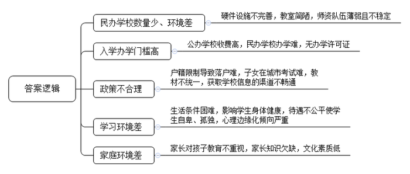
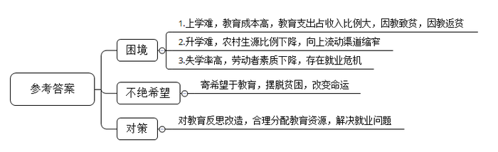
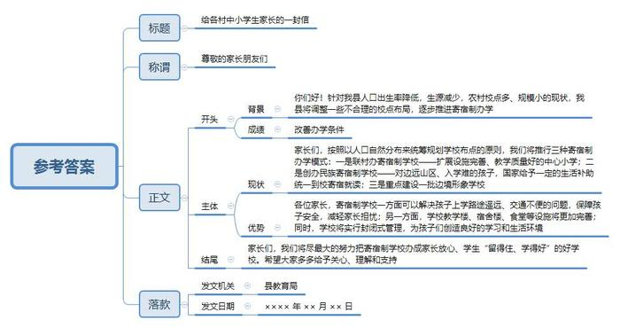
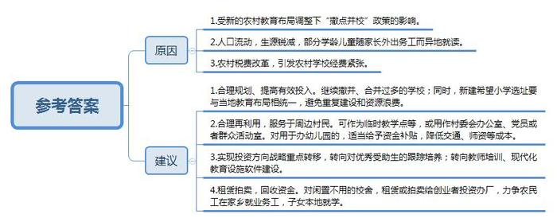
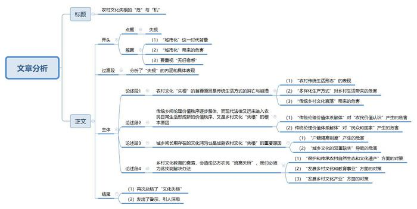

# 2011年国家公考《申论》题（地市级）

<!-- gwy:overview:start -->
> **国考 · 2011 · 申论 · 地市级** ｜ 5 题 · 图片 5 处 · 答案随题折叠

导航：[题目](#题目) · [材料 1](#材料-1)
<!-- gwy:overview:end -->

> 候选采集稿。参考答案及解析来自粉笔页面，不代表官方答案或真实高分答卷；来源使用许可与原卷对应关系仍需人工核实。

## 给定材料

### 材料 1

在城里公立小学开学的9月1日，张老师的打工子弟学校也开学了，在垃圾场边的平房里，18名学生走进了简陋的教室。同是小学教师出身的李某夫妇创办的“行知打工子弟学校”，则在一片荒芜的菜地里迎来了求学的孩子们。最早的一批打工子弟学校就这样在有志之士的努力下艰难地生存了下来。这样的学校数量有限，仍有众多的外来务工人员的子女不知道哪里有学上。

在某民办大学做管理工作的孙某为了让从农村接出来的孩子有学上，在郊区找了五六家公立小学。但是，校方要收取1万元到10万元不等的借读费和赞助费，这些高昂的费用让孙某发懵。因为公办学校门槛高，所以在城乡结合部，条件简陋、收费较低的民办农民工子弟学校如雨后春笋破土而出。然而，这样的学校绝大部分都戴着“非法”的帽子——没有办学许可证，很难逃脱被关停的命运。已有3年“办学经验”的秦老师说：“要拿办学许可证，必须有房屋产权证。可由于经费紧张，学校只能租用别人的场地及房屋。别说我们拿不出房屋产权证，就连房东也拿不出，因为房东也是租的村里的地。”一度拥有1500多名学生规模的私立金星小学就是因为校舍所在地被拆迁，从此销声匿迹了。“没有政府的支持，我们也不敢在硬件设备上加大投资。”办学人代某说：“艰难办学，最希望的是能有合法的地位，学生可以放心读书，老师也可以安心工作。”实际上这类学校的教师队伍很不稳定，往往春节一过，教师走掉一半。许多年轻教师都把私立学校当作跳板，一旦找到了合适工作，立马就跳槽走人。

开学已经好几天了，因为交不起300多元的学费，12岁的陈某迟迟没有报到。和陈某一样，由于家庭生活困难，不少农民工子女不得不放弃求学。树人学校也是一所农民工子弟学校。开学已经一周了，还有100来名学生没来报到。校长既失落又无奈，“反正每到开学，总得少那么百八十人。有的回老家了，有的转学了。至于有没有人辍学，那就没办法统计了。”

春节过后，8岁的乡村女孩儿张某在B市郊区的一所公办小学里迎来了新学期，但更多“漂泊”在市郊的农民工子女难有这样的待遇。“我也想去公办学校上学，至少那里有好的食堂，但学费实在太高。”一想起夏天早上带的饭菜到中午有点变味发馊，一位小学四年级学生心里就有点发酸。

“B市的公办学校，用的都是B市地方实验教材。将来考大学，因为没有户口，孩子还得回去考，怎么办？”从山西来B市打工的张某愁苦地问。考虑到这个因素，许多家长不得不把孩子送到使用全国统编教材的民办农民工子弟学校。

“我妈妈很少给我零花钱，我也没有什么新文具，总觉得在班里抬不起头。”这是一个“有幸”到公办学校就读的农民工的孩子所遇到的尴尬。记者在采访中发现，有不少乡下来的孩子，在大部分是城市孩子的公办学校里，都有孤独、自卑的感觉。对此，中国社会科学院一研究员表示，要警惕农民工子女心理“边缘化”倾向。他说，农民工子女本身就在经济条件等方面处于弱势地位，好不容易能与城里孩子坐在同一个教室里接受质量较高的教育，却又要承受来自同学们的不理解。生活上的困难没有让他们退缩，可这种心灵的创伤却难以抚平。

2010年8月颁布的《国家中长期教育改革和发展规划纲要（2010—2020）》中明确指出：“坚持以输入地政府管理为主、以全日制公办中小学为主，确保进城务工人员随迁子女平等接受义务教育，研究制定进城务工人员随迁子女接受义务教育后在当地参加升学考试的办法。”

“同在蓝天下，共同成长进步”，这是温家宝总理在考察北京玉泉路打工子弟小学时，在学校黑板上写下的题词。广大人民群众都希望并相信在实施《纲要》的过程中，这美好的愿景会变成现实。

### 材料 2

新华社、中国青年报记者联合进行了一项问卷调查。这一调查历时7天，在北京、上海、广东、浙江、江苏、山东等地，向农民工发放调查问卷131份，其中有效问卷125份。73名受访者表示，最大的愿望是自己的孩子能“和城里孩子享有同样的待遇”，43名受访者最希望能“降低收费标准”，17人希望能“有供农民工子女就读的专门学校”。调查同时显示，78位受访农民工表示，通过“朋友介绍”为孩子在城里联系学校；16人表示“从媒体报刊获悉”有关学校信息，5人表示“向城市教育部门咨询”，2人表示由“家乡教育部门推荐”，1人表示“学校主动上门”。

调查表明，有46名农民工子女，曾经因为父母务工地点的变化而被迫转学。其中转学1次的有10人，转学2次的有12人，转学3次或3次以上的有24人。在回答子女在城里求学遇到的最大困难时，54位受访者表示是“费用太高”，占受访总数的43.2%；46人表示是“没有城市户籍”，占受访者的36.8%。选择“住处附近没有学校”“受城里人的歧视”“毕业后拿不到毕业证”的受访者比例依次为16.8%、6.4%和4.8%。“我本来准备把小孩送到公立学校，但因为不是本地户口，我找的一所学校每学期竟然要8000元的赞助费，另外还要交这费交那费，最终还是没有去。”在N市打工的罗某告诉记者。

调查同时显示，有20名农民工表示孩子在上学时曾“遭受到拒绝”，7人表示“做了很多努力学校才接受”；有19位受访者表示孩子在学校“有过不公平待遇，但不严重”，3人表示孩子在学校“有过不公平待遇，情况比较严重”。调查还显示，77.6%的受访农民工表示，孩子“学习成绩一般”或“成绩不好”。88名受访者表示，“从来没有”或“不一定”有时间辅导孩子学习，占受访总数的70.4%。“小孩只要听话，知道尊老爱幼就行了。我整天忙，没时间想太多，学校的质量也就不管了。”33岁的王某来自南方某县，以帮酒店洗台布为生，谈起孩子的教育，他无奈地说。

### 材料 3

近年来，在发展边境少数民族地区教育的过程中，地处西南边境的L县坚持“调整一些不合理校点布局，逐步推进寄宿制办学”的工作思路，特别是结合国家在L县实施的“西部地区农村寄宿制学校建设工程”，对本县的学校布局进行调整。通过该工程的实施，L县各乡镇学校布局更加合理，办学条件进一步改善，办学效益得到了明显提高。L县在将教育资源的合理配置作为中心工作来抓的同时，注重发动社会各界共同关心和支持，努力把寄宿制学校办成群众满意，家长放心，学生“进得来、留得住、学得好”的学校。

撤并教学点，意味着自己的子女要去更远的地方读书，来回的交通又不方便，难免会让家长心存顾虑。L县充分利用报纸、广播、电视等宣传媒体，开辟“创建”专栏，还利用挂横额、张贴标语、出板报等形式大力宣传创建寄宿制学校的重要意义，营造良好的舆论氛围，动员社会各方面的力量都来关心、支持创建工作。县教育局、乡镇政府干部，带领教师和村干部分头走访学生家长，认真听取群众意见，并做好摸底工作。通过宣传发动，提高广大群众的思想认识，形成全社会关心、支持、参与创建工作的良好氛围。

L县把创建寄宿制学校作为改变农村教育现状的重点工作来抓，有效利用各方面条件，努力提高办学效益和质量，积极为农村教育的发展创造条件。一是充分利用“义教工程”、边境建设大会战教育建设项目、中小学危房改造工程等项目的资金投入，完善了学校的各项设施。几年来，共投入资金4379万元，建设了教学用房56幢，学生宿舍楼89幢，学生食堂79幢，学生厕所73间。二是推进教育资源配置方式的改革，统筹规划学校布局。针对农村校点多、规模小、难以实现有限资源优化配置的情况，L县从各地的实际出发，按照以人口自然分布来统筹规划学校布点的原则，把办学的规模和效益作为工作的立足点和重要目标。

L县的学校布局调整工作坚持因地制宜、科学规划、先易后难、逐步实施、规模办学，提高了效益，盘活了教育资源。在调整中小学布局、撤并教学点工作进程中，根据当前政府财力和群众承受能力，重点建设一些试点学校，形成了富有特色的实践模式。其一，联村办寄宿制学校。随着人口出生率越来越低，学校生源减少，村村办学校的现象将成为历史，联村办学势在必行。如响水镇棉江、四清、高峰、红阳等村由于靠近设施完善、教学质量好的鸣凤中心小学，L县便利用“义教工程”43万元资金，在鸣凤中心小学建起了学生宿舍楼、教学综合楼和学生饭堂，扩大学校规模，将其建成寄宿制学校。其二，创办民族寄宿制学校。L县武德、金龙、水口等3个乡镇同属边境乡镇，部分村屯由于地处边远山区，交通不便，许多适龄儿童不能按时入学读书。为了解决他们的入学难问题，L县在武德乡中心小学创建了寄宿制学校，招收武德、金龙、水口等3个乡镇部分村小学四、五年级的学生，国家给予一定的生活补助，学生统一到校寄宿就读，实行封闭式管理。目前，该校有在校生752人，寄宿生532人，近十年来共培养了1000多名少数民族学生。其三，创建边境形象学校。L县抓住边境大会战教育项目建设工程实施的机会，积极筹措经费，重点建设了一批国门学校，进一步改善了办学条件。现在水口镇罗回中心小学、彬桥中心小学在校生均在500人以上，寄宿生达150多人；水口中学、彬桥中学的寄宿生均超过400人。

### 材料 4

越是上学难，有些农民却越把希望寄托在下一代的教育上。如F村各家相互攀比“不惜血本供孩子读书”，以至出现了忍饥挨饿、倾家荡产供孩子读书的“英雄”。教育的成本越来越高，有社会学家计算过，一个大学生4年学费大约相当于一个农村居民20年的纯收入。不用说西部贫困地区，连基本脱贫的东部地区的农民孩子的“大学梦也越来越远了”。实际上，进入新世纪以来，农村孩子在大学生源中的比例与上世纪80年代相比，几乎下降了一半，这就意味着“通过高考，农村孩子向上流动的渠道”正在“缩窄”。贫困家庭用于教育的支出占其收入的比例仍相当大，也就是说，农民倾其全力支持了教育的发展；而现在一旦出现大学生就业危机，贫困农民家庭所受的损失将是巨大的。

在当下中国农村出现了必须引起社会高度关注的现象：H省的一个调查表明，个别地区的农村贫困生的失学率高达30.4%，辍学的学生基本上都是20世纪90年代出生的那一代，他们的父母有的过去还能读到高中毕业，而他们之中有数量可观的人初中还没有读完，由此导致劳动者的文化素质下降，对未来中国发展的影响，确实令人担忧。有社会学家指出，“在一些地方已经出现明显的因教致贫、因教返贫的现象”，“G省的抽样调查显示，由于教育因素返贫的农户，占返贫总数的50%”。农民寄希望于教育使他们的子女另寻出路的想法靠不住了，于是“辍学”之风抬头，用一著名作家的话来说，就是用辍学来“保护人心，保护土地，阻止下一代向充满着蔑视、冷漠以及焦灼不宁的惨淡日子滑落”。但也如这一作家所说，这样的选择既显得“荒唐”，又有些无奈。而且也还有许多农民几乎是孤注一掷地仍然将孩子的教育放在第一位，这样的“知其不可为而为之”的努力确实给人以悲壮感。一位下乡支教的大学生说，这是“困境中不绝希望”。如果不对农民寄以希望的教育（包括农村教育及城市教育）进行新的反思与改造，如果不从根本上解决教育资源的合理分配与农民子弟就业难的问题，恐怕很难实现他们可以看到并应享有的教育，即广大农民寄以希望的教育。

### 材料 5

柳延希望小学是李某当村主任的时候筹资修建的，可惜只办了七八年就撤了，留下了空荡荡的校园。上世纪90年代，和中国大多数农村一样，李某所在的枣园镇延店则村，也经历了轰轰烈烈的建校潮。然而时隔几年，新的农村教育布局调整又让很多农村小学陷入“沉睡”状态。这其中，也包括部分希望小学。

柳延希望小学的几间教室已被村委会用作办公室。当年的筹建者、已不再担任村干部的李某，如今也搬到学校住。他的任务是看守校产，清除杂草。

如今，村里还有50多个孩子在邻村的裴庄希望小学上学。由于路有点远，又不能住校，大人们只好每天骑车接送孩子。“现在除了房子，什么都没了。”在校门外的一堆砖头瓦砾里，李某找到了唯一能见证这所学校历史的一块石碑，那上面盖满了泥土，看不清碑文。他让孙子端一盆水过来浇在石碑上，然后用手慢慢地抹去碑身上的泥土，这才露出了清晰的字样：延店则村希望小学占地1260平方米，共建教室10间……

和李某不同，同样是校园看护人的向老师不甘心学校就这么闲着，他在已经撤掉的学校里办起了幼儿园。撤校前，向老师是校长。学校原来只有12口窑洞。2004年3月，经联系，香港某纺织有限公司董事长赵先生捐赠20万元，为学校修建了一栋两层教学楼。然而，当教学楼建好投入使用时，四至六年级的学生却被并到了乡中心小学。学生一下子少了一大半。“这一并，低年级家长的心就动摇了，学生哪里多就往哪里送。”向老师说，“2007年后半年，就没有学生了，学校也就撤了。”于是，几个村民又找到向老师，鼓动他在学校里办一所幼儿园。他雇了一名老师，一名司机，还买了一辆面包车用来接送孩子，办起了幼儿园。可一年多后，向老师又开始发愁了，“娃娃少，成本太高了。”原来，每个孩子一学期1000元，每天上下学接送不说，中午还管一顿午饭。每个月还要给请来的教师、司机开工资，不赚钱不说，还赔钱了。幼儿园再往下办，也很难了。

### 材料 6

2009年是希望工程实施20周年。20年来，希望工程共募集资金56.7亿元，资助346万名家庭困难青少年继续学业，资助建设15940所希望小学，为支持经济落后地区基础教育事业，促进青少年发展作出了积极贡献。

从1999年开始，中国青少年发展基金会经过调查论证后，开始实行希望工程战略重点转移：由过去对贫困失学儿童的普遍救助，转到对优秀受助生的跟踪培养；而希望小学也由起初的硬件建设为主，转向教师培训、现代化教育设施软件建设为主。

根据教育部公布的数据，2007年全国小学在校生10564万人，而1998年全国小学在校生是13953.8万人，9年间减少了3300多万人。伴之而来的是乡村小学数量的锐减，20余年间，中国的乡村小学从1985年的83万所，至2007年已撤并至34万所。这其中包括部分早期建设的希望小学。

据2010年10月25日报载，截至2008年12月，G省长阳县76所希望小学有53所被废弃。这样的情况随着“撤点并校”政策的大规模推广，在越来越多的地区出现，很多希望小学被撤销，要求与镇小学或中心小学合并，因个别条件无法合并的，直接被闲置。部分校舍被当地村委会再利用，作为临时教学点等，服务于周边村民。但更多是被闲置下来，甚至直接被用作仓库，有的操扬被翻垦成了田地，准备种上苞谷，有的学校甚至养起了猪和鸡。

来自Y市共青团市委希望工程办公室的统计数据显示，截至2008年4月25日，Y市某区运行的希望小学有119所，撤并38所，其中最早兴建的京温希望小学，已经变成了红枣产品加工厂。这里原来每个行政村都有一所小学，可如今只剩下3所了。教办主任张某介绍，本世纪初，生源开始锐减，2001年，有一个镇在校学生2400多人，可现在不到1100人，这个镇流动人口占到一半左右。随着越来越多的人外出务工，部分学龄儿童只好随家长走，异地就读。记者采访过程中见到了不少“空巢村庄”，年轻人纷纷外出打工，留在村里的，基本上都是四五十岁及以上的中老年人。

农村税费改革也引发了农村学校经费的紧张。2001年，我国农村实行税费改革，取消了原来的教育集资和教育附加，学校的经费由财政支持。而学校过多让有限的经费投入像撒胡椒面一样，有效投入降低，于是进行大撤并。撤并之后，留下了大量校舍，在有些村子，学校校舍依然是最漂亮的建筑。可这些校舍有的被用作村委会办公室、党员或者群众活动室，有的被村集体租赁出去成为厂房或仓库，还有一部分仍处于闲置状态。

### 材料 7

乡村文化的衰落，引起了许多学者的担忧和焦虑。这些学者有不少出身于农村，他们有着自己的乡村记忆，和对现实乡村的直接观察和体验。因此，他们的忧虑就特别值得注意。故乡的传统生活方式正在消亡与崩溃。这里既发生了传统的以民间节日、宗教仪式、戏曲为中心的地方文化生活的淡出、空洞化，也包括曾经相当活跃的，与集体生产相伴随的农村公共生活形式（如夜校、识字班、电影放映队、青年演出队）的消逝，更出现了在纯净的大自然中劳作和以家庭、家族、邻里亲密接触、和睦相处为特点的农村日常生活形态解体的征兆和趋向。生态环境的恶化，家庭邻里关系的淡漠和紧张，社会安全感的丧失，使乡村生活已逐渐失去了自己独到的文化精神内涵。赌博、暴力犯罪，这在很大程度上都是乡村社会文化精神缺失的表现。于是，有研究者产生了更深层次的焦虑：“传统乡间伦理价值秩序早已解体，法律根本难以进入村民日常生活，新的合理的价值秩序又远没有建立，剩下的就只能是金钱与利益。”一些农民对自我价值的认知完全趋于利益化，钱成了衡量自我价值的唯一标准，消费文化已经成为农村社会的主宰性的意识形态，它对生活以及人生意义的设定已经主宰了许多农民尤其是农村里的年轻人的头脑，由此带来的问题自然是十分严重的。于是就有了“作为文化——生命内涵的乡村已经终结”的这一根本性的忧虑。而乡村作为文化存在的虚化，直接导致乡村少年成长中应有的本土资源的缺失，如今的乡村少年，他们生活在乡村，却根本无法对乡村文化产生亲近感、归依感，然而，城市文化对于他们来说又是那样遥远，这样，他们生命存在的根基就极易发生动摇，成了在文化精神上无根的存在——乡村文化的危机和乡村教育的危机，就是这样相互纠结着。

这一切，对那些曾经感悟，至今仍依恋乡村文化的知识分子产生了巨大的冲击力。有位知识分子说，“我已经无家可归”，“我在城市是寓公，在家乡成了异客”。这样，无论在乡村少年身上，还是在农民工那里，以及这些出身农村的知识分子的群落里，我们都发现了“失根”的危机。乡村文化的衰落，乡村教育的文化缺失，对于我们究竟意味着什么？这是我们应当思考和追问的。

## 题目

### 第 1 题

**“给定资料1”和“给定资料2”集中反映了进城务工人员随迁子女受教育的诸多问题。请根据这两则资料，对这些问题的具体表现进行概括和归纳。（10分）**

关联材料：材料 1、材料 2

作答要求：准确、全面、有条理。不超过200字。

第 1 题 · 答案与解析

**参考答案（粉笔题库参考内容）**

1.民办学校数量少、环境差。硬件设施不完善，教室简陋，师资队伍薄弱且不稳定。

2.入学办学门槛高。公办学校收费高，民办学校办学难，无办学许可证。

3.政策不合理。户籍限制导致落户难，子女在城市考试难，教材不统一，获取学校信息的渠道不畅通。

4.学习环境差。生活条件困难，影响学生身体健康，待遇不公平使学生自卑、孤独，心理边缘化倾向严重。

5.家庭环境差。家长对孩子教育不重视，家长知识欠缺，文化素质低。

**解析**

**参考答案说明：**本参考答案从“民办学校数量少、环境差”“入学办学门槛高”“政策不合理”“学习环境差”“家庭环境差”等五个方面指出了进城务工人员随迁子女受教育的问题的具体表现。各条答案要点之间在内容上是并列关系，没有交叉。并且撰写每条要点时，都提炼出了概括性强的总括词并前置，满足了题目中“归纳”这一要求。

**考点**：综合题

### 第 2 题

**根据“给定资料4”中的有关内容，谈谈对文中“困境中不绝希望”这一表述的理解。**

关联材料：材料 4

作答要求：准确、简明。不超过150字。

第 2 题 · 答案与解析

**参考答案（粉笔题库参考内容）**

一、困境：1.上学难，教育成本高，教育支出占收入比例大，因教致贫，因教返贫；2.升学难，农村生源比例下降，向上流动渠道缩窄；3.失学率高，劳动者素质下降，存在就业危机。

二、不绝希望：寄希望于教育，摆脱贫困，改变命运。

三、对策：对教育反思改造，合理分配教育资源，解决就业问题。

**解析**

**参考答案说明：**思路方面，本参考答案按照词句解释题“释义+分析相关要素+总结评价”的一般答题思路展开。内容方面，本参考答案按照题干给定句子的语序，先分析了当前农村教育面临的问题，接着对“不绝希望”进行释义，最后进行了总结评价。

**考点**：综合题

### 第 3 题

**L县政府拟进一步宣传寄宿制学校的办学模式，以期更好地提高办学效益和质量。请根据“给定资料3”，以县教育局的名义草拟《给各村中小学生家长的一封信》。（20分）**

关联材料：材料 3

作答要求：

（1）内容具体、符合实际；

（2）用语得体，通俗易懂；

（3）不超过400字。

第 3 题 · 答案与解析

**参考答案（粉笔题库参考内容）**

给各村中小学生家长的一封信

尊敬的家长朋友们：

你们好！针对我县人口出生率降低，生源减少，农村校点多、规模小的现状，我县将调整一些不合理的校点布局，逐步推进寄宿制办学，改善办学条件。

寄宿助于孩子健康成长：学校新建了教学楼、宿舍、食堂，改善孩子的学习住宿生活条件；能保障学习时间，提升孩子成绩。寄宿也方便学生家长：解决上学路途远的问题，保障孩子安全以免家长担忧；同时国家有补贴，不会额外增加负担。寄宿方便学校集中管理和教学：封闭管理可培养孩子良好习惯；能集中优秀师资提升教学水平。

家长们，我们会努力把寄宿制学校办成家长放心，学生“进得来、留得住、学得好”的学校。希望大家多多给予关心、理解和支持。

县教育局

XXXX年XX月XX日

**解析**

**参考答案说明：**（1）格式方面，本参考答案写到了“标题”“称谓”“正文”“落款”。（2）正文部分，一方面从内容来看，围绕着“宣传寄宿制学校办学模式”这一主题，本参考答案的开头先写到了“人口出生率降低”“农村校点多、规模小的现状”等；主体部分从“寄宿助于孩子健康成长”“寄宿也方便学生家长”“寄宿方便学校集中管理和教学”等几个方面给出了寄宿制学校的积极作用。另一方面，形式上，本参考答案做到了分段撰写，整体上条理较为清晰。（3）本参考答案能够结合宣传类公文的特点，在语言表达上使用“希望”等具有号召性、有感染力的词汇。

**考点**：宣传类

**来源**：2011年国家公考《申论》题（地市级）

### 第 4 题

**假设你是一名派到农村的支教人员，请根据“给定资料”简要分析希望小学遭废弃的原因，并提出解决希望小学遭废弃问题的具体建议，供上级有关部门参考。（20分）**

关联材料：材料 1、材料 2、材料 3、材料 4、材料 5、材料 6、材料 7

作答要求：

（1）对原因的分析准确、全面，不超过100字；

（2）所提建议具体、有针对性、切实可行，不超过300字；

（3）条理清楚，表达简明。

第 4 题 · 答案与解析

**参考答案（粉笔题库参考内容）**

一、希望小学遭废弃的原因有：1.受新的农村教育布局调整下“撤点并校”政策的影响；2.人口流动，生源锐减，部分学龄儿童随家长外出务工而异地就读；3.农村税费改革，引发农村学校经费紧张。

二、对此提出以下建议：

1.合理规划、提高有效投入。继续撤并、合并过多的学校；同时，新建希望小学选址要与当地教育布局相统一，避免重复建设和资源浪费。

2.合理再利用，服务于周边村民。可作为临时教学点等，或用作村委会办公室、党员或者群众活动室。对用于办幼儿园的，适当给予资金补贴，降低交通、师资等成本。

3.实现投资方向战略重点转移，转向对优秀受助生的跟踪培养；转向教师培训、现代化教育设施软件建设。

4.租赁拍卖，回收资金。对闲置不用的校舍，租赁或拍卖给创业者投资办厂，力争农民工在家乡就业务工，子女本地就学。

**解析**

**参考答案说明：**宏观上，本参考答案围绕“希望小学遭废弃”这一主题分析了其原因及解决问题的建议。微观上，原因部分从“政策调整”“人口流动”“税费改革”等三个方面进行了分条撰写；建议部分又从“合理规划”“合理再利用”“投资方向转移”“回收资金”等四个方面进行了分条撰写。此外，每条要点之间没有交叉。

**考点**：多要素组合类

**来源**：2011年国家公考《申论》题（地市级）

### 第 5 题

**“给定资料7”的画线部分写道：“有位知识分子说，‘我已经无家可归’‘我在城市是寓公，在家乡成了异客’。这样，无论在乡村少年身上，还是在农民工那里，以及这些出身农村的知识分子的群落里，我们都发现了‘失根’的危机。”请结合你对这段话的思考，参考“给定资料”，自拟题目，写一篇文章。（40分）**

关联材料：材料 1、材料 2、材料 3、材料 4、材料 5、材料 6、材料 7

作答要求：

（1）自选角度，立意明确；

（2）联系实际，不拘泥于“给定资料”；

（3）语言流畅；

（4）总字数800~1000字。

第 5 题 · 答案与解析

**参考答案（粉笔题库参考内容）**

**农村文化失根的“危”与“机”**

当前，全国城市化进程正剧烈改变着我国乡村的社会形态和农民们的生活方式。在这大巨变、大转型的时代浪潮之下，一些来自农村的知识分子敏锐地感受到自身生命存在感在农村和城市的双重失据，以致发出了“在城市是寓公，在家乡成了异客……已经无家可归”的悲叹。如果我们继续着眼于更为庞大的农民工、乡村少年等农村人群，这种存在于生命中的无归宿感实在是必须引起重视了。

**这种“失根”现象表现为一种生命体验——文化精神上的无归依感，**即在城市化大浪潮冲击下，传统乡村解体，乡村文化虚弱，日渐失去对广大农民，尤其对乡村少年的亲和力，而城市文化又过于遥远。于是，**就出现了乡村文化和乡村教育的双重危机**。

究其根源，**农村文化“失根”的首要原因是传统生活方式的消亡与崩溃。**长期以来，广大农民在面对大自然式的协同劳作中形成了家庭、家族、邻里之间亲密接触、和睦相处的生活形态。如今，在机械耕作、外出务工、经商等渐趋多样化的生产方式下，农民们的社会关系也日渐独立分化了。一方面，集体性的传统文化生活，比如民间节日、宗教仪式越来越空洞化；另一方面，与早期集体生产相伴随的电影放映队等农村公共生活形式也逐渐消逝。必须看到，传统乡村文化的衰落，很大程度上是造成当前农村生态环境恶化，家庭邻里关系淡漠、紧张，违法犯罪盛行，社会安全感丧失的根源之一。

**传统乡间伦理价值秩序逐步解体，而现代法律又远未进入农民日常生活形成新的价值秩序，又是乡村文化“失根”的根本原因。**随着传统伦理价值体系解体，很多“农民”对自我价值的认识趋于利益化，钱成为衡量自我价值的唯一标准，以致拜金主义、低俗文化、消费文化盛行于广大乡村。更为严重的是，一些传统恶习，比如赌博、暴力犯罪等在许多农民尤其是年轻人群中死灰复燃，成为危害国家长治久安的隐患。

**城乡间长期存在的文化鸿沟也是加剧农村文化“失根”的重要原因。**户籍隔离制度下的城乡经济生活和社会管理模式，使农民们很难充分享受到城市文化并予以认同。这样，农村和城市文化的双重缺失，使他们生命的归依感和价值认同极易动摇，成了在文化精神上的无根存在。

**乡村文化教育的衰落，会造成亿万农民“流离失所”，我们必须为此找到解决办法。**在我看来，首要工作就是要**做好农村文化遗产传承，保护好农村自然生态。其次，要大力发展乡村文化和教育事业。**就当前现实而言，解决好农民工子弟上学问题，以及农民工和农村大学生就业问题是重中之重。最后，可依托报纸、广播、电视等媒介广泛**传播乡村文化精华，积极发展乡村文化产业。**

从根本来说，文化失根问题说到底还是要靠经济发展来解决。当农村人看到城市的灯红酒绿，看到城里人大把赚钱，他们自己却只能面朝黄土背朝天，因此产生心理失衡，再好的文化也不可能有吸引力。全国性的城市化进程中，如何协调好城乡经济社会和文化教育同步发展，这是我们整个21世纪都需要认真思考和解决的大问题。

**解析**

**文章分析**

**农村文化失根的“危”与“机”**

【**标题的优点：**首先，范文的标题“农村文化失根的‘危’与‘机’”突出了“失根”这一主题。其次，在形式上，文字简洁明快。】

当前，（1）全国城市化进程正剧烈改变着我国乡村的社会形态和农民们的生活方式。（2）在这大巨变、大转型的时代浪潮之下，一些来自农村的知识分子敏锐地感受到自身生命存在感在农村和城市的双重失据，以致发出了 “在城市是寓公，在家乡成了异客……已经无家可归”的悲叹。（3）如果我们继续着眼于更为庞大的农民工、乡村少年等农村人群，这种存在于生命中的无归宿感实在是必须引起重视了。

【**开头的优点：**★内容方面。范文的开头紧扣题目给定的“有位知识分子说……我们都发现了‘失根’的危机”这段话展开。开头对“失根”这一主题进行了分析阐述，指出了（1）“城市化”这一时代背景；（2）“城市化”带来的危害；（3）要重视“无归宿感”。★文字表达方面。使用了“以致……”“如果……”等关联词，使语言表达有逻辑性。】

**这种“失根”现象表现为一种生命体验——文化精神上的无归依感，**即在城市化大浪潮冲击下，传统乡村解体，乡村文化虚弱，日渐失去对广大农民，尤其对乡村少年的亲和力，而城市文化又过于遥远。于是，**就出现了乡村文化和乡村教育的双重危机**。

【**过渡段的优点：**范文的过渡段分析了“失根”的内涵和具体表现。】

究其根源，**农村文化“失根”的首要原因是传统生活方式的消亡与崩溃。**长期以来，（1）广大农民在面对大自然式的协同劳作中形成了家庭、家族、邻里之间亲密接触、和睦相处的生活形态。（2）如今，在机械耕作、外出务工、经商等渐趋多样化的生产方式下，农民们的社会关系也日渐独立分化了。一方面，集体性的传统文化生活，比如民间节日、宗教仪式越来越空洞化；另一方面，与早期集体生产相伴随的电影放映队等农村公共生活形式也逐渐消逝。必须看到，（3）传统乡村文化的衰落，很大程度上是造成当前农村生态环境恶化，家庭邻里关系淡漠、紧张，违法犯罪盛行，社会安全感丧失的根源之一。

【**论述段1的优点：**★观点句：范文的观点句是紧扣“农村文化‘失根’”提出的。形式上，它在段首处直接写出，位置突出，容易发现。内容上，关键词突出，内容要点明确，可以明显看出它是从“农村文化‘失根’的首要原因”入手，指出了其首要原因是“传统生活方式的消亡与崩溃”。★论述内容：（1）先介绍了“农村传统生活形态”的表现；（2）接着从两方面介绍了“多样化生产方式”对乡村生活带来的危害；（3）最后介绍了“传统乡村文化衰落”带来的危害。注意：以上三个方面的内容都是紧扣“农村‘失根’的首要原因是传统生活方式的消亡与崩溃”这个观点句进行分析论述的，论述的针对性强，内容层次丰富。最后，在论述方法和论据的选取上做到了讲道理和举例子相结合，做到了丰富多样。】

传统乡间伦理价值秩序逐步解体**，而现代法律又远未进入农民日常生活形成新的价值秩序，又是乡村文化“失根”的根本原因。**（1）随着传统伦理价值体系解体，很多“农民”对自我价值的认识趋于利益化，钱成为衡量自我价值的唯一标准，以致拜金主义、低俗文化、消费文化盛行于广大乡村。（2）更为严重的是，一些传统恶习，比如赌博、暴力犯罪等在许多农民尤其是年轻人群中死灰复燃，成为危害国家长治久安的隐患。

【**论述段2的优点：**★观点句：范文的观点句是紧扣“农村文化‘失根’”提出的。形式上，它在段首处直接写出，位置突出，容易发现。内容上，关键词突出，内容要点明确，可以明显看出它是从“农村文化‘失根’的根本原因”入手，指出了其根本原因是“传统乡间伦理价值秩序解体，而现代法律又未使新的价值秩序形成”。★论述内容：（1）先介绍了“传统伦理价值体系解体”对“农民价值认识”产生的危害；（2）再介绍了“传统伦理价值体系解体”对“民众和国家”产生的危害。注意：以上两个方面的内容都是紧扣“传统乡间伦理价值秩序逐步解体，而现代法律又远未进入农民日常生活形成新的价值秩序，又是乡村文化‘失根’的根本原因”这个观点句进行分析论述的，论述的针对性强，内容层次丰富。最后，在论述方法和论据的选取上做到了讲道理和举例子相结合，做到了丰富多样。】

**城乡间长期存在的文化鸿沟也是加剧农村文化“失根”的重要原因。**（1）户籍隔离制度下的城乡经济生活和社会管理模式，使农民们很难充分享受到城市文化并予以认同。这样，（2）农村和城市文化的双重缺失，使他们生命的归依感和价值认同极易动摇，成了在文化精神上的无根存在。

【**论述段3的优点：**★观点句：范文的观点句是紧扣“农村文化‘失根’”提出的。形式上，它在段首处直接写出，位置突出，容易发现。内容上，关键词突出，内容要点明确，可以明显看出它是从“农村文化‘失根’的重要原因”入手，指出了其重要原因是“城乡间长期存在的文化鸿沟”。★论述内容：（1）先介绍了“户籍隔离制度”产生的危害；（2）再介绍了“城乡文化的双重缺失”导致的危害。注意：以上两个方面的内容都是紧扣“城乡间长期存在的文化鸿沟也是加剧农村文化‘失根’的重要原因”这个观点句进行分析论述的，论述的针对性强，内容层次丰富。最后，在论述方法和论据的选取上，通过“户籍隔离制度”和“城乡文化的双重缺失”导致的危害进行讲道理。】

**乡村文化教育的衰落，会造成亿万农民“流离失所”，我们必须为此找到解决办法。**在我看来，（1）首要工作就是要**做好农村文化遗产传承，保护好农村自然生态**。（2）其次，要大力**发展乡村文化和教育事业**。就当前现实而言，解决好农民工子弟上学问题，以及农民工和农村大学生就业问题是重中之重。（3）最后，可依托报纸、广播、电视等媒介广泛**传播乡村文化精华，积极发展乡村文化产业**。

【**论述段4的优点：**★观点句：范文的观点句是紧扣“农村文化‘失根’”提出的。形式上，它在段首处直接写出，位置突出，容易发现。内容上，关键词突出，可以明显看出它是从“农村文化教育衰落”入手，指出了应对“农村文化‘失根’”的对策。★论述内容：（1）先介绍了“保护和传承农村自然生态和文化遗产”方面的对策；（2）再介绍了“发展乡村文化和教育事业”方面的对策；（3）最后介绍了“发展乡村文化产业”方面的对策。注意：以上三个方面的对策都是紧扣“农村文化‘失根’”这一主题进行分析论述的，论述的针对性强，内容层次丰富。最后，在论述方法和论据的选取上做到了讲道理和举例子相结合，做到了丰富多样。】

【**论述段之间的关系：**★内容的内在逻辑：范文的论述段之间是依照不同要素的角度展开的，论述段1、论述段2、论述段3先讲了原因，论述段4再讲了对策。论述段1先写了“农村‘失根’的首要原因是传统生活方式的消亡与崩溃”，论述段2再写了“传统乡间伦理价值秩序逐步解体，而现代法律又远未进入农民日常生活形成新的价值秩序，是乡村文化‘失根’的又一根本原因”，论述段3又写了“城乡间长期存在的文化鸿沟也是加剧农村文化‘失根’的重要原因”，论述段4最后写了“乡村文化教育的衰落，会造成亿万农民‘流离失所’，我们必须为此找到解决办法”。★段与段的外在衔接：论述段1段首处的“究其原因……”，起到了承接过渡段、引出论述段1的作用。论述段2段首处的 “又是……”起到了承接论述段1，引出论述段2的作用。论述段3段首处的“也是……”起到了承接论述段2，引出论述段3的作用。】

从根本来说，（1）文化失根问题说到底还是要靠经济发展来解决。当农村人看到城市的灯红酒绿，看到城里人大把赚钱，他们自己却只能面朝黄土背朝天，因此产生心理失衡，再好的文化也不可能有吸引力。全国性的城市化进程中，如何协调好城乡经济社会和文化教育同步发展，（2）这是我们整个21世纪都需要认真思考和解决的大问题。

【**结尾的优点**：范文的结尾回扣了“失根”这一主题。（1）再次总结了“文化失根”。（2）发出了警示，引人深思。】

**考点**：文章写作题

**来源**：2011年国家公考《申论》题（地市级）

