# 2011年国家公务员录用考试《行测》题

<!-- gwy:overview:start -->
> **国考 · 2011 · 行测 · 统考** ｜ 135 题 · 图片 125 处 · 答案随题折叠

| 题型模块 | 题量 | 题号 |
| --- | ---: | ---: |
| 常识判断 | 25 | 1–25 |
| 言语理解与表达 | 40 | 26–65 |
| 数量关系 | 15 | 66–80 |
| 判断推理 | 40 | 81–120 |
| 资料分析 | 15 | 121–135 |
| **合计** | **135** | |

导航：[题型与作答说明](#题型与作答说明) · [题目](#题目) · [材料 1](#材料-1)
<!-- gwy:overview:end -->

> 候选采集稿。参考答案及解析来自粉笔页面，不代表官方答案或真实高分答卷；来源使用许可与原卷对应关系仍需人工核实。

## 题型与作答说明

常识判断

（25题）

根据题目要求，在四个选项中选出一个最恰当的答案。

言语理解与表达

（40题）

本部分包括表达与理解两方面的内容，请根据题目要求，在四个选项中选出一个最恰当的答案。

数量关系

（15题）

在这部分试题中，每道题呈现一段表述数字关系的文字，要求你迅速、准确地计算出答案。

判断推理

（40题）

本部分包括图形推理、定义判断、类比推理与逻辑判断四种类型的试题。

资料分析

（15题）

所给出的图、表、文字或综合性资料均有若干个问题要你回答。你应根据资料提供的信息进行分析、比较、计算和判断处理。

## 题目

### 第 1 题

社会建设与人民幸福安康息息相关。党的十七大报告提出，要加快推进以改善民生为重点的社会建设。下列各项不属于社会建设范畴的是（    ）。

A. 在学校建立贫困生活资助体系

B. 为低收入家庭提供住房保障

C. 扩大各项社会保险的覆盖范围

D. 强化政府服务职能，建设服务型政府

第 1 题 · 答案与解析

**参考答案（粉笔题库参考内容）**

D

**解析**

本题考查中共十七大提出的社会建设的内容。2007年党的十七大提出了社会建设六大方面的内容：一是教育，二是就业，三是收入分配，四是覆盖城乡居民的保障体系，五是医疗公共卫生体制，六是完善社会管理，维护社会稳定和团结。

A项，在学校建立贫困生活资助体系保证了贫困学生的基本生活需求，属于教育领域的社会建设。

B项，为低收入家庭提供住房保障，实现居有定所，维护社会和谐稳定，属于覆盖城乡居民的保障体系领域的社会建设。

C项，扩大各项社会保险的覆盖范围，有利于建立覆盖城乡居民的社会保障体系，属于社会建设的范畴。

D项，强化政府服务职能，建设服务型政府是提高政府行政能力的举措，不属于社会建设的范畴。

本题为选非题，故正确答案为D。

### 第 2 题

随着综合国力的提升，我国在国际社会中的作用与影响越来越突出，下列说法正确的是：

A. 我国的出口贸易额在“金砖四国”中位居第二

B. 我国目前是二十国集团中唯一的亚洲发展中国家

C. 我国在哥本哈根气候峰会上提出了单位GDP碳减排的量化目标

D. 我国已与周边所有邻国建立正式的外交关系

第 2 题 · 答案与解析

**参考答案（粉笔题库参考内容）**

C

**解析**

本题考查新思想。

A项错误，“金砖四国”指俄罗斯、中国、巴西和印度，由于以四国英文名首字母组成的新单词与英语单词的“砖”类似，因而被称为“金砖四国”。我国出口贸易额在“金砖四国”中位居第一。

B项错误，二十国集团由美国、日本、德国等组成的八国集团和中国、印度、印度尼西亚、澳大利亚等十一个重要的新兴工业国家以及欧盟组成。其中，中国、印度、印度尼西亚都属于亚洲发展中国家。

C项正确，我国在2009年召开的哥本哈根气候会议中提出了单位GDP碳减排的量化目标，即由于各国的发展现状不同，各国平均每创造1万元GDP伴随产生的二氧化碳较排放量应遵循一个明确的目标，发达国家的GDP比发展中国家高，相应地也应该承担更多减排义务。

D项错误，不丹是唯一没有与我国建立正式外交关系的周边国家。

故正确答案为C。

### 第 3 题

我国的能源条件可以概括为：

A. 缺煤、富油、少气

B. 富煤、缺油、少气

C. 缺煤、缺油、多气

D. 富煤、富油、多气

第 3 题 · 答案与解析

**参考答案（粉笔题库参考内容）**

B

**解析**

2011年我国煤炭勘查新增查明资源储量为749亿吨，排名世界第三，位于美国和俄罗斯之后，故我国的煤炭资源十分丰富，符合“富煤”的表述；我国可供开采的石油储量只占全球的3.9%，符合“缺油”的表述；天然气是指天然蕴藏于地层中的烃类和非烃类气体的混合物，主要成分为甲烷，它多存在于油田中，我国天然气储量仅占全球天然气储量的1.85%，故天然气资源相对匮乏，符合“少气”的表述。

故正确答案为B。

备注：截至2019年，我国的煤炭预估储量达到1145亿吨，占据世界总储量的13.3%，依旧排行第三，符合“富煤”的说法。

### 第 4 题

关于我国第六次人口普查，下列表述正确的是：

A. 其标准时点是2010年1月1日至2010年12月31日

B. 所取得的数据不得作为对普查对象实施处罚的依据

C. 所需经费由中央政府完全负担，列入相应年度的财政预算

D. 采用按户口所在地登记的原则

第 4 题 · 答案与解析

**参考答案（粉笔题库参考内容）**

B

**解析**

本题考查我国第六次全国人口普查的知识。

A项，我国第六次人口普查的标准时点是2010年11月1日零时，而非一个较长的时间段。该项表述错误。

B项，根据《统计法》和人口普查的有关规定，人口普查取得的数据严格限定用于普查目的，不得作为对普查对象实施处罚的依据。该项表述正确。

C项，人口普查所需经费，由中央和地方各级人民政府共同负担，并列入相应年度的财政预算。该项表述错误。

D项，第六次全国人口普查采用按现住地登记的原则，每个人必须在现住地进行登记，而非户口所在地。该项表述错误。

故正确答案为 B。

### 第 5 题

2010年7月，党中央、国务院召开了西部大开发工作会议，总结西部大开发10年取得的巨大成就和丰富经验，全面分析国内外形势和西部大开发面临的新机遇、新挑战。

关于西部大开发战略，下列表述不正确的是：

A. 西部大开发在我国区域协调发展总体战略中居于优先地位

B. 西部大开发战略实施的最主要目的是解决沿海同内地的贫富差距

C. 西部大开发覆盖地域指陕、甘、宁、青、新西北五省（区）及西藏自治区

D. 实施西部大开发的核心工作是保障和改善民生

第 5 题 · 答案与解析

**参考答案（粉笔题库参考内容）**

C

**解析**

本题考查新思想。

C项错误，西部大开发的范围包括陕西省、甘肃省、青海省、宁夏回族自治区、新疆维吾尔自治区、四川省、重庆市、云南省、贵州省、西藏自治区、内蒙古自治区、广西壮族自治区12个省、自治区、直辖市。

本题为选非题，故正确答案为C。

### 第 6 题

在西柏坡时期，党中央：①领导了解放区的土改运动；②召开了党的七届二中全会；③组织指挥了辽沈、淮海、平津三大战役。

上述历史事件出现的先后顺序是：

A. ①③②

B. ②①③

C. ②③①

D. ③①②

第 6 题 · 答案与解析

**参考答案（粉笔题库参考内容）**

A

**解析**

本题考查毛中特。

1947年9月，中共中央在河北省平山县西柏坡村召开全国土地会议，制定了《中国土地法大纲》，并于10月10日经中共中央批准正式公布，由此展开了解放区的土改运动；三大战役是指1948年9月至1949年1月，中国人民解放军同国民党军进行的战略决战，包括辽沈、淮海、平津三个战略性战役；党的七届二中全会是1949年3月5日至13日在中国河北平山县西柏坡举行的。

故正确答案为A。

### 第 7 题

下列说法不符合法律规定的是：

A. 甲村村委会在村民会议上提交了修建学校的经费筹集方案

B. 乙村村委会与村民李某签订山林承包合同，承包期为10年，到期后，村委会又将山林承包给该村村民赵某

C. 丙村有一座石灰矿，丙村村委会组织该村村民成立丙村经济合作社，以经济合作社的名义申请石灰矿的采矿许可证

D. 丁村享有选举权的村民有500人，其中300人参与了村委会主任选举，候选人王某、张某和黄某分别获得选票120票、100票和80票，因而王某当选

第 7 题 · 答案与解析

**参考答案（粉笔题库参考内容）**

D

**解析**

根据《中华人民共和国村民委员会组织法》第十五条规定，选举村民委员会，由登记参加选举的村民直接提名候选人。候选人的名额应当多于应选名额。选举村民委员会，有登记参加选举的村民过半数投票，选举有效；候选人获得参加投票的村民过半数的选票，始得当选。D项中王某没有获得参与投票人数的过半数的选票，不能当选。

本题为选非题，故正确答案为D。

### 第 8 题

根据我国《国防动员法》的有关规定，在国家的主权、统一、领土完整和安全遭受威胁时，决定全国总动员或局部动员和发布动员令的分别是：

A. 全国人民代表大会、国务院总理

B. 国家主席、国务院总理

C. 全国人民代表大会常务委员会、国家主席

D. 全国人民代表大会常务委员长、国家主席

第 8 题 · 答案与解析

**参考答案（粉笔题库参考内容）**

C

**解析**

根据2010年2月26日颁布的《国防动员法》第八条规定，国家的主权、统一、领土完整和安全遭受威胁时，全国人民代表大会常务委员会依照《宪法》和有关法律的规定，决定全国总动员或者局部动员；国家主席根据全国人民代表大会常务委员会的决定，发布动员令。

故正确答案为C。

### 第 9 题

下列关于我国人大代表选举的表述，不正确的是：

A. 1953年通过的选举法规定，全国人大代表的选举，各省按每80万人选代表1人，直辖市和人口在50万以上的直辖市按每10万人选代表1人

B. 1979年修订的选举法规定，自治州、县、自治县人大代表中，农村每一代表的人口数4倍于镇每一代表所代表的人口数、省、自治区人大为5：1，全国人大为8：1

C. 1995年修改的选举法规定，省、自治区和全国人大代表中，农村每一代表与城市每一代表所代表的人口数为4：1，自治州、县、自治县仍是4：1

D. 2010年修改的选举法规定，全国人民代表大会代表名额，按照每一代表所代表的城乡人口数2：1的原则，以及保证各地区、各民族、各方面都有适当数量代表的要求进行分配

第 9 题 · 答案与解析

**参考答案（粉笔题库参考内容）**

D

**解析**

A项正确，1953年《选举法》第二十条规定：各省应选全国人民代表大会代表的名额，按人口每八十万人选代表一人，中央直辖市和人口在五十万以上的省辖工业市应选全国人民代表大会代表的名额，按人口每十万人选代表一人。

B项正确，1979年《选举法》第十、十二、十四条明确规定：自治州、县、自治县人大农村每一代表所代表的人口数4倍于镇每一代表所代表的人口数，省、自治区人大为5：1，全国人大为8：1。

C项正确，1995年修改的《选举法》缩小了1979年《选举法》中规定的比例，将省、自治区和全国人大代表中农村每一代表与城市每一代表所代表的人口数，从原来的5：1、8：1，统一修订为4：1，自治州、县、自治县仍是4：1。
D项错误，2010年十一届全国人大三次会议通过了关于修改《选举法》的决定。新法第一次将农村和城市每一名全国人大代表所代表的人口数比例定为1比1。法律规定，全国人民代表大会代表名额，由全国人民代表大会常务委员会根据各省、自治区、直辖市的人口数，按照每一代表所代表的城乡人口数相同的原则，以及保证各地区、各民族、各方面都有适当数量代表的要求进行分配。这表明，我国城乡居民选举首次实现“同票同权”。

本题为选非题，故正确答案为D。

### 第 10 题

下列关于人类航天史的说法，正确的是：

A. 载人飞船首次在地球轨道上实现交会和对接是在20世纪60年代

B. 前苏联宇航员加加林是世界上第一个进行太空行走的人

C. 成功将世界上第一颗人造地球卫星送入太空的是美国

D. 首次实现登月的载人飞船是“阿波罗13号”

第 10 题 · 答案与解析

**参考答案（粉笔题库参考内容）**

A

**解析**

A项正确，1966年3月16日，美国发射载有阿姆斯特朗和斯科特的双子星座8号，绕地球飞行6.5圈，历时10小时41分，飞行中首次实现载人飞船与一个名叫阿金纳的对接舱体对接；

B项错误，世界上第一个进行太空行走的宇航员是前苏联航天员列昂诺夫，加加林是第一个进入太空的人；

C项错误，1957年，苏联成功地发射了第一颗人造地球卫星“斯普特尼克1号”；

D项错误，1969年7月16日，“土星5号”把“阿波罗11号”送往月球，实现了人类首次登月的壮举。

故正确答案为A。

### 第 11 题

新中国成立后，我国在一些前沿技术领域取得了一批具有较大国际影响力的创新成果，下列全部属于近30年来取得的重大突破的一组是：

A. 哥德巴赫猜想、载人航天、古生物考古、南水北调

B. 月球探测、核电工程、反西格玛负超子、陆相成油理论

C. 超大规模集成电路、第三代移动通信、高性能计算机、超级杂交水稻

D. 激光照排技术、量子通信、古生物考古、人工合成牛胰岛素结晶

第 11 题 · 答案与解析

**参考答案（粉笔题库参考内容）**

C

**解析**

A项错误，哥德巴赫猜想的最佳结果是中国数学家陈景润于1966年证明的，并非近30年来的重大突破，“南水北调”不属于科技创新成果；B项错误，1959年，中国科学院原子能研究所在苏联用丙烷气泡室发现了一种新基本粒子“反西格玛负超子”，并非近30年来的重大突破；D项错误，1965年9月17日，中国科学院上海生物化学研究所等单位密切合作，人工合成结晶牛胰岛素，并非近30年来的重大突破。

故正确答案为C。

### 第 12 题

关于我国的军衔制度，下列说法正确的是：

A. 士兵军衔肩章版面底色有棕绿色、天蓝色、黑色三种

B. 一般分帅、将、校、尉、士五个等级

C. 刘伯承、陈毅、粟裕等人曾被授予元帅军衔

D. 中国人民解放军第一次实行军衔制度是在1949年

第 12 题 · 答案与解析

**参考答案（粉笔题库参考内容）**

A

**解析**

本题考查人文常识。

A项正确，陆、海、空三军士兵的肩章颜色分别为棕绿色、黑色、天蓝色；B项错误，我国现行军官军衔设下列三等十级：（1）将官：上将、中将、少将；（2）校官：大校、上校、中校、少校；（3）尉官：上尉、中尉、少尉；C、D两项错误，中国人民解放军军衔制分为两个历史时期：1955年至1965年的第一次军衔制时期、1988年之后的恢复军衔制时期。1955年，我军首次设立了军衔制度，朱德、彭德怀、林彪、刘伯承、贺龙、陈毅、罗荣桓、徐向前、聂荣臻、叶剑英十人被授予元帅军衔，粟裕为十大将军之首。现行的、新的军衔制度是从1988年开始实行的。

故正确答案为A。

### 第 13 题

关于中国交通建设，下列说法不正确的是：

A. 目前国道线采用数字编号，分别以1、2、3、4开头

B. 我国自建的第一条铁路——京张铁路由詹天佑主持设计修建

C. 20世纪50年代，新中国第一架自制飞机在南昌试飞成功

D. 宋元时期的泉州港是当时世界上最大的贸易港口之一

第 13 题 · 答案与解析

**参考答案（粉笔题库参考内容）**

A

**解析**

本题考查地理国情。

A项错误，中国国道采用数字编号，分为四种编号方式，第一类是放射状的，这些公路排序都是“1”字开头；第二类是南北向的，以“2”字开头；第三类是东西向的，以“3”字开头，第四类是“五纵七横”主干线，以“0”字开头。B、C、D三项均正确。

本题为选非题，故正确答案为A。

### 第 14 题

汇率变动会对一国对外经济活动产生影响，假如某国货币升值，则下列表述不正确的是：

A. 不利于出口贸易

B. 有利于公民出境旅游

C. 会导致热钱流入

D. 有利于消除贸易逆差

第 14 题 · 答案与解析

**参考答案（粉笔题库参考内容）**

D

**解析**

货币升值是指某国货币相对于其他国家来说价值增加或上升，这会提高本国产品在世界市场上的价格，不利于出口贸易，从而不利于消除贸易逆差。

本题为选非题，故正确答案为D。

### 第 15 题

下列关于我国经济发展现状的表述，不正确的是：

A. 人均国民生产总值已超过3000美元

B. 黄金储备量已超过1000吨

C. 对石油进口的依存度已接近30%

D. 第三产业增加值已接近第二产业

第 15 题 · 答案与解析

**参考答案（粉笔题库参考内容）**

C

**解析**

A项正确，我国人均国民生产总值2009年达到了3700美元；B项正确，2010年7月，我国黄金储备已达1054吨；C项错误，2009年我国的原油进口量首次超过日本，居全球第二，我国原油对外依存度也首次超过50%；D项正确，我国第三产业增加值已接近第二产业，部分地区已超过。

本题为选非题，故正确答案为C。

### 第 16 题

我国民族关系中的“三个离不开”是指：

A. 少数民族的发展离不开自身的努力，离不开发达地区的帮助，离不开国家民族政策的支持

B. 汉族离不开少数民族，少数民族离不开汉族，少数民族之间也相互离不开

C. 民族关系的和谐离不开经济发展，离不开民族政策教育，离不开法制建设

D. 各民族的团结离不开共同繁荣，离不开共同发展，离不开共同进步

第 16 题 · 答案与解析

**参考答案（粉笔题库参考内容）**

B

**解析**

本题考查新思想。

1990年8月，江泽民同志视察新疆时强调“汉族离不开少数民族，少数民族离不开汉族”，这个观点生动地反映了我国各族人民团结发展进步的历史。同时，他又进一步指出：“我们伟大的中华民族，是由五十六个民族构成的，在我们祖国的大家庭里，各民族之间的关系是社会主义的新型关系，汉族离不开少数民族，少数民族离不开汉族，少数民族之间也相互离不开”。从而不仅充分肯定了“两个离不开”思想，而且将其进一步发展完善为“三个离不开”的思想。

故正确答案为B。

### 第 17 题

2010年新成立的我国第三个副省级新区是：

A. 新疆喀什

B. 上海浦东

C. 天津滨海

D. 重庆两江

第 17 题 · 答案与解析

**参考答案（粉笔题库参考内容）**

D

**解析**

本题考查新思想。

上海浦东新区是上世纪九十年代设立的，天津滨海新区是2009年设立的，新疆喀什是经济特区。2010年6月18日，重庆两江新区正式挂牌，成为中国第三个副省级新区。

故正确答案为D。

### 第 18 题

下列有关地震的表述，不正确的是：

A. 2008年四川汶川地震是我国自1949年以来破坏性最强、波及范围最广的一次地震

B. 我国位于世界两大地震带——环太平洋地震带与欧亚地震带之间

C. 我国的地震带主要分布在台湾、西南、西北、华北、东南沿海等五个区域

D. 震源的深度越浅，地震破坏力越大，波及范围也越广

第 18 题 · 答案与解析

**参考答案（粉笔题库参考内容）**

D

**解析**

本题考查地理国情。

A、B、C三项正确。D项错误，震中到震源的距离叫作震源深度。通常震源深度小于60公里的叫浅源地震，震源深度在60~300公里的叫中源地震，深度大于300公里的叫深源地震。对于同样大小的地震，由于震源深度不一样，对地面造成的破坏程度也不一样。震源的深度越浅，破坏力越大，但波及范围也越小，反之亦然。

本题为选非题，故正确答案为D。

### 第 19 题

京剧作为我国著名剧种，和中医、国画并称为中国三大国粹，下列关于京剧的表述正确的是：

A. 人们习惯上称戏班、剧团为“杏园”

B. 京剧行当中的“净”是指女性角色

C. “梅派”唱腔创始人是京剧艺术大师梅兰芳先生

D. 《梁山伯与祝英台》是京剧经典曲目之一

第 19 题 · 答案与解析

**参考答案（粉笔题库参考内容）**

C

**解析**

A项错误，人们习惯上称戏班、剧团为“梨园”而非“杏园”；B项错误，京剧行当中的“净”指的是男性花脸，并非女性；C项正确，“梅派”唱腔创始人是京剧艺术大师梅兰芳先生；D项错误，《梁山伯与祝英台》是越剧经典曲目，而非京剧。

故正确答案为C。

### 第 20 题

关于我国的出土文物，下列说法正确的是：

A. 湖南长沙马王堆汉墓出土了素纱禅衣

B. 西安附近出土了大量殷商时期的刻有文字的龟甲和兽骨

C. 越王勾践剑是战国时期兵器冶炼技术的杰出成果

D. 洛阳出土的唐三彩以红、蓝、白三种颜色为主

第 20 题 · 答案与解析

**参考答案（粉笔题库参考内容）**

A

**解析**

A项正确，长沙马王堆汉墓出土了重量仅49克的素纱禅衣；B项错误，河南安阳出土了大量殷商时期的刻有文字的龟甲和兽骨；C项错误，越王勾践是春秋末期越国的君主，越王勾践剑采用了硫化技术，千年不锈是春秋时期兵器冶炼技术的杰出成果；D项错误，唐三彩主要出土于洛阳，以黄、白、绿为基本釉色。

故正确答案为A。

### 第 21 题

在几千年人类文明发展进程中，亚洲、非洲、美洲、欧洲都留下许多宝贵的文学、艺术和建筑遗产，下列文化遗产属于同一个大洲的是：

A. 《最后的晚餐》、雕塑“思想者”、雕塑“大卫”

B. 胡夫金字塔、狮身人面像、帕特农神庙

C. 《百年孤独》、《老人与海》、《海底两万里》

D. 《飞鸟集》、《高老头》、《源氏物语》

第 21 题 · 答案与解析

**参考答案（粉笔题库参考内容）**

A

**解析**

A项正确，《最后的晚餐》的作者是意大利画家达**·**芬奇，雕塑“思想者”的作者是法国的奥古斯迪**·**罗丹，雕塑“大卫”是意大利雕塑家米开朗琪罗的作品，它们都属于欧洲的文化遗产；B项错误，“胡夫金字塔”和“狮身人面像”为埃及文化遗产，而“帕特农神庙”为希腊建筑遗产，埃及位于北非东部，希腊位于欧洲；C项错误，《百年孤独》为拉丁美洲作家马尔克斯的代表作，《老人与海》为美国作家海明威的代表作，《海底两万里》是法国科幻小说家儒勒**·**凡尔纳的代表作之一；D项错误，《飞鸟集》是印度诗人泰戈尔的代表作之一，《高老头》是法国著名作家巴尔扎克最优秀的作品之一，《源氏物语》是日本的一部古典文学名著。

故正确答案为A。

### 第 22 题

下列有关书法艺术的表达，正确的是：

A. 东汉著名书法家张芝被称为“书圣”

B. 唐代书法家颜真卿是楷书四大家之一

C. 《真书千字文》是唐代著名书法家怀素的代表作

D. “苏、黄、米、蔡”中的“黄”指的是黄公望

第 22 题 · 答案与解析

**参考答案（粉笔题库参考内容）**

B

**解析**

本题考查人文常识。

A项错误，被称为“书圣”的是东晋书法家王羲之；

B项正确，“楷书四大家”指的是唐朝的欧阳询（欧体）、颜真卿（颜体）、柳公权（柳体）和元朝的赵孟頫（赵体）；

C项错误，《真书千字文》是南朝陈与隋朝间僧人智永的代表作；

D项错误，“苏、黄、米、蔡”即书法宋四家，指的是苏轼、黄庭坚、米芾、蔡襄四人，黄公望为元代大画家。

故正确答案为B。

### 第 23 题

下列有关天文知识的表述，正确的是：

A. 开普勒制成人类历史上第一台天文望远镜，并证实了哥白尼学说

B. 四象青龙、白虎、朱雀、玄武分别代表东、西、南、北四个方向

C. 世界最早的哈雷彗星记录是《诗经》中的"鲁庄公七年星陨如雨"

D. 月食发生时地球、月球、太阳在一条直线上，且月球居中

第 23 题 · 答案与解析

**参考答案（粉笔题库参考内容）**

B

**解析**

A项错误，第一架天文望远镜是伽利略发明的；

B项正确，古代汉族人民把东、西、南、北四方每一方的七宿想象为四种动物形象，叫作四象。四象在中国文化中指青龙、白虎、朱雀、玄武，分别代表东、西、南、北四个方向；

C项错误，哈雷彗星的最早记录详见《春秋》“秋七月，有星孛入于北斗”；

D项错误，说的是日食。月食发生时，地球、月球、太阳在同一直线上，且地球居中。

故正确答案为B。

### 第 24 题

下列关于日常生活中的做法，不正确的是：

A. 为了使用方便和最大限度地利用材料，机器上用的螺母大多是六角形

B. 在加油站不能使用手机，是因为手机在使用时产生的射频火花很容易引起爆炸，发生危险

C. 交通信号灯中红色被用做停车信号是因为红色波长最长

D. 家中遇到煤气泄漏事件应立即使用房间的电话报警

第 24 题 · 答案与解析

**参考答案（粉笔题库参考内容）**

D

**解析**

D项错误，打电话时会产生微弱电流，遇到煤气可能发生爆炸。A、B、C三项均正确。

本题为选非题，故正确答案为D。

### 第 25 题

下列有关生活常识的说法，不正确的是（    ）。

A. 夏天不宜穿深色衣服，深色衣服比浅色衣服更易吸收辐射热

B. 驱肠虫药若饭后服用，不易达到最好的驱虫效果

C. 按照建筑采光要求，相同高度的住宅群，昆明的楼房间距应该比哈尔滨的楼房间距大

D. 在汽车玻璃清洗液中加入适当比例的酒精，可使其抗冻效果更好

第 25 题 · 答案与解析

**参考答案（粉笔题库参考内容）**

C

**解析**

本题考查衣食住行等生活中常见事物的相关知识。

A项，从物理的角度讲，黑色吸收所有光线，白色反射所有光线，所以相比于浅色衣服，深色衣服更容易吸收阳光中的辐射热，不宜在夏天穿着。该项表述正确。

B项，驱肠虫药一般空腹服用，此时肠胃食物已经排空，药物易与虫体充分接触，驱虫效果较好。该项表述正确。

C项，按照建筑采光需求，住宅群之间应保持足够的楼间距以满足采光要求，相比哈尔滨，昆明纬度较低，太阳处于正上方偏南的时间较长，所以楼间距可以适当缩小。该项表述错误。

D项，酒精的凝固点低，在-10度左右时水凝固而酒精不会凝固，所以在汽车玻璃清洗液中加入酒精能够提升抗冻效果。该项表述正确。

本题为选非题，故正确答案为C。

### 第 26 题

荀子认为，人的知识、智慧、品德等，都是由后天学习、积累而来的，他专门写了《劝学》篇，论述学习的重要性，肯定人是教育和环境的产物，倡导＿＿＿＿、日积月累、不断求知的学习精神。

填入画横线部分最恰当的一项是：

A. 孜孜不倦

B. 坚忍不拔

C. 按部就班

D. 一丝不苟

第 26 题 · 答案与解析

**参考答案（粉笔题库参考内容）**

A

**解析**

此题考查并列对应。空白处与“日积月累、不断求知”构成近义并列，共同修饰“学习精神”。A项的“孜孜不倦”意为勤奋不懈，不知疲倦，与“不断求知”对应得当，且常用以搭配“学习”。故A项正确。

B项的“坚忍不拔”强调在困境中保持意志坚定；C项的“按部就班”现多指按老规矩办事，缺乏创新精神；D项的“一丝不苟”指做事认真细致，但并无连续性、持续性的语义，与后文的“日积月累、不断求知”的对应不及A项。

故正确答案为A。

### 第 27 题

目前我国高校博物馆的数量已有150多座，然而这些博物馆却很寂寞，终年＿＿＿＿，有的连自己学校的师生都不知晓，有的由于没有展出条件，众多的宝贝常年灰尘满面，利用率很低，至于说到免费开放和惠及民众，更是很＿＿＿的话题。

依次填入画横线部分最恰当的一项是：

A. 门可罗雀 遥远

B. 无人问津 突兀

C. 门庭冷落 生僻

D. 人迹罕至 超前

第 27 题 · 答案与解析

**参考答案（粉笔题库参考内容）**

A

**解析**

第一空，根据“寂寞”一词可知第一空意为到的人少。A项的“门可罗雀”和C项的“门庭冷落”，都形容来的人极少，但“门可罗雀”强调门庭冷落得可以张网捕雀，语义较“门庭冷落”重，且较形象。B项的“无人问津”比喻没有一个人来探问，过于绝对，不符合语境。D项的“人迹罕至”指荒凉偏僻的地方，几乎没有人到的地方，没有足迹的地方，形容“我国高校博物馆”显然不恰当。

第二空，涉及高校博物馆目前没有条件做到免费开放，但其将来免费开放还是有可能的，所以这是一个“遥远”的话题，而不是“超前”的、“突兀”的。而且“免费开放和惠及民众”是一个很常见的话题，说不上“生僻”。

故正确答案为A。

### 第 28 题

信用卡从根本上改变了我们的花钱方式，当我们用现金买东西时，购买行为就涉及到实际的损失——我们的钱包变空了，然而，信用卡却把交易行为＿＿＿＿化了，这样我们实际上就不容易感觉到花钱的消极面了。脑成像试验表明，刷卡真的会降低脑岛的活动水平，而脑岛是与消极情绪有关的脑区。信用卡的实质就是＿＿＿ 我们，让我们感觉不到付账的痛苦。

依次填入画横线部分最恰当的一项是：

A. 合理 麻痹

B. 抽象 麻醉

C. 简单 迷惑

D. 概念 蒙蔽

第 28 题 · 答案与解析

**参考答案（粉笔题库参考内容）**

B

**解析**

第一空，根据“然而”一词可知，前后句子语义构成相反关系，前面谈的是“实际的损失”，具体性的感受，而后面“这样我们实际上就不容易感觉到花钱的消极面了”，表明信用卡把交易行为从“具体”变为“抽象”或“概念”化了。故可以排除A、C两项。

第二空，信用卡支付使“我们感觉不到付账的痛苦”，结合常识做手术前进行麻醉即是为了达到使人的局部或全身的感觉消失的目的，故第二空填“麻醉”既形象又符合语境。“蒙蔽”指蒙上眼睛，侧重于欺骗，不符合语境。

故正确答案为B。

### 第 29 题

如果孩子只能在美术课上画画，往往会变得很＿＿＿：他们总是用同一系列颜色表现同一类主题，画中充斥着令人担忧的“现实主义”，毫无＿＿＿可言。

依次填入画横线部分最恰当的一项是：

A. 固执 灵气

B. 刻板 新意

C. 保守 创新

D. 单调 理想

第 29 题 · 答案与解析

**参考答案（粉笔题库参考内容）**

B

**解析**

第一空，横线处搭配“孩子”，D项“单调”指指单一，重复而缺少变化，与“孩子”搭配不当，排除；A、C两项，根据冒号后面的解释说明部分可知，文段强调“用同一系列颜色表现同一类主题”，这一解释与“保守”无关，亦无从体现“固执”表达出来的主观坚持，排除A、C两项，故锁定答案B项。

以第二空做验证，与前文对应，“用同一系列颜色表现同一类主题”便是毫无“新意”。

故正确答案为B。

### 第 30 题

过去的25年中，尽管经历着通货膨胀和经济衰退，美国人的消费能力始终没有减退，背后最主要的推力就是个人信贷业的异常＿＿＿，尽管个别客户可能破产，但总体上，个人消费信贷是＿＿＿的。

依次填入画横线部分最恰当的一项是：

A. 活跃 节节攀升

B. 频繁 安然无虞

C. 繁荣 有利可图

D. 发达 高枕无忧

第 30 题 · 答案与解析

**参考答案（粉笔题库参考内容）**

A

**解析**

第一空，根据与“个人信贷业”的搭配，排除B项“频繁”。

第二空，与前文“个别客户可能破产”对应可知，D项的“高枕无忧”程度过重，且与“安然无虞”同理，都表达平安无事，完全不需要担忧，表述过于绝对，故排除B、D两项。根据文段语境可知，重点在于强调美国人的消费能力并未减退，由此可知，A项的“节节攀升”相较于C项的“有利可图”更能体现出“美国人的消费能力并未减退”这一观点，且如填“有利可图”，应表述为，“银行有利可图”，而非“个人信贷有利可图”。

故正确答案为A。

### 第 31 题

人类千万年的历史中，最＿＿＿的不是令人目眩的科技，不是大师们浩瀚的经典，而是实现了对权力的＿＿＿，实现了把权力关进笼子的梦想。

依次填入画横线部分最恰当的一项是：

A. 珍贵 约束

B. 重大 限制

C. 成功 束缚

D. 难得 控制

第 31 题 · 答案与解析

**参考答案（粉笔题库参考内容）**

A

**解析**

第一空，搭配的是“科技”和“经典”。首先，B项的“重大”不能搭配“科技”，而是搭配“科技成果”，排除；C项的“成功”不能搭配“经典”，因为经典本身就含有成功之意，所以“成功的经典”搭配不当，故排除。

第二空，根据解释对应，由后文“把权力关进笼子”可知，此处想表达的是实现对权力的“约束”。“控制权力”这一表述语义不够清晰，可理解为掌握权力、把持权力，且与“把权力关进笼子”不能形成很好的对应，故排除D项。

故正确答案为A。

### 第 32 题

互联网怎样影响了我们的社会和生活，这看上去好像是个＿＿＿的话题，每个人都能说上几句，但事实上，有几个人能把这个问题说清楚，说细致，说出点儿新意，说出点儿可意会不可言传的＿＿＿。

依次填入画横线部分最恰当的一项是：

A. 见仁见智 理由

B. 众说纷纭 道理

C. 历久弥新 独见

D. 老生常谈 妙处

第 32 题 · 答案与解析

**参考答案（粉笔题库参考内容）**

D

**解析**

第一空，对应后文“每个人都能说上几句”，可排除“历久弥新”，因为并未体现有所创新之意，排除C项。

第二空，与“可意会不可言传”搭配，对比A、B、D三项，显然D项的“妙处”更能体现出“可意会不可言传”之意。

故正确答案为D。

### 第 33 题

要解决孩子上幼儿园难的问题，＿＿＿是各级政府要把学前教育经费纳入地方财政预算，提高投入比例，增加公办幼儿园的数量，以满足城乡居民子女的入园需求。

填入画横线部分最恰当的一项是：

A. 当务之急

B. 首当其冲

C. 理所当然

D. 无可置疑

第 33 题 · 答案与解析

**参考答案（粉笔题库参考内容）**

A

**解析**

文段旨在表达解决孩子上幼儿园难的问题应该如何去做，此类语句用“当务之急”最为恰当，能够体现出公共问题急于解决之意。

B项迷惑性强，亦为常见误用成语，“首当其冲”比喻最先受到攻击，遭遇灾害或受到伤害，与文意完全无关。

C项“理所当然”意为按道理应当这样，含有完全合理、不容怀疑的意思；D项“无可置疑”意为事实明显或理由充足，没有什么可以怀疑的。此二者常见用法为“……是理所当然/无可置疑的”，与文段用法不符。

故正确答案为A。

### 第 34 题

在高楼林立的现代都市里，在人们的＿＿＿中，本已零落的古建筑更加凋零，每天都面临着彻底消失的命运，如果教育能让孩子从小感受古建筑所蕴含的魅力，让他们懂得珍惜，就能最终积累出保护古代建筑最＿＿＿的力量。

依次填入画横线部分最恰当的一项是：

A. 忙碌 可靠

B. 漠视 坚实

C. 误解 基础

D. 麻木 强大

第 34 题 · 答案与解析

**参考答案（粉笔题库参考内容）**

B

**解析**

第一空，根据文意，人们的“忙碌”和“误解”并不会使“古建筑更加凋零”，故较易排除A、C两项。而对于现代都市中的人们，使之“麻木”的应为“钢筋水泥、高楼大厦”而非“古建筑”，故排除D项。答案锁定B项。

以第二空验证，“积累出坚实的力量”搭配对应得当。

故正确答案为B。

### 第 35 题

任何城市的演变都是城市的历史与新元素的＿＿＿，城市的历史和历史建筑应当是我们的资源、城市的特色，而不应被看作城市建设的＿＿＿。

依次填入画横线部分最恰当的一项是：

A. 融会贯通 负担

B. 兼收并蓄 阻力

C. 此消彼长 包袱

D. 相辅相成 障碍

第 35 题 · 答案与解析

**参考答案（粉笔题库参考内容）**

D

**解析**

第一空，文段意思是说城市历史与新元素的相互作用，并没有突出二者的“此消彼长”，排除C项；A项“融会贯通”意为参合多方面的道理而得到全面的透彻的领悟，因此融会的对象仅限于知识或道理，与文段中城市的历史与新元素搭配不当，排除。B项“兼收并蓄”指把性质不同的各方面的东西都吸收、包罗进来，不符合文意，排除；D项“相辅相成”是指两件事物互相配合，互相辅助，缺一不可，符合语境。

第二空，主语为“城市的历史和历史建筑”，且与“不应被看作”搭配，“障碍”更为恰当。

故正确答案为D。

### 第 36 题

对经典的质疑不会使经典变得＿＿＿，反倒有助于公众更加清醒地认识经典的意义所在，并正确对待经典中可能存有的某些＿＿＿。

依次填入画横线部分最恰当的一项是：

A. 一文不值 不足

B. 平淡无奇 缺陷

C. 百无一用 弊病

D. 暗淡无光 瑕疵

第 36 题 · 答案与解析

**参考答案（粉笔题库参考内容）**

D

**解析**

第一空，既然是“经典”，就具有权威性，能够经得起考验，因此“质疑”并不能让经典遭受太大的“贬值”，A项的“一文不值”和C项的“百无一用”程度过重，由此可排除A、C两项；

第二空，对比B、D两项，“缺陷”指欠缺或不够完备的地方；“瑕疵”指微小的缺点。显然用“瑕疵”更为合适，这说明即使是“经典”，也会存在一些问题，但这些问题是“瑕不掩瑜”的，这也和文段首句相呼应。

故正确答案为D。

### 第 37 题

在金属发展史上，从陨铁的锻制到人工冶炼铁的出现，这一演进绝不是＿＿＿的，而是经历了长达600年以上的＿＿＿。

依次填入画横线部分最恰当的一项是：

A. 一蹴而就 摸索

B. 自然而然 努力

C. 一朝一夕 改进

D. 轻而易举 发展

第 37 题 · 答案与解析

**参考答案（粉笔题库参考内容）**

A

**解析**

第一空，根据横线前的“演进”一词，以及后文中的“长达600年以上”的表述可知，与其搭配的应该是一个表示时间过程的词语，排除B、D两项；A项“一蹴而就”意为踏一步就成功，比喻事情轻而易举，一下子就成功；C项“一朝一夕”形容很短的时间。“演进是一朝一夕”明显搭配不当。“从陨铁的锻制到人工冶炼铁的出现”这一演进当然不是一下子就能成功的事情，用“一蹴而就”符合语境，与后面“经历了长达600年以上”相呼应，答案锁定A项。

第二空，这句话是讲金属发展史上，冶炼技术的发展，显然用“摸索”更合适，能够体现冶炼技术的渐进发展过程，与“演进”也能呼应。

故正确答案为A。

近义成语辨析：

一蹴而就=一朝一夕+轻而易举

### 第 38 题

“不畏浮云遮望眼，只缘身在最高层”。只要我们站在时代的前沿，以历史的眼光＿＿＿＿世界大势，以战略家的智慧＿＿＿＿未来，以互利共赢的精神致力于发展，以务实开放的态度＿＿＿区域合作，我们就能克服前进道路上的艰难险阻，不断谱写出本地区和平、发展与繁荣的新篇章。

依次填入画横线部分最恰当的一项是：

A. 运筹 展望 促进

B. 观察 把握 推动

C. 分析 赢得 加强

D. 洞察 谋划 推进

第 38 题 · 答案与解析

**参考答案（粉笔题库参考内容）**

D

**解析**

第一空，搭配“世界大势”，且根据“以历史的眼光”可知，横线处应体现出对世界大势有深刻、透彻的认知之意。D项“洞察”指观察得很清楚、透彻，符合文意且与“世界大势”搭配恰当，保留。B项“观察”指仔细地看，侧重表面的查看，无法体现“历史的眼光”带来的深刻认知，排除；A项“运筹”指筹划、谋划，常搭配“帷幄”“全局”等，与“世界大势”搭配不当，排除；C项“分析”指把一件事物、一种现象、一个概念分成较简单的组成部分，找出这些部分的本质属性和彼此之间的关系，侧重拆解分析，不如“洞察”更能体现对大势的整体把握，不符合文意，排除。

第二空代入验证。搭配“未来”，且根据“以战略家的智慧”可知，横线处应体现出对未来进行规划、谋划之意。D项“谋划”指筹划、想办法，符合战略家的身份，且与“未来”搭配恰当，保留。

第三空代入验证。搭配“区域合作”，且根据“以务实开放的态度”可知，横线处应体现出推动区域合作向前发展之意。D项“推进”指推动工作，使前进，与“区域合作”搭配恰当，当选。

故正确答案为D。

### 第 39 题

北极地区冰湖的逐渐融化，更＿＿＿的意义在于北冰洋上将出现新航道，新航道的出现可以让环北极地区国家＿＿＿提出对北极地区的主权主张，不仅可以使本国获得经济和军事利益，而且可以直接对其他国家的科学考察、经济开发等活动进行＿＿＿。

依次填入画横线部分最恰当的一项是：

A. 深远 趁机 干预

B. 现实 方便 限制

C. 重要 合法 监控

D. 直接 明确 介入

第 39 题 · 答案与解析

**参考答案（粉笔题库参考内容）**

A

**解析**

第一空，根据后文“将出现新航道”可知，这一意义并非“现实”或“直接”的，故排除B、D两项。

第二空，“新航道的出现”是环北极地区国家提出主权主张的一个契机，因此“趁机”符合语境，而且体现了环北极地区国家对北极主权的争夺。

第三空，根据文意，表示的动作是对“其他国家”进行的，只有“干预”很好地体现了“参与别人的事”这一含义。“监控”一词程度过重。

故正确答案为A。

### 第 40 题

从某种意义上来说，大脑就像肌肉一样，如果＿＿＿锻炼某个部分，就会使该区域增强。科学家发现小提琴演奏家的大脑中用来控制左手的区域远大于常人，因为左手按压琴弦的工作比较＿＿＿，而右手拉弓弦则相对简单，同样，阅读盲文的盲人，其大脑中很大的区域＿＿＿给触觉。

依次填入画横线部分最恰当的一项是：

A. 长期 紧张 安排

B. 反复 繁琐 分配

C. 直接 劳累 划分

D. 刻意 复杂 预留

第 40 题 · 答案与解析

**参考答案（粉笔题库参考内容）**

B

**解析**

第二空，根据后面的“右手拉弓弦则相对简单”可以断定此处应该选与“简单”相反的词语，排除A、C两项。

第三空，“预留”有主动事先预存保留之意，显然盲人在触觉上的优势并不是大脑“预留”的，排除D项。

第一空，代入验证，“反复锻炼某个部分，就会使该区域增强”符合语境，B项当选。

故正确答案为B。

### 第 41 题

品牌一词，“品”在前，“牌”在后。这说明要先有“品”，才有“牌”。也就是说，要是没有好的产品做支撑，单靠打广告、搞赞助，即使能做出个名牌，也只是＿＿＿。这方面的教训＿＿＿。所谓的“品”，不仅指“产品”“品质”，还包括企业的“品行”，也就是说企业还要积极地履行社会责任。

依次填入画横线部分最恰当的一项是：

A. 掩耳盗铃 比比皆是

B. 昙花一现 不胜枚举

C. 名实不符 振聋发聩

D. 浮光掠影 屡见不鲜

第 41 题 · 答案与解析

**参考答案（粉笔题库参考内容）**

B

**解析**

第一空，A项“掩耳盗铃”比喻自己欺骗自己，明明掩盖不住的事情偏要想法子掩盖；B项“昙花一现”指美好的事物出现的时间很短；C项“名实不符”意为名声和实际不相符，指空有虚名；D项“浮光掠影”比喻观察不细致或印象很不深刻，像水上的反光和一闪而过的影子，一晃就过去了。根据第一空的语境，即可排除A、D两项，用“昙花一现”可以说明缺乏好产品做支撑的名牌是不能长久存在的，这和后面的“教训”相呼应。

第二空，A项“比比皆是”意为到处都是，形容极其常见；B项“不胜枚举”意为不能一个个地列举出来，形容数量很多；C项“振聋发聩”指声音很大，使耳聋的人也能听得见，比喻用语言文字唤醒糊涂麻木的人，使他们清醒过来；D项“屡见不鲜”意为常常看见，并不新奇。第二空用“振聋发聩”显然不合适，排除C项。文段强调的是这方面的教训很多，而不是强调常见，因此用“不胜枚举”最贴合语境。

故正确答案为B。

### 第 42 题

相对于中原地区，黄河上游人们的生活与风俗我并不熟悉，无法一下子＿＿＿到心灵层面的东西。但我还是带着＿＿＿去拍摄，去体验普通人生活在令人敬畏的大自然和＿＿＿的历史面前是什么情形。

依次填入画横线部分最恰当的一项是：

A. 感受 疑问 悠久

B. 碰触 好奇 变迁

C. 深入 憧憬 沉寂

D. 捕捉 敬意 沧桑

第 42 题 · 答案与解析

**参考答案（粉笔题库参考内容）**

D

**解析**

第一空，根据词语的固定搭配，排除C项“深入”，可以说“深入到心灵层面”，但“深入”与“心灵层面的东西”便无法搭配了。

第二空，与后文“令人敬畏”的大自然对应，带着“敬意”去拍摄更为恰当。

第三空验证，“沧桑”的历史能够体现强烈的主观色彩，较之于B项的“变迁”和A项的“悠久”来说，“沧桑”更有意味，更符合语境。

故正确答案为D。

### 第 43 题

一部本来颇有可能写成论文状的著作，读来却丝毫没有艰涩之感，反而＿＿＿，实在＿＿＿。要知道，在这样一个高速运转的社会里，一本＿＿＿的书往往会被放在桌子上做临时杯垫用。

依次填入画横线部分最恰当的一项是：

A. 妙趣横生 难能可贵 令人费解

B. 引人入胜 匠心独具 高深莫测

C. 深入浅出 叹为观止 曲高和寡

D. 平易近人 不可多得 枯燥无味

第 43 题 · 答案与解析

**参考答案（粉笔题库参考内容）**

A

**解析**

第一空，通过“反而”可知，横线处与前文构成转折关系，意思相反，语义加重，故横线处所填词语应与“没有艰涩之感”相对应，且程度更重。A项“妙趣横生”洋溢着美妙的意趣，侧重于有趣味，B项“引人入胜”指十分吸引人的，使人沉醉的优美的境界，多指山水风景或文艺作品吸引人，均能体现出文章不仅易懂，还十分吸引人之意，符合文意，保留。C项“深入浅出”指讲话或文章的内容深刻，语言文字却浅显易懂，D项“平易近人”是指文字浅显，容易理解，仅停留在易懂的层面，但未体现比“没有艰涩之感”更强烈的程度，均排除；

第二空，根据文意，横线处应体现对著作读起来没有艰涩之感的赞扬之意。A项“难能可贵”指做到了难于做到的事，其行动很可贵，值得赞赏；B项“匠心独具”形容艺术构思运用很独特，均符合文意，保留。

第三空，由“被放在桌子上做临时杯垫用”及“可能写成论文状的著作”可知，横线处与“艰涩”“论文状”相呼应，体现书籍让人看不懂，A项“令人费解”指让人感觉很难懂，不容易理解，符合文意，当选。B项“高深莫测”指高深的程度令人无法揣测，形容使人难以理解，与文段感情色彩不符，排除。

故正确答案为A。

【文段出处】中华工商时报《&lt;开车经济学>一面给所有人的镜子》

### 第 44 题

皮影戏在我国流传地域广阔，在长期的＿＿＿过程中，其音乐唱腔的风格与韵律都＿＿＿＿了各自地方戏曲、曲艺、民间小调的精华，从而形成了众多＿＿＿的流派。

依次填入画横线部分最恰当的一项是：

A. 演变 融汇 标新立异

B. 演化 吸收 异彩纷呈

C. 传承 借鉴 家喻户晓

D. 积淀 汲取 风格迥异

第 44 题 · 答案与解析

**参考答案（粉笔题库参考内容）**

B

**解析**

第一空，根据最后一句的“从而形成了”可以判断，文段是要讲皮影戏的演化发展，由此可以排除C、D两项。

第二空，动作的对象是“精华”，“吸收精华”搭配得当。

第三空，“标新立异”通常指提出新的主张、见解或创造出新奇的样式，形容敢于革新、勇于创造的精神，也指为了显示自己，故意另搞一套；“异彩纷呈”比喻突出的成就或表现纷纷呈现；“家喻户晓”形容人人皆知；“风格迥异”指思想特点或艺术特点完全不同。文段是讲皮影戏形成了诸多流派，说明皮影戏的发展变化，而不是讲皮影戏的革新创造。可以排除A项。

故正确答案为B。

### 第 45 题

许多人善意地对某人建言，内容值得一提，但时机不对，反而造成当事人的＿＿＿＿与羞愤。有的人讲话内容＿＿＿＿＿，时机也对，但对象不够成熟，讲得再多也＿＿＿＿＿，对不同的对象，要能讲出适合他听的话。

依次填入画横线部分最恰当的一项是：

A. 尴尬 精辟 徒劳无益

B. 不齿 丰富 白费口舌

C. 误解 透彻 无济于事

D. 苦恼 鲜明 枉费心机

第 45 题 · 答案与解析

**参考答案（粉笔题库参考内容）**

A

**解析**

第一空，由“羞愤”一词可知第一空填入的词语应该与“羞愤”表达的意思相接近，感情色彩一致，由此可排除B、C两项，“不齿”和“误解”都是表达当事人对建言的一种态度，而不是讲自己的主观感受。

第二空，对比“精辟”和“鲜明”，“鲜明”多用来修饰立场、观点等，用在此处不能体现出讲话内容的价值，排除D项。

第三空，“徒劳无益”指付出了劳动，做了工作，但得不到任何的益处。文段是说“对不同对象，要能讲出适合他听的话”，否则讲得再多也没用，“徒劳无益”符合语境。

故正确答案为A。

成语拓展

“白费口舌”意为谈话一无所获。

“无济于事”指对事情没有什么帮助或益处，比喻解决不了问题，没有办法。

“枉费心机”指白白地费了一番心思。

### 第 46 题

中国历代异常发达的政治哲学和历史哲学早就无数次地告诫世人：权力的私有及日益专横，只能导致万民涂炭、王朝崩溃的惨祸。但是所有这些深痛剖析永远难以进入法律层面而成为制约统治权力的刚性力量，所以它们只能转而定型为一种“代偿”方式，即思辨、文学和伦理等领域中的深深涵咏和喟叹。因此，在中晚唐开端的中国皇权社会后期文化中，以李商隐等人的作品为代表，不仅“咏史”之作数量日益庞大，而且诸多经典之作极其警策，具有空前沉郁的历史悲剧感。

对这段文字的主旨概括最准确的是：

A. 告诫世人吸取历史兴亡的深刻教训

B. 剖析权力私有必然造成社会危机

C. 评价李商隐等唐代诗人的创作成就

D. 说明咏史诗作诞生的社会政治背景

第 46 题 · 答案与解析

**参考答案（粉笔题库参考内容）**

D

**解析**

文段开篇指出中国历代政治哲学和历史哲学已告诫世人，权力私有会导致严重后果。接着出现转折，指出这些观念因无法成为制约权力的法律力量，只能转变为在思辨、文学作品等领域流传于世。尾句通过“因此”总结前文，表明在中晚唐后期文化里，“咏史”诗数量增多，故文段重在说明咏史诗作诞生的社会政治背景，对应 D 项。

A、B、C三项均未包含“咏史诗”这一主题词，排除。

故正确答案为D。

### 第 47 题

在美国，学术界、工商界、主管部门和多数消费者倾向于认为用豆浆代替牛奶是一种更健康的选择。不过，绝大多数西方人很不喜欢豆味，所以美国的豆浆有进一步去除或掩盖豆味的操作，而中国人就会觉得这样一点儿豆浆味也没有。对奶味的偏好和对豆味的排斥，是豆浆在西方不够受欢迎的主要原因。此外，豆浆在保存过程中比牛奶容易发生聚集下沉，这也给豆浆成为牛奶那样的方便食品带来了难度。保存难度高，加上市场需求量不是那么大，导致美国豆浆的价格远远高于牛奶。

对这段文字的主旨概括最准确的是：

A. 对比中国人和西方人对豆浆口味的不同喜好

B. 探究豆浆在西方市场不受欢迎的根本原因

C. 剖析豆浆在美国市场上价格偏高的原因

D. 指出豆浆打入美国市场所必需的技术手段

第 47 题 · 答案与解析

**参考答案（粉笔题库参考内容）**

C

**解析**

文段的行文脉络为分—总式，首先以“此外”为标志，分别论述豆浆在西方不够受欢迎，存在市场需求量不大和豆浆保存难度高两种客观情况，最后总结这两种情况是造成豆浆价格高于牛奶的原因。因此，全文段是在剖析豆浆价格偏高的原因。

结合选项可知，C项为文段中心意思的同义表述，当选。A、B两项表述片面，排除；D项为无中生有，排除。

故正确答案为C。

### 第 48 题

美国著名学者伊顿曾预言：“我们深信，在不久的将来，我们国家的最高经济利益，将主要取决于我们同胞的创造才智，而不取决于自然资源。”伊顿的预言在今天已经变为现实。金融危机、能源和矿产资源价格急剧上涨，世界经济滞涨风险苗头显现，国民的创新能力得到许多国家前所未有的重视。

这段文字意在强调：

A. 人力资源将在经济增长中发挥越来越多的作用

B. 自然资源在国家发展中的重要性将逐步降低

C. 国家要发展必须充分发挥国民的创造能力

D. 国民素质的高低将决定国家未来发展的方向

第 48 题 · 答案与解析

**参考答案（粉笔题库参考内容）**

C

**解析**

分析行文脉络可知，文段是分—总结构。通过对原文内容概括可知，根据伊顿预言得以验证的事实来说明国民创新能力在国家发展中的重要作用。结合选项可知，C项为文段中心意思的同义表述。

A、B、D三项未把握文段重点，且都没有和文段的主题词“国民的创造能力”相联系，排除。

故正确答案为C。

### 第 49 题

人类的平均寿命越来越长，但是人类所观察到的癌症发生率也越来越高。在分析这种趋势的时候，很多人会把它归结为现代食物的品质越来越差，于是时不时有人发出“某某食物致癌”的言论，总能吸引一堆眼球；如果指出这种“致癌的食物”跟现代技术有关，\_\_\_\_\_\_\_\_\_\_\_\_\_\_\_\_\_\_。

填入画横线部分最恰当的一句是（  ）。

A. 那就更容易得到公众的普遍认同

B. 那就应该分析其关联性到底有多大

C. 那也不能作为反对现代技术的理由

D. 那么据此得出的结论就往往只是初步的

第 49 题 · 答案与解析

**参考答案（粉笔题库参考内容）**

A

**解析**

本题属于语句填空题。文段最后两个分句，以分号连接，且已知信息部分与“食物致癌”或“致癌食物”相关，所以两个分句在整体结构上应相似。分号前的分句指出只要发出食物致癌的言论，就能吸引眼球；分号后的分句指出如果把致癌食物与现代技术联系起来，横线处应填入表示结论的语句。比较两个分句，后一个分句关于致癌食物的表达是对前一分句的递进，所以可推断得出的结论也应是对前一分句结论的递进，即“能够引起更广泛的关注”。结合选项，只有A项符合此意，当选。

B、C、D三项的表述在文段中没有相对应的基础铺垫，不符合文意，故排除。

故正确答案为A。

【文段出处】

《致癌抗癌那些食品》

### 第 50 题

信息时代里的企业就像一个完整的人，组织如骨骼，资金如血液，信息如神经。信息流就是生命线，信息系统是神经系统，顾客需求是刺激源。在统一的数字神经系统下，从决策者到管理者再到执行者，从人到机器，如果信息可以一路顺畅，整个企业就能用一个大脑思考。这颗数字大脑不仅要对多样化、个性化的顾客需求做出及时准确的反应，还要在对这类信息资源的筛选和分析汇总中不断寻找新的机遇，拓展进步的空间，打造时刻贴近顾客需求的无缝隙的服务品牌。

这段文字意在强调：

A. 打造知名品牌是企业长远发展的基础

B. 应高度重视企业各个环节的有效整合

C. 如何对顾客需求做出及时准确的反应

D. 信息系统对企业具有至关重要的意义

第 50 题 · 答案与解析

**参考答案（粉笔题库参考内容）**

D

**解析**

首先文段指出在“信息时代”，“信息流是生命线，信息系统是神经系统，顾客需求是刺激源”，接着详细论述了信息在企业运行各环节中是怎么发生作用的。由“在统一的数字神经系统下，从决策者到管理者再到执行者，从人到机器，如果信息可以一路顺畅，整个企业就能用一个大脑思考”可知，信息在信息系统下一路通畅有利于整个企业的运作，所以可以推出文段中心在于强调信息系统对企业发展的重要意义。故D项正确。

A、B、C三项均没有突出“信息系统”这一主题词。

故正确答案为D。

### 第 51 题

诗人从生活和大自然中捕捉灵感，将语言剪裁成诗；知音的理解和回响，可以使诗的意象和隐藏其中的思想感情浮现出来。“天地一沙鸥”，“海上生明月”，“悠然见南山”，经由后人的吟诵品味，其意象更为深化；“巴山夜雨”，“易水悲歌”，“汉关秦月”，“江山风光”和人物诗文相互烘托，转化为跨时空的文化符号，丰富了文学的内容，影响着一代代人的精神面貌。

这段文字的关键词是：

A. 诗 知音 意象

B. 自然 灵感 文化

C. 生活 感情 品味

D. 文学 符号 精神

第 51 题 · 答案与解析

**参考答案（粉笔题库参考内容）**

A

**解析**

文段首句为并列结构，分别从诗人和知音两个角度谈，诗人创作诗，知音理解诗。第二句列举具体的诗词为例子，说明诗歌的意象及其影响。对应文段，关键词为诗、知音、意象。

B、C两项均未包含“诗歌”这一关键词；D项将诗的概念扩大为文学，原文的主体只是“诗”，虽然文段提到“丰富了文学的内容”，而这个过程需要知音（理解诗的人）读出诗的意象来完成。

故正确答案为A。

### 第 52 题

甜菜的上部叶片垂直生长，叶簇呈漏斗形，这种生长方式所形成的叶面空间的配制结构，极有利于光照的吸收，提高植株和群体的光合效率。而车前草的叶片是轮生的，叶片夹角为137.5度，这正是圆的黄金分割的弦角，叶片按照这个角度生长，可以充分利用光照。梨树随着树干长高，叶片沿对数螺旋上升，每个叶片都不会遮蔽下面的叶片。

这段文字意在说明：

A. 光照吸收率是影响植物生长的关键因素

B. 暗合数学规律的叶片结构对植物生长有利

C. 不同的生长环境造成了植物叶片生长的差异

D. 对光照的吸收影响叶片的生长角度

第 52 题 · 答案与解析

**参考答案（粉笔题库参考内容）**

B

**解析**

分析行文脉络，可知文段构成“分分分”的并列结构。文段以甜菜、车前草、梨树三种植物为例，分别阐述了叶片结构给其生长带来的好处。文段中“垂直生长”“夹角”“弦角”“对数螺旋上升”等词语体现了这一叶片结构与“数学”密切相关。因此，结合选项应该选择B项。

A项没有体现叶片结构的规律，只讲光照的重要，比较片面；C项“生长环境”非文段强调的重点，文段强调的是叶片结构特征对植物生长的影响，排除；D项为因果倒置，文段的逻辑关系为叶片结构促进光照吸收，并非光照吸收影响叶片生长。

故正确答案为B。

### 第 53 题

纵观世界流行音乐史，你会发现它基本上就是黑、白两种不同文化的融合史，而且总是由黑人提供原始素材，然后白人把它“偷”过来，并加以完善，最终作为一种崭新的商品推向全球。牙买加由于其特殊的地理位置，成为这一融合的最大受益者，这种模式也被顺理成章地推广到田径领域，终于成就了牙买加田径运动的辉煌。

这段文字主要谈论：

A. 世界流行音乐史的发展模式

B. 文化融合给牙买加带来的好处

C. 地理位置在文化交流中的特殊意义

D. 黑人和白人对音乐、体育的不同贡献

第 53 题 · 答案与解析

**参考答案（粉笔题库参考内容）**

B

**解析**

文段先通过世界流行音乐史引出“文化融合”，后文通过“这一融合”总结前文，指出牙买加是文化融合的最大受益者，并以牙买加田径运动的辉煌进一步证明。文段重在强调“文化融合”对“牙买加”的积极作用，对应B项。

A项，世界流行音乐史的发展模式为结论前的非重点内容，排除；

C项，“地理位置”为原因部分，非重点，且选项将“文化融合”这一概念偷换为“文化交流”，偷换概念，排除；

D项，为首句引入话题部分，非重点，排除。

故正确答案为B。

### 第 54 题

目前，我国正处于产业结构调整的关键阶段。在当前的世界经济危机中，我们已有的外贸主导型经济模式可持续性越来越小。农业是经济危机的避风港，只有通过强农惠农、提高农业综合生产能力和粮食市场竞争力，来全面提高农民的收入，推动农村经济的大发展和广阔的农村市场需求的大升级，才能全面扩大内需，推动我国外向型经济向内向型经济的顺利转型。

对这段文字的主旨概括最准确的是：

A. 当前我国扩大内需最有效的途径应是大力发展农业

B. 世界经济危机可以成为我国经济转型的一个契机

C. 当前我国产业结构调整的重点是农业生产结构的调整

D. 强农惠农政策是当前我国转变经济发展方式的必然要求

第 54 题 · 答案与解析

**参考答案（粉笔题库参考内容）**

D

**解析**

文段开篇交代背景，指出我国正处于产业结构调整的关键阶段，接着指出已有的外贸主导型经济模式可持续性越来越小的现状，后文通过必要条件关联词“只有······才”提出对策，强调通过强农惠农来最终实现我国经济的顺利转型，故文段重在强调强农惠农是实现我国经济转型的对策，对应D项。

A项，“大力发展农业”偏离文段核心，文段重在强调强农惠农，排除；

B项，“世界经济危机”对应文段对策之前的内容，非重点，排除；

C项，“农业生产结构的调整”文段并未提及，无中生有，排除。

故正确答案为D。

### 第 55 题

世界茶叶生产的基本规律是“南红北绿”，即：较低纬度地区（如印度、肯尼亚）只能生产优质红茶，相对较高纬度的地区（北纬25°～30°）最适宜生产优质绿茶。国际茶价历来绿茶高于红茶。茶叶主产国印度、印尼、斯里兰卡的绿茶品质都不高，以上三国从上个世纪70年代开始"红改绿"，企图占领国际绿茶市场，均以失败告终。我国名优绿茶主要分布在山区，拥有丰富的农村劳动力资源和较低的劳动力成本，发展绿茶产业具有明显的比较优势。

以下说法与原文相符的是：

A. 目前国际市场上红茶供过于求

B. 印度绿茶价格高于国际绿茶均价

C. 中国绿茶在国际市场上具有竞争实力

D. 国际茶叶市场上出现"红改绿"的趋势

第 55 题 · 答案与解析

**参考答案（粉笔题库参考内容）**

C

**解析**

细节主旨化题目，文段最后一句从各个角度充分论证了我国生产绿茶具有明显优势。因此，结合选项应该选择C项。

A项属于无中生有，文段并没有提到红茶的供求情况；B项为无关比较，“国际茶价绿茶高于红茶”“印度绿茶品质不高”得不出B项所述；D项理解错误，由文中倒数第二句可知，只有印度、印尼、斯里兰卡三个茶叶生产国在上世纪70年代开始“红改绿”，且最后失败。

故正确答案为C。

### 第 56 题

纵观各国货币发展历史，货币国际化虽然给所在国带来一定风险，但却远远低于所带来的好处。从老百姓的角度看，本国货币的国际化程度高，就意味着在出国旅行、消费、留学的过程中，可以较为便利地用本币进行支付，不必经过繁琐的汇兑程序；从政府的角度看，国际货币发行国，可以通过发行本国货币为国际赤字融资，相对于别的国家征收了“铸币税”，其中的好处不言而喻。因此，许多国家的货币都“争先恐后”地走向国际化。

这段文字意在：

A. 揭示促使货币国际化的原因

B. 说明实现货币国际化的结果

C. 提醒货币国际化潜藏的危险

D. 剖析货币国际化的实现途径

第 56 题 · 答案与解析

**参考答案（粉笔题库参考内容）**

A

**解析**

文段首句指出货币国际化存在风险，接着用转折词“但”强调货币国际化的好处远大于风险。后文从老百姓和政府两个角度指出货币国际化的好处所在。“因此”后面是文段的中心部分，即正是因为存在这么多好处，所以许多国家的货币都在积极走向国际化。A项为文段中心的同义表述。

文段只说明了货币国际化带来的好处，B项表述范围过宽，因为结果有好有坏；C项不是文段表述重点，文段只在开头指出货币国际化存在风险；D项在文段中没有提及，属于无中生有。

故正确答案为A。

### 第 57 题

在以前的对外传播和交往中，我们的外交官经常会遇到这样的情况：外国人在中国博大精深、错综复杂的文化历史面前望而却步，甚至连我们自己也无法精要地描述这一深刻变动的古老文明，我们提出的“和平崛起”“和谐世界”等战略框架和口号，更多地着眼于国外的战略决策者，而不是针对那些普普通通，对中国不甚了解的国外民众，用现代形象管理学的标准来衡量，我们的“广告词”和“象征符号”还不太贴近群众，在视觉触摸感和情感想象力上，还总让人感到有些缺憾。

这段文字探讨的核心问题是：

A. 外交官在对外交往中遭遇的困境

B. 古老文明走向世界需要突破的难关

C. 我国在对外传播和交往中存在的误区

D. 中西不同文化间客观上存在的隔膜

第 57 题 · 答案与解析

**参考答案（粉笔题库参考内容）**

C

**解析**

文段首先指出外交官在以前的对外传播和交往中所遇到的困境，即难以精要地描述我们的文明。接着引出目前我们提出的一些战略框架和口号都是针对国外的战略决策者的，而忽视了国外民众。最后一句从专业的角度指出这些战略框架和口号所存在的问题。综合来看，整个文段是在讲我国在对外传播和交往中存在的一些误区。因此，结合选项应该选择C项。

A项为强迷惑项，“外交官”这一主体概念扩大化，文段主要论述的是我国的外交情况；B项内容，文段未表述，属无中生有；D项未涉及。

故正确答案为C。

### 第 58 题

我们今天所依循的谈论中国古代绘画的文字全都出自中国文人之手，也正因为如此，中国文人已长时期主宰了绘画讨论的空间，他们已惯于从自己的着眼点出发，选择对文人艺术家有利的观点。而如今——或者早该如此——已是我们对他们提出抗衡的时候了，并且也应该质疑他们眼中所谓的好画家或好作品。许多优秀的非文人艺术家都因为文人的偏见而未能获得应有的认可，在此，我们应该一一重新给予他们客观的评价和应有的地位。

下列说法与原文相符的是：

A. 文人艺术家的鉴赏水平落后于他们的创作水平

B. 古代很多有才华的文人艺术家因偏见而被埋没

C. 文人在中国绘画理论领域长期居于强势地位

D. 古代文人画与非文人画的趣味分歧由来已久

第 58 题 · 答案与解析

**参考答案（粉笔题库参考内容）**

C

**解析**

细节判断题，一一对应文段。由“我们今天所依循的谈论中国古代绘画的文字全都出自中国文人之手”“中国文人已长时期主宰了绘画讨论的空间”可知，C项的表述正确。

A、D项无中生有；B项偷换概念，原文中因偏见而被埋没的是“非文人艺术家”。

故正确答案为C。

### 第 59 题

一般来说，一个社会的监督体系是由多方面力量组成的，媒体监督不应成为其中的主要力量，更不应“一枝独秀”，因为这个体系还应该包括公众监督、制度监督等多个方面，任何一方面的缺失，都会使整个体系出现明显漏洞。单纯依靠一种监督力量，对于任何一个社会来说都是“不安全”的，因为不同的监督力量，在整个体系中扮演的角色是不同的。媒体监督相对于制度监督等方式而言，是一种非强制性的监督，不仅受制于舆论环境，而且监督效果在很大程度上取决于监督对象的态度。因此，将整个社会监督的“希望”全部寄托在媒体身上，既不科学，也不现实。

这段文字针对的主要问题是：

A. 目前媒体监督被赋予过多的期望

B. 社会监督未引起监督对象的足够重视

C. 媒体监督的效果尚不理想

D. 强制性监督的作用未得到充分发挥

第 59 题 · 答案与解析

**参考答案（粉笔题库参考内容）**

A

**解析**

文段首先指出媒体监督不应该成为社会监督的主要力量，接着指出不能单独依靠一种监督力量的原因。“因此”总结全文段观点，指出将“希望”全部寄托于媒体监督是不科学也是不现实的。而相应地，文段针对的问题便是媒体监督被赋予过多期望。因此，结合选项应该选择A项。

B、C项无中生有，文中只提到媒体监督“是一种非强制性的监督”“监督效果在很大程度上取决于监督对象的态度”，至于态度好不好，监督对象重不重视，监督效果好不好，文中并没有说；D项未把握重点，文中谈论的重点是媒体监督。

故正确答案为A。

### 第 60 题

①它们没有超过一千年的家谱

②金鱼是世界上养殖最普遍的宠物鱼类

③不过有一件事是可以确定的

④却没有多少证据证实它们是什么时候被驯养的

⑤只有少数几个国家还没有引进

⑥尽管我们知道金鱼原产于中国

将以上6个句子重新排列，语序正确的是：

A. ②⑤③①⑥④

B. ②⑤③⑥④①

C. ②⑤⑥④③①

D. ⑥④③①②⑤

第 60 题 · 答案与解析

**参考答案（粉笔题库参考内容）**

C

**解析**

首先判断首句，②句是对文段的论述对象“金鱼”总括性的介绍，⑥句具体介绍了金鱼的原产地，故②句应为首句，排除D项。由“尽管······却······”的关联词语可知，⑥④两句应紧密相连，且顺序为⑥句在④句之前。④句的“没有多少证据证实它们是什么时候被驯养的”意为金鱼的驯养时间不确定，③句以“不过”开头，说明有一件事情是可以确定的，故③句应紧接④句后，表示虽然金鱼的具体驯养时间不确定，但是大概的范围不会超过一千年，据此排除A、B两项。

故正确答案为C。

### 第 61 题

①就可能走向思维的误区

②这无疑是最好的强国路径

③对于经济增长和民众福利来说，更重要的是人均意义上的增长，而不是总量意义上的增长

④当然，也不能说总量意义上的增长没有意义，毕竟有很多事情是由“总体实力”决定的

⑤简单的通过增加劳动力供给的数量来推动总量意义上的增长

⑥如果人均意义上的增长快，却能够在提高民众福利的同时提高“总体实力”

将以上6个句子重新排列，语序正确的是：

A. ③⑤①④⑥②

B. ④⑥②③⑤①

C. ⑤①⑥②③④

D. ⑥②⑤①③④

第 61 题 · 答案与解析

**参考答案（粉笔题库参考内容）**

A

**解析**

首先判断首句，④句开头有表示转折的“当然”和表示并列的“也”，不能作为首句成分，排除B项。随后可观察判断尾句，②句由“这”引导表总结，且“强国路径”为典型的“对策”表述形式，故排除C、D两项。

故正确答案为A。

### 第 62 题

①商代以后，随着文字的出现，书写需求增加，周宣王时期“刑夷始制墨”，出现了颗粒状人工墨

②到了以彩陶为典型特征的仰韶文化时期，已经有了用来研磨颜料的研磨器—石研

③这些长过半米的大石器，是用来加工粮食的

④砚起源于研磨器，目前已知最早的研磨器是距今七、八千年的裴李岗、磁山文化时期的石磨盘和石磨棒

⑤此后，用于研墨的石研，就成为早期的砚

将以上5个句子重新排列，语序正确的是：

A. ①③④⑤②

B. ④③②①⑤

C. ①③④②⑤

D. ④③②⑤①

第 62 题 · 答案与解析

**参考答案（粉笔题库参考内容）**

B

**解析**

首句特征不明显，不好判断，进一步分析可知，③句中出现指代词“这”，“这些······大石器”显然指代的是④句中的“石墨盘和石墨棒”，排除A、C两项。

对比B、D两项，不同之处在于尾句，⑤句讲的是“砚”，①句讲的是“墨”，文段开头讲的是砚的起源，自然最后的落脚点也应为砚，整个文段就是在介绍“砚”的形成过程，排除D项。

故正确答案为B。

### 第 63 题

文明和文化是不同的。文明使所有的地方所有的民族越来越相似，按照德国人埃利亚斯《文明的进程》的说法，文明是一个群体社会中大家按照同一规则生活，就好像按照一个节拍跳舞，不至于踩到脚一样；而文化使一个民族与别的民族不同，它是与生俱来的，不是规则而是习惯。其实城市化也可以这样看：城市迅速发展，摩天大楼变成城市象征，这其实是现代文明在世界各个角落强势发展的结果。但是，我们又希望文明不要压倒文化，“同一”不要消灭“差异”。

这段文字意在：

A. 质疑现代文明忽略民族个性的趋势

B. 探究城市化进程与文明发展的关系

C. 强调城市化进程中保存文化的必要性

D. 比较文明与文化对人类发展的不同影响

第 63 题 · 答案与解析

**参考答案（粉笔题库参考内容）**

C

**解析**

文段首先对比了文明和文化对人类发展的不同影响，然后用转折词“其实”引出城市化是文明发展的结果，最后用转折词“但是”点明作者观点，即“希望文明不要压倒文化”说的是城市化过程中，不要忽视文化的作用，即不要为了追求城市的现代化而牺牲城市的个性。结合选项正确答案为C项。

“城市化”为文段的论述核心所在，A、D两项没有突出这一关键词，B项未把握文段重点，均排除。

故正确答案为C。

### 第 64 题

中小企业由于规模有限、力量较小，不论是技术创新还是市场扩展，很多事情依靠每个企业单打独斗既不可能，也不经济。因此，发展中小企业的协会和服务组织，对中小企业的发展十分重要。这类组织既可以是综合性的，也可以是专业性的。事实证明，中小企业的发展与这类服务组织的发展之间存在着很大的相关性。积极参与和支持这类组织的发展和运作是中小企业的分内之事，虽然会花费一定的精力，付出一定的代价，但这种付出和代价是值得的。

这段文字意在说明：

A. 发展中小企业协会和服务组织将成为大势所趋

B. 中小企业应意识到参与协会和服务组织的意义

C. 现实状况下中小企业协会和服务组织大有可为

D. 中小企业参与协会和服务组织才能提高竞争力

第 64 题 · 答案与解析

**参考答案（粉笔题库参考内容）**

B

**解析**

文段首先指出中小企业本身存在缺点，接着通过因果关联词“因此”引出文段重点，即发展中小企业协会和服务组织对中小企业很重要，后文对这一结论进行详细的解释说明，故文段重点在于强调中小企业协会和服务组织对中小企业很重要，对应B项。

A、C两项未包含“中小企业”这一主体，排除；D项“······才······”程度太重，文段仅强调中小企业的协会和服务组织对中小企业的发展很重要，排除。

故正确答案为B。

### 第 65 题

有些被宣称为“清热下火”的凉茶，其实连茶的远亲都算不上，它们不是普通的“茶叶”，只是含些中草药提取液。从现代医学角度看，人体的许多症状跟中医所说的“热”“火”类似，而这些症状，有许多是会自然减退的，不管喝凉茶还是白水，一段时间后都会减轻。另一方面，在理论上完全可能有中草药的某些成分正好对某些症状有效，所以不少人喝了凉茶，觉得清了“热”，下了“火”，这并不奇怪。但是，这样一种“有效”却符合大众的思维方式，但凡质疑这些功效的言论都会招来大量消费者“现身说法”的攻击，也就成了顺理成章之事。

这段文字意在说明：

A. 乱喝凉茶可能会对健康不利

B. 很多消费者并不了解凉茶的实质

C. 某些凉茶“清热下火”的功能值得怀疑

D. 凉茶中真正发挥功效的是中草药成分

第 65 题 · 答案与解析

**参考答案（粉笔题库参考内容）**

B

**解析**

文段首先指出凉茶其实不是茶，然后从医学角度对凉茶宣称的“清热下火”功效进行了解释，即“火”“热”这些症状，“不管喝凉茶还是白水，一段时间后都会减轻”，而因为凉茶“理论上”可能含有一些对治愈这些症状有效的成分，所以人们自然而然就把症状的治愈都归功于“凉茶”。由此可以看出，作者认为人们感觉到的清热去火与凉茶之间并不一定存在因果关系，而之所以大量消费者对质疑凉茶的言论进行攻击，归根结底就是在于他们对凉茶的实质了解不够。结合选项可知，B项为文段中心的同义表述。

A项无中生有，文段中并没有说凉茶会对健康不利；C项是文段前一个部分的推断，而非针对整个文段的核心内容；D项是根据“另一方面······”一句的理解，拘泥于不重要的细节。

故正确答案为B。

### 第 66 题

小王步行的速度比跑步慢50%，跑步的速度比骑车慢50%。如果他骑车从A城去B城，再步行返回A城共需要2小时。问小王跑步从A城到B城需要多少分钟？

A. 45

B. 48

C. 56

D. 60

第 66 题 · 答案与解析

**参考答案（粉笔题库参考内容）**

B

**解析**

方法一：由题意，分别赋值步行、跑步、骑车的速度为1、2、4，则对步行与骑车应用等距离平均速度的公式可知其平均速度为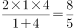，以此速度从A到B城用时为1小时，因此跑步从A到B城用时为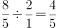小时（距离相等，时间比等于速度反比），即48分钟。公式：等距离平均速度(、分别为往返速度）。

方法二：由题意可知步行、跑步、骑车的速度之比为1：2：4，则直接赋值速度分别为1、2、4，设A、B两城之间的距离为S米。则根据题意有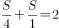，解得，因此跑步从A城到B城用时为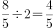小时，即48分钟。

故正确答案为B。

### 第 67 题

甲、乙、丙三个工程队的效率比为6：5：4，现将A、B两项工作量相同的工程交给这三个工程队，甲队负责A工程，乙队负责B工程，丙队参与A工程若干天后转而参与B工程。两项工程同时开工，耗时16天同时结束。问丙队在A工程中参与施工多少天？

A. 6

B. 7

C. 8

D. 9

第 67 题 · 答案与解析

**参考答案（粉笔题库参考内容）**

A

**解析**

方法一：根据题目给出的效率比，直接赋值三个工程队的效率分别为6、5、4，并假设丙队参与A工程y天，则根据题意可得6×16＋4y＝5×16＋4×（16－y），解得y＝6。

方法二：根据题目中的效率比，直接赋值三个工程队的效率分别为6、5、4，将两工程合在一起看成整体，则三个工程队一天的工作量为6＋5＋4＝15，因为两项工程同时开工同时结束，则16天的总工作量为15×16＝240，于是A工程的工作量为120，其中甲完成的工作量为6×16＝96，则丙队需要参与A工程施工（120-96）÷4＝6天。

故正确答案为A。

秒杀技：

秒杀技1：将效率比看作份数，甲比乙每天多1份，16天则多16份，而丙一天完成4份，因此完成这16份需要4天，也即丙参与A工程比参与B工程少4天，于是参与A工程的天数为（16－4）÷2＝6天。

秒杀技2：由题意知，甲的效率高于乙的效率，因此丙必然在甲中参与天数少于16天的一半，也即答案只在A、B两项中选择，这两个选项中，优先考虑代入A项验证，符合条件。

故正确答案为A。

### 第 68 题

甲、乙两人在长30米的泳池内游泳，甲每分钟游37.5米，乙每分钟游52.5米，两人同时分别从泳池的两端出发，触壁后原路返回，如是往返。如果不计转向的时间，则从出发开始计算的1分50秒内两人共相遇了多少次？

A. 2

B. 3

C. 4

D. 5

第 68 题 · 答案与解析

**参考答案（粉笔题库参考内容）**

B

**解析**

方法一：题目的关键在于第一次相遇，两人游过长度之和为泳池长，之后每次相遇，都需要两人再游过两个泳池长。两人一起游一个泳池长，所需时间为30÷（37.5＋52.5）×60＝20秒，因此两人分别在20秒时、60秒时、100秒时相遇，共相遇3次。

方法二：关键点同方法一。直接求出1分50秒两人合起来游过的距离为（37.5＋52.5）×110÷60＝165米，为5.5个泳池长。而两人相遇时都恰是合起来游过距离为奇数个泳池长时，也即两人分别在合游1个、3个、5个泳池长时相遇，故共相遇3次。

方法三：套用公式。先看迎面相遇，，得，即有3次迎面相遇；公式：两运动体从两端同时出发，相向而行，不断往返；第N次迎面相遇，两运动体路程和＝全程×（2N－1）；

故正确答案为B。

### 第 69 题

某公司去年有员工830人，今年男员工人数比去年减少6%，女员工人数比去年增加5%，员工总数比去年增加3人。问今年男员工有多少人？

A. 329

B. 350

C. 371

D. 504

第 69 题 · 答案与解析

**参考答案（粉笔题库参考内容）**

A

**解析**

设去年男员工x人，女员工y人，由题意知：x+y=830，5％y-6％x＝3，解得x＝350。今年男员工减少了，所以人数小于350，只有A项符合条件。

秒杀技：

本题可利用整除特性。由题意知，今年男员工数是去年的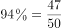，故今年男员工数可被47整除，根据选项，只有A项符合。

故正确答案为A。

### 第 70 题

受原材料涨价影响，某产品的总成本比之前上涨了，而原材料成本在总成本中的比重提高了2.5个百分点。问原材料的价格上涨了多少？

A. 

B. 

C. 

D. 

第 70 题 · 答案与解析

**参考答案（粉笔题库参考内容）**

A

**解析**

设原成本为15，则原材料涨价后成本变为16，设原材料价格为x，则现在原材料价格为x＋1（由题意知：成本变化量就是原材料价格变化量），则有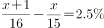，解得x=9，则原材料的价格上涨了。

故正确答案为A。

### 第 71 题

某商店花10000元进了一批商品，按期望获得相当于进价25%的利润来定价，结果只销售了商品总量的30%。为尽快完成资金周转，商店决定打折销售，这样卖完全部商品后，亏本1000元。问商店是按定价打几折销售的？

A. 九折

B. 七五折

C. 六折

D. 四八折

第 71 题 · 答案与解析

**参考答案（粉笔题库参考内容）**

C

**解析**

方法一：某商店进该批商品成本为10000元，其中30%是按照相当于进价25%的利润定价，也即3000元的部分是按此利润售出的，此部分回收资金为3000×1.25＝3750元。根据亏本1000元，可知总共收回资金为9000元，因此剩下的7000元商品实际只售出9000-3750＝5250元，故折扣为5250÷（7000×1.25）＝0.6，也即6折。

方法二：设一共有10件商品，折扣为y，则每件商品进价为1000元，利润为250元，可列方程1250×3＋1250y×7＝9000，解得y＝0.6。

故正确答案为C。

### 第 72 题

甲、乙两个科室各有4名职员，且都是男女各半，现从两个科室中选出4人参加培训，要求女职员比重不得低于一半，且每个科室至少选 1人。问有多少种不同的选法？

A. 67

B. 63

C. 53

D. 51

第 72 题 · 答案与解析

**参考答案（粉笔题库参考内容）**

D

**解析**

可分为三种情况：（1）4女0男有1种选法；（2）3女1男有种选法（4个女的里面选出3个一定可以满足每个科室至少出一人的条件）；（3）2女2男有种选法（先在4个女的里面选2个，再从4个男的里面选2个，最后减去两个男的两个女的都是从一个科室选的2种情况）。一共是1+16+34=51种选法。

故正确答案为D。

### 第 73 题

小赵，小钱，小孙一起打羽毛球，每局两人比赛 ，另一人休息，三人约定每一局的输方下一局休息，结束时算了一下，小赵休息了2局，小钱共打了8局，小孙共打了5局，则参加第9局比赛的是：

A. 小钱和小孙

B. 小赵和小钱

C. 小赵和小孙

D. 以上皆有可能

第 73 题 · 答案与解析

**参考答案（粉笔题库参考内容）**

B

**解析**

小赵休息2局即是小钱和小孙打了2局，则小钱和小赵打了8－2＝6局，小孙和小赵打了5－2＝3局，则一共打了2＋6＋3＝11局，所以小孙11局中休息了6局打了5局，由于不可能连续休息2局，所以小孙一定是休息1局打1局，即小孙只能是第1、3、5、7、9、11局休息，所以第9局小孙休息，小赵和小钱打。

故正确答案为B。

### 第 74 题

某市对52种建筑防水卷材产品进行质量抽检，其中有8种产品的低温柔度不合格，10种产品的可溶物含量不达标，9种产品的接缝剪切性能不合格，同时两项不合格的有7种，有1种产品这三项都不合格，则三项全部合格的建筑防水卷材产品有多少种？

A. 37

B. 36

C. 35

D. 34

第 74 题 · 答案与解析

**参考答案（粉笔题库参考内容）**

D

**解析**

根据容斥原理，分别设三项全部合格、仅一项不合格的产品有A、B种，根据题意可得B＋7＋1＝52－A，3×1＋2×7＋1×B＝8＋10＋9，解得A=34，B=10。

故正确答案为D。

相关知识点：

三集合容斥原理中，将只符合一个条件、只符合两个条件和三个条件都符合的分别看做三个整体，以A、B、C表示三个集合，以X、Y、Z分别表示只符合一个条件、只符合两个条件和三个条件都满足的部分，则有A＋B＋C＝X＋2Y＋3Z及A∪B∪C＝X＋Y＋Z成立。

### 第 75 题

用一个平面将一个边长为1的正四面体切分为两个完全相同的部分，则切面的最大面积为：

A. 

B. 

C. 

D. 

第 75 题 · 答案与解析

**参考答案（粉笔题库参考内容）**

B

**解析**

切分为两个完全相同的部分，有两种切法，如下图所示：

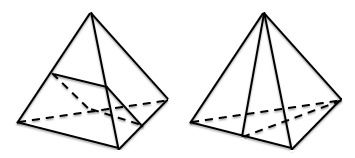

显然左侧的截面面积不如右侧的截面面积大。右侧切法为沿着一条棱向对棱切去，另两条边分别为两个侧面的平分线，故切面三角形为等腰三角形。

棱长为1，则切面三角形中的另外两条边长为，于是根据勾股定理可知棱长上的高为，因此切面三角形的面积为。

故正确答案为B。

### 第 76 题

某单位共有A、B、C三个部门，三部门人员平均年龄分别为38岁，24岁，42岁，A和B两部门人员平均年龄为30岁，B和C两部门人员平均年龄为34岁，该单位全体人员的平均年龄为多少岁？

A. 34

B. 36

C. 35

D. 37

第 76 题 · 答案与解析

**参考答案（粉笔题库参考内容）**

C

**解析**

方法一：A和B部门各自平均年龄为38岁、24岁，混合后平均年龄为30岁，设两部门的人数分别为x、y，可得38x+24y=30(x+y)，可得x:y=3:4，同理可知B和C两部门的人数之比为4：5。据此分别对A、B、C三部门的人数赋值为3、4、5，则总的平均年龄为岁。

方法二：A和B部门各自平均年龄为38岁、24岁，混合后平均年龄为30岁，设两部门的人数分别为x、y，运用线段法：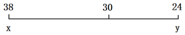

可得，同理设C部门的人数为z，可得两部门的人数之比为4：5。据此分别对A、B、C三部门的人数赋值为3、4、5，则总的平均年龄为岁。

故正确答案为C。

### 第 77 题

同时打开游泳池的A、B两个进水管，加满水需1小时30分钟，且A管比B管多进水180立方米。若单独打开A管，加满水需2小时40分钟，则B管每分钟进水多少立方米：

A. 6

B. 7

C. 8

D. 9

第 77 题 · 答案与解析

**参考答案（粉笔题库参考内容）**

B

**解析**

方法一：设B管每分钟进水x立方米，则A管每分钟进水为（x＋2）立方米，根据题意可得（2x＋2）×90＝（x＋2）×160，解得x＝7。

方法二：由A、B两管合作加水90分钟，加满水池且A管比B管多进水180立方米，首先可知A管比B管每分钟多进水2立方米，其次可知若A管自己单独灌水90×2＝180分钟，则也可灌满水池，且多灌水180立方米（此处原理即用A代替B工作，看差异情况），而题中又告知A管单独工作只需160分钟即可灌满水，因此可知多灌的180立方米用时为180－160＝20分钟，因此A管的效率为每分钟9立方米，于是可知B管每分钟进水7立方米。

故正确答案为B。

### 第 78 题

某城市共有A、B、C、D、E五个区，A区人口是全市人口的，B区人口是A区人口的，C区人口是D区和E区人口总数的，A区比C区多3万人。全市共有多少万人：

A. 20.4

B. 30.6

C. 34.5

D. 44.2

第 78 题 · 答案与解析

**参考答案（粉笔题库参考内容）**

D

**解析**

由A区人口是全市人口的，将全市人口看做17份，则A区有5份，B区有2份，于是C、D、E三区共有10份，而在此三区中，C区人口是D区和E区人口总数的，也即C区人口是此三区人口总数的，因此C区人口为份，于是A区比C区多份，此部分人口数为3万人，于是全市共有万人。

故正确答案为D。

### 第 79 题

某城市9月平均气温为28.5度，如当月最热日和最冷日的平均气温相差不超过10度，则该月平均气温在30度及以上的日子最多有多少天：

A. 24

B. 25

C. 26

D. 27

第 79 题 · 答案与解析

**参考答案（粉笔题库参考内容）**

B

**解析**

要使30度以上的天数尽可能多，在气温总和一定的情况下，则必然是其他天的温度尽可能低，而由最热日与最冷日的平均气温相差不超过10度，据此构造极端情况，最热天全部为30度，其余天数为最冷天，温度为20度，设平均气温为30度的天数为x，则可得，解得x=25.5，因此最多有25天。

故正确答案为B。

### 第 80 题

一个班的学生排队，如果排成3人一排的队列，则比2人一排的队列少8排；如果排成4人一排的队列，则比3人一排的队列少5排，这个班的学生如果按5人一排来排队的话，队列有多少排？

A. 9

B. 10

C. 11

D. 12

第 80 题 · 答案与解析

**参考答案（粉笔题库参考内容）**

C

**解析**

方法一：注意到几人一排时，未必恰好整除，而在不整除的时候剩余人数仍构成一排，据此可知本题若列方程将不能得到一个确切方程，故解题方法为代入法。

将A项代入，则学生人数在41到45之间，择其最大者进行验证。45人满足排成3人一排的队列比排成2人一排的队列少8排，但排成4人一排的队列比3人一排的队列少3排，故45人不正确。并且此时排成4人一排的队列比3人一排的队列所少的排数低于题中给出的5，而要想排数差值增大，则需学生人数更多，因此41到45之间的数字肯定都不符合要求，故A项不正确。（这也是为什么要选择所得数字中最大者验证。）

将B项代入，则学生人数在46到50之间，择其最大者进行验证。学生人数为50人时，排成4人一排的队列比3人一排的队列少4排，不符合题意，且类似上面分析可知B项不正确。

将C项代入，则学生人数在51到55之间，择其最大者进行验证。学生人数为55人时，排成4人一排的队列比3人一排的队列少5排，符合要求，而其排成3人一排的队列比2人一排的队列少9排，因此学生人数应少于55人。依次验证其余各数，可知学生人数为52人满足要求。

方法二：2人一排与4人一排的排数成2倍关系，根据题意有2人一排的排数与4人一排的排数相差13排，因此，若每排恰好站满时，总人数为13×4＝52人，代入题干可得52符合所有条件，此时5人一排共有11排。

故正确答案为C。

### 第 81 题

从所给的四个选项中，选择最合适的一个填入问号处，使之呈现一定的规律性：

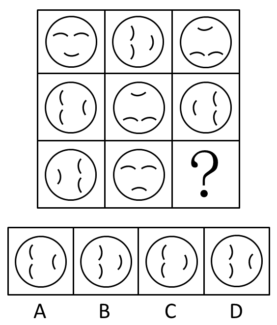

A. A

B. B

C. C

D. D

第 81 题 · 答案与解析

**参考答案（粉笔题库参考内容）**

C

**解析**

元素组成相同，优先考虑位置规律。

观察发现，第一行图形中，第一个图形逆时针旋转90度，翻转两个眼睛，嘴巴不变，得到第二个图形，第二个图形逆时针旋转90度，翻转嘴巴，眼睛不变，得到第三个图形。观察可知，第二行图形同样符合此规律，同理第三行也应满足此规律。根据第三行前两个图可知，第三个图形应该根据第二幅图逆时针旋转90度，翻转嘴巴，眼睛不变得到，只有C项符合。

故正确答案为C。

### 第 82 题

左边给定的是纸盒外表面的展开图，右边哪一项能由它折叠而成？请把它找出来：

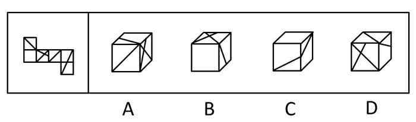

A. A

B. B

C. C

D. D

第 82 题 · 答案与解析

**参考答案（粉笔题库参考内容）**

D

**解析**

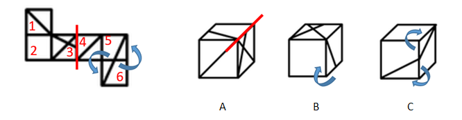

此题出现了多个小直角三角形的面（例如面5和面6），可以通过对小直角三角形画时针进行判断。在面5上以小直角三角形的短直角边为起点，沿直角向长直角边的方向画时针，如图所示，面6同理，两个面画出来均为逆时针。注意：与题干时针方向不一致的选项一定错，但与题干时针方向一致的选项不一定对。

A项，如果在小三角形面画箭头发现与题干是一致的，排除不了。考虑其他方法，在题干与选项中找到面3的同一条边（如图A所示），发现相邻面不一致，排除；

B项，在小直角三角形的面，以小直角三角形的短直角边为起点，沿直角向长直角边的方向画时针（如图B所示）,为顺时针，与题干时针方向不一致，排除；

C项，分别在两个小直角三角形的面上画时针（如图C所示），均为顺时针，与题干时针方向不一致，排除。

A、B、C三项排除，D项当选。

故正确答案为D。

### 第 83 题

从所给的四个选项中，选择最合适的一个填入问号处，使之呈现一定的规律性：

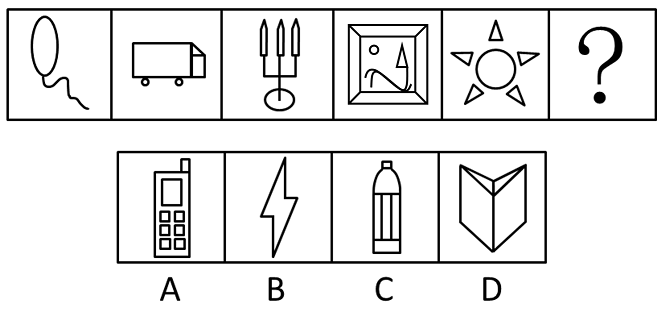

A. A

B. B

C. C

D. D

第 83 题 · 答案与解析

**参考答案（粉笔题库参考内容）**

A

**解析**

元素组成凌乱，数相同元素的个数。观察下图中红线标记部分可知，每幅图中相同元素的个数递增，分别为1、2、3、4、5、6。那么符合6个相同元素个数的是A项。

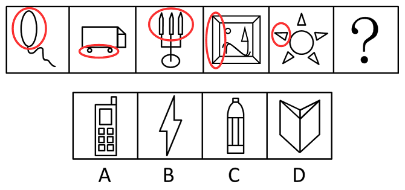

故正确答案为A。

### 第 84 题

从所给的四个选项中，选择最合适的一个填入问号处，使之呈现一定的规律性：

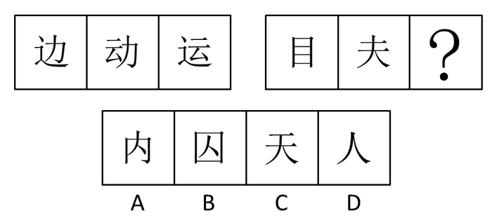

A. A

B. B

C. C

D. D

第 84 题 · 答案与解析

**参考答案（粉笔题库参考内容）**

B

**解析**

元素组成相似，样式规律。观察发现，第一组图形中第三个图“运”是由第一个图形中的“辶”和第二个图形中的“云”组成，即第一个图中元素和第二个图中元素去同存异组成第三个图中元素。同理，第二组图形中均有元素“二”，未知图形应该含有“口”和“人”，B项符合题意。

故正确答案为B。

### 第 85 题

从所给的四个选项中，选择最合适的一个填入问号处，使之呈现一定的规律性：

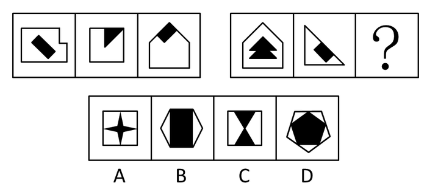

A. A

B. B

C. C

D. D

第 85 题 · 答案与解析

**参考答案（粉笔题库参考内容）**

C

**解析**

观察第一组图形中外部图形和内部图形的关系可知，外部图形和内部图形相接边的数量分别是0、1、2，那么依此规律，第二组图形外部图形和内部图形相接边的数量应该是0、1、（2），排除A、D两项。再观察发现第一行外部图形的边数比内部图形多，第二行外部图形的边数比内部图形少，B项外部图形是6条边，内部图形是4条边，外多内少，C项外部图形是4条边，内部图形是6条边，外少内多。C项符合题意，当选。

故正确答案为C。

### 第 86 题

把下面的六个图形分为两类，使每一类图形都有各自的共同特征或规律，分类正确的一项是：

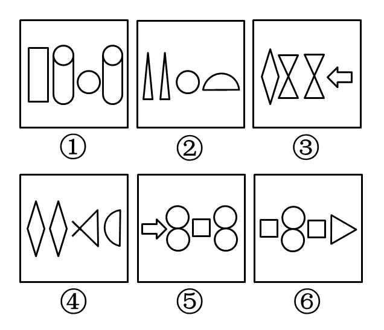

A. ①③④，②⑤⑥

B. ①⑤⑥，②③④

C. ①②⑥，③④⑤

D. ①②④，③⑤⑥

第 86 题 · 答案与解析

**参考答案（粉笔题库参考内容）**

B

**解析**

特殊考点，组图的内部特征。观察发现，每个图形中都有两个元素相同，而这相同的元素有的是相邻的，有的是隔开的，可以将相邻的分为一组，即②③④是一组；而隔开的分为一组，即①⑤⑥是一组。

故正确答案为B。

### 第 87 题

把下面的六个图形分为两类，使每一类图形都有各自的共同特征或规律，分类正确的一项是：

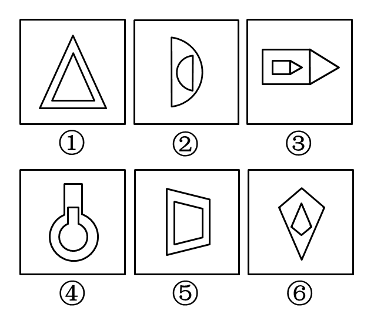

A. ①②⑤，③④⑥

B. ①④⑥，②③⑤

C. ①③④，②⑤⑥

D. ①③⑤，②④⑥

第 87 题 · 答案与解析

**参考答案（粉笔题库参考内容）**

B

**解析**

观察发现已知图形均是轴对称图形，有的图形是横向的对称轴，有的图形是竖向对称轴。将有横向对称轴的图形分为一组，即②③⑤是一组；而有竖向对称轴的图形分为另一组，即①④⑥是一组。

故正确答案为B。

### 第 88 题

把下面的六个图形分为两类，使每一类图形都有各自共同的特征或规律，分类正确的一项是：

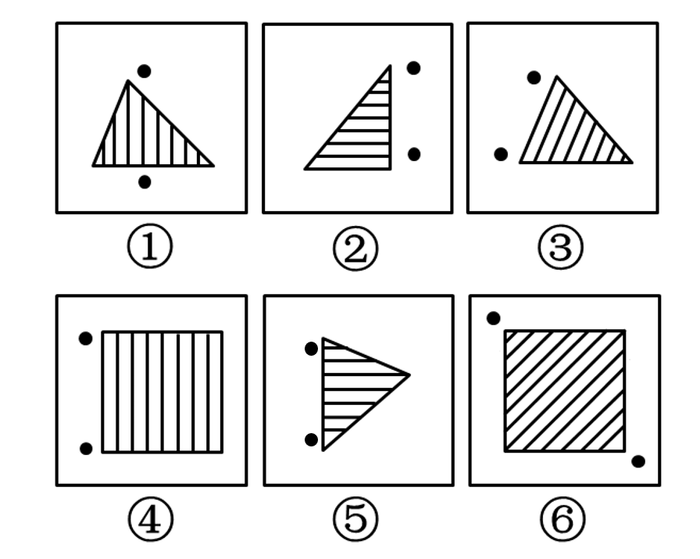

A. ①③⑥，②④⑤

B. ①③⑤，②④⑥

C. ①③④，②⑤⑥

D. ①⑤⑥，②③④

第 88 题 · 答案与解析

**参考答案（粉笔题库参考内容）**

C

**解析**

特殊点—标记点的功能。已知题干图形中均有两个黑点，黑点连线与图形内部线条垂直或平行。在①③④中，黑点连线与图形内部线条平行，而在②⑤⑥中，黑点连线与图形内部线条垂直。由此可以将①③④分为一组，②⑤⑥分为一组。

故正确答案为C。

### 第 89 题

把下面的六个图形分为两类，使每一类图形都有各自的共同特征或规律，分类正确的一项是：

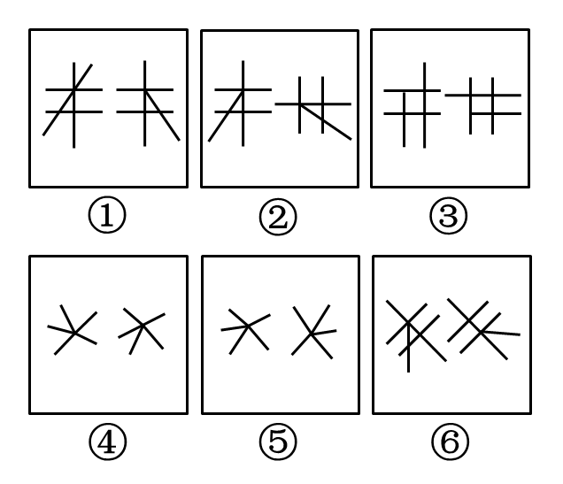

A. ①②⑥，③④⑤

B. ①②③，④⑤⑥

C. ①④⑤，②③⑥

D. ①④⑥，②③⑤

第 89 题 · 答案与解析

**参考答案（粉笔题库参考内容）**

D

**解析**

观察发现，已知六组图形中每组图形都有两个图形，每组图形中，有的图形前一个经过旋转可以得到后一个。有的前一个经过旋转不能得到后一个。在①④⑥中，前一个图形经过旋转不可以得到后一个图形；在②③⑤中，前一个图形经过旋转可以得到后一个图形。

故正确答案为D。

### 第 90 题

把下面的六个图形分为两类，使每一类图形都有各自的共同特征或规律，分类正确的一项是：

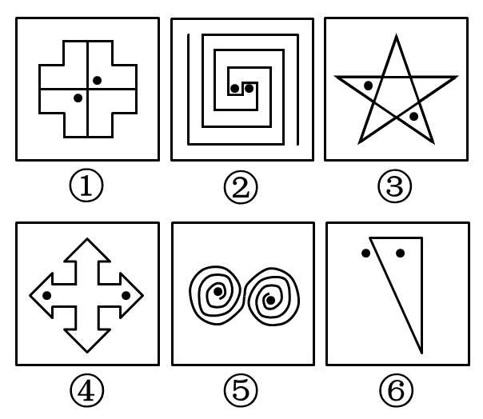

A. ①③⑥，②④⑤

B. ①②⑤，③④⑥

C. ①③④，②⑤⑥

D. ①④⑤，②③⑥

第 90 题 · 答案与解析

**参考答案（粉笔题库参考内容）**

A

**解析**

特殊考点—标记的点。观察发现，已知每组图形均有两个小黑点，有的两个小黑点可以连通在一起，有的在两个空间内。在①③⑥中，两个小黑点不能连通；在②④⑤中，两个小黑点可以连通。

故正确答案为A。

### 第 91 题

“社会人”假设是组织行为学家提出的一种与管理有关的人性假设。“社会人”假设认为，人们在工作中得到的物质利益对于调动其生产积极性是次要的，人们最重视在工作中与周围的人友好相处，良好的人际关系对于调动人的工作积极性起决定作用。

根据上述定义，下列哪项是基于“社会人”假设的管理方式：

A. 员工的奖金与绩效挂钩，并且实行秘薪制

B. 鼓励、支持员工利用业余时间参加职业培训

C. 对不同年龄层的员工实行不同的管理措施

D. 上级和下级不同程度地参与企业决策的研究和讨论

第 91 题 · 答案与解析

**参考答案（粉笔题库参考内容）**

D

**解析**

第一步：抓住定义中的关键词。

关键词强调金钱等物质利益是次要的；良好的人际关系是主要的。

第二步：逐一判断选项。

A项中的奖金、B项中的职业培训、C项中的管理措施均没有涉及到“人际关系”，均不符合定义。D项中强调上级和下级共同参与，符合关键词。

故正确答案为D。

### 第 92 题

顺从是指互动中的一方自愿或主动地调整自己的行为，按另一方的要求行事，即一方服从另一方。顺应的含义比顺从更广泛，除了有顺从的含义外，还指互动的双方或各方都调整自己的行为，以实现互相适应。

根据上述定义，下列行为属于顺应的是：

A. 王某经常将垃圾堆放在家门口，影响了居民楼内的环境卫生，邻居们向他提出意见后，王某家门口变得干净起来

B. 小燕经常出色地完成各项工作，经理根据小燕的表现在员工大会上表扬了她，并给予奖励

C. 某食品厂因存在不正当竞争行为，被工商部门处以20万元罚款，该厂以罚款过重为由提起行政复议，上级工商部门作出罚款10万元的决定

D. 强盛公司与荣发公司有意进行合作，经过多轮激烈地磋商，双方都降低了自己的条件，从而实现了合作目标

第 92 题 · 答案与解析

**参考答案（粉笔题库参考内容）**

D

**解析**

第一步：找出定义关键词。

顺从：“一方服从另一方”；

顺应：“包含顺从的含义”、“互动的双方或各方都调整自己的行为”、“实现互相适应”。

第二步：逐一分析选项。

A项：邻居向王某提出意见后，王某调整行为让家门口变干净，仅体现了王某服从邻居的要求调整行为，符合“一方服从另一方”，符合“顺从”的定义，不符合“顺应”的定义，排除；

B项：经理根据小燕的出色表现给予表扬和奖励，仅体现了经理对小燕的肯定，不符合“一方服从另一方”，既不符合“顺从”的定义，也不符合“顺应”的定义，排除；

C项：食品厂以罚款过重为由提起行政复议，上级工商部门调整罚款金额，只有上级工商部门调整，不符合“互动的双方或各方都调整自己的行为”、“实现互相适应”，不符合“顺应”的定义，排除；

D项：强盛公司与荣发公司为实现合作目标，经过磋商后双方都降低了自己的条件，符合 “互动的双方都调整自己的行为”，实现了合作目标，符合“实现互相适应”，符合“顺应”的定义，当选。

故正确答案为D。

### 第 93 题

体验营销是指企业采用让目标顾客观摩、聆听、尝试、试用等方式，使其亲身体验企业提供的产品或服务，让顾客实际感知产品或服务的品质或性能，从而促使顾客认知，喜好并购买的一种营销方式。

根据上述定义，下列采用了体验营销方式的是：

A. 某美容公司举办了一场以“亲子教育”为主题的消费者联谊会，把“为消费者着想”的经营理念传递给潜在的客户

B. 某服装公司邀请批发商参加其产品推广介绍会，在会上安排了表演、小竞赛、新产品试用等活动

C. 某公司为维护行业领军地位，多次举办全国性的行业讨论会，邀请其部分消费者参与研讨

D. 某化妆品公司先打开国外市场，树立国际品牌形象，然后在国内以电视购物的方式传播销售，逐步占领国内市场

第 93 题 · 答案与解析

**参考答案（粉笔题库参考内容）**

B

**解析**

第一步：找出定义关键词。

“企业采用让目标顾客观摩、聆听、尝试、试用等方式”、“使其亲身体验企业提供的产品或服务”。

第二步：逐一分析选项。

A项：某美容公司举办消费者联谊会，把经营理念传递给潜在的客户，但没有体验产品或服务，不符合“企业采用让目标顾客观摩、聆听、尝试、试用等方式”、“使其亲身体验企业提供的产品或服务”，不符合定义，排除；

B项：某服装公司邀请批发商参加其产品推广介绍会，在会上安排了新产品试用活动，符合“企业采用让目标顾客观摩、聆听、尝试、试用等方式”、“使其亲身体验企业提供的产品或服务”，符合定义，当选；

C项：某公司举办全国性的行业讨论会，邀请其部分消费者参与研讨，但没有体验产品或服务，不符合“使其亲身体验企业提供的产品或服务”，不符合定义，排除；

D项：某化妆品公司以电视购物的方式传播销售，但没有涉及让目标客户体验产品或服务，不符合“企业采用让目标顾客观摩、聆听、尝试、试用等方式”、“使其亲身体验企业提供的产品或服务”，不符合定义，排除。

故正确答案为B。

### 第 94 题

行政指令是指行政主体依靠行政组织的权威，运用行政手段，包括行政命令、指示、规定、条例及规章制度等措施，按照行政组织的系统和层次进行行政管理活动的方法。

根据上述定义，下列描述不属于行政指令的是：

A. 体育局局长签发嘉奖令，表彰在全运会上取得优异成绩的运动员和教练员

B. 消费者协会同中国家用电器协会正式发布《太阳能热水器选购指南》

C. 市教育局紧急电话通知，要求全市中小学、幼儿园加强校园安全管理

D. 市消防大队对未经消防设计备案擅自施工的违法工程下发《责令改正通知书》

第 94 题 · 答案与解析

**参考答案（粉笔题库参考内容）**

B

**解析**

第一步：抓住定义中的关键词。

关键词强调“行政主体”。

第二步：逐一判断选项。

A项中的“体育局局长”、C项中的“市教育局”、D项中的“市消防大队”均是行政主体，符合关键词；而B项中的“消费者协会”不是行政主体。

本题为选非题，故正确答案为B。

### 第 95 题

政策性收益是指由于某些政策、法规的变动而导致的个体收益，这种收益不会导致整个社会财富的增长，只会导致整个社会财富的重新分配。

根据上述定义，下列涉及政策性收益的是：

A. 由于市相关部门联合整治经营环境，小张经营的书店效益明显好转，每月营业额增加5000元

B. 歹徒意欲行凶，小王挺身而出制服了歹徒，因此获得市政府见义勇为奖5万元

C. 由于国家加大西部开发力度，某县获得了5000万元专项水利建设基金

D. 由于利率调整，小李的存款利息比此前每月增加100元

第 95 题 · 答案与解析

**参考答案（粉笔题库参考内容）**

D

**解析**

第一步：找出定义关键词。

关键词为“政策、法规的变动”“个体收益”。

第二步：逐一分析选项。

A项：“市相关部门联合整治经营环境”不是“政策、法规的变动”，排除；

B项：市政府因小王见义勇为授奖不是“政策、法规的变动”，排除；

C 项：某县获得专项水利建设基金不是“个体收益”，排除；

D 项：“利率调整”符合“政策、法规的变动”，且利息的增加并不会造成社会总资产的上涨，小李的存款利息是“个体收益”，符合定义关键词，当选。

故正确答案为D。

### 第 96 题

反应性相倚是指在沟通过程中，沟通双方都以对方的行为作为自己行为的依据，做出相应的反应，而并不按照原来的计划进行沟通。

根据上述定义，下列属于反应性相倚的是：

A. 妈妈得知小明考试失利准备劝慰一番，但她发现小明的情绪并未受到影响，于是放弃了劝慰小明的打算

B. 王厂长在大会上宣读了关于加强劳动纪律的发言稿，由于制定的措施不合理，职工在下面议论纷纷，但他还是完成了自己的发言

C. 张老师认为他为学生准备的口试题目并不难，但是仍有一些学生回答不出，当学生要求张老师提示时，张老师断然拒绝

D. 小李同意按照编辑意见修改稿件，但希望保留原文的写作风格，与编辑沟通后，编辑表示同意

第 96 题 · 答案与解析

**参考答案（粉笔题库参考内容）**

D

**解析**

第一步：抓住定义中的关键词。

关键词强调“沟通双方都不按照原计划”。

第二步：逐一判断选项。

A项中只有妈妈改变计划；B项中王厂长按照原计划完成了发言；C项中看不出原计划是什么；D项中小李和编辑都按照对方的意见进行了修改，不按照原计划，符合关键词。

故正确答案为D。

### 第 97 题

附款行政行为是指除行政法规明确规定外，行政主体根据实际需要在主内容基础上附加从属性内容的行政行为。这里的附款就是附加条件，是行政主体规定（而不是行政法规规定）的某种将来不确定事实或行为，该条件是否符合将决定法律行为的效力。

根据上述定义，下列属于附款行政行为的是：

A. 某省物价局在关于小儿广谱止泻口服液的价格批复中规定该药物每盒不得高于36元，此价格从2009年9月30日起执行

B. 某税务所对王某（现在外地打工）偷税行为作出的处理决定是：处王某罚款1500元，所处罚款及所欠税款待王某回乡后缴清

C. 交通警察李某对超速驾驶的刘某作出罚款100元的处罚决定，同时告知刘某应在规定的时间内到指定地点缴纳罚款，逾期需缴纳滞纳金

D. 某市人民政府为发展地方经济，规划未来五年内在本市南部建立高新技术产业开发区，吸引一批高新技术企业前来投资

第 97 题 · 答案与解析

**参考答案（粉笔题库参考内容）**

B

**解析**

第一步：抓住定义中的关键词。

“行政主体”在“行政法规明确规定外”进行“附加从属性内容”的“行政行为”。

第二步：逐一判断选项。

A项中省物价局规定“该药物每盒不得高于36元”，“从2009年9月30日起执行”，属于“明确规定”；B项为对偷税行为进行罚款是“行政法规”明确规定的，“回乡后缴清”是“附加从属性内容”的“行政行为”；C项中对超速驾驶的刘某作出罚款，是“行政法规”明确规定的，没有附加条件，不符合定义要件；D项中发展地方经济不是“行政行为”。

故正确答案为B。

### 第 98 题

反向诱导是指政府、媒体等主体所采取的措施或者宣传活动，在实际的社会生活中不但没有收到预期的效果，反而导致了与预期相反的社会现象大量出现。

根据上述定义，下列属于反向诱导的是：

A. 某影院为了让观众摘下帽子，在银幕上打出通告：“本院允许老年人戴帽观赏。”结果通告一出，许多观众纷纷摘下了帽子

B. 某单位要求员工统一着装，结果招致单位很多女员工的强烈反对，最后只好不了了之

C. 高温季节供水相对紧张，某市自来水公司贴出告示，告知市民近期不会停水，结果导致很多市民在家中大量囤水备用

D. 某电视台播放预防心理疾病的讲座，很多市民对号入座，觉得自己得了心理疾病，纷纷打电话咨询

第 98 题 · 答案与解析

**参考答案（粉笔题库参考内容）**

C

**解析**

第一步：抓住定义中的关键词。

关键词强调“与预期相反的社会现象大量出现”。

第二步：逐一判断选项。

A项是与预期相同；B项不是大量现象；C项本想传达用水不紧张反而让居民理解相反，纷纷囤水，与预期相反，符合关键词；D项题干中的预期是：让大家预防心理疾病；结果是大家纷纷咨询，没有体现出与预期相反。

故正确答案为C。

### 第 99 题

仿生设计学以自然界万事万物的“形”“色”“音”“功能”“结构”等为研究对象，有选择地在设计过程中应用这些特征原理，同时结合仿生学的研究成果，为设计提供新的思想、新的原理、新的方法和新的途径。其中，结构仿生设计学主要研究生物体和自然界物质存在的内部结构原理在设计中的应用问题，适用于产品设计和建筑设计。

根据上述定义，下列属于结构仿生设计的是：

A. 设计师根据鱼鳔的作用原理发明了潜艇

B. 科学家发明了能够模仿鱼类声音的电子诱鱼器

C. 受变色龙的启发，军方设计出适用于野外作战的迷彩服

D. 我们的祖先有巢氏受鸟类在树上筑巢的启发，发明“巢居”以防御猛兽的攻击

第 99 题 · 答案与解析

**参考答案（粉笔题库参考内容）**

D

**解析**

第一步：抓住定义中的关键词。

结构仿生设计的关键要件有：（1）内部结构；（2）在设计中应用。

第二步：逐一判断选项。

A项设计师根据鱼鳔的作用原理发明潜艇，对应的是功能原理，而不是结构原理，不符合要件，排除；

B项科学家发明了能模仿鱼类声音的诱鱼器，没有体现内部结构，不符合要件，排除；

C项军方利用的是变色龙变色隐藏的特点，也没有体现内部结构，不符合要件，排除；

D项我们的祖先受鸟类筑巢的启发，发明“巢居”，符合要件，当选。

故正确答案为D。

### 第 100 题

非正式组织是指人们在共同工作或相互接触中，以感情、性格、爱好相投为基础形成的若干人群。这些群体不受正式组织的行政部门和管理层次等的限制，也没有明确规定的正式结构，但在其内部形成一些特定的关系结构，自然涌现出自己的“领导者”，形成一些不成文的行为准则和规范。根据上述定义，下列提及的人群属于非正式组织的是（    ）。

A. 老王过生日，邀请了十多位同事在自己家中聚会

B. 小刘下班后和本单位的几名年轻人一起踢足球

C. 小张是校学生会文艺部部长，经他介绍，几名同学参加了文艺演出

D. 几位退休职工自发成立老人曲艺社，利用周末时间在社区演出

第 100 题 · 答案与解析

**参考答案（粉笔题库参考内容）**

D

**解析**

第一步：判断题干中的关键词

属性：不受正式组织的行政部门和管理层次等的限制。

条件：形成一些不成文的行为准则和规范。

第二步：逐一分析选项。

A项，聚会的同事不属于组织，也没有形成准则和规范，不符合定义。

B项，小刘和年轻人一起踢足球，不属于组织，不符合定义。

C项：几名同学一起参加文艺演出，他们不属于组织，也没有形成一些不成文的行为准则和规范，不符合定义。

D项，“曲艺社”属于组织，且不受正式组织和管理层次的限制，符合定义关键词。

第三步：再次标注答案

故正确答案为D。

### 第 101 题

航线：飞行

A. 土壤：种植

B. 煤炭：发电

C. 提纲：发言

D. 地基：建筑

第 101 题 · 答案与解析

**参考答案（粉笔题库参考内容）**

C

**解析**

第一步：判断题干词语间逻辑关系。

题干两词是对应关系，飞行需要航线是因为航线对飞行有指导作用，且航线是不被消耗的，飞行后航线依然存在。

第二步：判断选项词语间逻辑关系。

A、D两项土壤和地基是种植和建筑的物质基础，起客观的物质基础作用，而没有指导作用；B项煤炭是发电的消耗品，发电需要燃烧煤炭，因此煤炭是被消耗的，且煤炭对发电没有指导作用；C项与题干逻辑关系相同，发言需要提纲是因为提纲对发言有指导作用，且提纲是不被消耗的，发言后提纲依然存在。

故正确答案为C。

### 第 102 题

树根：根雕

A. 纸张：剪纸

B. 陶土：瓷器

C. 竹子：竹排

D. 水泥：砚台

第 102 题 · 答案与解析

**参考答案（粉笔题库参考内容）**

A

**解析**

第一步：判断题干词语间逻辑关系。

树根是制作根雕的原材料，二者为原材料和成品的对应关系。

第二步：判断选项词语间逻辑关系。

A项：纸张是剪纸的原材料，二者为原材料和成品的对应关系，与题干逻辑关系一致，保留；

B项：瓷器由瓷土加工而成，陶土不是瓷器的原材料，二者不是原材料和成品的对应关系，与题干逻辑关系不一致，排除；

C项：竹子是制作竹排的原材料，二者为原材料和成品的对应关系，与题干逻辑关系一致，保留；

D项：水泥不是砚台的原材料，二者不是原材料和成品的对应关系，与题干逻辑关系不一致，排除。

对比A、C两项，题干中树根加工成为根雕的加工手法是去掉多余部分；A项中纸张加工成为剪纸的的加工手法是去掉多余部分；而C项中竹子加工成为竹排是将竹子捆在一起，加工手法不同，因此A项与题干逻辑关系更为一致。

故正确答案为A。

### 第 103 题

亦步亦趋：主见

A. 兴高采烈：恐惧

B. 优柔寡断：果断

C. 鼠目寸光：眼力

D. 孤陋寡闻：胆识

第 103 题 · 答案与解析

**参考答案（粉笔题库参考内容）**

B

**解析**

第一步：判断题干词语间逻辑关系。

题干两词是反义词关系。“亦步亦趋”比喻由于缺乏主张，没有主见。

第二步：判断选项词语间逻辑关系。

A项“兴高采烈”指兴致高，情绪激烈，与恐惧没有明显逻辑关系；B项与题干有相同逻辑关系，“优柔寡断”指人不果断，与“果断”是反义词。C项“鼠目寸光”形容目光短浅，没有眼光，不是眼力，与“眼力”没有明显逻辑关系；D项“孤陋寡闻”形容学识浅陋，见闻不广，与“胆识”没有明显逻辑关系。

故正确答案为B。

### 第 104 题

导游：旅行社：行程

A. 职员：公司：总结

B. 演员：剧院：表演

C. 教师：学校：大纲

D. 司机：车队：驾照

第 104 题 · 答案与解析

**参考答案（粉笔题库参考内容）**

C

**解析**

第一步：判断题干词语间逻辑关系。

前两词导游与旅行社是职业与从属单位的对应关系，导游与行程的关系是导游按规定行程导游。题干三词是对应关系。

第二步：判断选项词语间逻辑关系。

A项：前两词职员与公司是职业与从属单位的对应关系，但职员不是按照总结进行工作的，与题干逻辑关系不一致，排除；

B项：前两词演员与剧院是职业与从属单位的对应关系，但是演员的工作是表演，而不是按照表演进行工作，与题干逻辑关系不一致，排除；

C项：前两词教师与学校是职业与从属单位的对应关系，且教师按照既定大纲授课，与题干逻辑关系一致，当选；

D项：前两词司机和车队是职业与从属单位的对应关系，但是驾照是成为司机的先决条件，与题干逻辑关系不一致，排除。

故正确答案为C。

### 第 105 题

车轮：汽车：运输

A. 衣服：衣架：晒衣

B. 镜片：眼镜：读书

C. 听筒：电话：通话

D. 墨汁：毛笔：书法

第 105 题 · 答案与解析

**参考答案（粉笔题库参考内容）**

C

**解析**

第一步：判断题干词语间的第一重逻辑关系，并在选项中进行选择。

题干前两词是包容关系中的组成关系，车轮是汽车的一部分。与之逻辑关系相同的是B项和C项，A、D两项中前两词是对应关系。

第二步：答案不唯一时，再判断题干词语间第二重逻辑关系，并在选项中进行选择。

题干中后两个词是物体与功能间的对应关系，汽车的功能是运输，相同特征的即为C项，电话的功能是通话，B项中眼镜的功能是矫正视力，不是看书。

故正确答案为C。

### 第 106 题

治疗：患者：医院

A. 付款：顾客：商场

B. 观看：观众：影院

C. 判罚：裁判：赛场

D. 改造：罪犯：监狱

第 106 题 · 答案与解析

**参考答案（粉笔题库参考内容）**

D

**解析**

第一步：判断题干词语间逻辑关系。

题干三词是可以通过造句子的形式连接起来，因此是语法关系。患者在医院接受治疗，患者与治疗之间的关系是被动的。

第二步：判断选项词语间逻辑关系。

A、B、C三项中前两个词语间的关系是主动的；与题干相同逻辑关系的即为D项，罪犯在监狱接受改造，罪犯与改造之间的关系是被动的。

故正确答案为D。

### 第 107 题

刀：屠夫：肉

A. 剪刀：裁缝：布料

B. 粉笔：老师：黑板

C. 法律：法官：犯人

D. 相机：记者：摄影

第 107 题 · 答案与解析

**参考答案（粉笔题库参考内容）**

A

**解析**

第一步：判断题干词语间逻辑关系。

题干三词是语法关系，且是使用工具、职业与工具作用对象的对应关系。屠夫用刀切肉，且肉的完整性被破坏。

第二步：判断选项词语间逻辑关系。

A项：与题干逻辑关系相同，裁缝用剪刀裁剪布料，且布料的完整性被破坏，当选；

B项：老师用粉笔在黑板上写字，黑板的完整性并没有被破坏，与题干逻辑关系不一致，排除；

C项：犯人的完整性没有被破坏，与题干逻辑关系不一致，排除；

D项：摄影不是相机的作用对象，是相机的功能，与题干逻辑关系不一致，排除。

故正确答案为A。

### 第 108 题

（  ）对于 吉祥 相当于 狼烟 对于（  ）

A. 和平 战争

B. 麒麟 信号

C. 盛世 烽火

D. 凤凰 入侵

第 108 题 · 答案与解析

**参考答案（粉笔题库参考内容）**

D

**解析**

逐一代入选项。

A项：和平年代是吉祥的，吉祥是和平的属性，狼烟象征着战争，前后逻辑关系不一致，排除；

B项：麒麟是古代五大瑞兽之一，象征着吉祥，狼烟是信号的一种，是种属关系，前后逻辑关系不一致，排除；

C项：盛世时期是吉祥的，吉祥是盛世的属性，烽火和狼烟都是信号的一种，象征着战争，是并列关系，前后逻辑关系不一致，排除；

D项：凤凰是古代五大瑞兽之一，象征着吉祥，狼烟象征着入侵，前后逻辑关系一致，当选。

故正确答案为D。

### 第 109 题

（    ）对于 绿茶 相当于 音乐 对于（    ）

A. 龙井 浪漫

B. 早春 娱乐

C. 咖啡 绘画

D. 健康 情操

第 109 题 · 答案与解析

**参考答案（粉笔题库参考内容）**

C

**解析**

逐一代入选项。

A项：龙井是绿茶的一种，二者是种属关系；音乐可以象征浪漫，二者是象征关系，前后逻辑关系不一致，排除；

B项：早春和绿茶之间无明显逻辑关系，排除；

C项：咖啡和绿茶都是饮品，二者是并列关系，绘画和音乐都是艺术，二者是并列关系，前后逻辑关系一致，当选；

D项：绿茶可以促进健康，二者是功能对应关系，音乐可以陶冶情操，二者是功能对应关系，但前后顺序相反，排除。

故正确答案为C。

### 第 110 题

（    ） 对于 表达 相当于 信件 对于 （    ）

A. 比喻 沟通

B. 文字 载体

C. 感情 抒情

D. 交流 包裹

第 110 题 · 答案与解析

**参考答案（粉笔题库参考内容）**

A

**解析**

第一步：将选项逐一代入，判断各选项前后部分的逻辑关系。

A项前半部分比喻是一种表达方式，后半部分信件是一种沟通方式，前后部分均是种属关系；B项前半部分文字是一种表达方式，二者是对应关系，后半部分无明显逻辑关系；C项前半部分是表达感情，是动宾关系，后半部分无明显逻辑关系；D项前后部分均无明显逻辑关系。

第二步：逻辑关系相同即为答案。

由第一步可知逻辑关系完全相同的是A项。

故正确答案为A。

### 第 111 题

据某知名房产中介机构统计，2010年9月份第二周全国十大城市的商品房成交量总体呈上涨趋势，并且与8月份第二周相比上涨幅度更明显。如果没有其他因素抑制，按照这种趋势发展，9月份或将创新政以来成交量最高水平，虽然现在还不能明确楼市完全回暖，但未来楼价调控的压力还是很大的。

下列最有可能是上述论证前提假设的是：

A. 炒房者将大量资金投入楼市

B. 国家对楼价的调控手段不足

C. 消费者对房子的购买热情没有减退

D. 楼市成交量的增长会带动楼价的上涨

第 111 题 · 答案与解析

**参考答案（粉笔题库参考内容）**

D

**解析**

第一步：找到论点和论据。

论点：未来楼价调控的压力很大。

论据：商品房成交量上涨。

本题问题为“前提假设”，考虑搭桥和必要条件，且论点说的是楼价调控，论据说的是成交量，话题不一致，优先考虑在二者之间搭桥。

第二步：逐一分析选项。

A项：炒房者的资金投入，可能对楼价产生影响，但不必然促使楼价上涨，排除；

B项：国家对楼价的调控手段，可能对楼价产生影响，但不必然促使楼价上涨，排除；

C项：消费者对房子的购买热情，可能对楼价产生影响，但不必然促使楼价上涨，排除；

D项：在成交量与楼价之间搭桥，加强论证，当选。

故正确答案为D。

### 第 112 题

研究人员认为，如果母亲在怀孕的头几个月接触杀虫剂较多，那么出生的婴儿在智力上可能较差。他们认为，妇女怀孕后不久胚胎大脑便开始发育，因此怀孕前期是婴儿大脑发育的关键时期，接触杀虫剂较多可能改变孕妇体内正在发育的胚胎大脑周围的环境。

以下哪项如果为真，最能支持研究人员的观点：

A. 由于母亲接触杀虫剂较多，导致许多婴儿提前出生

B. 杀虫剂对人们的健康是一个潜在的威胁，它还会导致帕金森症、癌症和心理疾病等很多疾病

C. 此前的研究已经发现，较多地接触杀虫剂会导致孕妇的甲状腺出现问题，而孕妇的甲状腺状况会影响胎儿的智力发育

D. 研究人员对1500个孕妇进行了跟踪调查，发现较多地接触杀虫剂的孕妇所生育的孩子在数学和语言学科上表现显著较差

第 112 题 · 答案与解析

**参考答案（粉笔题库参考内容）**

C

**解析**

第一步：找到论点和论据。

论点：怀孕母亲在头几个月接触杀虫剂较多，则婴儿智力差。

论据：杀虫剂影响胎儿大脑周围的环境。

第二步：逐一分析选项。

A项：母亲接触杀虫剂较多，导致婴儿提前出生，并没有说明对婴儿智力的影响，无关选项，排除；

B项：杀虫剂会导致帕金森症、癌症和心理疾病等疾病，但并未说明杀虫剂对婴儿智力的影响，无关选项，排除；

C项：较多地接触杀虫剂会导致孕妇甲状腺出现问题，从而影响胎儿的智力发育，解释原因，可以加强，当选；

D项：在数学和语言学科上表现显著较差，不能说明婴儿智力差，无关选项，排除。

故正确答案为C。

### 第 113 题

知己知彼，才能百战不殆。这句话同样适用于人际交往之中，一个人只有先了解自己，才能了解别人；任何人也只信赖充分了解他的人，包括他自己。试想，如果一个人根本不了解你，他如何值得你信赖呢？由此可以推出（    ）。

A. 只有信赖自己，才能信赖别人

B. 不了解自己，就不会被任何人信赖

C. 他充分了解你，所以他值得你信赖

D. 充分了解自己，就可以获得许多人的信赖

第 113 题 · 答案与解析

**参考答案（粉笔题库参考内容）**

B

**解析**

第一步：翻译题干。

第二句：了解别人了解自己①；被别人信赖了解别人②，第三句：别人不了解你不信赖别人，这是对②的逆否命题，题干可整理为：只有先了解自己，才能了解别人；只有充分了解别人，才能值得别人信赖（“任何人只信赖充分了解他的人”）；只有充分了解自己，才能信赖自己（“包括他自己”）。将①②式推导关系连起来即是被别人信赖了解别人了解自己。

第二步：逐一翻译选项并判断选项的正误。

A项：信赖别人信赖自己，由题干条件无法推出，排除；

B项：不了解自己不被别人信赖，是题干推导关系的逆否命题，当选；

C项：别人了解你信赖别人，“别人了解你”属于否定前件，无法推出绝对表达的结论，排除；

D项：了解自己被别人信赖，“了解自己”属于肯定后件，无法推出绝对表达的结论，排除。

故正确答案为B。

### 第 114 题

研究人员对四川地区出土的一批恐龙骨骼化石进行分析后发现，骨骼化石内的砷、钡、铬、铀、稀土元素等含量超高，与现代陆生动物相比，其体内的有毒元素要高出几百甚至上千倍。于是一些古生物学家推测这些恐龙死于慢性中毒。

如果以下各项为真，不能质疑上述推测的是：

A. 恐龙化石附近土壤中的有毒元素会渗进化石

B. 恐龙化石内还有很多相应的解毒元素

C. 这批恐龙化石都是老年恐龙，属于自然死亡

D. 在恐龙化石附近的植物化石里，有毒元素含量很少

第 114 题 · 答案与解析

**参考答案（粉笔题库参考内容）**

D

**解析**

第一步：找到论点和论据。

本题论点是恐龙死于慢性中毒。论据是化石内有毒元素比现代陆生动物高出几百倍甚至上千倍。

第二步：判断削弱方式。

本题论点和论据间存在因果关系，所以须削弱论点。

第三步：逐一判断选项的作用。

A项说毒素来自死后；B项说有解毒元素，指出可能不会中毒；C项说死亡是因为年老，是自然死亡，不是中毒；A、B、C三项均削弱了论点。D项说的是植物化石，与恐龙无关，属无关项。

本题为选非题，故正确答案为D。

### 第 115 题

从世界经济的发展历程来看，如果一国或者地区的经济保持着稳定的增长速度，大多数商品和服务的价格必然会随之上涨，只要这种涨幅始终在一个较小的区间内就不会对经济造成负面影响。

由此可以推出，在一定时期内：

A. 如果大多数商品价格上涨，说明该国经济在稳定增长

B. 如果大多数商品价格涨幅过大，对该国经济必然有负面影响

C. 如果大多数商品价格不上涨，说明该国经济没有保持稳定增长

D. 如果经济发展水平下降，该国的大多数商品价格也会下降

第 115 题 · 答案与解析

**参考答案（粉笔题库参考内容）**

C

**解析**

第一步：翻译题干。

利用充分必要条件。经济稳定增长大多数商品、服务价格上涨①；价格涨幅较小不会对经济造成负面影响②。

第二步：逐一翻译选项并判断，利用逆否规则。

A项：大多数商品价格上涨经济稳定增长，“大多数商品价格上涨”属肯后件，无法推出绝对表达的结论，错误；

B项：价格涨幅过大对经济造成负面影响，“价格涨幅过大”属否前件，无法推出绝对表达的结论，错误；

C项：大多数商品价格不上涨经济没有稳定增长，是题干①式的逆否命题，正确；

D项：经济发展水平下降大多数商品价格下降，“经济发展水平下降”属否前件，无法推出绝对表达的结论，错误。

故正确答案为C。

### 第 116 题

北京市为了缓解交通压力实行机动车辆限行政策，每辆机动车周一到周五都要限行一天，周末不限行。某公司有A、B、C、D、E五辆车，保证每天至少有四辆车可以上路行驶。已知：E车周四限行，B车昨天限行，从今天算起，A、C两车连续四天都能上路行驶，E车明天可以上路。

由此可知，下列推测一定正确的是：

A. 今天是周四

B. 今天是周六

C. A车周三限行

D. C车周五限行

第 116 题 · 答案与解析

**参考答案（粉笔题库参考内容）**

A

**解析**

第一步：分析题干条件。

（1）每辆机动车周一至周五都要限行一天，周末不限行；

（2）保证每天至少有四辆车可以上路行驶；

（3）E车周四限行；

（4）B车昨天限行；

（5）从今天开始，A、C两车连续四天都能上路行驶；

（6）E车明天可以上路。

第二步：逐一分析选项。

从最大信息入手，根据条件（3）（6）可知，E车周四限行且E车明天可以上路，说明明天不是周四，即今天不是周三；再根据条件（1）（2）（4）可知，B车昨天限行且每辆车分别在周一至周五限行一天，说明昨天不是周四，即今天不是周五；继续推理可知，B车昨天限行且周末不限行，说明昨天不是周六或周日，即今天不是周日或周一。

故今天可能为周二、周四、周六，接下来分别对这三种情况进行假设：

①假设今天为周二，根据条件（4）可知，B车在周一限行，再根据条件（5）可知，A、C两车在周二、周三、周四、周五都不限行，此时A、C两车在周一到周五中都不限行，与条件（1）矛盾，该假设不成立，排除；

②假设今天为周四，根据条件（4）可知，B车在周三限行，再根据条件（5）可知，A、C两车在周四、周五、周六、周日都不限行，说明A、C两车分别在周一或周二限行，继续推理可知，D车在周五限行，此时满足题干所有条件，如下表，该假设成立；

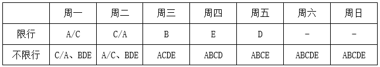

③假设今天为周六，根据条件（4）可知，B车在周五限行，再根据条件（5）可知，A、C两车在周六、周日、周一、周二都不限行，又知E车在周四限行，此时A、C两车只能在周三限行，与条件（2）矛盾，该假设不成立，排除。

综上可知，今天为周四，A、C两车分别在周一或周二限行，只有A项预测正确。

故正确答案为A。

### 第 117 题

2008年上半年原油期货价格一度上涨到每桶147美元，是2000年同期价格的4.2倍，年均增长20%，而同期世界经济年均增长率在5%左右，世界石油消费需求并没有出现跳跃式的、急剧的增长。这说明原油价格的迅速攀升并不是由于世界石油供求关系的变化引起的，而是国际投机资本在石油期货市场进行疯狂投机的结果。

如果以下各项为真，哪项不能质疑上述推论：

A. 2000年至2008年，各国政府普遍加大了石油的战略储备量

B. 较小的经济增长率总带来较大的石油需求增长率

C. 石油需求变化率和石油价格变化率并不对称

D. 即便对于国际投机资本本身，投资石油期货也是风险巨大

第 117 题 · 答案与解析

**参考答案（粉笔题库参考内容）**

D

**解析**

第一步：找到论点和论据。

本题的论点是说原油价格急涨不是供求关系引起的，而是国际投机资本炒作的结果。论据是说2000-2008年期间的年均增长率的不同。

第二步：判断削弱方式。

本题论点和论据间存在因果关系，所以须削弱论点。

第三步：逐一判断选项的作用。

A项说明战略储备影响了供求关系，削弱了论点；B项解释了数据差异产生的原因，因而削弱了论点；C项说明两个数据间并不是对等出现的，因而有差异是正常的，所以也能削弱论点；D项投资石油期货也是风险巨大，与价格迅速攀升无关，属无关选项。

本题为选非题，故正确答案为D。

### 第 118 题

一项最新研究发现，经常喝酸奶能降低儿童患上蛀牙的风险。在此之前，也有研究人员提出酸奶可预防儿童蛀牙，还有研究显示，黄油、奶酪和牛奶对预防蛀牙并没有明显效果。虽然多喝酸奶对儿童的牙齿有保护作用，但酸奶能降低蛀牙风险的原因仍不明确。目前一种说法是酸奶中所含的蛋白质附着在牙齿表面，从而预防有害酸侵蚀牙齿。

以下哪项如果为真，最能支持这项研究发现？

A. 黄油、奶酪和牛奶的蛋白质成分没有酸奶丰富，对儿童牙齿的防蛀效果不明显

B. 儿童牙龈的牙釉质处于未成熟阶段，对抗酸腐蚀的能力低，人工加糖的酸奶会增加蛀牙的风险

C. 有研究表明，儿童每周至少食用4次酸奶可将蛀牙发生率降低15%

D. 世界有许多国家的科学家都在研究酸奶对预防儿童蛀牙的作用

第 118 题 · 答案与解析

**参考答案（粉笔题库参考内容）**

C

**解析**

第一步：找出论点和论据。

论点：经常喝酸奶可降低儿童患蛀牙的风险。

论据：酸奶中所含的蛋白质能附着在牙齿表面，从而预防有害酸侵蚀牙齿。

本题论点和论据话题一致，需要补充论据来加强论点。

第二步：逐一分析选项。

A项：选项指出黄油奶酪牛奶不如酸奶的蛋白质成分丰富，且黄油奶酪牛奶对儿童的防蛀效果不明显，但不确定酸奶的防蛀效果如何，无法支持，排除；

B项：人工加糖的酸奶会增加蛀牙风险，削弱了论点，无法支持，排除；

C项：指出儿童食用酸奶可将蛀牙发生率降低15%，补充论据，可以支持，当选；

D项：许多国家的科学家在研究酸奶对儿童预防蛀牙的作用，但是否有作用不确定，属于不明确选项，无法加强，排除。

故正确答案为C。

### 第 119 题

S市规定，适龄儿童须接种麻疹疫苗，适龄儿童必须接受义务教育，下图表示：

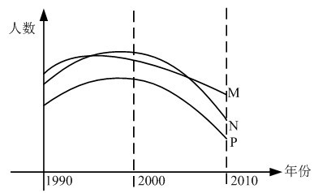

1990年到2010年间S市儿童数量的一些统计，其中M表示接受义务教育的儿童总数，N表示新生儿总数，P表示接种麻疹疫苗的儿童总数，下面哪一项最能解释2000年到2010年间S市接受义务教育的儿童总数与接种麻疹疫苗的儿童总数下降程度的不同：

A. 2000年至2010年间，有部分在S市接种麻疹疫苗的儿童没有在S市入学

B. 2000年至2010年间，约有20%的父母没有按照S市的规定让他们的孩子接种麻疹疫苗

C. 2000年至2010年间，每年都有不在S市出生但已接种了麻疹疫苗的儿童在S市入学

D. 2000年至2010年间，S市新生儿总数下降，因此入学儿童总数和接种麻疹疫苗的儿童总数也随之下降

第 119 题 · 答案与解析

**参考答案（粉笔题库参考内容）**

C

**解析**

第一步：找出题干中的现象。

适龄儿童须接种麻疹疫苗，适龄儿童必须接受义务教育，但在2000年到2010年间，S市接受义务教育的儿童总数与接种麻疹疫苗的儿童总数下降程度有所不同。

第二步：分析题干现象，结合选项得出答案。

图中，S市接受义务教育的儿童总数下降速度（M曲线）比接种麻疹疫苗的儿童总数的下降速度（P曲线）慢。

A项：把M曲线和P曲线的关系说反了，排除；

B项：从图中可以看到，新生儿总数（N曲线）下降程度也大于接受义务教育儿童总数（M曲线），说明这些年间，接受义务教育的儿童中有些不在S市出生，跟S市的父母有没有按规定给自己的孩子接种麻疹疫苗没有关系，因此导致P曲线下降程度大于M曲线的原因，不能通过20%的父母没有让孩子接种疫苗来解释，排除；

C项：说明在接受义务教育的儿童中，包含了不在S市接种麻疹疫苗的儿童，从而导致接受义务教育的儿童数量要多于接种麻疹疫苗的儿童数量，使M曲线的下降程度小于P曲线，当选；

D项：无法解释P曲线和M曲线相对变化的关系，排除。

故正确答案为C。

### 第 120 题

提起极地冰，很多人眼前总是浮现一幅洁白无瑕、晶莹剔透的景观。然而，在北纬71度、西经168度附近的北冰洋海域，“雪龙”号首次驶入一片“脏”冰区，只见一块淡蓝色的浮冰中间夹杂了许多脏兮兮的黄色冰块，这种黄色冰块，既出现在当年的新生冰块上，也出现在多年冰块上。对于“人类造成的污染已经殃及极地浮冰”的说法，有专家解释说这只是生活在极地冰中的一种特有生物--黄褐色的冰藻。

如果以下各项为真，能够反驳专家上述观点的是：

A. 在新生冰块上形成冰藻需要多年

B. 北极冰中生长有冰藻并不是普遍现象

C. 近年来人类踏上北极的次数逐年增加

D. 北冰洋周围的陆地有沙尘天气

第 120 题 · 答案与解析

**参考答案（粉笔题库参考内容）**

A

**解析**

第一步：分析题干，找到论点和论据。

论点：这种黄色冰块是生活在极地冰中的一种特有生物——黄褐色的冰藻，而并非“人类造成的污染已经殃及极地浮冰”。

论据：这种黄色冰块，既出现在当年的新生冰块上，也出现在多年冰块上。

第二步：逐一分析选项。

A项：在新生冰块上形成冰藻需要多年，说明出现在当年的新生冰块上的黄色冰 块不可能是冰藻，否定了专家的解释，当选；

B项：该项说冰藻不是在北极冰块普遍存在的，跟那种黄色冰块是不是黄褐色的 冰藻没有关系，排除；

C项：该项说的是人类踏上北极的次数增加，但是并没有明确地说明次数的增加 是否增加了污染的可能，排除；

D项：该项说与沙尘天气有关，这种天气发生在北冰洋周围的陆地，与题干的关联性也不大，排除。

故正确答案为A。

## 材料 1

2008年世界稻谷总产量68501.3万吨，比2000年增长14.3%；小麦总产量68994.6万吨，比2000年增长17.8%；玉米总产量82271.0万吨，比2000年增长39.1%；大豆总产量23095.3万吨，比2000年增长43.2%。

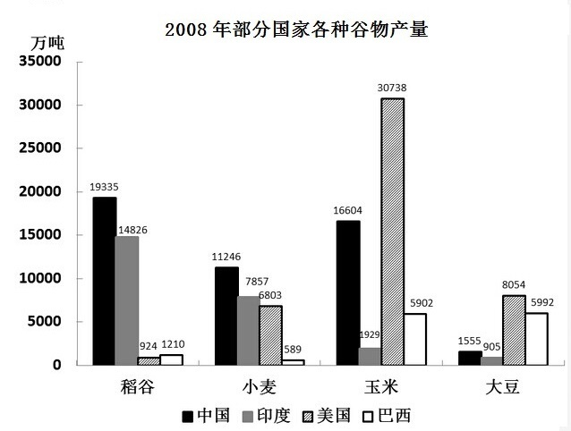

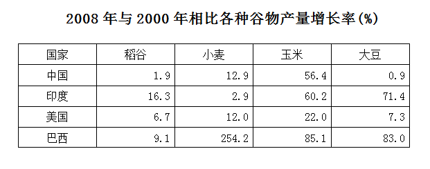

### 第 121 题

下列四种谷物中，2008年与2000年相比全世界增产量最多的是：

A. 稻谷

B. 小麦

C. 玉米

D. 大豆

第 121 题 · 答案与解析

**参考答案（粉笔题库参考内容）**

C

**解析**

根据题干“······增产量最多”，可判定本题为增长量比较问题。定位文字材料“2008年世界稻谷总产量68501.3万吨，比2000年增长14.3%；小麦总产量68994.6万吨，比2000年增长17.8%；玉米总产量82271.0万吨，比2000年增长39.1%；大豆总产量23095.3万吨，比2000年增长43.2%”。根据公式：增长量，四个选项对应的谷物增产量分别为：

稻谷：万吨，

小麦：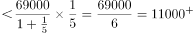万吨，

玉米：万吨，

大豆：万吨。

据上述计算可知玉米增长量最多。

故正确答案为C。

### 第 122 题

将每个国家的四种谷物按2008年的产量分别排序，哪个国家产量排名第一的谷物与2000年相比产量增长率最高？

A. 中国

B. 美国

C. 印度

D. 巴西

第 122 题 · 答案与解析

**参考答案（粉笔题库参考内容）**

D

**解析**

定位图表材料可得：中国、印度、美国、巴西产量排第一名的谷物分别为稻谷、稻谷、玉米、大豆，增长率分别为1.9%、16.3%、22.0%、83.0%，其中增长率最高的是巴西的大豆。

故正确答案为D。

### 第 123 题

2000年，中国稻谷产量占世界稻谷产量的比重约为：

A. 20%

B. 24%

C. 28%

D. 32%

第 123 题 · 答案与解析

**参考答案（粉笔题库参考内容）**

D

**解析**

根据题干“2000年，······占······的比重”，结合材料数据为2008年，可判定本题为基期比重问题。定位图表材料可知：2008年中国稻谷为19335万吨，比2000年增长1.9%；定位文字材料可知，2008年世界稻谷总产量68501.3万吨，比2000年增长14.3%。因此，根据基期比重公式：，2000年中国稻谷占世界稻谷产量的比重为 ，只有D项满足。

故正确答案为D。

### 第 124 题

2000年，表中所列四国玉米的最高产量约是最低产量的多少倍？

A. 11

B. 16

C. 21

D. 26

第 124 题 · 答案与解析

**参考答案（粉笔题库参考内容）**

C

**解析**

根据题干“2000年，······是······的多少倍”，结合材料时间2008年，可判定本题为基期倍数问题。定位图表材料可知：2008年四国玉米产量和相比2000年的增长率分别为中国16604万吨、增长率56.4%，印度1929万吨、增长率60.2%，美国30738万吨、增长率22.0%，巴西5902万吨、增长率85.1%。根据公式：基期量，可得2000年四国玉米产量分别为：中国，印度，美国，巴西。观察发现，四个分数分母相差不大，美国的分子明显过于大，印度的分子明显过于小，所以2000年玉米产量最高、最低的国家肯定是美国、印度，根据基期倍数公式：，故两者倍数为倍，与C项最为接近。

故正确答案为C。

### 第 125 题

能够从上述资料中推出的是：

A. 2008年，美国是世界最大的大豆产地

B. 2008年，巴西玉米产量占世界总产量的比重比2000年略有下降

C. 与2000年相比，2008年中国小麦产量增产900多亿吨

D. 2008年，印度稻谷产量是其小麦产量的2倍以上

第 125 题 · 答案与解析

**参考答案（粉笔题库参考内容）**

A

**解析**

A项，定位文字材料可知：2008年世界大豆总产量23095.3万吨；定位图形材料可知：2008年美国大豆产量8054万吨，中国、印度、巴西三国相加产量=1555+905+5992=8452万吨。世界剩余部分=23095.3-8054-8452=6589.3万吨&lt;8054万吨，因此美国肯定是最大的大豆产地，正确；

B项，定位文字材料可知：世界玉米产量增速（b）为39.1%；定位表格材料可知：巴西玉米产量增速（a）为85.1%。根据两期比重结论：a＞b，比重上升。因此，2008年巴西玉米产量占世界玉米总产量的比重比2000年略有上升，错误；

C项，定位图形材料可知：2008年中国小麦产量为11246万吨=1.1246亿吨，不可能增长900亿吨，单位有误，错误；

D项，定位图形材料可知：2008年印度稻谷、小麦产量分别为14826、7857万吨。万吨＞14826万吨，因此，2008年印度稻谷产量不到其小麦的2倍，错误。

故正确答案为A。

## 材料 2

2010年上半年，全国原油产量为9848万吨，同比增长5.3%，上年同期为下降1%。进口原油11797万吨（海关统计），增长30.2%。原油加工量20586万吨，增长17.9%，增速同比加快16.4个百分点。成品油产量中，汽油产量增长6%，增速同比减缓7.9个百分点；柴油产量增长28.1%，增速同比加快15.8个百分点。

        据行业统计，2010年上半年成品油表观消费量10963万吨，同比增长12.5%。其中，一、二季度分别增长16.3%和9.2%。

        2010年6月份，布伦特原油平均价格为75.28美元/桶，比上月回落1.75美元/桶，同比上涨10.4%。结合国际市场油价变化情况，国家于6月1日将汽油、柴油批发价格分别下调230元/吨和220元/吨。

        2010年上半年，全国天然气产量459亿立方米，同比增长10.8%，增速同比加快3.2个百分点。国家于6月1日将国产陆上天然气出厂基准价格上调了230元/千立方米。

        2010年1-5月，石油石化行业实现利润1645亿元，同比增长76.4%，上年同期为下降35.4%。其中，石油天然气开采业利润1319亿元，同比增长1.67倍，上年同期为下降75.8%，炼油行业利润326亿元，同比下降25.7%，上年同期为增长1.8倍。

### 第 126 题

2010年上半年全国原油产量比2008年同期约增长了：

A. 1.8%

B. 4.2%

C. 6.3%

D. 9.6%

第 126 题 · 答案与解析

**参考答案（粉笔题库参考内容）**

B

**解析**

根据题干“2010上半年······比2008年同期······增长了”，结合选项为百分数，可判定本题为间隔增长率计算问题。定位文字材料第一段“2010年上半年，全国原油产量为9848万吨，同比增长5.3%，上年同期为下降1%”。根据间隔增长率公式：，可得2010年上半年全国原油产量比2008年同期约增长了，比4.3%略小，与B项最为接近。

故正确答案为B。

### 第 127 题

2010年上半年，全国成品油表观消费量同比增加了约多少万吨？

A. 1009

B. 1218

C. 1370

D. 1787

第 127 题 · 答案与解析

**参考答案（粉笔题库参考内容）**

B

**解析**

根据题干“······增加了······万吨”，可判定本题为增长量计算问题。定位文字材料第二段，“2010年上半年成品油表观消费量10963万吨，同比增长12.5%”。根据公式：增长量，，则增长量为万吨，与B项最接近。

故正确答案为B。

### 第 128 题

2010年5月份，布伦特原油的平均价格约为每桶多少美元：

A. 68.19

B. 73.53

C. 75.28

D. 77.03

第 128 题 · 答案与解析

**参考答案（粉笔题库参考内容）**

D

**解析**

定位文字材料第三段，“2010年6月份，布伦特原油平均价格为75.28美元/桶，比上月回落1.75美元/桶”，因此5月份布伦特原油平均价格为75.28＋1.75＝77.03美元/桶。

故正确答案为D。

### 第 129 题

2009年1-5月，石油天然气开采业利润占石油石化行业实现利润的比重约为：

A. 53%

B. 66%

C. 80%

D. 91%

第 129 题 · 答案与解析

**参考答案（粉笔题库参考内容）**

A

**解析**

根据题干“2009年1-5月，······占······的比重”，结合材料时间为2010年1-5月，可判定本题为基期比重计算问题。定位文字材料最后一段，“2010年1-5月，石油石化行业实现利润1645亿元，同比增长76.4%，其中，石油天然气开采业利润1319亿元，同比增长1.67倍”。根据基期比重公式：，则2009年1-5月，石油天然气开采业利润占石油石化行业实现利润的比重约为：，与A项最接近。

故正确答案为A。

### 第 130 题

能够从上述资料中推出的是：

A. 2009年上半年，全国原油进口量高于原油产量

B. 2009年上半年，全国汽油产量同比增长率高于柴油

C. 2009年一季度，全国成品油表观消费量高于二季度

D. 2009年上半年，全国天然气产量同比增长14%

第 130 题 · 答案与解析

**参考答案（粉笔题库参考内容）**

B

**解析**

A项：定位文字材料第一段可知，2010年上半年，全国原油产量为9848万吨，同比增长5.3%，进口原油11797万吨，增长30.2%。根据公式：基期量，则2009年上半年原油产量万吨，原油进口量万吨，故原油进口量小于原油产量，错误；

B项：定位文字材料第一段可知，2010年上半年，汽油产量增长6%，增速同比减缓7.9个百分点；柴油产量增长28.1%，增速同比加快15.8个百分点，则2009年上半年汽油产量同比增长率为6%+7.9%=13.9%，柴油产量同比增长率为28.1%-15.8%=12.3%，13.9％＞12.3％，正确；

C项：定位文字材料第二段可知，2010年上半年成品油表观消费量同比增长12.5%，其中，一、二季度分别增长16.3%和9.2%，第一、二季度的增长率混合得到上半年的增长率，根据混合增长率结论：混合后的增长率偏向于基期量大的一边。

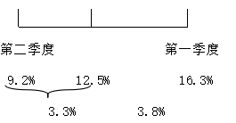

由上图可知混合后的增长率更靠近9.2%，故2009年第一季度全国成品油表观消费量低于第二季度，错误；

D项：定位文字材料第四段可知，2010年上半年，全国天然气产量同比增长10.8%，增速同比加快3.2个百分点。则2009年上半年，全国天然气产量同比增长10.8%-3.2%=7.6%≠14%，错误。

故正确答案为B。

## 材料 3

2010年一季度，我国水产品贸易进出口总量158.7万吨，进出口总额40.9亿美元，同比分别增长14.2%和29.0%。其中，出口量67.1万吨，出口额26.5亿美元，同比分别增长11.7%和24.9%；进口量91.6万吨，进口额14.4亿美元，同比分别增长16.0%和37.5%。

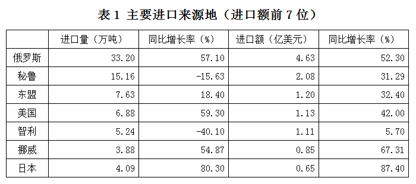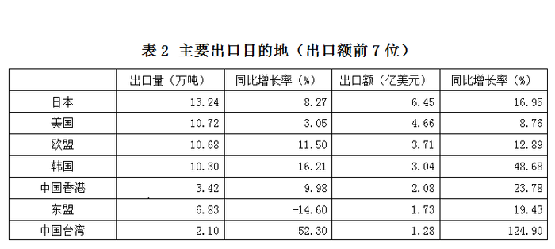

### 第 131 题

2010年一季度，我国水产品出口额比上年同期约增长了多少亿美元？

A. 5.3

B. 7.0

C. 9.2

D. 21.2

第 131 题 · 答案与解析

**参考答案（粉笔题库参考内容）**

A

**解析**

根据题干“······增长了······亿美元”，可判定本题为增长量计算问题。定位文字材料可知：2010年一季度我国水产品贸易出口额26.5亿美元，同比增长24.9%，根据公式：增长量，则我国水产品出口额比上年同期增长亿美元。

故正确答案为A。

### 第 132 题

2010年一季度，我国水产品主要进口来源地，按进口量从小到大排序正确的是：

A. 日本—挪威—美国

B. 秘鲁—东盟—日本

C. 挪威—美国—东盟

D. 东盟—智利—俄罗斯

第 132 题 · 答案与解析

**参考答案（粉笔题库参考内容）**

C

**解析**

定位表1可知：日本（4.09万吨）高于挪威（3.88万吨），排除A项；秘鲁（15.16万吨）高于东盟（7.63万吨），排除B项；东盟（7.63万吨）高于智利（5.24万吨），排除D项。

故正确答案为C。

### 第 133 题

2010年一季度，我国与美国水产品进出口贸易额占我国水产品进出口贸易总额的比重约为：

A. 7.8%

B. 12.7%

C. 14.2%

D. 17.6%

第 133 题 · 答案与解析

**参考答案（粉笔题库参考内容）**

C

**解析**

根据题干“2010年一季度，······占······的比重”，结合材料时间为2010年一季度，判定本题为现期比重计算问题。定位文字材料可知：2010年一季度，我国水产品贸易进出口总额40.9亿美元；定位表1、表2可知：我国与美国水产品进口额为1.13亿美元，水产品出口额为4.66亿美元。根据公式：比重，则我国与美国水产品进出口贸易额占我国水产品进出口贸易总额的比重为，与C项最接近。

故正确答案为C。

### 第 134 题

2010年一季度，我国对以下哪个国家或地区出口水产品的平均单价最高？

A. 日本

B. 美国

C. 欧盟

D. 韩国

第 134 题 · 答案与解析

**参考答案（粉笔题库参考内容）**

A

**解析**

根据题干“2010年一季度，······平均单价最高”，结合材料时间为2010年一季度，可判定本题为现期平均数比较问题。定位表2可得：对日本出口量13.24万吨、出口额6.45亿美元；对美国出口量10.72万吨、出口额4.66亿美元；对欧盟出口量10.68万吨、出口额3.71亿美元；对韩国出口量10.30万吨、出口额3.04亿美元。根据公式：平均单价，故四个选项对应的单价分别为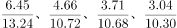。分数量级一致，直除可知首位分别为4、4、3、2，故只需比较前两个分数大小即可。，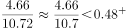，故，即对日本出口水产品的平均单价最高。

故正确答案为A。

### 第 135 题

能够从上述资料中推出的是：

A. 2010年一季度，我国是俄罗斯最大的水产品出口目的地

B. 2009年一季度，日本比美国进口了更多的我国水产品

C. 2010年一季度，我国从秘鲁进口水产品的平均单价比上年同期有所下降

D. 2009年一季度，我国对东盟水产品进出口贸易为逆差

第 135 题 · 答案与解析

**参考答案（粉笔题库参考内容）**

B

**解析**

A项：定位表1只能说明俄罗斯是我国主要进口来源地，但并不知道俄罗斯对各个国家的出口情况，故无法判断，错误；

B项：“日本、美国进口的我国水产品量”即我国对日本、美国水产品的出口量。定位表2可知2010年第一季度我国对日本、美国的出口量和同比增长率。根据公式：基期量，则2009年第一季度我国对日本的出口量为万吨，对美国的出口量为万吨，故日本比美国进口了更多的我国水产品，正确；

C项：定位表1可得：2010年第一季度，我国从秘鲁进口水产品的进口量同比增长-15.63%（b），进口额同比增长31.29%（a）。根据两期平均数比较的结论：a&lt;b，则平均数下降；a>b，则平均数上升。31.29%（a）>-15.63%（b），故我国从秘鲁进口水产品的平均单价比上年同期上升，错误；

D项：定位表1、表2可得：2010年第一季度，我国自东盟水产品进口额为1.20亿美元，同比增长32.4%；2010年第一季度，我国对东盟水产品出口额为1.73亿美元，同比增长19.43%。根据公式：基期量，可知2009年第一季度我国自东盟水产品进口额为亿美元，出口额为亿美元，故2009年第一季度我国对东盟水产品的出口额>自其进口额，为贸易顺差，并非逆差，错误。

故正确答案为B。

