# 2012年国家公务员录用考试《行测》题

<!-- gwy:overview:start -->
> **国考 · 2012 · 行测 · 统考** ｜ 135 题 · 图片 22 处 · 答案随题折叠

| 题型模块 | 题量 | 题号 |
| --- | ---: | ---: |
| 常识判断 | 25 | 1–25 |
| 言语理解与表达 | 40 | 26–65 |
| 数量关系 | 15 | 66–80 |
| 判断推理 | 35 | 81–115 |
| 资料分析 | 20 | 116–135 |
| **合计** | **135** | |

导航：[题型与作答说明](#题型与作答说明) · [题目](#题目) · [材料 1](#材料-1)
<!-- gwy:overview:end -->

> 候选采集稿。参考答案及解析来自粉笔页面，不代表官方答案或真实高分答卷；来源使用许可与原卷对应关系仍需人工核实。

## 题型与作答说明

常识判断

（25题）

根据题目要求，在四个选项中选出一个最恰当的答案。

言语理解与表达

（40题）

本部分包括表达与理解两方面的内容。请根据题目要求，在四个选项中选出一个最恰当的答案。

数量关系

（15题）

在这部分试题中，每道题呈现一段表述数字关系的文字，要求你迅速、准确地计算出答案。

判断推理

（35题）

本部分包括图形推理、定义判断、类比推理与逻辑判断四种类型的试题。

资料分析

（20题）

所给出的图、表、文字或综合性资料具有若干问题要你回答。你应根据资料提供的信息进行分析、比较、计算和判断处理。

## 题目

### 第 1 题

下列哪项是我国在“十二五”开局之年取得的科技成就：

A. 我国首辆高速磁浮国产化样车交付使用，标志着我国已经具备了磁浮车辆国产化设计，整车集成和制造能力

B. 我国具有自主知识产权的戊型肝炎疫苗研制成功，标志着我国在戊型肝炎疫苗研制上已经处于世界领先地位

C. 我国第一台自行设计、自主集成研制的“蛟龙号”载人潜水器3000米级海试取得成功，标志着我国成为世界上掌握3500米以上大深度载人深潜技术的国家之一

D. 国内首套具有自主知识产权的“机载SAR测图系统”研制成功，至此，我国可成功实现全天时、全天候从万米高空获取高分辨率测绘数据，及时动态监测地理国情

第 1 题 · 答案与解析

**参考答案（粉笔题库参考内容）**

D

**解析**

“十二五”规划的起止时间：2011—2015年。A项错误，2010年4月8日，我国首辆高速磁悬浮国产化样车在成都实现交付。该样车由中航工业成都飞机工业（集团）有限公司制造，标志着该企业已经具备了磁浮车辆国产化设计、整车集合和制造能力；

B项错误，2009年初厦门大学、福建省医学分子病毒学研究中心和养生堂北京万泰药业有限公司研制出我国第一种拥有核心自主知识产权的基因工程疫苗——重组戊型肝炎疫苗；

C项错误，2010年8月26日上午，科学技术部与国家海洋局联合宣布，国家高技术研究发展计划（863计划）重大专项——我国第一台自行设计、自主集成研制的“蛟龙号”载人潜水器3000米级海上试验取得成功，最大下潜深度达到3759米，并创造了水下和海底作业9小时零3分的记录；

D项正确，2011年5月13日国家测绘局正式对外发布，历时3年科技攻关，打破西方技术壁垒，由中国测绘科学研究院牵头承担的“机载多波段多极化干涉SAR测图系统（简称‘机载SAR测图系统’）”的研制取得全面成功。

故正确答案为D。

**考点**：科技理论与成就

**来源**：2012年国家公务员录用考试《行测》题第1题

### 第 2 题

下列关于推进“十二五”期间资源节约和环境保护的表述，不正确的是：

A. 我国耕地资源有限，要加大耕地保护工作的力度

B. 提高森林蓄积量和覆盖率是“十二五”期间的重要任务

C. 提高化石能源消费的比重，以降低能耗总值和排放水平

D. 坚持保护优先和自然修复为主，加大生态保护和建设力度

第 2 题 · 答案与解析

**参考答案（粉笔题库参考内容）**

C

**解析**

A项表述正确，“十二五”规划强调要“坚持最严格的耕地保护制度”、“从严控制各类建筑占用耕地”；B项表述正确，“十二五”规划中提到要“推进植树造林，新增森林面积1250万公顷”；C项表述错误，“十二五”规划在“推动能源生产和利用方式变革”中提到要“推进能源多元清洁发展”，可见C项“提高化石能源消费的比重”表述有误；D项表述正确，“十二五”规划第二十五章提到，要“坚持保护优先和自然修复为主，加大生态保护和建设力度，从源头上扭转生态环境恶化趋势”。

本题为选非题，故正确答案为C。

本题相关知识点：

化石能源是一种碳氢化合物或其衍生物，它由古代生物的化石沉积而来，是一次能源。化石燃料不完全燃烧后，都会散发出有毒气体，却是人类必不可少的燃料。化石能源所包含的天然资源有煤炭、石油和天然气。化石能源是目前全球消耗的最主要能源，2006年全球消耗的能源中化石能源占比高达87.9%，我国的比例高达93.8%。但随着人类的不断开采，化石能源的枯竭是不可避免的，大部分化石能源本世纪将被开采殆尽。从另一方面看，由于化石能源在使用过程中会新增大量温室气体CO_2，同时可能产生一些有污染的烟气，威胁全球生态。因而，开发更清洁的可再生能源是今后发展的方向。

**考点**：其他

**来源**：2012年国家公务员录用考试《行测》题第2题

### 第 3 题

在历史上中国共产党曾提出：①讲学习、讲政治、讲正气；②知识青年到农村去；③枪杆子里面出政权；④科学技术是第一生产力。按时间先后顺序排列正确的是：

A. ②③④①

B. ③②④①

C. ②①③④

D. ③②①④

第 3 题 · 答案与解析

**参考答案（粉笔题库参考内容）**

B

**解析**

本题考查毛中特。

③“枪杆子里面出政权”这一著名论断是毛泽东在1927年8月7日的“八七会议”上根据当时中国的国情提出的；②“知识青年到农村去”是1968年12月22日，《人民日报》在一篇报道的编者按中传达了毛泽东指示：“知识青年到农村去接受贫下中农的再教育，很有必要。要说服城里干部和其他人，把自己初中、高中、大学毕业的子女，送到乡下去，来一个动员。各地农村的同志应当欢迎他们去”；④“科学技术是第一生产力”是在1988年9月，邓小平同志根据当代科学技术发展的趋势和现状，提出了“科学技术是第一生产力”的论断；①1995年11月8日，江总书记在北京视察工作时指出：“根据当前干部队伍的状况和存在的问题，在对干部进行教育当中，要强调讲学习、讲政治、讲正气。全国都要这样做，北京市更要起带头作用”。正确顺序为③②④①。

故正确答案为B。

**考点**：党的历史

**来源**：2012年国家公务员录用考试《行测》题第3题

### 第 4 题

下列关于我国民主党派和无党派人士的说法，不正确的是：

A. 工商联不属于民主党派

B. 民主党派是参政党，不是在野党

C. 无党派人士是指既不参加中国共产党也不参加民主党派的普通群众

D. 中国共产党与各民主党派将长期共存、互相监督、肝胆相照、荣辱与共

第 4 题 · 答案与解析

**参考答案（粉笔题库参考内容）**

C

**解析**

本题考查新思想。

C项表述错误，无党派人士不等于无党派群众，根本差别在于前者具有统战工作对象身份。广大无党派工农基本群众，尽管他们在统一战线中居基础地位，但从来就不是统战工作对象，也就不能称之为统一战线意义上的无党派人士。具体到我国，在新民主主义革命时期，一般称无党无派的知名人士为社会贤达。1949年中国人民政治协商会议成立后，专门设立了无党派民主人士界别。中共中央在2005年专门下发了一份文件，叫《中共中央关于进一步加强中国共产党领导的多党合作和政治协商制度的意见》，这里面明确了无党派人士需要具备的三个条件：第一个条件是没有参加任何党派；第二个条件是对社会有积极贡献和一定影响的人士；第三个条件是有社会基础，主要是知识分子。

本题为选非题，故正确答案为C。

**考点**：政治建设

**来源**：2012年国家公务员录用考试《行测》题第4题

### 第 5 题

关于欧洲主权债务危机的原因，下列说法不正确的是：

A. 欧元升值

B. 欧元区经济低迷

C. 巨额财政赤字

D. 财政政策与货币政策的不协调

第 5 题 · 答案与解析

**参考答案（粉笔题库参考内容）**

A

**解析**

A项表述错误，主权债务即一国政府以自己的主权为担保向他国或国外机构所借的债务，而主权债务危机就是一国政府无法按时还清债务，从而产生信用危机，具体的表现就是巨额财政赤字、经济低迷以及货币贬值。

本题为选非题，故正确答案为A。

**考点**：市场经济

**来源**：2012年国家公务员录用考试《行测》题第5题

### 第 6 题

为了抑制通货膨胀，国家宏观调控部门可以采取的措施是：

A. 降低再贴现率

B. 降低央行基准利率

C. 提高个人所得税起征点

D. 提高银行存款准备金率

第 6 题 · 答案与解析

**参考答案（粉笔题库参考内容）**

D

**解析**

本题主要考查经济常识。

A项错误，“再贴现率”是商业银行将其贴现的未到期票据向中央银行申请再贴现时的预扣利率。降低再贴现率意味着商业银行向中央银行贷款的成本降低，增加向中央银行贷款，从而增加了货币投放，直接增加货币供应量，从而助长了通货膨胀。

B项错误，降低央行基准利率，人们储蓄得到的利息会减少，储蓄欲望降低，不利于抑制通货膨胀。

C项错误，提高个人所得税起征点是全国人大常委会的职权，不在国家宏观调控部门权力范围内。

D项正确，“存款准备金”是指金融机构为保证客户提取存款和资金清算需要而准备的在中央银行的存款。存款准备金占其存款总额的比例就是存款准备金率。提高银行存款准备金率时，银行可提供放款及创造信用的能力就下降。社会的银根偏紧，货币供应量减少，利息率提高，投资及社会支出都相应缩减，抑制了通货膨胀。

故正确答案为D。

**考点**：宏观经济与调控政策

**来源**：2012年国家公务员录用考试《行测》题第6题

### 第 7 题

孔子在中国历史上留下了光辉的文化轨迹，以下关于孔子的说法正确的是：

A. 著作《论语》，记录孔子本人及弟子言行

B. 孔子在教育学上的贡献是打破公学，创办私学

C. “罢黜百家，独尊儒术”使孔子一跃成为当时名家

D. 孔子核心思想是“仁政”，提出“民贵君轻”观点

第 7 题 · 答案与解析

**参考答案（粉笔题库参考内容）**

B

**解析**

本题考查人文常识。

A项错误，《论语》为孔子的弟子及其再传弟子编撰而成，而非孔子所作；

B项正确；

C项错误，“罢黜百家，独尊儒术”为汉武帝时董仲舒提出，且孔子在春秋时期就已经成名；

D项错误，“民贵君轻”为孟子提出的观点。

故正确答案为B。

**考点**：文化常识

**来源**：2012年国家公务员录用考试《行测》题第7题

### 第 8 题

下列关于《共产党宣言》的说法不正确的是：

A. 是法国大革命的理论基础

B. 标志着马克思主义的正式诞生

C. 贯穿全书的基本思想是唯物主义的历史观

D. 把马克思主义哲学、政治经济学和科学社会主义原理融为一体

第 8 题 · 答案与解析

**参考答案（粉笔题库参考内容）**

A

**解析**

A项表述有误，法国大革命时间为1789年，早于《共产党宣言》1848年。B、C、D三项关于《共产党宣言》的说法均正确。

本题为选非题，故正确答案为A。

本题相关知识点：

法国大革命的发生有着深刻的思想根源。在18世纪上半叶，著名的思想启蒙运动就以不可阻挡之势深入人心了。孟德斯鸠、伏尔泰、卢梭、狄德罗等杰出的思想家和哲学家提出了一系列资产阶级的民主思想，抨击封建专制制度，为大革命的爆发准备了条件。

**来源**：2012年国家公务员录用考试《行测》题第8题

### 第 9 题

关于这张古代作战图，下列说法正确的是：

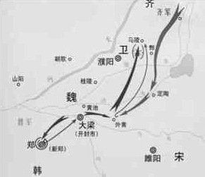

A. 战役发生在南北朝时期

B. 交战双方是齐国和韩国

C. 历史上称其为“马陵之战”

D. 孙膑、白起是交战双方的指挥者

第 9 题 · 答案与解析

**参考答案（粉笔题库参考内容）**

C

**解析**

本题考查人文历史。

观察图中两方行军箭头的变化，最后交汇于马陵，可知图中所表现的是马陵之战，发生在战国时期，交战双方是齐国和魏国，孙膑、庞涓是双方指挥者。

综上可知，A、B、D三项表述错误，C项表述正确。

故正确答案为C。

**考点**：中国历史

**来源**：2012年国家公务员录用考试《行测》题第9题

### 第 10 题

关于佛教、基督教和伊斯兰教，下列说法正确的是：

A. 都是一神论宗教

B. 都以亚洲为发源地

C. 基督教产生时间最早

D. 目前佛教信仰人数最多

第 10 题 · 答案与解析

**参考答案（粉笔题库参考内容）**

B

**解析**

基督教于公元1世纪起源于巴勒斯坦，伊斯兰教是公元7世纪初阿拉伯半岛麦加人穆罕默德所创的，佛教相传是公元前6世纪—公元前5世纪，由古印度迦毗罗卫国王子释迦牟尼所创。三大宗教中，只有佛教是多神教，而基督教的信教人数最多。

故正确答案为B。

**考点**：文化常识

**来源**：2012年国家公务员录用考试《行测》题第10题

### 第 11 题

甲乙两家是邻居，甲家在距乙家地基2米处种有一棵大树。每逢刮大风，风便会将这棵树的一些大树枝刮落到乙家房屋上。乙担心会损坏房屋，多次找甲协商，要求甲将树枝砍去一些，被甲拒绝。某日，暴风雨即将来临，乙再次找甲协商却没找到，情急之下自己砍去了一些伸到自家房屋上的树枝。甲回家后要求乙赔偿500元，乙不同意，甲将乙起诉至法院。

下列说法正确的是：

A. 狂风暴雨即将来临，乙砍掉一些树枝来避免自己房屋的损害属于紧急避险，因而乙不应承担民事责任

B. 乙的行为已经构成了对甲财产权利的侵害，因为乙为自己的利益未经甲同意就砍掉了一些树枝，因此，乙应当承担赔偿责任

C. 虽然这棵树属于甲，但因伸到了乙的房顶，这棵树在乙房屋界内的部分应当属于乙，因此，乙砍掉那些树枝是合法的，不应承担民事责任

D. 乙的行为已经构成了对甲财产权利的侵害，因为乙为自己的利益未经甲同意就砍掉了一些树枝。但是乙在砍之前有意愿但无法告知甲，因此可免其部分责任

第 11 题 · 答案与解析

**参考答案（粉笔题库参考内容）**

A

**解析**

本题考查侵权行为与免责条款的相关知识。《最高人民法院关于贯彻执行〈民法通则〉若干问题的意见(试行)》第103条规定，相邻一方在自己使用的土地上挖水沟、水池、地窖等或者种植的竹木根枝伸延，危及另一方建筑物的安全和正常使用的，应当分别情况，责令其消除危险，恢复原状，赔偿损失。本题中，甲家的树可能对乙家房屋构成威胁，乙有权利要求甲加强对自家树的管理，甲也有义务排除对相邻一方的妨害。

A项，紧急避险，是指为了使公共利益、本人或者他人的合法权益免受现实和紧急的损害危险，不得已而采取的、致人损害的行为。本题中，甲没有履行消除妨害的义务，乙在暴风雨来临时为了避免房屋损坏，不得已砍掉伸到自家房屋上的树枝，属于民法上的紧急避险，无需承担民事责任。该项表述正确。

B项，本题中甲有义务消除妨害但没有履行义务，乙在狂风暴雨来临时，为了避免树枝刮落给自家房屋造成损坏而砍掉伸到自家房屋上的树枝，属于民法上的紧急避险，无需承担赔偿责任。该项表述错误。

C项，树木的所有权属于甲，树枝是树木的一部分，不论其延伸到何处，其所有权均属于甲。该项表述错误。

D项，本题中甲有义务消除妨害但没有履行义务，乙在狂风暴雨来临时，为了避免树枝刮落给自家房屋造成损坏而砍掉伸到自家房屋上的树枝，属于民法上的紧急避险，无需承担民事责任。该项表述错误。

故正确答案为A。

**考点**：民法典

**来源**：2012年国家公务员录用考试《行测》题第11题

### 第 12 题

下列哪一典故与《庄子》无关：

A. 鹏程万里

B. 庖丁解牛

C. 庄生梦蝶

D. 刻舟求剑

第 12 题 · 答案与解析

**参考答案（粉笔题库参考内容）**

D

**解析**

A项有关，“鹏程万里”出自《庄子·逍遥游》：“鹏之徙于南冥也，水击三千里，抟扶摇而上者九万里”；

B项有关，“庖丁解牛”出自《庄子·养生主》；

C项有关，“庄生梦蝶”出自《庄子·齐物论》；

D项无关，“刻舟求剑”出自《吕氏春秋·察今》，与《庄子》无关。

本题为选非题，故正确答案为D。

**考点**：文学常识

**来源**：2012年国家公务员录用考试《行测》题第12题

### 第 13 题

根据《中华人民共和国刑法修正案（八）》，下列说法正确的是：

A. 社区矫正不适用于犯罪分子

B. 给予外国政府官员财物可能构成犯罪

C. 行贿人主动交代行贿行为的，应当减免处罚

D. 审判的时候已满七十五周岁的人不应判处死刑

第 13 题 · 答案与解析

**参考答案（粉笔题库参考内容）**

B

**解析**

A项错误，《中华人民共和国刑法修正案（八）》明确规定，“对判处管制的犯罪分子，依法实行社区矫正”；

B项正确，B项是《中华人民共和国刑法修正案（八）》新增加的内容，为谋取不正当商业利益，给予外国公职人员或者国际公共组织官员以财物的，可能被判刑；

C项错误，“应当”一词表述有误，行贿人在被追诉前主动交代行贿行为的，可以减轻处罚或者免除处罚，这里是“可以”，不是“应当”；

D项错误，表述过于绝对，审判的时候已满七十五周岁的人，不适用死刑，但以特别残忍手段致人死亡的除外。

故正确答案为B。

**考点**：刑法

**来源**：2012年国家公务员录用考试《行测》题第13题

### 第 14 题

下列说法中正确的一项是：

A. 日光灯通过电流加热钨丝产生热量，继而产生光辐射来发光

B. 数码相机利用电子传感器技术，与普通相机记录图像的原理基本相同

C. 等离子电视显示器采用荧光粉显示屏幕，因而亮度高于液晶电视

D. 激光打印机是把射到感光器的图像传印到打印板（或复印纸）上，其原理与复印机不同

第 14 题 · 答案与解析

**参考答案（粉笔题库参考内容）**

C

**解析**

A项错误，日光灯通电后，管内电极通过汞蒸气放电而产生紫外线，激发荧光物质发出可见光；

B项错误，数码相机是一种利用电子传感器把光学影像转换成电子数据的照相机，与普通照相机在胶卷上靠溴化银的化学变化来记录图像的原理不同；

C项正确，等离子电视，它是在两张超薄的玻璃板之间注入混合气体，并施加电压利用荧光粉发光成像的设备。与液晶电视相比，具有亮度高，对比度高，可视角度大，颜色鲜艳和接口丰富等特点；

D项错误，复印机和激光打印机的大致原理基本是相同的，复印机比打印机多了一个曝光的步骤而已。二者都是将接收的光信号经F-theta镜头实现对感光鼓的横向扫描且感光鼓转动实现纵向扫描，从而在感光鼓上留下要打印或复印的文字图像的潜影，再经过后面相同的步骤将其在复印纸上定影。

故正确答案为C。

**考点**：物理常识

**来源**：2012年国家公务员录用考试《行测》题第14题

### 第 15 题

下列表述不正确的是：

A. 自然界中的金属在常温下一般呈固态

B. 惰性气体不与其他物质发生化学反应

C. 天然气是一种无色无味无毒的气体燃料

D. 钢是铁和碳按照一定比例加工而成的合金

第 15 题 · 答案与解析

**参考答案（粉笔题库参考内容）**

B

**解析**

A项正确，A项只说的是“一般”情况，说法正确；B项错误，惰性气体只是化学性质很不活泼，但并不是绝对不与其他物质发生化学反应；C项正确，天然气是一种无色无味无毒的气体燃料，其主要成分是甲烷；D项正确，钢是铁和碳的合金，含碳量小于2%，并含有少量其他元素。

本题为选非题，故正确答案为B。

**考点**：化学常识

**来源**：2012年国家公务员录用考试《行测》题第15题

### 第 16 题

作家肖伯纳说“人生有两大悲剧，一是没得到你心爱的东西，另一是得到了你心爱的东西”；学者周国平则说“人生有两大快乐，一是没有得到你心爱的东西，于是你可以去寻求和创造，另一是得到了你心爱的东西，于是你可去品味和体验”。

从哲学角度看，两个观点存在差异的主要原因是：

A. 追求真理是一个永无止境的认识过程

B. 价值判断和价值选择具有社会历史性特征

C. 人们的认识结果是由客体对主体的作用决定的

D. 意识对于客观事物的反映是主动的、有选择的

第 16 题 · 答案与解析

**参考答案（粉笔题库参考内容）**

D

**解析**

意识活动具有主动创造性和自觉选择性。意识对客观世界的反映是主动的、有选择的，并不是客观世界有什么就反映什么，只有当人们的实践活动需要时，人们才会去主动地反映它。从哲学角度来看，肖伯纳和周国平观点不同的主要原因是意识活动具有主动创造性和自觉选择性。

故正确答案为D。

**考点**：认识论

**来源**：2012年国家公务员录用考试《行测》题第16题

### 第 17 题

世界大河中，与长江流向大致相同的是：

A. 尼罗河

B. 印度河

C. 亚马逊河

D. 伏尔加河

第 17 题 · 答案与解析

**参考答案（粉笔题库参考内容）**

C

**解析**

A项尼罗河大体上都是由南向北的流向，B项印度河大体上是由东北向西南的流向，D项伏尔加河是南北走向，大致上是由北向南流向。只有C项亚马逊河与长江的流向一样，都是自西向东。

故正确答案为C。

**考点**：世界地理

**来源**：2012年国家公务员录用考试《行测》题第17题

### 第 18 题

下列音乐作品与创作作者对应不正确的是：

A. 《蓝色多瑙河》——巴赫

B. 《安魂曲》——莫扎特

C. 《天鹅湖》——柴可夫斯基

D. 《命运交响曲》——贝多芬

第 18 题 · 答案与解析

**参考答案（粉笔题库参考内容）**

A

**解析**

A项，《蓝色多瑙河》的作者是奥地利作曲家小约翰•施特劳斯，并非巴赫，对应错误。B、C、D三项对应均正确。

本题为选非题，故正确答案为A。

本题相关知识点：

巴赫（1685—1750），德国最伟大的作曲家之一，以创作《勃兰登堡协奏曲》《b小调弥撒曲》《平均律钢琴曲集》《哥德堡变奏曲》以及大量的教堂音乐和器乐曲而著称。莫扎特（1756—1791），奥地利作曲家，欧洲维也纳古典乐派的代表人物之一，代表作《安魂曲》《牧人王》《费加罗的婚礼》《唐璜》和《魔笛》。柴可夫斯基（1840—1893），俄罗斯浪漫乐派作曲家。代表作六部交响曲、四部协奏曲、芭蕾《天鹅湖》《胡桃夹子》《睡美人》等。贝多芬（1770—1827），德国作曲家、钢琴家、指挥家。维也纳古典乐派代表人物之一。《命运交响曲》即“第五交响曲”，是他的代表作。

**考点**：文化常识

**来源**：2012年国家公务员录用考试《行测》题第18题

### 第 19 题

海鸥是最常见的海鸟，被称为海上航行安全的“预报员”，下列对海鸥“预报员”称号的解释不符合事实的是：

A. 如果海鸥贴近海面飞行，那么未来的天气将是晴好的

B. 海鸥常落在浅滩、岩石或暗礁周围，航海者可据此判断附近是否有暗礁

C. 海鸥有沿港口出入飞行的习性，迷失方向时可观察海鸥的飞行方向寻找港口

D. 如果海鸥离开水面高高飞翔，成群结队地从海边飞向大海远处，则预示着暴风雨即将来临

第 19 题 · 答案与解析

**参考答案（粉笔题库参考内容）**

D

**解析**

A项正确，如果海鸥贴近海面飞行，预示着未来的天气将是晴好的；

B项正确，海鸥常着落在浅滩、岩石或暗礁周围，群飞鸣噪，这对航海者无疑是发出提防撞礁的信号；

C项正确，海鸥有沿港口出入飞行的习性，每当航行迷途或大雾弥漫时，观察海鸥的飞行方向，亦可作为寻找港口的依据；

D项错误，如果海鸥高高飞翔，成群结队地从大海远处“飞向海边”，说明暴风雨即将来临。

本题为选非题，故正确答案为D。

本题相关知识点：

海鸥之所以能预见暴风雨，是因为海鸥的骨骼是空心管状的，没有骨髓而充满空气。这不仅便于飞行，又很像气压表，能及时地预知天气变化。此外，海鸥翅膀上的一根根空心羽管，也像一个个小型气压表，能灵敏地感觉气压的变化。

**考点**：生活常识

**来源**：2012年国家公务员录用考试《行测》题第19题

### 第 20 题

人受伤后，如果伤口范围较大或损伤较严重，那么伤口在康复的过程中，尤其是最后结痂时，会有很痒的感觉。

产生痒的感觉的原因是：

A. 伤口在愈合时，刺激了毛细血管的修复，旧组织被分解吸收，从而产生痒的感觉

B. 伤口在愈合的过程中，快速生长的新生组织会刺激挤在一起的新生神经，产生痒的感觉

C. 伤口在愈合时，人体的免疫细胞会清除伤口中的细菌、细菌尸体刺激伤口从而产生痒的感觉

D. 伤口在愈合的过程中，新组织的生长和旧组织的脱落会摩擦皮肤，从而在伤口周围产生痒的感觉

第 20 题 · 答案与解析

**参考答案（粉笔题库参考内容）**

B

**解析**

伤口范围较大，深达真皮的伤口快愈合时常会发痒，这是因为较深伤口的愈合是由一种新的组织补上去的，这种新的组织叫结缔组织。新生的血管和神经都要长出结缔组织。这些新生的血管和神经特别密，都挤在一起，新生的神经容易受到刺激，因为神经非常敏感，所以产生痒的感觉。B项正确。

故正确答案为B。

本题相关知识点：

伤口的愈合过程可分三个阶段：第一个阶段就是凝血止血的过程；第二个阶段是白细胞聚集在伤口，这对抵抗感染有非常重要的作用；第三个阶段就是增生阶段，期间有新的血管和神经形成，以及新鲜肉芽组织生长。伤口瘙痒发生在增生阶段，此时新的血管和神经等都在积极修复伤口，这些组织挤在一起，特别密集，新生的神经容易受到刺激。同时，新生的神经，其末梢神经非常敏感，因此病人会产生瘙痒的感觉。

**考点**：生物常识

**来源**：2012年国家公务员录用考试《行测》题第20题

### 第 21 题

匾额是中国古建筑的重要组成部分，显示建筑物的性质，下列匾额与建筑物对应正确的一组是：

A. 明镜高悬——贡院

B. 万世师表——关帝庙

C. 还我河山——武侯祠

D. 正大光明——乾清宫

第 21 题 · 答案与解析

**参考答案（粉笔题库参考内容）**

D

**解析**

A项错误，“明镜高悬”比喻官员判案公正廉洁，执法严明。一般旧时府衙挂“明镜高悬”，而贡院是古代会试的考场；

B项错误，“万世师表”一般挂于孔庙，“关帝庙”的匾额以“忠义”之意偏多；

C项错误，“还我河山”应挂在岳王庙；

D项正确，乾清宫挂“正大光明”是正确的。

故正确答案为D。

**考点**：文化常识

**来源**：2012年国家公务员录用考试《行测》题第21题

### 第 22 题

冰是水在低温条件下的一种形态，然而生活中发现，在我国北方的冬季，河流往往是表面结冰而深层依然是流动的水。对于此种现象，原因是：

A. 水固化成冰时会释放出热量

B. 表面冰层具有隔热保温作用

C. 水在0℃左右具有热缩冷涨的性质

D. 气温尚未低到使河流整体冰冻的程度

第 22 题 · 答案与解析

**参考答案（粉笔题库参考内容）**

B

**解析**

冰的密度小所以浮在水面上，由于冰是热的不良导体，对下层的水起到了隔热保温的作用。

故正确答案为B。

**考点**：生活常识

**来源**：2012年国家公务员录用考试《行测》题第22题

### 第 23 题

现代生活中，手机的普及和应用给人们的生活带来了极大的便利，但在现实生活中，使用手机时也需要注意安全。以下安全问题不是由于手机无线通讯引起的是：

A. 在加油站不能打手机

B. 坐飞机时不能打手机

C. 驾驶机动车时不能打手机

D. 在使用医疗器械的病区不能打手机

第 23 题 · 答案与解析

**参考答案（粉笔题库参考内容）**

C

**解析**

A项，加油机普遍采用电脑控制，手机信号会影响设备工作，导致计量不准，更重要的是，手机拨打过程中出现的火花极易引起爆炸，不仅在加油站内，加油站周围二三米之内也不能打手机；B项，手机可能会干扰地空通信，本着安全第一的原则，坐飞机不能打手机；C项，驾驶机动车不能打手机是因为打手机会分散驾驶员的注意力从而可能引发交通事故，其安全问题不是由手机无线通信引起的，C项表述符合题干要求，当选；D项，许多医院都有关于禁止使用手机的规定，因为他们担心手机辐射可能干扰各种救生设备的正常工作。

A、B、D三项中的安全问题均和手机无线通讯有关，予以排除。

本题为选非题，故正确答案为C。

**考点**：生活常识

**来源**：2012年国家公务员录用考试《行测》题第23题

### 第 24 题

2011年3月，日本强地震造成核泄漏。为降低和防止核泄漏造成的危害，发生核泄漏时，下列做法中不正确的是：

A. 离开核泄漏地区后，要换衣服和鞋子并将其放在塑料袋中

B. 食品不暴露在空气中，而是放在密闭的容器内或冰箱里保存

C. 进入被放射物质污染的地区时，使用手帕、毛巾等捂住口鼻

D. 将从核泄露国家回来的人员隔离，避免他人受到放射性元素的伤害

第 24 题 · 答案与解析

**参考答案（粉笔题库参考内容）**

D

**解析**

A、B、C三项都是正确的做法；D项说法有误，核辐射并非传染病，不会影响别人，只是受辐射个体会受到影响。

本题为选非题，故正确答案为D。

本题相关知识点：

放射性物质以波或微粒形式发射出的一种能量就叫核辐射，核爆炸和核事故都有核辐射。体外辐射源对人体的照射称外照射。外照射的防护方法主要有：①受照射时间的控制；②增大与辐射源间的距离；③采用屏蔽物屏蔽。进入人体内的放射性核素作为辐射源对人体的照射称内照射。控制内照射主要依据以下原则：①防止或减少放射性物质进入体内；②对于放射性核素可能进入体内的途径要予以防范；③通过药物或其他手段使已经进入人体的放射性物质排出体外。

**考点**：化学常识

**来源**：2012年国家公务员录用考试《行测》题第24题

### 第 25 题

在超市里常常看到牛奶装在方形的容器中出售，而碳酸饮料则常装在圆形的容器中出售。下列关于此现象的原因解释不合理的是：

A. 视觉上圆形比方形更柔和舒缓，吸引更多的顾客购买

B. 圆柱形易拉罐下底可做成半球形凹槽以承受更大的压力

C. 牛奶通常需要存放在冷藏柜中，立方体容器更节约空间

D. 碳酸饮料通常直接用包装罐饮用，圆柱体拿在手里更舒服

第 25 题 · 答案与解析

**参考答案（粉笔题库参考内容）**

A

**解析**

A项不合理，如果形状能吸引更多的顾客，进而带来巨大的收益的话，那么商家都会选择该种形状；B、D项合理，讲的是圆形容器的优点；C项合理，讲的是方形容器的优点。

本题为选非题，故正确答案为A。

**考点**：生活常识

**来源**：2012年国家公务员录用考试《行测》题第25题

### 第 26 题

怀特海说：科学研究的概率是999个想法会没有任何结果，可是，第1000个想法也许会改变世界。可见，好想法的产生不是＿＿＿＿＿＿＿＿＿＿的。

填入划线部分最恰当的一项是：

A. 随心所欲

B. 轻而易举

C. 一蹴而就

D. 信手拈来

第 26 题 · 答案与解析

**参考答案（粉笔题库参考内容）**

C

**解析**

文段用999和1000两个数字既体现出好想法产生的难度大，又体现出好想法的产生需要过程。只有C项“一蹴而就”可表达在短时间内一下子就轻松完成的双重语义，且此词常用于否定句中，当选。

A项“随心所欲”未包含能否“成功”的语义；B项“轻而易举”仅表示容易，并不能体现一下子就完成；D项“信手拈来”常用于形容写作诗文时运用材料、驾驭语言的随意或从容，与原文语境不符，因此排除A、B、D项。

故正确答案为C。

**考点**：对应关系-解释说明、成语填空

**来源**：2012年国家公务员录用考试《行测》题第26题

### 第 27 题

很多人认为动力是一块馅饼，会从天而降，幸运地砸在自己头上，他们意识到自己缺少动力，却还在＿＿＿＿＿＿＿＿＿＿，期望动力哪天能无缘由地突然撞到自己身上。

填入划横线部分最恰当的一项是：

A. 望眼欲穿

B. 翘首以盼

C. 浮想联翩

D. 守株待兔

第 27 题 · 答案与解析

**参考答案（粉笔题库参考内容）**

D

**解析**

此题考查成语的解释对应。空格后分句为空格处成语的解释说明，“守株待兔”比喻心存侥幸，坐等意外收获而不主动努力，与文意相符，且“待”对应后文中“期望”一词，而等着兔子撞树更是生动形象地对应了后文中的“突然撞到自己身上”，D项正确。

A项“望眼欲穿”、B项“翘首以盼”都是中性词，有“等待”的意思，但缺少“无谓的等待，不会有结果”这一含义；C项“浮想联翩”形容飘浮不定的想象不断涌现出来，与文意不符。

故正确答案为D。

**考点**：对应关系-前后呼应、成语填空

**来源**：2012年国家公务员录用考试《行测》题第27题

### 第 28 题

语言在代代相传的过程中会发生改变。在人口众多的族群中，语言倾向于保持＿＿＿，原因很简单，因为有更多的人能记住上一辈说话的方式，然而在规模较小的族群中，语言有可能更快地发生变化，在世代交替中有些将会＿＿＿。

依次填入划横线部分最恰当的一项是：

A. 稳定 流失

B. 传统 异化

C. 活力 消亡

D. 原貌 式微

第 28 题 · 答案与解析

**参考答案（粉笔题库参考内容）**

A

**解析**

此题考查以转折为标志的反义对应。文中以“然而”为标志，对比了人口众多族群的语言与规模较小族群的语言之间的不同。

第一空填入的词语应与后文中“更快地发生变化”意思相反，可知应填入表示“保持不变”语义的词语，故排除B、C两项。

第二空与前文“能记住上一辈说话的方式”相反，意在表达因无法记住而导致的语言的“流失”。故A项更为恰当。D项“式微”意为国家或世族衰落，也泛指事物衰落，这里没有提到语言消失前的兴盛。

故正确答案为A。

**考点**：关联关系-转折关系、实词填空

**来源**：2012年国家公务员录用考试《行测》题第28题

### 第 29 题

一个民族的文化与精神的健康发展，最重要的标志就是敢于并善于＿＿＿所有优秀的文化，如我们常常讲，大唐时代长安流行胡乐，并没有使我们的文化出现＿＿＿。

依次填入划横线部分最恰当的一项是：

A. 吸收 断裂

B. 接纳 蜕变

C. 借鉴 浮躁

D. 融合 停滞

第 29 题 · 答案与解析

**参考答案（粉笔题库参考内容）**

B

**解析**

第一空考查词语搭配。画线处由“敢于并善于”修饰，同一语法位置出现并列结构的两个词语，应注意与此二者的共同搭配。A项“吸收”、C项“借鉴”、D项“融合”与“善于”搭配均可，但鲜少与“敢于”搭配使用。B项“接纳”意为接受、采纳，“敢于接纳”能够体现出“海纳百川”的气度。

验证第二空，由文段可知，民族健康发展的标志是可以接受外来文化，横线所在句子意在表明胡乐的进入并不会使唐代文化发生质的改变。“蜕变”比喻事物发生质的改变，符合文意，当选。

故正确答案为B。

**考点**：实词填空、词的辨析-搭配对象

**来源**：2012年国家公务员录用考试《行测》题第29题

### 第 30 题

持之以恒的精神固然可贵，但如果我们所坚持，所固守的是＿＿＿＿甚至错误的，那坚持到底的结果只能是一错再错，人生允许＿＿＿＿＿＿，敢于放弃不切实际的理想，也是一种生存智慧。

依次填入划横线部分最恰当的一项是：

A. 消极 无功而返

B. 盲目 知错就改

C. 反面 偃旗息鼓

D. 偏颇 改弦易辙

第 30 题 · 答案与解析

**参考答案（粉笔题库参考内容）**

D

**解析**

第一空考查递进关系，由“甚至”可知空格处应填入一个跟“错误”意思相近，但程度比“错误”轻的词，“消极”和“反面”都与错误无关，排除A、C两项。B项中的“盲目”形容坚持的状态，而不是坚持的内容；D项中的“偏颇”形容偏向一方，不公正，放在这里形容不恰当的坚持，比“错误”程度低，所以“偏颇”最合适。

第二空，“改弦易辙”比喻改变原来的方向、计划、办法等，填入文段表述合理。文段的意思为做事情遇到不顺要灵活变通，“敢于放弃不切实际的理想”即让人们找到切合实际的目标。

故正确答案为D。

【成语积累】

偃旗息鼓：汉语成语，出自《三国志·赵云传》。原意指放倒军旗，停止击鼓，做出不准备战斗的假象。现多指停止战斗，也比喻停止批评。

无功而返：指没有任何成效而回来。

**考点**：混搭填空、词的辨析-程度轻重

**来源**：2012年国家公务员录用考试《行测》题第30题

### 第 31 题

不管是无意还是有意，总有些＿＿＿的“史实”并不真实，又或者，有些历史真相看起来无可置疑，但在它们背后，却隐藏着另一层真相。当我们试图从历史中汲取前人经验，为未来提供借鉴时，却发现历史并非全部都是真相，而是被＿＿＿过的。

依次填入划横线部分最恰当的一项是：

A. 盖棺定论 增添

B. 言之凿凿 加减

C. 铁证如山 修饰

D. 无可厚非 篡改

第 31 题 · 答案与解析

**参考答案（粉笔题库参考内容）**

B

**解析**

第一空考查语义的对应。A项中的“盖棺定论”指一个人的是非功过到死后才能作出结论，不能修饰“史实”；C项中的“铁证如山”强调证据确凿、不容反驳，与后文“并不真实”相悖；D项中的“无可厚非”指做的事情不能算错，不必过分地加以责备，而文段并无此意。A、C、D三项语意与原文不符，排除。

以第二空做验证，由原文“历史并非全部都是真相”可知，历史是变动过了的“加减”能够体现出此意，因此B项符合。

故正确答案为B。

**考点**：对应关系-前后呼应、混搭填空、词的辨析-搭配对象

**来源**：2012年国家公务员录用考试《行测》题第31题

### 第 32 题

徐霞客的山水之志来源于父亲的榜样、游记书籍的熏陶和母亲的支持。大概因为读书有偏好，霞客十来岁时应童子试不成，索性改志投奔山水之间。到此时，霞客的所为并不＿＿＿＿，古代这样的人很多，但他从此以后，＿＿＿＿＿＿，纯粹一生，别无他顾，这就难得了。

依次填入划横线部分最恰当的一项是：

A. 出格 专心致志

B. 独特 坚韧不拔

C. 新鲜 矢志不渝

D. 另类 持之以恒

第 32 题 · 答案与解析

**参考答案（粉笔题库参考内容）**

C

**解析**

此题突破口为第二空。文段主要围绕“徐霞客的山水之志”谈论，第二空所填词语应与“纯粹一生，别无他顾”构成并列，体现出徐霞客一生追求山水之志，不曾更改，C项“矢志不渝”指立下志愿绝不改变，侧重赞扬其信念坚定，与“改志投奔山水之间”“纯粹一生，别无他顾”呼应得当，保留。A项“专心致志”指集中精神，一心一意，多形容学习、办事十分认真等，无法突显其志向坚定，排除；B项“坚韧不拔”形容信念坚定，意志顽强，不可动摇，侧重于强调遇到挫折时坚持、不放弃，如打破思维定势、疗治沉疴顽疾，需要有坚韧不拔的毅力，文中徐霞客其山水之志来源于父亲并且有母亲的支持，即家人很支持其投奔山水之间，并未提及其遇到挫折，故不符合文意，排除；D项“持之以恒”指长久坚持下去，与“志向”无关，排除。

第一空做验证C项，由原文“这样的人很多”可知此空表示比较常见，即并不“新鲜”，符合文意。

故正确答案为C。

【文段出处】《游圣徐霞客》

**考点**：对应关系-前后呼应、混搭填空

**来源**：2012年国家公务员录用考试《行测》题第32题

### 第 33 题

现在一些谈中国科技落后的文章，经常以晚清保守派把西方科技作为“奇技淫巧”的例子来说明中国封建社会＿＿＿＿科学技术。这只是一种＿＿＿＿＿＿的说法。实际中国传统上并不排斥科学技术，中国早期学者对此前影响生产力变化和社会变迁的重大发明创造都是相当看重的，并对它们给予了没有任何神秘色彩的记述和肯定。

依次填入划横线部分最恰当的一项是：

A. 排斥 以点带面

B. 抵制 断章取义

C. 鄙夷 信口开河

D. 轻视 以偏概全

第 33 题 · 答案与解析

**参考答案（粉笔题库参考内容）**

B

**解析**

第一空，由“实际”这一转折词可知，所填词语与后文“并不排斥科学技术”相反，即意思是排斥科学技术，排除C、D两项。

第二空，A项中的“以点带面”形容用一个单位或地方的成功经验来带动许多单位或成片地区的工作，表示恰当地引用，情感色彩是褒义的，不符合要求，排除；B项中的“断章取义”指不顾全篇文章或谈话的内容，孤立地取其中一段或一句的意思。题干说的是现在一些谈中国科技落后的文章对晚清保守派的认识是片面的，即有“断章取义”之嫌。

故正确答案为B。

**考点**：关联关系-转折关系、混搭填空、词的辨析-感情色彩

**来源**：2012年国家公务员录用考试《行测》题第33题

### 第 34 题

网络由于飞速发展在整个社会活动中发挥着日益巨大的作用，由于＿＿＿的加强，信息交流加快，生产和工作效率都大为提高，同时，也可能＿＿＿各种社会问题，如计算机犯罪、个人信息被泄露等。

依次填入划横线部分最恰当的一项是：

A. 关联 催生

B. 联系 引发

C. 互动 暴露

D. 交往 带来

第 34 题 · 答案与解析

**参考答案（粉笔题库参考内容）**

B

**解析**

第一空，表达网络使得各方的联系加强。A项“关联”用法错误，应该是“关联性的加强”，而不能说“关联的加强”，排除；D项“交往”的主体一般是人，文段不仅仅是人们“交往的加强”，排除。

第二空，表达网络飞速发展使得各种社会问题产生。B项“引发”指引起，符合文意；C项“暴露”指露在外面，无所遮蔽，侧重于使本来有的东西显露，不符合文意，排除。

故正确答案为B。

**考点**：实词填空、对应关系-前后呼应、词的辨析-搭配对象

**来源**：2012年国家公务员录用考试《行测》题第34题

### 第 35 题

近几年，越来越多的慈善家从组织直接捐助变为希望通过基金会来发挥杠杆作用，＿＿＿社会的慈善家资源。基金会的兴起最重要的意义就是让整个公益界开始形成行业，吸引人才，加强管理，使中国的慈善公益组织走上＿＿＿化道路。

依次填入划横线部分最恰当的一项是：

A. 撬动 专业

B. 整合 职业

C. 挖掘 科学

D. 吸引 正规

第 35 题 · 答案与解析

**参考答案（粉笔题库参考内容）**

A

**解析**

第一空，与“杠杆作用”对应，A项“撬动”更形象贴切。

再以第二空验证，A项“专业化”是从不够专业到专业；

D项“正规化”指从不正规到正规，原文“形成行业，吸引人才，加强管理”是一个从无到有的过程，之前并没有规范，所以排除D项；

B项“职业化”指一种工作状态的标准化、规范化、制度化，多用以描述人而非行业，且原文不是说工作状态，而是形容一种行业走上正轨；

C项“科学化”与文意不符，予以排除。

故正确答案为A。

**考点**：实词填空、对应关系-前后呼应

**来源**：2012年国家公务员录用考试《行测》题第35题

### 第 36 题

微博实时、便捷，与旅游“在路上”的状态＿＿＿。微博提供“社会加媒体”平台，用户乐于在此交流信息，分享感受，也容易接受他人的推荐。旅游属于体验型服务，即时消费型产品，人们在消费前往往会＿＿＿别人的评价，两者再次找到契合点。

依次填入划横线部分最恰当的一项是：

A. 一拍即合 搜索

B. 殊途同归 借鉴

C. 不谋而合 参考

D. 相辅相成 听取

第 36 题 · 答案与解析

**参考答案（粉笔题库参考内容）**

C

**解析**

第一空考查成语搭配。作者的意思是“微博”的特性和“旅游在路上”的状态是相似的。A项“一拍即合”比喻因情意相投或有利害关系，双方很快就取得了一致观点；B项“殊途同归”比喻采取不同的方法而得到相同的结果；C项“不谋而合”形容未经商量，意见或行动却一致。A、B、C三个成语均符合文意。D项“相辅相成”指两件事物互相配合、互相辅助、缺一不可，与文意不符，故排除。

第二空考查词语搭配。A项“搜索”指寻求、搜查，文中没有这个意思；B项“借鉴”常搭配“经验”；D项“听取”常搭配“意见”或“建议”，都表示接受，而作者原意只是参照别人的评价；因此C项“参考”意思最接近。

故正确答案为C。

**考点**：对应关系-前后呼应、混搭填空、词的辨析-搭配对象

**来源**：2012年国家公务员录用考试《行测》题第36题

### 第 37 题

借助于影视改编的力量，谍战小说近几年在市场上＿＿＿，屡屡成为人们茶余饭后的谈资，也渐次进入文学研究的视野。而谍战小说家屡获文学大奖，更＿＿＿着“谍战小说热”所传递的某种文化诉求已经参与了当下文化空间的书写。

依次填入划横线部分最恰当的一项是：

A. 风生水起 象征

B. 方兴未艾 预示

C. 炙手可热 说明

D. 声名鹊起 透露

第 37 题 · 答案与解析

**参考答案（粉笔题库参考内容）**

A

**解析**

第一空，文段表达“谍战小说”近几年发展很快，势头很好。C 项中的“炙手可热”比喻权势大、气焰盛，使人不敢接近，为贬义词，排除。

第二空考查近义词的使用。A 项中的“象征”表示用具体事物表现某些抽象意义，“某种文化诉求已经参与了当下文化空间的书写”为抽象概念，故“象征”符合文意；“而谍战小说家屡获文学大奖”是既定事实，后文“已经”也可以说明后面的动作已经完成，因而不能使用表示将来时的“预示”，排除B项；D项中的“透露”指泄露或显露，往往搭配信息、消息、意思等，与文段内容搭配不当，排除。

故正确答案为 A。

**考点**：对应关系-前后呼应、混搭填空

**来源**：2012年国家公务员录用考试《行测》题第37题

### 第 38 题

春天，雌蛾会发出一种气味，能将远在几百米外活动的雄蛾吸引过来。科学家们析取了这一气味物质，用此来＿＿＿雄蛾对雌蛾的追踪，并诱使它们飞进所设的捕网。这是一种＿＿＿害虫的有效的新方法。

依次填入画横线部分最恰当的一项是：

A. 监测 控制

B. 阻止 防治

C. 促成 捕捉

D. 扰乱 消灭

第 38 题 · 答案与解析

**参考答案（粉笔题库参考内容）**

D

**解析**

第一空，根据文意，科学家的方法是使用一个带有雌蛾气味物质的捕网，这一气味物质不会“监测”“促成”雄蛾对雌蛾的追踪，排除A、C两项。

第二空考查词语的搭配，“防治”与“害虫”搭配不当，应为“防治虫害”，排除B项。

故正确答案为D。

**考点**：实词填空、对应关系-解释说明、词的辨析-搭配对象

**来源**：2012年国家公务员录用考试《行测》题第38题

### 第 39 题

中国武术传播的不应仅仅是其技术体系，而更应是文化，是理念，是那种重德行、重关系以及重人际信任的理念。参与其中的行动主体更应该获得的是亲密关系，高度信任。遵从规范和精神气质的＿＿＿，而绝非是仅仅获取＿＿＿的技术。

依次填入划横线部分最恰当的一项是：

A. 净化 战无不胜

B. 陶冶 匹夫之勇

C. 培养 炉火纯青

D. 涵养 好勇斗狠

第 39 题 · 答案与解析

**参考答案（粉笔题库参考内容）**

B

**解析**

第一空，与“精神气质”搭配，A项中的“净化”与“气质”搭配不当，一般用法为“净化心灵”“净化空气”等，故排除A项。

第二空，根据语境可知应填入一个具有消极感情色彩的词，C项中的“炉火纯青”原指道家炼丹，到炉子里的火发出纯青色的火焰的时候，就算成功了，后用以比喻技艺或学问、修养等达到纯熟完美的地步，含褒义，不符合语境，故排除C项；D项“好勇斗狠”指人凶强好斗，侧重于强调人内在的一种性格倾向，不能形容技术，排除D项；B项“匹夫之勇”指不用智谋，只凭个人蛮干的勇气，含消极语义，与文段感情色彩相符，可以准确对应文段表述的武术脱离了文化、理念等就变成了单纯的拳打脚踢的技术。

故正确答案为B。

**考点**：混搭填空、词的辨析-感情色彩、词的辨析-搭配对象

**来源**：2012年国家公务员录用考试《行测》题第39题

### 第 40 题

国际金融实践领域出现的新情况，＿＿＿了人们对国际金融理论与政策变革的需求，随着国际金融危机的全面爆发，各国之间经济金融政策相互协调的重要性再次＿＿＿，学术界和政府部门对各国政策协调配合的＿＿＿ 也更为激烈。

依次填入划横线部分最恰当的一项是：

A. 激发 明晰 反响

B. 强化 浮现 争议

C. 刺激 彰显 讨论

D. 推动 凸显 谈判

第 40 题 · 答案与解析

**参考答案（粉笔题库参考内容）**

C

**解析**

此题考查词语的固定搭配。第一空所填动词搭配“需求”，故可排除A项的“激发”。

第二空所填动词搭配“重要性”，故可排除B项的“浮现”。

第三空所填动词搭配主语为“学术界和政府部门”，D项“谈判”的双方应地位平等，而“学术界和政府部门”显然并不平等，故排除。“激烈的讨论”亦为常见搭配。

故正确答案为C。

**考点**：实词填空、词的辨析-搭配对象

**来源**：2012年国家公务员录用考试《行测》题第40题

### 第 41 题

说话不仅是一种生理功能，更是一种能力，会说话的人，纵然＿＿＿，滔滔不绝，听者也不以为苦；纵然＿＿＿，一字千金，也能绕梁三日。成功人士大多是成功的说话者，毫不夸张地说，其成功至少有一半是靠舌头＿＿＿的。
依次填入划横线部分最恰当的一项是：

A. 能言善辩 讷口少言 实现

B. 绘声绘色 不露声色 完成

C. 口若悬河 片言只语 创造

D. 侃侃而谈 缄口不言 获取

第 41 题 · 答案与解析

**参考答案（粉笔题库参考内容）**

C

**解析**

此题考查并列对应。第一空与“滔滔不绝”构成近义并列。A项“能言善辩”侧重辩才；B项“绘声绘色”侧重叙述的生动；D项“侃侃而谈”侧重谈话的神态，均不准确。C项“口若悬河”形容能说会道，说起来没个完，侧重形容一个人能说，符合要求。

第二空与“一字千金”构成近义并列。C项“片言只语”侧重形容话少，填入空格内符合文意；A项“讷口少言”侧重不善言谈；B项“不露声色”指不动声色，不是形容话少；D项“缄口不言”指闭着嘴，不说话，程度过重。

再看第三空，成功是靠舌头来“创造”的，前后搭配恰当。

故正确答案为C。

**考点**：关联关系-并列关系、混搭填空

**来源**：2012年国家公务员录用考试《行测》题第41题

### 第 42 题

从长远来看，要维持一个城市的活力和繁荣，就必须注重提高普通市民的生活质量，这最终决定了一个城市真正的＿＿＿，决定了一个城市是不是＿＿＿长期居住，是不是值得在闲暇之时走进＿＿＿，去发现和体验每个人各具特色的生活状态。

依次填入划横线部分最恰当的一项是：

A. 内涵 值得 千家万户

B. 品位 适宜 大街小巷

C. 地位 方便 街头巷尾

D. 价值 能够 寻常巷陌

第 42 题 · 答案与解析

**参考答案（粉笔题库参考内容）**

B

**解析**

第一空由“注重提高……生活质量”可知，提高生活质量与“品位”相对应。“内涵”“地位”“价值”在文中并无体现，故正确答案为B。

代入后两空验证。第二空作者是想表达“是否适合居住”之意，故“适宜”比“值得”“方便”“能够”更恰当。“宜居城市”亦为常见搭配。

第三空，“大街小巷”泛指城里的各处地方，符合题干语境。

故正确答案为B。

**考点**：对应关系-前后呼应、混搭填空

**来源**：2012年国家公务员录用考试《行测》题第42题

### 第 43 题

生物分子计算机是一种用生物分子元件组装成的纳米级计算机，将其植入人体能自动扫描身体信号、＿＿＿生理指标、＿＿＿疾病并控制药物释放等。但研究人员指出，要实现这一＿＿＿还要克服很多障碍。

依次填入划横线部分最恰当的一项是：

A. 监测 判断 目标

B. 记录 查找 理想

C. 显示 治疗 技术

D. 检测 诊断 愿景

第 43 题 · 答案与解析

**参考答案（粉笔题库参考内容）**

D

**解析**

本题以第二空为突破口，“疾病”通常只能搭配“治疗”和“诊断”，排除A、B 两项；由“控制药物释放”可知，第二空强调的是一个诊断、治疗疾病的过程，故须先“诊断”疾病。

第三空，“愿景”指所向往的前景，与“实现”搭配恰当。“技术”与实现搭配不当，排除C项。

第一空，代入验证，“检测”生理指标搭配恰当。

故正确答案为D。

**考点**：实词填空、词的辨析-搭配对象

**来源**：2012年国家公务员录用考试《行测》题第43题

### 第 44 题

唐朝中期以后，帝国再次陷入激烈的持续动荡中，农民起义和藩镇割据成为唐帝国后叶的＿＿＿。最终，中国进入了50余年的五代十国大分裂时期，看起来，黄河文明似乎已经＿＿＿。但是，为什么中国的文明没像古埃及和古巴比伦那样彻底衰亡，而是＿＿＿，一直延续至今呢？

依次填入画横线部分最恰当的一项是：

A. 主题 危在旦夕 薪尽火传

B. 主线 岌岌可危 柳暗花明

C. 主调 危机四伏 重振旗鼓

D. 主流 危如累卵 涅槃重生

第 44 题 · 答案与解析

**参考答案（粉笔题库参考内容）**

A

**解析**

此题突破口为第三空。横线处与“一直延续至今”形成语意对应，即强调中华文明的延续性。A 项“薪尽火传”比喻师生传授，将学问和技艺一代代地继承下去，也比喻种族、文化等代代相传，当选。

B 项“柳暗花明”形容柳树成荫、繁花耀眼的美景，后多用来比喻在困境中出现转机，看到希望，重点强调在绝望时找到希望；C 项“重振旗鼓”指失败之后，重新集合力量再干；D 项“涅槃重生”指在肉体经受了巨大的痛苦和轮回后以更美好的躯体得以重生。B、C、D 三项语意程度均过重，排除。

对前两空进行验证，“主题”“危在旦夕”搭配均可。

故正确答案为A。

**考点**：对应关系-前后呼应、混搭填空

**来源**：2012年国家公务员录用考试《行测》题第44题

### 第 45 题

人就是一棵树。当我们有所失的时候，必须去＿＿＿，你会发现生命中那些曾以为不可或缺的东西，就像树的须根，一旦＿＿＿，同样也能顽强地活下去，这就是生命力。当人被迫面临一个新的环境，或是一种完全不同的生命状态时，曾经的成就与辉煌，就像那华丽的树冠，只会成为生命的＿＿＿。

依次填入划横线部分最恰当的一项是：

A. 适应 失去 负担

B. 争取 干枯 象征

C. 承受 萎缩 点缀

D. 挽救 暴露 印记

第 45 题 · 答案与解析

**参考答案（粉笔题库参考内容）**

A

**解析**

第一空，由后面“那些曾以为不可或缺的东西”可知，我们所失去的东西，未必是必不可少的，故“争取”和“挽救”不合适，排除B、D两项。对比A、C两项，“适应”较之“承受”在语态上要更为积极主动，更符合文段的积极倾向。

第二空，由第一行出现的“有所失”可推断这里填入“失去”更为恰当。

第三空，代入验证，题干最后一句强调的是“曾经的成就与辉煌”在“新的环境”或“完全不同的生命状态”下，不再有助于发展，故应填含有负面含义的“负担”。

故正确答案为A。

**考点**：实词填空、对应关系-前后呼应、词的辨析-感情色彩

**来源**：2012年国家公务员录用考试《行测》题第45题

### 第 46 题

蒙田说：“初学者的无知在于未学，而学者的无知在于学后。”意思是说，第一种无知是连字都不识，当然谈不上有学问；第二种无知却是错读了许多书，反而变得无知。“初学者”的无知容易辨别，也容易避免，但是“读书读得越多越好”的错误观点似乎更能迷惑人，因此有必要审慎选择阅读的书目，以免读得越多就偏离得越远。

根据这段文字，“初学者的无知”和“学者的无知”（  ）。

A. 都是缺乏正确引导造成的

B. 既容易区分又经常被混淆

C. 都是求知过程中难以避免的

D. 是两种不同学习经历的反映

第 46 题 · 答案与解析

**参考答案（粉笔题库参考内容）**

D

**解析**

本题属于细节判断题，属于具体要素的细节判断。

A项，“初学者的无知”是“连字都不识，当然谈不上有学问”，是因为没有知识而导致的无知，并不是因为缺乏正确的引导造成的，故排除。

B项，原文未涉及相关内容，属于无中生有，故排除。

C项，对应原文“‘初学者’的无知容易辨别，也容易避免”，可知该项表述不符合原文，故排除。

D项，对应原文“‘初学者的无知在于未学，而学者的无知在于学后’”，可知“初学者的无知”反映的是刚开始学习时的无知，“学者的无知”反映的是错读了许多书后的无知，两者属于不同的学习经历。符合文意。

故正确答案为D。

【文段出处】

《把最美好的东西给最美丽的童年》

**考点**：细节判断题

**来源**：2012年国家公务员录用考试《行测》题第46题

### 第 47 题

在古代，每逢战乱，手艺人都会成为战争双方争夺的对象，这是因为手艺人掌握着传统社会中最重要的技术，他们代表着当时最先进的社会生产力。如今，尽管现代科学技术取代了手工技能，成为当今时代最强大的生产力，但传统工艺完全可以借助现代科技而提升，继续服务于大众。

这段文字意在说明：

A. 与现代科技联姻是传统工艺发展的有效途径

B. 任何时代，社会发展的第一要素都是社会生产力

C. 现代科技的进步对传统手工艺产生的深远影响

D. 现代科技可以解决制约着生产的传统工艺难题

第 47 题 · 答案与解析

**参考答案（粉笔题库参考内容）**

A

**解析**

文段通过对比传统手工艺在古代和如今对生产力发展的意义，指出了传统手工艺在如今继续发展的途径，即“借助现代科技而提升”。A项“与现代科技联姻”中的“联姻”一词与“借助”对应得当，故当选。

B项，“社会生产力”对应转折之前，非重点；C、D两项，“现代科技”非重点，文段强调“传统工艺”，且C项“深远影响”和D项“难题”均无中生有，排除。

故正确答案为A。

**考点**：关联词-转折

**来源**：2012年国家公务员录用考试《行测》题第47题

### 第 48 题

目前我国气象卫星的技术能力，只能在太空给大气“拍照”，呈现出的是平面的图像，对大气的立体探测能力尚不足。随着卫星更新换代、新科技的研发，今后可以给大气做“CT”，比如能监测出云层的厚度、温度及湿度的分布、台风的热力学结构，这将提高天气预报的准确率，提升我国应对气候变化的能力。目前我国的气象卫星在规模、核心技术方面和美国等发达国家相比还存在一些差距，再经过十年的发展，有望赶上国际先进水平，甚至在部分领域取得领先，可能从一个“气象卫星大国”变成“气象卫星强国”。

根据这段文字，以下说法正确的是：

A. 现阶段欧美国家的天气预报准确率略高于中国

B. 我国和发达国家的气象卫星技术水平相差十年

C. 我国气象卫星未来将能够实现大气的立体探测

D. 目前我国气象卫星技术在某些领域处于世界领先地位

第 48 题 · 答案与解析

**参考答案（粉笔题库参考内容）**

C

**解析**

细节主旨化题目。文段以目前我国气象卫星的技术能力为基础，提出对未来发展的畅想。由此可知，C项为文段中心思想的同义替换。

A项为无中生有，文段只提到未来我国气象卫星将提高天气预报的准确率，但不能推出现阶段欧美国家天气预报准确率高于我国；

B项为偷换概念，文段提到“再经过十年的发展”，我国有望赶上国际先进水平，“经过十年发展”与“相差十年”是不同概念；

D项为时态偷换，文段指出，经过十年的发展，我国有望“在部分领域取得领先”，D项偷换为“目前”。

故正确答案为C。

**考点**：细节判断题

**来源**：2012年国家公务员录用考试《行测》题第48题

### 第 49 题

苏州曾经是经济兴盛、文化发达、人才荟萃之地。明末清初以后，苏州士绅除少数人发生身份和观念转化外，多数人的传统观念仍根深蒂固。而作为社会主流的士绅观念和意识往往通过各种渠道浸润展延，严重影响一般民众。正因如此，晚清苏州民风靡弱闲散，生活节奏缓慢，缺乏早期现代化必需的紧迫感与开拓精神。清末及民国初期，苏州人很少愿意将资本投入到现代实业中，以至于苏州钱庄吸收的存款在当地难以消纳，不得不转向外埠寻求出路。

这段文字主要介绍了：

A. 清末苏州资金消纳的途径与方式

B. 苏州民众在士绅观念影响下的转变

C. 民国初期苏州实业发展衰落的原因

D. 士绅观念制约了近代苏州的现代化进程

第 49 题 · 答案与解析

**参考答案（粉笔题库参考内容）**

D

**解析**

由文段中“正因如此”可知其为典型的因果类文段，所以前面的内容是原因，结果为晚清苏州缺乏早期现代化必需的紧迫感与开拓精神。后文的“苏州人很少愿意将资本投入到现代实业中，以至于苏州钱庄吸收的存款在当地难以消纳，不得不转向外埠寻求出路。”是对结果的进一步举例说明。由此可知，D项既包含了“士绅观念”这一原因，又得出了“制约苏州现代化进程”这一结果，表述最为全面，正确。

A、C两项均为解释说明的内容，不是文段的重点，排除；B项只是结论前的内容，没有体现出结论这一重点，排除。

故正确答案为D。

**考点**：关联词-因果

**来源**：2012年国家公务员录用考试《行测》题第49题

### 第 50 题

人口的激增，让地球的粮食供应面临严峻的考验，有科学家预计，到2050年，需要增加70％的耕地，人类才能养活自己。但地球上根本没有这么多可增加的耕地。于是，科学家转向海洋求助：在远离海岸的开阔海域中养鱼，可以给人类提供足够的营养。我们可以大胆地预计，人类食物的蓝色革命即将拉开序幕。

根据这段文字，“人类食物的蓝色革命”是指：

A. 对海洋产品进行深度加工，提高其利用率

B. 海水养殖业将逐渐取代传统农业的主导地位

C. 加大深海养殖的力度，弥补近海养殖的不足

D. 海洋鱼类资源将在人类食物结构中占较大比重

第 50 题 · 答案与解析

**参考答案（粉笔题库参考内容）**

D

**解析**

根据文意，“人类食物的蓝色革命”与前文所述“在远离海岸的开阔海域中养鱼，可以给人类提供足够的营养”有着密切的联系，因而有两个要点需要把握，一是“鱼”，二是“给人类提供足够的营养”，答案中满足此两点的只有D项。

A项的“深度加工”“利用率”；B项的“取代传统农业的主导地位”；C项的“近海养殖”与“深海养殖”的对比；此三项内容在文段均未体现，予以排除。

故正确答案为D。

**考点**：句子

**来源**：2012年国家公务员录用考试《行测》题第50题

### 第 51 题

瓦特发明的蒸汽机将人类带入工业社会，从此，以消耗自然资源为基础的社会经济发展模式向各领域逐渐渗透，开始主导人类社会的方方面面。这种模式如同做蛋糕一样，被做得越来越大，已经不只局限在“突飞猛进”的工业生产领域，在城市规划与建设等领域更为突出。这种模式的确为社会创造出了巨大财富，人们也从中或多或少得到了实惠，但其弊端正在逐渐显现。

根据这段文字，可以看出作者的意图是：

A. 倡导转变社会经济发展模式

B. 批判工业社会的经济增长方式

C. 揭示工业社会经济发展模式的实质

D. 呼吁人们降低对自然资源的消耗水平

第 51 题 · 答案与解析

**参考答案（粉笔题库参考内容）**

A

**解析**

文段开篇提出“以消耗自然资源为基础的社会经济发展模式向各领域渗透”，随后论述这种模式的具体情况，尾句指出这种模式虽带来了好处，“但”转折之后强调这种模式是有弊端的，可知文段意在强调要转变这种有弊端的发展模式，对应A项。B项“批判”无中生有，文段只是强调这种模式有弊端需要调整，并且文段主题词是“发展模式”，B项并没有提及，排除B项；C项对应文段第一句话，非重点，排除C项；D项，文段重点围绕“经济发展模式”进行阐述，D项与文段主题不符，排除D项。

故正确答案为A。

**考点**：关联词-因果、关联词-转折

**来源**：2012年国家公务员录用考试《行测》题第51题

### 第 52 题

在任何一个历史时代和艺术潮流中，丧失民族特性的艺术家和作品都会成为外来艺术的附庸和追随者。这不但使民族文化处于被改造的弱势地位，还会让艺术家丧失民族自信心，这样的创作无疑也是缺乏活力的。近些年，当代绘画的活跃和繁荣，不仅仅得益于艺术家日益扩大的视野和活跃的创作思想，更得益于中国艺术家对于本民族文化的尊重和挖掘。

这段文字意在说明：

A. 艺术创作离不开民族特性

B. 艺术家应该保持民族自信心

C. 绘画的繁荣得益于本土文化元素的挖掘

D. 民族文化对绘画艺术的发展产生深刻影响

第 52 题 · 答案与解析

**参考答案（粉笔题库参考内容）**

A

**解析**

文段首先以反面论证的形式强调民族特性对于艺术创作的重要性，随后以当代绘画为例对首句观点进行论证。之所以将当代绘画界定为例子，是由于“近些年”这一时间副词基本可以确定当下的情况是作为例子而存在。故结合选项可知，A为文段中心的同义替换。B项主体为“艺术家”，并非文段中心主体；C项“绘画”本身为例子，并且“绘画”相对于文段中的“当代绘画”亦为概念的扩大。D项“民族文化”与“民族特性”并非同一概念，并且“绘画”一词同样为概念的扩大。

故正确答案为A。

**考点**：分述句特征-多角度论述

**来源**：2012年国家公务员录用考试《行测》题第52题

### 第 53 题

审计部门的审计，只是对相关单位的财政资金使用起到一个监督的作用，但是问责的权力并不在审计部门，他们的职责是发现问题，然后把问题移交给司法等相关部门去查处。这也就意味着，如果没有了其他部门依法依规的后续处理，那么审计部门所做的工作就会付诸东流。公众呼吁“审计清单之外还应该有一个问责清单”，原因正在于此。

对这段文字概括最恰当的是：

A. 审计部门的职能范围有待拓宽

B. 审计工作发挥作用的前提是流程透明

C. 问责程序是审计工作发挥效用的保障

D. 公众对审计、问责机制的建议应受重视

第 53 题 · 答案与解析

**参考答案（粉笔题库参考内容）**

C

**解析**

文段首先说明审计部门的作用，接着表明审计部门并没有问责的权力，最后通过反证指出如果没有其他部门的后续处理，没有问责，就会导致审计部门工作失效。故文段重在强调审计部门的审计作用需有一个问责程序来保障。C项符合文意。

A项，文段通过反证强调的是其他部门的问责作用，故问题并非出自审计部门自身的职能范围，表述不正确，排除。

B项，未出现文段的重点概念“问责”，排除。

D项，文段重在强调“问责”，“公众”非文段论述重点，排除。

故正确答案为C。

【友情提示】反面论证为对策表述的变形，即通过反面的陈述来提出对策，当文段中出现“如果……”+“不好的结果”这样的句式，可将“如果”之后的做法反过来，即为正确的对策，可快速对应选项，避免纠结。

**考点**：关联词-对策

**来源**：2012年国家公务员录用考试《行测》题第53题

### 第 54 题

随着社会环境的影响和对儿童阅读市场的认识不断加深，越来越多的作家自觉地思考读者定位，发挥自己的创作特长。从读者年龄段来说，有的作家专心致志地为幼儿写作，有的专门为小学低年级写作，还有的着力满足小学中高年级的阅读需求；从写作内容来说，有的作家专门为孩子写科幻故事，有的一心写冒险小说，有的则认真地为孩子写生活故事。

对这段文字概括最准确的是：

A. 儿童图书写作的目的性不断增强

B. 儿童图书作者的创作定位趋向精准

C. 定位准确的儿童图书更适合儿童阅读

D. 作家应结合自身特长与市场需求确定创作方向

第 54 题 · 答案与解析

**参考答案（粉笔题库参考内容）**

B

**解析**

文段为“总——分”结构，首句指出越来越多的儿童图书作家自觉地思考读者定位，发挥自己的创作特长，然后分别从读者年龄段和写作内容两个方面，具体列举了作家的不同定位。由此可知，文段主要说的是儿童图书作家定位的细化问题，与之相符的为B项。

A项偷换概念，写作目的与写作对象并非同一概念；C项过度引申，不能从文中得出；D项主体偏离，文段强调的是儿童作家，而非整个作家群体。

故正确答案为B。

**考点**：分述句特征-多角度论述

**来源**：2012年国家公务员录用考试《行测》题第54题

### 第 55 题

①在这里，人们已经从浮躁的、高速的城市发展中沉淀下来，希望获得内在的平衡

②二十多年以来，从外表上看，那里的变化并不是非常巨大

③整个城市显得平和恬静

④每年，我仍旧有机会飞往硅谷，参加各种年会

⑤包括节能减排的新举措

⑥但是生活在那里的人正在源源不断地为它注入各种生机

将以上6个句子重新排列，语序正确的是：

A. ④②⑥⑤①③

B. ②④⑤⑥①③

C. ②④①③⑤⑥

D. ④①③②⑥⑤

第 55 题 · 答案与解析

**参考答案（粉笔题库参考内容）**

A

**解析**

语句排序题，从选项入手。

首先判断首句，②句中含有代词“那里”，若放句首则指代不明，故排除B、C两项。

其次对比A、D两项，区别在于②⑥⑤与①③的前后位置。⑥⑤描述的是硅谷的变化，而①③则是对这一变化的进一步总结，由此可知，①③应该在⑥⑤之后。

故正确答案为A。

**考点**：确定顺序、确定首句-非首句特征

**来源**：2012年国家公务员录用考试《行测》题第55题

### 第 56 题

①认为玛雅文明和中国古代文明是同一祖先的后代在不同时代、不同地点发展的结果

②主要根据是《梁书》中关于五世纪时中国僧人慧深飘洋过海到达“扶桑国”的故事，认为“扶桑”即墨西哥

③日前，著名人类学家张光直教授提出了一个“玛雅—中国文化连续体”的假设

④遗憾的是，这些说法至今还没有得到考古学的明确证实

⑤后来又有“殷人东渡说”，是说商朝时的中国人横渡太平洋将文明带到了美洲

⑥长期以来，不少人认为玛雅文明的源头是古代的中国文明，最早提出这种观点的是“扶桑国”说

将以上6个句子重新排列，语序正确的是：

A. ③⑥①②⑤④

B. ③①④⑥②⑤

C. ⑥③②⑤①④

D. ⑥②⑤③①④

第 56 题 · 答案与解析

**参考答案（粉笔题库参考内容）**

D

**解析**

本题首句不好判断，可寻找共同信息捆绑，⑥句提出“扶桑国”说这一观点，②句围绕“扶桑国”展开论述，⑥句和②句根据“扶桑国”这一共同信息进行捆绑，排除A、C两项。接下来确定尾句，④句当中的“这些说法”是对前文进行的总结，包含⑤句的“殷人东渡说”，因此④句更适合做尾句，排除B项。

故正确答案为D。

**考点**：确定尾句、确定捆绑

**来源**：2012年国家公务员录用考试《行测》题第56题

### 第 57 题

饮食最基本的功能就在于它是人体从外界环境中吸取赖以生存的营养与能量的主要途径，是生命活动的基础与表现。纳入文化领域后，饮食就被赋予了更深的含义。尤其是经过民族文化旅游浪潮的洗礼，＿＿＿＿＿＿＿＿＿＿，使人们不仅仅将饮食看作是果腹的手段，而且更注重体会和欣赏饮食过程中的民族文化内涵。在欣赏自然与人文美景的同时，品尝目的地的特色饮食正成为旅游者新的追求和向往。

填入画横线部分最恰当的一句是：

A. 美食体验成为一种新兴的旅游项目

B. 民族饮食文化与旅游文化逐步整合

C. 民族特色饮食文化的潜力得到开发

D. 饮食在文化领域中的地位愈发重要

第 57 题 · 答案与解析

**参考答案（粉笔题库参考内容）**

B

**解析**

本题为语句填空题。

横线部分位于文段中间，重点关注其与前后文的衔接。横线之前提及旅游、文化和饮食，横线之后也论述了旅游、文化和饮食，故此处应包含这三个主题词，以保持前后的顺承。观察四个选项，只有B项符合要求。

A、C、D三项均不同时包含主题词“旅游”、“饮食”、“文化”，排除。

故正确答案为B。

**考点**：横线在中间

**来源**：2012年国家公务员录用考试《行测》题第57题

### 第 58 题

1798年，英国航空科学家乔治·凯利设计出最早的直升飞行器并实践了飞行计划，其创意来自童年玩耍过的中国玩具“竹蜻蜓”。一百年后，“竹蜻蜓”加上达·芬奇直升飞行器的设计草图，又变幻成了俄国伊戈尔·西科斯基童年梦中的趣味飞行；当他的公司在1931年秋正式向泛美航空公司交付第一架S-42四发水上飞机的时候，西科斯基动情地说道：“现在大家看到的正是我30年前童年梦中的那个座舱……”

这段文字主要想传递的信息是：

A. 很多代表进步的产物萌生于童年的梦想

B. 科技发展的每一步都凝聚着人类的智慧

C. 许多看似平凡的事物却蕴藏了无限的奥秘

D. 儿时的想象力往往更为大胆，更富有创造性

第 58 题 · 答案与解析

**参考答案（粉笔题库参考内容）**

A

**解析**

文段讲述了两个人的成功案例，为并列结构且两件事表述的中心意思一致，故需提炼共性。乔治•凯利发明最早的直升飞行器的创意来自童年玩耍过的玩具，伊戈尔•西科斯基发明第一架S－42四发水上飞机的创意来自童年梦中的座舱，两者的共同点在于其创意都与童年有关，A项表述与此一致。

B、C两项，均未提及文段重点概念“童年”，排除。

D项，未体现儿时的想象力带来了什么结果，文段重在强调两人取得的成绩与童年有关，且“想象力往往更为大胆”为无端比较，排除。

故正确答案为A。

【友情提示】对于分句表述意思一致的并列结构，需提取各分句表达意思的共性，即可全面概括文段中心。

**考点**：关联词-并列

**来源**：2012年国家公务员录用考试《行测》题第58题

### 第 59 题

行业收入差异反映了行业壁垒的存在，其给予社会的直接影响就是个人的价值可能是无用的。在市场经济社会，最有价值的本是人才，一个人只要有能力，在不同行业都应该能够得到社会的承认，但是在行业壁垒存在的现实中，个人的价值让位于行业的价值，个人的价值由行业的价值体现，而不是由个人体现，当然此种情况下行业的发展也将受到制约。同时，由于进入行业的机制并不是自由竞争，行业收入差异还将让人们看到公平的缺失和缺位——那些没有能力但有关系进入高收入行业者，他们仅仅因为能够进入而成为了更有价值的人。

这段文字旨在说明：

A. 行业壁垒的存在体现了用人机制的不公

B. 个人价值的高低不应该由行业价值来评估

C. 行业收入差异使人们对个人价值的评判发生扭曲

D. 行业壁垒使得真正的人才往往被拒之门外

第 59 题 · 答案与解析

**参考答案（粉笔题库参考内容）**

C

**解析**

文段为总—分结构，首句表明观点，即行业收入差异对社会的直接影响是个人价值的无用。随后以“同时”为标志自动分为两个方面，第一个方面论述个人价值让位于行业价值，个人价值由行业价值体现，故“个人价值无用”；第二个方面论述行业收入差异导致公平的缺失和缺位，即个人能力与价值不如“关系”更有用，换言之“个人价值仍是无用的”。故文段重点围绕着行业收入差异与个人价值的关系展开论述。结合选项可知，C项包含这两个主题词，且观点为文段内容的同义替换。

A项和D项是围绕“行业壁垒”展开论述，文段的主题词为“行业收入差异”与“个人价值”，偏离中心，均排除。B项对应“同时”之前解释说明的内容，非重点，且没有包含主题词“行业收入差异”，排除。

故正确答案为C。

**考点**：分述句特征-其他

**来源**：2012年国家公务员录用考试《行测》题第59题

### 第 60 题

云南是“生物王国”，而且地处大江大河的上游，是江河下游地区的“生态屏障”。曾有一段时间，云南想通过发展旅游等第三产业绕过工业化来发展，最大限度地保护生态环境和民族文化。现在看来，如果工业或者相关产业发展不到位，第三产业就没有服务对象，不仅经济社会发展受到制约，生态环境保护往往也因缺乏社会经济资源，难以持久维持。

作者通过这段文字意在强调：

A. 云南经验证明发展工业与保护环境两者并举不悖

B. 在云南单纯发展第三产业，保护环境的作用不大

C. 在云南兼顾经济发展与环境保护有较多困难

D. 在云南发展工业是保护生态环境的必要条件

第 60 题 · 答案与解析

**参考答案（粉笔题库参考内容）**

D

**解析**

文段首先介绍了云南是“生物王国”及其优越的地理位置，随后指出云南曾经想要绕过工业化来保护生态环境，后文通过反面论证提出对策，即发展工业是保护生态环境的前提，对应 D 项。

A 项仅强调两者不矛盾，并未体现两者之间的内在逻辑关系，且不是文段强调的重点，排除；B 项未提到“工业”这一主题词，排除；C 项无中生有，排除。

故正确答案为D。

**考点**：关联词-对策

**来源**：2012年国家公务员录用考试《行测》题第60题

### 第 61 题

中国学术历来轻“术”。经济学、金融学都是太低级的“术”，所以，它们往往被忽略。遗憾的是，时下的儒家研究学者还是不能走出用文化来谈文化的圈子，特别是以儒家文化来评价儒家文化，其结论当然不会是别的，用“四书五经”来看“四书五经”，只能是越看越美。如果脱离传统儒家社会的实践现实，不去研究特定文化背后的成因（特别是经济成因），那么得出“以中华文明整合世界”这样的认识就不奇怪了。

这段文字意在说明：

A. 中国文化研究缺少经济成因分析

B. 传统中国学术历来看轻经济学科的价值

C. “以中华文明整合世界”的想法轻率荒谬

D. 当代儒家研究学者依然没有走出轻“术”的窠臼

第 61 题 · 答案与解析

**参考答案（粉笔题库参考内容）**

D

**解析**

文段首句介绍中国学术历来轻“术”的传统，随后以“遗憾的是”为标志，强调时下的儒家研究学者依然如此，随后以“中华文明整合世界”这样一个荒谬的结论进一步论证轻“术”的学术研究的问题所在。整个文段的语态是对当下中国学术研究这种病态现象的不满，结合选项，D项既包含了“当代”这样的一个时间段，又提出了轻“术”的问题，最后还以“窠臼”一词表达了作者对现状的不满，故D项为对整个文段的最佳概括。

A项未提及“当下”且没有体现出作者的态度；B项在强调“历来”而非“当下”；C项中的想法并非文段重点，而是运用这一想法论证轻“术”的误区。

故正确答案为D。

**考点**：分述句特征-引入铺垫

**来源**：2012年国家公务员录用考试《行测》题第61题

### 第 62 题

目前，IBM公司研发的电脑沃森战胜了美国电视智力节目《危险边缘》的两名人类常胜将军。一时间，很多网友担心，电脑越来越像人了，将会超越人类智慧。从深蓝到沃森，人工智能又向前跨越了一大步。电脑会代替人脑吗？近几年，每当有电脑战胜人脑的事发生，都会有“终结者”之类的担忧。甚至有人认为，电脑的计算速度正变得越来越快，不久的将来电脑将能够模拟人脑，产生意识，并最终替代人类。

作者对于“电脑替代人脑”这种观点的态度是：

A. 作者认为人工智能技术有可能实现电脑模拟人脑

B. 看不出作者是否认同“电脑替代人脑”这种观点

C. 认同这种观点，因为人工智能技术不断超越人类智慧

D. 不认同这种观点，因为人类是人工智能技术的主宰者

第 62 题 · 答案与解析

**参考答案（粉笔题库参考内容）**

B

**解析**

根据题干可知，此题考查作者对于“电脑替代人脑”这一观点的态度。但文段中出现的都是“很多网友担心”“‘终结者’之类的担忧”“甚至有人认为”，文段的这些观点都不是作者自己的。作者的态度在文段中并未体现。

故正确答案为B。

**考点**：中心理解题

**来源**：2012年国家公务员录用考试《行测》题第62题

### 第 63 题

“笔墨当随时代”。＿＿＿＿＿＿＿＿＿＿。时代主题的转换要求文艺面对生活调整自身的姿态。随着时代主题从战争与革命向和平与发展转换，文艺的斗争思维向和谐思维转型也就成为了历史的要求。

填入划横线部分最恰当的一句是：

A. 只有与时代同步伐，文艺才具有蓬勃的生命力

B. 任何一个历史时期都会带来文艺产业的发展与进步

C. 文艺的思维方式不可避免地要受到时代生活的影响

D. 时代主题往往是特定时代的反映，是政治思想的凝集

第 63 题 · 答案与解析

**参考答案（粉笔题库参考内容）**

C

**解析**

语句填空题，横线位于文段中间，故须重点关注其与前后文的衔接。横线前后的句子均围绕“文艺的思维方式”和“时代”展开，横线处所填句子也不应脱离这一主线，且“时代主题的转换要求文艺······”以及“文艺···成为历史的要求”都体现出时代是主动的，而文艺是被动的这层意思。C项说的是文艺的思维方式受时代的影响，与前后文话题一致，且“不可避免”一词很好地体现出文艺的被动，当选。

A项说的是文艺生命力与时代的关系，话题不一致，且此项中的“文艺”相对主动，能够主动地去与时代相适应，而文段强调的文艺是被动的，排除；B项中“文艺产业”是与题干无关的内容；D项不包含“文艺”，故而排除。

故正确答案为C。

**考点**：横线在中间

**来源**：2012年国家公务员录用考试《行测》题第63题

### 第 64 题

当前，信息技术、视听手段的空前发展，改变着人们的生活方式。可以说，这是发明蒸汽机和电力以来，最伟大的科学进步。不少人认为，电视、电脑提供的画面与音响，已足够提供人类所需要的信息与知识，超过了文字的功能。于是他们片面地认为，人类进入了所谓的“读图时代”。

这段文字意在说明：

A. 传统文字的价值依然存在，并不会被图像信息完全替代

B. 对于信息与知识的主要来源，很多人存在错误的看法

C. 影像所提供的信息含量并不比文字负载的信息少

D. 信息技术的影响力在当前社会是非常重大的

第 64 题 · 答案与解析

**参考答案（粉笔题库参考内容）**

A

**解析**

文段由信息技术、视听手段的发展引出“不少人”的观点，即当前电视、电脑所提供的画面信息与知识，已经超过了文字的功能，于是人类进入了所谓的“读图时代”。由“片面地”“所谓的”可以明确地看出作者的倾向性，即他不认同“不少人”的观点，而是认为文字是不会被图像代替的。A项为作者观点的同义表述。

B项“错误的看法”表述不够明确；C、D两项并不是文段的重点。

故正确答案为A。

**考点**：关联词-因果

**来源**：2012年国家公务员录用考试《行测》题第64题

### 第 65 题

纵观历史，所有的文明都深知教育的价值。实质上，每一种文明的巅峰状态都伴随着许多伟大学术中心的发展——古希腊、阿巴斯王朝巅峰时期的阿拉伯穆斯林，阿卡巴国王统治时期的印度和中国的唐朝时期都是如此。鉴于西方近几个世纪的领先地位，如今西方拥有众多全球知名大学便不足为奇。真正使这些西方大学出类拔萃的是，它们认为自己负有保护全人类的古老知识和发展学术前沿的使命。

这段文字意在强调：

A. 西方大学的成功之处在于重视学术研究，而不是以西方文明为导向

B. 任何文明的兴盛与历史并无直接关联，而是来源于教育事业的繁荣

C. 重视人类文明的成果并使其不断发展进步是西方优秀学校的独特之处

D. 为了传承和发扬中国文化，中国的大学需要向西方众多知名大学学习

第 65 题 · 答案与解析

**参考答案（粉笔题库参考内容）**

C

**解析**

文段共分三层，层层细化，先讲“所有的文明都深知教育的价值”，再讲“每一种文明的巅峰状态都伴随着许多伟大学术中心的发展”，最后说明了西方拥有众多知名大学的原因在于“它们认为自己负有保护全人类的古老知识和发展学术前沿的使命”。文段的重点是最后一句，即西方大学的出类拔萃之处在于它们认为自己负有保护文化和发展学术的使命。C项最为准确。

A项“不是以西方文明为导向”说法有误；B项“任何文明的兴盛与历史并无直接关联”表述过于绝对且不符合常识；D项“中国的大学需要向西方众多的大学学习”为过度推断，在文段中找不到依据。

故正确答案为C。

**考点**：分述句特征-引入铺垫

**来源**：2012年国家公务员录用考试《行测》题第65题

### 第 66 题

有300名求职者参加高端人才专场招聘会，其中软件设计类、市场营销类、财务管理类和人力资源管理类分别有100、80、70和50人。问至少有多少人找到工作，才能保证一定有70名找到工作的人专业相同：

A. 71

B. 119

C. 258

D. 277

第 66 题 · 答案与解析

**参考答案（粉笔题库参考内容）**

C

**解析**

题目问“至少······才能保证······”，为最值问题中的最不利构造题型。最不利的情况为每个专业最多只有69人找到工作，则最不利情况数为69（软件设计类）+69（市场营销类）+69（财务管理类）+50（人力资源管理类）=257人，在此基础上再任意多一人找到工作就可以满足有70人的专业相同的要求，即至少要有257+1=258人找到工作。

故正确答案为C。

**考点**：最不利构造

**来源**：2012年国家公务员录用考试《行测》题第66题

### 第 67 题

甲乙二人协商共同投资，甲从乙处取了15000元，并以两人名义进行了25000元的投资，但由于决策失误，只收回10000元。甲由于过失在己，愿意主动承担2/3的损失。问收回的投资中，乙将分得多少钱：

A. 10000元

B. 9000元

C. 6000元

D. 5000元

第 67 题 · 答案与解析

**参考答案（粉笔题库参考内容）**

A

**解析**

共损失了25000－10000＝15000元，甲承担15000×2/3 = 10000元，乙承担剩余的5000元损失，因此乙应该收回：他的投资－他承担的损失＝15000－5000＝10000元。

故正确答案为A。

**考点**：和差倍比问题

**来源**：2012年国家公务员录用考试《行测》题第67题

### 第 68 题

某儿童艺术培训中心有5名钢琴教师和6名拉丁舞教师，培训中心将所有的钢琴学员和拉丁舞学员共76人分别平均地分给各个老师带领，刚好能够分完，且每位老师所带的学生数量都是质数。后来由于学生人数减少，培训中心只保留了4名钢琴教师和3名拉丁舞教师，但每名教师所带的学生数量不变，那么目前培训中心还剩下学员多少人：

A. 36

B. 37

C. 39

D. 41

第 68 题 · 答案与解析

**参考答案（粉笔题库参考内容）**

D

**解析**

设每个钢琴教师带x个学生，每个拉丁舞教师带y个学生，则根据题意可列式为：5x＋6y＝76。两个数的和为偶数，则这两个数同为偶数或者同为奇数，6y一定是偶数，因此5x一定是偶数，x必为偶数，而x与y均为质数，故x只能为2，代入原式可得y＝11。则学生人数减少后，还剩下学员4×2＋3×11＝41人。

故正确答案为D。

相关知识点：

在数学运算中，倘若出现质数，则题目往往都和奇偶特性有关。另外，结合质数和奇偶特性，此类题多数都和数字2有关系。

**来源**：2012年国家公务员录用考试《行测》题第68题

### 第 69 题

一只装有动力桨的船，其单靠人工划船顺流而下的速度是水速的3倍。现该船靠人工划动从A地顺流到达B地，原路返回时只开足动力桨行驶，用时比来时少2/5。问船在静水中开足动力桨行驶的速度是人工划船速度的多少倍：

A. 2

B. 3

C. 4

D. 5

第 69 题 · 答案与解析

**参考答案（粉笔题库参考内容）**

B

**解析**

赋值水速是1，则人工划船顺水速度为3，人工划船静水速度为3－1＝2。路程相同时，速度与时间成反比，人工划船顺水时间：开足动力桨逆水时间＝1：(1-2/5)＝5：3，则人工划船顺水速度：开足动力桨逆水速度＝3：5，所以开足动力桨逆水速度为5，开足动力桨静水速度为5＋1＝6，是人工划船静水速度的6/2=3倍。

故正确答案为B。

**考点**：流水行船

**来源**：2012年国家公务员录用考试《行测》题第69题

### 第 70 题

有5对夫妇参加一场婚宴，他们被安排在一张10个座位的圆桌就餐，但是婚礼操办者并不知道他们彼此之间的关系，只是随机安排座位。问5对夫妇恰好都被安排在一起相邻而坐的概率是多少：

A. 在1‰到5‰之间

B. 在5‰到1%之间

C. 超过1%

D. 不超过1‰

第 70 题 · 答案与解析

**参考答案（粉笔题库参考内容）**

A

**解析**

方法一：10个人在圆桌就餐，为环形排列问题，总情况数为A^(10-1)_(10-1) = A^9_9。5对夫妇恰好都被安排在一起相邻，则先将分别进行捆绑有A(2,2)×A(2,2)×A(2,2)×A_2^2×A_2^2=(A_2^2)^5种情况，再将捆绑后的5对夫妇环形排列，有A_(5−1)^(5−1) = A_4^4种情况。分步用乘法，则满足条件的情况数为(A_2^2)^5 × A_4^4，题干所求概率为满足条件的情况数/总情况数=(A_2^2)^5 × A_4^4/A_9^9=2/945≈2‰。

方法二：10个人就座，可按人头逐个进行安排，即分步考虑。就座分顺时针与逆时针，概率相同。以顺时针为例，先任挑一人就座，然后从剩余人员中选出其配偶挨其坐下，概率为1/9；再在剩余中任挑一人就座，然后从剩余人员中选出其配偶挨其坐下，概率为1/7；如此继续，依次得概率为1/5、1/3；因此总概率为1/9×1/7×1/5×1/3 = 1/945。考虑到顺时针与逆时针，总概率为2/945≈2‰。

故正确答案为A。

**考点**：环形排列问题、相邻问题、给情况求概率

**来源**：2012年国家公务员录用考试《行测》题第70题

### 第 71 题

2010年某种货物的进口价格是15元/公斤，2011年该货物的进口量增加了一半，进口金额增加了20%。问2011年该货物的进口价格是多少元/公斤：

A. 10

B. 12

C. 18

D. 24

第 71 题 · 答案与解析

**参考答案（粉笔题库参考内容）**

B

**解析**

赋值2010年进口量为2公斤，则2010年进口金额是15×2=30元，2011年进口量为2×（1+0.5）=3公斤，进口金额是30×(1﹢20%)＝36元。因此2011年进口价格是36/3=12元/公斤。

故正确答案为B。

**考点**：经济利润问题

**来源**：2012年国家公务员录用考试《行测》题第71题

### 第 72 题

三位专家为10幅作品投票，每位专家分别都投出了5票，并且每幅作品都有专家投票。如果三位专家都投票的作品列为A等，两位专家投票的作品列为B等，仅有一位专家投票的作品列为C等，则下列说法正确的是：

A. A等和B等共6幅

B. B等和C等共7幅

C. A等最多有5幅

D. A等比C等少5幅

第 72 题 · 答案与解析

**参考答案（粉笔题库参考内容）**

D

**解析**

方法一：分别以等级代表其数量，根据题意可得：

A + B + C = 10 ①；3A+2B+C=3×5②。②－①×2可得：C－A＝5。

方法二：根据题意可得A + B + C = 10 ①；3A+2B+C=3×5②。由②－①消去C，可得2A＋B＝5。由于A、B、C均为非负整数，可知0≤2A≤5，A只能取值0、1、2。依次代回，可得A、B、C的可能取值为0、5、5；1、3、6；2、1、7三种情形，只有D项与上述三组数据都符合。

故正确答案为D。

**来源**：2012年国家公务员录用考试《行测》题第72题

### 第 73 题

某市气象局观测发现，今年第一、二季度本市降水量分别比去年同期增加了11%和9%，而两个季度降水量的绝对增量刚好相同。那么今年上半年该市降水量同比增长多少：

A. 9.5%

B. 10%

C. 9.9%

D. 10.5%

第 73 题 · 答案与解析

**参考答案（粉笔题库参考内容）**

C

**解析**

赋值第一和第二季度的绝对增量为99，则去年第一季度的降水量为99/(11%)=900，去年第二季度的降水量为99/9%=1100。根据公式：增长率= 增长量/基期量，故上半年的增长率为(99 + 99)/(900 + 1100) = 9.9%。

故正确答案为C。

**考点**：和差倍比问题

**来源**：2012年国家公务员录用考试《行测》题第73题

### 第 74 题

甲乙两人计划从A地步行去B地，乙早上7：00出发，匀速步行前往，甲因事耽搁，9：00才出发。为了追上乙，甲决定跑步前进，跑步的速度是乙步行速度的2.5倍，但每跑半小时都需要休息半小时，那么甲什么时候才能追上乙：

A. 10：20

B. 12：10

C. 14：30

D. 16：10

第 74 题 · 答案与解析

**参考答案（粉笔题库参考内容）**

C

**解析**

根据题意，赋值乙步行的速度为12，则甲跑步的速度为12×2.5=30，休息时速度为0。

方法一：9:00甲出发时，乙已经走了12×2=24，即甲乙路程差为24。后续以1小时为周期，前半小时甲跑步追赶乙，路程差缩小(30 − 12) × 1/2 = 9，后半小时甲休息、乙继续步行，路程差扩大12 × 1/2 = 6，即每周期甲乙路程差缩小9-6=3。需注意若某个周期结束时路程差≤前半小时缩小的距离，则下一周期甲会追上乙。假设n周期结束后甲追上乙，24−3n≤9，解得n≥5，则第5周期结束后路程差为24-3×5=9，下一周期的前半小时后甲恰好追上乙。

综上，9：00后共用5+0.5=5.5小时追上，为14：30。

方法二：可直接代入选项，得到下表：

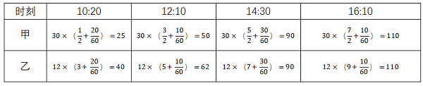

| 时刻 | 10:20 | 12:10 | 14:30 | 16:10 |
| --- | --- | --- | --- | --- |
| 甲 | 30 × （1/2 + 20/60） = 25 | 30 × （3/2 + 10/60） = 50 | 30 × （5/2 + 30/60） = 90 | 30 × （7/2 + 10/60） = 110 |
| 乙 | 12 × （3 + 20/60） = 40 | 12 × （5 + 10/60） = 62 | 12 × （7 + 30/60） = 90 | 12 × （9 + 10/60） = 110 |

从表中可以看出，14：30分甲就可以追上乙。

故正确答案为C。

**考点**：周期问题-其他、普通行程

**来源**：2012年国家公务员录用考试《行测》题第74题

### 第 75 题

为了浇灌一个半径为10米的花坛，园艺师要在花坛里布置若干个旋转喷头，但库房里只有浇灌半径为5米的喷头，问花坛里至少要布置几个这样的喷头才能保证每个角落都能浇灌到：

A. 4

B. 7

C. 6

D. 9

第 75 题 · 答案与解析

**参考答案（粉笔题库参考内容）**

B

**解析**

对一个圆而言，圆弧是最外层，因此在浇灌时首先要保证整个圆弧能够被覆盖到。一个小圆只能覆盖一段圆弧，由于每个小圆的直径为10米，即每个小圆覆盖圆弧对应的弦最长为10米，而大圆的半径也为10米，所以每个小圆至多盖住圆心角为60°所对应的弧长。因此想盖住整个圆弧，至少需要六个小圆，并且当且仅当这六个小圆以大圆的内接正六边形各边中点为圆心进行覆盖。此时大圆的圆心处尚未被覆盖，还需要一个小圆才能完成覆盖。

如图所示，至少要布置7个喷头，才能保证每个角落都能浇灌到。

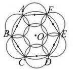

故正确答案为B。

**考点**：几何公式类-平面图形

**来源**：2012年国家公务员录用考试《行测》题第75题

### 第 76 题

超市将99个苹果装进两种包装盒，大包装盒每个装12个苹果，小包装盒每个装5个苹果，共用了十多个盒子刚好装完。问两种包装盒相差多少个：

A. 3

B. 4

C. 7

D. 13

第 76 题 · 答案与解析

**参考答案（粉笔题库参考内容）**

D

**解析**

设大盒有x个，小盒有y个，则可得12x＋5y＝99。两个数的和为奇数，则这两个数必然奇偶性相反，因为12x是偶数，99是奇数，所以5y是奇数，y是奇数，则5y的尾数是5，可得12x的尾数是4，则可得x＝2或者x＝7。当x＝2时，y＝15，符合题意，此时y－x＝13；当x＝7时，y＝3，x＋y＝10，不满足共用十多个盒子，排除。

故正确答案为D。

**来源**：2012年国家公务员录用考试《行测》题第76题

### 第 77 题

某项工程由A、B、C三个工程队负责施工，他们将工程总量等额分成了三份同时开始施工。当A队完成了自己任务的90%，B队完成了自己任务的一半，C队完成了B队已完成任务量的80%，此时A队派出2/3的人力加入C队工作。问A队和C队都完成任务时，B队完成了其自身任务的：

A. 80%

B. 90%

C. 60%

D. 100%

第 77 题 · 答案与解析

**参考答案（粉笔题库参考内容）**

A

**解析**

由题意可知，三个工程队需完成的工程量相同。相同时间内，A、B、C三队分别完成了自己的任务的90%、50%和50%×80%＝40%，则工作量之比为90%∶50%∶40%=9∶5∶4，故效率之比为9:5:4。赋值A、B、C三队的效率分别为9、5、4，A队派出2/3的人力加入C队后，效率减少了9×2/3=6，变为9-6=3；C队的效率变为4+6=10。A队完成剩余的工程还需10%/3=3.33%的时间；C队完成剩余的工程还需60%/10 = 6%的时间，此时B队可再完成6%×5＝30%的工程量，共完成了50%＋30%＝80%。

故正确答案为A。

**考点**：给效率比例型

**来源**：2012年国家公务员录用考试《行测》题第77题

### 第 78 题

某成衣厂对9名缝纫工进行技术评比，9名工人的得分正好成等差数列，9人的平均得分是86分，前5名工人的得分之和是460分，那么前7名工人的得分之和是多少：

A. 602

B. 623

C. 627

D. 631

第 78 题 · 答案与解析

**参考答案（粉笔题库参考内容）**

B

**解析**

根据等差数列求和：S_n=中间项×项数，则前5名工人的得分之和=460＝5×92，第三名工人的得分92= 460/5 = 92分，9人的平均得分是86分，即第五名工人的得分0.5=86分，则第四名的得分a_1=(92+86)/2=89分，前7名的总分为89×7＝623分。

故正确答案为B。

相关知识点：

等差数列的平均数等于中位数的值。

**考点**：数列问题

**来源**：2012年国家公务员录用考试《行测》题第78题

### 第 79 题

草地上插了若干根旗杆，已知旗杆的高度在1至5米之间，且任意两根旗杆的距离都不超过它们高度差的10倍。如果用一根绳子将所有旗杆都围进去，在不知旗杆数量和位置的情况下，最少需要准备多少米长的绳子：

A. 40

B. 100

C. 60

D. 80

第 79 题 · 答案与解析

**参考答案（粉笔题库参考内容）**

D

**解析**

要使准备的绳子最短，则旗杆尽可能全部在一条直线上。两端旗杆的最远距离为（5－1）×10＝40米，因此绳子绕一圈为40×2＝80米。

故正确答案为D。

**考点**：几何公式类-立体图形、几何其他题型

**来源**：2012年国家公务员录用考试《行测》题第79题

### 第 80 题

连接正方体每个面的中心构成一个正八面体（如下图所示）。已知正方体的边长为6厘米，则正八面体的体积为多少立方厘米：

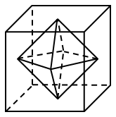

A. 18√2

B. 24√2

C. 36

D. 72

第 80 题 · 答案与解析

**参考答案（粉笔题库参考内容）**

C

**解析**

由图可知，正八面体由上下两个四棱锥拼接而成，拼接面（底面）是正方体中心的正方形，面积是正方体每一面的一半，则四棱锥底面积为(6 × 6)/2 = 18平方厘米；每个四棱锥的高是正方体边长的一半，正方体边长为6厘米，则四棱锥的高=6/2=3厘米。根据公式：棱锥体积= 1/3 × 底面积 × 高，则所求体积=1/3×18×3×2=36立方厘米。

故正确答案为C。

**考点**：几何公式类-立体图形

**来源**：2013年413联考《行测》题（辽宁/湖南/湖北/安徽/四川/福建/云南/黑龙江/江西/广西/贵州/海南/内蒙古/山西/重庆/宁夏/西藏）第85题

### 第 81 题

从所给的四个选项中，选择最合适的一个填入问号处，使之呈现一定的规律性：

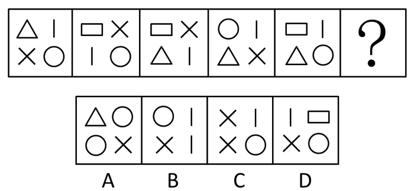

A. A

B. B

C. C

D. D

第 81 题 · 答案与解析

**参考答案（粉笔题库参考内容）**

D

**解析**

元素组成不同，属性规律无答案，考虑数量规律。题干出现多个小元素，优先考虑元素的种类和个数。观察发现，题干每幅图中都有4种不同元素，故“？”处也应选择有4种不同元素的图形，只有D项符合。

故正确答案为D。

**考点**：数量规律-素

**来源**：2012年国家公务员录用考试《行测》题第81题

### 第 82 题

从所给的四个选项中，选择最合适的一个填入问号处，使之呈现一定的规律性：

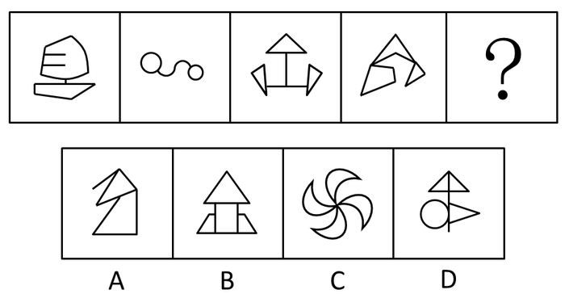

A. A

B. B

C. C

D. D

第 82 题 · 答案与解析

**参考答案（粉笔题库参考内容）**

C

**解析**

元素组成不同，且每幅图均由多个封闭图形组成，考虑图形间关系。观察发现，题干所有封闭图形之间没有公共边（通过点或线连接），故“？”处也应选择一个封闭图形之间没有公共边的图形，只有C项符合。

故正确答案为C。

**考点**：特殊规律-图形间关系

**来源**：2012年国家公务员录用考试《行测》题第82题

### 第 83 题

从所给的四个选项中，选择最合适的一项填入问号处，使之呈现一定的规律性：

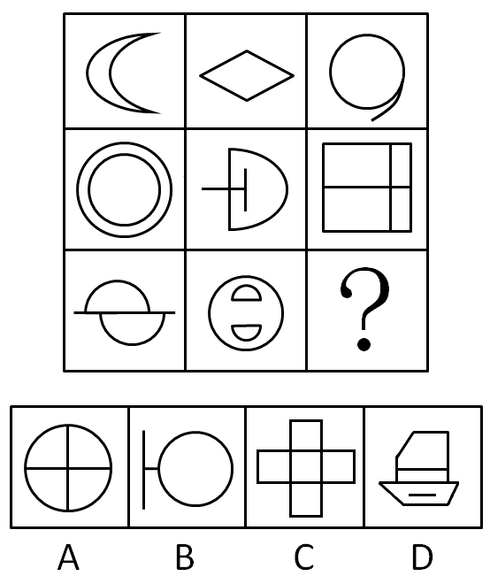

A. A

B. B

C. C

D. D

第 83 题 · 答案与解析

**参考答案（粉笔题库参考内容）**

D

**解析**

元素组成不同，且无明显属性规律，考虑数量规律。观察发现，题干出现“日”、“田”变形图，考虑笔画数。九宫格优先横向看，第一行图形笔画数均为1，第二行图形笔画数均为2，第三行前两幅图形笔画数均为3，故“？”处应选择一个笔画数为3的图形，只有D项符合。

故正确答案为D。

**考点**：数量规律-线

**来源**：2012年国家公务员录用考试《行测》题第83题

### 第 84 题

从所给的四个选项中，选择最合适的一个填入问号处，使之呈现一定的规律性：

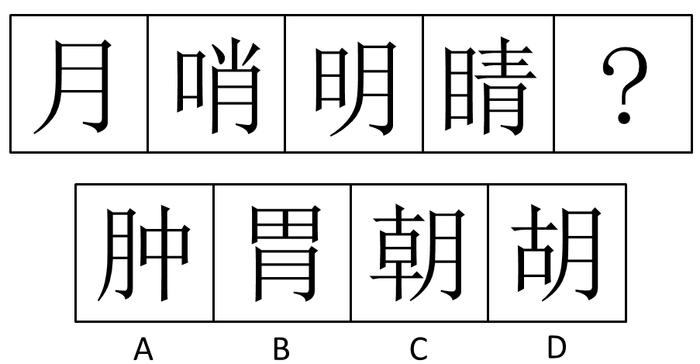

A. A

B. B

C. C

D. D

第 84 题 · 答案与解析

**参考答案（粉笔题库参考内容）**

B

**解析**

元素组成不同，且无明显属性规律，优先考虑数量规律。观察发现，题干图形均为汉字，且有明显的封闭空间，优先考虑面数量。题干图形的面数量依次为2、3、4、5，故“？”处图形的面数量应为6，只有B项符合。

故正确答案为B。

**考点**：数量规律-面、文字/字母/数字类

**来源**：2012年国家公务员录用考试《行测》题第84题

### 第 85 题

左边给定的是纸盒的外表面，下面哪一项能由它折叠而成：

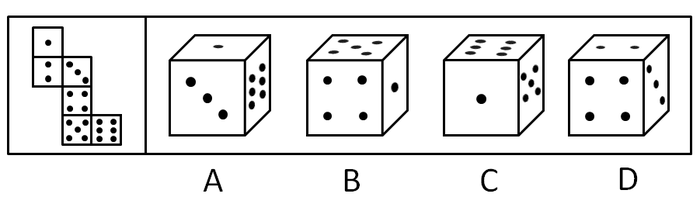

A. A

B. B

C. C

D. D

第 85 题 · 答案与解析

**参考答案（粉笔题库参考内容）**

A

**解析**

本题为空间重构题。

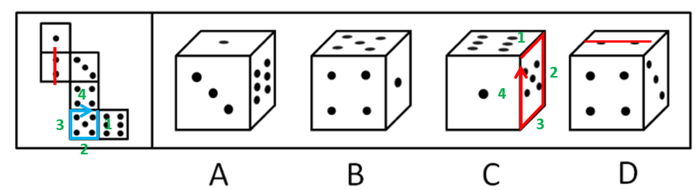

A项：与题干展开图一致，当选；

B项：由一点、四点、五点面构成，一点面和四点面在“Z”字形两端，是一组相对面，相对面不能同时出现，排除；

C项：由一点、五点、六点面构成，如上图所示，以五点面和六点面的公共边为起点，分别对展开图和立体图进行顺时针画边，展开图中第4条边相邻的是四点面，选项中第4条边相邻的是一点面，展开图和立体图不对应，排除；

D项：由二点、三点、四点面构成，如上图所示，将二点面的两个点连线后发现，展开图中的连线与二点面和三点面的公共边呈平行关系，而选项中的连线与二点面和三点面的公共边呈垂直关系，展开图和立体图不对应，排除。

故正确答案为A。

**考点**：空间类-空间重构-六面体

**来源**：2012年国家公务员录用考试《行测》题第85题

### 第 86 题

把下面的六个图形分为两类，使每一类图形都有各自的共同特征或规律，分类正确的一项是：

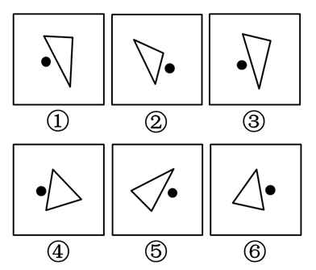

A. ①②⑥，③④⑤

B. ①③⑤，②④⑥

C. ①②④，③⑤⑥

D. ①③④，②⑤⑥

第 86 题 · 答案与解析

**参考答案（粉笔题库参考内容）**

D

**解析**

特殊考点，存在功能元素点，考虑点的相对位置关系，①③④点在左侧，②⑤⑥点在右侧。

故正确答案为D。

**考点**：特殊规律-功能元素

**来源**：2012年国家公务员录用考试《行测》题第86题

### 第 87 题

把下面的六个图形分为两类，使每一类都有各自共同的特征和规律，分类正确的一项是：

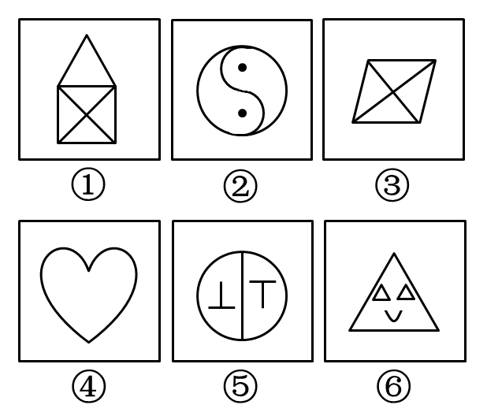

A. ①③④，②⑤⑥

B. ①③⑥，②④⑤

C. ①④⑥，②③⑤

D. ①③⑤，②④⑥

第 87 题 · 答案与解析

**参考答案（粉笔题库参考内容）**

C

**解析**

观察题干所给图形，可知①④⑥为轴对称，②③⑤为中心对称。

故正确答案为C。

**考点**：属性规律-对称性

**来源**：2012年国家公务员录用考试《行测》题第87题

### 第 88 题

把下面的六个图形分为两类，使每一类都有各自共同的特征和规律，分类正确的一项是：

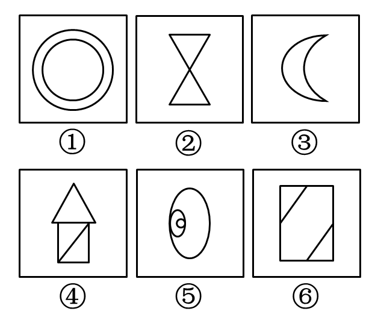

A. ①⑤⑥，②③④

B. ①③⑤，②④⑥

C. ①②③，④⑤⑥

D. ①②⑥，③④⑤

第 88 题 · 答案与解析

**参考答案（粉笔题库参考内容）**

B

**解析**

元素组成凌乱，考查图形的属性。很明显考查的是图形的曲直性，①③⑤为曲线图形，②④⑥为直线图形。

故正确答案为B。

**考点**：属性规律-曲直性

**来源**：2012年国家公务员录用考试《行测》题第88题

### 第 89 题

把下面的六个图形分为两类，使每一类都有各自共同的特征和规律，分类正确的一项是：

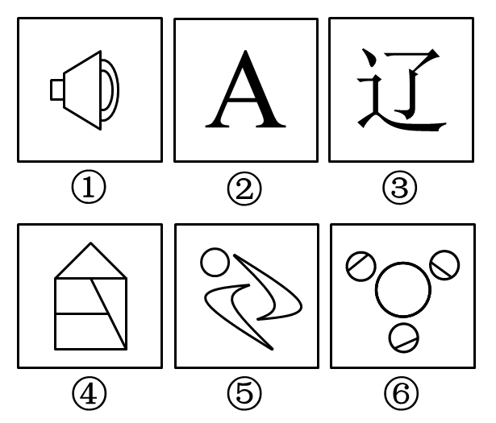

A. ①②③，④⑤⑥

B. ①⑤⑥，②③④

C. ①②④，③⑤⑥

D. ①④⑥，②③⑤

第 89 题 · 答案与解析

**参考答案（粉笔题库参考内容）**

C

**解析**

元素组成凌乱，考虑数数。本题考查图形组成部分的数量。①②④均为一个整体，没有不相连的部分；③⑤⑥都含有多个不相连的部分。

故正确答案为C。

**考点**：数量规律-素

**来源**：2012年国家公务员录用考试《行测》题第89题

### 第 90 题

把下面的六组图形分为两类，使每一类图形都有各自的共同特征或规律，分类正确的一项是：

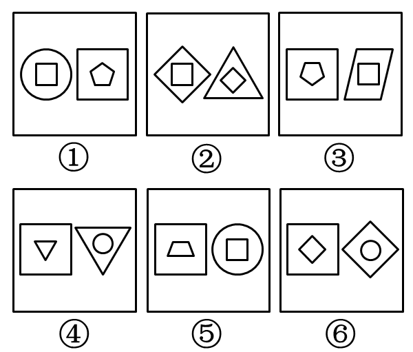

A. ①④⑥，②③⑤

B. ①③⑥，②④⑤

C. ①③④，②⑤⑥

D. ①②④，③⑤⑥

第 90 题 · 答案与解析

**参考答案（粉笔题库参考内容）**

A

**解析**

图形元素由两部分组成，且相似，注意观察两组图形的关系，①④⑥中，左边图形的内侧是右边图形的外侧；②③⑤中，左边图形的外侧是右边图形的内侧。

故正确答案为A。

**来源**：2012年国家公务员录用考试《行测》题第90题

### 第 91 题

群体极化指的是群体成员中存在的某一种倾向性，通过群体相互影响而使结果得到加强并趋于极端化，从而偏离某种合理性的现象。群体极化通常存在两种情形，一种是使结果变得更为冒险甚至激进，称为冒险偏移；一种是使结果变得更加保守，称为谨慎偏移。

根据上述定义，下列哪项中的现象不涉及群体极化：

A. 一部略带瑕疵的电影在某网络论坛被批驳得一无是处

B. 经过表决，答辩委员会一致否决了某同学的博士论文答辩

C. 对某人的不良行为，大家均保持沉默，这使得他气焰更加嚣张

D. 足球比赛中甲队因犯规被判点球，甲队球迷表示极大不满，并纷纷向场内投掷杂物

第 91 题 · 答案与解析

**参考答案（粉笔题库参考内容）**

B

**解析**

第一步：抓住定义中关键词。

定义的关键词有“通过群体相互影响”、“冒险偏移”、“谨慎偏移”、“偏离某种合理性的现象”。

第二步：逐一判断选项。

A项中电影只是略带瑕疵，但是被批得一无是处体现了定义“使结果变得更为冒险甚至激进”，属于“冒险偏移”；B项中“经过表决”不符合“通过群体相互影响”，“一致否决了某同学的博士论文答辩”也不属于激进或保守的结果，不符合定义；C项“大家均保持沉默，这使得他气焰更加嚣张”体现了题干“偏离某种合理性的现象”“使结果变得更加保守”，属于“谨慎偏移”；D项球迷表示不满后相互影响投掷杂物体现了“偏离某种合理性的现象”，属于“冒险偏移”。

本题为选非题，故正确答案为B。

**考点**：方式目的

**来源**：2012年国家公务员录用考试《行测》题第91题

### 第 92 题

包容性增长即为倡导机会平等的增长，最基本的含义是公平合理地分享经济增长。它涉及平等与公平的问题，寻求的是社会和经济的协调发展及可持续发展，与单纯追求经济增长相对立。

根据上述定义，下列哪项不涉及包容性增长：

A. 增进社会不同阶层的相互理解，对各种社会矛盾增加容忍度

B. 还田于海，退耕于林，延长禁捕期，对山林进行保护性封育

C. 反对投资和贸易的地方保护主义，提倡投资和贸易自由化

D. 在发展经济的同时充分重视社会保障体系的建立

第 92 题 · 答案与解析

**参考答案（粉笔题库参考内容）**

A

**解析**

第一步：抓住定义中关键词。

定义的关键词有“机会平等的增长”、“社会和经济的协调发展及可持续发展”。

第二步：逐一判断选项。

A项只涉及社会的协调，没有涉及经济增长，不符合“社会和经济的协调发展及可持续发展”；B项“对山林进行保护性封育”对社会和经济协调发展有益，符合“社会和经济的协调发展及可持续发展”；C项“提倡投资和贸易自由化”符合“机会平等的增长”；D项充分体现了社会和经济的协调发展。

本题为选非题，故正确答案为A。

**考点**：单定义-其他句式

**来源**：2012年国家公务员录用考试《行测》题第92题

### 第 93 题

根据我国有关规定，职工遇有下列情形之一的，可以认定为工伤：（一）在工作时间和工作场所内，因工作原因受到事故伤害的；（二）在工作时间和工作场所内，因履行工作职责受到暴力等意外伤害的；（三）因工外出期间，由于工作原因受到伤害或者发生事故下落不明的；（四）在上下班途中，受到非本人负主要责任的交通事故或者城市轨道交通、客运轮渡、火车事故伤害的。

根据上述规定，下列情形中可以认定为工伤的是：

A. 周某开车在下班途中违章驾驶，与前车发生追尾事故，导致颅骨骨折

B. 交警小李因纠正王某的违章行为引起王某不满，在上班途中遭到王某的殴打

C. 赵某在车间加班时因操作不当，手指被绞进机器中，事后被鉴定为二级伤残

D. 张经理为加深与同事的感情，在工作日邀请同事共进午餐，结果同事在用餐后不慎摔伤

第 93 题 · 答案与解析

**参考答案（粉笔题库参考内容）**

C

**解析**

第一步：抓住定义中的关键词。

定义的关键词有“因工作原因”、“因履行工作职责受到暴力等意外伤害”、“由于工作原因受到伤害或者发生事故下落不明的”、“在上下班途中，受到非本人负主要责任的交通事故”。

第二步：逐一判断选项。

A项虽然是在上下班途中，但是其违章驾驶，属于本人负主要责任，故不属于工伤；B项并非发生在工作时间和工作场所内，非工作原因，属于个人的打击报复，不属于工伤；C项符合定义，因工作原因受到事故伤害，属于工伤；D项并非在工作时间，非工作原因，故不属于工伤。

故正确答案为C。

**考点**：单定义-其他句式

**来源**：2012年国家公务员录用考试《行测》题第93题

### 第 94 题

动物福利指的是尊重动物的权利，保护生态环境，促进人与动物协调发展。动物福利主要包括：生理福利，即无饥渴之忧虑；环境福利，即让动物有适当的居所；卫生福利，即尽量减少动物的伤病；行为福利，即保证动物表达天性的自由；心理福利，即减少动物恐惧和焦虑的心情。

根据上述定义，下列哪项不涉及动物福利：

A. 为了科研目的对动物进行活体实验时注射麻药

B. 采取多种奖励方式，激发猴子表演高难度动作

C. 在山区修建高速公路时预留多处动物过桥涵洞

D. 养鸡场让母鸡在山林中自由觅食，提高产蛋率

第 94 题 · 答案与解析

**参考答案（粉笔题库参考内容）**

B

**解析**

第一步：抓住定义中的关键词。

关键词有“尊重动物”、“心理福利”、“环境福利”、“行为福利”、“生理福利”。

第二步：逐一分析选项。

A项“注射麻药”体现了减少动物恐惧和焦虑的心情，符合“心理福利”；B项中“激发猴子表演高难度动作”显然存在危险性，即为对猴子的不尊重行为，不符合“尊重动物”；C项“预留多处动物过桥涵洞”体现了让动物有适当的居所，符合“环境福利”；D项“自由觅食”体现了保证动物表达天性的自由，符合“行为福利”。

本题为选非题，故正确答案为B。

**考点**：单定义-其他句式

**来源**：2012年国家公务员录用考试《行测》题第94题

### 第 95 题

客体行政文化是指作为行政管理对象的个人、群体和组织对行政主体（主要是指行政机关）的行为做出合理的评价，其评价标准会因各自利益的不同而呈现多样性。

根据上述定义，下列属于客体行政文化的是：

A. 某地环保部门加大对污染严重企业的监管力度，其严肃执法的态度受到当地群众的一致好评

B. 小王是某政府部门工作人员，工作认真负责，他的主管领导和同事都认为小王是一名合格的工作者

C. 个体经营者张某未按规定缴税，税务部门向其下达限期缴纳税款的通知书，张某不但置之不理，还责怪税务部门不该向其征税

D. 某市工商部门为支持当地中小企业的发展，根据有关法律法规对这些企业实施优惠政策，这一举措得到了广大中小企业经营者的欢迎

第 95 题 · 答案与解析

**参考答案（粉笔题库参考内容）**

D

**解析**

第一步：抓住定义中的关键词。

定义的关键词有“对行政主体的行为做出合理的评价”，主体是行政管理对象。

第二步：逐一判断选项。

A项：当地群众不属于环保部门的行政管理对象，评价主体不符合定义，排除；

B项：评价主体是“主管领导和同事”不符合定义要求；

C项：张某的评价是个人的错误评价，不符合定义中的“合理的评价”，排除；

D项：中小企业作为工商管理部门的行政管理对象对其行为做出了合理的评价，符合定义。

故正确答案为D。

**考点**：主客体

**来源**：2012年国家公务员录用考试《行测》题第95题

### 第 96 题

差别化信贷是指对不同地区、不同行业、不同群体、不同用途的信贷额度和还贷方式采取差别对待的政策。这是国家对经济进行宏观调控的重要手段，通过差别化信贷遏制两极分化趋势、促进社会公平、促进经济结构调整和全面可持续发展。

根据上述定义，下列选项中属于差别化信贷的是：

A. 2008年年初，央行放宽商业银行信贷规模，全国性商业银行在原有信贷规模基础上调增5%，地方性商业银行在原有信贷规模基础上调增10%，共新增约2000亿元贷款

B. 某商业银行规定：贷款不满一年提前还款，收取不低于实际还款额三个月的利息；贷款满一年后提前还款，则收取不低于实际还款额一个月的利息

C. 新购房政策规定：购买首套住房，且套型建筑面积在90平米以下的家庭，可以享受首付款20%的政策；如果首套住房套型面积大于90平米，贷款首付款比例不得低于30%

D. 2009年，某国际银行对中小企业的贷款总额较去年增长14%，同时又推出“幸福时贷”无担保个人贷款，18-55岁的本地居民可获得最高50万元的贷款

第 96 题 · 答案与解析

**参考答案（粉笔题库参考内容）**

C

**解析**

第一步：抓住定义中的关键词。

定义的关键词有“不同地区、不同行业、不同群体、不同用途的信贷额度和还贷方式”、“差别对待”、“宏观调控的重要手段”。

第二步：逐一判断选项。

A项“央行放宽商业银行信贷规模”不符合定义关键词“不同行业、不同用途的信贷额度和还贷方式”，故不符合定义，排除；B项商业银行的个别规定和D项国际银行的贷款规定不是“宏观调控的重要手段”，均不符合定义，可排除；C项“新购房政策规定”，是通过对不同群体的首套房实行差别化信贷来进行宏观经济调控，符合“不同群体”、“差别对待”、“宏观调控的重要手段”。

故正确答案为C。

**考点**：方式目的

**来源**：2012年国家公务员录用考试《行测》题第96题

### 第 97 题

相对剥夺感是指人们在与那些既和自己地位相近，又不完全等同于自己的人或群体做比较时，由价值期待和价值能力不一致的认知所产生的一种心理状态。

根据上述定义，下列属于相对剥夺感的是：

A. 参加学生会竞选的人数比往年多了一倍，小燕感到竞选的压力更大了

B. 王某从海外名校学成归来，总觉得在单位里无法施展自己的才华和能力

C. 小张经常出色地完成各项工作，项目组其他人认为小张就是喜欢表现自己

D. 小杨原本认为自己的工作还不错，但是参加同学聚会后，他觉得跟同学相比显得没有前途

第 97 题 · 答案与解析

**参考答案（粉笔题库参考内容）**

D

**解析**

第一步：抓住定义中的关键词。

关键词1条件：与自己地位相近又不完全相同的人做比较；

关键词2结果：由价值期待和价值能力不一致的认知产生的一种心理状态。

第二步：逐一判断选项。

A、B、C三项都没有拿自己与其他人去做比较，不符合定义，排除；D项，小杨与同学的社会地位相近，他认为其与同学的价值能力差距不大，但是现实是自己的工作不如同学，价值期待与价值能力的认知出现不一致，故其产生的“没有前途”的心理状态属于相对剥夺感。

故正确答案为D。

**考点**：原因结果

**来源**：2012年国家公务员录用考试《行测》题第97题

### 第 98 题

研究中把实际观测或调查的一部分个体称为样本，研究对象的全部称为总体。抽样误差是指抽样方法本身所引起的误差，即样本指标值与被推断的总体指标值之差。

根据上述定义，下列不涉及抽样误差的是：

A. 调查员因为粗心、疏忽等原因将样本数据登记错误

B. 通过随机拨打电话了解大众对某品牌洗发水的忠诚度

C. 要了解某班学生数学水平，将他们的数学期中考试成绩进行统计分析

D. 要调查全国城市居民婚姻满意度，选取北京200名已婚者作为调查对象

第 98 题 · 答案与解析

**参考答案（粉笔题库参考内容）**

A

**解析**

第一步：抓住定义中的关键词。

定义强调的关键词为“抽样方法本身所引起的误差”。

第二步：逐一判断选项。

A项是调查员的人为原因导致产生误差，故不涉及抽样误差，当选；B项中的随机调查，C项中只对数学期中考试成绩进行统计分析，D项中只选取北京的对象进行调查的方式本身都会产生抽样误差，符合定义，均排除。

本题为选非题，故正确答案为A。

**考点**：常规问法

**来源**：2012年国家公务员录用考试《行测》题第98题

### 第 99 题

军事上的电子欺骗指的是利用电子设备对己方的相关信息进行伪装或者虚假模拟，欺骗敌方的电子侦察，使敌方对己方部署、作战能力和作战企图等产生错误判断，从而达到迷惑和扰乱敌方的目的。根据上述定义，下列涉及电子欺骗的是（    ）。

A. 军事演习时蓝军故意丢失伪造的电子作战地图，佯装泄露己方情报

B. 某国将无人机藏匿于敌国领空，冒充敌国领导人编制、发布虚假命令

C. 二战中盟军虚设了一个司令部，用通讯设备源源不断地发送各种“指挥命令”

D. 驻扎在太平洋小岛的某部为其计算机系统设置了数量庞大的仿真数据库

第 99 题 · 答案与解析

**参考答案（粉笔题库参考内容）**

C

**解析**

第一步：判断题干中的关键词。

方式：利用电子设备对己方的相关信息进行伪装或者虚假模拟。

目的：欺骗敌方的电子侦察、迷惑和扰乱敌方。

第二步：逐一分析选项。

A 项， “故意丢失地图”没有满足利用电子设备的方式要件，也没体现“欺骗敌方的电子侦察”的目的，不符合定义；

B 项，“冒充敌国领导人编制、发布虚假命令”是利用敌方干扰，不满足“对己方的相关信息进行伪装或虚假模拟”的方式，不符合定义；

C 项，“虚设了一个司令部，用通讯设备发送各种‘指挥命令’”同时满足方式和目的的关键词，符合定义；

D 项，“设置了数量庞大的仿真数据库”没有体现“欺骗敌方的电子侦察、扰乱敌方”的目的，不符合定义。

第三步：再次标注答案。

故正确答案为C。

**考点**：方式目的

**来源**：2012年国家公务员录用考试《行测》题第99题

### 第 100 题

统计性歧视，是指将一个群体的典型特征推断为群体中的个体具有的特征，并将此特征作为对个体的评价标准。

根据上述定义，下列属于统计性歧视的是：

A. 小莉觉得周围许多金牛座的人都不太诚实，她就认为金牛座的人都不诚实可靠

B. 公司认为某高校毕业生工作稳定性不够，该校的优秀毕业生小刘因此未被公司录取

C. 某专家根据北京市过去十年的降雨量推断今年的降雨量将与往年的平均值基本持平

D. 一名外国游客在旅游区随手乱扔垃圾，周围人们认为来自这个国家的人素质普遍较低

第 100 题 · 答案与解析

**参考答案（粉笔题库参考内容）**

B

**解析**

第一步：抓住定义中的关键词。

定义的关键词有“将群体的典型特征推断为群体中的个体具有的特征”、“作为对个体的评价标准”。

第二步：逐一判断选项。

A项和D项都是通过局部或个体的行为特征来推断群体的典型特征，与定义中推断顺序相反，故排除；C项的专家根据过去十年的降雨来推断今年的降雨量，不符合“作为对个体的评价标准”，并且今年不属于前十年当中的任何一年，今年与去年也不存在整体与部分的关系，不符合定义，排除。

故正确答案为B。

**考点**：单定义-其他句式

**来源**：2012年国家公务员录用考试《行测》题第100题

### 第 101 题

取款机：银行职员

A. 收音机：播音员

B. 售货机：营业员

C. 学习机：辅导员

D. 读卡机：售票员

第 101 题 · 答案与解析

**参考答案（粉笔题库参考内容）**

B

**解析**

第一步：判断题干词语之间的逻辑关系。

题干两词是对应关系，且是对应关系中一一对应，前者是后者机器化的替代。

第二步：判断选项词语之间的逻辑关系。

A项中收音机仅为媒介；C项中学习机不是辅导员的替代，是对老师的替代；D项中读卡机应该对应的是检票员。B项中的售货机和营业员功能一致，都是售卖商品，售货机是营业员的机器化代替，因此B项正确。

故正确答案为B。

**考点**：逻辑关系-对应关系

**来源**：2012年国家公务员录用考试《行测》题第101题

### 第 102 题

通话记录：手机

A. 硬盘：计算机

B. 遥控器：电视机

C. 录音磁带：录音机

D. 语音文件：录音笔

第 102 题 · 答案与解析

**参考答案（粉笔题库参考内容）**

D

**解析**

第一步：判断题干词语之间的逻辑关系。

题干两词是对应关系，且是一一对应关系，手机是记录通话记录的一种载体，手机里存有通话记录。

第二步：判断选项词语之间的逻辑关系。

A项中硬盘是计算机的组成部分；B项中遥控器是电视机的配套工具；C项中录音磁带是录音机的配套工具；D项的录音笔是记录语音文件的一种载体，录音笔里存有语音文件，与题干逻辑关系相同，D项为答案。

故正确答案为D。

**考点**：逻辑关系-对应关系

**来源**：2012年国家公务员录用考试《行测》题第102题

### 第 103 题

琵琶：木材：乐器

A. 鼎：青铜：用具

B. 水墨画：宣纸：工艺

C. 浮雕：石块：建筑

D. 竹简：竹片：书籍

第 103 题 · 答案与解析

**参考答案（粉笔题库参考内容）**

A

**解析**

第一步：判断题干词语之间的逻辑关系。

题干词语间是对应关系和种属关系，且第一项是由第二项制作的，第一项是第三项的一种。

第二步：判断选项词语之间的逻辑关系。

A项鼎是由青铜制作的，鼎是古代烹煮用具中的一种；

B项水墨画不是工艺的一种，与题干逻辑关系不一致；

C项浮雕不是建筑的一种，与题干逻辑关系不一致；

D项竹简不是书籍的一种，竹简是古代记载文字的一种载体，与纸的功能类似，与题干逻辑关系不一致。

故正确答案为A。

**考点**：逻辑关系-包容关系、逻辑关系-对应关系

**来源**：2012年国家公务员录用考试《行测》题第103题

### 第 104 题

B超：超声波：诊断

A. 雷达：天线：探测

B. 相机：底片：摄影

C. 冰箱：制冷剂：冷藏

D. 电脑：显示屏：工作

第 104 题 · 答案与解析

**参考答案（粉笔题库参考内容）**

C

**解析**

第一步：判断题干词语之间的逻辑关系。题干词语是属性关系，且是事物、介质及功能的关系。第一个通过第二个实现第三个功能，即B超通过超声波来进行诊断。

第二步：判断选项词语之间的逻辑关系。A项、B项、D项组成的关系与题干逻辑关系不一致，天线不能用于探测，底片不能摄影，显示屏不能工作，可排除；C项冰箱可以通过制冷剂来进行冷藏。

故正确答案为C。

**考点**：逻辑关系-对应关系

**来源**：2012年国家公务员录用考试《行测》题第104题

### 第 105 题

萎靡不振  对于（  ），相当于（  ）对于  食物

A. 动力 饥肠辘辘

B. 活力 丰衣足食

C. 精力 饥寒交迫

D. 毅力 饥不择食

第 105 题 · 答案与解析

**参考答案（粉笔题库参考内容）**

A

**解析**

逐一代入选项。

A项中的萎靡不振是缺乏动力的一种状态，饥肠辘辘是缺乏食物的一种状态，前后逻辑关系一致，当选；

B项中丰衣足食、C项中的饥寒交迫均与食物和衣服两类事物相关，而题干中只出现了“食物”，前后逻辑关系不一致，排除B、C两项；

D项中的萎靡不振形容的是一种精神状态，毅力形容的是一种品格，二者无明显的逻辑关系，“饥不择食”比喻需要的急迫，不只与“食物”对应，前后逻辑关系不一致，排除。

故正确答案为A。

**考点**：逻辑关系-对应关系

**来源**：2012年国家公务员录用考试《行测》题第105题

### 第 106 题

任何无法量化及不设定时限的目标都是无效目标，而任何无效的目标都没有实际操作的方法。因此，详细的职业规划不是无法量化及不设定时限的目标。

为使上述论证成立，必须补充以下哪项作为前提：

A. 详细的职业规划不都是无效的目标

B. 详细的职业规划有实际操作的方法

C. 有效的目标都是可以量化和设定时限的目标

D. 无法量化及不设定时限的目标没有实际操作的方法

第 106 题 · 答案与解析

**参考答案（粉笔题库参考内容）**

B

**解析**

第一步：找出论点和论据。

论点：详细的职业规划→—（无法量化 且 不设定时限的目标）。

论据：（1）无法量化 且 不设定时限的目标→无效目标；

（2）无效目标→没有实际操作方法；

（1）和（2）串联可得（3）：无法量化 且 不设定时限的目标→无效目标→—实际操作方法。

本题需要找出论点成立的前提，可优先考虑搭桥，即建立“详细的职业规划”和“实际操作方法”或“详细的职业规划”和“-无效目标”之间的联系。

第二步：逐一分析选项。

A项：选项指出详细的职业规划“不都是”无效的目标，“不都是”≠“不是”，故结合论据不能推出论点，不是论点成立的前提，排除；

B项：选项指出“详细的职业规划→实际操作方法”，结合论据可以推出论点，为搭桥项，是论点成立的前提，当选；

C项：选项指出“-无效目标→量化 且 设定时限的目标”，结合论据不能推出论点，不是论点成立的前提，排除；

D项：选项指出“无法量化 且 不设定时限的目标→—实际操作方法”，结合论据不能推出论点，不是论点成立的前提，排除。

故正确答案为B。

**考点**：搭桥

**来源**：2012年国家公务员录用考试《行测》题第106题

### 第 107 题

一项调查结果显示：78%的儿童中耳炎均来自二手烟家庭。研究人员表示，二手烟环境会增加空气中的不健康颗粒，其中包括尼古丁和其他有毒物质。与居住在无烟环境的孩子相比，居住于二手烟环境的孩子患中耳炎几率更大，因此医学专家表示，父母等家人吸烟，是造成儿童罹患中耳炎的重要原因。

以下哪项如果为真，最能削弱上述论证：

A. 调查中还显示，无烟家庭的比率呈逐年上升的趋势

B. 研究证明，二手烟家庭中儿童中耳炎的治愈率较高

C. 门诊数据显示，儿童中耳炎就诊人数下降了4.6%

D. 在这次调查的人群中，只有20%的儿童来自无烟家庭

第 107 题 · 答案与解析

**参考答案（粉笔题库参考内容）**

D

**解析**

第一步：分析题干，找到论点和论据。

论点：父母等家人吸烟是造成儿童罹患中耳炎的重要原因。

论据：通过调查得知，78%的儿童中耳炎患者都是来自二手烟家庭。

第二步：逐一分析选项。

A项：“无烟家庭的比率呈逐年上升的趋势”与论点无关，属于无关项；

B、C两项：“二手烟家庭中儿童中耳炎的治愈率较高”和“儿童中耳炎就诊人数下降了4.6%”与论点无关，属于无关项；

D项：该项说调查人群中只有20%的儿童来自无烟家庭，那么80%的儿童均来自二手烟家庭，说明调查并不可靠，是削弱选项。

故正确答案为D。

**考点**：削弱论据

**来源**：2012年国家公务员录用考试《行测》题第107题

### 第 108 题

某刑事人类学家在对260名杀人犯的外貌进行了考察后，发现他们具有一些共同的生理特征，于是得出“杀人犯具有广颚、颧骨突出，头发黑而短的特征”的结论。

以下哪项与上述推理方式相同：

A. 24～28之间没有质数

B. 八月十五云遮月，正月十五雪打灯

C. 植物种子经超声波处理后可增产，所以玉米种子经超声波处理后也可以增产

D. 某高校在对全校学生进行调查后，得出“我校同学学习态度普遍较好”的结论

第 108 题 · 答案与解析

**参考答案（粉笔题库参考内容）**

B

**解析**

题干的逻辑关系：通过对260名杀人犯的外貌进行考察，概括出杀人犯的普遍特征，属于从部分到整体的推理。

分析选项：

A项：24～28之间没有质数，观察24～28，得到的结论同样还是24～28，前后范围一致，与题干推导逻辑不符，排除。

B项：谚语都是从生活经验中总结出来的普遍性规律，是由部分得到整体，与题干推导逻辑一致，当选。

C项：从植物种子推理得到玉米种子，属于整体推导部分，与题干推导逻辑不符，排除。

D项：通过对全校学生的调查，得到全校同学的情况，前后范围一致，与题干推导逻辑不符，排除。

故正确答案为B。

**考点**：论证结构

**来源**：2012年国家公务员录用考试《行测》题第108题

### 第 109 题

分手不仅令人心理痛苦，还可能造成身体疼痛。美国研究人员征募40名志愿者，他们在过去半年中被迫与配偶分手，至今依然相当介意遭人拒绝。研究人员借助功能性磁共振成像技术观察志愿者的大脑活动，结果发现他们对分手等社会拒绝产生反应的大脑部位与对躯体疼痛反应的部位重合，因此分手这类社会拒绝行为会引起他们躯体疼痛。得到上述结论，隐含的假设是什么？

A. 个体对于疼痛的感受与社会应激事件有密切关系

B. 功能性磁共振技术是目前进行大脑定位的常用方法

C. 个体情绪等心理过程的改变能影响其生理反应

D. 生理与心理反应可以通过大脑产生关联

第 109 题 · 答案与解析

**参考答案（粉笔题库参考内容）**

D

**解析**

第一步：找到论点和论据。

本题论点是分手会导致躯体疼痛；论据是研究人员通过观察大脑活动发现分手和感受疼痛的大脑反应部位重合。

第二步：逐一判断选项。

A项，“社会应激事件”不属于心理反应，该项排除；

B项，“功能性磁共振技术”属于无关项，该项排除；

C项，只说明了心理对生理的影响，支持结论，但力度较弱；

D项，说“生理与心理反应可以通过大脑产生关联”，突出了大脑在生理和心理联系中的作用，加强效果比C项更好。

第三步：再次标注答案.

故正确答案为D。

**考点**：搭桥

**来源**：2012年国家公务员录用考试《行测》题第109题

### 第 110 题

众所周知，西医利用现代科学技术手段可以解决很多中医无法解决的病症，而中医依靠对人体经络和气血的特殊理解也治愈了很多令西医束手无策的难题。据此，针对某些复杂疾病，很多人认为中西医结合的治疗方法是有必要的。

上述这些人在论断时作的假设是：

A. 针对这些疾病的中医和西医的治疗方法可以相互结合，扬长避短

B. 这些疾病单独用中医疗法或者单独用西医疗法并不能有效治疗

C. 针对这些疾病，医疗界已经掌握了中西医疗法结合的方法

D. 针对这些疾病，医学界已经尝试了中西医结合的疗法取得了良好的效果

第 110 题 · 答案与解析

**参考答案（粉笔题库参考内容）**

A

**解析**

第一步：找到论点和论据。

论点：针对某些复杂疾病，很多人认为中西医结合的治疗方法是有必要的。

论据：西医利用现代科学技术手段可以解决很多中医无法解决的病症，而中医依靠对人体经络和气血的特殊理解也治愈了很多令西医束手无策的难题。

本题问题为“前提假设”，优先考虑搭桥和必要条件。

第二步：逐一判断选项的作用。

A项：中西医可以结合是开展治疗的前提，是结论成立的一个必要条件，当选；

B项：这些疾病单独用中医疗法或者单独用西医疗法并不能有效治疗，说明单独治疗无法解决，但不见得就需要中西医结合治疗，不是结论成立的前提，排除；

C项：已经掌握结合方法，与中西医结合是否有必要无关，不是结论成立的前提，排除；

D项：尝试并取得了好的效果，与中西医结合是否有必要无关，不是结论成立的前提，排除。

故正确答案为A。

备注：本题可能存在争议，但经过反复教研，粉笔仍然倾向于选择A项。理由如下：1.这道题的争议点对于论点中“必要”的理解，如果理解为“需要”，就是A，如果理解为“非他不可”，A的可行、B的有效都是必要的；2.B项说单独不能有效治疗，那就说明中西医结合就一定有效吗，也是不一定的，所以B项不好；3.题干论点说的是中西医结合是否必要，A项说的是中西医结合是否可行，可行性是必要性的前提条件，如果不可行那就没有结合的必要了，B项说的是中、西医单独不能得到有效治疗，即使能够得到有效治疗，也不代表将二者结合没有必要，存在结合后疗效更好的情况，比较来看A项对论点成立更重要。一道老题，命题没那么严谨，但是在这道题中我们可以看到现在的命题趋势，必要条件出可行性居多，也请同学们了解这个命题趋势即可。

**考点**：必要条件

**来源**：2012年国家公务员录用考试《行测》题第110题

### 第 111 题

近来网上出现了一则有关“公务员绿色出行”的报道，即A市教育局通过添置公务自行车，使得较近距离的公务活动不再派汽车，从而大幅降低了公务汽车使用率。B市环保局负责人看了这则报道，认为引进公务自行车能缩减财政开支，于是决定也采取这种做法。

以下哪项如果为真，不能构成上述决定的前提条件：

A. 自行车出行的方式结合B城市的地理环境以及道路交通状况是可行又可取的

B. B市环保局的办公人员规模和已有公车数量与A市教育局相近

C. 较近距离的公务活动用自行车取代汽车不会影响办公效率

D. B市环保局原来的公务活动主要采取汽车出行的方式

第 111 题 · 答案与解析

**参考答案（粉笔题库参考内容）**

B

**解析**

第一步：找到论点和论据。

本题论点是B市要用引进公务自行车方式来缩减财政开支；论据是A市用了这种方法很有效。

第二步：判断加强方式。

本题是加强支持型的另一种考查方式，要找一个不能加强的选项出来。

第三步：逐一判断选项的作用。

A项从可行性方面支持结论；B项说的是公务人员规模和公车数量与A市相近，只是强调情况相似，但是跟A市这么做最终是否可以用自行车代替汽车，以及这么做是否能缩减财政开支无关，不构成上述决定的前提条件；C项中强调的是办公效率，用自行车取代汽车的出行方式前提之一是不能影响办公效率，如果影响了办公效率就适得其反了，所以C项构成上述决定的前提条件；D项中原来使用汽车是自行车替代汽车的一个必要条件，如果原来不用汽车，那么就不存在所谓的自行车替代汽车，因此，可以支持。

本题为选非题，故正确答案为B。

**考点**：加强选非题

**来源**：2012年国家公务员录用考试《行测》题第111题

### 第 112 题

某高校外语教研室新招进五位外语老师，每位老师只教授一门外语。并且满足以下条件：

（1）如果小钱教德语，那么小孙不教俄语

（2）或者小李教德语，或者小钱教德语

（3）如果小孙不教俄语，那么小赵不教法语

（4）或者小赵教法语，或者小周不教英语。

以下选项如果为真，可以得出“小李教德语”的结论：

A. 小孙不教俄语

B. 小钱教德语

C. 小周教英语

D. 小赵不教法语

第 112 题 · 答案与解析

**参考答案（粉笔题库参考内容）**

C

**解析**

第一步：翻译题干。

（1）小钱教德语→-小孙教俄语；（2）小李教德语或者小钱教德语；（3）-小孙教俄语→-小赵教法语；（4）小赵教法语或者小周不教英语。

第二步：逐一判断选项。

本题是给出了结论，需要从结论出发倒推条件。根据（2）可知：要想得到小李教德语这个结论，需要小钱不教德语；根据（1）可知：要想得到小钱不教德语这个结论，需要小孙教俄语这个条件；根据（3）可知：要想得到小孙教俄语这个结论，需要小赵教法语这个条件；根据（4）可知：要想得到小赵教法语这个结论，需要小周教英语这个条件。即：要想保证小李教德语，则需要小周教英语。

故正确答案为C。

**考点**：常规翻译

**来源**：2012年国家公务员录用考试《行测》题第112题

### 第 113 题

美国研究人员分析了南极半岛和邻近的斯科舍海地区的实地数据后发现，20世纪70年代以来，当地气温上升了5至6摄氏度，并且来自其他海域的哺乳动物增多导致南极哺乳动物捕食竞争加剧。因此，在上述地区作为哺乳动物主要食物来源的磷虾的密度降低了80%。而同一时期，生活在该地区以磷虾为主食的阿德利企鹅和帽带企鹅的数量也急剧减少。

由此可以推出：

A. 气温上升造成了南极海洋哺乳动物捕食的竞争加剧

B. 如果磷虾的密度继续减少，阿德利企鹅和帽带企鹅都会灭绝

C. 气候变暖和哺乳动物的捕食竞争加剧威胁了帽带企鹅的生存

D. 气温上升对南极地区生态环境的破坏极大

第 113 题 · 答案与解析

**参考答案（粉笔题库参考内容）**

C

**解析**

逐一分析选项。

A项：题干气温上升和捕食竞争加剧是并列关系，而非因果关系，不能推出，排除；

B项：题干只是说阿德利企鹅和帽带企鹅的数量会急剧减少，并没说它们会灭绝，不能推出，排除

C项：气温上升和捕食竞争加剧导致企鹅数量减少，可以推出，当选；

D项：对生态环境的破坏无法得知，不能推出，排除。

故正确答案为C。

**考点**：日常结论

**来源**：2012年国家公务员录用考试《行测》题第113题

### 第 114 题

张老师将文房四宝装在一个有四层抽屉的柜子里，让学生猜笔、墨、纸、砚分别在哪一层。按照笔、墨、纸、砚的顺序，小李猜测四宝依次装在第一、二、三、四层，小王猜测四宝依次装在第一、第三、第四和第二层，小赵猜测四宝依次装在第四、第三、第一和第二层，而小杨猜测四宝依次装在第四、第二、第三和第一层。张老师说，小赵一个都没有猜对，小李和小王各猜对了一个，而小杨猜对了两个。

由此可以推测：

A. 第一层抽屉里装的是墨

B. 第二层抽屉里装的是纸

C. 第三层抽屉里装的不是笔

D. 第四层抽屉里装的不是砚

第 114 题 · 答案与解析

**参考答案（粉笔题库参考内容）**

D

**解析**

第一步：寻找突破口。

由题意可知小赵说的都是错的，于是突破口便是与小赵猜测一样的都是错的，即如表（1）所示，那么小王猜的第一层是笔和第四层是纸必有一真一假。

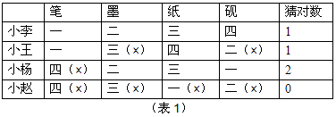

|  | 笔 | 墨 | 纸 | 砚 | 猜对数 |
| --- | --- | --- | --- | --- | --- |
| 小李 | 一 | 二 | 三 | 四 | 1 |
| 小王 | 一 | 三（×） | 四 | 二（×） | 1 |
| 小杨 | 四（×） | 二 | 三 | 一 | 2 |
| 小赵 | 四（×） | 三（×） | 一（×） | 二（×） | 0 |

第二步：将题干信息列表表示并对比分析。

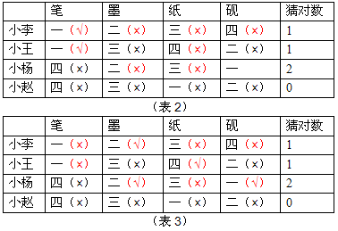

若小王猜的第一层是笔为真，那么如表（2）所示，小李对应的第一层是笔为真，第二层不是墨，第三层不是纸，那么小杨猜对的不可能是2个，与题干信息矛盾，因此小王猜的第一层是笔为假，而第四层是纸为真，如表（3）所示。经过分析可知，第四层是纸，第二层是墨，第一层是砚，第三层是笔。

第三步：逐一判断选项。

根据第二步分析可知，D项符合推断。

故正确答案为D。

**考点**：假设

**来源**：2012年国家公务员录用考试《行测》题第114题

### 第 115 题

碳纳米管材料具有重量轻、强度高等优点，被广泛应用于自行车和球拍等产品生产中。但是近日研究发现，长期从事生产碳纳米管工作或利用该材料制造其他产品的工人，有可能因吸入碳纳米管而致癌。

以下哪项如果为真，最能支持上述研究发现：

A. 研究表明，容易引发癌症的是一些较长的碳纳米管，这可能是因为它们更容易卡在肺部或腹部细胞间的空腔中

B. 在使用体外培养的人体皮肤细胞进行实验时显示，碳纳米管可以进入细胞内部，降低细胞自身的免疫能力

C. 动物实验显示，如果碳纳米管大量进入实验鼠的腹部，约有10%的实验鼠会在一年内患腹腔炎症

D. 石棉是国际癌症组织确认的致癌物质，而碳纳米管在化学分子结构上和石棉存在一些相似之处

第 115 题 · 答案与解析

**参考答案（粉笔题库参考内容）**

A

**解析**

第一步：找出论点和论据。

论点：长期从事生产碳纳米管工作或利用该材料制造其他产品的工人可能因吸入碳纳米管而致癌。

论据：无明显论据。

第二步：逐一分析选项。

A项：“容易引发癌症的是一些较长的碳纳米管”，其中较长的碳纳米管是碳纳米管中的一种，同时说明较长的碳纳米管容易引发致癌；“更容易卡在肺部或腹部细胞间的空腔中”解释了较长碳纳米管致癌的原因，通过解释说明的方式说明“可能因吸入碳纳米管而致癌”，增加新论据，从而支持论点，保留；

B项：说明碳纳米管可以进入细胞内部，降低细胞自身的免疫能力，并不能说明降低细胞自身的免疫能力会致癌，排除；

C项：说明的是“患腹腔炎症”的几率和周期，而题干说癌症，属无关选项，排除；

D项：通过石棉和碳纳米管化学分子结构上存在相似之处类比论证碳纳米管可能是致癌物质，类比加强，保留。

对比选项A、D，补充论据强于类比加强，排除D项。

故正确答案为A。

**考点**：补充论据

**来源**：2012年国家公务员录用考试《行测》题第115题

## 材料 1

根据以下资料，完成各题。

        2010年，某省广电实际总收入为145.83亿元，同比增长32.07%。其中，广告收入为67.08亿元，同比增长25.88%；有线网络收入为45.38亿元，同比增长26.35%；其他收入为33.37亿元，同比增长57.3%。

        2010年，该省广电收入中，省级收入为65.32亿元，比上年增加15.5亿元；地市级收入为41.61亿元，比上年增加13.39亿元；县级收入为38.90亿元，比上年增加6.52亿元。

        2010年该省各市、县广电收入的区域分布如下：

        东部地区50.06亿元，同比增长32.48%，占市县收入份额的62.18%，该地区的市均收入为10.01亿元，上年同期为7.56亿元。中部地区17.78亿元，同比增长40.70%，该地区的市均收入为5.93亿元，上年同期为4.21亿元。西部地区12.67亿元，同比增长80.86%，该地区的市均收入为2.53亿元，上年同期为1.4亿元。

        截止2010年底，该省有线电视用户数为1885.88万户，比上年末净增161.7万户。其中有线数字电视用户为1007.8万户，比上年末净增277.58万户。

### 第 116 题

2009年，该省的有线网络收入约为多少亿元：

A. 21

B. 36

C. 57

D. 110

第 116 题 · 答案与解析

**参考答案（粉笔题库参考内容）**

B

**解析**

根据题干“2009年······有线网络收入”，结合材料时间为2010年，可判定本题为基期计算问题。定位材料第一段可得：2010年某省有线网络收入为45.38亿元，同比增长26.35%。根据公式：基期量=现期量/(1+r)，故2009年该省的有线网络收入= 45.38/(1+26.35%)≈45.38/1.3≈35亿元，与B项最接近。

故正确答案为B。

**考点**：基期计算、文字资料

**来源**：2012年国家公务员录用考试《行测》题第116题

### 第 117 题

2009年，该省广告收入占广电总收入的比重约为：

A. 23%

B. 26%

C. 31%

D. 48%

第 117 题 · 答案与解析

**参考答案（粉笔题库参考内容）**

D

**解析**

根据题干“2009年······占······的比重”，结合材料时间为2010年，可判定本题为基期比重问题。定位材料第一段可得：2010年，某省广电实际总收入为145.83亿元（B），同比增长32.07%（b）。其中，广告收入为67.08亿元（A），同比增长25.88（a）%。根据公式：基期比重=A/B×(1+b)/(1+a)，2009年该省广告收入占广电总收入的比重= 67.08/145.83 × (1+32.07%)/(1+25.88%)≈ 67/150 × 1.3/1.3 ≈ 45%，与D项最接近。

故正确答案为D。

**考点**：基期比重、文字资料

**来源**：2012年国家公务员录用考试《行测》题第117题

### 第 118 题

2010年，该省地市级广电收入的同比增速约为：

A. 15%

B. 20%

C. 32%

D. 47%

第 118 题 · 答案与解析

**参考答案（粉笔题库参考内容）**

D

**解析**

根据题干“2010年······的同比增速”，可判定本题为一般增长率问题。定位材料第二段可得：2010年，该省广电收入中，地市级收入为41.61亿元，比上年增加13.39亿元。根据公式：增长率=增长量/(现期量-增长量)，2010年该省地市级广电收入的同比增速=13.39/(41.61-13.39)=13.39/28.22≈ 13.39/28 ≈ 48%，与D项最接近。

故正确答案为D。

**考点**：一般增长率、文字资料

**来源**：2012年国家公务员录用考试《行测》题第118题

### 第 119 题

该省有线电视用户平均每月的有线网络费用约为多少元：

A. 20

B. 36

C. 180

D. 240

第 119 题 · 答案与解析

**参考答案（粉笔题库参考内容）**

A

**解析**

根据题干“该省······平均每月······约为多少元”，可判定本题为现期平均数问题。定位材料第一段和最后一段可得：2010年，某省有线网络收入为45.38亿元；截止2010年底，该省有线电视用户数为1885.88万户。故2010年该省有线电视用户平均每月的有线网络费用为45.38亿元/(1885.88万户×12月)= (45.38×10^8元)/(1885.88×10^4×12月)= (45.38 × 10^4元)/(1885.88 × 12月)= 453800元/(1885.88 × 12月)≈ 450元/(1.9 × 12月) ≈ 19.7元/户，与A项最接近。

故正确答案为A。

**考点**：文字资料、现期平均数

**来源**：2012年国家公务员录用考试《行测》题第119题

### 第 120 题

关于该省广电收入的情况，下列说法正确的是：

A. 2010年，省级广电收入同比增长金额低于县级

B. 2010年，东部地区广电收入超过中部地区的3倍

C. 2009年，中部地区市均广电收入约是西部地区的3倍

D. 2010年，有线电视用户中有线数字电视用户的比重不足一半

第 120 题 · 答案与解析

**参考答案（粉笔题库参考内容）**

C

**解析**

A项：定位材料第二段可得：2010年，该省广电收入中，省级收入比上年增加15.5亿元，县级收入比上年增加6.52亿元。省级同比增长金额高于县级，错误；

B项：定位材料第四段可得：2010年，该省东部地区广电收入50.06亿元，中部地区广电收入17.78亿元。50.06＜3×17=51＜3×17.78，故东部地区广电收入未超过中部地区的3倍，错误；

C项：定位材料第四段可得：2010年，该省中部地区的市均收入上年同期为4.21亿元，西部地区市均收入上年同期为1.4亿元。4.21/1.4 ≈ 3，即2009年该省中部地区市均广电收入约是西部地区的3倍，正确；

D项：定位材料第五段可得：截止2010年底，该省有线电视用户数为1885.88万户，其中有线数字电视用户为1007.8万户。1007.8/1885.88 ＞ 1/2，有线电视用户中有线数字电视用户的比重超过一半，错误。

故正确答案为C。

**考点**：文字资料、综合分析

**来源**：2012年国家公务员录用考试《行测》题第120题

## 材料 2

根据以下资料，完成各题。

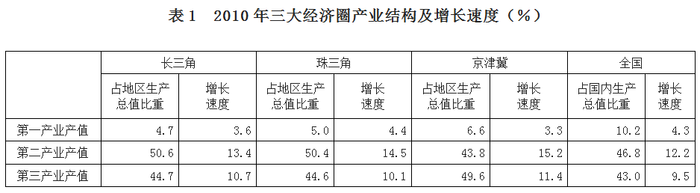

|  | 长三角 占地区生产总值比重 | 长三角 增长速度 | 珠三角 占地区生产总值比重 | 珠三角 增长速度 | 京津冀 占地区生产总值比重 | 京津冀 增长速度 | 全国 占国内生产总值比重 | 全国 增长速度 |
| --- | --- | --- | --- | --- | --- | --- | --- | --- |
| 第一产业产值 | 4.7 | 3.6 | 5.0 | 4.4 | 6.6 | 3.3 | 10.2 | 4.3 |
| 第二产业产值 | 50.6 | 13.4 | 50.4 | 14.5 | 43.8 | 15.2 | 46.8 | 12.2 |
| 第三产业产值 | 44.7 | 10.7 | 44.6 | 10.1 | 49.6 | 11.4 | 43.0 | 9.5 |

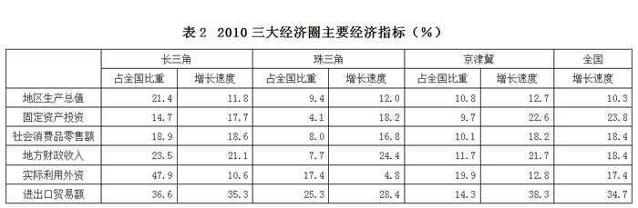

|  | 长三角 占全国比重 | 长三角 增长速度 | 珠三角 占全国比重 | 珠三角 增长速度 | 京津冀 占全国比重 | 京津冀 增长速度 | 全国 增长速度 |
| --- | --- | --- | --- | --- | --- | --- | --- |
| 地区生产总值 | 21.4 | 11.8 | 9.4 | 12.0 | 10.8 | 12.7 | 10.3 |
| 固定资产投资 | 14.7 | 17.7 | 4.1 | 18.2 | 9.7 | 22.6 | 23.8 |
| 社会消费品零售额 | 18.9 | 18.6 | 8.0 | 16.8 | 10.1 | 18.2 | 18.4 |
| 地方财政收入 | 23.5 | 21.1 | 7.7 | 24.4 | 11.7 | 21.7 | 18.4 |
| 实际利用外资 | 47.9 | 10.6 | 17.4 | 4.8 | 19.9 | 12.8 | 17.4 |
| 进出口贸易额 | 36.6 | 35.3 | 25.3 | 28.4 | 14.3 | 38.3 | 34.7 |

### 第 121 题

三大经济圈中，2010年三次产业增长速度均超过全国平均水平的有几个：

A. 0

B. 1

C. 2

D. 3

第 121 题 · 答案与解析

**参考答案（粉笔题库参考内容）**

B

**解析**

定位表1可知2010年全国及三大经济圈的三次产业增长速度。其中，只有珠三角地区的三次产业增长速度均超过全国平均水平。

故正确答案为B。

**考点**：直接找数、统计表

**来源**：2012年国家公务员录用考试《行测》题第121题

### 第 122 题

2010年，珠三角地区第二产业产值占国内生产总值的比重为：

A. 3.72%

B. 5.76%

C. 4.74%

D. 6.78%

第 122 题 · 答案与解析

**参考答案（粉笔题库参考内容）**

C

**解析**

根据题干“2010年······占······的比重”，结合材料时间为2010年，可判定本题为现期比重问题。定位表1和表2可得：2010年珠三角地区第二产业产值占珠三角地区生产总值比重为50.4%，珠三角地区生产总值占全国比重为9.4%。故2010年，珠三角地区第二产业产值占国内生产总值的比重=珠三角地区第二产业产值/全国生产总值=珠三角地区第二产业产值/珠三角地区生产总值× 珠三角地区生产总值/全国生产总值= 50.4%×9.4% ≈ 50%×9.4% = 4.7%，与C项最接近。

故正确答案为C。

**考点**：现期比重、统计表

**来源**：2012年国家公务员录用考试《行测》题第122题

### 第 123 题

2010年地方财政收入占地区生产总值比重低于全国平均水平的经济圈是：

A. 长三角

B. 珠三角

C. 京津冀

D. 以上皆非

第 123 题 · 答案与解析

**参考答案（粉笔题库参考内容）**

B

**解析**

根据题干“2010年······占······的比重”，结合材料时间为2010年，可判定本题为现期比重问题。定位表2可知2010年三大经济区地区财政收入、地区生产总值分别占全国相应指标的比重。题干要求满足地方财政收入/地区生产总值 ＜ 全国财政收入/全国生产总值，两边同时乘以地区生产总值/全国财政收入，可转化成(地方财政收入/全国财政收入)＜(地区生产总值/全国生产总值)。只有珠三角的地方财政收入占全国的比重（7.7%）小于地区生产总值占全国的比重（9.4%）。

故正确答案为B。

**考点**：现期比重、统计表

**来源**：2012年国家公务员录用考试《行测》题第123题

### 第 124 题

2010年，京津冀经济圈的哪一经济指标值居三大经济圈之首：

A. 实际利用外资占全国比重

B. 进出口贸易额占全国比重

C. 固定资产投资增长速度

D. 第一产业值增长速度

第 124 题 · 答案与解析

**参考答案（粉笔题库参考内容）**

C

**解析**

A项：定位表2可得：长三角实际利用外资占全国比重为47.9%，高于京津冀（19.9%），排除；

B项：定位表2可得：长三角进出口贸易额占全国比重为36.6%，高于京津冀（14.3%），排除；

C项：定位表2可得：京津冀固定资产投资增长速度为22.6%，高于长三角（17.7%）和珠三角（18.2%），正确；

D项：定位表1可得：珠三角第一产业值增长速度为4.4%，高于京津冀（3.3%），排除。

故正确答案为C。

**考点**：直接找数、统计表

**来源**：2012年国家公务员录用考试《行测》题第124题

### 第 125 题

能够从上述资料中推出的是：

A. 产业结构越向第三产业倾斜的经济圈，进出口贸易额增长越迅速

B. 地区生产总值越高的经济圈，其地区生产总值增长速度越低

C. 社会消费品零售额越高的经济圈，进出口贸易额越高

D. 固定资产投资越高的经济圈，实际利用外资额越低

第 125 题 · 答案与解析

**参考答案（粉笔题库参考内容）**

A

**解析**

A项：定位表1和表2可知，第三产业占地区生产总值比重从小到大顺序为珠三角地区、长三角地区、京津冀地区；进出口贸易额增长速度从小到大顺序是珠三角地区、长三角地区、京津冀地区，顺序一致，即产业结构越向第三产业倾斜的经济圈，进出口贸易额增长越迅速，正确；

B项：定位表2可知，地区生产总值从小到大顺序为珠三角地区、京津冀地区、长三角地区；地区生产总值增长速度从大到小顺序是京津冀地区、珠三角地区、长三角地区，顺序不一致，错误；

C项：定位表2可知，社会消费品零售额从小到大顺序是珠三角地区、京津冀地区、长三角地区；进出口贸易额从小到大顺序是京津冀地区、珠三角地区、长三角地区，顺序不一致，错误；

D项：定位表2可知，固定资产投资从小到大顺序为珠三角地区、京津冀地区、长三角地区；实际利用外资从大到小顺序是长三角地区、京津冀地区、珠三角地区，顺序不一致，错误。

故正确答案为A。

**考点**：统计表、综合分析

**来源**：2012年国家公务员录用考试《行测》题第125题

## 材料 3

2010年底，全国高速公路里程为7.41万公里，居世界第二位，比“十一五”规划目标增加9108公里。其中，国家高速公路5.77万公里，比上年末增加0.54万公里。“五纵七横”12条国道主干线提前13年全部建成。全国有11个省份的高速公路里程超过3000公里。

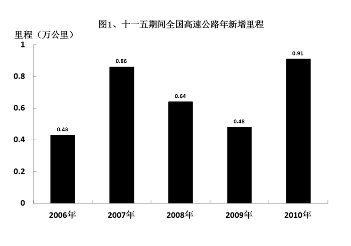

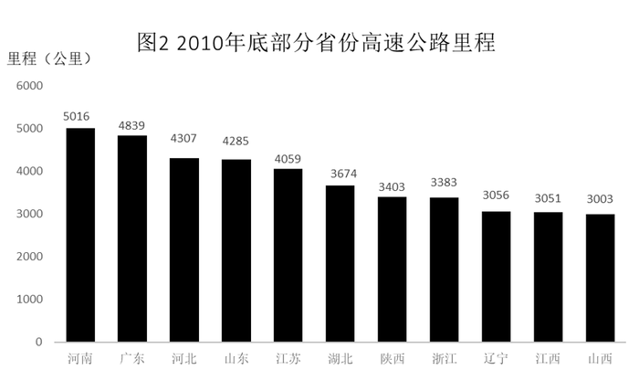

### 第 126 题

根据“十一五”规划，2010年底全国高速公路里程应达到多少万公里：

A. 5

B. 5.5

C. 6

D. 6.5

第 126 题 · 答案与解析

**参考答案（粉笔题库参考内容）**

D

**解析**

定位文字材料可得，“2010年底，全国高速公路里程为7.41万公里，居世界第二位，比‘十一五’规划目标增加9108公里（即0.9108万公里）”，故2010年底全国高速公路里程应达到(7.41-0.9108)≈(7.41-0.91)=6.5万公里。

故正确答案为D。

**考点**：简单加减计算、综合资料

**来源**：2012年国家公务员录用考试《行测》题第126题

### 第 127 题

2010年底，高速公路里程超过全国总里程5%的省份有几个：

A. 5

B. 6

C. 7

D. 8

第 127 题 · 答案与解析

**参考答案（粉笔题库参考内容）**

A

**解析**

根据题干“2010年，高速公路里程超过全国总里程5%”，可判定本题为现期比重问题。定位文字材料可得：2010年底，全国高速公路里程为7.41万公里，全国总里程的5%为74100×5%=3705公里。结合图2，2010年高速公路里程超过3705公里的省份有河南、广东、河北、山东和江苏，共5个省份。

故正确答案为A。

**考点**：直接找数、综合资料

**来源**：2012年国家公务员录用考试《行测》题第127题

### 第 128 题

2005年底，全国高速公路里程为多少万公里：

A. 2.46

B. 3.89

C. 4.09

D. 4.53

第 128 题 · 答案与解析

**参考答案（粉笔题库参考内容）**

C

**解析**

根据题干所求“2005年底，全国高速公路里程”，结合材料时间为2010年，可判定此题为基期计算问题。定位文字材料和图表材料图1可得：2010年底，全国高速公路里程为7.41万公里，“十一五”期间全国高速公路年新增里程分别为0.43万公里、0.86万公里、0.64万公里、0.48万公里和0.91万公里。则2005年底，全国高速公路里程为7.41-0.91-0.48-0.64-0.86-0.43=7.41-3.32=4.09万公里。

故正确答案为C。

**考点**：简单加减计算、综合资料

**来源**：2012年国家公务员录用考试《行测》题第128题

### 第 129 题

2010年底，图2中11省拥有高速公路的里程约占同期全国总里程的：

A. 49%

B. 57%

C. 62%

D. 70%

第 129 题 · 答案与解析

**参考答案（粉笔题库参考内容）**

B

**解析**

根据题干“2010年底，……占……”，结合材料时间为2010年，判定本题为现期比重问题。定位文字材料和图表材料图2可得：2010年底，全国高速公路里程为7.41万公里，11省拥有高速公路的里程=5016+4839+4307+4285+4059+3674+3403+3383+3056+3051+3003≈5000+4800+4300+4300+4100+3700+3400+3400+3100+3100+3000=42200公里，故2010年底，11省拥有高速公路的里程约占同期全国总里程的42200/74100=422/741≈57%。

故正确答案为B。

**考点**：现期比重、综合资料

**来源**：2012年国家公务员录用考试《行测》题第129题

### 第 130 题

关于我国“十一五”期间高速公路建设状况，能够从资料中推出的是：

A. 高速公路里程每年同比增长率都超过10%

B. 沿海省份高速公路里程显著高于内陆省份

C. 2010年底，国家高速公路占全国高速公路里程的比重达到90%

D. 2010年全国高速公路新增里程中，国家高速公路的里程超过一半

第 130 题 · 答案与解析

**参考答案（粉笔题库参考内容）**

D

**解析**

A项：定位图表材料图1：由第128题可知2005年底，全国高速公路里程为4.09万公里，则2008年底的高速公路里程为(4.09+0.43+0.86+0.64)=6.02万公里，2009年新增的高速公路里程0.48万公里＜6.02×10%=0.602万公里，错误；

B项：定位图表材料图2：河南作为内陆省份高于其他沿海省份的高速公路里程，与选项表述矛盾，错误；

C项：定位文字材料：“2010年底，全国高速公路里程为7.41万公里，其中，国家高速公路5.77万公里”，则国家高速公路占全国高速公路里程的比重为5.77/7.41≈78%＜90%，错误；

D项：定位图表材料图1：2010年，全国高速公路年新增里程0.91万公里；定位文字材料：“2010年底······其中，国家高速公路比上年末增加0.54万公里”。0.54/0.91＞1/2，所以2010年全国高速公路新增里程中，国家高速公路的里程超过一半，正确。

故正确答案为D。

**考点**：综合分析、综合资料

**来源**：2012年国家公务员录用考试《行测》题第130题

## 材料 4

2010年，我国进出口贸易总额为29727.6亿美元，同比增长34.7%。
        2010年，我国机电产品出口额为9334.3亿美元，同比增长30.9%；高新技术产品出口额为4924.1亿美元，同比增长30.7%。船舶、汽车零部件出口额保持较快增长，其中船舶出口额同比增长44.5%，汽车零部件出口额同比增长44.1%。
        2010年，机电产品进口额达到6603.1亿美元，同比增长34.4%，高新技术产品进口额达到4126.7亿美元，同比增长33.2%。
        2010年我国进出口贸易情况

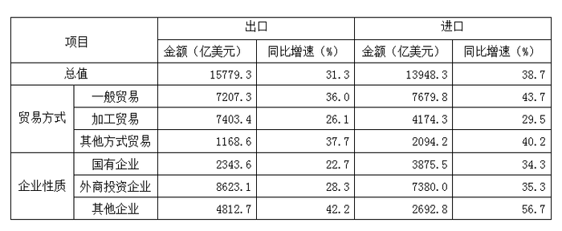

| 项目 | 项目 | 出口 金额（亿美元） | 出口 同比增速（%） | 进口 金额（亿美元） | 进口 同比增速（%） |
| --- | --- | --- | --- | --- | --- |
| 总值 |  | 15779.3 | 31.3 | 13948.3 | 38.7 |
| 贸易方式 | 一般贸易 | 7207.3 | 36.0 | 7679.8 | 43.7 |
| 贸易方式 | 加工贸易 | 7403.4 | 26.1 | 4174.3 | 29.5 |
| 贸易方式 | 其他方式贸易 | 1168.6 | 37.7 | 2094.2 | 40.2 |
| 企业性质 | 国有企业 | 2343.6 | 22.7 | 3875.5 | 34.3 |
| 企业性质 | 外商投资企业 | 8623.1 | 28.3 | 7380.0 | 35.3 |
| 企业性质 | 其他企业 | 4812.7 | 42.2 | 2692.8 | 56.7 |

### 第 131 题

2009年我国进出口贸易总额约多少万亿美元：

A. 1.6

B. 2.2

C. 2.6

D. 3.0

第 131 题 · 答案与解析

**参考答案（粉笔题库参考内容）**

B

**解析**

根据题干所求“2009年我国进出口贸易总额”，结合材料时间为2010年，可判定本题为基期计算问题。定位文字材料第一段可得：2010年，我国进出口贸易总额为29727.6亿美元，同比增长34.7%。由基期 = 现期/(1 + r)可得，2009年我国进出口贸易总额约为29727.6/(1+34.7%)≈ 29727.6/1.3 ≈ 22800亿美元 = 2.28万亿美元，与B项最接近。

故正确答案为B。

**考点**：基期计算、综合资料

**来源**：2012年国家公务员录用考试《行测》题第131题

### 第 132 题

2010年高新技术产品出口额占到出口总额的比重与上年相比约：

A. 增加了10个百分点

B. 减少了10个百分点

C. 增加了0.1个百分点

D. 减少了0.1个百分点

第 132 题 · 答案与解析

**参考答案（粉笔题库参考内容）**

D

**解析**

根据题干“2010年……占……的比重与上年相比”，可判定本题为两期比重问题。定位文字材料第二段和表格材料可得：高新技术产品出口额为4924.1亿美元，增长率a=30.7%；2010年，我国出口总额为15779.3亿美元，增长率b=31.3%。根据两期比重差分析做题步骤：第一步，判升降，a=30.7%＜b=31.3%，比重下降，排除AC；第二步，两期比重差小于增长率差的绝对值，两期比重差＜│a-b│=│30.7%-31.3%│=0.6%，0.6%即0.6个百分点，即两期比重差绝对值小于0.6个百分点，结合选项，只有D项符合。

故正确答案为D。

**考点**：两期比重、综合资料

**来源**：2012年国家公务员录用考试《行测》题第132题

### 第 133 题

在2010年我国进出口贸易中，下列哪一项的同比增长金额最高：

A. 机电产品出口

B. 高新技术产品出口

C. 机电产品进口

D. 高新技术产品进口

第 133 题 · 答案与解析

**参考答案（粉笔题库参考内容）**

A

**解析**

根据题干“2010年……同比增长金额最高”可判定此题为增长量比较问题。定位文字材料第二段和第三段可得选项数据的现期量和同比增速，根据增长量公式，增长量 = 现期 × 增长率/(1+增长率)可得，2010年我国进出口贸易增长量如下：

A机电产品出口：(9334.3 × 30.9%)/(1 + 30.9%)≈(9334.3×(1/3.3))/(1+1/3.3)=9334.3/4.3≈2170亿美元；

B高新技术产品出口：(4924.1×30.7%)/(1+30.7%)≈ (4924.1 × 1/3.3)/(1 + 1/3.3)= 4924.1/4.3 ≈ 1145亿美元；

C机电产品进口： (6603.1 × 34.4%)/(1 + 34.4%)≈ (6603.1 × 1/3)/(1 + 1/3)=6603.1/4≈1650亿美元；

D高新技术产品进口：(4126.7×33.2%)/(1+33.2%)≈ (4126.7 × 1/3)/(1 + 1/3)= 4126.7/4 ≈ 1031亿美元。

故机电产品出口的同比增长金额最高。

故正确答案为A。

**考点**：增长量比较、综合资料

**来源**：2012年国家公务员录用考试《行测》题第133题

### 第 134 题

下列关于2010年净出口额（出口额减进口额）的关系表述正确的是：

A. 加工贸易＞一般贸易

B. 其他方式贸易＞一般贸易

C. 国有企业＞外商投资企业

D. 国有企业＞其他企业

第 134 题 · 答案与解析

**参考答案（粉笔题库参考内容）**

A

**解析**

A项：加工贸易净出口额=7403.4-4174.3＞0，一般贸易净出口额=7207.3-7679.8＜0，则加工贸易＞一般贸易，正确；

B项：其他方式贸易净出口额= 1168.6 − 2094.2 ≈ −900^+亿美元，一般贸易净出口额= 7207.3 - 7679.8 ≈ -400^+亿美元，-900^+＜-400^+，则其他方式贸易＜一般贸易，错误；

C项：国有企业净出口额=2343.6-3875.5＜0，外商投资企业净出口额=8623.1-7380＞0，则国有企业＜外商投资企业，错误；

D项：国有企业净出口额=2343.6-3875.5＜0，其他企业净出口额=4812.7-2692.8＞0，则国有企业＜其他企业，错误。

故正确答案为A。

**考点**：简单加减计算、综合资料

**来源**：2012年国家公务员录用考试《行测》题第134题

### 第 135 题

下列关于2010年我国进出口贸易的表述正确的是：

A. 高新技术产品逆差约为800亿美元

B. 国有企业进出口总额同比增速为28.5%

C. 机电产品出口额占出口总额的一半以上

D. 船舶出口同比增长金额高于汽车零部件

第 135 题 · 答案与解析

**参考答案（粉笔题库参考内容）**

C

**解析**

A项：定位文字材料第二段和第三段可得：2010年，高新技术产品出口4924.1亿美元，进口额达到4126.7亿美元，出口额大于进口额，所以高新技术产品应为顺差，错误；

B项：定位表格材料可得：2010年国有企业进出口额分别为3875.5和2343.6亿美元，增长率分别为34.3%和22.7%，则2009年国有企业进口额＝3875.5/(1+34.3%)，出口额＝2343.6/(1+22.7%),根据混合增长率的结论，混合居中但不正中，偏向基数较大的。2009年国有企业进口额大于出口额，所以应偏向进口额的增长率34.3%，即混合后增长率大于进口额增速和出口额增速的平均值为(22.7%+34.3%)/2=28.5%，而选项恰等于28.5%，错误；

C项：定位文字材料第二段和表格材料可得，2010年机电产品出口额为9334.3亿美元，出口总额为15779.3亿美元，则机电产品出口额占出口总额的比重为＞7890/15779.3≈50%明显大于，正确；

D项：定位文字材料第二段，关于船舶出口金额和汽车零部件出口具体金额材料中均未出现，故无法判断，错误。

故正确答案为C。

**考点**：综合分析、综合资料

**来源**：2012年国家公务员录用考试《行测》题第135题

