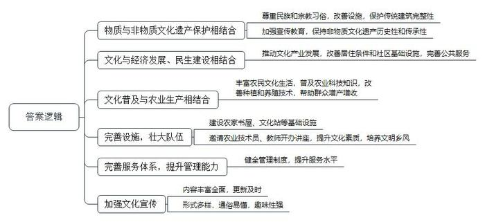
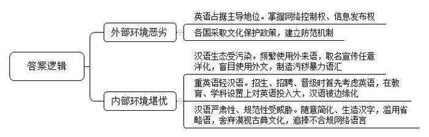
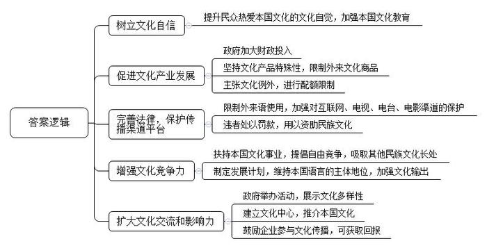
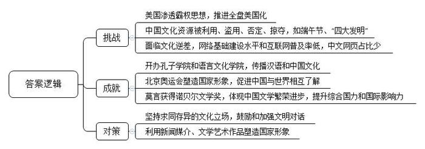
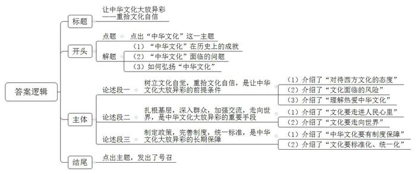

# 2013年国家公考《申论》题（地市级）

<!-- gwy:overview:start -->
> **国考 · 2013 · 申论 · 地市级** ｜ 5 题 · 图片 5 处 · 答案随题折叠

导航：[题目](#题目) · [材料 1](#材料-1)
<!-- gwy:overview:end -->

> 候选采集稿。参考答案及解析来自粉笔页面，不代表官方答案或真实高分答卷；来源使用许可与原卷对应关系仍需人工核实。

## 给定材料

### 材料 1

退休职工满师傅是回民，家住北城。他每周都要去一次改建后的牛街，先是围着古老而年轻的清真寺漫步一遭，然后再到“牛街清真食品超市”采购。“那儿的牛羊肉都是按穆斯林规矩宰杀出来的，”满师傅赞不绝口，“牛肉炖着吃可以挑‘肋条’、‘腰窝’，酱着吃有‘腱子’，切好片儿的‘肥牛’小包装，红里透白勾人馋虫；涮羊肉讲究‘三叉’、‘黄瓜条’，那儿的货又多又新鲜。”牛街给满师傅家节假日三代人聚餐带来了方便和欢愉。

有千年历史的北京市南城牛街地区是北京最大的穆斯林聚居区。目前，这里仅回族居民就有1万多人。改建前，街巷狭窄，市政基础设施落后，低矮破旧的危房连街成片，人均住房面积只有5.1平方米。1997年，牛街地区危改工程启动，这是北京市政府在全市最先实施的危改面积最大、拆迁户数最多、少数民族比例最高的危改小区。2004年，两期工程胜利完成。

迁入新居的老住户居住条件得到了极大改善。穆斯林最满意的是新房里有了浴室，每天进寺礼拜前可在家中沐浴。改建后的牛街，具有浓郁的民族风情：住宅楼无论高矮均采用穆斯林习用的黄色加绿边装饰。始建于公元996年的辽代千年古寺——牛街清真寺周围环境也焕然一新。寺院周围出现了万米绿地；原来门前8米宽的道路拓宽到40多米；门前那座历史悠久的“大影壁”，整修后巧妙地横立在主辅路之间的绿化隔离带上，既保持了清真寺建筑布局的完整性，更成为了一道独特的景观。全长670多米的街道两侧分布着商用房，经营民族服饰、工艺品、清真副食等。多家回民老字号餐馆和小吃店里的正宗清真菜肴、各种地道的牛街小吃令人怀旧，吸引着京城、外埠乃至海外的穆斯林食客。晚上处处灯火辉煌，流光溢彩。牛街老住户白奶奶常说：“如今在咱牛街走走，跟上长安街差不多。”

牛街街道工委干部告诉采访记者，牛街不仅是“民生一条街”，也是“民族文化一条街”。通过利用现有条件和历史文物资源，修缮了牛街礼拜寺，扩建了回民幼儿园、回民小学，改造了民族敬老院，设立了回民殡葬处、社会保障事务所和社区卫生站等服务场所，社区数字化管理系统日趋完善。牛街还是白猿通臂拳的诞生地，而今在小区里经常能看见白猿通臂拳第六代传人钟教练指导孩子们习武练拳的场景。因其具备“历史性”和“传承性”等申报非物质文化遗产的条件，目前有关部门已将白猿通臂拳列入区级非物质文化遗产推荐项目，这也是让牛街人足以自豪的事儿。

### 材料 2

某报报道了乡村放映员王其璋的事迹，他从1976年参加工作至今，用一台放映机、一张大银幕，为家乡61个村庄的农民送去了欢声笑语，累计行程达25万余千米，放映电影近万场。

王其璋高中毕业时面临两个就业选择：当中学老师或者乡村电影放映员。从小就爱看电影的他毫不犹豫地选择了后者。那时候，农村几乎没有什么文化生活，乡亲们看场电影就像过年一样，一个村庄放电影，附近村庄的群众也都会早早赶过来占座位，银幕两边的空地上都围得满满当当，还有人爬到了房顶和树上。然而到了20世纪80年代后期，随着生活水平的提高，电视在农村越来越普及，农村电影放映跌进了低谷。但为了心爱的电影，也为了那些喜欢看电影的乡亲们，王其璋最终还是坚持了下来。

说起放电影，让老王印象最深的还是帮助村民学习农业科技的事。姜家庄村有100多亩果园，品种老化，坐果率低。村支书找到王其璋，请他去放点管理苹果树的影片。接到委托后，老王精挑细选了《苹果树的修剪》《果树嫁接》等十几部科教影片为果农们放映，结果果园当年便获得了大丰收。到了秋天，王其璋再到这个村放电影的时候，果农们一下子把他围了起来，纷纷拿来大个儿的苹果让他吃。他们说：“老王，尝尝这苹果甜不甜。这里面可有你的功劳啊！”看到乡亲们发自内心的笑容，王其璋有说不出的高兴。

和尚庄村有养猪的传统，但前几年村民不懂防疫，小猪长到五六十斤常常病死，损失很大。王其璋就找来20多部生猪养殖方面的影片，连续给村民们放了一星期，还自己掏钱买资料赠送给村民，把兽医站的技术员请来讲课示范，帮助村民掌握养猪技术。现在，这个不到200户的村庄已经发展出养殖户120多个，每户年收入4万多元。因为这事，王其璋在这个村里的威望很高，每次去，村民都拉着他去参观他们的养殖场，争着请他吃饭。乡亲们都说：“老王可不光是电影放映员，他都成我们的科技顾问了！”

### 材料 3

某市文化管理部门召开了一个座谈会，与会者交流农村和社区基层文化建设的心得，提出相关意见和建议。以下是几位与会者的发言摘要。

A（大学生村干部）：要提高乡亲们的文化素质，培养积极向上的村风民风，我觉得鼓励他们把花在打牌、闲聊上的时间用在读书上很重要，也很有效。我到村里以后积极提议和向上争取，创办了全县第一家“农家书屋”。我帮助购买图书，筹集资金添置设施，动员群众参加读书活动，有空还给他们上课，有时还请农业大学老师、农科院技术员来开讲座。现在，农家书屋已经成为我们村的一大亮点，省市县领导也多次来视察和调研。如今村民们有空就到书屋来看看书、读读报，打牌的少了，闲聊的少了，文化生活丰富多了。

B（大学生村干部）：我们村本来就有一个文化站，里面也有不少图书，但是利用率不高，钥匙别在村支书的腰里，哪个农民提出要看书什么的，村支书就去开门。没有人提，那个门就天天锁着。我去了以后，主动向村支书提出保管钥匙，将文化站重新布置了一下，办了墙报、宣传栏，摆上茶水，添加了不少新书，制定了文化站管理制度，按时开放，按章管理。现在，我们那个文化站天天村民络绎不绝，有时候里面坐不下，有人就捧着书坐到门外的空地上看。

C（社区工作者）：社区街道文化站的建设是个重要的问题，也是个难题。我们那文化站备有不少图书，但没什么人来读。我做过调查，我们街道很多人平时没事的时候要么凑一桌人打麻将、打扑克，要么守在家里看电视，不愿与人交往。不过，我发现早晚在小区里散步、锻炼身体、跳舞的人倒不少，于是就动了脑筋，在小区的路边、健身场地旁边竖起很多宣传栏，里面内容定期更新，除了宣传国家大事，介绍社区里的好人好事，普及防火防盗、卫生常识外，还用来传播一些传统文化，比如《弟子规》《论语》《二十四孝》等，并配上漫画和导读文字。人们在散步和锻炼的时候顺便就可看到，这样慢慢引起了他们读书的兴趣，以至于现在到文化站来读书的人越来越多。

### 材料 4

小签原是某大学法律系学生，大二的时候就以高分通过了英语六级考试，本来想出国，但家里舍不得她这个宝贝女儿独自去国外打拼，于是她在去年硕士毕业时应聘进入一家大型国企做行政助理。

说起自己的成长经历，小签感慨万分：家里为了培养我，当初上幼儿园的时候就花了好多钱，让我上了我们那儿最有名的双语幼儿园。从那时候开始，父母就再三告诉我学好外语有多么重要。上了小学和中学，除了要完成繁重的功课，我还上过各种各样的英语辅导班，大多是父母替我报名的。高考的时候，我的英语成绩差3分就是满分，是我们市的英语单科状元。可惜我的语文成绩拖了后腿，要不然我就可以考上更好的大学。下那么大功夫学英语，现在工作了，英语没怎么用上，倒是每天处理各种各样的文件、写稿子，对我的汉语写作能力要求很高。我清楚地记得，第一次给我们领导写讲话稿，就被领导狠狠地骂了一顿，因为里面有好几个错别字，还有用词不当的地方。我现在真的认识到，我是中国人，学好自己的母语是首要的、必需的。

记者问她：你现在是不是特别后悔当初花了那么多精力和时间，还花了很多钱去学习英语？

小签说：后悔谈不上，英语学好了还是有用的。有一次我们单位收到一份外文资料，第二天开会要用，碰巧我们单位专门负责英语翻译的同事生病住院了，领导很着急，我就主动接过来翻译了，结果领导很满意，还表扬了我。特别是最近我刚刚在网上看到一篇对国内某著名大学陆教授的访谈，对我触动很大。他说我们对于语言，要有一种尊重、敬畏、护卫、热爱之情。作为中国人，我们一定先要重视学好汉语。

记者问她：如果让你送给那些正在拼命学外文的学子们一句话，你会怎么说？

小签想了想，说道：还是陆教授说得好，学好外国语，做好中国人。

### 材料 5

据统计，目前全世界75%的电视频道是英语节目，85%的国际组织的工作语言是英语，85%的网页是英语内容，80%的电子邮件是用英语传递，英语已成为全球通用的“国际普通话”。对于英语语言的主导地位，美国某未来学家曾说过：“美国目前所具有的第一大优势是语言。英语是在数十个领域内通用的世界性语言，全球各地数以亿计的人至少能在某种程度上掌握英语，从而使得美国的思想、作风、发明和产品能够畅通无阻地走向世界。未来世界政治的魔方将控制在信息强势者的手中，他们会使用手中掌握的网络控制权、信息发布权，利用英语这种强大的语言优势，达到连暴力、金钱也无法征服的目的。”

世界上许多国家，为了各自的民族文化利益纷纷采取文化保护政策，建立防范机制，维护本民族的语言安全。以色列为了建国，决定恢复希伯来语作为日常通用语言，过去希伯来语只有在宗教仪式中才使用，现在不仅成为耶路撒冷大街小巷人们交流的工具，而且也逐渐成为美国纽约犹太人追寻文化根源的凭据；马来西亚为了强调其民族的统一性，坚持以马来语为国语；俄罗斯则把保护俄语纳入了国家安全战略的范畴。

### 材料 6

眼下，在某些中国人的日常生活中，频繁使用外来语，尤其是普通话夹杂着英语单词，被认为是时尚的说话方式；一些国产商品在取名和媒体宣传时任意洋化的现象十分严重，纯粹的国货也要起一个不知所云的洋名；在学术论文中，照搬命题，抄袭概念，大量引用外文，对外文的盲目使用甚至到了迷信的程度；而西方大众文化在中国的流行，也导致不少充满淫秽、暴力色彩的语汇被制造出来，严重污染了汉语生态环境。

某学者尖锐批评道：某些部门在招生、聘用、晋级等方面，往往把是否掌握、能否运用英语作为首先考虑的因素，而能否说好汉语、写好汉语文章却被退到其次，甚至根本不作为衡量因素。他认为，强制性地普及英语教育让学生学习花费的时间和金钱超过了任何一门课程，从幼儿园到大学，英语都是主课，而大学语文在很多高校被边缘化，这是一种很令人担忧的倾向。

他说，在我们的生活中，随意简化汉字、任意生造字、滥用省略语等现象屡见不鲜。年轻人对传统和古典文化资源的舍弃和漠视现象随处可见，不读古代经典，不懂文言，再加上大量不合规范的网络语言受到年轻人的追捧，对汉语造成巨大冲击，消解着传统汉语的尊严和韵味，割裂着文化传承的脉络，威胁着国家语言文字的严肃性和规范性，但也有不少人对此不以为然。

### 材料 7

据报载，法国曾经发生过这样的事：一批著名影星冲进巴黎圣日尔曼大街的几家电影院，抢出《侏罗纪公园》的拷贝在街头焚烧；电影工作者还在埃菲尔铁塔下示威抗议好莱坞的“入侵”。法国某官员因为在一次国际会议中用英语发言，遭到全法国人的诟病，要求其向全国人民道歉并辞职。许多人都还记得法国小说家都德的《最后一课》，普鲁士占领法国，首先要做的事就是迫使法国国民放弃法语学德语。都德将一堂普通的法语课上升为向祖国的告别仪式，因为失去母语如同失去祖国。这个悲哀的情节已深刻地烙印在每一个看过这篇小说的读者心里，成为挥之不去的记忆。

作为世界著名的文化大国，法国拥有丰富的文化艺术遗产，文化产品的市场需求非常旺盛。法国文化部主管文化产业发展，是法国政府中支出最多的部门之一，这在西方国家中是不多见的。

1993年，欧洲议会采纳了法国政府“文化例外”的主张。在法国人看来，文化产品有其特殊性，不能与其他商品等同起来，任其自由流通。因此，他们联合欧共体其他国家一道，拒绝华盛顿让欧洲取消对美国影视产品“配额限制”的无理要求，在贸易谈判中坚持了毫不妥协的立场。

1994年，法国政府在议会两院通过法令，严格限制在法语中使用外来语尤其是英语。法国政府还通过了一项法律，要求在法国互联网上进行广告宣传的文字必须译成法文。

从1996年起生效的一项法律要求全法国1300多家电台在每天早6时30分至晚10时30分之间的音乐节目必须播送40%的法语歌曲；各电视台每年播放法语电影不得少于40%，违者处以罚款，并用于资助民族文化。

为了增强本土文化的竞争力，扶持本国文化事业的发展，法国提倡在自由竞争的同时，积极吸取其他民族文化的长处，广泛收藏和展现世界各民族优秀文化作品。面对近年来英语文化的逼人态势，法国颁布了支持电影业发展的计划，在力求维持法语地位的同时，也向英语文化的优势项目如好莱坞电影发起了冲击。

从1992年起，法国外交部、文化部、法国艺术活动协会及在法国的外国文化中心集中举办介绍外国文化艺术的活动，展示文化的多样性，加强这些国家与法国的文化交流。除了驻各国使馆的文化处外，法国目前已在近百个国家建有100多个文化中心，每年选择一两个国家作为重点，推介本国文化。

法国的企业和各类专业协会也是宣传法国文化、向世界推介法国文化的重要力量。无论大企业还是中小企业，均可参与赞助，而作为补偿，企业可获得政府减免税收或者享有冠名权等各种不同的回报。

### 材料 8

下面是H县文化局一名工作人员收集的10则材料。

①美国商务部前高级官员大卫·罗斯科普曾经说：“如果世界趋向一种共同的语言，它应该是英语；如果世界趋向共同的电信、安全和质量标准，它们应该是美国的标准；如果世界正在由电视、广播和音乐联系在一起，节目应该是美国的；如果共同的价值观正在形成，它们应该是符合美国人意愿的价值观。”

②美国《混合语》杂志揭秘：美国中央情报局在1996年后加紧了对发展中国家学术界的渗透，出巨款让一些人宣传推进全盘美国化，打压发展中国家那些保护和振兴本民族文化的人。而弗朗西丝·斯托纳·桑德斯的《文化冷战与中央情报局》一书则披露：为了渗透美国的霸权思想，中央情报局在文化领域展开了长达半个多世纪的文化输出活动：举办讲座和研讨会，创办学术刊物，开设图书馆，资助学者互访等。

③中国文化越来越多地被他人利用，比如《孙子兵法》成为某国谍报人员的必读书，大量中国元素、中华民族文化符号进入国外影视作品，很多中国风景区成为国外拍摄影视作品的外景地等。甚至国外还有盗用中国文化资源的现象，比如源于中国的端午节，就被某国以“江陵端午祭”的名义，向联合国教科文组织申报并已经被确定为“人类口头和非物质文化遗产代表作”。

④改革开放以来，我国的文化立场多在于强调求同存异，鼓励和加强超越意识形态和社会制度的文明对话。第一个海外孔子学院诞生于2004年，中国目前已经开办了几百所孔子学院和语言文化学院，传播汉语和中国文化，影响越来越大。

⑤国外有些别有用心的人，对中国古代“四大发明”进行否定甚至掠夺。比如某国学者以他们发现的据称刊印于公元706—751年的文献为世界上最早的印刷品，强调他们国家才是雕版印刷的发源地，甚至呼吁召开国际学术会议，邀请联合国教科文组织参加，要求国际社会予以公认。其实，早在1906年于新疆吐鲁番出土的卷子本雕版印刷品《妙法莲花经》已经证明中国是印刷术的故乡，1974年在西安西郊出土的单页雕版印刷品《梵文陀罗尼咒》（公元650—670年）再次证明中国才是雕版印刷的发源地。

⑥直到今天仍有西方人坚持认为，活字印刷（铅字印刷术）是德国人古登堡15世纪“创造”的，有人甚至怀疑毕昇的存在，认为沈括的《梦溪笔谈》中所记载的只是一个传说。造纸术方面，18—19世纪一些西方传教士认为纸是文艺复兴时期（14—15世纪）由德国人或意大利人发明的，还有造纸术是“埃及发明”的、“印度发明”的等种种说法。

⑦有人戏言，美国用三大片（薯片、芯片、影片）策略就征服了世界。从1996年开始，美国的文化产业成为美国最大的出口产业，占美国GDP的25%左右。有着5000年文明的中华民族面临着巨大“文化逆差”的尴尬，文化商品进口数量几倍甚至几十倍于同类出口商品。中国网民数量为世界第一，然而中国的网络基础建设水平和互联网普及率还无法和这个世界第一相称，中国网民不断地抱怨网速慢、不稳定、服务差、价格贵。同时中文网页数量在世界互联网中仍只能占据很少的比例，中国网民在很大程度上仍是外界信息的被动接受者而非互联网信息的主动提供者。

⑧新闻媒介反映出来的政府、机构、企业和公民的行为，与国家形象的关联最直接，新闻媒介的报道是否客观、公开、透明，体现了新闻媒介塑造国家形象的功能是否过硬。相对而言，通过文学艺术作品所反映的国家形象，更具有持久的潜移默化的作用。例如，中国的功夫文化、茶文化、饮食文化，以及京剧、民俗、民间文化等，都是国家形象的重要塑造手段。

⑨北京奥运会开幕式，作为一个文化事件，它的华丽、丰富、恢弘，特别是对中国“和”文化精神以及中国与时俱进的民族精神的解释，对于塑造一个文明灿烂、文化独特、改革开放、求新求变的中国国家形象，产生了无可替代的作用，不仅震撼了世界，而且也使一些对中国国家形象比较负面的评价发生了改变。国际奥委会主席罗格先生在闭幕词中指出，“通过本届奥运会，让世界更多地了解了中国，中国更多地了解了世界”，“这是一届真正的无与伦比的奥运会”。

⑩2012年诺贝尔文学奖，颁发给了中国作家莫言，既是中国文学繁荣进步的体现，也是中国综合国力和国际影响力不断提升的体现。

## 题目

### 第 1 题

**如何做好基层文化建设工作，直接关系到中华民族传统文化的继承与弘扬，请你谈谈“给定资料**1**～**3**”对做好这方面工作有哪些启示。（20分）**

关联材料：材料 1、材料 2、材料 3

作答要求：

要求：紧扣“给定资料”，条理清楚。不超过300字。

第 1 题 · 答案与解析

**参考答案（粉笔题库参考内容）**

1.物质与非物质文化遗产保护相结合。尊重民族和宗教习俗，改善设施，保护传统建筑完整性；加强宣传教育，保持非物质文化遗产历史性和传承性。

2.文化与经济发展、民生建设相结合。推动文化产业发展，改善居住条件和社区基础设施，完善公共服务。

3.文化普及与农业生产相结合。丰富农民文化生活，普及农业科技知识，改善种植和养殖技术，帮助群众增产增收。

4.完善设施，壮大队伍。建设农家书屋、文化站等基础设施，邀请农业技术员、教师开办讲座，提升文化素质，培养文明乡风。

5.完善服务体系，提升管理能力。健全管理制度，提升服务水平。

6.加强文化宣传。内容丰富全面，更新及时；形式多样，通俗易懂，趣味性强。

**解析**

**参考答案说明：**本参考答案思路上从“物质与非物质文化遗产保护相结合”“文化与经济发展、民生建设相结合”“文化普及与农业生产相结合”“完善设施，壮大队伍”“完善服务体系，提升管理能力”“加强文化宣传”这六个方面进行启示阐述。此外，各条的要点之间是并列关系，内容之间不存在重复、交叉。

**考点**：经验启示类

**来源**：2013年国家公考《申论》题（地市级）

### 第 2 题

**根据“给定资料**4**～**6**”，请你概括目前汉语生态环境面临的主要问题。（15分）**

关联材料：材料 4、材料 5、材料 6

作答要求：

要求：紧扣“给定资料”，条理清楚，全面准确，不超过200字。

第 2 题 · 答案与解析

**参考答案（粉笔题库参考内容）**

外部环境恶劣：1.英语占据主导地位。掌握网络控制权、信息发布权。2.各国采取文化保护政策，建立防范机制。

内部环境堪忧：1.汉语生态受污染。频繁使用外来语，取名宣传任意洋化，盲目使用外文，制造污秽暴力语汇。2.重英语轻汉语。招生、招聘、晋级时首先考虑英语，在教育、学科设置上对英语投入大，汉语被边缘化。3.汉语严肃性、规范性受威胁。随意简化、生造汉字，滥用省略语，舍弃漠视古典文化，追捧不合规网络语言。

**解析**

**参考答案说明：**本参考答案宏观上分成了“外部环境”和“内部环境”两方面的问题，在“外部环境”内部，又从“英语占主导地位”“各国采取文化保护政策”等不同的方面进行了分条撰写。各条要点之间在内容上相互并列，没有交叉。在“内部环境”内部，又从“汉语生态受污染”“重英语轻汉语”“汉语的严肃性、规范性受威胁”等不同的方面进行了分条撰写。各条要点之间在内容上相互并列，没有交叉。

**考点**：问题类

**来源**：2013年国家公考《申论》题（地市级）

### 第 3 题

**根据“给定资料**7**”，指出法国在保护本国文化方面有哪些做法值得借鉴。（10分）**

关联材料：材料 7

作答要求：

要求：条理清楚，全面准确。不超过300字。

第 3 题 · 答案与解析

**参考答案（粉笔题库参考内容）**

一、树立文化自信。提升民众热爱本国文化的文化自觉，加强本国文化教育。

二、促进文化产业发展。政府加大财政投入，坚持文化产品特殊性，限制外来文化商品，主张文化例外，进行配额限制。

三、完善法律，保护传播渠道平台。限制外来语使用，加强对互联网、电视、电台、电影渠道的保护，违者处以罚款，用以资助民族文化。

四、增强文化竞争力。扶持本国文化事业，提倡自由竞争，吸取其他民族文化长处；制定发展计划，维持本国语言的主体地位，加强文化输出。

五、扩大文化交流和影响力。政府举办活动，展示文化多样性；建立文化中心，推介本国文化；鼓励企业参与文化传播，可获取回报。

**解析**

**参考答案说明：**本参考答案从“树立文化自信”“促进文化产业发展”“完善法律”“增强文化竞争力”“扩大文化交流和影响力”等不同的话题进行了分条撰写。各条要点之间在内容上相互并列，没有交叉。

**考点**：经验启示类

**来源**：2013年国家公考《申论》题（地市级）

### 第 4 题

**假如你是H县文化局的干部，要在有村官和社区工作人员参加的培训班上做一次关于繁荣和发展社会主义文化的讲座，综合“给定资料**8**”中提供的信息，你认为应该重点讲哪几方面的内容？（20分）**

关联材料：材料 8

作答要求：

要求：紧扣“给定资料”，分条作答，观点明确，有针对性，不得摘抄原文；不超过300字。

第 4 题 · 答案与解析

**参考答案（粉笔题库参考内容）**

我国历史文化悠久，但当下面临巨大挑战：1.美国渗透霸权思想，推进全盘美国化。2.中国文化资源被利用、盗用、否定、掠夺，如端午节、“四大发明”。3.面临文化逆差，网络基础建设水平和互联网普及率低，中文网页占比少。

通过努力，取得了一些成就：1.开办孔子学院和语言文化学院，传播汉语和中国文化。2.北京奥运会塑造国家形象，促进中国与世界相互了解。3.莫言获得诺贝尔文学奖，体现中国文学繁荣进步，提升综合国力和国际影响力。

未来，我们要坚持求同存异的文化立场，鼓励和加强文明对话，同时利用新闻媒介、文学艺术作品塑造国家形象。

**解析**

**参考答案说明：**本参考答案思路上从“面临的挑战”“取得的成就”以及“采取的对策”这三个方面入手，分成了3段。此外，各段的要点之间是并列关系，没有交叉。

**考点**：概括主要内容类

**来源**：2013年国家公考《申论》题（地市级）

### 第 5 题

**请以“让……大放异彩”为题，写一篇内容充实的文章。（35分）**

关联材料：材料 1、材料 2、材料 3、材料 4、材料 5、材料 6、材料 7、材料 8

作答要求：

要求：

（1）用恰当的文字替换“让……大放异彩”中的省略号部分，使之构成一个完整具体的文章标题；

（2）主题应与“给定资料”相关，但素材不必拘泥于“给定资料”，要结合生活中的具体感受，切忌空谈对策；

（3）观点鲜明、结构完整，语言流畅；

（4）字数800～1000字。

第 5 题 · 答案与解析

**参考答案（粉笔题库参考内容）**

让中华文化大放异彩

——重拾文化自信

我们号称有上下五千年的文明，号称是唯一一个文脉和人脉都没有断绝过的文明，在文化方面我们曾经是自信甚至自大的。然而鸦片战争以来，我们先是被迫接受西方文化，后来自己主动打倒孔家店，甚至自愿接受西方文化，中华传统文化一度式微。因此，我们必须**重视中华传统文化**，**重拾文化自信**，为中华文化的复兴而努力。

**树立文化自觉，重拾文化自信，是让中华文化大放异彩的前提条件**。如果说曾经接受西方文化是被动的，是为了救亡图存，现在对西方文化的追随则是主动的，是惯性思维，是崇洋媚外。一百多年过去了，我们主权独立了，不再是半殖民地，没有亡国亡种的危险，但是却有亡文化的危险。文化的自觉和自信来自于对自身文化的理解和热爱。以汉字为例，汉字是世界上最独特的文字，是含义最丰富的文字，最具有美感的文字……面对如此丰富、厚重、迷人的文字，作为它的使用者，我们有什么理由不珍惜她、尊重她、保护她、传播她？

**扎根基层，深入群众，加强交流，走向世界，是中华文化大放异彩的重要手段**。中华文明要大放异彩，就必须把文化的根深深植入人民的生活中，扎进人民的心里。中华文化绝不仅仅是陈列在博物馆里的文物，而应更多地融入群众日常的衣食住行中。文化不仅要走到人民群众中间去，还必须走进人民心里去，更需要走出去——走出国门，走向世界。文化走出去绝不能如美国等国家一样，抱着文化侵略的傲慢态度走出去，而是应该以一种平和、和平、理性、谦虚的态度，本着相互尊重、相互理解、相互包容的态度走出去。

**制定政策，完善制度，统一标准，是中华文化大放异彩的长期保障**。绽放中华文化的光彩不能仅靠自觉、靠宣传，更为根本的是应该有制度保障。英语成为强势语言最根本的一个原因在于其有标准化、统一化的考试——从国际标准的雅思、托福到国内的CET、PETS。新东方、英孚、环球雅思这些培训机构之所以能门庭若市，就是因为有考试这个标准。有了这个标准，就可以通过市场的方式吸纳社会资金、人才来帮助传播英语。我们为英语制定了统一的考试标准，偏偏没有为自己的汉语制定一个考试标准，这不能不令人感到痛惜。

中华文化是最文明、最平和、最具有包容性的文化之一，让我们一起学习中华文化，践行中华文化，传播中华文化。让我们自信大方、大声地告诉世界：我们来了！

**文章****分析**

让中华文化大放异彩

——重拾文化自信

【**标题的优点：**内容上，主标题严格按照题干“以‘让……大放异彩’为标题”的要求。形式上，采用了主副搭配的结构，使文章主题、角度都很清晰。】

（1）**我们号称有上下五千年的文明**，号称是唯一一个文脉和人脉都没有断绝过的文明，在**文化**方面我们曾经是自信甚至自大的。然而鸦片战争以来，（2）我们先是被迫接受西方文化，后来自己主动打倒孔家店，甚至自愿接受西方文化，中华传统文化一度式微。因此，（3）我们必须**重视中华传统文化**，**重拾文化自信**，为中华文化的复兴而努力。

【**开头的优点：**内容方面：范文的开头是紧扣“中华文化”这一主题展开的。首先，开头第一句话点出主题，做到了主题明确。其次，对“中华文化”这一主题进行了分析阐述，指出了（1）“中华文化”在历史上的成就；（2）“中华文化”面临的问题；（3）如何弘扬“中华文化”。文字表达方面：使用了“然而”“因此”等关联词，使语言表达有逻辑性。】

**树立文化自觉，重拾文化自信，是让中华文化大放异彩的前提条件**。（1）如果说曾经接受西方文化是被动的，是为了救亡图存，现在对西方文化的追随则是主动的，是惯性思维，是崇洋媚外。一百多年过去了，我们主权独立了，不再是半殖民地，（2）没有亡国亡种的危险，但是却有亡文化的危险。（3）文化的自觉和自信来自于对自身文化的理解和热爱。以汉字为例，汉字是世界上最独特的文字，是含义最丰富的文字，最具有美感的文字……面对如此丰富、厚重、迷人的文字，作为它的使用者，我们有什么理由不珍惜她、尊重她、保护她、传播她？

【**论述段****1的优点：**★观点句：范文的观点句是紧扣“中华文化”这一文章主题提出的。形式上，它在段首处直接写出，位置突出，容易发现。内容上，关键词突出，内容要点明确，可以明显看出它是从“文化自觉、文化自信”的角度入手，指出了“让中华文化大放异彩”的对策。★论述内容：（1）介绍了“对待西方文化的态度”；（2）介绍了“文化面临的风险”；（3）介绍了“理解热爱中华文化”等。最后，在论述方法和论据的选取上做到了讲道理、举例子相结合，做到了丰富多样。】

**扎根基层，深入群众，加强交流，走向世界，是中华文化大放异彩的重要手段**。中华文明要大放异彩，（1）就必须把文化的根深深植入人民的生活中，扎进人民的心里。中华文化绝不仅仅是陈列在博物馆里的文物，而应更多地融入群众日常的衣食住行中。文化不仅要走到人民群众中间去，还必须走进人民心里去，（2）更需要走出去——走出国门，走向世界。文化走出去绝不能如美国等国家一样，抱着文化侵略的傲慢态度走出去，而是应该以一种平和、和平、理性、谦虚的态度，本着相互尊重、相互理解、相互包容的态度走出去。

【**论述段****2的优点：**★观点句：范文的观点句是紧扣“中华文化”这一文章主题提出的。形式上，它在段首处直接写出，位置突出，容易发现。内容上，关键词突出，内容要点明确，可以明显看出它是从“扎根基层、走向世界”的角度入手，指出了“让中华文化大放异彩”的对策。★论述内容：（1）介绍了“文化要走进人民心里”；（2）介绍了“文化要走向世界”等。最后，在论述方法和论据的选取上做到了讲道理、举例子相结合，做到了丰富多样。】

**制定政策，完善制度，统一标准，是中华文化大放异彩的长期保障**。（1）绽放中华文化的光彩不能仅靠自觉、靠宣传，更为根本的是应该有制度保障。（2）英语成为强势语言最根本的一个原因在于其有标准化、统一化的考试——从国际标准的雅思、托福到国内的CET、PETS。新东方、英孚、环球雅思这些培训机构之所以能门庭若市，就是因为有考试这个标准。有了这个标准，就可以通过市场的方式吸纳社会资金、人才来帮助传播英语。我们为英语制定了统一的考试标准，偏偏没有为自己的汉语制定一个考试标准，这不能不令人感到痛惜。

【**论述段****3的优点：**★观点句：范文的观点句是紧扣“中华文化”这一文章主题提出的。形式上，它在段首处直接写出，位置突出，容易发现。内容上，关键词突出，内容要点明确，可以明显看出它是从“完善制度、统一标准”的角度入手，指出了“让中华文化大放异彩”的对策。★论述内容：（1）介绍了“中华文化要有制度保障”；（2）介绍了“文化要标准化、统一化”等。最后，在论述方法和论据的选取上做到了讲道理、举例子相结合，做到了丰富多样。】

【**论述段之间的关系**：★内容的内在逻辑：范文的论述段之间是依照“并列”的逻辑展开的。论述段1先写了“树立文化自觉，重拾文化自信，是让中华文化大放异彩的前提条件”，论述段2再写了“扎根基层，深入群众，加强交流，走向世界，是中华文化大放异彩的重要手段”，论述段3接着写了“制定政策，完善制度，统一标准，是中华文化大放异彩的长期保障”。】

（1）**中华文化**是最文明、最平和、最具有包容性的文化之一，（2）让我们一起学习中华文化，践行中华文化，传播中华文化。让我们自信大方、大声地告诉世界：我们来了！

【**结尾的优点**：范文的结尾回扣了“中华文化”这一主题。（1）再次提到了“中华文化”；（2）发出了号召。】

**解析状态：unknown（来源未提供）**

**考点**：文章写作题

**来源**：2013年国家公考《申论》题（地市级）

