# 2013年国家公务员录用考试《行测》题

<!-- gwy:overview:start -->
> **国考 · 2013 · 行测 · 统考** ｜ 135 题 · 图片 22 处 · 答案随题折叠

| 题型模块 | 题量 | 题号 |
| --- | ---: | ---: |
| 常识判断 | 20 | 1–20 |
| 言语理解与表达 | 40 | 21–60 |
| 数量关系 | 15 | 61–75 |
| 判断推理 | 40 | 76–115 |
| 资料分析 | 20 | 116–135 |
| **合计** | **135** | |

导航：[题型与作答说明](#题型与作答说明) · [题目](#题目) · [材料 1](#材料-1)
<!-- gwy:overview:end -->

> 候选采集稿。参考答案及解析来自粉笔页面，不代表官方答案或真实高分答卷；来源使用许可与原卷对应关系仍需人工核实。

## 题型与作答说明

常识判断

（20题）

根据题目要求，在四个选项中选出一个最恰当的答案。

言语理解与表达

（40题）

本部分包括表达与理解两方面的内容。请根据题目要求，在四个选项中选出一个最恰当的答案。

数量关系

（15题）

在这部分试题中，每道题呈现一段表述数字关系的文字，要求你迅速、准确地计算出答案。

判断推理

（40题）

本部分包括图形推理、定义判断、类比推理与逻辑判断四种类型的试题。

资料分析

（20题）

所给出的图、表、文字或综合性资料具有若干问题要你回答。你应根据资料提供的信息进行分析、比较、计算和判断处理。

## 题目

### 第 1 题

《国家“十二五”时期文化改革发展规划纲要》提出要加大政府对文化事业建设的投入力度。

下列属于政府投入保障政策的是：

A. 支持文化企业在海外投资、投标、营销、参展和宣传等活动

B. 继续完善文化市场的准入政策，吸引社会资本投资文化产业

C. 文化内容创意生产、非物质文化遗产项目经营享受税收优惠

D. 通过政府购买服务的方式，鼓励社会力量提供公共文化产品

第 1 题 · 答案与解析

**参考答案（粉笔题库参考内容）**

D

**解析**

根据《国家“十二五”时期文化改革发展规划纲要》第十一条政策措施包括五大内容，分别为：政府投入保障政策、文化经济政策、文化贸易促进政策、版权保护政策、法制保障。第一点政府投入保障政策，其中谈到“加大政府投入力度，转变投入方式”具体就是通过政府购买服务、项目补贴、以奖代补等方式，鼓励和引导社会力量提供公共文化产品和服务，促进文化产业发展。设立国家文化发展基金，扩大有关文化基金和专项资金规模，提高各级彩票公益金用于文化事业比重。A、B两项错误，属于“文化贸易促进政策”，排除；C项错误，属于“文化经济政策”，排除。

故正确答案为D。

**来源**：2013年国家公务员录用考试《行测》题第1题

### 第 2 题

关于中国共产党历史上的重要会议，下列说法不正确的是：

A. 古田会议：解决新型人民军队建设问题

B. 遵义会议：纠正“左倾”的军事路线

C. 洛川会议：决定北上抗日的总方针

D. 瓦窑堡会议：确定建立抗日民族统一战线的方针政策

第 2 题 · 答案与解析

**参考答案（粉笔题库参考内容）**

C

**解析**

本题考查毛中特。

A项正确，古田会议：1929年12月28—29日，红四军第九次党的代表大会在上杭县古田村召开。该会议解决了如何把一支以农民为主要成分的军队建设成为中共领导下的新型人民军队的问题。B项正确，遵义会议：是指1935年1月15—17日，中共中央政治局在贵州遵义召开的独立自主地解决中国革命问题的一次极其重要的扩大会议。此次会议是在红军第五次反“围剿”失败和长征初期严重受挫的情况下，为了纠正王明“左”倾领导在军事指挥上的错误而召开的。C项错误，洛川会议：1937年8月22—25日，中共中央在陕北洛川召开政治局扩大会议，此次会议通过了《抗日救国十大纲领》，决定把党的工作重心放在敌后，在敌后放手发动群众，开展独立自主的游击战争，开辟敌后战场，建立敌后抗日根据地，故C项表述错误。1935年6月的“两河口”会议确定“决定北上抗日的总方针”。D项正确，瓦窑堡会议：1935年12月17—25日，中国共产党在陕北瓦窑堡召开了政治局扩大会议，即瓦窑堡会议。这次会议是在全国抗日民主运动日益高涨的形势下召开的。会议分析了华北事变后国内阶级关系的新变化，讨论了抗日民族统一战线、国防政府和抗日联军等问题，批判了党内长期存在着的“左”倾关门主义，制定了抗日民族统一战线的策略方针。

本题为选非题，故正确答案为C。

**考点**：党的历史

**来源**：2013年国家公务员录用考试《行测》题第2题

### 第 3 题

中国人民艰苦卓绝的革命斗争中，诞生了不少脍炙人口的歌曲。下列歌词均来自这些著名歌曲，其中创作时期与其他三首不同的是：

A. 河西山冈万丈高，河东河北高粱熟了

B. 我们生长在这里，每一寸土地都是我们自己的

C. 每个人被迫着发出最后的吼声

D. 宽广美丽的土地，是我们亲爱的家乡

第 3 题 · 答案与解析

**参考答案（粉笔题库参考内容）**

D

**解析**

A项是《黄河大合唱》里的歌词，这首歌创作于1939年3月，由光未然作词，冼星海作曲。

B项是《游击队之歌》里的歌词，这首歌是贺绿汀于1937年创作的。

C项是《义勇军进行曲》里的歌词，这首歌于1935年完成，由田汉作词，聂耳作曲。

D项是《歌唱祖国》里的歌词，这首歌是王莘于1950年创作的。前三首歌都诞生于新中国建立之前，是在反抗日本帝国主义侵略的年代完成的，而第四首歌诞生于新中国建立后。

故正确答案为D。

**考点**：文化常识

**来源**：2013年国家公务员录用考试《行测》题第3题

### 第 4 题

下列经济指标与衡量对象对应关系正确的是：

A. 赤字率——财政风险

B. 恩格尔系数——收入分配差距

C. 基尼系数——居民生活水平

D. 生产者物价指数——货币供应量

第 4 题 · 答案与解析

**参考答案（粉笔题库参考内容）**

A

**解析**

本题考查经济指标和衡量对象的对应关系。

A项，赤字率是指财政赤字占国内生产总值的比重，是衡量财政风险的一个重要指标。该项正确，应选。

B项，恩格尔系数是食品支出总额占个人消费支出总额的比重，是表征生活水平高低而非收入分配差距的指标。恩格尔系数越大，一个国家或家庭的生活越贫困，反之，恩格尔系数越小，则越富裕。该项错误，应排除。

C项，基尼系数是一个数值在0和1之间的比值，是国际上用来综合考察居民内部收入分配差异状况的一个重要分析指标，而非居民生活水平。基尼系数的数值越低，表明财富在社会成员之间的分配越均匀。该项错误，应排除。

D项，生产者物价指数即生产价格指数，是反映某一时期生产领域价格变动情况的重要经济指标，与货币供应量无关。该项错误，应排除。

故正确答案为A。

**考点**：宏观经济与调控政策

**来源**：2013年国家公务员录用考试《行测》题第4题

### 第 5 题

下列不属于收入再分配手段的是：

A. 最低工资保障

B. 最低生活保障

C. 税收

D. 社会保险

第 5 题 · 答案与解析

**参考答案（粉笔题库参考内容）**

A

**解析**

国民收入再分配是国民收入继初次分配之后在整个社会范围内进行的分配，是指国家的各级政府以社会管理者的身份，主要通过税收和财政支出的形式参与国民收入分配的过程。在社会主义制度下，国民收入必须要进行再分配。国民收入再分配，主要通过国家预算、银行信贷、劳务费用、价格变动等途径来进行，最低生活保障、税收、社会保险都属于收入再分配手段，而最低工资保障属于初次分配的内容。

本题为选非题，故正确答案为A。

**考点**：宏观经济与调控政策

**来源**：2013年国家公务员录用考试《行测》题第5题

### 第 6 题

下列诗句反映的历史事件，按时间先后排序正确的是：

①北师覆没威海卫，签订条约在马关

②鸦片带来民族难，销烟虎门海滩前

③武装起义占三镇，武昌汉口和汉阳

A. ①③②

B. ②③①

C. ①②③

D. ②①③

第 6 题 · 答案与解析

**参考答案（粉笔题库参考内容）**

D

**解析**

①句反映的事件是1894—1895年的“中日甲午战争”以及1895年签订的《马关条约》；②句反映的事件是1839年的“虎门销烟”；③句反映的事件是1911年的“武昌起义”。按时间先后排序是②①③。

故正确答案为D。

**考点**：中国历史

**来源**：2013年国家公务员录用考试《行测》题第6题

### 第 7 题

某县开展行政执法大检查：①某食品厂生产腐竹时非法添加硼砂被当场查获，县工商局以证据确凿为由吊销该厂营业执照，不再另行举行听证会；②县矿业公司将含镉的工业废渣倾倒入河，造成河水镉浓度超标，县环保局、县水利局分别决定对其罚款10万元和5万元；③县卫生局接到群众举报某火锅店使用过期牛油，遂派一工作人员前往检查，对牛油进行查封、送检。

上述县直单位做法妥当的是：

A. 县工商局

B. 县环保局

C. 县水利局

D. 县卫生局

第 7 题 · 答案与解析

**参考答案（粉笔题库参考内容）**

B

**解析**

根据《工商行政管理机关行政处罚案件听证规则》第六条：工商行政管理机关作出下列行政处罚决定之前，应当告知当事人有要求举行听证的权利······（三）吊销、收缴或者扣缴营业执照、吊销广告经营许可证、撤销商标注册、撤销特殊标志登记······可知①句中工商局的做法不妥当，排除A项。根据《中华人民共和国水污染防治法》第八条：县级以上人民政府环境保护主管部门对水污染防治实施统一监督管理，以及《中华人民共和国行政处罚法》第二十四条：对当事人的同一个违法行为，不得给予两次以上罚款的行政处罚，可知②句中罚款应由县环保局决定，县水利局做法不对，排除C项。根据卫生监督执法行为规范的相关规定：卫生监督执法人员在进行现场检查时应不少于2人，穿戴制服，出示行政执法证件，说明来意及检查依据，告知被检查人的权利和义务。可知③句中县卫生局做法不妥当，排除D项。

故正确答案为B。

**考点**：其他法律法规

**来源**：2013年国家公务员录用考试《行测》题第7题

### 第 8 题

下列法律现象与概念对应错误的是：

A. 春秋之治狱，论心定罪——自由裁量权

B. 载于简牍谓之书，合而验之谓之契——合同

C. 一兔走，百人追之；积兔于市，过而不顾——物权

D. 罪疑惟轻，功疑惟重。与其杀不辜，宁失不经——疑罪从无

第 8 题 · 答案与解析

**参考答案（粉笔题库参考内容）**

A

**解析**

A项错误，“春秋之治狱，论心定罪”对应“原心定罪”，其内容是在审判中重点考察犯罪者的动机是否合乎儒家道德，如不合乎，必须严惩；如合乎，虽犯法亦可从轻论处。这一审判原则从道德至上的立场出发，过分强调了犯罪者的主观动机而相对忽视了犯罪的客观事实，从而为酷吏任意处置罪犯打开了方便之门。由此可知A项法律现象与概念对应错误。B项正确，“载于简牍谓之书，合而验之谓之契”对应的是合同。主要由于书契在买卖交易中又称为“质剂”，在古代使用简牍书写时，总是将交易内容一式两份同时写在简牍两边，然后从中间破别开来，两家各得其一，检验时两片验之相合称为契合。C项正确，“一兔走，百人追之；积兔于市，过而不顾”意思是说一个兔子跑，很多人去追，但对于集市上的那么多的兔子，人们却看也不看。这不是不想要兔子，而是所有权已经确定，不能再争夺了，否则就是违背法律，要受到制裁。这是法家的思想，主要强调法律，尤其是物权的作用。D项正确，“罪疑惟轻，功疑惟重。与其杀不辜，宁失不经”出自《尚书》，基本含义是，在处理两可的疑难案件时，宁可偏宽不依常法，也不能错杀无辜。此概念源自西周，西周时期为保证适用法律的谨慎，防止错杀无辜，凡是疑难案件，都采取了从轻处断或赦免的办法。这就是中国古代“疑罪从无”法律思想的一个印证。

本题为选非题，故正确答案为A。

**考点**：其他法律法规

**来源**：2013年国家公务员录用考试《行测》题第8题

### 第 9 题

下列做法符合我国法律规定的是：

A. 某公立大学以其教学大楼产权作抵押向银行申请贷款

B. 某乡镇企业以所属土地所有权作抵押向银行申请贷款

C. 某农民以所属宅基地的使用权作抵押向银行申请贷款

D. 某国有企业以所属土地使用权作抵押向银行申请贷款

第 9 题 · 答案与解析

**参考答案（粉笔题库参考内容）**

D

**解析**

本题考查法律常识。

根据《中华人民共和国民法典》第三百九十九条规定：“下列财产不得抵押：（一）土地所有权；（二）宅基地、自留地、自留山等集体所有土地的使用权，但是法律规定可以抵押的除外；（三）学校、幼儿园、医疗机构等为公益目的成立的非营利法人的教育设施、医疗卫生设施和其他公益设施；（四）所有权、使用权不明或者有争议的财产；（五）依法被查封、扣押、监管的财产；（六）法律、行政法规规定不得抵押的其他财产。”A项错误，“教学大楼”属于以公益为目的的设施，学校不得抵押，排除；B项错误，“土地所有权”不得抵押，排除；C项错误，“宅基地”不得抵押，排除；D项正确，土地使用权可以抵押，当选。

故正确答案为D。

**考点**：民法典

**来源**：2013年国家公务员录用考试《行测》题第9题

### 第 10 题

“天下九塞，雁门为首”，下列诗词描写“雁门关”的是：

A. 黑云压城城欲摧，甲光向日金鳞开

B. 出关去，往辽东，诏徙十万填新丰

C. 长城饮马寒宵月，古戍盘雕大漠风

D. 八百里分麾下炙，五十弦翻塞外声，沙场秋点兵

第 10 题 · 答案与解析

**参考答案（粉笔题库参考内容）**

A

**解析**

A项正确，“黑云压城城欲摧，甲光向日金鳞开”出自唐朝李贺《雁门太守行》，描写的是雁门关；B项错误，“出关去，往辽东，诏徙十万填新丰”出自清朝尤侗的《出关行》，描写的是山海关；C项错误，“长城饮马寒宵月，古戍盘雕大漠风”出自清朝林则徐的《出嘉峪关感赋》，描写的是嘉峪关；D项错误，“八百里分麾下炙，五十弦翻塞外声，沙场秋点兵”出自南宋辛弃疾的《破阵子·为陈同甫赋壮词以寄之》，“沙场”泛指战场，并不特指某个地方。

故正确答案为A。

**考点**：文学常识

**来源**：2013年国家公务员录用考试《行测》题第10题

### 第 11 题

下列作品与评价对应不正确的是：

A. 《桃花扇》——借离合之情，写兴亡之感

B. 《石头记》——满纸荒唐言，一把辛酸泪

C. 《儒林外史》——一部儒林，终之以琴，滔滔天下，谁是知音

D. 《聊斋志异》——神魔皆有人情，精魅亦通世故

第 11 题 · 答案与解析

**参考答案（粉笔题库参考内容）**

D

**解析**

A项正确，《桃花扇》是一部不朽的历史剧名著，其主旨，即剧中《开场》中所说的“借离合之情，写兴亡之感”。全剧有两大线索：一是明线，即“离合之情”，侯方域与李香君的爱情线索；二是暗线，即“兴亡之感”，作者在剧中自然而然地流露出他本人在南明灭亡、江山易主时的感怀之情，排除。B项正确，“满纸荒唐言，一把辛酸泪”出现在《红楼梦》的开篇第一回，曹雪芹先生开篇明义，也为整部小说的概述大意，排除。C项正确，《儒林外史》是由清代小说家吴敬梓创作的章回体长篇小说，描写了近两百个人物。小说假托明代，实际反映的是康乾时期科举制度下读书人的功名和生活。选项确实是对《儒林外史》的评价，排除。D项错误，“神魔皆有人情，精魅亦通世故”是鲁迅对《西游记》的评价，不是对《聊斋志异》的评价，当选。

本题为选非题，故正确答案为D。

**考点**：文学常识

**来源**：2013年国家公务员录用考试《行测》题第11题

### 第 12 题

下列表述正确的是：

A. 人的唾液是由舌头分泌的

B. 胆分泌胆汁不足，容易导致胆囊炎

C. 食盐、鱼肝油可被消化道直接吸收

D. 正常情况下，卵细胞在子宫内受精

第 12 题 · 答案与解析

**参考答案（粉笔题库参考内容）**

C

**解析**

A项错误，人的唾液是由口腔内的唾液腺分泌的，而不是由舌头分泌的；B项错误，首先，胆汁是由肝脏分泌到胆囊中，胆囊再排出的；其次，胆汁成分改变会引起胆囊炎，胆汁分泌不足，并不意味着成分发生变化，故不会产生胆囊炎，反而胆汁的排泄受阻会引发胆囊炎；C项正确，食盐、鱼肝油可以被消化道直接吸收；D项错误，正常情况下，卵细胞在输卵管内受精，在子宫内发育。

故正确答案为C。

**考点**：生活常识

**来源**：2013年国家公务员录用考试《行测》题第12题

### 第 13 题

关于中药，下列归类正确的是：

A. 辛味药：连翘、杏仁

B. 甘味药：当归、人参

C. 酸味药：陈皮、黄连

D. 苦味药：黄柏、乌梅

第 13 题 · 答案与解析

**参考答案（粉笔题库参考内容）**

B

**解析**

A项错误，辛味药辛温芳香，杏仁是苦味药；B项正确，甘味药的主要成分有氨基酸、糖、维生素等，可提高人体的抗病能力，当归、人参都是甘味药；C项错误，黄连不是酸味药，是苦味药；D项错误，乌梅是酸味药，不是苦味药。

故正确答案为B。

本题相关知识点：

中药五味理论最早见诸于《内经》《本经》中。所谓五味，是指药物有酸、苦、甘、辛、咸五种不同的味道，因而具有不同的治疗作用。有些还具有淡味或涩味，因而实际上不止五种，但五味是最基本的。辛：“能散、能行”，即具有发散、行气行血的作用。如苏叶、木香、川芎等。甘：“能补、能和、能缓”，即具有补益、和中、调和药性和缓急止痛的作用。如人参、熟地、饴糖、甘草等。酸：“能收、能涩”，即具有收敛、固涩的作用。如五味子、乌梅、五倍子、山茱萸等。苦：“能泄、能燥、能坚”，即具有清泄火热、泄降气逆、通泄大便、燥湿、坚阴（泻火存阴）等作用。如黄芩、桅子、杏仁、陈皮、大黄等。咸：“能下、能软”，即具有泻下通便、软坚散结的作用。如芒硝，海藻、牡蛎、鳖甲等。

**考点**：其他

**来源**：2013年国家公务员录用考试《行测》题第13题

### 第 14 题

国家气象局地面观测规范规定，降水量仅包括垂直降水，即由空中降落到地面上的水汽凝结物。按照这一标准，下列哪组现象都会被计入“降水量”？

A. 雹、霜、雾

B. 雨、雪、霜

C. 雪、露、雾

D. 雨、雪、雹

第 14 题 · 答案与解析

**参考答案（粉笔题库参考内容）**

D

**解析**

雾是空气中的水汽凝结成水滴而悬浮于空中。露是凝结在地面或植物上的小水滴。霜是水蒸气在地面上遇冷凝华附在物体表面而形成。A、B、C三项错误，雾、露、霜都不属于垂直降水；D项正确，雨、雪、雹都是由空中降落到地面的水汽凝结而成，属于垂直降水。

故正确答案为D。

**考点**：生活常识

**来源**：2013年国家公务员录用考试《行测》题第14题

### 第 15 题

关于地球生物演化史，下列哪组排序是正确的？

A. 蓝藻→蕨类→裸子植物→被子植物

B. 节肢动物→草履虫→软体动物→脊椎动物

C. 细菌→腔肠动物→爬行类→鱼类

D. 苔藓→绿藻→菌类→双子叶植物

第 15 题 · 答案与解析

**参考答案（粉笔题库参考内容）**

A

**解析**

A项正确，根据地球生物演化史；B项错误，单细胞生物应该在节肢动物之前，草履虫是单细胞生物，故正确顺序应为：草履虫→软体动物→节肢动物→脊椎动物；C项错误，鱼类应该在爬行类之前，故正确顺序应为：细菌→腔肠动物→鱼类→爬行类；D项错误，植物进化第一阶段是菌藻植物时代，而后是蕨类植物时代，故正确顺序应为：菌类→绿藻→苔藓→双子叶植物。

故正确答案为A。

本题相关知识点：

地质年代从古到今是：太古代、元古代、古生代、中生代和新生代。有些代进一步划分为若干“纪”，如古生代从远到近划分为寒武纪、奥陶纪、志留纪、泥盆纪、石炭纪和二叠纪；中生代划分为三叠纪、侏罗纪和白垩纪；新生代划分为第三纪和第四纪。不同的地质年代有不同的特征。距今24亿年以前的太古代，地球表面已经形成了原始的岩石圈、水圈和大气圈。这是铁矿形成的重要时代，最低等的原始生命开始产生。距今24亿—6亿年是元古代。到了晚期，地球上出现了大片陆地。“元古代”的意思就是原始生物的时代，这时出现了海生藻类和海洋无脊椎动物。距今6亿—2.5亿年是古生代。海洋中出现了几千种动物，海洋无脊椎动物空前繁盛。以后出现了鱼类动物，一种用鳍爬行的鱼登上陆地，成为陆上脊椎动物的祖先。两栖类也出现了。北半球陆地上出现了蕨类植物，后来变成大片的煤田。距今2.5亿—0.7亿年是中生代，这是爬行动物的时代，这时也出现了原始的哺乳动物和鸟类。蕨类植物日趋衰落，而被裸子植物取代。距今7000万年左右的新生代是地球历史上最新的一个阶段。被子植物大发展，各种食草、食肉的哺乳动物空前繁盛，最终导致人类的出现。一般认为，人类是第四纪出现的，距今约有240万年的历史。

**考点**：生物常识

**来源**：2013年国家公务员录用考试《行测》题第15题

### 第 16 题

下列卫星系列不属于我国对地观测卫星的是：

A. “海洋”

B. “风云”

C. “天绘”

D. “北斗”

第 16 题 · 答案与解析

**参考答案（粉笔题库参考内容）**

D

**解析**

对地观测卫星用于对地球进行遥感的各种人造地球卫星和航天器。我国对地观测卫星主要有“风云”“海洋”“资源”“遥感”“天绘”等系列。“北斗”系列卫星是导航卫星，不是对地观测卫星。

本题为选非题，故正确答案为D。

**考点**：科技理论与成就

**来源**：2013年国家公务员录用考试《行测》题第16题

### 第 17 题

《撒马拉斯颂歌》于1958年被正式确定为现代奥林匹克运动会永久会歌，并改名《奥林匹克颂歌》。下列关于该会歌的表述错误的是：

A. 《奥林匹克颂歌》是首庄严悠扬的乐曲

B. 开、闭幕式都要演唱《奥林匹克颂歌》

C. 《撒马拉斯颂歌》改编自古罗马管弦乐

D. 《撒马拉斯颂歌》出现时间早于五环旗

第 17 题 · 答案与解析

**参考答案（粉笔题库参考内容）**

C

**解析**

《撒马拉斯颂歌》是一曲优美而庄严的古典管弦乐曲，由希腊人斯皮罗斯·萨马拉斯作曲、科斯蒂斯·帕拉马斯作词，曾在1896年雅典第一届奥运会开幕式上演奏过。国际奥委会1958年正式决定将这首歌曲作为奥运会的永久性会歌，也称为《奥林匹克颂歌》。在每届奥运会的开闭幕式仪式的升、降奥运会会旗时演奏。五环旗于1913年根据皮埃尔·德·顾拜旦的构思而设计制作的。由此可知A、B、D三项正确，C项错误。

本题为选非题，故正确答案为C。

**考点**：文化常识

**来源**：2013年国家公务员录用考试《行测》题第17题

### 第 18 题

从3月下旬到10月上旬，太阳在地球上直射位置的移动规律是：

A. 赤道→南回归线→赤道

B. 赤道→北回归线→赤道

C. 南回归线→赤道→北回归线

D. 北回归线→赤道→南回归线

第 18 题 · 答案与解析

**参考答案（粉笔题库参考内容）**

B

**解析**

根据太阳在地球上直射位置的移动规律可知，春分（3月20日或21日）时太阳直射赤道，随后逐渐北移。夏至（6月21或22日）时，太阳直射北回归线，后南移。秋分（9月22或23日）时太阳直射赤道，之后继续南移。冬至（12月21或22或23日）时直射南回归线。

故正确答案为B。

**考点**：自然地理

**来源**：2013年国家公务员录用考试《行测》题第18题

### 第 19 题

对下列道路交通标志解释不正确的是：

A. 注意儿童

B. 注意行人

C. 前方有施工

D. “徒步”旅游区

第 19 题 · 答案与解析

**参考答案（粉笔题库参考内容）**

B

**解析**

根据标志及解释可知A、C、D三项解释正确，B项解释错误，图标代表禁止行人通行，而不是注意行人。

本题为选非题，故正确答案为B。

**考点**：生活常识

**来源**：2013年国家公务员录用考试《行测》题第19题

### 第 20 题

下列谚语与农业生产经验不符的是：

A. 人在屋里热得跳，稻在田里哈哈笑

B. 麦苗盖上雪花被，来年枕着馍馍睡

C. 立秋无雨样样有，立秋有雨收半秋

D. 下秧太冷怕烂秧，小秧出水怕青霜

第 20 题 · 答案与解析

**参考答案（粉笔题库参考内容）**

C

**解析**

A、D两项正确，表述了气温与农业收成的关系，排除；B项正确，表述了降雪与农业收成的关系，排除；C项错误，应是“立秋有雨样样有，立秋无雨收半秋”。立秋这天无雨预示着秋季会比较干旱，影响收成，当选。

本题为选非题，故正确答案为C。

**考点**：生活常识

**来源**：2013年国家公务员录用考试《行测》题第20题

### 第 21 题

莫里哀曾说：“喜剧的责任，就是通过娱乐来纠正人的缺点。”近年来的法国轻喜剧，尤其擅长\_\_\_\_\_\_\_\_，用淡淡的笑声拆解社会难题的九连环，具有较高的思想价值和现实意义。

填入划横线部分最恰当的一项是（  ）。

A. 举重若轻

B. 借古讽今

C. 微言大义

D. 振聋发聩

第 21 题 · 答案与解析

**参考答案（粉笔题库参考内容）**

A

**解析**

根据文段“娱乐纠正缺点”及“淡淡的笑声拆解社会难题”可知，横线词语表达用简单的方法解决难题的意思，对应A项“举重若轻”，指举起沉重的东西像是在摆弄轻的东西，比喻能力强，能够轻松地胜任繁重的工作或处理困难的问题。

B项“借古讽今”表示假借古代的事情影射今天的现实，而文中没有古今的对立；C项“微言大义”指精微的言辞表达深刻的道理，是精微和深刻的对比；D项“振聋发聩”比喻高超的言论能使麻木糊涂的人觉醒。三者均与文意不符，因此排除。

故正确答案为A。

**考点**：对应关系-前后呼应、成语填空

**来源**：2013年国家公务员录用考试《行测》题第21题

### 第 22 题

在人类历史上，科技发明和人工工程曾导致不少“出人意料”“始料不及”甚至“＿＿＿”的结果。如果想少出一些这样的事，我们就应该对大自然始终保持一份＿＿＿，在推广新技术、上马新工程之前多一些研究评估，少一些独断专行。

依次填入划横线部分最恰当的一项是：

A. 事与愿违 敬畏

B. 事倍功半 谨慎

C. 针锋相对 尊重

D. 南辕北辙 克制

第 22 题 · 答案与解析

**参考答案（粉笔题库参考内容）**

A

**解析**

第一空，由空格前提示词语“甚至”可知，空格处应填入与“出人意料”“始料不及”语义相近、程度更深的词语，应该填入一个表示结果与目的相反的词语。A项“事与愿违”形容事实与主观愿望相反，符合要求。B项“事倍功半”形容效率低下，C项“针锋相对”形容双方观点的尖锐对立，D项“南辕北辙”形容行动和目的相反，B、C、D三项都与文意不符，因此排除。

第二空，“敬畏”表示既敬重又害怕，是人类对大自然应有的态度，填入此空意思全面且搭配恰当。其余三项要么搭配不当，要么意思不全，予以排除。

故正确答案为A。

**考点**：混搭填空、词的辨析-程度轻重

**来源**：2013年国家公务员录用考试《行测》题第22题

### 第 23 题

舞台上，一个是中国京剧大师，一个是交响乐指挥家；一会儿传来韵味十足的京腔，一会儿又是沁人心脾的管弦乐。面对京剧传承的尴尬和交响乐普及的艰难，这种“抱团取暖”的方式，对两个不搭界的艺术形式进行“嫁接”，究竟是＿＿＿还是异想天开？

填入画横线部分最恰当的一项是：

A. 相得益彰

B. 取长补短

C. 推陈出新

D. 移花接木

第 23 题 · 答案与解析

**参考答案（粉笔题库参考内容）**

A

**解析**

根据“究竟是······还是······”可知，横线处应填入一个与“异想天开”语义相反的词语，表示对这种“嫁接”的正面评价。D项“移花接木”比喻暗地里使手段更换人或事物以达到某种目的，为典型的贬义词，与文段所需的褒义词相悖，排除。

对比 A、B、C 三项。A项“相得益彰”表示两个人或两件事物互相配合，使双方的能力、作用和好处能得到充分展示，与文段中“抱团取暖”“嫁接”等词对应得当，当选；B项“取长补短”意为吸取别人长处，弥补自己不足，文段中并未重点提及京剧与交响乐的长短之处，排除；C项“推陈出新”表示去掉旧事物的糟粕，并使它向新的方向发展，文段中没有新旧事物的对比，排除。

故正确答案为A。

【友情提示】

本题考查成语“相得益彰”的含义，侧重于强调“两者变更好”，往往用于两个主体的语境，表达相近含义的成语还有相辅相成、珠联璧合、交相辉映和取长补短，考生在平时积累时要着重区分这些成语，重点掌握成语表达的侧重点及所适用的语境。

近义成语辨析：

【相得益彰&相辅相成&珠联璧合&交相辉映&取长补短】

相得益彰：互相配合，互相补充，各自的长处更能充分地显露出来。就是指两个人或两件事物互相配合，双方的能力和作用更能显示出来。（两者变更好）

相辅相成：指两件事物互相配合，互相补充，缺一不可。（比相得益彰多了一个“缺一不可”）比如一撇一捺才叫人，没了撇或捺，都不能称之为人。

珠联璧合：《汉书律历志上》：“日月如合璧，五星如连珠。”意思是太阳和月亮就像美玉结合在一起，金、木、水、火、土五颗行星就像珍珠串联在一起。后用“珠联璧合”比喻杰出人才或美好事物结合在一起。

交相辉映：（各种光亮、色彩等）相互映照。多用于形容美好的景象。辉映：形容映照，主语往往是色彩、光彩等。重点不是在相互补充，是要形容最终有一种看上去特别美好的景象。

取长补短：吸取别人的长处，弥补自己的短处。

【区别】

相得益彰：强调相互配合，并使各自的长处更加充分的显露出来这一结果。好上加好，起到一加一大于二的效果。

相辅相成：强调互相配合，互相补充，缺一不可。

珠联璧合：强调结合这一方式，结合的一定是如珍珠、美玉般的美好事物，主语一定要非常好。

交相辉映：强调美好的景象，常搭配光芒、色彩等，描绘一副十分美好的景象而非强调互相作用。

取长补短：强调交流互通，学别人的长处。

Tip：选项中出现取长补短、推陈出新、因小失大、居安思危这类的成语，文段论述的应该包括两个方面。

**考点**：关联关系-并列关系、成语填空

**来源**：2013年国家公务员录用考试《行测》题第23题

### 第 24 题

近年的欧洲连续经历严寒的冬天，这似乎与全球气候变暖的说法相左。但在不少专家看来，异常寒冷事件并未说明气候变暖趋势＿＿＿＿＿，相反，这是气候变暖大背景下全球极端天气愈加频发的＿＿＿＿＿。

依次填入划横线部分最恰当的一项是：

A. 偏转 表现

B. 逆转 缩影

C. 倒转 象征

D. 反转 预兆

第 24 题 · 答案与解析

**参考答案（粉笔题库参考内容）**

B

**解析**

第一空，由原文可知“持续严寒”和“全球变暖”是对立面，能填入此空的是“逆转”“倒转”“反转”，表示向相反的方向转变。“偏转”只是改变方向或位置，不是转到对立面，可排除A项。

第二空，由原文“气候变暖大背景下全球极端天气愈加频发”可知，极端天气是由气候变暖造成的，而欧洲极寒天气只是能代表总体的一小部分。“缩影”指可以代表同类的具体而微的人或事物，最符合原意；“象征”表示用具象的东西代表抽象的，原文没有具象和抽象的对立；“预兆”表示（某种迹象）某件事即将发生，全球变暖事实上正在发生，由此可排除C、D两项。

故正确答案为B。

**考点**：实词填空、对应关系-前后呼应

**来源**：2013年国家公务员录用考试《行测》题第24题

### 第 25 题

20年市场经济改革，把中国经济送上了持续增长的快车道，把在现代化道路上艰苦跋涉的中国人推上了一个高峰。然而，＿＿＿＿＿，我们一刻都不曾忘记发展中那些“不平衡、不协调、不可持续”的风险隐患；＿＿＿＿＿，“发展起来以后的问题不比不发展时少”。

依次填入划横线部分最恰当的一项是：

A. 夕惕若厉 如履薄冰

B. 防患未然 戒骄戒躁

C. 常备不懈 未雨绸缪

D. 居安思危 喜中有忧

第 25 题 · 答案与解析

**参考答案（粉笔题库参考内容）**

D

**解析**

第一空，由原文“高峰······然而······不曾忘记······隐患”可知，此空应填入一个表示虽处在平安的环境也要想到会出现的困难或危险的词语，D项“居安思危”，意为虽处在平安的环境里，也要想到有出现危险的可能，指随时有应付意外事件的思想准备，符合要求。A项“夕惕若厉”形容做事极其谨慎小心，不敢怠慢；C项“常备不懈”表示时刻保持高度警惕；B项“防患未然”表示在事故或灾害发生之前就加以防备。A、B、C三项都不如“居安思危”准确，排除。

第二空，由后文“发展起来以后的问题”可知，“发展起来”是令人喜悦的方面，但是带来的问题是令人担忧的方面。“喜中有忧”与文意相符。

故正确答案为D。

【友情提示】

本题考查重点词句对应，考生在平时积累时要着重区分近义成语的不同侧重点，只有这样才能准确对应文段语境，迅速锁定正确答案。经常与“居安思危”一起考查的成语有未雨绸缪、防患未然、常备不懈，考生在备考的过程中要多加积累。

近义成语辨析：

【未雨绸缪&防患未然&居安思危&常备不懈】

未雨绸缪：比喻事先做好准备工作。

防患未然：在事故或灾害尚未发生之前采取预防措施。

居安思危：处在安乐的环境中，要想到可能有的危险。指要提高警惕，防止祸患。

常备不懈：时刻准备着，毫不松懈。

【区别】

未雨绸缪、防患未然表达意思相近，都侧重于行动，但是未雨绸缪表述更形象。

居安思危侧重于思考和想。

常备不懈侧重于强调准备的状态，即时刻准备。

**考点**：对应关系-前后呼应、成语填空

**来源**：2013年国家公务员录用考试《行测》题第25题

### 第 26 题

在一定程度上，全球化是对民族性的＿＿＿＿＿和挑战。它要求我们既要从民族的角度进行思考，也要学会从全球的角度进行分析；既要进行纵向思维，在发展中传承历史经验，也要注重横向思维，在＿＿＿＿＿中汲取他人之长。

依次填入划横线部分最恰当的一项是：

A. 同化 交流

B. 排斥 沟通

C. 超越 比较

D. 吸纳 协商

第 26 题 · 答案与解析

**参考答案（粉笔题库参考内容）**

C

**解析**

第一空，根据文中“它要求我们既要从民族的角度进行思考，也要学会从全球的角度进行分析”，说明全球化具有民族和全球两个思考问题的角度，B项“排斥”不符合文意，排除；A项“同化”是变得相同的意思，而民族性和全球化是不一样的，排除。C项“超越”和D项“吸纳”均符合文意，保留。

第二空，根据语境提示可知，文段侧重于强调历史经验既要纵向的传承，也需要横向的国家之间的对比，从而能够取长补短，C项“比较”符合文意，当选。D项“协商”是商量的意思，文中没有商量的语境，排除。

故正确答案为C。

**考点**：实词填空、对应关系-前后呼应

**来源**：2013年国家公务员录用考试《行测》题第26题

### 第 27 题

影响消费者口碑的，有时不是产品的主体，而是一些不太引人注目的“零部件”，如西服的纽扣、家电的按钮等，这些＿＿＿＿＿的失误，却足以引起消费者的反感。赢得口碑必须对各项基础工作做得非常细致、到位并＿＿＿＿＿，只有产品和服务水平超过顾客的期望，才能让消费者在快乐享受的同时，广泛地进行传播。

依次填入划横线部分最恰当的一项是：

A. 随处可见 面面俱到

B. 漫不经心 有的放矢

C. 司空见惯 无微不至

D. 微不足道 持之以恒

第 27 题 · 答案与解析

**参考答案（粉笔题库参考内容）**

D

**解析**

第一空，由原文“不是产品的主体……而是‘零部件’”、“却足以”可知，这些失误是微小的，因此应填“微不足道”，形容事物细小而轻微，不足挂齿。“随处可见”“司空见惯”侧重事物出现的普遍，“漫不经心”形容疏忽的态度，均不符合要求，因此排除A、B、C三项。

第二空，“持之以恒”形容产品要想赢得好的口碑，除了各项基础工作做得非常细致、到位之外还要长久地坚持，符合语境。

故正确答案为D。

**考点**：对应关系-前后呼应、成语填空

**来源**：2013年国家公务员录用考试《行测》题第27题

### 第 28 题

覆盖全国的高速公路网已经形成，高速铁路网正在迅速形成。中国已经是世界上最大的人力流动和物资流动国家，过去那种“＿＿＿＿＿”的产业分工格局已被打破，地区间产业分工趋向合理；全国范围内的产业链＿＿＿＿＿迅速推进，高效统一的全国大市场正在形成之中。

依次填入划横线部分最恰当的一项是：

A. 自成一体 整合

B. 壁垒分明 升级

C. 各自为政 运转

D. 条块分割 扩充

第 28 题 · 答案与解析

**参考答案（粉笔题库参考内容）**

A

**解析**

突破口是第二空。第一句话论述我国形成了全国交通网络，打破了过去相互之间缺乏沟通的分工格局，尾句又说“高效统一的全国大市场正在形成之中”，说明我国的产业链也被“统一”在一起。A项“整合”符合文意，“升级”“运转”“扩充”均没有统一的意思，排除。

第一空，代入验证，“自成一体”意为在书法、绘画等方面具有独创风格，能自成体系，加双引号后表示特殊含义，表示过去的分工格局是缺少沟通的，符合文意。

故正确答案为A。

**考点**：对应关系-前后呼应、混搭填空

**来源**：2013年国家公务员录用考试《行测》题第28题

### 第 29 题

无论是古代的邮驿系统还是现代的邮政系统，书信从寄信人到收信人手中，都需要经过一个时间、空间的旅行，它的特点是慢。而这种慢又＿＿＿＿＿了人们的情感体验方式和书信体验方式。正是因为书信的＿＿＿＿＿，古人的时空感知才变得遥远而漫长，而等待、盼望、忐忑、焦虑等，便成为这种时空观的产物。

依次填入划横线部分最恰当的一项是：

A. 成就 真实

B. 培养 细腻

C. 塑造 迟缓

D. 丰富 浪漫

第 29 题 · 答案与解析

**参考答案（粉笔题库参考内容）**

C

**解析**

本题从第二空入手，横线处体现书信的特点，根据文段“它的特点是慢”、“变得遥远而漫长”可知，书信的特点为“慢”，对应C项“迟缓”。A项“真实”、B项“细腻”和D项“浪漫”均体现不出“慢”的意思，排除。

第一空代入验证，“塑造”与“方式”搭配恰当。

故正确答案为C。

**考点**：实词填空、对应关系-前后呼应

**来源**：2013年国家公务员录用考试《行测》题第29题

### 第 30 题

经过墨子及其弟子们的毕生努力，《墨经》终于脱稿成书。在那古奥的外表下，数学、力学、光学等科学知识＿＿＿＿＿其中，一些概念定义和科学发现与西方近代科学十分＿＿＿＿＿，闪耀着惊人的智慧之光。

依次填入画横线部分最恰当的一项是：

A. 散布 接近

B. 汇聚 吻合

C. 罗列 相似

D. 融合 对应

第 30 题 · 答案与解析

**参考答案（粉笔题库参考内容）**

A

**解析**

第一空，《墨经》不是专门的学科著述，“数学、力学、光学等科学知识”虽然在此书中有所记载，但不系统，而是零星分布的。A项“散布”是分散分布的意思，符合文意，保留；B项“汇聚”是汇在一处的意思，也符合文意，保留。C项的“罗列”是列举的意思，指有规则的排列，不符合文意，排除；D项“融合”侧重成为一个整体，不同的科学知识不能成为一个整体，排除。

第二空，《墨经》与近代科学的形成年代、理论基础不同，所以它们不可能是“十分吻合”的，程度过重，排除B项；A项“接近”表示古代的科学知识与现代科学知识差距较小，符合文意，当选。

故正确答案为A。

**考点**：实词填空、对应关系-前后呼应、词的辨析-程度轻重

**来源**：2013年国家公务员录用考试《行测》题第30题

### 第 31 题

元代的方回，论诗颇有眼力，而对朱熹的诗却抬举过分，事出反常。这里除了有乡里私心的原因之外，很可能与方回“秽德彰闻，依托道学”的隐曲有关，文人既心存依附之念，势必＿＿＿＿＿。再如，中国古代文论的作者，常常自己就兼作家身份，“文章得失寸心知”，发而为论，时有取长补短或＿＿＿＿＿的隐衷。

依次填入划横线部分最恰当的一项是：

A. 进退维谷 才短思涩

B. 随波逐流 博采众长

C. 进退失据 扬长避短

D. 骑虎难下 避实就虚

第 31 题 · 答案与解析

**参考答案（粉笔题库参考内容）**

C

**解析**

第一空，是说方回本来评论诗文很有眼力，但是因为心存依附之心而对朱熹的诗文过分抬举，心存依附之念，在评判文章时就会不客观，C项“进退失据”指前进和后退都失去了依据，形容无处安身，符合这里文人无论怎么做都没有依据的含义。A项“进退维谷”指无论进还是退，都是处在困境之中，形容处境艰难；D项“骑虎难下”比喻做一件事情，进行下去有困难，但情况又不允许中途停止，所以不得不硬着头皮继续做下去，文段并未至处境艰难这一程度，故排除A、D两项。B项“随波逐流”比喻没有坚定的立场，缺乏判断是非的能力，只能随着别人走。文段并未提及别人都称赞朱熹，故“随波逐流”与文意不符，排除B项。故基本锁定正确答案为C。

第二空验证，根据“或”可知空格处成语的意思应与“取长补短”形成并列。“取长补短”指比喻吸取别人的长处，来弥补自己的不足之处，“扬长避短”指发扬自身的优点或有利条件，回避缺点或不利条件，符合文意。

故正确答案为C。

【友情提示】

本题考查形近成语的辨析，成语“进退失据”在形式上与“进退维谷”特别相近，导致很多考生直接将二者划为等号，虽然“进退失据”有进退两难的含义，这一点和“进退维谷”语义相近，但是“进退失据”还可以表示前进和后退都失去了依据，用来形容无处容身。这也提示考生在备考的过程中，需要积累成语的多重含义，切忌片面理解。

形近成语辨析：

【进退失据&进退维谷/进退两难】

进退失据：前进和后退都失去了依据，形容无处容身，也指进退两难。

进退维谷/进退两难：形容处境艰难，进退两难。

【取长补短&扬长避短】

取长补短：吸取别人的长处，来弥补自己的不足之处，侧重点在于吸取别人的长处。

扬长避短：发挥自己的长处，回避自己的短处，侧重点在于发挥自身的长处。

【拓展】

才短思涩：见识短浅，思路迟钝。指写作能力差。

博采众长：广泛采纳众人的长处及各方面的优点，或从多方面吸取各家的长处。

避实就虚：原指避开敌人的主力，攻击敌人的薄弱环节。或指谈论问题回避要害。

**考点**：关联关系-因果关系、对应关系-前后呼应、成语填空

**来源**：2013年国家公务员录用考试《行测》题第31题

### 第 32 题

我们如今有铺天盖地的新信息需要去消化和记忆。互联网、移动电话、电视和其他电子产品里，都＿＿＿＿＿地涌现出新鲜事物。当不同信息同时涌现在记忆中，人们会无法＿＿＿＿＿出与当前目标不相关的信息，甚至还会禁不住去思考那些尚未开始做的事情，于是会出现＿＿＿＿＿。

依次填入划横线部分最恰当的一项是：

A. 源源不断 筛选 顾此失彼

B. 滔滔不竭 挑选 杞人忧天

C. 络绎不绝 遴选 应接不暇

D. 层出不穷 甄选 急于求成

第 32 题 · 答案与解析

**参考答案（粉笔题库参考内容）**

A

**解析**

第一空，搭配“新鲜事物”，且根据前文“铺天盖地的新信息”可知，横线处应表达新事物多之意，A项“源源不断”形容接连不断，符合文意且搭配恰当，保留。B项“滔滔不竭”形容口才好，说话多，C项“络绎不绝”形容人来车往，热闹的场景，均与“信息”搭配不当，排除；D项“层出不穷”意为连续不断地出现，与横线后“涌现”语义重复，排除。

第二空，代入验证，横线处搭配“信息”，“筛选信息”指把与当前目标不相关的信息找出来，符合语境，保留。

第三空，代入验证，根据“甚至还会禁不住去思考那些······”可知，人们会受到“这些不相关的信息”“尚未开始做的事情”的影响而失去很多与目前情况相关的信息，“顾此失彼”指顾了这个，顾不了那个，符合文意，当选。

故正确答案为A。

**考点**：混搭填空、词的辨析-搭配对象

**来源**：2013年国家公务员录用考试《行测》题第32题

### 第 33 题

尽管诗歌绝无翻译的可能，却大有翻译介绍的必要。有多位前辈时贤对诗歌翻译理论不乏鞭辟入里的＿＿＿＿＿。然而，何谓诗歌翻译的理想形式却＿＿＿＿＿。

依次填入划横线部分最恰当的一项是：

A. 真知灼见 各执一端

B. 不刊之论 见仁见智

C. 不易之论 各持己见

D. 远见卓识 众说纷纭

第 33 题 · 答案与解析

**参考答案（粉笔题库参考内容）**

B

**解析**

由第一空对应“前辈”可知，其对诗歌翻译理论的见解是非常准确的，并且以“鞭辟入里”做修饰，形容见解的正确与深刻。D项中的“远见卓识”意为远大的眼光、卓越的见识，而文中并无“远大”之意，故排除。A项中的“真知灼见”意为正确的认识和透彻的见解；B项中的“不刊之论”意为不可改动或不可磨灭的言论（刊：订正，修改），形容言论精确，无懈可击；C项中的“不易之论”意为不可更改的言论（易：变更），形容论点、论证完全正确，没有辩驳的余地，均与文意相符。

第二空，文段以“然而”转折，意在表达前辈对于诗歌翻译的理想形式的看法是不同的。A项中的“各执一端”与C项中的“各持己见”均强调每个人都坚持自己的观点与立场，重在强调坚持，故此二者多用于争论、争辩的语境中，与题干语境不符，排除A、C两项。B项中的“见仁见智”指对同一个问题，不同的人从不同的立场或角度有不同的看法，侧重于“不同”，符合语境。

故正确答案为B。

**考点**：关联关系-转折关系、对应关系-前后呼应、成语填空

**来源**：2013年国家公务员录用考试《行测》题第33题

### 第 34 题

在伦敦的日子里，我每天乘着红色的双层巴士在大街上＿＿＿＿＿，每天都有新发现。一次，在皮卡迪利广场，我又看到读小说的乞丐。在慵懒的夕阳下，那乞丐穿戴齐整，＿＿＿＿＿地坐在马路旁，面前放着一个供路人扔硬币的碗。他把书放在碗旁的地面上，低着头，用手指指着页面，一行一行地读着。他读得那样认真，身边的车水马龙，周遭的一切＿＿＿＿＿，似乎都不复存在。

依次填入划横线部分最恰当的一项是：

A. 徘徊 旁若无人 喧哗

B. 踯躅 置若罔闻 喧腾

C. 穿行 泰然自若 喧闹

D. 穿梭 神情自若 喧嚣

第 34 题 · 答案与解析

**参考答案（粉笔题库参考内容）**

D

**解析**

第一空，“徘徊”和“踯躅”都有犹豫不决的含义，与整个语境悠然自得的状态不符，故排除A、B两项。

第二空，“泰然自若”形容在人们认为是非常紧急情况下当事人却跟平常一样，安然处之，不慌不乱；“神情自若”指神情态度十分自然。根据句意，并没有发生什么紧急情况，故用“神情自若”更合适。可知，选D项。

第三空，“喧嚣”形容不清静，不安静。此处想表达的是乞丐沉浸在自己的书本世界里，周围的不安静都不能打扰到自己。“喧嚣”用于此处搭配合理，验证D项正确。

故正确答案为D。

**考点**：对应关系-前后呼应、混搭填空、词的辨析-感情色彩

**来源**：2013年国家公务员录用考试《行测》题第34题

### 第 35 题

做学问首先是有一说一，实事求是，尊重原始实验数据的真实性。在诚实做研究的前提下，对具体实验结果的分析、理解有＿＿＿＿＿甚至错误是很常见的，这是科学发展的正常过程。可以说，许多学术论文的分析、结论和讨论都存在不同程度的＿＿＿＿＿，越是＿＿＿＿＿的科学研究，越容易出现错误理解和结论。

依次填入划横线部分最恰当的一项是：

A. 争论 错误 严谨

B. 异议 弱点 复杂

C. 偏差 瑕疵 前沿

D. 意见 局限 真实

第 35 题 · 答案与解析

**参考答案（粉笔题库参考内容）**

C

**解析**

第一空，根据递进关联词“甚至”可知，横线处应填入与“错误”词义相近但程度较轻的词语。C项“偏差”指工作上产生的过分或不及的差错，符合语境，保留。“争论”“异议”和“意见”都不能体现出“错误”之意，故排除 A、B、D 三项。

第二空，代入验证，通过“可以说”可知后文是对前文的解释，故横线处应填入与“错误”语义相近的词，且程度较轻，C项“瑕疵”符合语境，保留。

第三空，代入验证，C项“前沿”的科学研究搭配合理，符合文意，当选。

故正确答案为C。

**考点**：实词填空、词的辨析-程度轻重

**来源**：2013年国家公务员录用考试《行测》题第35题

### 第 36 题

怎么才能让老板给自己加薪？职场上最纠结的事情莫过于此。可是偏偏就有人＿＿＿＿＿，幽默地给我们做出了榜样。漫画《老板，求加薪》中给我们列出了加薪三十六计，从借刀杀人到＿＿＿＿＿，书中的妙计连连，让人忍俊不禁。虽然都是些＿＿＿＿＿的招式，但或许你的加薪之道就在其中。

依次填入画横线部分最恰当的一项是：

A. 知难而上 两面三刀 出人意表

B. 激流勇进 刀头舔蜜 出奇制胜

C. 游刃有余 代人捉刀 鸡鸣狗盗

D. 举重若轻 笑里藏刀 剑走偏锋

第 36 题 · 答案与解析

**参考答案（粉笔题库参考内容）**

D

**解析**

第一空应体现有人用幽默的方式轻松解决了职场难题，D项“举重若轻”，形容做繁难的事或处理棘手的问题轻松而不费力；C项“游刃有余”表示解决问题非常轻松，均符合文意。A项中的“知难而上”与B项中的“激流勇进”均形容面对困难时的态度，与文段“幽默”地解决难题不对应，故排除A、B两项。

第三空，横线要体现的是非常巧妙的招式，C项“鸡鸣狗盗”指微不足道的本领，也指偷偷摸摸的行为，与巧妙无关，故排除C项；D项“剑走偏锋”指用不同以往的办法来解决问题，与前文的“妙计”相对应，符合。

代入第二空验证，从“借刀杀人”到“笑里藏刀”，符合语境。

故正确答案为D。

**考点**：对应关系-前后呼应、成语填空

**来源**：2013年国家公务员录用考试《行测》题第36题

### 第 37 题

“达”意为显贵，无论处在什么样的社会形态和社会阶段，所谓“达者”始终只占少数。如果“穷者”只顾自己的＿＿＿＿＿，只有占社会成员少数的“达者”才“兼济天下”，那么当今社会的风气不可想象。如果团结互助、志愿服务的社会风气只依靠占少数的“显达”成员来＿＿＿＿＿，那么和谐社会、社会主义现代化建设只能是＿＿＿＿＿。

依次填入划横线部分最恰当的一项是：

A. 涵养 承受 梦想

B. 修养 承担 空谈

C. 教养 负责 幻想

D. 素养 负担 空想

第 37 题 · 答案与解析

**参考答案（粉笔题库参考内容）**

B

**解析**

第一空，文段中说明“穷者”不能只顾自己的提升，也要“兼济天下”，A项“涵养”、B项“修养”、D项“素养”都是可以自我提升的。但是C项“教养”一般指社会影响、家庭教育、学校教育、个人修养的结果，尤指在家庭中从小养成的行为的道德水准，属于他律教化显现，是别人教的，不符合文意，排除。

第二空，空格处要搭配“团结互助、志愿服务的社会风气”，A项“承受”、D项“负担”一般搭配消极的事物；B项“承担”多搭配积极语境，比如承担责任，符合文意。

第三空，代入验证，B项“空谈”表示不切实际的言论，符合文意。

故正确答案为B。

**考点**：实词填空、词的辨析-搭配对象、词的辨析-词义侧重

**来源**：2013年国家公务员录用考试《行测》题第37题

### 第 38 题

可以毫不夸张地说，每一个老字号背后都是道不尽的＿＿＿＿＿，数不清的传奇风流。但是有的地方的老字号或者消失或者＿＿＿＿＿，唯独广州的中药老字号不仅数量多，而且各个越活越年轻。这其实与广州人对中医药文化的推崇和信任＿＿＿＿＿。

依次填入划横线部分最恰当的一项是：

A. 人生百态 朝不保夕 息息相通

B. 辛酸无奈 岌岌可危 休戚相关

C. 沧海桑田 危在旦夕 休戚与共

D. 苦心孤诣 奄奄一息 息息相关

第 38 题 · 答案与解析

**参考答案（粉笔题库参考内容）**

D

**解析**

第一空，与“数不清的传奇风流”并列，紧接“但是”开始转折说它的消失，所以这里应该填入一个褒义词。D项“苦心孤诣”指尽心竭力钻研达到了别人所达不到的地步，体现出老字号的苦心经营与钻研，符合文意。A项“人生百态”指人生酸甜苦辣各种形态，属于中性词，且多形容人生，此处形容老字号，不符合文意，排除；B项“辛酸无奈”过于负面，与文意不符；C项“沧海桑田”比喻世事变化的巨大或迅速，与文意无关。因此排除A、B、C三项。

第二空验证D项，与“消失”并列。“奄奄一息”形容呼吸微弱，濒于死亡，符合文意。

第三空，“息息相关/息息相通”比喻关系非常密切，在这里形容广州中药老字号的发展与广州人对其推崇和信任的关系密切，符合文意。“休戚与共/休戚相关”都是侧重形容彼此间的幸福和祸患，“休戚相关”指彼此间祸福互相关联。“休戚与共”指彼此共同承受幸福与灾祸，不符合文意。

故正确答案为D。

【成语积累】

朝不保夕：早晨保住了，不一定保得住晚上。形容情势危急。

岌岌可危：形容十分危险的样子。

危在旦夕：旦夕：早晨和晚上，形容时间短，危险就在眼前。

休戚相关：彼此之间的喜忧、祸福互相关联，利害一致。侧重指客观存在的关系。

休戚与共：有福同享，有难同当。形容关系密切，利害相同。侧重指主观上的认识和态度。

**考点**：关联关系-并列关系、成语填空、词的辨析-感情色彩、词的辨析-搭配对象

**来源**：2013年国家公务员录用考试《行测》题第38题

### 第 39 题

早在几千年前，人类已开始利用酵母来制作发酵产品。最早在市场上销售的产品是酵母泥，它的发酵速度快，但＿＿＿＿＿和使用不便，产品的商业化受到了一定的＿＿＿＿＿。从销售酵母泥算起，酵母制造工业已有200余年的历史了。酵母现已成为世界上研究最多的微生物之一，是当今生物技术产品研究开发的＿＿＿＿＿。

依次填入划横线部分最恰当的一项是：

A. 保存 影响 支柱

B. 运输 限制 热点

C. 销售 阻碍 关键

D. 制作 干扰 难点

第 39 题 · 答案与解析

**参考答案（粉笔题库参考内容）**

B

**解析**

本题可从第三空入手，由前文“研究最多”可知此处填“热点”最为恰当。“支柱”、“关键”、“难点”都无从推知。

第二空，由于酵母泥的“使用不便”，所以其商业化受限，且“受到限制”为固定搭配，C项的“阻碍”一般是主语发出的动作，不用作被动。A项的“影响”、D项的“干扰”语义不准确。

第一空，将“运输”代入亦可与“使用”构成顺承并列。

故正确答案为B。

**考点**：实词填空、对应关系-前后呼应

**来源**：2013年国家公务员录用考试《行测》题第39题

### 第 40 题

创新路上，中国科技正不断向各种高度、深度和广度＿＿＿＿＿。而“精度”的意义在于，它既是科技创新的目标，也是＿＿＿＿＿科技创新质量的标尺，“神九”展现的“中国精度”，实质上是创新＿＿＿＿＿的结果，更是不断追求创新的号角。

依次填入画横线部分最恰当的一项是：

A. 拓展 衡量 推动

B. 扩大 考量 拉动

C. 延伸 丈量 驱动

D. 发展 考察 促进

第 40 题 · 答案与解析

**参考答案（粉笔题库参考内容）**

C

**解析**

第一空，搭配“高度、深度和广度”，B项“扩大”与“高度”搭配不当，排除。

第二空，形容“科技创新质量的标尺”，A项“衡量”、C项“丈量”与“标尺”搭配恰当；D项“考察”与“标尺”搭配不当，排除。

第三空，与“创新推动”相比，“创新驱动”为固定搭配，择优对比，C项更适合。

故正确答案为C。

**考点**：实词填空、对应关系-前后呼应、词的辨析-搭配对象

**来源**：2013年国家公务员录用考试《行测》题第40题

### 第 41 题

先秦儒家的“人情—秩序”理论一方面确实存在压抑人性、压抑情感的消极因素；另一方面，我们也不能否认其正面价值，它是站在治世的高度探寻人生修养之艺术，将个体性情自由与群体政治需要融为一体，把情感发动与秩序建构统一起来，为治世之道开出了一剂良方。先秦儒家的这种治世理论对于当下的和谐社会建设不无有益的启示。如今，我们在强调个性自由的同时，也应当为这种自由设定一个边界：社会和谐。唯有如此，个体真性情的发动才能具有合理性与正当性，个体与社会才能达成统一，而这正是和谐社会建立的根基。

这段文字主要是说明先秦儒家“人情—秩序”理论的：

A. 时代特征

B. 现实意义

C. 独特价值

D. 深远影响

第 41 题 · 答案与解析

**参考答案（粉笔题库参考内容）**

B

**解析**

文段开篇先指出先秦儒家“人情——秩序”理论存在消极因素，随后通过“另一方面”强调其正面价值，即站在治世高度将个体性情与群体政治统一，为治世提供思路。接着通过“不无有益的启示”引出核心，强调这一理论对当下和谐社会建设具有现实指导作用，指出当下在强调个性自由的同时，也要以社会和谐为边界，实现个体与社会的统一。故文段重点强调先秦儒家“人情——秩序”理论对当今社会建设的现实启示与价值，对应B项。

A项，“时代特征”指某一时期特有的标志，文段并非介绍该理论在先秦时期的特点，排除；

C项，“独特价值”未体现“对当下”的针对性，表述宽泛，排除；

D项，“深远影响”侧重时间上的长远作用，文段重点强调对当下现实的启示，并非强调影响深远，排除。

故正确答案为B。

**考点**：分述句特征-引入铺垫

**来源**：2013年国家公务员录用考试《行测》题第41题

### 第 42 题

《中华人民共和国老年人权益保障法（修订草案）》明确规定，赡养人应履行对老年人经济上供养、生活上照料和精神上慰藉的义务，照顾老年人的特殊需求。应当关心老年人的精神需求，不得忽视、冷落老年人，与老年人分开居住的赡养人，应当经常看望或者问候老年人。而专家表示，应当大力倡导赡养人经常看望慰问老人，但如何入法，语言上要仔细推敲。

下列作为选文标题最恰当的一项是：

A. 请关注老年人的精神赡养

B. “常回家看看”如何入法

C. 精神赡养是道德更是法律

D. “常回家看看”或入法律

第 42 题 · 答案与解析

**参考答案（粉笔题库参考内容）**

D

**解析**

标题填入题即为中心理解题的变形考查，需要在分析文段中心意思的基础上尽量做到短小精练、有吸引力。文段从《中华人民共和国老年人权益保障法（修订草案）》与专家建议两方面，共同得出“应该多看望老人”这一结论。B、D两项中的“常回家看看”对比之下更生动形象，适合作为标题，故排除A、C两项。

B项为强迷惑项，虽文段末尾提及“如何入法”一事，但把握文段中心不能简单从某一分句草率判断，而是必须对文段进行宏观把握。通读文段可知，重点并非在“如何”入法，文段并未具体论述“如何”这一方式，而是对“常回家看看”的积极倡导，由此可知，这一倡导有可能以法律形式确定下来，D项中“或”字体现出入法的可能性，表述较为准确。

故正确答案为D。

**考点**：标题填入题

**来源**：2013年国家公务员录用考试《行测》题第42题

### 第 43 题

我磕磕绊绊地走在村庄里，似乎仅仅听到了自己的脚步声和喘息声。两堵泥墙的夹缝偶尔闪出一条窄窄的小巷，光滑的石板路笔直地伸入纵深之后一折绕走了。巷子尽头的泥墙有一扇小小的石窗，窗内乌黑一片。沿途遇见了若干倒塌的院落，阳光之下芳草萋萋，几堵孤立的残墙缄默不语，两扇开始朽烂的门板黯然歪倒在地。随行的朋友从路上捡起一根竹条，说下一个路口的几条狗十分凶悍。话音未落，一群大大小小的黄狗雄赳赳地冲出来，拥挤在路口伸长脖子狂吠，仿佛它们才是这些房子的真正主人。

这段文字最合适的标题是：

A. 宁静的村庄

B. 落寞的村庄

C. 孤独的村庄

D. 原始的村庄

第 43 题 · 答案与解析

**参考答案（粉笔题库参考内容）**

B

**解析**

文段为散文文体，重在对其意境的把握。文段“倒塌的院落”“芳草萋萋”“孤立的残墙缄默不语”“门板黯然歪倒在地”“仿佛它们才是这些房子的真正主人”的字里行间中透露出一种寂寞、潦倒、凄凉的感觉。A项“宁静”、D项“原始”较易排除。对比B、C两项，“孤独”指孤立无所依附，“落寞”指寂寞潦倒，显然“落寞”与原文的意境更加匹配。

故正确答案为B。

**考点**：标题填入题

**来源**：2013年国家公务员录用考试《行测》题第43题

### 第 44 题

有着36亿年历史的细菌是整个生命史中的耐力冠军，是地球上最大的“适者”。在很多学者看来，无论将来人类将如何统治地球，细菌地位的改变仍然无法想象。它们的数量居于压倒性地位，种类之繁无可匹敌；它们的生活环境极为广泛，代谢模式又无可比拟。人类对于环境的破坏性行为可能招致自身的毁灭，但对于种类繁多的细菌来说毫无影响。

这段文字意在强调：

A. 微小的细菌相对于人类来说生命力更强

B. 地球的自然环境最适宜于细菌生长繁殖

C. 细菌的生存繁殖远远超出了人们的想象

D. 遵循自然规律才是人类的生存发展之道

第 44 题 · 答案与解析

**参考答案（粉笔题库参考内容）**

A

**解析**

文段开篇指出细菌是整个生命史中的耐力冠军，是地球上最大的“适者”，强调了细菌强大的生命力。接着从数量、种类、生活环境、代谢模式等多方面阐述细菌的优势地位，最后通过对比人类破坏环境可能招致自身毁灭，而细菌却毫无影响，进一步突出细菌生命力顽强这一特点。故文段重点围绕细菌与人类的生命力进行对比，强调细菌生命力比人类更强，对应A项。

B项，“最适宜细菌繁殖”文段并未提及，无中生有，排除；

C项，“远远超出了人们的想象”无中生有，文段只是客观陈述细菌的生命力强，并没有说明人类对于细菌的生命力如何看待，更没有提及细菌的生命力超过了人们想象，排除；

D项，缺少主题词“细菌”，且“遵循自然规律”文段并未提及，无中生有，排除。

故正确答案为A。

**考点**：主题词、分述句特征-多角度论述

**来源**：2013年国家公务员录用考试《行测》题第44题

### 第 45 题

生命是如此的复杂，以至于几乎每一位生物学家都只能在一个很小的领域进行探索。尽管在每一个领域都产生了大量的描述性数据，但是科学家能够从这些海量的数据中得出一个整体的概念吗？例如，生物是如何运作的？系统生物学这门正在形成的学科为回答这些问题提供了一些希望。它试图把生物学的各个分支联系起来，利用数学、工程和计算机科学的方法让生物学研究更加量化。不过，现在还无法得知这些方法是否能够最终让科学家理解生物运作的整体图景。

这段文字意在说明：

A. 获取描述性数据是生物研究的必要条件

B. 系统生物学为解开生命之谜提供了可能

C. 如何从生物学数据中得到生命全景还是未知

D. 对生物运作的整体图景进行科学解释即将成为现实

第 45 题 · 答案与解析

**参考答案（粉笔题库参考内容）**

C

**解析**

文段首先提出“科学家能够从这些海量的数据中得出一个整体的概念吗？”这一问题，随后介绍了“系统生物学”这一解决办法并详细阐述，最后以“不过”为标志，转折强调这一方法是否有效尚无法得知。故整个文段虽提出对策，但仍对这一对策持怀疑态度，C项与文段中心对应恰当，“生命全景”对应文段中的“整体概念”、“整体图景”；“未知”对应 “无法得知”。

A项为无中生有，文段并未提及，排除；文段讨论的问题是是否能得知生命的整体概念，而B项中“生命之谜”与原文中提及的“整体概念”不符，偷换概念，排除B项；D项“即将成为现实”与文意不符，排除。

故正确答案为C。

**考点**：关联词-转折

**来源**：2013年国家公务员录用考试《行测》题第45题

### 第 46 题

页岩气燃料因价格便宜和洁净，现已成为许多国家政府、石油公司以及地质勘探和开采公司的重点研究目标。预计中国未动用的页岩气储量比普通天然气多10倍，比美国的储量还高。美国对页岩气的使用已走在了前面，一些专家表示，页岩气可能帮助美国摆脱对进口能源的依赖。21世纪初，页岩气使用只占美国天然气总量的1%。而今天已占到25%，以后还可能再增加。然而，这并不意味着中国可以复制美国的过程。亚洲的地质情况与美洲有很大差别，而且每个国家开发页岩气所需要解决的问题都是不同的，必须考虑诸如页岩中气的含量、施工成本、后勤保障以及地质和地球化学等参数。

根据这段文字，下列说法正确的是：

A. 中国页岩气燃料的储量居世界第一位

B. 页岩气燃料开采时对生态环境破坏不大

C. 地质条件决定了各国页岩气开发的独特性

D. 目前世界各国都在加大对页岩气的开采投入

第 46 题 · 答案与解析

**参考答案（粉笔题库参考内容）**

C

**解析**

细节判断题，将选项与原文一一对应。A项无中生有，文段只说中国的页岩储量高于美国，但没有说居世界第一；B项燃料开采时无中生有，文段没有提及开采过程以及对环境的影响，排除；D项无中生有，文中说世界各国都在对页岩气进行重点研究，但并未提及世界各国都在加大对其的开采投入。

而C项为文段尾句的同义替换。

故正确答案为C。

**考点**：细节判断题

**来源**：2013年国家公务员录用考试《行测》题第46题

### 第 47 题

市场经济以自愿交易为基础，交易即产权的交换，交易顺利完成的前提是产权的界定和保护。若无产权保护，市场就有可能变成战场，侵占将取代互利，成为配置资源的主要方式。若想防止暴力配置资源，社会必须保护产权和保证契约的执行，这就需要一个完善的法律体系，法律的作用是惩罚侵权者和违约者。

这段文字意在说明：

A. 产权受到法律保护市场经济才能够正常运行

B. 制定产权保护的相关法律可以有效惩治侵权

C. 市场经济发展的前提是遵循公平互利的原则

D. 资源的有效配置应从产权的界定和保护入手

第 47 题 · 答案与解析

**参考答案（粉笔题库参考内容）**

A

**解析**

文段开篇指出“产权的界定和保护”对市场经济的重要性，随后进行反面论证，尾句通过“需要”提出对策，指出产权需要法律保护以保证市场经济正常运行，对应A项。

B项，“有效惩治侵权”对应解释说明部分内容，非重点，且缺少“市场经济”这一话题，排除；

C项，缺少主题词“产权保护”和“法律”，排除；

D项，缺少主题词“法律”，且“资源的有效配置”对应解释说明的部分，非重点，排除。

故正确答案为A。

**考点**：主题词、关联词-对策

**来源**：2013年国家公务员录用考试《行测》题第47题

### 第 48 题

所谓声誉，实际上是企业利益相关者对企业过去在市场交易中的表现的评价。声誉良好的企业，意味着在与利益相关者交易的历史中，扮演着可以信赖的伙伴角色。个人或者组织选择自己的交易对象，＿＿＿＿＿＿。因此，那些有着良好信用记录的企业，将更多地获得利益相关方的青睐，而且彼此的交易更倾向于继续发展下去，而不是“一锤子买卖”。

填入划横线部分最恰当的一句是：

A. 往往取决于企业在行业中的地位和影响力

B. 是凭借自己或者他人的交易经验来进行判断的

C. 需要考虑双方企业发展的切实需要

D. 合作对象的知名度是其首要考虑的因素

第 48 题 · 答案与解析

**参考答案（粉笔题库参考内容）**

B

**解析**

语句填空题，横线位于文段中间，重点关注其与前后文的联系。根据横线前的“交易的历史”以及横线后“良好信用记录”可知，此处只有B项“交易经验”符合个人或组织选择交易对象的标准，与前后文的衔接紧密，当选。

A项“地位和影响力”、D项“知名度”均与文段主题词“声誉”有较大不同，“声誉”重在强调由信誉带来的名声名望，而非对他人的影响或是否被人熟知，均排除；

C项，与前后文核心话题“声誉”无关，排除。

故正确答案为B。

**考点**：横线在中间

**来源**：2013年国家公务员录用考试《行测》题第48题

### 第 49 题

每个人的德性都与公共生活紧密相关。现代国家中的公民，是构成社会的基本分子，离不开公共生活。公共生活的重要部分之一，就是完全超越利己动机的公益慈善。事实上，追问人的本性，每个社会成员都有向善、为善的一面。与其说这是完成他的社会责任，不如说这会给他带来助人的喜悦和欢愉。这既是本性，也是权利。那种片面地将公益慈善视为社会精英特权或某些组织禁脔的思想，是无视人之本性的陋见，不利于公共伦理和公共道德的形成，是阻碍现代公民意识生成的绊脚石。

这段文字意在强调：

A. 德性与公共生活紧密相关

B. 行善给人带来喜悦和欢愉

C. 做善事是社会成员的权利

D. 不正确的慈善观危害甚大

第 49 题 · 答案与解析

**参考答案（粉笔题库参考内容）**

C

**解析**

文段首句提出德性与公共生活的关系，随后将公共生活这一大概念具体为公益慈善这一小概念详细论述。以“事实上”为标志，强调每个社会成员都有向善、为善的一面，最终强调这既是本性，也是权利。尾句以反证的形式进一步论证行善、做善事应该是每个社会成员的权利，而非社会精英的特权。结合选项，C项为文段中心的同义表述，当选。

A 项仍停留在“公共生活”这一大概念，与文段对应不够具体，排除；B 项中的“喜悦和欢愉”并非文段重点，排除；D 项为反证部分内容的概括，重点在于以反证形式论证观点，而非反证本身，换言之，D 项是反面论证不正确的慈善观的不良结果，不是文段重点，排除。

故正确答案为 C。

**考点**：关联词-转折

**来源**：2013年国家公务员录用考试《行测》题第49题

### 第 50 题

①据此，洪堡提出了青藏高原“热岛效应”理论

②这不符合常理

③早在18世纪末，德国科学家洪堡就发现，赤道附近的高山雪线，比中纬度的青藏高原许多高山的雪线低200米左右

④故其热量较同纬度、同海拔高度的其他地区高得多，甚至比赤道附近的同海拔地区也要高得多

⑤对流层大气的主要直接热源是地面，青藏高原由于下垫面大面积提升，相当于把“火炉”升高了

⑥由于赤道地区热量较高，高山雪线通常应该从赤道向两极递降，到极地附近降至海平面

将以上6个句子重新排列，语序正确的是：

A. ③②⑥①⑤④

B. ③①⑤④②⑥

C. ⑥②③①⑤④

D. ⑥②③⑤④①

第 50 题 · 答案与解析

**参考答案（粉笔题库参考内容）**

A

**解析**

观察选项，对比首句，③和⑥句，③句介绍科学家发现的客观现象，引出“高山雪线”的话题，⑥句以“由于”开头，仅解释雪线分布规律的成因，无明确开篇话题，不适合作首句，排除C、D两项。

观察剩余A、B两项，区别在于③句之后是①还是②句，①句通过“据此”，提出了新的理论，“此”需指代“能提出理论的完整依据”，而③句仅提出反常现象，未完成“现象→分析常理”的铺垫，故与③句衔接不当，排除B项。②句中“这不符合常理”的“这”，恰好能指代③句中的反常现象（赤道雪线低于青藏高原雪线），因此③②两句捆绑恰当，A项当选。

故正确答案为A。

**考点**：确定捆绑、确定首句-首句特征

**来源**：2013年国家公务员录用考试《行测》题第50题

### 第 51 题

①上个世纪30年代，徽州的一些文献陆续流往杭州、南京等地

②抗战结束之初，历史学家方豪在南京购得一批徽州文书，于上世纪70年代撰写并发表了十几篇论文，这是目前所知学术界对徽州文书的第一次收集

③徽州文书是徽州民众在日常生活、商业活动和其他社会活动中形成的原始档案

④目前所知从徽州外流最早的文书，是现藏于美国哈佛大学燕京图书馆的明代歙县方氏信函700通。这批尺牍在晚清光绪以前就已流入日本

⑤随着时代的变迁，这些文书档案逐渐散落出来

⑥它们原先主要保存在私人手中，还有的保存于祠堂、文会等各类基层组织的管理者手中

将以上6个句子重新排列，语序正确的是：

A. ②③⑥⑤④①

B. ②③⑤④⑥①

C. ③①⑥⑤④②

D. ③⑥⑤④①②

第 51 题 · 答案与解析

**参考答案（粉笔题库参考内容）**

D

**解析**

对比选项，确定首句，②句说明关于徽州文书的历史事件，③句定义徽州文书，按照逻辑顺序，应先引出徽州文书这一概念，再介绍其历史事件，故③句更适合作首句，排除A、B两项。

继续观察发现，①句中有“上世纪30年代”，④句中有“晚清光绪以前”，且都围绕徽州文献外流展开论述，根据时间顺序，应先论述晚清光绪以前，再论述上世纪30年代，故④句应在①句之前，排除C项，D项当选。

故正确答案为D。

**考点**：确定顺序、确定首句-首句特征

**来源**：2013年国家公务员录用考试《行测》题第51题

### 第 52 题

让我们爱恨交织的技术太多了，从世人完全陌生到人人耳熟能详，它们大部分只花了几十年的时间，势头快得让人不敢掉以轻心。这里面就包括机器人。但近几年，人工智能前行的步伐把机器人研发带到了一个崭新的领域，它们不但眼耳口鼻、连所思所行都越来越像我们人类。不过，这种改变却是渐进式的，这让人类似乎很难真的意识到正在发生改变的机器人意味着什么，或者说，未必做好了应对这一改变的准备。于是近日，美国《国家地理》以《我们，与他们》为题撰写了一篇文章，试图＿＿＿＿。

填入划横线部分最恰当的一句是：

A. 揭开人工智能技术的神秘面纱

B. 探索机器人和人类当前的关系及未来发展

C. 说明目前机器人并不会达到人类的思维水平

D. 反思当前人工智能技术对人类伦理道德观的冲击

第 52 题 · 答案与解析

**参考答案（粉笔题库参考内容）**

B

**解析**

文段前半部分重点介绍了机器人与人类在外形以及情绪上的联系以及相关性，并指出了当下还面临的问题，因此“探索机器人和人类当前的关系以及未来发展”放在文末最能概括文段内容，且恰好与标题中《我们，与他们》相对应。

A项无法体现机器人和人类的关系；C项无从得知；D项为无中生有，文中并未出现“人类伦理道德观”。

故正确答案为B。

**考点**：横线在结尾

**来源**：2013年国家公务员录用考试《行测》题第52题

### 第 53 题

美国交通运输业正逐渐从以石油为基础过渡为采用多种替代能源，如乙醇、生物柴油、电力或氢能等。为了更加壮大这支队伍，能源部阿贡国家实验室的研究人员已经开始调查将压缩天然气（CNG）作为轻型轿车和卡车能源选择的可能性。CNG汽车是指主要由甲烷构成的天然气在25兆帕左右的压力下储存在车内类似于油箱的气瓶内，用作汽车燃料。使用CNG替代汽油作为汽车燃料，可大量减少温室气体排放和噪音污染，而且其不含铅、苯等致癌的有毒物质。

下列说法与原文不符的是：

A. CNG作为卡车能源可能性很大

B. CNG可能会成为一种替代能源

C. 美国交通运输业现在仍以石油为基础

D. CNG替代汽油作为汽车燃料好处很多

第 53 题 · 答案与解析

**参考答案（粉笔题库参考内容）**

A

**解析**

A项，根据文段“能源部阿贡国家实验室的研究人员已经开始调查将压缩天然气（CNG）作为轻型轿车和卡车能源选择的可能性”可知，可能性大小还未知，A项“可能性很大”表述错误；

B项，根据文段“能源部阿贡国家实验室的研究人员已经开始调查将压缩天然气（CNG）作为轻型轿车和卡车能源选择的可能性”可知，B项“可能成为一种替代能源”表述正确；

C项，根据文段“美国交通运输业正逐渐从以石油为基础过渡为采用多种替代能源”可知，C项表述正确；

D项，根据文段“可大量减少温室气体排放和噪音污染，而且其不含铅、苯等致癌的有毒物质”可知，D项表述正确。

本题为选非题，故正确答案为A。

**考点**：细节判断题

**来源**：2013年国家公务员录用考试《行测》题第53题

### 第 54 题

“孤独乔治”恐怕是世界上最有名的单身汉了，它是加拉帕戈斯群岛象龟一个亚种中最后的成员，多年来，它都孑然一身，人类将它与近亲繁殖的尝试也终告失败。2012年6月，“孤独乔治”被发现死亡，享年已达100多岁。在过去的40年中，乔治作为世界上最稀有的生物，成为了全球物种保护的象征符号。它的形象曾经出现在纸币、邮票、纪念币上。乔治死后，当地的达尔文大道上的一块黑板上写着：“＿＿＿＿＿＿ ”。

填入划横线部分最恰当的一句是：

A. 乔治，物种的终结者

B. 我们不想再看到下一个

C. 我们亲眼目睹了灭绝

D. 又一个物种亚种消失了

第 54 题 · 答案与解析

**参考答案（粉笔题库参考内容）**

C

**解析**

语句填空题，横线位于文段末尾，对文段进行总结。文段主要介绍了“孤独乔治”是一个亚种中最后的成员，被作为全球物种保护的象征符号，最后被发现死亡。横线处所填词语为达尔文大道上一块黑板上的内容，故应带有强烈的警示作用。C项中“亲眼目睹了灭绝”的表述既符合文意，又带有强烈的语气，写在黑板上最为恰当。

A项表述有误；B、D两项相对而言过于温和。

故正确答案为C。

**考点**：横线在结尾

**来源**：2013年国家公务员录用考试《行测》题第54题

### 第 55 题

木版年画曾是我国民间最普及的艺术品之一，如今，随着生活方式的改变，具有浓郁乡土气息的传统年画几乎已无迹可寻。这些改变，不仅使年节少了许多味道，也使木版年画的手工技艺面临生存的危机。如果其不能应世而变，终将成为博物馆里的标本。但从文化遗产的角度看，木版年画又不应在商业过程中肆意改变，那么与社会适应又不失人文内涵就成了新的课题。

这段文字想要传递的信息是：

A. 年画的传统功能减弱但文化价值依然存在

B. 传统技艺如何在市场竞争中保持其生命力

C. 木版年画需要在保留传统的同时进行创新

D. 生活方式的变化导致木版年画正逐渐衰退

第 55 题 · 答案与解析

**参考答案（粉笔题库参考内容）**

C

**解析**

文段首先提出问题，即木版年画面临着生存的危机，接着围绕这一问题进行分析，木版年画如果不创新就会成为标本，如果肆意改变又会失去人文内涵。故文段指出木版年画目前面临着两难问题，C项“在保留传统的同时进行创新”是针对问题提出的对策，当选。

A、B两项，文段围绕“木版年画”展开论述，A项“年画”、B项“传统技艺”均概念扩大，排除；

D项，属于问题类表述，而文段重点强调对策，排除。

故正确答案为C。

**考点**：关联词-对策

**来源**：2013年国家公务员录用考试《行测》题第55题

### 第 56 题

语言文字功底扎实，大致意思是要求学者能较好地掌握研读经典和撰写论文所需要的语言文字。这一点具有普适性，而对于研究传统文化或西方文化、印度文化的学者来说尤其重要。没有扎实的古文字功底，不熟练掌握英语、梵文等外语，仅从白话本、汉译本这些第二手资料入手来做学问，固然也可以取得一定的学术成果，但不大可能成为学术大家。

这段文字意在说明：

A. 掌握古文字和外语是搞好学术研究的前提

B. 占有第一手资料才能取得突出的学术成果

C. 正确解读语言文字是文化研究的关键所在

D. 语言文字功底影响学术研究的深度与水平

第 56 题 · 答案与解析

**参考答案（粉笔题库参考内容）**

D

**解析**

文段为“总—分”结构，首句提出语言文字功底的重要性，接着从反面进一步解释说明，可见作者意在强调语言文字功底影响学术的水平和深度，对应D项。

A项：“掌握古文字和外语”是反面论证中阐述的内容，非文段重点，排除；

B项：文段重点是谈论“语言文字功底”这一概念，而非“第一手资料”，排除；

C项：文段重点在谈“掌握语言文字”，而非“解读语言文字”，排除。

故正确答案为D。

**考点**：分述句特征-多角度论述

**来源**：2013年国家公务员录用考试《行测》题第56题

### 第 57 题

城墙是古代城市的标志，也是研究城市发展的独特角度。对中国城墙的描述，自古以来就大量出现在正史、方志、文学作品或绘图绘画中，并且是都城学、规划学、军事学等多门学科的重要研究对象，这说明城墙并非一堵“墙”那么简单。可以说，每一座古城墙，都是一本厚重的大书，每一块城砖、每一座城门、每一段护城河，都是这本大书中的一行一页。面对如此厚重的中国城墙，我们当心存敬畏。

这段文字意在说明：

A. 应对古城墙的文化遗产价值予以重视

B. 古城墙的文化价值远高于其商业价值

C. 亟须对现存的古城墙开展保护和研究

D. 城墙为研究城市发展提供了独特视角

第 57 题 · 答案与解析

**参考答案（粉笔题库参考内容）**

A

**解析**

文段首先介绍了城墙的历史价值，接着引出了作者观点“面对如此厚重的中国城墙，我们当心存敬畏”。结合选项可知，A项为文段中心的同义替换。

B项“商业价值”无中生有，排除；C项“亟须”一词应用于情势危急的语境中，与文段不符，排除；D项为首句对城墙作用的简单介绍，非重点，排除。

故正确答案为A。

**考点**：关联词-对策

**来源**：2013年国家公务员录用考试《行测》题第57题

### 第 58 题

“90后”一代拥有一个网络童年，信息技术革命带来的社会变迁在他们身上打下了深深的烙印。他们中的不少人使用“火星文”，装扮怪异，喜欢动漫，照毕业照时不会正襟危坐，而要追求“古灵精怪”的效果……假如舆论的关注点和兴奋点都集中在这些个性行为上，关于“90后”的刻板印象就会悄然形成，从而导致对这个群体的认知偏差。

这段文字未暗示的信息是：

A. 舆论过分关注“90后”的个性行为

B. “90后”身上也蕴含着优秀的品格

C. 社会应以包容的心态看待“90后”

D. “90后”受到网络文化的巨大影响

第 58 题 · 答案与解析

**参考答案（粉笔题库参考内容）**

B

**解析**

A项，根据“假如舆论的关注点和兴奋点都集中在这些个性行为上”可知，文段暗示舆论存在过分关注“90后”个性行为的倾向，是文段暗示信息，排除；

B项，文段仅叙述了“90后”身上的个性行为，但并没有提到这些是他们身上的“优秀品格”，无中生有，当选；

C项，文段指出过度关注个性行为会形成刻板印象、产生认识偏差，侧面暗示社会应全面、包容地看待“90后”，是文段暗示信息，排除；

D项，根据“‘90后’一代拥有一个网络童年，信息技术革命带来了社会变迁在他们身上打下了深深的烙印”可知，“90后”受到网络文化的巨大影响，是文段暗示信息，排除。

本题为选非题，故正确答案为B。

**考点**：细节判断题

**来源**：2013年国家公务员录用考试《行测》题第58题

### 第 59 题

童话故事《木偶奇遇记》中，木偶人匹诺曹一撒谎，鼻子就会变长，谎话显而易见。现实生活中，虽然说谎话时我们的鼻子不会变长，但我们身体确实也会产生一些细微的生理变化，有的通过肉眼就可以观察到，有的则要通过精密的测谎仪器才能测试出来。日前，美国犹他州大学的科学家研发出一款新型的眼球测谎仪，通过追踪眼球运动来判断被测试人有没有说谎。

作者接下来最有可能讲述的是：

A. 眼球测谎仪如何识别撒谎

B. 眼球测谎仪市场前景广阔

C. 目前市场上测谎仪的种类

D. 眼球测谎仪未来发展趋势

第 59 题 · 答案与解析

**参考答案（粉笔题库参考内容）**

A

**解析**

接语选择题，重点关注文段尾句。尾句提出研发出新型的“眼球测谎仪”，按正常逻辑，接下来应介绍这一新型仪器如何使用，故A项为正确答案。

B项“前景广阔”与D项“发展趋势”语义接近，但与原文的衔接都过于突兀，不符合正常说明文段的逻辑开展；C项未包含“眼球测谎仪”这一主题词。

故正确答案为A。

**考点**：接语选择题

**来源**：2013年国家公务员录用考试《行测》题第59题

### 第 60 题

在陈列馆里，有一只名为“西班牙公主”的船舶模型上雕刻着这样的文字：本船共计航海50年，其中11次遭遇冰川，有6次遭海盗抢掠，有9次与另外的船舶相撞，有21次发生故障抛锚搁浅。陈列馆的一面墙上，是对上千年来造船厂的所有出厂的船舶的概述：造船厂出厂的近10万只船舶当中，有6000只在大海中沉没，有9000只因为受伤严重不能再进行修复航行，有6万只船舶都遭遇过20次以上的大灾难，没有一只船从下海那一天开始没有过受伤的经历……

与这段文字主旨无关的名言是：

A. 对于不屈不挠的人来说，没有失败这回事

B. 对勇气的最大考验，就是看一个人能否做到败而不馁

C. 人的一生就是进行尝试，尝试得越多，生活就越美好

D. 人生的光荣，不在永不失败，而在于能够屡仆屡起

第 60 题 · 答案与解析

**参考答案（粉笔题库参考内容）**

C

**解析**

文段通过陈列馆里一只船舶模型上雕刻的文字和一面墙上对所有出厂船舶的描述，说明了船只的航海充满了众多风险和失败的经历，但船舶还在不停建造，船只依然不停出海，船运并不因这些困难和失败而停止。A、B、D三项的名言都强调在失败面前不气馁，与文段想表达的意思相符。

C项中“尝试得越多”可以从文段推出，但“生活就越美好”在文段中找不到根据。

本题为选非题，故正确答案为C。

**考点**：关联词-并列

**来源**：2013年国家公务员录用考试《行测》题第60题

### 第 61 题

某单位2011年招聘了65名毕业生，拟分配到该单位的7个不同部门，假设行政部门分得的毕业生人数比其他部门都多，问行政部门分得的毕业生人数至少为多少名：

A. 10

B. 11

C. 12

D. 13

第 61 题 · 答案与解析

**参考答案（粉笔题库参考内容）**

B

**解析**

要使行政部门少，则其他部门应尽量多，即所有部门尽可能平均分，65÷7＝9余2，即平均分配给7个不同部门还剩余2名毕业生，已知行政部门毕业生最多，所以只需将剩余的2名毕业生分配给行政部门即可（如果只分配1名，那么其他部门也会出现不少于10人的情况），可得9＋2＝11名。

故正确答案为B。

**考点**：构造数列

**来源**：2013年国家公务员录用考试《行测》题第61题

### 第 62 题

阳光下，电线杆的影子投射在墙面及地面上，其中墙面部分的高度为1米，地面部分的长度为7米。甲身高1.8米，同一时刻在地面形成的影子长0.9米。则该电线杆的高度为：

A. 12米

B. 14米

C. 15米

D. 16米

第 62 题 · 答案与解析

**参考答案（粉笔题库参考内容）**

C

**解析**

方法一：设电线杆高为h。

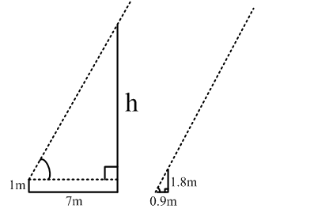

画图分析，因为光线与地面夹角固定，故大小两个三角形相似，则可得(h-1)/1.8=7/0.9，解得h=15米。

方法二：由题意，真实长度与影子长度为2∶1，墙上的影子长度投影到地上才是真实的影子长度，即影子总长为7＋0.5＝7.5米，电线杆高度为7.5×2＝15米。

故正确答案为C。

**考点**：几何结论类-相似图形

**来源**：2013年国家公务员录用考试《行测》题第62题

### 第 63 题

某汽车厂生产甲、乙、丙三种车型，其中乙型产量的3倍与丙型产量的6倍之和等于甲型产量的4倍，甲型产量与乙型的2倍之和等于丙型产量的7倍。则甲、乙、丙三型产量之比为：

A. 5:4:3

B. 4:3:2

C. 4:2:1

D. 3:2:1

第 63 题 · 答案与解析

**参考答案（粉笔题库参考内容）**

D

**解析**

设甲的产量为x，乙的产量为y，丙的产量为z。则可得如下：3y＋6z＝4x，x＋2y＝7z，直接代入选项验证，可知只有D项符合。

故正确答案为D。

秒杀技：

得到3y+6z＝4x后，观察该式，可知x应为3的倍数，只有D项符合。

故正确答案为D。

**考点**：和差倍比问题

**来源**：2013年国家公务员录用考试《行测》题第63题

### 第 64 题

甲和乙进行打靶比赛，各打两发子弹，中靶数量多的人获胜。甲每发子弹中靶的概率是60%，而乙每发子弹中靶的概率是30%。则比赛中乙战胜甲的可能性为：

A. 小于5%

B. 在5%~10%之间

C. 在10%~15%之间

D. 大于15%

第 64 题 · 答案与解析

**参考答案（粉笔题库参考内容）**

C

**解析**

方法一：根据题意，乙战胜甲，包含两种情况：

（1）乙命中两次，而甲命中少于两次。乙命中两次的概率为：30% × 30% = 9%，甲命中少于两次的概率为：1 − 60% × 60% = 64%，根据乘法原理有9%×64%=5.76%。

（2）乙命中一次，甲没有命中。

乙命中一次的概率为：C2^1×30%×(1-30%) = 42%，甲没有命中的概率为：(1 − 60%) × (1 − 60%) = 16%，根据乘法原理有42% × 16% = 6.72%。两种情况相加：5.76%+6.72%=12.48%，在10%~15%之间。

方法二：分类思想：（全概率公式）乙战胜甲的概率＝乙中2×（甲中0＋甲中1）＋乙中1×（甲中0）＝0.3×0.3×（0.4×0.4＋2×0.6×0.4）＋2×0.3×0.7×0.4×0.4＝12.48%。

故正确答案为C。

**考点**：给概率求概率

**来源**：2013年国家公务员录用考试《行测》题第64题

### 第 65 题

某单位组织党员参加党史、党风廉政建设、科学发展观和业务能力四项培训，要求每名党员参加且只参加其中的两项。无论如何安排，都有至少5名党员参加的培训完全相同，问该单位至少有多少名党员？

A. 17

B. 21

C. 25

D. 29

第 65 题 · 答案与解析

**参考答案（粉笔题库参考内容）**

C

**解析**

共4门课程，每名党员任选2门，有C_4^2=6种选法；根据最不利原则，每种选法中最多有4名党员，此时再增加一名党员必然有一种培训方案有5名党员参加。则该单位至少有4 × 6 + 1 = 25名党员。

故正确答案为C。

**考点**：基础排列组合、最不利构造

**来源**：2013年国家公务员录用考试《行测》题第65题

### 第 66 题

某种汉堡包每个成本4.5元，售价10.5元。当天卖不完的汉堡包即不再出售，在过去十天里，餐厅每天都会准备200个汉堡包，其中有六天正好卖完，四天各剩余25个。问这十天该餐厅卖汉堡包共赚了多少元？

A. 10850

B. 10950

C. 11050

D. 11350

第 66 题 · 答案与解析

**参考答案（粉笔题库参考内容）**

B

**解析**

方法一：总利润＝6×（200×6＋175×4）＋（-4.5）×（25×4）＝10950元；

方法二：总成本为4.5×200×10＝9000元，总售价为10.5×200×6＋10.5×4×175＝19950元，故利润为19950-9000=10950元；

方法三：考虑数字特性，卖出1个获利6元，未卖出赔4.5元，即总利润为3的倍数，观察选项只有B项满足。

故正确答案为B。

**考点**：经济利润问题

**来源**：2013年国家公务员录用考试《行测》题第66题

### 第 67 题

某人银行账户今年底余额减去1500元后，正好比去年底余额减少了25%，去年底余额比前年余额的120%少2000元，则此人银行账户今年底余额一定比前年底余额：

A. 多1000元

B. 少1000元

C. 多10%

D. 少10%

第 67 题 · 答案与解析

**参考答案（粉笔题库参考内容）**

D

**解析**

设前年底余额为m元，则去年为(1.2m－2000)元，今年为[0.75×(1.2m−2000)+1500]元，化简得今年为0.9m元，即今年底余额比前年底减少10%。

故正确答案为D。

**考点**：和差倍比问题

**来源**：2013年国家公务员录用考试《行测》题第67题

### 第 68 题

书架的某一层上有136本书，且是按照“3本小说、4本教材、5本工具书、7本科技书、3本小说、4本教材……”的顺序循环从左至右排列的。问该层最右边的一本是什么书：

A. 小说

B. 教材

C. 工具书

D. 科技书

第 68 题 · 答案与解析

**参考答案（粉笔题库参考内容）**

A

**解析**

循环周期为3＋4＋5＋7＝19，= 136/19 = 7余3，即7个周期多3本，则最右边的一本书是小说。

故正确答案为A。

**考点**：周期余数问题

**来源**：2013年国家公务员录用考试《行测》题第68题

### 第 69 题

根据国务院办公厅部分节假日安排的通知，某年8月份有22个工作日，那么当年的8月1日可能是：

A. 周一或周三

B. 周三或周日

C. 周一或周四

D. 周四或周日

第 69 题 · 答案与解析

**参考答案（粉笔题库参考内容）**

D

**解析**

8月份为31天，有22个工作日，则休息日有9天，而31天大于四周小于五周，故有两种情况：①1号为周日，保证休息日为1＋2×4＝9天；②31号为周六，保证休息日为2×4＋1＝9天，则3号为周六，此时1号为周四。

故正确答案为D。

**考点**：星期日期问题

**来源**：2013年国家公务员录用考试《行测》题第69题

### 第 70 题

某河段中的沉积河沙可供80人连续开采6个月或60人连续开采10个月。如果要保证该河段河沙不被开采枯竭，问最多可供多少人进行连续不间断的开采？（假定该河段河沙沉积的速度相对稳定）

A. 25

B. 30

C. 35

D. 40

第 70 题 · 答案与解析

**参考答案（粉笔题库参考内容）**

B

**解析**

牛吃草问题，设河沙初始量为M，每月沉积量为N。则有：M = (80 - N) × 6 = (60 - N) × 10，解得N＝30，即每个月的沉积量可供30人开采；可知当开采人数为30时，才能保证连续不间断地开采。

故正确答案为B。

**来源**：2013年国家公务员录用考试《行测》题第70题

### 第 71 题

公路上有三辆同向行驶的汽车，其中甲车的时速为63公里，乙、丙两车的时速均为60公里，但由于水箱故障，丙车每连续行驶30分钟后必须停车2分钟。早上10点，三车到达同一位置，问1小时后，甲、丙两车最多相距多少公里？

A. 5

B. 7

C. 9

D. 11

第 71 题 · 答案与解析

**参考答案（粉笔题库参考内容）**

B

**解析**

在这1个小时中，丙车最多休息4分钟，（行驶到10点，休息2分钟，继续行驶30分钟再休息2分钟，共计4分钟），也即丙在一个小时内最少行程为60×56÷60＝56公里。而甲车持续行驶，可达63公里。因此两车最多相距7公里。

故正确答案为B。

**考点**：普通行程

**来源**：2013年国家公务员录用考试《行测》题第71题

### 第 72 题

某市园林部门计划对市区内30处绿化带进行补栽，每处绿化带补栽方案可从甲、乙两种方案中任选其中一方案进行。甲方案补栽阔叶树80株、针叶树40株；乙方案补栽阔叶树50株、针叶树90株。现有阔叶树苗2070株、针叶树苗1800株，为最大限度利用这批树苗，甲、乙两种方案应各选：

A. 甲方案18个、乙方案12个

B. 甲方案17个、乙方案13个

C. 甲方案20个、乙方案10个

D. 甲方案19个、乙方案11个

第 72 题 · 答案与解析

**参考答案（粉笔题库参考内容）**

A

**解析**

假定甲方案X个、乙方案Y个，根据题意：X＋Y＝30，80X＋50Y≤2070，40X＋90Y≤1800，并使得数字越接近2070和1800越好。可直接将选项代入验证。首选甲方案或乙方案最多的两个极端情况（极端情况很有可能不符合而被排除），若为C项，则80×20＋50×10＝2100＞2070，排除；若为B项，则40×17+90×13=1850>1800，排除。若为A项，阔叶树用80×18＋50×12＝2040株，针叶树40×18＋90×12＝1800株，剩余30株；若为D项，阔叶树用80×19＋50×11＝2070株，针叶树40×19＋90×11＝1750株，剩余50株。

故正确答案为A。

**考点**：统筹规划问题

**来源**：2013年国家公务员录用考试《行测》题第72题

### 第 73 题

小王参加了五门百分制的测验，每门成绩都是整数，其中语文94分，数学的得分最高，外语的得分等于语文和物理的平均分，物理的得分等于五门的平均分，化学的得分比外语多2分，并且是五门中第二高的得分，问小王的物理考了多少分？

A. 94

B. 95

C. 96

D. 97

第 73 题 · 答案与解析

**参考答案（粉笔题库参考内容）**

C

**解析**

已知语文94分，外语的得分等于语文和物理的平均分，而每门成绩都是整数，则可知物理成绩必为偶数，排除B、D两项；代入A项，物理94分，已知数学最高，化学第二高，物理为平均分，则物理不可能为94分，否则平均分大于94分，排除A项。

故正确答案为C。

**考点**：和差倍比问题

**来源**：2013年国家公务员录用考试《行测》题第73题

### 第 74 题

两个派出所某月内共受理案件160起，其中甲派出所受理的案件中有17%是刑事案件，乙派出所受理的案件中有20%是刑事案件，问乙派出所在这个月中共受理多少起非刑事案件？

A. 48

B. 60

C. 72

D. 96

第 74 题 · 答案与解析

**参考答案（粉笔题库参考内容）**

A

**解析**

已知甲派出所受理案件的17%为刑事案件，则甲受理案件数必为100的倍数，才能保证刑事案件数为整数。根据题意，甲派出所受理案件只能为100起，故乙派出所受理案件为60起，可得乙受理非刑事案件数为60 × (1 − 20%) = 48起。

故正确答案为A。

**考点**：和差倍比问题

**来源**：2013年国家公务员录用考试《行测》题第74题

### 第 75 题

若干个相同的立方体摆在一起，前、后、左、右的视图都是，问这堆立方体最少有多少个？

A. 4

B. 6

C. 8

D. 10

第 75 题 · 答案与解析

**参考答案（粉笔题库参考内容）**

A

**解析**

从最少的情况考虑，如下图所示即可实现。 右图为俯视情况，其中阴影位置表示放置立方体的位置，仅需4个即可达成。

故正确答案为A。

**考点**：几何公式类-立体图形、几何结论类-几何小题型

**来源**：2013年国家公务员录用考试《行测》题第75题

### 第 76 题

从所给的四个选项中，选择最合适的一个填入问号处，使之呈现一定的规律性：

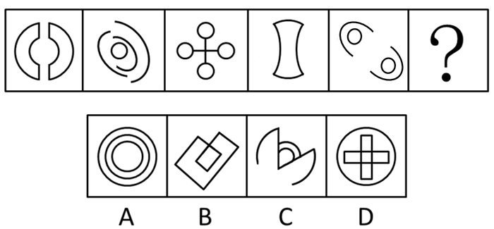

A. A

B. B

C. C

D. D

第 76 题 · 答案与解析

**参考答案（粉笔题库参考内容）**

C

**解析**

元素组成凌乱，考查数数。题干图形中曲线条数都为4，所以选有4条曲线的图形，只有C项符合。

A、B、D三项图形中曲线条数分别为3、0、1。

故正确答案为C。

**考点**：数量规律-线

**来源**：2013年国家公务员录用考试《行测》题第76题

### 第 77 题

从所给的四个选项中，选择最合适的一个填入问号处，使之呈现一定的规律性：

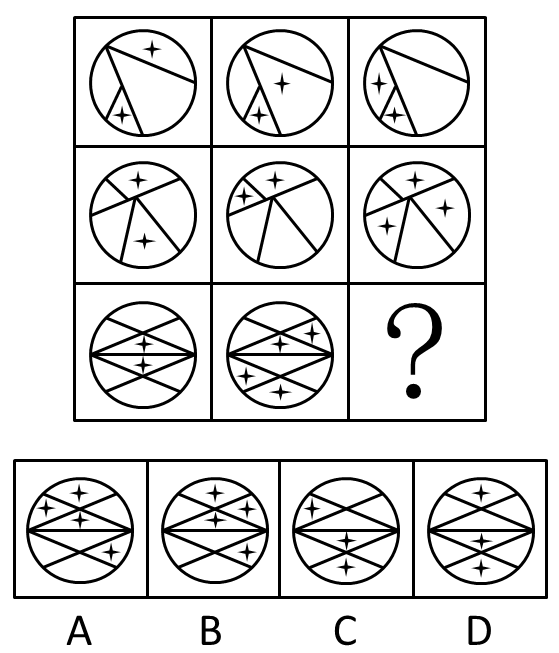

A. A

B. B

C. C

D. D

第 77 题 · 答案与解析

**参考答案（粉笔题库参考内容）**

A

**解析**

列出4个公式，以第一行来看：白＋白＝星，白＋星＝白，星＋星＝星，星＋白＝白。第二行验证此规律成立，第三行运用此规律。

故正确答案为A。

**考点**：样式规律-黑白运算

**来源**：2013年国家公务员录用考试《行测》题第77题

### 第 78 题

从所给的四个选项中，选择最合适的一个填入问号处，使之呈现一定的规律性：

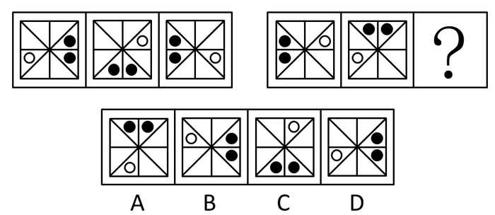

A. A

B. B

C. C

D. D

第 78 题 · 答案与解析

**参考答案（粉笔题库参考内容）**

B

**解析**

元素组成相同，位置不同，考查位置。在第一组图形中，两个黑色小球整体移动两次，每次沿顺时针平移两格；白色小球移动两次，先平移到对角线位置，再顺时针平移一格。第二组图形也应符合这个规律。

故正确答案为B。

**考点**：位置规律-平移

**来源**：2013年国家公务员录用考试《行测》题第78题

### 第 79 题

一立方体如图所示从中挖掉一个圆锥体，然后从任意面剖开，下面哪一项不可能是该立方体的截面：

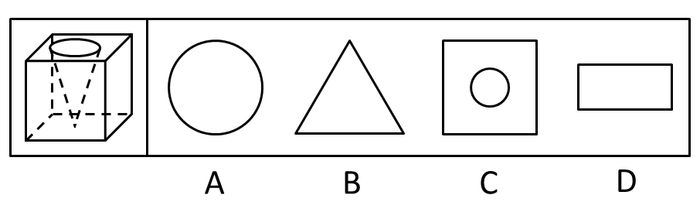

A. A

B. B

C. C

D. D

第 79 题 · 答案与解析

**参考答案（粉笔题库参考内容）**

A

**解析**

本题考查截面图。

B、C、D三项所示的截面图均能从题干所示立体图形中截到，具体剖切方式分别对应如下图1、图2、图3所示。

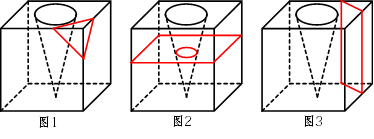

由于截面只能从一条棱或者一个面作为截面的起始点，在起始点中不存在弧线，A项是无法得到的。

本题为选非题，故正确答案为A。

**考点**：空间类-截面图

**来源**：2013年国家公务员录用考试《行测》题第79题

### 第 80 题

左边给定的是纸盒的外表面，下面哪一项能由它折叠而成：

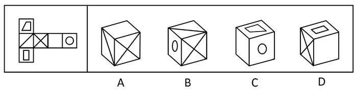

A. A

B. B

C. C

D. D

第 80 题 · 答案与解析

**参考答案（粉笔题库参考内容）**

C

**解析**

本题考查平面图形折成立体图形。根据“相对面不能同时出现在立体图形中”，2和5为对立面，4和6为对立面，故A、B两项错误；D项中长方形的长边应与3和4的公共边平行，所以D项错误。

故正确答案为C。

**考点**：空间类-空间重构-六面体

**来源**：2013年国家公务员录用考试《行测》题第80题

### 第 81 题

把下面的六个图形分为两类，使每一类图形都有各自的共同特征或规律，分类正确的一项是：

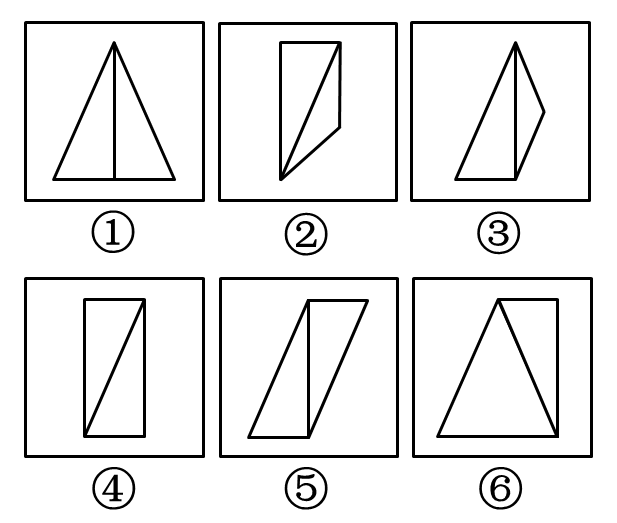

A. ①④⑥，②③⑤

B. ①④⑤，②③⑥

C. ①②⑤，③④⑥

D. ①③⑥，②④⑤

第 81 题 · 答案与解析

**参考答案（粉笔题库参考内容）**

B

**解析**

数直角三角形。每个图形都由两个三角形组成，且都包含直角三角形，所以数直角三角形的个数。①④⑤中都包含两个直角三角形，②③⑥中都包含一个直角三角形。

故正确答案为B。

**考点**：数量规律-角

**来源**：2013年国家公务员录用考试《行测》题第81题

### 第 82 题

把下面的六个图形分为两类，使每一类图形都有各自的共同特征或规律，分类正确的一项是：

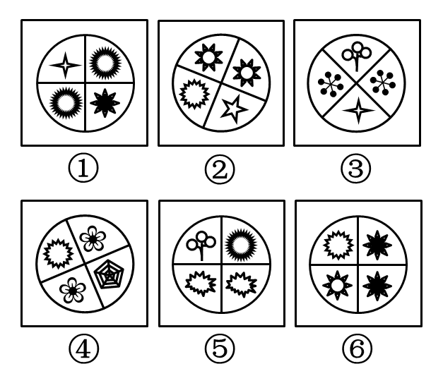

A. ①③⑤，②④⑥

B. ①④⑥，②③⑤

C. ①③④，②⑤⑥

D. ①②⑤，③④⑥

第 82 题 · 答案与解析

**参考答案（粉笔题库参考内容）**

C

**解析**

每个图形内部存在元素相似或相同，所以考查每个图形的内部特征。①③④中相同的两个图案在对角位置相邻，②⑤⑥中相同的两个图案在同侧位置。

故正确答案为C。

**考点**：数量规律-素

**来源**：2013年国家公务员录用考试《行测》题第82题

### 第 83 题

把下面的六个图形分为两类，使每一类图形都有各自的共同特征或规律，分类正确的一项是：

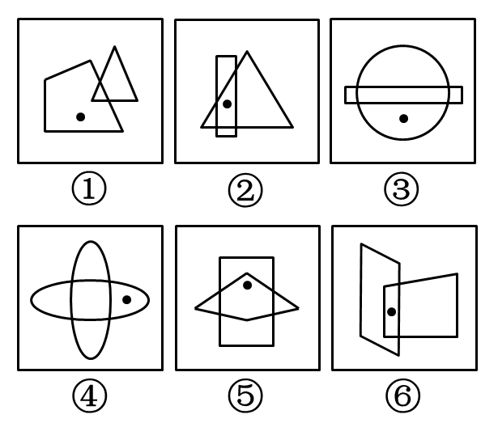

A. ①⑤⑥，②③④

B. ①③④，②⑤⑥

C. ①②④，③⑤⑥

D. ①②⑤，③④⑥

第 83 题 · 答案与解析

**参考答案（粉笔题库参考内容）**

B

**解析**

特殊考点，观察标记的点。每组图形都是由两个相交图形和一个黑点组成。黑点所在位置不同，起到了区分作用。①③④中的黑点不在图形的相交区域内，②⑤⑥中的黑点则在两个图形的相交区域内。

故正确答案为B。

**考点**：特殊规律-功能元素

**来源**：2013年国家公务员录用考试《行测》题第83题

### 第 84 题

把下面的六个图形分为两类，使每一类图形都有各自的共同特征或规律，分类正确的一项是：

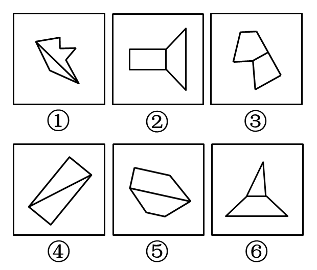

A. ①③⑥，②④⑤

B. ①②⑤，③④⑥

C. ①②⑥，③④⑤

D. ①④⑤，②③⑥

第 84 题 · 答案与解析

**参考答案（粉笔题库参考内容）**

D

**解析**

特殊考点——考查图形内部组成特征。每组图形都是由两个图形连接而成，所以观察每组图形的内部特征。①④⑤中两个图形的交线是两个元素最长的线段，②③⑥中两个图形的交线是两个元素最短的线段。

故正确答案为D。

**考点**：特殊规律-图形间关系

**来源**：2013年国家公务员录用考试《行测》题第84题

### 第 85 题

把下面的六个图形分为两类，使每一类图形都有各自的共同特征或规律，分类正确的一项是：

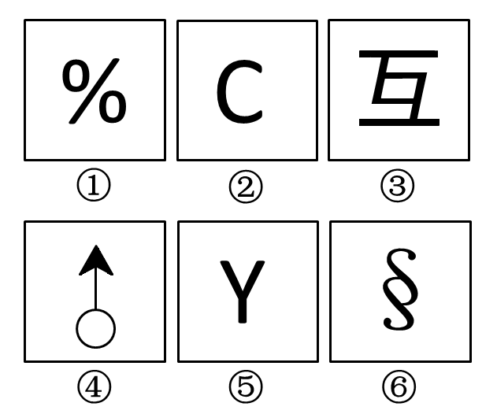

A. ①②④，③⑤⑥

B. ①②③，④⑤⑥

C. ①③⑥，②④⑤

D. ①③⑤，②④⑥

第 85 题 · 答案与解析

**参考答案（粉笔题库参考内容）**

C

**解析**

元素组成凌乱，考对称属性。①③⑥中的图形满足中心对称，②④⑤中的图形满足轴对称。

故正确答案为C。

**考点**：属性规律-对称性

**来源**：2013年国家公务员录用考试《行测》题第85题

### 第 86 题

职业认同是指个人对所从事的职业主观建构的、与职业特征联系在一起的认知和感受，常常包括职业角色的意义感和价值感、职业是否有乐趣和吸引力等。职业认同分为过程性职业认同和状态性职业认同。其中过程性职业认同是指个体从自己经历中逐渐发展出的认同自己职业角色的过程；状态性职业认同是指个体当前对自己所从事职业的认同程度。

根据上述定义，下列属于过程性职业认同的是：

A. 身为一名警察，老张几十年如一日，始终将维护公共安全的原则牢记于心

B. 李老师凭借自己灵活的授课方式赢得最佳教师奖，为此她深感自豪

C. 听完老党员的模范事迹，小赵顿时感觉到作为一名党员干部身上肩负的重任

D. 陈医生行医多年，“救死扶伤”四个字已从字面意思转变为人生追求

第 86 题 · 答案与解析

**参考答案（粉笔题库参考内容）**

D

**解析**

第一步：抓住定义中的关键词。“过程性职业认同”的关键词强调“自己经历”“逐渐发展的”“认同自己职业角色”“过程”。第二步：逐一判断选项。A项中老张“几十年如一日”，说明每天都如此，没有体现“从自己的经历中逐渐发展”。故A项错误，排除；B项中李老师是为自己获奖而感到自豪，不是对职业角色本身的认同，也没有体现“从自己的经历中逐渐发展”。故B项错误，排除；C项中老党员的模范事迹不属于小赵自己的经历，且党员不是一种职业。故C项错误，排除；D项中陈医生行医是自己经历，“救死扶伤”属于职业角色，“多年”“从字面意思转变为人生追求”表明是一个逐步发展的过程，符合定义要件，当选。

故正确答案为D。

**考点**：常规问法

**来源**：2013年国家公务员录用考试《行测》题第86题

### 第 87 题

获致身份是指一个人经历某种公开的、具有竞争性的奋争或因具备某种特殊的本领而获得的社会地位。

根据上述定义，下列选项符合获致身份说法的是：

A. 生子当如孙仲谋

B. 王侯将相宁有种乎

C. 忠臣必出孝子之门

D. 上品无寒门，下品无士族

第 87 题 · 答案与解析

**参考答案（粉笔题库参考内容）**

B

**解析**

第一步：抓住定义中的关键词。关键词强调“公开的、具有竞争性的奋争”“具备某种特殊的本领”“社会地位”。第二步：逐一判断选项。A、C、D三项中都强调的是世袭和血统，不是通过公开的、具有竞争性的奋争，也不具备特殊本领，只是对原有社会地位的继承，不符合定义，故排除；B项的意思是“有权有势的高贵的人，难道生来就比别人高贵吗？王侯将相的贵都是靠自己打拼出来的”，符合定义要件，当选。

故正确答案为B。

**考点**：原因结果

**来源**：2013年国家公务员录用考试《行测》题第87题

### 第 88 题

制度的反功能指的是该制度实现了系统的某些功能之后而产生的副作用，诸如破坏该系统的内部协调、稳定关系，造成系统内部冲突，对系统良性运行产生破坏作用等现象。

根据上述定义，下列涉及制度的反功能的是：

A. 某校实行绩效考核，实行一段时间后引发了教师争抢上课、乱发文章等一系列问题

B. 某售楼处规定销售额可以提成，结果某销售员一个月卖房近50套

C. 一对夫妻新婚后实行家庭消费AA制，一段时间后觉得不方便就取消了

D. 某部门实行人性化管理，结果上班迟到现象反而比实行考勤制度时减少了

第 88 题 · 答案与解析

**参考答案（粉笔题库参考内容）**

A

**解析**

第一步：抓住定义中的关键词。关键词强调“实现了系统的某些功能”“副作用”；副作用包括“破坏该系统的内部协调、稳定关系”“造成系统内部冲突”“对系统良性运行产生破坏作用”等。第二步：逐一判断选项。A项中学校实现了“绩效考核”这种功能，“教师争抢上课、乱发文章等一系列问题”是产生的副作用，符合定义要件，当选；B项中规定销售额可以提成，而“销售员一个月卖房近50套”是促进了销售，不属于副作用，故B项错误，排除；C项中夫妻实行消费AA制，“感觉不方便就取消”并没有破坏夫妻关系，不属于副作用，故C项错误，排除；D项中某部门实行人性化管理，“上班迟到现象减少”有助于部门的管理，不属于副作用，故D项错误，排除。

故正确答案为A。

**考点**：原因结果

**来源**：2013年国家公务员录用考试《行测》题第88题

### 第 89 题

优势富集效应是一种起点发展理论，是指起点上的微小优势经过关键过程的级数放大，产生更大级别的优势积累。

根据上述定义，下列不属于优势富集效应的是：

A. 某名牌大学建校时间很早，文化传统悠久，并拥有政策、资金等多方面支持，全国许多优秀的学生填写高考志愿时都选择了该校

B. 上海的金茂大厦楼体高度略微超过“东方明珠”电视塔，被誉为“中华第一高楼”，因此吸引了众多游客和广告商，各类会议也常在此举办，呈现后来居上的态势

C. 某教育培训机构为了拓展业务，也像别的培训机构那样，通过发送宣传单来进行宣传，后来随着规模的不断扩大，服务质量也更上一层楼，成为业内的典范

D. 某服装品牌设立之初，最先提出要做“夹克之王”的理念，并通过电视媒体进行推广，后来这个概念逐渐被人们认可，许多人认为买夹克就应该买这个品牌的

第 89 题 · 答案与解析

**参考答案（粉笔题库参考内容）**

C

**解析**

第一步：抓住定义中的关键词。关键词强调“起点上的微小优势”“关键过程的级数放大”“更大级别的优势积累”。第二步：逐一判断选项。A项中“建校时间很早”“拥有政策、资金等多方面支持”“许多优秀的学生……都选择了该校”，对应三个定义要件，符合定义，排除；B项中“楼体略微超过”“吸引了众多游客和广告商，各类会议也常在此举办”“呈现后来居上的态势”，对应三个定义要件，符合定义，排除；C项中某教育培训机构采用和其他机构一样的宣传方式，没有体现起点上的微小优势，不符合定义，当选；D中“最先提出”“通过电视媒体进行推广”“许多人认为买夹克就应该买这个品牌”，对应三个定义要件，符合定义，排除。

本题为选非题，故正确答案为C。

**考点**：单定义-其他句式

**来源**：2013年国家公务员录用考试《行测》题第89题

### 第 90 题

“翻异别勘”是宋代为防止冤假错案而规定的复审制度，是指犯人如果在录问或行刑时提出申诉，案件必须重新审理。宋代的“翻异别勘”分为原审机关的“移司别勘”和“差官别勘”两种形式。“移司别勘”是指由原审机关将案子交给另一个同级的司法机关复审。“差官别勘”是指原审机关将案子申报到上级机关，由上级机关负责差派与原审机关不相干的另外一个机关的官员重新审理。这种情况下，往往或者是差派上级机关的官员前往原审机关主审，或者将案子移往上级机关复审。

根据上述定义，下列不属于“翻异别勘”的是：

A. 犯人对州县审理的案件提出申诉，可以将案件移交至州县的上级——路的长官进行重审。

B. 宋代中央司法机关刑部分左、右两厅，对其中一厅审理的案件，若犯人提出申诉，则由另一厅重审。

C. 犯人对州县审理的案件提出申诉，州县的上级——路的长官可以亲至州县对案件进行重审。

D. 宋代地方司法机关从上至下分为路、州、县三级，对由县上诉至州的案件作出判决后，若犯人提出申诉，则由州发回县重审。

第 90 题 · 答案与解析

**参考答案（粉笔题库参考内容）**

D

**解析**

第一步：抓住定义中的关键词。“翻异别勘”包括“移司别勘”和“差官别勘”，“移司别勘”强调关键词“交给另一个同级的司法机关复审”；“差官别勘”强调关键词“申报到上级机关”，“差派官员前往原审机关主审”和“移往上级机关复审”中的一个。第二步：逐一判断选项。A项中符合“申报到上级机关”“移往上级机关复审”，属于“差官别勘”，排除；B项中符合“交给另一个同级的司法机关复审”，属于“移司别勘”，排除；C项中符合“申报到上级机关”、“差派官员前往原审机关主审”，属于“差官别勘”，排除；D项中提到了“申报到上级机关”，所以将其限定在“差官别勘”的范畴内进行判断，但由于其不满足“差派官员前往原审机关主审”和“移往上级机关复审”中的任何一个，故D项不属于“差官别勘”，当选。

本题为选非题，故正确答案为D。

**考点**：常规问法

**来源**：2013年国家公务员录用考试《行测》题第90题

### 第 91 题

求助者有两种求助动机：执行性求助和工具性求助。前者是自己不作任何尝试或努力，只想知道答案或让他人代自己完成任务；后者是借助其他人的力量以达到自己解决问题或实现目标的目的。

根据上述定义，下列属于工具性求助的是：

A. 妈妈为五岁的小明报了很多兴趣班，小明在兴趣班中结识了许多新朋友

B. 家教老师耐心讲解了这道题的思路和原理后，小斌还是请老师直接给出答案

C. 综合了多家咨询机构提供的意见，小峰拟定了符合自身条件的出国学习规划

D. 小文每次阅读英语文章遇到生词时都会查阅电子词典，掌握生词的读音和意思

第 91 题 · 答案与解析

**参考答案（粉笔题库参考内容）**

C

**解析**

第一步：抓住定义中的关键词。

由题干可知，执行性求助和工具性求助都是因为自身需要解决问题或实现目标。执行性求助关键词强调“自己不作任何尝试或努力”；工具性求助关键词强调“借助其他人的力量”“自己解决”。

第二步：逐一判断选项。

A项中妈妈为小明报兴趣班，没有体现妈妈的目标或遇到的问题，不符合定义要件，排除；B项中小斌自己不作任何尝试或努力，只想老师给出答案，属于执行性求助，排除；C项中小峰借助多家咨询机构提供的意见，自己拟定符合自身条件的出国学习规划，符合工具性求助的两个要件，当选；D项中小文每次都借助工具来掌握生词，不是由自己解决，而且电子词典不属于“其他人的力量”，不符合定义要件，排除。

故正确答案为C。

**考点**：常规问法

**来源**：2013年国家公务员录用考试《行测》题第91题

### 第 92 题

生态演替是指在同一地段上生物群落有规律的更替过程，分为原生演替和次生演替两类。在过去从未有过植被，或者原来有过植被但被彻底破坏，原有植被下的土壤已不复存在的裸地上开始的演替称为原生演替；在原有植被虽已被破坏，但仍保持着土壤和植物繁殖体的地方开始的演替称为次生演替。发生次生演替的生物群落趋向于恢复到破坏前的形态。

根据上述定义，下列可能导致次生演替的情形是：

A. 人类将利用转基因技术培育的植物种子撒向森林

B. 某岛屿火山爆发之后，火山岩浆覆盖整座岛屿

C. 当森林被反复砍伐后，演化成为了稀疏的草原

D. 水坝建成后下游湖泊干涸，沿湖植被大多枯死

第 92 题 · 答案与解析

**参考答案（粉笔题库参考内容）**

D

**解析**

第一步：找出定义关键词。

“原有植被已被破坏”、“仍保持着土壤和植物繁殖体的地方开始的演替”、“趋向于恢复到破坏前的状态”。

第二步：逐一分析选项。

A项：将种子撒向森林，并没有体现出原来的植被已被破坏，不符合“原有植被已被破坏”，不符合定义，排除；

B项：火山岩浆覆盖整个岛屿，说明原来的植被被彻底的破坏，属于原生演替，而不是次生演替，不符合定义，排除；

C项：森林被反复砍伐后，但是最终却演化成了草原，不符合“趋向于恢复到破坏前的状态”，不符合定义，排除；

D项：沿湖植被枯死，符合“原有植被已被破坏”，如果这些植物的繁殖体依然存在的话，就有可能重新生长出来，符合“趋向于恢复到破坏前的状态”，符合定义，当选。

故正确答案为D。

**考点**：常规问法

**来源**：2013年国家公务员录用考试《行测》题第92题

### 第 93 题

电子反对抗是指防止敌方或己方的电子对抗措施影响己方的设备和人员作战效能所进行的各种活动，以防护己方的战斗力不遭受其损害，主要措施包含电子反侦察、电子反干扰、抗反辐射摧毁、抗定向能致盲和抗计算机病毒传染。

根据上述定义，下列选项不涉及电子反对抗的是：

A. 军事演习前，演习指挥中心提前对使用的电脑进行病毒查杀

B. 发射车向敌方发射反辐射导弹，关闭己方电子设备以免误击

C. 军舰在冲突海域降低雷达发射信号功率，并设置反辐射诱饵

D. 为对抗敌方电子干扰，指挥部决定重要指令用固定电话下达

第 93 题 · 答案与解析

**参考答案（粉笔题库参考内容）**

D

**解析**

第一步：抓住定义中的关键词。关键词强调“电子对抗措施”“影响己方设备和人员作战效能”。电子反对抗主要包括“电子反侦察”“电子反干扰”“抗反辐射摧毁”“抗定向能致盲”“抗计算机病毒传染”。第二步：逐一判断选项。A项符合“抗计算机病毒传染”这一项措施；B项和C项都符合“抗反辐射摧毁”这一项措施，都属于电子反对抗；D项中重要指令用固定电话下达，固定电话的手段不属于“电子反侦察、电子反干扰、抗反辐射摧毁、抗定向能致盲和抗计算机病毒传染”的范畴，所以不属于电子反对抗。

本题为选非题，故正确答案为D。

注：有同学选到A是因为其是在“军事演习前”发生的，而实际上，A项采取的措施和达到的目的并不受演习前或后的时间影响，并不能根据这点排除。

**考点**：方式目的

**来源**：2013年国家公务员录用考试《行测》题第93题

### 第 94 题

文化自觉是指生活在一定文化中的人，对自己的文化有“自知之明”，即明白它的来历、形成过程、特色和发展趋向，从而增强自身文化转型的能力，并获得在新的时代条件下进行文化选择的能力和地位。此外，文化自觉还表现为应具有世界眼光，能够理解别的民族的文化，增强与不同文化之间接触、对话、相处的能力。

根据上述定义，下列选项属于文化自觉的是：

A. 经谈判，中方同意增加美国电影进入中国市场的配额

B. 为保护贵州梭嘎苗族文化习俗建立了梭嘎生态博物馆

C. 赵武灵王的“胡服骑射”与北魏拓跋氏的“禁断胡语”

D. 湖北省襄樊市与河南省南阳市都自称是“诸葛亮故里”

第 94 题 · 答案与解析

**参考答案（粉笔题库参考内容）**

C

**解析**

第一步：抓住定义中的关键词。关键词强调“生活在一定文化中的人”“自知之明”“自身文化转型”“获得在新的时代条件下进行文化选择的能力和地位”“理解别的民族的文化，增强与不同文化之间接触、对话、相处的能力”。第二步：逐一判断选项。A项中只是在原有基础上提高了配额，不符合任何定义要件，排除；B项中只体现了对自己文化的保护，没有体现“自身文化转型”的能力，排除；C项中的“胡服骑射”和“禁断胡语”分别是赵武灵王和北魏拓跋氏对于其他民族文化的学习与肯定，体现了定义要件，当选；D项中两个城市争夺“诸葛亮故里”，违背了“自知之明”这一点，排除。

故正确答案为C。

**考点**：单定义-其他句式

**来源**：2013年国家公务员录用考试《行测》题第94题

### 第 95 题

偶然音乐是指音乐家在创作中将偶然性因素引入创造过程或演奏过程的一种音乐形式。具体方法包括：谱写作品时采用随意手法，允许演奏者进行没有任何提示的即兴演奏，甚至以改造乐器或加入场外声响来演奏曲目。

根据上述定义，下列选项不属于偶然音乐的是：

A. 指挥家在演出前随机决定使用乐器的数量、演出时长以及参演人数

B. 在钢琴琴弦中塞进橡皮和铁钉等物以模拟打击乐的声响来演奏音乐

C. 用掷骰子、丢硬币来确定作品的音高、力度与配器等并创作成曲谱

D. 演奏者保持沉默，此时台上台下偶然出现的掌声、笑声构成了乐曲

第 95 题 · 答案与解析

**参考答案（粉笔题库参考内容）**

A

**解析**

第一步：抓住定义中的关键词。关键词强调“偶然性因素”“创造过程或演奏过程”，“偶然性因素”包括“谱写作品时采用随意手法”“即兴演奏”“改造乐器”“加入场外声响”。第二步：逐一判断选项。A项中行为不符合“偶然性因素”包括的几个方面，所以不是偶然音乐；B项是一种“改造乐器”的行为，属于演奏过程中的“偶然性因素”；C项是一种“谱写作品时采用随意手法”的行为，属于创作过程中的“偶然性因素”；D项是一种“加入场外声响”的行为，属于演奏过程中的“偶然性因素”。B、C、D三项都属于偶然音乐。

本题为选非题，故正确答案为A。

**考点**：单定义-其他句式

**来源**：2013年国家公务员录用考试《行测》题第95题

### 第 96 题

认真：一丝不苟

A. 清楚：一清二楚

B. 正确：分毫不差

C. 温暖：风和日丽

D. 干净：一尘不染

第 96 题 · 答案与解析

**参考答案（粉笔题库参考内容）**

D

**解析**

第一步：判断题干词语间逻辑关系。

认真和一丝不苟是近义关系，且第二个词的组成形式是“一……不……”。

第二步：判断选项词语间逻辑关系。

A项：清楚和一清二楚是近义关系，但第二个词的组成形式不是“一……不……”，与题干逻辑关系不一致，排除；

B项：分毫不差的近义词应该是准确而不是正确，二者不是近义关系，与题干逻辑关系不一致，排除；

C项：温暖形容天气的温度，风和日丽形容晴朗、暖和的天气，二者不是近义词，与题干逻辑关系不一致，排除；

D项：干净和一尘不染是近义关系，且第二个词的组成形式也是“一……不……”，与题干逻辑关系一致，当选。

故正确答案为D。

**考点**：语义-其他

**来源**：2013年国家公务员录用考试《行测》题第96题

### 第 97 题

火炬：蜡烛

A. 中药：草药

B. 矿石：煤炭

C. 棉布：丝绸

D. 扇子：蚊香

第 97 题 · 答案与解析

**参考答案（粉笔题库参考内容）**

C

**解析**

第一步：判断题干词语间逻辑关系。

“火炬”和“蜡烛”都可以用来照明，二者为并列关系。

第二步：判断选项词语间逻辑关系。

A项：“草药”专指植物类的药物，“中药”指以中国传统医药理论指导并应用的药物，二者为交叉关系，与题干逻辑关系不一致，排除；

B项：“矿石”是指含有用矿物并有开采价值的岩石，“煤炭”是一种固体可燃性矿物，二者没有明显逻辑关系，与题干逻辑关系不一致，排除；

C项：“棉布”和“丝绸”都可以用来制作衣服，二者为并列关系，与题干逻辑关系一致，当选；

D项：扇子是纳凉的工具，蚊香是驱蚊的工具，二者没有明显的逻辑关系，与题干逻辑关系不一致，排除。

故正确答案为C。

**考点**：逻辑关系-并列关系

**来源**：2013年国家公务员录用考试《行测》题第97题

### 第 98 题

X光片：骨折

A. 卫星云图：降雨

B. 科普图书：知识

C. 电子导航：路线

D. 饮食习惯：健康

第 98 题 · 答案与解析

**参考答案（粉笔题库参考内容）**

A

**解析**

第一步：判断题干词语间逻辑关系。

题干两词是对应关系，通过“X光片”查看是否“骨折”。

第二步：判断选项词语间逻辑关系。

A项：通过“卫星云图”查看是否“降雨”，与题干逻辑关系一致，当选；

B项：“科普图书”用来学习“知识”，与题干逻辑关系不一致，排除；

C项：“电子导航”用来规划“路线”，与题干逻辑关系不一致，排除；

D项：“饮食习惯”影响“健康”，与题干逻辑关系不一致，排除。

故正确答案为A。

**考点**：逻辑关系-对应关系

**来源**：2013年国家公务员录用考试《行测》题第98题

### 第 99 题

柏油公路:阳光大道

A. 蔚蓝行星:美丽地球

B. 纳米涂料:超级墙漆

C. 双峰骆驼:沙漠之舟

D. 液晶屏幕:璀璨荧屏

第 99 题 · 答案与解析

**参考答案（粉笔题库参考内容）**

D

**解析**

第一步：判断题干词语间逻辑关系。

 “柏油公路”和“阳光大道”均可以形容路，且前者是实际意义上的路，后者是象征意义上的路。

第二步：判断选项词语间逻辑关系。

A项：“蔚蓝行星”和“美丽地球”均可以形容地球，但前者是象征意义，后者是实际意义，顺序反了，与题干逻辑关系不一致，排除；

B项：“纳米涂料”是一种“超级墙漆”，二者为种属关系，与题干逻辑关系不一致，排除；

C项：“双峰骆驼”是骆驼的一种，“沙漠之舟”即骆驼，二者是种属关系，与题干逻辑关系不一致，排除；

D项：“液晶屏幕”和“璀璨荧屏”均可以形容屏幕，且“液晶屏幕”是实际意义上的屏幕，“璀璨荧屏”是象征意义上的屏幕，与题干逻辑关系一致，当选。

故正确答案为D。

**考点**：语义关系-比喻象征义

**来源**：2013年国家公务员录用考试《行测》题第99题

### 第 100 题

新月:满月:残月

A. 生产:销售:消费

B. 含苞:怒放:凋零

C. 早晨:中午:夜晚

D. 春困:秋乏:冬眠

第 100 题 · 答案与解析

**参考答案（粉笔题库参考内容）**

B

**解析**

第一步：判断题干词语间逻辑关系。题干三词为并列关系，新月、满月和残月是指月亮的变化过程，且通过某一具体事物的变化来表现时间的变化。第二步：判断选项词语间逻辑关系。A项中生产、销售和消费是产品在流通过程中的三个阶段，并未体现产品自身的变化过程；B项与题干逻辑关系相同，含苞、怒放和凋零为花的变化过程，通过某一具体事物的变化来表现时间的变化；C项中早晨、中午和夜晚是一天三个时间段对应的称呼，并非变化过程；D项中春困、秋乏、冬眠指三个季节对动物造成的影响，动物本身并没有发生变化。

故正确答案为B。

**考点**：逻辑关系-对应关系

**来源**：2013年国家公务员录用考试《行测》题第100题

### 第 101 题

出征:击鼓:士气

A. 比赛:呐喊:信心

B. 生产:监督:效率

C. 喝酒:谈判:气氛

D. 宣传:登报:名气

第 101 题 · 答案与解析

**参考答案（粉笔题库参考内容）**

A

**解析**

第一步：判断题干词语间逻辑关系。题干三词为对应关系，“出征”时“击鼓”可以鼓舞“士气”。第二步：判断选项词语间逻辑关系。与题干逻辑关系相同的只有A项，“比赛”时“呐喊”可以增强“信心”，当选；B项中“生产”时“监督”可以保证“质量”，而不是“效率”，对应错误，排除；C项中“谈判”时“喝酒”可以缓和“气氛”，而不是“喝酒”时“谈判”可以缓和“气氛”，逻辑顺序错误，排除；D项中“登报”是“宣传”的一种手段，不符合题干中的对应关系，排除。

故正确答案为A。

**考点**：语法关系、逻辑关系-对应关系

**来源**：2013年国家公务员录用考试《行测》题第101题

### 第 102 题

电动车：摩托车：救护车

A. 乒乓球：保龄球：羽毛球

B. 葡萄酒：香槟酒：保健酒

C. 天鹅绒：清洁绒：法兰绒

D. 联谊部：俱乐部：文学部

第 102 题 · 答案与解析

**参考答案（粉笔题库参考内容）**

B

**解析**

第一步：判断题干词语间逻辑关系。

“电动车”是按照驱动来源命名的；“摩托车”是音译词；“救护车”是按照功能用途命名的。三者命名方式均不相同。

第二步：判断选项词语间逻辑关系。

A项：“乒乓球”是声译词；“保龄球”是音译词；“羽毛球”是按照原材料材质命名的，三者命名方式均不相同，保留；

B项：“葡萄酒”是按照原材料来源命名的；“香槟酒”是音译词；“保健酒”是按照功能用途命名的，三者命名方式均不相同，保留；

C项：“天鹅绒”，原材料为蚕丝，手感像天鹅的羽毛，是按照属性命名的；“清洁绒”是按照功能用途命名的；“法兰绒”是音译词，三者命名方式均不相同，保留。

D项：“联谊部”、“文学部”，均是按照功能用途命名的，与题干逻辑关系不一致，排除。

对比A、B、C项，题干后两者命名方式分别为音译词和功能，只有B项与题干两者命名方式相同且顺序相同，因此通过对比择优，B项与题干更为一致。

故正确答案为B。

**考点**：逻辑关系-并列关系

**来源**：2013年国家公务员录用考试《行测》题第102题

### 第 103 题

风险:规避:损失

A. 保险:购买:赔偿

B. 老人:关爱:长寿

C. 锻炼:加强:肥胖

D. 军队:保卫:战争

第 103 题 · 答案与解析

**参考答案（粉笔题库参考内容）**

C

**解析**

第一步：判断题干词语间逻辑关系。题干三词为对应关系，“规避”“风险”可以避免“损失”。

第二步：判断选项词语间逻辑关系。A项中“购买”“保险”可以得到“赔偿”，并非避免，排除；B项中“关爱”“老人”，“老人”可以“长寿”，逻辑关系与题干不符，排除；C项与题干逻辑关系相同，“加强”“锻炼”可以避免“肥胖”，当选；D项中“军队”“战争”是为了“保卫”国家，逻辑关系与题干不符，排除。

故正确答案为C。

**考点**：语法关系、逻辑关系-对应关系

**来源**：2013年国家公务员录用考试《行测》题第103题

### 第 104 题

（  ） 对于 邮费 相当于 纬度 对于 （  ）

A. 邮局 国家

B. 重量 气候

C. 邮票 经度

D. 距离 时区

第 104 题 · 答案与解析

**参考答案（粉笔题库参考内容）**

B

**解析**

第一步：将选项逐一代入，判断各选项前后部分的逻辑关系。A项代入前一组为对应关系，在“邮局”办理业务需要支付“邮费”；后一组没有明显的逻辑关系，前后逻辑关系不一致，排除。B项代入前一组为因果关系，“重量”影响“邮费”；后一组也是因果关系，“纬度”影响“气候”，前后逻辑关系一致，当选。C项代入前一组为对应关系；后一组“纬度”和“经度”是并列关系，前后逻辑关系不一致，排除。D项代入前一组为因果关系，“距离”影响“邮费”；后一组无逻辑关系，前后逻辑关系不一致，排除。

第二步：前后逻辑关系一致的为正确答案。

故正确答案为B。

**考点**：逻辑关系-对应关系

**来源**：2013年国家公务员录用考试《行测》题第104题

### 第 105 题

（  ） 对于 感时花溅泪 相当于 高兴 对于 （  ）

A. 伤心 含情杏花喜

B. 哀伤 一日看尽长安花

C. 多情 化作春泥更护花

D. 憔悴 人比黄花瘦

第 105 题 · 答案与解析

**参考答案（粉笔题库参考内容）**

B

**解析**

第一步：将选项逐一代入，判断各选项前后部分的逻辑关系。C、D两项首先排除掉，选项中前后词没有对应关系，代入题干后没有明显的逻辑关系；分别代入A、B两项，“感时花溅泪”表现了“伤心”“哀伤”的情绪；“含情杏花喜”表达了作者对于汉高祖刘邦统一天下时的憧憬，而不是“高兴”；“一日看尽长安花”表达的是中了进士之后，骑着马一天就把长安的花都看了个遍的欣喜与高兴。

第二步：前后逻辑关系一致的为正确答案。

故正确答案为B。

**考点**：语义关系-比喻象征义

**来源**：2013年国家公务员录用考试《行测》题第105题

### 第 106 题

研究显示，在115摄氏度下，将甜玉米分别加热10分钟、25分钟和50分钟后发现，其抗自由基的活性分别升高了22%、44%和53%，因此，加热时间越长的玉米，抗衰老的作用越好。

以下各项如果为真，无法削弱上述结论的是：

A. 加热65分钟后，玉米抗自由基的活性反而降低了

B. 与甜玉米相比，糯玉米在加热相同时间后，其抗自由基的活性增高的幅度很小

C. 甜玉米是玉米中比较少见的一种，不具有代表性

D. 对于玉米来说，并非是抗自由基的活性越高，其抗衰老的作用越好

第 106 题 · 答案与解析

**参考答案（粉笔题库参考内容）**

B

**解析**

第一步：找出论点和论据。本题论点是加热时间越长的玉米，活性越高，抗衰老作用越好。论据：研究显示，在115摄氏度下，将甜玉米分别加热10分钟、25分钟和50分钟后发现，其抗自由基的活性分别升高了22%、44%和53%。

第二步：逐一判断选项的作用。A项否定加热时间属于举反例，排除；C项样本不典型，属于拆桥，排除；D项否认活性越高，抗衰老作用越好，属于拆桥。B项糯玉米抗自由基的活性增高的幅度小，但也有增高，无法削弱论点，当选。

本题为选非题，故正确答案为B。

**考点**：削弱-实验类、削弱选非题

**来源**：2013年国家公务员录用考试《行测》题第106题

### 第 107 题

5000多年前某地是大汶口文化，但在距今约4400年的时候，为龙山文化所替代。是什么原因导致这两种文化的更迭？考古人员发现，在距今约4400年的时候，发生了一次严重的“冷事件”，环境由原来的温暖湿润转变为寒冷干燥，植被大量减少，藻类、水生植物基本绝迹了，大汶口文化向南迁移，而龙山文化由北迁到此地。他们据此认为，距今4400年左右的极端气候变化，可能是导致这次文化变迁的主要原因。

以下哪项如果为真，最能支持上述论证：

A. 大汶口文化有不断向南方迁移的传统

B. 龙山文化刚迁来时，人口较多，但之后逐渐减少，在距今约4000年的时候消失了

C. 大汶口文化的族群以藻类和水生植物作为食物的主要来源

D. 不同生存方式的族群对气候和环境都有相对稳定的需求

第 107 题 · 答案与解析

**参考答案（粉笔题库参考内容）**

D

**解析**

第一步：找出论点和论据。本题论点是距今4400年左右的极端气候变化，可能是导致这次文化变迁的主要原因。论据是在距今约4400年的时候，发生了一次严重的“冷事件”，环境由原来的温暖湿润转变为寒冷干燥，植被大量减少，藻类、水生植物基本绝迹了，大汶口文化向南迁移，而龙山文化由北迁到此地。第二步：判断加强方式。本题论点和论据间存在因果关系，所以需加强论点。第三步：逐一判断选项的作用。A项否定了大汶口文化是因为“冷事件”而向南迁移的，削弱了论点，排除；B项龙山文化迁到此地后的发展状况与文化变迁无关，属无关选项，排除；C项只能说明大汶口文化南迁是因为“冷事件”，不能说明龙山文化迁来此地也是因为“冷事件”，不能加强论点，排除；D项不同生存方式的族群对气候和环境都有相对稳定的需求，即此次文化的变迁是由于气候变化导致当地的气候不能适应族群的需要，不同的族群才开始迁移到适合自己生存的气候的地方，加强了论点，当选。

故正确答案为D。

**考点**：补充论据

**来源**：2013年国家公务员录用考试《行测》题第107题

### 第 108 题

有研究表明，要成为男性至少需要拥有一条Y染色体。3亿年前，男性特有的Y染色体在产生之际含有1438个基因，但现在只剩下45个。按照这种速度，Y染色体将在大约1000万年内消失殆尽。因此，随着Y染色体的消亡，人类也将走向消亡。

如果以下各项为真，最不能质疑上述论证的是：

A. 恒河猴Y染色体基因确实经历过早期高速的丧失过程，但在过去的2500万年内则未丢失任何一个基因

B. 男性即使失去Y染色体也有可能继续生存下去，因为其他染色体有类似基因可以分担Y染色体的功能

C. 人类进化过程中，可以找到单性繁殖或无性繁殖后代的方法，从而避免因基因缺失引发的繁殖风险

D. Y染色体存在独特的回文结构，该结构具有自我修复功能，可以保持丢失基因的信息，实现基因再生

第 108 题 · 答案与解析

**参考答案（粉笔题库参考内容）**

A

**解析**

第一步：找到论点和论据。

论点：随着Y染色体的消亡，人类也将走向消亡。

论据：成为男性至少需要拥有一条Y染色体，但人类男性Y染色体所含的基因在不断减少。

第二步：逐一分析选项。

A项：该项说的是恒河猴的Y染色体，与人类无关，属无关选项，当选；

B项：如果有其他染色体能够替代Y染色体的话，那么随着Y染色体的消亡，人类并不会消亡，直接削弱了论点，排除；

C项：如果能够找到其他繁殖后代的方法，那么随着Y染色体的消亡，人类也不会消亡，直接削弱了论点，排除；

D项：Y染色体的回文结构能够自我修复，也就是说Y染色体不会消亡，否定了论据，排除。

本题为选非题，故正确答案为A。

**考点**：削弱选非题

**来源**：2013年国家公务员录用考试《行测》题第108题

### 第 109 题

我国的佛教寺庙分布于全国各地，普济寺是我国的佛教寺庙，所以普济寺分布于我国各地。

下列选项中所犯逻辑错误与上述推理最为相似的是：

A. 父母酗酒的孩子爱冒险，小华爱冒险，所以小华的父母酗酒

B. 文明公民都是遵纪守法的，有些大学生遵纪守法，所以有些大学生是文明公民

C. 寒门学子上大学机会减少，大学生小飞不是寒门学子，所以小飞上大学的机会不会减少

D. 现在的独生子女娇生惯养，何况他还是三代单传的独苗呢

第 109 题 · 答案与解析

**参考答案（粉笔题库参考内容）**

D

**解析**

第一步：抓住题干主要信息。

题干推理过程为佛教寺庙→全国各地，普济寺→佛教寺庙，所以，普济寺→全国各地。题干将“我国的佛教寺庙”这一普遍概念的特性“分布于全国各地”，赋予了“普济寺”这一个体概念，导致逻辑错误。

第二步：逐一分析选项。

A项：父母酗酒→孩子冒险，小华冒险→小华的父母酗酒，“小华冒险”是肯定后件，无法推出绝对表达的结论，排除；

B项：文明公民→遵纪守法，有些大学生→遵纪守法，所以有些大学生→文明公民，“遵纪守法”属肯定后件，无法推出绝对表达的结论，排除；

C项：寒门学子→上学机会少，小飞→–寒门学子，所以，小飞→–上学机会少，“–寒门学子”属否定前件，无法推出绝对表达的结论，排除；

D项：独生子女→娇生惯养，他→独生子女，所以他→娇生惯养，将“现在的独生子女”这一普遍概念的特性“娇生惯养”，赋予了“他”这一个体概念，与题干逻辑错误相似，当选。

故正确答案为D。

**考点**：推理形式

**来源**：2013年国家公务员录用考试《行测》题第109题

### 第 110 题

某公司行政部人员手机使用情况如下：

①小王拨打过行政部所有人的电话；

②小李曾经拨打过小赵的电话，但是小赵不曾拨打过其他人的电话；

③不曾接听来自行政部其他人电话的人也就不曾拨打过其他人的电话。

由此可以推出：

A. 小赵不曾接听过来自小李的电话

B. 小李曾经接听过来自小王的电话

C. 行政部曾有人拨打过小王的电话

D. 小王接听过来自行政部所有人的电话

第 110 题 · 答案与解析

**参考答案（粉笔题库参考内容）**

C

**解析**

第一步：翻译题干。

利用充分必要条件。

①小王拨打过行政部所有人的电话。

②小李曾经拨打过小赵的电话，但是小赵不曾拨打过其他人的电话是事实信息，即已经成立的事实。

③–接听来自行政部其他人电话的人→–拨打过其他人的电话。

第二步：逐一分析选项，得出结论。

A项：根据条件②可知，小赵不曾拨打过其他人的电话，这是对③后件的肯定，无法推出确定的结论，A项错误，排除；

B项：虽然①小王拨打过行政部所有人的电话，但是小李可以不接听电话，所以B项错误，排除；

C项：因为①小王拨打过行政部所有人的电话，根据③的逆否规则，可推出小王一定接听过其他人的电话，即曾有人拨打过小王的电话，C项正确，当选；

D项：根据C项的分析，小王一定接听过其他人的电话，但不一定是所有人，排除。

故正确答案为C。

注：本题注意两个表达，一是一方给另一方拨打电话，但不见得另一方必须接电话；二是③表达中的前后句的“其他”并不是指同样的人，③句可理解为没有接听过电话的人就没有拨打过电话。

**考点**：常规翻译

**来源**：2013年国家公务员录用考试《行测》题第110题

### 第 111 题

现代企业在管理过程中发现，人力资源管理部门对于公司的发展虽然十分重要，但由于该部门并没有全程参与公司发展战略的决策，而且公司聘请的高级经理均由CEO决定，所以人力资源管理部门更多的时候起到的是支持和辅助的作用。

如果以下各项为真，最能削弱上述论证的是：

A. 世界500强的企业中，人力资源管理部门的员工一般都有丰富的经验

B. 人力资源管理部门能为公司设计出人性化的报酬体系，进而留住人才

C. 世界上最大的物流公司，人力资源部经理有权参加公司最高决策会议

D. 人力资源部虽没有决定雇用高级经理的权力，但有权雇用中层管理者

第 111 题 · 答案与解析

**参考答案（粉笔题库参考内容）**

C

**解析**

第一步：找出论点和论据。

论点：人力资源管理部门更多的时候起到的是支持和辅助的作用。

论据：人力资源部门并没有全程参与公司发展战略的决策，而且公司聘请的高级经理均由CEO决定。

第二步：逐一分析选项。

A项：人力资源部门员工有丰富的经验与该部门是否全程参与公司发展战略的决策无关，属无关选项，排除；

B项：招到人才并留住人才，到底属于决定性作用还是辅助作用，没有明确说明，属于不明确选项，排除；

C项：通过世界最大的物流公司的例子说明人力资源部门有机会全程参与公司发展规划的决策，削弱论据，当选；

D项：人力资源有权雇佣中层管理者，但是不明确中层管理者和支持和辅助作用的关系，不明确选项，排除。

故正确答案为C。

注：此题和2018年广州第73题题干类似，但是选项有很大区别，因为那道题的C选项明确说到人才是核心，所以人力资源管理部门能留住人才，这就不是辅助作用，直接削弱论点，所以2018年广州第73题择优选的是C项的削弱论点。

**考点**：削弱论据

**来源**：2013年国家公务员录用考试《行测》题第111题

### 第 112 题

有人说，工作的时候，我们要将重要事务放在主要位置，重要事务是必要条件，关系着一件事情成功与否，重要的事务没做好，一定不成功。但是，细节也是很重要的，细节是成功的充分条件，同样也与一件事情成功与否相关。一个成功的人是能够协调好重要事务与细节的关系的。

由此可推出：

A. 成功并不代表着所有细节都处理好了

B. 如果不成功则说明重要事务没有做好

C. 成功的前提条件是既要做好重要事务，又要处理好细节

D. 虽然处理好了细节，但没做好重要事务，也不一定成功

第 112 题 · 答案与解析

**参考答案（粉笔题库参考内容）**

A

**解析**

第一步：翻译题干。利用充分条件和必要条件。第一句：相当于说重要事务是成功的必要条件，可翻译为“成功→重要事务”，第二句：细节是成功的充分条件，可翻译为“细节→成功”。①②可根据传递推理得到，“细节→成功→重要事务”。第二步：逐一翻译选项并判断选项的正误。利用逆否规则。A项：成功不一定能推出细节，“成功”属肯定后件，无法推出绝对化结论，但可推出可能性结论，A项正确，当选；B项：–成功→–重要事务，“–成功”属否定前件，无法推出绝对化结论，B项错误，排除；C项：成功→重要事务∧细节，虽然成功能推出重要事务，但成功不能推出细节，C项错误，排除；D项：“细节”属于对串联关系的肯前，肯前必肯后，可以推出“成功”，进而推出“重要事务”，因此，该项中“处理好了细节，但没做好重要事务”的情况不存在，该项无法推出，排除。

故正确答案为A。

**考点**：常规翻译

**来源**：2013年国家公务员录用考试《行测》题第112题

### 第 113 题

在不同语言中，数字的发音和写法都不一样。一些科学家认为，代表不同文化背景的语言，会对人们大脑处理数学信息的方式产生影响。

以下哪项如果为真，最能支持上述结论：

A. 相比欧洲，亚洲地区的人们在进行数量大小比较时，大脑中个别区域的活跃程度有所不同

B. 在同一国家，不同方言区的人们进行数学运算时，大脑语言区的神经传递路线并不十分一致

C. 研究发现，以英语为母语的人进行心算时主要依赖大脑的语言区，而以中文为母语的人主要动用了大脑的视觉信息识别区

D. 研究发现，不同专业背景的人们在计算数学题时会选择不同的思考方法，但都会不同程度地依赖大脑的语言区

第 113 题 · 答案与解析

**参考答案（粉笔题库参考内容）**

C

**解析**

第一步：找出论点和论据。

本题论点是代表不同文化背景的语言，会对人们大脑处理数学信息的方式产生影响。

没有论据。

第二步：逐一分析选项。

A项：“亚洲地区的人们”没有说明是不同的语言，排除；

B项：说的是不同的方言，但是也属于同一语言范畴，排除；

C项：以英语为母语的人和以中文为母语的人进行心算时分别使用了大脑的语言区和视觉信息识别区，而英语与汉语指的是不同文化背景的语言，同时也提到了在处理数学信息时候用到的方式不同，支持了论点，当选；

D项：是不同专业背景，属无关项，排除。

故正确答案为C。

**考点**：补充论据

**来源**：2013年国家公务员录用考试《行测》题第113题

### 第 114 题

20世纪50年代以来，人类丢弃了多达10亿吨塑料，这种垃圾可能存在数百年甚至数千年。近日，一个科研小组在亚马逊雨林中发现一种名为内生菌的真菌，它能降解普通的聚氨酯塑料。科研人员认为利用这种真菌的特性，将有望帮助人类消除塑料垃圾所带来的威胁。

科研人员的判断还需基于以下哪一前提：

A. 塑料垃圾是人类活动产生的最主要的废弃物种类

B. 内生菌在任何条件下都可以很好地分解塑料制品

C. 目前绝大多数塑料垃圾都属于普通的聚氨酯塑料

D. 这种真菌在地球上其他地区也能正常地存活生长

第 114 题 · 答案与解析

**参考答案（粉笔题库参考内容）**

C

**解析**

第一步：找出论点和论据。论点：这种真菌将有望帮助人类消除塑料垃圾所带来的威胁；论据：一种名为内生菌的真菌能降解普通的聚氨酯塑料。第二步：判断加强方式。本题论点说的是塑料垃圾，论据说的是普通的聚氨酯塑料，论点和论据间对象不一致，需要在二者间搭桥加强论证。第三步：逐一判断选项的作用。A项：只提到塑料垃圾是最重要的废弃物种类，是背景介绍，与真菌能否分解无关，属无关选项，排除；B项：如果内生菌仅能在某个特定条件下才能很好地分解塑料制品的话，那么人们人为创造出这种环境即可，因此不能作为题干的前提，排除；C项：在塑料垃圾和聚氨酯塑料之间进行了搭桥，建立了联系，加强了论证，能够作为题干的前提，当选；D项：如果这种真菌不能在地球的其他地方很好地生存也没关系，只需要把人类的塑料制品都运到亚马逊丛林中就可以了，因此也不能作为题干的前提，排除。

故正确答案为C。

**考点**：搭桥

**来源**：2013年国家公务员录用考试《行测》题第114题

### 第 115 题

生物处于污染条件下，可以通过结合固定、代谢解毒、分室作用等过程将污染物在体内富集、解毒。其中生物的解毒能力是生物抗性的基础，解毒能力强的生物都具有抗性，但解毒能力不是抗性的全部，抗性强的生物不一定解毒能力就强。

由此可以推知：

A. 解毒能力不强的生物不具有抗性

B. 具有抗性的生物一定具有较强的解毒能力

C. 生物可将污染物富集、解毒，所以生物能在污染环境下生存

D. 不具有抗性的生物解毒能力一定不强

第 115 题 · 答案与解析

**参考答案（粉笔题库参考内容）**

D

**解析**

第一步：翻译题干。根据充分必要条件。①生物抗性→生物的解毒能力；②解毒能力强的生物→具有抗性的生物；③解毒能力不是抗性的全部；④抗性强的生物不一定解毒能力就强。第二步：逐一翻译选项并判断正确选项。利用逆否规则。A项可翻译为“–解毒能力强的生物→–具有抗性的生物”，“解毒能力不强的生物”是对②的前件的否定，否定前件无法推出否定后件，故A项无法从题干推出，排除；B项可翻译为“具有抗性的生物→解毒能力强的生物”，“具有抗性的生物”是对②的后件的肯定，肯定后件无法推出肯定前件，故B项无法从题干推出，排除；C项：题干只说生物在污染条件下会将污染物在体内富集、解毒，但没有说明这种富集、解毒跟在污染环境下生存的关系，无法推出，排除；D项可翻译为“–具有抗性的生物→–解毒能力强的生物”，是②的逆否命题，符合逆否规则，为有效的推理，可从题干推出，当选。

故正确答案为D。

**考点**：常规翻译

**来源**：2013年国家公务员录用考试《行测》题第115题

## 材料 1

2011年前十一个月，某省高新技术产业完成总产值3763.00亿元，实现增加值896.31亿元。增加值同比增长30.74%，比规模以上工业增加值高11.64个百分点，占规模以上工业增加值的比重达到25.32%。高新技术产业各领域的增加值如下图所示：

高新技术产业各领域增加值饼形图（单位：亿元）

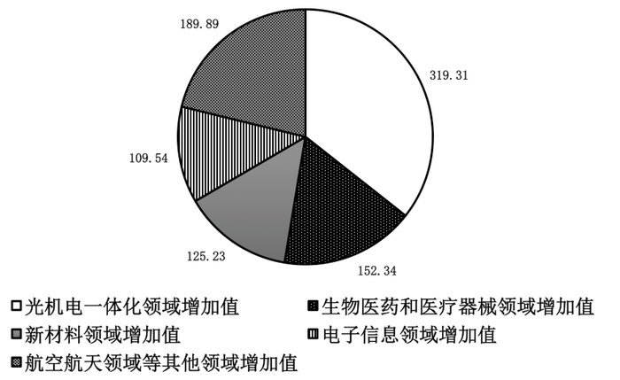

### 第 116 题

2011年前十一个月，该省规模以上工业增加值同比增长约为多少：

A. 11.64%

B. 19.10%

C. 30.74%

D. 42.38%

第 116 题 · 答案与解析

**参考答案（粉笔题库参考内容）**

B

**解析**

定位文字材料可得：2011年前十一个月，某省高新技术产业增加值同比增长30.74%，比规模以上工业增加值高11.64个百分点。故2011年前十一个月，该省规模以上工业增加值同比增长30.74%－11.64%＝19.10%。

故正确答案为B。

**考点**：简单加减计算、综合资料

**来源**：2013年国家公务员录用考试《行测》题第116题

### 第 117 题

2010年前十一个月，该省规模以上工业增加值约为多少亿元：

A. 2972

B. 3540

C. 3865

D. 4373

第 117 题 · 答案与解析

**参考答案（粉笔题库参考内容）**

A

**解析**

根据题干所求“2010年前十一个月，该省规模以上工业增加值”，结合材料数据时间为2011年前十一个月，判定本题为基期计算问题。定位文字材料可得“2011年前十一个月，某省高新技术产业······实现增加值896.31亿元。增加值同比增长30.74%，比规模以上工业增加值高11.64个百分点，占规模以上工业增加值的比重达到25.32%。”故2011年前十一个月，该省规模以上工业增加值为896.31/25.32%，增长率为30.74%-11.64%=19.10%，则2010年前十一个月，该省规模以上工业增加值为现期量/(1+增长率)=896.31/(25.32%×(1+19.10%))= 896.31/(25.32% × 1.191) ≈ 896/(0.25 × 1.20) ≈ 2986亿元，与A项最接近。

故正确答案为A。

**考点**：基期计算、综合资料

**来源**：2013年国家公务员录用考试《行测》题第117题

### 第 118 题

2011年前十一个月，光机电一体化领域实现增加值与生物医药和医疗器械领域、新材料领域、电子信息领域增加值总和的比约为：

A. 3:5

B. 3:4

C. 5:6

D. 9:10

第 118 题 · 答案与解析

**参考答案（粉笔题库参考内容）**

C

**解析**

根据题干“2011年前十一个月，······与······总和的比约为”，结合选项均为比值形式，可判定此题为比值计算问题。定位饼状图可得：光机电一体化领域实现增加值为319.31亿元，生物医药和医疗器械领域、新材料领域、电子信息领域增加值总和为152.34+125.23+109.54亿元。故该比值为319.31/(152.34+125.23+109.54) ≈ 320/(150+125+110) = 320/385 ≈ 5/6。

故正确答案为C。

**考点**：比值计算、综合资料

**来源**：2013年国家公务员录用考试《行测》题第118题

### 第 119 题

若该省高新技术产业增加值保持同样的增长速度，则2012年前十一个月高新技术产业增加值比2010年同期约增加多少亿元：

A. 210.7

B. 486.3

C. 275.5

D. 685.6

第 119 题 · 答案与解析

**参考答案（粉笔题库参考内容）**

B

**解析**

根据题干“······比······约增加······亿元”，可判定此题为增长量计算问题。定位文字材料可得：2011年前十一个月，该省高新技术产业实现增加值896.31亿元，增加值同比增长30.74%。根据增长量计算公式，2012年前十一个月高新技术产业增加值比2011年同期的增长量=基期量×增长率=896.31×30.74%≈900×30%=270亿元；2011年前十一个月高新技术产业增加值比2010年同期的增长量 = 现期 × 增长率/(1+增长率)= (896.31×30.74%)/(1+30.74%) ≈ (900×(1/3))/(1+1/3) = 900/4 = 225亿元。所以2012年前十一个月高新技术产业增加值比2010年同期约增加270+225=495亿元，与B项最接近。

故正确答案为B。

**考点**：增长量计算、综合资料

**来源**：2013年国家公务员录用考试《行测》题第119题

### 第 120 题

关于该省高新技术产业各领域增加值情况，下列说法错误的是：

A. 生物医药和医疗器械领域的增加值超过全省高新技术产业增加值的1/6

B. 光机电一体化领域与新材料领域增加值之和大约是全省高新技术产业增加值的1/2

C. 航空航天等其他领域实现的增加值可能不到全省高新技术产业增加值的1/3

D. 生物医药和医疗器械领域与电子信息领域增加值之和不到全省高新技术产业增加值的1/4

第 120 题 · 答案与解析

**参考答案（粉笔题库参考内容）**

D

**解析**

A项：定位文字材料，全省高新技术产业增加值为896.31亿元；定位饼状图材料，生物医药和医疗器械领域增加值为152.34亿元。而152.34 ＞ 896.31/6 ≈ 149，正确；

B项：定位文字材料，全省高新技术产业增加值为896.31亿元；定位饼状图材料，光机电一体化领域与新材料领域增加值之和为（319.31+125.23）亿元。则光机电一体化领域与新材料领域增加值所占比重 = (319.31+125.23)/896.31 ≈ (319+125)/896 = 444/896 ≈ 1/2 ，正确；

C项：定位文字材料，全省高新技术产业增加值为896.31亿元；定位饼状图材料，航空航天等其他领域增加值为189.89亿元。而189.89＜896.31/3≈299，正确；

D项：定位文字材料，全省高新技术产业增加值为896.31亿元；定位饼状图材料，生物医药和医疗器械领域与电子信息领域增加值为（152.34+109.54）≈（152+110）=262亿元。而262 ＞ 896.31/4 ≈ 224，错误。

本题为选非题，故正确答案为D。

**考点**：综合分析、综合资料

**来源**：2013年国家公务员录用考试《行测》题第120题

## 材料 2

2011年发现违法用地行为7.0万件，涉及土地5.0万公顷（耕地1.8万公顷），同比分别上升5.8%、11.0%（耕地下降2.4%）。立案查处违法用地案件4.2万件，涉及土地4.4万公顷（耕地1.5万公顷），同比分别上升2.5%、11.4%（耕地下降5.7%）。依法拆除违法构建物1289.8万平方米，收回土地3791.2公顷（耕地1064.7公顷），罚没款26.5亿元。

2006~2011年我国违法用地案件查处情况（一）

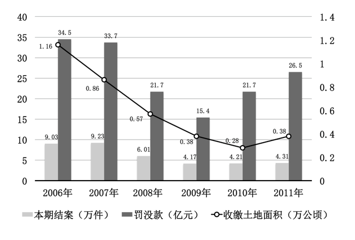

2006~2011年我国违法用地案件查处情况（二）  单位：件，公顷

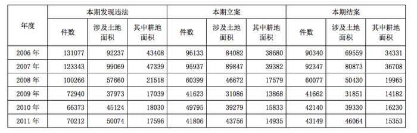

| 年度 | 本期发现违法 件数 | 本期发现违法 涉及土地面积 | 本期发现违法 其中耕地面积 | 本期立案 件数 | 本期立案 涉及土地面积 | 本期立案 其中耕地面积 | 本期结案 件数 | 本期结案 涉及土地面积 | 本期结案 其中耕地面积 |
| --- | --- | --- | --- | --- | --- | --- | --- | --- | --- |
| 2006年 | 131077 | 92237 | 43408 | 96133 | 84082 | 38680 | 90340 | 69559 | 34331 |
| 2007年 | 123343 | 99069 | 47339 | 95937 | 89847 | 39382 | 92347 | 80873 | 36708 |
| 2008年 | 100266 | 57660 | 21518 | 60399 | 46672 | 17579 | 60077 | 50430 | 19965 |
| 2009年 | 72940 | 37973 | 17039 | 41623 | 31086 | 13868 | 41662 | 31851 | 14182 |
| 2010年 | 66373 | 45124 | 18030 | 49795 | 39279 | 15833 | 42140 | 39330 | 16230 |
| 2011年 | 70212 | 50074 | 17596 | 41806 | 43756 | 14935 | 43149 | 46064 | 15353 |

### 第 121 题

与2006年相比，2011年全国收缴土地面积约减少了：

A. 52%

B. 110%

C. 67%

D. 205%

第 121 题 · 答案与解析

**参考答案（粉笔题库参考内容）**

C

**解析**

根据题干“与2006年相比，2011年全国收缴土地面积约减少了”，结合选项均为百分数，可判定本题为一般增长率问题。定位图表材料柱状图可得：2006年和2011年收缴土地面积分别为1.16万公顷和0.38万公顷。根据增长率计算公式，增长率 = (现期 − 基期)/基期可得，与2006年相比，2011年全国收缴土地面积的增长率为(0.38 − 1.16)/1.16 = (−0.78)/1.16 ≈ (−0.78)/1.2 = −65%，即减少了65%，与C项最接近。

故正确答案为C。

**考点**：一般增长率、综合资料

**来源**：2013年国家公务员录用考试《行测》题第121题

### 第 122 题

2011年结案的案件中，平均每个案件的罚没款约为多少万元：

A. 0.56

B. 1.13

C. 3.78

D. 6.14

第 122 题 · 答案与解析

**参考答案（粉笔题库参考内容）**

D

**解析**

根据题干“2011年······平均每个······”，可判定此题为现期平均数问题。定位图表材料柱状图可得：2011年结案4.31万件，罚没款26.5亿元。故2011年结案的案件中，平均每个案件的罚没款= 总罚没款/结案数 = 26.5/4.31 ≈ 6.1万元，与D项最接近。

故正确答案为D。

**考点**：现期平均数、综合资料

**来源**：2013年国家公务员录用考试《行测》题第122题

### 第 123 题

2011年，发现违法但未立案的违法用地行为占发现违法用地行为总数的比重约为多少：

A. 59.5%

B. 40.5%

C. 38.5%

D. 61.5%

第 123 题 · 答案与解析

**参考答案（粉笔题库参考内容）**

B

**解析**

根据题干“2011年······占······的比重”，可判定此题为现期比重问题。定位文字材料（或者表格材料最后一行）可得：2011年发现违法用地行为7.0万件，立案查处违法用地案件4.2万件。故2011年，发现违法但未立案的违法用地行为占发现违法用地行为总数的比重约为部分/整体 = (7.0 - 4.2)/7.0 = 2.8/7.0 = 40%，与B项最接近。

故正确答案为B。

**考点**：现期比重、综合资料

**来源**：2013年国家公务员录用考试《行测》题第123题

### 第 124 题

下列年份中，本期结案中涉及的耕地面积占结案涉及土地面积比重最高的是：

A. 2006年

B. 2008年

C. 2010年

D. 2011年

第 124 题 · 答案与解析

**参考答案（粉笔题库参考内容）**

A

**解析**

根据题干“下列年份中······占······比重”，可判定此题为现期比重问题。定位表格材料可得选项数据的结案涉及耕地面积和结案涉及土地面积。则2006、2008、2010和2011年结案涉及耕地面积占涉及土地面积比重分别为34331/69559 ≈ 34/70 ≈ 48%、 19965/50430≈20/50=40%、 16230/39330 ≈ 16/39 ≈ 41%、 15353/46064 ≈ 15/46 ≈ 33%，故2006年结案中涉及的耕地面积占结案涉及土地面积比重最高。

故正确答案为A。

**考点**：现期比重、综合资料

**来源**：2013年国家公务员录用考试《行测》题第124题

### 第 125 题

能够从上述资料中推出的是：

A. 2006—2011年，违法用地案件查处中收缴土地面积逐年减少

B. 2006—2011年，违法用地案件查处中罚没款的变化趋势与收缴土地面积变化趋势完全一致

C. 2011年发现违法用地行为涉及土地面积中非耕地面积同比上升约20%

D. 2006年立案涉及的土地面积略小于2010年与2011年立案涉及土地面积之和

第 125 题 · 答案与解析

**参考答案（粉笔题库参考内容）**

C

**解析**

A项：定位图表材料可得， 2011年土地收缴面积为0.38万公顷高于2010年的0.28万公顷，并非逐年减少，错误；

B项：定位图表材料可得，土地罚款在2010年同比上升，但收缴土地面积同比下降，趋势并非完全一样，错误；

C项：定位表格材料可得，违法用地行为中，2011年的非耕地面积增长率为现期/基期-1=(50074-17596)/(45124-18030)-1≈(50000-17600)/(45100-18000)-1=324/271-1≈19.6%≈20%，正确；

D项: 定位表格材料可得，2006年立案涉及土地面积为84082公顷，2010年和2011年立案涉及土地面积之和=39279+43756&lt;40000+44000=84000公顷&lt;84082公顷，错误。

故正确答案为C。

**考点**：综合分析、综合资料

**来源**：2013年国家公务员录用考试《行测》题第125题

## 材料 3

截至2011年4月21日22时，沪深两市已有534家上市公司公布第一季度财报。这534家公司实现营业总收入4572.78亿元，同比增长30.74%；实现净利润336.7亿元，同比增长30.52%。不过，一季度销售收入和净利润环比则有所下降，其中营业总收入环比下降12%，净利润环比下降25%，这534家公司2011年一季度存货6167.68亿元，较上年年末增长10%。

        已公布一季报的创业板公司有71家，实现营业收入80.08亿元，同比增长73.60%；实现净利润13.16亿元，同比增长80%。已公布一季报的中小企业板公司有202家，实现营业收入789.97亿元，同比增长36%；实现净利润73.25亿元，同比增长25%。25家已公布一季报的房地产公司一季度实现营业收入193.68亿元，同比增长9%；实现净利润29.97亿元，同比增长31%；存货2892.18亿元，同比增长10%。

        已公布一季报的6家钢铁板块公司一季度存货为322亿元，实现营业收入493.39亿元，同比略有降低，环比下降20%；实现净利润12.65亿元，同比增长62%，环比表现更好，这6家公司2010年四季度净亏损3.77亿元。

        建筑机械类公司持续了之前的景气度，有4家公司公布一季报，实现营业总收入15.90亿元，同比增长39%；实现净利润1.18亿元，同比增长47.5%。

### 第 126 题

已公布一季报的534家公司，平均每家在2010年第四季度实现营业收入约多少亿元：

A. 0.63

B. 7.54

C. 8.56

D. 9.73

第 126 题 · 答案与解析

**参考答案（粉笔题库参考内容）**

D

**解析**

根据题干“······平均每家在2010年第四季度······”，结合材料数据时间为2011年一季度，可判定此题为基期平均数问题。定位文字材料第一段可得：2011年一季度这534家公司实现营业总收入4572.78亿元，营业总收入环比下降12%。则已公布一季报的534家公司，在2010年第四季度实现营业总收入约4572.78/(1+(-12%))≈4600/0.88≈5230亿元，故已公布一季报的534家公司，平均每家在2010年第四季度实现营业收入为营业收入/公司数 = 5230/534 ≈ 9.8亿元，与D项最接近。

故正确答案为D。

**考点**：基期平均数、文字资料

**来源**：2013年国家公务员录用考试《行测》题第126题

### 第 127 题

这534家公司中，平均每家中小企业板公司在2011年第一季度的净利润约是创业板公司的：

A. 2倍

B. 3倍

C. 4倍

D. 5倍

第 127 题 · 答案与解析

**参考答案（粉笔题库参考内容）**

A

**解析**

根据题干“这534家公司中······平均······在2011年第一季度······是······”，结合选项均是几倍以及材料数据时间为2011年一季度，可判定此题为现期倍数问题。定位文字材料第二段可得：2011年第一季度创业板公司有71家，实现净利润13.16亿元；中小企业板公司有202家，实现净利润73.25亿元。故这534家公司中，平均每家中小企业板公司在2011年第一季度的净利润约是创业板公司的73.25/202 ÷ 13.16/71 ≈ 73/200 × 71/13 = 5183/2600 ≈ 2倍。

故正确答案为A。

**考点**：文字资料、现期倍数

**来源**：2013年国家公务员录用考试《行测》题第127题

### 第 128 题

已公布2011年一季报的房地产公司中，平均每家公司的存货比上年同期增长了约多少亿元：

A. 5

B. 11

C. 51

D. 105

第 128 题 · 答案与解析

**参考答案（粉笔题库参考内容）**

B

**解析**

根据题干“2011年一季报······比上年同期增长了······亿元”，可判定此题为增长量计算问题。定位文字材料第二段可得：2011年25家已公布一季报的房地产公司一季度存货2892.18亿元，同比增长10%。根据增长量 = 现期 × 增长率/(1+增长率)可得，已公布2011年一季报的房地产公司存货比上年同期增长了约(2892.18 × 10%)/(1 + 10%) = (2892.18 × (1/10))/(1 + 1/10) = 2892.18/11 ≈ 2900/11 ≈ 264亿元，故已公布2011年一季报的房地产公司中，平均每家公司的存货比上年同期增长了约264/25 ≈ 10.6亿元，与B项最接近。

故正确答案为B。

**考点**：增长量计算、文字资料

**来源**：2013年国家公务员录用考试《行测》题第128题

### 第 129 题

已经公布一季报的钢铁板块公司2010年第四季度的净利率（净利润比营业收入）约为：

A. 2.57%

B. 1.80%

C. -0.96%

D. -0.61%

第 129 题 · 答案与解析

**参考答案（粉笔题库参考内容）**

D

**解析**

根据题干括号内提示：净利率为净利润比营业收入，可判定此题为比值计算问题。定位材料第三段可得：已公布一季报的6家钢铁板块公司一季度实现营业收入493.39亿元，环比下降20%，这6家公司2010年四季度净亏损3.77亿元。则根据净利率 = 净利润/营业收入可得已经公布一季报的钢铁板块公司2010年第四季度的净利率为−3.77÷(493.39/(1+(−20%)))=(−3.77×0.8)/493.39≈−3/490≈−0.6%，与D项最接近。

故正确答案为D。

**考点**：文字资料、比值计算

**来源**：2013年国家公务员录用考试《行测》题第129题

### 第 130 题

关于这534家公司在2011年第一季度营业状况的描述与资料相符的是：

A. 所有公司净利润之和比2010年第四季度有所上升

B. 超过1/4的净利润来自中小企业板公司

C. 平均每家钢铁板块公司的存货高于534家公司的平均水平

D. 平均每家建筑机械类公司的营业收入高于534家公司的平均水平

第 130 题 · 答案与解析

**参考答案（粉笔题库参考内容）**

C

**解析**

A项：定位材料第一段可得“一季度销售收入和净利润环比则有所下降”，与题干表述矛盾，错误；

B项：定位材料第一段可得：534家公司第一季度实现净利润336.7亿元；定位材料第二段可得，中小企业板公司实现净利润73.25亿元。而73.25×4＝293＜336.7，错误；

C项：定位材料第一段可得：534家公司2011年一季度存货6167.68亿元；定位材料第三段可得，公布一季报的6家钢铁板块公司一季度存货为322亿元。则钢铁板块公司平均存货为322/6 ≈ 54亿元，534家公司的平均存货量为6167.68/534 ≈ 6170/534 ≈ 11亿元，前者大于后者，正确；

D项：定位材料第一段可得：这534家公司实现营业总收入4572.78亿元；定位材料最后一段可得，建筑机械类4家公司实现营业总收入15.90亿元。则建筑机械类公司的平均营业收入为 15.90/4≈4.0亿元，而534家公司的总体平均营业收入为4572.78/534≈4570/530≈8.6亿元，前者小于后者，错误。

故正确答案为C。

**考点**：文字资料、综合分析

**来源**：2013年国家公务员录用考试《行测》题第130题

## 材料 4

2011年全国农民工总量达到25278万人，比上年增加1055万人，增长4.4%。农民工从业仍以制造业、建筑业和服务业为主，从事建筑业的比重明显提高。从农民工的就业地区来看，2011年在东部地区务工的农民工16537万人，比上年增加324万人；在中部地区务工的农民工4438万人，比上年增加334万人，增长8.1%；在西部地区务工的农民工4215万人，比上年增加370万人，增长9.6%。

2008~2011年农民工从事的主要行业分布          单位：%

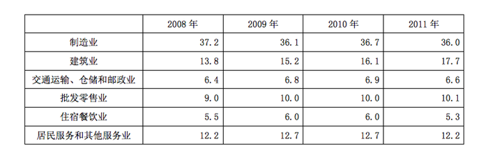

|  | 2008年 | 2009年 | 2010年 | 2011年 |
| --- | ---: | ---: | ---: | ---: |
| 制造业 | 37.2 | 36.1 | 36.7 | 36.0 |
| 建筑业 | 13.8 | 15.2 | 16.1 | 17.7 |
| 交通运输、仓储和邮政业 | 6.4 | 6.8 | 6.9 | 6.6 |
| 批发零售业 | 9.0 | 10.0 | 10.0 | 10.1 |
| 住宿餐饮业 | 5.5 | 6.0 | 6.0 | 5.3 |
| 居民服务和其他服务业 | 12.2 | 12.7 | 12.7 | 12.2 |

2011年农民工在不同地区从事的主要行业分布   单位：%

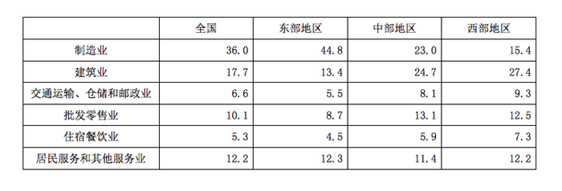

|  | 全国 | 东部地区 | 中部地区 | 西部地区 |
| --- | ---: | ---: | ---: | ---: |
| 制造业 | 36.0 | 44.8 | 23.0 | 15.4 |
| 建筑业 | 17.7 | 13.4 | 24.7 | 27.4 |
| 交通运输、仓储和邮政业 | 6.6 | 5.5 | 8.1 | 9.3 |
| 批发零售业 | 10.1 | 8.7 | 13.1 | 12.5 |
| 住宿餐饮业 | 5.3 | 4.5 | 5.9 | 7.3 |
| 居民服务和其他服务业 | 12.2 | 12.3 | 11.4 | 12.2 |

### 第 131 题

与上一年相比，2011年在东部地区务工的农民工人数增长率约为：

A. 2.0%

B. 4.4%

C. 5.2%

D. 8.1%

第 131 题 · 答案与解析

**参考答案（粉笔题库参考内容）**

A

**解析**

根据题干“与上一年相比，2011年······的增长率约为······”，可判定此题为一般增长率问题。定位文字材料可得：2011年在东部地区务工的农民工16537万人，比上年增加324万人。故与上一年相比，2011年在东部地区务工的农民工人数增长率=增长量/(现期量−增长量)=324/(16537−324)=324/16213≈324/16000≈2%。

故正确答案为A。

**考点**：一般增长率、综合资料

**来源**：2013年国家公务员录用考试《行测》题第131题

### 第 132 题

2008—2011年从事建筑业、批发零售业、居民服务和其他服务业的农民工人数总和超过从事制造业的农民工人数的年份有：

A. 1个

B. 2个

C. 3个

D. 4个

第 132 题 · 答案与解析

**参考答案（粉笔题库参考内容）**

C

**解析**

定位表格材料表1可得：2008-2011年从事建筑业、批发零售业、居民服务和其他服务业的农民工比重之和分别为13.8%＋9.0%＋12.2%＝35%、15.2%＋10.0%＋12.7%＝37.9%、16.1%＋10.0%＋12.7%＝38.8%、17.7%＋10.1%＋12.2%＝40%，而制造业的比重分别为37.2%、36.1%、36.7%和36.0%，部分人数=比重×总人数，而每一年总人数固定，所以比重大的则部分人数就多，而比重前者大于后者的有2009、2010、2011三个年份。

故正确答案为C。

**考点**：简单加减计算、综合资料

**来源**：2013年国家公务员录用考试《行测》题第132题

### 第 133 题

2008—2011年农民工从事交通运输、仓储和邮政业的比重变化趋势符合：

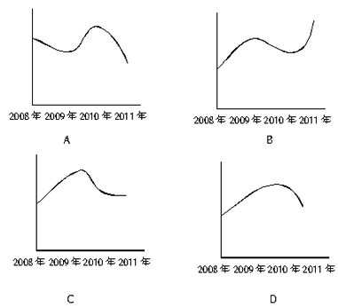

A. A

B. B

C. C

D. D

第 133 题 · 答案与解析

**参考答案（粉笔题库参考内容）**

D

**解析**

定位表格材料表1可得：2008—2011年的比重分别为6.4%、6.8%、6.9%、6.6%，先升后降，且2010年最高，只有D项符合。

故正确答案为D。

**考点**：直接找数、综合资料

**来源**：2013年国家公务员录用考试《行测》题第133题

### 第 134 题

2011年在中部地区务工的农民工占农民工总人数的比重，较上一年约增加：

A. 0.6%

B. 3.7%

C. 6.2%

D. 12.5%

第 134 题 · 答案与解析

**参考答案（粉笔题库参考内容）**

A

**解析**

根据题干“2011年······占······的比重，较上一年约增加······”，可判定此题为两期比重问题。定位文字材料可得：2011年全国农民工总量达到25278万人，增长4.4%；中部地区务工的农民工4438万人，增长8.1%。故根据两期比重差公式A/B×(a−b)/(1+a)可得，2011年在中部地区务工的农民工占农民工总人数的比重，较上一年约增加4438/25278 × (8.1%−4.4%)/(1+8.1%) = 4438/(25278×(1+8.1%)) × 3.7% ＜ 3.7%，结合选项只有A项满足。

故正确答案为A。

**考点**：两期比重、综合资料

**来源**：2013年国家公务员录用考试《行测》题第134题

### 第 135 题

能够从上述资料中推出的是：

A. 2008—2011年我国从事住宿餐饮业的农民工比重持续上升

B. 2010年在东部地区务工的农民工人数超过西部和中部总和的两倍

C. 2008年农民工从事交通运输、仓储和邮政业的人数多于批发零售业

D. 2011年农民工在中部地区从事建筑业、批发零售业、居民服务和其他服务业的比重均超过全国平均水平

第 135 题 · 答案与解析

**参考答案（粉笔题库参考内容）**

B

**解析**

A项：定位表格材料表1可得：从事住宿餐饮业的农民工比重，2010年为6.0%，2011年为5.3%，并非持续上升，错误；

B项：定位文字材料可得东、中、西部2011年的农民工数量以及各自的增长量，则2010年东部地区农民工为16537－324＝16213万人，西部和中部农民工之和为4438－334＋4215－370＝8653－704＝7949万人，16213＞8000×2＞7949×2，即前者超过了后者两倍，正确；

C项：定位表格材料表1可得：2008年从事交通运输、仓储和邮政业的农民工比重为6.4%，从事批发零售业的农民工比重为9.0%，前者少于后者，错误；

D项：定位表格材料表2可得：2011年农民工在中部地区从事建筑业、批发零售业、居民服务和其他服务业的比重分别为24.7%、13.1%和11.4%，而全国平均水平分别为17.7%、10.1%和12.2%。其中，居民服务和其他服务业的比重前者低于后者，错误。

故正确答案为B。

**考点**：综合分析、综合资料

**来源**：2013年国家公务员录用考试《行测》题第135题

