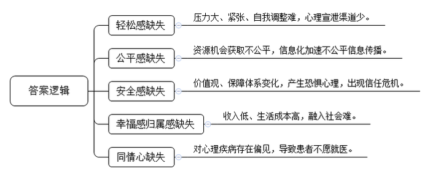
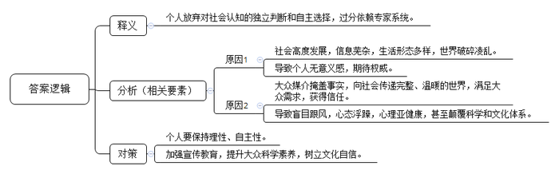
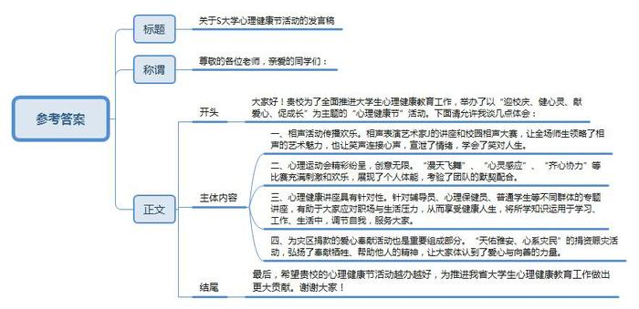
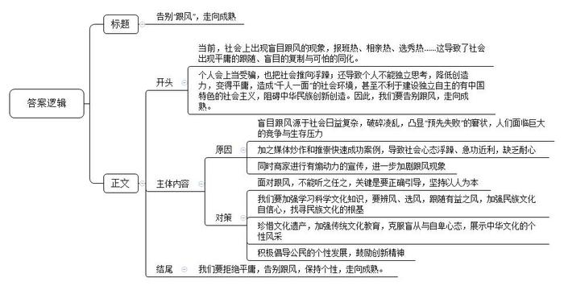
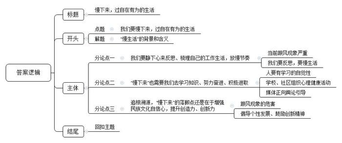

# 2014年国家公考《申论》题（副省级）

<!-- gwy:overview:start -->
> **国考 · 2014 · 申论 · 副省级** ｜ 5 题 · 图片 5 处 · 答案随题折叠

导航：[题目](#题目) · [材料 1](#材料-1)
<!-- gwy:overview:end -->

> 候选采集稿。参考答案及解析来自粉笔页面，不代表官方答案或真实高分答卷；来源使用许可与原卷对应关系仍需人工核实。

## 给定材料

### 材料 1

2013年10月10日是第22个世界精神卫生日。世界卫生组织公布的最新数据显示，全球约有4.5亿精神健康障碍患者，其中大多数生活在发展中国家。某心理研究所的研究报告表明，我国城市劳动力人口中，亚健康人群的比例呈现增长趋势，其中城市无业人员的心理亚健康问题尤为突出。

该心理研究所的Z博士说：“人的内心不稳定、不平衡会造成个人负荷加重，并累及社会适应能力，无形中拖累了社会发展的步伐。”某社会学家也指出，社会的浮躁与焦虑，不仅易引发有害的聚合行为，且可能因之导致社会的某种关系断裂，影响经济社会的健康发展。

我国正处在社会转型期，各种社会问题和矛盾多发，竞争压力加大，工作节奏加速，使得部分国民心理疾患所引发的社会问题开始凸显。

心理问题涉及面广泛。从发育的儿童、成长的青年，到“空巢老人”；从校园内的大学生、工棚里的农民工，到政府官员、企业精英，各阶层的人都有可能遭受各式各样心理问题的困扰。心理疾病和精神疾病对人们的危害绝不亚于心脑血管、呼吸系统疾病及恶性肿瘤等。有统计显示，每年约有160万人因心理问题导致行为失常，甚至构成犯罪，给社会造成很大危害。

有观察家指出，破解这一问题，政府应承担营造“大环境”的责任。改革开放30余年，在举世瞩目的经济高速增长背后，我国政府已经意识到必须妥善解决心态失衡等社会问题，让民众真正感受到公平正义，过“有尊严的幸福生活”。社会学研究员Y认为，“制定政策时，政府还应充分考虑政策的科学性、连续性和社会影响，减少因政策的不连续性等因素导致民众对未来的不确定感，减少对个体造成刺激和重大挑战”，“尤其是对于城市边缘人群和农村贫困人群，提高他们的积极情感、帮助其消除负面情绪，对于缓解社会冲突，减少人际间的矛盾与敌对，促进家庭和谐、社会稳定，都具有十分积极的作用”。

### 材料 2

某网站发表文章指出，目前社会问题日渐增多，造成若干社会心理方面的“缺失”，并具有相应的表现形式。

一项针对100万在职工作人员工作现状的网络调查显示，近三分之二的人感到压力较大。尤其在警务人员、医务人员、高层管理者等职业群体中，70%～80%的人都感到压力大，表现为失眠，记忆力衰退，容易紧张、焦虑和抑郁。许多人感到调整自己原有的心理定式和行为模式越来越困难，心理放松、宣泄郁闷的机会和渠道越来越少。

由于当前各种体制机制还不够完善，人们在资源占有、机会获取、成果享用等方面出现事实上的不公平，一部分人往往在比较中产生了心理失衡。加之现代社会信息化程度高，各种不平衡、不公平信息迅速大量地传播给公众，造成了更多人的心理失衡。这种情绪积累时间过长，势必会产生严重的心理问题和社会矛盾。

在社会转型期，传统的价值观、就业模式、保障体系等正在发生急剧变化，有的人对未来缺乏安全预期，对未知充满恐惧，对变化心理准备不足，对多元化心理认同不够，易产生焦虑、恐惧、迷茫心理，出现信任和诚信危机。

一项对“白领阶层”的社会调查显示，在被调查者中，认为与过去5年相比，生活幸福指数有所下降和下降很多的占36%；快乐正悄然离一些人远去，焦虑已渐渐占据某些现代人的心理。有报告显示，新生代农民工已经占农民工整体的47%。他们因为收入较低，难以承受较高的生活消费，融入城市生活困难重重，更容易滋生心理问题。同时，人口流动范围加大，生活环境变化加快以及各种自然灾害频发，都会使人们增加社会陌生感，带来归属感的缺失，进而导致孤独感。特别是在一些发展较快的城市，生活着一些被高就业门槛和高生活成本边缘化的“社会隔离”人群，或称心理“无根”人群，这种现象得不到消解，易使一些负面情绪蔓延，甚至危及社会秩序和安全。

某些心理精神疾病患者常因“羞耻感”而不及时就医，延误了诊治的时机。而患者的亲友和同事也没有及时表现出应有的同情，社会对心理疾病还存有偏见和歧视。精神疾病康复者不能顺利回归社会大家庭，则又成为导致心理健康疾病复发率高的一个诱因。

### 材料 3

为了全面推进大学生心理健康教育工作，S大学举办了以“迎校庆、健心灵、献爱心、促成长”为主题的第六届“心理健康节”活动。

2013年4月26日下午，著名相声表演艺术家J到校作了题为《中国曲艺的魅力》的讲座。讲座现场气氛异常火爆，能容纳300人的音乐厅座无虚席，很多学生一直站着听完整场讲座。J说学逗唱、惟妙惟肖的表演和幽默的言语让全场师生捧腹大笑，充分领略了相声的艺术魅力。4月28日晚，第四届校园相声大赛如期举行，共吸引了1000多名师生参加。有同学以充满诗意的语言表达了自己的感受：“相声通向笑声，笑声联结大家的心声。笑帮人宣泄喜怒哀乐的情绪，笑伴人应对酸甜苦辣的人生！顺利时会笑，困难时能笑，失败时敢笑，我们笑着同昨天告别，又笑着迎接新的黎明！”

S大学是较早创办心理运动会的单位之一。5月12日下午，第五届心理运动会拉开帷幕，活动精彩纷呈，创意无限。“漫天飞舞”项目要求参赛选手中女生蒙住眼睛抛毽子，而男生站在女生身后5米的圆圈内用篓子接毽子，规则看似简单，却要求女生恰到好处的抛毽力度和男生辨识毽子飞行方向时的全神贯注。五颜六色的毽子和同学们的欢声笑语飘扬在操场上空，其乐融融。“心灵感应”环节要求参赛者一人蒙住眼睛，背着另一人，在他的指引下绕过障碍，背者失去方向、小心探索道路时的迷茫，被背者指点迷津、化险为夷后的喜悦，使得比赛充满刺激和欢乐，全场气氛渐入高潮。“齐心协力”“铁人三项”“背对背拥抱”的比赛模式也都突破常规，不仅强调个人的体能展现，更考验团队的默契配合。参与的同学活力四射，乐在其中，观战的同学呐喊助威，激情澎湃，让整场活动都洋溢着喜悦和欢乐。

举办讲座是开展心理健康教育的传统方式，深受师生欢迎。组委会针对辅导员、心理保健员、普通学生等不同群体组织了若干场精彩讲座。

5月21日下午，学校党委副书记带着各院系辅导员听取S大学心理健康教育中心主任D教授作《如何应对心理压力》的讲座。D教授是国家首批注册心理督导师，她的精彩讲解有助于辅导员们应对职场与生活压力，享受健康人生。

4月28日下午，S大学心理健康教育中心W老师为全校各班班长、心理保健员作了一场题为《常见的心理问题》的讲座；5月7日晚，W老师又作了一场《与大学生谈人生规划》的讲座，师生们表示要将所学知识运用于学习、工作、生活中，调节自我，服务大家。

“心理健康节”筹备期间，四川雅安发生7级地震，给当地人民群众生命财产造成了重大损失，深深牵动着师生们的心。“心理健康节”组委会把为灾区募捐的爱心奉献活动也列为“心理健康节”的重要组成部分，试图使学生们在募捐活动中体认到爱心与向善是心理健康的真正底蕴。

4月23日，几位学生连夜制作了募捐箱和祈福绶带，发起了“天佑雅安、心系灾民”捐资赈灾活动。在“生者坚强、逝者安息、祈福雅安、重建家园”的条幅上，同学们写下了真挚的祝福，并将所筹善款汇往灾区。

“一衣一物皆心意，一元一分总关情”，有同学说，我们的心连在一起，就是一座爱的堤坝；我们的手牵在一起，就是一座情的长城。

“天佑雅安，心系灾民”的捐资赈灾活动弘扬了奉献牺牲、帮助他人的精神，让大家体认到了爱心与向善的力量。

### 材料 4

暑期来临，日益升温的“报班热”让孩子们本该无忧无虑的假期变得紧张而忙碌。不少家长“跟风”，给孩子报了特长班、兴趣班、课外辅导班等。

荧屏上的相亲交友类节目大战愈演愈烈，多家卫视相继播出相亲或者交友类节目，一轮又一轮“相亲热”席卷荧屏。

近年来，媒体选秀节目从未冷却，从“超级女声”“快乐男生”到各行各业、各种角色纷纷“选秀”，“选秀热”进入了全面开花的阶段。

一股“全民养生”的热潮炙浪逼人。五花八门的养生学说见诸各种媒体，名目繁多的养生书籍充斥图书市场。养生，已成为时下人们最为关注的话题之一，并以一股强大的磁力影响着百姓的日常生活。

此外还有“集资热”“股票基金热”“买房热”“文凭热”等，常常是一风未止一风又起。

据某网站问卷调查显示：七成以上的受调查者认为时下“跟风”程度“非常严重”，表明随大流、“跟风”已成为一种普遍心态，“跟风”现象有愈演愈烈之势。专家认为，“跟风”现象折射出社会转型期的浮躁心态，在一定程度上构成了社会群体心理“亚健康”的表征。

有研究者撰文指出，如果说“跟风”来自人们对各类专家的依赖，那么不难想象，这种“依赖”恰好凸显了当前人们一种“预先失败”的窘况。文章引用了英国学者吉登斯在《现代性与自我认同》一书中的相关阐述，试图把现代人所面临的心理问题的讨论引向深层次。

吉登斯指出，“在晚期现代性的背景下，个人的无意义感，即那种觉得生活没有提供任何有价值的东西的感受，成为根本性的心理问题”。在吉登斯看来，现代社会中任何个人的行为都必须参照一种专家系统才可以实现。换言之，人们越来越相信现代社会的专家指导系统，在做任何活动之前，总要去参考各种各样的指导意见，并找到行为的依据，离开了这种专家系统，个人将迷失在社会当中，一事无成。

比如说买衣服，表面看起来，这是一种纯粹的个人行为。买什么衣服，选什么品牌，完全由个人的爱好所决定。但是在今天，任何购买行为都已经深深地和各种各样的广告连接在了一起。广告，无形中就成为现代人生活中重要的“指导系统”。事实上，广告无意于担当这一功能，但是在纷繁复杂的商品世界中，它确实为现代人提供了辨别和追寻自己需要的物品的中介——从这个意义上说，广告也成为现代人自我辨认的一种曲折的形式。

这无疑会给人们的自主选择能力带来巨大的冲击。在任何属于个人的行为当中，都隐藏着一个他人的选择、他人的要求、他人的想象。因此，它会使相当一部分人成为脱离了庞大的文化系统而难以生存的族群。

隐藏在这种生存的想象性对抗背后的，则是人们期待权威的心态。当人们无法获得真实世界的全部信息，就只能凭想象获得这种信息——这就有了对大众文化媒介的依赖。“跟风”现象之所以在今天如此空前规模地盛行，也正是这种媒介依赖的结果。

斯图亚特·霍尔曾这样描述现代社会：大众传媒通过生成知识和影像，给大众提供一个认识外部世界的通道。在社会高度发展、信息丰富芜杂以及生活形态多样变迁的同时，世界也在一定程度上变得破碎、凌乱和神秘，而大众传媒恰好掩盖了这种破碎、凌乱和神秘状态。大众传媒总是向我们呈现出世界的完整面貌，让我们觉得生活在一个充满了广告画面一样温暖的世界之中。

就人们的日常生活而言，大众媒介承担了一个“专家指导系统”的角色。一时间，所谓的养生专家“走红”各家电视台：隔夜水可以还阳养肾、活吃泥鳅可以治病……几乎最时髦的养生术，都是以对科学主义的文化体系进行颠覆甚至戏弄为前提的。这种反科学主义的冲动背后，则是人们对“媒介”的过度依赖。公众的生活知识，总是通过大众媒介获得，于是许多人也就把大众媒介专家作为自己生活方向的指路人。

### 材料 5

某网站开展了一场关于“跟风”现象的讨论，引起了网民的热议。有热心网民将数量庞大的跟帖中的“精华”整理如下。

甲：我就上过所谓养生专家的当，曾经对各种各样的“养生经”深信不疑。有一次挂了一个养生专家的门诊，仅挂号费就花了我2000元。结果，在从书店里买到的最普通的养生图书中一查，原来专家给我的建议全是从里面抄的。

乙：我也买了不少养生书籍，有一本图书的广告特别吸引人：“一本可能让您多活几十年的书！一本可能让您少花几十万的书！”这两句广告语真的是说到了中老年人的心坎上。被“看病难”“看病贵”所困扰的中老年人觉得，如果买一本30多元的书就能达到永葆健康的目的，谁不会买一本？看到邻居买、同事买、亲戚朋友买，出于从众心理，自己也唯恐“落伍”。大家都这样做，自己也这样做，才不会感觉到舆论压力。

丙：我国经济快速发展，给国人创造了各种各样的机会，但同时也催生了从未有过的竞争与生存压力。追逐名利的人越来越没有耐心，迫切渴望“一夜成名”“一夜暴富”，再加上一些媒体不负责任地炒作和推崇各种“快餐式成功”和“速食式成名”的“典范”，人们越来越不能容忍清贫和默默无闻，越来越不愿用勤勤恳恳的劳动来获得成功和荣誉，而是不切实际地去“跟风”、去拼、去赌，这种从众潮流正把社会推向前所未有的浮躁之中。

丁：民众其实有时候就那么点乐趣，只要不违反原则，跟就跟呗，没必要太在意。我认为不要一味地反对或禁止，关键是要正确引导，要体现以人为本。

戊：“跟风”是一种拙劣的模仿，所以结果必然是平庸的跟随、盲目的复制与可怕的同化。这是缺乏理性、丧失文化个性的行为，无论是对社会还是对个人，后果都是十分严重的。从国家的角度来说，在经济全球化时代，我们要建设独立自主的有中国特色的社会主义，这既是民族自强之路，也是建设世界健康文化生态的召唤。所以，有着悠久历史的中华文明理应创造自己的新文化。而如何保持中华文化的优良传统，增强文化自信，进而在世界文化大舞台上展示有个性的民族文化，使中华文化得到创造性的发展，则是我们必须认真思考的问题。

己：一个经常从众“跟风”的人，必然缺少独立的思考，创造力也会随之降低，新方法和好创意会被同质化，逐渐变得平庸。如果每个人都丧失了智慧和创造性，一味地随大流，就会造成“千人一面”的社会环境。社会学家早就指出，在个人价值和社会选择上，我们每一个人都拥有一个坐标。从某种意义上说，每一个人都独特地属于“自己”，而不是别人。在纷繁复杂的现代社会，如何沉下心来，真正坚守自己，做好真正的自己，这是我们每一个人都必须面对的挑战。

庚：我觉得最重要的是加强民族文化自信心，尤其是要注意从中华文化的灿烂历史中去找寻民族文化的根基。几千年来，中华民族历经沧桑，内忧外患，但这条文化的血脉却一直没有断，传承到今天，并日益呈现出勃勃生机，这足以说明我们民族的伟大，说明我们民族文化具有强大的生命力。今天，面对全球文化的冲突与融合，我们更应该珍惜这份文化遗产，加强传统文化教育，克服盲从与自卑心态，重振民族文化的自信心，展示中华文化的个性风采。

辛：“风”也有益害之分，“辨风”的目的在于“选风”。譬如，“全民读书活动”这种风气，既陶冶民众情操，又涵养民族精神，就应该积极追随。“好风凭借力，送我上青云。”对于保护环境、和谐自然的“清风”，也应该追风赶潮，尽自己的绵薄之力。一句话，当跟的风要跟，不当跟的风那是万万跟不得的。

壬：全社会应积极倡导公民的个性发展，鼓励创新精神。在当代社会中，现代化建设推崇“标准化”的操作模式，世俗化的思想潮流如享乐至尊、娱乐至上等，常常在不知不觉之中对我们进行侵蚀。尤其是随着商业化的全面推进、社会交流的日益频繁以及信息化的强力渗透，“跟风”更加有可能束缚思想、抑制个性发展、扼杀创造力，从而使我们在生活方式、文明习惯乃至人生境界等方面陷入流行化、浮躁化、庸俗化。个体是构成社会的细胞，只有每个人的素质提高了，才能抵得住诱惑，守得住人生的宝贵价值。

癸：如果这样一种“跟风”随流的生活成为我们人生的全部，在人生终点，岁月大幕落下之时，我们会不会深深地为自己的平庸感到遗憾，甚至有难以言表的耻辱感？因为，我们一直活在别人创造的所谓的“跟风”文化中，我们从没创造出打上个性烙印的成果。

### 材料 6

当今社会，竞争白热化，每日高速度、快节奏奔波劳碌成为城市工作、生活的主旋律，超时、超负荷工作严重地损害了人们的身心健康。

国内一项调查显示，84%的人认为自己生活在“加急时代”，生活节奏越来越快、压力越来越大是普遍现象。英国有位时间管理专家说：“我们正处于一个把健康卖给时间和压力的时代。忙，特别是心理上的忙碌感所带来的伤害，可能超出我们的想象，那种不眠不休的工作，是一种自杀式的生活。”

上世纪80年代末期，意大利人首先倡导“慢生活”方式，他们希望放慢生活节奏，主张“慢餐饮”“慢旅游”“慢运动”等。这里的“慢”，并不是速度上的绝对慢，而是一种意境，一种回归自然、轻松和谐的意境。专家认为，从某种意义上说，“慢生活”是一种积极的生活方式，是一种健康的心理状态，是一种“富”得充实、“穷”得快乐的生活状态，“工作再忙心不乱，生活再苦心不累”。

在我国，也有心理健康专家适时提出了“慢生活”这一理念。专家指出，在生活节奏不断加快的今天，我们应该静下心来思考：什么是人生的真谛？一方面，物欲催促生命的脚步，时光分分秒秒地流走，人生在金钱方面看似相对丰富了；而另一方面，却是生活质量下降，影响到身心健康的状况。专家认为，生活要归于简单，工作要抓住重点，在职场忙得焦头烂额、筋疲力尽的人士，不妨梳理梳理，让生活节奏慢下来。

金庸先生说：“我的性子很缓慢，不着急，做什么事儿都是徐徐缓缓，最后也都做好了，乐观豁达颐养天年。”“飞人”刘翔生活中也有慢的时候，他说：“我吃饭比较慢，我也喜欢洗澡的时候慢一点，因为我喜欢慢节奏的生活。”

“慢生活”的提出，是对国人生活质量和生存状态的一种反思，放慢生活节奏是一种技巧，同时也是健康、积极、自信的生活态度。“慢生活”没有固定模式，可以从身边的一点一滴做起，从慢一点吃饭开始，到慢步、慢运动等。有专家因此提倡“节奏慢下来，效率提上去，心态平下来，健康升上去”。

我们或许应该如作家米兰·昆德拉所言，要“慢下来”，因为自在有为的生活是急不得的。

## 题目

### 第 1 题

**“给定资料**2**”揭示了当前社会心理方面存在的若干“缺失”，请对此予以归纳概括。（10分）**

关联材料：材料 2

作答要求：

要求：全面准确，分条归纳，不超过150字。

第 1 题 · 答案与解析

**参考答案（粉笔题库参考内容）**

1.轻松感缺失。压力大、紧张、自我调整难，心理宣泄渠道少。

2.公平感缺失。资源机会获取不公平，信息化加速不公平信息传播。

3.安全感缺失。价值观、保障体系变化，产生恐惧心理，出现信任危机。

4.幸福感归属感缺失。收入低、生活成本高，融入社会难。

5.同情心缺失。对心理疾病存在偏见，导致患者不愿就医。

**解析**

**参考答案说明：**答案从“轻松感缺失”“公平感缺失”“安全感缺失”“幸福感归属感缺失”“同情心缺失”这五个不同的方面进行了分条撰写。此外，每条要点都分别提炼出了总括词，进行前置，各条要点之间内容上没有交叉。

### 第 2 题

**谈谈“预先失败”这一概念在“给定资料**4**”中的含义。（10分）**

关联材料：材料 4

作答要求：

要求：全面、准确，不超过200字。

第 2 题 · 答案与解析

**参考答案（粉笔题库参考内容）**

预先失败指个人放弃对社会认知的独立判断和自主选择，过分依赖专家系统。

其原因是：一、社会高度发展，信息芜杂，生活形态多样，世界破碎凌乱，导致个人无意义感，期待权威。二、大众媒介掩盖事实，向社会传递完整、温暖的世界，满足大众需求，获得信任，导致盲目跟风，心态浮躁，心理亚健康，甚至颠覆科学和文化体系。

因此，个人要保持理性、自主性。加强宣传教育，提升大众科学素养，树立文化自信。

**解析**

**参考答案说明：**宏观上，本答案按照词句解释题的一般答题思路“释义-分析相关要素-总结评价”展开。在内容上，本答案在“释义”部分解释了“预先失败”这个概念的含义；“分析相关要素”部分指出“预先失败”产生的原因；“总结评价”部分提出了相应的解决对策。词句表达上，本答案的撰写利用了“其原因是……”“因此……”这样一些连接语，使得答案各要素在逻辑上联系更紧密。

### 第 3 题

**“给定资料**3**”介绍了S大学举办“心理健康节”活动的情况，假如你是该省教育厅的一名工作人员，全程观摩了这次活动，校方请你在这次活动的总结会上发言，请草拟一个简短的发言稿。（20分）**

关联材料：材料 3

作答要求：

要求：

（1）内容具体，符合实际；

（2）目的明确，切合主题；

（3）语言生动，有感染力；

（4）不超过500字。

第 3 题 · 答案与解析

**参考答案（粉笔题库参考内容）**

关于S大学心理健康节活动的发言稿

尊敬的各位老师，亲爱的同学们：

大家好！贵校为了全面推进大学生心理健康教育工作，举办了以“迎校庆、健心灵、献爱心、促成长”为主题的“心理健康节”活动。下面请允许我谈几点体会：

一、相声活动传播欢乐。相声表演艺术家J的讲座和校园相声大赛，让全场师生领略了相声的艺术魅力，也让笑声连接心声，宣泄了情绪，学会了笑对人生。

二、心理运动会精彩纷呈，创意无限。“漫天飞舞”、“心灵感应”、“齐心协力”等比赛充满刺激和欢乐，展现了个人体能，考验了团队的默契配合。

三、心理健康讲座具有针对性。针对辅导员、心理保健员、普通学生等不同群体的专题讲座，有助于大家应对职场与生活压力，从而享受健康人生，将所学知识运用于学习、工作、生活中，调节自我，服务大家。

四、为灾区捐款的爱心奉献活动也是重要组成部分。“天佑雅安、心系灾民”的捐资赈灾活动，弘扬了奉献牺牲、帮助他人的精神，让大家体认到了爱心与向善的力量。

最后，希望贵校的心理健康节活动越办越好，为推进我省大学生心理健康教育工作做出更大贡献。谢谢大家！

**解析**

**参考答案说明：**（1）格式和结构方面，本发言稿写到了“标题”“称谓”“正文”三部分。（2）正文部分，一方面从内容来看，本发言稿的开头先写到了活动的主题、目的；主体部分从“相声活动”“心理运动会”“心理健康讲座”“为灾区捐款的爱心奉献活动”四个方面详细介绍了系列专题活动的具体内容；结尾部分发出呼吁号召。另一方面，形式上，本发言稿做到了分段、分条撰写，整体上条理较为清晰。（3）本发言稿能够结合题目中“语言生动，有感染力”这一要求，在语言表达上做到了简洁、流畅、有感染力。

### 第 4 题

**某地方报纸根据“给定资料**4**”和“给定资料**5**”的内容做了一版关于“跟风”的专栏，请你以“告别‘跟风’，走向成熟”为题，为这个专栏写一篇短评。（20分）**

关联材料：材料 4、材料 5

作答要求：

要求：

（1）观点明确，简明深刻；

（2）紧扣资料，重点突出；

（3）语言流畅，有逻辑性；

（4）不超过500字。

第 4 题 · 答案与解析

**参考答案（粉笔题库参考内容）**

告别“跟风”，走向成熟

当前，社会上出现盲目跟风的现象，报班热、相亲热、选秀热……这导致了社会出现平庸的跟随、盲目的复制与可怕的同化。个人会上当受骗，也把社会推向浮躁；还导致个人不能独立思考，降低创造力，变得平庸，造成“千人一面”的社会环境，甚至不利于建设独立自主的有中国特色的社会主义，阻碍中华民族创新创造。因此，我们要告别跟风，走向成熟。

盲目跟风源于社会日益复杂，破碎凌乱，凸显“预先失败”的窘状，人们面临巨大的竞争与生存压力，加之媒体炒作和推崇快速成功案例，导致社会心态浮躁、急功近利，缺乏耐心；同时商家进行有煽动力的宣传，进一步加剧跟风现象。

面对跟风，不能听之任之，关键是要正确引导，坚持以人为本；我们要加强学习科学文化知识，要辨风、选风，跟随有益之风，加强民族文化自信心，找寻民族文化的根基；珍惜文化遗产，加强传统文化教育，克服盲从与自卑心态，展示中华文化的个性风采；积极倡导公民的个性发展，鼓励创新精神。

我们要拒绝平庸，告别跟风，保持个性，走向成熟。

**解析**

**参考答案说明：**（1）格式方面，本参考答案写到了“标题”。（2）正文部分，一方面从内容来看，围绕着“跟风”这一主题，本参考答案的开头先阐明“跟风”的表现及危害，并表明态度；主体部分给出了具体的原因、对策。另一方面，形式上，本参考答案做到了分段、分条撰写，整体上条理较为清晰。（3）本参考答案能够结合题目要求“语言流畅”，在语言表达上做到了简洁、流畅。

### 第 5 题

**“给定资料”结尾写道：“我们或许应该如作家米兰·昆德拉所言，要‘慢下来’，因为自在有为的生活是急不得的。”请结合你对这句话的思考，联系自己的感受和社会实际，自拟题目，写一篇文章。（40分）**

关联材料：材料 1、材料 2、材料 3、材料 4、材料 5、材料 6

作答要求：

要求：

（1）自选角度，见解深刻；

（2）参考“给定资料”，但不拘泥于“给定资料”；

（3）思路清晰，语言流畅；

（4）总字数1000～1200字。

第 5 题 · 答案与解析

**参考答案（粉笔题库参考内容）**

**参考范文****1**

**慢下来，过自在有为的生活**

在开放、多元、竞争激烈的现代社会，所有人都过度追求快速度与高效率，严重损害了身心健康。因此，著名作家米兰·昆德拉告诫我们要“慢下来”，因为自在有为的生活是急不得的。慢本身不是目的，而是为了让我们有更多的时间和空间思考。反思如何“慢下来”，让我们回归本身，回归人最自然、最朴素、最真实的需求。

自在，是一种自我和独立的状态；有为，就是要行动起来，有执行力。**“慢下来”是自在有为的前提，只有“慢”，我们才能更好地认清自我，找准定位；把握方向，理性抉择；谨慎行动，追求卓越。**

**当下，社会环境多样化、复杂化，造成若干社会心理方面的“缺失”，出现了陌生感、孤独感**。人们步履匆匆，大步向前，却不知灵魂已经跟不上了。而雪上加霜的是，媒体却也在背后推波助澜，任“丧文化”、“泛娱乐化”在人群中蔓延传播。那么，怎样才能慢下来，过上自在有为的生活呢？

**我们要静下心来反思、梳理自己的工作生活，放慢节奏**。苏格拉底说：“没有经过检讨和反思的生活是不值得经历的。”在后现代的背景下，个人的无意义感，成为根本性的心理问题。我们不应该一味跟随盲从，而是应该多问问自己：各种“报班热”、“相亲热”、“养生热”究竟是个人需要还是盲目跟风？这种反思可去掉大量虚假、多余的需求，帮我们卸下生活、学习、工作的包袱。让我们回归初心和本真，放下压力去慢旅游、慢运动、慢享受，最终过上自在有为的生活。

**“慢下来”也需要我们去学习知识、努力奋进、积极进取**。人要有学习的自觉性，多去阅读文化经典，进行文化交流，在文化熏陶中学会慢，感受自在。社区、学校也要通过宣传教育、传播文化、科学疏导、组织活动等多种形式来培养慢生活心态，助力人们应对职场压力、享受健康人生。另外，舆论媒体还应通过客观公正、科学理性的引导，例如减播一些浮躁肤浅的综艺节目，多拍摄类似于《朗读者》、《我在故宫修文物》等具有文化内涵的影视片来提升民众的辨别能力。

**追根溯源，“慢下来”的落脚点还是在于增强民族文化自信心，提升创造力、创新力**。要本着以人为本的原则，倡导公民个性发展，鼓励创新精神，为自在有为的“慢生活”提供安全保障。跟风现象可能束缚人的思想、抑制个性发展、扼杀创造力，这绝对不是一个创新型国家所需要的。“大众创业、万众创新”、“科教兴国、人才强国”战略既可为“自在”的生活“兜底”，也可为“有为”的生活“开路”，让生活慢得有保障，有底气，有退路，有前途。

“慢”不仅是指速度慢，更是一种方法、智慧、意境，让我们不仅自在，又能有为，获得又好又快的人生。我们要不争一时之长短，不抢一时之快慢；以饱满的热情，昂扬的斗志，从容的心态，去寻找，去追求，去践行，去实现……

**文章分析**

**慢下来，过自在有为的生活**

【**标题的优点**：首先，范文的标题突出了“慢生活”这一主题。其次，形式上，文字简洁明快。】

（1）在开放、多元、竞争激烈的现代社会，所有人都过度追求快速度与高效率，严重损害了身心健康。因此，著名作家米兰·昆德拉告诫我们要“慢下来”，因为自在有为的生活是急不得的。（2）慢本身不是目的，而是为了让我们有更多的时间和空间思考。（3）反思如何“慢下来”，让我们回归本身，回归人最自然、最朴素、最真实的需求。

【**开头的优点**：★内容方面。范文的开头是紧扣题目给定的“慢生活”这一主题展开的。首先，开头第一句话点出了“慢生活”这一主题，做到了主题明确。其次，对“慢生活”这一主题进行了分析阐述，指出了：（1）当前社会背景；（2）“慢”的目的；（3）如何“慢下来”。★文字表达方面：使用了“因此”“因为”等关联词，使语言表达有逻辑性。】

（1）自在，是一种自我和独立的状态；有为，就是要行动起来，有执行力。（2）**“慢下来”是自在有为的前提，只有“慢”，我们才能更好地认清自我，找准定位；把握方向，理性抉择；谨慎行动，追求卓越。**

（3）**当下，社会环境多样化、复杂化，造成若干社会心理方面的“缺失”，出现了陌生感、孤独感**。人们步履匆匆，大步向前，却不知灵魂已经跟不上了。而雪上加霜的是，媒体却也在背后推波助澜，任“丧文化”、“泛娱乐化”在人群中蔓延传播。那么，怎样才能慢下来，过上自在有为的生活呢？

【**过渡段的优点：**本段首先分析了“慢生活”的含义，接着阐述了“慢生活”的意义，最后指出了当前社会中存在的问题。段尾句“那么，怎样才能慢下来，过上自在有为的生活呢？”是用来引起下文的过渡句。】

**我们要静下心来反思、梳理自己的工作生活，放慢节奏**。苏格拉底说：“没有经过检讨和反思的生活是不值得经历的。”（1）在后现代的背景下，个人的无意义感，成为根本性的心理问题。我们不应该一味跟随盲从，而是应该多问问自己：各种“报班热”、“相亲热”、“养生热”究竟是个人需要还是盲目跟风？（2）这种反思可去掉大量虚假、多余的需求，帮我们卸下生活、学习、工作的包袱。让我们回归初心和本真，放下压力去慢旅游、慢运动、慢享受，最终过上自在有为的生活。

【**论述段****1****的优点：**★观点句：范文的观点句是紧扣“慢生活”这一文章主题提出的。形式上，它在段首处直接写出，位置突出，容易发现。内容上，关键词突出，内容要点明确，可以明显看出它是从“反思、梳理自己的工作生活”入手，指出了“如何实现慢生活”。★论述内容：（1）介绍了“报班热”等盲目跟风的问题；（2）介绍了反思梳理工作生活的意义。注意：以上几个方面的内容都是紧扣“我们要静下心来反思、梳理自己的工作生活，放慢节奏”这个观点句进行分析论述的，论述的针对性强，内容层次丰富。最后，在论述方法和论据的选取上做到了讲道理与举例子相结合，做到了丰富多样。】

**“慢下来”也需要我们去学习知识、努力奋进、积极进取**。（1）人要有学习的自觉性，多去阅读文化经典，进行文化交流，在文化熏陶中学会慢，感受自在。（2）社区、学校也要通过宣传教育、传播文化、科学疏导、组织活动等多种形式来培养慢生活心态，助力人们应对职场压力、享受健康人生。另外，（3）舆论媒体还应通过客观公正、科学理性的引导，例如减播一些浮躁肤浅的综艺节目，多拍摄类似于《朗读者》、《我在故宫修文物》等具有文化内涵的影视片来提升民众的辨别能力。

【**论述段****2****的优点：**★观点句：范文的观点句是紧扣“慢生活”这一文章主题提出的。形式上，它在段首处直接写出，位置突出，容易发现。内容上，关键词突出，内容要点明确，可以明显看出它是从“学习知识、努力奋进、积极进取”入手，指出了“如何实现慢生活”。★论述内容：（1）介绍了个体主动学会慢，感受自在；（2）介绍了社区、学校要培养人们慢生活的心态；（3）介绍了舆论媒体要通过引导提升民众辨别能力。注意：以上几个方面的内容都是紧扣“‘慢下来’也需要我们去学习知识、努力奋进、积极进取”这个观点句进行分析论述的，论述的针对性强，内容层次丰富。最后，在论述方法和论据的选取上做到了讲道理与举例子相结合，做到了丰富多样。】

**追根溯源，“慢下来”的落脚点还是在于增强民族文化自信心，提升创造力、创新力**。（1）要本着以人为本的原则，倡导公民个性发展，鼓励创新精神，为自在有为的“慢生活”提供安全保障。跟风现象可能束缚人的思想、抑制个性发展、扼杀创造力，这绝对不是一个创新型国家所需要的。（2）“大众创业、万众创新”、“科教兴国、人才强国”战略既可为“自在”的生活“兜底”，也可为“有为”的生活“开路”，让生活慢得有保障，有底气，有退路，有前途。

【**论述段****3****的优点：**★观点句：范文的观点句是紧扣“慢生活”这一文章主题提出的。形式上，它在段首处直接写出，位置突出，容易发现。内容上，关键词突出，内容要点明确，可以明显看出它是从“增强民族文化自信心，提升创造力、创新力”入手，指出了“如何实现慢生活”。★论述内容：（1）介绍了倡导公民个性发展，鼓励创新精神；（2）介绍了从国家战略的角度为慢生活提供保障。注意：以上几个方面的内容都是紧扣“增强民族文化自信心，提升创造力、创新力”这个观点句进行分析论述的，论述的针对性强，内容层次丰富。最后，在论述方法和论据的选取上做到了讲道理与举例子相结合，做到了丰富多样。】

（1）“慢”不仅是指速度慢，更是一种方法、智慧、意境，让我们不仅自在，又能有为，获得又好又快的人生。（2）我们要不争一时之长短，不抢一时之快慢；以饱满的热情，昂扬的斗志，从容的心态，去寻找，去追求，去践行，去实现……

【**结尾的优点**：范文的结尾回扣了“慢生活”这一主题。（1）再次对“慢生活”这一主题进行了总结；（2）发出了号召希望。】

**参考范文****2**

**检讨我们的生活**

著名作家米兰·昆德拉告诫我们“慢下来”，因为自在有为的生活是急不得的。这句话让我想起亚里士多德之问：什么样的生活才是好的生活（good life）？这个问题困扰了人们数千年仍无固定答案。在开放、多元、竞争激烈的现代社会，在处于社会、经济转型期的中国，面对各种诱惑和学说，这个问题显得更加扑朔迷离。

越是在这种历史条件下，越是要坚定沉着。这就需要我们：不急不躁，保持冷静；审慎思考，深刻反思；把握方向，理性抉择；谨慎行动，追求卓越。以从容、豁达的心态，有条不紊地过自在有为的生活。

苏格拉底教导我们：没有经过检讨和反思的生活是不值得经历的。反思可以让我们不盲目、不跟风、不急躁，保持自己的节奏，过自在、自主、独立的生活。

**发展是现代社会的标志，所有的人都在追求速度与效率。但是发展并不完全等于快，有时候需要我们慢下来。**慢本身不是目的，而是为了让我们有更多的时间和空间思考。我们应该多问问自己：工作有那么难找吗？一定要有“编制”吗？一定要在“双11”时在淘宝上买一大堆几十年都用不完的卫生纸、洗发水吗？……这些都需要我们反思，反思就如“奥卡姆剃刀”，可以去除大量虚假、多余的需求，帮我们卸下大量生活、学习、工作的包袱。通过反思不难发现，我们可以有“安步当车，晚食当肉”的从容，有“弱水三千，只取一瓢饮”的节制，有“收拾精神，自作主宰”的自信。反思让我们回归自己本身，回归人最自然、最朴素、最真实的需求本身。

“慢下来”并不是消极地逃避，而是为了更加积极、有为地生活。“慢下来”才能更好地把握方向，理性抉择；谨慎行动，追求卓越。

**生活越简单，目标就越明确，重点就越集中，就越容易找到人生的价值和目标。**陆九渊有言：“易简工夫经久大，支离事业竟浮沉。”试想如果曹雪芹写《红楼梦》前认为自己应该在“文联”有个编制，或者认为《红楼梦》是不够的，应该出一个“梦系列”小说，应该有“青楼梦”“绿楼梦”，不知道他还能不能成为文学家。陶行知先生说：人生为一件大事而来。诗人马雅可夫斯基也有句名言：人必须选择一条路，并且勇敢地走下去。无论是工作还是生活，我们不可能什么都做。有选择、有取舍、有重点地生活，你会发现，简单、高效、充实、轻松愉快的生活触手可及。

自在有为的生活不能仅靠空洞的说教，不能只靠调整心态，端正态度，这些都只是心灵的鸡汤，虽然补人，但是毕竟只是汤，不能当饭吃。个人的调整固然重要，但是社会和政府的作为也必不可少。

**社会各界应该努力行动，积极参与，营造宽松融洽的社会氛围。**社区、学校要通过宣传教育、传播文化、科学疏导、组织活动等多种形式来提高认识、增强自信、促进互信。舆论媒体应该通过客观公正、科学理性的引导来提升民众的辨别能力。

政府应该本着以人为本的原则，制定公平规则，完善基本保障，创造机会条件，搭平台、拓渠道，为自在有为的“慢生活”提供安全保障，争取空间时间。我们很高兴地看到，党的十八届三中全会提出了包括完善保障制度、加大民生投入、降低创业门槛等一系列具体的惠民措施，既为“自在”的生活“兜底”，也为“有为”的生活“开路”，让生活慢得有保障，有底气，有退路，有进路。相信在不远的将来，我们不再为房子、车子、票子发愁，而是在为有梦、追梦、圆梦而努力。

我国社会经济发展取得了长足的进步，赶上这样的大好时代，我们不用紧张，不用着急，也不用焦虑，慢一点，稳一点，看开一点，看远一点。习近平总书记在2013年五四青年节时教导我们“勇敢肩负起时代赋予的重任，志存高远，脚踏实地”，我们一定要听从总书记的教导，不争一时之长短，不抢一时之快慢；以饱满的热情，昂扬的斗志，从容的心态，去寻找，去追求，去践行，去实现……

**解析状态：unknown（来源未提供）**

