# 2014年国家公务员录用考试《行测》题

<!-- gwy:overview:start -->
> **国考 · 2014 · 行测 · 统考** ｜ 135 题 · 图片 99 处 · 答案随题折叠

| 题型模块 | 题量 | 题号 |
| --- | ---: | ---: |
| 常识判断 | 20 | 1–20 |
| 言语理解与表达 | 40 | 21–60 |
| 数量关系 | 15 | 61–75 |
| 判断推理 | 40 | 76–115 |
| 资料分析 | 20 | 116–135 |
| **合计** | **135** | |

导航：[题型与作答说明](#题型与作答说明) · [题目](#题目) · [材料 1](#材料-1)
<!-- gwy:overview:end -->

> 候选采集稿。参考答案及解析来自粉笔页面，不代表官方答案或真实高分答卷；来源使用许可与原卷对应关系仍需人工核实。

## 题型与作答说明

常识判断

（20题）

根据题目要求，在四个选项中选出一个最恰当的答案。

言语理解与表达

（40题）

本部分包括表达与理解两方面的内容。请根据题目要求，在四个选项中选出一个最恰当的答案。

数量关系

（15题）

在这部分试题中，每道题呈现一段表述数字关系的文字，要求你迅速、准确地计算出答案。

判断推理

（40题）

本部分包括图形推理、定义判断、类比推理与逻辑判断四种类型的试题。

资料分析

（20题）

所给出的图、表、文字或综合性资料具有若干问题要你回答。你应根据资料提供的信息进行分析、比较、计算和判断处理。

## 题目

### 第 1 题

下列关于党风建设的创新，按时间先后顺序排列正确的是：

①以马克思列宁主义的理论思想武装起来的中国共产党，在中国人民中产生了新的工作作风，这主要的就是理论和实践相结合的作风，和人民群众紧密地联系在一起的作风以及自我批评的作风

②工作作风上的问题绝不是小事，如果不坚决纠正不良风气，任其发展下去，就会像一座无形的墙把我们党和人民群众隔开，我们党就会失去根基、失去血脉、失去力量

③务必使同志们继续地保持谦虚、谨慎、不骄、不躁的作风，务必使同志们继续地保持艰苦奋斗的作风

④抓精神文明建设、抓党风、社会风气好转，必须狠狠地抓，一天不放松地抓，从具体事件抓起

A. ①③②④

B. ③④①②

C. ③①④②

D. ①③④②

第 1 题 · 答案与解析

**参考答案（粉笔题库参考内容）**

D

**解析**

①句中三大优良作风为1945年毛泽东在党的第七次全国代表大会上做的《论联合政府》的政治报告中总结概括出来的；②句为习近平2013年1月22日在中国共产党第十八届中央纪律检查委员会第二次全体会议上强调指出的观点；③句中的“两个务必”为1949年毛泽东在党的七届二中全会上总结指出的；④句是邓小平1986年1月17日在中央政治局常委会上的讲话中提出的重要论断。

故正确答案为D。

**考点**：其他建设

**来源**：2014年国家公务员录用考试《行测》题第1题

### 第 2 题

关于宇航员在太空的生活，下列说法不正确的是：

A. 宇航员可使用特定的加热器对食品进行加热

B. 宇航员从太空返回地面后，失重状态消失，质量会有所增加

C. 宇航员应睡在固定的睡袋中，以免被气流推动误碰仪器设备开关

D. 在同一航空器中的宇航员可以直接交谈，无须借助无线电通讯设备

第 2 题 · 答案与解析

**参考答案（粉笔题库参考内容）**

B

**解析**

B项错误，质量是物体的一种属性，不随物体的形状、状态、空间位置的改变而改变。“失重”指的是失去重力而非质量。A、C、D三项均正确。

本题为选非题，故正确答案为B。

**考点**：科技理论与成就

**来源**：2014年国家公务员录用考试《行测》题第2题

### 第 3 题

下列关于国家主权及国防地理的表述，不正确的是：

A. 主权是联合国赋予国家的最基本的权利

B. 一国的领海和领空都是其领土的组成部分

C. 我国南海四大群岛是东沙、西沙、中沙和南沙群岛

D. 我国与越南、缅甸、吉尔吉斯斯坦等十几个国家接壤

第 3 题 · 答案与解析

**参考答案（粉笔题库参考内容）**

A

**解析**

A项错误，主权是一种对某地域、人民或个人所施展的至高无上、排他的政治权威，是国家最基本的特征之一，其法律形式对内常规定于宪法或基本法中，对外则是国际的相互承认，并非由某一机构组织赋予。联合国成立于1945年，在其成立之前，国家就具有主权。B、C、D三项均正确。

本题为选非题，故正确答案为A。

**考点**：中国地理

**来源**：2014年国家公务员录用考试《行测》题第3题

### 第 4 题

下列情形可能发生的是：

A. 南北朝贵族妇女去佛寺礼佛

B. 半坡原始居民种植玉米

C. 周武王穿着铁制铠甲伐纣

D. 秦朝儿童春天放纸风筝

第 4 题 · 答案与解析

**参考答案（粉笔题库参考内容）**

A

**解析**

A项正确，佛教于汉朝传入中国，南北朝在汉代之后；

B项错误，玉米原产于美洲，16世纪传入中国，半坡原始居民生活于公元前，当时玉米尚未传入中国；

C项错误，铁制品出现于春秋时期，此前的商周时期尚无铁制品；

D项错误，造纸术发明于汉代，秦朝不可能有纸制风筝。

故正确答案为A。

**考点**：中国历史

**来源**：2014年国家公务员录用考试《行测》题第4题

### 第 5 题

下列按主导产业演进顺序排列正确的是：

①石化产业 ②旅游服务业  ③服装业  ④信息产业 ⑤农产品加工业

A. ⑤④①③②

B. ⑤①③②④

C. ⑤③①②④

D. ③①⑤④②

第 5 题 · 答案与解析

**参考答案（粉笔题库参考内容）**

C

**解析**

产业结构的演进有以农业为主导、轻纺工业为主导、原料工业和燃料动力工业等基础工业为重心的重化工业为主导、低度加工型的工业为主导、高度加工组装型工业为主导、第三产业为主导、信息产业为主导等几个阶段。服装业属于轻纺工业，石化产业属于重化工业，旅游服务业属于第三产业。A、D两项错误，②在④之前；B项错误，C项正确，③在①之前。

故正确答案为C。

**考点**：市场经济

**来源**：2014年国家公务员录用考试《行测》题第5题

### 第 6 题

《人民日报》评论指出：“一个人挥舞胳膊的自由止于别人鼻子的地方。”下列可以代替该评论的名言是：

A. 哪里没有法律，哪里就没有自由

B. 法典就是人民自由的圣经

C. 法律是自由的保姆

D. 自由只服从法律

第 6 题 · 答案与解析

**参考答案（粉笔题库参考内容）**

A

**解析**

此题为争议题。

A项洛克曾说：“哪里没有法律，哪里就没有自由。”强调公民要依法行使权利和自由，和题目中一个人虽然可以随意挥舞自己的胳膊，但是也不能超过一定的界限相吻合。故表述正确。

B项马克思说“法典就是人民自由的圣经。”说的意思是法律要保障人民的利益和自由，但题目的侧重点不在保障自由上，故不合题意。

C项柏拉图说：“法律是自由的保姆。”跟B项类似，侧重点在保障自由上，跟题意不符。

D项伏尔泰说：“自由只服从法律。”确实自由的行使权利也是有边界的，但是“只”字题目没有体现出来，相比之下A项更合适。故粉笔题库倾向答案为A。

故正确答案为A。

**考点**：法理学

**来源**：2014年国家公务员录用考试《行测》题第6题

### 第 7 题

下列法律谚语与其蕴含的法学理论对应正确的是：

A. 法无明文授权不得为：人的权利根源于法条

B. 在法律面前人人平等：人的自由不能被剥夺

C. 迟到的正义不是正义：效率是法的价值目标

D. 民若不告则官必不究：诉权只能由个人行使

第 7 题 · 答案与解析

**参考答案（粉笔题库参考内容）**

C

**解析**

A项错误，人的权利根源于人的自然属性和社会属性，而“法无明文授权不得为”是指权力部门的行为应当严格按照法律的规定作为；

B项错误，“法律面前人人平等”是指在法律面前每个人的地位是一样的，与自由是否被剥夺无关，而人在触犯法律的情况下是可以被剥夺自由的，如有期徒刑、死刑等刑罚；

C项正确，迟到的正义说明在事件发生的当下，法律没有达到应有的维护正义的作用，导致了事件发生当时的不正义，所以强调效率的重要性；

D项错误，“民不告则官不究”主要是针对民事诉讼和刑事诉讼中的自诉案件，诉权也可由检察院行使。

故正确答案为C。

**考点**：法理学

**来源**：2014年国家公务员录用考试《行测》题第7题

### 第 8 题

我国古代文人在诗词中常运用典故表达自己的思想感受，下列作品中没有使用典故的是：

A. 桃花潭水深千尺，不及汪伦送我情

B. 蓬山此去无多路，青鸟殷勤为探看

C. 为报倾城随太守，亲射虎，看孙郎

D. 东篱把酒黄昏后，有暗香盈袖

第 8 题 · 答案与解析

**参考答案（粉笔题库参考内容）**

A

**解析**

本题考查人文历史。

A项错误，诗句出自李白的《赠汪伦》，描写汪伦在桃花潭送别李白的情形，抒发友人之情，未用典故。

B项正确，诗句出自李商隐的《无题》。“蓬山”“青鸟”典出自《山海经》，西王母居于蓬莱仙山之上，青鸟是她的使者。

C项正确，诗句出自苏轼的《江城子·密州出猎》。“亲射虎，看孙郎”典出自《三国志》，“孙郎”指孙权，一次出巡中，他的坐骑为猛虎所伤，他仍镇定地在马前击毙猛虎。

D项正确，诗句出自李清照的《醉花阴·薄雾浓云愁永昼》。“东篱”为菊圃的代称，典出陶渊明《饮酒》：“采菊东篱下，悠然见南山”；“有暗香盈袖”化用了《古诗十九首》“馨香盈怀袖，路远莫致之”。

本题为选非题，故正确答案为A。

**考点**：文学常识

**来源**：2014年国家公务员录用考试《行测》题第8题

### 第 9 题

俗语说“绣花要得手绵巧，打铁还须自身硬”，下列与该俗语哲学道理相同的是：

A. 身正不怕影子斜

B. 师傅领进门，修行靠个人

C. 水大漫不过船

D. 有理不在声高

第 9 题 · 答案与解析

**参考答案（粉笔题库参考内容）**

B

**解析**

“绣花要得手绵巧，打铁还须自身硬”意思是说绣花要绣得好看，手必须要灵活灵巧；要打出坚固耐用的铁器，铁匠必须“自身硬”，有打铁的实力，强调人的主观能动性。选项中B项讲的是客观条件与人的主观能动性相比，人的主观能动性起决定作用；A、C、D三项错误，讲的是现象与本质的关系，说明现象不能掩盖本质。注意C项谚语的完整句子是：水大漫不过船，手大遮不过天。

故正确答案为B。

**考点**：认识论

**来源**：2014年国家公务员录用考试《行测》题第9题

### 第 10 题

下列诗句按其所描写节日的先后顺序，排列正确的是：

①桃符呵笔写，椒酒过花斜

②九日黄花酒，登高会昔闻

③粽包分两髻，艾束著危冠

④马上逢寒食，途中属暮春

A. ④②③①

B. ①④③②

C. ②④③①

D. ③①②④

第 10 题 · 答案与解析

**参考答案（粉笔题库参考内容）**

B

**解析**

①句中的“桃符”为春联别称，描写春节，时间为农历正月初一；②句中的“黄花酒”为菊花酒，饮菊花酒、登高为重阳节活动，时间为农历九月初九；③句中，食粽子、佩艾叶为端午节习俗，时间为农历五月初五；④句中，“寒食”节为古代节日，在节气“清明”之前，时间为农历三月，从“暮春”一词也可看出其时间指向。故正确排序是①④③②。

故正确答案为B。

**考点**：文化常识

**来源**：2014年国家公务员录用考试《行测》题第10题

### 第 11 题

下列加括号词语在古代和现代含义相同的是：

A. 阡陌（交通），鸡犬相闻

B. （烈士）暮年，壮心不已

C. 今天下三分，益州疲弊，此诚（危急）存亡之秋也

D. 若舍郑以为东道主，（行李）之往来，共其乏困，君亦无所害

第 11 题 · 答案与解析

**参考答案（粉笔题库参考内容）**

C

**解析**

A项错误，出自陶渊明《桃花源记》，“交通”意为“交错相通”，今义是各种运输和邮电事业的总称；B项错误，出自曹操《步出夏门行•龟虽寿》，“烈士”意为“志向远大的英雄”，今义是为了正义事业和他人的生命财产而牺牲自己生命的人；C项正确，出自诸葛亮《前出师表》，“危急”意为“情况危险紧迫”，与今义相同，当选；D项错误，出自《左传》选篇《烛之武退秦师》，“行李”意为“使人、使者”，今义是出门所带的包裹、物品。

故正确答案为C。

**考点**：文学常识

**来源**：2014年国家公务员录用考试《行测》题第11题

### 第 12 题

下列关于自然现象的说法错误的是：

A. 霾通常呈黄色或橙灰色，吸入后有害

B. 露水会对农作物的生长造成危害

C. 雾和云是由于温度下降造成的

D. 彩虹有时会同时出现两条

第 12 题 · 答案与解析

**参考答案（粉笔题库参考内容）**

B

**解析**

A项正确，霾是由空气中的灰尘、硫酸、硝酸、有机碳氢化合物等粒子组成的，能使大气浑浊，视野模糊并导致能见度恶化。硫酸、灰尘等离子多呈黄色或橙灰色，吸入后对人体有害。B项错误，露水能滋润土壤起到帮助植物生长的作用，有利于田庄的作物对已积累的有机物进行转化和运输，对农作物的生长是有利的。C项正确，云、雾主要是空气中的水蒸气遇冷凝聚成小水滴而形成的。D项正确，彩虹是阳光穿过空气中的小水滴发生折射而产生的，若光线在水滴内进行了两次反射，便会产生两条彩虹。

本题为选非题，故正确答案为B。

**考点**：生活常识

**来源**：2014年国家公务员录用考试《行测》题第12题

### 第 13 题

下列成语与工艺技术或行业对应不正确的是：

A. 量凿正枘——木工

B. 锦上添花——纺织

C. 炉火纯青——冶炼

D. 青出于蓝——陶瓷

第 13 题 · 答案与解析

**参考答案（粉笔题库参考内容）**

D

**解析**

A项正确，“量凿正枘”指木工度量器物孔眼的大小方圆制作可与之相契合的榫头，后比喻说话办事须从实际出发。B项正确，“锦上添花”指在锦上再绣花，比喻好上加好，美上添美，“锦”为丝织品。C项正确，“炉火纯青”原指道士炼丹炼到炉里发出纯青色的火焰就算成功了，后比喻功夫造诣已达到了精湛、纯熟、完美的境界，古代的炼丹和冶炼技术互有助益，都要用到高温焙烧，也就是“炉火纯青”。D项错误，“青出于蓝”意指青从蓝草中提炼出来，但颜色比蓝草更深，比喻学生超过老师或后人胜过前人。这一说法没有特定的行业或技术指向。

本题为选非题，故正确答案为D。

**考点**：生活常识

**来源**：2014年国家公务员录用考试《行测》题第13题

### 第 14 题

关于图中示意的自然现象，下列说法错误的是：

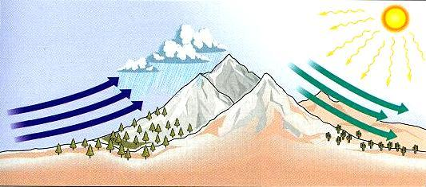

A. 山峰两侧可能呈现完全不同的自然景观

B. 气流随地形抬升是图中降水的主要成因

C. 图中的降水往往会持续较长时间

D. 翻过山脉后气流温度会有所上升

第 14 题 · 答案与解析

**参考答案（粉笔题库参考内容）**

C

**解析**

A项正确，迎风坡降水量大、温差小，植被茂盛，背风坡降水量小、温差大，植物生长环境相对比较艰苦，山峰两侧常常呈现完全不同的自然景观。B项正确，图中示意的自然现象是地形雨。潮湿的气团前进遇到高山阻挡时，气流被迫缓慢上升，引起绝热降温，水汽发生凝结，这样形成的降雨，称为地形雨。C项错误，地形雨如不与对流雨或气旋雨结合，雨势一般不会很强。山麓地带气流抬升不够，成云致雨少些，山体的中部降水最多，而山顶部分空气湿度已经大大降低，云雨少些，因此C项的降水持续时间长表述错误。D项正确，地形雨多降在迎风面的山坡（迎风坡）上，背风坡面则因空气下沉引起绝热增温，反使云量消减，降雨减少。

本题为选非题，故正确答案为C。

**考点**：自然地理

**来源**：2014年国家公务员录用考试《行测》题第14题

### 第 15 题

下列说法错误的是：

A. 根据光的偏振原理可以制成看立体电影的立体眼镜

B. 打枪瞄准时闭上一只眼利用了光沿直线传播的原理

C. 光在光纤中传播利用的是光的全反射原理

D. 潜望镜利用了光的折射原理

第 15 题 · 答案与解析

**参考答案（粉笔题库参考内容）**

D

**解析**

D项错误，光的折射是指光线从一种介质（如空气）斜射入其传播速度不同的另一种介质（如水、玻璃）时发生的对直线路径的偏离，潜望镜中不存在传播介质的变化，是利用光的反射原理来实现传播路径的弯折。A、B、C三项正确。

本题为选非题，故正确答案为D。

**考点**：物理常识

**来源**：2014年国家公务员录用考试《行测》题第15题

### 第 16 题

下列军事武器装备按发明时间先后排序，错误的是：

A. 弓箭、云梯、火药

B. 火炮、机枪、冲锋枪

C. 雷达、坦克、鱼雷

D. 航母、导弹、原子弹

第 16 题 · 答案与解析

**参考答案（粉笔题库参考内容）**

C

**解析**

A项正确，弓箭发明于原始社会，云梯一般认为是春秋时鲁国公输班（即鲁班）发明，火药发明于唐宋时期；

B项正确，最迟在元代，中国已经制造了最古老的火炮——火铳。在云居寺发现的青铜炮生产于元至顺三年，也就是公元1332年，是现存最早的有纪年可考的火炮。机枪发明于19世纪80年代，冲锋枪发明于20世纪初；

C项错误，1842年多普勒率先提出利用多普勒效应的多普勒式雷达，但并未制造出具有实用价值的雷达。关于雷达的发明，正如世界上有许多发明是很难认定其具体发明人的，雷达便是其中的一例。具体是谁发明有争议。但认可较多的是英国沃森·瓦特于1935年夏研制成功第一套实用雷达装置；坦克出现在第一次世界大战期间，大约在1915年开始投入到战争中；鱼雷于1866年由罗伯特·怀特黑德发明。

D项正确，1917年英国海军改装出世界第一艘航空母舰，导弹出现于20世纪40年代，二战后期已在实战中使用，原子弹发明于1945年二战即将宣告结束时。

本题为选非题，故正确答案为C。

**来源**：2014年国家公务员录用考试《行测》题第16题

### 第 17 题

关于目前的国际体育赛事，下列说法正确的是：

A. 世界一级方程式锦标赛所用赛车的发动机排量没有限制

B. 进入世界杯和欧洲杯足球赛决赛圈的球队数量相同

C. 斯诺克台球属于奥运会的比赛项目之一

D. 法国网球公开赛属于大满贯的赛事

第 17 题 · 答案与解析

**参考答案（粉笔题库参考内容）**

D

**解析**

A项错误，根据国际汽车运动联合会（FIA）的规定，一级方程式锦标赛所用赛车的发动机排量为3000cc；B项错误，进入世界杯决赛圈的队伍为32支，欧洲杯为24支；C项错误，斯诺克的女性参与者太少，这使得它很难成为奥运项目，且斯诺克也只是台球运动的一项，不可能单独列为奥运项目；D项正确，大满贯赛事包括澳大利亚公开赛、法国公开赛、温布尔登网球锦标赛和美国公开赛。

故正确答案为D。

**考点**：生活常识

**来源**：2014年国家公务员录用考试《行测》题第17题

### 第 18 题

下列关于农业的说法正确的是：

A. 花生、大豆、向日葵和芝麻都属于油料作物

B. 农药在夏天中午气温较高时喷洒灭虫效果最好

C. 有机农作物通常种在便于运输的交通主干线附近

D. 追肥是农闲时期为调节土地所含养分而施用的肥料

第 18 题 · 答案与解析

**参考答案（粉笔题库参考内容）**

A

**解析**

A项正确，花生、大豆、向日葵、芝麻都属于油料作物，分别可制作花生油、豆油、葵花油、芝麻油。B项错误，夏日中午太阳光照强，大多数害虫躲在叶片的背光面，甚至停止活动，药物喷洒后杀虫率低，而气温高、光照强易造成农药分解、挥发，降低药效，害虫嗅到药味逃之夭夭。C项错误，有机农作物要求其遵照特定的农业生产原则，在生产中不采用基因工程获得的生物及其产物，不使用化学合成的农药、化肥、生长调节剂、饲料添加剂等物质，遵循自然规律和生态学原理。交通干线附近化学、噪声污染较大，不符合有机农作物生产要求。D项错误，追肥的作用主要是为了供应作物某个时期对养分的大量需要，或者补充基肥的不足。

故正确答案为A。

**考点**：生活常识

**来源**：2014年国家公务员录用考试《行测》题第18题

### 第 19 题

燃放烟花最佳的气象条件：有较大分散性低云、碎积云，云底高度在1000米左右，有一定的水汽，相对湿度70%左右，风力小于3级。下列诗句描述的天气中最适合欣赏烟花的是：

A. 晴空一鹤排云上，便引诗情到碧霄

B. 黄梅时节家家雨，青草池塘处处蛙

C. 天上灰布悬，雨丝定连绵

D. 风雨从北来，万木皆怒号

第 19 题 · 答案与解析

**参考答案（粉笔题库参考内容）**

C

**解析**

A项错误，晴天之时一为卷云，不符合碎云的条件；二为云高度极高，4500至10000米，不符合云底高度1000米左右的描述。因此非最适合欣赏烟花的气象条件。

B项错误，黄梅时节家家雨，即长江中下游的梅雨季节，为阴雨连绵的天气，雨量在200-400毫米之间。不适合燃放、欣赏烟花。

C项正确，天空灰布悬，指的是雨层云，雨层云底部经常伴有碎雨云，云高600-3000米，符合云层的要求；雨丝定连绵，说明会下绵绵细雨，处于下雨前的状态，当空气的相对湿度达100%，即达到饱和状态才能凝成小水滴（雾、云），聚成大水滴才会下雨。下雨前的相对湿度不一定要达100%，温带大陆性气候地区多数地方的相对湿度在80%左右徘徊，接近70%的要求。因此最适合欣赏烟花的气象条件。

D项错误，风雨、怒号，说明风大雨大，此时天气不适合燃放、欣赏烟花。

故正确答案为C。

**考点**：生活常识

**来源**：2014年国家公务员录用考试《行测》题第19题

### 第 20 题

一般认为热带雨林是指阴凉、潮湿多雨、高温、结构层次不明显、层外植物丰富的乔木植物群落。下列关于热带雨林的说法正确的是：

A. 热带雨林有春、夏、秋、冬四季

B. 热带雨林有春季、夏季两个季节

C. 热带雨林有雨季、干季两个季节

D. 热带雨林没有季节之分，常年都是雨季

第 20 题 · 答案与解析

**参考答案（粉笔题库参考内容）**

D

**解析**

热带雨林主要分布于赤道南北纬5~10度以内的热带气候地区。这里全年高温多雨，无明显的季节区别。

故正确答案为D。

**考点**：自然地理

**来源**：2014年国家公务员录用考试《行测》题第20题

### 第 21 题

心理学家根据临床观察发现，我们生活中的许多“抑郁症”属于假性抑郁症，一般人的情绪变化有一定 ＿＿＿＿＿＿＿，通常是短期的，人们通过自我调适，充分发挥自我心理防卫功能，就能恢复心绪平稳。

填入画横线部分最恰当的一项是：

A. 突发性

B. 周期性

C. 时限性

D. 反复性

第 21 题 · 答案与解析

**参考答案（粉笔题库参考内容）**

C

**解析**

根据后文“短期的”、“通过自我调适，······就能恢复心绪平稳”可知，横线处表达情绪变化是有时间限度的，不是一直持续的，C项“时限性”指有时间限度的，符合文意。

A项“突发性”侧重强调突然发生，与时间长短无关，排除；B项“周期性”与D项“反复性”均强调重复、循环，文段强调在一段时间之内就能恢复，而非循环，故与文意不符，排除B、D两项。

故正确答案为C。

**考点**：实词填空、对应关系-解释说明

**来源**：2014年国家公务员录用考试《行测》题第21题

### 第 22 题

国际电信世界大会上，审议具有24年历史的《国际电信规则》是一个巨大的挑战，因为要确保它能＿＿＿＿，适应新一代信息通信技术用户的需求和全球化、激烈竞争和创新不断加深的技术环境。

填入画横线部分最恰当的一项是：

A. 推陈出新

B. 与时俱进

C. 精益求精

D. 破旧立新

第 22 题 · 答案与解析

**参考答案（粉笔题库参考内容）**

B

**解析**

根据“适应新一代信息通信技术用户的需求和全球化、激烈竞争和创新不断加深的技术环境”可知，横线处所填成语应体现出《国际电信规则》要跟上时代步伐，B项“与时俱进”指随着时代的发展而不断发展、前进，符合文意，当选。

A项“推陈出新”意为去掉旧事物的糟粕，取其精华，并使它向新的方向发展（多指继承文化遗产），文段并未提及要剔除、推翻旧规则的原有内容，仅强调要让规则适配新环境，与文意不符，排除；C项“精益求精”意为已经很好了，还要求更好，与文意无关，排除；D项“破旧立新”指破除旧的，建立全新的，文段侧重强调审议修订已有规则，而非废除旧规则、建立一套全新的规则，与文意不符，排除。

故正确答案为B。

**考点**：对应关系-前后呼应、成语填空

**来源**：2014年国家公务员录用考试《行测》题第22题

### 第 23 题

消极完美主义者总是非常仔细地检查任何事情的细枝末节，有时竟达到＿＿＿＿的地步。他们缺少一种适时放弃的智慧，他们所追求的“完美”，不是美学意义上的“完美”，而是一种非常刻板而教条式的“完美”。

填入画横线部分最恰当的一项是：

A. 抱残守缺

B. 宁缺毋滥

C. 冥顽不灵

D. 吹毛求疵

第 23 题 · 答案与解析

**参考答案（粉笔题库参考内容）**

D

**解析**

根据“竟达到”以及“非常刻板而教条式的‘完美’”可知，横线处所填词语需比“非常仔细地检查任何事情的细枝末节”的程度更重，体现出对事情细枝末节的检查过分的仔细之意。D项“吹毛求疵”比喻故意挑剔别人的缺点，寻找差错，也可以用来形容对事物的细枝末节过分挑剔，符合文意，当选。

A项“抱残守缺”指抱着残缺陈旧的东西不放，形容思想保守，不求改进，与文意不符，排除；

B项“宁缺毋滥”指宁可缺少一些，也不要不顾质量一味求多，强调的是一种选择态度，并非对细节的过度追求，与文意不符，排除；

C项“冥顽不灵”形容愚昧昏庸又顽固不化，与文意无关，排除。

故正确答案为D。

**考点**：对应关系-前后呼应、成语填空、词的辨析-程度轻重

**来源**：2014年国家公务员录用考试《行测》题第23题

### 第 24 题

纪录片也要注重挖掘人的情感和历史，因为一部好的纪录片不仅是对人和事物的简单＿＿＿＿，更是对世界的＿＿＿＿发现。

依次填入画横线部分最恰当的一项是：

A. 记录 独特

B. 记叙 独到

C. 记述 独立

D. 记载 独创

第 24 题 · 答案与解析

**参考答案（粉笔题库参考内容）**

A

**解析**

第一空，纪录片是影像、声音、文字的集合体，不是简单文字描绘，但B项“记叙”、C项“记述”和D项“记载”多指用文字叙述，故排除B、C、D三项。

第二空，与“发现”搭配，A项“独特”恰当。

故正确答案为A。

**考点**：实词填空、对应关系-前后呼应、词的辨析-搭配对象

**来源**：2014年国家公务员录用考试《行测》题第24题

### 第 25 题

读书时对感兴趣的东西深钻细研，无疑有助于我们更全面、系统、深入地了解这些东西。但不感兴趣的东西，有的也可能恰恰是我们所＿＿＿＿＿＿＿＿的。这不仅因为兴趣本身有一定的局限性，而且因为在特定领域浸染日久，往往会＿＿＿＿＿＿＿这种兴趣，形成越不感兴趣越排斥的恶性循环，导致短板更短。

依次填入画横线部分最恰当的一项是：

A. 需要 泛化

B. 忽视 僵化

C. 欠缺 固化

D. 提倡 弱化

第 25 题 · 答案与解析

**参考答案（粉笔题库参考内容）**

C

**解析**

第一空，根据“越不感兴趣越排斥的恶性循环，导致短板更短”可知，我们不感兴趣的往往会成为我们的“短板”，与之对应，C项“欠缺”最为恰当。

第二空验证，对应前文“在特定领域浸染日久”，“泛化”与“弱化”均不合文意，排除A、D项；B项“僵化”程度过重，排除；C项“固化”符合文意，当选。

故正确答案为C。

**考点**：实词填空、对应关系-前后呼应、词的辨析-程度轻重、词的辨析-词义侧重

**来源**：2014年国家公务员录用考试《行测》题第25题

### 第 26 题

尽管人工培育和种植可以在很大程度上弥补市场需求的缺口，起到保护野生中草药的效果，但是这种做法并非＿＿＿＿，因为有的品种可以实现人工种植，但仍有很多草药品种无法实现这一突破。面对越来越多野生中草药濒危的现状，启动对野生中草药资源的大规模普查＿＿＿＿。

依次填入画横线部分最恰当的一项是：

A. 无可厚非 为期不远

B. 一劳永逸 势在必行

C. 事半功倍 任重道远

D. 万无一失 恰中要害

第 26 题 · 答案与解析

**参考答案（粉笔题库参考内容）**

B

**解析**

本题可从第二空入手，由“面对越来越多野生中草药濒危的现状”可知，应立即“启动大规模普查”来应对当前的濒危现状，即B项“势在必行”的应有之意。

以第一空验证，“一劳永逸”常用于形容一次把事情做好，以后就不用再做，与文意相符。

故正确答案为B。

成语积累：

无可厚非：指不可过分责备，表示虽有缺点，但是可以理解或原谅。

事半功倍：形容花费的气力小，收到的成效大。

一劳永逸：常用于形容一次把事情做好，以后就不再费事了。

万无一失：指绝对不会出差错。

任重道远：担子很重，路程又长。比喻责任重大，需要长期艰苦奋斗。

**考点**：对应关系-前后呼应、成语填空

**来源**：2014年国家公务员录用考试《行测》题第26题

### 第 27 题

一些学者认为，在信息时代强化互联网服务提供者的责任，实际上就是要求他们对互联网使用者发布的信息进行＿＿＿＿，这不利于我国宪法和法律所规定公民的言论自由和出版自由的实现。毫无疑问，这是典型的＿＿＿＿。如果散布谣言也属于“自由”，那么任何人都可以借助互联网散布谣言，损害国家利益、公共利益和公民的合法利益。

依次填入画横线部分最恰当的一项是：

A. 过滤 偷梁换柱

B. 整合 断章取义

C. 评价 混淆是非

D. 审核 以偏概全

第 27 题 · 答案与解析

**参考答案（粉笔题库参考内容）**

A

**解析**

第一空，根据前后文语意可知，横线处所填动词的意思为对信息的处理动作不利于自由的实现，“整合”与“评价”不会影响自由的实现，故可排除B、C两项。

第二空，根据文段“如果散布谣言也属于‘自由’，那么任何人都可以借助互联网散布谣言，损害国家利益、公共利益和公民的合法利益”可知，谣言和自由属于两个本质不同的东西，A项“偷梁换柱”比喻用欺骗的手段暗中改变事物的内容或事情的性质，符合文意，当选。D项“以偏概全”指用片面的观点看待整体问题，文段谣言和自由不是片面和整体的关系，排除。

故正确答案为A。

**考点**：对应关系-前后呼应、混搭填空

**来源**：2014年国家公务员录用考试《行测》题第27题

### 第 28 题

当人类社会进入信息时代，曾有人＿＿＿＿，计算机是方块汉字的掘墓人。然而，事实＿＿＿＿了对汉字的这些偏见和悲观论调。据统计，现在已有1000多种汉字输入法，无论从速度还是准确率上看，方块汉字的计算机输入都丝毫不逊色于拼音文字。

依次填入画横线部分最恰当的一项是：

A. 宣称 打破

B. 断言 粉碎

C. 妄言 驳斥

D. 预言 批判

第 28 题 · 答案与解析

**参考答案（粉笔题库参考内容）**

B

**解析**

第一空，“妄言”指信口胡说，文段中指出这是一种“偏见和悲观论调”，而非“胡说”，排除C项；“宣称”指公开表示，文段不强调公开，排除A项。

第二空，要与“事实”搭配，D项的“批判”主语通常是人，不能是“事实”，排除；根据横线前后文意可知，“事实”对偏见和悲观论调的力度是最大的，所以“粉碎”填入横线处恰当。

故正确答案为B。

**考点**：实词填空、对应关系-前后呼应、词的辨析-搭配对象、词的辨析-词义侧重

**来源**：2014年国家公务员录用考试《行测》题第28题

### 第 29 题

胡适曾经提出这样一个观点：大胆地假设，小心地求证。这句话很好地概括了科学研究的两个基本步骤：首先要能＿＿＿＿，不断提出新的问题、新的想法；之后要能对提出的假说做严格的论证或实验，＿＿＿＿。

依次填入画横线部分最恰当的一项是：

A. 去粗取精 言之成理

B. 不拘一格 革故鼎新

C. 吐故纳新 有的放矢

D. 标新立异 去伪存真

第 29 题 · 答案与解析

**参考答案（粉笔题库参考内容）**

D

**解析**

第一空，“大胆地假设，小心地求证”概括了科学研究的两个步骤，由此可知，第一空对应“大胆地假设”。B项“不拘一格”强调不局限于一种规格或方式；D项“标新立异”指提出新奇的主张，表示与一般不同，符合文意。A项“去粗取精”强调除去杂质，留取精华；C项“吐故纳新”现多用来比喻扬弃旧的、不好的，吸收新的、好的。A、C两项均无法对应“大胆地假设”，排除。

第二空，对应“小心地求证”，D项“去伪存真”指除掉虚假的，留下真实的，对应“小心地求证”，符合文意，B项“革故鼎新”表达去掉旧的，建立新的，与“求证”无关，排除。

故正确答案为D。

**考点**：对应关系-前后呼应、成语填空

**来源**：2014年国家公务员录用考试《行测》题第29题

### 第 30 题

目前，社会上对种种迷信现象，笃信、盲从者不在少数，根源就在于思辨和理性的＿＿＿＿。在社会的进步和发展中，科学精神是消除各种＿＿＿＿，破除种种迷信的利器。科学精神的核心，就是不盲从、不迷信。

依次填入画横线部分最恰当的一项是：

A. 失效 误解

B. 匮乏 罪恶

C. 缺失 愚昧

D. 苍白 无知

第 30 题 · 答案与解析

**参考答案（粉笔题库参考内容）**

C

**解析**

第一空，强调没有思辨和理性，所以排除A项“失效”和D项“苍白”。

第二空，与后文的“迷信”构成同义并列关系，C项“愚昧”符合文意，当选。

故正确答案为C。

**考点**：关联关系-并列关系、实词填空、对应关系-前后呼应

**来源**：2014年国家公务员录用考试《行测》题第30题

### 第 31 题

在早已对漂亮假花、假树司空见惯的现代人眼里，干枯苍白的植物标本或许难有多少魅力可言。但在标本馆中，每一份看似不起眼的植物标本都代表着它在地球上的＿＿＿＿。它们虽然远离了阳光雨露，告别了生长的土地，却在科学殿堂中＿＿＿＿了自己的生命。

依次填入画横线部分最恰当的一项是：

A. 物种 证明

B. 经历 重现

C. 存在 超越

D. 同类 延续

第 31 题 · 答案与解析

**参考答案（粉笔题库参考内容）**

D

**解析**

第一空，理解“标本”一词的含义尤为重要。“标本”指动植物等采取个体作为样品，经过加工，使之长期保存，以作展览、鉴定、考证及其他研究之用。结合空格所在分句，“代表”一词常用作某个体“代表”某一类群体之意，故可排除B、C两项。而A项填入空格搭配不当，故基本锁定正确答案为D。

以第二空检验，填入“延续”即表达生物在自然界死亡后在科学殿堂中使自己的生命持续下去。

故正确答案为D。

**考点**：实词填空、对应关系-前后呼应、词的辨析-搭配对象

**来源**：2014年国家公务员录用考试《行测》题第31题

### 第 32 题

我们现在认为，严格意义上的地图应该仅仅是对某一片特定区域的＿＿＿＿记录，它必须严谨如卫星所拍摄到的照片一样。而过去，地图被认为是一种复杂的手工绘制作品，且有着各种不同的主观色彩，因为对于同一个地方而言，不同的地图表现出来的内容会＿＿＿＿。如今，人们加诸地图的主观性正在逐渐消失，人类随之失去的，也是地图蕴含着的重要的文化和历史信息。

依次填入画横线部分最恰当的一项是：

A. 清晰 如出一辙

B. 真实 殊途同归

C. 客观 千差万别

D. 全面 各有千秋

第 32 题 · 答案与解析

**参考答案（粉笔题库参考内容）**

C

**解析**

本题可从第二空入手。根据文意，作为手工绘制作品且带有主观色彩的地图，对同一个地方而言，其表现出来的内容亦会有所不同。故可排除表示相同的A项“如出一辙”和B项“殊途同归”。而D项“各有千秋”强调的是各有特色，各有所长，并非强调有所不同。故基本锁定正确答案为C。

以第一空验证，前文对应“严格意义上的地图”，后文对应“严谨如卫星所拍摄到的照片一样”，再联系第二句转折的“主观色彩”，第一空强调的应该是不带主观色彩，故“客观”最为合适。

故正确答案为C。

【文段出处】中国经济史论坛《地图中的文化与历史》

**考点**：关联关系-因果关系、对应关系-前后呼应、混搭填空

**来源**：2014年国家公务员录用考试《行测》题第32题

### 第 33 题

近几年，不少银行向影视业提供了较多的贷款支持，但迫切渴望融资渠道的中小影视公司仍难以得到扶持，银行往往只是“\_\_\_\_\_\_\_\_”。而私募基金投资影视业则是“\_\_\_\_\_\_\_\_”：尽管目前号称以影视产业为主要投资方向的基金已有近20只，声称募集资金达200亿元，但披露的有影响力的投资项目寥寥可数。

依次填入画横线部分最恰当的一项是：

A. 借花献佛 小心翼翼

B. 雪中送炭 纸上谈兵

C. 点到为止 画饼充饥

D. 锦上添花 雷大雨小

第 33 题 · 答案与解析

**参考答案（粉笔题库参考内容）**

D

**解析**

本题从第二空入手，根据后文“尽管目前号称以影视产业为主要投资方向的基金已有近20只，声称募集资金达200亿元，但披露的有影响力的投资项目寥寥可数”可知，表面声势很大，但实际作用很小，D项“雷大雨小”符合文意，保留。

第一空，代入验证，根据前文“不少银行向影视业提供了较多的贷款支持，但迫切渴望融资渠道的中小影视公司仍难以得到扶持”可知，银行的贷款并未过多流向中小影视公司而是给了大公司，D项“锦上添花”符合语境，当选。

故正确答案为D。

【友情提示】

本题考查解释类对应，冒号是这道题的解题点，准确对应成语意思即可。考生在平时学习中除了扩充词汇量，也要注重积累做题的小技巧，例如解释类对应常见的标志有：冒号、破折号、“是”、“无异于”、“无疑是”等。

【拓展】

借花献佛：用别人的花进献给菩萨，比喻拿别人的东西做人情。

雪中送炭：比喻在别人急需时给以物质上或精神上的帮助。

纸上谈兵：比喻空谈理论，不能解决实际问题。也比喻空谈不能成为现实。

画饼充饥：比喻用空想来安慰自己。特别是用来欺骗别人。

锦上添花：比喻好上加好，美上添美。

雷大雨小：比喻说得多，做得少；声势很大，实效很小

**考点**：对应关系-解释说明、成语填空

**来源**：2014年国家公务员录用考试《行测》题第33题

### 第 34 题

历史反复昭示我们，向海而兴，背海而衰，是一条\_\_\_\_\_\_\_\_的铁律。中华民族要实现伟大复兴，必须\_\_\_\_\_\_\_\_地走向海洋、经略海洋，坚定不移地走以海富国、以海强国的和平发展之路。

依次填入画横线部分最恰当的一项是：

A. 亘古不变 义无反顾

B. 一成不变 勇往直前

C. 原封不动 理直气壮

D. 颠扑不破 昂首阔步

第 34 题 · 答案与解析

**参考答案（粉笔题库参考内容）**

A

**解析**

第一空，形容历史发展的规律，A项“亘古不变”指永远不会改变，D项“颠扑不破”指无论怎样摔打都不会破裂，比喻永远不会被推翻，填入文段语意均合适；B项“一成不变”指一经形成，永不改变，含贬义，和文段感情色彩不符，排除；C项“原封不动”比喻保持原来的样子，一点不加变动，和“铁律”搭配不当，排除。

第二空，与后文“坚定不移”构成相同句式的并列，形容稳定坚强毫不动摇，A项“义无反顾”指在道义上只有勇往直前，绝对不退缩回头，不犹豫，填入文段合适；D项“昂首阔步”指仰起头迈着大步向前，形容精神振奋，意气昂扬，与文意不符，排除。

故正确答案为A。

**考点**：关联关系-并列关系、成语填空、词的辨析-感情色彩、词的辨析-搭配对象

**来源**：2014年国家公务员录用考试《行测》题第34题

### 第 35 题

或许我们真的需要经典作品来\_\_\_\_\_\_\_\_我们偶尔困顿迷茫的精神，用大师的智慧烛照我们前行的步伐，他们的作品有着\_\_\_\_\_\_\_\_岁月阻隔的力度，唤起我们在这个浮躁时代里重新对人生的追索，从眼前困扰的现实中超脱出来。

依次填入画横线部分最恰当的一项是：

A. 观照 消弭

B. 支撑 穿透

C. 唤醒 超越

D. 消除 跨越

第 35 题 · 答案与解析

**参考答案（粉笔题库参考内容）**

B

**解析**

第一空，搭配“精神”，且横线处要体现出作品能让我们振奋精神之意，B项“支撑”指抵抗住压力使东西不倒塌；勉强维持，C项“唤醒”指叫醒；使醒悟，均搭配得当且符合文意，保留。A项“观照”原为美学术语，现也指仔细观察，审视，常搭配“现实”“生活”等，D项“消除”指使不存在；除去（不利的事物），常搭配“隔阂”“隐患”等，均与“精神”搭配不当，排除。

第二空，与“岁月阻隔”搭配共同形容“力度”，B项“穿透”指贯通，搭配得当且可体现出突破岁月阻隔的障碍之意，当选。C项“超越”指超出；超过，常搭配“时空”“障碍”等，与“力度”搭配不当，排除。

故正确答案为B。

**考点**：实词填空、词的辨析-搭配对象

**来源**：2014年国家公务员录用考试《行测》题第35题

### 第 36 题

“假说”在没有事实验证的情况下还不是科学理论。现有的科学知识和理论远不是事实的全部，而我们的许多科学家在从事研究工作时，总是\_\_\_\_\_\_\_\_于现有的一些学说，只是试图用实验结果来证明这些假说的合理性，而不是设法去\_\_\_\_\_\_\_\_它。实际上，许多流行的假说与科学理论必须符合客观实际、逻辑严谨、没有矛盾的要求\_\_\_\_\_\_\_\_。

依次填入画横线部分最恰当的一项是：

A. 拘泥 否定 相去甚远

B. 受制 反驳 背道而驰

C. 纠结 求证 大相径庭

D. 局限 排斥 针锋相对

第 36 题 · 答案与解析

**参考答案（粉笔题库参考内容）**

A

**解析**

第一空，文意强调现在的科学家在做研究时不考虑现有学说的合理性，就直接以其为依据，从未想过去质疑它。C项“纠结”与文意不符，排除。

第二空，由“只是试图用实验结果来证明这些假说的合理性，而不是······”可知，第二空与“证明”语义相反，A项“否定”、B项“反驳”均符合文意，保留。D项“排斥”搭配不当，排除。

第三空，对比A、B两项，“相去甚远”与“背道而驰”差别在于轻重程度不同，前者仅指差别较大，后者强调与正确的方向和原则完全相反。文中主语为“假说”，称之与“符合客观实际、逻辑严谨、没有矛盾的要求”完全相反程度过重，排除B项。

故正确答案为A。

**考点**：关联关系-并列关系、对应关系-前后呼应、混搭填空、词的辨析-程度轻重

**来源**：2014年国家公务员录用考试《行测》题第36题

### 第 37 题

治理环境确为政府职责，环境出现问题，其监管＿＿＿＿、执法不严难逃其责，但是，当大家不断＿＿＿＿政府不作为时，是不是也应该＿＿＿＿一下自己：我们有没有污染环境？

依次填入画横线部分最恰当的一项是：

A. 不当 谴责 检察

B. 不周 斥责 检查

C. 不善 苛责 检点

D. 不力 指责 检讨

第 37 题 · 答案与解析

**参考答案（粉笔题库参考内容）**

D

**解析**

本题可从第二空入手，形容公众对于政府不作为的态度，A项“谴责”指对错误行为或政策的严厉批评与斥责，B项“斥责”指用严厉语言批评他人错误或罪行，D项“指责”指指出过失并责备，均可用于形容公众对于政府不作为的态度。C项“苛责”指严苛地批评指责，往往用于表示过严的责备，过高的要求，“治理环境”是政府的本职，并非“过高的要求”，与文意不符，排除。

第三空，根据“我们有没有污染环境？”可知，横线处表达应反思自身问题之意。D项“检讨”指检查自己的错误言行，符合文意，保留。A项“检察”指国家法律监督机关为履行法律监督职责而审查法律事实的司法行为，不符合文段语境，排除；B项“检查”指为了发现问题而用心查看，没有突出自我反思之意，与文意不符，排除。

第一空，代入验证。搭配“监管”，D项“不力”指主观层面的未尽全力，也指客观层面的效率成效低下，与“监管”搭配恰当，当选。

故正确答案为D。

**考点**：实词填空、对应关系-前后呼应、词的辨析-搭配对象

**来源**：2014年国家公务员录用考试《行测》题第37题

### 第 38 题

迟迟没有落地的补贴细则，让有意投资光伏发电站的企业们对光伏发电站的大蛋糕＿＿＿＿，上周，据某研究所人员透露，对光伏发电站的补贴已经纳入到财政预算，将“缺多少补多少”，但大部分企业对此依然＿＿＿＿＿＿，在补贴不到位的情况下，企业还将面临垫资的风险，因此就整个光伏发电站市场而言，资金实力雄厚的大企业占据主导地位是＿＿＿＿的。

依次填入画横线部分最恰当的一项是：

A. 望洋兴叹 举棋不定 显而易见

B. 望而生畏 犹豫不决 有目共睹

C. 望而却步 将信将疑 不言而喻

D. 望尘莫及 优柔寡断 不证自明

第 38 题 · 答案与解析

**参考答案（粉笔题库参考内容）**

C

**解析**

第一空，根据文意，企业们因为政策没有落地有不敢投资之意，D项“望尘莫及”，比喻远远落后，排除。

第二空，重点关注“此”这一指代词，文中表述的是大部分企业对于补贴政策的态度，即“将信将疑”，故基本锁定正确答案为C。

第三空验证，“不言而喻”形容道理显而易见，与文中“资金实力雄厚的大企业占据主导地位”搭配恰当。

故正确答案为C。

【友情提示】

本题出现多个形近成语，重点考查考生对于成语的把握。形近成语和近义成语的辨析是逻辑填空的高频考点，对于这两类成语，考生需要格外注意，在备考过程中加以辨析和积累，切忌按字面意思理解成语。指代词“此”是本题第二空的解题点，着重考查合理搭配，指代词在逻辑填空的运用也需引起考生的注意。

形近成语辨析：

【望洋兴叹&望而生畏&望而却步&望尘莫及】

望洋兴叹：字面意思为望着海洋，叹其浩渺无际，引申义为形容在伟大事物面前感叹自己的渺小。现多比喻做事时因力不胜任或没有条件而感到无可奈何。

望而生畏：看见了就害怕。

望而却步：远远望见了就吓得直后退。

望尘莫及：只望见走在前面的人带起的尘土而追赶不上。比喻远远落后。现在多用于表示对人钦佩的自谦语。

近义成语辨析：

【举棋不定&优柔寡断&犹豫不决】

举棋不定：比喻做事犹豫不决。

优柔寡断：做事犹豫，缺乏决断。

犹豫不决：迟疑，拿不定主意。

【不言而喻&有目共睹】

不言而喻：不用说就可以明白，形容道理很明显。

有目共睹：形容事物非常明显。

**考点**：对应关系-前后呼应、成语填空

**来源**：2014年国家公务员录用考试《行测》题第38题

### 第 39 题

叶片眷恋地＿＿＿＿，栖息在行人的身上，或是顺着头发身体＿＿＿＿，无所依托地静卧在褐色的砖道上。深褐、暗红、浅黄及那些许丝丝绿色，在叶脉中若隐若现地＿＿＿＿＿＿。

依次填入画横线部分最恰当的一项是：

A. 回旋 滑落 流淌

B. 回旋 漂落 交织

C. 舞动 滑落 交织

D. 舞动 飘落 流淌

第 39 题 · 答案与解析

**参考答案（粉笔题库参考内容）**

A

**解析**

第一空，根据“眷恋”可知，横线处所填词语应该表现出“恋恋不舍”的意思，显然“回旋”符合文意，排除C、D两项。

第二空，根据“顺着头发身体”可知，A项“滑落”更加合适。B项“漂落”指漂零沦落，多形容人，排除。

第三空，代入验证，A项“流淌”符合文意，且更加形象生动，当选。

故正确答案为A。

**考点**：实词填空、对应关系-前后呼应、对应关系-形象表达

**来源**：2014年国家公务员录用考试《行测》题第39题

### 第 40 题

对很多作家来说，最＿＿＿＿的文字，几乎都是源自早年的乡土经验。因为一进入旧时的场景，就温暖，就自在，就身心通泰，＿＿＿＿，有如神助。相反，那些凭空想象的创作，虽然＿＿＿＿，用尽心力，还是拘涩凝滞，不能自由伸展。

依次填入画横线部分最恰当的一项是：

A. 成功 洋洋洒洒 精雕细琢

B. 得意 下笔成章 绞尽脑汁

C. 原创 文思泉涌 处心积虑

D. 珍贵 妙语连珠 费尽心机

第 40 题 · 答案与解析

**参考答案（粉笔题库参考内容）**

B

**解析**

第一空，横线前以“最”修饰，C项“原创”不用“最”加以衡量，排除。

第二空，根据文意可知，横线处所填成语形容写作，D项“妙语连珠”指精彩的话语一句接着一句，形容说话很风趣，使人发笑，搭配不当，排除；横线处所填成语与“有如神助”构成并列，B项“下笔成章”指随手写来，便成文章，形容文思敏捷，符合文意，能够体现写文章时“有如神助”的顺畅，保留；A项“洋洋洒洒”形容文章或谈话丰富明快，连续不断，侧重内容长，排除。

第三空，代入验证，横线处所填成语与“用尽心力”构成并列，B项“绞尽脑汁”符合文意，当选。

故正确答案为B。

**考点**：关联关系-并列关系、混搭填空、词的辨析-搭配对象

**来源**：2014年国家公务员录用考试《行测》题第40题

### 第 41 题

相对于政府公关，民间外交更具柔性，传播内容和载体更易于被接受，更能达到“润物细无声”的效果。当前，越来越多外国民众来华参观访问，中国越来越多的公民走出国门，网络媒体的发展也使普通公众更易影响舆论。因此要因势利导，通过新闻媒体、社区组织、民间社团等渠道，引导国内公众主动配合公共外交，积极传播中国的文化传统和价值理念，维护国家形象。

这段文字意在强调的是：

A. 民间外交与政府公关的差别

B. 民间外交在国际交往中的意义

C. 应引导民间外交积极发挥作用

D. 媒体应在国际交往中正确引导公众

第 41 题 · 答案与解析

**参考答案（粉笔题库参考内容）**

C

**解析**

本题为中心理解题。整个文段是一个表示因果的句群。第一句描述了民间外交的重要意义，第二句说明民间外交繁荣发展的现状，这些原因引出了后面的结论。“因此”后面的内容是重点，直接指出我们应该通过正确的渠道引导民间外交发挥积极的作用。因此，结合选项应该选择C项。注意D项中媒体只是最后一句话中渠道的一个例子，不能作为答案。

故正确答案为C。

**考点**：关联词-对策

**来源**：2014年国家公务员录用考试《行测》题第41题

### 第 42 题

收入分配是一系列社会政治经济政策及其相关制度的结果，因此，改革收入分配，其实质就是改革造成收入分配不公平的社会政治经济政策及其相关制度。收入分配改革，从严格意义而言，并非是“均贫富”的改革，而是使社会政治经济制度更加靠近公平、公正和正义的改革，是为全体社会成员提供更加平等发展机会的社会政治经济环境的改革。有了起码的社会公平、公正和正义，有了可以为社会成员提供平等发展机会的政治经济制度，才有可能形成一个合理的收入分配制度。

这段文字主要说明的是：

A. 收入分配改革的实质

B. 收入分配改革的背景

C. 什么是真正的社会公正

D. 什么是合理的收入分配制度

第 42 题 · 答案与解析

**参考答案（粉笔题库参考内容）**

A

**解析**

文段首先介绍收入分配的概念，接着通过“因此”得出结论，指出改革收入分配的实质就是“改革造成收入分配不公平的社会政治经济政策及其相关制度”，后文对这一实质进行详细的解释说明。故文段为“观点+解释说明”结构，观点即“收入分配改革的实质”，对应A项。

B项：“背景”在文段中并未提及，无中生有，排除。

C项：“社会公正”对应解释说明中的内容，且缺少主题词“收入分配改革”，排除。

D项：属于解释说明中的内容，非文段论述重点，排除。

故正确答案为A。

**考点**：关联词-因果

**来源**：2014年国家公务员录用考试《行测》题第42题

### 第 43 题

偶然性在心理学中扮演的角色时常被外行人士甚至临床心理从业者忽略。人们很难意识到，行为的变化有一部分是随机因素引起的，因此心理学家不应自诩能够预测每一例个案的行动。心理学的预测应该是概率性的，表示自己可以在个体层次上进行心理预测，是临床心理学家常犯的错误。

这段文字意在说明：

A. 人的行为发展变化具有偶然性

B. 心理学的预测是对行为的总体预测

C. 目前对人类行为预测的准确性还不高

D. 临床心理学家更擅长对个体进行心理预测

第 43 题 · 答案与解析

**参考答案（粉笔题库参考内容）**

B

**解析**

文段首先指出偶然性在心理学中时常被忽略，后文通过因果关联词“因此”引出结论，即“心理学家不应自诩能够预测每一例个案的行动”，尾句对结论进行解释说明。故文段重点在于“因此”引导的结论，对应B项。

A、C两项，未包含“心理学”这一主题词，排除。

D项，表述与文意相悖，排除。

故正确答案为B。

**考点**：关联词-因果

**来源**：2014年国家公务员录用考试《行测》题第43题

### 第 44 题

焚香的习俗在中国有着悠久的历史，通常人们为了礼仪将衣服熏香，古代文人雅士也喜欢在书房内焚上一炉香，营造“红袖添香夜读书”的意境。因此，早在汉代以前就出现了以陶、瓷、铜、铁、瓦为材料制成的香炉。汉代时，佛教的传入对香炉的发展起了相当大的作用。元末明初，原先其他材料制成的香炉逐渐被铜香炉取代，明代宣德年间则是铜香炉制作的巅峰时期。

这段文字是一篇文章的引言，文章接下来最可能讲述的是：

A. 宗教对于香炉制作技术的影响

B. 焚香习俗逐渐淡出礼仪的原因

C. 香炉制作材料的发展演变过程

D. 宣德香炉的制作及其艺术成就

第 44 题 · 答案与解析

**参考答案（粉笔题库参考内容）**

D

**解析**

文段首句为原因，接着引出结论，说明香炉的发展历程。先说到汉代以前，再说到汉代、元末明初时，最后说到明代宣德年间是铜香炉制作的巅峰时期。由此可以推知，下文将要讲述巅峰时期关于宣德香炉的制作及艺术成就，对应D项。

A、C两项是前文提到过的内容，排除；B项不包含“香炉”这一概念，排除。

故正确答案为D。

**考点**：接语选择题

**来源**：2014年国家公务员录用考试《行测》题第44题

### 第 45 题

将“幸福”传感器放在人体表面或植入人体，通过各项指标可测出人们每一刻的幸福指数。没有一个“幸福”传感器会是完美无缺的，而且也不需要。温度计被发明出来时也很不精确，但随着时间推移，温度计的设计日渐精致，现已是不可或缺的日用品。科学家们相信，“幸福”传感器也将遵循类似进化进程，虽然它们在评估人们心理状态时总会有一定程度的不确定性，可穿戴传感器已比衡量幸福的传统工具来得更为低调，更加易用。

这段文字意在强调：

A. 任何“幸福”传感器都不可能完美无缺

B. “幸福”传感器将成为不可或缺的日用品

C. “幸福”传感器会向着高精度的方向发展

D. 人类并不需要完美无缺的“幸福”传感器

第 45 题 · 答案与解析

**参考答案（粉笔题库参考内容）**

B

**解析**

文段开篇指出幸福传感器的应用原理，接下来指出幸福传感器不完美，通过与“温度计”对比，指出起初温度计也不完美，但慢慢日渐精致，已经成为不可或缺的日用品，并且科学家指出，幸福传感器将会根据温度计的进化进程，从不精准到慢慢精准，最后变成“不可或缺的日用品”，因此本题主旨应为“幸福”传感器也将不可或缺。结合选项应该选择B项。A、D两项，指出了幸福传感器不完美，也不需要完美这一特征，但不是重点所在，文段重点想表述幸福传感器最终也会不可或缺，排除；C项，“精准”不是文段重点，文段强调的是幸福传感器最终“不可或缺”，排除。

故正确答案为B。

**考点**：关联词-转折

**来源**：2014年国家公务员录用考试《行测》题第45题

### 第 46 题

通过遥感探测发现，每年10月到次年的3月期间，每2—3天在2公里以上的高空就有一股从西风带吹来的浮尘，当它抵达华北平原上空后，由于地势降低，风速下降以后浮尘便会往下与污染物相混合，遭遇水汽后细粒子个体便迅速增大，造成大范围高强度的污染现象。如果遇上南边气流比较强，会形成华北地区持续多天的重污染天气。

这段文字意在说明华北地区空气污染现象的：

A. 形成原因

B. 形成过程

C. 覆盖范围

D. 发生时间

第 46 题 · 答案与解析

**参考答案（粉笔题库参考内容）**

A

**解析**

文段从浮尘到来，到与污染物混合，再到重污染天气等方面来描述华北地区空气污染现象的原因。所以在对文段进行整体总结后，得出这段文字意在说明华北地区空气污染现象的形成原因。

B、C、D三项都不够全面，且共同构成形成原因，故排除。

故正确答案为A。

**考点**：主题词

**来源**：2014年国家公务员录用考试《行测》题第46题

### 第 47 题

一个普遍的说法是，人类能辨别1万种不同的气味。一只猎犬的鼻膜上有2.2亿个气味受体细胞，而人类只有2000万个，但我们的嗅觉系统也是相当复杂而专业的。气味分子随气流进入鼻子，通过鼻腔顶端上皮和它的气味受体细胞，这些细胞表面覆盖着能捕捉气味分子的蛋白。气味受体蛋白共有300多种，分别负责不同的气味分子，可以产生大量组合，形成大量的气味模式，＿＿＿＿＿＿。而且我们的嗅觉很容易训练，短期内可见惊人成效。在实验中，如果暴露在单一的花香中，人只要3分半钟，就能极大提高对这种花香的辨别能力。

填入划横线部分最恰当的一句是：

A. 这些气味信息直接进入嗅觉皮层还会影响人的情感反应

B. 但是不同的人对这些气味模式的敏感程度有所不同

C. 这也就是人类能够辨别1万种不同气味的原因

D. 因此对人类来讲嗅觉仍是第一大感官知觉

第 47 题 · 答案与解析

**参考答案（粉笔题库参考内容）**

C

**解析**

本题为语句衔接题。文段第一句指出“人类能辨别1万种不同的气味”这个巨大的气味识别量，第二句通过人类与猎犬的对比说明人类的气味受体细胞很少，第三、四句解释说明为什么很少的受体细胞可以辨别大量的气味，第五、六句举例论证。空格在第四句中。根据以上对上下文的分析，可知本题选C。

故正确答案为C。

**考点**：横线在中间

**来源**：2014年国家公务员录用考试《行测》题第47题

### 第 48 题

事实上，延期偿债不仅无助于真正缓解地方政府债务风险，在大多数情况下反而是埋下了威力更为巨大的“定时炸弹”。一旦“借新还旧”成为地方政府的常规做法，后果更是不堪设想。有鉴于此，中央政府应及时采取强硬手段，制止地方政府继续大唱“拖字诀”；有关部委也应积极考虑借助资本市场消化地方政府公共债务，以债务证券化等方式引入民间资本，化解债务风险；地方政府也应适当削减其经济建设职能，实现财权、事权对等，从根本上消除负债过度的生存土壤。

对这段文字概括最准确的是：

A. 强调中央政府在缓解地方政府债务风险上的指导作用

B. 论述缓解地方政府债务风险的有效手段

C. 分析限制地方政府延期偿债的原因

D. 说明地方政府偿还债务的常规做法

第 48 题 · 答案与解析

**参考答案（粉笔题库参考内容）**

B

**解析**

文段首先介绍延期偿债对缓解地方政府债务风险并无帮助，指出延期偿债不应作为政府的常规做法。接下来通过“有鉴于此”对前文问题进行指代，后文从中央政府、有关部委、地方政府这三方面共同提出了可以缓解地方政府债务风险的办法。因此，文段为“提出问题+解决问题”的分总结构，文段重在强调能够缓解地方政府债务风险的诸项措施，对应B项。

A项，“中央政府”表述片面，排除；

C项，“限制地方政府延期偿债”无中生有，排除；

D项，“地方政府”表述片面，排除。

故正确答案为B。

**考点**：关联词-对策

**来源**：2014年国家公务员录用考试《行测》题第48题

### 第 49 题

目前在火电领域诞生的新技术很多，联合循环技术就是其中之一。简单来说，联合循环技术就是“一气两用”：将燃气轮机排出的高温废气，通过余热锅炉回收转换为燃气，进入蒸汽轮机后驱动其运转，两台轮机都将动能输送至发电机进行发电；废气再次进入锅炉，进一步将其中蕴含的热能转化为动能，降低最终排出气体的温度。这样不仅环保，还能节省燃料。启动速度快也是一大优点，其工作原理是在开机之初关闭运转较慢的蒸汽轮机，只启动燃气轮机，产生足够的热能后，再切换到联合循环模式。这一特点对于电力应急事件频发的大城市十分实用。

关于联合循环技术，下列说法与上述文字不相符的是：

A. 停电时可在短时间内迅速启动

B. 蒸汽轮机早于燃气轮机启动

C. 高温废气得以循环利用

D. 明显提高了发电效率

第 49 题 · 答案与解析

**参考答案（粉笔题库参考内容）**

B

**解析**

本题为细节判断题。由题干“将燃气轮机排出的高温废气，通过余热锅炉回收转换为燃气，进入蒸汽轮机后驱动其运转”和“其工作原理是在开机之初关闭运转较慢的蒸汽轮机，只启动燃气轮机”可以得出，应是燃气轮机早于蒸气轮机启动。

本题为选非题，故正确答案为B。

**考点**：细节判断题

**来源**：2014年国家公务员录用考试《行测》题第49题

### 第 50 题

①经过理论与实践的积累，再生建筑学也逐步成为了一门独立而完整的技术科学

②到第一次世界大战爆发时，欧洲众多城市已经完成改造，向现代生活方式过渡

③在保持原有建筑基本构架的基础上，通过改变局部结构和装修，大幅改变建筑的使用功能，这就是“再生建筑”

④以阿姆斯特丹等港口为发端，欧洲各主要城市先后开始漫长的建筑再生运动

⑤它起源于19世纪40年代的欧洲，当时西欧各国逐步完成工业革命对产业和城市的升级改造

⑥城市中传统的以居住为主的封闭社区和街区，开始让位于交流、娱乐、购物等现代商业的空间需求

将以上6个句子重新排列，语序正确的是：

A. ⑥①⑤③④②

B. ④③⑤⑥①②

C. ①③②④⑤⑥

D. ③⑤⑥④②①

第 50 题 · 答案与解析

**参考答案（粉笔题库参考内容）**

D

**解析**

本题为语句排序题。文段围绕“再生建筑”展开。③句引出论述话题“再生建筑”，并阐明其含义，应为段落首句，由此可以快速得出答案为D。将D项进一步验证，即引出论题后，⑤句介绍再生建筑的起源，⑥④②句说明其发展，①句最后说明了“再生建筑学”应运而生。

故正确答案为D。

**考点**：确定首句-首句特征

**来源**：2014年国家公务员录用考试《行测》题第50题

### 第 51 题

①学者们进一步推测，基克拉底群岛上可能已经出现了早期的国家

②由于地理位置有利，基克拉底群岛一度控制着爱琴海贸易的海上霸权

③遗址发掘发现，当时已经出现了冶炼和制作青铜器的作坊

④从大量墓葬群的分布情况分析，该文明已经出现了比较成熟的早期城市居住区

⑤活跃的商贸活动为该地区居民带来巨大财富，进而为该文明发展提供了必要的物质基础

⑥考古发掘和古物研究证实，基克拉底文明是爱琴海上最古老的文明

将以上6个句子重新排列，语序正确的是：

A. ⑥②⑤③④①

B. ②⑥③④①⑤

C. ②⑤⑥③①④

D. ⑥④②③⑤①

第 51 题 · 答案与解析

**参考答案（粉笔题库参考内容）**

A

**解析**

先判断首句，⑥句给基克拉底文明简单地下定义，②句是引出基克拉底群岛的话题，首句话题不一致，不能排除。②⑥两句“爱琴海”共同信息捆绑，C、D不符合，排除。

对比AB选项，⑤句出现特殊话题“商贸活动”，②句中的“爱琴海贸易”与之对应，构成捆绑，A当选。①句中无对应话题，排除。

进一步验证，④句的“从大量墓葬群的分布情况分析”和①句的“学者们进一步推测”均为分析，应连在一起，又因为①句中出现进一步，所以④句在①句的前面，也可佐证A项的成立。

故正确答案为A。

**考点**：确定捆绑

**来源**：2014年国家公务员录用考试《行测》题第51题

### 第 52 题

在西方，足球曾经是卑贱、粗野的代名词。那时的足球活动没有什么规则，更谈不上什么礼仪，和打群架没有什么区别，弄出人命是常有的事。但这种游戏特别血腥，特别刺激，特别有吸引力，虽屡屡遭禁，却每每“春风吹又生”。为了使得这个人们又爱又恨的游戏益于身心，也为了改变“下贱的踢球人”的形象，人们创造了足球规则，增加了足球礼仪。

这段文字意在强调：

A. 规则和礼仪对足球运动很重要

B. 足球在西方一直颇受大众欢迎

C. 足球运动曾有遭人唾弃的历史

D. 足球运动面貌经历了巨大变化

第 52 题 · 答案与解析

**参考答案（粉笔题库参考内容）**

A

**解析**

本题为中心理解题。文段的前半部分提出问题，包括文段首句先说明“足球曾经是卑贱、粗野的代名词”，第二句“没有什么规则，更谈不上什么礼仪”，第三句“虽屡屡遭禁，却每每‘春风吹又生’”。最后一句解决问题，措施即为“创造了足球规则，增加了足球礼仪”。因此，本文意在强调足球规则和礼仪的重要。文中只说足球“特别刺激，特别有吸引力，虽屡屡遭禁”，但不能说一直颇受大众欢迎，排除B项；文中只说“足球曾经是卑贱、粗野的代名词”，并没“遭人唾弃”的意思，所以C项错误，排除；作者重点指出足球的负面影响并着重提出解决措施即规则、礼仪，并未对足球运动面貌进行阐述，所以D项错误，排除。

故正确答案为A。

**考点**：关联词-对策

**来源**：2014年国家公务员录用考试《行测》题第52题

### 第 53 题

诺贝尔文学奖得主埃利亚斯·卡内提的杰作《群众与权力》是一部分析不同族群特征的最具影响力的著作。该著作从不同角度剖析群众的形象，首先是按国别、地缘、族群来展开，并去分析每个国家特殊的文化背景，由于作者没有从经济层面展开分析，在国别分析中范围仅限于欧洲，因此，本文尝试＿＿＿＿＿＿＿。

填入划横线部分最恰当的一句是：

A. 从经济层面来谈谈欧洲族群特征研究对我国的启示

B. 从文化层面来谈谈特殊文化背景对欧洲族群的影响

C. 从文化层面来谈谈欧洲文化背景对日本族群的影响

D. 从经济层面来谈谈中国和日本的族群特征及其启示

第 53 题 · 答案与解析

**参考答案（粉笔题库参考内容）**

D

**解析**

本题为语句衔接题。最后一句为因果关系，原因是“作者没有从经济层面展开分析，在国别分析中范围仅限于欧洲”，结论后一定是要解决前文提出的问题，所以本文作者将要尝试经济层面的分析，而国别分析范围就应与欧洲不同，即非欧洲族群的特征分析。

故正确答案为D。

**考点**：横线在结尾

**来源**：2014年国家公务员录用考试《行测》题第53题

### 第 54 题

在漫长的传统农业社会，人类一直无法摆脱生产的不足和基础物资的匮乏，而且社会总财富相对比较恒定，财富主要依靠有限的自然资源来供给。这就意味着，国际关系更多地是围绕获取有限的自然资源展开的。然而，现代工商业的发展、科学技术的进步使得社会财富总量得到了爆炸式的增长，世界各国越来越认识到，共同建立一个公正合理的世界秩序是实现大家利益的最佳途径。

这段文字意在说明的是：

A. 社会总财富的增长主要依赖对自然资源的利用

B. 社会财富获取方式的变化对国际关系产生深刻影响

C. 国际关系与自然资源之间存在紧密的联系

D. 人类正逐渐摆脱自然资源供给的束缚

第 54 题 · 答案与解析

**参考答案（粉笔题库参考内容）**

B

**解析**

文段首先指出在传统的农业社会，社会财富主要依靠自然资源，而国际关系也依靠自然资源，即国际关系和社会财富有关，然后通过转折关联词“然而”指出，在现代社会社会财富依靠科技等得到发展，而世界秩序也要重新建立，即国际关系也要随之发生改变，故文段主要围绕“社会财富”和“国际关系”二者的关系展开，对应B项。

A项和C项“自然资源”均对应转折之前的内容，非重点，排除；D项没有提到文段主题词“国际关系”，脱离文段中心，排除。

故正确答案为B。

【文段出处】《中国人为什么用丛林法则看待国际关系》

**考点**：主题词、关联词-转折

**来源**：2014年国家公务员录用考试《行测》题第54题

### 第 55 题

在地震面前，科学还是大有作为的。通过对地震波的研究，人们发现地震波包括纵波和横波，前者传播速度更快，但破坏力较小，而后者则相反。因此，人们通过地震监测台网，监测到传播速度更快的地震波纵波，向监测中心发出信号，监测中心即可通过客户端用无线电波向公众和重点设施发出警报。也就是说，地震警报是无线电波和地震横波的一场“赛跑”，在地震横波尚未到达时，给人们以警示。

这段文字意在说明：

A. 地震波横波的监测难度高于纵波

B. 地震警报系统的精度和速度亟待提高

C. 无线电波技术的发展是实现震前预测的前提条件

D. 科学利用两种地震波的时间差可以发出有效的地震警报

第 55 题 · 答案与解析

**参考答案（粉笔题库参考内容）**

D

**解析**

文段先引出地震与科学的话题，然后简要叙述地震监测的基本原理，接着通过结论词“因此”论述人们如何能够发出地震警报，即监测到传播速度更快的地震波纵波，然后发出警报，尾句通过“也就是说”再次强调，地震警报利用地震纵波和横波传播速度的不同，在地震横波尚未到达时，给人们以警示，故文段围绕“地震警报”展开论述，强调科学利用地震纵波和横波传播速度的不同，发出地震警报，对应D项。

A、B两项，“横波的监测难度高于纵波”“精度和速度亟待提高”文段均未提及，无中生有，排除；

C项，偏离文段核心话题，文段强调的是“地震警报”，而非“震前预测”，排除。

故正确答案为D。

**考点**：关联词-因果

**来源**：2014年国家公务员录用考试《行测》题第55题

### 第 56 题

传统的纯文学杂志正在悄然地进行一场“时尚革命”。最近一段时间，陆续有著名纯文学杂志宣布“触网”，这些杂志都有几十年历史，从来都是“几十页纸走天下”，所以此番赶时髦引发了众多围观。不过本报记者在调查中了解到，这些文学期刊大多面临传统读者减少、年轻读者难寻的窘境。因此“触网”对它们而言固然是时尚，也是一种顺应时代的自我救赎。

这段文字没有论及的是：

A. 传统文学期刊面临着如何吸引年轻一代读者的问题

B. 传统文学期刊“触网”是顺应时代潮流，大势所趋

C. 纯文学杂志走向数字化是摆脱目前困境的唯一救赎

D. 过去的几十年，纯文学杂志保持着纸质媒介的传统

第 56 题 · 答案与解析

**参考答案（粉笔题库参考内容）**

C

**解析**

本题为细节判断题。最后一句“‘触网’对它们而言固然是时尚，也是一种顺应时代的自我救赎”不能证明，走向数字化是唯一的救赎，所以C项错误，当选。A项可以通过“年轻读者难寻的窘境”得到，排除；B项通过原文最后一句得到，排除；D项可以通过“这些杂志都有几十年历史，从来都是‘几十页纸走天下’”得到，排除。

本题为选非题，故正确答案为C。

**考点**：细节判断题

**来源**：2014年国家公务员录用考试《行测》题第56题

### 第 57 题

解决科技与经济结合的问题始终是科技体制改革的核心，以往的改革从技术商品化、科技运行机制、组织结构、人事制度等方面采取了一系列措施，主要着力在微观组织层面。改革进程发展到今天，需要更多地从宏观管理层面思考问题。换句话说，改革已经改到了推动科技体制改革的政府管理者自己头上。政府科技资源配置的理念需不需要转变？对科技活动管理的模式需不需要改变？管理科技活动的组织机构需不需要调整？回答了这三个问题，才有可能解决科技、经济“两张皮”的问题。

这段文字意在说明：

A. 应从政府管理角度思考科技体制改革问题

B. 进行国家科技体制的深层次改革迫在眉睫

C. 明确政府职责是科技体制改革的重要前提

D. 科技与经济相脱节是我国科技体制的弊端

第 57 题 · 答案与解析

**参考答案（粉笔题库参考内容）**

A

**解析**

文段首先介绍以往科技体制改革的着力点都在微观组织层面。接着给出对策，说明改革发展到今天，需要更多地从宏观管理层面思考问题，并加以解释，说明宏观管理层面即政府管理。对策为文段重点，A项为中心意思的同义替换。

B项，“迫在眉睫”文段中并未体现，排除。

C项，“明确政府职责”表述不准确，并非是政府的职责不明造成了问题，文段重点强调的是政府应有效管理，排除。

D项，为问题类表述，不是重点，重点为对策，排除。

故正确答案为A。

【友情提示】“对策为文段中心”为国考常见考点，即解决问题的方式方法为文段重点所在，提醒考生在阅读文段时，如发现对策句需重点关注。

**考点**：关联词-对策

**来源**：2014年国家公务员录用考试《行测》题第57题

### 第 58 题

进入21世纪以来，欧洲一直受竞争力下滑的困扰。2010年，欧盟曾在新颁布的“欧洲2020战略”中，明确提出研发创新占国内生产总值的比例平均每年都要达到3%。但在债务危机的冲击下，各国忙于紧缩财政，创新问题一直被忽视。根据欧盟最新的统计数字，2011年，欧盟研发经费占国内生产总值的比例仅为2.03%，27个成员国中，仅丹麦和马耳他实现了既定目标。未来数年，由于公共债务和“财政契约”的限制，欧盟各国的财政政策总体上仍会偏紧，能够用于刺激研发的资金有限，这意味着创新困境难有改善，从根本上决定了欧洲经济增长将缺乏引擎。

根据这段文字，欧洲竞争力不断下滑的根本原因是：

A. 债务危机重创欧洲制造业

B. 用于研发的资金投入有限

C. 财政紧缩导致创新力度不足

D. 经济增长无法带动产品质量上升

第 58 题 · 答案与解析

**参考答案（粉笔题库参考内容）**

C

**解析**

文段首句说明“欧洲的竞争力一直下滑”这一结论，后文开始阐述原因。第二句和第三句指出“欧洲2020战略”中提出了研发创新目标，但“在债务危机的冲击下，各国忙于紧缩财政，创新问题一直被忽视”，第五句指出“欧盟各国的财政政策总体上仍会偏紧”，“这意味着创新困境难有改善，从根本上决定了欧洲经济增长将缺乏引擎”。在原因表述中，强调了财政支出不足以及由此引发的创新能力不足，即欧洲竞争力不断下滑的根本原因也正在于此，故C项为正确答案。

A、D两项为无关选项，B项为迷惑项，相比之下，C项的表述更为全面。

故正确答案为C。

**考点**：关联词-因果

**来源**：2014年国家公务员录用考试《行测》题第58题

### 第 59 题

目前我国并不缺乏好的设计，人才也不少。但如何与生活、市场结合，让设计成为产业，其间还有不少障碍。一是艺术家与生产厂家缺少交流的渠道，二是设计师闭门造车的不少，三是厂家对设计缺乏兴趣。许多专家认为，对设计的现代认知应该推广到所有企业，让企业舍得投资，只有明白了设计是未来竞争的主要资本，是国际社会衡量产品的主要标准，是消费购买天平中的主要砝码，企业才能拥有重视设计的战略眼光。

从这段文字可以推出：

A. 企业对设计的漠视阻碍了我国设计的产业化发展

B. 设计者与企业沟通不畅制约着设计的市场化进程

C. 国内企业对设计水平的评价与国际标准存在差异

D. 企业不愿在设计环节投资造成大批设计人才流失

第 59 题 · 答案与解析

**参考答案（粉笔题库参考内容）**

A

**解析**

A项，文段开篇指出我国设计存在的问题，即如何让设计成为产业也存在障碍，接着通过“一是······二是······三是······”对问题进行分析。接着尾句指出，专家认为对设计的现代认知应该推广到所有企业，只有明白了设计是未来竞争的主要资本，企业才能拥有重视设计的战略眼光。换言之，目前企业对设计的认知存在问题，“企业对设计的漠视阻碍了我国设计的产业化发展”符合文意，当选；

B项，根据“一是艺术家与生产厂家缺少交流的渠道，二是设计师闭门造车的不少，三是厂家对设计缺乏兴趣”可知，“沟通不畅”仅对应问题之一，表述片面，排除；

C项，文段并未指出国内企业对设计水平的评价与国际标准存在差异，该项无中生有，排除；

D项，文段并未指出“设计人才流失”，该项无中生有，排除。

故正确答案为A。

**考点**：细节判断题

**来源**：2014年国家公务员录用考试《行测》题第59题

### 第 60 题

我10岁的时候，就辍学回家当了农民，当时我做梦也没有想到几十年后，我竟然成了一个以写小说为职业的人。我在农村度过了漫长的青少年时期，在这期间，我把周围几个村子里那几本书读完之后，就与书本脱离了关系。我的知识基本上是用耳朵听来的：就像诸多作家都从老祖母讲述的故事里汲取了最初的文学灵感一样，我也有一个很会讲故事的祖母，还有一个会讲故事的爷爷，还有一个比我的爷爷更会讲故事的大爷爷——我爷爷的哥哥，村子里凡是上了点岁数的人，都是满肚子的故事，我在与他们相处的几十年里，从他们嘴里听说过的故事实在是难以计数。

这段文字的关键词是：

A. 耳朵 阅读 回忆

B. 耳朵 阅读 灵感

C. 阅读 故事 灵感

D. 阅读 故事 回忆

第 60 题 · 答案与解析

**参考答案（粉笔题库参考内容）**

C

**解析**

本题为主旨概括题的变形。文段选自莫言《用耳朵阅读》，作者通过介绍自己成为作家的经历是通过读完几本书后，听老祖母、爷爷、大爷爷等长辈讲的故事找到的灵感。请注意所有选项中均有“阅读”，证明有一个关键内容是强调了作者读书，比阅读更重要的是听故事，这些都激发了作者的灵感。所以，这段文字的关键词是：阅读、故事、灵感，三个词完整概括了文段所有内容，且呈现出递进和因果关系。B项与C项比较，故事比耳朵好，因为故事是灵感之源，阅读放在第一个词比第二个词好，因为可以构成递进关系。

故正确答案为C。

**考点**：主题词

**来源**：2014年国家公务员录用考试《行测》题第60题

### 第 61 题

30个人围坐在一起轮流表演节目。他们按顺序从1到3依次不重复地报数，数到3的人出来表演节目，并且表演过的人不再参加报数，那么在仅剩一个人没表演过节目的时候，共报数多少人次：

A. 87

B. 117

C. 57

D. 77

第 61 题 · 答案与解析

**参考答案（粉笔题库参考内容）**

A

**解析**

30个人最终剩下1个人没演过节目，说明有30-1=29个人都表演了节目，而每次如果有1个人演节目，就需要有3个人报数，所以一共报数的人次为29×3=87。

故正确答案为A。

**来源**：2014年国家公务员录用考试《行测》题第61题

### 第 62 题

老王两年前投资的一套艺术品市价上涨了50%，为尽快出手，老王将该艺术品按市价的八折出售，扣除成交价5%的交易费用后，发现与买进时相比赚了7万元。

问老王买进该艺术品花了多少万元：

A. 84

B. 42

C. 100

D. 50

第 62 题 · 答案与解析

**参考答案（粉笔题库参考内容）**

D

**解析**

方法一：赋值法，假设进价为100万元，则上涨50%之后市价为100（1+50%）=150万元，按照市价的八折出售即为150×80%=120万元，同时扣除成交价5%的交易费120×5%=6万元，则实际售价为120-6=114万元，赚114-100=14万元。而实际赚了7万元，是14万的一半，故假设的进货价也应该调整为原来的一半，为50万元。

方法二：方程法。设老王买进该艺术品花了x万元，根据提价折扣并扣除费用后比原来还多7万元可得：，解得x = 50。

故正确答案为D。

**考点**：经济利润问题

**来源**：2014年国家公务员录用考试《行测》题第62题

### 第 63 题

搬运工负重徒步上楼，刚开始保持匀速，用了30秒爬了两层楼（中间不休息），之后每多爬一层多花5秒，多休息10秒，那么他爬到七楼一共用了多少秒：

A. 220

B. 240

C. 180

D. 200

第 63 题 · 答案与解析

**参考答案（粉笔题库参考内容）**

D

**解析**

爬到7楼需要爬6次，由刚开始保持匀速可知前两次时间是15秒、15秒，由之后每多爬一层多花5秒可知后4次依次爬楼时间为20秒，25秒，30秒，35秒；另外，再计算休息时间，休息时间从第3次爬楼结束为10秒，每次多10秒，则第4、5两次结束后需要休息20秒、30秒，而第6次爬楼后到达目的地不需要休息。所以最终将所有时间相加，为200秒。

具体时间列表如下：

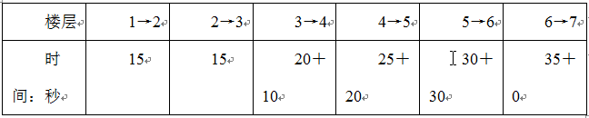

故正确答案为D。

**来源**：2014年国家公务员录用考试《行测》题第63题

### 第 64 题

烧杯中装了100克浓度为10%的盐水，每次向该烧杯中加入不超过14克浓度为50%的盐水。

问最少加多少次之后，烧杯中的盐水浓度能达到25%：（假设烧杯中盐水不会溢出）

A. 6

B. 5

C. 4

D. 3

第 64 题 · 答案与解析

**参考答案（粉笔题库参考内容）**

B

**解析**

方法一：

方程法。设最少加x次满足题干要求，结合溶液混合基本公式可得：100×10%＋14x×50%＝（100＋14x）×25%，解方程可得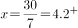，即至少需要加5次。

方法二：

线段法。设需要加入溶液为x克，根据线段法的口诀画线段：

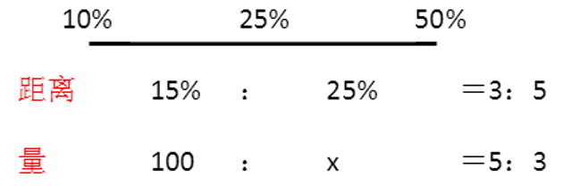

解得x=60克，加入的次数至少是，即至少需要加5次。

故正确答案为B。

**来源**：2014年国家公务员录用考试《行测》题第64题

### 第 65 题

某连锁企业在10个城市共有100家专卖店，每个城市的专卖店数量都不同。如果专卖店数量排名第5多的城市有12家专卖店，那么专卖店数量排名最后的城市，最多有几家专卖店：

A. 2

B. 3

C. 4

D. 5

第 65 题 · 答案与解析

**参考答案（粉笔题库参考内容）**

C

**解析**

设专卖店数量排名最后的城市有x家专卖店，要求专卖店数量排名最后的城市专卖店的数量最多，则令其他城市专卖店数量最少。题目中已知排名第5多城市有12家专卖店，且每个城市专卖店数量不同，则可得下表：

根据该企业共有100家专卖店的条件，则有16 + 15 + 14 + 13 + 12 + (x + 4) +(x + 3) + (x + 2) + (x + 1) + x = 100，解得x = 4。

故正确答案为C。

**考点**：构造数列

**来源**：2014年国家公务员录用考试《行测》题第65题

### 第 66 题

某单位原有45名职工，从下级单位调入5名党员职工后，该单位的党员人数占总人数的比重上升了6个百分点。如果该单位又有2名职工入党，那么该单位现在的党员人数占总人数的比重为多少：

A. 50%

B. 40%

C. 70%

D. 60%

第 66 题 · 答案与解析

**参考答案（粉笔题库参考内容）**

A

**解析**

方程法，设单位原有党员x人，根据比重列方程，解得x=18人，又有2名职工入党，党员比重为(18+5+2)÷50=50%。

故正确答案为A。

**考点**：和差倍比问题

**来源**：2014年国家公务员录用考试《行测》题第66题

### 第 67 题

工厂组织职工参加周末公益活动，有80%的职工报名参加，报名参加周六活动的人数与报名参加周日活动的人数比为2:1，两天的活动都报名参加的为只报名参加周日活动的人数的50%，问未报名参加活动的人数是只报名参加周六活动的人数的：

A. 20%

B. 30%

C. 40%

D. 50%

第 67 题 · 答案与解析

**参考答案（粉笔题库参考内容）**

C

**解析**

假设两天都参加人数为1人，则只参加周日活动为2人，周日参加总人数为2+1=3人。已知报名参加周六活动的人数与报名参加周日活动的人数比为 2∶1，则周六参加人数为，只参加周六活动为 6-1=5 人。 因此，参加活动的总人数为5 + 1 + 2 = 8 人。80%的职工报名参加，即总人数为 。则未报名参加活动的有10-8=2 人，所以题目中所求比例为。各部分具体人数如下图所示：

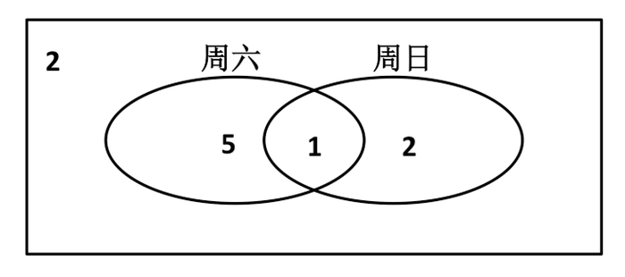

故正确答案为C。

**考点**：两集合

**来源**：2014年国家公务员录用考试《行测》题第67题

### 第 68 题

一个立方体随意翻动，每次翻动朝上一面的颜色与翻动前都不同，那么这个立方体的颜色至少有几种：

A. 3

B. 4

C. 5

D. 6

第 68 题 · 答案与解析

**参考答案（粉笔题库参考内容）**

A

**解析**

立方体6个面中，每次翻动都会出现相邻的任意面，所以相邻的面不能用同一种颜色，每次翻动都不能翻到对立面，因此对立面颜色可以相同。立方体有三组对立面，因此至少有三种颜色。

故正确答案为A。

**考点**：几何结论类-几何小题型

**来源**：2014年国家公务员录用考试《行测》题第68题

### 第 69 题

某单位某月1—12日安排甲、乙、丙三个人值夜班，每人值班4天。三人各自值班日期数字之和相等。已知甲头两天值夜班，乙9、10日值夜班，问丙在自己第一天与最后一天值夜班之间，最多有几天不用值夜班：

A. 6

B. 4

C. 2

D. 0

第 69 题 · 答案与解析

**参考答案（粉笔题库参考内容）**

D

**解析**

由于连续的1-12日值班，日期数字为公差是1的等差数列，总和为，同时又由“三人各自值班日期数字之和相等”可知，每人的数字和为，所以已知甲值班在1日和2日，26-1-2=23，所以剩余的日期中11日和12日也必须是他值班；同理，乙9日和10日值班，26-9-10=7，则3日和4日必须安排乙值班。所以剩下的5、6、7、8日就只能让丙值班，既然丙连续值班，所以他在自己第一天与最后一天值班之间没有休息日。

故正确答案为D。

**考点**：数列问题

**来源**：2014年国家公务员录用考试《行测》题第69题

### 第 70 题

8位大学生打算合资创业，在筹资阶段，有2名同学决定考研而退出，使得剩余同学每人需要再多筹资1万元；等到去注册时，又有2名同学因找到合适工作而退出，那么剩下的同学每人又得再多筹资几万元：

A. 3

B. 4

C. 1

D. 2

第 70 题 · 答案与解析

**参考答案（粉笔题库参考内容）**

D

**解析**

方法一：设原来每人筹资x万元，则，解得x = 3。设剩下每个人又得再多筹资y万元，则，解得y = 2，故每人再多筹资两万元。

方法二：2名学生考研退出后，剩下的6人每人多付1万元弥补他们的金额，一共付出了6万元，所以原来计划每人付出3万元；当又有2名找到工作退出的时候，本应该每人付出4万元共8万元的款，就要平摊到剩下的4名学生身上，所以每人再多筹资2万元。

故正确答案为D。

**考点**：和差倍比问题

**来源**：2014年国家公务员录用考试《行测》题第70题

### 第 71 题

一次会议某单位邀请了10名专家，该单位预定了10个房间，其中一层5间、二层5间。已知邀请专家中4人要求住二层，3人要求住一层，其余3人住任一层均可，那么要满足他们的住房要求且每人1间，有多少种不同的安排方案：

A. 43200

B. 7200

C. 450

D. 75

第 71 题 · 答案与解析

**参考答案（粉笔题库参考内容）**

A

**解析**

先安排有要求的专家，再安排没有要求的专家，即分步进行安排即可。首先安排需要住二层的人，从5间二层房间中选出4间，安排4名专家的方法有A_5^4种；再安排需要住一层的人，从5间一层房间中选出3间，安排3名专家的方法有A_5^3种，最后安排剩下的3人，无任何要求安排方法有A_3^3种。分步用乘法， 安排方法有种。

故正确答案为A。

**考点**：基础排列组合

**来源**：2014年国家公务员录用考试《行测》题第71题

### 第 72 题

某羽毛球赛共有23支队伍报名参赛，赛事安排23支队伍抽签两两争夺下一轮的出线权，没有抽到对手的队伍轮空，直接进入下一轮。那么，本次羽毛球赛最后共会遇到多少次轮空的情况：

A. 1

B. 2

C. 3

D. 4

第 72 题 · 答案与解析

**参考答案（粉笔题库参考内容）**

B

**解析**

根据题意，当参赛队伍数为奇数时会出现轮空的情况。第一轮23支队伍比赛，11支队伍有对手，必有一支队伍轮空；第二轮12支队伍，不需要轮空；第三轮6支队伍，不需要轮空；第四轮3支队伍比赛，1支队伍有对手，又有一支队伍轮空；最后是冠军争夺，不需要轮空。共轮空2次。

故正确答案为B。

**来源**：2014年国家公务员录用考试《行测》题第72题

### 第 73 题

小王、小李、小张和小周4人共为某希望小学捐赠了25个书包，按照数量多少的顺序分别是小王、小李、小张、小周。已知小王捐赠的书包数量是小李和小张捐赠书包的数量之和；小李捐赠的书包数量是小张和小周捐赠的书包数量之和。问小王捐赠了多少个书包：

A. 9

B. 10

C. 11

D. 12

第 73 题 · 答案与解析

**参考答案（粉笔题库参考内容）**

C

**解析**

根据题意，王+李+张+周= 25记为①，李=张+周记为②。②式代入①式整理得：记为③。根据奇偶特性可得，王捐赠的书包个数为奇数，因此排除 B、D 两项。代入 A 项，如果小王捐赠的书包是9个，则根据③式小李的书包数量为，根据题目中王=李+张，得小张的书包数量为9-8=1个，而小张的书包数量比小周多，因此不满足条件，排除A项。

故正确答案为C。

**来源**：2014年国家公务员录用考试《行测》题第73题

### 第 74 题

两同学须托运行李。托运收费标准为10公斤以下6元／公斤，超出10公斤部分每公斤收费标准略低一些。已知甲、乙两人托运费分别为109.5元、78元，甲的行李比乙的重了50%。那么，超出10公斤部分每公斤收费标准比10公斤以内的低了多少元：

A. 1.5

B. 2.5

C. 3.5

D. 4.5

第 74 题 · 答案与解析

**参考答案（粉笔题库参考内容）**

A

**解析**

分段计算问题。设乙的行李超出的重量为x，即乙的行李总重量为10+x，则甲的行李重量为。所以计算甲超出部分的重量为1.5(10+x)-10=5+1.5x，超出金额为，所以按照比例，乙的行李超出了重量x，超出金额为，得到，解得x=4，所以超出部分单价为18÷4=4.5元。所以超出10公斤部分每公斤收费标准比10公斤以内的低了6-4.5=1.5元。

故正确答案为A。

**考点**：分段计算问题

**来源**：2014年国家公务员录用考试《行测》题第74题

### 第 75 题

甲、乙两个工程队共同完成A和B两个项目。已知甲队单独完成A项目需13天，单独完成B项目需7天；乙队单独完成A项目需11天，单独完成B项目需9天。如果两队合作用最短的时间完成两个项目，则最后一天两队需要共同工作多长时间就可以完成任务：

A. 1/12天

B. 1/9天

C. 1/7天

D. 1/6天

第 75 题 · 答案与解析

**参考答案（粉笔题库参考内容）**

D

**解析**

要使完工总时间最短，则应让每个工程队干自己擅长的项目，即耗时较短的项目。由题干可知甲队干B项目的时间短效率高，分配甲完成B项目；而乙队干A项目的时间短效率高，分配乙完成A项目。7天后，B项目完工，然后甲、乙再共同完成剩余的A项目，这样效率最高用时最短。赋值整个A工程总量为，则甲队干A项目的效率为，乙队干A项目的效率为。当B完成时，即7天后，A项目完成了，还剩下143-91=52，所以剩下的工程量甲乙两队合作需要的时间为，所以最后一天还需要的时间为1/6天。

故正确答案为D。

**考点**：工程问题-其他、统筹规划问题

**来源**：2014年国家公务员录用考试《行测》题第75题

### 第 76 题

从所给的四个选项中，选择最合适的一个填入问号处，使之呈现一定的规律性：

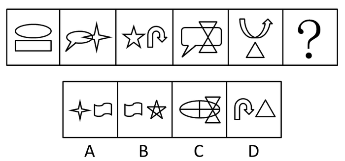

A. A

B. B

C. C

D. D

第 76 题 · 答案与解析

**参考答案（粉笔题库参考内容）**

C

**解析**

元素组成凌乱，但都由两个图形组成，观察两个图形间的关系。发现图形规律成奇偶性，即1、3、5图形相离，2、4图形成相交，那么？处的图形应该为两个图形相交的形式。

故正确答案为C。

**考点**：特殊规律-图形间关系

**来源**：2014年国家公务员录用考试《行测》题第76题

### 第 77 题

从所给的四个选项中，选择最合适的一个填入问号处，使之呈现一定的规律性：

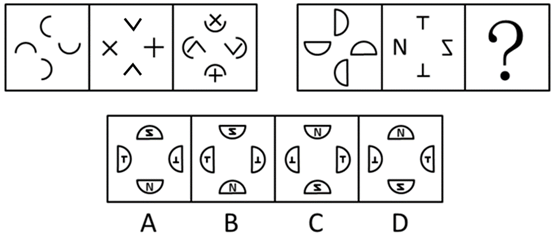

A. A

B. B

C. C

D. D

第 77 题 · 答案与解析

**参考答案（粉笔题库参考内容）**

D

**解析**

元素组成相似，优先考虑加减同异。第一组规律为：第一个图形整体逆时针平移一步+第二个图形整体顺时针平移一步=第三个图形。第二组遵循同样的规律，旋转叠加后为D项。

故正确答案为D。

**考点**：样式规律-加减同异

**来源**：2014年国家公务员录用考试《行测》题第77题

### 第 78 题

从所给的四个选项中，选择最合适的一个填入问号处，使之呈现一定的规律性：

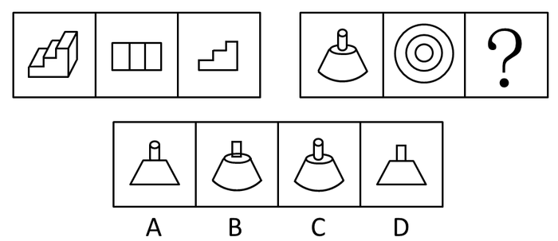

A. A

B. B

C. C

D. D

第 78 题 · 答案与解析

**参考答案（粉笔题库参考内容）**

D

**解析**

本题考查三视图。第一组图形中第二个图形与第三个图形分别是第一个立体图形的俯视图与主视图。第二组图形具有同样的规律，所填图形应为第一个立体图形的主视图，图形从正面看过去的样子，不会有曲线。

故正确答案为D。

**考点**：空间类-三视图

**来源**：2014年国家公务员录用考试《行测》题第78题

### 第 79 题

从所给的四个选项中，选择最合适的一个填入问号处，使之呈现一定的规律性：

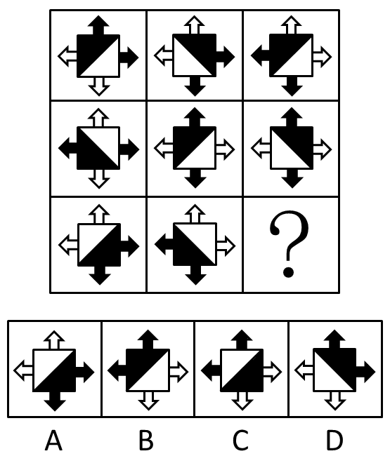

A. A

B. B

C. C

D. D

第 79 题 · 答案与解析

**参考答案（粉笔题库参考内容）**

A

**解析**

图形元素组成相同，考查位置规律。每行的第二个图形，由第一个图形整体顺时针旋转90°得到；第三个图形，由第二个图形整体左右翻转得到。第三行依此规律，？处图形由前一个图形整体左右翻转得到，即A项。

故正确答案为A。

**考点**：位置规律-综合

**来源**：2014年国家公务员录用考试《行测》题第79题

### 第 80 题

下图中的立体图形①是由立体图形②、③和④组合而成，下列哪一项能够填入问号处：

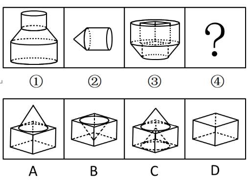

A. A

B. B

C. C

D. D

第 80 题 · 答案与解析

**参考答案（粉笔题库参考内容）**

B

**解析**

本题考查立体图形的拆分。第二个图形有圆锥的尖头，而第一个组合图形没有圆锥，故第二个图形中的圆锥的尖头一定得插进某个凹槽才可以。

故正确答案为B。

**考点**：空间类-立体拼合

**来源**：2014年国家公务员录用考试《行测》题第80题

### 第 81 题

把下面的六个图形分为两类，使每一类图形都有各自的共同特征或规律，分类正确的一项是：

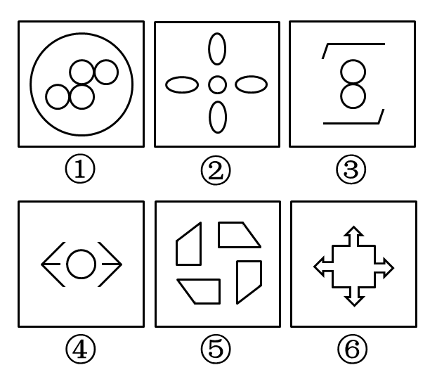

A. ①③④，②⑤⑥

B. ①③⑤，②④⑥

C. ①②⑥，③④⑤

D. ①④⑥，②③⑤

第 81 题 · 答案与解析

**参考答案（粉笔题库参考内容）**

B

**解析**

元素组成凌乱，考查属性。本题考查图形对称问题，①③⑤均为中心对称图形，②④⑥均为既能满足轴对称，也可以满足中心对称图形。

故正确答案为B。

**考点**：属性规律-对称性

**来源**：2014年国家公务员录用考试《行测》题第81题

### 第 82 题

把下面的六个图形分为两类，使每一类图形都有各自的共同特征或规律，分类正确的一项是：

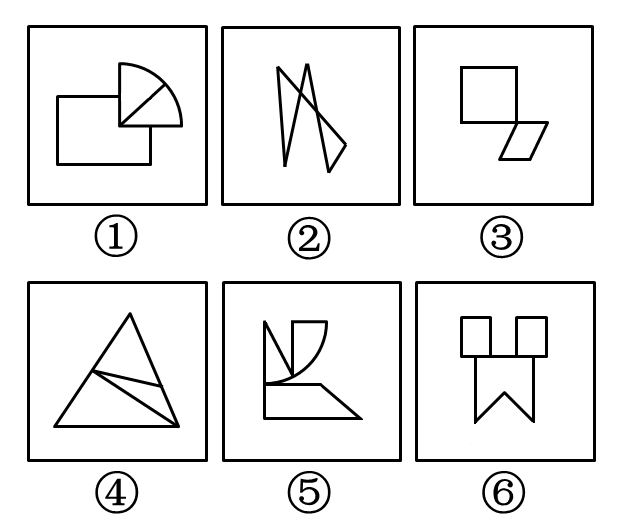

A. ①④⑥，②③⑤

B. ①②③，④⑤⑥

C. ①③⑥，②④⑤

D. ①⑤⑥，②③④

第 82 题 · 答案与解析

**参考答案（粉笔题库参考内容）**

A

**解析**

元素组成凌乱，且由多个元素组合而成，观察元素之间的关系，可以发现①④⑥为线相接，面与面之间有公共边；②③⑤为点相接，面与面之间没有公共边。

故正确答案为A。

【易错原因】图形拼接这个规律总容易被忽视，当看到元素组成凌乱时，同学们会把关注点集中在属性和数量规律上，但是当看到每幅图都是几个封闭图拼接而成时，可以优先考虑一下特殊规律—图形拼接。

**考点**：特殊规律-图形间关系

**来源**：2014年国家公务员录用考试《行测》题第82题

### 第 83 题

把下面的六个图形分为两类，使每一类图形都有各自的共同特征或规律，分类正确的一项是：

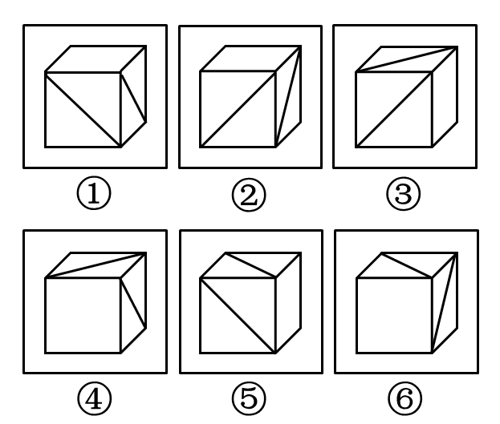

A. ①②⑥，③④⑤

B. ①③⑥，②④⑤

C. ①④⑤，②③⑥

D. ①③④，②⑤⑥

第 83 题 · 答案与解析

**参考答案（粉笔题库参考内容）**

B

**解析**

立体图形问题。将③④⑤⑥图形分别按照红色箭头的方向旋转，那么此时可以保证两条对角线分别在图形的正面和右侧面，旋转后可得到的图形如下：

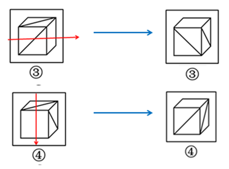

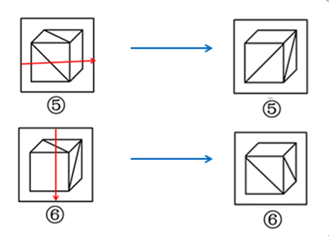

旋转如上图后可以看出，①③⑥图形一致，②④⑤图形一致。

故正确答案为B。

**考点**：位置规律-旋转

**来源**：2014年国家公务员录用考试《行测》题第83题

### 第 84 题

把下面的六个图形分为两类，使每一类图形都有各自的共同特征或规律，分类正确的一项是：

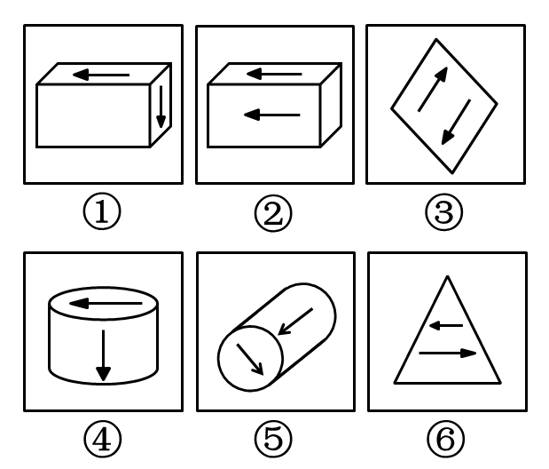

A. ①③⑤，②④⑥

B. ①②⑤，③④⑥

C. ①④⑤，②③⑥

D. ①③④，②⑤⑥

第 84 题 · 答案与解析

**参考答案（粉笔题库参考内容）**

C

**解析**

图形中含有明确的功能元素箭头，考虑功能元素的位置关系。每个图形都包含两个箭头，①④⑤两个箭头是垂直关系，②③⑥两个箭头都是平行关系。

故正确答案为 C。

**考点**：特殊规律-功能元素

**来源**：2014年国家公务员录用考试《行测》题第84题

### 第 85 题

把下面的六个图形分为两类，使每一类图形都有各自的共同特征或规律，分类正确的一项是：

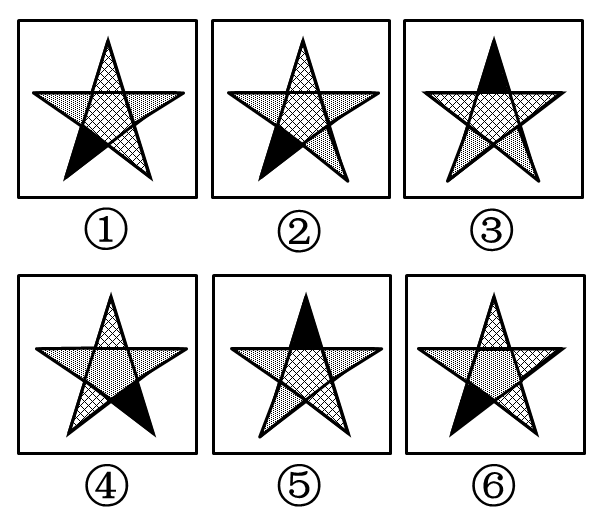

A. ①③⑤，②④⑥

B. ①③⑥，②④⑤

C. ①③④，②⑤⑥

D. ①④⑤，②③⑥

第 85 题 · 答案与解析

**参考答案（粉笔题库参考内容）**

B

**解析**

图中六个五角星分别有三种色块拼成，即：黑、点、白，①③⑥三个图形都是由一个黑色块、两个点色块和三个白色块拼接而成，②④⑤三个图形则是由一个黑色块、两个白色块和三个点色块拼接而成。故选择B项。

此题还有另一种解题思维，即：①③④中三个相同的色块全部连在一起（①中的白色块，③中的白色块及④中的点色块），②⑤⑥中三个相同的色块没有全部连在一起，故选择C项。

当两个选项都有合理之处时，注意优中选优。在图形推理中，通常优先考虑数量的变化，数量的规律性要强于其他。

故正确答案为B。

**考点**：数量规律-素

**来源**：2014年国家公务员录用考试《行测》题第85题

### 第 86 题

选择性曲解是指人们面对客观事物，经常会不自觉地把外界输入的信息与头脑中早已存在的模式相结合，从而出现根据自己固有的价值体系和既定的情感好恶来解释所接受信息的倾向。

根据上述定义，下列属于选择性曲解的是：

A. 爱屋及乌

B. 指鹿为马

C. 按图索骥

D. 度日如年

第 86 题 · 答案与解析

**参考答案（粉笔题库参考内容）**

A

**解析**

关键词1原因：面对客观事物，不自觉地把外界输入的信息与头脑中早已存在的模式相结合；

关键词2结果：根据自己固有的价值体系和既定的情感好恶来解释所接受的信息。

A项“爱屋及乌”指：因为爱一个人而连带爱他屋上的乌鸦。比喻爱一个人而连带地关心与他有关的人或物，符合选择性曲解，当选；

B项“指鹿为马”是有意识行为，不符合“不自觉地把外界输入的信息与头脑中早已存在的模式相结合”，排除；

C项“按图索骥”是按照线索去寻找，不符合“根据自己固有的价值体系和既定的情感好恶来解释”，排除；

D项“度日如年”不符合“面对客观事物”，排除。

另外，只有A项涉及了情感关键词“爱”。

故正确答案为A。

**考点**：原因结果

**来源**：2014年国家公务员录用考试《行测》题第86题

### 第 87 题

扩大论题和缩小论题在辩论赛中很常见。在相互的辩驳中，辩手们常常故意扩大对方的论题，将对方的论题推到荒谬的地步，以利于本方的反驳和进攻；同时为了利于本方立论与防守，辩手们又常常故意缩小本方的论题。根据上述定义，下列采用了扩大论题的是（    ）。

A. 将论题“中学生异性交往弊大于利”解释成“中学生异性过分密切交往必定弊大于利”

B. 将论题“人性本恶”解释成“人具有与生俱来的本能和欲望，因此人性是恶的”

C. 将论题“德国人很严谨”解释成“所有德国人都很严谨”

D. 将论题“人性本善”解释成“没有人不是善的”

第 87 题 · 答案与解析

**参考答案（粉笔题库参考内容）**

D

**解析**

第一步：判断题干中的关键词。

方式：故意扩大对方的论题，将对方的论题推到荒谬的地步。

目的：利于本方的反驳和进攻。

第二步：逐一分析选项。

A项，“交往”解释成“过分密切交往”属于缩小本方的论题以利于本方立论与防守，不符合定义，排除；

B项，是对论题的解释和陈述理由，不存在扩大和缩小论题的问题，不符合定义，排除；

C项，“德国人很严谨”中的“德国人”是集合概念，而“所有德国人都很严谨”指的是“每一个德国人”，是个体概念，因此并没有扩大论题，而是偷换了概念，不符合定义，排除；

D项，“人性本善”解释成“没有人不是善的”，人是对“人性”概念的扩大，善是对“本善”概念的扩大，以利于本方的反驳，符合定义，当选。

故正确答案为D。

**考点**：常规问法

**来源**：2014年国家公务员录用考试《行测》题第87题

### 第 88 题

内隐学习是指一种无需意志努力的潜意识的学习。这种学习的特点在于人们潜意识地获得某种知识，而且无需意志努力就可以将这些知识提取出来，并应用于特定任务的操作中。

根据上述定义，下列不属于内隐学习的是：

A. 小张在高考前做了大量数学习题，因此在数学考试中获得高分

B. 小李经常看别人下象棋，时间一长，他也掌握了下象棋的方法

C. 儿童无需系统地学习语词和语法规则，不知不觉地就会说母语

D. 生长在京剧世家的孩子耳濡目染，很小就会唱京剧

第 88 题 · 答案与解析

**参考答案（粉笔题库参考内容）**

A

**解析**

注意问法，选择不属于定义的选项。定义要点：无需意志努力获得的知识并运用。B项经常看他人而掌握方法、C项不知不觉会说母语、D项耳濡目染会唱京剧均是在无意志的情况下获得的，均排除；只有A项是在有意志情况下进行的，不属于内隐学习，当选。

本题为选非题，故正确答案为A。

**考点**：单定义-其他句式

**来源**：2014年国家公务员录用考试《行测》题第88题

### 第 89 题

注意分为内源性注意和外源性注意。内源性注意是指个体根据自己的目标或意图来分配注意、支配行为，是主动注意；外源性注意是指由个体外部信息引起的个体注意，是被动注意。

根据上述定义，下列属于内源性注意的是：

A. “轰”的一声响，大家不由地都回头看了一眼

B. 六一儿童节，公园里奇幻的魔术表演受到许多小朋友和家长的喜爱

C. 超市琳琅满目的商品，包装各异、颜色鲜亮，吸引了许多顾客的眼球

D. 根据客户的要求，广告设计师特别关注了大量以温馨家园为题材的售楼广告素材

第 89 题 · 答案与解析

**参考答案（粉笔题库参考内容）**

D

**解析**

内源性注意的定义要点：个体主动根据自己的需要和目标分配注意。A项“轰”的一声是外界的声音吸引人们的注意，排除；B项许多孩子和家长是被魔术吸引了，也是被动分配注意，排除；C项超市的商品“琳琅满目”吸引了注意力，也是一种被动注意，排除；D项设计师是主动关注符合客户需要的信息，是根据自己的目标来分配注意，符合内源性注意，当选。

故正确答案为D。

**考点**：常规问法

**来源**：2014年国家公务员录用考试《行测》题第89题

### 第 90 题

顺从型互动是指行动者之间发生性质相同或方向一致的行动过程，常有三种形式：有意无意向他人发出信号或暗示，并引起他人反应；不经过考量，直接按照他人的方式去行动；行动者在他人压力下接受他人行动方式，并且照做。

根据上述定义，下列不属于顺从型互动的是：

A. 很多投资者寻找项目时什么热就投资什么，股票热时炒股票，翡翠热时炒翡翠

B. 大家对小刘的业务能力有目共睹，连素来挑剔的老主任也赞成选小刘为业务主管

C. 护士阿姨一边说“不哭啊，一点都不疼”，一边在毛毛的手臂上注射，毛毛果然没哭

D. 小文对新来的家教老师不满意，但无奈于父母的苦心和已缴的学费，还是开始了家教课程

第 90 题 · 答案与解析

**参考答案（粉笔题库参考内容）**

B

**解析**

顺从型互动定义不是看关键词，而是看其符合的三种形式，只要选项不符合其中任何一种，即为正确答案。A项很多投资者寻找项目时什么热就投资什么，就是不经过考量，直接按照他人的方式去行动，发生性质相同的行动过程，属于顺从型互动的第二种形式，排除。B项大家对小刘的能力，连老主任都赞成。三种类型都不适合，当选。C项护士阿姨有意向毛毛发出暗示，并引起毛毛发生方向一致的行动过程，属于顺从型互动的第一种形式，排除。D项小文在父母的压力下开始了家教课程，发生方向一致的行动过程，属于顺从型互动的第三种形式，排除。

本题为选非题，故正确答案为B。

**考点**：单定义-其他句式

**来源**：2014年国家公务员录用考试《行测》题第90题

### 第 91 题

组织控制是指组织用各种规章制度和奖惩手段来约束组织成员行为，以保证组织的决策和指令能够有效地贯彻执行，维护组织的各项秩序。

根据上述定义，下列最能体现组织控制的是：

A. 某高校不断加强对外交流，派遣访问学者的名额逐年增加

B. 某公司每年举办新人入职会，以便让新加入团队的成员尽快熟悉环境

C. 某生产厂商为了提高员工生产积极性，薪酬计算由原来的计时绩效改为计件绩效

D. 某外企实行上班打卡制，如果员工去见客户可以不用打卡，但须在前一天向上级报告

第 91 题 · 答案与解析

**参考答案（粉笔题库参考内容）**

D

**解析**

组织控制的关键词包括“组织”、“用各种规章制度和奖惩手段”和“约束组织成员行为”。A项“加强对外交流”和B项“每年举办新人入职会”，并不是用各种规章制度和奖惩手段，均排除；C项“为了提高员工生产积极性”并不是约束组织成员行为，排除；D项外企是组织，上班打卡制满足用各种规章制度，为了约束组织成员上下班的行为，当选。

故正确答案为D。

**考点**：方式目的

**来源**：2014年国家公务员录用考试《行测》题第91题

### 第 92 题

矩阵对策是指处于利益竞争的两个关系主体，各自可选的策略有限，且在一局对策中双方得失和为零的现象，即要不成功、要不失败。对策中，一方真正成功的措施应该是，针对对方所采取的行动相应地制定有利于自己的应对策略，各方选择的策略必定是自己对对方策略预测的最佳反应。

根据上述定义，下列属于矩阵对策的是：

A. 齐王和田忌按原条件重新赛马，并约定每局比赛须用同等级的马参赛

B. 劳资双方进行薪资谈判，经过反复的讨价还价，最终双方都作出让步

C. 在进入奥运女子排球决赛后，某国家队重新安排队员阵容和出场顺序

D. 丈夫要去踢球，妻子要去看电影，儿子要去游乐园，最后三人去郊游

第 92 题 · 答案与解析

**参考答案（粉笔题库参考内容）**

C

**解析**

第一步：找到定义关键词。

“利益竞争的两个关系主体”、“针对对方的行动采取有利于己方的应对策略”、“双方中必有一方成功、一方失败”。

第二步：逐一分析选项。

A项不符合对对方策略预测作出最佳反应，排除；B项劳资双方不属于处于利益竞争关系的主体，主体不对，排除；C项在进入奥运女子排球决赛后，某国家队重新安排队员阵容和出场顺序，符合对对方策略预测的最佳反应且必有胜负，当选；D项一家三口不属于处于利益竞争的两个关系主体，主体不对，排除。

故正确答案为C。

**考点**：方式目的

**来源**：2014年国家公务员录用考试《行测》题第92题

### 第 93 题

签名效应是指当人们在纸上写上自己名字时，大脑中的自我意识会加强，此时看到喜欢的东西，更容易把物品和自己联系起来，产生“这个东西真适合我”等想法，从而激发购买欲望。

根据上述定义，下列现象可用签名效应解释的是：

A. 快递公司坚持“先签字后验货”的做法

B. 采取实名捐款的办法能够募捐到更多善款

C. 手术前，患者被要求在《知情同意书》上签字

D. 中介公司要求租客在看房前签订《看房协议书》

第 93 题 · 答案与解析

**参考答案（粉笔题库参考内容）**

D

**解析**

定义关键词1条件：签名；关键词2结果：激发购买欲望。A项购买在签名之前，不符合；B项捐款不符合购买意愿；C项显然与购买无关；D项中定义的两个要素“有签名”“产生购买认同感，产生购买欲望”，D项满足两个条件。

故正确答案为D。

**考点**：原因结果

**来源**：2014年国家公务员录用考试《行测》题第93题

### 第 94 题

红旗原则是指如果侵犯著作权的事实是显而易见的，网络服务商就不能装作看不见，或以不知道侵权的理由来推脱责任。

根据上述定义，下列适用红旗原则的情形是：

A. 未经用户许可，某客户端软件就能够自动扫描、获取用户个人数据

B. 甲利用网络服务商提供的免费存储空间，非法经营盗版影视作品

C. 乙上传正在首播的某热门电视剧，并被网站编辑推荐到下载首页

D. 丙通过第三方在有下载功能的互联网电视上获取未经授权的节目

第 94 题 · 答案与解析

**参考答案（粉笔题库参考内容）**

C

**解析**

第一步：找出定义关键词。

“著作权”“事实是显而易见的”“网络服务商就不能装作看不见，或以不知道侵权的理由来推脱责任”。

第二步：逐一分析选项。

A项：自动扫描、获取用户个人数据，并没有涉及到“著作权”，不符合定义，排除；

B项：甲非法经营盗版影视作品，但不明确甲的侵权行为是否是显而易见的，也不明确网络运营商是否看见了甲的侵权行为，不符合定义，排除；

C项：乙上传正在首播的热门电视剧，正在首播的电视剧被个人上传到网站显然是侵犯著作权的行为，被网站编辑推荐到下载首页，说明网络服务商已经看见了乙的侵权行为，不能以不知道侵权来推脱责任，符合定义，当选；

D项：获取未经授权的节目，很难界定是否一定侵犯了“著作权”，而且此服务也不一定是网络服务商提供的，也可以是电视运营商提供的，不符合定义，排除。

故正确答案为C。

**考点**：方式目的

**来源**：2014年国家公务员录用考试《行测》题第94题

### 第 95 题

角色混同指的是将自己所具有的不同角色相混淆，而发生的导致背离角色期待和角色规范的行为。

根据上述定义，下列哪项属于角色混同：

A. 到北京来打工的某外省青年有时不自觉地说起家乡话，常常弄得同事莫名其妙

B. 庄周梦见自己变成蝴蝶，醒过来之后惊惶不定，庄周不知自己梦中变成了蝴蝶，还是蝴蝶梦中变成了自己

C. 小王是个游戏迷，他常常将工作中的同事假想成游戏中的玩家，也常常将游戏中的玩家想象成自己的某个同事

D. 老李是某局局长，对于儿子提出的要求，他常常不自觉地说：“这事得和其他同志研究研究。”为此，他多次受到妻子的批评

第 95 题 · 答案与解析

**参考答案（粉笔题库参考内容）**

D

**解析**

第一步：定位有效信息。

题干中“将自己所具有的不同角色相混淆”，混淆的对象，即客体是“自己所具有的不同角色”。

第二步：逐一分析选项。

A项：“外省青年”只有一个角色“打工者”，不符合定义，排除；

B项：“庄周”和“蝴蝶”不是同一个人，并非“自己所具有的不同角色”，排除；

C项：“小王”和“同事”不是同一个人，并非“自己所具有的不同角色”，排除；

D项：“老李”拥有“局长”和“父亲”两个角色，符合客体要求，当选。

故正确答案为D。

**考点**：原因结果

**来源**：2014年国家公务员录用考试《行测》题第95题

### 第 96 题

创新：僵化

A. 开放：闭塞

B. 发展：前进

C. 计划：秩序

D. 革新：失败

第 96 题 · 答案与解析

**参考答案（粉笔题库参考内容）**

A

**解析**

考查反义词。题干中“创新”与“僵化”之间的关系属于反义词关系。A项“开放”与“闭塞”属于反义词关系，符合题干关系特征，当选。B项“发展”与“前进”是同义词关系，排除；C项“计划”与“秩序”没有直接逻辑关系，排除；D项“革新”与“失败”是对应关系，“革新”可能会“失败”，排除。

故正确答案为A。

**考点**：语义关系-反义关系

**来源**：2014年国家公务员录用考试《行测》题第96题

### 第 97 题

厨师：炒鱿鱼

A. 法官：和稀泥

B. 司机：开天窗

C. 脚夫：撂挑子

D. 高手：摆擂台

第 97 题 · 答案与解析

**参考答案（粉笔题库参考内容）**

C

**解析**

第一步：判断题干词语间逻辑关系。

炒鱿鱼是厨师的工作内容之一，二者为职业动作的对应关系，且炒鱿鱼具有双关义，一般用于比喻象征“解雇、辞退”。

第二步：判断选项词语间逻辑关系。

A项：和稀泥并非法官的工作内容，二者不是职业动作的对应关系，与题干逻辑关系不一致，排除；

B项：开天窗不是司机的工作内容，二者不是职业动作的对应关系，与题干逻辑关系不一致，排除；

C项：撂挑子是脚夫的工作内容之一，二者为职业动作的对应关系，且撂挑子具有双关义，一般用于比喻象征“丢下应该负责的工作不管 ”，与题干逻辑关系一致，当选；

D项：摆擂台并非高手的工作内容，二者不是职业动作的对应关系，与题干逻辑关系不一致，排除。

故正确答案为C。

**考点**：逻辑关系-对应关系

**来源**：2014年国家公务员录用考试《行测》题第97题

### 第 98 题

生命：生物

A. 绿色：植物

B. 思维：人类

C. 收获：秋季

D. 节气：历法

第 98 题 · 答案与解析

**参考答案（粉笔题库参考内容）**

B

**解析**

考查事物的必然属性。题干中“生命”属于“生物”的一种特有属性，唯一对应关系，“生物”一定有“生命”。B项，“人类”一定有“思维”，同样具有唯一对应关系，当选。A项，“植物”不一定是“绿色”，排除；C项，“秋季”也不一定“收获”，排除；D项，“节气”指二十四时节和气候，是中国古代订立的一种用来指导农事的补充历法，所以和“历法”是种属关系，排除。

故正确答案为B。

**考点**：逻辑关系-对应关系

**来源**：2014年国家公务员录用考试《行测》题第98题

### 第 99 题

抽样调查：抽样原则

A. 调查问卷：征求意见

B. 人物访谈：访谈内容

C. 数学模型：建模软件

D. 设备操作：操作规程

第 99 题 · 答案与解析

**参考答案（粉笔题库参考内容）**

D

**解析**

第一步：判断题干词语间逻辑关系。

依据“抽样原则”进行“抽样调查”，即后者是前者遵循的原则。

第二步：判断选项词语间逻辑关系。

A项：“调查问卷”是“征求意见”的手段，与题干逻辑关系不一致，排除；

B项：“人物访谈”不是依照“访谈内容”来进行的，与题干逻辑关系不一致，排除；

C项：“建模软件”用来建立“数学模型”，与题干逻辑关系不一致，排除；

D项：依据“操作规程”进行“设备操作”，与题干逻辑关系一致，当选。

故正确答案为D。

**考点**：逻辑关系-对应关系

**来源**：2014年国家公务员录用考试《行测》题第99题

### 第 100 题

交通：拥堵：治理

A. 生活：贫困：救济

B. 食材：讲究：享用

C. 音乐：动感：聆听

D. 健康：虚弱：保健

第 100 题 · 答案与解析

**参考答案（粉笔题库参考内容）**

A

**解析**

第一步：判断题干词语间逻辑关系。

交通拥堵构成主谓结构，治理拥堵构成动宾结构，且交通拥堵是治理拥堵的原因，二者为因果对应关系。

第二步：判断选项词语间逻辑关系。

A项：生活贫困构成主谓结构，救济贫困构成动宾关系，且生活贫困是救济贫困的原因，二者为因果对应关系，与题干逻辑关系一致，当选；

B项：食材讲究是主谓结构，但讲究享用不构成动宾结构，与题干逻辑关系不一致，排除；

C项：音乐和动感不能构成主谓结构，且聆听的对象是音乐而非动感，无法构成动宾结构，与题干逻辑关系不一致，排除；

D项：健康和虚弱是反义关系，无法构成主谓结构，且保健的对象是身体而非虚弱，无法构成动宾结构，与题干逻辑关系不一致，排除。

故正确答案为A。

**考点**：语法关系、逻辑关系-对应关系

**来源**：2014年国家公务员录用考试《行测》题第100题

### 第 101 题

红茶：发酵：保健

A. 丝绸：染色：收藏

B. 玉镯：磨制：装饰

C. 石油：蒸馏：燃烧

D. 中药：采摘：治病

第 101 题 · 答案与解析

**参考答案（粉笔题库参考内容）**

B

**解析**

题干词语关系为对应关系。“红茶”与“发酵”是成品与其必然工序之间的对应关系，要想成为红茶必须是在绿茶的基础上进行发酵，“保健”是功能属性，“红茶”具有“保健”的作用。

A项“丝绸”具有“收藏”价值而不是作用，排除；

B项“玉镯”与“磨制”是成品和最主要工序的对应关系，“装饰”是“玉镯”的作用，当选；

C项“石油”可以“燃烧”，但“燃烧”不是“石油”的作用，石油主要被用来作为燃油和汽油，也是许多化学工业产品如溶液、化肥、杀虫剂和塑料等的原料，排除；

D项“采摘”不是成为“中药”的必然环节，有些虫类中药不需要采摘，排除。

故正确答案为B。

**考点**：逻辑关系-对应关系

**来源**：2014年国家公务员录用考试《行测》题第101题

### 第 102 题

言而有信：言而无信：承诺

A. 童叟无欺：明码实价：交易

B. 心满意足：贪心不足：满意

C. 言之凿凿：口说无凭：证据

D. 文思泉涌：搜索枯肠：知识

第 102 题 · 答案与解析

**参考答案（粉笔题库参考内容）**

C

**解析**

第一步：判断题干词语间逻辑关系。

“言而无信”与“言而有信”是反义关系，并且分别描述“承诺”的两个方面。

第二步：判断选项词语间逻辑关系。

A项：“明码实价”和“童叟无欺”是近义关系，都是指买卖公平，并非“交易”的两个方面，与题干逻辑关系不一致，排除；

B项：“满意”只描述了“心满意足”一方面，另一方面“贪心不足”无法体现，与题干逻辑关系不一致，排除；

C项：“言之凿凿”形容说话有证据，“口说无凭”指单凭口说，没有证据，二者是反义词关系，且都是描述“证据”的两个方面，与题干逻辑关系一致，当选；

D项：“文思泉涌”是指行文思路像泉水奔涌那样迅速、丰富，“搜索枯肠”形容写作思路贫乏、竭力思索的样子，两词讲的是有无写作思路，并不是有无“知识”，与题干逻辑关系不一致，排除。

故正确答案为C。

**考点**：语义关系-反义关系

**来源**：2014年国家公务员录用考试《行测》题第102题

### 第 103 题

木材：抽屉：收纳

A. 钢铁：剪刀：切割

B. 棉花：毛线：保暖

C. 城墙：石头：防御

D. 橡胶：气垫：缓冲

第 103 题 · 答案与解析

**参考答案（粉笔题库参考内容）**

D

**解析**

题干中“木材”与“抽屉”是对应关系，“木材”是“抽屉”的原材料，“抽屉”与“收纳”是属性关系，“抽屉”的功能是“收纳”东西。

A项“剪刀”的主要作用是剪，而非“切割”，排除；

B项“保暖”是毛衣的功能，而不是毛线的功能，毛线要先织成成品，排除；

C项“城墙”和“石头”的顺序错误，“城墙”是由“石头”组成的，而不是“石头”是由“城墙”组成的，“石头”的功能不是“防御”，“城墙”的功能才是“防御”，排除；

D项“橡胶”也是“气垫”的原材料，“气垫”的功能是起“缓冲”作用，当选。

故正确答案为D。

**考点**：逻辑关系-对应关系

**来源**：2014年国家公务员录用考试《行测》题第103题

### 第 104 题

(    ) 对于  国家  相当于  免疫  对于 (    )

A. 民族 脱敏

B. 人民 淋巴

C. 国防 生物

D. 阶级 疫苗

第 104 题 · 答案与解析

**参考答案（粉笔题库参考内容）**

C

**解析**

逐一代入选项。

A项，“国家”与“民族”是包含关系，“免疫”与“脱敏”无明显逻辑关系，排除；

B项“国家”与“人民”是组成关系，“淋巴”与“免疫”是功能属性，注意淋巴是免疫系统的组成部分，排除；

C项是主客体对应关系，“国防”保卫的对象是“国家”，“免疫”保护的对象是“生物”，当选；

D项“国家”与“阶级”是组成关系，“疫苗”刺激免疫系统产生“免疫”功能，排除。

故正确答案为C。

相关知识点：

疫苗是将病原微生物（如细菌、立克次氏体、病毒等）及其代谢产物，经过人工减毒、灭活或利用基因工程等方法制成的用于预防传染病的自动免疫制剂。疫苗保留了病原菌刺激动物体免疫系统的特性，当动物体接触到这种不具伤害力的病原菌后，免疫系统便会产生一定的保护物质，如免疫激素、活性生理物质、特殊抗体等；当动物再次接触到这种病原菌时，动物体的免疫系统便会依循其原有的记忆，制造更多的保护物质来阻止病原菌的伤害。

**考点**：逻辑关系-对应关系

**来源**：2014年国家公务员录用考试《行测》题第104题

### 第 105 题

坚若磐石 对于（    ）相当于（    ）对于 良心

A. 懦弱 金石为开

B. 意志 知恩图报

C. 信心 落井下石

D. 品质 铁石心肠

第 105 题 · 答案与解析

**参考答案（粉笔题库参考内容）**

B

**解析**

逐一代入选项。

A项，“懦弱”比喻胆小怕事，逃避现实，与“坚若磐石”语义相反；“金石为开”比喻心诚志坚，排除；

B项，“坚若磐石”与“意志”是对应关系，“坚若磐石”形容像大石头一样坚固，比喻不可动摇，有“意志”；“知恩图报”形容有“良心”，当选；

C项，“信心”与“坚若磐石”无关，“落井下石”与“良心”语义相反，排除；

D项，“坚若磐石”是一种“品质”，“铁石心肠”为贬义，与“良心”无关，排除。

故正确答案为B。

**考点**：语义关系-比喻象征义

**来源**：2014年国家公务员录用考试《行测》题第105题

### 第 106 题

该不该让小孩玩电脑游戏？这让很多家长困扰，因为有太多的报告指责游戏正摧毁着下一代，不过一项新的研究显示，玩游戏有益于小孩的阅读能力，甚至可帮助他们克服阅读障碍。

以下哪项如果为真，最不能支持上述结论：

A. 研究发现，如果让孩子们玩体感游戏，即依靠肢体动作变化来操作的游戏，累计超过12小时，孩子的阅读速度及认字准确率会显著提升

B. 长期玩游戏的儿童阅读游戏规则更容易，还会对游戏中出现的画面变得敏感，但对周围的事物表现冷漠

C. 相比玩单机版游戏的儿童，玩网络互动游戏的儿童会更加注重相互交流，因此他们的阅读能力提高得更快

D. 儿童阅读障碍主要与神经发育迟缓或出现障碍有关，游戏只能暂时提高阅读速度，却无法克服阅读障碍

第 106 题 · 答案与解析

**参考答案（粉笔题库参考内容）**

D

**解析**

第一步：读题干，找到论点和论据。

论点：玩游戏能够提高小孩的阅读能力，帮助孩子解决阅读障碍。

第二步：逐一分析选项。

A项通过研究发现的结果证明了题干的结论的正确性，可以加强，排除；

B项“但”之前解释了为什么玩游戏能够提高小孩的阅读能力，说明玩游戏确实对阅读有帮助，“但”之后与题干讨论无关，整体上来讲属于可加强选项，排除；

C项通过网络互动游戏的例子来说明玩游戏可以提高阅读能力，可以加强，排除；

D项表明阅读障碍主要与神经发育迟缓有关，同时否定了游戏能够克服阅读障碍，属于削弱项，无法加强，当选。

本题为选非题，故正确答案为D。

**考点**：加强选非题

**来源**：2014年国家公务员录用考试《行测》题第106题

### 第 107 题

在南极海域冰冷的海水中，有一种独特的鱼类，它们的血液和体液中具有一种防冻蛋白，因为该蛋白它们才得以存活并演化至今。时至今日，该种鱼类的生存却面临巨大挑战。有人认为这是海水升温导致的。

以下哪项如果为真，最能支持上述观点：

A. 南极海水中的含氧量随气温上升而下降，缺氧导致防冻蛋白变性，易积于血管，导致供血不足，从而缩短鱼的寿命

B. 防冻蛋白能够防止水分子凝结，从而保证南极鱼类正常的活动，气候变暖使得该蛋白变得可有可无

C. 南极鱼类在低温稳定的海水中能够持续地演化，而温暖的海水不利于南极鱼类的多样性

D. 并非所有南极物种都具有防冻蛋白，某些生活于副极地的物种并没有这种蛋白

第 107 题 · 答案与解析

**参考答案（粉笔题库参考内容）**

A

**解析**

第一步：找出论点和论据。

论点：海水升温导致鱼类生存面临巨大挑战。

论据：在南极海域冰冷的海水中，有一种独特的鱼类，它们的血液和体液中具有一种防冻蛋白，因为该蛋白它们才得以存活并演化至今。

第二步：逐一分析选项。

A项：说明升温会使得防冻蛋白变性，从而缩短鱼的寿命，解释了为什么海水升温会导致鱼类生存面临挑战，可以支持，当选；

B项：论点讨论的是鱼类面临生存挑战的原因，而该项说的是没有防冻蛋白的鱼也能正常活动，二者讨论的话题不一致，属于无关项，不能支持，排除；

C项：“鱼类的多样性”题干未提及，而且也没有提到论点说的海水升温导致鱼类无法生存，无关选项，排除；

D项：讨论的是某些副极地的物种没有防冻蛋白，没有提到论点中说的海水升温导致鱼类无法生存，无关选项，排除。

故正确答案为A。

**考点**：补充论据

**来源**：2014年国家公务员录用考试《行测》题第107题

### 第 108 题

如果用户手机里安装了企业的手机客户端，那么就可以大大提高用户浏览手机时看到企业标识和名称的机会，进而达到宣传企业形象和品牌的目的，提高企业的知名度。

上述结论的假设前提是：

A. 手机用户数量增长势头强劲

B. 手机客户端是项成熟的技术

C. 手机用户有浏览手机的习惯

D. 手机营销的时效强、成本低

第 108 题 · 答案与解析

**参考答案（粉笔题库参考内容）**

C

**解析**

第一步：读题干，找到论点和论据。

论点为：在用户手机里安装企业客户端，就能达到提高企业知名度的目的。

第二步：逐一分析选项。

C项是题干结论能够成立的必要条件。A项用户手机数量增长，B项手机客户端技术成熟，D项手机时效强、成本低都不是题干论证必须要有的假设，排除。没有C项，即使A、B、D三项都成立，结论依然无法成立。

故正确答案为C。

**考点**：必要条件

**来源**：2014年国家公务员录用考试《行测》题第108题

### 第 109 题

研究发现，试管婴儿的出生缺陷率约为9%，自然受孕婴儿的出生缺陷率约为6.6%。这两部分婴儿的眼部缺陷比例分别为0.3%和0.2%，心脏异常比例为5%和3%，生殖系统缺陷的比例分别为1.5%和1%。因而可以说明，试管婴儿技术导致试管婴儿比自然受孕婴儿出生缺陷率高。

以下哪项如果为真，最能质疑该结论：

A. 试管婴儿要经过体外受精和胚胎移植过程，人为操作都会加大受精卵受损的风险

B. 选择试管婴儿技术的父母大都有生殖系统功能异常，这些异常会令此技术失败率增加

C. 试管婴儿在体外受精阶段可以产生很多受精卵，只有最优质的才被拣选到母体进行孕育

D. 试管婴儿的父母比自然受孕婴儿的父母年龄大很多，父母年龄越大，新生儿出生缺陷率越高

第 109 题 · 答案与解析

**参考答案（粉笔题库参考内容）**

D

**解析**

第一步：找出论点和论据。

论点：试管婴儿技术导致试管婴儿比自然受孕婴儿出生缺陷率高。

论据：试管婴儿的出生缺陷率约为9%，自然受孕婴儿的出生缺陷率约为6.6%。这两部分婴儿的眼部缺陷比例分别为0.3%和0.2%，心脏异常比例为5%和3%，生殖系统缺陷的比例分别为1.5%和1%。

本题论据是用一系列数据说明试管婴儿的出生缺陷率大于自然受孕婴儿，与论点试管婴儿技术导致试管婴儿比自然受孕婴儿出生缺陷率高话题是一致的，因此要想削弱可以直接否论点，且本题论点包含因果关系，还可以用他因削弱的方式进行削弱。

第二步：逐一分析选项。

A项：人为操作都会加大受精卵受损的风险，受精卵受损和试管婴儿是否有缺陷无必然关系，无法削弱，排除；

B项：讨论的是试管婴儿技术失败率，与题干婴儿出生缺陷率不一样，偷换概念，无法削弱，排除；

C项：选出的受精卵是最优质的没有办法证明生出的孩子是不是有缺陷，无法削弱，排除；

D项：说明缺陷率高除了技术问题，还有可能是试管婴儿父母年龄大的原因，属于他因削弱，可以削弱，当选。

故正确答案为D。

**考点**：他因削弱

**来源**：2014年国家公务员录用考试《行测》题第109题

### 第 110 题

在一项实验中，让80名焦虑程度不同的女性完成同样的字母识别任务，同时在她们头上放置电极，观察大脑活动。结果表明，焦虑程度高的女性完成任务时脑电活动更复杂，更容易出错。实验者由此得出结论：女性焦虑影响完成任务的质量。

以下哪项如果为真，最能反驳上述结论：

A. 焦虑程度高的女性与其他女性相比在实验前对任务不熟悉

B. 女性焦虑时，大脑会受到各种思绪的干扰而无法专注

C. 女性焦虑容易引起强迫症、广泛性焦虑等心理问题

D. 有研究显示，焦虑和大脑反应错误率是正相关的

第 110 题 · 答案与解析

**参考答案（粉笔题库参考内容）**

A

**解析**

第一步：找出论点和论据。

论点：女性焦虑影响完成任务的质量。

论据：实验结果表明，焦虑程度高的女性完成任务时脑电活动更复杂，更容易出错。

第二步：逐一分析选项。

A项：焦虑程度高的女性对任务不熟悉，说明实验前初始条件不一致，能够削弱，当选；

B项：强调女性焦虑时大脑无法专注，这样会导致做任务容易出错，是对论点的加强，排除；

C项：指出焦虑引起其他心理问题，与论点无关，排除；

D项：补充了论据说明焦虑确实会影响任务的质量，属于加强项，排除。

故正确答案为A。

**考点**：他因削弱、削弱-实验类

**来源**：2014年国家公务员录用考试《行测》题第110题

### 第 111 题

素数是指只含有两个因子的自然数（即只能被自身和1整除），孪生素数是指两个相差为2的素数。比如，3和5，17和19等。所谓的孪生素数猜想，是由希腊数学家欧几里得提出的，意思是存在着无穷对孪生素数。该论题一直未得到证明。近期，美国一位华人讲师的最新研究表明，虽然还无法证明存在无穷多个之差为2的素数对，但存在无数多个之差小于7000万的素数对。有关方面认为，如果这个结果成立，那么将是数论发展的一项重大突破。

以下哪项如果为真，最能支持有关方面的观点：

A. 这位华人讲师长期从事数学领域的相关教学和科研工作

B. 关于孪生素数猜想的证明需要一个漫长的、逐步推进的过程

C. 这是第一次有人正式证明存在无穷多组间距小于定值的素数对

D. 7000万这个数字很大，离孪生素数猜想给出的2还有很大距离

第 111 题 · 答案与解析

**参考答案（粉笔题库参考内容）**

C

**解析**

第一步：找出论点和论据。

论点为：如果“存在无数多个之差小于7000万的素数对”这个结果成立，那么将是数论发展的一项重大突破。

第二步：逐一分析选项。

要加强题干，需要在“存在无数多个之差小于7000万的素数对”与“数论发展的一项重大突破”之间建立联系。

A项谈华人讲师的资历，与论点无关，排除；

B项素数证明过程还很漫长无法证明题中的结果一旦成立是否是重大突破，无法加强，排除；

C项说明“存在无数多个之差小于7000万的素数对”这个结果是第一次有人正式证明，即之前未正式出现过，则说明这项结果一旦成立确实是数论发展的一项重大突破，支持了题干观点的成立，当选；

D项很大距离无法证明题中结果成立是否对数论发展有意义，无法加强，排除。

故正确答案为C。

**考点**：补充论据

**来源**：2014年国家公务员录用考试《行测》题第111题

### 第 112 题

一个人生活虽然很难，但也必须学会一个人，不要轻易依赖别人，这样以后身边的人都离开你的时候，你还可以好好活下去。

如果以上为真，则以下哪项为真：

A. 身边人都离开时还可以好好活，未必是因你以前学会如何一个人生活

B. 不能独自生活的人，在身边的人都离开他的时候，就无法好好活下去

C. 一个人生活虽然艰难，但也比身边的人都离开他的时候要来得容易些

D. 不要轻易依赖别人，因为一个人生活的时候会很艰难无法好好活下去

第 112 题 · 答案与解析

**参考答案（粉笔题库参考内容）**

A

**解析**

此题为日常结论题，逐一分析选项：

A项：“未必是因你以前学会如何一个人生活”，“未必”表示不一定，有可能的意思，表述委婉，为可能性表述，当选；

B项：“不能独自生活的人，在身边人离开他的时候，就无法好好活下去”，“就······”，表述过于绝对，且题干并未说无法好好活下去，无中生有，排除；

C项：“出现比······”，题干中并未出现比较，排除；

D项：“因为······”，题干中并没有对不要轻易依赖别人的一个原因解释，选项出现原因解释，无中生有，排除。

故正确答案为A。

**考点**：日常结论

**来源**：2014年国家公务员录用考试《行测》题第112题

### 第 113 题

调查显示，中国消费者对奢侈品品牌的忠诚度远远低于西方消费者，对许多中国消费者而言，高价格仍然很重要，物有所值仍然比品牌重要，而且现阶段甚至比质量还重要。

由此可以推出：

A. 中国消费者购买奢侈品时往往不会考虑价格因素

B. 中国消费者喜欢购买价格高且物有所值的奢侈品

C. 比起知名度来，奢侈品的价格更吸引中国消费者

D. 中国消费者不甚关注知名奢侈品的价格及其质量

第 113 题 · 答案与解析

**参考答案（粉笔题库参考内容）**

B

**解析**

结论类日常推理，题目可以用排除法。

A项与“对许多中国消费者而言，高价格仍然很重要”意思不符，排除；

B项根据“高价格仍然很重要，物有所值仍然比品牌重要，而且现阶段甚至比质量还重要”可以得到，当选；

C项中的“知名度”题干并没有提及，属于无中生有，排除；

D项与“对许多中国消费者而言，高价格仍然很重要”意思不符，排除。

故正确答案为B。

**考点**：日常结论

**来源**：2014年国家公务员录用考试《行测》题第113题

### 第 114 题

研究小组利用超级计算机模拟宇宙，并结合多种其他计算，证明了在我们这个加速膨胀的宇宙中，描述大尺度时空结构的因果关系网络曲线图，是一个具有显著聚类特征的幂函数曲线，和许多复杂网络如互联网、社交网、生物网络等惊人地相似。

由此可以推出：

A. 人脑研究有助于了解宇宙的结构

B. 宇宙就是一个大脑或一台计算机

C. 宇宙万物的演化遵循同样的规律

D. 复杂系统演化存在某种相似法则

第 114 题 · 答案与解析

**参考答案（粉笔题库参考内容）**

D

**解析**

日常结论题，根据题干信息逐一分析选项。

A项：“人脑”题干并未提及，无中生有，排除；

B项：“宇宙就是一个大脑”的表达太绝对，而且题干也并未提及，排除；

C项：“宇宙万物的演化”题干并未提及，无中生有，排除；

D项：题干末尾提到“和许多复杂网络如互联网、社交网、生物网络等惊人地相似”，能推出，当选。

故正确答案为D。

**考点**：日常结论

**来源**：2014年国家公务员录用考试《行测》题第114题

### 第 115 题

某局办公室共有10个文件柜按序号一字排开。其中1个文件柜只放上级文件，2个只放本局文件，3个只放各处室材料，4个只放基层单位材料。

1号和10号文件柜放各处室材料；

两个放本局文件的文件柜连号；

放基层单位材料的文件柜与放本局文件的文件柜不连号；

放各处室材料的文件柜与放上级文件的文件柜不连号。

已知4号文件柜放本局文件，5号文件柜放上级文件，由此可以推出：

A. 6号文件柜放各处室材料

B. 7号文件柜放各处室材料

C. 2号文件柜放基层单位材料

D. 9号文件柜放基层单位材料

第 115 题 · 答案与解析

**参考答案（粉笔题库参考内容）**

D

**解析**

先找到确定信息“1号和10号文件柜放各处室材料”“4号文件柜放本局材料，5号文件柜放上级文件”后，在上述表格中标出。由已知条件知，1号、10号放处室材料，4号放本局文件，5号放上级文件，由放本局文件连号知3号放本局文件，由基层单位材料与本局文件不连号知2号放处室材料，“两个放本局文件的文件柜连号”可得本局另外一个文件柜不可能是5号，那么只能是3号；题干要求“放基层单位材料的文件柜与放本局文件的文件柜不连号”，所以2号文件柜不能放基层单位材料，故6、7、8、9号放基层单位材料。

故正确答案为D。

**考点**：从确定信息开始推

**来源**：2014年国家公务员录用考试《行测》题第115题

## 材料 1

2012年全国国道网车流量较大的地区主要集中在北京、天津、上海、江苏、浙江、广东和山东，上述省市国道网的日平均交通量均超过2万辆。全国国道网日平均行驶量为244883万车公里，北京、天津、河北、山西、上海、浙江、湖北、广东的国道年平均拥挤度均超过0.6。其中，国家高速公路日平均交通量为22181辆，日平均行驶量为148742万车公里；普通国道日平均交通量为10845辆，日平均行驶量为111164万车公里。全国高速公路日平均交通量为21305辆，日平均行驶量为204717万车公里。（注：交通拥挤度指公路上某一路段折算交通量与适应交通量的比值，反映交通的繁忙程度。）

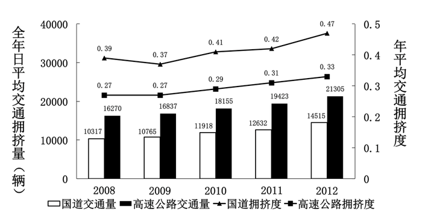

2008—2012年全国国道与高速公路日平均交通量及年平均交通拥挤度

### 第 116 题

2009—2012年全国国道日平均交通量同比增速最快的一年是：

A. 2010年

B. 2009年

C. 2012年

D. 2011年

第 116 题 · 答案与解析

**参考答案（粉笔题库参考内容）**

C

**解析**

由题干“增速最快”，可判定本题为一般增长率比较问题。定位图形材料，根据公式，2009年；2010年；2011年；2012年。可知2012年增速最大。

故正确答案为C。

**考点**：一般增长率、综合资料

**来源**：2014年国家公务员录用考试《行测》题第116题

### 第 117 题

2008—2012年全国国道与高速公路年平均拥挤度数值相差最小的年份，高速公路全年日平均交通量为：

A. 10765辆

B. 16837辆

C. 12632辆

D. 19423辆

第 117 题 · 答案与解析

**参考答案（粉笔题库参考内容）**

B

**解析**

通过折线图可知，两条折线最接近的即为“全国国道与高速公路年平均拥挤度数值相差最小的年份”是2009年，定位2009年柱状图，所以2009年高速公路全年日平均交通量为16837辆。

故正确答案为B。

**考点**：直接找数、综合资料

**来源**：2014年国家公务员录用考试《行测》题第117题

### 第 118 题

以下关于2012年日平均行驶量由高到低排序正确的是：

A. 国家高速公路—全国高速公路—普通国道

B. 全国高速公路—国家高速公路—全国国道网

C. 全国国道网—普通国道—国家高速公路

D. 全国国道网—国家高速公路—普通国道

第 118 题 · 答案与解析

**参考答案（粉笔题库参考内容）**

D

**解析**

定位文字材料，“全国国道网日平均行驶量为244883万车公里；国家高速公路日平均行驶量为148742万车公里；普通国道日平均行驶量为111164万车公里”可知，全国国道网日平均行驶量＞国家高速公路日平均行驶量＞普通国道日平均行驶量，因此D项排序正确。

故正确答案为D。

**考点**：排序类、综合资料

**来源**：2014年国家公务员录用考试《行测》题第118题

### 第 119 题

2012年国家高速公路日平均交通量约是普通国道日平均交通量的：

A. 1.7倍

B. 1.5倍

C. 2.0倍

D. 1.8倍

第 119 题 · 答案与解析

**参考答案（粉笔题库参考内容）**

C

**解析**

由题干结合选项“2012年······约是······倍”可知，本题为现期倍数计算。定位文字材料“国家高速公路日平均交通量为22181辆；普通国道日平均交通量为10845辆”，所以2012年国家高速公路日平均交通量约是普通国道日平均交通量的倍数为。

故正确答案为C。

**考点**：现期倍数、综合资料

**来源**：2014年国家公务员录用考试《行测》题第119题

### 第 120 题

能够从上述资料中推出的是：

A. 2008—2012年，全国国道交通繁忙程度持续增加

B. 2012年国道网日平均交通量超过2万辆的省市最多有6个

C. 2008—2012年，全国高速公路交通繁忙程度持续增加

D. 2012年国道年平均拥挤度超过0.6的省市至少有8个

第 120 题 · 答案与解析

**参考答案（粉笔题库参考内容）**

D

**解析**

A项：根据图形中的折线可知，2008-2009年全国国道交通繁忙程度为减少，错误；

B项：根据材料“2012年全国国道网车流量较大的地区主要集中在北京、天津、上海、江苏、浙江、广东和山东，上述省市国道网的日平均交通量均超过2万辆”可知，至少有7个省市超过2万辆，错误；

C项：根据图形中的折线可知，2008-2009年全国高速公路交通繁忙程度保持不变，错误；

D项：通过文字资料可知，“北京、天津、河北、山西、上海、浙江、湖北、广东的国道年平均拥挤度均超过0.6”，至少有8个，正确。

故正确答案为D。

**考点**：综合分析、综合资料

**来源**：2014年国家公务员录用考试《行测》题第120题

## 材料 2

一、根据以下资料，回答121—125题。

        2012年第三季度全国100个城市的公共就业服务机构市场中，用人单位通过公共就业服务机构招聘各类人员约643.3万人，进入市场的求职者约610万人，岗位空缺与求职人数比率比上年同期上升了1%。上年同期这100个城市中，用人单位通过公共就业服务机构招聘各类人员约577.9万人。

         2012年第三季度，在所有求职人员中：失业人员所占比重为48.8%，其中，新成长失业青年占24.2%（在新成长失业青年中应届高校毕业生占51.4%），就业转失业人员占13.4%，其他失业人员占11.2%；外来务工人员的比重为41%，外来务工人员由本市农村人员和外埠人员组成，其中本市农村人员为95.2万人。

                2012年第三季度全国十个城市岗位需求和求职信息

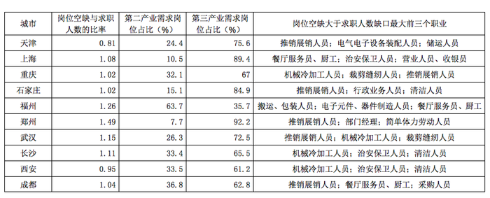

### 第 121 题

与2011年同期比，2012年第三季度全国100个城市调查的公共就业服务机构市场供求中，进入市场的求职者人数：

A. 高于上年同期

B. 低于上年同期

C. 与上年同期持平

D. 无法推出

第 121 题 · 答案与解析

**参考答案（粉笔题库参考内容）**

A

**解析**

由题干“······2012年第三季度······进入市场的求职者人数”可知本题为比值相关问题。定位文字材料第一段，“2012年第三季100个城市岗位空缺与求职人数比率比上年同期上升了1%”，故-1%。由于“2012年第三季100个城市招聘的是643.3万人，求职为610万人，2011年同期招聘的人数约577.9万人”，则=，故2012年第三季度求职人数610万人>577.9万人>2011年第三季度求职人数，求职人数高于上年同期。

故正确答案为A。

**考点**：直接找数、综合资料

**来源**：2014年国家公务员录用考试《行测》题第121题

### 第 122 题

2012年第三季度全国100个城市，求职的新成长失业青年中，应届高校毕业生人数约为：

A. 66万

B. 71万

C. 76万

D. 81万

第 122 题 · 答案与解析

**参考答案（粉笔题库参考内容）**

C

**解析**

由题干“······2012年第三季度全国100个城市···应届高校毕业生人数约”和材料给出占比可知本题为现期比重问题。定位文字材料第一、二段“进入市场的求职者约610万人···2012年第三季度，在所有求职人员中：失业人员所占比重为48.8%，其中，新成长失业青年占24.2%（在新成长失业青年中应届高校毕业生占51.4%）······”可知，求职的新成长失业青年中应届高校毕业生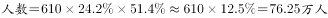。也可估算为：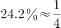，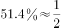，。

故正确答案为C。

**考点**：现期比重、综合资料

**来源**：2014年国家公务员录用考试《行测》题第122题

### 第 123 题

2012年第三季度全国十个城市中，第三产业需求岗位数超过第二产业2倍的城市共有：

A. 3个

B. 4个

C. 5个

D. 6个

第 123 题 · 答案与解析

**参考答案（粉笔题库参考内容）**

D

**解析**

由题干“······第三产业需求岗位数超过第二产业2倍的城市······”可知本题为现期倍数问题。定位表格材料，天津：；上海：；重庆：；石家庄：；郑州：；武汉：，共6个城市的第三产业需求岗位数超过第二产业的2倍。

故正确答案为D。

**考点**：现期倍数、综合资料

**来源**：2014年国家公务员录用考试《行测》题第123题

### 第 124 题

2012年第三季度全国十个城市中，岗位空缺大于求职人数缺口的最大的前三个职业，在半数以上城市中出现过的是：

A. 推销展销人员

B. 治安保卫人员

C. 机械冷加工人员

D. 餐厅服务员、厨工

第 124 题 · 答案与解析

**参考答案（粉笔题库参考内容）**

A

**解析**

十个城市中半数以上出现，即在五个以上城市中出现过的职业。定位表格材料，推销展销人员出现过6次，治安保卫人员出现过3次，机械冷加工人员出现过4次，餐厅服务员、厨工出现过3次，显然只有推销展销人员出现在五个以上城市中。

故正确答案为A。

**考点**：直接找数、综合资料

**来源**：2014年国家公务员录用考试《行测》题第124题

### 第 125 题

从上述资料能够推出的是：

A. 2012年第三季度在全国100个城市中，进入市场的外来务工人员在新成长失业青年中所占的比重

B. 2012年第三季度在全国100个城市中，进入市场的外来务工人员中外埠人员在求职者中所占的比重

C. 2012年第三季度在全国十个城市中，劳动力缺口最大的岗位

D. 2012年第三季度在全国十个城市中，失业人口最多的城市

第 125 题 · 答案与解析

**参考答案（粉笔题库参考内容）**

B

**解析**

A项：定位文字材料，只有新成长失业人员中应届高校毕业生所占比重，无法计算进入市场的外来务工人员在新成长失业青年中所占的比重，无数据支持，错误；

B项：由材料“2012年第三季度全国100个城市的公共就业服务机构市场中，用人单位通过公共就业服务机构招聘各类人员约643.3万人，进入市场的求职者约610万人”“2012年第三季度，在所有求职人员中，外来务工人员的比重为41%，外来务工人员由本市农村人员和外埠人员组成，其中本市农村人员为95.2万人”可知，先根据外来务工人员的比重计算出外来务工人员的人数为，故其中外埠人员所占比重约为，正确；

C项：表格中无具体数值，故无法推出，错误；

D项：表格中无具体数值，故无法推出，错误。

故正确答案为B。

**考点**：综合分析、综合资料

**来源**：2014年国家公务员录用考试《行测》题第125题

## 材料 3

根据以下资料，回答126~130题。

2012及2013年1~4月某市电影院线票房情况

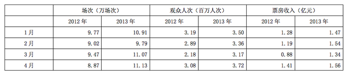

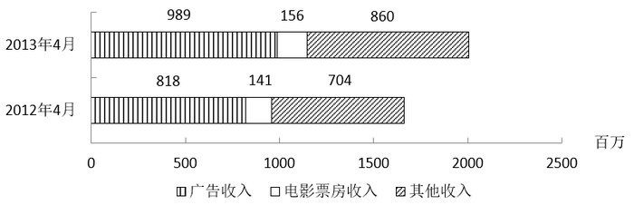

### 第 126 题

2013年1—4月，该市电影院线平均每场电影观众人次最少的月份是：

A. 1月

B. 2月

C. 3月

D. 4月

第 126 题 · 答案与解析

**参考答案（粉笔题库参考内容）**

C

**解析**

由题干“2013年1—4月······平均每场······人次最少的月份”可知本题为现期平均数比较的问题。定位表格材料可得，2013年1～4月,该市电影院线平均每场电影观众人数分别为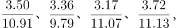比较前三个分数，3月份的分子小同时分母大，则3月份小于1、2月份。排除A、B两项；比较后两个分数，两者分母非常接近，而3月份分子小于4月份，因此3月份分数值小于4月份。

故正确答案为C。

**考点**：现期平均数、综合资料

**来源**：2014年国家公务员录用考试《行测》题第126题

### 第 127 题

2013年第一季度，该市电影院线平均每场电影的票房收入约为多少元：

A. 1170

B. 1370

C. 1570

D. 1770

第 127 题 · 答案与解析

**参考答案（粉笔题库参考内容）**

B

**解析**

由题干“2013年第一季度，该市······平均每场电影的票房收入······”可知本题为现期平均数计算。定位表格材料，将2013年1~3月数据相加得第一季度数据，该市电影院线平均每场的电影票房收入为。

故正确答案为B。

**考点**：现期平均数、综合资料

**来源**：2014年国家公务员录用考试《行测》题第127题

### 第 128 题

2013年1~4月，该市电影院线票房收入同比增量从高到低排序正确的是：

A. 3月—2月—1月—4月

B. 4月—2月—1月—3月

C. 3月—4月—2月—1月

D. 4月—3月—1月—2月

第 128 题 · 答案与解析

**参考答案（粉笔题库参考内容）**

A

**解析**

由题干“······同比增量从高到低排序······”可知本题为增长量比较问题。2013年增量=2013年-2012年，简单估算可知2013年1~4月的增长量分别为：1.47-1.28=0.19、1.54-1.19=0.35、1.34-0.88=0.46、1.56-1.41=0.15。可知该市电影院线票房收入同比增量3月＞2月＞1月＞4月。A项的顺序符合。

故正确答案为A。

**考点**：增长量比较、综合资料

**来源**：2014年国家公务员录用考试《行测》题第128题

### 第 129 题

2012年1—4月，该市平均每天观看电影的观众超过10万人次的月份有几个：

A. 1

B. 2

C. 3

D. 4

第 129 题 · 答案与解析

**参考答案（粉笔题库参考内容）**

B

**解析**

由题干“······平均每天观看电影的观众超过10万人次······”可知本题为现期平均数计算问题。题干要求，即比较即可。

定位表格材料，1月：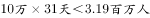；2月：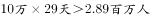；3月：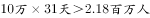；4月：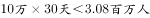。故符合题干要求的月份有1月和4月，即为2个。

故正确答案为B。

**考点**：现期平均数、综合资料

**来源**：2014年国家公务员录用考试《行测》题第129题

### 第 130 题

关于2013年4月该市播放广播影视情况，能够从资料中推出的是：

A. 广告收入同比上升了近两成

B. 电影观众人次环比增速下降

C. 电影票房收入同比增速快于其他收入

D. 电影播放场次环比增速慢于同比增速

第 130 题 · 答案与解析

**参考答案（粉笔题库参考内容）**

D

**解析**

A项：根据柱状图，2013年4月份广告收入的同比增长率，即超过两成，错误；

B项：定位表格材料，2013年3月电影观众人次环比增速为负值，4月环比增速为正值，故环比增速为上升，错误；

C项：定位柱状图，电影票房同比增速为，其他收入同比增速为，所以电影票房增速慢于其他收入，错误；

D项：定位表格材料，电影播放场次环比增速为，同比增速为，两式分子相同，且都要减去1，分母越小则结果越大，故同比增速快于环比增速，正确。

故正确答案为D。

**考点**：综合分析、综合资料

**来源**：2014年国家公务员录用考试《行测》题第130题

## 材料 4

四、根据以下资料，回答131~135题。

年国家电网公司机组并网容量

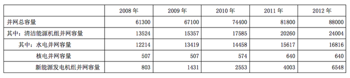

单位：万千瓦

年国家电网公司机组上网电量

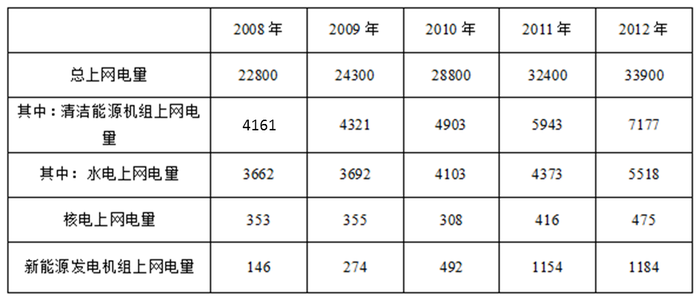

单位：亿千瓦时

### 第 131 题

下列年份中，国家电网公司并网机组总上网电量同比增速最快的是：

A. 2010年

B. 2009年

C. 2012年

D. 2011年

第 131 题 · 答案与解析

**参考答案（粉笔题库参考内容）**

A

**解析**

由题干“······同比增速最快······”可知本题为一般增长率比较的问题。定位表格材料2可知，代入增长率计算公式现期/基期-1，2012年总上网电量同比增长；2011年增长；2010年增长；2009年增长。比较可知，2010年增速最大。

故正确答案为A。

**考点**：一般增长率、统计表

**来源**：2014年国家公务员录用考试《行测》题第131题

### 第 132 题

2012年清洁能源机组并网容量占当年并网机组总容量的比重比上年：

A. 上升了5.5个百分点

B. 上升了2.5个百分点

C. 下降了5.5个百分点

D. 下降了2.5个百分点

第 132 题 · 答案与解析

**参考答案（粉笔题库参考内容）**

B

**解析**

由题干结合选项“2012年······占······比重比上年上升/下降······个百分点”可知本题为两期比重比较问题。定位表格材料1数据可知，2012年清洁能源机组并网容量占当年并网机组总容量的比重为，2011年其比重为。2012年比重大于2011年，排除选项CD。且27.3%-24.7%=2.6%，与B项最为接近。

故正确答案为B。

**考点**：两期比重、统计表

**来源**：2014年国家公务员录用考试《行测》题第132题

### 第 133 题

下列年份中，清洁能源机组上网电量占当年并网机组总上网电量比重最高的是：

A. 2009年

B. 2008年

C. 2012年

D. 2011年

第 133 题 · 答案与解析

**参考答案（粉笔题库参考内容）**

C

**解析**

由题干“······占······比重”，可判定此题为现期比重比较问题。定位表格材料2,2008、2009、2011、2012年清洁能源机组上网电量占当年并网机组总上网电量的比重分别为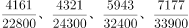，直除商的首位分别为1、1、1、2，因此，2012年比重最高。

故正确答案为C。

**考点**：现期比重、统计表

**来源**：2014年国家公务员录用考试《行测》题第133题

### 第 134 题

下列哪一张图能反映2012年清洁能源机组并网容量中水电、核电和新能源发电的构成：

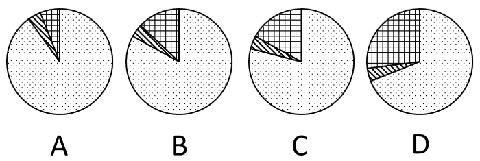

A. A

B. B

C. C

D. D

第 134 题 · 答案与解析

**参考答案（粉笔题库参考内容）**

D

**解析**

根据题干“2012年······中······的构成”，结合材料给出2012年数据，可判定本题为现期比重问题。定位表格材料1可得：2012年清洁能源机组并网总容量为24004万千瓦，其中最大的为水电（16816万千瓦），占清洁能源总容量的比重为16816/24004，结合选项只有D项满足，其余三项最大的部分均大于3/4。

故正确答案为D。

**考点**：现期比重、统计表

**来源**：2014年国家公务员录用考试《行测》题第134题

### 第 135 题

关于2008~2012年间国家电网公司清洁能源的发展，能够从资料中推出的是：

A. 新能源发电机组上网电量从2011年开始超过核电上网电量

B. 水电上网电量年均增长率超过同期水电并网容量

C. 新能源发电机组并网容量翻了8番

D. 核电上网电量保持持续增长

第 135 题 · 答案与解析

**参考答案（粉笔题库参考内容）**

B

**解析**

A项：定位表格材料2，2010年新能源上网电量492亿千瓦时，核电上网308亿千瓦时，即从2010年开始新能源上网电量超过核电上网电量，错误；

B项：由于年份相同，只要2012年相对于2008年增长率大，年均增长率就一定大，定位表格材料2，水电上网电量2012年相对于2008年的增长率为5518/3662-1；定位表格材料1并网容量2012年相对于2008年的增长率为，前者大，正确；

C项：定位表格材料1，新能源电机并网容量由803万千瓦增长到6548万千瓦，约增长倍，8为2的3次方，即3番；错误；

D项：定位表格材料2，核电上网电量2009~2010年从355亿千瓦时下降到308亿千瓦时，并非持续增长，错误。

故正确答案为B。

**考点**：统计表、综合分析

**来源**：2014年国家公务员录用考试《行测》题第135题

