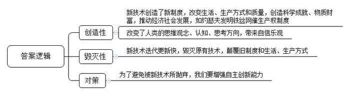
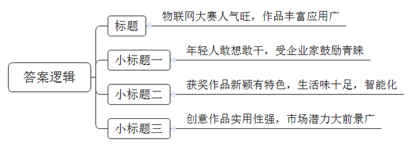
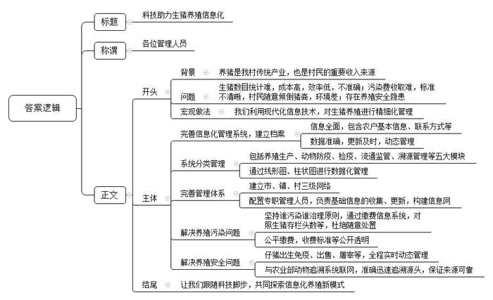
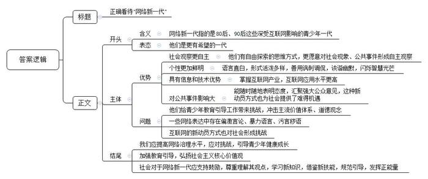
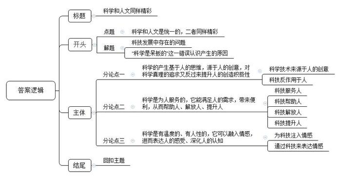

# 2015年国家公考《申论》题（地市级）

<!-- gwy:overview:start -->
> **国考 · 2015 · 申论 · 地市级** ｜ 5 题 · 图片 5 处 · 答案随题折叠

导航：[题目](#题目) · [材料 1](#材料-1)
<!-- gwy:overview:end -->

> 候选采集稿。参考答案及解析来自粉笔页面，不代表官方答案或真实高分答卷；来源使用许可与原卷对应关系仍需人工核实。

## 给定材料

### 材料 1

1867年，约瑟夫在加利福尼亚一个牧场工作，常常一边放羊一边看书。在他埋头看书时，羊经常撞倒放牧的铁丝栅栏，跑到附近田里偷吃庄稼。牧场主对此事十分恼怒，威胁要将他辞掉。约瑟夫经过观察发现，羊很少跨越长满尖刺的蔷薇围墙。于是一个偷懒的想法浮上心头：何不用铁丝做成带刺的网呢？他把细铁丝剪成小段缠在铁丝栅栏上，并将铁丝末端剪成尖刺。这下，想要偷吃庄稼的羊只好“望网兴叹”，约瑟夫再也不必担心会被辞退了……

约瑟夫恐怕做梦也没有想到，他的小发明竟然造就了这样宏大的景象，也没想到他最初用来限制羊的带刺铁丝网，不久就被用来限制人了：带刺铁丝网除了在监狱、集中营、战俘营中用来圈住囚犯外，还在战场上得到了广泛应用。有人把这种铁丝网列为“改变世界面貌的七项专利之一”，因为这项技术的创新，带来了制度的创新。有经济学家说，铁丝网催生了美国西部早期产权制度的建立（铁丝网帮助牧场确定了边界，并因此推动了经济和社会的发展），这才是铁丝网最大的贡献。

铁丝网的发明也由此启示人们，新技术的创意和发明，与人们的生活方式以及制度的改变都有直接的关联性。

近百年来，人类的科技发展只能用突飞猛进这样的词汇来形容，如果让一个1900年的发明家来看今天的世界，他会认得汽车、电话、飞机，也能想象出宇宙飞船、深海潜艇，但他绝对会对计算机、互联网、基因工程、核能一无所知。现在，知识爆炸带给人类前所未有的自信和乐观，有位作家这样写道：“我真诚地相信，我们生活在人类历史上最伟大的知识时代，没有任何事物我们不了解……只要是能想到的事，总有人能做到。”20世纪科技的发展使这句话越来越像真理。20世纪是科学技术空前辉煌的世纪，人类创造了历史上最为巨大的科学成就和物质财富。这些成就深刻地改变了人类生产和生活的方式及质量，同时也深刻地改变了人类的思维、观念和对世界的认识，改变并继续改变着世界，也使人类思考的方向有所变化，由此带来的，是对人类不断创新的深刻认识。而技术的更新具有一种加速度的特质，尤其是新世纪以来电子产品例如电脑、手机等的更迭，更是呈现出几何级数的发展速度，更新换代往往在两三年内就得以完成。以至于有人认为：新技术是一种创造性的毁灭力量。

习近平在2014年6月9日召开的中国科学院第十七次院士大会、中国工程院第十二次院士大会上强调，我国科技发展的方向就是创新、创新、再创新。实施创新驱动发展战略，最根本的是要增强自主创新能力，最紧迫的是要破除体制机制障碍，最大限度解放和激发科技作为第一生产力所蕴藏的巨大潜能。要坚定不移走中国特色自主创新道路，坚持自主创新、重点跨越、支撑发展、引领未来的方针，加快创新型国家建设步伐。习近平强调，今天，我们比历史上任何时期都更接近中华民族伟大复兴的目标，比历史上任何时期都更有信心、有能力实现这个目标。而要实现这个目标，我们就必须坚定不移贯彻科教兴国战略和创新驱动发展战略，坚定不移走科技强国之路。科技是国家强盛之基，创新是民族进步之魂。中华民族是富有创新精神的民族。党的十八大作出了实施创新驱动发展战略的重大部署，强调科技创新是提高社会生产力和综合国力的战略支撑，必须摆在国家发展全局的核心位置。这是党中央综合分析国内外大势、立足我国发展全局作出的重大战略抉择。面对科技创新发展新趋势，我们必须迎头赶上、奋起直追、力争超越。历史的机遇往往稍纵即逝，我们正面临着推进科技创新的重要历史机遇，机不可失，时不再来，必须紧紧抓住。

### 材料 2

（标题）

9月28日上午，在××博览中心，第七届大学生I－CAN物联网创新创业大赛中国总决赛颁奖仪式正在进行。本次比赛共有来自全国63所学校的267支队伍参加了角逐，野战“活点”沙盘、意世界、笔记本防护装置、蜜蜂之家等作品获得了特等奖。另外，全息3D成像、仿生鲇鱼、防丢宝、煤气智能报警系统、安全校车系统、太阳光雨水发电器等颇为接“地气”的作品获得了一、二、三等奖。据主办方介绍，今年参加大赛的作品涉及面更广，专业领域包括了家居、医疗等，并且评委在评分中更加注重作品的市场潜力和应用价值。

       （小标题一）

上午9点，颁奖仪式如期举行，依次颁发了60个三等奖、40个二等奖、15个一等奖与5个特等奖。一个个充满活力的年轻获奖队员鱼贯上台领奖，对于他们来说，更多的是一种团队参赛的快乐和创意成真的成就感。某工程大学的一位参赛选手告诉记者：这次参赛他们从创意设计到做成成品总共花了8个月的时间，这段时间少不了同学们通宵达旦地钻研，“在团队合作中，大家都听队长的，对自己所分工的活认真仔细，遇到难题一起研究。现在获得了三等奖，非常有成就感。”

而在会场上，也有不少企业代表对这些创新技术非常感兴趣。一位企业家表示，年轻人有梦想，敢想敢干，看好他们作品的市场前景，鼓励他们创业，如果有机会会与大学生团队开展合作。

       （小标题二）

“太阳光雨水发电器，非常适合多雨的南方使用。”“交通事故警报APP，发生事故后，软件会自动发信息给你的家人。”看到这些品种繁多的获奖作品，真让人有种“只有你想不到，没有你做不到”的感觉。记者在采访中发现，今年的获奖作品中出现了不少新颖有特色、生活味道十足的作品，不仅有防丢钥匙的智能锁，还有各种趣味盎然的新发明。北京某大学的发明团队发明了一款“M-Fish智能鱼缸”，这款鱼缸可以与手机相连，使用者可以通过手机发送信号，控制鱼缸的充氧量，精准把握鱼食投喂。

某大学分校的参赛团队研发的“舒心电风扇”，是利用物联网技术制造的感应风扇，如果人体皮肤靠近风扇，它就会自动关停，这样可以预防小孩子不小心将手伸进电风扇中受伤，或者避免距离太近造成感冒。太原某大学团队设计的煤气智能报警系统，通过计算火焰、煤气流量等，能够及时发现煤气泄漏，从而报警。

       （小标题三）

获奖作品中，那些与人身安全相联系的几款作品尤为引人注意。获得一等奖、由湖北某师范学院团队研发的安全校车系统，就是从新闻中校车闷死儿童的事件中得到灵感，创造出的一款防止在校车中遗落儿童的软件。据获奖团队介绍，他们4个伙伴用四五个月的时间，从多套方案中挑选了2套，这款作品应用了物联网技术，根据探头、座椅压力等信号综合计算，判断车内是否有人遗落，并且批量生产的成本适合市场推广。

具有市场潜力并且经过市场验证的作品更是脱颖而出，获得特等奖的一款名为“蜜蜂之家”的作品是某科技大学的团队研发的。他们曾经将自己的作品带到田间地头，“我们去湖北的蜂农农场待了3个月，就是想实地检测一下这款产品到底有没有用。”团队队长小程说。他们通过实地检验，发现作品真的可以解决蜂农养蜂中的温度控制问题。该作品的实用性得到了评委的一致好评，最终成功摘金。

### 材料 3

长三角地区生猪的重要产区P市，其养猪业正处在转型升级的关键期。记者走进P市，探寻信息化时代这种后养殖模式究竟改变了什么。

“村里以前有34000~35000头猪，每天都有仔猪出生、肉猪出栏、病猪死去，具体多少就不清楚了。”P市某村村委会李主任说。

该村有2000多户村民，位置比较偏僻。养猪是村里的传统产业，也是不少农户的收入来源之一。以前村民随意倾倒猪粪，随意处理病死猪，村里环境越来越差。要恢复环境，拆除违建猪舍，起码要知道村里有多少头猪。这个简单的问题，却难倒了很多村委会主任。

据P市畜禽养殖污染治理办公室的工作人员林先生解释，以前，如果上面要求统计生猪养殖的某一项数据，他们就要将任务派到各镇、街道，镇、街道再把任务派到村、社区，由村、社区的工作人员到每一户养殖户家中询问状况，汇总统计之后逐级上报。一般来说，完成一项统计最快也要1个月。

除了费时费力，准确度也是个问题。等到各村农户一家家跑下来，数据交上去，实际情况总会和报上去的不太一样。因为生猪数量是动态的。要对生猪养殖户进行管理，还涉及诸多相关问题，如猪舍面积是多少，沼气池、沼液池、三格式化粪池建设情况如何，是否按照生猪数量收取养殖污染处置费……必须利用现代化信息技术，对生猪养殖进行精细化管理。

下午2时，该村村委会工作人员小徐来到二组村民曹在林家。猪舍里，一窝刚生下来没几天的小猪崽见到生人来了，吓得挤成一团。

“一、二、三……”小徐一头头数了起来。前两天，老曹家的母猪生了12头仔猪。而一周前来统计的时候，这窝猪崽还没出生。

跑了十几家农户的猪舍后，小徐回到村委会，登录进入电脑上的“P市生猪信息化管理系统”，找到老曹家的档案。档案里，农户基本信息、联系方式、治污设施、猪舍面积、养殖规模、存栏头数、出栏、出生、仔猪、母猪、肉猪等情况清清楚楚。

小徐动动鼠标和键盘，将仔猪数量从“0”改成了“12”。接着根据刚刚走访了解到的情况，逐户进行修改。随着老曹等养殖户家仔猪数量的变化，全村、全镇、全市仔猪数量也发生了变化。“现在实时更新，效率高，更准确，而且为每家农户都建立了一个档案，方便管理。病死多少，出栏多少，存栏多少等一清二楚。”林先生对新系统赞不绝口。

截至目前，系统里有“一户一档”养殖基本信息2.45万户。其中，现有存栏生猪养殖户0.94万户，退养户1.51万户。而整个系统里包括养殖生产管理、动物防疫管理、动物检疫管理、流通监管、溯源管理5个模块，涵盖50类数据情况的记录统计，还能实时导出线形图和柱状图，变动情况也很明晰。

为了配合这套系统，P市在人员配置方面建立了市、镇、村三级网络，96个行政村里，村村都有1名专职管理人员，负责基础信息的收集、更新。从下到上，构建起一张信息网。

除了一些类似“人口统计指标”的基本情况，生猪养殖业要减量提质，生猪养殖污染和养殖安全问题必须解决。这套系统在这方面也大有作为。

生猪养殖污染曾经让老百姓苦不堪言。以前，根据“谁污染谁治理”的原则，按照“村规民约”的要求，村民们按照自家养殖的生猪数量，向村里缴纳费用来治污。养几头猪，交多少钱。虽然有“村规民约”的约束，但由于生猪数量不明晰，因此在执行上存在一些问题。

现在，通过将缴费信息录入系统，对照养殖户的生猪存栏数等基本情况，一旦数字对不上就能及时发现，杜绝村民随意处置病死猪和畜禽废弃物的可能，确保了制度的全面推行和长效管理。

小徐向我们展示了一张生猪养殖污染处置费缴纳证明，在系统里，记者看到，和纸质证明相对应的，该农户的收费金额、存栏头数、收费标准、收费凭证编码都很清楚。继续点开，还能看到该农户在这段时间的所有养殖行为详情，比如母猪产下猪崽情况、出栏前检疫证明情况等，都可以随时查看。

最近一个月，系统内记录了1053户养殖户的生猪养殖污染处置费缴费登记信息、57户养殖户能繁母猪的收费登记信息；同时，由于数据实时更新，系统基本实现了从仔猪出生免疫、出售检疫、屠宰检疫的全程实时动态管理，为相关部门提供了翔实可靠的决策依据。

此外，该系统已与农业部动物追溯系统联网，能更大限度地保证猪肉来源的可靠性，一旦出现问题，也能更准确、迅速地追溯到源头。

### 材料 4

如果说50后、60后是“广播一代”，70后是“电视一代”，那么80后、90后则是“网络新一代”。有人说，与他们的“前辈”相比，“网络新一代”其实是更有希望的一代。

过去很多做父母的可能都有这样的经历，小孩子常稚气地问：“我是怎么来的？”而今，向家长提出这种问题的小孩子越来越少了，因为“网络新一代”更愿意从网上寻找答案。实际上，自主的社会观察是“网络新一代”的普遍特点。网络给青少年提供了自由探索的渠道，也培养了他们自由探索的思维方式。因此，他们更愿意对社会现象和公共事件形成自主的观察。

无疑，这是一种社会进步的表现，但同时也给青少年的教育引导工作带来了巨大挑战。“网络新一代”生活在一个传统与现代交替、民族文化与外来文化激荡的时代，这种社会现实为当代青少年提供了多元价值观的选择。同时，社会上存在的一些弊端尚未得到有效治理，并暴露在网上。在这种情况下，青少年中构建起来的主流价值体系、道德观念将受到冲击。

“网络新一代”可以毫无顾忌地在网上批评任何人、任何事，毫不掩饰自己的观点。他们在网络上善于用直白的语言表达自己的思想，而且在思想表达上形式活泼，善于使用讽刺和调侃。他们用自编或改编的歌曲、视频以及网络签名等方式来表达自己的观点和态度。他们创作的许多段子诙谐幽默，闪耀着智慧的光芒，表达出对人对事的鲜明态度，让人拍案叫绝。

同时，正因为网络表达自由随意，“网络新一代”在网络表达时偏激言论较多，甚至使用语言暴力。有些人发帖时使用的过激言论和污言秽语，其低俗程度让人震惊。

在有“印度硅谷”之称的班加罗尔，有一家世界知名的软件企业印孚瑟斯信息技术有限公司。该公司现有员工12万多人，平均年龄只有26岁。我国的互联网行业也是如此，腾讯是世界第三的互联网企业，其1万多名员工，平均年龄也不过26.8岁。许多互联网企业的创办者和管理层都是20多岁的年轻人。可以说，互联网是真正由“网络新一代”所掌控的产业。

在农业社会和工业社会，成人具有明显的体力优势和社会经验优势。而在信息社会中，对信息和新技术的掌握已经成为比体力和经验更为重要的资源和力量，因此成人的经验和体力优势在青少年的信息和技术优势面前已弱化甚至丧失了。相对于父辈，青少年在互联网应用方面的水平普遍更高。

在近些年发生的一系列重大公共事件中，“网络新一代”都显示了自己的力量。在青少年经常使用的一些网站论坛上被顶起来的帖子，很快就会被几十万人、几百万人看到，并迅速向整个互联网传播开来。随身携带的手机或其他手持电子设备可使青少年随时随地上网，任何时候都可以发出声音、表明态度，并汇聚成强大的公共意见。

进入新世纪以来，我们已经看到“网络新一代”多次利用互联网进行的成功动员。现在网上活跃着数不清的规模不一的青年自建组织——QQ群、论坛、网络游戏等。“网络新一代”形成的新动员方式对我们的挑战是巨大的，但也提供了难得的机遇。

### 材料 5

塑料的发明曾经给人们的生活带来了相当大的便利，但也带来了一系列的环境问题。塑料在垃圾中占相当一部分比例，而且大大增加了垃圾处理的难度和费用。由于废塑料几百年都难以降解，若丢弃在自然环境中，会给蚊子、苍蝇和细菌提供生存繁育的温床；若埋在地下，则容易污染地下水，妨碍植物根系生长，破坏土壤品质；若焚烧处理，将产生多种有毒气体。“白色污染”已成为危害环境的一大公害。

汽车的尾气、空调和电冰箱中的氟利昂都在破坏大气层。埃博拉病毒的爆发和流行也使全世界更加关注生物安全问题，并将其作为国家安全的组成部分。全球数以万计的原子弹更是高悬在人类头上的达摩克利斯之剑。

一方面，20世纪的信息技术将人类活动的效率提升到了一个新的高度；但是另一方面，就像著名学者刘易斯•芒福德指出的那样，为了获得更多、更丰富的物质，人类牺牲了时间和当前的快乐，只是将幸福简单地与拥有汽车、浴缸和其他机械产品的数量画上等号，芒福德将之称为“无目的的物质至上主义”。在计算速度越来越快、人工智能程度越来越高的潮流之下，人类的个性开始被故意忽略和遮蔽，陷入了追求更高、更快、更强的单向度技术目标的误区。有评论家因此指出，当发展着的物质科技生产力忽略、脱离开民众精神力的时候，就会丧失它应受人控制并为人服务的真正本质，而变成与人对立的人的异化力量。

观察家认为，未来科技最关键的发展方向是走人性化之路。闪烁着“人性”之光的产品将越来越多地出现，高科技产品也将进一步被赋予灵动的生命，在科技和人性之间搭建桥梁。人性化的科技反映的是人类以下的思考：科技产品如何为人服务？它给人们的生活带来了怎样的一种新的积极的变化？科技如何人性化？在盲目的物质化导向这一危途中，人性化之路将赋予高科技产品以新的价值观，那就是用大写的人性的光芒去逼视高科技这一高贵神秘、自视甚高的怪兽，使其自惭形秽，让普通人也能看到其无知和愚蠢。

因此，人性化的科技是在科技和人文、个性化与大众化、商业目标和社会使命之间去追求平衡，这种平衡不仅是一种美，也是一种智慧和态度。

### 材料 6

日前，世界知名未来学家、《连线》杂志主编、被看作是“网络文化”的发言人和观察者的凯文•凯利接受了采访。其间，凯利围绕着自己的《科技想要什么》等技术思想领域的重要著作，回答了“新技术”与“人性”的关系等一系列问题，现摘要整理如下。

A：在《科技想要什么》中我想表述的是，我对技术本质的疑问以及人与技术的矛盾关系。世界上每天都有新的技术诞生，但我们还没有理论和框架，好让我们来理解科技面对的是什么。我们一直在发展科技，但我们是否要考虑：会不会有一天我们被科技征服？科技是宇宙的一部分吗？它是好的那部分吗？我们是该限制它还是要发展它？

B：正如哲学家海德格尔对技术的批判理论——这种貌似宿命的技术现实，本质上是人所无法控制的，但获得拯救的机会也恰在于此：“救赎即植根并发育于技术的本质之中。”技术元素向共生性的发展，推动我们去追逐一个古老的梦想：在最大限度发挥个人自主性的同时，使集体的能力最大化。

C：技术是进化的延伸，就像进化是宇宙的延伸那样。我们会认为技术对生命是一种挑战，但事实上科技也是一种生命。技术也有像进化一样的历程，毕竟技术对宇宙对生命都有积极的意义。技术具有生命的普遍特征。我的答案是，得到了技术的理论也就能理解进化论。

D：技术元素的确准备操纵物质，包括人类，重组各种内部结构。但是技术将为其注入感知能力和情感，注入更多“非工具性”的东西。我认为我们应该培养科技的感情。目前科技还不具备感情，但我认为今后我们会赋予科技感情。“科技的生命化”，已成为现实世界无法根除的特征。科技将具备人性。

E：科技是一种“新文化”。“科技是第三种文化”，这意味着科学家们可以直接和大众进行对话，而不是通过人文知识分子、传统知识分子所占领的媒体，这二者一直控制着舆论方向。他们说：“人文是精彩的，科学是呆板的。”今天，“第三种文化”的思想家们却更倾向于绕过中间人，致力于用关注知识的读者们能够理解的形式，向公众传达他们最深邃的思想。

F：在过去二十年，互联网给人类的生活和知识的认知带来了极大变革。而现在，是另一个起点。当今是人类历史上最好的时代，之前的所有成果都是今天的基础。我想激励年轻人，现在就是创造新事物的最好时代。不仅是互联网，对于所有领域来说，现在都是创造新事物的最好时代。创造新事物，离不开技术创新。我在《科技想要什么》一书中，特别强调一句话：科技想要的，就是人类想要的。

## 题目

### 第 1 题

**结合“给定资料1”，谈谈你对文中划线句子“新技术是一种创造性的毁灭力量”的理解。（10分）**

关联材料：材料 1

作答要求：

要求：

（1）准确、全面；

（2）不超过150字。

第 1 题 · 答案与解析

**参考答案（粉笔题库参考内容）**

1.新技术创造了新制度，改变生活、生产方式和质量，创造科学成就、物质财富，推动经济社会发展，如约瑟夫发明铁丝网催生产权制度；还改变了人类的思维观念、认知、思考方向，带来自信乐观。

2.新技术迭代更新快，毁灭原有技术，颠覆旧制度和生活、生产方式。

3.为了避免被新技术所抛弃，我们要增强自主创新能力。

**解析**

**参考答案说明：**思路方面，本参考答案按照“分析相关要素+总结评价”的答题思路展开。内容方面，本参考答案先对新技术的“创造性”和“毁灭性”分别进行了分析，接着提出了对策。词句表达上，本参考答案加上了“为了”等连接词来承接上下文。

**考点**：词句解释类

**来源**：2015年国家公考《申论》题（地市级）

### 第 2 题

**阅读“给定资料2”，在横线处填入这则资料的标题和小标题。(10分)**

关联材料：材料 2

作答要求：

要求：小标题前需注明序号；每条均不超过20字；总数不超过100字。

第 2 题 · 答案与解析

**参考答案（粉笔题库参考内容）**

标题：物联网大赛人气旺，作品丰富应用广

小标题一：年轻人敢想敢干，受企业家鼓励青睐

小标题二：获奖作品新颖有特色，生活味十足，智能化

小标题三：创意作品实用性强，市场潜力大前景广

**解析**

**参考答案说明：**一方面，本参考答案中的标题在形式、结构和字数上符合题目要求；另一方面，标题突出了“物联网创新大赛”这一主题，小标题一突出了“年轻人受企业青睐”这一主题，小标题二突出了“获奖作品有特色”这一主题，小标题三突出了“作品实用性”这一主题，所有标题都做到了主题突出。

**考点**：填空类

**来源**：2015年国家公考《申论》题（地市级）

### 第 3 题

**P市某村的生猪养殖进入了信息化时代。假如你是该村驻村干部，要向其他市县养殖村的管理人员介绍经验，请根据“给定资料3”，写一篇在经验交流会上的讲话稿。（20分）**

关联材料：材料 3

作答要求：

要求：

（1）全面准确，符合实际；

（2）语言得体，有感染力；

（3）不超过500字。

第 3 题 · 答案与解析

**参考答案（粉笔题库参考内容）**

科技助力生猪养殖信息化

各位管理人员：

养猪是我村传统产业，也是村民的重要收入来源。过去面临诸多问题：生猪数目统计难，成本高，效率低，不准确；污染费收取难，标准不清晰，村民随意倾倒猪粪，环境差；存在养殖安全隐患。为此我们利用现代化信息技术，对生猪养殖进行精细化管理。

一、完善信息化管理系统，建立档案。1.信息全面，包含农户基本信息、联系方式等；2.数据准确，更新及时，动态管理。

二、系统分类管理。1.包括养殖生产、动物防疫、检疫、流通监管、溯源管理等五大模块；2.通过线形图、柱状图进行数据化管理。

三、完善管理体系。1.建立市、镇、村三级网络；2.配置专职管理人员，负责基础信息的收集、更新，构建信息网。

四、解决养殖污染问题。1.坚持谁污染谁治理原则，通过缴费信息系统，对照生猪存栏头数等，杜绝随意处置；2.公平缴费，收费标准等公开透明。

五、解决养殖安全问题。1.仔猪出生免疫、出售、屠宰等，全程实时动态管理；2.与农业部动物追溯系统联网，准确迅速追溯源头，保证来源可靠。

让我们跟随科技脚步，共同探索信息化养殖新模式！

**解析**

**参考答案说明：**（1）本参考答案写到了“标题+称谓+正文”三个部分。（2）正文部分：从内容来看，围绕着“信息化时代生猪养殖”这一主题，开头部分介绍了传统养猪模式存在的问题以及P市的宏观做法；主体部分分别从“完善信息化管理系统”“系统分类管理”“完善管理体系”“解决养殖污染问题”“解决养殖安全问题”这五个方面给出了P市在信息化时代生猪养殖的具体经验、做法，结尾部分进行了呼吁号召。从形式来看，本参考答案做到了分段、分条撰写，整体上条理较为清晰，为了体现公文题的逻辑性，还加上了连接词来承接上下文。

**考点**：总结类

**来源**：2015年国家公考《申论》题（地市级）

### 第 4 题

**为了消除社会上对“网络新一代”的疑虑，某报特邀市科协工作人员为该报“时评”栏目撰文。假如你是这位工作人员，请根据“给定资料4”为该报写一篇题为“正确看待‘网络新一代’”的短文。（20分）**

关联材料：材料 4

作答要求：

要求：

（1）观点明确，简洁有力；

（2）紧扣资料，层次分明；

（3）语言流畅，有逻辑性；

（4）不超过500字。

第 4 题 · 答案与解析

**参考答案（粉笔题库参考内容）**

正确看待“网络新一代”

网络新一代指的是80后、90后这些深受互联网影响的青少年一代。他们是更有希望的一代。

网络新一代有着明显的优点和优势。首先，社会观察更自主。他们有自由探索的思维方式，更愿意对社会现象、公共事件形成自主观察。其次，个性更加鲜明。语言直白，形式活泼多样，善用讽刺调侃，诙谐幽默，闪烁智慧光芒。同时，具有信息和技术优势。掌握互联网产业，互联网应用水平更高。最后，对公共事件影响大。能随时随地表明态度，汇聚强大公众意见，这种新动员方式也为社会提供了难得机遇。

但是，网络新一代也存在一些问题，他们给青少年教育引导工作带来挑战，冲击主流价值体系、道德观念；一些网络表达中存在偏激言论、暴力语言、污言秽语；同时，互联网的新动员方式也对社会形成挑战。

因此，我们应提高网络治理水平，应对挑战，引导青少年健康成长；加强教育引导，弘扬社会主义核心价值观。同时，社会对于网络新一代应支持鼓励，尊重理解其观点，学习新知识，借鉴新技能，规范引导，发挥正能量。“网络新一代”前景光明，世界终将属于他们！

**解析**

**参考答案说明：**（1）本参考答案写到了标题和正文两个部分。（2）正文部分：一方面从内容来看，围绕着“正确看待‘网络新一代’”这一主题，开头部分总体介绍了“网络新一代”的含义及表态，主体部分从“‘网络新一代’的优势”“‘网络新一代’存在的问题”及“让‘网络新一代’健康成长的对策”三个方面展开。另一方面从形式来看，本参考答案进行分段、分层撰写，做到了层次分明，为了体现公文题的逻辑性，还加上了“但是”“因此”等连接词承接上下文。

**考点**：评论类

**来源**：2015年国家公考《申论》题（地市级）

### 第 5 题

**“给定资料6”中划线句子写道：“人文是精彩的，科学是呆板的。”请结合你对这句话的思考，联系历史和现实，自拟题目，写一篇文章。（40分）**

关联材料：材料 1、材料 2、材料 3、材料 4、材料 5、材料 6

作答要求：

要求：

（1）自选角度，立意明确；

（2）参考“给定资料”，但不拘泥于“给定资料”；

（3）思路清晰，语言流畅；

（4）总字数1000～1200字。

第 5 题 · 答案与解析

**参考答案（粉笔题库参考内容）**

科学和人文同样精彩

近百年来，科学技术迅猛发展，以前所未有的速度颠覆了原有的制度，改变着人们的生活、生产方式。然而，科学发展的同时也出现了诸多问题：环境污染、生态破坏，消费欲望膨胀，价值观念遭受严重冲击……**长期以来，我们只是片面关注科学的有用性、有效性，忽视了人文精神，导致科学和人文割裂又对立。**

正因如此，当下一些人认为“人文是精彩的，科学是呆板的”，传递给大众错误的舆论导向。**事实上，科学和人文是统一的，二者同样精彩，科学基于人、服务于人，同时富有情感、具备人性。那么科技和人文是如何统一的呢？**

**科学的产生基于人的思维，源于人的创意，对科学真理的追求又反过来提升人的创造积极性。**古今中外，科学技术的产生都离不开人的创意与灵感。毕昇的活字印刷术、张衡的地动仪、爱迪生的灯泡、牛顿的万有引力无一不是人类思想与创意的结晶。科学来自于人的发明创造，但对科学的追求也调动了人的积极性，促使人更加主动地去创造。物联网创新大赛上展出的智能鱼缸、智能报警系统等科技产品汇聚了年轻人的创意灵感，同时这些具有市场潜力、经过市场验证的作品也激励着年轻人积极创造，鼓励他们继续追寻科学技术发展。总而言之，科学来自人的思维与创意，但同时又促进人的创意迸发，二者之间相互促进、相互提升。

**科学是为人服务的，它能满足人的需求，带来便利，从而帮助人、解放人、提升人**。我们总是担心无法控制科学，担心科学最终会发展成与人对立的异化力量。殊不知，大量的科技创新都是以为人类服务为最终追求。智能家居的出现，优化了人们的生活方式，兼具家电控制、防盗报警、环境监测等多种功能，提供给人更加舒适、安全、便利的居住环境，能更好的为人服务，帮助人更好的生活；自动化生产技术改善劳动条件，降低生产成本，解放了人的双手，让生产更加高效；互联网的发明创造具有颠覆性的意义，我们从中获取各种信息，实现思想交流、知识汲取，从而不断提升自己。因此，科学不是脱离民众的，其终极追求是为人服务，提高生产力，推动社会进步。

**科学是有温度的、有人性的，它可以融入情感，进而表达人的感受、深化人的认知。**最近十分火热的人工智能机器人便是很好的例证，不仅可以和人流畅对话，还颇具幽默感。通过人工智能给科技注入情感，让科学技术不再是冷冰冰的怪物，变得更有温度。与此同时，科学技术还可以给人提供表达情感的渠道，使人的情感更加丰富。之前车马很慢，书信很远，人们不能及时地表达自己的想法，但如今我们通过互联网平台，可以让更多的人及时发表自己的观点，表达自己的情绪，让人的情感更加丰富，个性更加鲜明。

如此看来，科学不是冷冰冰的怪物，它是基于人身上最宝贵、最聪慧、最珍贵的理性得来的对世界最宽广、最深刻、最有趣的认知；科学本身就是人性的产物，是人文的一部分，是文化的一种。未来，我们要让科学与人文深度融合，精彩纷呈，魅力无限！

**文章分析**

科学和人文同样精彩

【**标题的优点：**首先，范文的标题“科学和人文同样精彩”突出了“科学与人文”这一主题。其次，形式上，文字简洁明快。】

近百年来，（1）科学技术迅猛发展，以前所未有的速度颠覆了原有的制度，改变着人们的生活、生产方式。然而，（2）科学发展的同时也出现了诸多问题：环境污染、生态破坏，消费欲望膨胀，价值观念遭受严重冲击……**长期以来，我们只是片面关注科学的有用性、有效性，忽视了人文精神，导致科学和人文割裂又对立。**

【**开头的优点：**★内容方面。范文的开头是紧扣题目给定的“人文是精彩的，科学是呆板的”这句话展开的。首先，开头点出主题，做到了主题明确。其次，对“科学与人文”这一主题进行了分析阐述，指出了（1）科学发展带来的意义；（2）科学发展存在的问题。★文字表达方面：使用了“然而”等关联词，使语言表达有逻辑性。】

正因如此，当下一些人认为“人文是精彩的，科学是呆板的”，传递给大众错误的舆论导向。**事实上，科学和人文是统一的，二者同样精彩，科学基于人、服务于人，同时富有情感、具备人性。那么科技和人文是如何统一的呢？**

【**过渡段的优点：**范文过渡段分析了“科学和人文”的关系等方面的内容，此外，还要注意过渡段末尾的“那么科技和人文是如何统一的呢”是用来引起下文的过渡句。】

**科学的产生基于人的思维，源于人的创意，对科学真理的追求又反过来提升人的创造积极性。**古今中外，（1）科学技术的产生都离不开人的创意与灵感。毕昇的活字印刷术、张衡的地动仪、爱迪生的灯泡、牛顿的万有引力无一不是人类思想与创意的结晶。（2）科学来自于人的发明创造，但对科学的追求也调动了人的积极性，促使人更加主动地去创造。物联网创新大赛上展出的智能鱼缸、智能报警系统等科技产品汇聚了年轻人的创意灵感，同时这些具有市场潜力、经过市场验证的作品也激励着年轻人积极创造，鼓励他们继续追寻科学技术发展。总而言之，（3）科学来自人的思维与创意，但同时又促进人的创意迸发，二者之间相互促进、相互提升。

【**论述段1的优点：**★观点句：范文的观点句是紧扣“科学和人文”这一文章主题提出的。形式上，它在段首处直接写出，位置突出，容易发现。内容上，关键词突出，内容要点明确，可以明显看出它是从“人的思维，人的创意”入手，指出了“科学产生的源泉”。★论述内容：（1）介绍了“科学产生”的源泉；（2）介绍了“对科学追求”的意义；（3）介绍了“科学与人的创意”的关系。注意：以上几个方面的内容都是紧扣“科学的产生基于人的思维，源于人的创意，对科学真理的追求又反过来提升人的创造积极性”这个观点句进行分析论述的，论述的针对性强，内容层次丰富。最后，在论述方法和论据的选取上做到了讲道理与举例子相结合，做到了丰富多样。】

**科学是为人服务的，它能满足人的需求，带来便利，从而帮助人、解放人、提升人**。（1）我们总是担心无法控制科学，担心科学最终会发展成与人对立的异化力量。殊不知，大量的科技创新都是以为人类服务为最终追求。智能家居的出现，（2）优化了人们的生活方式，兼具家电控制、防盗报警、环境监测等多种功能，提供给人更加舒适、安全、便利的居住环境，能更好的为人服务，帮助人更好的生活；自动化生产技术改善劳动条件，降低生产成本，解放了人的双手，让生产更加高效；互联网的发明创造具有颠覆性的意义，我们从中获取各种信息，实现思想交流、知识汲取，从而不断提升自己。因此，（3）科学不是脱离民众的，其终极追求是为人服务，提高生产力，推动社会进步。

【**论述段2的优点：**★观点句：范文的观点句是紧扣“科学和人文”这一文章主题提出的。形式上，它在段首处直接写出，位置突出，容易发现。内容上，关键词突出，内容要点明确，可以明显看出它是从“人的需求”入手，指出了“科学是为人服务的”。★论述内容：（1）介绍了“科学与人类”的关系；（2）介绍了“科学对人类”的意义；（3）介绍了“如何让科学服务于人”。注意：以上几个方面的内容都是紧扣“科学是为人服务的，它能满足人的需求，带来便利，从而帮助人、解放人、提升人”这个观点句进行分析论述的，论述的针对性强，内容层次丰富。最后，在论述方法和论据的选取上做到了讲道理与举例子相结合，做到了丰富多样。】

**科学是有温度的、有人性的，它可以融入情感，进而表达人的感受、深化人的认知。**（1）最近十分火热的人工智能机器人便是很好的例证，不仅可以和人流畅对话，还颇具幽默感。通过人工智能给科技注入情感，让科学技术不再是冷冰冰的怪物，变得更有温度。（2）与此同时，科学技术还可以给人提供表达情感的渠道，使人的情感更加丰富。之前车马很慢，书信很远，人们不能及时地表达自己的想法，但如今我们通过互联网平台，可以让更多的人及时发表自己的观点，表达自己的情绪，让人的情感更加丰富，个性更加鲜明。

【**论述段3的优点：**★观点句：范文的观点句是紧扣“科学和人文”这一文章主题提出的。形式上，它在段首处直接写出，位置突出，容易发现。内容上，关键词突出，内容要点明确，可以明显看出它是从“情感”入手，指出了“科学是有温度的、有人性的”。★论述内容：（1）介绍了“人工智能给科技注入情感”；（2）介绍了“科技给人提供情感表达渠道”。注意：以上几个方面的内容都是紧扣“科学是有温度的、有人性的，它可以融入情感，进而表达人的感受、深化人的认知”这个观点句进行分析论述的，论述的针对性强，内容层次丰富。最后，在论述方法和论据的选取上做到了讲道理与举例子相结合，做到了丰富多样。】

【**论述段之间的关系**：★内容的内在逻辑：范文的论述段之间是依照并列”的逻辑展开的。论述段1先写了“科学的产生基于人的思维”，论述段2再写了“科学是为人服务的”，论述段3接着写了“科学是有温度的、有人性的” 。】

如此看来，（1）科学不是冷冰冰的怪物，它是基于人身上最宝贵、最聪慧、最珍贵的理性得来的对世界最宽广、最深刻、最有趣的认知；科学本身就是人性的产物，是人文的一部分，是文化的一种。未来，（2）我们要让科学与人文深度融合，精彩纷呈，魅力无限！

【**结尾的优点**：范文的结尾回扣了“科学与人文”这一主题。（1）再次总结了“科学与人文”；（2）发出了展望。】

**解析状态：unknown（来源未提供）**

**考点**：文章写作题

**来源**：2015年国家公考《申论》题（地市级）

