# 2015年国家公务员录用考试《行测》题（省部级）

<!-- gwy:overview:start -->
> **国考 · 2015 · 行测 · 副省级** ｜ 135 题 · 图片 82 处 · 答案随题折叠

| 题型模块 | 题量 | 题号 |
| --- | ---: | ---: |
| 常识判断 | 20 | 1–20 |
| 言语理解与表达 | 40 | 21–60 |
| 数量关系 | 15 | 61–75 |
| 判断推理 | 40 | 76–115 |
| 资料分析 | 20 | 116–135 |
| **合计** | **135** | |

导航：[题型与作答说明](#题型与作答说明) · [题目](#题目) · [材料 1](#材料-1)
<!-- gwy:overview:end -->

> 候选采集稿。参考答案及解析来自粉笔页面，不代表官方答案或真实高分答卷；来源使用许可与原卷对应关系仍需人工核实。

## 题型与作答说明

常识判断

（20题）

根据题目要求，在四个选项中选出一个最恰当的答案。

言语理解与表达

（40题）

本部分包括表达与理解两方面的内容。请根据题目要求，在四个选项中选出一个最恰当的答案。

数量关系

（15题）

在这部分试题中，每道题呈现一段表述数字关系的文字，要求你迅速、准确地计算出答案。

判断推理

（40题）

本部分包括图形推理、定义判断、类比推理与逻辑判断四种类型的试题。

资料分析

（20题）

所给出的图、表、文字或综合性资料均有若干个问题要你回答。你应根据资料提供的信息进行分析、比较、计算和判断处理。

## 题目

### 第 1 题

2014年是第二次世界大战爆发75周年，3月28日，国家主席习近平在德国科尔伯基金会发表演讲，谈到二战时引用到的名言是：

A. 谁忘记历史，谁就会在灵魂上生病

B. 胜利不会向我走来，我必须自己走向胜利

C. 历史的道路不是涅瓦大街上的人行道，它完全是在田野中前进的

D. 世界上最宽阔的是海洋，比海洋更宽阔的是天空，比天空更宽阔的是人的胸怀

第 1 题 · 答案与解析

**参考答案（粉笔题库参考内容）**

A

**解析**

2014年3月28日，国家主席习近平在德国科尔伯基金会的演讲：……今年是第一次世界大战爆发100周年、第二次世界大战爆发75周年……贵国前总理勃兰特曾经说过：“谁忘记历史，谁就会在灵魂上生病。”

故正确答案为A。

**来源**：2015年国家公务员录用考试《行测》题（省部级）第1题

### 第 2 题

关于我国农村三级卫生服务网络，下列说法正确的是：

A. 主要承担预防保健、基本医疗、健康教育、计生指导等任务

B. 包括乡镇卫生院、村卫生室和家庭自我保健

C. 以让农民“看病不出乡镇”为发展目标

D. 以乡镇卫生院为基础

第 2 题 · 答案与解析

**参考答案（粉笔题库参考内容）**

A

**解析**

农村三级卫生服务网络是指以县级医疗卫生机构为龙头、乡镇卫生院为主体、村卫生室为基础的卫生服务体系，B、D两项错误；农村三级卫生服务网络主要承担着预防保健、基本医疗、卫生监督、健康教育、计划生育技术指导等任务，为农民获得基本卫生服务提供保障，A项正确；我国农村三级卫生服务网络可缓解看病难、看病贵，实现农村医疗卫生发展目标，使农民“小病不出村、一般疾病不出乡、大病基本不出县”，C项错误。

故正确答案为A。

**考点**：生活常识

**来源**：2015年国家公务员录用考试《行测》题（省部级）第2题

### 第 3 题

根据生产要素在各产业中的相对密集度，可以将产业划分为不同类型。下列对应错误的是：

A. 土地密集型产业——畜牧业、采掘业

B. 劳动密集型产业——钢铁业、化工业

C. 技术密集型产业——微电子工业、现代制药业

D. 资本密集型产业——重型机械工业、电力工业

第 3 题 · 答案与解析

**参考答案（粉笔题库参考内容）**

B

**解析**

钢铁业、化工业属于资本密集型产业，B项错误；A、C、D三项对应均正确。

本题为选非题，故正确答案为B。

**考点**：生活常识

**来源**：2015年国家公务员录用考试《行测》题（省部级）第3题

### 第 4 题

下列说法错误的是：

A. 成语“南橘北枳”是与晏婴出使楚国有关

B. 苏武牧羊的地点在今天的贝加尔湖一带

C. 东汉使者班超同时也是《汉书》的作者

D. 西汉张骞与唐代鉴真出行的方向不同

第 4 题 · 答案与解析

**参考答案（粉笔题库参考内容）**

C

**解析**

A项正确，成语“南橘北枳”出自《晏子春秋▪内篇杂下》：“橘生淮南则为橘，生于淮北则为枳，叶徒相似，其实味不同。所以然者何？水土异也。”意思是淮南的橘树，移植到淮河以北就变为枳树。比喻同一物种因环境条件不同而发生变异。此成语与晏婴出使楚国有关。B项正确，苏武牧羊讲的是苏武在天汉元年（前100年）奉命以中郎将持节出使匈奴，被扣留。匈奴贵族多次威胁利诱，欲使其投降；后将他迁到北海（今贝加尔湖）边牧羊，扬言要公羊生子方可释放他回国。苏武历尽艰辛，留居匈奴19年持节不屈。至始元六年（前81年），方获释回汉。C项错误，《汉书》又称《前汉书》，由我国东汉时期的历史学家班固编撰，是中国第一部纪传体断代史，“二十四史”之一。D项正确，西汉张骞出使西域，唐代鉴真东渡日本，两人出行的方向不同。

本题为选非题，故正确答案为C。

**考点**：中国历史

**来源**：2015年国家公务员录用考试《行测》题（省部级）第4题

### 第 5 题

关于现代武器，下列说法错误的是：

A. 迫击炮通常配属装甲兵使用

B. 陆军航空兵以直升机为主要装备

C. 洲际弹道导弹是目前射程最远的导弹

D. 驱逐舰具有防空、反潜和对地攻击的综合作战能力

第 5 题 · 答案与解析

**参考答案（粉笔题库参考内容）**

A

**解析**

装甲兵以坦克为基本装备，主要执行地面突击任务，是陆军的重要突击力量。迫击炮是一种炮身短、射角大、弹道弧线高、以座钣承受后座力、采用炮口装填、发射带尾翼弹的曲射滑膛火炮。射程较近，轻便灵活，能射击遮蔽物后方的目标，是一种支援和伴随步兵作战的有效的压制兵器，A项错误。B、C、D三项说法均正确。

本题为选非题，故正确答案为A。

**考点**：生活常识

**来源**：2015年国家公务员录用考试《行测》题（省部级）第5题

### 第 6 题

关于我国政府信息公开，下列说法错误的是：

A. 行政机关对政府信息不能确定是否可以公开时，应不公开

B. 公民可以根据自身生产、生活和科研等特殊需要申请政府信息公开

C. 行政机关逾期不答复公民申请信息公开的，公民可依法提起行政诉讼

D. 县级以上各级人民政府的办公厅(室)可以作为本级政府信息公开工作的主管部门

第 6 题 · 答案与解析

**参考答案（粉笔题库参考内容）**

AB

**解析**

A项错误，我国《政府信息公开条例》第十七条第三款规定：“行政机关不能确定政府信息是否可以公开的，应当依照法律、法规和国家有关规定报有关主管部门或者保密行政管理部门确定。”

B项错误，我国《政府信息公开条例》第十三条第二款规定：“行政机关公开政府信息，采取主动公开和依申请公开的方式。”（新修订后《政府信息公开条例》删除现行《政府信息公开条例》第十三条关于公民、法人或者其他组织依法获取政府信息的权利。）

C项正确，行政机关逾期不答复公民申请信息公开的，属于行政不作为，属于行政诉讼受案范围。公民当然可以依法提起行政诉讼。

D项正确，我国《政府信息公开条例》第三条规定：“各级人民政府应当加强对政府信息公开工作的组织领导。国务院办公厅是全国政府信息公开工作的主管部门，负责推进、指导、协调、监督全国的政府信息公开工作。县级以上地方人民政府办公厅（室）或者县级以上地方人民政府确定的其他政府信息公开工作主管部门负责推进、指导、协调、监督本行政区域的政府信息公开工作。”（备注：2019年《政府信息公开条例》对此也做了修改，但并不影响该选项的选择，目前县级以上地方人民政府办公厅（室）是本行政区域的政府信息公开工作的主管部门，不再包括以前的县级以上地方人民政府。）

本题为选非题，故正确答案为AB。（依照旧《政府信息公开条例》为A项。）

**考点**：行政法

**来源**：2015年国家公务员录用考试《行测》题（省部级）第6题

### 第 7 题

下列哪种情形最可能实行一审终审：

A. 基层人民法院审理被告提出反诉的买卖合同纠纷案件

B. 基层人民法院审理夫妻双方争夺子女抚养权的离婚案件

C. 中级人民法院审理在本辖区有重大影响的合同纠纷案件

D. 基层人民法院审理权利义务关系明确的租赁合同纠纷案件

第 7 题 · 答案与解析

**参考答案（粉笔题库参考内容）**

D

**解析**

《民事诉讼法》第一百六十二条规定，基层人民法院和它派出的法庭审理符合本法第一百五十七条第一款规定的简单的民事案件，标的额为各省、自治区、直辖市上年度就业人员年平均工资百分之三十以下的，实行一审终审。《民事诉讼法》第一百五十七条规定，基层人民法院和它派出的法庭审理事实清楚、权利义务关系明确、争议不大的简单的民事案件，适用本章规定。基层人民法院和它派出的法庭审理前款规定以外的民事案件，当事人双方也可以约定适用简易程序，D项符合。

故正确答案为D。

注：《中华人民共和国民事诉讼法》已于2023年9月1日通过修改，并于2024年1月1日起施行，其中本题涉及的法律规定已修改为：第一百六十五条第一款规定：“基层人民法院和它派出的法庭审理事实清楚、权利义务关系明确、争议不大的简单金钱给付民事案件，标的额为各省、自治区、直辖市上年度就业人员年平均工资百分之五十以下的，适用小额诉讼的程序审理，实行一审终审。”

**考点**：诉讼法

**来源**：2015年国家公务员录用考试《行测》题（省部级）第7题

### 第 8 题

下列关于地理位置的描述与城市之间对应关系错误的是：

A. 北通汝洛，西带秦蜀，南遮湖广，东瞰吴越——襄阳

B. 东压江淮，西挟关陇，北通幽燕，南系荆襄——南京

C. 南抚百越，北望中州，据五岭之要会，扼赣闽粤湘之要冲——赣州

D. 居浙右之上游，控鄱阳之肘腋，制闽越之喉吭，通宣歙之声势——衢州

第 8 题 · 答案与解析

**参考答案（粉笔题库参考内容）**

B

**解析**

A项正确，《读史方舆纪要》称：“襄阳上流门户，北通汝洛，西带秦蜀，南遮湖广，东瞰吴越。”B项错误，洛阳城，雄踞“天下之中”，东压江淮，西挟关陇，北通幽燕，南系荆襄，人称“八方辐辏”“九州腹地”“十省通衢”。C项正确，赣州“承南启北、呼东应西、南抚百越、北望中州”，史称“南抚百越，北望中州，据五岭之要会，扼赣闽粤湘之要冲”。D项正确，浙江衢州，闽浙赣皖四省边际中心城市，“居浙右之上游，控鄱阳之肘腋，制闽越之喉吭，通宣歙之声势”。

本题为选非题，故正确答案为B。

**考点**：自然地理

**来源**：2015年国家公务员录用考试《行测》题（省部级）第8题

### 第 9 题

下列语句按出现时间先后排序正确的是：

①劳心者治人，劳力者治于人

②少年富则国富，少年强则国强

③苟全性命于乱世，不求闻达于诸侯

④业精于勤，荒于嬉；行成于思，毁于随

A. ③①④②

B. ③②①④

C. ①③④②

D. ①②③④

第 9 题 · 答案与解析

**参考答案（粉笔题库参考内容）**

C

**解析**

①出自《孟子》，为战国时期；②出自梁启超《少年中国说》，为清朝末年；③出自诸葛亮的《出师表》，为三国时期；④出自韩愈的《进学解》，为唐朝时期。故时间顺序为①③④②。

故正确答案为C。

**考点**：文化常识

**来源**：2015年国家公务员录用考试《行测》题（省部级）第9题

### 第 10 题

下列选项所描述的对象，哪一项与其他三项不同:

A. 挥毫掣电，随手万变

B. 池墨泼飞云，紫毫挥广宇

C. 湖光秋月两相和，潭面无风镜未磨

D. 怳怳如闻神鬼惊，时时只见龙蛇走

第 10 题 · 答案与解析

**参考答案（粉笔题库参考内容）**

C

**解析**

A项：怀素的狂草被形容为“挥毫掣电，随手万变”。B项：原诗为：今闻东楚人，结网为书圃。池墨泼飞云，紫毫挥广宇。风流与我逢，狂草竞龙舞。一舞醉三回，消愁极千古。描写的对象亦是狂草。C项：湖光秋月两相和，潭面无风镜未磨，出自唐朝刘禹锡的《望洞庭》。意译为：洞庭湖的水光与秋月交相融和，水面波平浪静就好像铜镜未磨。因此描述的对象为洞庭湖。D项：李白曾在一首诗里对某一书法作品称赞道：“飘风骤雨惊飒飒，落花飞雪何茫茫。起来向壁不停手，一行数字大如斗。怳怳如闻神鬼惊，时时只见龙蛇走。左盘右蹙如惊电，状同楚汉相攻战。”李白赞扬的是草书的挥洒自如和狂放之美。

本题为选非题，故正确答案为C。

**考点**：文学常识

**来源**：2015年国家公务员录用考试《行测》题（省部级）第10题

### 第 11 题

下列哪组成语反映了同一种人际关系：

A. 琴瑟和鸣 破镜重圆

B. 负荆请罪 载舟覆舟

C. 结草衔环 青梅竹马

D. 相濡以沫 舐犊情深

第 11 题 · 答案与解析

**参考答案（粉笔题库参考内容）**

A

**解析**

A项正确，“琴瑟和鸣”与“破镜重圆”两词描写的都是夫妻间的关系，当选；B项错误，“负荆请罪”指的是朋友关系，“载舟覆舟”指的是君民关系，描述的关系不同，排除；C项错误，“结草衔环”指的是施恩者与报恩者之间的关系，“青梅竹马”指的是男女从小一起长大，天真无邪、两小无猜的亲密感情，排除；D项错误，相濡以沫出自《庄子·大宗师》：“泉涸；鱼相与处于陆；相呴以湿；相濡以沫；不若相忘于江湖。”按照《现代汉语词典》（商务印书馆第七版）相濡以沫释义为“比喻一同在困难的处境里，用微薄的力量互相帮助。”因此，并不特指某种特定的社会关系，只要是困境中互相帮助的均可称“相濡以沫”，“舐犊情深”比喻父母对子女的怜爱之情很深厚，排除。

故正确答案为A。

**考点**：文化常识

**来源**：2015年国家公务员录用考试《行测》题（省部级）第11题

### 第 12 题

话说当时住持真人对洪太尉说道：“太尉不知，此殿中当初是祖老天师洞玄真人传下法符，嘱咐道：‘此殿内镇锁着三十六员天罡星，七十二座地煞星，共是一百单八个魔君在里面，上立石碑，凿着龙章凤篆天符，镇住在此，若还放他出世，必恼下方生灵。’如今太尉放他走了，怎生是好？”

关于这段文字所属著作，下列说法正确的是：

A. 是我国古代著名的长篇神魔小说

B. 其作者与曹雪芹生活在同一时期

C. “白帝城托孤”是书中的一个情节

D. 以北宋末年为故事背景

第 12 题 · 答案与解析

**参考答案（粉笔题库参考内容）**

D

**解析**

A项错误，题干说的是《水浒传》开头北宋朝廷太尉放走108将的故事情节，所以本题说的是《水浒传》。我国古代著名的神魔小说指的是《西游记》。B项错误，《水浒传》作者是施耐庵，他生活于元末明初，曹雪芹生活于清代。C项错误，“白帝城托孤”是《三国演义》中的情节。D项正确，《水浒传》描写的正是北宋末年农民起义的故事。

故正确答案为D。

**考点**：文学常识

**来源**：2015年国家公务员录用考试《行测》题（省部级）第12题

### 第 13 题

一跨国企业计划7月份在全球两个大城市同期举办大型室外活动。为避免降雨影响活动效果，选择下列哪两个城市最为合理：

A. 北京和纽约

B. 东京和马德里

C. 上海和伦敦

D. 罗马和洛杉矶

第 13 题 · 答案与解析

**参考答案（粉笔题库参考内容）**

D

**解析**

选项中8个城市都位于北半球，7月北半球正处于夏季。罗马和洛杉矶都属于地中海气候，特点是夏季炎热干燥，冬季温和多雨；北京为温带季风性气候，特点为夏季温热多雨，冬季寒冷干燥；纽约和马德里属于温带大陆性气候，特点为降水稀少且集中在夏季；东京属于亚热带海洋性季风气候，特点为夏季暖热多雨，雨热同季；上海属于亚热带季风气候，特点为夏季湿润多雨，冬季温和少雨；伦敦属于温带海洋性气候，全年多雨。

故正确答案为D。

**考点**：自然地理

**来源**：2015年国家公务员录用考试《行测》题（省部级）第13题

### 第 14 题

日常生活中经常可以依据动物的某些行为预判天气，下列对应正确的是：

A. 麻雀囤食——雨天

B. 蚂蚁垒窝——晴天

C. 蜻蜓低飞——雨天

D. 龟背冒“汗”——晴天

第 14 题 · 答案与解析

**参考答案（粉笔题库参考内容）**

C

**解析**

A项错误，麻雀囤食要落雪，麻雀预见到要下雪的话，赶紧多准备食物，否则下雪了无处觅食就会饿死。B项错误，蚂蚁垒窝要下雨，蚂蚁天性喜欢干燥，在它的身体上有一个感知水分的器官，当空气中的水分太高时，它就感觉要下雨了，就会向高处搬家，以免被雨水淹。C项正确，蜻蜓飞得低是因为要下雨了，通常在下雨之前，空气中的湿度相当高，昆虫一遇到潮湿的水气，往往翅膀会沾湿，此时就是蜻蜓捕捉猎物的好时机，所以，才会有看见蜻蜓低飞。D项错误，“龟背冒汗，出门带雨伞”。乌龟背壳潮湿，壳上的纹路混而暗，是天要降雨的征兆；龟壳有水珠，像是冒汗，将要下大雨；龟壳干燥，纹路清晰，预示近期不会下雨。

故正确答案为C。

**考点**：自然地理

**来源**：2015年国家公务员录用考试《行测》题（省部级）第14题

### 第 15 题

下列唐诗所描写的内容与对应的体育项目不相符的是：

A. 御马牵来亲自试，珠球到处玉蹄知——马球

B. 杨桴击节雷阗阗，乱流齐进声轰然——游泳

C. 壮徒恒贾勇，拔拒抵长河——拔河

D. 上弦明月半，激箭流星远——射箭

第 15 题 · 答案与解析

**参考答案（粉笔题库参考内容）**

B

**解析**

“杨桴击节雷阗阗，乱流齐进声轰然”出自刘禹锡的《竞渡曲》，记叙的是一次赛龙舟的活动。B项错误。

本题为选非题，故正确答案为B。

**考点**：文学常识

**来源**：2015年国家公务员录用考试《行测》题（省部级）第15题

### 第 16 题

下列情景不可能发生在19世纪的是：

A. 杰克打电话约玛丽一起去看电影

B. 史蒂芬逊乘火车到斯托克顿旅行

C. 约翰乘电梯登大楼楼顶拍照留念

D. 汤姆通过广播收听葛底斯堡演说

第 16 题 · 答案与解析

**参考答案（粉笔题库参考内容）**

D

**解析**

葛底斯堡演说是1863年11月19日林肯在宾夕法尼亚州葛底斯堡的葛底斯堡国家公墓揭幕式中发表的演说，且广播诞生在20世纪，因此汤姆不可能在19世纪通过广播收听葛底斯堡演说。D项错误。

本题为选非题，故正确答案为D。

**来源**：2015年国家公务员录用考试《行测》题（省部级）第16题

### 第 17 题

对下列诗词蕴含的化学原理解释错误的是：

A. 蜡炬成灰泪始干——烃类的不完全燃烧

B. 爆竹声中一岁除——爆炸产生二氧化硫

C. 日照香炉生紫烟——多环芳香烃的升华

D. 洪炉照破夜沉沉——燃烧释放二氧化碳

第 17 题 · 答案与解析

**参考答案（粉笔题库参考内容）**

C

**解析**

“日照香炉生紫烟”意思是庐山的香炉峰，在日光的照耀下，水汽蒸腾，呈现出紫色的烟霞，而多环芳香烃是煤、油类、煤气、木头、垃圾或其他有机物在不完全燃烧时形成的一类化学物质。两者之间没有联系，C项错误。

本题为选非题，故正确答案为C。

**考点**：化学常识

**来源**：2015年国家公务员录用考试《行测》题（省部级）第17题

### 第 18 题

下列俗语与对应的成语，二者本意所指属于同一物理现象的是：

A. 宝剑锋从磨砺出——百炼成钢

B. 酒香不怕巷子深——近朱者赤

C. 小小秤砣压千斤——举重若轻

D. 近水楼台先得月——海市蜃楼

第 18 题 · 答案与解析

**参考答案（粉笔题库参考内容）**

B

**解析**

A项错误，“宝剑锋从磨砺出”指的是将宝剑的刃磨薄，可以使宝剑更锋利。利用的物理知识是减小受力面积来增大压强；“百炼成钢”的原理是生铁中含有杂质，含碳量较高，在高温下反复锤炼，让生铁中的碳和氧气反应生成二氧化碳，从而降低含碳量变成坚韧的钢，利用的是化学变化。二者反映的不是同一物理现象。

B项正确，物质是由分子组成的，分子在不停地做无规则运动，且分子间存在相互作用的引力和斥力。由于分子在不停地做无规则运动，故不同物质的分子会彼此进入对方，发生扩散现象。题干中的“酒香不怕巷子深”和“近朱者赤”所包含的都是分子运动这一物理现象。

C项错误，“小小秤砣压千斤”属于物理中的杠杆原理，即动力×动力臂=阻力×阻力臂，秤砣的重力虽小，但秤砣到支点的距离（即动力臂）大于千斤重物到支点的距离（即阻力臂），所以小小的秤砣可以压住千斤重物；“举重若轻”指举起沉重的东西像是在摆弄轻的东西，指力气大。二者反映的不是同一物理现象。

D项错误，“近水楼台先得月”指水边的楼台先得到月光，原因是水面可以反射月光，体现的是光的反射现象。“海市蜃楼”是一种因远处物体的光线被折射而形成的幻象，其产生原因是太阳使地面温度上升后形成的一种气温梯度。由于空气密度不同，光线会在气温梯度分界处产生折射，体现的是光的折射现象。二者反映的不是同一物理现象。

故正确答案为B。

**考点**：物理常识

**来源**：2015年国家公务员录用考试《行测》题（省部级）第18题

### 第 19 题

关于生活常识，下列说法错误的是：

A. 吃松花蛋时佐以食醋，是为了减少松花蛋的涩味

B. 电灯泡中加入少量红磷，是为了防止灯丝氧化

C. 纯碱使馒头稀松多孔，是因为化学反应产生二氧化碳

D. 千滚水不宜饮用，是因为其中的细菌含量会大大增加

第 19 题 · 答案与解析

**参考答案（粉笔题库参考内容）**

D

**解析**

千滚水是指反复煮开的水，水在煮沸的过程中是会有杀菌功能的，而不是像题干表述的细菌增加，一般水在长期搁置过程中才会使得细菌增加，如隔夜水等。因此D项因果关系表述错误。

本题为选非题，故正确答案为D。

**考点**：生活常识

**来源**：2015年国家公务员录用考试《行测》题（省部级）第19题

### 第 20 题

中国古代在“室”内举办宴会，座位以西为尊，北次之，南再次之，东最次，按“上北下南，左西右东”的方位，下列宴会座位安排符合礼法的是：

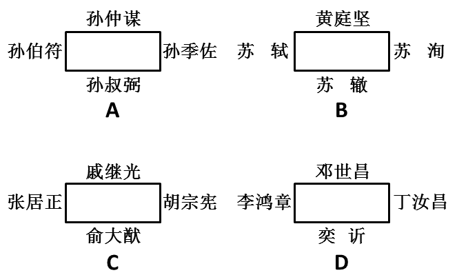

A. A

B. B

C. C

D. D

第 20 题 · 答案与解析

**参考答案（粉笔题库参考内容）**

A

**解析**

古代贵族男子的字前常加伯（孟）、仲、叔、季表示排行。

A项正确，三国时期孙坚的四个儿子中，长子孙策，字伯符；次子孙权，字仲谋；三子孙翊，字叔弼；四子孙匡，字季佐。按照长幼顺序，孙策应坐主位，孙权次之，孙翊再次之，孙匡居末座。

B项错误，苏洵、苏轼和苏辙合称“三苏”，其中苏洵为父，苏轼为兄，苏辙为弟，而黄庭坚为苏轼学生且年纪比苏辙小，故苏洵应坐主位，苏轼次之，苏辙再次之，黄庭坚末座。

C项错误，张居正位居内阁首辅，一品官位，胡宗宪官至兵部尚书兼其他职位，高于戚继光和俞大猷，且俞大猷年长于戚继光，故张居正居主位，胡宗宪次之，俞大猷再次之，戚继光末座。

D项错误，奕䜣为恭亲王，是身份最尊贵的王爷，李鸿章为直隶总督，丁汝昌为北洋水师提督，邓世昌为致远舰管带，故奕䜣为主位，李鸿章次之，丁汝昌再次之，邓世昌末座。

故正确答案为A。

**考点**：中国历史

**来源**：2015年国家公务员录用考试《行测》题（省部级）第20题

### 第 21 题

交流是复杂的艺术，有声语言并不是表达意义的唯一方式，辅以动作和面部表情，可以使表达生动形象，也折射出历史和文化智慧的光芒。各民族间的形体语言，有的形式和意义相同（如握手致意），有的虽然形式相同，意义却＿＿＿＿＿＿。如果不能正确解读就可能产生误会，甚至引起严重的后果。

填入划横线部分最恰当的一项是：

A. 南辕北辙

B. 针锋相对

C. 截然相反

D. 纷繁复杂

第 21 题 · 答案与解析

**参考答案（粉笔题库参考内容）**

C

**解析**

由“虽然形式相同，意义却”和其后“所导致的后果”可知，所填词语应表示“不同”，但语义更重。C项“截然相反”的“截然”一词形容界限分明，用在此处既能够表达不同，又恰好加深了语义，符合文意，当选。

A项“南辕北辙”比喻行动和目的正好相反，不符合文意，排除；B项“针锋相对”比喻双方在策略、论点及行动方式等方面尖锐对立，侧重强调观点与立场的不同，排除；D项“纷繁复杂”形容头绪多，情况复杂，侧重于复杂，用在此处不恰当，排除。

故正确答案为C。

**考点**：关联关系-转折关系、成语填空、词的辨析-程度轻重、词的辨析-词义侧重

**来源**：2015年国家公务员录用考试《行测》题（省部级）第21题

### 第 22 题

定义的使命是抽象、概括出某类事物的本质特征。当定义概括不了时，本应修正定义，而有人却常常“开除”那些概括不了的同类事物，以维护定义的纯洁性，这无疑是＿＿＿＿＿＿。

填入划横线部分最恰当的一项是：

A. 指鹿为马

B. 削足适履

C. 自欺欺人

D. 掩耳盗铃

第 22 题 · 答案与解析

**参考答案（粉笔题库参考内容）**

B

**解析**

根据“无疑是”可知，前文是对横线处的解释说明，横线处应体现为了维护定义的纯洁性，“开除”那些概括不了的同类事物这一错误做法，B项“削足适履”指为了将大脚塞进小鞋而把脚削小，比喻指不根据实际情况而盲目套用，符合文意，当选。

A项“指鹿为马”比喻故意颠倒黑白、混淆是非，文段并未体现颠倒黑白之意，与文意不符，排除；C项“自欺欺人”指不但欺骗自己，也欺骗他人，D项“掩耳盗铃”比喻欺骗不了别人，只能欺骗自己，均强调欺骗，文段并非强调欺骗，与文意不符，排除。

故正确答案为B。

**考点**：对应关系-解释说明、成语填空

**来源**：2015年国家公务员录用考试《行测》题（省部级）第22题

### 第 23 题

从统计学角度看，用平均数指标反映趋势虽精确敏感，但也有其致命弱点，尤其是平均数的“＿＿＿＿＿＿”，很容易掩盖个体之间的差异。

填入划横线部分最恰当的一项是：

A. 以管窥天

B. 削峰填谷

C. 大而化之

D. 等量齐观

第 23 题 · 答案与解析

**参考答案（粉笔题库参考内容）**

B

**解析**

“平均数”的求得是把总数按份均匀计算，以多补少，与此特点相符的是B项“削峰填谷”，意为削低山峰来填平山谷，取其比喻义。其他三项都不能用来定义“平均数”的特点。

A项“以管窥天”意为通过竹管子的孔看天，比喻见闻狭隘或看事片面，与文意不符，排除；C项“大而化之”多指工作作风粗糙，把本该细致具体对待的问题笼统而简单地处理，与文意不符，排除；D项“等量齐观”指对有差别的事物同等看待，与文意不符，排除。

故正确答案为B。

【文段出处】东方网2012年8月6日—方翔《关注“全国家庭平均住房面积超百平米”的背后》

**考点**：对应关系-前后呼应、成语填空

**来源**：2015年国家公务员录用考试《行测》题（省部级）第23题

### 第 24 题

对于家长们来说，能够和孩子一起参与其中，亲身＿＿＿＿到孩子的进步，是一次难得的亲子活动经历。同时，他们也可以在训练营中受到＿＿＿＿，得到一些教育的灵感。

依次填入划横线部分最恰当的一项是：

A. 感触 启示

B. 感悟 启蒙

C. 感受 启发

D. 感觉 启迪

第 24 题 · 答案与解析

**参考答案（粉笔题库参考内容）**

C

**解析**

第一空，搭配“亲身”与“孩子的进步”，C项“感受”指体会，感想，搭配恰当，保留。A项“感触”指因接触外界事物而引发的思想情绪，一般作为名词使用，横线处需要填入动词，排除；B项“感悟”指人们对特定事物或经历所产生的感想与体会，多搭配一些道理，与“孩子的进步”搭配不当，排除；D项“感觉”感到，觉得，一般不与“亲身”搭配，排除。

第二空，代入验证。搭配“受到”，C项“启发”指阐明事例，引起对方联想而有所领悟，“受到启发”为常见搭配，当选。

故正确答案为C。

**考点**：实词填空、词的辨析-搭配对象、词的辨析-词义侧重

**来源**：2015年国家公务员录用考试《行测》题（省部级）第24题

### 第 25 题

缺乏必要的试错机制，很多政府部门和领导干部对改革创新都心存＿＿＿＿情绪，“不求有功，但求无过”，导致改革创新动力普遍不足。以此来看，＿＿＿＿“改革失败”的责任，创造一个宽容的创新环境，才能让更多的政府部门和官员“甩开膀子”谋改革、搞创新。

依次填入划横线部分最恰当的一项是：

A. 畏难 豁免

B. 紧张 宽恕

C. 侥幸 淡化

D. 抵触 忽略

第 25 题 · 答案与解析

**参考答案（粉笔题库参考内容）**

A

**解析**

第一空，与后文“‘甩开膀子’谋改革、搞创新”形成反义对应，即很多政府部门和领导干部由于缺乏必要的试错机制而不敢改革创新。A项“畏难”中的“畏”字恰好体现出“不敢”之意，B项“紧张”、D项“抵触”填入也勉强合适，均保留。C项“侥幸”形容意外或偶然地获得利益或免去不幸，与“情绪”搭配不当，排除。

第二空，与“责任”搭配，A项“豁免”符合文意，当选。B项“宽恕”与“责任”搭配不当，排除；D项“忽略”指的是忽视、疏忽、不在意，而文段强调的是可以免除“改革失败”的责任，无需承担这个责任，并不是忽视、不在意的意思，与文意不符，排除。

故正确答案为A。

【文段出处】人民网2013年4月12日《人民网评：“宽容改革失败”有助于提升决策理性》

**考点**：实词填空、对应关系-前后呼应、词的辨析-搭配对象

**来源**：2015年国家公务员录用考试《行测》题（省部级）第25题

### 第 26 题

过去，城市规模基本上是由政策决定的。如果把城市当作一个＿＿＿＿的系统，它的吞吐、消耗以及内部运转，所有的生态流是完全能够定量计算的。我们的城市设计，必须跟周围的生态环境形成良好的共生关系，与其生态承载力相＿＿＿＿，根据周围生态承载力确立城市规模，才是科学态度。

依次填入划横线部分最恰当的一项是：

A. 循环 支持

B. 封闭 匹配

C. 机械 符合

D. 动态 平衡

第 26 题 · 答案与解析

**参考答案（粉笔题库参考内容）**

B

**解析**

首先根据第二空“与······相······”可排除包含“支持”的A项；

接下来看第一空，“动态”表明事物是变化发展的，与“完全能够定量计算”不符，排除D项；B项“封闭”与C项“机械”相比，根据其后的“内部运转”可知是在某一范围之内，前者更符合文意，“匹配”填入横线处契合句意。

故正确答案为B。

【文段出处】《文汇报》2012年6月1日《ECO2：“顺天礼人”的城市演进方向》

**考点**：实词填空、对应关系-前后呼应

**来源**：2015年国家公务员录用考试《行测》题（省部级）第26题

### 第 27 题

广义相对论发表以来，一直是最成功的引力理论，已经＿＿＿＿了无数次的天文观测和各种实验的检验。但是几乎所有这些都是在弱引力场下，检验爱因斯坦引力和牛顿引力的微小差别。如果想使爱因斯坦引力的效应比较明显，则需要在强引力场中才能发生，而这方面的检验还是非常＿＿＿＿的。

依次填入划横线部分最恰当的一项是：

A. 经历 罕见

B. 经过 需要

C. 通过 迫切

D. 经受 缺乏

第 27 题 · 答案与解析

**参考答案（粉笔题库参考内容）**

D

**解析**

第一空，由与“最成功的引力理论”对应可知，相对论是经得住各种检验的，A项“经历”与B项“经过”无从体现这一语义，故排除。

第二空，由与“几乎所有这些都是······”对应可知，在强引力场中的检验是非常少见的，并无“迫切”之意，故排除C项。

故正确答案为D。

【文段出处】《北京日报》2014年3月26日《宇宙婴儿“第一声啼哭”》

**考点**：实词填空、对应关系-前后呼应、词的辨析-搭配对象

**来源**：2015年国家公务员录用考试《行测》题（省部级）第27题

### 第 28 题

网络主权概念的提出，意味着国家行使主权去维护网络安全，但网络空间的特殊性决定了政府作用有限。政府决策者应关注如何在维护网络主权的同时＿＿＿＿互联网行业的健康发展，并且在维护网络主权与行业发展之间寻求恰当的＿＿＿＿。

依次填入划横线部分最恰当的一项是：

A. 保证 平衡

B. 保护 转换

C. 保障 立场

D. 保持 时机

第 28 题 · 答案与解析

**参考答案（粉笔题库参考内容）**

A

**解析**

本题从第二空入手，由“应关注如何在维护······的健康发展”可知，维护网络主权和行业健康发展之间存在矛盾，决策者应二者兼顾，即寻找恰当的“平衡”。

故正确答案为A。

【文段出处】《人民日报》2014年6月23日《网络主权：一个不容回避的议题（权威论坛）》

**考点**：实词填空、对应关系-前后呼应、词的辨析-词义侧重

**来源**：2015年国家公务员录用考试《行测》题（省部级）第28题

### 第 29 题

作为全国最高的货币管理机构，央行独具优势，颇有“惯看秋月春风”的＿＿＿＿。由此而一展“任凭风浪起，稳坐钓鱼台”的“定力”是毫无疑问的。不过，一旦说到“精准发力”，央行究竟是为了稳定预期，还是真的自信能“精确打击”，倒是值得＿＿＿＿一番的。

依次填入划横线部分最恰当的一项是：

A. 气度 琢磨

B. 气概 捉摸

C. 气质 期待

D. 气派 商榷

第 29 题 · 答案与解析

**参考答案（粉笔题库参考内容）**

A

**解析**

先看第二空，由“究竟······还是真的······倒是······”表达出来的不确定的语气可知，填入词语应表示不确定的含义。C项“期待”不符合文意，排除；B项“捉摸”有猜测、预料、揣测的意思，多用于否定，不符合文意，排除。

再看第一空，A项“气度”指人的气魄和风度，D项“气派”指人的魄力气度或某些事物所表露的气势。“惯看秋月春风”表现出一种气定神闲的风度，并非气势或者气魄，故用“气度”恰当，故排除D项。

故正确答案为A。

【文段出处】《证券时报》2013年11月7日—肖国元《央行“精准发力”说值得琢磨》

**考点**：实词填空、对应关系-前后呼应、词的辨析-词义侧重

**来源**：2015年国家公务员录用考试《行测》题（省部级）第29题

### 第 30 题

我国高校每年有数万项科研成果通过验收，其中有30%以上的成果被鉴定为“国际首创”“国际领先”或者“填补了国内空白”。＿＿＿＿的是，这些成果中只有极少一部分转化为实际生产力，大部分成果只能“沉睡”在实验室和书斋中，高校科技研究成果推广＿＿＿＿＿＿。

依次填入划横线部分最恰当的一项是：

A. 可悲 难以为继

B. 遗憾 步履维艰

C. 可惜 寸步难行

D. 无奈 一筹莫展

第 30 题 · 答案与解析

**参考答案（粉笔题库参考内容）**

B

**解析**

第一空，根据前后文意可知，我国高校科研成果通过验收率高，转化为实际生产力的比例却非常小，这种情况着实让人感到“遗憾、可惜”。A项“可悲”语义过重，D项“无奈”意为无可奈何、没有办法，文中并无此意，均排除。

第二空考查词义轻重。C项“寸步难行”的程度较之“步履维艰”更重，与文中“有极少一部分转化为实际生产力”的对应不符，排除。

故正确答案为B。

【文段出处】《人民政协教育在线周刊》2011年4月7日—解艳华《让高校科研成果走出“深闺”转化为现实生产力》

**考点**：对应关系-解释说明、混搭填空、词的辨析-程度轻重

**来源**：2015年国家公务员录用考试《行测》题（省部级）第30题

### 第 31 题

我们随时都处在各种健康“小贴士”狂轰乱炸的包围中。但其实，并非所有的健康建议都有扎实的科学根据来＿＿＿＿。《新科学家》网站近日为我们破除了我们耳熟能详且奉为＿＿＿＿的6大健康“迷信”。

依次填入划横线部分最恰当的一项是：

A. 检验 信条

B. 验证 准则

C. 支持 圣旨

D. 支撑 圭臬

第 31 题 · 答案与解析

**参考答案（粉笔题库参考内容）**

D

**解析**

第一空，由前面的“扎实的科学根据”可知，此处填“支撑”“支持”更为恰当，“健康建议”是否靠谱应由事实来“检验、验证”，故排除A、B两项。

第二空，D项“圭臬”比喻标准、准则和法度，可以据此作出决定或判断的根据。结合题干可知，“圭臬”比C项“圣旨”表意更准确，更契合文段的语境，且“奉为圭臬”为常见固定搭配，排除C项。

故正确答案为D。

【来源】《科技日报》2013年10月15日《一天要喝8杯水？应忽略的6大健康迷信》

**考点**：实词填空、对应关系-前后呼应、词的辨析-搭配对象

**来源**：2015年国家公务员录用考试《行测》题（省部级）第31题

### 第 32 题

装在司机座位上的这个系统可以在司机疲劳驾驶的时候，发出＿＿＿＿或者自动刹车。此外，这个系统不但可以提醒车辆被盗，还可以通过＿＿＿＿到的数据识别出盗贼的身份。

依次填入划横线部分最恰当的一项是：

A. 警戒 采集

B. 警报 汇集

C. 警示 收集

D. 警告 搜集

第 32 题 · 答案与解析

**参考答案（粉笔题库参考内容）**

C

**解析**

第一空，横线处搭配“发出”，“警戒”指使人注意改正错误或军队为防止敌人突然袭击和制止敌人侦察而采取的保障措施，与“发出”搭配不当，排除A项。

第二空，横线处表达系统的作用，C项“收集”侧重指分散的东西收在一起，“收集数据”为常用搭配且符合文意，当选。B项“汇集”意为聚集，多形容空间上的聚集，形容数据时应体现出数据的多且广，而文段并非指出数据的多且广，故排除；D项“搜集”侧重指将难以找到的东西收在一起，与文意不符，排除。

故正确答案为C。

【来源】《钱经》2013年1月14日《一切皆可“量化”》

**考点**：实词填空、词的辨析-搭配对象、词的辨析-词义侧重

**来源**：2015年国家公务员录用考试《行测》题（省部级）第32题

### 第 33 题

发展经济并没有错，有效利用文化资源带动当地社会发展也是很好的尝试。但倘若不论真伪，抑或不顾文化自身的形态，＿＿＿＿、强行落地，旅游未必能够发展起来，反而可能＿＿＿＿。它所反映出来的，恰恰是对文化缺乏认识，对建设缺乏创新的“啃古”心态。

依次填入划横线部分最恰当的一项是：

A. 牵强附会 劳民伤财

B. 曲意逢迎 适得其反

C. 偷梁换柱 进退维谷

D. 附庸风雅 无所适从

第 33 题 · 答案与解析

**参考答案（粉笔题库参考内容）**

A

**解析**

第一空，横线处主要说明以文化资源带动地区经济发展的做法。B 项“曲意逢迎”意为违心地迎合别人；D 项“附庸风雅”指缺乏文化素养的人为抬高身价而结交文化名流，参加文化活动。这两项多指个人行为、表面功夫，与经济发展活动不符，排除。

第二空，旅游未必发展起来，反而可能造成不良影响。A 项“劳民伤财”指既使人民劳苦，又耗费钱财，恰恰是这种不良影响的具体表现，且与以文化资源强行发展旅游一事对应准确，当选。C 项“进退维谷”指处境艰难，进退两难，与文意不符，排除。

故正确答案为 A。

【来源】中国日报网2012年6月13日《评“娲皇遗骨”的发现：别拿文化当幌子》

【友情提示】

本题重点考查成语的搭配，这提示考生在积累成语的过程中，不仅要着重把握成语的含义，还要把握成语的搭配对象，最常见的搭配对象可以分为人和物，此外还有抽象和具体、固定搭配等等。

【拓展】

牵强附会：把本来没有某种意义的事物硬说成有某种意义。也指把不相关联的事物牵拉在一起，混为一谈。

偷梁换柱：比喻暗中玩弄手法，以假代真，以劣代优。

适得其反：恰恰得到与预期相反的结果。

**考点**：关联关系-并列关系、对应关系-前后呼应、成语填空

**来源**：2015年国家公务员录用考试《行测》题（省部级）第33题

### 第 34 题

现代人对微信＿＿＿＿不已，乃至几乎不能有一朝一夕的分离，与其说是微信的功能强大，不如将之理解成空虚寂寞冷的人们，需要某种精神层面的＿＿＿＿。

依次填入划横线部分最恰当的一项是：

A. 崇拜 皈依

B. 痴狂 抚慰

C. 眷恋 寄托

D. 痴迷 慰藉

第 34 题 · 答案与解析

**参考答案（粉笔题库参考内容）**

D

**解析**

第一空，A项“崇拜”意为尊崇敬拜，一般用于对英雄或伟人；C项“眷恋”意为怀念，留恋。此二者语义都无法与后文“几乎不能有一朝一夕的分离”之意形成对应，故排除。D项“痴迷”意为极度迷恋，B项“痴狂”意为迷恋到发狂的程度，均可体现出人们对微信的严重依赖。但“痴狂”语义过重，显然人们没有到发狂的程度。故基本锁定答案为D项。

以第二空验证，“空虚寂寞的人们”最需要的是精神层面的“慰藉”，语义恰当且为常见搭配。

故正确答案为D。

**考点**：实词填空、对应关系-前后呼应、词的辨析-搭配对象、词的辨析-程度轻重

**来源**：2015年国家公务员录用考试《行测》题（省部级）第34题

### 第 35 题

天气预报看似很＿＿＿＿，只有寥寥几句话，但实际上，要做出＿＿＿＿的天气预报，工程量非常大。而且，气象是一个大环境，大气运动本身又＿＿＿＿，这是天气预报有时不准确的根本原因所在。

依次填入划横线部分最恰当的一项是：

A. 轻松 准确 无迹可寻

B. 平常 精密 变幻莫测

C. 普通 精确 难以捉摸

D. 简单 精准 错综复杂

第 35 题 · 答案与解析

**参考答案（粉笔题库参考内容）**

D

**解析**

第一空，根据转折关联词“但”可知，前后语义相反，故空格处应填入与“工程量非常大”的语义相反的词语，B项“平常”与C项“普通”，无法构成语义相反，排除。

第二空，横线处形容天气预报，D项“精准”语义较之A项“准确”语义更为丰富且程度更重，锁定D项。

第三空，如果大气运动“无迹可寻”，人们根本就无法预报天气，排除A项。正是由于大气运动“错综复杂”，所以不容易做出“精准”的天气预报，D项符合句意。

故正确答案为D。

**考点**：关联关系-转折关系、对应关系-前后呼应、混搭填空、词的辨析-程度轻重

**来源**：2015年国家公务员录用考试《行测》题（省部级）第35题

### 第 36 题

尽管环境保护任务艰巨，但迫在眉睫，不容＿＿＿＿。经济发展与环境保护不是对立的关系：一方面，经济发展一定要以环境的＿＿＿＿能力为基础；另一方面，环境保护＿＿＿＿的是粗放型的经济发展模式，不会阻碍经济的健康发展。

依次填入划横线部分最恰当的一项是：

A. 推脱 承受 抑制

B. 推脱 承载 制约

C. 推托 承受 抑制

D. 推托 承载 制约

第 36 题 · 答案与解析

**参考答案（粉笔题库参考内容）**

B

**解析**

第一空，“推脱”的意思是推卸责任等，使与己无关。“推托”的意思是借故拒绝，即不直接加以拒绝，而是婉言拒绝。环境保护是人们应该承担的责任，故选“推脱”合适，排除C、D两项。

第二空，“环境的承载能力”是固定用法，排除A项。

第三空，“制约”填入空中符合句意，B项当选。

故正确答案为B。

【文段来源】中国环境报2012年6月5日《以环境保护优化经济发展——写在“6.5”世界环境日》

**考点**：实词填空、词的辨析-搭配对象、词的辨析-词义侧重

**来源**：2015年国家公务员录用考试《行测》题（省部级）第36题

### 第 37 题

很多时候，我们的问题在于不能正确地＿＿＿＿个人和社会的界限。事实上，如果＿＿＿＿了个人，就不可能加强集体；如果＿＿＿＿了个人，集体也不可能获得自由。

依次填入划横线部分最恰当的一项是：

A. 区别 削减 约束

B. 分清 减弱 限制

C. 划清 削弱 束缚

D. 区分 降低 压制

第 37 题 · 答案与解析

**参考答案（粉笔题库参考内容）**

C

**解析**

第一空，C项“划清界限”为固定搭配，其余三项基本不与“界限”搭配，应直接搭配需要“区别、区分、分清”的对象即可，如区分个人和社会、分清个人与社会，答案基本锁定C项。

代入验证后面两空。

第二空以“不可能”为标志形成反义对应，空格处所填动词应与“加强”语义相反，“削弱”最为合适。

第三空与第二空同理，“不可能获得自由”即“束缚”个人。

故正确答案为C。

**考点**：实词填空、对应关系-前后呼应、词的辨析-搭配对象

**来源**：2015年国家公务员录用考试《行测》题（省部级）第37题

### 第 38 题

相对于其他作品，史书有太多芜杂的琐碎记载，把主线＿＿＿＿得有些模糊不清。然而细节有细节的＿＿＿＿之处，因为虽然撰写史书的史官难免受到某些思维导向的影响，有意无意地隐此扬彼，但所谓“细节之中有魔鬼”，某个历史人物的性格总会在一些细节之中＿＿＿＿。

依次填入划横线部分最恰当的一项是：

A. 遮蔽 精妙 若隐若现

B. 隐藏 奇巧 跃然纸上

C. 衬托 精彩 昭然若揭

D. 叙述 可爱 露出马脚

第 38 题 · 答案与解析

**参考答案（粉笔题库参考内容）**

A

**解析**

本题从第三空入手，文段是客观地叙述史书细节中显现出历史人物的性格，不存在褒贬色彩，“昭然若揭”“露出马脚”都含贬义，不合语境，排除C、D两项；“若隐若现”意为隐隐约约，看不清楚；“跃然纸上”形容描写或刻画得十分生动逼真。对应文段“有意无意地隐此扬彼”，历史人物的形象不可能完全真实地表现出来，排除B项。第一、二空，分别填入“遮蔽”“精妙”也符合文意。

故正确答案为A。

【来源】李俊慧《我最喜欢的四本书》

**考点**：对应关系-前后呼应、混搭填空、词的辨析-感情色彩

**来源**：2015年国家公务员录用考试《行测》题（省部级）第38题

### 第 39 题

在嘈杂环境下，大脑会自动＿＿＿＿不熟悉的人的声音，只＿＿＿＿身边熟人所发出的声音。在这种情况下，那些不熟悉的话语声只好面对＿＿＿＿的命运。

依次填入划横线部分最恰当的一项是：

A. 筛选 保留 置若罔闻

B. 过滤 接收 充耳不闻

C. 淘汰 选择 灰飞烟灭

D. 排除 存储 烟消云散

第 39 题 · 答案与解析

**参考答案（粉笔题库参考内容）**

B

**解析**

本题可从第三空入手，根据文意可知，横线处表达“那些不熟悉的话语声”不会被听到之意，A项“置若罔闻”、B项“充耳不闻”均符合文意，且A、B两项中的“闻”字均与文段中“声音”这一主题词对应更为恰当。C项“灰飞烟灭”、D项“烟消云散”均强调消失，而文段中“不熟悉的话语声”是一直存在的，并没有消失，排除C、D两项。

第一空、第二空，根据文意可知，横线处表达对待不同声音的两种相反的态度，B项“过滤”与“接收”可构成语义相反，符合文意。A项“筛选”侧重选出来，与“保留”均表达留下之意，无法构成语义相反，排除。

故正确答案为B。

【来源】中国论文网《好消息，坏消息》

**考点**：对应关系-主题词、对应关系-前后呼应、混搭填空、词的辨析-词义侧重

**来源**：2015年国家公务员录用考试《行测》题（省部级）第39题

### 第 40 题

宇宙中最冷的地方是“回力棒星云”，那里的温度仅比绝对零度高1度。在绝对零度条件下，所有的原子都会＿＿＿＿。＿＿＿＿到“回力棒星云”芳容的“阿尔玛”(望远镜)设在阿塔卡马沙漠中海拔5000米的高原上，那里几乎没有湿气或植被，能对天空＿＿＿＿。

依次填入划横线部分最恰当的一项是：

A. 凝结 眺望 一目了然

B. 固结 目睹 一览而尽

C. 冻结 捕捉 一览无余

D. 凝固 观测 一目千里

第 40 题 · 答案与解析

**参考答案（粉笔题库参考内容）**

C

**解析**

本题可从第二空入手，“阿尔玛”望远镜这一仪器与“眺望”“目睹”这两个常与人搭配使用的动词无法搭配，且C项“捕捉”、D项“观测”常用于天文学的说明文中，故可排除A、B两项。

再看第三空，D项“一目千里”形容看得见、看得远，侧重表达看的能力强；C项“一览无余”形容视野广阔，没有阻碍，把事物或景象都看在眼里，没有遗漏。与文中“那里几乎没有湿气或植被”的语义对应，“一览无余”更为恰当。

再以第一空检验，“冻结”中的“冻”与文段中“最冷的地方”“绝对零度”的词对应更为合适，排除D项。

故正确答案为C。

【来源】中网资讯2014年6月16日《天文学家发现宇宙中最冷的地方：零下272度》

**考点**：对应关系-前后呼应、混搭填空、词的辨析-搭配对象

**来源**：2015年国家公务员录用考试《行测》题（省部级）第40题

### 第 41 题

如果能够做好南极生态环境的承受力评估，并严格执行有关规定，南极旅游造成的生态影响就可以得到有效控制。因为与南极大陆极为广袤的地域相比，游客活动的地域仅为总面积的3%左右。而如何管理好长期设在南极的科考站，才是更为棘手的问题，尤其是一些被废弃的科考站，已对南极生态环境造成了新的威胁。

这段文字意在强调：

A. 南极生态环境评估的意义

B. 南极生态旅游的发展前景

C. 南极生态环境管理机制的必要性

D. 南极科考站对当地生态环境的影响

第 41 题 · 答案与解析

**参考答案（粉笔题库参考内容）**

D

**解析**

文段首先提出如果能够做好南极生态评估，旅游造成的生态影响就可以得到控制，随后详细解释了原因，接下来通过“而”强调科考站才是更难处理的问题，并且指出已经造成新威胁。所以文段重在强调科考站对于南极的不良影响，对应D项。

A项：“南极生态环境评估”是首句中的内容，是围绕旅游造成的生态影响这一话题的论述，非重点，排除；

B项：“南极生态旅游”偏离文段中心，文段重在强调科考站，排除；

C项：“南极生态环境管理机制”概念扩大，文段的表述为管理科考站，排除。

故正确答案为D。

【文段出处】《南极旅游的爱与怕》

**来源**：2015年国家公务员录用考试《行测》题（省部级）第41题

### 第 42 题

随着我国对外开放深化和世界经济全球化加速，国际经济环境因素对我国宏观经济运行稳定性的影响越来越大，需要我们密切关注，谨慎对待。目前国际市场石油价格、粮食和食用油价格上涨对我国国内市场价格的影响越来越大，成为造成国内市场相关商品价格上涨的不可忽视的因素。这种输入型成本推动造成的价格上涨的影响，将随着我国对国外石油等重要资源性商品依赖程度的上升，而变得越来越大，可能成为推动价格上涨的长期因素，对此我们必须更加重视。

这段文字意在说明：

A. 我国输入型成本将随全球化程度的加深不断增高

B. 我国对外依赖型经济模式是价格上涨的原因之一

C. 国际市场价格对我国国内市场价格的影响很大

D. 要重视国际经济因素对我国经济稳定性的影响

第 42 题 · 答案与解析

**参考答案（粉笔题库参考内容）**

D

**解析**

文段开篇指出随着对外开放深化和经济全球化加速，国际经济环境因素对我国宏观经济运行稳定性的影响越来越大，需要密切关注。随后以国际市场石油、粮食和食用油价格上涨对国内市场价格的影响为例，具体说明了输入型成本推动造成的价格上涨问题，并强调这种影响可能成为长期因素，最后通过“对此我们必须更加重视”进行总结。故文段强调要重视国际经济因素对我国经济稳定性的影响，对应D项。

A项，文段强调的是国际经济环境因素对我国宏观经济运行稳定性的影响以及输入型成本推动价格上涨的情况，“输入型成本将随全球化程度的加深不断增高”并非文段重点，且未提及文段强调的要重视这一影响，该项无中生有，排除；

B项，“我国对外依赖型经济模式”并非文段核心话题，文段重点是国际经济因素对我国经济稳定性的影响，未提及文段主题词“国际经济因素对我国经济稳定性的影响”，排除；

C项，“国际市场价格对我国国内市场价格的影响”是文段阐述国际经济环境因素影响我国经济的一个方面，属于解释说明部分，非重点，排除。

故正确答案为D。

**考点**：关联词-对策、分述句特征-举例子

**来源**：2015年国家公务员录用考试《行测》题（省部级）第42题

### 第 43 题

汉语西文字母词被汉语词典收录的历史已有100多年，收录字母词早已是汉语词典和工具书编纂的惯例和通行的做法。1903年出版的《新尔雅》在正文中收录了“X光线”一词，这是汉语词典首次收入字母词。在辞书史上，这部词典是近代中国最早的一部新语词词典，它虽然还不是纯粹现代意义上的汉语词典，但具有承前启后的重要意义。

这段文字介绍《新尔雅》的目的是：

A. 总结西文字母词在汉语词典中的收录规律

B. 说明汉语词典收录西文字母词早有先例

C. 论述其对于近代以来辞书编纂的影响

D. 探讨汉语词典收词规律的历史演变

第 43 题 · 答案与解析

**参考答案（粉笔题库参考内容）**

B

**解析**

文段首先指出汉语词典收录字母词的历史已有100多年，然后以《新尔雅》中对“X光线”一词的收录为例，说明这是汉语词典第一次收录字母词。由此可知，文段介绍《新尔雅》的目的是说明汉语词典收录字母词早有先例。B项忠于原文，为正确答案。

A项，文段强调的是汉语西文字母词被汉语词典收录的历史，而不是总结收录规律，排除；

C项，该项表述未体现汉语词典收录字母词的内容，排除；

D项，单单介绍《新尔雅》并不能探讨汉语词典收词规律的历史演变，排除。

故正确答案为B。

**考点**：关联词-对策、特殊问法

**来源**：2015年国家公务员录用考试《行测》题（省部级）第43题

### 第 44 题

在美国的电影院线，无论是重磅大片，还是低成本制作，票价都是相同的。这看上去并不符合“需求大小决定价格高低”的经济学理论。有研究人员指出，任何一家影院同期上映的所有电影票价均相同，这一现象形成于上世纪70年代。不仅电影业如此，体育赛事和演出也都遵循这一规律。虽然在某些时候和某些地区，机动定价能够使电影公司和影院获得更高的收益，但对于影院来说，保持不同电影的票价相同仍然利大于弊。

这段文字接下来最有可能讲述的是：

A. 不同电影票价相同对影院更有利的原因

B. 美国电影行业确定票价的主要参考因素

C. 电影制作成本和观众需求与影片定价的关系

D. 体育赛事和演出等其他行业票价的形成规律

第 44 题 · 答案与解析

**参考答案（粉笔题库参考内容）**

A

**解析**

本题为接语选择题，应通读全文，重点关注文段最后谈论的核心话题。文段开篇指出美国电影院线的所有电影票价都相同，接着介绍该现象的形成时间，指出体育赛事和演出票价也相同，尾句通过转折关联词“但”强调保持不同电影的票价相同对于影院仍然利大于弊，故后文应围绕“不同电影票价相同”这一话题展开论述，具体阐述其对院线有利的原因，对应A项。

B项“确定票价的主要参考因素”、C项“电影制作成本和观众需求与影片定价的关系”、D项“其他行业票价的形成规律”，均与文段最后谈论的话题“不同电影票价相同”不符，排除。

故正确答案为A。

**考点**：接语选择题

**来源**：2015年国家公务员录用考试《行测》题（省部级）第44题

### 第 45 题

中国历代统治者对户口的管理都极为重视，他们将户口多寡作为国力盛衰与社会治乱的标志，建立了从中央至州、县、乡的完备户籍管理体系，但究其原因，是将户籍作为调派劳役、征收赋税的主要依据，以此维护建立在小农经济基础上的特权。这是一种源远流长的文化烙印，纵使历史的车轮滚滚向前，但那道印痕仍难以抹去。

这段文字主要介绍了：

A. 户籍管理体系的文化背景

B. 户籍制度存在的历史根源

C. 中国古代户籍管理体系的构建方式

D. 户籍制度对维护政治统治的深远影响

第 45 题 · 答案与解析

**参考答案（粉笔题库参考内容）**

A

**解析**

文段开篇指出中国历代统治者重视户口的管理，接下来详细解释了原因，尾句通过“这”对前文进行指代，引出结论，即“这是一种文化烙印”，并且通过转折词“但”再次强调“那道印痕难以抹去”，即文化的印痕难以抹去，故文段意在强调文化与户籍管理之间紧密的联系，对应A项。

B项，“历史根源”概念扩大，文段重在强调文化对于户籍管理的影响，并且“户籍制度”与文段中“户籍管理”概念不符，排除；

C项，对应文段“这”之前的内容，非重点，排除；

D项，没有出现主题词“文化”，文段重在强调文化对于户籍管理的影响，且“维护政治统治”为“这”之前的内容，不是重点，排除。

故正确答案为A。

【来源】中国论文网2014年6月29日《户籍“变法”，蓄势待发》

**考点**：关联词-因果、关联词-转折

**来源**：2015年国家公务员录用考试《行测》题（省部级）第45题

### 第 46 题

“微创新”，这个概念正在成为中国企业尝试的新方向。今天的技术革新在很多时候已经不再是颠覆性的更新换代，任何针对用户体验的微小改变，都可能引爆整个市场。微博就可以看作是在博客基础上的微创新，用140个字拉低了用户门槛，迅速引发了全民微博潮。对于习惯了模仿的企业来说，如何不让微创新成为“山寨”的代名词，是问题的关键，特别是在互联网领域，像团购这样的一窝蜂现象屡见不鲜，然而其中很难看到“微创新”在发挥作用。

这段文字用“团购”来说明：

A. 盲目从众的现象

B. 更新换代的趋势

C. 复制与模仿的做法

D. 集体相约采购的行为

第 46 题 · 答案与解析

**参考答案（粉笔题库参考内容）**

A

**解析**

根据文段“全民微博潮”“习惯了模仿的企业”可知，团购形容的是文段所说的模仿、不创新的现象，且根据“山寨”“很难看到‘微创新’在发挥作用”可知，作者对此持否定态度，感情色彩偏消极，B项“更新换代”偏积极，D项“集体相约采购”属于团购本身的含义，排除。

A、C两项属于大家比较纠结的选项，对比选项可知，A、C两项都可以表达文段所说的模仿不创新的意思，从众就是跟从大众，也就是模仿复制不创新，所以从意思上二者均符合，但是考虑到文段消极的感情色彩，A项盲目可以体现，但C项就是中性的表达，所以综合来看，A项更好一些，更加匹配文段。

故正确答案为A。

提示：本题是一道争议题，小粉笔从文段内容和感情色彩的角度认为A项要更加好一些，所以选择A项。此外，根据文段“像团购这样的一窝蜂现象”也可以给我们提示，团购就是用来形容一窝蜂现象的，也就是很多人同时说话或者行动的意思，而A项“从众”中的“众”就是“很多人”的意思，所以从这个角度也倾向于选择A项。

**考点**：实词

**来源**：2015年国家公务员录用考试《行测》题（省部级）第46题

### 第 47 题

当夜深人静，即将准备进入梦乡时，我们的身体常常会突然抽搐一下，这种抽搐通常被科学家们称作临睡肌跃症（又称入睡抽动）。目前没有研究彻底弄清它的原因，因而人们对此有诸多猜测。有一种解释认为，人脑是基于爬行动物的大脑进化而来的，因此仍然保留了一部分爬行动物的应激反应模式。肌肉彻底放松时，大脑会基于这一应激反应模式，以为我们在自由坠落，出于自我保护的需要，大脑指挥全身肌肉马上行动，试图在下坠过程中抓住什么东西，于是本已放松的肌肉会突然收紧，导致入睡抽动。

这段文字：

A. 介绍临睡肌跃症的临床表现

B. 提供一种对临睡肌跃症的解释

C. 说明临睡肌跃症与大脑的关系

D. 阐述临睡肌跃症对人类的意义

第 47 题 · 答案与解析

**参考答案（粉笔题库参考内容）**

B

**解析**

文段首先引出“临睡肌跃症”这一现象，并指出目前对其原因没有彻底研究清楚，随后提出了一种基于爬行动物应激反应模式的解释，详细说明了该解释下临睡肌跃症产生的过程。故文段重点是提供一种对临睡肌跃症的解释，对应B项。

A项，文中开头只是简单提及“突然抽搐一下”，引出话题，并未详细描述临床表现，非重点，排除；

C项，“临睡肌跃症与大脑的关系”是解释说明部分的内容，非重点，排除；

D项，文段未提及“临睡肌跃症对人类的意义”，无中生有，排除。

故正确答案为B。

**考点**：关联词-因果

**来源**：2015年国家公务员录用考试《行测》题（省部级）第47题

### 第 48 题

上世纪70年代，湖南长沙马王堆汉墓出土了12万字以上的帛书，其中有一部失传已久的《相马经》，是我国动物学、畜牧学的重要文献。春秋战国时期，由于已从车战演变到骑兵作战，马的身价愈来愈高。传说中的相马专家是伯乐，事实上，这类专家数量众多，《吕氏春秋》就提到十个相马家，《史记》也提到“以相马立名天下”的人士，这些都可以证明古人对相马的重视。

下列说法与原文相符的是：

A. 相马技术的发展使得车战逐渐被淘汰

B. 《相马经》是伯乐所撰写的相马学专著

C. 相马术的出现推动了古代动物学的发展

D. 相马师这一职业早在汉代以前就已经出现

第 48 题 · 答案与解析

**参考答案（粉笔题库参考内容）**

D

**解析**

D项，根据“《吕氏春秋》就提到十个相马家”可知，相马师这一职业在汉代以前已出现，当选；

A项，无中生有，原文说的是“由于已从车战演变到骑兵作战，马的身价愈来愈高”，并未提及相马技术的发展使得车战逐渐被淘汰，排除；

B项，无中生有，原文未提及《相马经》的作者，排除；

C项，原文只提到《相马经》是我国动物学和畜牧学的重要文献，无法推出相马术的出现推动了古代动物学的发展，排除。

故正确答案为D。

**考点**：细节判断题

**来源**：2015年国家公务员录用考试《行测》题（省部级）第48题

### 第 49 题

1996年，意大利帕尔马的脑科学研究人员发现，在猴子大脑里存在一种特殊的细胞，叫镜像神经元。让猴子看到或听到一个动作，当它自己做这一动作时，这些细胞会兴奋。后来的研究证明，人脑中也存在这种镜像神经元，能够感受对象的害怕和愤怒、难过和恶心；复杂的感受如害羞、孤独和不受欢迎，也都能够通过镜像神经元明显地感受到。当我们看到别人的表情或者经历过的情感状态，镜像神经元就会被激活，让我们体验到他人的感受，走进别人的情感世界。

最适合做这段文字标题的是：

A. “同情”的魔力

B. 何谓神经元

C. 脑科学的新发现

D. “爱”的潜在根源

第 49 题 · 答案与解析

**参考答案（粉笔题库参考内容）**

A

**解析**

文段首先通过意大利脑科学研究人员的发现引出“镜像神经元”这一话题，并指出其作用；紧接着指出人脑中也有这种“镜像神经元”，它能让我们感受到对象的害怕和愤怒、难过和恶心，复杂的感受如害羞、孤独和不受欢迎等，让我们体验到他人的感受，走进别人的情感世界。故文段重点在于“镜像神经元”的作用，即对于别人的感受，我们能够感同身受，A项“同情”符合文意，当选。

B项“何谓神经元”、C项“脑科学的新发现”既不能概括文段内容又缺乏针对性和特点，排除；

D项，文段没有体现与“爱”有关的信息，属于无中生有，排除。

故正确答案为A。

**考点**：标题填入题

**来源**：2015年国家公务员录用考试《行测》题（省部级）第49题

### 第 50 题

铁是所有有机体必需的基本营养物质，海洋浮游植物必须要从海水中汲取铁质。海水中生成的铁通常很少，因此对于广大的海洋地区来说，铁的有限性限制了浮游植物的生长。海水中的铁主要来自河流中的悬浮质，然而这些含铁悬浮质大多都在近海地区沉积下来，因此风尘的输送成为远离大陆的海洋中铁的主要补给形式，尤其是对铁量较少的地区（如高纬度海域）来说，这种补给对于浮游植物的生长具有很大的促进作用。

下列说法与原文相符的是：

A. 深海浮游植物的主要功能是分解含铁悬浮质

B. 低纬度地区海洋中的铁主要来源于风尘输送

C. 风尘输送的含铁物质对海洋浮游植物很重要

D. 深海地区的铁主要以河流悬浮质的形式存在

第 50 题 · 答案与解析

**参考答案（粉笔题库参考内容）**

C

**解析**

由“海洋浮游植物必须要从海水中汲取铁质”，无法推出A项，且“深海浮游植物”与文段“海洋浮游植物”的说法不符，排除。由“因此风尘的输送成为远离大陆的海洋中铁的主要补给形式，尤其是对铁量较少的地区（如高纬度海域）来说”可知，B项“低纬度地区”说法有误，排除。由“海水中的铁主要来自河流中的悬浮质，然而这些含铁悬浮质大多都在近海地区沉积下来”可知，D项“深海地区”说法有误，排除。由尾句“因此”之后的内容可知，C项符合文意，当选。

故正确答案为C。

**考点**：细节判断题

**来源**：2015年国家公务员录用考试《行测》题（省部级）第50题

### 第 51 题

超细颗粒功能制备机是先以高速气流的猛烈碰撞把颗粒超细粉碎、自动分级后，再加入需要复合的纳米或微米材料进行多种性能的捏合，使颗粒分体达到所需要的功能。使用超细颗粒功能制备机将化学药品超细粉碎后，仍容易团聚结块不易流化，而且药效易挥发。此时加入药品级的表面包覆复合剂，通过高速旋转吸附在药品的超细颗粒表面，既能防止超细颗粒团聚，又能形成一层保护膜以保护药效。

这段文字说明了“超细颗粒功能制备机”：

A. 承担了药品从原料变成制剂的加工任务

B. 特点及它在药品粉碎以及制备中的运用

C. 设计原理及在药品粉碎和制备中的应用

D. 解决了化学药品粉碎制备中出现的问题

第 51 题 · 答案与解析

**参考答案（粉笔题库参考内容）**

C

**解析**

文段首先通过“先······再······”介绍了超细颗粒功能制备机是如何运转的，即“原理”；接着又介绍了超细颗粒功能制备机在实际运用过程中带来的一些好处。故文段为并列结构，需将超细颗粒功能制备机两方面的内容全面概括，对应C项。

A、D两项：分别对应并列结构中的一部分内容，表述片面，排除；

B项：“特点”即事物所具有的特别或特殊之处，文段中并未提及，属于无中生有，排除。

故正确答案为C。

**考点**：关联词-并列

**来源**：2015年国家公务员录用考试《行测》题（省部级）第51题

### 第 52 题

①各国对于发动机的制造工艺是严格保密的，甚至对一些顶级的发动机严格控制出口

②发动机可以说是工业的心脏

③因此，自主研发成为治愈中国工业“心脏病”最为现实的选择

④发动机制造水平上不去，是中国工业的“心脏病”

⑤这使得进口高级发动机的生产线成为奢望

⑥从轮船、汽车、飞机到火箭，都离不开发动机

将以上6个句子重新排列，语序正确的是：

A. ②⑥④①⑤③

B. ⑥④②⑤①③

C. ①③⑤④⑥②

D. ④②⑥③①⑤

第 52 题 · 答案与解析

**参考答案（粉笔题库参考内容）**

A

**解析**

由事理顺序可知，应先确定中国的工业心脏，再确定中国工业心脏病之所在，最终才能研究如何治愈心脏病。故②句“心脏”应排在④句“心脏病”、③句“治愈心脏病”之前，符合题意的只有A项。

故正确答案为A。

【来源】《中国青年》2014年8月5日《买不来的科技》

**考点**：确定尾句、确定顺序

**来源**：2015年国家公务员录用考试《行测》题（省部级）第52题

### 第 53 题

①因此，生态红线不能触碰，否则就会受到大自然的惩罚，影响人类社会的持续发展

②生态红线是指生态系统在发展演进中生态平衡被打破，导致生态系统衰退甚至崩溃的临界状态

③在生态红线面前，任何破坏生态环境的行为都必须停止

④生态红线是保证生态安全的底线，具有约束性和强制性

⑤生态作为生物在一定的自然环境下生存和发展的状态，是一个不断发展演进的系统

⑥生态红线一旦被突破，以后即使投入大量的人力、财力、物力，生态平衡也往往难以恢复原状

将以上6个句子重新排列，语序正确的是：

A. ②④⑤⑥①③

B. ②③④⑥⑤①

C. ⑤②①④③⑥

D. ⑤②④③⑥①

第 53 题 · 答案与解析

**参考答案（粉笔题库参考内容）**

D

**解析**

对比选项确定首句，②句介绍了生态红线的定义，⑤句介绍了生态的定义，根据逻辑顺序可知，应先介绍“生态”再介绍“生态红线”，故⑤适合作文段首句，排除A、B两项。接着对比尾句，⑥句指出生态红线被破坏的后果，①句由“因此”引出结论，并给出对策指出生态红线不能触碰，可知①更适合作文段尾句，对应D项。

故正确答案为D。

**考点**：确定尾句、确定顺序

**来源**：2015年国家公务员录用考试《行测》题（省部级）第53题

### 第 54 题

输血本质上是一种移植，必然会伴随一系列可能发生的免疫反应，移植物抗宿主病就是其中之一，其发病原因简单说来就是供血者体内的免疫活性淋巴细胞在患者体内迁移、增殖，反客为主，进而攻击患者的免疫系统。正常情况下，受血者会把供血者淋巴细胞识别为“异己”而加以排斥，这样供血者淋巴细胞就不能在受血者体内存在。而当受血者与供血者有血缘关系时，两者一部分遗传基因相同，受血者免疫功能低下，不能识别供血者的淋巴细胞，使得供血者的淋巴细胞在受血者体内植活并增殖，导致发病。所以，＿＿＿＿＿＿＿＿。

填入划横线部分最恰当的一项是：

A. 采用严格规范的临床输血技术至关重要

B. 没有经过病原体检验的血液是不安全的

C. 直系亲属之间不能相互献血

D. 血型相同者也存在输血风险

第 54 题 · 答案与解析

**参考答案（粉笔题库参考内容）**

C

**解析**

横线出现在文段末尾，且根据横线前“所以”可知，横线处是对前文所有内容的总结。文段首先说明了输血的原理及排异反应，接着介绍了正常情况下受血者会将供血者的淋巴细胞当作“异己”加以排斥，后文指出有血缘关系的人互相献血会导致发病。故可知文段重在强调有血缘关系的人不能互相献血，对应C项。

A项“输血技术”、B项“病原体检验”均无中生有，文段并未提及，排除；

D项“血型相同”偷换概念，文段强调的是有血缘关系，排除。

故正确答案为C。

**考点**：横线在结尾

**来源**：2015年国家公务员录用考试《行测》题（省部级）第54题

### 第 55 题

据报道，某卫视的亲子节目核心观众群女性观众占比近2/3。可以想象这样的场景：晚上，年轻的母亲独自带着年幼的孩子，在家看电视上的“爸爸带孩子”，而年轻的爸爸也许还在加班、在应酬，也许只是待在卧室里打游戏、玩电脑——他们的孩子依然延续着没有父亲陪伴的故事。事实上，这种现象同样发生在母亲身上，在不少现代家庭，养育孩子的职责主要推到上一代老人身上。

这段文字旨在强调：

A. 父母亲情教育缺席现代的家庭生活

B. 在现实生活中亲子教育的主体缺位

C. 当下亲子节目赢得共鸣的真正原因

D. 现实生活中父母与子女间缺少交流

第 55 题 · 答案与解析

**参考答案（粉笔题库参考内容）**

B

**解析**

文段以亲子节目做引入，得出结论“孩子依然延续着没有父亲陪伴的故事”。再以“事实上”强调不少现代家庭，养育孩子的职责落在上一代老人身上，进一步说明孩子缺少父母的陪伴。由此可知，B 项“亲子教育的主体缺位”为孩子没有父母陪伴的同义替换，当选。

A 项：为强迷惑项，文段强调的是孩子无父母陪伴，而非亲情教育的缺席，排除；

C 项：偏离重点，亲子节目仅做引入话题之用，非文段重点，排除；

D 项：概念偷换，将“缺少陪伴”偷换为“缺少交流”，排除。

故正确答案为B。

**考点**：关联词-并列

**来源**：2015年国家公务员录用考试《行测》题（省部级）第55题

### 第 56 题

西方现代文论认为，一部作品产生后就是独立的文本，和作者无关。然而这个原则却不适用于中国传统文学。中国古代的文学家，很多是朝廷的官员或预备官员，至少是读书人，是文明的传承者，他们的言行是社会风尚的风向标，文学承载着移风易俗的责任，因此社会价值体系对文学家的人格有较高的要求。如汉代的扬雄写过赞美王莽的文章，因而被宋人看不起；严嵩的诗写得好，但是后世读的人少，诗集也少有刊刻——怎能让祸国殃民的罪人立言不朽呢！古人虽也说过“孔雀虽有毒，不能掩文章”的话，但仍坚持“德艺双馨”的文艺评论原则。

根据这段文字，下列哪项符合传统上中国古代对文学作品的看法：

A. 文如其人

B. 文以载道

C. 知人论世

D. 诗以言志

第 56 题 · 答案与解析

**参考答案（粉笔题库参考内容）**

A

**解析**

文段首先说明西方现代文论的观点，即作品产生后与作者无关。接着通过转折词“然而”指出，这个原则不适用于中国传统文学，即中国与西方的观点是相反的。故文段可用逆向思维巧妙解题，中国的情况即为作品产生后与作者有关。A项通过一个“如”字体现了“文”与“人”的关系，表述正确。验证后文内容可知，文段先说明中国古代文学家言行的重要性，再通过“因此”得出结论，说明社会价值体系对文学家的人格有较高的要求，即文学作品与文学家有关系，A项当选。

B项：“文以载道”指用文章来阐述道理，没有提及“人”，不符合文意，排除；

C项：“知人论世”原指了解一个人并研究他所处的时代背景，现也指鉴别人物的好坏，议论世事的得失，只提到了“人”，没有提及“作品”，不符合文意，排除；

D项：“诗以言志”指诗可以用来表达志向和决心，没有提及“人”，不符合文意，排除。

故正确答案为A。

**考点**：关联词-转折

**来源**：2015年国家公务员录用考试《行测》题（省部级）第56题

### 第 57 题

传统的创新观念认为创新没有固定结构，不遵从规则和模式。想要成为创新者的人被告知要“跳出固有思维模式”，“尽情拓展思路，用与你的产品和服务毫不相关的东西做类比”。我们则主张一种截然不同的方法：在众所周知的框架内思考，不要跳出它的范围。人在专注于某个状况或问题的内部因素时，创造力才是最强的，通过对某个特定的创新任务进行界定，之后对其外延加以封闭，由此，我们大多数人才可能会更具持久的创造力。

这段文字意在说明：

A. 专注是提升创造力的重要影响因素

B. 框架内的思维往往会更有助于创新

C. 忽视规则和模式的观念不利于激发创造力

D. 没有固定结构的创新会限制创新者的思维

第 57 题 · 答案与解析

**参考答案（粉笔题库参考内容）**

B

**解析**

文段由传统的创新观念引出所持观点，创新可以不跳出框架，并且当人在专注于某个状况或问题的内部因素时，创造力才是最强的。因此，文段意在说明框架内的思维往往会更有助于创新，对应B项。

A项为强迷惑项，文段重点不在于强调“专注”，而是必须“专注于某个状况或问题的内部因素”，换言之，仍是需要专注于某一框架内，排除。

B项中“往往”一词的使用较之C、D两项的表述更为温和，准确，不绝对，排除C、D两项。

故正确答案为B。

**考点**：关联词-转折

**来源**：2015年国家公务员录用考试《行测》题（省部级）第57题

### 第 58 题

20世纪初普朗克、波尔等物理学家共同创造了量子力学，它与相对论一起被认为是现代物理学的两大基本支柱。量子力学的发展，革命性地改变了人们对物质的结构及其相互作用的认识。借助量子力学，许多现象才得以真正地被解释，新的、无法凭直觉想象出来的现象被预言，接着又被验证。量子力学等理论的诞生，对于推动世界文明进步具有十分深远的意义。这些耗时多年的基础研究成果，其科学价值是无可估量的，绝不是用“有没有用”这样的简单标准就能衡量的。

这段文字意在强调：

A. 科学研究需要长期积累

B. 量子力学对现代物理学意义重大

C. 基础研究不应急功近利

D. 科学价值无法用量化指标来衡量

第 58 题 · 答案与解析

**参考答案（粉笔题库参考内容）**

C

**解析**

文段首先指出量子力学与相对论是现代物理学的两大基本支柱，接着指出量子力学改变了人们的认识，使许多现象能够被解释和验证，后文提到量子力学等理论对于推动世界文明进步有着十分深远的意义，尾句通过“这些”指代前文，引出结论，强调这些耗时多年的基础研究成果，其科学价值是无可估量的。故文段重在强调基础研究成果价值很大，研究时间很长，不能只是急于求成、关注眼前的效益，对应C项。

A项：“科学研究”概念扩大，文段仅强调基础研究，排除；

B项：“量子力学”仅为基础研究理论之一，是文段中的例子，非重点，排除；

D项：未提到主题词“基础研究”，且“量化指标”与文段强调的“有没有用”含义不同，“量化指标”更侧重于“有多大用”，排除。

故正确答案为C。

**考点**：关联词-因果

**来源**：2015年国家公务员录用考试《行测》题（省部级）第58题

### 第 59 题

新闻是客观的报道，评论是主观的判断，评论要想摆脱主观臆断而尽可能保持客观理性，必须以新闻事实为基础，而不是依靠自己的想象。这决定了评论永远只能跟在新闻的后面，根据新闻事实，作出相应的评论和价值判断，而不能跑在新闻的前面，不能作出超越新闻事实的判断，不能根据碎片化的想像拼凑出一个事实，然后大加挞伐。

对这段文字的主旨概括最准确的是：

A. 评论是新闻报道的延伸

B. 评论源于新闻却高于新闻

C. 评论是对新闻事实的提炼与升华

D. 评论虽有主观性但仍须基于新闻事实

第 59 题 · 答案与解析

**参考答案（粉笔题库参考内容）**

D

**解析**

文段先指出“新闻是客观的报道，评论是主观的判断”，接着说“这决定了评论永远只能跟在新闻的后面······而不能跑在新闻的前面，不能作出超越新闻事实的判断”，即评论虽然有主观性，但它只能基于新闻而不能超越新闻。D项表述与此一致，当选。A项文段没有表明，排除；B项由文段可知，表述错误，不能高于新闻，排除；C项由文段不能得出评论是对新闻的提炼和升华，排除。

故正确答案为D。

**考点**：关联词-对策

**来源**：2015年国家公务员录用考试《行测》题（省部级）第59题

### 第 60 题

回溯整条产业链，中国奶粉业的困境是上游小农经济的困境。中国处于人口出生高峰期，所需奶粉量与出产之间存在巨大的缺口，高质量的奶源是稀缺产品，尤其在草场退化，奶农自养为主的今天，传统的畜牧模式已经成为中国奶粉发展最大的掣肘。我国的奶源无法满足暴涨的市场需求，如果要保障有质量的奶源，需要将目前的小农式散养模式，转变为工业牧场式养殖模式，而这需要土地流转、农业人口分流、原始资本大量投入等诸多根本性改革，难度比恢复奶粉信用还高。

这段文字意在说明中国奶粉业：

A. 产业链布局上存在先天不足

B. 从生产模式上变革困难重重

C. 短时间内难以摆脱进口依赖

D. 恢复自身行业信用尚待时日

第 60 题 · 答案与解析

**参考答案（粉笔题库参考内容）**

B

**解析**

文段一开始先说从整条产业链来看，中国奶粉业的困境是上游小农经济的困境，接下来论述传统的畜牧模式已经成为中国奶粉发展最大的掣肘，最后进一步指出想要保障有质量的奶源，需要改变目前的生产模式，然而变革生产模式将要面临比恢复奶粉信用还高的难度。因此，文段意在说明中国奶粉业从生产模式上变革困难重重，B项表述与此一致，当选。

A项：为文段第一句话的内容，非重点，排除；

C项： “难以摆脱进口依赖”无中生有，排除；

D项：“自身行业信用”在文段最后一句提及，起到类比的作用，不是重点，排除。

故正确答案为B。

**考点**：关联词-因果

**来源**：2015年国家公务员录用考试《行测》题（省部级）第60题

### 第 61 题

某农场有36台收割机，要收割完所有的麦子需要14天时间。现收割了7天后增加4台收割机，并通过技术改造使每台机器的效率提升5%，问收割完所有的麦子还需要几天？

A. 3

B. 4

C. 5

D. 6

第 61 题 · 答案与解析

**参考答案（粉笔题库参考内容）**

D

**解析**

方法一：赋值法。赋值每台收割机每天的工作效率为1，则工作总量为36×14，剩下的36×(14-7)由36＋4＝40台收割机完成，技术改造后每台收割机效率为1＋5%＝1.05，故剩下需要的时间为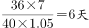。

方法二：比例法。由题意，原有收割机36台，增加4台后变为40台，提高效率5%后相当于原先40×(1＋5%)＝42台收割机的工作效率。效率比为6∶7，总量一定，则效率和时间成反比，故所用时间比为7∶6，还需6天即可完成。

故正确答案为D。

**考点**：给效率比例型

**来源**：2015年国家公务员录用考试《行测》题（省部级）第61题

### 第 62 题

某单位有50人，男女性别比为3:2，其中有15人未入党，若从中任选1人，则此人为男性党员的概率最大为多少：

A. 3/5

B. 2/3

C. 3/4

D. 5/7

第 62 题 · 答案与解析

**参考答案（粉笔题库参考内容）**

A

**解析**

概率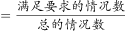，总情况数是一定的，满足此人为男性党员的概率最大，即要求男性党员尽量多，根据题意可知，有30名男性，有35名党员，则男性党员最多有30个，因此最大概率=30/50=3/5（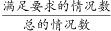）。

故正确答案为A。

**考点**：给情况求概率、非典型最值问题

**来源**：2015年国家公务员录用考试《行测》题（省部级）第62题

### 第 63 题

某技校安排本届所有毕业生分别去甲、乙、丙三个不同的工厂实习。去甲厂实习的毕业生占毕业生总数的32%，去乙厂实习的毕业生比甲厂少6人，且占毕业生总数的24%。问去丙厂实习的人数比去甲厂实习的人数：

A. 少9人

B. 多9人

C. 少6人

D. 多6人

第 63 题 · 答案与解析

**参考答案（粉笔题库参考内容）**

B

**解析**

根据题意，去甲厂实习的人数占32%，去乙厂实习的人数占24%，因此去丙厂实习的人数占1-32%-24%=44%，故去丙厂的人数比去甲厂多44%-32%=12%；而去甲厂实习的人数比去乙厂的多32%-24%=8%，为6人，故去丙厂的人数比去甲厂的应多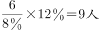。

故正确答案为B。

**考点**：和差倍比问题

**来源**：2015年国家公务员录用考试《行测》题（省部级）第63题

### 第 64 题

甲、乙、丙、丁四人共同投资一个项目，已知甲的投资额比乙、丙二人的投资额之和高20%，丙的投资额是丁的60%，总投资额比项目的资金需求高1/3。后来丁因故临时撤资，剩下三人的投资额之和比项目的资金需求低1/12。则乙的投资额是项目资金需求的：

A. 1/6

B. 1/5

C. 1/4

D. 1/3

第 64 题 · 答案与解析

**参考答案（粉笔题库参考内容）**

A

**解析**

方法一：根据条件，甲、乙、丙、丁之和为4/3项目资金需求，甲、乙、丙之和为11/12项目资金需求，故丁的投资额占项目需求的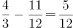；丙投资额是丁的60%，故丙投资额占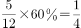；甲＋乙=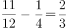；甲＝（乙＋丙）×（1＋20%）；联立方程可得乙＝1/6。

方法二：假设资金需求为12，则甲、乙、丙、丁的投资额之和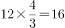，甲、乙、丙投资额之和为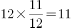，故丁的投资额为16-11＝5，丙的投资额为5×60％＝3，甲和乙的投资额为11-3＝8，又甲＝（乙＋丙）×（1＋20%），得出甲的投资额为6，乙的投资额为2，因此乙占总投资需求的2/12=1/6。

故正确答案为A。

**考点**：和差倍比问题

**来源**：2015年国家公务员录用考试《行测》题（省部级）第64题

### 第 65 题

甲、乙、丙、丁四个人分别住在宾馆1211、1213、1215、1217和1219这五间相邻的客房中的四间里，而另外一间客房空着。已知甲和乙两人的客房中间隔了其他两间客房，乙和丙的客房号之和是四个人里任意二人的房号和中最大的，丁的客房与甲相邻且不与乙、丙相邻。则以下哪间客房可能是空着的：

A. 1213

B. 1211

C. 1219

D. 1217

第 65 题 · 答案与解析

**参考答案（粉笔题库参考内容）**

D

**解析**

本题主体较多，题目较复杂，考虑代入排除验证，代入D项1217，若1217为空房，则甲和乙的房间可分别为1213、1219，此时丙、丁分别为1215和1211，满足要求。其余选项代入后均不满足要求。

正确答案如下表所示：

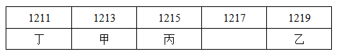

故正确答案为D。

**来源**：2015年国家公务员录用考试《行测》题（省部级）第65题

### 第 66 题

把12棵同样的松树和6棵同样的柏树种植在道路两侧，每侧种植9棵，要求每侧的柏树数量相等且不相邻，且道路起点和终点处两侧种植的都必须是松树。问有多少种不同的种植方法：

A. 36

B. 50

C. 100

D. 400

第 66 题 · 答案与解析

**参考答案（粉笔题库参考内容）**

C

**解析**

由题意，公路两边各6棵松树和3棵柏树，道路起点和终点处两侧种植的都必须是松树，那么中间有5个空，由于柏树要求互不相邻，故从5个空中选出3个空栽种柏树即可。故每一边的种植方式为C_5^3=10，故有10×10＝100种不同的种植方法。

故正确答案为C。

**考点**：不相邻问题

**来源**：2015年国家公务员录用考试《行测》题（省部级）第66题

### 第 67 题

餐厅需要使用9升食用油，现在库房里库存有15桶5升装的，3桶2升装的，8桶1升装的。问库房有多少种发货方式，能保证正好发出餐厅需要的9升食用油：

A. 4

B. 5

C. 6

D. 7

第 67 题 · 答案与解析

**参考答案（粉笔题库参考内容）**

C

**解析**

选项数据不大，采用枚举法求解。如下表所示：

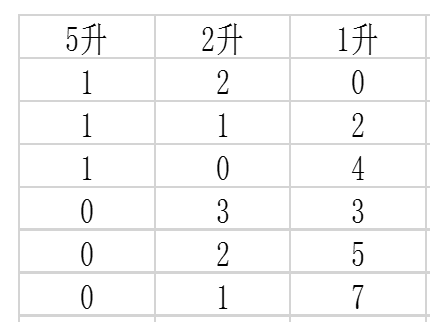

故正确答案为C。

**考点**：基础排列组合

**来源**：2015年国家公务员录用考试《行测》题（省部级）第67题

### 第 68 题

小李的弟弟比小李小2岁，小王的哥哥比小王大2岁、比小李大5岁。1994年，小李的弟弟和小王的年龄之和为15。问2014年小李与小王的年龄分别为多少岁：

A. 25，32

B. 27，30

C. 30，27

D. 32，25

第 68 题 · 答案与解析

**参考答案（粉笔题库参考内容）**

B

**解析**

题中问的是分别多少岁，属于选项信息充分，考虑代入排除。根据题中已知条件“小王的哥哥比小王大2岁，比小李大5岁”可知，小王比小李大3岁，从选项可判断，只有B项符合。

故正确答案为B。

**考点**：年龄问题

**来源**：2015年国家公务员录用考试《行测》题（省部级）第68题

### 第 69 题

现要在一块长25公里、宽8公里的长方形区域内设置哨塔，每个哨塔的监视半径为5公里。如果要求整个区域内的每个角落都能被监视到，则至少需要设置多少个哨塔：

A. 7

B. 6

C. 5

D. 4

第 69 题 · 答案与解析

**参考答案（粉笔题库参考内容）**

C

**解析**

如下图所示：

根据直角三角形勾股定理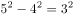，则每个圆形可覆盖一个宽为3×2＝6公里的长方形。要达到完全覆盖，故需要25/6≈4.17个，至少5个。

故正确答案为C。

**考点**：几何结论类-三角形相关

**来源**：2015年国家公务员录用考试《行测》题（省部级）第69题

### 第 70 题

甲、乙两名运动员在400米的环形跑道上练习跑步，甲出发1分钟后乙同向出发，乙出发2分钟后第一次追上甲，又过了8分钟，乙第二次追上甲，此时乙比甲多跑了250米，问两人出发地相隔多少米？

A. 200

B. 150

C. 100

D. 50

第 70 题 · 答案与解析

**参考答案（粉笔题库参考内容）**

B

**解析**

方法一：设甲与乙的速度分别为v_甲和v_乙，由题意，从第一次乙追上甲到第二次追及，甲与乙的路程差为400米，故，解得两人速度差为50m/min，由于甲一共跑了11分钟，乙一共跑了10分钟，在后10分钟内，乙比甲多跑了50×10＝500米，由于乙最终比甲多跑250米，故甲最开始的1分钟跑了250米，又根据乙2分钟时第一次追上甲，可得该过程中甲与乙的路程差为50×2＝100米，故两人最初相距250－100＝150米。

方法二：直接分析，在两人第一次相遇到第二次相遇的过程中，乙追了甲一圈，乙比甲多跑了400米，但乙总共只比甲多跑250米，故在最开始的3分钟内甲比乙多跑400－250＝150米，3分钟时甲、乙两人在同一位置，故开始时两人相距150米。

故正确答案为B。

**考点**：相遇追及

**来源**：2015年国家公务员录用考试《行测》题（省部级）第70题

### 第 71 题

某单位有3项业务要招标，共有5家公司前来投标，且每家公司都对3项业务发出了投标申请，最终发现每项业务都有且只有1家公司中标。如5家公司在各项业务中中标的概率均相等，问这3项业务由同一家公司中标的概率为多少：

A. 1/25

B. 1/81

C. 1/125

D. 1/243

第 71 题 · 答案与解析

**参考答案（粉笔题库参考内容）**

A

**解析**

概率= ，则这3项业务由同一家公司中标的概率=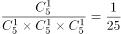。

故正确答案为A。

**考点**：给情况求概率

**来源**：2015年国家公务员录用考试《行测》题（省部级）第71题

### 第 72 题

网管员小刘负责甲、乙、丙三个机房的巡检工作，甲、乙和丙机房分别需要每隔2天、4天和7天巡检一次。3月1日，小刘巡检了三个机房，问他在整个3月有几天不用做机房的巡检工作：

A. 12

B. 13

C. 14

D. 15

第 72 题 · 答案与解析

**参考答案（粉笔题库参考内容）**

C

**解析**

每隔N天=每（N+1）天，在3月份剩下的30天中，甲需要巡检的次数为30/3=10次，同理乙和丙需要巡检的次数为30/5=6次，30/8=3次······6天，甲和乙需要巡检的次数为30/15=2次，乙和丙为30/40=0次······30天，甲和丙为30/24=1次，三个机房共同被巡检的天数为0，巡检的总天数为10＋6＋3﹣2﹣1﹣0＋0＝16，休息30﹣16＝14天。

故正确答案为C。

**考点**：三集合、周期相遇问题

**来源**：2015年国家公务员录用考试《行测》题（省部级）第72题

### 第 73 题

某企业调查用户从网络获取信息的习惯，问卷回收率为90%，调查对象中有179人使用搜索引擎获取信息，146人从官方网站获取信息，246人从社交网站获取信息，同时使用这三种方式的有115人，使用其中两种的有24人，另有52人这三种方式都不使用，问这次调查共发出了多少份问卷：

A. 310

B. 360

C. 390

D. 410

第 73 题 · 答案与解析

**参考答案（粉笔题库参考内容）**

D

**解析**

根据三集合非标准公式：A+B+C-满足两条件数-2×满足三条件数=总数-三条件都不满足，则179+146+246-24-2×115=回收问卷数-52，解得回收问卷数=369，则所求为369/90%=410份。

故正确答案为D。

**考点**：三集合

**来源**：2015年国家公务员录用考试《行测》题（省部级）第73题

### 第 74 题

某学校准备重新粉刷升国旗的旗台，该旗台由两个正方体上下叠加而成，边长分别为1米和2米，问需要粉刷的面积为：

A. 30平方米

B. 29平方米

C. 26平方米

D. 24平方米

第 74 题 · 答案与解析

**参考答案（粉笔题库参考内容）**

D

**解析**

小正方体每个面的面积为1^2=1，大正方体每个面的面积为2^2=4，两个正方体的总面积为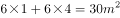，其中重合部分为两个小正方体的面，面积为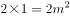，而大正方体作为旗台，其底面不用粉刷，故需要粉刷的面积为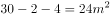。

故正确答案为D。

**考点**：几何公式类-立体图形

**来源**：2015年国家公务员录用考试《行测》题（省部级）第74题

### 第 75 题

某学校组织学生春游，往返目的地时租用可乘坐10名乘客的面包车，每辆面包车往返的租金为250元。此外，每名学生的景点门票和午餐费用为40元，如果要求尽可能少租车，则以下哪个图形最能反映平均每名学生的春游费用支出与参加人数之间的关系：

A. 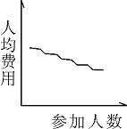

B. 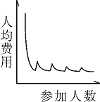

C. 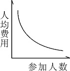

D. 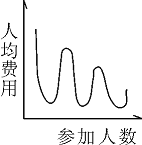

第 75 题 · 答案与解析

**参考答案（粉笔题库参考内容）**

B

**解析**

方法一：分段表示平均费用和总人数之间的关系，设人数为x。当人数x在[1,10]之间时，总的费用为250+40x，平均费用为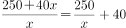，这是一个双曲线；

当人数x在[11, 20]之间时，总费用变成500+40x，平均费用为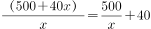，左节点明显大于上一个区间的右节点，之后的区间类似，故答案选择B项。

方法二：结合图形，代入人数。

若参加人数为1人，则平均费用=250+40=290；

若参加人数为10人，则平均费用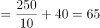；

若参加人数为11人，则平均费用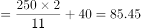；

若参加人数为20人，则平均费用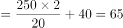；

若参加人数为21人，则平均费用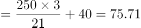；

结合选项，只有B选项图形满足。

故正确答案为B。

**来源**：2015年国家公务员录用考试《行测》题（省部级）第75题

### 第 76 题

从所给四个选项中，选择最合适的一个填入问号处，使之呈现一定规律性：

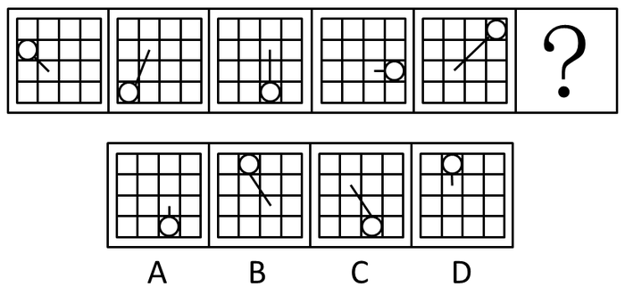

A. A

B. B

C. C

D. D

第 76 题 · 答案与解析

**参考答案（粉笔题库参考内容）**

D

**解析**

各图构成相同，考虑位置规律。圆圈只在十六宫格最外圈出现，每次逆时针移动2格，排除A、C两项。线条的尾端在十六宫格中间四格出现，每次顺时针移动1格，排除B项。

故正确答案为D。

**考点**：位置规律-平移

**来源**：2015年国家公务员录用考试《行测》题（省部级）第76题

### 第 77 题

从所给四个选项中，选择最合适的一个填入问号处，使之呈现一定规律性：

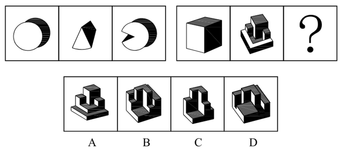

A. A

B. B

C. C

D. D

第 77 题 · 答案与解析

**参考答案（粉笔题库参考内容）**

B

**解析**

每组第二个和第三个立体图形组合构成第一个立体图形。第二组中第二个图形与第三个立体图形应该凹凸相合，观察对比，应选择B项。

故正确答案为B。

【易错原因】立体拼合是近几年国考的宠儿，没有固定的图形或形状，对于空间思维好的同学来说不在话下，但是对于空间想象能力不好的同学也并非无从下手，“凹凸有致”这一技巧可以帮助我们很快地解决这类题。

**考点**：空间类-立体拼合

**来源**：2015年国家公务员录用考试《行测》题（省部级）第77题

### 第 78 题

从所给四个选项中，选择最合适的一个填入问号处，使之呈现一定规律性：

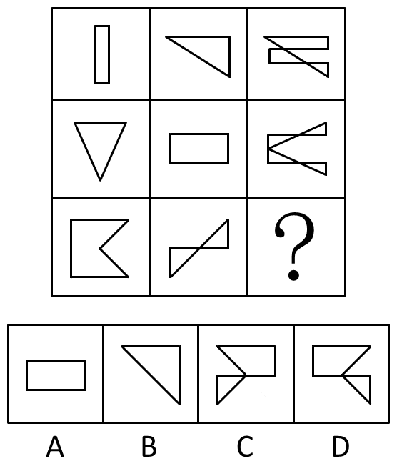

A. A

B. B

C. C

D. D

第 78 题 · 答案与解析

**参考答案（粉笔题库参考内容）**

D

**解析**

各图构成相似，考虑样式规律。本题考查去同存异。第一组左边图形顺时针旋转90度后，与第二组图形去同存异得到第三组图形。

故正确答案为D。

**考点**：样式规律-加减同异

**来源**：2015年国家公务员录用考试《行测》题（省部级）第78题

### 第 79 题

左边给的是纸盒的外表面，下列哪一项能由它折叠而成？

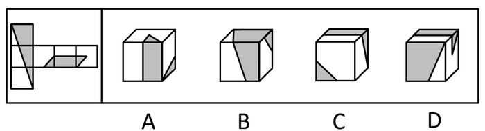

A. A

B. B

C. C

D. D

第 79 题 · 答案与解析

**参考答案（粉笔题库参考内容）**

A

**解析**

A项：与题干一致，为正确答案；

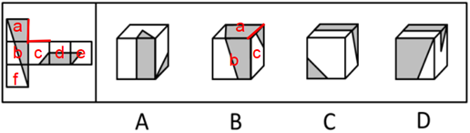

（图1）

B项：如上图1所示，题干展开图面a与面c相邻，且不与面c中的小灰三角形相邻；而选项中的面a与面c中的小灰三角形相邻，排除；

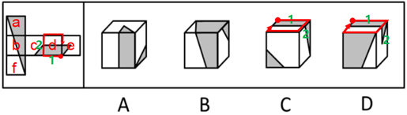

（图2）

C项：如上图2所示，C、D项中存在一个共同的面d，且该面是可以确定唯一边的，即黑色矩形与外框重合的边。在展开图和选项的面d上，以唯一边为起始边，沿顺时针同时进行画边，展开图中边2所对的面为面c，选项中边2所对的面是面f，展开图与选项不一致，排除；

D项：如上图2所示，对题干和选项的d面同时画边，题干展开图的边2与面c相邻，而选项中的边2与面e相邻，排除。

故正确答案为A。

**考点**：空间类-空间重构-六面体

**来源**：2015年国家公务员录用考试《行测》题（省部级）第79题

### 第 80 题

一正方体如下图所示切掉了上半部分的3/4。现在从任意面剖开，下面哪一项不可能是该多面体的截面？

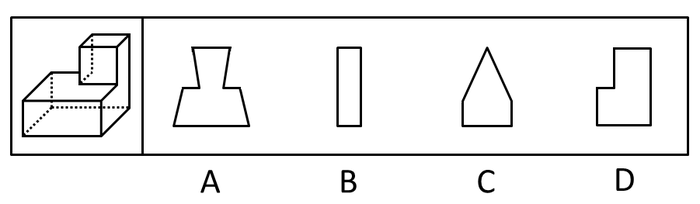

A. A

B. B

C. C

D. D

第 80 题 · 答案与解析

**参考答案（粉笔题库参考内容）**

C

**解析**

A、B、D三项均可得到，如下图所示：

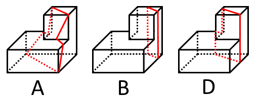

本题为选非题，故正确答案为C。

【易错原因】很多同学觉得截面图的题很难，根本不知道怎么切出来的，其实这类题是有一定的技巧性的，需要大家多总结多做题，尤其对于一些基本图形比如四边形、三角形、带弧线等图形的切法要熟练掌握。

**考点**：空间类-截面图

**来源**：2015年国家公务员录用考试《行测》题（省部级）第80题

### 第 81 题

把下面的六个图形分为两类，使每一类图形都有各自的共同特征或规律，分类正确的一项是：

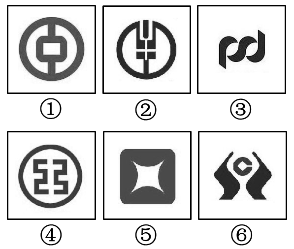

A. ①②⑥，③④⑤

B. ①④⑤，②③⑥

C. ①②⑤，③④⑥

D. ①②③，④⑤⑥

第 81 题 · 答案与解析

**参考答案（粉笔题库参考内容）**

B

**解析**

图形组成不同，考虑属性或数量。①④⑤图形都有封闭区域；②③⑥图形都没有封闭区域，可以按照开放性和封闭性进行分组。

故正确答案为B。

**考点**：属性规律-开闭性

**来源**：2015年国家公务员录用考试《行测》题（省部级）第81题

### 第 82 题

把下面的六个图形分为两类，使每一类图形都有各自的共同特征或规律，分类正确的一项是：

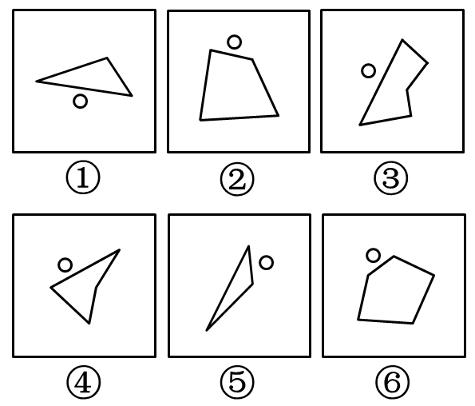

A. ①③④，②⑤⑥

B. ①②⑥，③④⑤

C. ①③⑤，②④⑥

D. ①⑤⑥，②③④

第 82 题 · 答案与解析

**参考答案（粉笔题库参考内容）**

A

**解析**

每幅图都由一个小圆圈和一个多边形组成，小圆圈作为功能元素，在①③④中靠近图形的最长边；在②⑤⑥中靠近图形的最短边。

故正确答案为A。

**考点**：特殊规律-功能元素

**来源**：2015年国家公务员录用考试《行测》题（省部级）第82题

### 第 83 题

把下面的六个图形分为两类，使每一类图形都有各自的共同特征或规律，分类正确的一项是：

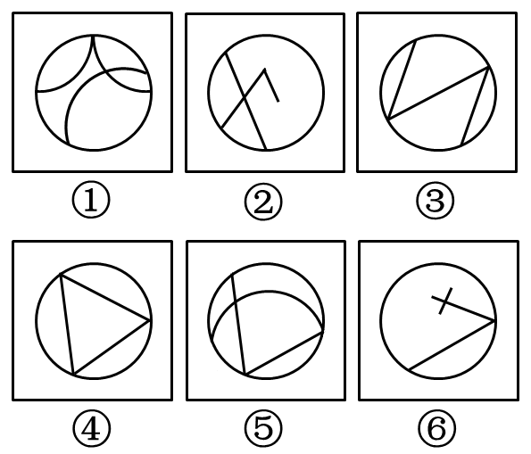

A. ①②③，④⑤⑥

B. ①③⑤，②④⑥

C. ①②⑥，③④⑤

D. ①④⑥，②③⑤

第 83 题 · 答案与解析

**参考答案（粉笔题库参考内容）**

C

**解析**

由图②这个典型的“田”字变形，可以提示考虑“笔画”考点。①②⑥图形最少都可两笔画成；③④⑤图形最少都可一笔画成。

故正确答案为C。

【易错原因】同学们在做题时想到了数量类，想到了数线，就是没有想到一笔画，一笔画是近两年来的热门考点，故在今后，数量类看不出来规律的时候一定记住可以往这个考点上想一想。

**考点**：数量规律-线

**来源**：2015年国家公务员录用考试《行测》题（省部级）第83题

### 第 84 题

把下面的六个图形分为两类，使每一类图形都有各自的共同特征或规律，分类正确的一项是：

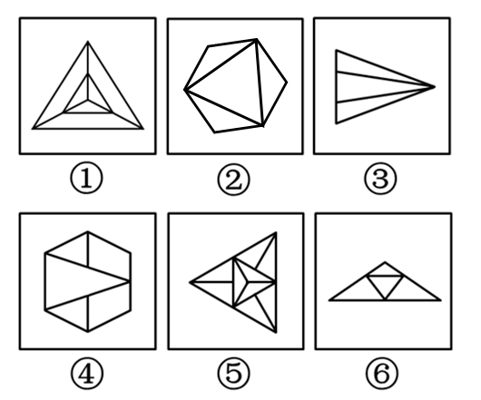

A. ①⑤⑥，②③④

B. ①③⑤，②④⑥

C. ①②③，④⑤⑥

D. ①②⑤，③④⑥

第 84 题 · 答案与解析

**参考答案（粉笔题库参考内容）**

D

**解析**

各图组成不同，且图形都是很规整的图形，优先考虑对称性。各图均为轴对称图形，③④⑥三个图形均只含有1条对称轴，①②⑤三个图形均含有3条对称轴。

故正确答案为D。

【易错原因】看到所有图形都是轴对称图形，觉得对称性无法分类，很多同学就去找其他规律了，要注意近年来对称性的考点更加细化，除了轴对称图形和中心对称图形的分类，对称轴的数量和方向也是近几年考试的热门趋势。

**考点**：属性规律-对称性

**来源**：2015年国家公务员录用考试《行测》题（省部级）第84题

### 第 85 题

把下面的六个图形分为两类，使每一类图形都有各自的共同特征或规律，分类正确的一项是：

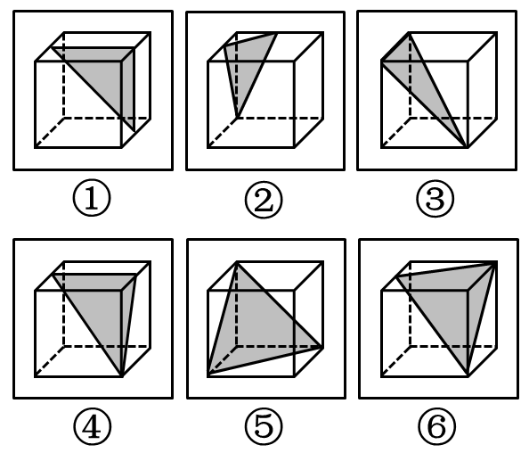

A. ①②④，③⑤⑥

B. ①③④，②⑤⑥

C. ①④⑥，②③⑤

D. ①⑤⑥，②③④

第 85 题 · 答案与解析

**参考答案（粉笔题库参考内容）**

B

**解析**

每幅图中阴影部分呈现出来的截面为三角形，①③④中阴影都是直角三角形；②⑤⑥中阴影都是锐角三角形。

故正确答案为B。

**来源**：2015年国家公务员录用考试《行测》题（省部级）第85题

### 第 86 题

垂直绿化指的是利用攀援植物向空中生长进行纵向绿化的一种方式，以期达到在有限面积内最大限度地利用空气和阳光来提高绿化的效率。

根据上述定义，下列涉及垂直绿化的是：

A. 爬山虎爬满了墙头和屋顶

B. 松树林从山脚一直延伸到山顶

C. 利用巴根草匍匐攀援的特性，人们在沙漠中逐渐开拓出一片绿洲

D. 在丘陵地区，人们常使用飞机从空中播种的方式对山地进行绿化

第 86 题 · 答案与解析

**参考答案（粉笔题库参考内容）**

A

**解析**

定义中“利用……以期……”的结构，呈现出典型的方式＋目的的句式。方式：攀援植物向空中生长，纵向绿化；目的：有限面积内，最大绿化率。

A项爬山虎满足方式关键词，墙头和屋顶满足目的关键词，符合定义，当选；B、C两项中的松树和巴根草匍匐攀援都明显不符合方式关键词，排除；D项连植物种类都没有明确提到，排除。

故正确答案为A。

**考点**：方式目的

**来源**：2015年国家公务员录用考试《行测》题（省部级）第86题

### 第 87 题

赋、比、兴指的是诗歌的三种表现手法。赋：铺陈直叙，把思想感情及其有关的事物平铺直叙地表达出来；比：类比，以彼物比此物，使此物更加生动具体、鲜明浅近；兴：先言他物，然后借以联想，引出诗人所要表达的事物、思想、感情。

根据上述定义，下列诗句中使用了“比”的是：

A. 死生契阔，与子成说。执子之手，与子偕老

B. 七月流火，九月授衣。春日载阳，有鸣仓庚

C. 我心匪石，不可转也。我心匪席，不可卷也

D. 手如柔荑，肤如凝脂。领如蝤蛴，齿如瓠犀

第 87 题 · 答案与解析

**参考答案（粉笔题库参考内容）**

D

**解析**

多定义判断，优先找到提问的“比”：类比，以彼物比此物，即要出现两物之间的类比，排除A、B两项。比较C、D两项，C项的“我心匪石”，即我的心不是石头，但没有明确指出是什么或者像什么，排除。D项则更加旗帜鲜明地指出“手像柔荑，皮肤像凝脂”等，因此，D项更加明确，当选。

故正确答案为D。

**考点**：常规问法

**来源**：2015年国家公务员录用考试《行测》题（省部级）第87题

### 第 88 题

经济学中，系统内部个别效率较高的组织的出现，会对其他效率较低的组织的存在和发展构成破坏或抑制，人们把这种作用称为“顶尖效应”。由于个人之间、地区之间、国家之间的发展不平衡，因此“顶尖效应”是普遍存在的。

根据上述定义，下列有助于避免“顶尖效应”的是：

A. 发达国家甲与经济落后国家乙之间的贸易交易费用下降，导致乙国的资金外流

B. 某地制定新政，加大对中小企业的扶持力度，同时对垄断行业进行调控，限制规模

C. 某粮食生产企业一直不景气，在采用先进栽培技术后，企业生产规模扩大，销售份额开始提升

D. 某地规定，对于优秀留学归国人员可参照其学历或专业水平直接授予相应等级的专业技术职称，不受任何年限等限制

第 88 题 · 答案与解析

**参考答案（粉笔题库参考内容）**

B

**解析**

顶尖效应的条件是：个别效率高的出现；结果是：其他效率低的被破坏，典型的条件＋结果的句式。提问要求选“避免”顶尖效应，即不会发生，是个选非题。

A项属于顶尖效应，应排除；B项对中小企业的扶持和对垄断企业的调控属于避免低效率被破坏的手段，满足定义，当选；C项只涉及一个企业，D项只涉及优秀留学者，不涉及对其他对象是否破坏问题，均排除。

故正确答案为B。

**考点**：故事类

**来源**：2015年国家公务员录用考试《行测》题（省部级）第88题

### 第 89 题

正惩罚是指当个体发出某种行为后，引发外部对其行为的某种反应，导致令该个体不愉快的后果，使个体今后发出此行为的可能性降低。负惩罚是指当个体发出某种行为后，撤销令个体愉快的后果，使个体今后发出此行为的可能性降低。

根据上述定义，下列属于正惩罚的是：

A. 禁烟标识贴出后，在办公室吸烟的人明显减少

B. 母亲要求小明不写作业不得出去玩

C. 某人因酒驾被处罚后，再没有酒驾

D. 冰棍解暑，所以夏天冰棍很畅销

第 89 题 · 答案与解析

**参考答案（粉笔题库参考内容）**

C

**解析**

多定义判断，优先看提问项，即正惩罚：①个体发出某种行为；②外部对其行为的某种反应；③该个体不愉快，今后发出此行为的可能性降低。包含三个行为之间的相互引发。A项不符合①；B项不符合②③；C项符合定义所有要点；D项不符合①③。

故正确答案为C。

**考点**：常规问法

**来源**：2015年国家公务员录用考试《行测》题（省部级）第89题

### 第 90 题

疑罪是指司法机关对被告人是否犯罪或罪行轻重难以确证的情况。疑罪从无原则是现代刑法“有利被告”思想的体现，是无罪推定原则的具体内容之一，即在既不能证明被告人有罪又不能证明被告人无罪的情况下，推定被告人无罪。

根据上述定义，下列采用了疑罪从无原则的是：

A. 赵六因盗窃他人网络密码被起诉，但由于赵六被证明从来不使用网络，法院判其无罪

B. 史某和汤某打架，两人都受了伤，因无法确定谁先动手，法庭建议庭外和解

C. 钱某因涉嫌投毒被起诉，后因证据不足，法院判决钱某无罪

D. 张三起诉李四侵权，但因拿不出任何证据，结果败诉

第 90 题 · 答案与解析

**参考答案（粉笔题库参考内容）**

C

**解析**

疑罪从无的定义结构：在……的情况下，推定……条件＋结果的句式。条件：司法机关不能证明被告人有罪或无罪，结果：推定被告人无罪。A项中赵六被证明从来不使用网络，所以是有证据证明被告人无罪的，不符合“既不能证明被告人有罪又不能证明被告人无罪”，排除；B项没有证明是否有罪的过程，只是建议和解，不符合结果关键词，排除；C项符合定义关键词，当选；D项说张三没有任何证据，不符合“既不能证明被告人有罪又不能证明被告人无罪”，此外，“起诉侵权”属于民事纠纷，不属于刑法范畴，排除。

故正确答案为C。

**考点**：常规问法

**来源**：2015年国家公务员录用考试《行测》题（省部级）第90题

### 第 91 题

隐域性是指自然地理现象在受到局部的地形、水文、土壤、气流、洋流、季风等因素的影响下，在地球表面不按或偏离纬向地带性规律分布的特性，它使地带性分布规律变得不鲜明，使自然环境变得更具复杂性与多样性。

以下属于隐域性分布的是：

A. 关汉卿《窦娥冤》中描写的“六月飞雪”

B. 余秋雨所描写的丝绸之路上的“月牙泉”

C. 岑参在诗中所描述的“北风卷地白草折”

D. 电影《木乃伊归来》中所出现的大沙漠

第 91 题 · 答案与解析

**参考答案（粉笔题库参考内容）**

B

**解析**

第一步：抓住定义中的关键词。

主体：自然地理现象；条件：受到局部的地形、水文、土壤等因素的影响；结果：使地带性分布规律不鲜明，使自然环境变得更复杂更多样。

第二步：逐一判断选项。

A项《窦娥冤》中描写的“六月飞雪”特指的是小说中的场景，是为了小说效果而采用的一种艺术虚构，且“六月飞雪”是一种天气现象，而非地理现象，主体关键词不符合，排除；B项“月牙泉”是沙漠中的奇妙景观，符合特殊自然环境导致的复杂性和多样性的特征，符合定义，当选；C项“北风卷地白草折”是气候现象，不符合主体关键词，排除；D项“大沙漠”是符合地带性规律分布的地貌，不符合结果关键词，排除。

故正确答案为B。

**考点**：原因结果

**来源**：2015年国家公务员录用考试《行测》题（省部级）第91题

### 第 92 题

瓿是古代的一种盛酒器和盛水器，亦可用于盛酱。流行于商代至战国。圆体，敛口无颈，广肩，大腹，圈足，带盖，亦有方形瓿。根据上述描述下列器具中是瓿的是：

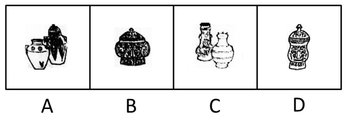

A. A

B. B

C. C

D. D

第 92 题 · 答案与解析

**参考答案（粉笔题库参考内容）**

B

**解析**

根据题干对瓿的描述，由“圆体，敛口无颈”可排除A、C两项；由“广肩”可排除D项。

故正确答案为B。

**考点**：单定义-其他句式

**来源**：2015年国家公务员录用考试《行测》题（省部级）第92题

### 第 93 题

垂直搜索引擎是针对某一个行业的专业搜索引擎，是对网页资源中的某类专门的信息进行一次整合，定向分字段抽取出需要的数据进行处理后再以某种形式返回给用户。

根据上述定义，下列应用与垂直搜索引擎关系最为密切的是：

A. 在某个购物网站上在线购买鞋子

B. 登陆央视网站查询某个城市天气

C. 用百度音乐搜索自己爱听的歌曲

D. 在图书馆网站上查询该馆的藏书

第 93 题 · 答案与解析

**参考答案（粉笔题库参考内容）**

C

**解析**

定义中的关键词：客体——针对某一行业，属性——专业搜索引擎。即搜索引擎与搜索物品专门对应。观察选项，A项的购物网站并不只针对鞋这个行业，排除；B项的央视网站并不只对应天气情况这个行业，排除；D项查询一个图书馆的书，并不对应整个图书行业，均不能完全满足定义关键词，排除。C项音乐引擎与歌曲行业明确对应，符合定义，当选。

故正确答案为C。

**考点**：主客体

**来源**：2015年国家公务员录用考试《行测》题（省部级）第93题

### 第 94 题

概念的内涵是指概念所反映的事物具有的本质属性（或特有属性），它是从质的方面反映概念的。概念的外延是指具有概念所反映的本质属性（或特有属性）的那些事物，它是从量的方面反映概念的。内涵和外延的反变关系是指具有属种关系的概念之间所具有的一种相互联系、相互制约的关系。一个概念的外延越大，它的内涵越少；一个概念外延越小，它的内涵越多。反之，一个概念的内涵越多，它的外延越小；一个概念内涵越少，它的外延越大。根据上述定义，下列哪组概念体现了概念内涵与外延的反变关系？

A. 司法机关，最高审判机关，最高人民法院

B. 水杯，热水杯，大号热水杯

C. 中国，新疆，乌鲁木齐

D. 中国人，文学家，鲁迅

第 94 题 · 答案与解析

**参考答案（粉笔题库参考内容）**

B

**解析**

第一步：判断题干中的关键词。

内涵和外延反变关系的关键词：属种关系的概念。

第二步：逐一分析选项。

A项：最高审判机关和最高人民法院所指相同，是全同关系，不符合定义，排除。

B项：从水杯到热水杯到大号热水杯，内涵依次增多，外延依次减少，且三者是种属关系，符合定义，当选。

C项：中国、新疆和乌鲁木齐三者是组成关系，不符合定义，排除。

D项：文学家有中国人也有外国人，二者是交叉关系，不符合定义，排除。

故正确答案为B。

**考点**：常规问法

**来源**：2015年国家公务员录用考试《行测》题（省部级）第94题

### 第 95 题

时间知觉是对客观现象延续性和顺序性的感知，时间知觉的信息，既来自于外部，也来自内部。外部信息包括计时工具，也包括宇宙环境的周期性变化，内部信息是机体内部的一些有节奏的生理过程和心理活动。

根据上述定义，下列没有包含时间知觉信息的是：

A. 东边日出西边雨，道是无晴却有晴

B. 三更灯火五更鸡，正是男儿读书时

C. 人有悲欢离合，月有阴晴圆缺

D. 月出惊山鸟，时鸣春涧中

第 95 题 · 答案与解析

**参考答案（粉笔题库参考内容）**

A

**解析**

第一步：找出定义关键词。

“计时工具”、“宇宙环境的周期性变化”、“一些有节奏的生理过程和心理活动”。

第二步：逐一分析选项。

A项：是说东边出着太阳，西边却下着雨，说不是天晴又还有晴朗的日光，描述的是天气现象，与时间无关，且东边出着太阳和西边下着雨是同时发生的事情不是宇宙环境的周期性变化，不符合定义，当选；

B项：“三更”、“五更”是古代时间名词，记录的是古代的时间，属于古代的计时工具，符合定义，排除；

C项：“月有阴晴圆缺”，阴、晴指月亮在夜晚阴天的时候昏暗、晴天的时候明亮；圆、缺指阴历每月15左右月圆，月初是月牙所以说是缺，属于宇宙的周期性变化，符合定义，排除；

D项：“月出”指的是月亮出来了，属于宇宙的周期性变化，符合定义，排除。

本题为选非题，故正确答案为A。

**考点**：单定义-其他句式

**来源**：2015年国家公务员录用考试《行测》题（省部级）第95题

### 第 96 题

小麦：馒头

A. 麋鹿：麝香

B. 叶绿体：细胞

C. 乌贼：墨汁

D. 棉花：布鞋

第 96 题 · 答案与解析

**参考答案（粉笔题库参考内容）**

D

**解析**

第一步，判断题干词语间逻辑关系。

由题意可知，“小麦”是“馒头”的原料。

第二步，判断选项词语间逻辑关系。

A项错误，麝香的原料来自麝鹿，不是麋鹿，排除；B项错误，叶绿体是细胞的组成部分，不是原料，排除；C项错误，乌贼不是墨汁的原料，排除；D项正确，棉花是布鞋的原料，当选。

故正确答案为D。

**考点**：逻辑关系-对应关系

**来源**：2015年国家公务员录用考试《行测》题（省部级）第96题

### 第 97 题

八卦：乾坤（    ）。

A. 九族：师生

B. 七情：情志

C. 四书：五经

D. 五音：宫商

第 97 题 · 答案与解析

**参考答案（粉笔题库参考内容）**

D

**解析**

第一步：判断题干词语间逻辑关系。

题干两个词是包容关系，乾坤是八卦中的两卦。

第二步：判断选项词语间逻辑关系。

A项，九族泛指亲属，指与自己有血缘姻亲关系的人，不包括师生，两者不是包容关系，不符合题意，排除；

B项，七情，即喜、怒、忧、思、悲、恐、惊七种情志变化，情志包含七情，但是二者的顺序与题干相反，不符合题意，排除；

C项，四书与五经都是古代典籍，是并列关系而非包容关系，不符合题意，排除；

D项，宫商是五音中的两音，两者是包容关系，符合题意，当选。

故正确答案为D。

**考点**：逻辑关系-包容关系

**来源**：2015年国家公务员录用考试《行测》题（省部级）第97题

### 第 98 题

春夏秋冬：四季

A. 喜怒哀乐：情绪

B. 赤橙黄绿：颜色

C. 早中晚：一天

D. 东南西北：四方

第 98 题 · 答案与解析

**参考答案（粉笔题库参考内容）**

D

**解析**

第一步，判断题干词语间逻辑关系。

“春夏秋冬”是“四季”的同义替换。

第二步，判断选项词语间逻辑关系。

A项错误，“情绪”不仅包括喜怒哀乐，还有惊、恐等其他感情，排除；B项错误，“颜色”不仅包括赤橙黄绿，还有青蓝紫等其他颜色，排除；C项错误，“一天”不仅包括早中晚，还有上、下午等其他时间段，排除；D项正确，“东西南北”是“四方”的同义替换，当选。

故正确答案为D。

**考点**：逻辑关系-全同关系

**来源**：2015年国家公务员录用考试《行测》题（省部级）第98题

### 第 99 题

音符：乐谱：五线谱

A. 笔画：汉字：金文

B. 树木：森林：自然

C. 稻穗：稻谷：香米

D. 卫星：星云：宇宙

第 99 题 · 答案与解析

**参考答案（粉笔题库参考内容）**

A

**解析**

第一步，判断题干词语间逻辑关系。

“音符”构成了“乐谱”，二者是组成关系；“五线谱”是“乐谱”的一种，二者是种属关系。

第二步，判断选项词语间逻辑关系。

A项：“笔画”构成了“汉字”，二者是组成关系；“金文”是“汉字”的一种，二者是种属关系，与题干逻辑关系一致，当选；

B项：“自然”不是“森林”的一种，二者不是种属关系，与题干逻辑关系不一致，排除；

C项：“香米”不是“稻谷”的一种，二者不是种属关系；“香米”是“米”的一种，与题干逻辑关系不一致，排除；

D项：“卫星”不能构成“星云”，二者不是组成关系，与题干逻辑关系不一致，排除。

故正确答案为A。

**考点**：逻辑关系-包容关系

**来源**：2015年国家公务员录用考试《行测》题（省部级）第99题

### 第 100 题

深入：浅尝辄止

A. 疏远：形影不离

B. 细致：事无巨细

C. 安定：水深火热

D. 独立：自食其力

第 100 题 · 答案与解析

**参考答案（粉笔题库参考内容）**

A

**解析**

第一步，判断题干词语间逻辑关系。

“深入”与“浅尝辄止”为反义词关系。

第二步，判断选项词语间逻辑关系。

A项正确，“疏远”与“形影不离”为反义词关系，当选；B项错误，“事无巨细”是指事情不分大小，形容什么事都管，与“细致”不是反义词关系，排除；C项错误，“水深火热”形容老百姓所受的灾难，像水那样越来越深，像火那样越来越热，比喻人民生活极端痛苦，与“安定”不是反义词关系，排除；D项错误，“独立”是“自食其力”的同义词关系，排除。

故正确答案为A。

**考点**：语义关系-反义关系

**来源**：2015年国家公务员录用考试《行测》题（省部级）第100题

### 第 101 题

经济赤字：收入：开支（    ）。

A. 债务纠纷：还钱：借钱

B. 优胜劣汰：适应：淘汰

C. 销售利润：进价：售价

D. 背信弃义：诺言：谎言

第 101 题 · 答案与解析

**参考答案（粉笔题库参考内容）**

C

**解析**

第一步：判断题干词语间逻辑关系。

题干三个词语是对应关系，经济赤字是开支大于收入形成的差额。

第二步：判断选项词语间逻辑关系。

A项，借的钱大于还的钱并不一定会产生债务纠纷，纠纷是主观的东西，会不会产生纠纷取决于债务双方的态度，排除；

B项，适应和淘汰之间不存在差额，排除；

C项，销售利润是售价大于进价形成的差额，正确；

D项，诺言和谎言之间不存在差额，排除。

故正确答案为C。

**考点**：逻辑关系-对应关系

**来源**：2015年国家公务员录用考试《行测》题（省部级）第101题

### 第 102 题

鸳鸯：凤凰：雄雌（    ）。

A. 翡翠：珊瑚：红绿

B. 经纬：阡陌：纵横

C. 满月：弦月：盈缺

D. 锱铢：分毫：长短

第 102 题 · 答案与解析

**参考答案（粉笔题库参考内容）**

B

**解析**

第一步：判断题干词语间逻辑关系。

题干前两个词是并列关系，“鸳鸯”和“凤凰”都是鸟类，且“鸳鸯”一词中，鸳指雄鸟，鸯指雌鸟；“凤凰”也是如此，雄的叫“凤”，雌的叫“凰”，前两个词分别与第三个词对应。

第二步：判断选项词语间逻辑关系。

A项，“翡”指红色，“翠”指绿色，但“珊瑚”本身没有红绿之分，排除；

B项，“经纬”“阡陌”都是用来表示地理方位的词语，且两者都有一纵一横之分，当选；

C项，“满月”是盈，“弦月”是缺，两者各自仅代表盈缺的一部分，排除；

D项，“锱铢”是重量单位，“分毫”是长度单位，“锱铢”没有长短之分，排除。

故正确答案为B。

**考点**：逻辑关系-对应关系、逻辑关系-并列关系

**来源**：2015年国家公务员录用考试《行测》题（省部级）第102题

### 第 103 题

铁匠：火炉：镰刀（    ）。

A. 记者：摄像机：新闻稿

B. 医学家：试管：药剂

C. 科学家：科技文献：新产品

D. 网民：互联网：营销

第 103 题 · 答案与解析

**参考答案（粉笔题库参考内容）**

B

**解析**

第一步：判断题干词语间逻辑关系。

题干三个词属于对应关系，铁匠能够用火炉锻造镰刀，火炉是铁匠的工具，镰刀是铁匠的劳动成果。

第二步：判断选项词语间逻辑关系。

A项，记者能够用摄像机拍摄新闻，但不能用摄像机写新闻稿。该项应排除；

B项，医学家能够用试管制造药剂，试管是医学家的工具，药剂是医学家的劳动成果，符合题干的逻辑关系。该项应选；

C项，科学家无法用科技文献生产新产品，科技文献和新产品都是科学家的劳动成果。该项应排除；

D项，网民能够用互联网上网查询资料、进行娱乐等，但基本不用其进行营销，营销也不是网民的劳动成果。该项应排除。

故正确答案为B。

**考点**：逻辑关系-对应关系

**来源**：2015年国家公务员录用考试《行测》题（省部级）第103题

### 第 104 题

存折 对于(    ) 相当于 栅栏 对于(    )

A. 储户 牛羊

B. 存款 绿地

C. 虚拟 实物

D. 银行卡 围墙

第 104 题 · 答案与解析

**参考答案（粉笔题库参考内容）**

D

**解析**

第一步，判断题干词语间逻辑关系。

“存折”是用来存钱的载体，“栅栏”的作用是隔离与防护。

第二步，判断选项词语间逻辑关系。

A项错误，“储户”是存钱的主体，“牛羊”是“栅栏”保护的对象，不符合题干逻辑关系，排除；B项错误，“存款”是“存折”的对象，可是“栅栏”的对象不一定都是“绿地”，不符合题干逻辑关系，排除；C项错误，“存折”不是“虚拟”的，不符合题干逻辑关系，排除；D项正确，“存折”和“银行卡”有同样的作用，“栅栏”和“围墙”也有同样的作用，符合题干逻辑关系，当选。

故正确答案为D。

**考点**：逻辑关系-并列关系

**来源**：2015年国家公务员录用考试《行测》题（省部级）第104题

### 第 105 题

七寸 对于 (    ) 相当于 (    ) 对于 头绪

A. 尺度 线索

B. 要害 眉目

C. 七步 头脑

D. 关键 脉络

第 105 题 · 答案与解析

**参考答案（粉笔题库参考内容）**

B

**解析**

逐一代入选项。

A项：七寸对应尺度的大小，线索和头绪是近义词，前后逻辑关系不一致，排除；

B项：七寸比喻要害，眉目比喻头绪，前后逻辑关系一致；

C项：七寸和七步无明显逻辑关系，头脑里产生头绪，二者是对应关系，前后逻辑关系不一致，排除；

D项：七寸可以象征关键，但是脉络和头绪无明显逻辑关系，排除。

故正确答案为B。

**考点**：语义关系-比喻象征义

**来源**：2015年国家公务员录用考试《行测》题（省部级）第105题

### 第 106 题

在防治癌症方面，橙汁有多种潜在的积极作用，尤其由于它富含橙皮素和柚苷素等类黄酮抗氧化剂。研究证据已经表明，橙汁可以减少儿童患白血病的风险，并有助于预防乳腺癌、肝癌和结肠癌。根据研究结果，橙汁的生物效应在很大程度上受到其成分的影响，而其成分的变化又依赖于气候、土壤、水果成熟度以及采摘后的存储方法等条件。

由此可以推出：

A. 并非所有的橙汁都有相同的防癌功效

B. 过度饮用橙汁会给身体健康造成不良影响

C. 相对于健康儿童而言，白血病患儿的橙汁饮用量较小

D. 生长于良好的气候土壤条件下，成熟并避光保存的橙子最有功效

第 106 题 · 答案与解析

**参考答案（粉笔题库参考内容）**

A

**解析**

日常结论题，根据题干信息逐一分析选项。

A项：“并非所有的橙汁都有相同的防癌功效”，即不同的橙汁抗癌功效不同，正好对应文段最后一句受多方面影响，能推出，当选；

B项：文段在探讨橙汁对于防治癌症的作用，选项说的是饮用量多少对身体的影响，无中生有，排除；

C项：文段在探讨橙汁对于防治癌症的作用，选项说的是白血病患儿饮用量的问题，无中生有，排除；

D项：文段最后一句“橙汁的生物效应在很大程度上受到其成分的影响，而其成分的变化又依赖于气候、土壤、水果成熟度以及采摘后的存储方法等条件”说明土壤与功效相关，但是相关度如何，是正向相关还是负向相关均未明确说明，属于过度推断，排除。

故正确答案为A。

**考点**：日常结论

**来源**：2015年国家公务员录用考试《行测》题（省部级）第106题

### 第 107 题

某国际小组对从已灭绝的一种恐鸟骨骼化石中提取的DNA进行遗传物质衰变速率分析发现，虽然短DNA片段可能存在100万年，但30个或者更多碱基对序列在确定条件下的半衰期只有大约15.8万年。某位科学家据此认为，利用古代DNA再造恐龙等类似于电影《侏罗纪公园》中的故事不可能发生。

以下哪项如果为真，最能反驳该科学家的观点：

A. 《侏罗纪公园》虽然是一部科幻电影，但也要有事实依据

B. 上述研究的化石样本可能受到人类DNA的“污染”

C. 环境因素会影响DNA等遗传物质的衰变速率

D. 恐鸟与恐龙的碱基对序列排列顺序不同

第 107 题 · 答案与解析

**参考答案（粉笔题库参考内容）**

C

**解析**

第一步：找到论点和论据。

科学家的观点在最后一句：利用古代DNA再造恐龙等类似于电影《侏罗纪公园》中的故事不可能发生。论据：针对一种恐鸟骨骼化石中遗传物质衰变速率分析的实验。论点是典型的预测（未来无人可知，无法直接验证真假），故无法直接削弱论点。论据是调查实验，调查对象是衰变速率的快慢，与之直接相关的C项环境因素会影响DNA等遗传物质的衰变速率，即单独只看衰变速率并不准确，削弱了实验方式，属于削弱范畴。

第二步：逐一分析选项。

A项偷换论题，属于无关选项，排除；B项化石被污染只是一种可能性，力度很弱，排除；D项排列顺序不同对结论是否有影响并不确定，排除。因此，C项更为直接，当选。

故正确答案为C。

**考点**：削弱论据

**来源**：2015年国家公务员录用考试《行测》题（省部级）第107题

### 第 108 题

碎片化时代人们的注意力很难持久。让用户在邮件页面停留更长时间已经成为了营销者不断努力的方向。随着富媒体化的逐步流行，邮件逐步从单一静态向动态转变，个性化邮件的特性也逐步凸显。GIF制作简单，兼容性强，在邮件中可以增加视觉冲击力。因此，在邮件中插入GIF动态图片，更能吸引用户的目光，增加用户的点击率。

以下哪项如果为真，最能支持上述结论：

A. 如果针对特定用户群而制定个性化营销邮件，那么销售机会会增加20%

B. 过去没有插入GIF动态图片的个性化营销邮件，也为很多企业带来了成功

C. 上世纪70年代出生的人习惯于电子邮件的静态界面，不喜欢花里胡哨的东西

D. 插入GIF动态图片的个性化营销邮件，比普通发送的邮件给企业带来的收入多18倍

第 108 题 · 答案与解析

**参考答案（粉笔题库参考内容）**

D

**解析**

第一步：找出论点和论据。

“因此”引出论点：在邮件中插入GIF动态图片，更能吸引用户的目光，增加用户的点击率。论据：GIF制作简单，兼容性强，在邮件中可以增加视觉冲击力。

第二步：逐一分析选项。

A项将GIF动态图片偷换为“个性化营销邮件”，属于无关选项，排除；B项说GIF没有作用，C项说有人不喜欢GIF，都是在削弱论点，排除；D项，插入GIF动态图片的个性化营销邮件，比普通发送的邮件给企业带来的收入多18倍，举例支持论点，当选。

故正确答案为D。

**考点**：补充论据

**来源**：2015年国家公务员录用考试《行测》题（省部级）第108题

### 第 109 题

一个旅行者要去火车站，早上从旅馆出发，到达一个十字路口。十字路口分别通向东南西北四个方向，四个方向上分别有饭店、旅馆、书店和火车站。书店在饭店的东北方，饭店在火车站的西北方。

该旅行者要去火车站，应当往哪个方向走：

A. 东

B. 南

C. 西

D. 北

第 109 题 · 答案与解析

**参考答案（粉笔题库参考内容）**

B

**解析**

典型的组合排列题型，根据“最大信息量优先”原则，应把饭店作为突破口。由“书店在饭店的东北方”可知饭店在书店的西南方，又已知“饭店在火车站西北方”可知饭店在西方。如下图所示：

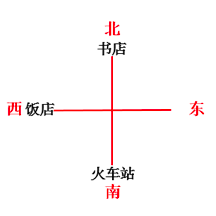

由“饭店在火车站西北方”，即火车站在饭店东南方，火车站在南方。

故正确答案为B。

**考点**：从最大信息开始推

**来源**：2015年国家公务员录用考试《行测》题（省部级）第109题

### 第 110 题

由于一种新的电池技术装置的出现，手机在几分钟内充满电很快就会变成现实。这种新装置是一种超级电容器，它储存电流的方式是通过让带电离子聚集到多孔材料表面，而非像传统电池那样通过化学反应储存这些离子。因此这种超级电容器能在几分钟内储满电。研究人员认为这种技术装置将会替代传统电池。

以下哪项如果为真，不能支持上述结论：

A. 超级电容器能够储存大量电能，保证长时间正常运行

B. 超级电容器能循环使用数百万次，相比之下传统电池只能使用数千次

C. 超级电容器可嵌入汽车底盘为汽车提供动力，可更方便地进行无线充电

D. 超级电容器充电时所耗电能比传统电池少90%，但供电时间比后者长10倍

第 110 题 · 答案与解析

**参考答案（粉笔题库参考内容）**

C

**解析**

第一步，找到论据和论点。

 “研究人员认为”引出论点：超级电容器这种技术装置将会替代传统电池。

论据：这种超级电容器能在几分钟内储满电。

第二步，逐一分析选项。

A项储电量大、B项使用次数多、C项可以无线充电、D项充电耗电少均是对于论点的支持，故要比较强弱。其中C项只是说针对汽车会带来便利，范围较其他三项小了很多，最不能支持论点。

本题为选非题，故正确答案为C。

**考点**：加强选非题

**来源**：2015年国家公务员录用考试《行测》题（省部级）第110题

### 第 111 题

台风是大自然最具破坏性的灾害之一。有研究表明：通过向空中喷洒海水水滴，增加台风形成区域上空云层对日光的反射，那么台风将不能聚集足够的能量，这一做法将有效阻止台风的前进，从而避免更大程度的破坏。

上述结论的成立需要补充以下哪项作为前提：

A. 喷洒到空中的水滴能够在云层之上重新聚集

B. 人工制造的云层将会对邻近区域的降雨产生影响

C. 台风经过时，常伴随着大风和暴雨等强对流天气

D. 台风前进的动力来源于海水表面日光照射所产生的热量

第 111 题 · 答案与解析

**参考答案（粉笔题库参考内容）**

D

**解析**

第一步：找到论点和论据。

论点：这一做法将有效阻止台风的前进，从而避免更大程度的破坏。

论据：通过向空中喷洒海水水滴，增加台风形成区域上空云层对日光的反射，那么台风将不能聚集足够的能量。

第二步：逐一分析选项。

A项：水滴能重新聚集，与是否能阻止台风的前进无关，无关项，排除；

B项：对邻近区域的降雨产生影响，与是否能阻止台风的前进无关，无关项，排除；

C项：台风经过时带来的影响，与是否能阻止台风的前进无关，无关项，排除；

D项：台风前进的动力来源于海水表面日光照射所产生的热量，在“日光反射所产生的能量”和“台风的前进”之间建立了联系，搭桥项，当选。

故正确答案为D。

**考点**：搭桥

**来源**：2015年国家公务员录用考试《行测》题（省部级）第111题

### 第 112 题

有一段时间，电视机生产行业竞争激烈。由于电视机品牌众多，产品质量成为消费者考虑的首要因素。某电视机生产厂家为了扩大市场份额，一方面加大研发力度，进一步提高了电视机产品的质量；另一方面在价格上作调整，适当降低了产品的价格。然而，调整之后的头三个月，其电视机产品的市场份额不但没有提高反而有所下降。

以下哪项如果为真，最能解释上述现象：

A. 消费者通常会考虑不同产品的价格差异，而非同一产品在不同时期的价格差异

B. 一个家庭再次购买电视机产品时会首先考虑原来的品牌

C. 消费者通常是通过价格来衡量电视机产品质量的

D. 其他电视机生产厂家也调整了产品价格

第 112 题 · 答案与解析

**参考答案（粉笔题库参考内容）**

C

**解析**

第一步：找出需要解释的矛盾现象。

题干中强调质量是消费者考虑的首要因素，但是矛盾是：提升了质量，降低了价格，但销量不增反降。

第二步：逐一分析选项。

A项：消费者通常会考虑不同产品的价格差异，而非同一产品在不同时期的价格差异，也就是有可能有别的产品比该厂家的价格更低，可能消费者不买该产品，可以解释市场份额没有提高，但是解释不了“反而有所下降”，排除。

B项：说明消费者在购买时考虑的不是价格，而是原来的品牌，可以解释市场份额没有提高，但是解释不了“反而有所下降”，排除。

C项：消费者通常是通过价格来衡量电视机产品质量的，也就是说价格下降了，人们就会认为其质量也会降低，故会减少购买，很好地解释了题干中矛盾的现象，当选。

D项：其他电视机生产厂家也调整了产品价格，可以解释市场份额没有提高，但是解释不了“反而有所下降”，排除。

故正确答案为C。

**考点**：原因解释

**来源**：2015年国家公务员录用考试《行测》题（省部级）第112题

### 第 113 题

“有好消息，也有坏消息”。无论是谈起什么主题，这样的开场白都顿时让人觉得一丝寒意传遍全身。接着这句话，后边往往是这样一个问题：你想先听好消息还是坏消息？一项新的研究表明，你可能想先听坏消息。

如果以下各项为真，最能削弱上述论证的是：

A. 若消息是来自一个你信任的人，那么你想先听好坏消息的顺序会不同

B. 研究发现，若由发布消息的人来决定，那么结果往往总是先说好消息

C. 心理学家发现，发布好坏消息的先后顺序很可能改变人们对消息的感觉

D. 心理评估结果证明先听到坏消息的学生比先听到好消息的学生焦虑要小

第 113 题 · 答案与解析

**参考答案（粉笔题库参考内容）**

A

**解析**

第一步：找出论点和论据。

论点：你可能想先听坏消息。

论据：无。

第二步：逐一分析选项。

A项：指出先听好坏消息的顺序会受到告诉你消息的人的影响，直接对论点进行或然性削弱，当选。

B、C、D三项：B项“先说好消息”、C项“发布好坏消息”将论点的“听”偷换成了“说”，D项讲听后的焦虑程度与听好坏消息的顺序无关，均属于无关选项，排除。

故正确答案为A。

**考点**：削弱论点

**来源**：2015年国家公务员录用考试《行测》题（省部级）第113题

### 第 114 题

城市病指的是人口涌入大城市，导致其公共服务功能被过度消费，最终造成交通拥挤、住房紧张、空气污染等问题。有专家认为，当城市病严重到一定程度时，大城市的吸引力就会下降，人们不会再像从前一样向大城市集聚，城市病将会减轻，从而焕发新的活力。

如果以下各项为真，能够削弱上述观点的是：

A. 我国已经进入城市病的爆发期，居民生活已受到影响

B. 大城市能够提供的公共服务是中小城市所无法替代的

C. 政府应该将更多财力用于发展中小城市、乡镇、农村

D. 中小城市活力足，发展潜力大，对人们吸引力会很强

第 114 题 · 答案与解析

**参考答案（粉笔题库参考内容）**

B

**解析**

第一步：找出论点和论据。

论点：当城市病严重到一定程度时，大城市的吸引力就会下降，人们不会再像从前一样向大城市集聚，城市病将会减轻，从而焕发新的活力。

没有明显论据。

第二步：逐一分析选项。

A项：说大城市不好，那大城市的吸引力是否下降，并不明确，不能削弱，排除；

B项：既然大城市能够提供的公共服务是中小城市所无法替代的，说明大城市还是比小城市吸引力大，削弱论点，当选；

C项：政府应该将更多财力用于发展中小城市、乡镇、农村，但事实上政府到底有没有这么做，并不知道，不能削弱，排除；

D项：说中小城市对人们吸引力会很强，题干论点讨论的是大城市的吸引力是否会下降，讨论主体不一致，不能削弱，排除。

故正确答案为B。

**考点**：削弱论点

**来源**：2015年国家公务员录用考试《行测》题（省部级）第114题

### 第 115 题

今年联赛决赛的最后4支队伍是甲、乙、丙和丁。其中N与T分别为甲队和丁队的主教练。有人指出，甲队此前每次夺该项桂冠的赛季都曾战胜过T教练所在的球队；过去4年间，丁队在N教练的指导下，每隔一年都能夺得该项桂冠，而去年丁队没有夺冠。

以下哪项如果为真，与上述表述相矛盾：

A. T教练可能执教过丁队

B. N教练去年曾执教丁队

C. 甲队曾4次夺得该项冠军

D. 丁队前年未获得该项冠军

第 115 题 · 答案与解析

**参考答案（粉笔题库参考内容）**

D

**解析**

由题干最后一句话“过去4年间，丁队在N教练的指导下，每隔一年都能夺得该项桂冠，而去年丁没夺冠”可知前年丁肯定夺冠，因此D项一定错误。本题要求选与题干矛盾的选项，即选择错误的选项。

故正确答案为D。

**考点**：从确定信息开始推

**来源**：2015年国家公务员录用考试《行测》题（省部级）第115题

## 材料 1

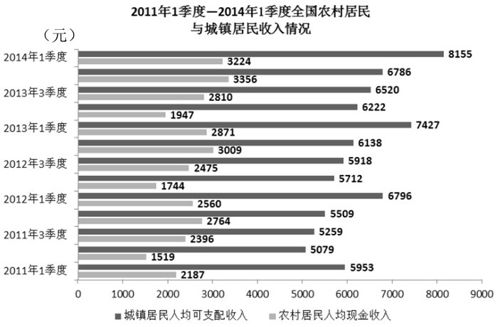

### 第 116 题

与2011年同期相比，2014年1季度农村居民人均现金收入约增长了：

A. 25.9%

B. 36.8%

C. 47.4%

D. 52.5%

第 116 题 · 答案与解析

**参考答案（粉笔题库参考内容）**

C

**解析**

由题干“增长了”，选项为百分数，可判定此题为一般增长率计算问题。定位图形材料，2011年1季度农村居民人均现金收入为2187元，2014年1季度为3224元，代入公式：，则2014年比2011年增长了，与C项最接近。

故正确答案为C。

**考点**：一般增长率、统计图

**来源**：2015年国家公务员录用考试《行测》题（省部级）第116题

### 第 117 题

2013年城镇居民人均可支配收入同比增加了：

A. 1千多元

B. 2千多元

C. 3千多元

D. 4千多元

第 117 题 · 答案与解析

**参考答案（粉笔题库参考内容）**

B

**解析**

由题干“增加了”，选项单位为元，可判定此题为增长量计算问题。定位图形材料，代入增长量公式：增长量=现期量-基期量。2013年城镇居民人均可支配收入同比增长量=2013年城镇居民人均可支配收入-2012年城镇居民人均可支配收入，2013年城镇居民人均可支配收入=26900元；2012年城镇居民人均可支配收入≈24500元。故2013年城镇居民人均可支配收入同比增加了约26900-24500=2400元，与B项最接近。即2千多元。

故正确答案为B。

**考点**：增长量计算、统计图

**来源**：2015年国家公务员录用考试《行测》题（省部级）第117题

### 第 118 题

综合2011—2013年的数据，农村居民人均现金收入和城镇居民人均可支配收入最高的季度分别是：

A. 1季度和1季度

B. 1季度和4季度

C. 4季度和4季度

D. 4季度和1季度

第 118 题 · 答案与解析

**参考答案（粉笔题库参考内容）**

D

**解析**

观察图可发现，农村居民人均现金收入每一年中4季度最高，城镇居民人均可支配收入每一年中1季度最高。

故正确答案为D。

**考点**：排序类、统计图

**来源**：2015年国家公务员录用考试《行测》题（省部级）第118题

### 第 119 题

2011—2013年，农村居民年人均现金收入超过1万元的年份有几个：

A. 3

B. 2

C. 1

D. 0

第 119 题 · 答案与解析

**参考答案（粉笔题库参考内容）**

C

**解析**

2011年农村居民年人均现金收入约为：2200＋1500＋2400＋2800＝8900＜10000元；

2012年农村居民年人均现金收入约为：2600＋1700＋2500＋3000＝9800＜10000元；

2013年农村居民年人均现金收入约为：2900＋1900＋2800＋3400＝11000＞10000元。

农村居民年人均现金收入超过1万元的年份只有1个。

故正确答案为C。

**考点**：现期平均数、统计图

**来源**：2015年国家公务员录用考试《行测》题（省部级）第119题

### 第 120 题

能够从上述资料中推出的是：

A. 2013年各季度农村居民人均现金收入均同比增加

B. 2013年4季度城镇人均可支配收入同比增速低于环比增速

C. 2014年1季度城镇居民人均可支配收入环比增长了三成多

D. 2013年下半年农村居民人均现金收入比上半年多约2000元

第 120 题 · 答案与解析

**参考答案（粉笔题库参考内容）**

A

**解析**

A项：直接看图可以发现，2013年各季度农村居民人均现金收入均比2012年高，正确；

B项：2013年4季度城镇人均可支配收入同比增速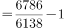；环比增速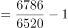，分母越大，分数越小，故2013年4季度城镇人均可支配收入同比增速大于环比增速，错误；

C项：2014年1季度城镇居民人均可支配收入为8155元，2013年4季度城镇居民人均可支配收入为6786元，2014年1季度环比增长，故环比增长了两成多，错误；

D项：2013年下半年农村居民人均现金收入比上半年约多(3356＋2810)－(1947＋2871) 元，远小于2000元，错误。

故正确答案为A。

**考点**：统计图、综合分析

**来源**：2015年国家公务员录用考试《行测》题（省部级）第120题

## 材料 2

2013年，某省工业企业全年实现主营业务收入37864亿元，税金1680亿元，利润2080亿元，分别增长19.1%、19.4%、26.4%，分别高出全国7.9、8.4、14.2个百分点。该省工业企业主营业务收入占全国工业的3.7%，比上年提高0.3个百分点，百户重点企业主营业务收入、税金、利润分别增长10.2%、11.1%、20.8%，分别占全省工业的29.5%、51%、27.6%。

        2013年，汽车工业实现主营业务收入4538亿元，增长23.1%；实现利润416.6亿元，增长19.9%；税金225.3亿元，增长50%。销售利润率（利润占主营业务收入的比重）攀升至9.2%。

        食品（含烟草）实现主营业务收入6359亿元，增长20.8%，增速同比放缓9.2个百分点，实现利润398亿元，增长 34.5%；工业税金506.2亿元，增长11.4%。

        钢铁行业实现主营业务收入3510亿元，增长1.8%，利润总额34.6亿元，增长18.8%。行业销售利润率仅为1%。

        石化行业主营业收入5138亿元，增长18.8%；实现利润204.2亿元，增长38.1%。子行业中，石油加工业净亏损0.2亿元，同比减亏13.6亿元；化工行业全年利润增长31.6%，扭转上半年利润下降局面；石油开采业净亏损8.6亿元，橡胶塑料行业利润增长29.1%。

        建材行业实现主营业务收入2412亿元，增长27.1%；实现利润167.2亿元，增长51.6%。

        机械行业实现主营业务收入3886亿元，增长26.6%；实现利润191.6亿元，增长23.8%。其中，电气机械（家电）利润增长38.5%，专用设备利润增长22.1%，船舶行业利润增长18.9%。

### 第 121 题

2013年全国工业企业主营业务收入约为多少万亿元？

A. 84

B. 90

C. 97

D. 102

第 121 题 · 答案与解析

**参考答案（粉笔题库参考内容）**

D

**解析**

由题干“2013年”，结合文字材料第一段“占全国工业”，可判定此题为现期比重计算问题。根据总量计算公式：总量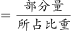。定位文字材料“2013年，某省工业企业全年实现主营业务收入37864亿元······占全国工业的3.7%”可得，2013年全国工业企业主营业务收入=37864/3.7%，直除首数可以商1，只有D项满足。

故正确答案为D。

**考点**：文字资料、现期比重

**来源**：2015年国家公务员录用考试《行测》题（省部级）第121题

### 第 122 题

2013年全国工业企业的税金增速比利润增速：

A. 低1.2个百分点

B. 低5.8个百分点

C. 高7.0个百分点

D. 高8.4个百分点

第 122 题 · 答案与解析

**参考答案（粉笔题库参考内容）**

A

**解析**

由材料“2013年，某省工业企业全年实现主营业务收入37864亿元，税金1680亿元，利润2080亿元，分别增长19.1%、19.4％、26.4％，分别高出全国7.9、8.4、14.2个百分点”可知，2013年全国工业企业的税金增速为19.4%－8.4%＝11%，全国工业企业的利润增速为26.4%－14.2%＝12.2%，故全国工业企业税金增速比利润增速低12.2%－11%＝1.2%，即低1.2个百分点。

故正确答案为A。

**考点**：文字资料、简单加减计算

**来源**：2015年国家公务员录用考试《行测》题（省部级）第122题

### 第 123 题

2013年该省工业企业的哪项信息，能够从上述资料中直接推出？

A. 工业企业利润占全国工业企业利润总额的比重

B. 船舶行业主营业务收入占机械行业的比重

C. 橡胶塑料行业工业企业实现利润额

D. 百户重点企业的总体销售利润率

第 123 题 · 答案与解析

**参考答案（粉笔题库参考内容）**

D

**解析**

A项无法求出，材料中没有提及全国工业企业利润总额的具体数值；B项无法求出，材料中只提供了船舶行业利润的增长率，缺少主营业务的收入数据；C项无法求出，材料中仅提供橡胶塑料行业利润的增长率，缺少具体基数值；D项可以求出，百户重点企业利润=全省实现利润2080亿×百户重点企业利润所占比重27.6%；百户重点企业主营业务收入=全省主营业务收入37864亿×百户重点企业主营业务收入所占比重29.5%，故可求出百户重点企业的总体销售利润率=利润/收入。

故正确答案为D。

**考点**：文字资料、综合分析

**来源**：2015年国家公务员录用考试《行测》题（省部级）第123题

### 第 124 题

2013年该省以下行业利润增速从高到低排序正确的是：

A. 石化行业，建材行业，机械行业

B. 建材行业，石化行业，机械行业

C. 汽车行业，食品(含烟草)行业，钢铁行业

D. 食品(含烟草)行业，钢铁行业，汽车行业

第 124 题 · 答案与解析

**参考答案（粉笔题库参考内容）**

B

**解析**

查找材料，2013年汽车行业利润增速：19.9%；食品行业：34.5%；钢铁行业：18.8%；石化行业：38.1%；建材行业：51.6%；机械行业：23.8%，满足正确排序的只有B项。

故正确答案为B。

**考点**：排序类、文字资料

**来源**：2015年国家公务员录用考试《行测》题（省部级）第124题

### 第 125 题

能够从上述资料中推出的是：

A. 2012年该省食品（含烟草）行业主营业务收入同比增速为11.6%

B. 2012年该省工业企业税金总额中，汽车行业所占比重超过15%

C. 2013年该省建材行业的销售利润率高于2012年水平

D. 2012年该省石油加工业净亏损13.4亿元

第 125 题 · 答案与解析

**参考答案（粉笔题库参考内容）**

C

**解析**

A项：由材料“食品（含烟草）实现主营业务收入6359亿元，增长20.8 %，增速同比放缓9.2个百分点”可知，2012年该省食品（含烟草）行业主营业务收入同比增速＝20.8%＋9.2%＝30%，错误。

B项：由材料“2013年，某省工业企业全年实现主营业务收入37864亿元，税金1680亿元，利润2080亿元，分别增长19.1%，19.4%，26.4%”“2013年，汽车行业实现主营业务收入4538亿元，增长23.1%；税金225.3亿元，增长50%”可知，2012年该省工业企业税金总额中，汽车行业所占比重为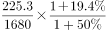，错误。

C项：根据材料可知，2013年建材行业的利润增长51.6%，主营业务收入增长27.1%，利润增长速度高于营业收入增长速度，故行业利润率上升，正确。

D项：由材料“2013年石油加工业净亏损0.2亿元，同比减亏13.6亿元”可知，2012年净亏损为0.2＋13.6＝13.8亿元，错误。

故正确答案为C。

**考点**：文字资料、综合分析

**来源**：2015年国家公务员录用考试《行测》题（省部级）第125题

## 材料 3

2014年1—5月，我国软件和信息技术服务业实现软件业务收入13254亿元，同比增长20.9%，比去年同期回落3.3个百分点。其中，软件产品完成收入4141亿元，信息系统集成服务完成收入2649.3亿元，信息技术咨询服务完成收入1399.2亿元，数据处理和运营服务完成收入2429.5亿元，嵌入式系统软件完成收入2230.3亿元，IC设计完成收入405.1亿元。

### 第 126 题

2014年1～5月，表中四项软件业务收入之和最高的东北地区副省级城市是：

A. 大连

B. 长春

C. 沈阳

D. 哈尔滨

第 126 题 · 答案与解析

**参考答案（粉笔题库参考内容）**

A

**解析**

结合选项，各地区四项软件业务收入之和分别为：大连：；长春：0.89＋2.7＋10.15＋0.03，明显比大连要低；沈阳：；哈尔滨：3.02＋2.09＋3.36＋0.19，依旧明显要小于大连。通过计算可知，大连的四项软件业务收入之和最高。

故正确答案为A。

**考点**：简单加减计算、综合资料

**来源**：2015年国家公务员录用考试《行测》题（省部级）第126题

### 第 127 题

2014年前5个月完成收入排名前三的软件业务，同期完成收入占我国软件业务总收入的比重约为：

A. 61.8%

B. 69.6%

C. 81.2%

D. 86.5%

第 127 题 · 答案与解析

**参考答案（粉笔题库参考内容）**

B

**解析**

由题干“2014年······占······”，可判定此题为现期比重问题。比重计算公式：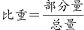。定位文字材料，2014年前5个月收入排名前三的软件业务分别为软件产品4141亿元，信息系统集成服务2649.3亿元，数据处理和运营服务2429.5亿元，软件业务总收入为13254亿元。则所求比重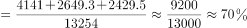，与B项最接近。

故正确答案为B。

**考点**：现期比重、综合资料

**来源**：2015年国家公务员录用考试《行测》题（省部级）第127题

### 第 128 题

2014年1－5月，副省级城市哪项软件业务完成收入之和低于该业务全国总收入的一半：

A. 数据处理和运营服务

B. 信息技术咨询服务

C. 嵌入式系统软件

D. IC设计

第 128 题 · 答案与解析

**参考答案（粉笔题库参考内容）**

D

**解析**

由题干“2014年······低于全国一半”，可判定此题为现期比重问题。定位文字材料和表格材料，在四项软件业务中，各项业务全国总收入的一半分别为：

信息技术咨询服务：亿元；

数据处理和运营服务：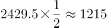亿元；

嵌入式系统软件：亿元；

IC设计：亿元。

对比表格，副省级城市各项软件收入之和，只有IC设计的收入之和低于该业务全国总收入的一半。

故正确答案为D。

**考点**：现期比重、综合资料

**来源**：2015年国家公务员录用考试《行测》题（省部级）第128题

### 第 129 题

2014年1～5月，信息技术咨询服务收入同比增速最快的副省级城市，该项收入约是增速最慢的副省级城市的多少倍：

A. 21

B. 4

C. 201

D. 70

第 129 题 · 答案与解析

**参考答案（粉笔题库参考内容）**

A

**解析**

由题干“2014年······是······倍”，可判定此题为现期倍数问题。定位表格材料，信息咨询服务收入同比最快的是青岛，增长率为39.5%，收入为63.26亿元；最慢的是哈尔滨，增长率为10.1%，收入为3.02亿元。故青岛该项收入约为哈尔滨的倍。

故正确答案为A。

**考点**：现期倍数、综合资料

**来源**：2015年国家公务员录用考试《行测》题（省部级）第129题

### 第 130 题

关于2014年1～5月副省级城市软件业务收入，能够从上述资料中推出的是：

A. 广州市的四项业务收入在副省级城市中均排名前三

B. 武汉市的四项业务收入增速均高于副省级城市平均水平

C. 深圳市IC设计业务收入超过副省级城市该项业务收入的平均水平

D. 数据处理和运营服务收入与嵌入式系统软件收入最高的副省级城市是同一个

第 130 题 · 答案与解析

**参考答案（粉笔题库参考内容）**

B

**解析**

A项：在嵌入式系统软件收入中，排名前三的分别为深圳472.19亿元，青岛166.03亿元，杭州164.78亿元，广州市并未在各项收入中均排前三，错误；

B项：对比表格发现，武汉市四项业务收入增速均高于副省级城市平均水平，正确；

C项：查看表格可得，深圳市IC设计业务收入为6.95亿元，而副省级平均水平为亿元，故深圳市IC设计业务低于平均水平，错误；

D项：数据处理和运营服务收入最高的城市是杭州，而嵌入式系统软件收入最高的城市是深圳，并非同一城市，错误。

故正确答案为B。

**考点**：综合分析、综合资料

**来源**：2015年国家公务员录用考试《行测》题（省部级）第130题

## 材料 4

2013年末全国共有群众文化机构44260个，比上年末增加384个，其中乡镇文化站34343个，增加242个。年末群众文化机构从业人员164355人，比上年末增加8127人。群众文化机构实际使用房屋建筑面积3389.4万平方米，比上年末增长6.9%。年末群众文化机构共有馆办文艺团体6022个，演出15.13万场，观众6569万人次。

### 第 131 题

2013年末全国群众文化机构数量同比约增长了：

A. 8%

B. 3%

C. 0.9%

D. 0.4%

第 131 题 · 答案与解析

**参考答案（粉笔题库参考内容）**

C

**解析**

由题干“增长了”，选项为百分数，可判定此题为一般增长率计算问题。定位文字材料，2013年末全国共有群众文化机构44260个。比上年末增加384个，代入增长率计算公式：。故2013年群众文化机构数量同比增长率，与C项最接近。

故正确答案为C。

**考点**：一般增长率、综合资料

**来源**：2015年国家公务员录用考试《行测》题（省部级）第131题

### 第 132 题

2013年每个馆办文艺团体平均每月演出约多少场：

A. 25

B. 12

C. 5

D. 2

第 132 题 · 答案与解析

**参考答案（粉笔题库参考内容）**

D

**解析**

由题干“2013年每个······平均每月”，可判定此题为现期平均数计算问题。定位文字材料，年末群众文化机构共有馆办文艺团体6022个，演出15.13万场，故2013年每个馆办文艺团体平均每月演出：151300/(6022×12)≈2场。

故正确答案为D。

**考点**：现期平均数、综合资料

**来源**：2015年国家公务员录用考试《行测》题（省部级）第132题

### 第 133 题

2013年群众文化机构开展的活动中，平均每次活动参加人数最多的是：

A. 展览

B. 文艺活动

C. 公益性讲座

D. 训练班

第 133 题 · 答案与解析

**参考答案（粉笔题库参考内容）**

A

**解析**

由题干“2013年······平均每次”，可判定此题为现期平均数比较问题。定位表格材料，依据选项，各项活动平均每次参加的人数为：展览：；文艺活动：；公益性讲座：；训练班：，故每次参加人数最多的为展览。

故正确答案为A。

**考点**：现期平均数、综合资料

**来源**：2015年国家公务员录用考试《行测》题（省部级）第133题

### 第 134 题

2007－2013年间，平均每万人群众文化设施建筑面积同比增速高于10%的年份有几个？

A. 5

B. 4

C. 3

D. 2

第 134 题 · 答案与解析

**参考答案（粉笔题库参考内容）**

B

**解析**

由题干“增速”，可判定此题为一般增长率计算问题。定位图形材料，同比增速高于10%，即查看（基期值＋10%基期值）是否低于现期值，低于即高出了10%。对比发现，有2008年（126.2+126×10%＜145.4）；2009年（145.4+145.4×10%＜164.3）；2010年（164.3+164.3×10%＜188.6）；2011年（188.6+188.6×10%＜221.2)；共四年满足要求。

故正确答案为B。

**考点**：一般增长率、综合资料

**来源**：2015年国家公务员录用考试《行测》题（省部级）第134题

### 第 135 题

能够从上述资料中推出的是：

A. 2013年文艺活动的参加人数约是公益性讲座的50倍

B. 2012年末全国群众文化机构共有从业人员16万多人

C. 2013年全国人均群众文化设施建筑面积比2006年翻了一番

D. 2013年乡镇文化站占群众文化机构总数的比重高于上年水平

第 135 题 · 答案与解析

**参考答案（粉笔题库参考内容）**

C

**解析**

A项：2013年文艺活动人数为31379万人次，公益性讲座人数为441万人次。，即70多倍，错误；

B项：2013年末群众文化机构从业人员164355人，比上年末增加8127人，故2012年末的从业人员数量＝164355－8127＝156228＜160000人，错误；

C项：定位图形材料可知，2013年全国平均每万人群众文化设施建筑面积为249.1平方米，2006年全国平均每万人群众文化设施建筑面积为123.5平方米。123.5×2＝247平方米&lt;249.1平方米，正确；

D项：2013年乡镇文化站占群众文化机构总数的比重为；2012年为，故2013年乡镇文化站占群众文化机构总数的比重低于上年水平，错误。

故正确答案为C。

**考点**：综合分析、综合资料

**来源**：2015年国家公务员录用考试《行测》题（省部级）第135题

