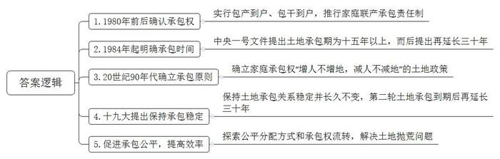
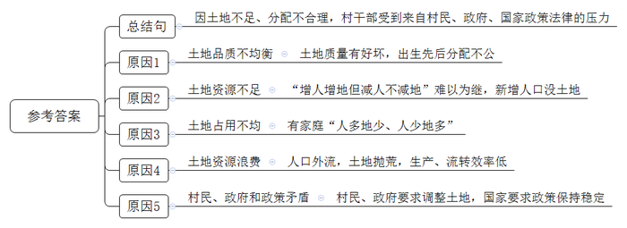
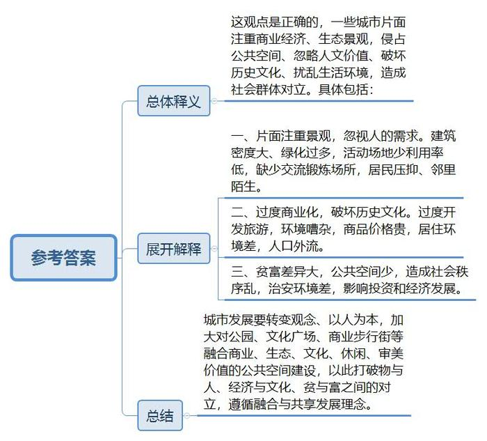
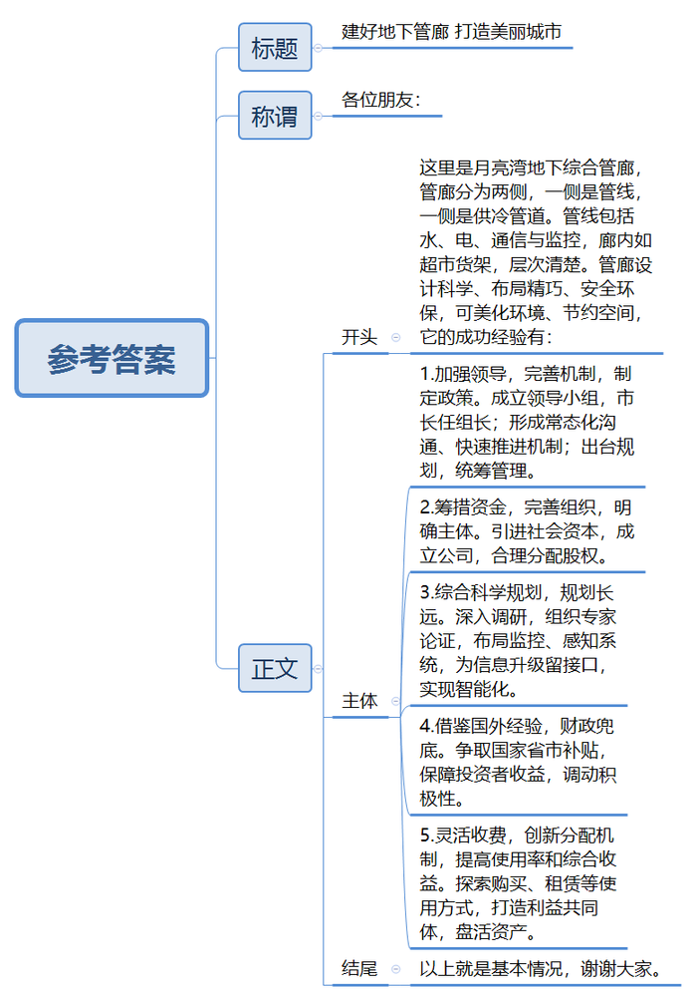
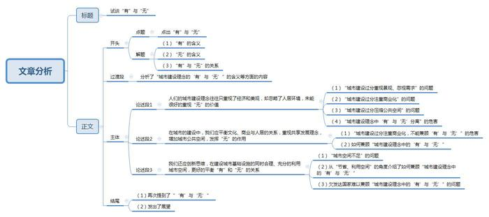

# 2018年国家公考《申论》题（地市级）

> 候选采集稿。参考答案及解析来自粉笔页面，不代表官方答案或真实高分答卷；来源使用许可与原卷对应关系仍需人工核实。

## 给定材料

### 材料 material-125cbe8572f4b347

位于R市郊西隅的沙坝村，总面积约10平方千米，山清水秀，历史悠久。

1980年前后，家庭联产承包责任制开始在中国广大农村推行。中共中央《关于加快农业发展若干问题的决定》《关于进一步加强和完善农业生产责任制的几个问题》等有关“包产到户”“包干到户”的文件一层层传达下来，但沙坝村却没有变革的迹象，人们还在观望。时任大队书记的杨某回忆说：“那时候土地、山林还有各种财产都是国家（集体）的，国家的东西，哪个敢随便动！”

到了1981年底，沙坝村把耕地按好、中、差进行了搭配，然后按人口平均发包给村民，完成“分田到户”，第一轮家庭联产承包责任制在沙坝村初步落实。从此，在土地所有权不变的情况下，村民对于承包地有了经营权、使用权。当时的规定是：所有承包地土地，不许出租、买卖；不许在承包地上建房、烧砖瓦等。虽然承包时大队已经确定承包期是3至5年，但是，村民中仍有人怀疑分田到户不长久，会不会“今天分下去，明天又收回来”。直到1984年的中央一号文件提出“土地承包期一般应在十五年以上”，村民们的忧虑才初步解除。而后中央提出的“为了稳定土地承包关系，鼓励农民增加投入，提高土地的生产率，在原定的耕地承包期到期之后，再延长三十年不变”，算是给农民吃了“定心丸”。为了给农民稳定的土地承包经营预期，党的十九大报告明确提出“保持土地承包关系稳定并长久不变，第二轮土地承包到期后再延长三十年”。

### 材料 material-1b1703fa53d61b8f

L村位于某省中北部沿海平原区，粮食作物以小麦、玉米为主，冬小麦与夏玉米一年两季轮作，经济作物以苹果为主。L村的土地分为两类，一是“围庄地”，在村庄周边，有较好的水利条件；二是“洼子地”，离村庄远，水利条件较差。与全国大多数村庄一样，L村也在20世纪90年代中后期根据当时的政策完成了“二轮土地承包”。L村把全村土地分成两份，一份为各户承包的人口地；另一份为机动地。机动地主要用于给新增加的人口增地。

与其他村庄二轮承包普遍执行的“增人不增地，减人不减地”的土地政策不同的是，L村在机动地上实行“增人增地但减人不减地”的办法。自二轮土地承包以来，L村的人口增减变化将近百人。L村给新增加的人口分配土地先从位置、水利条件较好的围庄地开始，围庄地分完之后，新增加的人口就只能分到洼子地了。到了2014年，预留的机动地全部分配完了，“增人增地但减人不减地”的办法也就难以为继了。

村民李某在二轮承包时家里只有他们夫妇和未成年的儿子，多年后儿子娶妻生子，都没赶上村里分地，一家6个人种着3个人的地，收入窘迫。特别是每当看到邻居张某家2个人种着9个人的地时，颇有怨言：“明显不公平，就应收回重分。”但张某对他的话却不完全认同：“我家地多人少是事实，可二轮续包的时候就是这样，30年不变也是国家规定的。”

与李某、张某想要地、想种地不同，L村还有不想要、不想种地的人。76岁的万老汉，家里有6亩地，儿子和孙子都在外地打工、上学。每年的秋收季节都是万老汉最发愁的时候，繁重的劳动都得雇人帮忙。他想把地流转出去，但因为地比较零散，收益也不高，流转也很困难。村里和万老汉情况差不多的还有二十多人。近几年一直在外地打工的王某说：“种地费时费力不说，农忙时回家打理，请假还要被扣工资，不合算。这两年一直是托付亲戚来种地，没什么收益，明年也不想这么干了。”此外，村里还有10户完全脱离农业的家庭，因各种原因，他们承包的土地大多撂荒了。

现任村支书告诉记者说，村里二轮承包后一直没进行土地调整，这是因为国家对土地调整有政策，明确提出“小调整、大稳定的前提是稳定”。“小调整”的间隔期最短不得少于5年，而且“小调整”只限于人地矛盾突出的个别农户。2006年因为村民的承包地占用量与家庭人口不均衡，村里曾有过一次调整的打算，村委会研究决定：凡是人口减少以及已经迁往城镇落户的农户，其承包的土地份额一律收回，另行发包给新增人口的农户。村民石某因妻子去世而被收回了2亩地。石某不服，将村委会告上法庭，要求返还被收走的土地。法院经审理认为，2003年实施的《农村土地承包法》确立了“承包土地以户为单位，减人不减地”的原则。根据该法律，家庭承包经营权的主体是农户整体，而不是家庭成员个体。只要承包方的家庭还有人在，土地就是不能收回。只有在承包经营的家庭消亡，或承包方全家迁入设区的市并转为非农户口的情况下，发包方才可以收回承包地。如果承包方自愿放弃承包地，则应提前半年提出申请。最后法院判决村委会返还石某土地。石某这一告，那次土地调整就没往下进行。后来，国家对土地调整的限制越来越严格，多次强调“承包期内，发包方不得调整承包地”“现有土地承包关系要保持稳定并长久不变”。

2016年春，李某和一些农户以土地承包量有失公平为由找到了当地政府，要求调整。这一诉求得到了政府的支持。面对这种局面，村支书无奈地说：“这样一来，我们的压力很大，看来村里的土地调整也不是一个简单的事。”

### 材料 material-d22b204b0feb4b35

据有关部门统计，到2016年年底，中国大陆城镇常住人口已达7亿9298万，比2015年末增加2182万人，城镇人口占总人口比例为57.35%。随着中国城市化进程的加快，大量农村人口涌入城市。

李奶奶是几年前从农村来到X市的。离开了广袤无垠的田野，住进了层层叠叠、密密麻麻单元楼的瑞丽花园小区。舒适的住所、单调的生活、陌生的邻里，李奶奶过得并不开心，觉得自己被压得“喘不过气来”，她几乎每天都要坐公交车穿过喧闹的街区到城郊的公园里活动活动筋骨，想法子找人说说话。

瑞丽花园小区是X市近年来新开发的商品房小区，位于市区两大主要交通干线的交汇处。因位置临近商业中心，地价昂贵，住宅楼比较密集。为了体现其景观的生态性，小区内有一条人工河道蜿蜒而过，把小区的空地分割成大小不一的碎片。河边花香草绿，绿柳成荫，不少凉亭假山点缀其间。但仔细观察便可发现，小区里可供居民活动健身的空地却十分有限，最大的一块空地，只能容纳30人共同活动。每次看到“芳草青青、留心脚下”的木牌时，李奶奶总免不了要叨唠一句“景有了，可人没了”。事实上，小区内也建有设备完善、宽敞明亮的室内舞蹈室、羽毛球馆及各类文体活动室。但羽毛球馆和健身房是不对社区居民免费开放的，需要居民办理会员卡。舞蹈室在有对外演出活动时用于排练使用，平时都上着锁。其他文体活动室都有一定的开放时限，利用起来并不方便。

离瑞丽花园小区不远的南平巷地区是一个具有完整元代胡同院落肌理、文化资源丰富的棋盘式传统民居区，迄今还有2万多名居民生活在此。

已经在此生活20多年的康阿姨对记者说，当初这里特别清净，没有商业化，更没有这么多的游客。可是到了2006年进行商业开发以后，南平巷变了样子，喧哗的酒吧、随意改建的建筑物、各种小吃店、水果摊占道经营。人流量和车流量骤增，传统的文化气息荡然无存。近两年，因为这里的居住环境条件每况愈下，商品价格攀升，老住户纷纷外迁，老宅成了外来人口的聚集地。

在如何把握历史文化保护、商业发展和居民人居环境三者之间的关系问题上，业内人士认为，彻底停止商业，或者迁走所有居民，都不是良策。因为，X市的“根”就在这些胡同里，在这里居民的身上。

最近，一则消息让X市居民颇为兴奋。一座包含超大的绿地，融合生态、文化、休闲等多种功能的，面积近2平方千米的文化公园将在中心城区一块被认为最具开发价值的“潜力板块”破土动工。专业人士认为，公园不只是供市民休闲娱乐的实体，同时也包含丰富的人文意义和文化价值。对一个好的城市公共场所而言，“建设”只是一个基础，其塑造和养成不只在“造景”，更要借此“化人”。随着空间的变化，人们对城市的观感会变，对城市的体验度会变，相应地，城市治理的思路要变。拿出黄金地块做公园，提供的是场所，面向的是全体市民，彰显的是城市价值。每个在这里生活、工作的市民，都能感受到这座城市带给他们的幸福感、归属感和安全感。在强调“共享”发展理念的当下，这意味着城市治理观念的一次重大转变。

### 材料 material-cd5e0ad7ac5d6226

走进独墅湖月亮湾商务区，你会发现，这里的道路格外平整，找不到一条“马路拉链”，天际线由棱角分明的建筑物和绿树组成，空中也看不到一张“蜘蛛网”。这是因为，这里的自来水管、供电电缆、通信电缆全部“住”到了地下宽敞的“集体宿舍”里。这就是S市第一条城市地下公共空间基础设施——月亮湾地下综合管廊。城市地下综合管廊作为地下空间的“生命线”，是城市公共配套建设的重要组成部分。

月亮湾地下综合管廊，自2011年11月建成投入使用，已平稳运行多年。这是一个全长920米、断面3.4×3米的“T”形长廊。长廊的一侧是一排长长的钢铁支架，如同“超市货架”，从上到下依次放着消防与监控线路桥架、电力线路桥架、两层通信网络桥架，最下面三层空着的“货架”是为未来管线预留的空间。管廊内另一侧是上下两根直径70厘米的集中供冷管道。技术员介绍说：“附近商务区的写字楼不用中央空调，夏天由这两根管道集中供冷。”

S市管线管理所负责人在向记者介绍管廊建设的前期准备情况时说，由市长担任组长的市地下综合管廊工作领导小组起到了关键作用，领导小组成员有39人之多，涵盖了辖区各板块、各相关单位主要负责人。专门机构的设立，形成了多元主体的常态化沟通和快速推进机制，有效避免了推诿扯皮、难以协调等问题。在领导小组的组织下，相关部门编制完成了《S市地下空间专项规划（2008～2020）》《S市地下空间规划整合（2012～2020）》，今年6月又出台了《S市地下管线管理办法》，统筹加强对地下管廊规划、建设和安全运行的管理。

“地下综合管廊造价和维护可不是一般的昂贵”，管廊开发公司徐总经理给记者算了一笔账，“使用寿命为50年及100年的地下综合管廊，每公里建设运行成本分别为1.6亿元及2亿元。即使S市经济实力不错，但借力社会资本也是现实的必然选择。”市政府授权S市城市建设投资发展有限公司出资组建了S市管廊开发公司，其中城建平台占股45%，水务占股20%，4家弱电单位各占股5%，为供电预留股份15%。管廊开发公司，专门负责城市地下综合管廊的投资、建设、运营和管理事务，不仅解决了资金问题，也解决了建设主体的问题。

在记者参观的时候，工作人员介绍：S市地处江南水网区域，地下工程施工难度大，精度要求高。为确保工程的顺利推进和质量安全，S市在前期调研分析基础上，根据国家《城市综合管廊工程技术规范》，组织专家团队反复论证，最终为项目设计施工提供了充分依据。S市在综合管廊规划设计阶段，就确立了系统化、标准化、智慧化的目标，在铺设管线时同步建设全面的监控、感知系统，并为信息系统升级留有接入口，方便日后对大面积地下管线实施统一综合管理。建成的综合管廊囊括消防、照明、排水、通风、通讯、供电、监控感知、火灾报警等系统，可以通过一个终端对所有管线进行实时监控和调度管理，并具有自动检测、定位、提醒等多种功能，真正实现了信息化、一体化、智能化管理。

由于综合管廊建设成本高，入廊管线大多具有公益性，且这一新生事物在使用过程中权、责、利还缺乏有效制衡和匹配，导致社会各方的投融资积极性都不高。为此，S市借鉴国内外经验，特别规定除争取国家试点和省财政支持外，如果项目建成后特许经营期内收费不能实现预期目标，市财政将进行一定补贴，确保股东投资安全且获得基础收益。

根据工程内容、建设成本、运营周期、物价水平等多重因素，制定收费项目和收费标准，明确各单位可以以入廊或租赁的方式获得管线所有权、使用权，让管线需求者根据自身实际情况选择使用方式，调动其入廊积极性，增加管线使用效率和经济收益。

管廊收费之所以困难，很重要的一个原因是缺乏调动入廊单位积极性的有效方式。S市创新性地以打造利益共同体的方式，吸引电力、给排水、通信等单位成为管廊建设主体——管廊开发公司的股东，让各单位根据自身需求充分参与管廊的规划、设计和建设过程。在合理确定收费标准的基础上，为盘活资产、提高综合收益，这些单位均愿以有偿方式使用管线。

## 题目

### 第 1 题

**“给定资料**1**”和“给定资料**2**”反映了改革开放以来我国农村土地承包政策的发展过程，请你概述这一发展过程。（10分）**

关联材料：material-125cbe8572f4b347

作答要求：

要求：

（1）准确、全面，有条理；

（2）不超过200字。

### 第 2 题

**“给定资料**2**”中，L村村支书面对村民土地调整的要求，发出感慨：“这样一来，我们的压力很大，看来村里的土地调整也不是一个简单的事。”请根据“给定资料**2**”，分析他为什么感到压力很大。（10分）**

关联材料：material-1b1703fa53d61b8f

作答要求：

要求：

（1）全面、准确，有条理；

（2）不超过200字。

### 第 3 题

**“给定资料**4**”提到，“城市建设与管理的目的如果仅仅是为满足经济或某种美观诉求，显然是片面的，甚至是短视而危险的。”请根据“给定资料**3**”和“给定资料**4**”，谈谈你对这句话的理解。（20分）**

关联材料：material-d22b204b0feb4b35

作答要求：

要求：

（1）观点明确，分析全面，有逻辑性；

（2）不超过300字。

### 第 4 题

**S市将举办“城市样板工程展示会”，请你根据“给定资料**5**”，就其中地下管廊建设情况撰写一份讲解稿。（20分）**

关联材料：material-cd5e0ad7ac5d6226

作答要求：

要求：

（1）紧扣资料，内容全面；

（2）逻辑清晰，语言准确；

（3）不超过400字。

### 第 5 题

**“给定资料**6**”中提到了老子关于“有”和“无”的观点，请你围绕给定资料反映的城市建设理念中的问题，联系实际，以“试谈‘有’与‘无’”为题写一篇文章。（40分）**

关联材料：material-125cbe8572f4b347

作答要求：

要求：

（1）自选角度，见解深刻；

（2）参考“给定材料”，但不拘泥于“给定资料”；

（3）思路清晰，语言流畅；

（4）总字数1000字左右。

## 答案与解析

第 1 题

**参考答案（粉笔题库参考内容）**

1.1980年前后确认承包权。实行包产到户、包干到户，推行家庭联产承包责任制。

2.1984年起明确承包时间。中央一号文件提出土地承包期为十五年以上，而后提出再延长三十年。

3.20世纪90年代确立承包原则。确立家庭承包权“增人不增地，减人不减地”的土地政策。

4.十九大提出保持承包稳定。保持土地承包关系稳定并长久不变，第二轮土地承包到期后再延长三十年。

5.促进承包公平，提高效率。探索公平分配方式和承包权流转，解决土地抛荒问题。

**解析**

**参考答案说明：**本参考答案按照“1980年前后”“1984年”“20世纪90年代”“十九大”“未来的探索”这样的时间顺序展开概述，将我国农村土地承包政策分为了“确认承包权”“明确承包时间”“确立承包原则”“保持承包稳定”“促进承包公平，提高效率”这几个发展过程，并进行了分条撰写。各条要点内部在内容上没有交叉。

**考点**：考点其他类

**来源**：来源2018年国家公考《申论》题（地市级）

粉笔申论页面对本题只提供「解析视频」入口，该入口是会员推广位，页面无视频地址与文字解析。

第 2 题

**参考答案（粉笔题库参考内容）**

因土地不足、分配不合理，村干部受到来自村民、政府、国家政策法律的压力，具体有：

一、土地品质不均衡。土地质量有好坏，出生先后分配不公；

二、土地资源不足。“增人增地但减人不减地”难以为继，新增人口没土地；

三、土地占用不均。有家庭“人多地少、人少地多”；

四、土地资源浪费。人口外流，土地抛荒，生产、流转效率低；

五、村民、政府和政策矛盾。村民、政府要求调整土地，国家要求政策保持稳定。

**解析**

**参考答案说明：**本参考答案呈现总分结构，首先，总体上提出土地调整压力大源于土地不足、分配不合理，村干部受到来自村民、政府、国家政策法律的压力。其次，从“土地品质不均衡”“土地资源不足”“土地占用不均”“土地资源浪费”“村民、政府和政策矛盾”五个方面进行了具体展开，并做到了分条撰写。各条要点之间在内容上相互并列，没有交叉。

**考点**：考点原因类

**来源**：来源2018年国家公考《申论》题（地市级）

粉笔申论页面对本题只提供「解析视频」入口，该入口是会员推广位，页面无视频地址与文字解析。

第 3 题

**参考答案（粉笔题库参考内容）**

这观点是正确的，一些城市片面注重商业经济、生态景观，侵占公共空间、忽略人文价值、破坏历史文化、扰乱生活环境，造成社会群体对立。具体包括：

一、片面注重景观，忽视人的需求。建筑密度大、绿化过多，活动场地少利用率低，缺少交流锻炼场所，居民压抑、邻里陌生。

二、过度商业化，破坏历史文化。过度开发旅游，环境嘈杂，商品价格贵，居住环境差，人口外流。

三、贫富差异大，公共空间少，造成社会秩序乱，治安环境差，影响投资和经济发展。

城市发展要转变观念、以人为本，加大对公园、文化广场、商业步行街等融合商业、生态、文化、休闲、审美价值的公共空间建设，以此打破物与人、经济与文化、贫与富之间的对立，遵循融合与共享发展理念。

**解析**

**参考答案说明：**本参考答案结合“观点明确”的要求，首先对“城市建设与管理的目的如果仅仅是为满足经济或某种美观诉求，显然是片面的，甚至是短视而危险的”进行了表态。其次“展开解释”部分从“片面注重景观，忽视人的需求”“过度商业化，破坏历史文化”“贫富差距大，公共空间少”三个方面分析了城市建设与管理片面化存在的问题。最后进行了总结。

**考点**：考点词句解释类

**来源**：来源2018年国家公考《申论》题（地市级）

粉笔申论页面对本题只提供「解析视频」入口，该入口是会员推广位，页面无视频地址与文字解析。

第 4 题

**参考答案（粉笔题库参考内容）**

建好地下管廊 打造美丽城市

各位朋友：

这里是月亮湾地下综合管廊，管廊分为两侧，一侧是管线，一侧是供冷管道。管线包括水、电、通信与监控，廊内如超市货架，层次清楚。管廊设计科学、布局精巧、安全环保，可美化环境、节约空间，它的成功经验有：

一、加强领导，完善机制，制定政策。成立领导小组，市长任组长；形成常态化沟通、快速推进机制；出台规划，统筹管理。二、筹措资金，完善组织，明确主体。引进社会资本，成立公司，合理分配股权。三、综合科学规划，规划长远。深入调研，组织专家论证，布局监控、感知系统，为信息升级留接口，实现智能化。四、借鉴国外经验，财政兜底。争取国家省市补贴，保障投资者收益，调动积极性。五、灵活收费，创新分配机制，提高使用率和综合收益。探索购买、租赁等使用方式，打造利益共同体，盘活资产。

以上就是基本情况，谢谢大家。

**解析**

**参考答案说明：**（1）格式方面，本参考答案写到了“标题”“称谓”“正文”。（2）正文部分，一方面从内容来看，围绕着“s市地下管廊建设情况”这一主题，开头先总体介绍“s市地下管廊建设”的基本情况；主体部分从“加强领导”“筹措资金”“综合科学规划”“财政补贴”“灵活收费”等几个方面给出了具体的对策。另一方面，形式上，本参考答案做到了分段、分条撰写，整体上条理较为清晰。

**考点**：考点总结类

**来源**：来源2018年国家公考《申论》题（地市级）

粉笔申论页面对本题只提供「解析视频」入口，该入口是会员推广位，页面无视频地址与文字解析。

第 5 题

**参考答案（粉笔题库参考内容）**

**试谈****“有”与“无”**

老子说：“凿户牖以为室，当其无，有室之用。故有之以为利，无之以为用。”这句话以人们居住的屋子为喻，表达出了深刻的道理。其中的“有”，就是指屋子的四壁、门窗，本质上是实际存在的硬件；其中的“无”，则是指屋子中间虚空的部分，本质就是通过硬件的建造而留出的空间。“有”与“无”共同构成了可以使用的屋子，也就证明了“有”与“无”的关系是辩证统一的、不可分割的、缺一不可的。

这样的道理也同样适用于今天的城市建设理念。具体来说，城市建设理念中的“有”，就是指注重城市的设施建设，如建造漂亮的小区、实用的综合管廊；城市建设理念中的“无”，则是指注重美好的人居环境、足够的公共空间。其实，城市建设也应兼顾经济发展与人文诉求。

但现实中，**人们的城市建设理念往往只重视了经济和美观，却忽略了人居环境，未能很好的重视****“无”的价值。**比如，我们过于注重建造漂亮的小区，而忽视了人的现实需求，最后“景有了，人没了”；城市开发中过度注重商业化，把历史文化古迹等都变成收费场所，结果“钱有了，文化没了”；有些城市大肆扩展私人权益，公共空间被压缩，最终“个人有了，大家没了”……长此以往，城市自然难以持续发展。

因此，**在城市的建设中，我们应平衡文化、商业与人居的关系，重视共享发展理念，增加城市公共空间，发挥****“无”的作用。**城市建设不应只是“造景”，更要兼顾“化人”。过分商业化会使城市的历史文化失去价值，会使人们没有时间和空间来“无所事事”，就不会有闲暇去进行文化创造。所以，建设经济开发区时，要留下城市绿地；建设城市CBD时，要留下古建筑保护区、特色文化街区；建设写字楼时，也要留下休息娱乐地。我们要认识到，城市是一个生活综合体，我们要在“共享”理念的指引下，为城市留足公共空间，以维持生产和生活的“生态”平衡。

同时，**我们还应创新思维，在建设城市基础设施的同时合理、充分的利用城市空间，更好的平衡****“有”和“无”的关系。**即便我们都能认识到城市公共空间的重要性，但“空间”终究是有限的。若要兼顾“有”与“无”的关系，更现实的办法就是利用创新的思维和方法为城市发展“节省”空间。月亮湾地下综合管廊将各类水管和电缆全部迁到了地下，这无形中就为城市的地面发展留足了“余地”；而在一些欠发达的国家如泰国，许多城市的半空中都布满了各类管线构成的“蜘蛛网”，这样的城市的建设，显然是不可持续的……

我们真切的盼望，政府在注重经济发展的“有之利”的同时，还能兼顾公共空间、历史文化、休闲娱乐等“无之用”。只有给城市留下一些“空白”，我们才能看到更加美好的未来。

**解析**

**文章分析**

**试谈****“有”与“无”**

【**标题的优点：**严格按照题目的要求，以“ 试谈‘有’与‘无’”为标题。】

老子说：“凿户牖以为室，当其无，有室之用。故**有**之以为利，**无**之以为用。”这句话以人们居住的屋子为喻，表达出了深刻的道理。其中的（1）“有”，就是指屋子的四壁、门窗，本质上是实际存在的硬件；其中的（2）“无”，则是指屋子中间虚空的部分，本质就是通过硬件的建造而留出的空间。“有”与“无”共同构成了可以使用的屋子，也就证明了（3）“有”与“无”的关系是辩证统一的、不可分割的、缺一不可的。

【**开头的优点：**内容方面：范文的开头是紧扣“ 试谈‘有’与‘无’”这一标题展开的。首先，开头第一句话点出主题，做到了主题明确。其次，对“城市建设理念的‘有’与‘无’”这一主题进行了分析阐述，指出了（1）“有”的含义。（2）“无”的含义。（3）“有”与“无”的关系。注意以上3个方面的阐述在逻辑上有先后顺序：先写“有”与“无”的“含义”，再写两者关系。文字表达方面：使用了比喻等修辞手法，使文字表达更加形象、有力。】

这样的道理也同样适用于今天的**城市建设理念**。具体来说，**城市建设理念中的****“有”**，就是指注重城市的设施建设，如建造漂亮的小区、实用的综合管廊；**城市建设理念中的****“无**”，则是指注重美好的人居环境、足够的公共空间。其实，城市建设也应兼顾经济发展与人文诉求。

【**过渡段的优点：**范文过渡段分析了“城市建设理念的‘有’与‘无’”的含义等方面的内容，此外，还要注意过渡段末尾的“城市建设也应兼顾经济发展与人文诉求”是用来引起下文的过渡句。】

但现实中，**人们的城市建设理念往往只重视了经济和美观，却忽略了人居环境，未能很好的重视****“无”的价值。**比如，我们过于（1）注重建造漂亮的小区，而忽视了人的现实需求，最后“景有了，人没了”；（2）城市开发中过度注重商业化，把历史文化古迹等都变成收费场所，结果“钱有了，文化没了”；（3）有些城市大肆扩展私人权益，公共空间被压缩，最终“个人有了，大家没了”……长此以往，（4）城市自然难以持续发展。

【**论述段****1****的优点：**★观点句：范文的观点句是紧扣“城市建设理念的‘有’与‘无’”这一文章主题提出的。形式上，它在段首处直接写出，位置突出，容易发现。内容上，关键词突出，内容要点明确，可以明显看出它是从“人居环境”入手，指出了“城市建设理念中‘有’与‘无’的失衡”。★论述内容：（1）介绍了“城市建设过分重视景观、忽视需求”的问题；（2）介绍了“城市建设过分注重商业化”的问题；（3）介绍了“城市建设过压缩公共空间”的问题；（4）介绍了“城市建设理念中‘有’与‘无’分离”的危害。以上几个方面的内容都是紧扣“城市建设理念往往只重视了经济和美观，却忽略了人居环境，未能很好的重视‘无’的价值”这个观点句进行分析论述的，论述的针对性强，内容层次丰富。最后，在论述方法和论据的选取上做到了讲道理、举例子相结合，做到了丰富多样。】

因此，**在城市的建设中，我们应平衡文化、商业与人居的关系，重视共享发展理念，增加城市公共空间，发挥****“无”的作用。**城市建设不应只是“造景”，更要兼顾“化人”。（1）过分商业化会使城市的历史文化失去价值，会使人们没有时间和空间来“无所事事”，就不会有闲暇去进行文化创造。所以，建设经济开发区时，（2）要留下城市绿地；建设城市CBD时，要留下古建筑保护区、特色文化街区；建设写字楼时，也要留下休息娱乐地。我们要认识到，城市是一个生活综合体，我们要在“共享”理念的指引下，为城市留足公共空间，以维持生产和生活的“生态”平衡。

【**论述段****2****的优点：**★观点句：范文的观点句是紧扣“城市建设理念的‘有’与‘无’”这一文章主题提出的。形式上，它在段首处直接写出，位置突出，容易发现。内容上，关键词突出，内容要点明确，可以明显看出它是从“共享发展理念，增加城市空间”入手，指出了如何兼顾“城市建设理念中的‘有’与‘无’”。★论述内容：（1）介绍了“城市建设过分注重商业化，不能兼顾‘有’与‘无’”的危害；（2）介绍了如何兼顾“城市建设理念中的‘有’与‘无’”。以上几个方面的内容都是紧扣“平衡文化、商业与人居的关系，重视共享发展理念，增加城市公共空间，发挥‘无’的作用”这个观点句进行分析论述的，论述的针对性强，内容层次丰富。最后，在论述方法和论据的选取上做到了讲道理、举例子相结合，做到了丰富多样。】

同时，**我们还应创新思维，在建设城市基础设施的同时合理、充分的利用城市空间，更好的平衡****“有”和“无”的关系。**即便我们都能认识到城市公共空间的重要性，（1）但“空间”终究是有限的。若要兼顾“有”与“无”的关系，（2）更现实的办法就是利用创新的思维和方法为城市发展“节省”空间。月亮湾地下综合管廊将各类水管和电缆全部迁到了地下，这无形中就为城市的地面发展留足了“余地”；（3）而在一些欠发达的国家如泰国，许多城市的半空中都布满了各类管线构成的“蜘蛛网”，这样的城市的建设，显然是不可持续的……

【**论述段****3****的优点：**★观点句：范文的观点句是紧扣“城市建设理念的‘有’与‘无’”这一文章主题提出的。形式上，它在段首处直接写出，位置突出，容易发现。内容上，关键词突出，内容要点明确，可以明显看出它是从“利用城市空间”入手，指出了如何兼顾“城市建设理念中的‘有’与‘无’”。★论述内容：（1）介绍了“城市空间不足”的问题；（2）从“节省、利用空间”的角度介绍了如何兼顾“城市建设理念中的‘有’与‘无’”；（3）介绍了欠发达国家难以兼顾“城市建设理念中的‘有’与‘无’”的问题。以上几个方面的内容都是紧扣“应创新思维，在建设城市基础设施的同时合理、充分的利用城市空间，更好的平衡‘有’和‘无’的关系”这个观点句进行分析论述的，论述的针对性强，内容层次丰富。最后，在论述方法和论据的选取上做到了讲道理、举例子相结合，做到了丰富多样。】

【**论述段之间的关系**：★内容的内在逻辑：范文的论述段之间是依照“递进”的逻辑展开的。论述段1先写了“城市建设理念中的‘有’与‘无’”难以兼顾的问题，论述段2、3再写了如何兼顾“城市建设理念中的‘有’与‘无’”。★段与段的外在衔接：论述段3的首句中的“同时”，起到了承接论述段2、引出了论述段3的作用。】

我们真切的盼望，（1）政府在**注重经济发展的****“有之利**”的同时，还能**兼顾公共空间、历史文化、休闲娱乐等****“无之用**”。（2）只有给城市留下一些“空白”，我们才能看到更加美好的未来。

【**结尾的优点**：范文的结尾回扣了“城市建设理念的‘有’与‘无’”这一主题。（1）再次提到了“‘有’与‘无’”；（2）发出了展望。】

  

**参考范文二**

**试谈“有”与“无”**

**——城市建设理念的辩证法**

随着时代的发展，人们对城市有了更高的期待，传统城市建设理念中的一些问题暴露了出来。过于注重房子等硬件，忽视了人的真实需求，最后“景有了，人没了”；过度商业化，把历史文化古迹等都变成收费场所，结果“有了钱，没了文化”；私人权益扩展，公共空间被压缩，造成“有个人，无大家”的局面。

如何化解这些问题呢？哲学家老子“有之以为利，无之以为用”的辩证思想为我们提供了一些思路。从城市建设的目的、功能设计、管理等方面来看，主要是要平衡好硬件和软件、经济和人文、私人与公共空间的关系，以打造生活更便利、精神更丰富，人民关系更包容的新型城市。

**从城市建设的目的来看，要解决“有景无人”的问题。要树立“城市为人而建设”的理念。**城市所有基础设施建设的“有”之利，要服务于人民群众的“用”。当前一些城市生态公园、景观设施建设出现“可远观不可玩”的问题，就只照顾了城市面子，忽视了市民悠闲需求。城市发展要注意留足地面发展空间，增加资源投入，从满足人民群众实际需求的角度建设市民自由活动空间。另一方面，我们要始终记得：建设可见、实用的高楼大厦、电缆、道路、汽车等“有”之利时，要注意给老百姓留下蓝天、明月、旷野景观视野空间。只有这样，来自农村旷野的李奶奶，才不会因城市空间的逼仄和种种限制而“喘不过气了”。

**而在城市功能的设计上，大力发展经济、产业、商业发展之“利”的同时，要留出休闲生态和文体活动空间，要注意保护历史文化，人居环境。**要注意城市建设不只是“造景”更是“化人”。过分强调经济建设会使城市生态不堪重负，过分商业化会使城市的历史文化失去价值，会使人们没有时间和空间来“无所事事”，人们生活无法慢下来就没有闲暇，就不会有文化创造。所以，建设经济开发区时要留下城市绿地；建设城市CBD的同时，要留下古建筑保护区、特色文化街区；建设写字楼的同时，留下休息娱乐地。我们要认识到城市是一个生活综合体，需要生产和生活、生态的平衡。

最后，**在城市管理方面，不能让私人性、营业性的“有”，把全民性、公益性空间挤压成“无”，要注重发展成果“共享”的理念。**城市空间不能全都是私有、封闭、收费、只为某一个阶层服务的，还要有让不同层次的人可以交流互动、取得共识的场所空间，从而带来城市的包容性，多样性，开放性，带来社会和谐发展，如巴黎人的新桥空间。城市管理者要给全体市民更多的人文关怀，包容鼓励，给其更多的获得感、幸福感、安全感。像今年北京、深圳等地一些小区物业设置隔离墙，将商品房和保障房进行分隔管理，人为将小区分割成“富人区”、“贫民区”，就造成了群众不满和心理隔阂。这种简单粗暴的做法肯定是不合适的。同一个小区内，“头顶一片天，便如一家亲”，公共资源使用权应该是人人平等的。

加快城乡一体化建设是我国建设社会主义现代化国家的必由之路。这个进程中，我们在大力发展硬件设施、经济商业等“有之利”的同时，更要兼顾好城市空地、历史文化、公共娱乐、社会交往空间等的“无之用”。我们要给城市建设留下一些空白，以便其更好的发挥功能。

**考点**：考点文章写作题

**来源**：来源2018年国家公考《申论》题（地市级）

粉笔申论页面对本题只提供「解析视频」入口，该入口是会员推广位，页面无视频地址与文字解析。

