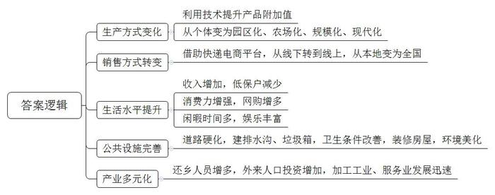
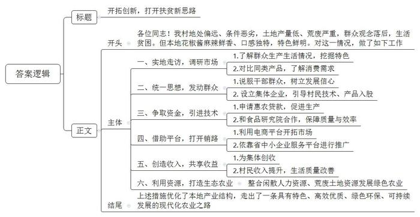
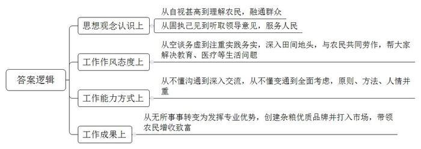
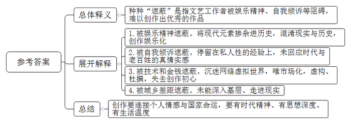
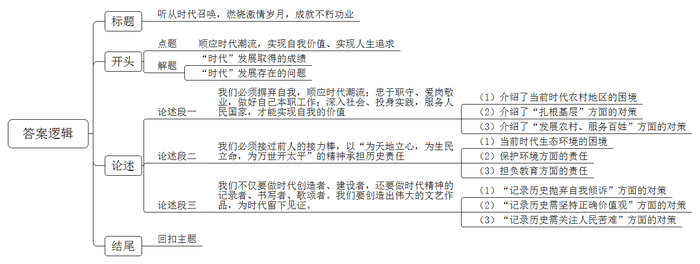

# 2019年国家公考《申论》题（地市级）

> 候选采集稿。参考答案及解析来自粉笔页面，不代表官方答案或真实高分答卷；来源使用许可与原卷对应关系仍需人工核实。

## 给定材料

### 材料 material-aa7d439e1cfddbb8

前些年，小张辞去了城里的工作，回家乡的镇上当了一名快递员。下面是他讲的“三农”新故事：

前些年，快递公司刚进这个镇时，全镇每天收发的包裹只有几十个。到村里送快递，碰到下雨天，三轮车陷入泥里，经常要下来推车，送完快递回来，鞋子上总会沾上半斤烂泥巴。那时挺后悔把城里的工作辞了，感觉很失落。

这几年大家的生活水平上去了，网购的人越来越多，我的业务也好了起来。特别是前年，镇上的快递公司联合农林服务中心、电商协会给大伙上起了包装技术培训课，现在咱这里的瓜果蔬菜都用上了真空包装、低温保鲜技术，快递公司也更乐意接这种订单。有了销路，家里种的就不愁卖了。

比如说吧，咱这里的枇杷很有名。以前，乡亲们摘回枇杷后，要乘两个多小时的公交车到几十公里外的城里火车站广场叫卖。那时，品质优良的枇杷也卖不上好价钱，有时连本钱都挣不回来。如今，镇里的枇杷大部分是通过电商平台销售的。每到枇杷采摘季，镇里的文化广场就会成为快递员的临时收揽点，乡亲们排着队邮寄，场面好不热闹。

现在咱镇里的电商差不多有500多户了。去年镇里投资建了个农产品电子商务产业园，把大家拧在一块闯市场，今年镇上的生意就更好了。加上上个月新开的那家快递公司，我们镇里已经有了4家快递公司。

如今大家腰包里有了钱，心气足了。我同事杨大哥这几年靠送快递，摘了帽，主动要求退出了低保。大伙对生活也讲究了起来，希望村子能漂亮些、路能好走些，闲时有地儿跳跳舞、下下棋。这不，政府投了很多钱搞建设，镇里几个大的村子，都通上了柏油路，路边插上了太阳能路灯，现在我们送快递方便多了。镇边上，搞旅游的那个村子，街两旁不仅修了排水沟、统一摆上了垃圾箱，还把老百姓的房子都整了整，青瓦白墙的，远远看，像画里似的。

最近从城里回来的人，越来越多。要么像咱一样，做做快递，或者在镇里的企业打打工；要么回家接班，种点养点啥，通过快递卖出去，不比打工挣得少，还图个自在。原来乡下的钱往城里跑，现在城里的钱开始喜欢往村子里跑。城里人来我们这投资的越来越多，要么开工厂、搞农产品加工，要么办民宿、搞乡村旅游。

和刚回来那会儿比，我现在心里踏实多了。上个月和爱人商量，打算承包村西头一块撂荒的地，再把周边几家的田一起租过来，像村里老李他们一样，也办个家庭农场。我想只要好好干，生活会越来越好的！

### 材料 material-135f8a8665cd4c63

小赵是省派驻村干部，2015年远赴大山深处的池口村担任村党支部第一书记。下面是他讲的“脱贫攻坚”故事：

我从省城出发，颠簸了10多个小时，才到了池口村。跳下车，映入眼帘的是光秃秃的石甸山。村支书老韩招呼我在村口吃了一碗石甸花椒酱面。虽然花椒麻得嘴好久没有感觉，但是花椒酱独特的鲜香口感让我赞不绝口。老韩在旁边笑着说：“石甸花椒酱可是咱这里的宝贝。”吃完饭，放下行李，老韩陪着我到村里走了走。刚开始我还挺乐观的，看上去这村子不穷啊，但是越往村里走，我的心就越凉。村民老左家的房子没有门，房间里没有家具、家电，屋子的一角堆着一堆杂粮，炕上的被子已经看不出颜色。老左告诉我：池口村地薄、种粮食收成低，只够糊口。除了种地，自己也不知道还能干些啥。现在家里穷，一天只能吃两顿饭。像他这样的人家，村里还有好几户。

回村部的路上，老韩指着周边的大山说：“我们是守着金娃娃挨穷呀！你看，石甸山上1000多亩地，已经荒了十几年了，如果能把这地开发好，起码吃饭就不用愁了。”接下来一个多月，我挨家挨户到农户家走访，一直在想，贫困地区缺什么？种植、养殖技术老百姓都会，但是“应该做什么、怎么做、怎么能卖出去”，这些问题不解决，村子就难以摆脱贫困。问题找到了，怎么破题呢？我想到了石甸花椒酱。这十里八村的家家户户都喜欢用花椒制作花椒酱，一日三餐都离不开它。既然本地这么多人吃，是不是能产业化，做成一个产品呢？同时，制作花椒酱对花椒的需求量特别大，也能带动花椒种植。2015年当年，我几乎走遍了省内的大型超市、批发市场，发现和目前市场上的花椒酱不同，我们石甸花椒酱麻辣鲜香、口感独特，不仅在本地有市场，还有可能借助电商扶贫政策卖到全国去。

有了想法，还要有办法。听说要开发石甸花椒酱，不仅是村民，许多村干部也都不相信。老韩说：“万一卖不出去怎么办？咱们可赔不起啊！”为此，我带着村干部不但到周边县区了解情况，还专程到省食品研究院咨询石甸花椒酱产业化的可行性，请教生产加工、质量检验以及食品安全等问题，排除了花椒酱存在有害成分和菌群超标的可能性。这次调研，统一了大家的思想。老韩说：“小赵书记，咱们村干部都认定你了，今后我们跟着你好好干！”2016年10月，当地第一家村集体企业池口农副产品开发有限责任公司挂牌，村民可以技术入股或半成品入股。我代表公司与省食品研究院、省中小企业公共服务平台签订合作协议，共同开发、推广石甸花椒酱。2017年初，第一批石甸花椒酱上市后，短短几天就销售一空，村民们都乐坏了。仅靠石甸花椒酱一项，去年村集体就实现了66万元的收入。

我始终没有忘记老韩说的石甸山，没事就上去转悠，考虑到底该怎么开发。2015年外出做市场调研时，我看到梅花椒价格非常高，就帮着村里申请到“惠农贷款”，买了1000棵树苗，种到山上。现在，石甸山已经种植梅花椒500多亩，成为池口村的“绿色银行”。现如今，我不管到谁家，都留我吃饭，谁家杀鸡或者杀羊，都会想着我。老韩风趣地说：“小赵书记，你现在是我们这的‘狗不叫干部’，乡亲们的狗见了你不但不叫，还直摇尾巴哩。”

### 材料 material-f277a478117b7e64

小吴是北方某地宁堡村大学生村官。下面是她讲的“成长”故事：2016年，我被组织选派到宁堡村担任村主任助理。那时我觉得自己是大学生，肯定比农民强。村干部和村民们对我都很客气，但就是不分配活儿给我。那时我最大的活儿就是“看家”，大家出去办事，让我守在村部。我也不愿闲着，为了证明自己，一开会我就抢着发言，但不管我说得多么激情澎湃，大家一点反应也没有。第一次下田干活，我就把鞋陷进了泥里，旁边有人说：“这大学生下地还得跟个提鞋的。”

刚到村里，我看很多事不顺眼，总觉得自己在理，大家做事应该按照我的想法来。村里核发水田地补偿款，要量土地，村支书认为我是外村人，能一碗水端平，就让我负责这事。有几个人找我说情，想要皮尺松一点，好多得点补偿。我一点不让，把尺绳拽得紧紧的。结果一位村民当场质问我：“你个外来人，想干啥？”

第一年年终评议会上，有4个人给我投了不合格票。我的委屈突然爆发，回到屋里就哭了，觉得自己表现挺优秀，关键是我也一直想要给村里干事，怎么还受这气？当时，村支书跟我讲了一番话，对我触动很大：“你坚持原则是对的，关键在怎么做。有理还不够，在村里得想办法跟老百姓把理说通。要把理说通，首先你得和大家干在一起。”他建议我，每天到老乡家干农活，一次两个小时。

从那以后，我开始努力学说土方言，走水田地、学农活。每天“服役”两个小时，每次换一家。手掌上的血泡起了破，破了又起，汗水渍透了衣服。我慢慢感受到了农民的不易，也理解了“脚下沾有多少泥土，心中就沉淀多少激情”的含义。一段时间下来，和大家熟络了，村民们从自家娃娃读啥学校、看病到哪个医院、添置家电买啥牌子，到调解邻里矛盾都愿意找我帮忙。村里一户人家因为不满征地补偿，不断上访。那段时间，我不时到他们家串门、唠家常，见他们家生活困难，就帮着申办救济，这户人家深受感动，后来再也没有去闹了。我还发挥自己的专业优势，成功创建本村优质杂粮品牌并打入南方市场，为大家闯出了一条增收致富的新路。去年，我被市里评为优秀大学生村官。

现在，村里人对我的称呼，也渐渐从“那个大学生”变成了“小吴”。“小吴来了啊！”“小吴吃了吗？”上了年纪的，则直接叫我“小吴闺女”。我之前不太把这些话放在心上，体会到这些关心来之不易后，每次听到心里都暖暖的。

## 题目

### 第 1 题

**根据“给定资料**1**”，请概括小张家乡出现的新变化。（15分）**

关联材料：material-aa7d439e1cfddbb8

作答要求：

要求：准确全面，条理清晰。不超过200字。

### 第 2 题

**省里召开扶贫工作座谈会，邀请小赵介绍发展花椒酱产业的经验。根据“给定资料**2**”，请为小赵写一份发言提纲。（20分）**

关联材料：material-135f8a8665cd4c63

作答要求：

要求：

（1）紧扣资料，内容具体；

（2）语言简明，有逻辑性；

（3）不超过400字。

### 第 3 题

**根据“给定资料**3**”，请分析小吴发生了哪些变化，使得村民们对她的称呼从“那个大学生”变成了“小吴”。（10分）**

关联材料：material-f277a478117b7e64

作答要求：

要求：准确全面，恰当提炼，条理清晰。不超过200字。

### 第 4 题

**“给定资料**4**”中的座谈会上，主持人说：“如果不能打破这种种‘遮蔽’，就拿不出有份量的作品。”请谈谈你对“种种‘遮蔽’”的理解。（15分）**

关联材料：material-aa7d439e1cfddbb8

作答要求：

要求：观点明确，紧扣资料，准确全面。不超过200字。

### 第 5 题

**“给定资料**5**”提到“跟着时代的大潮往前走，尽到我所有的力量，做好我要做的事情”，请深入思考这句话，自选角度，联系实际，自拟题目，写一篇文章。（40分）**

关联材料：material-aa7d439e1cfddbb8

作答要求：

要求：

（1）观点明确，见解深刻；

（2）参考“给定资料”，但不拘泥于“给定资料”；

（3）思路清晰，语言流畅；

（4）字数1000～1200字。

## 答案与解析

第 1 题

**参考答案（粉笔题库参考内容）**

一、生产方式变化。利用技术提升产品附加值；从个体变为园区化、农场化、规模化、现代化。

二、销售方式转变。借助快递电商平台，从线下转到线上，从本地变为全国。

三、生活水平提升。收入增加，低保户减少；消费力增强，网购增多；闲暇时间多，娱乐丰富。

四、公共设施完善。道路硬化，建排水沟、垃圾箱，卫生条件改善，装修房屋，环境美化。

五、产业多元化。还乡人员增多，外来人口投资增加，加工工业、服务业发展迅速。

**解析**

**参考答案说明：**参考答案从“生产方式变化”“销售方式转变”“生活水平提升”“公共设施完善”“产业多元化”等五个方面进行了分条撰写。各条要点之间在内容上是并列关系，没有交叉。并且撰写每条要点时，都提炼出了概括性强的总结词并前置，满足了题目要求的“概括”这一要求。

**考点**：考点变化类

**来源**：来源2019年国家公考《申论》题（地市级）

粉笔申论页面对本题只提供「解析视频」入口，该入口是会员推广位，页面无视频地址与文字解析。

第 2 题

**参考答案（粉笔题库参考内容）**

开拓创新，打开扶贫新思路

各位同志！我村地处偏远、条件恶劣，土地产量低、荒废严重，群众观念落后，生活贫困。但本地花椒酱麻辣鲜香、口感独特，特色鲜明。对这一情况，做了如下工作：

一、实地走访，调研市场。1.了解群众生产生活情况，挖掘特色；2.对比同类产品，了解消费需求。二、统一思想，发动群众。1.说服干部群众，树立发展信心；2.设立集体企业，引导村民技术、产品入股。三、争取资金，引进技术。1.申请惠农贷款，促进生产；2.和食品研究院合作，保障质量与效率。四、借助平台，打开销路。1.利用电商平台开拓市场；2.依靠省中小企业服务平台进行推广。五、创造收入，共享收益。1.为集体创收；2.村民收入提升，生活质量改善。六、利用资源，打造生态农业。整合闲散人力资源、荒废土地资源发展绿色农业。

上述措施优化了本地产业结构，走出了一条具有特色、高效优质、绿色环保、可持续发展的现代化农业之路。

**解析**

**参考答案说明**：（1）本题要求撰写“一份发言提纲”，一般不需考虑格式，只写正文部分，保险起见可加上标题。（2）正文部分，一方面从内容来看，围绕着“发展花椒酱产业的经验”这一主题，本参考答案的开头先写到了“池口村的问题、发展花椒酱产业的背景”；主体部分从“实地走访，调研市场”“统一思想，发动群众”“争取资金，引进技术”“借助平台，打开销路”“创造收入，共享收益”“利用资源，打造生态农业”等六个方面给出了具体对策。另一方面，形式上，本参考答案做到了分段、分条撰写，整体上条理较为清晰。

  

**考点**：考点总结类

**来源**：来源2019年国家公考《申论》题（地市级）

粉笔申论页面对本题只提供「解析视频」入口，该入口是会员推广位，页面无视频地址与文字解析。

第 3 题

**参考答案（粉笔题库参考内容）**

一、思想观念认识上，从自视甚高到理解农民，融通群众；从固执己见到听取领导意见，服务人民。

二、工作作风态度上，从空谈务虚到注重实践务实，深入田间地头，与农民共同劳作，帮大家解决教育、医疗等生活问题。

三、工作能力方式上，从不懂沟通到深入交流，从不懂变通到全面考虑，原则、方法、人情并重。

四、工作成果上，从无所事事转变为发挥专业优势，创建杂粮优质品牌并打入市场，带领农民增收致富。

**解析**

**参考答案说明：**答案从“思想观念认识”“工作作风态度”“工作能力方式”“工作成果”四个方面进行了分条撰写。各条要点之间在内容上是并列的。并且撰写每条要点时，都提炼出了概括性强的总结词并前置。

**考点**：考点变化类

**来源**：来源2019年国家公考《申论》题（地市级）

粉笔申论页面对本题只提供「解析视频」入口，该入口是会员推广位，页面无视频地址与文字解析。

第 4 题

**参考答案（粉笔题库参考内容）**

种种“遮蔽”是指文艺工作者被娱乐精神、自我倾诉等阻碍，难以创作出优秀的作品。

1.被娱乐精神遮蔽。将现代元素掺杂进历史，混淆现实与历史，创作娱乐化。

2.被自我倾诉遮蔽。停留在私人性的经验上，未回应时代与老百姓的真情实感。

3.被技术和金钱遮蔽。沉迷网络虚拟世界，唯市场化，虚构、杜撰，失去创作初心。

4.被城乡差距遮蔽。未能深入基层、走进现实。

创作要连接个人情感与国家命运，要有时代精神、有思想深度、有生活温度。

**解析**

**参考答案说明：**思路方面，本参考答案按照词句解释题“总体释义+展开解释+总结”的一般答题思路展开。内容方面，本参考答案先对“遮蔽”的含义进行了解释；“展开解释”部分分析了“遮蔽”的具体体现；最后进行了总结。

**考点**：考点词句解释类

**来源**：来源2019年国家公考《申论》题（地市级）

粉笔申论页面对本题只提供「解析视频」入口，该入口是会员推广位，页面无视频地址与文字解析。

第 5 题

**参考答案（粉笔题库参考内容）**

**听从时代召唤，燃烧激情岁月，成就不朽功业**

这是一个美好的时代，经济发展、人民富裕、国家兴旺，各行各业日新月异、一日千里；这是一个迷失的时代，经济发展让一些人沉迷于个人享乐、感受、欲望中不能自拔而迷失方向；这是一个失衡的时代，当发达地区的城市金迷纸醉时，一些偏远农村依然生活困苦。

作为时代之子，我们需要回应时代关切，紧跟时代浪潮，关注现实、社会、他人、生命，提升个人生命层次境界，跟随时代步伐，恪尽职守，爱岗敬业，利国利民，把个人的追求和国家人民的利益结合起来，担当时代赋予的历史使命。

得其大者可以兼其小，**我们必须摒弃自我，顺应时代潮流；忠于职守、爱岗敬业，做好自己本职工作；深入社会、投身实践，服务人民国家，才能实现自我的价值。**我们要充分认识到：一个人只有超越了自我，才能更好地实现自我。我们必须看到，当前我国还有一些地区很落后，部分农村地区还没摆脱贫困。我们要继承发扬彭士禄等先辈们吃苦耐劳的精神，深入基层深入农村，不怕苦不怕累，和人民同吃同住同劳动，努力增加农民收入、改善农民生活。要因地制宜，充分利用资源，抓住新时期、新条件下的先进技术和商业模式，利用互联网平台等多种方式，促进农业发展的现代化，从根本上改善农村的产业结构，优化农民的收入结构，为实现2020年全面脱贫的伟大时代理想添砖加瓦。

我们不仅要对自己、人民、国家负责，还要对历史负责，要让自己有限的生命融入无限的服务社会人民的事业中，做出经得起时间检验和历史拷问的贡献，让短暂的生命固化为历史的永恒。忘记历史就意味着背叛，每个人都生活在历史中，现在的幸福生活是前人创造的。

每一代人有每一代的使命、责任和担当，**我们必须接过前人的接力棒，以“为天地立心，为生民立命，为万世开太平”的精神承担历史责任。**当前我们经济虽取得巨大进步，但有不少是以牺牲环境浪费资源为代价的。未来，我们必须加强保护环境、改善生态，走可持续发展道路。被誉为“沙漠愚公”的阿拉善盟政协主席苏和回到老家额济纳旗，在大漠中的黑城遗址旁植树造林，10年间种植的梭木林达到了3000亩，为守卫子孙后代的生存基础做出了巨大贡献。对历史负责不仅仅体现在环境方面，还体现在教育方面。知识就是力量，在新时期新条件下，教育显得尤其重要。河南南阳市镇平县黑虎庙小学张玉滚老师，是我们的榜样，他在山区任教17年，为山区培养出16名大学生，改变了孩子们的命运。

**我们不仅要做时代创造者、建设者，还要做时代精神的记录者、书写者、歌颂者。我们要创造出伟大的文艺作品，为时代留下见证。**文艺创作要抛弃个人情感的自我倾诉，拨开技术、金钱的“遮蔽”，面向现实、大众、实践、社会。创作一定要坚持正确价值观，坚定不移地走人民艺术的道路，必须警惕在创作中的个人主义、历史虚无主义和相对主义。创作要关乎“痛痒”，要对人民群众的苦难有痛彻肺腑的怜悯之情，要把个人的情感和人民喜怒哀乐紧密相连。我国著名的艺术家阎肃的作品之所以为人喜爱，就是因为他的作品贴近生活实际、反映时代关切，回应了时代呼唤。

朋友们，让我们共同紧跟时代潮流，回应时代关切，担当时代使命，推动时代发展，用我们的勤劳、智慧、汗水和理想去重塑和浇灌出新时代这朵娇艳的奇葩吧！

**解析**

**文章分析**

**听从时代召唤，燃烧激情岁月，成就不朽功业**

【**标题的优点：**首先，范文的标题“听从时代召唤，燃烧激情岁月，成就不朽功业”突出了“顺应时代潮流，实现自我价值、实现人生追求”这一主题。其次，它在形式上采用了三段式标题，使标题更加完整、饱满，富有逻辑性。】

（1）这是一个美好的**时代**，经济发展、人民富裕、国家兴旺，各行各业日新月异、一日千里；（2）这是一个迷失的时代，经济发展让一些人沉迷于个人享乐、感受、欲望中不能自拔而迷失方向；这是一个失衡的时代，当发达地区的城市金迷纸醉时，一些偏远农村依然生活困苦。

【**开头的优点：★内容方面。**范文的开头是紧扣“顺应时代潮流，实现自我价值、实现人生追求”这一主题展开的。首先，开头在段首处点出主题，做到了主题明确。其次，对“顺应时代潮流，实现自我价值、实现人生追求”这一主题进行了分析阐述，指出了（1）“时代”发展取得的成绩；（2）“时代”发展存在的问题。**★文字表达方面。**使用了排比句式，增强了文章的气势，使语言表达有节奏感。】

作为时代之子，我们需要**回应时代关切，紧跟时代浪潮，关注现实、社会、他人、生命，提升个人生命层次境界，跟随时代步伐，恪尽职守，爱岗敬业，利国利民，把个人的追求和国家人民的利益结合起来，担当时代赋予的历史使命**。

【**过渡段****1****的优点：**范文的过渡段是紧扣文章的核心观点展开的。内容上，总结性地指出了时代之子应具有的时代责任。形式上，独自成段，位置靠前，更好地突出了文章主题。】

得其大者可以兼其小，**我们必须摒弃自我，顺应时代潮流；忠于职守、爱岗敬业，做好自己本职工作；深入社会、投身实践，服务人民国家，才能实现自我的价值。**我们要充分认识到：一个人只有超越了自我，才能更好地实现自我。我们必须看到，（1）当前我国还有一些地区很落后，部分农村地区还没摆脱贫困。（2）我们要继承发扬彭士禄等先辈们吃苦耐劳的精神，深入基层深入农村，不怕苦不怕累，和人民同吃同住同劳动，努力增加农民收入、改善农民生活。（3）要因地制宜，充分利用资源，抓住新时期、新条件下的先进技术和商业模式，利用互联网平台等多种方式，促进农业发展的现代化，从根本上改善农村的产业结构，优化农民的收入结构，为实现2020年全面脱贫的伟大时代理想添砖加瓦。

【**论述段****1****的优点：★观点句：**范文的观点句是紧扣“顺应时代潮流，实现自我价值、实现人生追求”这一文章主题提出的。形式上，它在段首处直接写出，位置突出，容易发现。内容上，关键词突出，内容要点明确，可以明显看出它是从“服务人民”这一角度入手，指出了“如何顺应时代潮流，实现自我的价值”。**★论述内容：**（1）介绍了当前时代农村地区的困境；（2）介绍了“扎根基层”方面的对策；（3）介绍了“发展农村、服务百姓”方面的对策。以上三个方面的内容都是紧扣“必须摒弃自我，顺应时代潮流；忠于职守、爱岗敬业，做好自己本职工作；深入社会、投身实践，服务人民国家，才能实现自我的价值”这个观点句进行分析论述的，论述的针对性强，内容层次丰富。最后，在论述方法上主要采取了讲道理和举例子相结合，做到了丰富多样。】

我们**不仅要对自己、人民、国家负责，还要对历史负责**，要让自己有限的生命融入无限的服务社会人民的事业中，做出经得起时间检验和历史拷问的贡献，让短暂的生命固化为历史的永恒。忘记历史就意味着背叛，每个人都生活在历史中，现在的幸福生活是前人创造的。

【**过渡段****2****的优点：**范文的过渡段中的“不仅要对自己、人民、国家负责，还要对历史负责”，起到了承接论述段1，引出论述段2的作用。】

每一代人有每一代的使命、责任和担当，我们**必须接过前人的接力棒，以“为天地立心，为生民立命，为万世开太平”的精神承担历史责任。**当前我们经济虽取得巨大进步，（1）但有不少是以牺牲环境浪费资源为代价的。未来，（2）我们必须加强保护环境、改善生态，走可持续发展道路。被誉为“沙漠愚公”的阿拉善盟政协主席苏和回到老家额济纳旗，在大漠中的黑城遗址旁植树造林，10年间种植的梭木林达到了3000亩，为守卫子孙后代的生存基础做出了巨大贡献。（3）对历史负责不仅仅体现在环境方面，还体现在教育方面。知识就是力量，在新时期新条件下，教育显得尤其重要。河南南阳市镇平县黑虎庙小学张玉滚老师，是我们的榜样，他在山区任教17年，为山区培养出16名大学生，改变了孩子们的命运。

【**论述段****2****的优点：★观点句：**范文的观点句是紧扣“顺应时代潮流，实现自我价值、实现人生追求”这一文章主题提出的。形式上，它在段首处直接写出，位置突出，容易发现。内容上，关键词突出，内容要点明确，可以明显看出它是从“历史责任”这一角度入手，指出了“如何顺应时代潮流，实现自我的价值”。**★论述内容：**（1）介绍了当前时代生态环境的困境；（2）介绍了历史责任之一——“保护环境”方面的对策；（3）介绍了历史责任之一——担负教育方面的对策。以上三个方面的内容都是紧扣“我们必须接过前人的接力棒，承担历史责任”这个观点句进行分析论述的，论述的针对性强，内容层次丰富。最后，在论述方法上主要采取了讲道理和举例子相结合，做到了丰富多样。】

我们不仅要做时代创造者、建设者，**还要做时代精神的记录者、书写者、歌颂者。我们要创造出伟大的文艺作品，为时代留下见证。**（1）文艺创作要抛弃个人情感的自我倾诉，拨开技术、金钱的“遮蔽”，面向现实、大众、实践、社会。（2）创作一定要坚持正确价值观，坚定不移地走人民艺术的道路，必须警惕在创作中的个人主义、历史虚无主义和相对主义。（3）创作要关乎“痛痒”，要对人民群众的苦难有痛彻肺腑的怜悯之情，要把个人的情感和人民喜怒哀乐紧密相连。我国著名的艺术家阎肃的作品之所以为人喜爱，就是因为他的作品贴近生活实际、反映时代关切，回应了时代呼唤。

【**论述段****3****的优点：★观点句：**范文的观点句是紧扣“顺应时代潮流，实现自我价值、实现人生追求”这一文章主题提出的。形式上，它在段首处直接写出，位置突出，容易发现。内容上，关键词突出，内容要点明确，可以明显看出它是从“记录时代”这一角度入手，指出了“如何顺应时代潮流，实现自我的价值”。**★论述内容：**（1）介绍了“记录历史抛弃自我倾诉”方面的对策；（2）介绍了“记录历史需坚持正确价值观”方面的对策；（3）介绍了“记录历史需关注人民苦难”方面的对策。以上三个方面的内容都是紧扣“要做时代精神的记录者、书写者、歌颂者。我们要创造出伟大的文艺作品，为时代留下见证”这个观点句进行分析论述的，论述的针对性强，内容层次丰富。最后，在论述方法的选取上，讲道理比较充分。】

【**论述段之间的关系：★内容的内在逻辑：**范文的论述段之间是依照并列逻辑展开的。论述段1先写了“在服务百姓方面的人生追求”，论述段2再写了“在历史责任方面的人生追求”，论述段3接着写了“在记录历史方面的人生追求”。**★段与段的外在衔接：**论述段3段首处的“我们不仅要做时代创造者、建设者，还要做时代精神的记录者、书写者、歌颂者。我们要创造出伟大的文艺作品，为时代留下见证”，起到了承接论述段2、引出了论述段3的作用。】

朋友们，（1）让我们共同**紧跟时代潮流，回应时代关切**，担当时代使命，推动时代发展，（2）用我们的勤劳、智慧、汗水和理想去重塑和浇灌出新时代这朵娇艳的奇葩吧！

【**结尾的优点：**范文的结尾回扣了“顺应时代潮流，实现自我价值、实现人生追求”这一主题。（1）再次提到了“顺应时代潮流，实现自我价值、实现人生追求”；（2）发出了号召。】

**考点**：考点文章写作题

**来源**：来源2019年国家公考《申论》题（地市级）

粉笔申论页面对本题只提供「解析视频」入口，该入口是会员推广位，页面无视频地址与文字解析。

