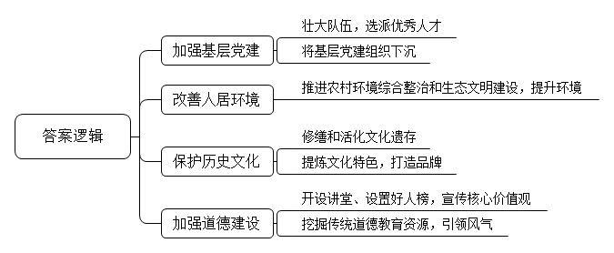
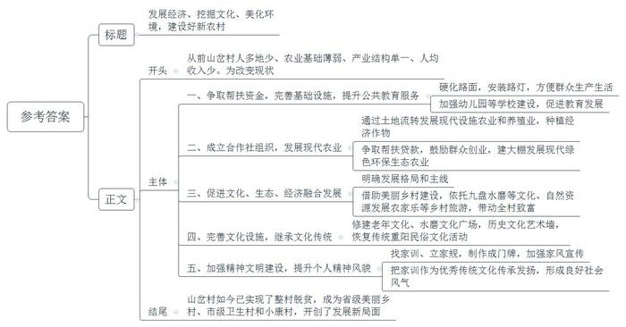
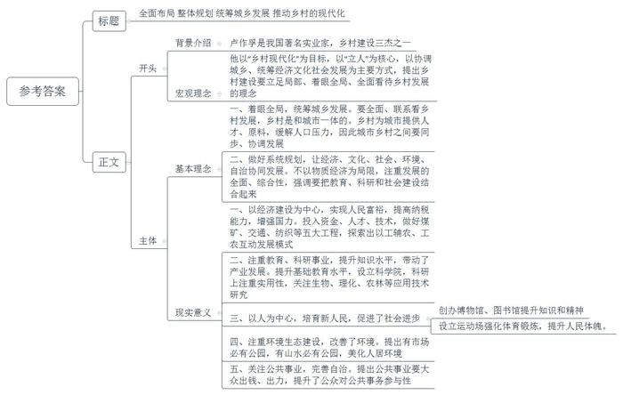
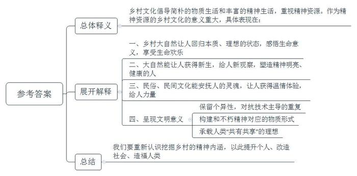
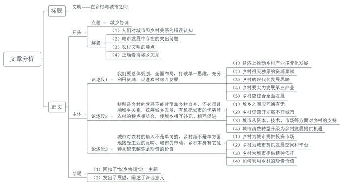

# 2019年国家公考《申论》题（副省级）

> 候选采集稿。参考答案及解析来自粉笔页面，不代表官方答案或真实高分答卷；来源使用许可与原卷对应关系仍需人工核实。

## 给定材料

### 材料 1

S市积极响应十九大报告中“要坚持农业农村优先发展，按照产业兴旺、生态宜居、乡风文明、治理有效、生活富裕的总要求”，坚持将乡风文明建设放在全市发展大局中进行谋划，大力推动农村综合改革、美丽文明村居建设、基层大治理等工作，把乡风文明建设作为重要内容加以部署。为加强基层治理，推动乡村振兴，今年3月13日，S市召开工作大会，对村居建设作了整体部署：到今年年底完成30个美丽文明和谐示范村建设，到2020年年底完成50个示范村居、5个标杆村居建设，按照典型引领、整体推进、总体提升的方针，将乡风文明建设进一步推向深入。

S市一直重视基层党建工作，大力实施固本强基工程，突出村级党组织领导核心作用，按照“党领导一切”原则出台了一系列政策，努力健全以党建为统领、以法治为核心的基层治理体系，通过党组织的有力领导，促进矛盾纠纷的化解和法治观点的强化，逐步提高乡风文明水平。

今年S市选派了104名机关干部任村居第一书记，公开招考205名优秀大学生担任村干部，并推进基层党建下沉到村民小组，落实支部建在小组上。该市党建工作示范村A村牢记习近平总书记“农村党建要让群众更满意”的殷切期望，积极探索“党建+”融合基层治理发展模式，以党建引领基层自治、共治、法治、德治。

S市注重提升城市形态，大力推动城市升级，“美城行动”从中心城区延伸到村居社区。在乡风文明建设过程中，S市以改造乡村人居环境为核心，深入推进农村环境综合治理和生态文明建设，全面提升农村整体环境，取得了明显成效，绿化、美化水平显著提升。

S市共投入2000多万用于文化遗存的修缮和活化。全市现有国家级、省级、市级非物质文化遗产共28项，国家级、省级、市级非遗传承人共27人。S市坚持“一村居一品牌”的工作思路，挖掘提炼村居历史文化特色，打造村居文化品牌活动。

目前全市已建成30个村居主题公园，143个农村公民道德讲堂，每个村居都设置了善行义举榜或好人榜，让核心价值观随处可见、随时可学、随心可感。

S市不断加强核心价值观宣传教育，推进主题公园、标识景观、公益广告建设，开展农村道德模范和身边好人学习宣讲活动，引导村民树立正确价值观念。同时，S市还大力加强农村思想道德建设，深入挖掘农村传统道德教育资源，引导村民在思想观念、道德规范、知识水平、素质修养、行为操守等方面继承和弘扬优良传统，形成积极、健康、向上的社会风气和精神风貌。

### 材料 2

有着良好区位优势和自然条件的Y县城关镇山岔村，多年来却受人多地少、农业基础薄弱、产业结构单一等因素制约，2012年全村人均纯收入仅为3800元，约三成的人口处在贫困线下。在各方努力下，该村2013年实现了整村脱贫，2015年建成省级美丽乡村，2016年被评为市级卫生村，2017年列入小康村建设项目。日前，调研组对山岔村进行了调研，以下是调研记录：

村党支部书记L介绍说，为了彻底改变贫困面貌，2013年，村上联系帮扶单位省环保厅、相关银行，反映发展意见，争取帮扶资金。山岔村通过整合帮扶资金，建成了180平方米的文化宣传基地，安装太阳能路灯10盏，硬化村内道路3公里，硬化西环路至山岔村道路3.5公里，还积极争取财政、建设、文化、扶贫等部门资金，实施了清溪小学及幼儿园新建工程。

该村还积极鼓励农户成立合作社，通过土地流转，形成合作社式的劳作模式，发展现代设施农业、养殖业，并引导群众有计划地种植经济作物。

杨自龙家以前是村里有名的贫困户。原本东奔西走做临时工的他，在村党支部的鼓励下，争取到帮扶贷款90万元以及村级发展互助资金协会所注入的资金30万元，牵头成立了吉隆田农产品产销专业合作社，先后搭建起17座大棚种植草莓。因为绿色环保，来采摘的人很多，经济收入年年增长。

据记载，山岔村以前有九盘水磨，它们在清朝同治年间被焚烧殆尽。清光绪初年，本村村民王生贵、王好存父子重新修建一盘水磨，用于解决老百姓无处磨面的问题，加工场面十分红火。这盘具有传奇色彩的水磨保留到了今天，它不但让后人了解先辈生活，也激励了大家齐心奔小康的勇气，被Y县人民政府授为县文物保护单位。

“我们确立了‘一心多景、一轴三廊、四片联动’发展格局。”城关镇党委书记X如是说。他介绍，山岔村2014年被纳入了市级美丽乡村建设行列，城关镇抓住这一机遇，积极为该村出良策，确定以“传承九磨文化、做足山水文章”为主线，因地制宜发展乡村旅游业。该村下决心把发展乡村旅游作为带动全村致富的一个新举措，依托自然资源，发挥山岔村天然水源的优势，彰显历史印记，融合文化元素，做活水的文章，打造避暑休闲的美丽村庄。

L书记说，该村2014年修建了占地650平方米的老年文化活动广场，2015年利用省市县三级配套资金打造了占地7800平方米的水磨文化广场，2016年建成了2000平方米的人造草坪球场并精心打造了400米长的历史文化艺术墙。这些设施不仅丰富了群众文化生活，而且使村民在潜移默化中受到教育，社会风气也越来越好。

山岔村古时就因县八景之一的“烽火夕照”而负盛名。夕阳将落未落之时，晚霞赤红如血，涂遍半边天空，如一幅色彩溢漾的油画。置身此处，山川河流尽收眼底，其景象在夏日最为艳丽壮观。据此，山岔村2016年建成烽火夕照长城墙、山神庙观景平台和小游园，同时恢复了重阳民俗文化活动。

“我们村已通过省、市美丽乡村建设验收，打造了一个不要门票的乡村旅游景点。到这里来，能品野菜、听蛙声、忆水磨、体验农耕文化，看得见山，望得见水，留得住乡愁。”L书记高兴地告诉我们。

依托美丽乡村建设，部分村民办起了农家乐。周云是村里的致富带头人，2014年市级美丽乡村建设时，他看到了商机，有效利用自家宅院，开办“农家乐”。“道路全部硬化，环境干净整洁，景观美丽还有故事，这吸引来了不少游客，生意一天比一天好，1个月纯利润有1万多元。”周云笑呵呵地说。

L书记介绍说：“周云的农家乐开办为山岔村的乡村旅游业发展开了个好头，好多村民纷纷效仿，家庭收入开始增长，生活条件明显好转了。可是新的问题出现了，男人们一闲下来就喝酒，女人们一闲下来就传闲话。镇、村都意识到了这个问题。习近平总书记说，‘实施乡村振兴战略要物质文明和精神文明一起抓，特别要注重提升农民精神风貌。’我们全面落实习近平总书记的有关指示，大力倡导文明树新风。”他指着一些农家大门边墙说：“精神文明建设的第一步就是从每一家找家训、立家规，然后制作成漂亮的牌子挂在门口，时时提醒着进出的每一个人。”他强调，家和万事兴，家庭和睦、邻里亲近，做任何事都容易。

山岔村把家训作为优秀传统文化传承发扬，在全村范围内从家谱村史、牌匾楹联、经典家训中广泛征集好家训，使该村成为户户挂家训、家家立家规的“家训村”，以文明家风推动良好社会风气形成。周云家的大门口贴的是“家庭和谐、邻里相亲”，对于周云来说，好的家训是他家庭和睦、创业致富的根本。周云说：“自从挂上了家训牌，全村的人就开始讨论张家或者李家的家风，不但监督别人，而且反观自己、要求自己、教育孩子。大家和睦相处，邻里亲近。”

### 材料 3

某学者发表文章，介绍了中国现代史上著名实业家卢作孚在乡村建设方面做出的历史贡献。该文章摘录如下：

卢作孚于1893年出生在原四川省合川县一个世代农耕的家庭。作为一个没有念过大学的农家子弟，他却创造了中国现代经济史、社会史、文化史、教育史上的奇迹。卢作孚创办的民生公司是中国近现代最大最有影响的民营企业集团之一。

1927年，卢作孚开始在中国西部开展以北碚为中心的嘉陵江三峡乡村建设实验，被誉为“北碚之父”，和晏阳初、梁漱溟并称中国现代史上“乡村建设三杰”。他的核心思想是：中国的现代化，基础在“乡村现代化”。他认为：“乡村是不断供给城市人口的地方。如因教育缺乏，供给的都是无知识的人口，那不惟于城市文明没有帮助，反而妨碍不小。乡村教育不发达，不但是乡村问题，而且变成城市问题了。”而“乡村经济事业如没有（和城市）同样的速度进展，亦必引起城市原料的恐慌”，大量农村人口涌向城市，“城市人口无休止地逐渐增多，更会成了城市问题。”——这些近百年前说的话，仿佛针对的就是当下的现实。他始终抓住城市与乡村发展的关系，来思考中国的发展问题，从而突出乡村建设的基础意义，抓住了要害。

“乡村现代化”，既是一个奋斗目标，更规定了推动乡村运动的范围与方法。这也是最具启发性之处：从事乡村运动，既要落实为一个个具体问题（教育问题、救济问题等）的解决，但又不能局限于此，要有一个“乡村现代化”的大视野、大目标，既立足局部，又着眼全局。

卢作孚在设计嘉陵江三峡乡村建设时，一开始就提出了“要将嘉陵江三峡布置成为一个生产的区域、文化的区域、游览的区域”的目标，并且具体规划为经济建设、文化教育建设、社会建设、环境建设、自治建设等几个方面。这表明，卢作孚的“乡村现代化”是一个“全面现代化”的概念，并不局限为物质的建设，而追求乡村政治、经济、文教、社会、环境的全方位的改革。其一，卢作孚规划中的文化教育建设，不仅以“教育事业”为中心，而且把“研究事业”放在突出的位置。在他看来，乡村建设必须建立在科学研究的基础上，他因此强调服务于乡村建设的研究，“要注意应用的方面，有生物的研究，有理化的研究，有农林的研究，有医药的研究，有社会科学的研究”。后来北碚建立了西部科学院，就具体体现了他的这一思想。在城镇设立研究机构，当时这在全国是一个独创。其二，卢作孚特别重视社会建设。他不仅积极发展公共文化娱乐建设，创办博物馆、图书馆、运动场，而且大力推动“公共事业”，开展“社会工作的运动”，这背后又是“人”的建设。他要通过这些公共事业，培育新的“人民”：“皆有职业，皆受教育，皆能为公众服务，皆无（不良）嗜好，皆无不良习惯”。其三，他对环境建设也倾注极大热情，提出“凡有市场必有公园，凡有山水雄胜的地方必有公园”，他的理想是把北碚乡村建设实验区建设成“皆清洁，皆美丽，皆有秩序，皆可居住”的人间净土、乐园。其四，他在推动乡村社会建设时，特别关注的是，所有的公共事业，都要“大众出钱，大众出力，而且是大众支持。由这些具体的活动引起大众管理公共事务的兴趣，以形成大众管理公共事务的方式”。

如何着手乡村现代化？卢作孚的回答是：“政治、经济、文化这三方面的建设诚当并重，但更当以经济建设为中心，更当集中一切力量于经济建设。”只有经济建设的发展，才能“增进人们的富力”，人民富裕了，才能增进其“完纳赋税的负担力”，从而增强国力。而卢作孚更要强调的，是“经济活动为国家最大多数人所必须参加的活动”，经济建设是最能动员最广泛的民众参与的。

他自己也身体力行，以民生实业公司总经理和北碚峡防局局长的双重身份，动员民生实业公司的财力、物力和人才、技术优势，全力支持北碚峡区的乡村建设，着手五大工程建设，即投资煤业，开创峡区煤矿业；投资交通业，修筑铁路；投资纺织业，建立大明染织厂；投资科学研发，创建科学院、博物馆；投资教育，创办兼善实业股份有限公司，以企业养学校。而民生公司自身也从中获得了发展新机遇：不仅获得经济利益，而且利用乡村建设所提供的良好的社会、学习环境，培训了近千名的建设骨干人才。卢作孚力图构建一个“以工辅农，工（工商业）农（乡村建设）互动”的发展模式，其意义和影响是深远的。这一点在强调以工哺农，建设新农村的今天，就看得更加清楚了。

卢作孚乡村建设思想最核心的一个层面，即他所提出的“训练人是一切问题的中心问题”的命题与任务。他提出以“人人都能自立，人人都能立人”为乡村建设的根本目标。这应该包含两层意思：一是乡村现代化建设最终要落实到“立人”，即我们今天所说的“人的现代化”。二是乡村现代化建设又要依靠“人人都能自立”的建设者去推动。

### 材料 4

关于如何重新认识乡村生活的意义，有学者撰文指出：

美国作家梭罗曾经倡导一种简朴的物质生活和丰富的精神生活，他28岁时只身一人来到家乡城外的瓦尔登湖，自建小木屋，自耕自食两年有余，“过一种经过省察的生活，去面对人生最本质的问题”。可以说，梭罗在乡村生活中重新发现了我们在城市的现代文明中过分重视物质资源而失去的东西，进而启发我们思考“作为精神资源的乡村文化”对人类所具有的重要意义。

人在乡村中，最能感受到大自然的熏陶。“人在自然中”，真正地“脚踏大地，仰望星空”，这本身就是一个最基本、最重要、最理想的生存状态，同时也是最基本、最重要、最理想的教育状态。别的不说，单是在乡居生活中能够每天“按时看日出”（这是作家福楼拜提出的一个著名的生命命题），就足以使我们感悟生命的意义，尽享生命的欢乐了。梭罗曾因看早晨的阳光，而产生“黎明的感觉”，即每天都以新的眼光，以一种新鲜感去重新观察、重新发现已经司空见惯的生活，从而获得新生。作家M说，在大自然中，“体验阳光，体验美，体验幸福，体验纯净，体验温馨，体验柔情，体验思念和怀想，这样的精神生活，这样的心理空间，实在太有魅力”。正是在大自然中，我们成为一个“精神明亮的人”，这才是一个健康的人。

“仁厚黑暗的地母呵，愿在你怀里永安她的魂灵！”鲁迅在《阿长与<山海经>》的结尾书写的“地母”，很容易让人联想到希腊神话里的英雄安泰，他在失败之时总是投向大地，从母亲那里获得力量。鲁迅对故乡民间世界的依恋也颇类似于此。民间文化伴随着童年记忆构成他回忆中极具温情的人生体验，他对民间风俗的津津乐道，对民间人物不无温情的回顾都表现出民间文化对他的吸引力。鲁迅正是在他家乡的民俗、民间文化的熏陶下被培育出来的。

在中国，有一位当代作家H，他也在农村建屋，自由游走、生活在城市与乡村之间。H认为，人们对乡村的“投奔”，实质上是在投奔乡村所呈现的“文明意义”，这种“文明意义”有三：其一是自然造化的“没有一片叶子是完全相同”的“个异性”，而这样的个异性在严格雷同的“技术高精度”和大量重复的“规模经济”中已经被完全摒除。其二是“永恒”的感觉，“除了不老的青山、不废的江河、不灭的太阳，还有什么东西更能构建与不朽精神相对应的物质形式”。其三是“共有共享”的理想，“大自然无比高远和辽阔的主体，至少到目前为止还无法被任何人专享与收藏，只可能处于人类共有和共享的状态”。

### 材料 5

“城市和农村要互补发展，”某官员日前指出，“有些经济学家总是简单地认为，只要把农村的人口搬到城市里来，就完成了城镇化，生产效率会自动提高、社会分工会自动推进，这其实是有问题的。”该官员特别强调了一个误区，即将城乡一体化变为城乡“一样化”。当前，村庄大量被拆，数量急剧减少，部分基层干部梦想一步就把农村变成城市。其所造成的后果不是城乡互补发展，而是城乡“一样化”，这不仅可能导致宝贵的乡土旅游资源的丧失，也不利于现代化农业的建设。

据此，该官员认为，未来的城镇化发展应该坚持“两条腿”并行，城市、农村协调统一，宜城则城、宜乡则乡，统筹区域发展、体现地方特色、做好产业支撑、保证公共服务、保护生态环境，让农村和城市同样美丽。

有专家指出，我们在城乡关系认识上存在一些误区。他认为，不是城市文明高于农村文明，也不是农村文明高于城市文明，两者是相互依存、功能互补的关系，所以既不能把城市文明凌驾于乡村文明之上，也不能把乡村文明凌驾于城市文明之上。

城市文明和乡村文明，人造文明和自然文明，都是应该而且可以互补的；理想的生活状态可能还是在城、乡之间自由游走。

## 题目

### 第 1 题

**根据“给定资料**1**”，概括****S****市在乡风文明建设方面的举措。（****10****分）**

关联材料：material-1

作答要求：

要求：全面、准确，不超过150字。

### 第 2 题

**假如你是被派到****Y****县的调研组的一员，请根据“给定资料**2**”中的调研记录，就山岔村值得肯定的做法写一份调研报告提纲。（****20****分）**

关联材料：material-2

作答要求：

要求：

（1）紧扣资料，要点完整；

（2）内容具体，条理清晰；

（3）不超过500字。

### 第 3 题

**某省政府举办了一个农村发展战略研习班，其中一项研习内容是“卢作孚的乡村建设构想”。假如你是工作人员，请根据“给定资料**3**”，围绕卢作孚的乡村建设理念及其现实意义，写一份导学材料，以指导学员更好地学习。（****20****分）**

关联材料：material-3

作答要求：

要求：

（1）内容全面、准确；

（2）层次清楚，分条作答；

（3）不超过600字。

### 第 4 题

**根据“给定资料**4**”，谈谈你对“作为精神资源的乡村文化”的理解。（****10****分）**

关联材料：material-4

作答要求：

要求：准确、全面、有条理。不超过250字。

### 第 5 题

**“给定资料**5**”结尾写道：“城市文明和乡村文明，人造文明和自然文明，都是应该而且可以互补的；理想的生活状态可能还是在城、乡之间自由游走。”请结合你对这句话的思考，自选角度，联系实际，自拟题目，写一篇文章。（****40****分）**

关联材料：material-1、material-2、material-3、material-4、material-5

作答要求：

要求：

（1）观点明确，见解深刻；

（2）参考“给定资料”，但不拘泥于“给定资料”；

（3）思路清晰，语言流畅；

（4）字数1000～1200字。

## 答案与解析

第 1 题

**参考答案（粉笔题库参考内容）**

1.加强基层党建。壮大队伍，选派优秀人才；将基层党建组织下沉。

2.改善人居环境。推进农村环境综合整治和生态文明建设，提升环境。

3.保护历史文化。修缮和活化文化遗存；提炼文化特色，打造品牌。

4.加强道德建设。开设讲堂、设置好人榜，宣传核心价值观；挖掘传统道德教育资源，引领风气。

**参考答案说明**：本参考答案从“加强基层党建”“改善人居环境”“保护历史文化”“加强道德建设”四个方面展开，各条答案要点之间在内容上相互并列，没有交叉。

**解析状态：unknown（来源未提供）**

第 2 题

**参考答案（粉笔题库参考内容）**

发展经济、挖掘文化、美化环境，建设好新农村

从前山岔村人多地少、农业基础薄弱、产业结构单一、人均收入少。为改变现状，具体措施如下：

一、争取帮扶资金，完善基础设施，提升公共教育服务。硬化路面，安装路灯，方便群众生产生活；加强幼儿园等学校建设，促进教育发展。

二、成立合作社组织，发展现代农业。通过土地流转发展现代设施农业和养殖业，种植经济作物；争取帮扶贷款，鼓励群众创业，建大棚发展现代绿色环保生态农业。

三、促进文化、生态、经济融合发展。明确发展格局和主线；借助美丽乡村建设，依托九盘水磨等文化、自然资源发展农家乐等乡村旅游，带动全村致富。

四、完善文化设施，继承文化传统。修建老年文化、水磨文化广场，历史文化艺术墙，恢复传统重阳民俗文化活动。

五、加强精神文明建设，提升个人精神风貌。找家训、立家规，制作成门牌，加强家风宣传；把家训作为优秀传统文化传承发扬，形成良好社会风气。

山岔村如今已实现了整村脱贫，成为省级美丽乡村、市级卫生村和小康村，开创了发展新局面。

**参考答案说明：**（1）格式方面，本参考答案写到了“标题”“正文”两个部分。（2）正文部分，一方面从内容来看，围绕“山岔村值得肯定的做法”这一主题，本参考答案的开头先写到了“从前山岔村发展存在的劣势”；主体部分从“完善基础设施”“发展现代农业”“促进产业融合发展”“继承文化传统”“加强精神文明建设”这五个方面介绍了具体的做法；最后结尾部分总结了“山岔村取得的成就”。另一方面，形式上，本参考答案做到了分段、分条撰写，整体上条理较为清晰。

**参考答案二：**

发展经济、挖掘文化、美化环境，建设好新农村

山岔村人多地少，农业基础薄弱，产业结构单一。为改变现状，具体措施如下：

一、争取帮扶资金，完善基础设施，提升公共教育服务。硬化路面，安装路灯，方便群众生产生活；加强幼儿园等学校建设，促进教育发展。二、引进资金，完善组织，改进技术，推进生产方式现代化。争取帮扶贷款等金融支持鼓励群众创业，成立产销专业合作社，建大棚发展现代绿色环保生态农业。三、挖掘文化、自然资源，促进文化、生态、经济建设融合发展。依托九盘水磨、烽火夕照等景点，发展乡村旅游、农家乐等，促进农村服务业发展，推动收入、产业多元化。四、完善文化设施，继承文化传统。修建老年文化、水磨文化广场，历史文化艺术墙，恢复传统重阳民俗文化活动。五、加强精神文明建设，提升个人精神风貌。找家训、立家规、树家风，加强家庭教育用好家训来监督别人、反观自己、教育孩子。

山岔村如今已实现了整村脱贫，成为省级美丽乡村、市级卫生村和小康村，开创了发展新局面。

**解析状态：unknown（来源未提供）**

第 3 题

**参考答案（粉笔题库参考内容）**

全面布局 整体规划 统筹城乡发展 推动乡村的现代化

卢作孚是我国著名实业家，乡村建设三杰之一。他以“乡村现代化”为目标，以“立人”为核心，以协调城乡、统筹经济文化社会发展为主要方式，提出乡村建设要立足局部、着眼全局、全面看待乡村发展的理念。其基本理念包括：

一、着眼全局，统筹城乡发展。要全面、联系看乡村发展，乡村是和城市一体的。乡村为城市提供人才、原料，缓解人口压力，因此城市乡村之间要同步、协调发展。

二、做好系统规划，让经济、文化、社会、环境、自治协同发展。不以物质经济为局限，注重发展的全面、综合性，强调要把教育、科研和社会建设结合起来。

卢作孚的实践取得良好效果，产生了巨大现实意义，具体包括：

一、以经济建设为中心，实现人民富裕，提高纳税能力，增强国力。投入资金、人才、技术，做好煤矿、交通、纺织等五大工程，探索出以工辅农、工农互动发展模式。

二、注重教育、科研事业，提升知识水平，带动了产业发展。提升基础教育水平，设立科学院，科研上注重实用性，关注生物、理化、农林等应用技术研究。

三、以人为中心，培育新人民，促进了社会进步。创办博物馆、图书馆提升知识和精神；设立运动场强化体育锻炼，提升人民体魄。

四、注重环境生态建设，改善了环境。提出有市场必有公园，有山水必有公园，美化人居环境。

五、关注公共事业，完善自治。提出公共事业要大众出钱、出力，提升了公众对公共事务参与性。

**参考答案说明****：**（1）格式方面，本参考答案写到了“标题”和“正文”两个部分。（2）正文部分，一方面从内容来看，围绕着“卢作孚的乡村建设构想”，本参考答案的开头先写到了“卢作孚的背景”以及“卢作孚乡村建设的宏观理念”；主体部分首先从“统筹城乡发展”和“统筹经济文化社会发展”两个方面写出了乡村建设的基本理念；然后从“经济建设”“文化教育”“人的建设”“生态环境”“公共事业”五个方面写出了乡村建设的现实意义。另一方面，形式上，本参考答案做到了分段、分条撰写，整体上条理较为清晰。

**解析状态：unknown（来源未提供）**

第 4 题

**参考答案（粉笔题库参考内容）**

乡村文化倡导简朴的物质生活和丰富的精神生活，重视精神资源。作为精神资源的乡村文化的意义重大，具体表现在：

一、乡村大自然让人回归本质、理想的状态，感悟生命意义，享受生命欢乐。

二、大自然能让人获得新生，给人新观察，塑造精神明亮、健康的人。

三、民俗、民间文化能安抚人的灵魂，让人获得温情体验，给人力量。

四、呈现文明意义。保留个异性，对抗技术主导的重复；构建和不朽精神对应的物质形式；承载人类“共有共享”的理想。

我们要重新认识挖掘乡村的精神内涵，以此提升个人、改造社会、造福人类。

**参考答案说明：**（1）思路方面，本参考答案按照词句解释题“总体释义+展开解释+总结”的一般答题思路展开。（2）内容方面，本参考答案先对给定句子“作为精神资源的乡村文化”的含义进行了解释；“展开解释”部分分析了乡村文化作为精神资源的“意义”；最后进行了总结。（3）词句表达方面，本答案加上了“具体包括”“我们要”等连接词来承接上下文。

**解析状态：unknown（来源未提供）**

第 5 题

**参考答案（粉笔题库参考内容）**

**参考答案一：**

**文明——在乡村与城市之间**

有人认为农村的发展就是把农村人赶进城市，或者把农村变成城市，这种想法是非常片面的。他们没有看到城镇化带来房价高涨、交通拥堵、环境污染等各种“城市病”，没有看到农村也有自己独立的、城市不可取代的价值和功能。城市和乡村，人造文明和自然文明，不是谁要压过谁，而是应该互补的。理想的生活应该在城、乡之间自由游走。

我们必须站在全局高度，打破单线思维，促进乡村综合发展，统筹城乡发展。要让城乡各自保持自己特色优势，形成城乡相互独立、相互依存、相互促进的互利共赢的发展局面。

**因此我们要总体规划，全面布局，打破单一思维，充分利用资源，促进农村综合发展。**在经济上要转变农村只能发展农业的传统观念，推动农业加工工业、文化生态旅游、餐饮休闲等服务行业发展，促进农村产业多元化。农村有广袤的土地、优美的自然环境、深厚的历史民俗文化，这些资源为乡村发展的多样性提供了基础。农村发展首先要立足农业，通过生产组织形式、加大资金、技术等投入，推动农业的现代化。同时我们也要看到，农村的现代化不能简单地等同于农业的现代化。我们要促进农村产业的多元化，利用丰富的自然和文化资源，发展乡村旅游、民俗文化节、农家乐等第三产业。此外在发展农村经济的基础上，要进一步促进农村生态、文化、教育、社会治理等方面的全面发展。

**特别是乡村的发展不能片面靠乡村自身，还必须理顺城乡关系，统筹城乡发展，有机把城市的优势和农村的特点相结合，使城乡相互补充、相互促进。**统筹城乡发展就要把农村丰富的自然、土地、文化资源和城市的资金、人才、技术和组织优势相结合。农村资源要开发，产业要多元化，离不开城市的支持。只有统筹城乡发展，农村和城市才能共同发展。农村的土地、自然文化等资源，还需要依托城市能提供的资本、技术才能得到有效的开发。农村的旅游、休闲餐饮等服务业，也必须依托城市的消费市场。当前城市消费正在升级，人们已从吃得饱、吃得好向吃得绿色、健康转变，对绿色、优质中高端农产品的需求被激活，这是农村的历史发展机遇。

**我们还应该注意，城市对农村的输入不是单向的，乡村绝不是单方面地接受工业的反哺、城市的带动，乡村本身有它独特且越来越弥足珍贵的价值。**城市为农村带去资金，农村也为城市提供投资市场；城市为农村提供技术，农村为城市过剩的生产力提供了新的发展空间和平台。更为重要的是，农村独特的自然和历史文化价值，为沉沦在物欲中的城市提供了精神依托和心灵安居之所。乡村培育了光辉灿烂、独具价值的农耕文明，它有“锄禾日当午，汗滴禾下土”的勤劳，有“采菊东篱下，悠然见南山”的恬淡，有“榆柳荫后檐，桃李罗堂前”的闲适；这里孕育了人与自然和谐相处的生态体系，它尊山、爱水、有乡愁……我们必须发掘乡村这些价值，展现这些价值，丰富这些价值，乡村完全可以在现代经济体系和现代生活图景中占据重要位置。

理想的生活应该是在城乡之间自由游走。我们期待最先进的技术、最丰厚的物质文明与最高远的自然、最悠久的历史文明和谐共生。我们向往人类文明和自然文明水乳交融，让天人合一的超越境界获得新生。

**文章分析：**

**文明——在乡村与城市之间**

**【标题的优点：**首先，范文的标题“文明——在乡村与城市之间”突出了“城乡协调”这一主题。其次，形式上，文字简洁明快。**】**

（1）有人认为农村的发展就是把农村人赶进城市，或者把农村变成城市，这种想法是非常片面的。（2）他们没有看到城镇化带来房价高涨、交通拥堵、环境污染等各种“城市病”，没有看到（3）农村也有自己独立的、城市不可取代的价值和功能。（4）城市和乡村，人造文明和自然文明，不是谁要压过谁，而是应该互补的。理想的生活应该在城、乡之间自由游走。

【**开头的优点：**★内容方面。范文的开头是紧扣题目给定的“城市文明和乡村文明，人造文明和自然文明，都是应该而且可以互补的；理想的生活状态可能还是在城、乡之间自由游走”这句话展开的。首先，开头点出主题，做到了主题明确。其次，对“城乡协调”这一主题进行了分析阐述，指出了（1）人们对城市和乡村关系的错误认知。（2）城市发展中存在的突出问题。（3）农村文明的特点。（4）正确看待城乡关系。注意以上四个方面的阐述在逻辑上有先后顺序：先写对城乡关系的错误认知，接着写城市发展中存在的问题，再写乡村文明的特点，最后写正确看待城乡关系。★文字表达方面：使用了“不是……而是……”这一关联词，使语言表达有逻辑性。】

我们必须站在全局高度，打破单线思维，促进乡村综合发展，统筹城乡发展。要让城乡各自保持自己特色优势，形成城乡相互独立、相互依存、相互促进的互利共赢的发展局面。

【**过渡段的优点：**范文过渡段分析了“城市”和“乡村”的整体关系，此外，还要注意过渡段末尾的“让城乡各自保持自己特色优势，形成城乡相互独立、相互依存、相互促进的互利共赢的发展局面”是用来引起下文的过渡句。】

**因此我们要总体规划，全面布局，打破单一思维，充分利用资源，促进农村综合发展。**（1）在经济上要转变农村只能发展农业的传统观念，推动农业加工工业、文化生态旅游、餐饮休闲等服务行业发展，促进农村产业多元化。农村有（2）广袤的土地、优美的自然环境、深厚的历史民俗文化，这些资源为乡村发展的多样性提供了基础。农村发展（3）首先要立足农业，通过生产组织形式、加大资金、技术等投入，推动农业的现代化。同时我们也要看到，农村的现代化不能简单地等同于农业的现代化。我们（4）要促进农村产业的多元化，利用丰富的自然和文化资源，发展乡村旅游、民俗文化节、农家乐等第三产业。此外在发展农村经济的基础上，（5）要进一步促进农村生态、文化、教育、社会治理等方面的全面发展。

【**论述段****1****的优点：**★观点句：范文的观点句是紧扣“城乡协调”这一文章主题提出的。形式上，它在段首处直接写出，位置突出，容易发现。内容上，关键词突出，内容要点明确，可以明显看出它是从“促进乡村综合全面发展”入手，指出了如何实现“城乡协调”。★论述内容：（1）介绍了“经济上推动乡村产业多元化发展”的对策；（2）介绍了“乡村得天独厚的资源禀赋”；（3）介绍了“乡村的现代化发展思路”；（4）介绍了“乡村要大力发展第三产业”。（5）介绍了“乡村应综合全面发展”。注意：以上几个方面的内容都是紧扣“我们要总体规划，全面布局，打破单一思维，充分利用资源，促进农村综合发展”这个观点句进行分析论述的，论述的针对性强，内容层次丰富。最后，在论述方法和论据的选取上做到了讲道理、举例子，做到了丰富多样。】

**特别是乡村的发展不能片面靠乡村自身，还必须理顺城乡关系，统筹城乡发展，有机把城市的优势和农村的特点相结合，使城乡相互补充、相互促进。**统筹城乡发展就（1）要把农村丰富的自然、土地、文化资源和城市的资金、人才、技术和组织优势相结合。（2）农村资源要开发，产业要多元化，离不开城市的支持。只有统筹城乡发展，农村和城市才能共同发展。（3）农村的土地、自然文化等资源，还需要依托城市能提供的资本、技术才能得到有效的开发。农村的旅游、休闲餐饮等服务业，也必须依托城市的消费市场。当前（4）城市消费正在升级，人们已从吃得饱、吃得好向吃得绿色、健康转变，对绿色、优质中高端农产品的需求被激活，这是农村的历史发展机遇。

【**论述段****2****的优点：**★观点句：范文的观点句是紧扣“城乡协调”这一文章主题提出的。形式上，它在段首处直接写出，位置突出，容易发现。内容上，关键词突出，内容要点明确，可以明显看出它是从“统筹城乡发展”入手，指出了如何实现“城乡协调”。★论述内容：（1）介绍了“城乡之间应互通有无”；（2）介绍了“乡村资源开发离不开城市”；（3）介绍了“城市从资本、技术、市场等方面对乡村的支持”。（4）介绍了“城市消费转型升级为乡村发展提供机遇”。注意：以上几个方面的内容都是紧扣“乡村的发展不能片面靠乡村自身，还必须理顺城乡关系，统筹城乡发展，有机把城市的优势和农村的特点相结合，使城乡相互补充、相互促进”这个观点句进行分析论述的，论述的针对性强，内容层次丰富。最后，在论述方法和论据的选取上做到了讲道理、举例子，做到了丰富多样。】

**我们还应该注意，城市对农村的输入不是单向的，乡村绝不是单方面地接受工业的反哺、城市的带动，乡村本身有它独特且越来越弥足珍贵的价值。**城市为农村带去资金，（1）农村也为城市提供投资市场；城市为农村提供技术，（2）农村为城市过剩的生产力提供了新的发展空间和平台。更为重要的是，（3）农村独特的自然和历史文化价值，为沉沦在物欲中的城市提供了精神依托和心灵安居之所。乡村培育了光辉灿烂、独具价值的农耕文明，它有“锄禾日当午，汗滴禾下土”的勤劳，有“采菊东篱下，悠然见南山”的恬淡，有“榆柳荫后檐，桃李罗堂前”的闲适；这里孕育了人与自然和谐相处的生态体系，它尊山、爱水、有乡愁……（4）我们必须发掘乡村这些价值，展现这些价值，丰富这些价值，乡村完全可以在现代经济体系和现代生活图景中占据重要位置。

【**论述段****3****的优点：**★观点句：范文的观点句是紧扣“城乡协调”这一文章主题提出的。形式上，它在段首处直接写出，位置突出，容易发现。内容上，关键词突出，内容要点明确，可以明显看出它是从“乡村的珍贵价值”入手，指出了如何实现“城乡协调”。★论述内容：（1）介绍了“乡村为城市提供投资市场”；（2）介绍了“乡村为城市提供发展空间和平台”；（3）介绍了“乡村为城市提供精神依托”；（4）介绍了“如何利用乡村的珍贵价值”。注意：以上几个方面的内容都是紧扣“城市对农村的输入不是单向的，乡村绝不是单方面地接受工业的反哺、城市的带动，乡村本身有它独特且越来越弥足珍贵的价值”这个观点句进行分析论述的，论述的针对性强，内容层次丰富。最后，在论述方法和论据的选取上做到了引经据典、自说道理、举例子相结合，做到了丰富多样。】

【**论述段之间的关系：**★内容的内在逻辑：范文的论述段之间有两层逻辑。第一层，整体上是从“促进乡村综合全面发展”到“统筹城乡发展”再到“重视乡村价值”的逻辑展开的。第二层，其中观点1和观点2、3又是从“主次矛盾”出发，论述段1先写了“重点促进乡村全面综合发展”，论述段2、3再写了“城乡互补发展”。★段与段的外在衔接：论述段2的段首处的过渡句“特别是乡村的发展不能片面靠乡村自身，还必须理顺城乡关系，统筹城乡发展，有机把城市的优势和农村的特点相结合，使城乡相互补充、相互促进”，起到了承接论述段1、引出了论述段2的作用。论述段3的段首处的过渡句“我们还应该注意，城市对农村的输入不是单向的，乡村绝不是单方面地接受工业的反哺、城市的带动，乡村本身有它独特且越来越弥足珍贵的价值”，起到了承接论述段2、引出了论述段3的作用。】

理想的生活应该是（1）在城乡之间自由游走。我们期待最先进的技术、最丰厚的物质文明与最高远的自然、最悠久的历史文明和谐共生。（2）我们向往人类文明和自然文明水乳交融，让天人合一的超越境界获得新生。

【**结尾的优点**：范文的结尾（1）回扣了“城乡协调”这一主题；（2）发出了展望，阐述了深远意义。】

**参考答案二：**

**统筹城乡发展 促进文明共生**

小说《陈奂生上城》描述了村民陈奂生进城后的际遇，侧面烘托出城乡文明间的差异。乡村文明，是在人与自然“打交道”中产生的思想观念，是农耕文明、自然文明。城市文明，反映人在生产中的意志，体现对物质的追求，是物质文明、人造文明。

城市文明与乡村文明，理应是互补的，二者如同硬币两面，相互依存、彼此共生。从时间上看，先有乡村文明，后有城市文明，二者有延续、可并存，其内核相同——反映人在不同发展阶段的认识，促进人的发展。从文化特点角度来说，二者相互补充。乡村文明是朴素的、温暖的、精神的，它是城市文明的依托、归宿；而像追求效率、开拓创新、契约精神等城市文明，为乡村文明提供了发展动力、物质基础、实现路径，它让乡村文明更具活力。

**乡村文明能给人以省察的生活，为城市文明提供精神动力、灵魂慰藉、个性表达。**“乡村”二字，提示着文明的源头在山林田野、农业劳作。身处乡村，直面自然，人们更容易看清人生最本质的问题，找到生命的意义——自力更生、养活自己；精神充盈，内心有爱；善施援手，乐于助人。这样的文明，精神不枯，活力无限，辐射着城市文明。由于农村时空变迁性较慢，很多传统、民间文化传承至今，生活在乡间的人们可以悠闲地感受文化的魅力。这些人，即便在城市奔波，其灵魂有“根”，能被慰藉。更重要的是，乡村没有一座山相同，没有一片风独属于某人，潜移默化间，人们更重视个性、差异，具备共有共享精神，这为城市文明所缺。

**反过来看城市文明，它更重视物质，强调奋斗、协作、效率、创新、契约等，这些精神弥补了乡村文明的短板**。工业化进程中，大量劳动力集中，现代城市出现。为了提高生产力、获取更多利润，人们更重视协作、追求效率、鼓励创新。社会从“熟人社会”向“陌生人社会”转变，契约、法治精神日显重要。而反观乡村文明、农耕文化，小富即安、小农意识等阻碍了文明的进一步迭代更新。城市文明恰恰可以弥补这些短板，给乡村文明注入“活力因子”。从这个角度看，城市文明让乡村文明日新、又新、常新。

城市文明与乡村文明应该而且可以互补。马克思主义认为，社会存在决定社会意识。城乡文明附着于城乡发展中，想要实现城乡文明互补，就要抓好城乡建设，重视差异性，避免出现城乡发展同质化。我国的城乡一体化建设就是很好的尝试，值得学习。

**城乡发展要既要注重协调统一，又要保持自身特色。**建立健全城乡要素平等交换、双向流动政策体系，促进要素更多向乡村流动，增强农业农村发展活力。城市、农村宜城则城、宜乡则乡，统筹区域发展、体现地方特色、做好产业支撑、保证公共服务、保护生态环境，让农村和城市同样美丽。只有让城乡这两片土壤更加肥沃，生长其中的文明之花才更加美丽、动人。

物质文明与精神文明伴随人一生的成长、追求，这二者不应是割裂的，理想的生活，在于物质与精神文明的和谐统一，即在城、乡之间自由游走。期待你我，可被物质激励，被文明滋养。

**解析状态：unknown（来源未提供）**

