# 2020 国家公务员录用考试 行测（地市级）

> 行测 · 130 题 · 国考 2020

> **当前实有 130 / 参考题本 130 题**。本次对应题目ID无缺号。
> 顺序依据为同题题库的固定回忆版本，不等于官方印刷原卷逐字认证；既有题干、选项、材料和解析不作静默改写。新增校算答案与来源答案分别标明。

## 第 1 题　qid 2448419 · 人文常识

下列有关“不忘初心、牢记使命”主题教育的说法正确的是：

- **A**. 总要求是坚守初心使命，积极担当作为
- **B**. 根本任务是建设高素质党员干部队伍
- **C**. 把学习教育、调查研究、检视问题、整改落实贯穿主题教育全过程
- **D**. 具体目标是找差距、抓落实

## 第 2 题　qid 2448428 · 新思想

党的十九大报告指出，要推动社会主义文化繁荣兴盛，建设社会主义文化强国。下列关于推动社会主义文化繁荣兴盛的说法不正确的是：

- **A**. 是新时代坚持和发展中国特色社会主义的必然要求
- **B**. 是提高国家硬实力的必然要求
- **C**. 是实现中华民族伟大复兴中国梦的必然要求
- **D**. 是实现人民对美好生活向往的必然要求

## 第 3 题　qid 2448443 · 新思想

党的十九大报告指出，发展必须是科学发展，必须坚定不移贯彻创新、协调、绿色、开放、共享的发展理念。下列与之有关的说法，正确的有几项？
①创新发展注重的是解决发展动力问题
②协调发展注重的是解决社会公平正义问题
③绿色发展注重的是解决人与自然和谐共生问题
④开放发展注重的是解决发展内外联动问题
⑤共享发展注重的是解决发展不平衡问题

- **A**. 1
- **B**. 2
- **C**. 3
- **D**. 4

## 第 4 题　qid 2448447 · 人文常识

时代楷模是具有很强先进性、代表性、时代性和典型性的先进人物。下列时代楷模与事迹特点对应正确的是：

- **A**. 张富清—95岁老党员的本色人生
- **B**. 杜富国—践行社会主义核心价值观的优秀知识分子
- **C**. 黄文秀—用生命担当使命的新时代英雄战士
- **D**. 黄大年—乡村教育守望者

## 第 5 题　qid 2448450 · 新思想

党内监督必须把纪律挺在前面，运用监督执纪“四种形态”，经常开展批评和自我批评、约谈函询，让“红红脸、出出汗”成为常态；党纪轻处分、组织调整成为违纪处理的大多数；党纪重处分、重大职务调整的成为少数；严重违纪涉嫌违法立案审查的成为极少数。这是从中国共产党的历史和党的十八大以来管党治党实践中总结出来的，体现了惩前毖后、治病救人的一贯方针。下列党员受到处理的案例，属于“党纪重处分、重大职务调整的成为少数”这种形态的是：

- **A**. 某市农业农村局办公室主任黄某因公车私用问题，受到党内警告处分，违纪款予以收缴
- **B**. 某镇政府公益性岗位工作人员杜某因违反工作纪律，被解除劳动关系
- **C**. 某市政协原副主席杨某因涉嫌严重违纪违法问题，移送检察机关依法审查起诉
- **D**. 某规划建设局局长戴某因在下属单位报销费用、私设小金库、滥发奖金等，受到留党察看二年处分

## 第 6 题　qid 2448452 · 人文常识

坚持农村基本经营制度，是党的农村政策的基石，是乡村振兴的制度基础。关于农村基本经营制度，下列说法错误的是：

- **A**. 实行家庭承包经营为基础、统分结合的双层经营体制
- **B**. 保持土地承包关系稳定并长久不变，第二轮土地承包到期后再延长三十年
- **C**. 完善农村承包地所有权、承包权、经营权“三权”分置制度
- **D**. 支持进城落户农民依法自愿有偿转让集体土地所有权

## 第 7 题　qid 2448456 · 法律常识

党的十八大以来，我国在重要历史节点已依法实施两次特赦，具有重大意义。下列与之相关的说法错误的是：

- **A**. 两次特赦时间分别为2015年和2019年
- **B**. 特赦对象包括被判处监禁刑和非监禁刑的罪犯
- **C**. 特赦令由全国人民代表大会常务委员会签发
- **D**. 特赦须经人民法院裁定

## 第 8 题　qid 2448459 · 人文常识

关于党在新时代的强军目标，下列说法正确的是：

- **A**. 力争到本世纪中叶基本实现国防和军队现代化
- **B**. 建设一支听党指挥、能打胜仗、作风优良的人民军队
- **C**. 到2035年把人民军队全面建成世界一流军队
- **D**. 确保到2020年全面实现机械化

## 第 9 题　qid 2448464 · 法律常识

对侵害英雄烈士的姓名、肖像、名誉、荣誉的行为，有权向人民法院提起诉讼的主体是：
①英雄烈士近亲属
②检察机关
③当地人民政府
④负责英雄烈士保护工作的部门

- **A**. ②④
- **B**. ①④
- **C**. ①③
- **D**. ①②

## 第 10 题　qid 2448467 · 法律常识

2018年某大型玻璃厂超标排放大气污染物，严重污染了周边的大气环境。根据我国相关法律，下列哪项无违法记录且符合年限要求的主体有权提起公益诉讼？

- **A**. 由周边住户合法有效推选出的某环保志愿者
- **B**. 依法在邻省民政厅登记的某环保协会
- **C**. 依法在玻璃厂所在地的县民政局登记的某环保中心
- **D**. 在国外合法设立但尚未在我国民政部门登记的某环保基金会

## 第 11 题　qid 2448397 · 人文常识

甲乘坐公交车时因到站未停与司机发生争执，一怒之下抢夺正在行驶的公交车方向盘，致公交车失控撞到路边电线杆，乘客及行人受伤、公交车严重受损。甲的行为构成：

- **A**. 以危险方法危害公共安全罪
- **B**. 交通肇事罪
- **C**. 寻衅滋事罪
- **D**. 危险驾驶罪

## 第 12 题　qid 2448398 · 法律常识

“套路贷”是假借民间借贷之名，非法占有被害人财物的违法犯罪行为，是扫黑除恶专项斗争的重点打击对象。下列关于“套路贷”的说法正确的是：

- **A**. 
“套路贷”犯罪案件可由犯罪行为发生地、结果发生地及犯罪嫌疑人居住地公安机关侦查

- **B**. 
因法律规定民间借贷最高年利率为，故超过的可认定为“套路贷”

- **C**. 
因“套路贷”属于非法行为，追债时一般不会采用仲裁、诉讼方式

- **D**. 
我国刑法设置有专门针对“套路贷”的罪名

## 第 13 题　qid 2448417 · 人文常识

社会信用体系的建立有利于提高全社会的诚信意识和信用水平。下列关于国家加快社会信用体系建设的说法错误的是：

- **A**. “重点突破，强化应用”是社会信用体系建设的主要原则之一
- **B**. 为惩戒失信被执行人，规定其不得以财产支付子女就读高等院校的费用
- **C**. 推进青年信用体系建设，逐步应用到入学、就业、创业等领域
- **D**. 使统一社会信用代码成为企业的唯一身份代码

## 第 14 题　qid 2448421 · 科技常识

关于近五年我国天文科技成就，下列说法错误的是：

- **A**. 在中国首次成功实现了月球激光测距
- **B**. 发现了新的太阳系外行星族群——热海星
- **C**. 发现了迄今为止最高能量的宇宙伽玛射线
- **D**. 拥有了世界最大口径光学红外望远镜​

## 第 15 题　qid 2448426 · 人文常识

下列言论中涉及到的人才选拔制度，按出现顺序先后排列正确的是：
①学通行修，经中博士
②宗室非有军功论，不得为属籍
③九品访人，唯问中正
④风吹金榜落凡世，三十三人名字香

- **A**. ②①③④
- **B**. ③②④①
- **C**. ②④①③
- **D**. ①③②④​

## 第 16 题　qid 2448430 · 人文常识

下列与成语有关的描述错误的是：

- **A**. “叶落归根”是因为地球表面的物体会受到重力的作用
- **B**. “青出于蓝”描述的是传统植物染料的提取过程
- **C**. “囊萤映雪”中“囊萤”和“映雪”包含的光学原理相同
- **D**. “沙里淘金”中的“金”属于金属单质

## 第 17 题　qid 2448432 · 科技常识

人们经常利用植物去判断生长地的环境，下列有关说法正确的是：

- **A**. 矮牵牛含有的花青素对二氧化硫有指示作用
- **B**. 树林中所有树冠西边稀疏东边繁盛，说明东风盛行
- **C**. 胡杨的生长地土壤通常呈现深褐色
- **D**. 地衣大量生长反映空气湿度较低​

## 第 18 题　qid 2448437 · 人文常识

下列哪句诗涉及的地形接近下图？

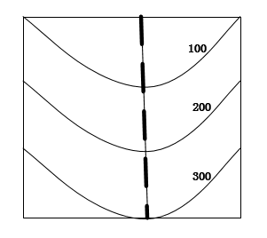

- **A**. 横看成岭侧成峰，远近高低各不同
- **B**. 连峰去天不盈尺，枯松倒挂倚绝壁
- **C**. 天姥连天向天横，势拔五岳掩赤城
- **D**. 天寒日暮山谷里，肠断非关陇头水

## 第 19 题　qid 2448439 · 人文常识

下列关于生活现象的说法错误的是：

- **A**. 无风时落叶各处受空气作用力不均，因此呈曲线翻转落下
- **B**. 衣服湿后对光线的反射能力减弱，因此颜色比干的时候深
- **C**. 挂钟电池耗尽后，秒针因受到重力矩的作用，会停在30秒的位置
- **D**. 自来水中含有少量次氯酸，因此不宜直接用自来水养鱼​

## 第 20 题　qid 2448444 · 科技常识

下列与现代通讯科技有关的说法错误的是：

- **A**. 高密度无线网络技术是5G移动通信技术的关键之一
- **B**. 计算机通信的基本原理是将逻辑信号转换为电信号
- **C**. 路由器可以根据信道情况自动选择和设定路由
- **D**. 无线局域网利用射频技术进行通信连接​

## 第 21 题　qid 2448401 · 逻辑填空

流行病学的一系列证据表明，来自道路的交通噪音会导致心脏病发作。长期暴露在交通噪音中，人体血液的生化性质（血清蛋白、血糖和各种电解质含量等）会发生改变。在这一方面，连汽车尾气的杀伤力都                。
填入画横线部分最恰当的一项是：

- **A**. 退避三舍
- **B**. 自惭形秽
- **C**. 望洋兴叹
- **D**. 甘拜下风

## 第 22 题　qid 2448410 · 逻辑填空

中国正处于经济结构转型升级和世界新一轮技术革命的交汇时期，创新驱动高质量发展渐成共识。没有管理创新、市场创新的商业创新模式                ，有真实需求场景的教育、医疗健康、信息消费、消费升级等模式创新领域，将会迸发出新的投资机会。
填入画横线部分最恰当的一项是：

- **A**. 举步维艰
- **B**. 日薄西山
- **C**. 难以为继
- **D**. 岌岌可危

## 第 23 题　qid 2448418 · 逻辑填空

传统饱和打击战术的核心，是从不同方向、不同层次向同一目标发射超出其防御上限的导弹，以数量优势形成绝对力量优势，压迫及摧毁其防御体系，对敌重要目标进行毁灭性打击。该战术需要庞大的火力投射平台和充足的武器弹药作支撑，这让世界上大多数国家                。
填入画横线部分最恰当的一项是：

- **A**. 望而却步
- **B**. 无可奈何
- **C**. 束手无策
- **D**. 裹足不前

## 第 24 题　qid 2448441 · 逻辑填空

“万物各得其和以生，各得其养以成。”这方面有很多鲜活生动的事例。始建于战国时期的都江堰，距今已有2000多年历史，就是根据岷江的洪涝规律和成都平原悬江的地势特点，                建设的大型生态水利工程，不仅造福当时，而且                。
依次填入画横线部分最恰当的一项是：

- **A**. 顺势而为  利在千秋
- **B**. 因势利导  泽被后世
- **C**. 物尽其用  历久弥新
- **D**. 因地制宜  经久不衰

## 第 25 题　qid 2448461 · 逻辑填空

军事伪装可追溯到上古时代。比如，《荷马史诗》中提及的“特洛伊木马”就是军事伪装的早期实例，即将人员和装备伪装成无害的事物，使得军事行动                。巧妙地运用军事伪装技术，        自身真实的作战意图，往往能取得令人称奇的胜利。
依次填入画横线部分最恰当的一项是：

- **A**. 扑朔迷离  转移
- **B**. 悄无声息  掩饰
- **C**. 防不胜防  严守
- **D**. 出其不意  隐藏

## 第 26 题　qid 2448466 · 逻辑填空

短视频诞生之初就        了用户、内容制作方和营销方的界限，打通了自上而下和自下而上的传播渠道，鼓励用户对已有内容进行再创作。因此，短视频拥有比传统影视作品更快、更多样的传播方式，“内容即营销”的理念也在短视频上体现得                。
依次填入画横线部分最恰当的一项是：

- **A**. 打破  一目了然
- **B**. 消除  准确无误
- **C**. 弱化  一清二楚
- **D**. 模糊  淋漓尽致

## 第 27 题　qid 2448472 · 逻辑填空

科学家网上科普，“高大上”的国家科研机构与轻松娱乐的网络文化场域相遇，不仅没有出现文化上的巨大冲突、碰撞，反倒形成了一种                、寓教于乐的可爱画风，受到很多年轻人的喜爱。这种意外，看似有很大的            ，实则是一种科普方式的积极探索创新，预示了打通两个文化场域的可能性。
依次填入画横线部分最恰当的一项是：

- **A**. 别出心裁  随意性
- **B**. 相映成趣  特殊性
- **C**. 亦庄亦谐  偶然性
- **D**. 妙趣横生  随机性

## 第 28 题　qid 2448476 · 逻辑填空

现在很多人对快速发展的食品科技比较陌生，对食品从农田到餐桌的全过程知之甚少，因此对错误信息的辨识能力、对谣言的抵御能力十分有限。那些                的谣言不仅影响消费信心，也给行业、产业带来直接的危害。强化食品安全科普传播                ，也迫在眉睫，这已经成为全行业和全社会的共识。
依次填入画横线部分最恰当的一项是：

- **A**. 虚张声势  至关重要
- **B**. 铺天盖地  首当其冲
- **C**. 口耳相传  任重道远
- **D**. 耸人听闻  势在必行

## 第 29 题　qid 2448484 · 逻辑填空

地球并非太阳系唯一有水的星球，木卫二所拥有的水资源就比地球还多，堪称一颗            的“水球”。不过，与其邻居木卫三相比，木卫二就             了。通过研究木卫三上极光的微小偏移，科学家推断木卫三拥有巨大的地下海洋，液态水的含量可能是地球的30倍。
依次填入画横线部分最恰当的一项是：

- **A**. 彻头彻尾  微不足道
- **B**. 不折不扣  相形见绌
- **C**. 货真价实  差强人意
- **D**. 实至名归  自愧弗如

## 第 30 题　qid 2448494 · 逻辑填空

渔业资源恢复是一个复杂而缓慢的过程，需要               的努力，如坚决减少捕捞力量、科学发展增殖渔业和加强栖息地保护与修复等。        生态系统水平的适应性对策，强化资源管理与养护，依然是下一步渔业资源恢复的重点工作。
依次填入画横线部分最恰当的一项是：

- **A**. 锲而不舍  探索
- **B**. 坚韧不拔  制定
- **C**. 坚持不懈  借鉴
- **D**. 有条不紊  研究

## 第 31 题　qid 2448502 · 逻辑填空

从陆地到天空，从恐龙到鸟类，生物的生态习性发生了巨大改变，身体结构也有了天壤之别。若非有一系列介于两者之间的过渡物种让人            ，即便熟读《物种起源》，笃信达尔文的演化理论，也仍然会对“恐龙是鸟类的祖先”的说法            。
依次填入画横线部分最恰当的一项是：

- **A**. 无可辩驳  充耳不闻
- **B**. 心服口服  置之不理
- **C**. 不置可否  不以为然
- **D**. 眼见为实  将信将疑

## 第 32 题　qid 2448505 · 逻辑填空

商品或服务没有质量的保障，就像生命失去了健康一样，一切都                。人们进行网络消费时，能够一眼看到价格，却很难发现是否存在质量问题。这种情况下，质量因素便更加关键。如果商家在营销环节耍小聪明，以低价为噱头，轻视质量，就如同                ，等到“东窗事发”，注定会收到消费者的差评。
依次填入画横线部分最恰当的一项是：

- **A**. 无从谈起  掩耳盗铃
- **B**. 无济于事  饮鸩止渴
- **C**. 徒劳无功  作茧自缚
- **D**. 黯然失色  买椟还珠

## 第 33 题　qid 2448506 · 逻辑填空

五四运动表现出来的爱国主义精神，与以往的爱国主义相比较，具有历史进步性和鲜明时代性。这种爱国主义不是盲目排外，而是为了维护国家独立和民族尊严；不是            ，而是与民主和科学精神紧密联系，追求发展进步；不是            ，而是付诸行动，以“直接行动”投入反帝运动。
依次填入画横线部分最恰当的一项是：

- **A**. 刻舟求剑  作壁上观
- **B**. 邯郸学步  闭门造车
- **C**. 固步自封  纸上谈兵
- **D**. 拾人牙慧  夸夸其谈

## 第 34 题　qid 2448507 · 逻辑填空

当今世界，处于百年未有之大变局。世界多极化、经济全球化                ，人类的命运紧密相连，各国利益深度融合。但同时，各种挑战也日益严峻。变局之中，要合作还是要对立，要开放还是要封闭，要互利共赢还是要                ，人类发展处在何去何从的十字路口。
依次填入画横线部分最恰当的一项是：

- **A**. 有目共睹  各行其是
- **B**. 高歌猛进  独善其身
- **C**. 方兴未艾  两败俱伤
- **D**. 势不可挡  以邻为壑

## 第 35 题　qid 2448508 · 逻辑填空

过去，我国生产能力滞后，因而把工作重点放在扩大投资、提高生产能力上。现在，产能总体过剩，仍           靠扩大规模投资抬高速度，作用有限且边际效用递减。虽然短期内投资可以成为拉动经济增长的重要动力，但最终消费才是经济增长的             动力。在扩大有效投资、发挥投资关键作用的同时，必须更加有效地发挥消费对增长的             作用。
依次填入画横线部分最恰当的一项是：

- **A**. 一味  持久  基础
- **B**. 片面  根本  决定
- **C**. 盲目  核心  一般
- **D**. 单纯  长期  实质

## 第 36 题　qid 2448509 · 逻辑填空

有关部门制定银龄讲学计划，在全国招募万名优秀退休教师，下乡支援农村学校。相信白发苍苍的师者，会无私地奉献燃烧；但是要        乡村师生双双流失的困境，不能仅凭一时兴起的“输血”和情怀。唯有教育资源真正向农村        ，真正提高乡村教师的待遇和吸引力，乡村振兴才会有             的新鲜血液。
依次填入画横线部分最恰当的一项是：

- **A**. 改善  汇聚  生生不息
- **B**. 突破  集中  生机勃勃
- **C**. 扭转  倾斜  源源不断
- **D**. 摆脱  开放  薪火相传

## 第 37 题　qid 2448420 · 逻辑填空

秋葵原产印度，却在中国______已久，东汉的《说文解字》称其为“黄葵”，《本草纲目》也有详细记载，称其为“侧金盏花”。秋葵曾是我较为______的蔬菜，在童年记忆里，家中餐桌上并未出现过它。近些年秋葵却______走红，长居网红零食的热门榜单，也逐渐成为寻常百姓的秋日家常菜。
依次填入画横线部分最恰当的一项是：

- **A**. 侨居  反感  意外
- **B**. 流浪  向往  瞬间
- **C**. 落户  不屑  莫名
- **D**. 扎根  陌生  迅速

## 第 38 题　qid 2448427 · 逻辑填空

5G网络的建设是一个复杂的过程，无论对于运营商还是产业链中的其他企业都极具挑战性，不能指望______。毫无疑问，5G时代正在到来。中国既要避免盲目自信，也不能______。我们应把5G作为科技创新的一个突破口，抓住机遇，______，实现自我突破。
依次填入画横线部分最恰当的一项是：

- **A**. 立竿见影  自暴自弃  脚踏实地
- **B**. 一蹴而就  妄自菲薄  迎难而上
- **C**. 一日千里  夜郎自大  逆水行舟
- **D**. 势如破竹  谨小慎微  砥砺前行

## 第 39 题　qid 2448435 · 逻辑填空

准确、权威的信息不及时传播，虚假、歪曲的信息就会搞乱人心；积极、正确的思想舆论不发展壮大，消极、错误的言论观点就会肆虐______。这方面，主流媒体守土有责，更要守土尽责，及时提供更多真实客观、观点鲜明的信息内容，牢牢______舆论场主动权和主导权。主流媒体要敢于引导、善于疏导，原则问题要旗帜鲜明、立场坚定，一点都不能______。
依次填入画横线部分最恰当的一项是：

- **A**. 蔓延  守护  犹豫
- **B**. 扩散  占据  退缩
- **C**. 滋生  控制  迟疑
- **D**. 泛滥  掌握  含糊

## 第 40 题　qid 2448440 · 逻辑填空

具有“边缘型状态”的人往往缺乏______的自我认知，没有相对明确的自我形象。有时候他们觉得自己充满力量，非常自信，似乎是全能的存在；有时候却又觉得自己好像虚弱无力，______，非常自卑。在“边缘型状态”的人身上，这种转变往往是突然而______的。
依次填入画横线部分最恰当的一项是：

- **A**. 全面  弱不禁风  深刻
- **B**. 稳定  一无是处  剧烈
- **C**. 清醒  无所作为  离奇
- **D**. 完整  无足轻重  彻底

## 第 41 题　qid 2448446 · 片段阅读

民之所好好之，民之所恶恶之。环境就是民生，青山就是美丽，蓝天也是幸福。发展经济是为了民生，保护生态环境同样也是为了民生。既要创造更多的物质财富和精神财富以满足人民日益增长的美好生活需要，也要提供更多优质生态产品以满足人民日益增长的优美生态环境需要。要坚持生态惠民、生态利民、生态为民，重点解决损害群众健康的突出环境问题，加快改善生态环境质量，提供更多优质生态产品，努力实现社会公平正义，不断满足人民日益增长的优美生态环境需要。
这段文字意在：

- **A**. 阐释人与自然和谐共生的基本观念
- **B**. 呼吁人民群众参与到生态文明建设之中
- **C**. 强调良好的生态环境是民生之福祉
- **D**. 揭示绿水青山就是金山银山的发展理念

## 第 42 题　qid 2448451 · 片段阅读

西太平洋是全球海山系统分布最为集中的海域，人类对此处海山的认识却非常有限。西太平洋的马里亚纳海沟是板块俯冲地带，海底地质运动非常活跃，海山火山岩的物质组成及成因等是海洋地质科学家感兴趣的问题；西太平洋的暖池和北赤道流等对中国气候有重要影响，是物理海洋科学家关注的重点区域；这里还有全球海洋生物多样性最高的珊瑚礁大三角区，是开展海洋生物起源与进化研究的热点区域。因此，海洋科学家可以在此开展海山的水文物理、化学及生源要素、地形地貌和底质环境及生物生态等多学科协同探测与研究。
这段文字主要介绍了：

- **A**. 在西太平洋开展科学研究的重要价值
- **B**. 人们对西太平洋海山系统的认识
- **C**. 西太平洋区域所蕴含的海洋资源
- **D**. 西太平洋对中国气候和地质的影响

## 第 43 题　qid 2448458 · 片段阅读

交流互鉴是人类社会进步的标识，是文明发展的尺度。从古老的丝绸之路、茶叶之路、香料之路上经贸交往的互通有无，到新时代“一带一路”“两廊一圈”等合作建设的开展，亚洲各国为实现互通发展，战胜挑战，克服困难和艰险。文明交融促进了亚洲国家生产力的发展，打破了民族的原始闭关状态，亚洲人民借此开阔了眼界、建立了友谊、收获了富足。在相互影响、相互交流、相互融合、相互建构的文明互动中，东方文化也与西方文化包容共进，不断迈向人类进步新阶段。“光明来自东方”这句古希腊谚语正是对东西文明交融成果生动而诗意的说明。
最适合做这段文字标题的是：

- **A**. 文化交融，亚洲生产力发展的动力
- **B**. “一带一路”，文明传播的通道
- **C**. 交流互鉴，推动人类文明永续发展
- **D**. 包容共进，构建东西方文明互动

## 第 44 题　qid 2448463 · 片段阅读

世界正处于大发展大变革大调整时期，和平与发展仍然是时代主题。世界多极化、经济全球化、社会信息化、文化多样化深入发展，全球治理体系和国际秩序变革加速推进，各国相互联系和依存日益加深，国际力量对比更趋平衡，和平发展大势不可逆转。同时，世界面临的不稳定性不确定性突出，世界经济增长动能不足，贫富分化日益严重，地区热点问题此起彼伏，恐怖主义、网络安全、重大传染性疾病、气候变化等非传统安全威胁持续蔓延，人类面临许多共同挑战。
这段文字接下来讲的是：

- **A**. 为什么我们认为当前的世界正处于发展与激变的时代
- **B**. 中国是维护世界和平、促进世界共同发展的重要力量
- **C**. 正确认识和把握时代的主题才是各国制定政策的依据
- **D**. 各国人民应同心协力应对我们所面临的各种风险挑战

## 第 45 题　qid 2448453 · 语句表达

①后果严重的脊髓灰质炎，有着另一个更常用的名字——小儿麻痹症
②同天花一样，脊髓灰质炎也是一种由病毒引起的疾病
③80后的同龄人中，还偶尔可见脊髓灰质炎病毒的受害者，一侧或双侧腿部肌肉萎缩，是他们的特征
④人类已经消灭天花，下一个目标就是脊髓灰质炎
⑤他们的神经系统被病毒侵袭，导致肌肉发生不可逆的麻痹，造成瘫痪甚至死亡
⑥但与死亡率很高的天花不同，只有1%左右的脊髓灰质炎病毒感染者会被病毒毁掉一生
将以上6个句子重新排列，语序正确的是：

- **A**. ①⑤③②⑥④
- **B**. ④②⑥⑤①③
- **C**. ③①④⑤⑥②
- **D**. ②④①⑤③⑥

## 第 46 题　qid 2448462 · 语句表达

①中国企业若想出口稀土产品，必须向行业巨头缴纳高额的专利许可费，否则产品无法出口
②稀土永磁材料领域的研发重点包括提高材料性能、扩大高端领域应用等；稀土发光材料领域的技术创新点集中在光电材料、反光材料等
③经历了被人“扼住咽喉”的切肤之痛后，我国稀土企业的创新脚步愈加快速
④然而在很长一段时间内，我国的稀土企业在国际市场处于受制于人的局面
⑤多年来，在与世界各国的“稀土大战”中，我国凭借世界第一的稀土储量，逐步在开采、分离技术领域确立了全球领先的地位
⑥目前，我国稀土领域的创新主要集中于产业链上游的稀土材料领域，多家企业重点发展具有超高性能的稀土永磁材料、稀土发光材料等
将以上6个句子重新排列，语序正确的是：

- **A**. ⑥④①③⑤②
- **B**. ⑤④①③⑥②
- **C**. ⑤⑥②①④③
- **D**. ⑥②⑤④①③

## 第 47 题　qid 2448468 · 片段阅读

在整个宇宙中，氢是最常见的元素，现今太阳中大约是氢。据此可以推测，太阳系在形成的时候，主要成分也应该是氢元素。随着太阳的形成，太阳系绝大部分物质都集中到了太阳，而在太阳之外，元素发生了分层：靠近太阳的地方，温度很高，只留下了硅、铁、氧等相对较重的元素，这些元素聚集在一起，就形成了水星、金星、地球等岩质行星；在逐渐远离太阳的地方，温度降低，这些元素的比例也逐渐降低，行星的大气成分就以氢为主了，还有一些氦，如木星、土星等；而在太阳系边缘，星体中的重元素已经很少，大多以水冰、甲烷等为主。

这段文字主要介绍：

- **A**. 温度对太阳系物质构成的影响
- **B**. 氢元素对于太阳系形成的意义
- **C**. 太阳系中不同元素的分布情况
- **D**. 太阳系各行星的元素构成情况

## 第 48 题　qid 2448471 · 片段阅读

在战场上，人机协同被人工智能所取代，至少目前来看短时间内很难发生。人工智能能解决的问题有限，替代首先会发生在部分领域，但却依然离不开人机协同。人工智能的主要实现手段是机器学习，深度学习是实现机器学习的一种方式。尽管目前深度学习在众多领域已取得非常好的效果，但涉及战场上要求创造性、无法给出明确定义和边界、缺乏数字化知识经验的任务，机器可能就无能为力。所以今后一段时间里，机器在作战领域中更多的是起辅助作用，最终的决策依然离不开人类。
这段文字意在说明：

- **A**. 人机协同在战场上仍将扮演重要角色
- **B**. 人工智能的学习能力有待进一步提高
- **C**. 战场环境对机器学习提出了更高要求
- **D**. 人工智能尚无法适应复杂的战场需求

## 第 49 题　qid 2448475 · 语句表达

研究发现，人格特质会对一个人能否拥有充足、良好的睡眠产生影响。例如，一个责任心水平较低的人很难自我约束，去按照既定计划完成任务。因此他们很难形成固定、良好的睡眠习惯。内向的人更难以入睡，因为他们更喜欢在独处状态下思考问题。当他们夜晚独自躺在床上，会有意识地思考问题，导致更加难以入睡。同样，研究人员也发现，习惯早起的人更有责任心，晚上不睡的夜猫子型的人更喜欢新鲜的刺激。每个人其实有着不同的适应自身的睡眠偏好，而这些睡眠习惯，______。
填入画横线部分最恰当的一句是：

- **A**. 很难在短时间内发生根本改变
- **B**. 最终必然会影响你的身心健康
- **C**. 其实也不存在绝对的评价标准
- **D**. 实际上也反映着你的人格特质

## 第 50 题　qid 2448478 · 片段阅读

在地面装备中，锂离子电池主要应用于军用无人地面车辆、机器人、混合电动战车等。对使用油电混合驱动的地面战车来说，采用锂离子电池作为动力源不仅可以降低油耗，减少后勤负担，还可以提高战术车辆的机动力和生存能力。目前，多国军队都加大了混合电驱动战车、无人地面车辆、地面机器人的锂离子电池模块的研发力度。不过，对大型地面装备来说，锂离子电池功率偏弱是制约其进一步应用的主要因素。因此，未来还需要继续研发高比功率、低成本的锂离子电池，满足地面装备的任务需求。
根据这段文字，锂离子电池：

- **A**. 在大型装备应用方面存在不足
- **B**. 在军事应用中具有广泛适用性
- **C**. 被各国作为新型电池大力发展
- **D**. 是未来战场动力源的发展方向

## 第 51 题　qid 2448481 · 片段阅读

食品药品安全追溯体系是依赖现代信息技术，对可能存在的食品药品安全隐患发出预警的一项制度。它之所以被一些国家广泛采用，是因为一方面能降低监管部门信息获取成本，提升监管效率；另一方面也能倒逼企业提高安全意识，主动进行风险控制。这项制度已引进我国多年，并体现在相关法律法规以及行动规划中。但在实践中，区域分割、部门分治等问题仍比较突出，没有形成高效的地方联动、部门合力，对解决食品药品安全问题缺少整体效果。
这段文字意在强调：

- **A**. 我国的食品药品安全追溯制度仍有待完善
- **B**. 完善的食品药品安全追溯体系有重要价值
- **C**. 相关部门应该加强对食品药品安全的监管
- **D**. 多方合作是解决食品药品安全问题的关键

## 第 52 题　qid 2448485 · 片段阅读

“风筝不断线”是吴冠中二十世纪80年代前后提出的艺术理念，在中国当代美术史上产生了重要的影响。看上去，这是关于“形式美”与“抽象美”之间内在联系的一种阐述，实则它强调的是：艺术创作再怎么创新，再怎么放飞自我，都不能远离现实生活。在吴冠中看来，抽象绘画就像放风筝，风筝是作品，是“从生活中来的素材和感受，被作者用减法、除法或别的法”抽象成的某一种艺术形式，而观众是天空。要让风筝飞上天空，艺术家手中“须有一线联系着作品与生活中的源头”。只有“风筝不断线”，艺术才有根基，才能保持与观众的交流。
下列观点符合“风筝不断线”理念的是：

- **A**. 艺术来源于生活而高于生活
- **B**. 艺术的第一目的是再现现实
- **C**. 艺术创作应当以生活为基础
- **D**. 艺术离开民众就失去了土壤

## 第 53 题　qid 2448445 · 语句表达

作为世界上最成功的室内栽培植物之一，绿萝几乎就是盆栽的代名词，______。绿萝这个物种早在1880年就被确认了，但是你很难想象，直到2004年，它的原产地才被确定为法属波利尼西亚社会群岛的莫雷阿岛。更为神秘的是，绿萝是一种过分矜持的植物，虽然它已经扩散到了全世界的热带地区，却只在1962年有过一次确切的开花记录，直到2016年，人们才发现了它开花的秘密。
填入画横线部分最恰当的一句是：

- **A**. 唯一的遗憾就是绿萝从来不开花
- **B**. 因为它非常适合人类的居住环境
- **C**. 但它却也是我们最熟悉的陌生人
- **D**. 是一种不可多得的室内观叶植物

## 第 54 题　qid 2448455 · 片段阅读

现代信息技术与高等教育教学的融合，衍生出大规模在线开放课程，打破了传统教育的时空界限和学校围墙。六年来，中国慕课从无到有，从小到大，在实践中总在向一个共识靠近，那就是高等教育作为高层次人才的主要供给者，知识创新的主要推动者，要回应时代需求，就必须创新发展，把慕课建设作为加快中国教育现代化、发展“互联网+教育”“智能+教育”的战略先手棋，推进这场深度融合信息技术与教育教学的课堂革命向纵深发展。这就意味着，慕课的建设与发展必然离不开高校的参与和支持、学校与社会的共同协力。
这段文字意在：

- **A**. 介绍中国慕课的发展理念和现状
- **B**. 强调高校应在慕课发展中发挥重要作用
- **C**. 说明高校需重视高级人才的培养和储备
- **D**. 探讨中国慕课突破传统的新思路

## 第 55 题　qid 2448469 · 语句表达

实施全面的急诊分级制度，技术层面的储备早已完成，关键还是靠患者的认同与服从。相对于“先到先得”的机械公平，按照病情轻重排序，显然是一种更复杂的公平规则。医护人员需要不断加以说服引导并进行医学常识科普，才能让患者理解其中的道理。就诊秩序、医疗效率，从来都与患者群体的科学素养和规则意识密切相关。倘若患者还是只信赖“先到先得”，急诊分级最终多半会不了了之。可以想见，急诊科所面临的许多问题，根源其实都在急诊科之外，这意味着急诊分级制度的推行难度比想象中还要大。
这段文字意在强调，急诊分级制度的全面实施：

- **A**. 建立在患者理解认可的基础上
- **B**. 应以更公平规则的确立为前提
- **C**. 有助于医疗效率的大幅提高
- **D**. 有赖于医学常识的广泛普及

## 第 56 题　qid 2448479 · 片段阅读

某科技杂志刊文，介绍了一种可“自愈”橡胶。普通橡胶里的分子由高强度的共价键相连，断裂后无法恢复。于是科研人员将其改由氢键连接，在此基础上开发了一种“分子绳”，将原本很难共处的氢键和共价键结合在一起，允许它们在分子尺度上均匀混合，从而制造出一种透明坚韧的可“自愈”橡胶。这种新型橡胶受到拉力时会出现网状纹路，形似裂纹但不会完全裂开，并形成一些纤维状的连接物。拉力消失后，橡胶恢复原状。这项技术可用于制造军用装备的轮胎，受损后无须立即更换，可提高其战场生存能力。
这段文字没有提及“自愈”橡胶的：

- **A**. 特殊性能
- **B**. 科学原理
- **C**. 功能缺陷
- **D**. 应用前景

## 第 57 题　qid 2448486 · 片段阅读

不久前，“水电费纳入征信”的传闻引起了公众的广泛关注。从现有社会经济活动的精细程度看，征信这种数字式指标性评价，未必能穷尽经济生活中的所有可能性。疏忽、出差、留学、搬家、住院乃至因纠纷而暂停缴纳，均有可能造成水电费的拖欠，显然，这些突发状况未必就能准确体现“个人信用”。倘若将这些指标以一种窄口径列入统计，就有可能造成误伤。正因为突发情况多，作为社会服务部门，更要尽到足够的提示、通知责任，并提供充足、便捷的补救渠道。在相关准备不充分时，水电费纳入征信理应审慎推进。
这段文字意在说明：

- **A**. 选取征信指标应做到谨慎合理
- **B**. 当下水电费不宜纳入征信系统
- **C**. 服务工作的精细程度有待提高
- **D**. 征信系统与日常活动密切相关

## 第 58 题　qid 2448489 · 片段阅读

虽然寒冷的冬季是心血管疾病的高发期，但在高温闷热的“秋老虎”时节，空气中湿度增高、含氧量降低，平时患有高血压、冠心病的人常会感觉不适，出现胸闷、气促、头晕等症状。另外，高温天气会使人体出汗过多，血液浓缩，如果未能及时补充水分，容易形成斑块；一旦斑块脱落，血栓形成，堵塞血管，就可发生急性心梗。此外，人在炎热夏夜往往得不到良好的睡眠，这也是心脑血管疾病的重要诱因之一。闷热天气还会使人情绪波动、心情烦躁，这也是冠心病突发的危险因素。在这段时间，因工作劳累而缺乏休息的人，尤其要警惕心肌梗死突然来袭。
最适合做这段文字标题的是：

- **A**. “养生”尤其要“养心”
- **B**. “秋老虎”之名因何而来
- **C**. 心脑血管疾病诱因知多少
- **D**. 夏秋之交要预防心肌梗死

## 第 59 题　qid 2448490 · 片段阅读

导航卫星位于2万公里的高空，在其所覆盖的范围内都可通过接收信号来导航。而在超出2万公里的深空，就需要全新的导航系统。天文学家提出了几种可能的导航系统，谈得最多的就是脉冲星导航。脉冲星是一类中子星，其磁极方向能产生射电或X射线辐射，当转动轴和磁极不重合，而转动轴扫过地球的时候，就会产生脉冲。其中一些脉冲星转动稳定性非常好，可以比拟于地球上最好的原子钟，所以这些脉冲星也被称为“宇宙间的原子钟”。如果可以接收到它们的信号并且知道它们的位置，便可以利用这些脉冲星进行星际航行。
这段文字接下来最可能介绍的是：

- **A**. 宇宙中类似脉冲星的其他原子钟
- **B**. 目前星际航行中面临的一些困难
- **C**. 验证脉冲星导航可行性的实验
- **D**. 影响脉冲星转动稳定性的因素

## 第 60 题　qid 2448495 · 片段阅读

不论是以巴尔扎克为代表的19世纪欧洲文学，还是以鲁迅为先导的中国现代文学，多半高擎现实主义大旗开垦生活，塑造典型。新时期以来的文学创作，基本也都坚守现实主义立场，比较善于揭露、针砭生活中的负面客观真实，这是完全必要且非常宝贵的。然而，部分小说缺乏对生活中积极因素和正面形象的塑造，缺少对正面价值和情感的呼吁。其实，现实主义创作以人道主义思想为武器，不仅注重剖析社会的阴暗面，也应注重展示生活的亮点；不仅看重批判社会阴暗面的准确性和深刻性，也更看重作家对人物命运的关怀和同情。
这段文字主要批评了新时期以来文学创作中哪个方面的问题？

- **A**. 典型人物的塑造过于刻板单一
- **B**. 作家缺乏对现实生活的关注
- **C**. 缺乏对优秀文学传统的继承
- **D**. 部分小说存在消极负面的倾向

## 第 61 题　qid 2448379 · 数学运算

扶贫干部某日需要走访村内6个贫困户甲、乙、丙、丁、戊和己。已知甲和乙的走访次序要相邻，丙要在丁之前走访，戊要在丙之前走访，己只能在第一个或最后一个走访。问走访顺序有多少种不同的安排方式？

- **A**. 24
- **B**. 16
- **C**. 48
- **D**. 32

## 第 62 题　qid 2448380 · 数学运算

环保局某科室需要对四种水样进行检测，四种水样依次有5、3、2、4份。检测设备完成四种水样每一份的检测时间依次为8分钟、4分钟、6分钟、7分钟。已知该科室本日最多可使用检测设备38分钟，如今天之内要完成尽可能多数量样本的检测，问有多少种不同的检测组合方式？

- **A**. 6
- **B**. 10
- **C**. 16
- **D**. 20

## 第 63 题　qid 2448394 · 数学运算

某种糖果的进价为12元/千克，现购进这种糖果若干千克，每天销售10千克，且从第二天起每天都比前一天降价2元/千克。已知以6元/千克的价格销售的那天正好卖完最后10千克，且总销售额是总进货成本的2倍。问总共进了多少千克这种糖果？

- **A**. 180
- **B**. 190
- **C**. 160
- **D**. 170

## 第 64 题　qid 2448396 · 数学运算

一条圆形跑道长500米，甲、乙两人从不同起点同时出发，均沿顺时针方向匀速跑步。已知甲跑了600米后第一次追上乙，此后甲加速继续前进，又跑了1200米后第二次追上乙。问甲出发后多少米第一次到达乙的出发点？

- **A**. 180
- **B**. 150
- **C**. 120
- **D**. 100

## 第 65 题　qid 2448404 · 数学运算

某个项目由甲、乙两人共同投资，约定总利润10万元以内的部分甲得，10万元～20万元的部分甲得，20万元以上的部分乙得。最终乙分得的利润是甲的1.2倍。问如果总利润减半，甲分得的利润比乙：

- **A**. 少1万元
- **B**. 多1万元
- **C**. 少2万元
- **D**. 多2万元

## 第 66 题　qid 2448387 · 数学运算

某种产品每箱48个。小李制作这种产品，第1天制作了1个，以后每天都比前一天多制作1个。X天后总共制作了整数箱产品。问X的最小值在以下哪个范围内？

- **A**. 在41～60之间
- **B**. 超过60
- **C**. 不到20
- **D**. 在20～40之间

## 第 67 题　qid 2448405 · 数学运算

从一个装有水的水池中向外排水，规定每周二、四、六每天排出剩余水量的，其余日期每天排出剩余水量的。如此连续操作6天后，水池中剩余相当于总容量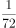的水。问最开始时水池中的水量最多相当于总容量的：

- **A**. 

- **B**. 

- **C**. 

- **D**. 

## 第 68 题　qid 2448415 · 数学运算

某单位从理工大学、政法大学和财经大学总计招聘应届毕业生三百多人。其中从理工大学招聘人数是政法大学和财经大学之和的，从政法大学招聘的人数比财经大学多。问该单位至少再多招聘多少人，就能将从这三所大学招聘的应届生平均分配到7个部门？

- **A**. 6
- **B**. 5
- **C**. 4
- **D**. 3

## 第 69 题　qid 2448429 · 数学运算

甲、乙两条生产线生产A和B两种产品。其中甲生产线生产A、B产品的效率分别是乙生产线的2倍和3倍。现有2种产品各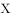件的生产任务，企业安排甲和乙生产线合作尽快完成任务，最终甲总共生产了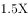件产品。问乙在单位时间内生产A的件数是生产B件数的多少倍？

- **A**. 

- **B**. 

- **C**. 
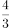

- **D**. 

## 第 70 题　qid 2448449 · 数学运算

部队前哨站的雷达监测范围为100千米。某日前哨站侦测到正东偏北千米处，一架可疑无人机正匀速向正西方向飞行。前哨站通知正南方向150千米处的部队立即向正北方向发射无人机拦截，匀速飞行一段时间后，正好在某点与可疑无人机相遇。问我方无人机速度是可疑无人机的多少倍？

- **A**. 
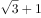

- **B**. 
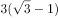

- **C**. 
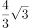

- **D**. 
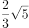

## 第 71 题　qid 2448480 · 图形推理

从所给的四个选项中，选择最合适的一个填入问号处，使之呈现一定的规律性：

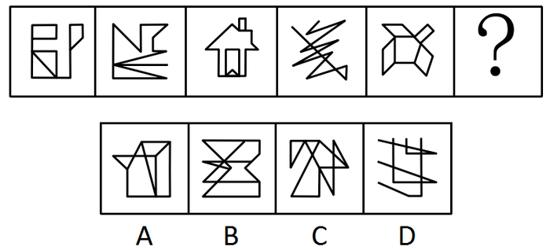

- **A**. A
- **B**. B
- **C**. C
- **D**. D

## 第 72 题　qid 2448482 · 图形推理

从所给的四个选项中，选择最合适的一个填入问号处，使之呈现一定的规律性：

- **A**. A
- **B**. B
- **C**. C
- **D**. D

## 第 73 题　qid 2448487 · 图形推理

从所给的四个选项中，选择最合适的一个填入问号处，使之呈现一定的规律性：

- **A**. A
- **B**. B
- **C**. C
- **D**. D

## 第 74 题　qid 2448488 · 图形推理

下图为给定的多面体及其外表面展开图，问字母A、B、C、D和数字1、2、3、4代表的棱的对应关系为：

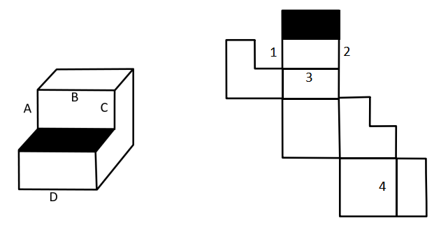

- **A**. 1-C，2-A，3-B，4-D
- **B**. 1-A，2-C，3-B，4-D
- **C**. 1-A，2-C，3-D，4-B
- **D**. 1-C，2-A，3-D，4-B

## 第 75 题　qid 2448493 · 图形推理

从所给的四个选项中，选择最合适的一个填入问号处，使之呈现一定的规律性：

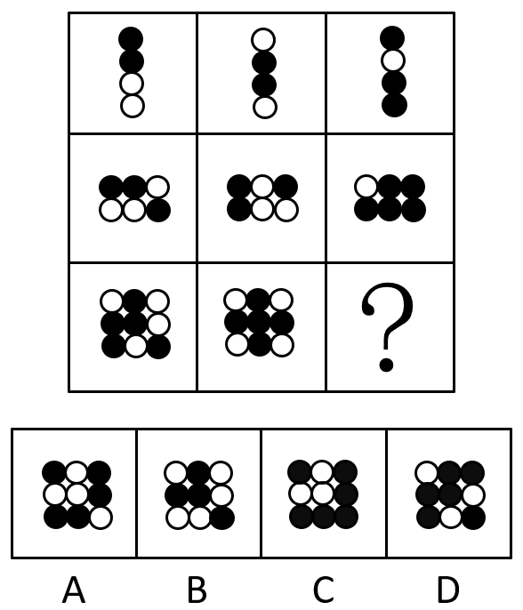

- **A**. A
- **B**. B
- **C**. C
- **D**. D

## 第 76 题　qid 2448496 · 图形推理

左图给定的是由相同正方体堆叠而成多面体的正视图和后视图。该多面体可以由①、②和③三个多面体组合而成，问以下哪一项能填入问号处？

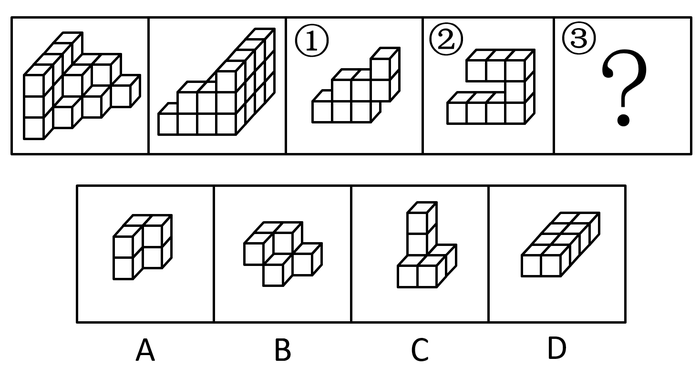

- **A**. A
- **B**. B
- **C**. C
- **D**. D

## 第 77 题　qid 2448497 · 图形推理

左图是给定的多面体，将其从任一面剖开，下面哪一项不可能是该多面体的截面？

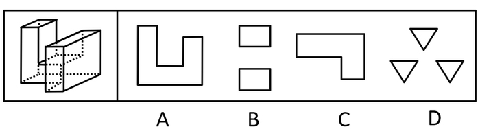

- **A**. A
- **B**. B
- **C**. C
- **D**. D

## 第 78 题　qid 2448498 · 图形推理

把下面的六个图形分为两类，使每一类图形都有各自的共同特征或规律,分类正确的一项是：

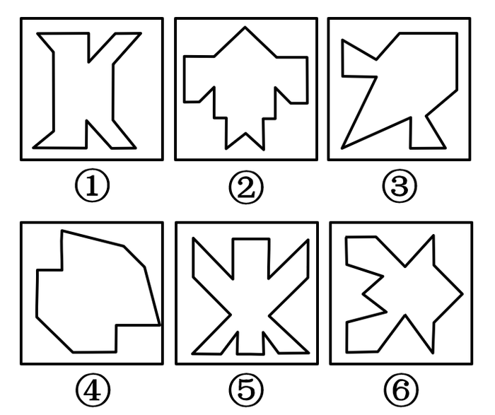

- **A**. ①③④，②⑤⑥
- **B**. ①②⑥，③④⑤
- **C**. ①④⑤，②③⑥
- **D**. ①④⑥，②③⑤

## 第 79 题　qid 2448414 · 图形推理

把下面的六个图形分为两类，使每一类图形都有各自的共同特征或规律，分类正确的一项是：

- **A**. ①④⑥，②③⑤
- **B**. ①③⑤，②④⑥
- **C**. ①②⑥，③④⑤
- **D**. ①③④，②⑤⑥

## 第 80 题　qid 2448431 · 图形推理

把下面的六个图形分为两类，使每一类图形都有各自的共同特征或规律，

分类正确的一项是：

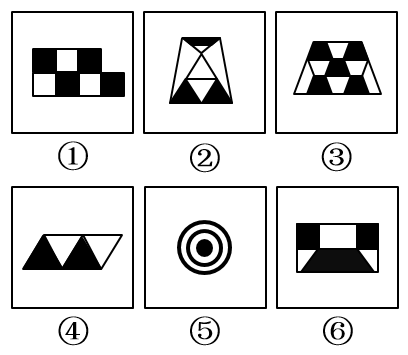

- **A**. ①②③，④⑤⑥
- **B**. ①③④，②⑤⑥
- **C**. ①③⑤，②④⑥
- **D**. ①②⑤，③④⑥

## 第 81 题　qid 2448436 · 定义判断

超前纠结指的是在平庸的人群中，有正确洞见的人当其观点不被接受、不被相信，对事情的发展无能为力时，所表现出的无奈、压抑和痛苦的心情。
根据上述定义，下列最能体现超前纠结的是：

- **A**. 古来圣贤皆寂寞，惟有饮者留其名
- **B**. 举世皆浊我独清，世人皆醉我独醒
- **C**. 无可奈何花落去，似曾相识燕归来
- **D**. 醉卧沙场君莫笑，古来征战几人回

## 第 82 题　qid 2448465 · 定义判断

算术平均数描述了一组数据的平均趋势，是所有数据之和除以数据个数所得之商。在统计学中使用时应注意：出现极端数值、模糊不清的数据或者不同质的数据时，均不能计算算术平均数。
根据上述定义，下列适于计算算术平均数的是：

- **A**. 某社区统计该社区居民的平均年龄，其中包括10岁以下儿童204人，90岁以上老人26人
- **B**. 某公司统计35岁以下青年职工的年平均收入，发现基本处于10～12万元之间，其中有一人为公司高管，年收入百万元以上
- **C**. 某学校统计本校青少年平均身高，将该校学前部、小学部和中学部全部学生计算在内
- **D**. 某市统计该市各区县留守儿童的平均数量，其中外出务工人员数量较多的区县无法进行准确统计，只提供了估算数据

## 第 83 题　qid 2448477 · 定义判断

动物辅助治疗是一种以动物为媒介，通过人与动物的接触，改善或维持残障人士的身体状况，或帮助他们加强与外部世界的互动，进而促进康复、适应社会的过程。
根据上述定义，下列情形不属于动物辅助治疗的是：

- **A**. 性情温和的迷你猪适合陪伴自闭症患者，减轻他们面对人群时产生的焦虑
- **B**. 卷尾猴能够帮助体障者完成日常生活中的简单动作，如开关门、操控遥控器等
- **C**. 鼬獾会在主人精神病发作之际，发出叫声，警示主人，让主人可以及时服药
- **D**. 英国短毛猫性格温顺且不具有攻击性，喜静且贴近主人，适合陪伴独自生活的老年人

## 第 84 题　qid 2448483 · 定义判断

合理使用是指在法律明文规定的情形下，非商业性使用他人已经发表的作品，可以不经著作权人许可，也不必向其支付报酬。“法律明文规定的情形”主要包括：（1）为个人学习、研究或者欣赏，使用他人已经发表的作品；（2）免费表演已经发表的作品；（3）对设置或者陈列在室外公共场所的艺术作品进行临摹、绘画、摄影、录像；（4）将已经发表的以汉语言文字创作的作品翻译成少数民族语言文字作品出版发行。
根据上述规定，下列属于合理使用的是：

- **A**. 甲在班级聚会上演唱了戊未发表的一首歌曲
- **B**. 乙将一部英文作品翻译成蒙文作品出版发行
- **C**. 丙公司拍摄公共广场的雕塑作品后，将其制作成图片发行
- **D**. 丁为撰写论文，复印了庚发表在某期刊上的论文作参考

## 第 85 题　qid 2448491 · 定义判断

花序是指花在花轴上不同形式的序列。其中，伞房花序的特点是花序轴下部的花梗较长，上部的花梗依次渐短，整个花序的花几乎排列在一个平面上；伞形花序的特点是在总花梗顶端集生许多花梗近等长的小花，放射状排列如伞。

根据上述定义，下列属于伞房花序的是：

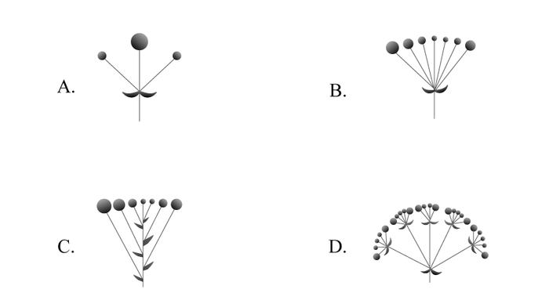

- **A**. A
- **B**. B
- **C**. C
- **D**. D

## 第 86 题　qid 2448492 · 定义判断

编剧式观影者是指看影视剧不介意被剧透，甚至会提前查询剧情介绍、翻遍各种影评的人。这种观影者追求掌控剧情发展的感觉，不喜欢出乎意料。
根据上述定义，下列属于编剧式观影者的是：

- **A**. 小王看了一部好的影片后，觉得应该和女朋友一起分享，于是邀请女朋友到电影院观影，还向她介绍了电影的主要内容
- **B**. 小杜对任何事情都讲求理性思维，对于电影，他只有在了解了权威评价、剧情内容、画面特征等情况后，才有观赏的冲动
- **C**. 小李酷爱悬疑类影片，他喜欢陶醉在烧脑的剧情中，心情随着剧情而起伏，他经常假想自己就是一名侦探，对他人总是投出审视的目光
- **D**. 张大爷的老伴退休后整天在家看电视剧，对很多电视剧的剧情都了如指掌，还经常将剧情讲述给张大爷

## 第 87 题　qid 2448381 · 定义判断

愧疚补偿策略指的是不直接提出要求，而强调由于对方的责任导致自己处于困境，使对方产生愧疚心理，从而使对方补偿自己的一种策略。
根据上述定义，下列反映了愧疚补偿策略的是：

- **A**. 甲向李某倾诉由于误信了他群发的信息，导致自己被骗得很惨，李某于是免息借钱给甲做生意以求得心安
- **B**. 乙上班迟到被领导批评，回家后责怪妻子没有及时叫醒他，并要求妻子以后负责夜里带孩子，妻子答应了他
- **C**. 丙开车邀请陈某一起郊游，途中丙不慎扭伤了脚，只得请假休养，陈某感到非常内疚，决定帮助丙接送孩子上下学
- **D**. 丁在庄某家做保洁时不慎摔伤，庄某听家政公司说丁家庭非常困难，主动替丁支付了5000元的治疗费用

## 第 88 题　qid 2448382 · 定义判断

客观-价值谬误是一种错误的推理，其前提是一个事实性的描述，而结论所表述的则是一个涉及价值意义的描述，而且这种推理没有预设明显的价值判断前提。
根据上述定义，下列属于客观-价值谬误的是：

- **A**. 人与人之间应该进行更多地交流和沟通，更多地理解和包容，世界上的民族国家将越来越少
- **B**. 既然人人都要遵纪守法，那我们就应该对法律多一份尊重，对规则多一份敬畏
- **C**. 世界变得越来越城市化，因此人们就不应该继续诗意地栖居在农村
- **D**. 这个地区的绿化率在不断提高，其空气质量也将不断改善

## 第 89 题　qid 2448383 · 定义判断

社交裂变是一种利益驱动的商业模式，通过人与人之间的社交促进产品的传播与销售，本质上是通过利益驱动激励客户从而形成裂变。
根据上述定义，下列不属于社交裂变的是：

- **A**. 某微商客户挑选好某个商品后，分享在自己的社交圈，好友帮助砍价后，客户可以低价购买，同时也宣传了该商品
- **B**. 某微信用户在购买到自己喜欢的商品后，经常拍照发在朋友圈中，慢慢地大家都知道她喜欢购买高档奢侈品
- **C**. 某电商平台的客户成功购买商品后，分享其链接，所有点击的人都能获得商家提供的随机金额的优惠券
- **D**. 某咖啡店的老顾客参加“邀请好友免费喝咖啡”的活动后，可以获取一张套餐券

## 第 90 题　qid 2448384 · 定义判断

培养基是指供给微生物、植物或动物（或组织）生长繁殖的，由不同营养物质组合配制而成的营养基质，一般都含有碳水化合物、含氮物质、无机盐、维生素、水等物质。天然培养基是利用动物、植物或微生物包括其提取物制成的培养基；合成培养基是根据天然培养基的成分，用化学物质模拟合成、人工设计而配制的培养基；半组合培养基是以化学试剂配制为主，同时还加有少量天然成分的培养基。
根据上述定义，下列属于半组合培养基的是：

- **A**. 为研究鸡胚细胞的生长，在一定比例的盐水氨基酸溶液中加入少量玉米汁制成的培养基
- **B**. 为促进乳酸菌生长，使用小麦的麦芽汁制成的培养基
- **C**. 为加速诱发绿萝生长，将有机成分、矿物元素、琼脂等按3:1:2的比例制成的培养基
- **D**. 为观察产气荚膜梭菌的生成，在1000毫升新鲜牛奶中加入10毫升硫酸亚铁制成的培养基

## 第 91 题　qid 2448385 · 类比推理

物体：惯性

- **A**. 气体：稳定性
- **B**. 观察：客观性
- **C**. 贵金属：磁性
- **D**. 液体：流动性

## 第 92 题　qid 2448386 · 类比推理

全身麻醉：注射麻醉

- **A**. 网络存储：单机存储
- **B**. 胸式呼吸：腹式呼吸
- **C**. 物理消毒：加热消毒
- **D**. 抽样调查：问卷调查

## 第 93 题　qid 2448388 · 类比推理

物必先腐：而后虫生

- **A**. 古木无人径：深山何处钟
- **B**. 水落鱼梁浅：天寒梦泽深
- **C**. 少壮不努力：老大徒伤悲
- **D**. 欲投人处宿：隔水问樵夫

## 第 94 题　qid 2448390 · 类比推理

轻车熟路：人生地疏

- **A**. 廉洁奉公：卑躬屈膝
- **B**. 任重道远：无所事事
- **C**. 前仆后继：贪生怕死
- **D**. 河清海晏：国泰民安

## 第 95 题　qid 2448423 · 类比推理

路由器：连接：网络

- **A**. 千斤顶：修补：轮胎
- **B**. 石英钟：显示：时间
- **C**. 万花筒：观察：花卉
- **D**. 烽火台：侦察：敌情

## 第 96 题　qid 2448433 · 类比推理

建筑材料：混凝土：水泥

- **A**. 饮料：汽水：二氧化碳
- **B**. 医疗用具：注射器：药物
- **C**. 监控：监视器：画面
- **D**. 交通设施：减速带：警示牌

## 第 97 题　qid 2448438 · 类比推理

本能行为：学习行为：乌贼喷墨

- **A**. 合法行为：合理行为：盗窃财物
- **B**. 物理变化：化学变化：树木折断
- **C**. 生产管理：销售管理：退货处理
- **D**. 社会现象：自然现象：四季变换

## 第 98 题　qid 2448442 · 类比推理

税前收入：税后收入：税金

- **A**. 法律规定：道德规范：规则
- **B**. 测量高度：真实高度：误差
- **C**. 高原地区：平原地区：纬度
- **D**. 生产成本：出厂价格：销售价

## 第 99 题　qid 2448454 · 类比推理

薄荷 对于（  ）相当于（  ）对于 计时器

- **A**. 川芎；水钟
- **B**. 清凉；精准
- **C**. 茯苓；倒计时
- **D**. 药用植物；沙漏

## 第 100 题　qid 2448457 · 类比推理

玻璃瓶 对于（  ）相当于（  ）对于 秋播作物

- **A**. 石英砂；农作物
- **B**. 塑料瓶；水生植物
- **C**. 饮料瓶；春播作物
- **D**. 广口瓶；大棚作物

## 第 101 题　qid 2448470 · 逻辑判断

随着气温上升，热带雨林遭受闪电雷击并引发大火的几率也会上升。然而，目前的监测表明，美洲热带雨林虽然更频繁地受到闪电雷击，却没有引发更多的森林大火。研究者认为这可能与近年来雨林中藤蔓植物大量增加有关。
以下哪项如果为真，最能支持上述结论？

- **A**. 闪电雷击常常引起温带森林大火，但热带雨林因为湿度较大，并不会产生较大火灾
- **B**. 1968年热带雨林中藤蔓植物的覆盖率是32%，当前其覆盖率已经高达60%，有的地区甚至超过75%
- **C**. 藤蔓茎干相对树枝电阻更小，能像建筑上的避雷针那样传导闪电，让大部分电流从自己的茎干传导
- **D**. 雷击这样大规模、速度极快的放电，先摧毁了外部的藤蔓植物，中间的树木得到了保护

## 第 102 题　qid 2448473 · 逻辑判断

一切生命有机体都需要新陈代谢，否则生命就会停止。文明也是一样，如果长期自我封闭，必将走向衰落。交流互鉴是文明发展的本质要求。只有同其他文明交流互鉴、取长补短，才能保持旺盛生命活力。
由此可以推出：

- **A**. 一种文明如果没有同其他文明交流互鉴，就不能保持旺盛生命活力
- **B**. 一种文明如果没有长期自我封闭，就不会走向衰落
- **C**. 一种文明如果同其他文明交流互鉴、取长补短，就能保持旺盛生命活力
- **D**. 一种文明如果没有保持旺盛生命活力，它就没有同其他文明取长补短

## 第 103 题　qid 2448391 · 逻辑判断

澳大利亚箱形水母是世界上毒性最强的动物之一，蜇人后其毒素会使人皮肤坏死并伴随剧痛，还会侵入人的心脏，使人在短时间内因心脏停搏而死亡。一只箱形水母体内携带的毒液足以致60人死亡，目前还没有针对其毒液的特效药物。近日，研究人员通过全基因组筛查的方法发现，人体细胞内一种名为ATP2B1的蛋白质是箱形水母毒液发挥毒性的必要条件，研究人员据此认为，通过靶向治疗方法降低胆固醇可以对抗箱形水母的毒液。
以下哪项可以作为上述论证的前提？

- **A**. 靶向治疗方法是一种安全可靠的方法
- **B**. ATP2B1蛋白质发挥作用需要胆固醇
- **C**. 降低胆固醇后不会对人体产生副作用
- **D**. 已研制出降低胆固醇的靶向治疗药物

## 第 104 题　qid 2448393 · 逻辑判断

2014年以来，某州已发生了超过230次3级及以上地震，而2008年之前这一数字是年均1次。频繁的地震活动引发了人们的疑问，一些研究者发现2014年以来，全州为了避免石油开采中钻井和水力压裂过程中产生的有毒废水污染地表水，开始将这些废水注入地下岩石的不透水层之间，这一行为很可能就是引发地震的关键原因。
以下哪项如果为真，最能支持上述推测？

- **A**. 废水灌入岩石水层中会降低断层之间的摩擦力，使之更易滑动，从而诱发地震
- **B**. 该州自2008年以来勘探出更多的石油储备，石油开采活动大幅增加
- **C**. 该州2008年之前的地震次数少但震级大，2014年以来地震次数多但震级小
- **D**. 大多数连续地震是一次强震后发生的一系列余震，但该州地震并不属于这种情况

## 第 105 题　qid 2448395 · 逻辑判断

一般来说，动物的蛋会通过土壤中微生物和堆肥分解有机物时产生的热量来孵化，但这些微生物（包含细菌）也会穿透蛋壳、感染胚胎，自然情况下这一比例高于。然而，在澳洲有一种名为丛冢雉的鸟类，其蛋发生感染的几率仅为，研究者发现其蛋壳中含有溶酶酵素，研究者据此认为这种物质很可能就是抵御细菌侵扰的关键因素。

以下哪项如果为真，没有削弱上述结论？

- **A**. 丛冢雉的蛋壳中所含的溶酶酵素量，与其他动物相比，含量大抵相当
- **B**. 丛冢雉的蛋壳被一层纳米级的碳酸钙层包裹，拥有了更强的防水性和抗细菌入侵能力
- **C**. 丛冢雉蛋散发一种特殊气味，会使附着在其蛋壳上的细菌数减少
- **D**. 与其他动物的蛋壳相比，丛冢雉的蛋壳要薄三分之一，更易受到微生物的入侵

## 材料 1（第106—110题共用）

某集团公司有生产、销售、研发、人事、财务、法务6个部门，现有从前到后的6栋办公楼：戊字楼、己字楼、庚字楼、辛字楼、壬字楼和癸字楼，每部门各一栋楼，并且各部门安排符合如下要求：

（1）销售部在财务部和生产部之前；

（2）人事部紧接在研发部或者生产部的后面；

（3）紧接在法务部后面的是研发部或者销售部。

### 第 106 题　qid 2448400 · 逻辑判断

下列各部门办公楼按照从前到后的顺序排列，哪项符合上述要求？

- **A**. 法务部、研发部、销售部、财务部、生产部、人事部
- **B**. 财务部、法务部、研发部、人事部、销售部、生产部
- **C**. 法务部、销售部、研发部、生产部、财务部、人事部
- **D**. 研发部、人事部、销售部、法务部、财务部、生产部

### 第 107 题　qid 2448402 · 类比推理

如果研发部在戊字楼，那么下列哪项可能为真？

- **A**. 法务部在辛字楼
- **B**. 人事部在癸字楼
- **C**. 财务部在己字楼
- **D**. 生产部在庚字楼

### 第 108 题　qid 2448406 · 类比推理

如果法务部在壬字楼，那么销售部在：

- **A**. 庚字楼
- **B**. 辛字楼
- **C**. 戊字楼
- **D**. 己字楼

### 第 109 题　qid 2448409 · 逻辑判断

如果销售部安排在戊字楼，则以下哪项安排是不可能的？

- **A**. 财务部在癸字楼
- **B**. 研发部在己字楼
- **C**. 法务部在辛字楼
- **D**. 人事部在庚字楼

### 第 110 题　qid 2448413 · 类比推理

下列哪两个部门不可能依次安排在庚字楼和辛字楼？

- **A**. 法务部、销售部
- **B**. 研发部、财务部
- **C**. 人事部、研发部
- **D**. 财务部、法务部

## 材料 2（第111—115题共用）

### 第 111 题　qid 2448389 · 平均数

2018年我国平均每家海洋主题公园全年游客规模比2010年：

- **A**. 减少了30万人次以上
- **B**. 增加了30万人次以上
- **C**. 减少了30万人次以内
- **D**. 增加了30万人次以内

### 第 112 题　qid 2448392 · 平均数

已知2011年初～2018年末我国所有开业的海洋主题公园都持续营业，则该期间我国平均约多长时间新开一家海洋主题公园？

- **A**. 两个半月
- **B**. 两个月
- **C**. 三个半月
- **D**. 三个月

### 第 113 题　qid 2448403 · 增长

2011～2018年间，我国海洋主题公园非门票收入同比增速超过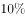的年份有几个？

- **A**. 5
- **B**. 6
- **C**. 3
- **D**. 4

### 第 114 题　qid 2448407 · 平均数

2016年我国海洋主题公园平均每名游客创造的门票收入比非门票收入多约多少元？

- **A**. 42
- **B**. 48
- **C**. 30
- **D**. 36

### 第 115 题　qid 2448411 · 综合

关于我国海洋主题公园状况，能够从上述资料中推出的是：

- **A**. 2013～2017年间累计游客规模超3亿人次
- **B**. 2013年平均每家海洋主题公园的门票收入高于上年水平
- **C**. 2011～2018年间，年末公园数量同比增量和游客规模同比增量最大的年份不是同一个
- **D**. 2014年海洋主题公园总收入比上年增长了8亿多元

## 材料 3（第116—120题共用）

### 第 116 题　qid 2448422 · 比重

2018年中国进出口贸易总额为4.62万亿美元，其中集成电路进出口贸易额占比：

- **A**. 超过10个百分点
- **B**. 在5～10个百分点之间
- **C**. 在1～5个百分点之间
- **D**. 不到1个百分点

### 第 117 题　qid 2448425 · 综合

2012～2015年，中国集成电路产业累计销售额在以下哪个范围内？

- **A**. 不到1万亿元
- **B**. 在1～1.1万亿元之间
- **C**. 在1.1～1.2万亿元之间
- **D**. 超过1.2万亿元

### 第 118 题　qid 2448434 · 增长

2013～2018年间中国集成电路产业销售额增速最高的年份，当年集成电路进口金额同比约增加：

- **A**. 

- **B**. 

- **C**. 

- **D**. 

### 第 119 题　qid 2448448 · 平均数

2018年中国平均每块集成电路出口单价比上年：

- **A**. 
下降了以上

- **B**. 
上升了以上

- **C**. 
下降了以内

- **D**. 
上升了以内

### 第 120 题　qid 2448460 · 综合

关于中国集成电路产业销售及进出口状况，能够从上述资料中推出的是：

- **A**. 2016～2017年，月均进出口总量超过450亿块
- **B**. 2016年销售额同比增量低于上年水平
- **C**. 2015～2018年，进口量和进口额均逐年上升
- **D**. 2014～2018年，出口总量超过1万亿块

## 材料 4（第121—125题共用）

### 第 121 题　qid 2448399 · 综合

2018年中国在线旅游收入约占旅游业总收入的：

- **A**. 

- **B**. 

- **C**. 

- **D**. 

### 第 122 题　qid 2448408 · 增长

2017年中国在线旅游收入同比约增长多少万亿元？

- **A**. 0.15
- **B**. 0.20
- **C**. 0.25
- **D**. 0.30

### 第 123 题　qid 2448412 · 比重

中国在线旅游收入中，2014年占中国旅游业总收入比重高于上年水平的包括：

- **A**. 仅在线交通预订
- **B**. 在线交通预订、在线住宿预订、在线度假旅游预订
- **C**. 仅在线交通预订、在线住宿预订
- **D**. 仅在线交通预订、在线度假旅游预订

### 第 124 题　qid 2448416 · 增长

以下折线图反映了2014～2018年间哪项收入同比增量的变化趋势？

- **A**. 在线住宿预订
- **B**. 旅游业总体
- **C**. 在线度假旅游预订
- **D**. 在线交通预订

### 第 125 题　qid 2448424 · 综合

能够从上述资料中推出的是：

- **A**. 2014～2018年，中国旅游业总收入超过25万亿元
- **B**. 2014～2016年，中国旅游业总收入同比增速逐年递增
- **C**. 2016年中国在线交通预订收入同比增速快于上年水平
- **D**. 如保持2018年同比增量，中国在线住宿预订收入将在2023年首超3000亿元

## 材料 5（第126—130题共用）

        2018年，B市新经济实现增加值10057.4亿元，比上年增长，占全市地区生产总值的比重为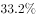，比上年提高0.4个百分点。全年全市新设立的企业中，信息服务业、科技服务业企业合计达到70661家，占比为，注册资本达到7311.4亿元，同比增长。

        2018年，B市高技术产业实现增加值6976.8亿元，比上年增长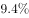，占地区生产总值的比重为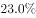，比上年提高0.2个百分点。战略性新兴产业实现增加值4893.4亿元，增长，占地区生产总值的比重为，比上年提高0.1个百分点。信息产业实现增加值4940.7亿元，增长，占地区生产总值的比重为，比上年提高0.9个百分点。

        2018年，B市高技术服务业完成投资507.8亿元，同比增长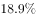。其中，信息服务业投资增长，科技服务业投资增长。

        2018年，B市限额以上批发零售业网上零售额达到2632.9亿元，比上年增长，占全市零售额比重为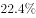，对全市零售额增长的贡献率（限额以上批发零售业网上零售额同比增量在全市零售额同比增量中占的比重）达到。限额以上住宿餐饮企业通过公共网络实现的餐费收入为124.7亿元，比上年增长，对全市餐费收入增长的贡献率达到。

        2018年，B市高新技术示范区规模以上高新技术企业实现技术收入10629.4亿元，比上年增长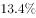，占高新技术示范区规模以上高新技术企业总收入的比重为，比上年提高1.8个百分点。

### 第 126 题　qid 2448499 · 平均数

2018年B市平均每家新设立的信息服务业、科技服务业企业注册资本：

- **A**. 在1000~1100万元之间
- **B**. 超过1100万元
- **C**. 不到900万元
- **D**. 在900~1000万元之间

### 第 127 题　qid 2448500 · 综合

第二段中（X）处应填入的数值最可能是：

- **A**. 15.0
- **B**. 13.7
- **C**. 17.6
- **D**. 16.3

### 第 128 题　qid 2448501 · 增长

2018年，B市零售额同比增长了：

- **A**. 超过600亿元
- **B**. 400~600亿元之间
- **C**. 200~400亿元之间
- **D**. 不到200亿元

### 第 129 题　qid 2448503 · 综合

2018年，B市高新技术示范区规模以上高新技术企业月均收入在以下哪个范围内？

- **A**. 超过5500亿元
- **B**. 4500~5500亿元之间
- **C**. 3500~4500亿元之间
- **D**. 不到3500亿元

### 第 130 题　qid 2448504 · 综合

能够从上述资料中推出的是：

- **A**. 2018年B市地区生产总值超过35000亿元
- **B**. 2017年B市高新技术示范区规模以上高新技术企业非技术收入是技术收入的5倍多
- **C**. 2018年B市战略性新兴产业增加值占新经济增加值的比重高于上年水平
- **D**. 2018年B市高技术服务业完成投资比上年增长了100亿元以上

## 答案与解析

第 1 题

**答案**：C

**来源参考解析（非官方标准答案）**

本题考查政治。
A、B、D项错误，2019年5月31日，“不忘初心、牢记使命”主题教育工作会议在北京召开。习近平总书记出席会议并发表重要讲话。他强调：开展“不忘初心、牢记使命”主题教育，要牢牢把握守初心、担使命，找差距、抓落实的总要求，牢牢把握深入学习贯彻新时代中国特色社会主义思想、锤炼忠诚干净担当的政治品格、团结带领全国各族人民为实现伟大梦想共同奋斗的根本任务，努力实现理论学习有收获、思想政治受洗礼、干事创业敢担当、为民服务解难题、清正廉洁作表率的具体目标，确保这次主题教育取得扎扎实实的成效。
C项正确，习近平总书记在“不忘初心、牢记使命”主题教育工作会议上的讲话指出，各地区各部门各单位要结合实际，创造性开展工作，把学习教育、调查研究、检视问题、整改落实贯穿主题教育全过程，努力取得最好成效。
故正确答案为C。

---

第 2 题

**答案**：B

**来源参考解析（非官方标准答案）**

本题考查政治。
A项正确，一个没有精神力量的国家难以自立自强，一项没有文化支撑的事业难以持续长久。推动社会主义文化繁荣兴盛，才能更好凝聚起应对重大挑战、抵御重大风险、克服重大阻力、解决重大矛盾的强大力量，决胜全面建成小康社会，夺取新时代中国特色社会主义伟大胜利。因此，推动社会主义文化繁荣兴盛是新时代坚持和发展中国特色社会主义的必然要求。
B项错误，一个国家的发展进程，既是经济总量、科技力量、军事力量等硬实力提高的进程，也是价值观念、思想文化等软实力提高的进程。当今时代，国家核心竞争力中的文化因素越来越突出。可以说，提高文化软实力，不仅关系到一个国家在世界文化格局中的地位，而且关系到一个国家的国际影响力、感召力、塑造力。推动社会主义文化繁荣兴盛，能更好展现中华文化独特魅力，使中华文化影响更加广泛深入，形成与我国综合国力和国际地位相适应的国家文化软实力。因此，选项中“提高国家硬实力”的表达有误。
C项正确，党的十九大报告指出：“文化是一个国家、一个民族的灵魂。文化兴国运兴，文化强民族强。没有高度的文化自信，没有文化的繁荣兴盛，就没有中华民族伟大复兴。要坚持中国特色社会主义文化发展道路，激发全民族文化创新创造活力，建设社会主义文化强国。”因此，推动社会主义文化繁荣兴盛是实现中华民族伟大复兴中国梦的必然要求。
D项正确，文化既是凝聚人心的精神纽带，又是增进民生福祉的关键因素。推动社会主义文化繁荣兴盛，才能更好适应人民日益增长的美好生活需要，促进国民素质和社会文明程度达到新的高度，让人民精神文化生活更丰富，基本文化权益保障更充分，文化获得感、幸福感更充实。因此，推动社会主义文化繁荣兴盛是实现人民对美好生活向往的必然要求。
本题为选非题，故正确答案为B。

---

第 3 题

**答案**：C

**来源参考解析（非官方标准答案）**

本题考查政治常识。
①③④正确，2015年10月29日，习近平在党的十八届五中全会第二次全体会议上的讲话中提出：“创新发展注重的是解决发展动力问题。······协调发展注重的是解决发展不平衡问题。······绿色发展注重的是解决人与自然和谐问题。······开放发展注重的是解决发展内外联动问题。······共享发展注重的是解决社会公平正义问题。······”
②错误，协调发展注重的是解决发展不平衡问题，不是解决社会公平正义问题；
⑤错误，共享发展注重的是解决社会公平正义问题，不是解决发展不平衡问题。
本题共有3项说法正确，故正确答案为C。

---

第 4 题

**答案**：A

**来源参考解析（非官方标准答案）**

本题考查政治常识。
A项正确，2019年6月17日，中央宣传部在湖北省来凤县向全社会公开发布张富清的先进事迹，授予他“时代楷模”称号。今年95岁的老党员张富清是原西北野战军359旅718团2营6连战士，在解放战争的枪林弹雨中九死一生，先后荣立一等功3次、二等功1次，被西北野战军记“特等功”，两次获得“战斗英雄”荣誉称号。1955年，张富清退役转业，主动选择到湖北省最偏远的来凤县工作，为贫困山区奉献一生。60多年来，张富清刻意尘封功绩，连儿女也不知情。2018年年底，在退役军人信息采集中，张富清的事迹被发现，这段英雄往事重现在人们面前。
B项错误，2019年5月22日，中央宣传部在北京向全社会宣传发布杜富国的先进事迹，授予他“时代楷模”称号。杜富国是陆军某扫雷排爆大队战士。入伍以来，他始终把忠诚和信仰刻在心中，把使命和责任扛在肩上，主动请缨征战雷场，苦练精练过硬本领，为人民利益和边境安宁挥洒热血，在平凡岗位干出了突出业绩。2018年10月11日，杜富国随队参加排雷作业时，危急时刻冲锋在前，为保护战友身受重伤，失去双眼和双手。杜富国同志曾先后获得“全国自强模范”“感动中国十大人物”、陆军“四有”新时代革命军人标兵等称号，荣立个人一等功。
C项错误，2019年7月1日，中宣部向全社会宣传发布黄文秀的先进事迹，追授她“时代楷模”称号。黄文秀同志生前是广西壮族自治区百色市委宣传部干部。2016年硕士研究生毕业后，她自愿回到百色革命老区工作，主动请缨到贫困村担任驻村第一书记。她自觉践行党的宗旨，始终把群众的安危冷暖装在心间，带领群众发展多种产业，为村民脱贫致富倾注了全部心血和汗水。2019年6月17日凌晨，黄文秀同志在突发山洪中不幸遇难，献出了年仅30岁的宝贵生命。黄文秀同志被追授“全国三八红旗手”“全国脱贫攻坚模范”等称号。
D项错误，2017年5月26日，中央宣传部向全社会公开宣传发布“践行社会主义核心价值观的优秀知识分子”黄大年的先进事迹，追授黄大年同志“时代楷模”荣誉称号。黄大年同志生前是享誉世界的地球物理学家。2009年，他放弃国外优越条件，怀着一腔爱国热情义无反顾返回祖国，担任母校吉林大学地球探测科学与技术学院全职教授、博士生导师，是东北地区首位引进的“千人计划”专家。7年多来，他不计得失、只争朝夕，带领科研团队辛勤奉献、顽强攻关，取得一系列重大科技成果，填补多项国内技术空白，部分成果达到国际领先水平，为深地资源探测和国防安全建设作出了突出贡献。2017年1月，黄大年同志因病逝世，年仅58岁。
故正确答案为A。

---

第 5 题

**答案**：D

**来源参考解析（非官方标准答案）**

本题考查政治常识。
《中国共产党纪律处分条例》第八条规定：“对党员的纪律处分种类：（一）警告；（二）严重警告；（三）撤销党内职务；（四）留党察看；（五）开除党籍。”其中，党内警告和严重警告属于党纪轻处分。
A项错误，办公室主任黄某受到党内警告处分，是党纪轻处分，属于题干中提到的“党纪轻处分、组织调整成为违纪处理的大多数”。
B项错误，工作人员杜某是被解除劳动关系，对其的处理不涉及党纪处分。
C项错误，政协副主席杨某因涉嫌严重违纪违法问题，被移送检察机关依法审查起诉，属于题干中提到的“严重违纪涉嫌违法立案审查的成为极少数”。
D项正确，建设局局长戴某受到“留党察看”二年处分，属于党纪重处分，因此对戴某的处理属于“党纪重处分、重大职务调整的成为少数”这种形态。
故正确答案为D。

---

第 6 题

**答案**：D

**来源参考解析（非官方标准答案）**

本题考查政治常识。
A项正确，《宪法》第八条第一款规定：“农村集体经济组织实行家庭承包经营为基础、统分结合的双层经营体制。农村中的生产、供销、信用、消费等各种形式的合作经济，是社会主义劳动群众集体所有制经济。参加农村集体经济组织的劳动者，有权在法律规定的范围内经营自留地、自留山、家庭副业和饲养自留畜。”
B项正确，《中共中央国务院关于实施乡村振兴战略的意见》中指出：“巩固和完善农村基本经营制度。落实农村土地承包关系稳定并长久不变政策，衔接落实好第二轮土地承包到期后再延长30年的政策，让农民吃上长效‘定心丸’。”
C项正确，2016年，国务院印发《关于完善农村土地所有权承包权经营权分置办法的意见》，将农村土地产权中的土地承包经营权进一步划分为承包权和经营权，实行所有权、承包权、经营权分置并行。2018年，《中共中央国务院关于实施乡村振兴战略的意见》中指出：“完善农村承包地‘三权分置’制度，在依法保护集体土地所有权和农户承包权前提下，平等保护土地经营权。”
D项错误，《农村土地承包法》第二十七条规定：“承包期内，发包方不得收回承包地。国家保护进城农户的土地承包经营权。不得以退出土地承包经营权作为农户进城落户的条件。承包期内，承包农户进城落户的，引导支持其按照自愿有偿原则依法在本集体经济组织内转让土地承包经营权或者将承包地交回发包方，也可以鼓励其流转土地经营权。承包期内，承包方交回承包地或者发包方依法收回承包地时，承包方对其在承包地上投入而提高土地生产能力的，有权获得相应的补偿。”引导支持按照自愿有偿原则依法在本集体经济组织内转让土地承包经营权，而非集体土地所有权。
本题为选非题，故正确答案为D。

---

第 7 题

**答案**：C

**来源参考解析（非官方标准答案）**

本题考查政治常识。
A项正确，2015年8月29日，国家主席习近平签署主席特赦令，根据十二届全国人大常委会第十六次会议29日通过的全国人大常委会关于特赦部分服刑罪犯的决定，对参加过抗日战争、解放战争等四类服刑罪犯实行特赦。2019年6月29日，国家主席习近平签署发布特赦令，根据十三届全国人大常委会第十一次会议通过的全国人大常委会关于在中华人民共和国成立七十周年之际对部分服刑罪犯予以特赦的决定，对九类服刑罪犯实行特赦。
B项正确，特赦是指对国家特定的犯罪分子免去其刑罚的部分或全部的执行，只能消灭其刑，不能消灭其罪。经特赦免除刑罚的犯罪分子，不论其刑罚已经执行一部分还是完全没有执行，都等同于刑罚已执行完，以后无论何时，都不能因为没有执行或没有执行完，而重新再次追诉。特赦对象包括被判处监禁刑或者非监禁刑的罪犯。
C项错误，《宪法》第六十七条规定：“全国人民代表大会常务委员会行使下列职权：······（十八）决定特赦；······”根据《宪法》第八十条的规定，中华人民共和国主席根据全国人民代表大会常务委员会的决定发布特赦令。特赦令由国家主席签发，全国人大常委会有权决定特赦。
D项正确，在主席特赦令中指出，对符合条件的服刑罪犯，经人民法院依法作出裁定后，予以释放。由此可知，特赦须经人民法院裁定。
本题为选非题，故正确答案为C。

---

第 8 题

**答案**：B

**来源参考解析（非官方标准答案）**

本题考查政治常识。
ACD项错误，党的十九大作出新时代国防和军队建设新的“三步走”发展战略，即：到2020年基本实现机械化，信息化建设取得重大进展，战略能力有大的提升。同国家现代化进程相一致，全面推进军事理论现代化、军队组织形态现代化、军事人员现代化、武器装备现代化，力争到2035年基本实现国防和军队现代化，到本世纪中叶把人民军队全面建成世界一流军队。这个战略安排清晰勾画出实现党在新时代的强军目标的时间表、路线图，为新时代人民军队建设发展指明了方向。
B项正确，党的十九大报告指出：“坚持党对人民军队的绝对领导。建设一支听党指挥、能打胜仗、作风优良的人民军队，是实现‘两个一百年’奋斗目标、实现中华民族伟大复兴的战略支撑。”
故正确答案为B。

---

第 9 题

**答案**：D

**来源参考解析（非官方标准答案）**

本题考查法律常识。
《英雄烈士保护法》第二十五条第一款、第二款规定：“对侵害英雄烈士的姓名、肖像、名誉、荣誉的行为，英雄烈士的近亲属可以依法向人民法院提起诉讼。英雄烈士没有近亲属或者近亲属不提起诉讼的，检察机关依法对侵害英雄烈士的姓名、肖像、名誉、荣誉，损害社会公共利益的行为向人民法院提起诉讼。”因此，有权向人民法院提出诉讼的主体是英雄烈士的近亲属和检察机关。
故正确答案为D。

---

第 10 题

**答案**：B

**来源参考解析（非官方标准答案）**

本题考查法律常识。
《环境保护法》第五十八条规定：“对污染环境、破坏生态，损害社会公共利益的行为，符合下列条件的社会组织可以向人民法院提起诉讼：（一）依法在设区的市级以上人民政府民政部门登记；（二）专门从事环境保护公益活动连续五年以上且无违法记录。符合前款规定的社会组织向人民法院提起诉讼，人民法院应当依法受理。提起诉讼的社会组织不得通过诉讼牟取经济利益。”根据上述规定，无违法记录且符合年限要求的主体必须是依法在设区的市级以上人民政府民政部门登记的社会组织可以起诉。
故正确答案为B。

---

第 11 题

**答案**：A

**来源参考解析（非官方标准答案）**

【备注】：本题根据刑法修正案十一，无正确答案，题目已过时。
据《刑法》第一百三十三条之二规定：【妨害安全驾驶罪】对行驶中的公共交通工具的驾驶人员使用暴力或者抢控驾驶操纵装置，干扰公共交通工具正常行驶，危及公共安全的，处一年以下有期徒刑、拘役或者管制，并处或者单处罚金。前款规定的驾驶人员在行驶的公共交通工具上擅离职守，与他人互殴或者殴打他人，危及公共安全的，依照前款的规定处罚。有前两款行为，同时构成其他犯罪的，依照处罚较重的规定定罪处罚。故本题无正确答案。
本题考查法律常识。
A项正确，根据《刑法》第一百一十四条、第一百一十五条的规定，以危险方法危害公共安全罪是指故意使用放火、决水、爆炸、投放危险物质以外的危险方法危害公共安全的行为。第一百三十三条之二规定：“对行驶中的公共交通工具的驾驶人员使用暴力或者抢控驾驶操纵装置，干扰公共交通工具正常行驶，危及公共安全的，处一年以下有期徒刑、拘役或者管制，并处或者单处罚金。······有前两款行为，同时构成其他犯罪的，依照处罚较重的规定定罪处罚。”甲在公交车行驶途中抢夺方向盘，危害不特定多人的生命、健康和公私财产的安全，并造成了严重后果，甲的行为构成以危险方法危害公共安全罪。
B项错误，根据《刑法》第一百三十三条的规定，交通肇事罪是指违反交通运输管理法规，因而发生重大事故，致人重伤、死亡或者使公私财产遭受重大损失的行为。交通肇事罪主观方面是过失，而题中甲抢夺方向盘时的主观方面是故意，显然不构成交通肇事罪。
C项错误，根据《刑法》第二百九十三条第一款规定：“有下列寻衅滋事行为之一，破坏社会秩序的，处五年以下有期徒刑、拘役或者管制：（一）随意殴打他人，情节恶劣的；（二）追逐、拦截、辱骂、恐吓他人，情节恶劣的；（三）强拿硬要或者任意损毁、占用公私财物，情节严重的；（四）在公共场所起哄闹事，造成公共场所秩序严重混乱的。”寻衅滋事罪侵犯的客体是社会公共秩序，而题中甲的行为危害不特定多人的生命、健康和公私财产的安全，因此不构成寻衅滋事罪。
D项错误，根据《刑法》第一百三十三条之一第一款规定：“在道路上驾驶机动车，有下列情形之一的，处拘役，并处罚金：（一）追逐竞驶，情节恶劣的；（二）醉酒驾驶机动车的；（三）从事校车业务或者旅客运输，严重超过额定乘员载客，或者严重超过规定时速行驶的；（四）违反危险化学品安全管理规定运输危险化学品，危及公共安全的。”甲抢夺方向盘的行为不符合危险驾驶罪的情形。
故正确答案为A。

---

第 12 题

**答案**：A

**来源参考解析（非官方标准答案）**

本题考查法律常识。根据最高人民法院、最高人民检察院、公安部、司法部《关于办理“套路贷”刑事案件若干问题的意见》：1.“套路贷”，是对以非法占有为目的，假借民间借贷之名，诱使或迫使被害人签订“借贷”或变相“借贷”“抵押”“担保”等相关协议，通过虚增借贷金额、恶意制造违约、肆意认定违约、毁匿还款证据等方式形成虚假债权债务，并借助诉讼、仲裁、公证或者采用暴力、威胁以及其他手段非法占有被害人财物的相关违法犯罪活动的概括性称谓。
A项正确，根据最高人民法院、最高人民检察院、公安部、司法部《关于办理“套路贷”刑事案件若干问题的意见》：11.“套路贷”犯罪案件一般由犯罪地公安机关侦查，如果由犯罪嫌疑人居住地公安机关立案侦查更为适宜的，可以由犯罪嫌疑人居住地公安机关立案侦查。犯罪地包括犯罪行为发生地和犯罪结果发生地······
B项错误，根据《关于办理“套路贷”刑事案件若干问题的意见》：“套路贷”与平等主体之间基于意思自治而形成的民事借贷关系存在本质区别，民间借贷的出借人是为了到期按照协议约定的内容收回本金并获取利息，不具有非法占有他人财物的目的，也不会在签订、履行借贷协议过程中实施虚增借贷金额、制造虚假给付痕迹、恶意制造违约、肆意认定违约、毁匿还款证据等行为。因此，“套路贷”与民间借贷有本质区别，并非以借款的年利率作为区分标准。
C项错误，根据最高人民法院、最高人民检察院、公安部、司法部《关于办理“套路贷”刑事案件若干问题的意见》：3.实践中，“套路贷”的常见犯罪手法和步骤包括但不限于以下情形：······（5）软硬兼施“索债”。在被害人未偿还虚高“借款”的情况下，犯罪嫌疑人、被告人借助诉讼、仲裁、公证或者采用暴力、威胁以及其他手段向被害人或者被害人的特定关系人索取“债务”。
D项错误，根据最高人民法院、最高人民检察院、公安部、司法部《关于办理“套路贷”刑事案件若干问题的意见》：9.对于“套路贷”犯罪分子，应当根据其所触犯的具体罪名，依法加大财产刑适用力度。符合刑法第三十七条之一规定的，可以依法禁止从事相关职业。我国刑法尚未设置专门针对“套路贷”的罪名，对于“套路贷”，应当根据其所触犯的具体罪名定罪量刑。
故正确答案为A。

---

第 13 题

**答案**：B

**来源参考解析（非官方标准答案）**

本题考查政治常识。
A项正确，我国社会信用体系建设的主要原则：一是政府推动，社会共建。二是健全法制，规范发展。三是统筹规划，分步实施。四是重点突破，强化应用。
B项错误，可以对失信被执行人采取的行为有：一是禁止部分高消费行为，包括禁止乘坐飞机、列车软卧；二是实施其他信用惩戒，包括限制在金融机构贷款或办理信用卡；三是失信被执行人为自然人的，不得担任企业的法定代表人、董事、监事、高级管理人员等。没有规定其不得以财产支付子女就读高等院校的费用，故该选项说法错误。
C项正确，中共中央国务院印发的《中长期青年发展规划（2016-2025年）》中提到：“推进青年信用体系建设，逐步应用到青年入学、就业、创业等领域，引导青年践行诚信理念。”
D项正确，法人和其他组织统一社会信用代码相当于让法人和其他组织拥有了一个全国统一的“身份证号”，是推动社会信用体系建设的一项重要改革措施。2015年6月4日，国务院常务会议决定实施法人和其他组织统一社会信用代码制度，提升社会运行效率和信用。
本题为选非题，故正确答案为B。

---

第 14 题

**答案**：D

**来源参考解析（非官方标准答案）**

本题考查科技常识。
A项正确，2018年1月22日晚，中国科学院云南天文台应用天文研究团组利用1.2m望远镜激光测距系统，多次成功探测到月面反射器Apollo15返回的激光脉冲信号，在国内首次成功实现月球激光测距。
B项正确，南京大学天文与空间科学学院行星课题组与北京大学科维理天文研究所等单位合作利用国家天文台的郭守敬望远镜（LAMOST）发现了一类新的太阳系外行星族群—热海星（Hoptunes）。相关研究论文于2018年1月9日在《美国科学院院刊》（PNAS）发表，并被选为当期杂志封面的研究亮点文章之一。
C项正确，2019年7月初，中日合作西藏ASgamma实验团队利用我国西藏羊八井ASgamma实验阵列发现迄今为止最高能量的宇宙伽马射线，这些宇宙伽马射线来自蟹状星云方向，能量超过100TeV（1TeV即10的12次方电子伏特），最高达450TeV，比此前国际上正式发表的75TeV的最高能量高出5倍以上。这标志着超高能伽马射线天文观测进入到100TeV以上的观测能段，将有助于揭示宇宙极端天体的性质。
D项错误，“十三五”期间中国或建世界最大口径的光学红外望远镜，现在并未建成。
本题为选非题，故正确答案为D。
备注：中国于“十三五”期间计划建设世界上最大口径红外光学望远镜，但目前还未建设成功。另外建于贵州省平塘县的世界最大单口径射电望远镜500米口径球面射电望远镜（FAST），是中国国家“十一五”重大科技基础设施建设项目，于2011年3月25日动工兴建；于2016年9月25日进行落成启动仪式，该科技基础设施进入试运行、试调试工作；于2020年1月11日通过中国国家验收工作，正式开放运行。

---

第 15 题

**答案**：A

**来源参考解析（非官方标准答案）**

本题考查人文常识。
①“学通行修，经中博士”反映的是察举制。察举制是西汉时期选拔官吏的一种制度，它的主要特征是由地方长官在辖区内随时考察、选取人才并推荐给上级或中央，经过试用考核再任命官职。
②“宗室非有军功论，不得为属籍”出自司马迁《史记·商君列传》，反映的是军功爵制。军功爵制的出现和确立，在先秦军事史上具有划时代的意义，事实上，由于军功爵制的实行，列国也都程度不同地收到了富国强兵的效果。
③“九品访人，唯问中正”反映的是九品中正制。九品中正制，又称九品官人法，是魏晋南北朝时期重要的选官制度，是曹丕采纳吏部尚书陈群的意见，命其制定的制度。
④“风吹金榜落凡世，三十三人名字香”反映的是科举制。科举是通过考试选拔官吏，具有分科考试，取士权归于中央所有，允许自由报考和主要以成绩定取舍等显著的特点。科举制从隋朝开始实行。
按出现顺序先后排列正确的是②①③④。
故正确答案为A。

---

第 16 题

**答案**：C

**来源参考解析（非官方标准答案）**

本题考查科技常识。
A项正确，物体由于地球的吸引而受到的力叫重力。重力的施力物体是地心，重力的方向总是竖直向下。叶落归根意思是树叶从树根发出，最终凋落后回到树根，是由于重力的作用。
B项正确，“青出于蓝”中，青，即靛青；蓝，即蓼蓝之类可作染料的草。青是从蓝草里提炼出来的，但颜色比蓝更深。最初是比喻人通过学习可以提升自己，后多用来比喻学生超过老师或后人胜过前人。
C项错误，“囊萤”出自典故“囊萤夜读”，是指车胤用白绢做成透光的袋子，装着萤火虫照亮书本在夜晚继续学习，萤火虫的发光原理是因为在其发光器的部位，存在着一种含磷的化学物质，称为萤光素；“映雪”出自典故“孙康映雪”，是指孙康利用半夜地上雪反射的月光读书，体现的光学原理是光的反射。故二者利用的光学原理不一致。
D项正确，元素的存在形式由其化学性质决定，金的化学性质稳定，不与土壤中的水及氧气等物质发生反应，在自然界中以单质的形式存在。故“沙里淘金”中的“金”属于金属单质。
本题为选非题，故正确答案为C。

---

第 17 题

**答案**：A

**来源参考解析（非官方标准答案）**

本题考查科技常识。
A项正确，花青素的颜色因酸碱度不同而异，在酸性条件下呈红色，在碱性条件下为蓝色。随着一天从早晨到晚上空气中二氧化硫含量的增加，矮牵牛对二氧化硫吸收量也逐渐加大，花中的酸性不断提高，从而造成花色由蓝变红。
B项错误，树木向风面的芽体由于受风的袭击而损坏，因此向风面枝条稀疏；而背风面的芽体则因受风的影响较小而存活较多。选项中树冠西边稀疏东边繁盛，说明风从西边吹来，即西风盛行。
C项错误，胡杨主要分布于中国西北各地，喜沙质土壤，常于沙漠地区水源附近形成绿洲，故胡杨的生长地土壤通常呈现黄色。
D项错误，地衣的生长一般喜爱高湿度、低温度及低光照强度。这些因素中湿度是其生长最重要的因素，因此地衣大量生长反映空气湿度较高。
故正确答案为A。

---

第 18 题

**答案**：D

**来源参考解析（非官方标准答案）**

本题考查地理国情。
使用等高线区分地形可以按照以下知识点去判断：等高线弯曲部分向数值低处凸出——山脊；等高线弯曲部分向数值高处凸出——山谷；等高线闭合，数值从中心向四周逐渐降低——山顶；数值从中心向四周逐渐升高——盆地或洼地。题干中等高线地形图，等高线向数值高处凸出，说明图中所示地形为山谷。
A项错误，“横看成岭侧成峰，远近高低各不同”形容山峰连绵起伏，忽高忽低，有多个山顶，其等高线图上应有多个闭合圆环。
B项错误，“连峰去天不盈尺，枯松倒挂倚绝壁”形容山峰座座相连，越来越高，其等高线接近山脊，即弯曲部分应向数值低处凸出。
C项错误，“天姥连天向天横，势拔五岳掩赤城”形容天姥山高耸入云，远远高出周边环境，其等高线图上应有一处闭合圆环且海拔远远高出周边环境。
D项正确，“天寒日暮山谷里，肠断非关陇头水”描写的是山谷地形，符合题意。
故正确答案为D。

---

第 19 题

**答案**：C

**来源参考解析（非官方标准答案）**

本题考查科技常识。
A项正确，由于落叶各处凸凹不同，形状各异，因而在下落过程中，其表面各处的气流速度不同，根据流体力学原理，流速大，压强小，致使落叶上各处受空气作用力不均匀，且随落叶运动情况的变化而变化，所以落叶不断翻滚，曲折下落。
B项正确，物体反射的光线如果很多，那么我们看到它的颜色也就浅；它反射的光线很少，那么它的颜色就会很深。衣物的潮湿程度和光反射率呈负相关，所以衣服湿后对光线的反射能力减弱，因此颜色看起来比干的时候深。
C项错误，挂在壁墙上的石英钟，当电池的电能耗尽而停止走动时，其秒针往往停在刻度盘上“9”的位置。这是由于秒针在“9”的位置处受到重力矩的阻碍作用最大。所以秒针停的位置是45秒处，而不是30秒处。
D项正确，自来水常使用氯气消毒，氯气与水发生反应，会生成次氯酸，而次氯酸是一种强氧化剂，对鱼的健康有很大伤害。它使鱼体分泌的粘液失去了对鱼的保护作用，导致其体内电解质代谢严重失调，并在缺氧的状态下窒息死亡，所以，不宜直接用自来水养鱼。
本题为选非题，故正确答案为C。

---

第 20 题

**答案**：B

**来源参考解析（非官方标准答案）**

本题考查科技常识。
A项正确，5G移动通信标志性的关键技术主要体现在超高效能的无线传输技术和高密度无线网络技术。
B项错误，计算机通信的基本原理是将电信号转换为逻辑信号，其转换方式是将高低电平表示为二进制数中的1和0，再通过不同的二进制序列来表示所有的信息。
C项正确，路由器是连接因特网中各局域网、广域网的设备，它会根据信道的情况自动选择和设定路由，以最佳路径，按前后顺序发送信号。
D项正确，无线局域网是计算机网络与无线通信技术结合的产物，它以无线信道作传输媒介，利用射频技术实现局域网的全部功能，是一种更灵活、建网速度快、适合移动办公及有线网络难以达到的接入方式。
本题为选非题，故正确答案为B。

---

第 21 题

**答案**：D

**来源参考解析（非官方标准答案）**

根据“在这一方面”指代前文可知，前文阐述交通噪音对人体造成的伤害，故横线处应形容汽车尾气的杀伤力比不过道路的交通噪音。D项“甘拜下风”指承认自己不如别人，符合文意，当选。
A项“退避三舍”比喻退让和回避，避免冲突，文段未提及汽车尾气的杀伤力和交通噪音发生冲突，排除；
B项“自惭形秽”的意思是因为自己不如别人而感到惭愧，文段强调的是汽车尾气的杀伤力不如交通噪音，而非是惭愧，排除；
C项“望洋兴叹”比喻做事时因力量不够或没有条件而感到无可奈何，文段未提及汽车尾气无可奈何，排除。
故正确答案为D。
【文段出处】《是谁让你不知不觉减寿？凶手让人意想不到》

---

第 22 题

**答案**：C

**来源参考解析（非官方标准答案）**

由“没有······，有······将会迸发出新的投资机会”可知，前后语句构成反义关系，横线处所填词语与“将会迸发出新的投资机会”表意相反，且搭配“商业创新模式”。C项“难以为继”指难于继续下去，与“将会迸发出新的投资机会”意思相反，且搭配“商业创新模式”恰当，当选。
A项“举步维艰”比喻办事情每向前进行一步都十分不容易，一般用于有主观能动性的人或事物，不能搭配“商业创新模式”，排除。
B项“日薄西山”比喻人到老年或腐朽的事物衰败接近灭亡，一般用于老人或腐朽的事物，不能用于形容“商业创新模式”，排除。
D项“岌岌可危”形容非常危险，快要倾覆或灭亡，程度过重，根据前文“渐成共识”及后文“将会迸发出”可知，横线处尚未到达“岌岌可危”的程度，排除。
故正确答案为C。
【文段出处】《未来投资的八个视角》

---

第 23 题

**答案**：A

**来源参考解析（非官方标准答案）**

文段阐述了传统饱和打击战术具体的作战模式，接着通过“这”指代前文，横线处强调世界上大多数国家都因为该战术所需要的庞大支撑而没有能力使用， A项“望而却步”，指远远望见了就吓得直后退，不敢前行，符合文意，当选。
B项“无可奈何”指感到没有办法、只有这样，文段并非强调大多数国家对这一战术没有办法，而是没有强大的支撑去使用这一战术，排除；
C项“束手无策”泛指对遇到的麻烦没有办法解决，一筹莫展的情况，文段并非是阐述遇到麻烦，而是能力有限无法去使用传统饱和打击战术，选项程度过重，排除；
D项“裹足不前”形容有所顾虑而止步不敢向前，文段强调大多数国家没有能力使用传统饱和打击战术，而非是对这一战术有所顾虑，排除。
故正确答案为A。
【文段出处】《全新概念！无人机“蜂群”作战》

---

第 24 题

**答案**：B

**来源参考解析（非官方标准答案）**

第一空，由“就是根据岷江的洪涝规律和成都平原悬江的地势特点”可知，都江堰主要依据洪涝规律和地势特点建造而成。B项“因势利导”指顺着事物的发展趋势加以引导，D项“因地制宜”指根据不同地区的具体情况规定适宜的办法，均符合文意，保留。A项“顺势而为”指做事要顺应潮流，不要逆势而为，“洪涝规律和地势特点”与“潮流”无关，排除；C项“物尽其用”指充分利用资源，侧重强调“不浪费”，与文意无关，排除。
第二空，根据“不仅造福当时”可知，横线处意在表达对后人的影响也很大。B项“泽被后世”指恩惠遍及后世的人民，符合文意，当选。D项“经久不衰”指持续很长时间也不衰减，与文意不符，排除。
故正确答案为B。
【文段出处】《推动我国生态文明建设迈上新台阶》

---

第 25 题

**答案**：D

**来源参考解析（非官方标准答案）**

本题可从第二空入手。横线处搭配“意图”，且根据前文“军事伪装”可知，横线处需体现伪装、掩盖之意。B项“掩饰”、D项“隐藏”均符合文意，且与“意图”搭配得当，保留。A项“转移”、C项“严守”均无“伪装”之意，且与“意图”搭配不当，排除。
第一空，根据“将人员和装备伪装成无害的事物”可知，通过伪装使军事行动不被发现。D项“出其不意”指出乎对方的意料，可体现军事行动不在对方意料之内，符合文意，当选。B项“悄无声息”形容没有声音，文段并非强调军事行动没有声音，排除。
故正确答案为D。
【文段出处】《战场伪装加重“战争迷雾”》

---

第 26 题

**答案**：D

**来源参考解析（非官方标准答案）**

本题可从第二空入手。根据“短视频拥有比传统影视作品更快、更多样的传播方式”可知，“内容即营销”的理念在短视频上体现得很彻底、很充分。D项“淋漓尽致”形容表达得十分充分、透彻，符合文意，保留。A项“一目了然”指事物、事情原委很清晰，一看就知道是怎么回事，与“理念”搭配不当，排除；B项“准确无误”强调没有错误，文段与“对错”无关，排除；C项“一清二楚”指对事物十分了解，与“体现”搭配不当，排除。
第一空，代入验证，横线处搭配“界限”，且根据“打通了自上而下和自下而上的传播渠道，鼓励用户对已有内容进行再创作”可知，用户、制作方、营销方的界限并不分明，D项“模糊”符合文意，当选。
故正确答案为D。
【文段出处】《短视频助力影视行业回归内容本位？》

---

第 27 题

**答案**：C

**来源参考解析（非官方标准答案）**

第一空，与“寓教于乐”意思相近，指兼具教育性和趣味性。C项“亦庄亦谐”指讲话或文章既庄重正派，又幽默活泼，可以对应教育性和趣味性，符合文意，保留。A项“别出心裁”形容诗文、美术、建筑等的构思设想独具一格，与众不同，D项“妙趣横生”形容语言、文章、美术品等洋溢着美妙的意趣，文中空缺处的主语为前文陈述的现象，搭配不当，排除A、D两项；B项“相映成趣”指相互衬托着，显得很有趣味，很有意思，文段并非强调两者彼此相互衬托，而是两者结合在一起，与文段语境不符且与后文无法构成并列，排除；锁定C项。
第二空代入验证，C项“偶然性”指巧合，与前文的“意外”对应，符合语境，当选。
故正确答案为C。
【文段出处】《科学家网上科普受热捧  正能量满满》

---

第 28 题

**答案**：D

**来源参考解析（非官方标准答案）**

第一空，形容“谣言”。B项“铺天盖地”形容来势猛，声势大，到处都是，形容谣言传播范围广，D项“耸人听闻”指使人听了感到震惊，可用于形容谣言，二项均符合文意，保留。A项“虚张声势”形容假装出强大的气势，指假造声势，借以吓人，谣言的特点并没有“假装出强大的气势”，排除；C项“口耳相传”指文化一代一代传下去，侧重一代代的传承，不用来形容谣言，排除。
第二空，空缺处用来形容“强化食品安全科普传播”很有必要，很迫切。D项“势在必行”指从事情发展的趋势看，必须采取行动，符合文意，当选。B项“首当其冲”比喻最先受到攻击或遇到灾难，不符合语境，排除。
故正确答案为D。
【文段出处】《数字时代食品科学传播要主动》

---

第 29 题

**答案**：B

**来源参考解析（非官方标准答案）**

第一空，加强语气，指出木卫二符合“水球”的称号。B项“不折不扣”指没有折扣，表示完全、十足的意思，符合文意，保留；C项“货真价实”指事物实实在在，一点不假，符合文意，保留。A项“彻头彻尾”指从头到尾，全部，十足的意思，含贬义，感情色彩与文段不符，排除；D项“实至名归”指有了真正的学识、本领或功业，自然就有声誉，一般不作定语，用法不当，排除。
第二空，根据文意，木卫三拥有巨大的地下海洋，液态水含量极高，故空缺处意在突出木卫三的水资源含量更高，木卫二是比不过的。B项“相形见绌”指和同类的事物相比较显出不足，符合文意，当选。C项“差强人意”指大体能让人满意，空缺处并非描述木卫二是否令人满意，排除。
故正确答案为B。
【文段出处】《水在太阳系并不稀罕》

---

第 30 题

**答案**：A

**来源参考解析（非官方标准答案）**

第一空，横线处搭配“努力”，由“复杂而缓慢的过程”可知，横线处词语表意为要不断坚持。A项“锲而不舍”比喻有恒心有毅力，C项“坚持不懈”指坚持到底、一点不松懈，均符合文意，保留；B项“坚韧不拔”形容意志坚定顽强，与文意不符，排除；D项“有条不紊”形容做事、说话有条有理，与“努力”搭配不当，排除。
第二空，由文意可知，横线处词语搭配“对策”。A项“探索”着重指为解决疑难问题而多方面寻求答案，符合文意，当选；C项“借鉴”指跟别人的或另外的事相对照，以便从中学习或吸取经验教训，文中没有提及向其他学习之意，排除。
故正确答案为A。
【文段出处】《新时代渔业绿色发展的方向与路径》

---

第 31 题

**答案**：D

**来源参考解析（非官方标准答案）**

第一空，由文意可知，“过渡物种”相当于存在的证据，横线处词语表意为过渡物种让人们信服。A项“无可辩驳”表示道理很明白或事实很清楚，B项“心服口服”指真心信服，D项“眼见为实”指不要轻信传闻，看到的才是事实，均能体现信服之意，保留；C项“不置可否”意为不明确表态，既不说对，也不说不对，与文意不符，排除。
第二空，由“笃信”和“即便······也”可知，横线处词语表意为不太相信。D项“将信将疑”形容有点儿相信，又有点儿怀疑，符合文意，当选；A项“充耳不闻”形容有意不听别人的意见，B项“置之不理”指放在一边儿不理不睬，均与文意不符，排除。
故正确答案为D。
【文段出处】《恐龙是怎么演化为鸟类的？》

---

第 32 题

**答案**：A

**来源参考解析（非官方标准答案）**

第一空，文段首句通过“就像”将商品与质量的关系比作生命与健康的关系，商品没有质量则没有保障，生命失去了健康，同样一切都没了、都失去了，故横线处词语表意为没了、失去了的含义。A项“无从谈起”指因为条件不足事情没法办成；B项“无济于事”指对于事情没有帮助或益处；C项“徒劳无功”指白费力气，没有成就或好处，均符合文意，保留。D项“黯然失色”多比喻相比之下很有差距、远远不如，文中没有和谁比较之后显出差距之意，排除。
第二空，由“如同”可知，横线所填词语对前文内容进行类比，构成形象表达，所填词语形容商家在营销环节耍小聪明，以低价为噱头，轻视质量的行为。A项“掩耳盗铃”比喻自己欺骗自己，说明商家明知质量不行，却避而不谈，大打营销牌，的确是一种“掩耳盗铃”的行为，符合文意，当选；B项“饮鸩止渴”比喻用错误的办法来解决眼前的困难而不顾严重后果，文中没有提及眼下存在困难，与文意不符，排除；C项“作茧自缚”比喻自己使自己陷入困境，第二空是对前句的总结，而前文没有体现出任何一点使自己陷入困境之意，与文意不符，排除。
故正确答案为A。
【文段出处】《网络消费日趋流行 低价“噱头”无法补质量短板》

---

第 33 题

**答案**：C

**来源参考解析（非官方标准答案）**

第一空，“不是······而是”表反义并列，“而是”后表示追求发展进步，故横线处应表达不追求发展进步的意思。A项“刻舟求剑”一般比喻死守教条，拘泥成法，固执不变通的人，C项“固步自封”比喻守着老一套，不求进步，均可表达不求进步的意思，保留。B项“邯郸学步”比喻一味地模仿别人，不仅没学到本事，反而把原来的本事也丢了，文段未提及“模仿别人”，与文意无关，排除；D项“拾人牙慧”比喻拾取别人的一言半语当作自己的话，也比喻窃取别人的语言和文字，与文意无关，排除。
第二空，同样为“不是······而是”的反义并列句式，“而是”后指出付诸行动，故横线处表示未付诸行动的意思。C项“纸上谈兵”指在纸面上谈论打仗，比喻空谈理论，不能解决实际问题，符合文意，当选。A项“作壁上观”比喻置身事外，在旁不协助任何一方，强调不参与，与文意不符，排除。
故正确答案为C。
【文段出处】《五四精神与中国道路》

---

第 34 题

**答案**：D

**来源参考解析（非官方标准答案）**

第一空，根据“人类的命运紧密相连，各国利益深度融合”可知，文段要表达的意思是世界多极化、经济全球化的趋势已经到了很高程度。D项“势不可挡”指来势迅猛，不可抵挡。A项“有目共睹”指人人都可以看到，极其明显。B项“高歌猛进”形容行进中情绪高涨，斗志昂扬。以上三个词均可以形容全球化趋势，符合文意；C项“方兴未艾”多形容新生事物正在蓬勃发展，“世界多极化、经济全球化”已经很早就存在了，不是新生事物，搭配不当，排除。
第二空，根据前文“合作”与“对立”相反，“开放”与"封闭”相反可知，横线处应与“互利共赢”表意相反。D项“以邻为壑”指拿邻国当作大水坑，把本国的洪水排泄到那里去，比喻把困难或灾祸推给别人，与“互利共赢”表意相反，符合文意，当选。A项“各行其是”指各自按照自己以为对的去做。B项“独善其身"指做不上官，就搞好自身的修养。现在也指只顾自己，缺乏集体精神。以上两词均只强调只顾自己，没有伤害别人之意，不能与“互利共赢”构成相反关系，排除A项和B项。
故正确答案为D。
【文段出处】《合作共赢的阳光大道必将越走越宽》

---

第 35 题

**答案**：A

**来源参考解析（非官方标准答案）**

本题可从第二空入手。转折前后语意相反，转折前指出“投资对经济拉动只能发挥短期的作用”，故转折后应表达“最终消费对经济拉动才能发挥长期的作用”。A项“持久”、D项“长期”均符合文意，保留。B项“根本”和C项“核心”均指重要的、主要的，与文意无关，排除。
第三空，由“更加”可知，横线处表示更要发挥消费的重要作用。A项“基础”指事物发展的根本，可体现其重要作用，保留。D项“实质”指某一对象或事物本身所必然固有的性质，或事物的内在含义，强调事物的本质特点，与重要性无关，排除。
第一空，代入验证。A项“一味”指盲目、不顾客观条件，可对应前文“产能总体过剩”的背景，形容发展方式不对的意思，符合文意，当选。
故正确答案为A。
【文段出处】《下大气力破解制约如期全面建成小康社会的重点难点问题》

---

第 36 题

**答案**：C

**来源参考解析（非官方标准答案）**

第一空，由“在全国招募万名优秀退休教师，下乡支援农村学校”可知，此处应体现“改变”困境之意，B、C、D三项语义均可。A项“改善”指改变原有情况，使之变得更好，通常与生活、条件等搭配，与“困境”搭配不当，排除。
第二空，填入横线词语表示农村应分配到更多的教育资源。C项“倾斜”指偏向于某一方，D项“开放”指解除封锁、禁令、限制等，均符合文意，保留。B项“集中”指把分散的人、事物、力量等聚集起来，如果教育资源都“集中”到农村，则会使城市的教育资源变得稀缺，排除。
第三空，搭配“新鲜血液”。C项“源源不断”形容接连不断，搭配恰当，且能与“血液”构成形象对应，当选。D项“薪火相传”比喻学问和技艺代代相传，与“新鲜血液”搭配不当，且文段体现的是为乡村振兴注入新的活力，而不是将“新鲜血液”传承下去，与文意不符，排除。
故正确答案为C。
【文段出处】《靠退休教师支教来改变农村教育现状？》

---

第 37 题

**答案**：D

**来源参考解析（非官方标准答案）**

第一空，根据后文“东汉的《说文解字》称其为‘黄葵’，《本草纲目》也有详细记载”可知，横线处表达秋葵产自印度，但在中国存在的历史比较久，A项“侨居”指在外国居住，C项“落户”指在他乡安家长期居住，D项“扎根”比喻深入到人或事物中去，打下基础，均符合文意，保留。B项“流浪”指生活没有着落，到处转移，随地谋生，与文意不符，排除。
第二空，根据后文“在童年记忆里，家中餐桌上并未出现过它”可知，横线处表达我对秋葵并不熟悉之意，D项“陌生”指生疏，不熟悉，符合文意，保留。A项“反感”指反对或不满的情绪，C项“不屑”形容轻视、轻蔑，均无法体现“不熟悉”的意思，故与文意不符，排除。
第三空，代入验证，D项“迅速”与“走红”搭配得当，体现秋葵变红速度快之意，当选。
故正确答案为D。
【文段出处】《三联美食：早读丨食谱，初秋之味》

---

第 38 题

**答案**：B

**来源参考解析（非官方标准答案）**

本题可从第二空入手，由反义并列关联词“既要……也不能……”可知，横线处与“盲目自信”语义相反，表达不自信的意思，A项“自暴自弃”指自己瞧不起自己，甘于落后或堕落，B项“妄自菲薄”指过分看轻自己，形容自卑的心理，均符合文意，保留。C项“夜郎自大”比喻人无知而又狂妄自大，与文意相悖，排除；D项“谨小慎微”过分小心谨慎，缩手缩脚，不敢放手去做，侧重强调“谨慎”，与自信无关，排除。
第三空，根据“作为……突破口”、“实现自我突破”可知，“5G”的发展并不是十分顺利，B项“迎难而上”形容不怕困难，不怕挫折，勇敢挑战，符合文意，保留。A项“脚踏实地”比喻做事踏实，认真，无法体现突破之意，故与文意不符，排除。
第一空，代入验证，B项“一蹴而就”比喻事情轻而易举，一下子就能成功，对应前文“是一个复杂的过程”，语义恰当，当选。
故正确答案为B。
【文段出处】《5G渐近，究竟意味着什么》

---

第 39 题

**答案**：D

**来源参考解析（非官方标准答案）**

第一空，搭配“言论观点”，根据前文“积极、正确的思想舆论不发展壮大”可知，横线处所填内容与“壮大”对应，体现出消极、错误的言语观点不断发展壮大之意，A项“蔓延”指延伸、扩展，B项“扩散”指扩大散布，D项“泛滥”指比喻坏的事物不受限制地流行，三项均可体现文意，保留。C项“滋生”指引起、产生、繁殖，多搭配不好的对象，根据文意可知横线需表达范围扩大的意思，而非产生的意思，排除。
第二空，搭配“主动权和主导权”，B项“占据”指取得或保持，D项“掌握”指充分支配或运用，均搭配恰当，保留。A项“守护”指看守保护，与“主动权和主导权”搭配不当，排除。
第三空，根据“原则问题要旗帜鲜明、立场坚定”可知，主流媒体对于原则问题的态度是明确的，故横线处强调一点也不能模糊之意，D项“含糊”与文意相符，当选；B项“退缩”指畏难不前，后退，与文意不符，排除。
故正确答案为D。
【文段出处】《加快推动媒体融合发展 构建全媒体传播格局》

---

第 40 题

**答案**：B

**来源参考解析（非官方标准答案）**

第一空，根据“有时候他们觉得自己充满力量，非常自信，似乎是全能的存在；有时候却又觉得自己好像虚弱无力，非常自卑”，可知，横线处强调“边缘型状态”的人对于自我认知是经常变化的，不明确的，B、C两项保留，A、D两项“全面”“完整”侧重全，反面应该是“片面”，与后文构不成对应关系，故排除。
第二空，B项“一无是处”C项“无所作为”均可，保留。
第三空，根据前文可知，横线要体现转变是比较大的，对应B项“剧烈”；C项“离奇”侧重奇怪，与文段无关，排除。
故正确答案为B。
【文段出处】《“我深爱着这世上我最恨的人”| 心理学:什么是“边缘型”人格?》

---

第 41 题

**答案**：C

**来源参考解析（非官方标准答案）**

文段开篇指出民生之所好就是良好的生态，无论是发展经济还是保护生态环境均是为了民生的需求，随后通过“既要……也要”进行解释说明。后文通过“要”给出对策，并通过程度词“重点解决”引出文段重点，强调要以“民”为中心发展生态，只有具备良好的生态环境，才能满足各个方面的民生需求，即强调“生态环境”对于“民生”的重要性，对应C项，“民生福祉”即对“不断满足人民日益增长的优美生态环境需要”的同义替换，当选。
A项，“基本观念”文段并未提及，无中生有，且未提到“民生”这一核心话题，排除；
B项，“呼吁人民群众参与到生态文明建设之中”文段并未提及，文段的重点在于良好的生态环境对于民生的重要性，并非给“人民”提出对策与做法，与文意不符，排除；
D项，未提及文段主题词“民生”，排除。
故正确答案为C。
【文段出处】《良好生态环境是最普惠的民生福祉》

---

第 42 题

**答案**：A

**来源参考解析（非官方标准答案）**

文段首先指出“西太平洋”是海山系统分布最为集中的海域，但是人类对此处的海山认识有限。紧接着从“板块俯冲地带”、“暖池和北赤道流”、“全球海洋生物多样性”三个方面分别阐述这块地方是“海洋地质科学家”、“物理海洋科学家”、“海洋生物起源与进化”研究的热点，最后通过结论词“因此”对全文进行总结，尾句为该文段重点，强调海洋科学家可以在“西太平洋”开展“水文物理”、“化学及生源要素”等多学科协同探测与研究，对应A项，“重要价值”即对尾句进行高度概括，当选。
B项，“人们对西太平洋海山系统的认识”对应首句“人类对此处海山的认识却非常有限”，首句为引出话题，非重点，文段重点强调该区域的重要科研价值，排除；
C、D两项，“所蕴含的海洋资源”和“对中国气候的影响”，均为结论之前，且表述片面，排除。
故正确答案为A。
【文段出处】《科普：中国“科学”号为何“钟情”西太海山》

---

第 43 题

**答案**：C

**来源参考解析（非官方标准答案）**

文段首先引出观点，即“交流互鉴是人类社会进步的标识”，紧接着通过“丝绸之路、茶叶之路、香料之路”到“一带一路”“两廊一圈”的例子来论证观点，之后又通过论述“交流互鉴”带来的好处和意义进行解释说明，最后引用“光明来自东方”的谚语进一步来论证“交流互鉴”促进人类社会的发展，故文段首句是重点，强调“交流互鉴”推动人类社会的发展，对应C项。
A项，“亚洲”，对应解释说明部分，且“文化交融”表述片面，排除；
B项，“一带一路”，对应解释说明部分，非重点，排除；
D项，“包容共进”，对应解释说明部分，且文段重点强调的是“交流互鉴”而不是“包容共进”，非重点，排除。
故正确答案为C。
【文段出处】《交流互鉴，推动人类文明永续发展》

---

第 44 题

**答案**：D

**来源参考解析（非官方标准答案）**

文段首先指出世界处于大变革，“和平与发展”仍是时代主题，接着指出“世界多极化”、“社会信息化”、“文化多样化”等促使各国联系更加紧密，“和平与发展”是大势所趋，最后指出目前世界“经济增长动能不足”、“贫富分化日益严重”、“恐怖主义”等问题严重，人类面临许多共同的挑战。这是一道接语选择题，故接下来应该围绕人类如何来解决这些问题论述，对应D项。
A项，“发展与激变”属于前文提到的内容，排除；
B项，“中国”无中生有，且“和平”前文已经提到，排除；
C项，“时代的主题”对应前文提到的内容，且“各国制定政策”与文段最后论述的核心话题不一致，排除。
故正确答案为D。
【文段出处】《习近平：决胜全面建成小康社会 夺取新时代中国特色社会主义伟大胜利——在中国共产党第十九次全国代表大会上的报告》

---

第 45 题

**答案**：B

**来源参考解析（非官方标准答案）**

对比选项，判断首句，①句讲述脊髓灰质炎的别称，②句强调脊髓灰质炎由病毒引起，③句介绍了脊髓灰质炎病毒的病症，④句指出脊髓灰质炎是人类继天花之后的下一个目标，可知，④句先引出脊髓灰质炎这一话题，①②③句在对脊髓灰质炎的别称、原因以及病症详细展开，因此首句应为④句，对应B项。
或根据⑥句出现转折词“但”，强调了脊髓灰质炎与天花的不同之处，⑥句转折前应提及脊髓灰质炎与天花的相同之处，对应②句，②⑥可构成转折词捆绑，保留A、B两项，排除C、D两项；再根据⑤句出现指代词“他们”，⑤句之前应提及指代对象，即“病毒感染者”，对应⑥句，⑥⑤可构成指代词捆绑，排除A项。
故正确答案为B。
【文段出处】果壳网：《疫苗接种：你永远无法确定如何让自己利益最大化》

---

第 46 题

**答案**：B

**来源参考解析（非官方标准答案）**

对比选项，判断首句，⑤句介绍了我国稀土的全球领先地位，⑥句介绍了我国稀土创新的集中领域，二者不好区分先后。观察④句出现转折词“然而”，转折后强调我国稀土企业曾在国际市场受制于人，根据转折前后语义相反可知，④句前应提到我国稀土企业在国际市场上处于优势地位，对应选项，⑤句提及我国确立了全球领先地位，B、D保留；
①句指出我国企业应缴纳高额许可费，⑥句详细介绍我国稀土领域的创新点，二者均无法看出我国稀土企业在国际的地位，排除A、C两项。
对比B、D两项可知，⑤④①③与⑥②顺序不同，根据文段可知，③句提出“创新脚步愈加快速”，⑥句介绍了我国在稀土领域具体的创新表现，因此⑥句应是对③句的解释说明，故③应在⑥前，排除D项。
故正确答案为B。
【文段出处】《中国稀土缘何“以稀为贵”？》

---

第 47 题

**答案**：C

**来源参考解析（非官方标准答案）**

文段首先指出，氢在太阳中比重很大，然后又引出了整个太阳系的形成，太阳的主要成分是氢元素，太阳之外的元素发生了分层，接下来分别介绍了太阳之外不同元素的分布，故文段主要介绍了太阳系中不同元素在太阳以及太阳之外其他行星的分布情况，对应C项。
A项，温度的影响只对应后文太阳之外其他星体部分，不能体现出太阳本身的元素构成因素，表述片面，且“物质”相较“元素”范围扩大，排除；
B项，氢元素为引出话题部分，非文段重点，排除；
D项，“各行星的元素构成”表述片面，太阳系除行星外还有作为恒星的太阳以及其他非行星的小型天体，排除。
故正确答案为C。
【文段出处】《历史上真的有冰雪地球吗》

---

第 48 题

**答案**：A

**来源参考解析（非官方标准答案）**

文段首先引出“人机协同”短期内难以被取代的话题，后文先提出人工智能在很多领域已取得非常好的效果，转折后强调在战场上人工智能作用有限，结尾通过“所以”引导结论，“机器在作战领域中更多的是起辅助作用，最终的决策依然离不开人类”，即在作战领域仍然需要人机协同，对应A项。
B项，偏离文段核心话题，尾句论述的重点是人类和机器的合作，排除；
C项，对应尾句结论之前的内容，非重点，排除；
D项，对应尾句结论之前的内容，非重点且句式是否定句，不如A项肯定表述更加明确，排除。
故正确答案为A。
【文段出处】《人机协同将成为未来战场的主旋律》

---

第 49 题

**答案**：D

**来源参考解析（非官方标准答案）**

横线在结尾，可知需基于前文得出结论，文段首先提出人格特质会影响睡眠，后文具体举例说明人格对睡眠的影响，并通过关联词“同样”引导并列，分别列举有早起习惯的人有责任心，及有晚睡习惯的人喜欢刺激，这些均是睡眠习惯反映出人的性格，尾句对前文进行总结，即不同的睡眠习惯能够反映不同的人格，对应D项。
A项，偏离文段核心话题“人格特质”，排除；
B项，文段并未提及“身心健康”，排除；
C项，文段并未提及“评价标准”，且偏离核心话题“人格特质”，排除。
故正确答案为D。
【文段出处】《你的人格是什么形状？ | 人格是决定你行为风格的基石》

---

第 50 题

**答案**：A

**来源参考解析（非官方标准答案）**

文段先引出锂离子电池的话题，后文围绕锂离子电池应用的优势和不足展开论述。最后指出未来还需要继续研发锂离子电池满足地面装备的任务需求。
A项，根据“不过，对大型地面装备来说锂离子电池功率偏弱是制约其进一步应用的主要因素”可知，锂离子电池在大型装备应用方面存在不足，选项表述正确，当选；
B项，根据“对大型地面装备来说锂离子电池功率偏弱是制约其进一步应用的主要因素”可知，锂离子电池在大型地面装备中应用有限，“广泛适用性”表述错误，排除；
C项，根据文段“多国军队都加大了······锂离子电池模块的研发力度”，可知并非“各国”，表述绝对，排除；
D项，文中并未提及“未来战场动力源的发展方向”，表述错误，排除。
故正确答案为A。
【文段出处】《锂离子电池，未来战场新型动力源》

---

第 51 题

**答案**：D

**来源参考解析（非官方标准答案）**

文段开篇介绍食品药品安全追溯体系这一制度，并分析了它被一些国家广泛采用的原因，同时说明我国已引进该制度。紧接着通过转折关联词“但”，重点指出实践中所遇的问题，即“区域分割、部门分治”、“没有形成高效的地方联动、部门合力”，故文段意在针对这一问题提出对策，即解决食品药品安全问题需要各方联动形成合力，对应D项。
A项，文段并非强调制度本身不完善而是在实行中缺乏多方合作，故对策无中生有，排除；
B项，“重要价值”对应转折之前的内容，非重点，排除；
C项，“加强监管”无中生有，且“相关部门”表述片面，排除。
故正确答案为D。
【文段出处】《食品药品追溯体系亟待全国联网》

---

第 52 题

**答案**：C

**来源参考解析（非官方标准答案）**

文段开篇引出“风筝不断线”这一理念，说明其看上去是关于“形式美”与“抽象美”之间内在联系的一种阐述，紧接着通过“实则”着重强调“风筝不断线”的理念，即“艺术创作再怎么创新，再怎么放飞自我，都不能远离现实生活”，指出艺术创作应以生活为基础。后文再次以吴冠中的观点为例，进一步说明想要保持与观众的交流，需“风筝不断线”，即艺术家手中须有一线联系着作品与生活中的源头。故“风筝不断线”即指艺术创作应以生活为基础，对应C项。
A项，“风筝不断线”所指的理念并非强调“高于生活”，而是以生活为基础，选项与文意不符，排除；
B项，文段未提及“艺术的第一目的”，选项无中生有，排除；
D项，“艺术离开民众就失去了土壤”，文段强调的是以生活为基础，而非“民众”，选项与文意不符，排除。
故正确答案为C。
【文段出处】《逾1.4亿元的&lt;狮子林&gt;，那一头牵着吴冠中永不断线的乡愁》

---

第 53 题

**答案**：C

**来源参考解析（非官方标准答案）**

横线出现在文段开头，需结合后文对横线内容作出判断。后文介绍绿萝早在1880年就被确认，接着通过转折关联词“但是”指出绿萝的原产地经过了长时间才被确定，较为神秘。紧接着通过程度词“更”着重强调绿萝的另一神秘之处，即其确切的开花记录仅有一次，人们经过较长时间才发现了它开花的秘密。故后文着重强调绿萝的神秘之处，横线处也应体现出绿萝的神秘，C项“最熟悉的陌生人”即可体现出绿萝的神秘，当选。
A项，“唯一的遗憾就是绿萝从来不开花”，后文已明确指出“1962年有过一次确切的开花记录”，而非从来不开花，选项与文意相悖，排除；
B项，“因为它非常适合人类的居住环境”，仅能与横线之前的分句进行衔接，而无法与后文衔接，排除；
D项，“是一种不可多得的室内观叶植物”并不能体现出绿萝的神秘之处，无法与后文衔接，排除。
故正确答案为C。

---

第 54 题

**答案**：B

**来源参考解析（非官方标准答案）**

文段首先指出大规模在线开放课程打破了传统教育的时空界限和学校围墙，之后引出“慕课”这一话题，并指出高等教育作为高层次人才的主要供给者，必须创新发展，将慕课建设作为战略先手棋，即慕课和高等教育相结合。最后通过“这就意味着”总结前文，得出结论 “慕课的建设和发展必然离不开高校的参与和支持、学校与社会的共同协力”，再次强调慕课的发展离不开高校，突出高校的重要性，对应B项。
A项，“发展理念和现状”对应结论前的内容，非文段重点，排除；
C项，缺少主题词“慕课”，偏离文段核心话题，排除；
D项，“新思路”表述不明确，没有提出“高校”的重要性，偏离文段核心，排除。
故正确答案为B。
【文段出处】《中国慕课：下好高教变轨超车先手棋》

---

第 55 题

**答案**：A

**来源参考解析（非官方标准答案）**

文段首先通过程度词“关键”强调实施全面的急诊分级制度“靠患者的认同与服从”。接着指出“按病情轻重排序”的规则是一种更复杂的公平规则，需要不断说服患者理解，就诊秩序等也与“患者群体”的素质和意识紧密相关，即从正面论证了“患者的认同”对“急诊分级制度”实现的重要性；随后通过反面论证强调患者不认同，则无法实施急诊分级，最后再次强调“急诊科所面临的许多问题，根源其实都在急诊科之外”，即需要患者理解与认同。故文段重在强调实施全面的急诊分级制度在于“靠患者的理解和认同”，对应A项。
B项，“更公平的规则”对应“按照病情轻重排序，显然是一种更复杂的公平规则”，为后文解释说明内容，非文段重点，排除；
C项，“有助于医疗效率的大幅提高”文段并未提及，无中生有，排除；
D项，“医学常识”概念扩大，文段强调“急诊分级制度”，且缺少主题词“患者”，排除。
故正确答案为A。
【文段出处】《实施急诊分级，是修复医患关系重要一步》

---

第 56 题

**答案**：C

**来源参考解析（非官方标准答案）**

A项，根据“这种新型橡胶受到拉力时会出现网状纹路，形似裂纹但不会完全裂开，并形成一些纤维状的连接物。拉力消失后，橡胶恢复原状”可知，“不会完全裂开”“形成纤维状的连接物”均为其“特殊性能”，文段有所论述，排除；
B项，根据“将其改由氢键连接，在此基础上开发了一种‘分子绳’，将原本很难共处的氢键和共价键结合在一起，允许它们在分子尺度上均匀混合，从而制造出一种透明坚韧的可‘自愈’橡胶”可知，“科学原理”文段有所论述，排除；
C项，文段介绍的是“普通橡胶”的“功能缺陷”，“‘自愈’橡胶”的“功能缺陷”文段并未提及，无中生有，当选；
D项，文段最后一句“这项技术可用于制造军用装备的轮胎”即为“应用前景”，文段有所论述，排除。
本题为选非题，故正确答案为C。
【文段出处】《这些神奇的材料能“自愈”》

---

第 57 题

**答案**：B

**来源参考解析（非官方标准答案）**

文段首先引出“水电费纳入征信”的话题，之后通过具体分析指出“水电费拖欠”未必能准确体现“个人信用”，可能会造成“误伤”，“社会服务部门”应尽到责任，提供渠道，最后强调，“在相关准备不充分时，水电费纳入征信理应审慎推进”，即目前准备不够充分，不适合将水电费纳入征信，对应B项。
A、C、D项：文段论述“水电费”是否应纳入“征信体系”，均缺少核心话题“水电费”，排除。
故正确答案为B。
【文段出处】《征信尚未采集个人水电费信息:审慎实属必要》

---

第 58 题

**答案**：D

**来源参考解析（非官方标准答案）**

文段开篇通过转折词强调“秋老虎”时期，患有高血压、心脏病的人会感觉不适，紧接着通过“另外”这一并列标志词再次说明“高温天气会发生心梗”，后文通过“此外”引导并列第三个方面说明“炎热天气诱发心脑血管疾病”，文末通过“还”强调“闷热天气诱发冠心病”。尾句出现指代词“这段时间”进行总结，且出现程度词“尤其”强调“警惕心肌梗死”，故文段重点强调 “秋天及夏天的高温天气要警惕心肌梗死”，对应D项。
A项，“养生”文段未提及，且未提及文段核心话题“气温高”，排除；
B项，偏离文段中心，文段并未解释“秋老虎”名字是怎么来的，排除；
C项，未提及文段核心话题“高温”，排除。
故正确答案为D。
【文段出处】《夏秋之交，谨防“秋老虎”偷心》

---

第 59 题

**答案**：C

**来源参考解析（非官方标准答案）**

文段开篇指出导航卫星在其覆盖范围内可通过接收信号来导航，超出覆盖范围则需要全新的导航系统，随后引出脉冲星导航的话题，并对脉冲星进行解释说明，尾句强调“如果可以接收到它们的信号并且知道它们的位置”，依据前文可知“它们”指代的是“脉冲星”，故文段最后说明“利用脉冲星导航来进行星际航行”，故把握“脉冲星导航”这一核心话题，对应C项。
A项，“原子钟”非文段最后谈论的核心话题，排除；
B项，缺少文段最后谈论的核心话题“脉冲星”，排除；
D项，“转动稳定性”为前文论述过内容，排除。
故正确答案为C。
【文段出处】《星际旅行靠什么导航》

---

第 60 题

**答案**：D

**来源参考解析（非官方标准答案）**

文段开篇交代背景，中国现代文学多半是现实主义。后文先肯定了新时期以来的文学创作揭露生活中的负面现象是正确的，紧接着通过转折词“然而”强调了“部分小说缺少对正面价值和情感的呼吁”。后文对“创作要注重展示生活亮点”、“看重对人物命运的关怀和同情”从反面对前文观点进行论证。故作者批判的新时期文学问题在于“小说缺少正面价值和情感的呼吁”，对应D项。
A项“人物刻板单一”、B项“缺少对现实生活的关注”、C项“缺乏继承”无中生有，排除。
故正确答案为D。
【文段出处】《提升文学的精神高度和情义浓度》

---

第 61 题

**答案**：B

**来源参考解析（非官方标准答案）**

由题干“甲和乙的走访次序要相邻”，即将甲、乙捆绑，甲、乙排序有种情况。根据“丙要在丁之前走访，戊要在丙之前走访”，即此三人只能按照戊、丙、丁顺序排列，故考虑将捆绑后的甲、乙和己插入到戊、丙、丁形成的a、b、c、d四个空位当中。如图：

将捆绑后的甲、乙随机放入剩余的4个空位当中，即4种可能；最后再将己放入第一个或最后一个位置，即2种可能。所以总情况数为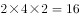种情况。

故正确答案为B。

---

第 62 题

**答案**：A

**来源参考解析（非官方标准答案）**

由题干“今天之内要完成尽可能多数量样本的检测”，即先从每一份花费时间少的水样开始检测，这样可以保证在38分钟内完成的数量最多。如下表所示：

故按照第二种、第三种、第四种、第一种顺序检测，凑够38分钟。

检测第二种水需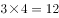分钟，检测第三种水需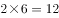分钟，再从第四种水的四份中随机选2份，所需时间为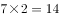分钟，刚好凑够38分钟，且保证了检测数量最多。因题干问“问有多少种不同的检测组合方式”，即考虑组合情况数（不需考虑顺序），故第二种、第三种水全选，均为1种情况；第四种水4份中随机选2份有种组合方式，所以总组合数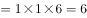种。

故正确答案为A。

---

第 63 题

**答案**：B

**来源参考解析（非官方标准答案）**

由题干“总销售额是总进货成本的2倍”，即平均每千克糖果售价为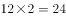元。因为从第二天起每天都比前一天降价2元/千克，即判定糖果价格为公差为的等差数列，故平均价格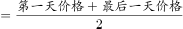，即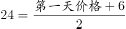，解得第一天售价为42元。根据等差数列第n项公式“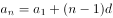”，代入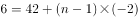，解得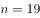天。因为每天卖10千克，故总量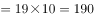千克。

故正确答案为B。

---

第 64 题

**答案**：A

**来源参考解析（非官方标准答案）**

条件和问题均只给出了距离，未给出速度和时间的具体值，考虑赋值。赋值甲速度为100米/分，第一次追及，甲跑了600米，用时为6分；第二次追及，甲加速，速度为120米/分，又跑了1200米，用时为10分。

根据行程问题追及公式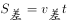，从第一次追上，到第二次追上时，两人的路程差为1圈，即，解得乙速度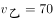米/分。

再分析第一次追及过程，甲比乙多走的距离即为甲出发点到乙出发点距离，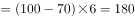米。

故正确答案为A。

---

第 65 题

**答案**：B

**来源参考解析（非官方标准答案）**

设总利润为（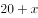）万元，则甲获得利润为（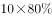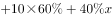）万元，乙获得利润为（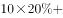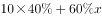）万元，根据题意，（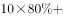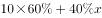）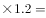，解得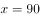。

如果总利润减半，则总利润变为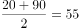万元，此时甲获得利润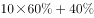万元，乙获得利润万元，甲分得的利润比乙多1万元。

故正确答案为B。

---

第 66 题

**答案**：D

**来源参考解析（非官方标准答案）**

第1天制作了1个，以后每天都比前一天多制作1个，所以每天制作的产品数量为公差为1的等差数列，产品总数为。设总共制作了N箱，则，化简得。

分析该式可知，能被96整除且和必然一奇一偶，而96的大于1的奇数因子只有3，故将96因式分解为，故和其中必有一个能被32整除、另一个能被3整除。（详见备注）

要让最小，不妨令，此时，两个倍数均满足，代入解得，不违反题意，故。

故正确答案为D。

备注：①如果将因式分解为，之类的情况，会造成和都是偶数，违反题意。故只能因式分解为，即一个能被32整除，另一个能被3整除。②若令的倍数，则需要是32的倍数，会造成X的最小值等于63，比解析中讨论的32更大，违反题意。

---

第 67 题

**答案**：C

**来源参考解析（非官方标准答案）**

若想开始时的水量占比尽可能大，则最开始时的水量应尽可能多，由于最后剩余水量的占比一定，则每天排出的水要尽可能多。

根据题意，每周二、四、六排水后剩余水量为前一天的；其余日期（周日、周一、周三、周五）每天剩余水量为前一天的。若要每日排出的水尽量多，则其余日期应尽量多。假设从周日开始计算，连续六天后，剩余水量为开始水量的：。则最开始水池中的水量相当于总容量的。

故正确答案为C。

---

第 68 题

**答案**：A

**来源参考解析（非官方标准答案）**

根据条件“理工大学招聘人数是政法大学和财经大学之和的”，则；“政法大学招聘的人数比财经大学多”，则。设政法与财经大学的总招聘人数为，则三所大学的总招聘人数为。根据“总计招聘应届毕业生三百多人”，则只能取值为3，此时总计招聘了人。

若想将招聘的应届生平均分配到7个部门，大于351且能够被7整除的数最小为357，则还需要至少招聘人。

故正确答案为A。

---

第 69 题

**答案**：A

**来源参考解析（非官方标准答案）**

如下表所示，假设乙生产线生产A产品的效率为，生产B产品的效率为，则甲生产线生产A产品的效率为，生产B产品的效率为。

A产品甲的效率是乙的2倍，B产品甲的效率是乙的3倍，因此相对而言甲做B产品优势更明显，要想二者合作时间短，则让甲生产线生产B产品，乙生产线生产A产品。根据题意甲总共生产件产品可知甲生产了B产品件，A产品件，则乙生产了剩余的A产品件。根据甲乙两条生产线工作时间相同，可列方程:，解得，即乙在单位时间内生产A的件数是生产B件数的倍。

故正确答案为A。

---

第 70 题

**答案**：C

**来源参考解析（非官方标准答案）**

根据题意可得我方无人机与可疑无人机运动轨迹如上图所示，二者最终在C点相遇，。

已知千米，，则在直角三角形中，，千米，千米，又已知千米，则千米。

相同时间，我方无人机从B点飞行到C点，可疑无人机从A点飞行到C点，速度之比等于路程之比，，则我方无人机速度是可疑无人机的倍。

故正确答案为C。

---

第 71 题

**答案**：C

**来源参考解析（非官方标准答案）**

图形元素组成不同，且无明显属性规律，考虑数量规律。观察发现题干图4为明显的一笔画图形，且出现大量端点，考虑笔画数。题干图形均为一笔画，所以？处图形也应该是一笔画图形，图A、B、C、D的奇点数分别为：4、4、2、6，对应笔画数分别是：两笔画、两笔画、一笔画、三笔画，只有C项满足规律。
故正确答案为C。

---

第 72 题

**答案**：A

**来源参考解析（非官方标准答案）**

图形1、2、4元素组成相同，考虑位置规律。题干图形明显分成黑色L形和白色L形，整体无规律考虑分开看。观察发现，从图一到图二，黑色L形顺时针旋转，白色L形位置不变；从图二到图三，白色L形逆时针旋转，黑色L形位置不变，同时有一块黑色小正方形与白色小正方形重叠，呈现黑色；从图三到图四，黑色L形顺时针旋转，白色L形位置不变；从图四到图五，白色L形逆时针旋转，黑色L形位置不变，同时有一块黑色小正方形与白色小正方形重叠，呈现黑色；根据上述规律，从图五到？处，应该是：黑色L形顺时针旋转，白色L形位置不变，对应A项。

故正确答案为A。

---

第 73 题

**答案**：D

**来源参考解析（非官方标准答案）**

图形元素组成不同，且无明显属性规律，考虑数量规律。观察发现，题干出现明显的曲线和直线，且线条交叉明显，考虑数曲线与直线的交点数，分别是：4、6、2、4、8，同时，图形的曲线数为：2、3、1、2、4，发现规律为：图形的曲直交点数是曲线数的两倍。所以？处图形也应该符合此规律。选项中，曲直交点数分别为：5、4、1、2，均只有一条曲线，只有D项满足规律，曲直交点数是曲线数的两倍。
故正确答案为D。
注：本题由于A项图片不清晰，根据原图的视觉效果A项应为4个曲直交点，但放大后，A项应为5个曲直交点，由于考虑到考场的真实情况，所以视频解析中老师是按照考场思维进行讲解的。

---

第 74 题

**答案**：A

**来源参考解析（非官方标准答案）**

将如下图多面体的面分别标为e、f、g面，对应的展开图也进行标序如下图。

利用画边法找对应的边，以面e、f的公共边为起点，顺时针画边。立体图中，边的顺序是：公共边ABC，展开图中，边的顺序是：公共边231，所以，数字1、2、3对应的边是：C、A、B，边4为D，只有A项符合。

故正确答案为A。

---

第 75 题

**答案**：C

**来源参考解析（非官方标准答案）**

本题为九宫格题。元素组成相似，优先考虑样式规律。观察可知，题干图形均由黑点和白点构成，考虑黑白运算。根据第一行可知，运算规律为：黑黑白；黑白黑；白黑黑；白白黑，第二行验证符合此运算规律。第三行左上角为白白黑，排除B、D两项；对比A、C两项右下角颜色不同，应为“黑白黑”，据此C项当选。

故正确答案为C。

---

第 76 题

**答案**：B

**来源参考解析（非官方标准答案）**

本题考查立体拼合。

观察题干给出的多面体可知，横行和竖列最多均有4个正方体，其中②最下方为4个正方体，①最下方可以拼为4个正方体，则①和②正方体数量最多的行列会放置在主视图的左后方。根据题干后视图可知，第二层最多有3个小立方体，①第二行有3个小立方体，所以①在后视图的最前面，并且②最下面多出来的正方体可以和①最下方缺少的正方体进行拼合，如上图所示。拼合后可知，第二层缺少3个正方体，排除C、D两项。对比A、B两项可知，下层的正方体位置不同，①②拼合后最左侧不缺正方体，据此B项当选。

故正确答案为B。

---

第 77 题

**答案**：D

**来源参考解析（非官方标准答案）**

本题考查截面图，逐一分析选项。

A项：从图形正中间竖直向下切即可得到，排除；

B项：从正前方切入，向后下方切出，只切图形上方凸出的两部分即可得到，排除；

C项：从图形下方切入，平行于底面即可以得到，排除；

D项：无法切出，当选。

本题为选非题，故正确答案为D。

---

第 78 题

**答案**：C

**来源参考解析（非官方标准答案）**

本题为分组分类题。元素组成不同，优先考虑属性规律。观察可知，题干图形比较规整，考虑对称性。图①④⑤一组，对称轴穿过图中的两条线，并且这两条线和对称轴垂直；图②③⑥一组，对称轴穿过图中的两个交点，对应C项。
故正确答案为C。

---

第 79 题

**答案**：A

**来源参考解析（非官方标准答案）**

解析一：本题为分组分类题目。每幅图都由几个图形拼接而成，优先考虑图形间关系。图形内部线条比较多，优先考虑线条数量，发现图①④⑥内部公共边都是4根线，图②③⑤内部公共边都是3根线，所以，①④⑥为一组，②③⑤为一组。
解析二：本题为分组分类题目。图形外部都是多边形，考虑外框图形直线数，图①④⑥外框图形都是7根线，图②③⑤外框图形都是8根线。所以，①④⑥为一组，②③⑤为一组。
故正确答案为A。

---

第 80 题

**答案**：B

**来源参考解析（非官方标准答案）**

本题为分组分类题目。观察发现，图形①中黑色图形只有正方形一种，②中黑色图形有梯形和三角形两种，③中黑色图形只有梯形一种，④中黑色图形只有三角形一种，⑤中黑色图形有圆和圆环两种，⑥中黑色图形有长方形和梯形两种，所以，可以根据黑色图形是一种还是两种分为两组，①③④为一组，②⑤⑥为一组。
故正确答案为B。

---

第 81 题

**答案**：B

**来源参考解析（非官方标准答案）**

第一步：找出定义关键词。
“在平庸的人群中”、“正确洞见的人当其观点不被接受、不被相信，对事情的发展无能为力时”、“所表现出的无奈、压抑和痛苦的心情”。
第二步：逐一分析选项。
A项：诗句的意思是“自古以来圣贤无不是冷落寂寞的，只有会喝酒的人才能够流传美名。”该诗句说明作者李白只图一醉方休，表达了诗人旷达的胸怀，没有体现出“正确洞见的人当其观点不被接受、不被相信，对事情的发展无能为力”，不符合定义，排除；
B项：诗句的意思是“世界上的人都是污浊的，唯独我干净、清白；众人都已醉倒，唯独我一人清醒。”该诗句是屈原被排挤，被冠以奸邪的罪名，遭到了放逐后所作，符合“在平庸的人群中”“正确洞见的人当其观点不被接受、不被相信，对事情的发展无能为力时”，也符合“所表现出的无奈、压抑和痛苦的心情”，符合定义，当选；
C项：诗句的意思是“那花儿落去我也无可奈何，那归来的燕子似曾相识”，该诗句表达了春的消逝，时光的流逝，都是不可抗拒的自然规律，虽然惋惜流连也无济于事，不符合“正确洞见的人当其观点不被接受、不被相信，对事情的发展无能为力时”，不符合定义，排除；
D项：诗句的意思是“醉就醉吧，醉卧在沙场上有什么呢，请不要见笑，从古至今征战的人有几个是活着回来的。”表达了豪放、开朗、兴奋的感情，还有视死如归的勇气，不符合“所表现出的无奈、压抑和痛苦的心情”，不符合定义，排除。
故正确答案为B。

---

第 82 题

**答案**：A

**来源参考解析（非官方标准答案）**

第一步：找出定义关键词。
“描述了一组数据的平均趋势”、“所有数据之和除以数据个数所得之商”、“出现极端数值、模糊不清的数据或者不同质的数据时，均不能计算算术平均数”。
第二步：逐一分析选项。
A项：10岁以下儿童204人，90岁以上老人26人，这些都是该社区居民，所以在统计该社区居民的平均年龄，要统计在内，适用于计算算数平均数，当选；
B项：某公司统计35岁以下青年职工的年平均收入，一人年收入百万元以上，其他人基本处于10~12万元之间，年收入百万以上的公司高管与年收入10~12万元的普通员工相比，属于“极端数值”，不适于计算算术平均数，排除；
C项：某学校统计本校青少年平均身高，青少年一般是指自上初中到高中毕业，包括“中学部”，但不包括“学前部、小学部”，所以，“学前部、小学部和中学部”属于“不同质的数据”，不适于计算算术平均数，排除；
D项：某市统计该市各区县留守儿童的平均数量，其中外出务工人员数量较多的区县无法进行准确统计，只提供了估算数据，估算出的数据属于“模糊不清的数据”，不适于计算算术平均数，排除。
故正确答案为A。

---

第 83 题

**答案**：D

**来源参考解析（非官方标准答案）**

第一步：找出定义关键词。
“以动物为媒介”、“通过人与动物的接触，改善或维持残障人士的身体状况，或帮助他们加强与外部世界的互动”。
第二步：逐一分析选项。
A项：迷你猪陪伴自闭症患者，符合“以动物为媒介”，减轻自闭症患者面对人群时产生的焦虑，符合“通过人与动物的接触，帮助他们加强与外部世界的互动”，符合定义，排除；
B项：卷尾猴帮助体障者完成简单动作，符合“以动物为媒介”，体障者能够开关门、操控遥控器，符合“通过人与动物的接触，改善或维持残障人士的身体状况”，符合定义，排除；
C项：鼬獾能够警示精神病人及时吃药，符合“以动物为媒介”，在主人发病时发出叫声，警示主人，符合“通过人与动物的接触，改善或维持残障人士的身体状况”，符合定义，排除；
D项：独自生活的老年人不是残障人士，不符合定义，当选。
本题为选非题，故正确答案为D。

---

第 84 题

**答案**：D

**来源参考解析（非官方标准答案）**

第一步：找出定义关键词。
“在法律明文规定的情形下”、“非商业性使用他人已经发表的作品”、“为个人学习、研究或者欣赏，使用他人已经发表的作品”、“免费表演已经发表的作品”、“对设置或者陈列在室外公共场所的艺术作品进行临摹、绘画、摄影、录像”、“将已经发表的以汉语言文字创作的作品翻译成少数民族语言文字作品出版发行”。
第二步：逐一分析选项。
A项：甲唱了一首戊尚未发表的歌曲，不符合“非商业性使用他人已经发表的作品”和“免费表演已经发表的作品”，不符合定义，排除；
B项：乙将英文作品翻译成蒙文作品，这里的英文作品不符合“将已经发表的以汉语言文字创作的作品翻译成少数民族语言文字作品出版发行”，不符合定义，排除；
C项：丙公司拍摄雕塑作品后进行发行，属于商业用途，不符合“非商业性使用他人已经发表的作品”，不符合定义，排除；
D项：丁为了撰写论文复印和参考了庚已经发表的论文，参考论文符合“在法律明文规定的情形下”和“为个人学习、研究或者欣赏，使用他人已经发表的作品”，同时，丁没有用作商业用途，符合“非商业性使用他人已经发表的作品”，符合定义，当选。
故正确答案为D。

---

第 85 题

**答案**：C

**来源参考解析（非官方标准答案）**

第一步：找出定义关键词。
伞房花序：“花序轴下部的花梗较长，上部的花梗依次渐短”、“整个花序的花几乎排列在一个平面上”。
伞形花序：“在总花梗顶端集生许多花梗近等长的小花”、“放射状排列如伞”。
第二步：逐一分析选项。
A项：图中的花梗等长，不符合“花序轴下部的花梗较长，上部的花梗依次渐短”，花序排列形状也不符合“整个花序的花几乎排列在一个平面上”，不符合“伞房花序”定义，排除；
B项：图中的花梗几乎等长，符合“在总花梗顶端集生许多花梗近等长的小花”，花序排列形状也符合“放射状排列如伞”，符合“伞形花序”定义，不符合“伞房花序”定义，排除；
C项：图中下部花梗长，上部花梗短，符合“花序轴下部的花梗较长，上部的花梗依次渐短”，并且花序形状也符合“整个花序的花几乎排列在一个平面上”，符合“伞房花序”定义，当选；
D项：图中的花梗等长，不符合“花序轴下部的花梗较长，上部的花梗依次渐短”，花序排列形状也不符合“整个花序的花几乎排列在一个平面上”，不符合“伞房花序”定义，排除。
故正确答案为C。

---

第 86 题

**答案**：B

**来源参考解析（非官方标准答案）**

第一步：找出定义关键词。
“看影视剧不介意被剧透”、“会提前查询剧情介绍、翻遍各种影评的人”。
第二步：逐一分析选项。
A项：小王向女朋友介绍电影剧情，但没有说女朋友是否介意被剧透，不符合“看影视剧不介意被剧透”，不符合定义，排除；
B项：小杜对于电影在了解权威评价、剧情内容、画面特征等情况后，才有观赏的冲动，符合“会提前查询剧情介绍、翻遍各种影评的人”，符合定义，当选；
C项：小李喜欢陶醉在烧脑的剧情中，但没有涉及喜欢提前知道剧情，不符合“会提前查询剧情介绍、翻遍各种影评的人”，不符合定义，排除；
D项：张大爷的老伴喜欢将电视剧剧情讲述给张大爷，但没有说张大爷是否介意被剧透，不符合“看影视剧不介意被剧透”，不符合定义，排除。
故正确答案为B。

---

第 87 题

**答案**：A

**来源参考解析（非官方标准答案）**

第一步：找出定义关键词。
“不直接提出要求”、“强调由于对方的责任导致自己处于困境”、“使对方产生愧疚心理，从而使对方补偿自己”。
第二步：逐一分析选项。
A项：甲向李某倾诉由于李某的原因他被骗的很惨，符合“强调由于对方的责任导致自己处于困境”， 李某于是免息借钱给甲做生意以求得心安，符合“使对方产生愧疚心理，从而使对方补偿自己”，符合定义，当选；
B项：乙要求妻子以后负责夜里带孩子，不符合“不直接提出要求”，不符合定义，排除；
C项：丙请假休养，未提及是由于陈某的责任而导致自己受伤，不符合“强调由于对方的责任导致自己处于困境”，不符合定义，排除；
D项：庄某听家政公司说丁家庭非常困难，并不是丁某自己强调家庭困难，不符合“强调由于对方的责任导致自己处于困境”，不符合定义，排除；
故正确答案为A。

---

第 88 题

**答案**：C

**来源参考解析（非官方标准答案）**

第一步：找出定义关键词。
“前提是一个事实性的描述”、“结论所表述的则是一个涉及价值意义的描述”。
第二步：逐一分析选项。
A项：人与人之间应该进行更多地交流和沟通，更多地理解和包容，属于涉及价值意义的描述，世界上的民族国家将越来越少，属于陈述的事实，不符合“前提是一个事实性的描述”、“结论所表述的则是一个涉及价值意义的描述”，不符合定义，排除；
B项：既然人人都要遵纪守法，属于涉及价值意义的描述，那我们就应该对法律多一份尊重，对规则多一份敬畏，也属于涉及价值意义的描述，不符合“前提是一个事实性的描述”，不符合定义，排除；
C项：世界变得越来越城市化，符合“前提是一个事实性的描述”，因此人们就不应该继续诗意地栖居在农村，符合“结论所表述的则是一个涉及价值意义的描述”，符合定义，当选；
D项：这个地区的绿化率在不断提高，属于陈述的事实，其空气质量也将不断改善，也属于陈述的事实，不符合“结论所表述的则是一个涉及价值意义的描述”，不符合定义，排除。
故正确答案为C。

---

第 89 题

**答案**：B

**来源参考解析（非官方标准答案）**

第一步：找出定义关键词。
“通过人与人之间的社交促进产品的传播与销售”、“通过利益驱动激励客户从而形成裂变”。
第二步：逐一分析选项。
A项：微商客户通过在自己的社交圈中分享商品促进了产品的传播和销售，符合关键词“通过人与人之间的社交促进产品的传播与销售”，微商客户通过在朋友圈分享获得了好友的砍价，继而可以通过较低的价格购买到产品，符合关键词“通过利益驱动激励客户从而形成裂变”，符合定义，排除；
B项：微信用户在购买到自己喜欢的商品后，通过拍照在朋友圈中分享，继而起到产品宣传的效果，符合关键词“通过人与人之间的社交促进产品的传播与销售”，但选项中未体现出商家对微信用户的激励，不符合关键词“通过利益驱动激励客户从而形成裂变”，不符合定义，当选；
C项：电商平台通过让购买成功的客户分享其链接来宣传自己，符合关键词“通过人与人之间的社交促进产品的传播与销售”，所有点击的人都能获得商家提供的随机金额的优惠券，符合定义关键词“通过利益驱动激励客户从而形成裂变”，符合定义，排除；
D项：咖啡店通过让老顾客邀请好友免费喝咖啡来促进产品的传播和销售，符合关键词“通过人与人之间的社交促进产品的传播与销售”，老顾客通过参加“邀请好友免费喝咖啡”活动可以获取一张套餐券，符合定义关键词“通过利益驱动激励客户从而形成裂变”，符合定义，排除。
本题为选非题，故正确答案为B。

---

第 90 题

**答案**：A

**来源参考解析（非官方标准答案）**

第一步：找出定义关键词。
培养基：“供给微生物、植物或动物（或组织）生长繁殖的，由不同营养物质组合配制而成的营养基质，一般都含有碳水化合物、含氮物质、无机盐、维生素、水等物质”。
天然培养基：“利用动物、植物或微生物包括其提取物制成”。
合成培养基：“根据天然培养基的成分，用化学物质模拟合成、人工设计而配制的培养基”。
半组合培养基：“以化学试剂配制为主，同时还加有少量天然成分的培养基”。
第二步：逐一分析选项。
A项：“在一定比例的盐水氨基酸溶液中加入少量玉米汁制成的培养基”说明该培养基是以盐水氨基酸溶液为主，以少量玉米汁为辅，且盐水氨基酸溶液是一种化学试剂，玉米汁是从玉米中提取而来，为天然成分，符合关键词“以化学试剂配制为主，同时还加有少量天然成分的培养基”，符合定义，当选；
B项：麦芽汁是从麦芽中提取而来，是天然成分，但选项中并未提及“化学试剂”，不符合关键词“以化学试剂配制为主，同时还加有少量天然成分的培养基”，不符合定义，排除；
C项：“有机成分、矿物元素、琼脂等按3：1：2的比例制成”，说明该培养基中有机成分占比最高，但有机成分也分为天然有机和合成有机，不确定此处的有机成分是否是化学试剂配制，不符合关键词“以化学试剂配制为主，同时还加有少量天然成分的培养基”，不符合定义，排除；
D项：“在1000毫升新鲜牛奶中加入10毫升硫酸亚铁制成的培养基”说明该培养基是以新鲜牛奶为主，以硫酸亚铁为辅，而新鲜牛奶是天然成分，硫酸亚铁为化学试剂调配而成，不符合关键词“以化学试剂配制为主，同时还加有少量天然成分的培养基”，不符合定义，排除。
故正确答案为A。

---

第 91 题

**答案**：D

**来源参考解析（非官方标准答案）**

第一步：判断题干词语间逻辑关系。
惯性是物体的固有属性，一切物体都具有惯性，二者为属性对应关系。
第二步：判断选项词语间逻辑关系。
A项：稳定性并非气体的固有属性，如臭氧就是一种具有刺激性特殊气味的不稳定气体，与题干逻辑关系不一致，排除；
B项：客观性并非观察的固有属性，与题干逻辑关系不一致，排除；
C项：磁性并非贵金属的固有属性，如金是贵金属，但其并没有磁性，与题干逻辑关系不一致，排除；
D项：流动性是液体的固有属性，一切液体都具有流动性，二者为属性对应关系，与题干逻辑关系一致，当选。
故正确答案为D。

---

第 92 题

**答案**：D

**来源参考解析（非官方标准答案）**

第一步：判断题干词语间逻辑关系。
全身麻醉，是指麻醉药经呼吸道吸入、静脉或肌肉注射进入体内，产生中枢神经系统的抑制，临床表现为神志消失、全身疼觉丧失、遗忘、反射抑制和骨骼肌松弛。注射麻醉，是指通过静脉注射或者肌肉注射来进行的麻醉。有的全身麻醉是注射麻醉，有的注射麻醉是全身麻醉，二者是交叉关系。
第二步：判断选项词语间逻辑关系。
A项：网络存储和单机存储是两种不同的储存方式，为并列关系，与题干逻辑关系不一致，排除；
B项：胸式呼吸，主要是靠肋骨的侧向扩张来吸气，利用肋间外肌上举肋骨以扩大胸廓，该种呼吸方式主要依靠胸部的扩张和收缩，横隔膜运动较小，呼吸主要集中在肺的上中部进行。腹式呼吸，主要是让横隔膜上下移动，吸气时横隔膜下降将脏器挤到下方，吐气时横隔膜比平常上升，可以进行深度呼吸，吐出较多停滞在肺底部的二氧化碳。二者是不同的呼吸方式，为并列关系，与题干逻辑关系不一致，排除；
C项：物理消毒，是指利用物理因素杀灭或消除病原微生物及其他有害微生物的方法。主要包括自然净化、机械除菌、热力消毒灭菌、电离辐射消毒、微波消毒、超声波杀毒、等离子体灭菌、过滤除菌等。加热消毒属于物理消毒的一种，二者是包容关系中的种属关系，与题干逻辑关系不一致，排除；
D项：抽样调查，是一种非全面调查，它是从全部调查研究对象中，抽选一部分单位进行调查，并据以对全部调查研究对象做出估计和推断的一种调查方法。问卷调查，是指通过制定详细周密的问卷，要求被调查者据此进行回答以收集资料的方法。有的抽样调查是问卷调查，有的问卷调查是抽样调查，二者是交叉关系，与题干逻辑关系一致，当选。
故正确答案为D。

---

第 93 题

**答案**：C

**来源参考解析（非官方标准答案）**

第一步：判断题干词语间逻辑关系。
物必先腐，而后虫生，指的是因为东西自身先腐烂，所以虫子才可以寄生，二者为因果的对应关系。
第二步：判断选项词语间逻辑关系。
A项：古木无人径，深山何处钟，指的是古木参天却没有人行路径，深山里何处传来古寺鸣钟？二者不是因果的对应关系，与题干逻辑关系不一致，排除；
B项：水落鱼梁浅，天寒梦泽深，指的是鱼梁洲因水落而露出江面，云梦泽由天寒而迷蒙幽深。二者为并列关系，与题干逻辑关系不一致，排除；
C项：少壮不努力，老大徒伤悲，指的是因为年轻力壮的时候不奋发图强，所以老年时只会留下悲伤、后悔。二者为因果的对应关系，与题干逻辑关系一致，当选；
D项：欲投人处宿，隔水问樵夫，指的是想在山中找个人家去投宿，隔水询问那樵夫可否方便？二者不是因果的对应关系，与题干逻辑关系不一致，排除。
故正确答案为C。

---

第 94 题

**答案**：C

**来源参考解析（非官方标准答案）**

第一步：判断题干词语间逻辑关系。
轻车熟路指车子轻便，道路熟悉，比喻任务不重，又有经验，做起来容易；人生地疏指人事不熟，地方陌生，二者为反义关系；且“轻车”和“熟路”是并列关系，“人生”和“地疏”是并列关系。
第二步：判断选项词语间逻辑关系。
A项：廉洁奉公指的是不贪污腐化，一心为公；卑躬屈膝指的是形容低声下气，奉承讨好的样子，二者没有必然联系，与题干逻辑关系不一致，排除；
B项：任重道远指的是担子很重，路程遥远，比喻责任重大，需要经过长期的艰苦奋斗；无所事事指的是什么事都不干，二者为反义关系，但“无所”和“事事”不是并列关系，与题干逻辑关系不一致，排除；
C项：前仆后继指的是前边的倒下了，后边的紧跟上来，形容不怕牺牲，英勇奋战；贪生怕死指的是贪恋生存，畏惧死亡，指对敌作战畏缩不前，二者为反义关系；且“前仆”和“后继”是并列关系，“贪生”和“怕死”是并列关系，与题干逻辑关系一致，当选；
D项：河清海晏指的是黄河的水澄清，大海风平浪静，用以比喻天下太平；国泰民安指的是国家太平，人民安乐，二者为近义关系，与题干逻辑关系不一致，排除。
故正确答案为C。

---

第 95 题

**答案**：B

**来源参考解析（非官方标准答案）**

第一步：判断题干词语间逻辑关系。
路由器有连接网络的功能，前后为对应关系。
第二步：判断选项词语间逻辑关系。
A项：千斤顶的功能是更换轮胎时顶起车身，不是修补轮胎，与题干逻辑关系不一致，排除；
B项：石英钟的功能是显示时间，与题干逻辑关系一致，当选；
C项：万花筒是一种光学玩具，由孔中看去即可观测到对称的美丽图像，故无法通过万花筒观察花卉，与题干逻辑关系不一致，排除；
D项：烽火台是古时用于点燃烟火传递重要消息的高台，人们通过烽火台传递敌情，而不是侦察敌情，与题干逻辑关系不一致，排除。
故正确答案为B。

---

第 96 题

**答案**：A

**来源参考解析（非官方标准答案）**

第一步：判断题干词语间逻辑关系。
混凝土是建筑材料的一种，二者为种属关系，水泥是混凝土的原材料，二者为对应关系。
第二步：判断选项词语间逻辑关系。
A项：汽水是饮料的一种，二者为种属关系，二氧化碳是汽水的原材料，二者为对应关系，与题干逻辑关系一致，当选；
B项：注射器是医疗工具的一种，二者为种属关系，但药物不是注射器的原材料，应为用注射器注射药物，与题干逻辑关系不一致，排除；
C项：监视器与监控是功能的对应关系，且监视器中可以显示画面，与题干逻辑关系不一致，排除；
D项：减速带是交通设施的一种，二者为种属关系，警示牌与减速带没有明显的逻辑关系，警示牌和交通设施是交叉关系，有的警示牌是交通设施（如铁路道口交通警示牌等），有的警示牌不是交通设施（如高压警示牌、高空作业警示牌等），与题干逻辑关系不一致，排除。
故正确答案为A。

---

第 97 题

**答案**：B

**来源参考解析（非官方标准答案）**

第一步：判断题干词语间逻辑关系。
本能行为和学习行为是并列关系中的矛盾关系，乌贼喷墨是一种本能行为。
第二步：判断选项词语间逻辑关系。
A项：有的合法行为是合理行为，有的合理行为是合法行为，合法行为和合理行为为交叉关系；盗窃财物是非法行为和不合理行为，与题干逻辑关系不一致，排除；
B项：物理变化和化学变化是并列关系中的矛盾关系；树木折断没有新物质产生，是物理变化，与题干逻辑关系一致，当选；
C项：生产管理和销售管理是并列关系中的反对关系；退货处理属于销售管理的一部分，两者是组成关系，与题干逻辑关系不一致，排除；
D项：社会现象和自然现象是并列关系的矛盾关系，四季变换是一种自然现象，与题干逻辑关系不一致，排除。
故正确答案为B。

---

第 98 题

**答案**：B

**来源参考解析（非官方标准答案）**

第一步：判断题干词语间逻辑关系。
税前收入和税后收入是并列关系，税前收入减去税金等于税后收入。
第二步：判断选项词语间逻辑关系。
A项：法律规定和道德规范是并列关系，法律规定和道德规范依据的是不同的规则规范大家的行为，与题干逻辑关系不一致，排除；
B项：测量高度和真实高度是并列关系，测量高度减去误差等于真实高度，与题干逻辑关系一致，当选；
C项：高原地区和平原地区是并列关系，但高原地区和平原地区是根据不同的海拔进行区分的，与纬度无关，与题干逻辑关系不一致，排除；
D项：生产成本、出厂价格、销售价是并列关系，销售价减去出厂价格是销售商的利润，出厂价格减去生产成本是生产商的利润，与题干逻辑关系不一致，排除。
故正确答案为B。

---

第 99 题

**答案**：D

**来源参考解析（非官方标准答案）**

逐一代入选项。
A项：薄荷和川芎都是中药材，两者是并列关系；水钟是一种计时器，两者是种属关系，前后逻辑关系不一致，排除；
B项：薄荷有清凉的作用，两者是功能的对应关系；计时器具有精准的属性，两者是属性的对应关系，前后逻辑关系不一致，排除；
C项：薄荷和茯苓都是中药材，两者是并列关系；计时器可以有倒计时的功能，两者是对应关系，前后逻辑关系不一致，排除；
D项：薄荷是一种药用植物，两者是种属关系；沙漏是一种计时器，两者是种属关系，前后逻辑关系一致，当选。
故正确答案为D。

---

第 100 题

**答案**：D

**来源参考解析（非官方标准答案）**

逐一代入选项。
A项：石英砂是制作玻璃瓶的原材料，两者是对应关系；秋播作物是农作物的一种，两者是种属关系，前后逻辑关系不一致，排除；
B项：玻璃瓶和塑料瓶是并列关系；水生植物和秋播作物是交叉关系，前后逻辑关系不一致，排除；
C项：玻璃瓶和饮料瓶是交叉关系；春播作物和秋播作物是并列关系，前后逻辑关系不一致，排除；
D项：玻璃瓶和广口瓶是交叉关系；大棚作物和秋播作物是交叉关系，前后逻辑关系一致，当选。
故正确答案为D。

---

第 101 题

**答案**：C

**来源参考解析（非官方标准答案）**

第一步：找出论点和论据。
论点：美洲热带雨林虽然更频繁地受到闪电雷击，却没有引发更多的森林大火，可能与近年来雨林中藤蔓植物大量增加有关。
论据：无。
前文是背景介绍，本题只有论点没有论据，优先考虑解释原因和举例，即证明没有引起森林大火与藤蔓植物增加之间有关系。
第二步:逐一分析选项。
A项：热带雨林湿度大，不会产生火灾，论点是讨论未引起火灾与藤蔓之间的关系，无法支持，排除；
B项：藤蔓植物覆盖率越来越大，未直接明确说明藤蔓覆盖率与没有引起森林火灾的必然关系，不明确选项，无法支持，排除；
C项：藤蔓茎干电阻比树枝更小，可以像避雷针一样传导闪电，把藤蔓茎干比作避雷针，明确解释了电流从自己的茎干传导，避免了火灾，解释原因，可以支持，当选；
D项：雷击很大，先摧毁外部的藤蔓，保护了内部的树枝，摧毁了外部的藤蔓说明遭受了雷击，但并不明确是否避免了火灾，属于不明确选项，无法支持，排除。
故正确答案为C。

---

第 102 题

**答案**：A

**来源参考解析（非官方标准答案）**

第一步：翻译题干。

①—生命停止新陈代谢；

②自我封闭衰落；

③旺盛生命活力交流互鉴 且 取长补短。

第二步：逐一分析选项。

A项：翻译为“—交流互鉴—旺盛生命活力”，③后件是且关系，否定其中一项则否定全部，该选项是否后推否前，可以推出，当选；

B项：翻译为“—自我封闭—衰落”，是对②的否前，否前推不出确定性结论，排除；

C项：翻译为“交流互鉴 且 取长补短旺盛生命活力”，是对③的肯后，肯后推不出确定性结论，排除；

D项：翻译为“—旺盛生命活力—取长补短”，是对③的否前，否前推不出确定性结论，排除。

故正确答案为A。

---

第 103 题

**答案**：B

**来源参考解析（非官方标准答案）**

第一步：找出论点和论据。
论点：通过靶向治疗方法降低胆固醇可以对抗箱形水母的毒液。
论据：名为ATP2B1的蛋白质是箱形水母毒液发挥毒性的必要条件。
本题论点讨论的是靶向疗法降低胆固醇可以对抗毒液，论据讨论的是毒液发挥作用需要人体内的蛋白质ATP2B1，论点和论据话题不一致，优先考虑搭桥，在“胆固醇”与该“蛋白质”之间建立联系即可。
第二步：逐一分析选项。
A项：就算靶向治疗方法不是安全的方法，也不影响论点讨论的靶向治疗方法对抗毒液是否有效，不是上述论证的前提，排除；
B项：ATP2B1蛋白质发挥作用需要胆固醇，通过靶向疗法可以降低胆固醇，从而防止毒液发挥毒性，在“胆固醇”与该“蛋白质”之间建立了联系，搭桥项，当选；
C项：降低胆固醇是否有副作用与题干讨论的能否对抗毒液无关，不是上述论证的前提，排除；
D项：已研制出靶向治疗药物，与题干讨论的靶向疗法是否有用无关，不是上述论证的前提，排除。
故正确答案为B。

---

第 104 题

**答案**：A

**来源参考解析（非官方标准答案）**

第一步：找出论点和论据。
论点：将石油开采中的有毒废水注入地下岩石的不透水层之间，这一行为很可能就是引发地震的关键原因。
论据：无。
本题只有论点，没有论据，加强优先考虑补充论据，即解释为什么将这些废水注入地下岩石的不透水层之间会引发地震，或举例证明将这些废水注入地下岩石的不透水层之间会引发地震。
第二步：逐一分析选项。
A项：指出废水灌入岩石水层中会降低断层之间的摩擦力从而诱发地震，解释为什么将这些废水注入地下岩石的不透水层之间会引发地震，补充论据，当选；
B项：指出该州自2008年以来石油开采活动大幅增加，石油开采活动增加只能证明开采排放的有毒废水增多，但不能证明是这些废水注入地下造成了该州2014年以来地震多发，无法加强，排除；
C项：指出该州2008年之前的地震与2014年的地震在数量以及震级上的差别，而论点说的是造成该州2014年以来地震多发的原因，话题不一致，无法加强，排除；
D项：指出该州地震不是一次强震后发生的一系列余震，而论点说的是造成该州地震多发的原因，话题不一致，无法加强，排除。
故正确答案为A。

---

第 105 题

**答案**：D

**来源参考解析（非官方标准答案）**

第一步：找出论点和论据。

论点：溶酶酵素这种物质很可能就是抵御细菌侵扰的关键因素。

论据：在澳洲有一种名为丛冢雉的鸟类，其蛋发生感染的几率仅为，研究者发现其蛋壳中含有溶酶酵素。

本题论点说的是溶酶酵素是抵御细菌侵扰的关键因素，论据说的是一种蛋壳中含有溶酶酵素的鸟类蛋发生感染的几率仅为，二者都是在说溶酶酵素与细菌感染之间的关系，话题一致，削弱优先考虑削弱论点，且论点为因果关系，也可以考虑因果倒置（能够抵御细菌侵扰使其出现溶酶酵素），还可以考虑他因削弱（其他原因导致该鸟类可以抵御细菌侵扰）。

第二步：逐一分析选项。

A项：指出丛冢雉的蛋壳中所含的溶酶酵素量与其他动物含量相当，这说明溶酶酵素并不是丛冢雉的蛋的感染率比其他动物的蛋低很多的原因，削弱论点，排除；

B项：指出纳米级的碳酸钙拥有了更强的防水性和抗细菌入侵能力，说明碳酸钙可能是丛冢雉的蛋的感染率比其他动物的蛋低很多的原因，提出了其他的原因可能是抵御细菌侵扰的关键因素，他因削弱，排除；

C项：指出丛冢雉散发一种特殊气味会使附着在其蛋壳上的细菌数减少，说明气味可能是丛冢雉的蛋的感染率比其他动物的蛋低很多的原因，提出了其他的原因可能是抵御细菌侵扰的关键因素，他因削弱，排除；

D项：指出丛冢雉的蛋壳很薄，更易受到微生物的入侵，讨论的是丛冢雉的蛋壳是否容易受到入侵，而论点讨论的是溶酶酵素是抵御细菌侵扰的关键因素，话题不一致，无法削弱，当选。

本题为选非题，故正确答案为D。

---

第 106 题

**答案**：A

**来源参考解析（非官方标准答案）**

第一步：分析题干条件。
（1）销售部在财务部和生产部之前；
（2）人事部紧接在研发部或者生产部的后面；
（3）紧接在法务部后面的是研发部或者销售部。
本题题干信息确定，选项信息充分，优先考虑排除法。
第二步：根据题干条件进行推理。
根据条件（1）可知销售部在财务部和生产部之前，排除B项；
根据条件（2）可知人事部紧接在研发部或者生产部的后面，排除C项；
根据条件（3）可知紧接在法务部后面的是研发部或者销售部，排除D项。
经验证，A项符合所有条件，当选。
故正确答案为A。

---

第 107 题

**答案**：B

**来源参考解析（非官方标准答案）**

第一步：整理题干条件。

（1）销售在财务和生产之前；

（2）人事紧挨研发或生产之后；

（3）紧挨法务之后的是研发或销售；

（4）研发在戊字楼；

第二步：根据题干条件分析选项。

问的可能为真，可以考虑代入法：列表如下：

当研发部在戊字楼时，结合条件（3）可知，在紧挨着法务部后面的，只能是销售部。

再结合条件（1）可知，销售部在财务和生产之前。

A项代入：法务部在辛字楼，如下：

此时，销售不可能在财务和生产之前，与条件（1）不符，排除；

B项代入：人事部在癸字楼， 

此时，根据条件（2），人事部不可能紧挨着研发，只能是紧挨着生产之后；即壬字楼为生产部；结合条件（3），此时紧挨着法务部之后的只能是销售，而销售又在财务和生产之前，即：

满足题干所有条件，可能为真，当选；

C项代入：财务在己字楼：如下：

此时，销售不可能在财务和生产之前，与条件（1）不符，排除；

D项代入：生产部在庚字楼，如下：

结合条件（1），销售只能在己字楼；此时紧挨着法务之后的不可能是研发或者销售，与条件（3）不符，排除；

故正确答案为B。

---

第 108 题

**答案**：C

**来源参考解析（非官方标准答案）**

第一步：整理题干条件。

（1）销售在财务和生产之前；

（2）人事紧挨研发或生产之后；

（3）紧挨法务之后的是研发或销售；

（4）法务部在壬字楼。

第二步：根据题干条件分析选项。

列表如下：

结合条件（3），如果法务部后面紧挨着是销售部，即癸字楼为销售部，此时会发现：销售不可能在财务和生产之前，与条件（1）不符，即：销售部不可能在癸字楼，紧挨着法务部后面是只能是研发部，研发部在癸字楼；

此时再结合条件（2）可知，人事部只能紧挨在生产部之后；再根据条件（1）可知，销售部后面有财务部和生产部，以及人事部，那么销售部只能在戊字楼。

故正确答案为C。

---

第 109 题

**答案**：B

**来源参考解析（非官方标准答案）**

第一步：整理题干条件。

（1）销售在财务和生产之前；

（2）人事紧挨研发或生产之后；

（3）紧挨法务之后的是研发或销售；

（4）销售部在戊字楼。

第二步：根据题干分析选项。

列表如下：

根据（3）可知，此时紧挨着法务部之后的只能是研发部；此时研发部门不可能在己字楼或者戊字楼。

本题为选非题，故正确答案为B。

---

第 110 题

**答案**：C

**来源参考解析（非官方标准答案）**

第一步：整理题干条件。

（1）销售在财务和生产之前；

（2）人事紧挨研发或生产之后；

（3）紧挨法务之后的是研发或销售。

第二步：根据题干分析选项。

A项代入：结合条件（1）壬字楼和癸字楼只能是财务部或者生产部；

满足题干所有条件，可能为真，排除；

B项代入：

此时，结合条件（1）销售只能在戊字楼或己字楼，结合条件（2）人事只能紧挨着生产；戊字楼和己字楼为法务或者销售即可；

满足题干所有条件，可能为真，排除；

C项代入：结合条件（2）可知，己字楼只能是生产，此时要想满足（1），戊字楼只能是销售部，会发现，法务部后面不可能紧挨着研发或者销售，与条件（3）不符，不可能为真，当选；

D项代入：结合条件（1）可知，销售部只能在戊字楼或己字楼，再结合条件（3）可知，紧接在法务部后面的只能是研发部，即研发部在壬字楼，则根据条件（2）可知，人事部只能在癸字楼，此时，生产部在己字楼，销售部在戊字楼。

满足题干所有条件，可能为真，排除；

本题为选非题，故正确答案为C。

---

第 111 题

**答案**：D

**来源参考解析（非官方标准答案）**

根据题干“2018年······平均每家······比2010年”，结合选项为增加/减少多少万人次，可判定本题为平均数的增长量问题。定位图1，可知2010年、2018年我国海洋主题公园年末数量及全年游客规模。根据公式：平均数，则所求，符合D选项的范围。

故正确答案为D。

---

第 112 题

**答案**：A

**来源参考解析（非官方标准答案）**

根据题干“2011年初~2018年末······平均约多长时间新开一家海洋主题公园”可判定本题为现期平均数问题。定位图1，2018年末主题公园数量为72，2011年初（即2010年末）主题公园数量为34，则一共新开了家主题公园。2011年初~2018年末共个月，则所求月/家，即平均两个半月会开一家新的主题公园。

故正确答案为A。

---

第 113 题

**答案**：A

**来源参考解析（非官方标准答案）**

根据题干“2011~2018年间······同比增速超过······”可判定本题为一般增长率问题。定位图2，可知2010-2018年每年我国海洋主题公园非门票收入。根据公式：增长率，即，，代入数据可得：

2011年：，符合；

2012年：，不符合；

2013年：，不符合；

2014年：，符合；

2015年：，符合；

2016年：，不符合；

2017年：，符合；

2018年：，符合。

综上，符合题干条件的年份一共有5个。

故正确答案为A。

---

第 114 题

**答案**：D

**来源参考解析（非官方标准答案）**

根据题干“2016年······平均······多约多少元”，判定本题为现期平均数问题。定位图1可知，2016年我国海洋主题公园游客规模为6277万人次，定位图2可知，2016年我国海洋主题公园门票收入和非门票收入分别为38.02亿元、15.61亿元。则题干所求为元。

故正确答案为D。

---

第 115 题

**答案**：B

**来源参考解析（非官方标准答案）**

A项：定位图1，可知2013-2017年我国海洋主题公园的游客规模分别为4355万人次、5288万人次、5804万人次、6277万人次、6845万人次。则2013-2017年累计游客规模为，错误；

B项：定位图1，可知2013年和2012年我国海洋主题公园数量分别为41家、40家；定位图2，可知2013年和2012年我国海洋主题公园门票收入分别为27.64亿元、26.68亿元。则2013年平均每家海洋主题公园的门票收入为，2012年为，故2013年高于2012年，正确；

C项：定位图1，可知2011~2018年间，年末公园数量同比增量和游客规模同比增量最大的年份都是2018年，错误； 

D项：定位图2，可知2014年海洋主题公园的门票收入和非门票收入分别为32.89亿元、13.05亿元，2013年的门票收入和非门票收入分别为27.64亿元、10.86亿元，则2014年的总收入比2013年增长了，错误。

故正确答案为B。

---

第 116 题

**答案**：B

**来源参考解析（非官方标准答案）**

根据题干所求“2018年······其中······占比”，可判定本题为现期比重问题。定位表格材料可得，2018年中国集成电路进口金额3120.6亿美元、出口金额846.4亿美元。，根据公式：，则所求比重且明显高于5%，在B项范围内。

故正确答案为B。

---

第 117 题

**答案**：C

**来源参考解析（非官方标准答案）**

定位统计图可得，2013~2015年中国集成电路产业销售额分别为：2508.5亿元、3015.4亿元、3609.8亿元，2013年中国集成电路产业销售额同比增长16.2%。根据公式：，则。则2012~2015年中国集成电路产业累计销售额，在C项范围内。

故正确答案为C。

---

第 118 题

**答案**：C

**来源参考解析（非官方标准答案）**

根据题干所求“······当年······同比约增加”，结合选项为百分数，可判定本题为一般增长率问题。定位统计图观察折线部分可知， “2013~2018年间中国集成电路产业销售额增速最高的年份”，为2017年（）。定位表格材料可得，2017年集成电路进口金额2017年为2601.4亿美元，2016年为2270.7亿美元。根据公式：，则与C项最接近。

故正确答案为C。

---

第 119 题

**答案**：D

**来源参考解析（非官方标准答案）**

根据题干“2018年中国平均每块集成电路出口单价比上年”，结合选项为“”，可判定本题为平均数的增长率问题。定位表格数据可知，2017年中国集成电路出口金额为668.8亿美元，出口数量为2043.5亿块；2018年中国集成电路出口金额为846.4亿美元，出口数量为2171.0亿块。

方法一：根据公式：，，则，即上升了以内。

方法二：根据公式：，则2018年中国集成电路出口金额增长率（a），出口数量增长率（b）。根据公式：平均数的增长率，则题干所求为，即上升了30%以内，对应D项。

故正确答案为D。

---

第 120 题

**答案**：A

**来源参考解析（非官方标准答案）**

A项：定位表格数据，2016年中国集成电路进口数量为3425.5亿块，出口数量为1810.1亿块，2017年进口数量为3770.1亿块，出口数量为2043.5亿块。代入公式：，正确；

B项：定位图形数据，2016年中国集成电路产业销售额为4335.5亿人民币；2015年销售额为3609.8亿人民币；2014年销售额为3015.4亿人民币。根据公式：，则，，即2016年销售额同比增量高于上年，错误；

C项：定位表格数据，2015年-2018年中国集成电路进口金额分别为2300.0亿美元，2270.7亿美元，2601.4亿美元，3120.6亿美元，其中2016年下降，并非逐年上升，错误；

D项：定位表格数据，2014年-2018年中国集成电路出口总量分别为1535.2亿块，1827.7亿块，1810.1亿块，2043.5亿块，2171.0亿块。，错误。

故正确答案为A。

---

第 121 题

**答案**：D

**来源参考解析（非官方标准答案）**

根据题干“2018年······占······的”结合选项为百分数，可判定本题为现期比重问题。定位表格材料可知，2018年旅游业总收入为5.97万亿元，2018年在线旅游收入亿元万亿元。代入公式：比重。

故正确答案为D。

---

第 122 题

**答案**：A

**来源参考解析（非官方标准答案）**

根据题干“2017年···同比约增长···万亿元”，可判定本题为增长量计算问题。定位表格可知，中国在线旅游收入，根据表格可得，2017年在线旅游收入；2016年在线旅游收入。代入公式：增长量。

故正确答案为A。

---

第 123 题

**答案**：B

**来源参考解析（非官方标准答案）**

根据题干“···2014年占···比重高于上年水平的包括”可判定本题为两期比重问题。

方法一：根据两期比重结论，部分增长率大于总体增长率则比重同比上升，即高于上年水平。定位表格可知2013年、2014年中国旅游业总收入和在线旅游收入各部分的相关数据。利用公式“增长率”可得，总体增长率即中国旅游业总收入增长率；增长率即在线交通预订收入增长率；增长率即在线住宿预订收入增长率；增长率即在线度假旅游预订收入增长率。因此，满足条件的有在线交通预订，；在线住宿预订，；在线度假旅游预订，。

方法二：根据表格中2013年、2014年中国旅游业总收入和在线旅游收入各部分的相关数据，利用公式“比重”可得，2013年、2014年在线交通预订收入占中国旅游业总收入的比重分别、，，即比重高于上年水平；

2013年、2014年在线住宿预订收入占中国旅游业总收入的比重分别、，，即比重高于上年水平；

2013年、2014年在线度假旅游预订收入占中国旅游业总收入的比重分别、，则，即比重高于上年水平。

故满足条件的有在线交通预订、在线住宿预订、在线度假旅游预订。

故正确答案为B。

---

第 124 题

**答案**：C

**来源参考解析（非官方标准答案）**

根据题干“······同比增量的变化趋势”，可判定本题为增长量比较问题。

A项：定位表格第四列数据可得：“2013年~2018年在线住宿预订收入依次为412.10亿元、547.45亿元、862.57亿元、1251.42亿元、1586.19亿元、1881.49亿元”，根据公式：增长量=现期量-基期量，则2014-2018年在线住宿预订收入同比增量依次为2014年：547.45-412.10547-412=135亿元、2015年：862.57-547.45863-547=316亿元、2016年：1251.42-862.571251-863=388亿元；2017年：1586.19-1251.421586-1251=335亿元；2018年：1881.49-1586.191881-1586=295亿元。2017年比2015年增长量大，即折线图中第4个点应比第2个点高，与题干折线图矛盾，排除A项。

B项：定位表格第二列数据可得：“2013年~2018年旅游业总体收入依次为2.95万亿元、3.38万亿元、4.13万亿元、4.69万亿元、5.40万亿元、5.97万亿元”，则2014-2018年旅游业总体收入同比增量依次为2014年：3.38-2.95=0.43万亿元、2015年：4.13-3.38=0.75万亿元、2016年：4.69-4.13=0.56万亿元、2017年：5.40-4.69=0.71万亿元、2018年：5.97-5.40=0.57万亿元。2015年增长量最大，即折线图中第2个点应该最高，与题干折线图矛盾，排除B项。

C项：定位表格第五列数据可得：“2013年~2018年在线度假旅游预订收入依次为244.20亿元、347.58亿元、549.97亿元、757.40亿元、947.47亿元、1051.81亿元”，则2014-2018年在线度假旅游预订收入同比增量依次为2014年：347.58-244.20348-244=104亿元、2015年：549.97-347.58550-348=202亿元、2016年：757.40-549.97757-550=207亿元、2017年：947.47-757.40947-757=190亿元、2018年：1051.81-947.471052-947=105亿元。满足题干折线图趋势。

D项：定位表格第三列数据可得：“2013年~2018年在线交通预订收入依次为1519.67亿元、2271.57亿元、3325.15亿元、5385.42亿元、6389.65亿元、6820.95亿元”，则2014-2018年在线交通预订收入同比增量依次为2014年：2271.57-1519.672272-1520=752亿元、2015年：3325.15-2271.573325-2272=1053亿元、2016年：5385.42-3325.155385-3325=2060亿元、2017年：6389.65-5385.426390-5385=1005亿元、2018年：6820.95-6389.656821-6390=431亿元。2018年增长量较2014年小很多，即折线图中第5个点应比第1个点低很多，与题干折线图矛盾，排除D项。

故正确答案为C。

---

第 125 题

**答案**：C

**来源参考解析（非官方标准答案）**

A项：定位表格第二列数据可得：“2014年~2018年旅游业总体收入依次为3.38万亿元、4.13万亿元、4.69万亿元、5.40万亿元、5.97万亿元”，故题干所求总收入，错误。

B项：根据本篇第4题计算数据可得：“2014年~2016年中国旅游业总收入增长量分别为0.43万亿元、0.75万亿元、0.56万亿元”，代入公式：增长率，则，，两者比较分子大分母小，明显，即2016年增速下降，错误。

C项：根据本篇第4题计算数据可得：“2015年、2016年中国在线交通预订收入增长量分别约为1053亿元、2060亿元”，代入公式：增长率 ，，，明显，即2016年增速快于2015年，正确。

D项：根据本篇第4题计算数据可得：“2018年中国在线住宿预订收入增长量约为295亿元”，代入公式：现期量，，年，向上取整，需要4年，故在年住宿预订收入已超过3000亿元，错误。

故正确答案为C。

---

第 126 题

**答案**：A

**来源参考解析（非官方标准答案）**

由题干“2018年···平均每家···注册资本”，结合材料时间2018年，可判定本题为现期平均数计算问题。定位文字材料第一段，“全年全市新设立的企业中，信息服务业、科技服务业企业合计达到70661家，占比为，注册资本达到7311.4亿元，同比增长”。可得：，在A选项的范围。

故正确答案为A。

---

第 127 题

**答案**：D

**来源参考解析（非官方标准答案）**

由题干“第二段中（X）处应填入的数值最可能是”，结合材料“占地区生产总值的比重为”，可判定本题为现期比重计算问题。定位文字材料第二段，“2018年，B市高技术产业实现增加值6976.8亿元，比上年增长，占地区生产总值的比重为，比上年提高0.2个百分点。战略性新兴产业实现增加值4893.4亿元，增长，占地区生产总值的比重为，比上年提高0.1个百分点。信息产业实现增加值4940.7亿元，增长，占地区生产总值的比重为，比上年提高0.9个百分点。”。代入公式“ ”可得：2018年，B市地区生产总值亿元，代入公式“”可得：2018年，信息产业实现增加值占地区生产总值的比重，

与D项最接近。

---

第 128 题

**答案**：C

**来源参考解析（非官方标准答案）**

由题干“2018年，···同比增长了”，结合选项带单位“亿元”，可判定本题为增长量计算问题。定位文字材料第四段，“2018年，B市限额以上批发零售业网上零售额达到2632.9亿元，比上年增长，占全市零售额比重为，对全市零售额增长的贡献率（限额以上批发零售业网上零售额同比增量在全市零售额同比增量中占的比重）达到”。根据，可计算出限额以上批发零售业网上零售额增长量；又根据公式，可计算2018年，，在C项范围内。

故正确答案为C。

---

第 129 题

**答案**：B

**来源参考解析（非官方标准答案）**

由题干“2018年，···月均···”，结合材料时间2018年，可判定本题为现期平均数计算问题。定位文字材料最后一段，“2018年，B市高新技术示范区规模以上高新技术企业实现技术收入10629.4亿元，比上年增长，占高新技术示范区规模以上高新技术企业总收入的比重为，比上年提高1.8个百分点。”。根据，可得B市高新技术示范区规模以上高新技术企业月均收入亿元，在B项范围内。

故正确答案为B。

---

第 130 题

**答案**：B

**来源参考解析（非官方标准答案）**

A项：定位文字材料第一段，“2018年，B市新经济实现增加值10057.4亿元，比上年增长，占全市地区生产总值的比重为，比上年提高0.4个百分点。”。根据，可计算出2018年B市地区生产总值。错误；

B项：定位文字材料最后一段，“2018年，B市高新技术示范区规模以上高新技术企业实现技术收入10629.4亿元，比上年增长，占高新技术示范区规模以上高新技术企业总收入的比重为，比上年提高1.8个百分点。”。2017年，；则。由于总体量相同，可直接用比重计算。则2017年B市高新技术示范区规模以上高新技术企业非技术收入是技术收入的倍。正确；

C项：定位文字材料第一、二段，“2018年，B市新经济实现增加值10057.4亿元，比上年增长，······。2018年，······战略性新兴产业实现增加值4893.4亿元，增长，占地区生产总值的比重为，比上年提高0.1个百分点。”。根据两期比重比较的结论，战略性新兴产业增加值的增长率a（）新经济增加值的增长率b（），可判定比重低于上年水平，而非高于。错误；

D项：定位文字材料第三段，“2018年，B市高技术服务业完成投资507.8亿元，同比增长。”根据，可计算出2018年B市高技术服务业完成投资比上年增长。错误。

故正确答案为B。

---

