# 2021年国家公务员录用考试《行测》题（副省级网友回忆版）

> 候选采集稿。参考答案及解析来自粉笔页面，不代表官方答案或真实高分答卷；来源使用许可与原卷对应关系仍需人工核实。

## 题型与作答说明

常识判断

（20题）

根据题目要求，在四个选项中选出一个最恰当的答案。

言语理解与表达

（40题）

本部分包括表达与理解两方面的内容。请根据题目要求，在四个选项中选出一个最恰当的答案。

数量关系

（15题）

在这部分试题中，每道题呈现一段表述数字关系的文字，要求你迅速、准确地计算出答案。

判断推理

（40题）

本部分包括图形推理、定义判断、类比推理与逻辑判断四种类型的试题。

资料分析

（20题）

所给出的图、表、文字或综合性资料均有若干个问题要你回答。你应根据资料提供的信息进行分析、比较、计算和判断处理。

## 题目

### 第 1 题

面对复杂严峻的形势，以习近平同志为核心的党中央深刻把握世界大势和发展规律，科学分析我国发展面临机遇和挑战的新变化，着眼我国经济中长期发展，作出加快形成新发展格局的重大战略部署。关于我国新发展格局，下列理解正确的有几项？

①努力把满足国内需求作为发展的出发点和落脚点

②充分发挥国内超大规模市场优势

③逐步形成以国内大循环为主体、国内国际双循环相互促进的格局

④深化收入分配改革是形成以国内大循环为主体的关键

A. 1项

B. 2项

C. 3项

D. 4项

### 第 2 题

习近平总书记指出，要强化对市场主体的金融支持，发展普惠金融，有效缓解企业特别是中小微企业融资难融资贵问题。下列哪个措施最有助于新增融资重点流向中小微企业？

A. 深化市场报价利率改革，引导贷款利率继续下行

B. 探索优化教育、养老领域中长期融资的配套政策和运作模式

C. 综合运用清收、核销、重组、证券化、债转股等多种处置手段，大力化解不良资产风险

D. 银行业金融机构优先、快速对在中国人民银行征信报告中无贷款记录的企业提供贷款

### 第 3 题

党的十八大以来，习近平总书记多次指出，实现中国梦必须弘扬中国精神。下列与之相关的说法不准确的是：

A. “延安精神”以谦虚谨慎、艰苦奋斗，敢于斗争、敢于胜利，依靠群众、团结统一的精神为核心内容

B. 水乳交融、生死与共是“沂蒙精神”的鲜明特质

C. “焦裕禄精神”体现了对群众的亲劲、抓工作的韧劲、干事业的拼劲

D. 在同新冠肺炎疫情的殊死较量中，中国人民和中华民族铸就了生命至上、举国同心、舍生忘死、尊重科学、命运与共的伟大抗疫精神

### 第 4 题

党的十九大报告提出，要建设高素质专业化干部队伍，把好干部标准落到实处。关于好干部标准，下列理解正确的有几项？

①把专业素质放在第一位，要做到勇于作为、善于谋事

②突出政治标准，要做到信念坚定、为民服务

③力戒空谈，要做到勤政务实、敢于担当

④把纪律作为底线，要做到清正廉洁

A. 1项

B. 2项

C. 3项

D. 4项

### 第 5 题

2020年3月9日，中共中央办公厅发布《党委（党组）落实全面从严治党主体责任规定》，根据该规定，党组（党委）应当加强对本单位（本系统）全面从严治党各项工作的领导。在加强党的建设方面，下列理解不准确的是：

A. 支持纪检监察机关履行监督责任，一体推进不敢腐、不能腐、不想腐

B. 持续整治“四风”特别是形式主义、官僚主义，反对特权思想和特权现象

C. 把党的思想建设摆在首位，坚定政治信仰，强化政治领导，提高政治能力，净化政治生态

D. 党组（党委）带头遵守党内法规制度，严格落实党内法规执行责任制

### 第 6 题

下列先烈的书信，按时间先后排序正确的是：

①“看最近之情况，敌人或要再来碰一下钉子，只要敌来犯，兄即到河东与弟等共同去牺牲。······更相信只要我等能本此决心，我们的国家及我五千年历史之民族，决不致亡于区区三岛倭奴之手。”

②“志兰！亲爱的：别时容易见时难，分离二十一个月了，何日相聚······愿在党的整顿之风下各自努力，力求进步吧！以进步来安慰自己，以进步来酬报别后衷情。”

③“母亲因为坚决地做了反满抗日的斗争，今天已经到了牺牲的前夕了。······母亲不用千言万语来教育你，就用实行来教育你。在你长大成人之后，希望不要忘记你的母亲是为国而牺牲的！”

④“山东交涉及北京学界之举动，迪纯兄归，当知原委。······现每日有游行演讲，有救国日刊，各举动积极进行，但取不越轨范以外，以稳健二字为宗旨。”

A. ③④②①

B. ④②①③

C. ③④①②

D. ④③①②

### 第 7 题

根据2020年1月21日中共中央办公厅发布的《纪检监察机关处理检举控告工作规则》，下列表述错误的是：

A. 对匿名检举控告材料，确有需要的，可以直接核查检举控告人的笔迹、网际协议地址（IP地址）等信息

B. 纪检监察机关提倡、鼓励实名检举控告，对实名检举控告优先办理、优先处置、给予答复

C. 承办的监督检查、审查调查部门应当将实名检举控告的处理结果在办结之日起15个工作日内向检举控告人反馈

D. 纪检监察机关信访举报部门可以通过面谈方式核实是否属于实名检举控告

### 第 8 题

根据2020年7月1日起实施的《中华人民共和国公职人员政务处分法》，下列说法错误的是：

A. 政务处分的对象不仅包括公务员，也包括国有企业管理人员

B. 政务处分不同于党纪处分

C. 政务处分决定由监察机关依法作出，也可以由公职人员任免机关、单位作出

D. 对公职人员的同一违法行为，监察机关和公职人员任免机关、单位不得重复给予政务处分和处分

### 第 9 题

关于我国民法典，下列说法正确的是：

A. 秉持“民商合一”传统，把许多商事法律规范纳入其中

B. 对我国先前的民法体系和内容实现了颠覆性突破

C. 首次将节约资源、保护生态环境列为民事活动基本原则

D. 知识产权和涉外民事法律关系独立成编

### 第 10 题

中共中央、国务院于2019年11月印发了《国家积极应对人口老龄化中长期规划》，其中提及的积极应对人口老龄化的战略目标包括：

①制度基础持续巩固

②财富储备日益充沛

③人力资本不断提升

④科技支撑更加有力

⑤城乡区域协调发展

A. ①③④⑤

B. ①②③④

C. ①②④⑤

D. ②③④⑤

### 第 11 题

长征是宣言书、长征是宣传队、长征是播种机。下列《长征组歌》中的诗句，按所反映事件发生的先后顺序排列正确的是：

①六盘山上红旗展，势如破竹扫敌骑

②昼夜兼程二百四，猛打穷追夺泸定

③雪山低头迎远客，草毯泥毡扎营盘

④战士双脚走天下，四渡赤水出奇兵

A. ③①④②

B. ③④②①

C. ④③①②

D. ④②③①

### 第 12 题

下列与军事武器有关说法错误的是：

A. 东风-31是我国最新一代洲际战略核导弹

B. 电磁脉冲武器可以打击敌军导弹防护系统

C. 护卫舰在吨位和火力上一般次于驱逐舰

D. 机枪的有效射程和射速优于突击步枪

### 第 13 题

下列我国科技成就，按照时间先后排序正确的是：

①屠呦呦获诺贝尔生理学或医学奖

②汉字激光照相排版系统研制成功

③袁隆平成功培育出籼型杂交水稻

④超级计算机“天河一号”研制成功

⑤北斗三号全球卫星导航系统正式开通

A. ③②④①⑤

B. ②③⑤④①

C. ③⑤②④①

D. ②④③①⑤

### 第 14 题

下列与贷款有关的说法错误的是：

A. 若采用等额本息的还款方式，每月还款额相同

B. 贷款市场报价利率（LPR）是基于央行公开市场操作利率形成的一种市场化利率

C. 以公益为目的的非营利法人对外提供的贷款担保是有效的

D. 学生在校期间的国家助学贷款利息由财政全额补贴

### 第 15 题

关于探测设备，下列说法错误的是：

A. 热像仪可以在黑夜之中使用

B. 声呐主要用于在陆地上及空中探测距离

C. 雷达测距利用了无线电波沿直线传播的原理

D. 地下金属探测仪器利用了电磁感应原理

### 第 16 题

很多伟大科学家的墓志铭简练而富有诗意，是了解其一生成就的窗口。下列墓志铭与科学家对应错误的是：

A. 我曾测量天空，现在测量幽冥。灵魂飞向天国，肉体安息土中——爱因斯坦

B. 他把世界翻了一个个儿，虽然并不完全——达尔文

C. 他从苍天处取得闪电，从暴君处取得民权——富兰克林

D. 他失明了，因为自然界已经没有剩下什么他没有看见过的东西了——伽利略

### 第 17 题

干热岩是埋深数千米的高温岩体，属于一种新兴的地热能源。下列有关说法正确的是：

A. 我国在青藏高原首次发现大规模可利用的干热岩资源

B. 注入低温水回收高温水的干热岩利用过程发生了能量转化

C. 干热岩发电技术已在世界多个国家的工业生产中普遍应用

D. 干热岩的开发利用过程中容易产生导致酸雨的污染气体

### 第 18 题

DNA双螺旋结构的发现极大地促进了人们对遗传的研究和理解。下列哪项技术须以该发现为基础？

A. 用多倍体育种技术培育无籽西瓜

B. 利用组织培养方法培育无病毒马铃薯

C. 利用杂交技术培育抗倒伏水稻

D. 通过基因工程培育抗虫棉植株

### 第 19 题

下列与口罩相关的说法正确的是：

A. 纱布口罩可达到防雾霾的效果

B. 活性炭口罩可吸附过滤空气中的甲醛

C. 医用外科口罩是医用口罩中防护等级最高的一类

D. 在成分不明的毒气污染环境中应佩戴过滤式防毒口罩

### 第 20 题

下列与航天科技有关的说法错误的是：

A. 静止通信卫星的运动方向和地球自转方向一致

B. 航天员在空间站飞行时不能吃新鲜水果和蔬菜

C. 空间站建立在近地轨道上，会受到地球万有引力作用

D. 空间探测器一般无法被地面实时遥控，须具备自主导航能力

### 第 21 题

“人民城市人民建”。搭建民意“直通车”、公众“议事厅”，有事好商量，大家来出力，很多工作就能做到            。比如上海能在短短一年内迅速形成垃圾分类的新风尚，靠的就是人民群众的主动性、积极性与创造性。

填入画横线部分最恰当的一项是：

A. 立竿见影

B. 事半功倍

C. 万无一失

D. 尽善尽美

### 第 22 题

在芯片、操作系统等很多方面，我们需要下定决心，攻坚克难，自力更生。因为一旦核心技术受制于人，就有被人“            ”的威胁。所以，我们要有“宝剑锋从磨砺出，梅花香自苦寒来”的定力，逐渐形成一批拥有自主知识产权的核心技术和产业，把发展的主动权牢牢掌握在自己手中。

填入画横线部分最恰当的一项是：

A. 过河拆桥

B. 落井下石

C. 一网打尽

D. 釜底抽薪

### 第 23 题

中国道路的成功开创不仅创造了中国奇迹，而且创造了中国经验。中国经验无疑是中国智慧的结晶，具有鲜明的          。但是，中国经验作为中国道路的积极成果，也是在遵循历史发展和现代化发展规律、吸收世界发展经验教训的基础上形成的，它是对人类文明发展进行探索的重要产物，反映了人类文明进步的规律，因而又具有一定的          。

依次填入画横线部分最恰当的一项是：

A. 地域性 国际性

B. 实践性 理论性

C. 特殊性 普遍性

D. 先进性 创新性

### 第 24 题

“为调研而调研”等现象的出现，很大程度上就在于调研不深入、不具体。现实中，有人了解情况习惯于大而化之、            ；有人调研习惯于走设计“路线”，            。这些心中不揣问题、脚下不沾泥土的错误做法，导致调研不深、不实、不细、不准，最终也会无效。

依次填入画横线部分最恰当的一项是：

A. 粗枝大叶 按部就班

B. 走马观花 表里不一

C. 轻描淡写 循规蹈矩

D. 避重就轻 按图索骥

### 第 25 题

探索和形成一个好的制度不容易，关键是毫不动摇地坚持和巩固、与时俱进地完善和发展、            地遵守和执行。这要求我们要把制度像种子一样种在头脑里，如红线一般        于工作中。这样才能推动中国特色社会主义制度更加成熟、更加定型，将制度优势转化为强大的治理效能，通达“中国之治”的新天地。

依次填入画横线部分最恰当的一项是：

A. 坚定不移 渗透

B. 一丝不苟 应用

C. 不折不扣 贯穿

D. 矢志不渝 根植

### 第 26 题

当前，我国旅游市场的需求还在持续迸发，人民的旅游诉求也在不断升级。仅靠评级就想               的想法已经过时，口碑立身，品质说话才是景区吸引客源的正道。希望景区能摒弃                的心理，为游客营造更加舒心和放心的环境，为旅游行业发展带来更多正能量。

依次填入画横线部分最恰当的一项是：

A. 一本万利 浑水摸鱼

B. 一步到位 好高骛远

C. 一劳永逸 急功近利

D. 一鸣惊人 投机取巧

### 第 27 题

每个民族都有自己独特的民俗文化，然而，一些人分不清具体的民族文化和民俗文化，加之有人为了在短时间内推出本民族民俗文化，盲目迎合当下的流行需要，反而使自己的民俗文化变得            ，出现“雷同化”传播现象，使大众对不同区域的特色民俗文化认知较为        ，影响大众对民俗文化的了解和兴趣，进而在一定程度上影响少数民族地区的经济发展。

依次填入画横线部分最恰当的一项是：

A. 支离破碎 肤浅

B. 不伦不类 模糊

C. 名存实亡 混乱

D. 面目全非 狭隘

### 第 28 题

从生态学角度来讲，人工种群和野外种群是完全不同的概念。大型哺乳动物行为复杂，其生活技巧人类难以传授，又难以“无师自通”。如果        将其放归野外，结局很可能是死亡。就算可以放归野外，也必须为他们找到        的栖息地。

依次填入画横线部分最恰当的一项是：

A. 贸然 合适

B. 直接 天然

C. 草率 理想

D. 随意 安全

### 第 29 题

近代以来，怎样处理中国传统文化与西方文化的关系，成为很多学者关注的重要问题。有人主张全盘西化，也有人主张全面恢复传统。这些        的观点当然受到了当时历史环境的影响，但也暴露出一些人在思维模式上的局限，即用            的思维来看待复杂的文化现象。这种思维模式在今天的研究中依然不同程度地存在。

依次填入画横线部分最恰当的一项是：

A. 荒谬 泾渭分明

B. 偏颇 非此即彼

C. 片面 针锋相对

D. 极端 水火不容

### 第 30 题

噬菌体是一种侵袭细菌的病毒，虽然它们很早就被发现，但由于一次只能攻击一种特定的细菌而未受关注。然而，曾经不那么受欢迎的          ，如今却成了它们最大的吸引力。由于过度使用抗生素，人类无意中        了目前最强大、最具耐药性的超级细菌，而噬菌体无疑是对付它们的潜在有效武器。

依次填入画横线部分最恰当的一项是：

A. 敏感性 培育

B. 特异性 催生

C. 单一性 激活

D. 局限性 发现

### 第 31 题

代入感是作品引发受众认同的机制，故事人物的某些方面召唤读者将自己替换为主人公，从而                ，与角色同呼吸共命运。代入感是长篇网络小说                的属性，由于网络小说连载时间长，读者容易中途放弃。因此，作品绑定读者，将单纯浏览转变为情感认同便十分重要。

依次填入画横线部分最恰当的一项是：

A. 感同身受 不可或缺

B. 惺惺相惜 独一无二

C. 身临其境 与生俱来

D. 触景生情 与众不同

### 第 32 题

上世纪八十年代初，SCI作为一种        的、相对公平的量化指标被引进中国，这是建立科学、公平、公正的高校科研评价体系的初步尝试，在当时是一种进步。但如果启用先进的考核举措而长期            ，甚至演变成“至上”的法宝和单一的指挥棒，最终都会            ，弊大于利。

依次填入画横线部分最恰当的一项是：

A. 详细 奉为圭臬 画地为牢

B. 稳定 唯命是从 作茧自缚

C. 客观 一成不变 物极必反

D. 中立 墨守成规 贻笑大方

### 第 33 题

医生和患者在沟通时最容易出现的        其实是，患者不同意或没听懂医生的建议，又因为不想被说教或觉得尴尬而没有如实反馈意见，而医生也大多没有意识到这一点。这显然会大大影响临床诊疗的        。此外，患者还会由于不想被说教而不承认一些不良生活行为。越是健康状况差的患者，越是容易        一些信息，而他们恰恰是最需要高质量医疗服务的人。

依次填入画横线部分最恰当的一项是：

A. 难点 结果 遗漏

B. 盲区 效率 隐瞒

C. 障碍 判断 虚构

D. 瓶颈 目的 回避

### 第 34 题

内太阳系的岩石行星与外太阳系的气态行星最初的物质构成            。科学家此前认为，由于木星质量大、引力强，可以在一些物质到达内太阳系之前将其        ，阻止了内外太阳系物质的混合。但研究表明，木星的成长速度不足以阻止外太阳系物质源源不断流入内太阳系，这意味着内外太阳系行星将拥有        的成分。

依次填入画横线部分最恰当的一项是：

A. 大同小异 阻拦 共同

B. 相去甚远 消灭 全新

C. 千姿百态 捕获 独特

D. 大相径庭 吞噬 类似

### 第 35 题

随着各种侦察手段的不断演进，可视侦察、红外侦察、雷达侦察等“            ”，现代坦克在战场上越来越难以藏身。对此，现代坦克当然不会“            ”。在讲求“发现即摧毁”的现代战场上，坦克必须实现对侦察手段的“免疫”，见招拆招，            ，让对手对自己庞大的身躯“视若无睹”。

依次填入画横线部分最恰当的一项是：

A. 齐头并进 束手就擒 对症下药

B. 大显身手 自暴自弃 见机行事

C. 虎视眈眈 坐以待毙 有的放矢

D. 明察秋毫 知难而退 多管齐下

### 第 36 题

“藏粮于地、藏粮于技”是习近平总书记对粮食安全的战略部署，“软硬件”同时发力将助力提升农业生产率和土地产出率。随着现代科技手段的注入，农业科技创新既帮助农民不断克服疫情带来的影响，又让农业生产更加精准高效。袁隆平的超级杂交水稻、李登海的紧凑型杂交玉米······一批又一批领先国际的粮食品种不断被培育出来。从地瘠“斗笠田”到丰产“吨粮田”，从“汗滴禾下土”到“无接触式春耕”，从“灾殃难测”到“高科技防灾”，现代科技为我国农耕注入了“硬核生产力”。这就意味着粮食丰收，库存充裕，藏粮于民，才会国泰民安。

最适合做这段文字标题的是：

A. 民为国基，谷为民命

B. 粮食生产“稳”字当头

C. 藏粮于民，才能国泰民安

D. 提升科技水平，保障粮食安全

### 第 37 题

疫情对全球生产和需求造成全面冲击，各国应该联手加大宏观政策对冲力度，防止世界经济陷入衰退。要实施有力有效的财政和货币政策，促进各国货币汇率基本稳定。要加强金融监管协调，维护全球金融市场稳定，                     ，中国将加大力度向国际市场供应原料药、生活必需品、防疫物资等产品。要保护妇女儿童，保护老年人、残疾人等弱势群体，保障人民基本生活。中国将继续实施积极的财政政策和稳健的货币政策，坚定不移扩大改革开放，放宽市场准入，持续优化营商环境，积极扩大进口，扩大对外投资，为世界经济稳定作出贡献。

填入画横线部分最恰当的一项是：

A. 要确保全球产业链供应链逐步升级

B. 要加快全球产业链发展一体化进程

C. 要共同维护全球产业链供应链稳定

D. 要努力推进全球供应链的深度融合

### 第 38 题

一般而言，城市群之间的交通干线分布着许多城市，聚集着大量产业和人口，从而构成经济带。加强经济带规划和经济带上城市建设，是建设现代化区域发展体系和促进区域协调发展的重要方面。为此，应依托重要交通干线聚集经济要素，形成纵向或横向的经济发展轴，充分发挥其对统筹区域协调发展的作用。比如，沿海经济带、长江经济带、陇海兰新经济带和京广京哈经济带等已经集聚了大量人口、产业，城市分布也比较密集，形成了比较明显的经济发展轴，已成为承东启西、连南贯北的经济主骨架。

这段文字意在说明：

A. 经济带建设对区域协调发展具有重要意义

B. 我国区域经济发展应以城市群建设为依托

C. 交通干线承担着聚集经济要素的重大使命

D. 形成经济发展轴是城市群建设的长远目标

### 第 39 题

早在先秦时期，我国就逐渐形成了以炎黄华夏为凝聚核心、“五方之民”共天下的交融格局。秦国“书同文，车同轨，量同衡，行同伦”，开启了中国统一的多民族国家发展的历程。此后，无论哪个民族入主中原，都以统一天下为己任，都以中华文化的正统自居。分立如南北朝，都自诩中华正统；对峙如宋辽夏金，都被称为“桃花石”；统一如秦汉、隋唐、元明清，更是“六合同风，九州共贯”。秦汉雄风、大唐气象、康乾盛世，都是各民族共同铸就的历史。今天，我们实现中国梦，就要紧紧依靠各族人民的力量。

这段文字意在说明：

A. 我们悠久的历史是各民族共同书写的

B. 我们辽阔的疆域是各民族共同开拓的

C. 我们灿烂的文化是各民族共同创造的

D. 我们伟大的精神是各民族共同培育的

### 第 40 题

虽然物质生产是社会生活的基础，但上层建筑也可以反作用于经济基础，生产力和生产关系、经济基础和上层建筑之间有着十分复杂的关系，有着作用和反作用的现实过程，并不是单线式的简单决定和被决定逻辑。世界上的事物总是有着这样那样的联系，不能孤立地静止地看待事物发展，                    。正所谓“有无相生，难易相成，长短相形，高下相倾，音声相和，前后相随”。在观察社会发展时，一定要注意这种决定和被决定、作用和反作用的有机联系。对生产力标准必须全面准确理解，不能绝对化，不能撇开生产关系、上层建筑来理解生产力标准。

填入画横线部分最恰当的一项是：

A. 广袤的自然界是如此，丰富的精神世界也是如此

B. 每一个事物各部分、要素之间都存在联系

C. 否则往往会出现盲人摸象、以偏概全的问题

D. 任何事物都与周围的其他事物相互联系着

### 第 41 题

港珠澳大桥的沉管隧道是世界岛隧工程历史上首个真正意义上的外海深水安装沉管隧道，具有划时代的意义。大桥主体结构的设计使用寿命长达120年，这意味着在一个多世纪的时间里，桥体的核心结构，尤其是6.7公里长的沉管隧道不能出现丝毫的质量问题。大桥的隧道由33节沉管连接而成，每节标准沉管相当于一艘满载的“辽宁号”航母。如此巨大的沉管，还要保证0.5毫米以下这一苛刻的误差限度，这使得它的运输过程不允许出现丝毫差池——不能远距离运输，更不可能在陆地上建好再辗转进入海中。因此，工程师们在距离大桥不远的桂山牛头岛，专门建设了一座沉管管节预制工厂，并采用最先进的流水线进行生产。

关于港珠澳大桥，这段文字主要介绍的是：

A. 主体结构的设计标准

B. 施工中对质量的严格把控

C. 保证核心结构质量的措施

D. 在世界桥梁史上的标志意义

### 第 42 题

传统的文明标准有三个，即文字、青铜器和城市。但后来许多考古学家发现，由于区域不同，文明的差异也很大，这个判断标准不但行不通，还会给考古工作带来阻碍。现如今，国际上对文明的判断标准主要是：已进入国家社会形态，具有一套礼仪系统和统治管理制度。良渚文化虽没有青铜器和较为成熟的文字，但具有早期国家社会形态和较为完整的礼仪系统以及管理制度，还具有许多东方文明的因素。有良渚文化考古研究员甚至认为，良渚文化是东方早期一个集大成的文明。

这段文字意在强调：

A. 城市应该成为认定文明的首要标准

B. 良渚文化符合通行的文明判断标准

C. 传统的文明评判标准仍具有现实意义

D. 良渚文化颠覆了传统上对文明的认识

### 第 43 题

①为了防止更高层次次级纠纷的发生，我国在传统的司法纠纷解决机制之外，进行了多种模式的纠纷解决机制创新

②文件指出，“完善调解、仲裁、行政裁决、行政复议、诉讼等有机衔接、相互协调的多元化纠纷解决机制”

③以此为改革与创新的依据，地方进行了如火如荼的制度改革，多元化的诉讼外纠纷解决机制得到法律规范的认可与发展

④党的十八届四中全会以正式文件的形式强调并确认了多元化纠纷解决机制的作用和地位

⑤基层社会当中存在许多初级关系，随之会产生一些初级纠纷，这是产生新纠纷或者更高层次次级纠纷的根本原因

⑥例如上世纪60年代的创造性解决基层群众纠纷的“枫桥经验”，迄今为止，我国基层法治社会建设工作仍然可以从中吸收有益经验

将以上6个句子重新排列，语序正确的一项是：

A. ④③①⑥⑤②

B. ④⑤⑥③②①

C. ⑤④②①③⑥

D. ⑤①⑥④②③

### 第 44 题

①原因就在于原子核内部的质子和中子数量越多，其状态也就越不稳定，越容易发生放射性的衰变

②当越来越多的质子和中子聚集在一起，带正电荷的质子之间的斥力就越来越大

③人们可以在实验室里通过人工方式合成自然界中不存在的元素，但却不能合成无限多的原子核

④在原子核内部，质子和中子等粒子通过强相互作用结合在一起，这几乎是宇宙中最强的相互作用

⑤中子之间也会有一些排斥，强相互作用越来越难以束缚，不足以维持原子核的稳定

⑥在人类已经发现或是制造出的3000多种原子核中，只有288种是稳定的

将以上6个句子重新排列，语序正确的一项是：

A. ②④⑤⑥③①

B. ③①④②⑤⑥

C. ④⑤⑥①②③

D. ⑥②③①④⑤

### 第 45 题

人们在评判手机拍照功能时，总是直观地认为手机像素越高，拍照效果越好。事实真的是这样吗？从成像原理来看，像素值的大小对生成的图像会产生一定的影响。当手机的图像传感器面积一定的时候，像素值越高，单位像素面积就越小。而单位像素面积又直接影响到进光量，单位像素面积越小，图像传感器上进光量就越少，拍摄出的照片就会变得灰暗模糊；像素值越低，单位像素感光面积大，感光性能更好，因此在成像的高感光画质以及画面层次等方面都有更好的表现。

这段文字接下来最有可能：

A. 阐述像素的定义及其提升途径

B. 介绍提高手机拍照效果的技巧

C. 揭示进光量与像素值间的关系

D. 指出影响手机成像效果的因素

### 第 46 题

与线下教学相比，由于时空差异，线上教学更加依赖于教师的指导和帮助，对资源的需求更大。然而，在知识经济时代，教师早已不再是知识垄断者，网络社会中的个体都有可能成为兼具知识消费者和生产者的双重角色。因此，推动社会力量参与在线教育资源供给，需要改变学校“单打独斗”的传统教育格局，以开放的态度接纳企业在线教育服务。例如，学校可适当采取外包的形式，向那些通过资质审核的教育机构、企业购买网络课程服务，提供“智能+真人”的双引擎驱动教学服务。此外，双方还可在资源支持、学情监测、评价反馈等方面加强协同创新，促进在线教育的健康发展。

这段文字意在说明：

A. “智能+真人”是教育服务的发展趋势

B. 教育资源供给来源不再局限于学校内部

C. 共享经济时代在线教育将成为一种常态

D. 在线教育的健康发展需要引入社会力量

### 第 47 题

水田不单单是水稻的种植区，也可以是稻香水美、鱼肥虾壮的养殖场。传统矮秆水稻因为追求最大产量，都采用密植栽种，加上植株株秆矮小，水田中空间狭窄，导致空气流通不好，水中有效含氧量降低，不利于开展水田综合种养结合生产，而高秆水稻株型高大、叶茂且冠层高，植株间距较为稀疏，可为蛙、鱼和泥鳅等稻田养殖动物提供良好的栖息环境，具有适宜种养结合的优势，较好地解决了植株过密导致的水田上方空气对流不充分、空间不足的问题。与现在常见的稻田综合种养模式相比，该模式的经济效益显著提升，将极大地提升农民种植的积极性。

根据这段文字，高秆水稻种植：

A. 克服了传统矮秆水稻种植模式的弊端

B. 催生了种养结合的新型种植模式

C. 将成为未来水稻种植业的发展方向

D. 为稻田养殖动物提供了良好的栖息地

### 第 48 题

过去近20年间，地球深部生命研究取得的重要进展之一便是发现了海底洋壳生物圈，洋壳的体积庞大，是全球海洋沉积物总体积的5倍左右，栖息于此的微生物规模巨大，不可忽视，它们对全球生物地球化学元素循环和海底地貌风化都具有重要的潜在影响。然而，受采样技术和条件的限制，目前对洋壳岩石生物圈的研究和认识还十分有限。此前，有限的研究几乎全部集中于洋壳表层的玄武岩中，而对占洋壳体积近三分之二的下洋壳，尽管认为其也是深部微生物的可栖息环境之一，但尚缺少直接的证据，对栖息于此的微生物及其对极端环境的应对策略研究还是空白。

这是一篇文章的开头，这篇文章最可能介绍：

A. 海底洋壳生物圈的发现过程和重要意义

B. 全球海洋沉积物在海底的分布特征

C. 海底地貌风化对微生物生存的影响

D. 海洋下洋壳中的深部微生物及其生存策略

### 第 49 题

戴口罩等遮挡条件下的人脸识别其实是一项“老”技术，此前研究人员在解决军事刑侦和视频监控问题时就曾长期研究过该技术，并发展出诸多成熟应用。因此，                    。但是以往的技术基础并没有完全打消人们对戴口罩人脸识别“先天不足”的顾虑。相较于以往，口罩遮挡住面部，使得人脸识别系统收集到的面部信息大量减少。不过研究表明，人脸识别的关键信息集中于眉毛和眼睛，只要模型训练得当，戴口罩人脸识别的准确率并不会大幅下降。

填入画横线部分最恰当的一项是：

A. 提高识别精度才是这一技术的难点所在

B. 该技术的稳定性和准确率是有一定基础的

C. 人脸识别技术已经被广泛应用于各个领域

D. 人脸识别并不需要对全脸进行整体识别

### 第 50 题

登陆火星并不是一件容易的事。地球和火星最近时，也有5600万千米的距离，是地球和月亮距离的140倍，想要靠火箭的动力突破这一距离，目前是不可能的。因此，需借助地球的公转把探测器“甩”到火星，不过，需要合适的时机，这就是“发射窗口”。当火星探测器到达远日点，与火星轨道相切时，火星也正好运行到那里，探测器才能与火星交会。在这个时间窗口发射火星探测器，不仅是最省能量的，探测器的有效载荷也会相应增多。这种特定的时机和位置每隔26个月才出现一次。

这段文字主要：

A. 强调探测器登陆火星的技术难点

B. 说明探测器“发射窗口”稍纵即逝的特点

C. 描述火星探测器的理想运行轨迹

D. 解释要抓住窗口期发射火星探测器的原因

## 材料 1

当前，我国区域发展形势是好的，同时出现了一些值得关注的新情况新问题。一是区域经济发展分化态势明显，长三角、珠三角等地区已初步走上高质量发展轨道，一些北方省份增长放缓、全国经济重心进一步南移。①各板块内部也出现明显分化，有的省份内部也有分化现象。二是发展动力极化现象日益突出，经济和人口向大城市及城市群集聚的趋势比较明显。②北京、上海、广州、深圳等特大城市发展优势不断增强，杭州、南京、武汉、郑州、成都、西安等大城市发展势头较好，形成推动高质量发展的区域增长极。③三是部分区域发展面临较大困难。东北地区、西北地区发展相对滞后，2012年至2018年，东北地区经济总量占全国的比重从8.7%下降到6.2%。常住人口减少137万，多数是年轻人和科技人才。一些城市特别是资源枯竭型城市、传统工矿区城市发展活力不足。

④总的来看，                   ，中心城市和城市群正在成为承载发展要素的主要空间形式。我们必须适应新形势，谋划区域协调发展新思路。

### 第 51 题

以下例证放在原文的哪个位置最为合适？

2018年，北方地区经济总量占全国的比重为38.5%，比2012年下降4.3个百分点。

A. ①

B. ②

C. ③

D. ④

### 第 52 题

填入第二段画横线部分最恰当的一项是：

A. 我国经济发展的空间结构正在发生深刻变化

B. 经济发展条件好的地区要承载更多产业和人口

C. 应推动形成优势互补高质量发展的区域经济布局

D. 要有效整合资源，主动调整经济结构

## 材料 2

消费品企业有充分的理由去开展数字化转型。消费端是最活跃的市场，对消费者和消费市场的理解早已融入消费品企业的基因，数字化则为消费品企业提供了全新的消费者洞察机会。①

首先，消费品企业进行数字化转型的动力之一是增加与消费者的互动。多年前，消费群体几乎是隐形的，企业通过发邮件或在电视上打广告的方式来做营销。在数字化的今天，企业营销开始注重每一位个体消费者，强调点对点的互动。数字化做得好的消费品企业会去了解每一个消费个体的喜好和行为，从而获得非常细致的消费洞见——某个消费者喜欢什么样的产品，什么样的促销活动适合这位消费者，以及何时是联系这位消费者的最佳时机等。②

消费品企业的第二项数字化转型动力是提供数字产品和服务，以及用数字化的方式销售产品和服务。长期以来，消费者熟知的大型消费企业需要通过层层分销才能将产品送入零售终端，这里面存在很大的优化空间。数字化时代出现了更多直接面向消费者的营销渠道，企业不仅能够通过这些渠道销售实物产品，也能提供数字化的产品和服务。③

消费品企业的第三项数字化转型动力是提升运营效率。金融、互联网技术、人力资源领域中，不少此前由人来完成的工作，目前已经可以被数字工具替代。例如，一些公司设计出算法，从大批简历中筛选重点信息，为应聘者打分，快速向人力资源部推荐理想的候选者。我们会看到越来越多此类数字化技术提升运营工作效率的例子。对于消费品企业来说，运营效率的提升意味着可以将更多资源投入到理解消费者、进行品牌建设以及开发产品等核心业务中。④

### 第 53 题

下面这段文字最适合放在文中的哪个位置？

例如，营养食品公司提供可供下载体验的App产品，消费者在App上不仅可以购买产品，也可以获得来自品牌的营养建议；时尚企业则可以开发自营销售的App平台，同时为消费者提供服饰穿搭建议。因此，数字渠道既是出色的销售渠道，也可以为消费者提供数字产品和服务。

A. ①

B. ②

C. ③

D. ④

### 第 54 题

下列哪一内容未在文中明确提及？

A. 数字化能够使消费品企业的工作效率提高

B. 消费品企业可以依托数字化了解用户需求

C. 消费品企业的数字化转型依赖可信的数据

D. 消费品企业借助数字化技术优化销售环节

### 第 55 题

这篇文章意在说明：

A. 消费品企业面临数字化转型压力

B. 消费品企业应该拓展转型途径

C. 数字化为企业用户提供消费指南

D. 数字化为消费品企业转型赋能

## 材料 3

①今天，世界上超过15亿人使用筷子，也就是说每五人中就有一人用筷子进餐。西方学者林恩·怀特等人根据取食方式，将世界文化一分为三，分别是手指取食、刀叉取食、筷子取食所构成的三大饮食文化圈。筷子取食方式主要流行在亚洲地区，筷子的发明地中国更是典型代表。

②但是在古代中国，筷子在很长一段时间内并不是主要的饮食工具，出现最早且被用作主要取食工具的是“匕”，是一种状如匕首、介乎刀和匙之间的餐具，长柄浅斗，像今天的汤勺。

③饮食史专家倾向于把食物分为两类：谷物类和非谷物类。以就餐而言，前者显然更重要，因为在许多地方，“吃一顿饭”通常就等于“吃了一种谷物”，无论是大米、小麦、小米还是玉米。在汉语中，“饭”泛指所有煮熟的谷物；在现代语境中，“饭”通常指的是“米饭”，也有可能指其他谷物煮熟的“饭”。这种表达方式，说明了谷物食品的重要性。在汉语口语中，非谷物类食物被称为“菜”，有时被称作“下饭菜”，有的方言中直接称为“下饭”。由此可知，“菜”的主要功能是辅助人们摄入谷物食品。

④在古代中国，“匕”之所以是主要的饮食工具，是因为中国人最初就是用“匕”来取用谷物食品的，筷子最初则是用来夹取非谷物类食品的。这两种配套使用的餐具，在文献中被称为“匕箸”，相当于现代汉语的“勺子和筷子”。在“匕箸”的表述中，“匕”在前，“箸”在后，显示出勺子在进餐工具中的重要地位，从根本上说，显示的是中国古人食谱中“饭”与“菜”的主次关系。今天在朝鲜半岛，我们仍能看到这种饮食传统的延续。就像中国古代的饮食习俗，朝鲜或韩国人通常用勺子取食谷物食品（即米饭），而用筷子夹取非谷物类的食品。

⑤古代中国人和今天朝鲜半岛居民用勺子和筷子来进食，反映了饮食和文化的双重影响。从上古到唐代，中国北方以及朝鲜半岛的主要粮食是小米。这是一种适合该地区气候的作物，既耐寒又抗涝。不过小米烧熟之后不像有黏性的稻米易于团成块状，因此更适合煮成粥。根据中国礼仪文献，食粥用勺子更好，筷子则主要用于从有汤的菜中夹起食物，或夹取非谷物类的食品，是一种次于勺子的进餐工具。

⑥筷子的角色在汉代发生了变化，这与小麦粉制成的食品（如面条、饺子、煎饼和烧饼等）在此时开始变得日益流行有关。考古发现证明，古代中国人很早就学会用臼和杵研磨谷物制作面条。世界上最早的面条就是在中国的西北地区发现的，其原料是小米，有超过四千年的历史。到了汉代，由人或动物带动的石磨逐渐普及。除了小米，中国人也开始研磨小麦。这可能是受到中亚文化的影响。在研磨成为一种广为接受的小麦加工方法之前，中国人煮食完整的小麦，即“麦饭”。至少在中国，小麦的食用经历了一个从“粒食”到“粉食”的过程。这一转化并非一蹴而就，因为在面粉出现之后，许多地区仍然保留了食用麦饭的传统，不过毫无疑问，是面粉把小麦变成了更受欢迎的谷物食品。到了唐代末年，即10世纪初，小麦已经变得非常重要，足以动摇小米在中国北方农作物中的霸主地位。

⑦而在南方地区，稻米从远古时代起就是主粮，南方居民可能很早就使用筷子来取食米饭和其他配食。在宋代，由于选用了来自越南的早熟新品种，水稻产量在中国南方和北方都得到很大提高。到了明代，水稻种植面积持续增长。此外，大约从明代甚至更早开始，人们渐渐采用了合食制，即大家一同坐在桌旁进食，筷子被用来夹取所有食物。于是，勺子渐渐丧失了原来取用谷物类食品的功用，而主要用来舀汤，从以前用来吃饭的“饭匙”变成了“汤匙”，直到今天依然如此。

### 第 56 题

如果穿越回古代，根据本文，看不到下列哪一情景？

A. 东汉人用石磨将小麦研磨成粉

B. 战国时的秦兵以小米为食

C. 春秋时的晋人以箸为主要饮食工具

D. 清代人以合食方式聚餐

### 第 57 题

以下这段文字最适合放在原文的哪个位置？

要理解在古代中国，为何“匕”作为饮食工具比筷子出现更早也更为重要，我们需要仔细考察历史上中国人通常摄入的食物种类。

A. ①和②之间

B. ②和③之间

C. ③和④之间

D. ④和⑤之间

### 第 58 题

根据本文，促使筷子成为主要进餐工具的因素不包括：

A. 以小麦粉制成的食品的流行

B. 水稻早熟新品种的引入

C. 合食制逐渐普及

D. 麦饭替代小米粥成为主食

### 第 59 题

根据本文，下列说法正确的是：

A. 小麦的种植面积在唐代中期达到顶峰

B. 世界上已知最早的面条以小米为原料

C. 勺子在清代转变为以舀汤为主的工具

D. 朝鲜半岛在唐代之前就以水稻为主食

### 第 60 题

最适合做这段文字标题的是：

A. 筷子是如何“后来居上”的

B. 何为“匕”，何为“箸”

C. 中国古代饮食习惯的变迁

D. 文化交流对饮食工具的影响

### 第 61 题

某商场开展“助农销售”活动，凡购买某种农产品满300元者可获得一个礼盒，其中装有6种干货中的随机3种各1小袋，以及1袋小米或红豆。问内容不完全相同的礼盒共有多少种可能？

A. 50

B. 45

C. 40

D. 30

### 第 62 题

商业街物业管理处采购了一批消毒液发放给街内的复工商户，如果每个商户分6瓶，最后剩余12瓶。如果多采购30%，则在给每个商户分8瓶后还能剩余10瓶。如果多采购80%，复工商户数量增加10家，且每个商户分到的数量相同，问每个商户最多可以分多少瓶？

A. 8

B. 9

C. 10

D. 12

### 第 63 题

社区工作人员小张连续4天为独居老人采买生活必需品，已知前三天共采买65次，其中第二天采买次数比第一天多50%，第三天采买次数比前两天采买次数的和少15次，第四天采买次数比第一天的2倍少5次。问这4天中，小张为独居老人采买次数最多和最少的日子，单日采买次数相差多少次？

A. 9

B. 10

C. 11

D. 12

### 第 64 题

某企业将一批防疫物资赠送给“一带一路”沿线国家的若干家医院。如果向每家医院赠送10箱口罩和7箱防护服，则剩余的口罩比防护服多20箱。如果向每家医院赠送12箱口罩和8箱防护服，则还缺8箱口罩和11箱防护服。如该企业决定额外采购物资，口罩和防护服按2：1的比例向每家医院捐赠相同数量的物资，且捐完后没有剩余，问口罩和防护服总计至少还要采购多少箱？

A. 54

B. 63

C. 75

D. 87

### 第 65 题

某企业参与兴办了甲、乙、丙、丁4个扶贫车间，共投资450万元，甲车间的投资额是其他三个车间投资额之和的一半，乙车间的投资额比丙车间高25%，丁车间的投资额比乙、丙车间投资额之和低60万元。企业后期向4个车间追加了200万元投资，每个车间的追加投资额都不超过其余任一车间追加投资额的2倍，问总投资额最高和最低的车间，总投资额最多可能相差多少万元？

A. 70

B. 90

C. 110

D. 130

### 第 66 题

甲、乙两个单位周末分别安排60%和75%的职工下沉社区帮助困难群众，其中甲单位派出的职工比乙单位少3人，后两单位又在剩下的职工中，分别抽调40%和75%的职工，共计24人参加周末的业务培训，问甲单位职工人数比乙单位：

A. 少三人

B. 少十一人

C. 多三人

D. 多十一人

### 第 67 题

某县通过网络直播帮助本地农民销售农副产品，总共直播6次，其中第2次直播销售额比第1次高40%，比第3次低12.5%。直播3次后电视台报道了这一新闻，此后销量大幅提升，后3次直播总销售额是前3次总销售额的3倍。其中第5次直播销售额相当于6次直播总销售额的25%，且比第4次直播高10%，比第6次直播少16万元，问第6次直播的销售额比第3次直播高：

A. 不到100万元

B. 100~120万元之间

C. 140万元以上

D. 120~140万元之间

### 第 68 题

某地10户贫困农户共申请扶贫小额信贷25万元。已知每人申请金额都是1000元的整数倍，申请金额最高的农户申请金额不超过申请金额最低农户的2倍，且任意2户农户的申请金额都不相同。问申请金额最低的农户最少可能申请多少万元信贷？

A. 1.5

B. 1.6

C. 1.7

D. 1.8

### 第 69 题

某村居民整体进行搬迁移民，现安排载客（不含司机）20人/辆的中巴车和30人/辆的大巴车运载所有村民到搬迁地实地考察。如安排12辆中巴车，则大巴车需要18辆，且除一辆大巴车载6人以外，其他车全部载满。现本着安排车辆数最少的原则派车，问最少要安排多少辆大巴车？

A. 20

B. 22

C. 24

D. 26

### 第 70 题

在一块下图所示的梯形土地中种植某种产量为1.2千克/平方米的作物。已知该梯形的高为100米，ABC、BCD、和CDE为正三角形，且BAF和DEG的角度都是90度，问该土地的总产量为多少吨？

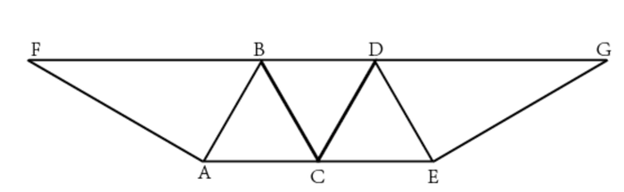

A. 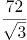

B. 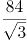

C. 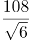

D. 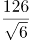

### 第 71 题

某企业选拔170多名优秀人才平均分配为7组参加培训。在选拔出的人才中，党员人数比非党员多3倍。接受培训的党员中的10%在培训结束后被随机派往甲单位等12个基层单位进一步锻炼。已知每个基层单位至少分配1人，问甲单位分配人数多于1的概率在以下哪个范围内？

A. 不到14%

B. 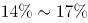之间

C. 之间

D. 超过20%

### 第 72 题

某单位为定点帮扶村捐建一个乡村图书馆。已知完工时基建支出为总预算的40%，图书购买支出比基建支出低25%，比信息化支出高25%，其他支出之和为4.5万元，最终项目的总支出比总预算结余了3000元。已知图书来源为购买和捐赠，平均每购买1本图书的支出为25元，且购买的图书比接受外来捐赠的图书多20%。问该乡村图书馆最终拥有的图书数量在以下哪个范围内？

A. 不到1.1万本

B. 1.1～1.4万本之间

C. 1.4～1.7万本之间

D. 超过1.7万本

### 第 73 题

某地调派96人分赴车站、机场、超市和学校四个人流密集的区域进行卫生安全检查，其中公共卫生专业人员有62人。已知派往机场的人员是四个区域中最多的，派往车站和超市的人员中，专业人员分别占64%和65%，派往学校的人员中，非专业人员比专业人员少30%，问派往机场的人员中，专业人员的占比在四个区域中排名

A. 第一

B. 第二

C. 第三

D. 第四

### 第 74 题

一个人工湖的湖面上有一个露出水面3米的圆锥体人工景观（底面朝下）。如人工湖水深减少20%，则该景观露出水面部分的体积将增加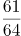。问原来的人工湖水深为多少米？

A. 3.5

B. 3.75

C. 4.25

D. 4.5

### 第 75 题

某商业街复工复产之后，向消费者发放满50元减10元、满100元减30元的电子优惠券各若干张，并规定消费者在商户处完成交易并核销电子优惠券后，商户可以免除等同于核销优惠券减免金额75%的店面租金。促销期内，商户共核销优惠券15.6万张，通过核销优惠券方式减免租金219万元。问该次促销中，消费者实际支付金额可能的最低值在以下哪个范围内？

A. 不到750万元

B. 750～800万元之间

C. 800～850万元之间

D. 超过850万元

### 第 76 题

从所给的四个选项中，选择最合适的一个填入问号处，使之呈现一定的规律性：

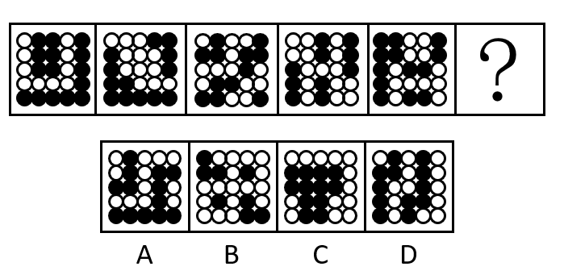

A. A

B. B

C. C

D. D

### 第 77 题

从所给的四个选项中，选择最合适的一个填入问号处，使之呈现一定的规律性。

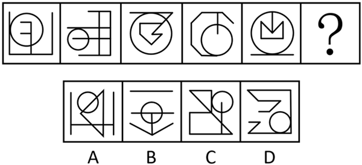

A. A

B. B

C. C

D. D

### 第 78 题

从所给四个选项中，选择最合适的一个填入问号处，使之呈现一定的规律性。

A. A

B. B

C. C

D. D

### 第 79 题

从所给四个选项中，选择最合适的一个填入问号处，使之呈现一定的规律性。

A. A

B. B

C. C

D. D

### 第 80 题

左图给定的是正方体纸盒，右边哪项可能是其正确的外表面展开图？

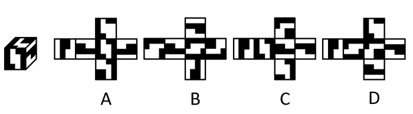

A. A

B. B

C. C

D. D

### 第 81 题

左图给定的是由18个相同大小的正方体组合成的多面体，这个多面体可以切割为3个完全相同的小多面体，问切成的小多面体是：

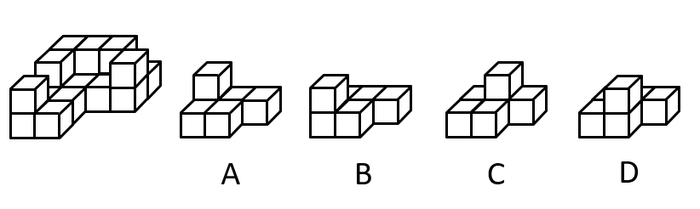

A. A

B. B

C. C

D. D

### 第 82 题

左图为给定的多面体，从任一角度观看，右边哪项可能是该多面体的视图？

A. A

B. B

C. C

D. D

### 第 83 题

把下面的六个图形分为两类，使每一类图形都有各自的共同特征或规律，分类正确的一项是（ ）。

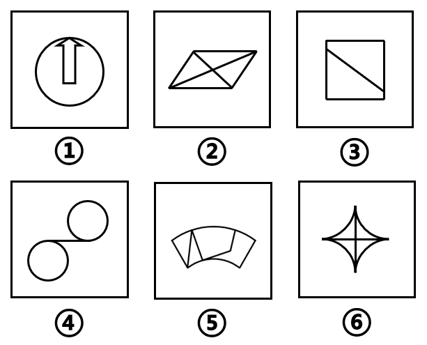

A. ①②③，④⑤⑥

B. ①②④，③⑤⑥

C. ①③④，②⑤⑥

D. ①③⑤，②④⑥

### 第 84 题

把下面的六个图形分为两类，使每一类图形都有各自的共同特征或规律，分类正确的一项是（ ）。

A. ①②④，③⑤⑥

B. ①③⑤，②④⑥

C. ①③⑥，②④⑤

D. ①⑤⑥，②③④

### 第 85 题

把下面的六个图形分为两类，使每一类图形都有各自的共同特征或规律，分类正确的一项是（ ）。

A. ①③④，②⑤⑥

B. ①③⑤，②④⑥

C. ①②⑥，③④⑤

D. ①④⑥，②③⑤

### 第 86 题

串对是指在诗句或对联中，出句与对句在意义上和语法结构上不是相对，而是上下相承，两句不能互相脱离，更不能颠倒，在语言结构上有一定的前后顺序。  

根据上述定义，下列属于串对的是：

A. 到此已穷千里目，谁知才上一层楼

B. 书山有路勤为径，学海无涯苦作舟

C. 横眉冷对千夫指，俯首甘为孺子牛

D. 江间波浪兼天涌，塞上风云接地阴

### 第 87 题

互益素是一种生物释放的、能引起他种接受生物产生对释放者和接受者都有益的反应的信息化学物质。

根据上述定义，下列涉及互益素的是（ ）。

A. 苹果实蝇在植物果实上产卵后会留下一种标记信息素，以避免自己再次到这里产卵

B. 楝科植物印楝的种子、树叶和树皮中含有的印楝素，对几乎所有害虫都有驱杀效果

C. 亚洲玉米螟雌蛾释放的性信息素能够吸引雄蛾，使雄蛾能够准确找到雌蛾的方位

D. 小麦在遭受麦长管蚜攻击后会释放出水杨酸甲酯，可吸引麦长管蚜的天敌异色瓢虫

### 第 88 题

国际多式联运是指按照多式联运合同，以至少两种不同的运输方式，由多式联运经营人将货物从一国境内接货地点运至另一国境内指定交货地点的一种运输方式。

根据上述定义，下列属于国际多式联运的是：

A. 将货运汽车直接开上火车车皮进行铁路运输，到达目的地再把货车从车皮上开下来

B. 某公司为员工采购进口商品，通过厢式货车运送到公司楼下，员工再开车将商品带回家

C. 电商从海外采购生鲜商品，由物流公司通过航空冷链进口到国内，然后由冷链车运至全国各地

D. 船运公司将从外海打捞的海鲜运输到沿海地区，再由买家分销到各个生鲜市场

### 第 89 题

统计数据分为定性数据与定量数据。定性数据包括分类数据和顺序数据。分类数据是指只能归于某一类别的非数字型数据，它是对事物进行分类的结果，用文字表述；顺序数据是指归于某一有序类别的非数字型数据。定量数据是指表现为具体数字观测值的数据。

①按城市规模可将城市分为特大城市、大城市、中等城市和小城市；

②婚姻状况：1-未婚，2-已婚，3-离异，4-丧偶；

③A地到B地的距离为200公里，到C地为320公里，到D地为100公里；

④某医院建筑面积37.5万平方米，开放床位3182个，临床医生687人。

根据上述定义，关于以上4组数据的说法正确的是（ ）。

A. ②④都是分类数据

B. ②③④都是定量数据

C. ①②都是顺序数据

D. 仅②是分类数据

### 第 90 题

拮抗作用是一种常见的感觉变化现象，是指因一种呈味物质的存在，而使另一种呈味物质的呈味特性减弱的现象。

根据上述定义，下列没有体现拮抗作用的是（ ）。

A. 在橘子汁中添加少量柠檬酸会感觉甜味减弱，如再加砂糖，又会感到酸味减弱

B. 糖精带有苦味，在糖精中添加少量的谷氨酸钠，苦味可明显缓和

C. 同时服用氯化钠和奎宁后，再饮用清水会有微甜的感觉

D. 在食用过酸涩的西非山榄后，再吃酸味食品，会尝不到酸味

### 第 91 题

通过提供产品及服务使顾客产生愉悦等积极情感，从而使顾客觉得从产品及服务中获得了超过使用价值的新价值，以此为手段进行情感营销的过程，称为情感价值链。

根据上述定义，下列没有凸显情感价值链的是（ ）。

A. 小张从事美容工作多年，她总是专注而耐心地倾听客户说话，让客户在享受按摩的同时心情舒畅

B. 智能音箱“小美”深受孩子们喜爱，因为它不仅能播放儿歌和故事，还能跟小朋友“对话、握手和点头”

C. 电视上，一对年轻夫妻为“该谁扫地了”而犯愁，之后扫地机器人登场，并闪现广告语“有了它，更幸福”

D. 洗碗机广告中，一位女士愁眉苦脸刷着油腻的碗盘，看着自己粗糙的双手，广告词是“你要做这样的女人吗？”

### 第 92 题

预测干预是指人们受预测信息的影响而采取了某种行为，造成原本有多种可能性的结果真的朝着预测所指示的方向发展。

根据上述定义，下列属于预测干预的是（ ）。

A. 某财经访谈栏目中一名专家预测H股票将大涨，结果很多收看该节目的观众争相购买该股票，导致该股票涨停

B. 某福利彩票代销点宣称他们卖出的彩票多次中奖，结果到该代销点购买彩票的人经常排起长队

C. 某国首脑在新年致辞中对该国经济形势进行了展望，因而该国老百姓对未来经济好转充满了信心

D. 甲国大选前，与其敌对的乙国媒体大肆渲染，认为M党总统候选人将当选，结果甲国很多选民转而支持N党总统候选人

### 第 93 题

人们常常系统地高估自己对事件的控制程度或影响力，而低估机会、运气等不可控制因素在事件发展过程及其结果上所扮演的角色，这一现象被称为控制错觉。

根据上述定义，下列没有体现控制错觉的是：

A. 人们想用骰子掷出“双6”时会在心中默念，用力揉捏骰子，相信这样做就会如愿

B. 一些股民往往借助几个简单的因素预测大盘指数，结果常常是谬以千里

C. 某企业经理认为今年当地举办的运动会对企业发展非常有利，预测今年营业额会有所上涨

D. 景区某摆渡车驾驶员常年走山路，认为自己路况熟、技术好，所以在山路上开得非常快

### 第 94 题

对立互补命题指的是先后叙述的两个结构基本相同的句式中含有两对或者两对以上相互对立的概念，但是其阐发的意思是一致的或者是相互补充的。

根据上述定义，下列不属于对立互补命题的是（ ）。

A. 君子坦荡荡，小人长戚戚

B. 先天下之忧而忧，后天下之乐而乐

C. 仓廪实而知礼节，衣食足而知荣辱

D. 穷在闹市无人问，富在深山有远亲

### 第 95 题

一般来说，科学实验中主要涉及三种变量：自变量、因变量和控制变量，自变量是指在实验中由实验者操作的变量。因变量是指随着自变量的变化而变化的变量。控制变量是指实验中除自变量以外的影响实验变化和结果的潜在因素或条件。

根据上述定义，下列说法正确的是（ ）。

A. 研究小麦供给量受当地采购价格的影响，小麦供给量是控制变量，采购价格是因变量

B. 研究不同税率对稀土出口量的影响，稀土出口量是自变量，税率是因变量

C. 研究气候条件对棉花产量的影响，气候条件是因变量，害虫影响是控制变量

D. 研究制糖厂营业额受糖产量的影响，糖的单价是控制变量，糖产量是自变量

### 第 96 题

江河湖海：水体

A. 鳏寡孤独：身份

B. 油盐酱醋：调味

C. 山珍海味：美食

D. 绫罗绸缎：面料

### 第 97 题

船舶抛锚：请求救援

A. 安全着陆：平稳飞行

B. 行政复议：获得赔偿

C. 卖出高粱：买入白酒

D. 违规销售：停业整顿

### 第 98 题

春山暖日和风：阑干楼阁帘栊

A. 绿蚁新醅酒：红泥小火炉

B. 鸡声茅店月：人迹板桥霜

C. 江碧鸟逾白：山青花欲燃

D. 柴门闻犬吠：风雪夜归人

### 第 99 题

立体化战争：数字化战争

A. 民主型管理：专制型管理

B. 防风林：观赏树木

C. 有氧运动：医疗瘦身

D. 绩效奖励：物质奖励

### 第 100 题

风筝：篾刀：竹条

A. 泥塑：黏土：颜料

B. 绣品：绣针：绣线

C. 糖人：蔗糖：竹签

D. 漆器：描金：涂料

### 第 101 题

檀香：麝香：香料

A. 木材：钢筋：建材

B. 日光：月光：光明

C. 薯条：粉条：食物

D. 鲸鱼：鲍鱼：海鱼

### 第 102 题

中央预算：年度预算：地方预算

A. 历史题材：军事题材：现实题材

B. 户外广告：文字广告：电视广告

C. 知识创新：技术创新：管理创新

D. 人身权利：生命权利：财产权利

### 第 103 题

健康监测：体检：疾病筛查

A. 为国聚财：税收：调节分配

B. 发掘遗迹：考古：考证年代

C. 解决争议：审判：强制执行

D. 太空飞行：航天：地质分析

### 第 104 题

（ ） 对于 口罩 相当于 竹子 对于 （ ）

A. 耳挂；竹炭

B. 无纺布；斗笠

C. 卫生用品；竹叶

D. 医用口罩；箭竹

### 第 105 题

核安全 对于 （ ） 相当于 （ ） 对于 虚拟货币

A. 核技术；货币

B. 核泄漏；交易货币

C. 国家安全；比特币

D. 网络安全；游戏币

### 第 106 题

中国互联网络信息中心发布报告显示，截至2018年12月，我国短视频用户规模达6.48亿，其中青少年用户占了很大比重，开展青少年防沉迷工作刻不容缓。相关主管部门组织短视频平台企业研发了青少年防沉迷系统，进入“青少年模式”后，每日使用时长将限定为累计40分钟，打赏、充值、提现、直播等功能将不可用，每天22时至次日6时期间，禁止使用短视频App。

以下哪项如果为真，最能质疑该模式的有效性？

A. 用户使用“青少年模式”需提交身份证信息等，增加了泄露个人隐私的风险

B. 不加选择地浏览视频内容，可能会对青少年价值观产生负面影响

C. 该系统通过大数据分析来识别疑似青少年用户，可能会“误伤”成年人

D. “青少年模式”目前尚无法识别网络使用者的真实身份

### 第 107 题

有研究人员认为，胶原蛋白保持皮肤年轻的说法并不科学，他们认为，皮肤得以保持年轻，应归功于表皮干细胞，哺乳动物的表皮细胞会持续更新，新细胞来源于表皮干细胞，这些干细胞会通过一种特定分化的多元蛋白结构——半桥粒附着在基膜上。表皮干细胞会不断复制、分化，产生新细胞取代受损的老细胞，这一更新有利于维持皮肤的年轻。因此，表皮干细胞的更新才是保持皮肤年轻的原因。

以下哪项如果为真，最能削弱上述结论？

A. 表皮干细胞的更新还需要其他化合物的促进

B. 表皮干细胞的再生能力会随着年龄的增长而衰退

C. 胶原蛋白对促进表皮干细胞的更新至关重要

D. 胶原蛋白的表达在不同干细胞之间存在很大差异

### 第 108 题

小赵和小刘是非常熟悉的好朋友，两家相距很近，疫情期间，小赵曾给本单位同处室的同事发了警示微信，小刘也给所在小区他认识的所有人发了警示微信，并进一步通过电话进行了确认提醒，小赵、小刘互通了电话，提醒近期不相互走动，小赵给小刘发过警示微信，小刘没有给小赵发过警示微信。

根据以上陈述，以下哪项不可能？

A. 小赵近期没有去过小刘家

B. 小刘、小赵是同事

C. 小刘、小赵不是一个处室的

D. 小赵、小刘住一个小区

### 第 109 题

羟苯甲酮是一种常见的紫外线吸收剂，多用于防晒护肤品中，全球3500种品牌的防晒霜中均含有该物质。研究表明，即使是极低浓度的羟苯甲酮也会给珊瑚带来致命的伤害，有专家指出，为了保护珊瑚，在海滨浴场应该禁止使用防晒霜。

以下哪项如果为真，最能支持上述观点？

A. 一些远离海岸的大洋中部分水域已检测到羟苯甲酮，但浓度较低

B. 羟苯甲酮易引起皮肤过敏，长期使用会影响人体免疫力和生殖能力

C. 羟苯甲酮会破坏、改变珊瑚的DNA，降低幼年珊瑚正常发育的几率

D. 人们在很多场合都使用防晒霜，仅在海滨浴场限制使用效果有限

### 第 110 题

某便利店新进了一批个性商品，如带酸味的啤酒，芥末味道的饼干等，这些个性商品摆放在单独设立的区域进行销售，三个月之后，店长发现：和之前没有引进个性商品时相比，店里的总销售额大幅提升，所以店长认为销售额增加的主要原因是引进了这些个性商品。

以下哪项如果为真，最能支持店长的观点？

A. 三个月以来，这些个性商品的销量和销售额都很有限

B. 来店消费的主要是年轻人，年轻人喜欢尝试新鲜事物

C. 近三个月，该店对货品摆放进行了重新规划和调整，货品陈列更加有序醒目

D. 除了增加个性商品，店里常规商品也增加了一些品牌和种类

### 第 111 题

研究人员在2011年至2017年间采集了600多名60岁以上老年人的身高、血压和饮食习惯等多项数据，随后，又对研究对象进行了神经心理评估和认知障碍评定，在排除吸烟饮酒等风险因素后发现，那些每周吃两次、每次吃约150克蘑菇的老年人，比每周吃蘑菇少于一次的老年人患轻度认知障碍的风险低20%。研究人员解释说，这是因为蘑菇中含有一种特殊化合物——麦角硫因，因此，食用蘑菇有助于降低老年人患轻度认知障碍的风险。

以下哪项如果为真，最能支持上述结论？

A. 研究发现，每周食用两次以上蘑菇的年轻人患心脏病的风险降低

B. 轻度认知障碍老年患者血浆中麦角硫因的水平明显低于同龄健康人

C. 上述研究中老年人主要食用的是金针菇、平菇等6种常见蘑菇

D. 人体实际上无法自行合成麦角硫因，只能从食物中获取

### 第 112 题

地质学家在澳大利亚中部距地表3公里的地下发现了两处直径超过200公里的神秘自然景观，景观所含有的石英砂中有着一簇簇的细线，这些细线大部分是互相平行的直线。地质学家认为，这些景观很可能是巨大陨石撞击形成的陨石坑，而石英砂的结构就是造成断裂的证据。

以下哪项是上述论证的必要前提？

A. 只有经历高速的陨石撞击，地层中石英砂才会显示出含有平行直线的断裂结构

B. 石英砂普遍存在于地球表面，由于坚硬、耐磨、化学性能稳定而很少发生变化

C. 该景观的直径之大，并不同于其他的陨石坑，很可能不是一次形成的

D. 该景观周围的岩石是3亿年到4.2亿年之前形成的，那么撞击也应发生在那一时期

### 第 113 题

近年来，国家从药品生产、流通和销售各环节发力，频频出台降低药价的相关政策。但是，让不少患者感到疑惑的是，一方面是国家降低药价的政策不断出台，另一方面却是诸多常用药价格不断上涨。

以下哪项如果为真，最能解释上述现象？

A. 价格下降的药品占大多数，价格上涨的药品占少数，因此从整体上来说，药品价格仍然是下降了

B. 常用进口药的需求增多，相关政策无法控制此类药品的价格上涨

C. 国家虽然出台了降低药价的政策，但是其影响要经过―段时间才能显现出来

D. 降低药价的政策可以有效控制药品市场中因制药原料涨价而导致的药价上涨

### 第 114 题

单位安排甲、乙、丙、丁、戊、己、庚、辛8人出差，他们恰好被安排在宾馆同一排左右相邻的8个房间。已知：

①甲和丙中间隔着3人；

②乙和己中间隔着2人；

③丁在庚的左边，他们中间隔着2人；

④辛和戊中间隔着1人。

根据以上信息，按照从左到右的顺序，下列哪项是不可能的？

A. 丁在第一个房间

B. 丁在第二个房间

C. 丁在第三个房间

D. 丁在第四个房间

### 第 115 题

近日，有研究团队通过对44个反刍动物物种的基因组测序研究，创建了一个反刍动物的系统进化树，从而解释大量反刍动物的演化史。结果揭示，在近10万年前，反刍动物种群发生大幅衰减，而这些种群数的减少与人类向非洲之外迁徙的时间相符。有人据此认为，这佐证了早期人类活动造成了反刍动物种群的衰减。

以下哪项如果为真，最能质疑上述结论？

A. 反刍动物种群衰减后，植被愈加茂盛，为人类提供了更多食物

B. 反刍动物通常有角，在遇到人类攻击时能发挥一定的防御作用

C. 同一时期的马、驴等奇蹄目动物的种群也出现大幅衰减的现象

D. 同一时期大型猫科动物繁盛，它们大规模捕杀反刍动物

## 材料 4

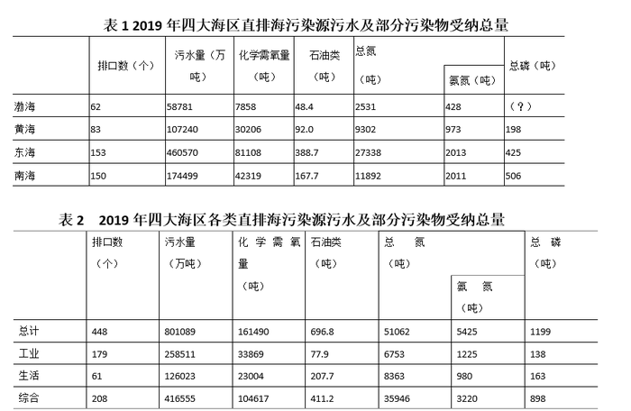

注：化学需氧量：废水、废水处理厂出水和污水中，能被强氧化剂氧化的物质的氧当量。化学需氧量越高，表示水中有机污染物越多，污染越严重。总氮：水中各种形态无机和有机氮的总量。氨氮：水中以游离氨和铵离子形式存在的氮，是总氮的组成部分之一。

### 第 116 题

2019年，平均每个综合类直排海污染物排口排放污水量约是工业类的多少倍？

A. 1.0

B. 1.2

C. 1.4

D. 1.6

### 第 117 题

表1中“（？）”处应当填入的数字最可能是：

A. 60

B. 70

C. 80

D. 90

### 第 118 题

2019年，平均每个直排海污染物排口排放石油类污染物的量最大的海区是：

A. 东海

B. 南海

C. 渤海

D. 黄海

### 第 119 题

2019年直排渤海的污染物中，氨氮占总氮的比重约比直排黄海的污染物中该比重：

A. 低13个百分点

B. 高13个百分点

C. 低6个百分点

D. 高6个百分点

### 第 120 题

关于2019年直排海污染源状况，不能从上述资料中推出的是：

A. 由综合类排口排放的总磷占所有排口排放总磷的75%以下

B. 平均每吨排往黄海的污水化学需氧量为四大海区中最高

C. 平均每个直排南海的污水排口日均污水排放量在3000-4000吨之间

D. 通过生活类排口排放的总氮量占所有排口总氮排放量的比重，高于通过生活类排口排的总磷量占所有排口总磷排放量的比重

## 材料 5

2019年全国地铁运营线路长度达5181公里，占城轨交通运营线路总里程的76.8%。

2019年末，我国城轨交通配属地铁列车6178列，全年实现地铁客运量227.76亿人次。

### 第 121 题

2014～2019年间，全国地铁运营线路长度同比增长20%以上的年份有几个？

A. 1

B. 2

C. 3

D. 4

### 第 122 题

以下城市中，2019年末平均每条运营的地铁线路配属地铁列车数最多的是：

A. 广州

B. 武汉

C. 成都

D. 南京

### 第 123 题

2019年，直辖市（北京、天津、上海、重庆）地铁客运量占全国地铁客运总量的比重在以下哪个范围内？

A. 不到40%

B. 40%～45%之间

C. 45%～50%之间

D. 超过50%

### 第 124 题

表中所列2019年地铁客运量超过10亿人次的城市中，2019年平均每条地铁运营线路长度超过40公里的城市有几个？

A. 1

B. 2

C. 3

D. 4

### 第 125 题

能够从上述资料中推出的是：

A. 2019年全国城轨交通运营线路总里程不到6000公里

B. 2019年全国地铁运营线路长度相比2016年增量是2016年相比2013年增量的两倍以上

C. 表中2019年末地铁运营线路长度排名前3的城市地铁运营线路长度之和占全国总量的50%以上

D. 表中2019年平均每条运营线路客运量最少的城市，地铁客运量在表中各城市排前10位

## 材料 6

截至2019年末，全国已有残疾人康复机构9775个，比2018年增长739个。2019年，1043.0万残疾儿童及持证残疾人得到基本康复服务，其中包括0～6岁残疾儿童18.1万人。

截至2019年末，全国已竣工的各级残疾人综合服务设施2341个，总建设规模584.5万平方米，总投资183.1亿元；已竣工各级残疾人康复设施1006个，总建设规模414.2万平方米，总投资132.2亿元。

### 第 126 题

2016～2019年，全国残疾人康复机构数量同比增量最大的年份是：

A. 2016年

B. 2017年

C. 2018年

D. 2019年

### 第 127 题

2019年末，提供肢体残疾康复服务的康复机构的数量占全国残疾人康复机构总数的比重，比提供精神残疾康复服务的康复机构的数量占全国残疾人康复机构总数的比重高约多少个百分点？

A. 13

B. 18

C. 23

D. 28

### 第 128 题

如提供视力残疾康复服务的残疾人康复机构中，同时提供听力言语残疾康复服务的机构比不提供该服务的机构多20%，则2019年末全国有多少家残疾人康复机构不提供以上两种康复服务中的任意一种？

A. 不到7300家

B. 7300～7600家之间

C. 7600～7900家之间

D. 超过7900家

### 第 129 题

截至2019年末，全国平均每个已竣工的残疾人综合服务设施建设规模约是已竣工残疾人康复设施的多少倍？

A. 0.6

B. 0.8

C. 1.2

D. 1.7

### 第 130 题

能够从上述资料中推出的是：

A. 2019年，全国得到基本康复服务的0～6岁残疾儿童占得到基本康复服务的残疾儿童及持证残疾人的2%以上

B. 2015年，全国平均每月新增残疾人康复机构20家以上

C. 2019年末，全国残疾人康复机构中，超过25%提供孤独症儿童康复服务

D. 截至2019年末，全国已竣工的各级残疾人综合服务设施平均每平方米的投资额在3000～4000元之间

## 材料 7

2020年1-2月，我国境内投资者共对全球147个国家和地区的1733家境外企业进行了非金融类直接投资，累计实现投资1078.6亿元人民币，同比增长1.8%。对外承包工程完成营业额1080亿元人民币，同比下降9.5%，新签合同额2150.3亿元人民币，同比增长38.3%。对外劳务合作派出各类劳务人员3.9万人，同比减少2.9万人，2月末在外各类劳务人员77.8万人。

2020年1-2月，我国对外投资合作主要呈现以下特点：

一是对“一带一路”投资合作增幅较大。2020年1-2月，我国企业对“一带一路”沿线的48个国家有新增投资，合计27.2亿美元，同比增长18.3%。在“一带一路”沿线的59个国家新签对外承包工程合同额153.6亿美元，同比增长25.6%，完成营业额91.4亿美元。

二是对外投资结构持续多元。2020年1-2月，对外投资主要流向租赁和商务服务业、批发和零售业、制造业和采矿业等传统投资领域，占对境外企业非金融类直接投资的比重分别为40.8%、15.1%、11.3%和8.9%。其中流向租赁和商务服务业的投资额同比增长43.2%，成为增速最高的领域。

三是对外承包工程新签大项目增多。2020年1-2月，对外承包工程新签合同额在5000万美元以上的项目有115个，较去年同期增加29个，占新签合同总额的83.9%。

### 第 131 题

2020年1-2月，我国境内投资者对每个当期内产生非金融类直接投资的境外企业的非金融类直接投资额均值约为多少亿元人民币？

A. 1.6

B. 1.3

C. 0.8

D. 0.6

### 第 132 题

2019年1-2月，我国对外承包工程月均完成营业额比月均新签合同额：

A. 高不到300亿元人民币

B. 高300亿元人民币以上

C. 低不到300亿元人民币

D. 低300亿元人民币以上

### 第 133 题

2020年1-2月，租赁和商务服务业对外投资额占对境外企业非金融类直接投资额的比重比上年同期约：

A. 上升了3个百分点

B. 上升了12个百分点

C. 下降了3个百分点

D. 下降了12个百分点

### 第 134 题

如2020年1-2月人民币与美元的汇率稳定为7元人民币兑换1美元，则同期对外承包工程新签合同额在5000万美元以上的项目的平均新签合同额在以下哪个范围内？

A. 2亿美元以上

B. 1.5-2亿美元之间

C. 1-1.5亿美元之间

D. 0.5-1亿美元之间

### 第 135 题

能够从上述资料中推出的是：

A. 2019年1-2月，我国境内投资者对境外企业非金融类直接投资额高于对外承包工程完成营业额

B. 2019年1-2月，我国对外劳务合作月均派出各类劳务人员不到1万人

C. 2020年1-2月，我国企业有新增投资的“一带一路”沿线国家中，我国企业平均对每个国家的新增投资额超过0.6亿美元

D. 2020年1-2月，我国企业在“一带一路”沿线国家新签对外承包工程合同额同比增量超过30亿美元

## 答案与解析

第 1 题

**参考答案（粉笔题库参考内容）**

C

**解析**

本题考查政治常识。

①③正确，2020年5月23日上午，习近平总书记参加全国政协十三届三次会议的经济界委员联组会，听取意见和建议。他强调：“面向未来，我们要把满足国内需求作为发展的出发点和落脚点，加快构建完整的内需体系，大力推进科技创新及其他各方面创新，加快推进数字经济、智能制造、生命健康、新材料等战略性新兴产业，形成更多新的增长点、增长极，着力打通生产、分配、流通、消费各个环节，逐步形成以国内大循环为主体、国内国际双循环相互促进的新发展格局，培育新形势下我国参与国际合作和竞争新优势。”

②正确，2019年年底召开的中央经济工作会议指出，我国经济稳中向好、长期向好的基本趋势没有改变。会议强调了“四个有”，其中之一就是“有超大规模的市场优势和内需潜力”。“超大规模的市场优势和内需潜力”，是指我国具有规模庞大、供求多元、创新活跃、拉动力强的内需市场。

④错误，2020年8月24日，习近平总书记在主持召开的经济社会领域专家座谈会上指出：“实现高质量发展，必须实现依靠创新驱动的内涵型增长。我们更要大力提升自主创新能力，尽快突破关键核心技术。这是关系我国发展全局的重大问题，也是形成以国内大循环为主体的关键。”

故正确答案为C。

第 2 题

**参考答案（粉笔题库参考内容）**

A

**解析**

本题考查经济常识。

A项正确，8月17日，国务院召开常务会议，会议指出，要继续落实好为市场主体减负等金融支持政策。其中，要提高金融支持政策便利度，支持中小银行运用大数据进行有效银企对接，疏通传导机制，扩大市场主体受益面。深化市场报价利率改革，引导贷款利率继续下行。落实落细运用再贷款再贴现资金发放优惠利率贷款、支持发放信用贷款等措施，确保小微企业全年融资量增、面扩、价降。

B项错误，为了防范化解我国当前面临的主要金融风险，要坚持实施稳健的货币政策，优化金融市场体系，推进利率市场化改革，培育行业性区域性信用环境，建立健全贷款风险补偿共担机制，按市场化法治化原则对出现暂时困难的优质企业进行纾困并加快出清“僵尸企业”，探索优化教育、养老领域中长期融资的配套政策和运作模式。因此该做法是为了防范化解金融风险。

C项错误，不良贷款处置是金融系统向实体经济让利的方式之一，近年来监管部门鼓励甚至强行督促银行业综合运用现金清收、批量转让、资产证券化、债转股、损失核销等多种手段，来加大处置不良资产的力度，与新增融资重点流向中小微企业无直接关系。

D项错误，首贷，即首次贷款，是指在中国人民银行征信报告中无贷款记录的企业首次从银行业金融机构获得贷款，该做法只针对“首贷”的企业，覆盖较片面，不是最有助于新增融资重点流向中小微企业的做法。

故正确答案为A。

第 3 题

**参考答案（粉笔题库参考内容）**

A

**解析**

本题考查政治常识。

A项错误，延安精神是中国共产党人彻底的革命精神、是升华了的民族精神、是中国共产党人领导争取民族独立、人民解放的时代精神、是展示中国共产党人形象的群体精神，具体包括“坚定正确的政治方向，解放思想、实事求是的思想路线，全心全意为人民服务的根本宗旨，自力更生、艰苦奋斗的创业精神。”西柏坡精神的内涵是指谦虚谨慎、艰苦奋斗，敢于斗争、敢于胜利，依靠群众、团结统一的精神。

B项正确，2013年11月25日，习近平总书记视察临沂时强调，山东是革命老区，有着光荣传统，军民水乳交融、生死与共铸就的沂蒙精神，对我们今天抓党的建设仍然具有十分重要的启示作用。习近平总书记把沂蒙精神的特质概括为“水乳交融、生死与共”，深刻揭示了党同人民、军队与老百姓同心同向、血肉相连的关系，深刻回答了马克思主义政党为了谁、依靠谁、我是谁这一根本问题。

C项正确，焦裕禄精神是中国革命精神谱系中的重要组成部分。早在2009年，习近平同志就曾把焦裕禄精神概括为“亲民爱民、艰苦奋斗、科学求实、迎难而上、无私奉献”。亲民爱民、无私奉献，体现了焦裕禄同志对群众的亲劲；艰苦奋斗、真抓实干，体现了焦裕禄同志抓工作的韧劲；科学求实、迎难而上，体现了焦裕禄同志干事业的拼劲。

D项正确，2020年9月8日在全国抗击新冠肺炎疫情表彰大会上习近平总书记指出：“在这场同严重疫情的殊死较量中，中国人民和中华民族以敢于斗争、敢于胜利的大无畏气概，铸就了生命至上、举国同心、舍生忘死、尊重科学、命运与共的伟大抗疫精神。”

本题为选非题，故正确答案为A。

第 4 题

**参考答案（粉笔题库参考内容）**

C

**解析**

本题考查政治常识。

①项错误，2017年10月18日，党的十九大报告中指出：建设高素质专业化干部队伍。在提到“把好干部标准落到实处”时，首先提到的是：坚持正确选人用人导向，匡正选人用人风气，突出政治标准，提拔重用牢固树立“四个意识”和“四个自信”、坚决维护党中央权威、全面贯彻执行党的理论和路线方针政策、忠诚干净担当的干部，选优配强各级领导班子。习近平在2018年召开的全国组织工作会议上的讲话再次强调：把政治标准放在第一位。政治标准是硬杠杠。

②项正确，突出政治标准是十九大对好干部标准的明确要求。

③项正确，党的十九大报告指出：完善干部考核评价机制，建立激励机制和容错纠错机制，旗帜鲜明为那些敢于担当、踏实做事、不谋私利的干部撑腰鼓劲。

④项正确，党的十九大报告强调：把党的政治建设摆在首位。······弘扬忠诚老实、公道正派、实事求是、清正廉洁等价值观，坚决防止和反对个人主义、分散主义、自由主义、本位主义、好人主义。

故正确答案为C。

第 5 题

**参考答案（粉笔题库参考内容）**

C

**解析**

本题考查政治常识。

A项正确，根据《党委（党组）落实全面从严治党主体责任规定》第七条第七款规定：加强党的纪律建设，履行党风廉政建设主体责任，支持纪检监察机关履行监督责任，一体推进不敢腐、不能腐、不想腐。

B项正确，根据《党委（党组）落实全面从严治党主体责任规定》第六条第六款规定：持之以恒抓好党的作风建设，落实中央八项规定精神，持续整治“四风”特别是形式主义、官僚主义，反对特权思想和特权现象，密切党同人民群众的血肉联系。

C项错误，根据《党委（党组）落实全面从严治党主体责任规定》第六条第三款规定：把党的政治建设摆在首位，坚定政治信仰，强化政治领导，提高政治能力，净化政治生态，始终在政治立场、政治方向、政治原则、政治道路上同党中央保持高度一致。

D项正确，根据《党委（党组）落实全面从严治党主体责任规定》第七条第八款规定：带头遵守党内法规制度，严格落实党内法规执行责任制，建立健全本单位（本系统）党建工作制度，不断提高制度执行力。

本题为选非题，故正确答案为C。

第 6 题

**参考答案（粉笔题库参考内容）**

D

**解析**

本题考查人文常识。

①这封信是1940年5月1日，枣宜会战前夕张自忠亲笔昭告各将领、各部队的书信。枣宜会战中，张自忠将军身负七处重伤，壮烈殉国，成为抗战期间中国军队牺牲的最高将领、二战中盟军牺牲的最高将领。

②这封家书是1942年5月22日，左权将军壮烈殉国前三天写给爱妻刘志兰的最后一封信。由信中“党的整顿之风”可判断当时党内正开展整风运动（1941年-1945年）。

③这封信是1936年赵一曼写给儿子的遗书，九一八事变后，日本帝国主义于1932年在长春成立了伪满洲国傀儡政权，信中“反满抗日”指的便是东北人民反抗伪满洲国的抗日活动，此时处于东北局部抗战时期。

④这封信是1919年5月17日，闻一多写给父母的家书，信中“山东交涉及北京学界之举动”“每日有游行演讲”等交代了当时北京学界游行演讲是为了争取山东主权问题，故可判断当时正处于五四运动时期。

综上，上述先烈的书信，按时间先后排序应为④③①②（五四运动局部抗战全面抗战延安整风）。

故正确答案为D。

第 7 题

**参考答案（粉笔题库参考内容）**

A

**解析**

本题考查法律常识。

A项错误，第五章，实名检举控告的处理中第二十九条第二款规定：对匿名检举控告材料，不得擅自核查检举控告人的笔迹、网际协议地址（IP地址）等信息。对检举控告人涉嫌诬告陷害等违纪违法行为，确有需要采取上述方式追查其身份的，应当经设区的市级以上纪委监委批准。

B项正确，第五章，实名检举控告的处理中第二十五条规定：纪检监察机关提倡、鼓励实名检举控告，对实名检举控告优先办理、优先处置、给予答复。

C项正确，第五章，实名检举控告的处理中第二十七条第一款规定：承办的监督检查、审查调查部门应当将实名检举控告的处理结果在办结之日起15个工作日内向检举控告人反馈，并记录反馈情况。

D项正确，第五章，实名检举控告的处理中第二十四条第二款规定：纪检监察机关信访举报部门可以通过电话、面谈等方式核实是否属于实名检举控告。

本题为选非题，故正确答案为A。

第 8 题

**参考答案（粉笔题库参考内容）**

C

**解析**

本题考查法律常识。

A项正确，《政务处分法》第二条规定：“本法适用于监察机关对违法的公职人员给予政务处分的活动。本法第二章、第三章适用于公职人员任免机关、单位对违法的公职人员给予处分。处分的程序、申诉等适用其他法律、行政法规、国务院部门规章和国家有关规定。本法所称公职人员，是指《中华人民共和国监察法》第十五条规定的人员。”《监察法》第十五条规定：“监察机关对下列公职人员和有关人员进行监察：（一）中国共产党机关、人民代表大会及其常务委员会机关、人民政府、监察委员会、人民法院、人民检察院、中国人民政治协商会议各级委员会机关、民主党派机关和工商业联合会机关的公务员，以及参照《中华人民共和国公务员法》管理的人员；（二）法律、法规授权或者受国家机关依法委托管理公共事务的组织中从事公务的人员；（三）国有企业管理人员；（四）公办的教育、科研、文化、医疗卫生、体育等单位中从事管理的人员；（五）基层群众性自治组织中从事管理的人员；（六）其他依法履行公职的人员。”

B项正确：政务处分是监察机关对违法的公职人员给予的惩戒。党纪处分是党员违反党的纪律，危害党、国家和人民利益，应当依照规定受到的纪律处分。政务处分与党纪处分的区别主要有：①党纪处分的对象是党员，政务处分的对象是行使公权力的公职人员；②党纪处分对应的是违纪行为，政务处分对应的是违法行为；③党纪处分的依据主要是党章、党纪处分条例、党内监督条例等党内法规，政务处分的依据主要是政务处分法、监察法、公务员法、法官法、检察官法、行政机关公务员处分条例、事业单位工作人员处分暂行规定、公职人员政务处分暂行规定等法律法规。

C项错误，《政务处分法》第三条规定：“监察机关应当按照管理权限，加强对公职人员的监督，依法给予违法的公职人员政务处分。公职人员任免机关、单位应当按照管理权限，加强对公职人员的教育、管理、监督，依法给予违法的公职人员处分。监察机关发现公职人员任免机关、单位应当给予处分而未给予，或者给予的处分违法、不当的，应当及时提出监察建议。”政务处分由监察机关依法作出。

D项正确，《政务处分法》第十六条规定：“对公职人员的同一违法行为，监察机关和公职人员任免机关、单位不得重复给予政务处分和处分。”

本题为选非题，故正确答案为C。

第 9 题

**参考答案（粉笔题库参考内容）**

A

**解析**

本题考查法律常识。

十三届全国人大三次会议审议通过的《中华人民共和国民法典》，是新中国成立以来第一部以“法典”命名的法律，是新时代我国社会主义法治建设的重大成果。

A项正确，我国民事法律制度建设一直秉持“民商合一”的传统，把许多商事法律规范纳入民法之中。编纂民法典，进一步完善我国民商事领域基本法律制度和行为规则，为各类民商事活动提供基本遵循，有利于充分调动民事主体的积极性和创造性、维护交易安全、维护市场秩序，有利于营造各种所有制主体依法平等使用资源要素、公开公平公正参与竞争、同等受到法律保护的市场环境，推动经济高质量发展。

B项错误，《民法典》系统整合了新中国成立70多年来长期实践形成的民事法律规定，既不是制定全新的民事法律，也不是简单的法律汇编。所以实现颠覆性突破说法错误。

C项错误，民法的基本原则包括平等、自愿、公平、诚信、不得违反法律和公序良俗、有利于节约资源和保护生态环境的原则（简称为绿色原则）。节约资源和保护生态环境的原则在《民法总则》就已经规定了。

D项错误，《民法典》共7编、1260条，各编依次为总则、物权、合同、人格权、婚姻家庭、继承、侵权责任，以及附则。《民法典》没有将知识产权单独成编，我国知识产权立法既包括民事权利的内容，也有行政管理的内容，但《民法典》调整的是平等民事主体之间的民事法律关系，不宜纳入行政管理方面的内容。

故正确答案为A。

第 10 题

**参考答案（粉笔题库参考内容）**

B

**解析**

本题考查政治常识。

《国家积极应对人口老龄化中长期规划》提出的积极应对人口老龄化的战略目标是：积极应对人口老龄化的制度基础持续巩固，财富储备日益充沛，人力资本不断提升，科技支撑更加有力，产品和服务丰富优质，社会环境宜居友好，经济社会发展始终与人口老龄化进程相适应，顺利建成社会主义现代化强国，实现中华民族伟大复兴的中国梦。

综上，①②③④属于积极应对人口老龄化的战略目标。

故正确答案为B。

第 11 题

**参考答案（粉笔题库参考内容）**

D

**解析**

本题考查毛中特。

①1935年10月，中央红军在毛泽东等人率领下，经过艰苦斗争，于7日经宁夏隆德县，翻越六盘山。

②1935年5月29日。中央红军部队在四川省中西部强渡大渡河成功，沿大渡河东岸北上，主力由安顺场沿大渡河右岸北上，红四团官兵在天下大雨的情况下，在崎岖陡峭的山路上跑步前进，在5月29日凌晨6时许按时到达泸定桥西岸。第2连连长和22名突击队员沿着枪林弹雨和火墙密布的铁索踩着铁链夺下桥头，并与东岸部队合围占领了泸定桥。

③1935年6月至1936年7月，红四方面军在所经过的四川、西藏、青海、甘肃四省内，翻越了海拔4400米以上的雪山共5座，其中梦笔山、夹金山都是两次经过，虹桥山、折多山、巴郎山是一次经过。虹桥山海拔4592米，是红四方面军翻过的雪山中最高的一座。草地在四川省西北部与甘肃交接处，纵横数百里，四川松潘以北，班佑地区之南，也叫松潘大草地。

④四渡赤水是中央红军在长征途中，为争取战略主动，在贵州、四川、云南边境地区，成功进行的一次高度灵活机动的战略性战役。从1935年1月19日红军离开遵义开始，到5月9日胜利渡过金沙江为止，历时3个多月。在毛泽东、周恩来等的领导下，中央红军粉碎了蒋介石围歼红军于川黔滇的企图，展现了中国共产党领导人高超的军事指挥艺术，是我军革命战争史上的光辉典范。

正确的顺序为④②③①。

故正确答案为D。

第 12 题

**参考答案（粉笔题库参考内容）**

A

**解析**

本题考查科技常识。

A项错误，东风-41是我国最新一代洲际战略核导弹。2019年10月1日，在庆祝新中国成立70周年阅兵式上，东风-41洲际战略核导弹首次亮相。东风-41性能与发达国家的第六代，如美国民兵-3和俄罗斯的白杨-M洲际弹道导弹基本相当，部分技术甚至已经超过它们。

B项正确，电磁脉冲武器是能产生强电磁脉冲以毁坏敌方电子信息装备或破坏其正常工作的各种弹药的总称。电磁脉冲弹包括电磁脉冲炸弹、电磁脉冲炮弹、电磁脉冲导弹等。主要用来破坏雷达、无线电通信设备、电子对抗设备、计算机以及光电、射频制导武器等。

C项正确，护卫舰是以导弹、舰炮、深水炸弹及反潜鱼雷为主要武器的轻型水面战斗舰艇，其主要任务是为舰艇编队担负反潜、护航、巡逻、警戒、侦察及支援登陆作战任务以及提供无人舰载机的起飞和降落。在现代海军编队中，护卫舰是在吨位和火力上仅次于驱逐舰的水面作战舰只，但由于其吨位较小，自持力较驱逐舰为弱，远洋作战能力逊于驱逐舰。

D项正确，机枪和突击步枪同为具备自动射击能力的轻武器，但是两者在定位、性能等方面有明显的区别。机枪分为重机枪、轻机枪、通用机枪等，其与突击步枪相比，主要担任的是中远程的火力压制和支援任务，因此它射程远，一般有效射程在600~1000米范围，子弹出口速度高，存速存能和威力都超过突击步枪，具有相当大的威力。而突击步枪有效射程一般在400米左右，主要强调的是中近距离突击作战。

本题为选非题，故正确答案为A。

第 13 题

**参考答案（粉笔题库参考内容）**

A

**解析**

本题考查科技常识。

①2015年10月5日，我国科学家屠呦呦获得诺贝尔生理学或医学奖，她也由此成为迄今为止第一位获得诺贝尔科学奖项的本土中国科学家。

②1975年5月，北京大学开始研制汉字激光照排系统，由王选教授等主持这项工作。1979年7月27日，科研人员用自己研制的照排系统，一次成版地输出一张由各种大小字体组成、版面布局复杂的八开报纸样纸，报头是“汉字信息处理”六个大字。这是首次用激光照排机输出的中文报纸版面。

③1973年，袁隆平成功培育出世界上第一个籼型杂交水稻，他也因此获得了“杂交水稻之父”的称号。

④“天河一号”是中国首台千兆次超级计算机。“天河一号”超级计算机从2008年开始研制，按两期工程实施：一期系统于2009年9月研制成功；二期系统于2010年8月在国家超级计算天津中心升级完成。

⑤2020年7月31日上午，北斗三号全球卫星导航系统建成暨开通仪式在北京举行。中共中央总书记、国家主席、中央军委主席习近平出席仪式，宣布北斗三号全球卫星导航系统正式开通。

因此，按时间先后顺序排序应为③②④①⑤。

故正确答案为A。

第 14 题

**参考答案（粉笔题库参考内容）**

C

**解析**

本题考查经济常识。

A项正确，等额本息还款方式指在贷款期限内每月以相等的还款额足额偿还贷款本金和利息。与之相对的还款方式是等额本金，等额本金指每月还款时偿还的贷款本金相同，利息不等，因此每月还款总额是不等的。

B项正确，贷款市场报价利率（LPR）是由具有代表性的报价行，根据本行对最优质客户的贷款利率，以公开市场操作利率（主要指中期借贷便利利率）加点形成的方式报价，由中国人民银行授权全国银行间同业拆借中心计算得出并发布的利率，由中国人民银行授权全国银行间同业拆借中心计算并公布的基础性的贷款参考利率。LPR市场化程度较高，能够充分反映信贷市场资金供求情况，使用LPR进行贷款定价可以促进形成市场化的贷款利率，提高市场利率向信贷利率的传导效率。实际操作中，LPR每月都会进行集中报价和发布。

C项错误，根据《民法典》第683条第2款规定：“以公益为目的的非营利法人、非法人组织不得为保证人。”因此，以公益为目的的非营利法人对外提供的担保是无效的。

D项正确，2015年7月8日，李克强总理主持召开国务院常务会议。会议决定高校学生在读期间助学贷款利息由财政全额补贴，毕业后在还款期内继续攻读学位或在校期间因病等休学的,也可申请贴息。同时将贷款最长期限由原先的10年、14年，统一延长至20年。

本题为选非题，故正确答案为C。

第 15 题

**参考答案（粉笔题库参考内容）**

B

**解析**

本题考查科技常识。

A项正确，自然界中的一切物体都在不停地向外辐射红外线，热像仪利用这个原理，将物体辐射出的红外线的功率信号转换为电信号，经过处理，从而得到物体的热像图。因此，热像仪成像不依靠可见光，可以在黑夜中使用。

B项错误，声呐是利用水中声波对水下目标进行距离探测、定位和通信的电子设备。由于电磁波在水中衰减大、传播距离短，雷达无法有效探测，而声波在水中衰减小，传播距离远，因此声呐就成为水下探测、定位和联系的重要工具，而在陆地上及空中进行探测主要使用雷达。

C项正确，雷达是利用电磁波探测目标的电子设备。其原理为：距离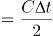，式中∆t为雷达发出与接收电磁波的时间间隔，C为电磁波传播速度。因此可知，雷达测距正是利用了电磁波沿直线传播的原理。

D项正确，多数金属探测器利用电磁感应的原理，利用有交流电通过的线圈，产生迅速变化的磁场，这个磁场在金属物体内部能产生涡电流，涡电流又会产生磁场，反过来影响原来的磁场，引发探测器发出鸣声。

本题为选非题，故正确答案为B。

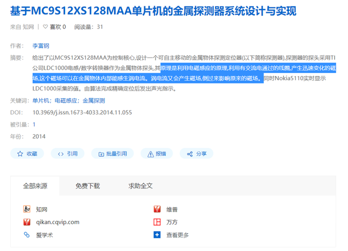

第 16 题

**参考答案（粉笔题库参考内容）**

A

**解析**

本题考查人文常识。

A项错误，德国天文学家、数学家开普勒发现了行星运动的三大定律，分别是轨道定律、面积定律和周期定律。他为自己撰写的墓志铭是：“我曾测量天空，现在测量幽冥。灵魂飞向天国，肉体安息土中。”

B项正确，英国科学家达尔文提出了生物进化论，他的墓志铭是：“他把世界翻了一个个儿，虽然并不完全。”

C项正确，美国政治家、物理学家富兰克林发明了避雷针，他曾在雷电交加的情况下，利用风筝将大气电收集到莱顿瓶中，使其充电，由此证明了他所提出的“闪电和静电的同一性”的设想。法国经济学家杜尔哥评价富兰克林：“他从苍天处取得闪电，从暴君处取得民权。”

D项正确，意大利天文学家伽利略研究了速度和加速度、重力和自由落体等理论，发明了温度计，并使用用于天体科学观测的望远镜。晚年的伽利略失明，后人在其墓志铭写道：“他失明了，因为自然界已经没有剩下什么他没有看见过的东西了。”

本题为选非题，故正确答案为A。

第 17 题

**参考答案（粉笔题库参考内容）**

A

**解析**

本题考查科技常识。

干热岩（HDR），也称增强型地热系统（EGS），或称工程型地热系统，是埋深数千米，内部不存在流体或仅有少量地下流体的高温岩体。

A项正确，2014年，我国青海地勘人员在青海共和盆地成功钻获温度高达153℃的干热岩。这是我国首次发现大规模可利用干热岩资源。

B项错误，在干热岩利用过程中，注入井将低温水输入热储水库中，经过高温岩体加热这一过程并未发生能量转化，只发生热能的传递。

C项错误，干热岩发电技术属于新兴环保发电技术，该技术尚未成熟，该项中“普遍应用”表述错误。

D项错误，干热岩是指一种没有水或蒸汽的热岩体，主要是各种变质岩或结晶岩类岩体，属清洁能源，可用于地热发电。在干热岩地热发电系统中不排放废水、废物、废气，对环境基本没有影响。因此，干热岩发电技术可大幅降低温室效应和酸雨对环境的影响，且不受季节、气候制约。

故正确答案为A。

第 18 题

**参考答案（粉笔题库参考内容）**

D

**解析**

本题考查科技常识。

基因是染色体上具有控制生物性状的DNA片段，遗传信息蕴藏在DNA的脱氧核苷酸排列顺序中，基因是遗传信息的基本单位，是有功能的DNA片段，染色体是DNA的载体，DNA和蛋白质共同组成了染色体。

A项错误，多倍体育种是指利用人工诱变或自然变异等，通过细胞染色体组加倍获得多倍体育种材料，用以选育符合人们需要的优良品种。

B项错误，组织培养方法是将具有充分生命力的植物组织从植株上分离出来，在无菌条件下置于人工培养基上进行培养，使之保持成活状态并继续生长发育的科学研究方法和技术应用方法。

C项错误，通过杂交实验培育出抗倒伏水稻，运用的是杂交育种法。杂交育种是将父母本杂交，形成不同的遗传多样性，再通过对杂交后代的筛选，获得具有父母本优良性状，且不带有父母本中不良性状的新品种的育种方法。杂交改变生物的遗传组成，不产生新的基因，和DNA双螺旋结构的发现没有关系。

D项正确，基因工程又称基因拼接技术和DNA重组技术，是以分子遗传学为理论基础，以分子生物学和微生物学的现代方法为手段，将不同来源的基因按预先设计的蓝图，在体外构建杂种DNA分子，然后导入活细胞，以改变生物原有的遗传特性、获得新品种、生产新产品的遗传技术。基因是遗传信息的基本单位，是DNA片段，DNA双螺旋结构的发现使人们清楚地了解遗传信息的构成和传递的途径，奠定了基因工程的基础。

故正确答案为D。

第 19 题

**参考答案（粉笔题库参考内容）**

B

**解析**

本题考查科技常识。

A项错误，雾霾天气是对大气中各种悬浮颗粒物含量超标的笼统表述，PM2.5（空气动力学当量直径小于等于2.5微米的颗粒物）被认为是造成雾霾天气的“元凶”，而普通纱布口罩对于直径小于2.5微米的空气颗粒基本起不到过滤作用。

B项正确，活性炭是一种粉状、粒状或丸状的无定形具有多孔的碳，用其制成的口罩有很强的吸附性能，可以用来吸附过滤空气中的甲醛等有毒有害气体。

C项错误，目前我国医用口罩主要分为3种：医用防护口罩、医用外科口罩、一次性使用医用口罩，其中防护级别最高的是“医用防护口罩”，可过滤空气中的微粒，阻隔飞沫、血液、体液、分泌物等污染物，对非油性颗粒的过滤效率可达到95%以上。

D项错误，过滤式防毒口罩是通过滤毒药剂等滤除空气中的有毒气体再供人呼吸。滤毒药剂只能在确定了毒物种类、浓度、气温和一定的作业时间内起防护作用。所以过滤式防毒口罩不能用于成分不明的毒气污染环境。

故正确答案为B。

第 20 题

**参考答案（粉笔题库参考内容）**

B

**解析**

本题考查科技常识。

A项正确，静止卫星是实现卫星通信广播的基础，它必须在离赤道的标称高度约35790公里、绕地球的公转周期与方向和地球的自转周期与方向一致、仰角为零的圆形轨道上运动。从地球上看，这颗卫星好似不动地悬在天上，正因为它对地球是相对静止的，故名。

B项错误，航天员在空间站虽无法栽培新鲜水果和蔬菜，但往返于空间站和地面的货运飞船将承担“太空快递员”的角色，将地面新鲜蔬菜水果等物资运往空间站，并携带空间废弃物带回地面，避免造成太空垃圾。

C项正确，一般轨道高度在2000公里以下的近圆形轨道都可以称之为近地轨道，空间站通常在离地面几百公里的高度上环绕地球运行，由于距地面较近，一般只考虑地球万有引力的作用而不计其他天体对空间站的摄动。

D项正确，空间探测器一般航行路程远，无线电信号传输时间长，地面不能进行实时遥控，特别是在探测器着陆过程中，由于无法对其进行实时远程控制，因此空间探测器必须具备自主导航能力。

本题为选非题，故正确答案为B。

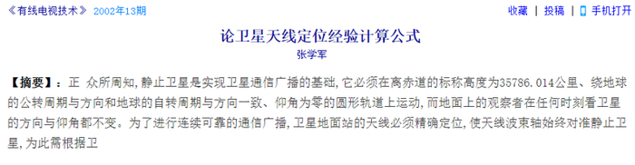

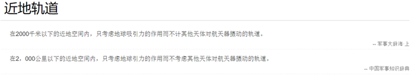

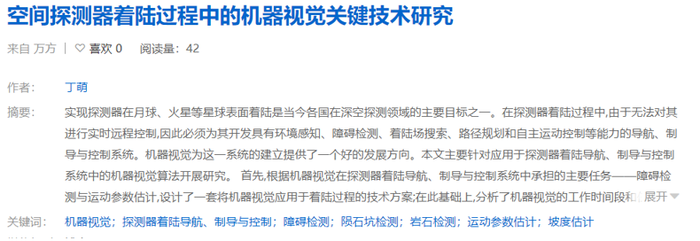

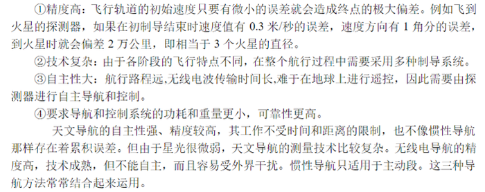

https://www.henan100.com/news/2017/701270.shtml

第 21 题

**参考答案（粉笔题库参考内容）**

B

**解析**

根据横线后“比如”可知，后文是横线处的解释说明。根据“在短短一年内迅速形成垃圾分类的新风尚”可知，横线处想体现的是花费较少时间与投入就能取得很好的效果之意。加之前文中的“大家来出力”强调合作的重要性，进而带来效率的提升。B项“事半功倍”形容费力小，收效大，符合文意，当选。

A项“立竿见影”意为把竹竿竖在阳光下，立刻可以看到影子，比喻收效迅速，见效很快，用于此处程度过重，与后文的“一年内”表述不符，排除；

C项“万无一失”形容有绝对把握，绝对不出差错，文段未提及做工作时有没有差错，排除；

D项“尽善尽美”意为极其完善，极其美好，形容事物完美无缺，文段未提及工作是否完美，且“尽善尽美”放入此处程度过重，排除。

故正确答案为B。

【文段出处】《马上评｜人民，就是这座城市的尺度》

第 22 题

**参考答案（粉笔题库参考内容）**

D

**解析**

根据“核心技术受制于人”“把发展的主动权牢牢掌握在自己手中”可知，核心技术对我国非常重要，一旦被他人控制，我国就会有根基被动摇的威胁，D项“釜底抽薪”比喻从根本上解决问题，此处加上双引号为形象表达，体现出我国的核心技术一旦受制于人，将会被别国“釜底抽薪”，从根本上制约我国发展，符合文意，当选。

A项“过河拆桥”比喻达到目的以后，就把曾经帮助过自己的人一脚踢开，该词中的“拆桥”未必是根本性的重要方面，相较于“釜底抽薪”来看，没有直接体现出“核心技术”的根本性重要性，排除；

B项“落井下石”比喻乘人有危难时加以陷害，文中并未提及我们当下已经出现危难的情况，与文意不符，排除；

C项“一网打尽”比喻全部抓住或消灭，用以形容核心技术受制于人的结果，程度过重，排除。

故正确答案为D。

【文段出处】《谨防受制于人的历史在智能时代重演》

第 23 题

**参考答案（粉笔题库参考内容）**

C

**解析**

本题可从第二空入手，横线前的“因而”体现因果关系，根据前文“遵循历史发展和现代化发展规律、吸收世界发展经验教训的基础上形成的，它是对人类文明发展进行探索的重要产物，反映了人类文明进步的规律”可知，中国经验虽然是中国创造的，但也是在整个世界和人类的经验教训基础上的产物，故具有普适性，A项“国际性”、C项“普遍性”均符合文意，保留。B项“理论性”侧重于强调理论有系统性，文中未提及，排除；D项“创新性”指事物具有创造性或新意，文中未提及，排除。

第一空，根据“中国经验无疑是中国智慧的结晶”可知，“中国经验”属于中国特有的智慧，C项“特殊性”指事物特有的、不同于其他事物或一般情况的性质，符合文意，当选。A项“地域性”指某类事物局限于某一地理区域的情况，与后文“吸收世界发展经验教训的基础上形成的”相矛盾，排除。

两个空综合来看，文段以“但是”衔接，前后构成转折，填入的两个词语“特殊性”与“普遍性”也刚好形成语义相反，符合文段逻辑。

故正确答案为C。

【文段出处】光明日报《唯物史观视域中的中国道路》

第 24 题

**参考答案（粉笔题库参考内容）**

A

**解析**

第一空，根据横线前的“、”可知，横线处所填成语与“大而化之”构成并列关系，体现出做事情不够谨慎，疏忽大意之意。A项“粗枝大叶”比喻工作不认真，不细致，马虎大意，B项“走马观花”比喻粗略地观察事物，均符合文意，保留。C项“轻描淡写”多指说话写文章把重要问题轻轻带过，不加重视，文段侧重“了解情况”，与“轻描淡写”搭配不当，排除；D项“避重就轻”指避开重要的而拣次要的来承担，也指回避主要的问题，只谈无关重要的方面，侧重强调主要和次要问题，文段并无主要和次要的对应，排除。

第二空，根据横线前“有人调研习惯于走设计路线”可知，横线处要体现出按规定路线做事之意，A项“按部就班”指按老规矩办事，缺乏创新精神，符合文意，当选。B项“表里不一”指表面与内在不一样，侧重强调表面和内在不同，文段并无表面与内在的对应，排除。

故正确答案为A。

【文段出处】《发扬调查研究好作风》

第 25 题

**参考答案（粉笔题库参考内容）**

C

**解析**

本题可从第二空入手，根据横线前“像种子一样种在头脑里，如红线一般”可知，横线处所填词语与“红线”对应，体现“红线”的特性。C项“贯穿”指穿过，连通，符合文意，保留。A项“渗透”指某种事物或势力逐渐进入其他方面，B项“应用”指适用需要，以供使用，D项“根植”指扎根，均与“红线”特性不符，排除。

第一空，代入验证，C项“不折不扣”指不打折扣，表示完全、十足、彻底，可形容遵守和执行制度的态度，搭配恰当，当选。

故正确答案为C。

【文段出处】《解码“中国之治”的制度优势》

第 26 题

**参考答案（粉笔题库参考内容）**

C

**解析**

第一空，根据文意可知，横线处表达市场需求持续迸发、人民诉求不断升级，无法通过评级一下子就全部满足，B项“一步到位”指一下子就达到事情所要求的结果，C项“一劳永逸”指劳苦一次就可以永远安逸、不再费力了，均符合文意，保留。A项“一本万利”指本钱小，利润大，文段并未涉及本钱与利益的关系，故与文意不符，排除；D项“一鸣惊人”指一下子做出惊人的成绩，无法体现文段所强调的一下子满足全部需求，故与文意不符，排除。

第二空，根据文意可知，横线处形容通过评级的方式吸引客源，C项“急功近利”指贪图眼前的成效和利益，符合文意，当选。B项“好高骛远”指追求过高过远的目标，文段并未表达眼高手低，不切实际之意，故与文意不符，排除。

故正确答案为C。

【文段出处】《“5A级景区”资质不是铁饭碗（人民时评）》

第 27 题

**参考答案（粉笔题库参考内容）**

B

**解析**

本题可从第二空入手，根据“一些人分不清具体的民族文化和民俗文化”“出现‘雷同化’传播现象”可知，人们对不同地区的特色民俗文化分辨不清，B项“模糊”、C项“混乱”，均符合文意，保留。A项“肤浅”指学识浅或理解不深，强调不深入、不深刻，D项“狭隘”指（心胸、气量、见识等）局限于一个小范围里，强调不宽广，均与文意无关，排除。

第一空，横线处词语修饰“民俗文化”，根据“每个民族都有自己独特的民俗文化”“盲目迎合当下的流行需要”“出现雷同化传播”可知，民俗文化本来应是各不相同，但现在为了迎合流行需要，最终导致其失去自身的特色，不同的民俗文化之间难以区分、四不像，B项“不伦不类”指不像这一类，也不像那一类，形容不成样子或不规范，符合文意，当选。C项“名存实亡“指名义上还存在，实际上已消亡，文段并未体现民俗文化已消亡，故与文意不符，排除。

故正确答案为B。

【文段出处】《少数民族民俗文化品牌的保护与传播》

第 28 题

**参考答案（粉笔题库参考内容）**

A

**解析**

本题可从第二空入手，搭配“栖息地”，且根据前文“如果······将其放归野外，结局很可能是死亡”可知，简单的将其放归野外不够，还需找到能使其生存的栖息地，故横线处表达适宜、符合要求的含义。A项“合适”即适宜、符合客观要求，置于文段能体现找到适合“大型哺乳动物”生存的栖息地的意思，保留。B项“天然”即自然存在的野外，体现不出适宜、能使其生存的含义，排除。C项“理想”一方面指对未来事物的想象或希望，文段并未体现出对未来的希望，另一方面强调使人满意，文段强调的是找到适合“大型哺乳动物”生存的栖息地，而不是强调找到让“人”满意的栖息地，因此“理想”与文意不符，排除。D项“安全”即没有危险，但除了栖息地安全还需要食物等才能生存，表述片面，排除。

第一空，代入验证，A项“贸然”即轻率、不加考虑，填入语义恰当，当选。

故正确答案为A。

【文段出处】《专家呼吁像保护大熊猫一样保护雪豹》

第 29 题

**参考答案（粉笔题库参考内容）**

B

**解析**

第一空，横线前出现指代词“这些”，根据前文“有人主张全盘西化，也有人主张全面恢复传统”可知，在处理中国传统文化与西方文化关系的问题上，人们的观点分为两派，要么“全盘西化”，要么“全面恢复传统”，B项“偏颇”指偏向一方，不公平，不公正，C项“片面”指不全面，D项“极端”含偏激之意，均符合文意，保留。A项“荒谬”指极端荒唐，非常不合情理，程度过重，排除。

第二空，横线处修饰“思维”，即人们看待复杂文化现象的想法，根据前文可知，人们要么全盘西化，要么全面恢复传统，看问题不够全面，比较单一，B项“非此即彼”指不是这一个，就是那一个，能够体现出片面之意，符合文意，当选。C项“针锋相对”比喻双方意见、观点等尖锐对立，如“谈判双方针锋相对”，D项“水火不容”比喻二者对立，绝不相容，如“虚拟世界与现实世界并非水火不容”，二者均强调两个主体对立的状态，而横线处修饰的是人们看待复杂文化现象的思维，这种思维应是每一个人的想法，而非两个主体，故搭配不当，排除。

故正确答案为B。

【文段出处】《为政治文明发展提供滋养》

第 30 题

**参考答案（粉笔题库参考内容）**

B

**解析**

第一空，根据前文“由于一次只能攻击一种特定的细菌而未受关注”可知，横线处表达噬菌体不受欢迎的特性，B项“特异性”、C项“单一性”、D项“局限性”均可表达其一次只能攻击一种特定细菌的特点，保留。A项“敏感性”即感觉敏锐，与“一次只能攻击一种特定的细菌”无关，体现不出噬菌体的特点，排除。

第二空，搭配“最强大、最具耐药性的超级细菌”，横线处要表达由于人类过度使用抗生素，促使细菌进化，产生了最具耐药性的超级细菌的含义，B项“催生”即促使诞生，符合文意，当选。C项“激活”即刺激使其活跃，D项“发现”即经过研究找到没看到的事物，一般均搭配原本就存在的事物，但是文段中超级细菌本身是不存在的，是由于人类过度使用抗生素才进化出来的细菌，搭配不当，排除。

故正确答案为B。

【文段出处】《噬菌体：可对抗超级耐药菌的病毒“卷土重来”》

第 31 题

**参考答案（粉笔题库参考内容）**

A

**解析**

第一空，根据文意可知，横线处形容代入感的作用，表达将未亲身经历的人代入到作品当中，就像亲身经历过一样的意思，A项“感同身受”指虽未亲身经历，但感受就同亲身经历过一样，C项“身临其境”指亲自到了那个境地，获得某种切身感受，均符合文意，保留。B项“惺惺相惜”指性格、志趣、境遇相同的人互相爱护、同情、支持，D项“触景生情”指受到当前情景的触动而产生某种情感，均无法体现代入感的作用，排除。

第二空，根据横线后“将单纯浏览转变为情感认同便十分重要”可知，横线处所填成语应表达代入感这一属性很重要，A项“不可或缺”表示非常重要，不能有一点点的缺失，符合文意，当选。C项“与生俱来”指不依靠后天培养，从一出生就具有，并非强调重要，故与文意不符，排除。

故正确答案为A。

【文段出处】《代入感运用为网络文艺增添蓬勃生机》

第 32 题

**参考答案（粉笔题库参考内容）**

C

**解析**

第一空，根据“、”可知，横线处内容应与“相对公平”语意相近。C项“客观”、D项“中立”均可体现“相对公平”之意，保留。A项“详细”、B项“稳定”和“相对公平”无关，排除。

第二空，根据“甚至”可知，横线处应比“演变成‘至上’的法宝和单一的指挥棒”程度更轻，C项“一成不变”指守旧不变或者固守陈法，D项“墨守成规”表示思想保守、守着老规矩不肯改变，均符合文意，保留。

第三空，根据文意，“先进的考核举措”最后的结果是“弊大于利”，体现出“先进的考核举措”没有得到好的效果。C项“物极必反”指事物发展到极点，会向相反方向转化，符合文意，当选。D项“贻笑大方”指让内行人笑话，文段未提及“内行人”，与文意不符，排除。

故正确答案为C。

【文段出处】《破除 “SCI至上”：不是否定SCI，更不是反对发论文》

第 33 题

**参考答案（粉笔题库参考内容）**

B

**解析**

从第二空入手，根据横线前“这”指代前文“医生没有意识到患者没有如实反馈”这件事，可知横线处应表达“此事”对“临床诊疗”造成了影响。A项“结果”、B项“效率”、C项“判断”均符合文意，保留。D项“目的”，无论受影响与否，“临床诊疗”的“目的”都应是一致的，与文意不符，排除。

第三空，根据“患者······不承认一些不良生活行为”可知“越是健康状况差的患者”越不想承认，故横线处体现出“不承认”之意，B项“隐瞒”意思是掩盖真相不让人知道，符合文意，保留。A项“遗漏”意思是应该列入或处理却因疏忽而没有列入或处理，文段是患者自己不想承认并非因为疏忽，与文意不符，排除；C项“虚构”是指凭空捏造，文中只是患者不承认已有的行为，未体现出“凭空捏造”，与文意不符，排除。

第一空，代入验证，B项“盲区”刚好和后文“医生也大多没有意识到这一点”形成呼应，符合文意，当选。

故正确答案为B。

【文段出处】《看病的时候敢跟医生说谎？这样的人还不少》

第 34 题

**参考答案（粉笔题库参考内容）**

D

**解析**

本题可从第三空入手，尾句指代词“这”指代前文“木星的成长速度不足以阻止外太阳系物质源源不断流入内太阳系”，由此可知，内太阳系中可能掺杂外太阳系的物质，所以内外太阳系行星的成分可能有相似之处，A项“共同”形容彼此都具有的，D项“类似”形容大致相像，均符合文意，保留。B项“全新”与C项“独特”均体现不一样的语义，与文意不符，排除。

第一空，由后文转折词“但”可知，转折前后语义相反，转折后指出现在研究发现内外太阳系的行星成分有相似之处，故转折前应表达二者最初成分不同，D项“大相径庭”比喻相差很远，大不相同，符合文意，保留。A项“大同小异”指大体相同，略有差异，体现出的差异很小，与文意不符，排除。

第二空，代入验证。D项“吞噬”比喻吞并湮灭，符合文意，当选。

故正确答案为D。

【文段出处】《将太阳系一分为二的“守门员”并非木星》

第 35 题

**参考答案（粉笔题库参考内容）**

C

**解析**

第一空，根据前文“各种侦察手段的不断演进，可视侦察、红外侦察、雷达侦察”和后文“现代坦克在战场上越来越难以藏身”可知，各种侦察手段的发展导致坦克很难不被发现，故横线处所填成语应体现出侦察能力强劲的语义，B项“大显身手”形容充分地显示出本领和才能，符合文意，保留；C项“虎视眈眈”意思是像老虎那样凶狠地盯着，形容心怀不善，伺机攫取，此处由于双引号可表形象表达，将各种侦察手段拟人化，对坦克心怀不善，符合文意，且“视”和“侦察”前后呼应，保留。A项“齐头并进”形容有几个事情或一个事情多方面不分先后地同时进行，D项“明察秋毫”侧重强调任何细小的事物都能看得很清楚，后多形容人能洞察事理，均与文意不符，排除。

第二空，根据横线前指代词“此”，指代前文各种侦察手段不断演进导致坦克难以藏身的状况，以及后文“见招拆招”可知，面对如此情况，坦克需要想解决办法，而不能放弃隐藏，又因横线前出现否定词“不会”，故横线处所填成语需体现出放弃抵抗的语义，C项“坐以待毙”指坐着等死，形容在极端困难中，不积极想办法找出路，符合文意，保留。B项“自暴自弃”形容自己甘心落后，不求上进，与文意不符，排除。

第三空，代入验证。C项“有的放矢”比喻说话、做事有针对性，与前文“见招拆招”构成并列，即坦克能有针对性地应对各种侦察招式，符合文意，当选。

故正确答案为C。

【文段出处】中国军网《盘点现代坦克隐身技巧》

第 36 题

**参考答案（粉笔题库参考内容）**

D

**解析**

文段首先用习近平总书记的战略部署引出粮食的话题。接着通过“既······又······”介绍了农业科技创新给农业带来的积极影响，并进行举例说明。后文进一步强调“现代科技为我国农耕注入了‘硬核生产力’”。尾句“这就意味着”指代前文现代科技注入我国农耕，阐述这有利于粮食安全。由此可知，文段主要强调科技对于粮食安全具有重要意义，主题词为“科技”，D项契合文段重点，当选。

A、B、C三项均未涉及文段的主题词“科技”，排除。

故正确答案为D。

【文段出处】《粮食安全无虞，大国仍须重稷》

第 37 题

**参考答案（粉笔题库参考内容）**

C

**解析**

横线出现在文段中间，需要结合前后文内容进行分析。前文指出在疫情的冲击下，各国需共同努力，接着指出要“促进各国货币汇率基本稳定”“维护全球金融市场稳定”，后文指出中国将加大一些产品的供应，故横线处表达要促进全球供应的稳定，对应C项。

A、D两项，未体现文段强调的“稳定”，与前文衔接不当，均排除；

B项，未提及“供应”，与后文衔接不当，排除。

故正确答案为C。

【文段出处】《携手抗疫 共克时艰——在二十国集团领导人特别峰会上的发言》

第 38 题

**参考答案（粉笔题库参考内容）**

A

**解析**

文段首先指出交通干线分布着许多城市，聚集着大量产业、人口，从而构成经济带，引出经济带这一话题，接着介绍加强经济带规划和建设对区域协调发展有着重要作用。后文通过“应”引出对策，强调应依托构成经济带的重要经济要素，形成经济发展轴，以发挥对统筹区域协调发展的作用。尾句举例说明目前已有的经济带已经形成了经济发展轴，成为“承东启西、连南贯北”的经济主骨架，即经济带对促进区域协调发展已经起到了作用。整个文段围绕促进区域协调发展展开，重在强调经济带在促进区域协调发展中的重要作用，对应A项。

B项，“城市群”为引出话题部分，非文段重点，排除；

C项，“交通干线”为构成经济带的要素，非文段重点，且未提及“区域发展”这一核心话题，排除；

D项，“城市群建设”为引出话题部分，非文段重点，文段重在围绕“促进区域协调发展”展开，排除。

故正确答案为A。

【文段出处】人民日报《建设现代化区域发展体系》

第 39 题

**参考答案（粉笔题库参考内容）**

A

**解析**

文段开篇介绍先秦时期我国就已经形成的交融格局，接下来通过不同朝代举例论证中国统一的多民族国家发展的过程，而后通过“······都是各民族共同铸就的历史”总结全文，故文段重点强调中国历史是各民族共同铸就的，对应A项。

B项，文段没有提及“辽阔的疆域”，无中生有，排除；

C项，由“此后，······都以中华文化的正统自居”可知，“文化”对应分句例子中的内容，非文段重点，排除；

D项，文段没有提及“伟大的精神”，无中生有，排除。

故正确答案为A。

【文段出处】《习近平：在全国民族团结进步表彰大会上的讲话》

第 40 题

**参考答案（粉笔题库参考内容）**

C

**解析**

横线位于文段中间，需要结合上下文内容进行分析。前文指出物质生产是基础，然后通过转折关联词“但”强调上层建筑可以反作用于经济基础，并且论述了生产力和生产关系、经济基础和上层建筑的关系比较复杂。接着论述世界上的事物是联系的，不能孤立静止地看待，横线后的内容强调了万事万物相辅相成、相互依存，要全面理解，不能绝对化。可知，文段的逻辑是提出问题—分析问题—解决问题，首先论述万事万物不能孤立看待，接着分析孤立看待的后果，结尾则针对上文的问题给出对策即要全面看待，那么横线应填的内容为孤立看待事物的后果或者影响，对应C项。

A项，体现不出孤立看待的结果，且与后文联系不紧密，排除；

B项，“都存在联系”与横线前的内容“不能孤立地静止地看待”衔接不恰当，排除；

D项，与横线前内容“世界上的事物总是有着这样那样的联系”表意重复，衔接不当，体现不出孤立看待的结果，排除。

故正确答案为C。

【文段出处】《坚持历史唯物主义不断开辟当代中国马克思主义发展新境界》

第 41 题

**参考答案（粉笔题库参考内容）**

C

**解析**

文段开篇介绍港珠澳大桥沉管隧道的划时代意义。接着介绍“大桥主体结构的设计使用寿命长达120年”，并提出“质量问题”的重要性。接下来介绍了大桥沉管的设计和“苛刻的误差限度”，并表明“运输过程不允许出现丝毫差池“，进一步从多个方面阐述了对“质量”的苛刻要求。尾句则承接前文问题，说明了工程师们采取了就近建设专门的工厂的措施来保证质量。故文段主要围绕“核心结构”“质量”两个核心词来阐述说明，同时包含这两个关键词的，对应C项。

A、B两项，均仅对应文段中部分非重点内容，过于片面，排除；

D项，属于铺陈背景方面的内容，非重点内容，排除。

故正确答案为C。

【文段出处】《港珠澳大桥正式开通！一键解析建造技术究竟有多牛》

第 42 题

**参考答案（粉笔题库参考内容）**

B

**解析**

文段首句引出传统文明的三个标准，接下来通过转折词“但”强调传统文明的标准已不适用。接着“现如今”与前文对比，论述现今国际的文明判断标准。后面引出“良渚文化”，转折词“但”强调“良渚文化”符合现今国际上对文明的判断标准，结尾用“甚至”进一步论述“良渚文化”是可定义为文明的，故文段强调“良渚文化”是符合现今文明判断标准的，对应B项。

A项，“城市应该成为······首要标准”属于无中生有，且未提及主题词“良渚文化”，排除；

C项，“仍具有现实意义”属于无中生有，且未提及主题词“良渚文化”，排除；

D项，“颠覆了传统上对文明的认识”属于无中生有，文段重点强调“良渚文化”符合现今文明的标准，偏离文段核心，排除。

故正确答案为B。

【文段出处】新京报《申遗成功的良渚古城遗址，因何而特别？》

第 43 题

**参考答案（粉笔题库参考内容）**

D

**解析**

首先根据选项判断首句。④句提到确认了多元化纠纷解决机制的作用和地位，即解决问题的对策，⑤句介绍纠纷如何产生，即提出问题，应先提出问题后解决问题，故⑤句适合作为首句，排除A、B两项；对比C、D两项，①句介绍多种模式纠纷解决机制的创新探索，④句提到确立多元化纠纷解决机制的作用和地位，按照逻辑顺序，应先探索创新后确定，故①句应在④句之前，排除C项。

故正确答案为D。

【文段出处】《多元化纠纷解决机制现代治理方略研究》

第 44 题

**参考答案（粉笔题库参考内容）**

B

**解析**

首先，根据选项判断首句，②句介绍越多的质子和中子聚集，质子间斥力越大；③句介绍人们不能合成无限多的原子核；④句介绍在原子核内部质子和中子结合的相互作用力；⑥句介绍在人类已经发现的原子核中只有很少一部分是稳定的。首句不好判断，找其他线索。⑤句中“也”提示前后应为并列结构，说明⑤句之前要提到其他粒子间存在排斥，结合选项，⑤句前分别为④、②两句，②句中提到质子间斥力，可以与⑤句构成并列，而④句介绍粒子间结合在一起的相互作用力，并非斥力，无法与⑤句构成并列，故②⑤两句捆绑，只有B项符合，当选。

故正确答案为B。

【文段出处】三联生活周刊 《第117号元素》

第 45 题

**参考答案（粉笔题库参考内容）**

D

**解析**

由提问方式可知，本题为接语选择题。文段开篇指出人们通常认为手机像素越高，拍照效果越好，随后以提问+回答的形式详细阐述，并非像素越高成像效果越好。因此后文应围绕如何保证手机成像效果进行进一步的说明，对应D项。

A项，“像素”与“手机成像效果”之间的关系在文段中已经论述过，因此后文基本不会再围绕“像素的定义及其提升途径”展开论述，排除；

B项，文中重点论述内容是手机的成像效果，“手机拍照效果”概念扩大，排除;

C项，“进光量与像素值间的关系”为文段中已详细展开说明的内容，后文不会再对其展开介绍，排除。

故正确答案为D。

【文段出处】人民网《手机像素越高拍照效果越好？照片质量与多因相关》

第 46 题

**参考答案（粉笔题库参考内容）**

D

**解析**

文段开篇指出线上教学更依赖于教师的指导，接着通过转折词“然而”介绍了在知识经济时代，每个个体都有可能成为兼具知识消费者和生产者的双重角色。随后通过“因此”得出结论，强调推动社会力量参与在线教育资源供给。最后通过“例如”举例说明如何推动社会力量参与。故文段重点在结论，强调要推动社会力量参与在线教育资源供给，对应D项。

A项，“智能+真人”对应文段例子部分，非重点，排除；

B项，缺乏主题词“在线教育”，排除；

C项，“共享经济时代”无中生有，排除。

故正确答案为D。

【文段出处】《加快在线教育资源共享需要社会力量》

第 47 题

**参考答案（粉笔题库参考内容）**

D

**解析**

文段开篇引出话题，指出水田不仅是种植区，也可以是养殖场。随后介绍了传统矮秆水稻因种植方式及自身原因并不利于种养结合生产，紧接着通过介绍高秆水稻的优势，与传统矮秆水稻形成对比，突出强调高秆水稻为一些稻田养殖动物提供良好的栖息环境，具有种养结合的优势，尾句为补充说明，说明了种养结合生产的意义，即提升经济效益及农民积极性，故文段旨在强调高秆水稻有利于“养殖”，为养殖动物提供良好的栖息环境，对应D项。

A项，“克服······弊端”表述不明确，且“种植模式”偷换概念，应为“种养模式”，排除；

B项，文段指出“与现在常见的稻田综合种养模式相比”，说明“稻田综合种养模式”已然存在，未提及高秆水稻催生了“种养结合的新型种植模式”，无中生有，排除；

C项，文段仅说明高秆水稻的优势，未提及未来的“发展方向”，无中生有，排除。

故正确答案为D。

第 48 题

**参考答案（粉笔题库参考内容）**

D

**解析**

此题提问方式比较特殊，为接语选择题的变形。文段开篇引出海底洋壳生物圈这一话题并阐述其重要影响，接下来通过转折关联词“然而”指出目前对其认识和研究不足的现状，尾句先是阐述之前的研究主要集中在“洋壳表层”，而对于“下洋壳”的研究不足，而后通过转折关联词“但”进一步指出对生存于此的微生物及其生存策略研究还是空白，故下文应围绕生存在海洋下洋壳中的深部微生物及其生存于此的策略展开详细论述，对应D项。

A项，“海底洋壳生物圈”为文段开篇的话题，而后文着重强调对于海洋下洋壳中的深部微生物研究不足，偏离文段最后谈论的核心话题，排除；

B项，未包含文段论述的核心话题“下洋壳”，偏离文段中心，排除；

C项，“海底地貌风化”对应文段首句，偏离文段最后谈论的核心话题“下洋壳”，排除。

故正确答案为D。

【文段出处】《国际顶尖学术期刊发表同济大学李江涛副教授等最新研究成果：揭示了海洋下洋壳岩石中存在的深部生命圈及其生存策略》

第 49 题

**参考答案（粉笔题库参考内容）**

B

**解析**

横线位于文段中间，应根据上下文内容进行分析。文段开头介绍了人脸识别技术是一项“老”技术，在之前已经经过长期研究并成熟应用，接下来通过结论词“因此”引出横线处所填内容。横线后用“但是”表示转折，强调以前的技术没有完全打消人们的顾虑，并对此进行具体说明，即转折后强调以前的技术存在不足。故横线处所填内容应阐述技术存在好的一面，B项“该技术的稳定性和准确率是有一定基础的”，且也能呼应横线前“‘老’技术”的说法，当选。

A项，“技术的难点所在”为问题的表述，不能与后文构成转折，排除；

C项，“广泛应用”与前后文话题无关，排除；

D项，重点还是围绕人脸识别进行展开，而根据横线前的“该技术”以及横线后的“对戴口罩人脸识别‘先天不足’的顾虑”都可知，整体是在围绕“戴口罩人脸识别”这一技术进行论述，表述不够准确，排除。

故正确答案为B。

【文段出处】科学网《戴口罩也能人脸识别》

第 50 题

**参考答案（粉笔题库参考内容）**

D

**解析**

文段首先指出登陆火星不容易，接着进行了原因的解释，即距离较远，后文通过“因此”得出结论，又通过“不过”进行转折，强调发射火星探测器需要合适的时机，即“发射窗口”，最后对在窗口期发射火星探测器进行了详细的解释，故文段重在强调为什么要在窗口期发射火星探测器，对应D项。

A项，“技术难点”对应“因此”之前的内容，非重点，且未提及文段核心话题“窗口期”，排除；

B项，“稍纵即逝的特点”文段并未提及，无中生有，排除；

C项，未提及文段核心话题“窗口期”，偏离文段中心，排除。

故正确答案为D。

【文段出处】《我们还有多久可以移民火星？》

第 51 题

**参考答案（粉笔题库参考内容）**

A

**解析**

例证起到证明观点的作用，题干例证为北方地区经济总量占比下降的具体数据，故需填入原文中表示北方地区经济水平下降的位置。位置①前表明北方省份经济增长放缓、全国经济重心南移；位置②前表明大城市及城市群经济和人口发展集聚趋势明显；位置③前表明大城市和特大城市发展优势不断增强；位置④前表明东北地区人才紧缺，发展活力不足。故可知，仅有位置①提到北方地区经济发展水平下降的问题，对应A项。

故正确答案为A。

【文段出处】《习近平：推动形成优势互补高质量发展的区域经济布局》

第 52 题

**参考答案（粉笔题库参考内容）**

A

**解析**

“总的来看”表总结，故需填入总结上文的语句。根据篇章可知，篇章主要介绍了当前我国区域发展出现的新情况新问题。这些问题主要集中在北方经济增长放缓及全国经济重心南移、大城市发展优势不断增强、东西北地区发展滞后人才外流三个方面。故可知，篇章主要表明了我国区域发展不均衡，经济重心向大城市南移的发展趋势与现状，对应A项，且后文“中心城市和城市群正在成为承载发展要素的主要空间形式”具体解释了A项“我国经济发展的空间结构”正在发生哪些变化，衔接合适。

B项，根据后文对策“我们必须适应新形势，谋划区域协调发展新思路”可知，作者并不赞同经济重心向大城市及城市群进一步转移，故B项对策无中生有，衔接不当，排除；

C、D两项，均为对策表述，“总的来看”引导的是对发展现状的总结，随后的“必须”才是给出对策，因此C、D两项对策填入衔接不当。特别是横线后与“优势互补高质量发展”“整合资源”之间并无直接关联，排除。

故正确答案为A。

【文段出处】《习近平：推动形成优势互补高质量发展的区域经济布局》

第 53 题

**参考答案（粉笔题库参考内容）**

C

**解析**

题干为举例说明的内容，通过营养食品公司提供App产品的例子论证了“数字渠道既是出色的销售渠道，也可以为消费者提供数字产品和服务”这一观点。观察文段，第③段的主题是介绍“消费品企业的第二项数字化转型动力是提供数字产品和服务，以及用数字化的方式销售产品和服务”，且尾句引出“营销渠道”的话题，与题干话题一致，C项当选。第①段为文章开篇话题引入，介绍数字化为企业提供了全新的观察消费者的机会；第②段强调的重点为“消费品企业进行数字化转型的动力之一是增加与消费者的互动”；第④段强调的重点为“消费品企业的第三项数字化转型动力是提升运营效率”，均与题干观点不一致，衔接不恰当，排除。

故正确答案为C。

【文段出处】《消费品企业的数字化转型策略》

第 54 题

**参考答案（粉笔题库参考内容）**

C

**解析**

A项，根据文章第④段可知，数字化可以提高消费品企业的工作效率，表述正确，排除；

B项，根据文章第②段可知，企业可以依托数字化了解每位用户的需求，表述正确，排除；

C项，“数字化转型依赖可信的数据”无中生有，文章并未提及，表述错误，当选；

D项，根据文章第③段“长期以来，消费者熟知的大型消费企业需要通过层层分销才能将产品送入零售终端，这里面存在很大的优化空间”可知，企业可以通过数字化来优化销售环节，表述正确，排除。

本题为选非题，故正确答案为C。

【文段出处】《消费品企业的数字化转型策略》

第 55 题

**参考答案（粉笔题库参考内容）**

D

**解析**

文章开篇论述了消费品企业有充分的理由进行数字化转型，指出数字化为消费品企业提供了全新的消费者洞察机会。之后从三个方面具体阐述了消费品企业进行数字化转型的动力。故文章重点强调数字化对消费品企业转型的作用，对应D项。

A项，文章未提及“数字化转型压力”，无中生有，排除；

B项，文章并未提及“拓展转型途径”，无中生有，排除；

C项，仅对应文章第③段的内容，片面且非重点，排除。

故正确答案为D。

【文段出处】《消费品企业的数字化转型策略》

第 56 题

**参考答案（粉笔题库参考内容）**

C

**解析**

A项，根据第⑥段“到了汉代，由人或动物带动的石磨逐渐普及，除了小米，中国人也开始研磨小麦”可知，表述正确，排除；

B项，根据第⑤段“从上古到唐代，中国北方以及朝鲜半岛的主要粮食是小米”可知，战国时人们以小米为食，表述正确，排除；

C项，根据第④段“在古代中国，‘匕’之所以是主要的饮食工具······”及第⑥段“筷子的角色在汉代发生了变化”可知，在汉代之前，都是以“匕”为主要饮食工具的，故选项所述与文意不符，当选；

D项，根据第⑦段“大约从明代甚至更早开始，人们渐渐采用了合食制”可知，表述正确，排除。

本题为选非题，故正确答案为C。

【文段出处】《筷子：饮食与文化》

第 57 题

**参考答案（粉笔题库参考内容）**

B

**解析**

题干文字指出要理解“匕”比筷子出现更早也更为重要的原因，需要考察历史上的食物种类。故前文应指出“匕”比筷子出现更早也更为重要这一现象，后文应围绕“历史上中国人通常摄入的食物种类”进行论述。第②段指出筷子很长时间并非主要饮食工具，出现最早且被用作主要取食工具的是“匕”，第③段开始分析古代中国主要的食物种类。故应放在第②段和第③段中间，起到承上启下的作用，B项当选。

A项，第②段并未介绍历史上中国人的食物种类，不应放在题干文字之后，排除；C项，第③段已经开始论述历史上中国人的食物种类，应位于题干文字之后，排除；D项，第④段、第⑤段均介绍饮食工具与食物种类的关系，应位于题干文字之后，排除。

故正确答案为B。

【文段出处】《筷子：饮食与文化》

第 58 题

**参考答案（粉笔题库参考内容）**

D

**解析**

A项，根据第⑥段“筷子的角色在汉代发生了变化，这与小麦粉制成的食品（如面条、饺子、煎饼和烧饼等）在此时开始变得日益流行有关”可知，表述正确，排除；

B项，根据第⑦段“南方居民可能很早就使用筷子来取食米饭和其他配食”、“在宋代，由于选用了来自越南的早熟新品种，水稻产量在中国南方和北方都得到很大提高”可知，水稻产量的增加使得用筷子取食米饭更频繁，促进了筷子地位的提高，排除；

C项，根据第⑦段“人们渐渐采用了合食制，大家一同坐在桌旁进食，筷子被用来夹取所有食物”可知，合食制的普及促进了筷子地位的提高，排除；

D项，根据第⑥段“许多地区仍然保留了食用麦饭的传统，不过毫无疑问，是面粉把小麦变成了更受欢迎的谷物食品”可知，麦饭并没有面粉重要，替代小米粥成为主食的是面粉而非麦饭，选项表述错误，当选。

本题为选非题，故正确答案为D。

【文段出处】《筷子：饮食与文化》

第 59 题

**参考答案（粉笔题库参考内容）**

B

**解析**

A项，根据第⑥段尾句“到了唐代末年，······小麦······足以动摇小米在中国北方农作物中的霸主地位”可知小麦在唐末“足以动摇小米在中国北方农作物中的霸主地位”，并未提及其种植面积在唐代中期达到顶峰，排除。

B项，根据第⑥段“世界上最早的面条就是在中国的西北地区发现的，其原料是小米，有超过四千年的历史”可知，表述正确，当选。

C项，根据第⑦段最后两句“大约从明代甚至更早开始，人们渐渐采用了合食制，大家一同坐在桌旁进食，筷子被用来夹取所有食物。于是，勺子渐渐丧失了原来取用谷物的功用，主要用来舀汤······”，故“清代”表述有误，排除。

D项，根据第⑤段首句“从上古到唐代，中国北方以及朝鲜半岛的主要粮食是小米”，可知“以水稻为主食”表述有误，排除。

故正确答案为B。

【文段出处】《筷子：饮食与文化》

第 60 题

**参考答案（粉笔题库参考内容）**

A

**解析**

文章第①、②段介绍三大饮食文化圈，引出本文核心话题“筷子”，并指出“筷子在很长一段时间内并不是主要的饮食工具”；第③、④段由食物的“饭”“菜”之分，引出“勺子”取食谷物、“筷子”取食非谷物的功能；第⑤段描述唐代及以前，中国及朝鲜半岛的主要粮食小米适合煮成粥，引出“勺子”在该阶段相对于筷子的优势地位；第⑥段指出从汉代开始，“筷子”的角色随着食用“面条”等而发生变化，第⑦段介绍因南方种植水稻以及“合食制”的出现，筷子被用来夹取所有食物，已然成为主角，而勺子成为配角。故整篇文章主要介绍“筷子”从“并不是主要的饮食工具”到“被用来夹取所有食物”的地位变化，对应A项。

B项，对应第④段内容，分别指代“勺子”与“筷子”，与文章主要围绕“筷子”角色变化阐述不符，排除；

C项，“饮食习惯”是用来解释为何“筷子”变成“主要的饮食工具”的原因，非重点，排除；

D项，文段的核心话题是“筷子”，并非“文化交流”，偷换主题，排除。

故正确答案为A。

【文段出处】《筷子：饮食与文化》

第 61 题

**参考答案（粉笔题库参考内容）**

C

**解析**

根据题目条件，从6种干货中随机选出3种，有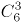种情况，外加1袋小米或红豆，有2种情况，则内容不完全相同的礼盒共有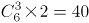种可能。

故正确答案为C。

第 62 题

**参考答案（粉笔题库参考内容）**

A

**解析**

设复工商户为x家，采购的消毒液为y瓶，根据题意“如果每个商户分6瓶，最后剩余12瓶。如果多采购30%，则在给每个商户分8瓶后还能剩余10瓶。”可列方程组6x+12=y……①，8x+10=(1+30%)y……②，联立方程组，解得x=28，y=180。根据题意“如果多采购80%，复工商户数量增加10家，且每个商户分到的数量相同”，则有采购消毒液瓶数=180×(1+80%)=324瓶，复工商户数=28+10=38家，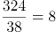瓶……20瓶，要使每个商户分到的数量相同，则每个商户最多可以分8瓶。

故正确答案为A。

第 63 题

**参考答案（粉笔题库参考内容）**

C

**解析**

设第一天采买的次数为2x，则第二天采买的次数为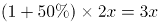，第三天采买的次数为2x+3x-15=5x-15，第四天采买的次数为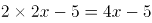，已知前三天共采买65次，则有2x+3x+5x-15=65，解得x=8，则这4天采买的次数分别为16次（2x）、24次（3x）、25次（5x-15）、27次（4x-5），所以这4天中单日采买次数最多为27次，最少为16次，相差27-16=11次。

故正确答案为C。

第 64 题

**参考答案（粉笔题库参考内容）**

D

**解析**

设一共有x家医院，根据条件“如果向每家医院赠送12箱口罩和8箱防护服，则还缺8箱口罩和11箱防护服。”可知，这批物资原有（12x-8）箱口罩和（8x-11）箱防护服。根据条件“如果向每家医院赠送10箱口罩和7箱防护服，则剩余的口罩比防护服多20箱。”可列式：12x-8-10x=8x-11-7x+20，解得x=17，因此一共有17家医院，则这批物资原有12×17-8=196箱口罩和8×17-11=125箱防护服。要使得捐完后没有剩余，那么所捐的防护服应为17的整数倍，125÷17=7……6，则最少还需要再购买17-6=11箱防护服。因为口罩和防护服的比例为2:1，所以还需要购买(125+11）×2-196=76箱口罩。因此口罩和防护服总计至少还要采购11+76=87箱。

故正确答案为D。

第 65 题

**参考答案（粉笔题库参考内容）**

C

**解析**

根据题干信息可以找到如下等量关系：

（1）根据“兴办了甲、乙、丙、丁4个扶贫车间，共投资450万元”，可以得到：甲+乙+丙+丁=450 ……①；

（2）根据“甲车间的投资额是其他三个车间投资额之和的一半”，可以得到：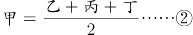；

（3）根据“乙车间的投资额比丙车间高25%”，可以得到乙=(1+25%)丙……③；

（4）根据“丁车间的投资额比乙、丙车间投资额之和低60万元”，可以得到：丁=乙+丙-60……④。

联立上述四个方程可解得：甲=150万元，乙=100万元，丙=80万元，丁=120万元。即甲车间初期投资最大，丙车间初期投资最小。

设追加投资最小的车间追加投资额为x，因为“每个车间的追加投资额都不超过其余任一车间追加投资额的2倍”，则追加投资最多的车间投资额为2x。要想使追加的投资额最大，那么其余车间的追加投资尽可能小，所以其他两个车间的追加投资同样为x，根据“企业后期向4个车间追加了200万元投资”可得：x+x+x+2x=200，解得x=40万元，所以追加投资最小的车间追加了40万元，追加投资最大的车间追加了80万元。要想使总投资额最高和最低车间的总投资额相差最多，则甲车间追加80万元，共投资150+80=230万元；丙车间追加40万元，共投资80+40=120万元；二者相差230-120=110万元。

故正确答案为C。

第 66 题

**参考答案（粉笔题库参考内容）**

D

**解析**

设甲单位职工人数为x人，乙单位职工人数为y人，根据“甲、乙两个单位周末分别安排60%和75%的职工下沉社区帮助困难群众，其中甲单位派出的职工比乙单位少3人”，可列方程①：60%x+3=75%y；根据“两单位又在剩下的职工中，分别抽调40%和75%的职工，共计24人”，可列方程②：，联立方程①和②，解得：x=75，y=64，因此甲单位的职工人数比乙单位多75-64=11人。

故正确答案为D。

第 67 题

**参考答案（粉笔题库参考内容）**

D

**解析**

设第2次直播销售额为7a万元，则第1次销售额为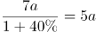万元，第3次销售额为万元，故前三次直播总销售额为7a+5a+8a=20a万元，可知后三次直播总销售额为20a×3=60a万元，第5次销售额为(20a+60a)×25%=20a万元，则第4次销售额为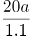万元，第6次销售额为20a+16万元，根据题意可列关系式为：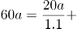，解得a=8.8，则第6次销售额比第3次销售额高20a+16-8a=12a+16=12×8.8+16=121.6万元。

故正确答案为D。

第 68 题

**参考答案（粉笔题库参考内容）**

B

**解析**

设申请金额最低的农户申请x万元，已知10户贫困农户共申请25万元，要使金额最低的农户申请的金额最少，则令其他农户申请的金额尽可能多。题目中已知申请金额最高的农户申请金额不超过申请金额最低农户的2倍，即最高申请2x万元，且任意2户农户的申请金额都不相同，同时每人的申请金额都是1000元（0.1万元）的整数倍，则根据这些条件可构造出下表：

则2x+(2x-0.1)+(2x-0.2)+(2x-0.3)+(2x-0.4)+(2x-0.5)+(2x-0.6)+(2x-0.7)+(2x-0.8)+x=25，即18x-3.6+x=25，解得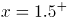，由于每人的申请金额都是1000元（0.1万元）的整数倍，则x最少为1.6万元。

故正确答案为B。

第 69 题

**参考答案（粉笔题库参考内容）**

C

**解析**

根据题意可得，村民总人数为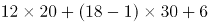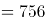人。总人数一定，要使车辆数最少，则应让单次运载人数多的大巴车运载更多，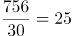辆······6人，即大巴车满载25辆时剩余6人。还要使大巴车辆数最少，将运载方案枚举如下：

······

综上可得，本着车辆数最少的原则派车，最少要安排24辆大巴车。

故正确答案为C。

第 70 题

**参考答案（粉笔题库参考内容）**

B

**解析**

如图，在中，过点B做垂线相交AC于点M，则BM为正三角形ABC的高同时也为梯形的高，故BM=100米，根据为直角三角形，且，则，故可得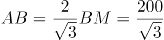米；则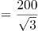米；根据题干分析可得：，则中，故可得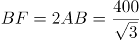米，同理可得米；故该梯形上底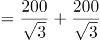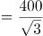米，下底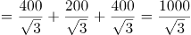米，则平方米，该土地产量千克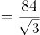吨。

故正确答案为B。

第 71 题

**参考答案（粉笔题库参考内容）**

B

**解析**

由“选拔170多名优秀人才平均分配为7组”，说明优秀人才人数为7的倍数，170多，只能是175人，因此平均分7组，每组25人；又根据“党员人数比非党员多3倍”，可以得到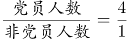，因此党员人数人，又因为接受培训的党员中的10%被分配到12个基层单位，被分配的党员人数为。

由于本题涉及的是人数，相当于进行名额分配。把14个名额分到12个单位，根据插板法，情况数有种。由于每个单位至少分配1人，则甲分配名额情况可以分为“分配人数多于1人”和“分配人数为1人”两种。所求为甲单位分配人数多于1人：

方法一：正向考虑，（1）甲分配2人，剩余12人，11个单位至少分配1人，有种；（2）甲分配3人，剩余11人，11个单位至少分配1人，有种；甲单位分配人数多于1的情况共有11+1=12种，因此，根据概率公式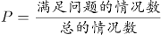，所求概率为。

方法二：从反面考虑，计算甲只分配1人的情况，相当于剩余13个名额分配给11个单位，情况数为种，则满足甲多于1人的情况数为78-66=12种，因此，根据概率公式，所求概率为。

故正确答案为B。

第 72 题

**参考答案（粉笔题库参考内容）**

D

**解析**

根据题干信息：基建支出为总预算的40%，图书购买支出比基建支出低25%，故图书支出为总预算的：，图书购买支出比信息化支出高25%，故信息化支出为总预算的：；根据最终项目的总支出比总预算结余了3000元，即总支出比总预算少了0.3万元。设总预算为x万元，可列方程为40%x+30%x+24%x+4.5=x-0.3，解出x=80，故图书支出为万元，购买图书为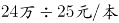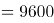本，购买的图书比接受外来捐赠的图书多20%，故捐赠图书为本，总计购买图书+捐赠图书=9600+8000=17600本。

故正确答案为D。

备注：结余属于会计术语，表示在一定期间各项收入与支出结算之后剩余的数额，本题中指总预算与总支出结算之后的余额。

第 73 题

**参考答案（粉笔题库参考内容）**

A

**解析**

根据题意可知，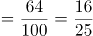，即派往车站的总人数是25的倍数；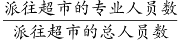，即派往超市的总人数是20的倍数；派往学校的非专业人员比专业人员少30%，即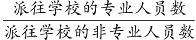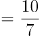，则派往学校的总人数是10+7=17的倍数，专业人员占比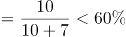。由于派往机场的人数最多，则车站只能派25人，其中专业人员16人；超市只能派20人，其中专业人员13人；学校只能派17人，其中专业人员10人。由此可得：派往机场人数=96-25-20-17=34人，其中专业人员数=62-16-13-10=23人。故派往机场的专业人数占比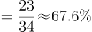，排名第一。

故正确答案为A。

第 74 题

**参考答案（粉笔题库参考内容）**

B

**解析**

赋值原露出水面的圆锥体人工景观体积为64，则人工湖水深减少后，露出水面的体积变为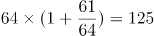。根据定理“在立体图形中，体积之比等于相似比的立方”，，故人工景观露出水面的高度之比为4：5。原露出水面的高度为3米，水深减少20%后高度为米。水深减少20%对应3.75-3=0.75米，则原人工湖的水深米。

故正确答案为B。

第 75 题

**参考答案（粉笔题库参考内容）**

C

**解析**

设满50元减10元、满100元减30元的电子优惠券分别为x、y万张，根据 “共核销优惠券15.6万张”和“通过核销优惠券方式减免租金219万元”可列等式：x+y=15.6万①；万②；联立方程组，解得x=8.8，y=6.8；要求实际支付金额最低，当消费金额恰好达到可用优惠券金额时，实际支付最少，即满50元减10元，实际最少支付50-10=40元，满100元减30元，最少支付100-30=70元，故总实际支付最少金额，在800～850万元之间。

故正确答案为C。

第 76 题

**参考答案（粉笔题库参考内容）**

A

**解析**

元素组成不同，优先考虑属性规律。观察发现，每幅图形整体并无规律，继续观察，每幅图形的白色区域分别是轴对称、中心对称、轴对称、中心对称、轴对称。因此？处白色区域应为中心对称图形。A项白色区域为中心对称图形，当选。B项白色区域为轴对称图形，C、D两项白色区域为非对称图形，均排除。

故正确答案为A。

第 77 题

**参考答案（粉笔题库参考内容）**

C

**解析**

元素组成不同，且无明显属性规律，考虑数量规律。观察发现，题干每幅图形均存在曲线与直线，且曲直相交，优先考虑曲直交点数。题干每幅图形的曲直交点数均为2个，但无法得出唯一答案。继续观察发现，题干图形相切明显，考虑切点数，每幅图的切点数均为1个，只有C项符合规律。

故正确答案为C。

第 78 题

**参考答案（粉笔题库参考内容）**

A

**解析**

元素组成不同，且无明显属性规律，考虑数量规律。题干大部分图形存在扇形，且扇形的面积不同，考虑扇形面积大小规律。观察发现，图1没有扇形，图2扇形为个圆，图3扇形为个圆，图4扇形为个圆，图5扇形为个圆，扇形面积呈递增规律，故？处扇形面积应为个圆，只有A项符合，当选。

故正确答案为A。

第 79 题

**参考答案（粉笔题库参考内容）**

D

**解析**

元素组成相似，优先考虑样式规律。题干图形均存在黑色部分和空白部分，考虑黑白运算。第一组图的黑白运算规律为：黑+黑=白，白+黑=黑，黑+白=黑，白+白=白。第二组图运用此规律，可以将图形分为四行看，第二行最左侧应满足白+白=白，排除B、C两项。第三行最右侧应满足白+黑=黑，排除A项，只有D项符合，当选。

故正确答案为D。

第 80 题

**参考答案（粉笔题库参考内容）**

A

**解析**

将题干立体图及选项展开图中对应的面标上序号，如下图所示，逐一分析选项。

A项：选项与题干一致，当选；

B项：选项中面a与面b的公共边（如下图线1所示），面a挨着面b的小黑色方块，而题干立体图中面a没有挨着面b的小黑色方块，选项与题干不一致，排除；

C项：题干立体图中，面a挨着面c中较细的黑色部分，但选项中面a与左右两个相邻面中的较细黑色部分均不相邻（如下图线2和线2'所示），选项与题干立体图不一致，排除；

D项：因呈直角的两条边是同一条边，故选项中线3折合之后为同一条边，观察发现，选项中面a挨着下方图形较粗的黑色部分（如下图线3所示），而题干立体图中面a没有挨着较粗的黑色部分，选项与题干不一致，排除。

故正确答案为A。

第 81 题

**参考答案（粉笔题库参考内容）**

A

**解析**

本题考查立体拼合，如下图所示，题干立体图形可由3个完全相同的A项图形拼合而成。

故正确答案为A。

第 82 题

**参考答案（粉笔题库参考内容）**

B

**解析**

本题考查三视图，逐一分析选项。

A项：从下往上看，应如图所示，题干A选项右上角应为梯形，排除；

B项：从前往后看，与题干一致，当选；

C项：从上往下看，应如图所示，题干C选项左下角应为梯形而非长方形，排除；

D项：从右往左看，应如图所示，题干D选项右下角应为长方形而非梯形，排除。

故正确答案为B。

第 83 题

**参考答案（粉笔题库参考内容）**

C

**解析**

元素组成不同，且无明显属性规律，考虑数量规律。观察发现，图形被分割明显，考虑数面。图①③④均有2个面，图②⑤⑥均有4个面，即图①③④一组，图②⑤⑥一组。

故正确答案为C。

第 84 题

**参考答案（粉笔题库参考内容）**

D

**解析**

本题为分组分类题目。观察发现，题干每幅图形均由两个面相交而成，考虑图形间关系。图①⑤⑥中两个图形具有1条相交边，图②③④中两个图形具有2条相交边，即图①⑤⑥一组，图②③④一组。

故正确答案为D。

第 85 题

**参考答案（粉笔题库参考内容）**

C

**解析**

本题为分组分类题目。元素组成相同，但无明显位置规律。观察发现，所有图形中黑球全部相连，如果将所有黑球连成线，图③④⑤中所有黑球连成的线能一笔画成，而图①②⑥中所有黑球连成的线存在4个奇点，为两笔画成，如下图所示。因此图①②⑥一组，图③④⑤一组。

故正确答案为C。

第 86 题

**参考答案（粉笔题库参考内容）**

A

**解析**

第一步：找出定义关键词。

“出句与对句在意义上和语法结构上不是相对，而是上下相承”、“在语言结构上有一定的前后顺序”。

第二步：逐一分析选项。

A项：诗句的意思是“到目前已经看到目力所能达到的地方了，却不想才登上了一层楼而已”。前一句描写的是目前的状态，后一句阐述由此发现的事实，前后两句有固定顺序，符合“出句与对句在意义上和语法结构上不是相对，而是上下相承”、“在语言结构上有一定的前后顺序”，符合定义，当选；

B项：诗句的意思是“用书堆积起来的大山中，要想攀登遥远的高峰，勤奋就是那登顶的唯一路径；无边无际的知识海洋里，苦难将是一艘前行的船，能够载你走向成功”。前一句描写勤奋，后一句描写刻苦，前后两句语法结构上是相对的，不符合“出句与对句在意义上和语法结构上不是相对，而是上下相承”，不符合定义，排除；

C项：诗句的意思是“对敌人决不屈服，对人民大众甘愿服务”。前一句描写的是对敌人的态度，后一句描写的是对人民的态度，前后两句语法结构上是相对的，不符合“出句与对句在意义上和语法结构上不是相对，而是上下相承”，不符合定义，排除；

D项：诗句的意思是“巫峡里面波浪滔天，上空的乌云则像是要压到地面上来似的，天地一片阴沉”。前一句描写的是波浪，后一句描写的是乌云，前后两句语法结构上是相对的，不符合“出句与对句在意义上和语法结构上不是相对，而是上下相承”，不符合定义，排除。

故正确答案为A。

第 87 题

**参考答案（粉笔题库参考内容）**

D

**解析**

第一步：找出定义关键词。

“生物释放的”、“引起他种接受生物产生对释放者和接受者都有益的反应”。

第二步：逐一分析选项。

A项：苹果实蝇在植物果实上留下标记信息素避免重复产卵，释放者和接受者都是苹果实蝇，不是他种接受生物，不符合“引起他种接受生物产生对释放者和接受者都有益的反应”，不符合定义，排除；

B项：印楝含有的印楝素有驱杀害虫的效果，只对释放者印楝本身有益，对接受者害虫无益，不符合“引起他种接受生物产生对释放者和接受者都有益的反应”，不符合定义，排除；

C项：亚洲玉米螟雌蛾和雄蛾属于同一物种，不符合“引起他种接受生物产生对释放者和接受者都有益的反应”，不符合定义，排除；

D项：小麦遭受麦长管蚜攻击后释放的水杨酸甲酯，可吸引麦长管蚜的天敌异色瓢虫，对释放者小麦和接受者异色瓢虫都有益，符合“生物释放的”、“引起他种接受生物产生对释放者和接受者都有益的反应”，符合定义，当选。

故正确答案为D。

第 88 题

**参考答案（粉笔题库参考内容）**

C

**解析**

第一步：找出定义关键词。

“按照多式联运合同”、“至少两种不同的运输方式”、“由多式联运经营人”、“将货物从一国境内接货地点运至另一国境内指定交货地点”。

第二步：逐一分析选项。

A项：将货运汽车开上火车进行运输，没有提及是否从一国运至另一国，不符合“将货物从一国境内接货地点运至另一国境内指定交货地点”，不符合定义，排除；

B项：某公司通过厢式货车将进口商品运到公司楼下，再由员工开车带回家，都是以汽车为运输方式，不符合“至少两种不同的运输方式”，不符合定义，排除；

C项：航空冷链和冷链车是两种不同的运输方式，符合“至少两种不同的运输方式”，电商从海外采购生鲜商品进口到国内，符合“将货物从一国境内接货地点运至另一国境内指定交货地点”，符合定义，当选；

D项：船运公司将从外海打捞的海鲜运输到沿海地区再分销到各个生鲜市场，只体现了船运一种运输方式，不符合“至少两种不同的运输方式”，且是否为自己国家的外海不明确，不符合“将货物从一国境内接货地点运至另一国境内指定交货地点”，不符合定义，排除。

故正确答案为C。

第 89 题

**参考答案（粉笔题库参考内容）**

D

**解析**

第一步：找出定义关键词。

分类数据：“只能归于某一类别的非数字型数据”、“是对事物进行分类的结果，用文字表述”；

顺序数据：“归于某一有序类别的非数字型数据”；

定量数据：“表现为具体数字观测值的数据”。

第二步：逐一分析数据。

数据①：按城市规模可将城市分为特大城市、大城市，中等城市和小城市，体现出规模大小上的顺序，符合“归于某一有序类别的非数字型数据”，属于顺序数据；

数据②：婚姻状况：1-未婚， 2-已婚，3-离异，4-丧偶，将婚姻状况分为四类，符合“只能归于某一类别的非数字型数据”、“是对事物进行分类的结果，用文字表述”，属于分类数据；

数据③：A地到B地的距离为200公里，到C地为320公里，到D地为100公里，都是具体数字观测值的数据，符合“表现为具体数字观测值的数据”，属于定量数据；

数据④：某医院建筑面积37.5万平方米，开放床位3182个，临床医生687人，医院建筑面积、开放床位数、临床医生数都是具体数字观测值的数据，符合“表现为具体数字观测值的数据”，属于定量数据。

综上，①属于顺序数据，②属于分类数据，③④都属于定量数据。

故正确答案为D。

第 90 题

**参考答案（粉笔题库参考内容）**

C

**解析**

第一步：找出定义关键词。

“因一种呈味物质的存在”、“使另一种呈味物质的呈味特性减弱”。

第二步：逐一分析选项。

A项：因加入少量柠檬酸使橘子汁甜味减弱，又因再加入砂糖使橘子汁酸味减弱，符合“因一种呈味物质的存在”、“使另一种呈味物质的呈味特性减弱”，符合定义，排除；

B项：在带有苦味的糖精中添加少量的谷氨酸钠可使苦味明显缓和，因为谷氨酸钠的存在使糖精的呈味特性减弱，符合“因一种呈味物质的存在”、“使另一种呈味物质的呈味特性减弱”，符合定义，排除；

C项：同时服用氯化钠和奎宁后，再饮用清水会有微甜的感觉，清水本身无味，不属于呈味物质，不符合“因一种呈味物质的存在”、“使另一种呈味物质的呈味特性减弱”，不符合定义，当选；

D项：在食用过酸涩的西非山榄后，再吃酸味食品，会尝不到酸味，因为西非山榄的存在使酸味食品的呈味特性减弱，符合“因一种呈味物质的存在”、“使另一种呈味物质的呈味特性减弱”，符合定义，排除。

本题为选非题，故正确答案为C。

第 91 题

**参考答案（粉笔题库参考内容）**

B

**解析**

第一步：找出定义关键词。

“通过提供产品及服务使顾客产生愉悦等积极情感”、“获得了超过使用价值的新价值”。

第二步：逐一分析选项。

A项：小张倾听客户说话，让客户在享受按摩的同时心情舒畅，符合“通过提供产品及服务使顾客产生愉悦等积极情感”、“获得了超过使用价值的新价值”，符合定义，排除；

B项：智能音箱“小美”不仅能播放儿歌和故事，还能跟小朋友“对话、握手和点头”，这只是音箱的功能，并没有体现出“获得了超过使用价值的新价值”，不符合定义，当选；

C项：扫地机器人为年轻夫妻解决扫地难题，增加生活幸福感，符合“通过提供产品及服务使顾客产生愉悦等积极情感”、“获得了超过使用价值的新价值”，符合定义，排除；

D项：洗碗机广告中，一位女士刷着碗盘，双手粗糙，愁眉苦脸，广告精确地掌握客户的心理需求，从反面切入，让客户感觉可以通过洗碗机摆脱这样愁苦的生活，获得情感价值，符合“通过提供产品及服务使顾客产生愉悦等积极情感”、“获得了超过使用价值的新价值”，符合定义，排除。

本题为选非题，故正确答案为B。

第 92 题

**参考答案（粉笔题库参考内容）**

A

**解析**

第一步：找出定义关键词。

“人们受预测信息的影响而采取了某种行为”、“造成原本有多种可能性的结果真的朝着预测所指示的方向发展”。

第二步：逐一分析选项。

A项：专家预测H股票将大涨，观众争相购买股票，符合“人们受预测信息的影响而采取了某种行为”，观众的行为导致股票涨停，符合“造成原本有多种可能性的结果真的朝着预测所指示的方向发展”，符合定义，当选；

B项：某福利彩票代销点宣称的内容不属于预测信息，不符合“人们受预测信息的影响而采取了某种行为”，不符合定义，排除；

C项：某国首脑在新年致辞中展望了该国经济形势，而百姓只是对未来经济好转充满信心，并未对此采取行动，不符合“人们受预测信息的影响而采取了某种行为”，不符合定义，排除；

D项：乙国媒体认为M党总统候选人当选，结果选民支持N党总统候选人，不符合“造成原本有多种可能性的结果真的朝着预测所指示的方向发展”，不符合定义，排除。

故正确答案为A。

第 93 题

**参考答案（粉笔题库参考内容）**

C

**解析**

第一步：找出定义关键词。

“高估自己对事件的控制程度或影响力”、“低估机会、运气等不可控制因素在事件发展过程及其结果上所扮演的角色”。

第二步：逐一分析选项。

A项：掷骰子是随机事件，人们心中默念并用力揉捏骰子，相信这样做会掷出“双6”，符合“高估自己对事件的控制程度或影响力”，也低估了不可控因素的作用，符合定义，排除；

B项：一些股民仅借助“几个简单的因素”就认为自己能够预测大盘指数，符合“高估自己对事件的控制程度或影响力”，符合定义，排除；

C项：某企业经理认为运动会对企业发展有利，能够增加营业额，预测的是运动会对企业的影响，不符合“高估自己对事件的控制程度或影响力”，不符合定义，当选；

D项：某摆渡车驾驶员认为自己路况熟、技术好而在山路上开快车，体现了此人因为“高估自己对事件的控制程度或影响力”而进行了不安全的驾驶行为，符合定义，排除。

本题为选非题，故正确答案为C。

第 94 题

**参考答案（粉笔题库参考内容）**

C

**解析**

第一步：找出定义关键词。

“先后叙述的两个结构基本相同的句式”、“两对或者两对以上相互对立的概念”、“意思是一致的或者是相互补充的”。

第二步：逐一分析选项。

A项：意思是“君子心胸开阔，能够包容别人，小人爱斤斤计较，患得患失”，“君子”和“小人”、“坦荡荡”和“长戚戚”分别出现在前后两句中，且概念对立，符合“先后叙述的两个结构基本相同的句式”、“两对或者两对以上相互对立的概念”、“意思是一致的或者是相互补充的”，符合定义，排除；

B项：意思是“为官者应把国家、民族的利益摆在首位，为祖国的前途、命运分愁担忧，为天下的人民幸福出力”，“先”和“后”、“忧”和“乐”分别出现在前后两句中，且概念对立，符合“先后叙述的两个结构基本相同的句式”、“两对或者两对以上相互对立的概念”、“意思是一致的或者是相互补充的”，符合定义，排除；

C项：意思是“百姓的粮仓充足，丰衣足食，才能顾及到礼仪，重视荣誉和耻辱”，“仓廪实”和“衣食足”、“知礼节”和“知荣辱”均不属于相互对立的概念，不符合“两对或者两对以上相互对立的概念”，不符合定义，当选；

D项：意思是“人穷的时候亲戚朋友在身边也很少来往，富有的时候就算远在深山老林亲戚都会来找你”，“穷”和“富”、“闹市”和“深山”分别出现在前后两句中，且概念对立，符合“先后叙述的两个结构基本相同的句式”、“两对或者两对以上相互对立的概念”、“意思是一致的或者是相互补充的”，符合定义，排除。

本题为选非题，故正确答案为C。

第 95 题

**参考答案（粉笔题库参考内容）**

D

**解析**

第一步：找出定义关键词。

自变量：“实验中由实验者操作的变量”；

因变量：“随着自变量的变化而变化的变量”；

控制变量：“除自变量以外的影响实验变化和结果的潜在因素或条件”。

第二步：逐一分析选项。

A项：研究小麦供给量受当地采购价格的影响，当地采购价格是需要研究人员操作的变量，符合“实验中由实验者操作的变量”，符合自变量定义，不符合因变量定义；小麦供给量是随着当地采购价格变化而变化的量，符合“随着自变量的变化而变化的变量”，符合因变量定义，不符合控制变量定义，排除；

B项：研究不同税率对稀土出口量的影响，不同税率是该研究中需要研究人员改变的量，符合“实验中由实验者操作的变量”，符合自变量定义，不符合因变量定义；稀土出口量是随着税率的变化而变化的量，符合“随着自变量的变化而变化的变量”，符合因变量定义，不符合自变量定义，排除；

C项：研究气候条件对棉花产量的影响，气候条件是该研究中需要研究人员改变的量，符合“实验中由实验者操作的变量”，符合自变量定义，不符合因变量定义，排除；

D项：研究制糖厂营业额受糖产量的影响，糖产量是该研究中需要研究人员改变的量，符合“实验中由实验者操作的变量”，符合自变量定义；糖的单价是该研究中除了糖产量以外的能够影响制糖厂营业额的一种潜在因素，符合“除自变量以外的影响实验变化和结果的潜在因素或条件”，符合控制变量定义，当选。

故正确答案为D。

第 96 题

**参考答案（粉笔题库参考内容）**

D

**解析**

第一步：判断题干词语间逻辑关系。

水体是江、河、湖、海、地下水、冰川等的总称。江、河、湖、海是四种不同的水体，与水体分别构成种属关系，且江、河、湖、海之间是并列关系。

第二步：判断选项词语间逻辑关系。

A项：鳏寡孤独泛指没有劳动力而又没有亲属供养、无依无靠的人。鳏指年老无妻或丧妻的男子，寡指年老无夫或丧夫的女子，孤指年幼丧父的孩子，独指年老无子女的人。鳏、寡、孤、独是四种不同的身份，与身份分别构成种属关系，且鳏、寡、孤、独之间是并列关系，与题干逻辑关系一致，保留；

B项：油盐酱醋的功能是调味，二者为功能对应关系，与题干逻辑关系不一致，排除；

C项：山珍海味指山野和海里出产的各种珍贵食品。但山、珍、海、味并非四种不同的美食，与题干逻辑关系不一致，排除；

D项：绫罗绸缎泛指各种精美的丝织品。绫、罗、绸、缎是四种不同的丝织面料，与面料分别构成种属关系，且绫、罗、绸、缎之间是并列关系，与题干逻辑关系一致，保留。

对比A、D两项，A项的身份是抽象事物，D项的面料和题干的水体均为具体事物，因此D项与题干的逻辑关系更贴近，当选。  

故正确答案为D。

第 97 题

**参考答案（粉笔题库参考内容）**

D

**解析**

第一步：判断题干词语间逻辑关系。

船舶抛锚是指把锚投入水中，使船停稳，即“停船”（注：如果是车抛锚，那就是车发生故障而停止行驶，与船舶抛锚的意思有区别），所以是先“船舶抛锚”，后“请求救援”，二者存在先后顺序。

第二步：判断选项词语间逻辑关系。

A项：先“平稳飞行”，后“安全着陆”，二者存在先后顺序，但顺序与题干相反，与题干逻辑关系不一致，排除；

B项：先“行政复议”，后“获得赔偿”，二者存在先后顺序，与题干逻辑关系一致，保留；

C项：“卖出高粱”和“买入白酒”没有必然的先后顺序，与题干逻辑关系不一致，排除；

D项：先“违规销售”，后“停业整顿”，二者存在先后顺序，与题干逻辑关系一致，保留；

对比BD项，进行二级辨析，题干的“请求救援”和D项的“停业整顿”都是说明事情偏负面，而B项的结果“获得赔偿”相对来说偏积极，择优选择D项。

故正确答案为D。

第 98 题

**参考答案（粉笔题库参考内容）**

B

**解析**

第一步：判断题干词语间逻辑关系。

“春山暖日和风，阑干楼阁帘栊”指的是桃红柳绿的春山，煦暖的阳光照耀，和柔的东风吹拂，楼阁上卷起帘拢。每句都包含三种事物，春山、暖日、和风三者为并列关系，阑干、楼阁、帘栊三者也为并列关系。

第二步：判断选项词语间逻辑关系。

A项：“绿蚁新醅酒，红泥小火炉”指的是新酿的米酒，色绿香浓；小小红泥炉，烧得殷红。每句只包含一件事物，与题干逻辑关系不一致，排除；

B项：“鸡声茅店月，人迹板桥霜”指的是鸡声嘹亮，茅草店沐浴着晓月的余晖；板桥弥漫清霜，先行客人足迹行行。每句都包含三件事物，鸡声、茅店、月三者为并列关系，人迹、板桥、霜三者也为并列关系，与题干逻辑关系一致，当选；

C项：“江碧鸟逾白，山青花欲燃”指的是碧绿的江水把鸟儿的羽毛映衬得更加洁白，山色青翠欲滴，红艳的野花似乎将要燃烧起来。每句只包含两件事物，与题干逻辑关系不一致，排除；

D项：“柴门闻犬吠，风雪夜归人”指的是柴门外忽传来犬吠声声，原来是有人冒着风雪归家门。每句中只包含两件事物，与题干逻辑关系不一致，排除。

故正确答案为B。

第 99 题

**参考答案（粉笔题库参考内容）**

D

**解析**

第一步：判断题干词语间逻辑关系。

立体化战争，指在地面（水面）、地下（水下）、空中以及前方、后方同时或交互进行的战争。数字化战争，就是数字化部队在数字化战场进行的信息战，它是以信息为主要手段，以信息技术为基础的战争，是信息战的一种形式。有的立体化战争是数字化战争，有的立体化战争不是数字化战争，有的数字化战争是立体化战争，有的数字化战争不是立体化战争，二者是交叉关系。

第二步：判断选项词语间逻辑关系。

A项：民主型管理和专制型管理是管理的两种形式，除此之外还有放任型管理，所以二者属于并列关系中的反对关系，与题干逻辑关系不一致，排除；

B项：防风林是一种以防御自然灾害、维护基础设施、保护生产、改善环境和维持生态平衡等为主要目的的森林群落，观赏树木指可供观赏的木本植物，不能说有的防风林是观赏树木，有的观赏树木是防风林，二者不是交叉关系，与题干逻辑关系不一致，排除；

C项：有氧运动指人体在氧气充分供应的情况下进行的体育锻炼，是体育锻炼的一种形式，医疗瘦身指的是借助医疗的方法瘦身，是瘦身的一种形式，不能说有的有氧运动是医疗瘦身，二者不是交叉关系，与题干逻辑关系不一致，排除；

D项：绩效奖励有物质奖励和精神奖励，所以有的绩效奖励是物质奖励，有的绩效奖励不是物质奖励，有的物质奖励是绩效奖励，有的物质奖励不是绩效奖励，二者是交叉关系，与题干逻辑关系一致，当选。

故正确答案为D。

第 100 题

**参考答案（粉笔题库参考内容）**

B

**解析**

第一步：判断题干词语间逻辑关系。

篾刀是制作风筝的工具，竹条是制作风筝的原材料，三者为成品、工具、原材料的对应关系。

第二步：判断选项词语间逻辑关系。

A项：黏土是泥塑的原材料，颜料也是泥塑的原材料，与题干逻辑关系不一致，排除；

B项：绣针是制作绣品的工具，绣线是制作绣品的原材料，三者为成品、工具、原材料的对应关系，与题干逻辑关系一致，当选；

C项：蔗糖是制作糖人的原材料，糖人粘在竹签上，与题干逻辑关系不一致，排除；

D项：描金是制作漆器的一种工艺，涂料是制作漆器的原材料，与题干逻辑关系不一致，排除。

故正确答案为B。

第 101 题

**参考答案（粉笔题库参考内容）**

A

**解析**

第一步：判断题干词语间逻辑关系。

檀香取于檀香科乔木檀香树的木质心材，属于香料的一种；麝香为鹿科动物麝的雄性腺囊中的分泌物干燥而成，是一种高级香料；二者为并列关系且原料不同，同时二者均与香料构成种属关系。

第二步：判断选项词语间逻辑关系。

A项：木材是建材的一种，钢筋是建材的一种，二者为并列关系且原料不同，同时二者均与建材构成种属关系，与题干逻辑关系一致，当选；

B项：日光与月光都是光的一种，但不是光明的一种，二者与光明不构成种属关系，与题干逻辑关系不一致，排除；

C项：薯条与粉条一般都是由土豆作为原材料加工而成的食物，二者为并列关系但原料可以相同，与题干逻辑关系不一致，排除；

D项：鲸鱼属于哺乳动物，不属于鱼类，与题干逻辑关系不一致，排除。

故正确答案为A。

第 102 题

**参考答案（粉笔题库参考内容）**

A

**解析**

第一步：判断题干词语间逻辑关系。

中央预算和地方预算均属于国家预算，二者为并列关系；且年度预算分别与中央预算、地方预算是交叉关系。

第二步：判断选项词语间逻辑关系。

A项：现实题材和历史题材是以时间为划分标准的两种文学创作题材，二者为并列关系；且军事题材分别与历史题材、现实题材是交叉关系，与题干逻辑关系一致，当选；

B项：户外广告是通过户外传播的广告形式，电视广告是一种通过电视播放的广告，文字广告是通过文字形式传播的广告，三者互为交叉关系，与题干逻辑关系不一致，排除；

C项：知识创新是指获得新的基础科学和技术科学知识的创新活动，技术创新是指以创造新技术为目的的创新活动，管理创新是指企业把新的管理要素引入企业管理系统的创新活动，三者为并列关系，与题干逻辑关系不一致，排除；

D项：生命权利属于人身权利，二者为种属关系；人身权利又称非财产权利，与财产权利属于并列关系，与题干逻辑关系不一致，排除。

故正确答案为A。

第 103 题

**参考答案（粉笔题库参考内容）**

A

**解析**

第一步：判断题干词语间逻辑关系。

健康监测和疾病筛查是体检的目的，三者为目的对应关系。

第二步：判断选项词语间逻辑关系。

A项：为国聚财和调节分配是税收的目的，与题干逻辑关系一致，当选；

B项：发掘遗迹和考证年代是考古的过程和内容，与题干逻辑关系不一致，排除；

C项：解决争议是审判的目的，但强制执行不是审判的目的，与题干逻辑关系不一致，排除；

D项：航天又被称为太空飞行，二者为全同关系，与题干逻辑关系不一致，排除。

故正确答案为A。

第 104 题

**参考答案（粉笔题库参考内容）**

B

**解析**

逐一代入选项。

A项：耳挂是口罩的组成部分，二者为组成关系；竹子是竹炭的原材料，二者为对应关系，前后逻辑关系不一致，排除；

B项：无纺布是制作口罩的原材料，二者为对应关系；竹子是制作斗笠的原材料，二者为对应关系，前后逻辑关系一致，当选；

C项：口罩是一种卫生用品，二者为种属关系；竹叶是竹子的组成部分，二者为组成关系，前后逻辑关系不一致，排除；

D项：医用口罩是口罩的一种，二者为种属关系；箭竹是竹子的一种，二者为种属关系，但词语前后顺序相反，前后逻辑关系不一致，排除。

故正确答案为B。

第 105 题

**参考答案（粉笔题库参考内容）**

C

**解析**

逐一代入选项。

A项：核安全是核技术开发的保障，二者为对应关系，虚拟货币是一种货币，二者为种属关系，前后逻辑关系不一致，排除；

B项：核泄漏不是核安全的一种，交易货币和虚拟货币是交叉关系，前后逻辑关系不一致，排除；

C项：核安全是构成国家安全的要素之一，二者为组成关系，比特币是一种虚拟货币，二者为种属关系，在此需要注意，在没有更好答案的情况下，组成关系和种属关系都属于包容关系，可以暂时保留；

D项：网络安全与核安全为并列关系，游戏币和虚拟货币是交叉关系，前后逻辑关系不一致，排除。

注：本题并不是很常规，在历年极个别真题中也曾考查过，重点学习思维即可，即如果题干是种属关系，选项没有种属关系，可以择优选择组成关系。

故正确答案为C。

第 106 题

**参考答案（粉笔题库参考内容）**

D

**解析**

第一步：找出论点和论据。

论点：相关主管部门组织短视频平台企业研发了青少年防沉迷系统，进入“青少年模式”后，每日使用时长将限定为累计40分钟，打赏、充值、提现、直播等功能将不可用，每天22时至次日6时期间，禁止使用短视频App，该模式对于青少年防沉迷是有效的。

论据：无。

本题只有论点，没有论据，削弱优先考虑否论点，即青少年防沉迷系统中“青少年模式”对青少年防沉迷没有作用。

第二步：逐一分析选项。

A项：论点讨论“青少年模式”是否能起到防沉迷的作用，而该项说用户使用“青少年模式”会增加泄露个人隐私的风险，增加泄露个人隐私的风险与该模式是否有防沉迷的作用无关，无法削弱，排除；

B项：论点讨论“青少年模式”是否能起到防沉迷的作用，而该项说不加选择浏览视频内容可能会影响青少年价值观，二者话题不一致，无法削弱，排除；

C项：论点讨论“青少年模式”是否能起到防沉迷的作用，而该项说该系统可能会“误伤”成年人，二者话题不一致，无法削弱，排除；

D项：该项说“青少年模式”目前尚无法识别网络使用者的真实身份，即“青少年模式”无法识别出用户是否为青少年，就没有办法对所有真正的青少年起到防沉迷的作用，可以质疑该模式的有效性，可以削弱，当选。

故正确答案为D。

第 107 题

**参考答案（粉笔题库参考内容）**

C

**解析**

第一步：找出论点和论据。

论点：胶原蛋白不是保持皮肤年轻的原因，表皮干细胞的更新才是保持皮肤年轻的原因。

论据：表皮干细胞会不断复制、分化，产生新细胞取代受损的老细胞，这一更新有利于维持皮肤的年轻。

本题论点和论据都在说表皮干细胞的更新有利于维持皮肤的年轻，话题一致，因此可以预设否定论点的方式进行削弱，即说明表皮干细胞的更新不是保持皮肤年轻的原因。且本题中双方观点关于如何保持皮肤年轻的原因争执，因此如果能说明胶原蛋白能导致表皮干细胞的更新，也可以起到削弱“研究人员”观点的效果。

第二步：逐一分析选项。

A项：论点说的是表皮干细胞的更新是保持皮肤年轻的原因，该项说的是表皮干细胞的更新还需要其他化合物的促进，其他化合物未提及，对保持皮肤年轻的影响不明确，排除；

B项：论点说的是表皮干细胞的更新是保持皮肤年轻的原因，该项说的是表皮干细胞的再生能力，话题不一致，无法削弱，排除；

C项：论点说的是表皮干细胞的更新是保持皮肤年轻的原因，该项说的是胶原蛋白对促进表皮干细胞的更新至关重要，因此保持皮肤年轻的根本原因还是胶原蛋白，削弱论点，当选；

D项：论点说的是表皮干细胞的更新是保持皮肤年轻的原因，该项说的是胶原蛋白的表达，主体不一致，无法削弱，排除。

故正确答案为C。

第 108 题

**参考答案（粉笔题库参考内容）**

D

**解析**

第一步：翻译题干。

①小赵同处室的同事收到小赵发的警示微信；

②小刘同小区且认识的人收到了小刘发的警示微信且电话进行确认提醒；

③小赵、小刘互通了电话，提醒近期不相互走动；

④小赵给小刘发过警示微信；

⑤小刘没有给小赵发过警示微信；

⑥小赵和小刘认识。

第二步：逐一分析选项。

A项：根据条件③可知小赵和小刘互通了电话，提醒近期不相互走动，即小赵近期有可能没有去过小刘的家里，可能成立，排除；

B项：根据条件④可知小刘收到了小赵发的警示微信，是对①的肯后，肯后可以得到可能性结论，即小刘和小赵可能是同处室的同事，可能成立，排除；

C项：根据条件④可知小刘收到了小赵发的警示微信，是对①的肯后，肯后可以得到可能性结论，即小刘和小赵可能是同处室的同事，也可能不是同处室的同事，可能成立，排除；

D项：根据条件⑤可知小刘没有给小赵发过警示微信，是对②的否后，否后必否前可以推出-同小区或-认识，结合⑥小刘和小赵认识，否一推一，可以得到小赵和小刘不住在同一小区，选项不可能成立，当选。

本题为选非题，故正确答案为D。

第 109 题

**参考答案（粉笔题库参考内容）**

C

**解析**

第一步：找出论点和论据。

论点：为了保护珊瑚，在海滨浴场应该禁止使用防晒霜。

论据：羟苯甲酮是一种常见的紫外线吸收剂，多用于防晒护肤品中，全球3500种品牌的防晒霜中均含有该物质。研究表明，即使是极低浓度的羟苯甲酮也会给珊瑚带来致命的伤害。

本题的论点和论据话题一致，都在说明防晒霜中所含有的物质——羟苯甲酮会给珊瑚带来伤害，在浴场不能使用防晒霜。所以，我们需要以补充论据的方式来加强。

第二步：逐一分析选项。

A项：虽在远离海岸的大洋中部水域检测到了羟苯甲酮，浓度较低，但并没有说明该大洋中是否有珊瑚，以及是否给珊瑚带来了致命伤害，属于不明确选项，无法加强，排除；

B项：羟苯甲酮易引起皮肤过敏，长期使用会影响人体免疫力和生殖能力，都是在说羟苯甲酮对人体的伤害而非对珊瑚的伤害，话题不一致，无法加强，排除；

C项：羟苯甲酮会通过改变珊瑚的DNA来降低幼年珊瑚正常发育的几率，说明该项是在解释该物质如何对珊瑚产生致命伤害，补充论据，当选；

D项：仅在海滨浴场限制使用效果有限，只能说明措施使用效果一般，但与是否应该禁止使用防晒霜无关，话题不一致，无法加强，排除。

故正确答案为C。

第 110 题

**参考答案（粉笔题库参考内容）**

B

**解析**

第一步：找出论点和论据。

论点：销售额增加的主要原因是引进了这些个性商品。

论据：和之前没有引进个性商品时相比，店里的总销售额大幅提升。

论点论据话题一致，可以通过补充论据进行加强。

第二步：逐一分析选项。

A项：个性商品的销量、销售额有限，说明它对销售额增加的贡献程度很低， 直接否定论点，属于削弱项，无法加强，排除；

B项：说明商店的主要客户喜欢尝试新鲜事物，而个性商品属于新鲜事物，解释了为什么个性商品是销售额增加的主要原因，补充论据，可以加强，当选；

C项：说明近三个月除了增加个性商品，还优化了货品陈列，那么销售额增长的主要原因就不一定是个性商品了，属于他因削弱，无法加强，排除；

D项：说明近三个月除了增加个性商品，还增加了常规商品，那么销售额增长的主要原因就不一定是个性商品了，属于他因削弱，无法加强，排除。

故正确答案为B。

第 111 题

**参考答案（粉笔题库参考内容）**

B

**解析**

第一步：找出论点和论据。

论点：食用蘑菇有助于降低老年人患轻度认知障碍的风险。

论据：蘑菇中含有一种特殊化合物——麦角硫因。

论点与论据话题不一致，优先考虑搭桥。

第二步：逐一分析选项。

A项：论点说的是食用蘑菇能降低老年人患轻度认知障碍的风险，该项说的是吃蘑菇能降低年轻人患心脏病的风险，话题不一致，无法加强，排除；

B项：轻度认知障碍老年患者血浆中麦角硫因的水平明显低于同龄健康人，说明麦角硫因和轻度认知障碍之间有关，在论点和论据之间搭桥，可以加强，当选；

C项：论点说的是食用蘑菇能降低老年人患轻度认知障碍的风险，该项说的是老年人主要食用的蘑菇品种，话题不一致，无法加强，排除；

D项：论点说的是食用蘑菇能降低老年人患轻度认知障碍的风险，该项说的是麦角硫因只能从食物中获取，但是否能降低老年人患轻度认知障碍的风险不确定，不明确选项，无法加强，排除。

故正确答案为B。

第 112 题

**参考答案（粉笔题库参考内容）**

A

**解析**

第一步：找出论点和论据。

论点：直径超过200公里的神秘自然景观很可能是巨大陨石撞击形成的陨石坑。

论据：石英砂的结构（石英砂中有着一簇簇的细线，这些细线大部分是互相平行的直线）是造成断裂的证据。

本题问题为“必要前提”，优先考虑搭桥和必要条件。论点说的是神秘自然景观是陨石撞击形成的陨石坑，而论据讨论石英砂的断裂结构，二者话题不一致，优先考虑搭桥，即建立“石英砂断裂结构”和“陨石撞击”的联系。

第二步：逐一分析选项。

A项：选项指出只有经历陨石撞击，地层中石英砂才会显示出含有平行直线的断裂结构，即建立了“石英砂中含有平行直线的断裂结构”和“陨石撞击”的联系，属于搭桥项，可以加强，当选；

B项：选项指出石英砂普遍存在于地球表面，且很少发生变化，只是在讨论石英砂的性质，与论点讨论的该景观是否为陨石撞击形成的陨石坑无关，话题不一致，无法加强，排除；

C项：选项指出该景观直径大，与其他陨石坑不同，可能不是一次形成的，与论点讨论的该景观是否为陨石撞击形成的陨石坑无关，话题不一致，无法加强，排除；

D项：选项指出景观周围岩石形成的时间，推断撞击发生的时间，与论点讨论的该景观是否为陨石撞击形成的陨石坑无关，话题不一致，无法加强，排除。

故正确答案为A。

第 113 题

**参考答案（粉笔题库参考内容）**

B

**解析**

第一步：找出题干矛盾。

一方面是国家降低药价的政策不断出台，另一方面却是诸多常用药价格不断上涨。

第二步：逐一分析选项。

A项：指出整体来说药品价格下降，没有说明为什么政策出台的同时诸多常用药价格却上涨，不能解释题干矛盾，排除；

B项：指出国家降低药价的政策无法控制常用进口药的价格上涨，又因为这些药的需求在增多，所以这些药物的价格在国家降低药价的政策不断出台时却不断上涨，可以解释题干矛盾，当选；

C项：指出降低药价的政策影响要经过一段时间才能显现，可以解释政策出台后短时间药价不下降的情况，但不能解释为什么政策出台的同时诸多常用药价格却上涨，不能解释题干矛盾，排除；

D项：指出降价政策可以有效控制因原料涨价而涨价的现象，说明政策有效，不能解释为什么政策出台的同时诸多常用药价格却上涨，不能解释题干矛盾，排除。

故正确答案为B。

第 114 题

**参考答案（粉笔题库参考内容）**

C

**解析**

第一步：分析题干。

①甲和丙中间隔着3人；

②乙和己中间隔着2人；

③丁在庚的左边，他们中间隔着2人；

④辛和戊中间隔着1人；

提问方式为“不可能”，优先考虑选项代入。

第二步：逐一代入选项。

A项：假设丁在第一个房间，根据条件③丁在庚的左边，他们中间隔着2人可知庚在4号房，因为本题问“不可能”，所以只需要在满足题干所有条件的情况下，任意给出一种排序方式即为可能，如下图所示，丁可以在1号房，且题干所有条件均满足，排除；

B项：假设丁在第二个房间，根据条件③丁在庚的左边，他们中间隔着2人可知庚在5号房，因为本题问“不可能”，所以只需要在满足题干所有条件的情况下，任意给出一种排序方式即为可能，如下图所示，丁可以在2号房，且题干所有条件均满足，排除；

C项：当丁在3号房，根据条件③丁在庚的左边，他们中间隔着2人可知，庚在6号房，根据条件①甲和丙中间隔着3人，只能是以下两种情况：

对于第一种情况，根据②乙和己中间隔着2人，只能是在4号房和7号房，剩余的2号房和8号房，无法满足④辛和戊中间隔着1人；对于第二种情况，根据②乙和己中间隔着2人，只能是在2号房和5号房，剩余的1号房和7号房，无法满足④辛和戊中间隔着1人。因此，没有任何排序方式可以使题干所有条件同时成立，故丁不可能在3号房，当选；

D项：假设丁在第四个房间，根据条件③丁在庚的左边，他们中间隔着2人可知庚在7号房，因为本题问“不可能”，所以只需要在满足题干所有条件的情况下，任意给出一种排序方式即为可能，如下图所示，丁可以在4号房，且题干所有条件均满足，排除。

本题为选非题，故正确答案为C。

第 115 题

**参考答案（粉笔题库参考内容）**

D

**解析**

第一步：找出论点和论据。

论点：这佐证了早期人类活动造成了反刍动物种群的衰减。

论据：在近10万年前，反刍动物种群发生大幅衰减，而这些种群数的减少与人类向非洲之外迁徙的时间相符。

论点论据都在讨论早期人类活动和反刍动物种群之间的关系，论点论据话题一致，论点中存在因果关系，可优先考虑因果倒置和他因削弱。

第二步：逐一分析选项。

A项：该项说的是反刍动物衰减后给人类的影响，论点说的是早期人类活动造成了反刍动物种群的衰减，话题不一致，无法削弱，排除；

B项：该项说的反刍动物对人类攻击有一定的防御作用，那到底是否是人类活动造成的反刍动物种群衰减不是十分明确，属于不确定选项，无法削弱，排除；

C项：该项说的是同一时期奇蹄目动物的种群也大幅度衰减，论点说的是早期人类活动造成反刍动物种群的衰减，主体不一致，无法削弱，排除；

D项：该项说的是同一时期，还有另外一个原因也就是猫科动物大规模捕杀反刍动物也造成反刍动物种群的衰减，属于他因削弱，当选。

故正确答案为D。

第 116 题

**参考答案（粉笔题库参考内容）**

C

**解析**

根据题干“2019年，······约是······的多少倍”，结合材料时间2019年，可判定本题为现期倍数问题。定位表2可知，2019年综合类直排海污染物排口有208个，排放污水量416555万吨；工业类直排海污染物排口有179个，排放污水量258511万吨。根据平均每个直排海污染物排口排放污水量，则平均每个综合类直排海污染物排口排放污水量为万吨；平均每个工业类直排海污染物排口排放污水量为万吨，题干所求倍数为倍。

故正确答案为C。

第 117 题

**参考答案（粉笔题库参考内容）**

B

**解析**

定位表2可知，2019年四大海区直排海污水中总磷污染物总量为1199吨；定位表1可知，黄海、东海、南海直排海污水中总磷污染物分别为198吨、425吨、506吨。则渤海直排海污水中总磷污染物为1199-(198+425+506)=70吨，即应填入的数字为70。

故正确答案为B。

第 118 题

**参考答案（粉笔题库参考内容）**

A

**解析**

根据题干“2019年，平均每个直排海污染物排口排放石油类污染物······”，结合材料时间2019年，可判定本题为现期平均数问题。定位表1可知，2019年，渤海、黄海、东海、南海对应排口数分别为：62个、83个、153个、150个，石油类污染物分别为：48.4吨、92.0吨、388.7吨、167.7吨。根据平均每个直排海污染物排口排放石油类污染物，渤海、黄海、东海、南海平均每个直排海污染物排口排放石油类污染物分别为、、、。比较可知，平均数最大的海区是东海。

故正确答案为A。

第 119 题

**参考答案（粉笔题库参考内容）**

D

**解析**

根据题干“2019年······氨氮占总氮的比重······”，结合材料时间2019年，可判定本题为现期比重问题。定位表1可知，2019年，渤海、黄海总氮受纳量分别为：2531吨、9302吨，氨氮受纳量分别为：428吨、973吨。2019年直排渤海的污染物中，氨氮占总氮的比重为；直排黄海的污染物中，氨氮占总氮的比重为。因此氨氮占总氮的比重在渤海与黄海的差值为，即高不足10个百分点，D项符合。

故正确答案为D。

第 120 题

**参考答案（粉笔题库参考内容）**

C

**解析**

A项：根据表2可知，综合类排口排放的总磷为898吨，所有排口排放总磷为1199吨，占比为。正确；

B项：根据表1可知，四大海区平均每吨污水化学需氧量分别为：渤海：；黄海：；东海：；南海：。比较可知，黄海最高。正确；

C项：根据表1可知，2019年，南海排水口有150个，污水排放量为174499万吨，全年共有365天，则平均每个污水排口日均排放量为万吨，并非在3000-4000吨之间。错误；

D项：根据表2可知，通过生活类排口排放的总氮量为8363吨，所有排口总氮排放量为51062吨，占比为；通过生活类排口排放的总磷量为163吨，所有排口总磷排放量为1199吨，占比为，前者高于后者。正确。

本题为选非题，故正确答案为C。

第 121 题

**参考答案（粉笔题库参考内容）**

A

**解析**

根据题干“······同比增长20%以上······”，可判定本题为一般增长率问题。定位柱状图可得2013~2019年间全国地铁运营线路长度。根据公式：增长率，同比增长20%以上，即现期量>基期量+基期量。2014年：；2015年：；2016年：；2017年：；2018年：；2019年：，因此2014年~2019年全国地铁运营线路长度同比增长20%以上的年份为2017年，有1个。

故正确答案为A。

第 122 题

**参考答案（粉笔题库参考内容）**

C

**解析**

根据题干“2019年末平均每条运营的地铁线路配属地铁列车数······”，结合材料时间为2019年，可判定本题为现期平均数问题。定位表格可知，广州运营地铁线路条数为13条，配属地铁列车510列；武汉运营地铁线路条数为9条，配属地铁列车435列；成都运营地铁线路条数为7条，配属地铁列车410列；南京运营地铁线路条数为5条，配属地铁列车203列。

根据“平均每条运营的地铁线路配属地铁列车数”，则A项：广州为列；B项：武汉为列；C项：成都为列；D项：南京为列。故选项中2019年末平均每条运营的地铁线路配属地铁列车数最多的城市是成都。

故正确答案为C。

第 123 题

**参考答案（粉笔题库参考内容）**

A

**解析**

根据题干“2019年······占······的比重······”，结合材料时间为2019年，可判定本题为现期比重问题。定位文字材料第二段，2019年末，全年实现地铁客运量227.76亿人次。定位表格可知，北京、天津、上海、重庆的地铁客运量分别为39.4亿人次、4.7亿人次、38.7亿人次、6.1亿人次。代入公式：比重，则题干所求比重为。

故正确答案为A。

第 124 题

**参考答案（粉笔题库参考内容）**

B

**解析**

根据题干“2019年······平均每条地铁运营线路长度······”，结合材料时间是2019年，可判定本题为现期平均数问题。定位表格可得，2019年地铁客运量超过10亿人次的城市有：上海、北京、广州、武汉、深圳、成都、南京。其对应的平均每条地铁运营线路长度，分别为：上海公里/条；北京公里/条；广州公里/条；武汉公里/条；深圳公里/条；成都公里/条；南京公里/条。因此，符合题意的城市有上海、成都两个。

故正确答案为B。

第 125 题

**参考答案（粉笔题库参考内容）**

D

**解析**

A项，定位文字材料第一段“2019年全国地铁运营线路长度达5181公里，占城轨交通运营线路总里程的76.8%”，可得2019年全国城轨交通运营线路总里程为公里，错误。

B项，定位柱状图材料可知，2019年、2016年、2013年地铁运营线路长度分别为5181公里、3169公里、2073公里，因此，2019年全国地铁营运线路长度相比2016年的增量为5181-3169=2012公里，而2016年相比2013年的增量为3169-2073=1096公里。倍，错误。

C项，定位表格材料，2019年末地铁运营线路长度排前3的城市是上海、北京、广州，其运营长度分别为669.5公里、637.6公里，489.4公里，三者占全国的比重为，错误。

D项，定位表格材料，平均每条地铁运营线路客运量为。对运营线路条数相同的，我们只需要找客运量最小的即可。有4条运营线路的城市中，客运量最小的是苏州，平均客运量为亿人次/条；有5条运营线路的城市中，客运量最小的是天津，平均客运量为亿人次/条；有7条运营线路的城市中，客运量最小的是重庆，平均客运量为亿人次/条；观察其他城市的客运量都是大于运营线路条数，即平均客运量＞1亿人次/条。因此，平均每条地铁运营线路客运量最小的是重庆，其客运量6.1亿人次在表格城市中排名第10，排名在前10位，正确。

故正确答案为D。

第 126 题

**参考答案（粉笔题库参考内容）**

A

**解析**

根据题干“2016~2019年，······同比增量最大的年份是”，可判定本题为增长量比较问题。定位文字材料第一段可知，2019年全国残疾人康复机构比2018年增长739个；定位图形材料1可得：2015~2018年全国残疾人康复机构数量分别为7111、7858、8334、9036个。根据增长量=现期量-基期量，各年份的增长量分别为：

2016年，个；

2017年，个；

2018年，9036-8334=702个。可知同比增长量最大的年份是2016年。

故正确答案为A。

第 127 题

**参考答案（粉笔题库参考内容）**

C

**解析**

根据题干“2019年末，······占······的比重，比······占······的比重高约多少个百分点”，结合材料所给时间为2019年，可判定本题为现期比重问题。定位图形材料1可得：2019年全国残疾人康复机构总数为9775个；定位图形材料2可得：提供肢体残疾康复服务的机构数量为4312个，提供精神残疾康复服务的机构数量为2022个。所求比重差。

故正确答案为C。

第 128 题

**参考答案（粉笔题库参考内容）**

B

**解析**

定位图形材料1可得：2019年全国残疾人康复机构总数为9775个；定位图形材料2可得：提供视力残疾康复服务的机构为1430个，提供听力言语残疾康复服务的机构为1669个。根据题干“提供视力残疾康复服务的残疾人康复机构中，同时提供听力言语残疾康复服务的机构比不提供该服务的机构多20%”，假设在提供视力残疾康复服务的机构中，不提供听力言语残疾康复服务的机构数为x个，则提供的机构数为1.2x个，可得：x+1.2x=1430，解得x=650，即只提供视力残疾康复服务的机构为650个。因此2019年末不提供以上两种康复服务中的任意一种的机构数为个，在B项范围内。

故正确答案为B。

第 129 题

**参考答案（粉笔题库参考内容）**

A

**解析**

根据题干“截至2019年末，······是······的多少倍”，结合材料数据时间是2019年，可判定此题为现期倍数问题。定位文字材料第二段可得，截至2019年末，全国已竣工的各级残疾人综合服务设施2341个，总建设规模584.5万平方米，已竣工各级残疾人康复设施1006个，总建设规模414.2万平方米。则截至2019年末，全国平均每个已竣工的残疾人综合服务设施建设规模是已竣工残疾人康复设施的倍数为：倍。

故正确答案为A。

第 130 题

**参考答案（粉笔题库参考内容）**

D

**解析**

A项：定位文字材料第一段，2019年，1043.0万残疾儿童及持证残疾人得到基本康复服务，其中包括0~6岁残疾儿童18.1万人，则2019年，全国得到基本康复服务的0~6岁残疾儿童占比为，错误；

B项：定位图形材料1，2014年、2015年全国已有残疾人康复机构分别为6914个、7111个，可知2015年，平均每月新增残疾人康复机构为家，错误；

C项：定位文字材料第一段可得，2019年末，全国已有残疾人康复机构9775个，定位图形材料2可得，2019年末提供孤独症儿童康复服务机构2238个，则2019年末，提供孤独症儿童康复服务的机构占比为，错误；

D项：定位文字材料第二段，至2019年末，全国已竣工的各级残疾人综合服务设施2341个，总建设规模584.5万平方米，总投资183.1亿元。可知全国已竣工的各级残疾人综合服务设施平均每平方米的投资额为，在3000~4000元之间，正确。

故正确答案为D。

第 131 题

**参考答案（粉笔题库参考内容）**

D

**解析**

根据题干“2020年1-2月，······每个······均值约为多少亿元人民币”，可判定本题为现期平均数问题。定位文字资料第一段“2020年1-2月，我国境内投资者共对全球147个国家和地区的1733家境外企业进行了非金融类直接投资，累计实现投资1078.6亿元人民币，同比增长1.8%”，可得，累计实现投资额1078.6亿元人民币，境外企业数为1733家，故题干所求亿元人民币。

故正确答案为D。

第 132 题

**参考答案（粉笔题库参考内容）**

C

**解析**

根据题干“2019年1-2月，······月均······”，结合材料时间为2020年1-2月，可判定本题为基期平均数问题。定位文字材料第一段，可知2020年1-2月，对外承包工程完成营业额1080亿元人民币，同比下降9.5%，新签合同额2150.3亿元人民币，同比增长38.3%。根据公式，可得2019年1-2月，我国对外承包工程月均完成营业额，月均新签合同额，则题干所求亿元人民币，即2019年1-2月，我国对外承包工程月均完成营业额比月均新签合同额低不到300亿元人民币。

故正确答案为C。

第 133 题

**参考答案（粉笔题库参考内容）**

B

**解析**

根据题干“2020年1-2月，······占······的比重比上年同期约”，结合选项为上升/下降+百分点，可判定本题为两期比重差计算问题。定位材料第一段可得，2020年1-2月······累计实现投资（B）1078.6亿元人民币，同比增长（b）1.8%；定位材料第四段可得，2020年1-2月，对外投资主要流向租赁和商务服务业、批发和零售业、制造业和采矿业等传统投资领域，占对境外企业非金融类直接投资的比重分别为40.8%、15.1%、11.3%和8.9%。其中流向租赁和商务服务业的投资额同比增长（a）43.2%，成为增速最高的领域。

根据两期比重差计算公式：，B项符合。

故正确答案为B。

第 134 题

**参考答案（粉笔题库参考内容）**

A

**解析**

根据题干“2020年1-2月······同期······的平均新签合同额在以下哪个范围内”，可判定本题为现期平均数计算问题。定位材料第一段可得，2020年1-2月······新签合同额2150.3亿元人民币；定位材料最后一段可得，2020年1-2月，对外承包工程新签合同额在5000万美元以上的项目有115个······，占新签合同总额的83.9%。根据题干可知，人民币与美元的汇率稳定为7元人民币兑换1美元，则对外承包工程新签合同额在5000万美元以上的项目合同总额为，所求平均数为，在A项范围之内。

故正确答案为A。

第 135 题

**参考答案（粉笔题库参考内容）**

D

**解析**

A项：定位文字材料第一段：2020年1-2月，我国境内投资者共对······境外企业进行了非金融类直接投资，累计实现投资1078.6亿元人民币，同比增长1.8%；对外承包工程完成营业额1080亿元人民币，同比下降9.5%。根据公式：，则2019年1-2月非金融类直接投资额，对外承包工程完成营业额，后者分子大且分母小，故前者＜后者，并非高于，错误；

B项：定位文字材料第一段：2020年1-2月，对外劳务合作派出各类劳务人员3.9万人，同比减少2.9万人。则2019年1-2月，我国对外劳务合作月均派出各类劳务人员为，大于1万人，错误；

C项：定位文字材料第三段：2020年1-2月，我国企业对“一带一路”沿线的48个国家有新增投资，合计27.2亿美元。则我国企业平均对每个国家的新增投资额为，不到0.6亿美元，错误；

D项：定位文字材料第三段：2020年1-2月，在“一带一路”沿线的59个国家新签对外承包工程合同额153.6亿美元，同比增长25.6%。根据，所求同比增量，正确。

故正确答案为D。

