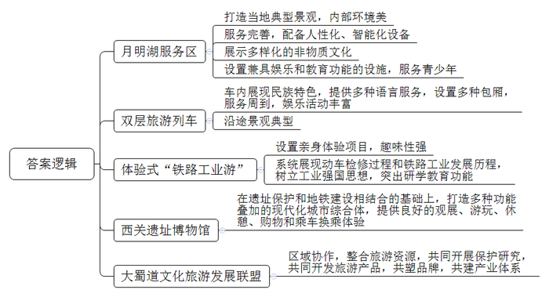
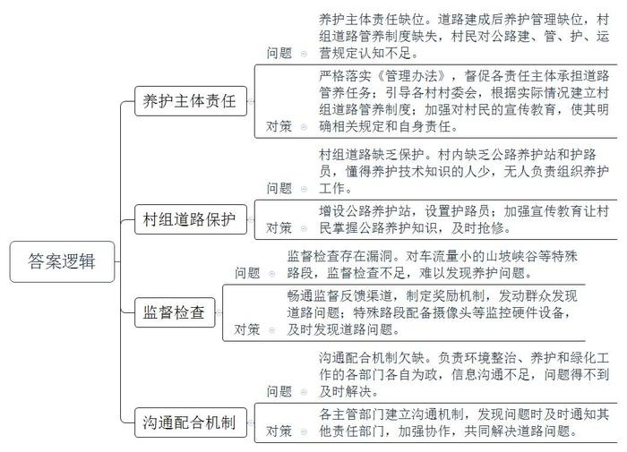
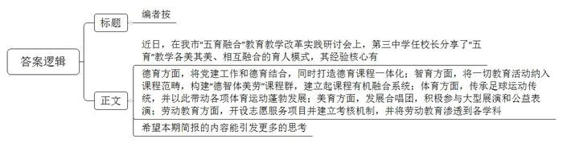
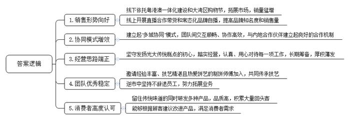
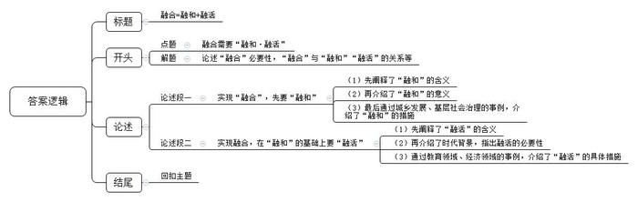

# 2022年国家公考《申论》题（地市级）

<!-- gwy:overview:start -->
> **国考 · 2022 · 申论 · 地市级** ｜ 5 题 · 图片 5 处 · 答案随题折叠

导航：[题目](#题目) · [材料 1](#材料-1)
<!-- gwy:overview:end -->

> 候选采集稿。参考答案及解析来自粉笔页面，不代表官方答案或真实高分答卷；来源使用许可与原卷对应关系仍需人工核实。

## 给定材料

### 材料 1

某高速公路的月明湖服务区，被网友誉为“最美园林文化服务区”。该服务区里有江南百年古桥，月明湖水流淌，桥廊相连，穿插亭台楼阁，耳边昆曲悠悠萦绕，一派“梦里水乡，诗画江南”的惬意生活图景。在服务区大厅入口，总服务台提供导览、ETC充值、交通旅游咨询等服务，主通道有智能指路机推荐最合理的行走路线，停车场里智慧停车系统引导车流，公厕配备新风系统、人流智能引导系统。服务区还展示了昆曲、评弹等传统艺术和苏绣、缂丝、宋锦、核雕等非遗技艺，以及月明湖大闸蟹特色饮食文化等。服务区还为青少年准备了集互动娱乐与科普教育于一体的科技体验馆、3D全息屏幕数码馆、海鲜机器人餐厅……这里，既是高速公路的驿站，也成为进入城市的“第一扇门”，彻底改变了游客对服务区的刻板印象，成功变身为旅游的“新景点”，甚至有人不惜绕路来此打卡。

在西南A市和B市两地，运行着一趟兼有VIP家庭包房、KTV和酒吧的双层旅游列车，夕发朝至，实现AB两城一线牵。这趟“网红列车”，车内装饰颇具民族特色，如彝族手工绣饰的坐垫、白族手工扎染的桌布、布依族蜡染式样的窗帘等；列车途经多个少数民族聚居地和著名景点，乘务员们身着沿途各民族服饰并熟练掌握普通话、英语、少数民族语言和简单手语。列车提供硬卧、软卧和VIP家庭包房供旅客选择，餐车提供当地特色美食，可以线上点餐、送餐到包厢。酒吧车厢可欣赏歌舞表演，或进行自助K歌、弹钢琴、打手鼓等活动。“我喜欢选择这种火车游，很享受坐着火车慢慢体验车内车外独特风景的过程。”乘客王女士开心地说。

H车辆段动车所是H铁路局的动车组检修站，专门针对动车组列车进行检查、测试、维修和养护等作业，是动车组列车返回后的“休整”之地，被形象地称为“动车之家”。今年，H铁路局推出了体验式“铁路工业游”。这让15岁的火车迷小明兴奋不已。“真是太棒了！当了一回动车司机！我亲身体验动车模拟驾驶，还学习了如何给动车刹车、加速呢！”一天的研学旅游中，他走进酷似“陆地航母”的动车停车场，感受了那一列列动车完成检修、蓄势待发的气势；参观“106广场”，了解了中国火车从普通轨道时代到高铁时代所经历的106年发展历程；游历“动车检修大库”，近距离观察了动车检修的全过程；触摸“机车长廊”上整排的火车机车，就像慢慢翻阅着一部不断更迭的中国火车发展史。此次游历，也让工业强国的种子在他心中深深地扎下了根。

“地铁站里还有博物馆？这也太牛了吧！”正用手机翻阅本地新闻的朱先生对妻子说，“周末我们也带孩子去那儿体验下呗，地铁公交都很方便。”朱先生所说的“地铁站里的博物馆”，正是C市刚建成开放的运济古城西关遗址博物馆。2015年，C市在修建地铁3号线过程中发现了明清时期运济古城的西关城门城墙遗址。为了保护西关遗址，经过多轮研究设计，相关部门最后决定变更设计方案：将整个近3万多平方米的场地，打造成一个集主题公园、遗迹展示、交通集散、城市商圈等多种功能叠加的现代化城市综合体。地面一层是西关遗址公园文化广场，有大片绿地和健身步道，下沉的景观台阶和天窗便于欣赏遗迹风貌。地下一层是遗址博物馆展厅，有2.5万多平方米核心展示空间，以青砖、土墙为主复原了西关城门城墙的环境风貌。地下二层是地铁换乘中心，有一个宽敞的中庭集散大厅，地铁3号线、5号线以及远期的16号线在此换乘，各线出入站的人流互不交叉，高峰时期站台也畅通无阻。此外，地铁通道各出口直接连通周边的大型购物广场、步行街、美食城及酒店，为市民游客提供良好的观展、游玩、休憩、购物和乘车换乘体验。

为了在新时代共同弘扬大蜀道“活态”的交通历史文化线路遗产的当代价值，2020年9月28日在G市第十届大蜀道文化旅游节上，“大蜀道文化旅游发展联盟”正式成立，30个市县区成员加入联盟。联盟内的蜀道旅游资源十分丰富，如被称为“中国交通历史博物馆”的明月峡，集“先秦古栈道、金牛驿道、嘉陵江水道、纤夫道、宝成铁道、108国道”古今六道于一峡中；蜀道翠云廊段，两侧耸立的古柏雄伟苍劲，已历经两千多年的寒暑风霜；“一夫当关，万夫莫开”的剑门关，身临其境依然能感受到剑阁崔嵬、蜀道之难。蜀道既是巴蜀与关中、中原在漫长历史时期联系与交往的交通线路，也是多种文化交流融合的文化线路。为此，联盟各成员约定本着“沟通、协作、务实、共赢”的原则，结合区域发展、环境保护、交通运输、餐饮服务，共同开展保护研究，共同开发徒步观光、蜀道自驾、文化体验等旅游产品，在此基础上共塑旅游品牌，共建产业体系，共同打造大蜀道国际旅游目的地。

### 材料 2

2021年8月28日，H市北溪县召开了农村公路提升工程动员会。

会上，王副县长指出，农村公路是按照公路工程技术标准修建的县道、乡道、村道及其所属设施，建设好、管理好、养护好、运营好农村公路，是建设人民满意交通的基础性工作，也是城乡一体化融合发展的重要保障。今后三年，全县将以农村公路提升工程为契机，在保证农村公路通达性、快捷性的基础上更加重视其景观性、服务配套性建设，要将农村公路风景廊道建设与农村环境治理、“美丽乡村”建设紧密结合起来，打造自然景观与人文景观和谐交融的农村公路，为全县乡村振兴和农业农村现代化建设注入澎湃动力。

2020年底，北溪全县基本实现了县到乡、乡到行政村、行政村到村民小组100%通水泥路的目标。为了准确掌握全县农村公路建、管、护、运营的实际情况，制定出切实可行的农村公路提升工作方案，由县交通运输局、财政局、农业农村局、乡村振兴局等组成的联合调研组，于2021年9月开始对全县乡镇的农村公路进行了为期一个月的实地调研。

按照《北溪县农村公路建设和养护管理办法》规定，县人民政府是农村公路发展的责任主体，负责本行政区域内农村公路规划、建设、管理、养护、运营工作。乡（镇）人民政府是乡道建设和养护管理的主体，乡（镇）交管办公室具体承担乡道的日常养护和组织实施乡、村道大中修工程。村民委员会是村道建设和养护管理的主体，村民委员会按照村民自愿、民主决策、一事一议的方式组织村道建设和日常养护管理，维护村道的路容路貌，制止村道的占道、破坏行为。村组的道路，其建设和养护管理主体为受益的村民小组。调研组在现场调查和走访中发现，全县已彻底解决了多年来农村行路难问题，畅通的农村道路让群众出行和农产品外运更加便捷，有效带动特色种养、客货运输、乡村旅游等产业，促进了农民增收致富。不过，农村公路养护管理中也还存在一些明显短板。如部分乡道、村道的道路硬化通车后，相关部门就不养不管、好坏不问了；部分村委会没有建立相应的村组道路管养制度，而村民也对农村公路建、管、护、运营规定知之甚少。在三里坡村，调研组就村民参与村组道路管养情况进行了入户走访。面对调研组的询问，村东头的老王诧异地说：“公路管养不是乡政府的事吗？跟我有啥子关系嘛。”

“我们乡每年汛期山洪、泥石流造成的道路塌方、下陷、掏空、堵塞得不到及时抢修，致使乡村道路损坏严重，后期修复费用很高。”东七乡的吴乡长向调研组介绍说，“目前村里大都没有公路养护站和护路员，懂得公路养护技术知识的人也少。因此，没有人负责组织公路日常养护工作，村组道路路产路权缺乏保护。”

调研组在山南乡走访时发现，修筑于山坡峡谷之间的村道山高坡陡，临水临崖路段防护栏老化，弯道处标识牌模糊不清，塌方路段也无警戒线以及其他保护措施等。“村级公路养护监督检查确有诸多漏洞。一些山坡峡谷路段，车流量小，如果没有群众反映，我们很难发现道路养护上出现的问题。目前，我们正在研究加强监督检查的措施。”山南乡党委洪书记解释道。

随着国家农村公路通达工程不断深入，农村客运站、招呼站和快递点越来越多，基本建成了覆盖县、乡（镇）、村（社区）三级的农村客运物流网络，方便群众生产生活。不过，调研组发现，由于缺乏有效的沟通配合机制，有些乡镇与村组道路的环境整治、养护和绿化，即使发现了问题也是“各人自扫门前雪”，得不到及时解决。如清溪中学门前因交通事故导致道路护栏、绿化带损毁严重，交管部门接到通知后，护栏及时得到了更换，绿化带却长时间无人修复；清溪河附近道路警示桩随意堆放路边、大量生活垃圾无人收运处理，给群众出行带来安全隐患，环保部门接到投诉后及时对垃圾进行了清理，警示桩却无人过问……

### 材料 3

2021年9月10日，F市教育局、市基础教育改革与发展研究中心召开全市“五育融合”教育教学改革实践研讨会。F市第三中学任校长在会上做了经验分享，以下是其发言内容：

中共中央、国务院印发的《中国教育现代化2035》提出，要更加注重全面发展，大力发展素质教育，促进德育、智育、体育、美育和劳动教育的有机融合。“五育”分别承载着自身的育人目标和价值，在各司其职的基础上走向融合，达到彼此渗透、创新融活，共同促进学生的全面发展、整体发展、个性发展。

经过多年的教育改革和创新实践，我校确实取得了一些办学成绩，也获得较高的社会荣誉，被批准为省教育科研基地学校、全国首批普通高中课程改革基地学校、全国首批示范性高中建设学校、国家级体育传统项目学校等。在学校的发展过程中，我们始终根植于学校原有历史传统的沃土，进行大胆创新探索，形成了“五育”教学各美其美、相互融合的育人模式。

一直以来，我校将党建工作和德育有机结合，党员教师在思想和教育工作上始终发挥着模范引领作用。与此同时，我们又大力打造德育课程一体化：德育智慧课程，包括思想政治课程、家国情怀和责任培养课程，保证教学质量和育人效果的融通；德育情感课程，包括感恩教育、传统文化等方面的课程，培养学生高尚情操和文化认同，让其情动而辞发；德育意识课程，包括遵纪守法、规范养成、生命教育等类型的课程，由内而外增加德育的效果；德育行动课程，包括身心健康、艺术审美、创意社团等方面的课程，构建起浸润渗透性德育课程，形成综合育人、多元育人、特色育人的模式。

课程是落实教育内容、完成培养目标的重要载体。我校大力加强课程教学模式的研究，坚持教学相长，注重启发式、互动式、探究式教学，鼓励学生多动手、多动口、多动脑，发挥学生的主观能动性，促进学生认知的发展。在我们学校，课程内的学习不仅仅是启发学生智力、增长学科知识的主要手段，学校的一切教育活动均被纳入了课程的范畴。我们将课程对标“德智体美劳”总体育人目标和各学科课程标准，构建“德智体美劳”五大类课程群，将每个教学单元打造成育人单元，将教学目标、教学内容、教学过程、教学资源以及课程评价等相关工作紧密结合，建立起教师发展带领学生发展、学校发展的课程有机融合系统，这也让我校的“五育”融合教育改革和教学实践充满着不竭动能与活力。

自学校创办时，我校便组建了足球队，成为我国最早开展校园足球运动的学校之一。这一传统至今从未间断，足球已植根于每个三中人的心中，成为最重要、最独特的校园文化印记，形成了特色，且赢得了无数奖杯。在三中，足球的传承超越时空和年龄限制，即使是80岁的老校友也可以回校踢一脚，与年轻学子一起感受足球的魅力。在我们学校，足球教育带动了各项体育运动的蓬勃发展。虽然不是每个走上运动场的学生都能成为体育明星，但是从小接受体育精神的熏陶，积极参与体育锻炼，能使他们拥有团结勇敢、坚忍不拔的优良品质，成为身心两健的未来社会建设者。

让音乐在校园中流淌，让美与人在校园里相遇、相知。我校的学生合唱团历史悠久，多次登上大赛领奖台，已成为学校的一张靓丽名片。近年来，我校合唱团多次受邀参加国家级大型活动展演，走进社区、敬老院进行公益表演，不但传播了艺术之美，还实现了超越音乐本身的价值。我们组织了高强度的训练来培养他们，同时引导他们学习处理学业和合唱训练的双重任务和压力。大家既锻造出了刚毅坚强的品格，也培养出了同舟共济的团队精神。

劳动教育是从志愿服务开始的。志愿服务项目是我校“五育”融合育人模式的重要载体，它让德智体美劳在实践中贯通融合为一体。为此，我们建立了学生志愿服务考核机制，让“学习雷锋、奉献他人、提升自己”的志愿服务理念真正落地。全国足球赛事志愿者、洁净沙滩志愿者、春运志愿者、海岛游览区志愿者等等，都是三中学生的社会角色。同时，我们将劳动教育渗透到各学科之中，从学科实践入手，劳动与技术通过专业教师的指导渗透到学科教学之中。如组织学生到博物馆提供义务讲解，既传播了优秀传统文化，也增强了学生社会责任感和实践能力；成立文化小使者服务队，制作文创产品，将美术、物理、化学、文学、历史等学科知识引入到劳动之中，沉浸式培养了学生的兴趣爱好、审美情趣和个性特长，使之成为具有社会使命感和专业精神的社会服务者。

### 材料 4

“卖空了，卖空了，都来不及补货了！”M食品公司创始人黄总兴奋地说。原来，在首届“粤港澳大湾区购物节”期间，公司准备的近10万盒月饼，短短10天就被抢购一空。

首届“粤港澳大湾区购物节”，将粤港澳三地的优质商品置于一个购物场景中，让大湾区街坊最爱的系列品牌和老字号，借着购物节的东风拓展更大的市场，体现了湾区经济创新融合的活力。

随着粤港澳一体化融合，越来越多的湾区品牌也步入“多城协同”的发展模式。“我们虽然把研发团队和工厂设在香港，将电商团队、直播团队和物流仓库放在深圳，但是各团队之间已经形成了交互顺畅、协作高效的工作模式，与内地合作伙伴如知名电商、百货公司、大型超市等建立了良好的合作机制。”黄总介绍说，去年起公司就与某直播间合作带货，场场火爆，品牌知名度和销售量大大提高，今年又在直播平台、大型电商平台建立起了常态化的品牌直播。“做店铺直播，可以让消费者直接观看产品的外观和馅料，避免货不对板的现象，增强与消费者的互动交流，建立信任。相比去年，今年月饼销量同比增长了40%~50%。”

其实，M公司成立仅有4年。“在国外读书的时候，能吃到很多做工精致又美味的西式点心，但始终心心念念的中式糕点却难寻踪影。”从那时起，将中华传统糕点发扬光大的种子就深深埋在了黄总的心里。2012年，黄总辞去某酒店高管职务，开始创业。“新品牌从零开始，想要闯出名堂，就只能踏踏实实做质量、做味道。无论机器、厂房、食材、工艺流程等，每一项工作，都必须认认真真、用心对待，才能传承品质留住传统的味道。”基于这种思想，他前前后后筹备了近6年，直到2018年，公司才真正投入运营。

“馅料一定要控制好，因为如果太稠，它就不能流动；如果太稀，它就会流得只剩一个壳。只有慢慢流出来的才是最好的……”饼艺大师陈师傅一讲起月饼制作技艺总是滔滔不绝。创业初期，经过黄总多次邀请，陈师傅才加入了M公司。

“陈师傅曾是知名酒店的点心大师傅。他入行50多年来，研发出了各种风味、口感的月饼，用自己的双手为人们带来交口称赞的美味点心……而我是用两个字来打动他的，那就是‘传承’，因为陈师傅非常热爱饼艺，也很想将其技艺传承下去。”除陈师傅之外，还有一批具有精湛技艺的制饼师傅被黄总邀请加盟。他们齐心协力，留住传统味道，研发出多种产品，踏实用心经营，使这个新兴品牌成立才4年，就积累了不少回头客。“我们会根据顾客的建议调整口味，改进产品。”黄总说，去年月饼推出后，有不少顾客反映，希望减少含糖量、加重咸蛋黄的香味，师傅们于是竭力调整，口味改进后的月饼广受欢迎。

“我非常喜欢这个品牌的月饼，此前是托朋友从香港实体店买回来的，而现在只要从线上下单后，隔天就可以收到。”居住在中山市的美食博主小付介绍说，“这种月饼很受我们年轻人追捧，不用加热也可以感受到满满的流心，甜度适中，奶香味和咸蛋黄的香味融为一体，外皮也是十分细腻。不愧是连续三年获得世界食品质量评鉴大奖的品牌！”

“过去两年，虽然有疫情影响，但我们始终坚持不辞退员工，并想方设法在逆市中扩展业务，先后开了20多家分店，产品也获得了更多顾客的认同。”谈及未来，黄总说，“我对公司的发展前景充满信心。今后最根本的仍然是一心一意做好味道和质量，希望能将好吃的中华美食带给更多人。”

### 材料 5

Z城是一座县级小城，不靠海、不沿边、无矿产，新世纪前没有铁路，至今也没有通高铁。但是，如今的Z城，却是全国文明城市、国家农业产业化示范基地、全国农村一二三产业融合发展试点示范县，首批省级城乡融合发展试验区……究竟是什么让这座小城脱颖而出？

“一个‘融’字贯穿‘Z城模式’演绎发展的全过程。如今，Z城高质量发展，更要在‘融’字上下功夫。”Z城县委齐书记告诉记者，改革开放初期的Z城，农民面临着许多“一家一户办不了、办不好”的事情。为此，县政府引导各部门各单位牢固树立“农业发展我发展，我与农民共前行”的观念，为农村发展商品生产搞好服务，推动农村自然经济向商品经济转变。Z城围绕破除妨碍资金、土地、人才等城乡要素合理流动的机制障碍，出台支持意见，增强制度供给，引导工商资本下乡发挥“输血”功能，很快便形成了以种植、养殖为基础的两大产业链，建立起较高层次的大农业融合服务体系。从源头到终端、从田园到餐桌的全产业链体系不断创造新供给，三产交叉贯通融合又培育了新业态，这些最终都促进了农民增收。

2017年，从食品加工行业功成身退的老鲁，带着“榛”项目回到家乡Z城。他注册成立J公司，前后投资2.3亿元，将Z城南部2.1万亩的山岭薄地开发成绿油油的榛子梯田。公司采取“企业+合作社+基地+农户+深加工+仓储物流”的产业模式，带动周边村庄3000多家农户、6个专业合作社参与产业发展，人均年增收3.5万元。同时，老鲁的榛子又引回了“凤凰”，吸引了多名园林专业的博士、硕士前来从事榛苗繁育等技术工作。如今在Z城，像老鲁这样的开发项目还有很多。一大批工业资本深度反哺农业发展的项目，已在Z城落地开花。可以说，新型农村社区周边的现代农业产业园区和生态景区，都成了城乡要素共生共融的典范。随着城乡生产关系的改变，城乡社会生活也跟着改变，这片土地在城乡同频共振中焕发出了新活力。

## 题目

### 第 1 题

**“给定材料**1**”呈现了交通旅游融合发展的几个案例，请你谈谈这些案例各自体现出了哪些亮点。（15分）**

关联材料：材料 1

作答要求：

要求：全面、准确，有条理。不超过350字。

第 1 题 · 答案与解析

**参考答案（粉笔题库参考内容）**

1.月明湖服务区：打造当地典型景观，内部环境美；服务完善，配备人性化、智能化设备；展示多样化的非物质文化；设置兼具娱乐和教育功能的设施，服务青少年。

2.双层旅游列车：车内展现民族特色，提供多种语言服务，设置多种包厢，服务周到，娱乐活动丰富；沿途景观典型。

3.体验式“铁路工业游”：设置亲身体验项目，趣味性强；系统展现动车检修过程和铁路工业发展历程，树立工业强国思想，突出研学教育功能。

4.西关遗址博物馆：在遗址保护和地铁建设相结合的基础上，打造多种功能叠加的现代化城市综合体，提供良好的观展、游玩、休憩、购物和乘车换乘体验。

5.大蜀道文化旅游发展联盟：区域协作，整合旅游资源，共同开展保护研究，共同开发旅游产品，共塑品牌，共建产业体系。

**参考答案说明：**本参考答案从“月明湖服务区”“双层旅游列车”“体验式‘铁路工业游’”“西关遗址博物馆”“大蜀道文化旅游发展联盟”五个方面入手，对各交通旅游融合发展案例的亮点进行了分条撰写。各条答案要点之间在内容上是并列关系，没有交叉。

**解析**

**考点**：特点类

**来源**：2022年国家公考《申论》题（地市级）

> 粉笔申论页面对本题只提供「解析视频」入口，该入口是会员推广位，页面无视频地址与文字解析。

### 第 2 题

**请你根据****“给定资料**2**”调研组的调查走访情况，梳理出北溪县在农村公路养护管理工作中存在的主要问题，并提出解决问题的建议。（20分）**

关联材料：材料 2

作答要求：

要求：

（1）问题梳理全面、准确、有条理；

（2）所提建议与问题相对应，具体明确、切实可行；

（3）不超过450字。

第 2 题 · 答案与解析

**参考答案（粉笔题库参考内容）**

一、1.问题：养护主体责任缺位。道路建成后养护管理缺位，村组道路管养制度缺失，村民对公路建、管、护、运营规定认知不足。2.对策：严格落实《管理办法》，督促各责任主体承担道路管养任务；引导各村村委会，根据实际情况建立村组道路管养制度；加强对村民的宣传教育，使其明确相关规定和自身责任。

二、1.问题：村组道路缺乏保护。村内缺乏公路养护站和护路员，懂得养护技术知识的人少，无人负责组织养护工作。2.对策：增设公路养护站，设置护路员；加强宣传教育让村民掌握公路养护知识，及时抢修。

三、1.问题：监督检查存在漏洞。对车流量小的山坡峡谷等特殊路段，监督检查不足，难以发现养护问题。2.对策：畅通监督反馈渠道，制定奖励机制，发动群众发现道路问题；特殊路段配备摄像头等监控硬件设备，及时发现道路问题。

四、1.问题：沟通配合机制欠缺。负责环境整治、养护和绿化工作的各部门各自为政，信息沟通不足，问题得不到及时解决。2.对策：各主管部门建立沟通机制，发现问题时及时通知其他责任部门，加强协作，共同解决道路问题。

**参考答案说明：**答案从“养护主体责任缺位”“村组道路缺乏保护”“监督检查存在漏洞”“沟通配合机制欠缺”4个方面指出了北溪县农村公路管护存在的问题，并针对每一方面的问题给出了相应的对策。此外，形式方面，本答案做到了分类分条撰写，各条要点之间在内容上是并列关系，没有交叉。

**解析**

**考点**：提出对策类

**来源**：2022年国家公考《申论》题（地市级）

> 粉笔申论页面对本题只提供「解析视频」入口，该入口是会员推广位，页面无视频地址与文字解析。

### 第 3 题

**F市教育局准备根据“给定资料**3**”中任校长的发言稿编一期简报，推广第三中学“五育”融合育人的做法。请你为该简报撰写一则“编者按”。（15分）**

关联材料：材料 3

作答要求：

要求：全面、准确、简明扼要。不超过250字。

第 3 题 · 答案与解析

**参考答案（粉笔题库参考内容）**

编者按：近日，在我市“五育融合”教育教学改革实践研讨会上，第三中学任校长分享了“五育”教学各美其美、相互融合的育人模式，其经验核心有：德育方面，将党建工作和德育结合，同时打造德育课程一体化；智育方面，将一切教育活动纳入课程范畴，构建“德智体美劳”课程群，建立起课程有机融合系统；体育方面，传承足球运动传统，并以此带动各项体育运动蓬勃发展；美育方面，发展合唱团，积极参与大型展演和公益表演；劳动教育方面，开设志愿服务项目并建立考核机制，并将劳动教育渗透到各学科。希望本期简报的内容能引发更多的思考。

**参考答案说明：**（1）本题按照编者按的一般要求，写到了标题和正文。（2）正文部分，一方面介绍了本次发言的背景内容；另一方面分别从“德育”“智育”“体育”“美育”“劳动教育”五个方面介绍具体做法；最后进行总结。（3）从形式来看，本参考答案做到了分条撰写，整体上条理较为清晰。

**解析**

**考点**：总结类

**来源**：2022年国家公考《申论》题（地市级）

> 粉笔申论页面对本题只提供「解析视频」入口，该入口是会员推广位，页面无视频地址与文字解析。

### 第 4 题

**“给定资料**4**”中M公司的黄总对公司的发展前景充满信心，你认为他为什么有这样的信心？（15分）**

关联材料：材料 4

作答要求：

要求：分析全面，条理清晰。不超过350字。

第 4 题 · 答案与解析

**参考答案（粉笔题库参考内容）**

1.销售形势向好。线下依托粤港澳一体化建设和大湾区购物节，拓展市场，销量猛增；线上开展直播合作带货和常态化品牌自播，提高品牌知名度和销售量。

2.协同模式增效。建立起“多城协同”模式，团队间交互顺畅、协作高效，与内地合作伙伴建立起良好的合作机制。

3.经营思路端正。坚守发扬光大传统糕点的初心，踏实经营，认真、用心对待每一项工作，长期筹备，厚积薄发。

4.团队优秀稳定。邀请经验丰富、技艺精湛且热爱饼艺的制饼师傅加入，共同传承技艺；逆市中坚持不辞退员工，努力拓展业务。

5.消费者高度认可。留住传统味道的同时研发多种产品，品质高，积累大量回头客；能够根据顾客建议改进产品，满足消费者需求。

**参考答案说明：**本参考答案从“销售形势向好”“协同模式增效”“经营思路端正”“团队优秀稳定”“消费者高度认可”五个方面阐释了原因，进行了分类、分条撰写。各条要点彼此独立、没有交叉。

**解析**

**考点**：原因类

**来源**：2022年国家公考《申论》题（地市级）

> 粉笔申论页面对本题只提供「解析视频」入口，该入口是会员推广位，页面无视频地址与文字解析。

### 第 5 题

**万物在融合中发展变化，融合不是简单嫁接，而是要实现融和与融活。请你以****“融和·融活”为话题，参考给定资料，联系实际，自选角度，自拟题目，写一篇文章。（35分）**

关联材料：材料 1、材料 2、材料 3、材料 4、材料 5

作答要求：

要求：

（1）观点明确，见解深刻；

（2）参考给定资料，但不拘泥于给定资料；

（3）思路清晰，语言流畅；

（4）字数1000~1200字。

第 5 题 · 答案与解析

**参考答案（粉笔题库参考内容）**

**融合****\=****融和****+****融活**

马克思主义辩证法告诉我们，事物之间是普遍联系、相互作用的。**若事物间的联系不断加深，就会产生****“融合”的状态。**可以说，“融合”就是我们这个世界的一种基本特性，它无处不在，不可回避，不可抗拒，它是事物发展的必然，是发展到更深层次的证明，更是发展的动力。

纵观当下社会各领域的发展，无处不体现着“融合”的概念，也在融合中获得了源源不断的力量——产业融合、城乡融合、区域融合……甚至全球也在进行融合，“一带一路”的战略就是在这样的背景和趋势下产生，并又推动了全球的融合。正是借力于融合，我们的社会，才实现了更为深刻、有效、高速的发展。**然而，真正的融合发展，不是简单肤浅的要素堆砌或胡乱拼凑，它需要通过“融和”来实现相融互通，合和共生；也不仅仅是合众为一、抱团取暖，它更需要通过“融活”来激发内生动力，迸发创新活力。**

**实现****“融合”，先要“融和”。所谓“融和”，即要了解各主体、各要素的固有属性，明确其优势与不足，让彼此资源共享、功能互补，切实做到有机结合，在彼此嫁接中达到融洽和谐的状态。俗话说：“单丝不成线，独木不成林。”唯有“融和”，才能互鉴共进，向上生长。**例如，面对城乡发展，我们既要打通资源，让城乡之间资金、土地、人才等要素合理流动、平等交换；也要结合一二三产业各自的优势，优化资源配置，促使其相互渗透，进而提升经济发展速度。面对复杂的基层社会治理形势，我们既要密切加强部门与部门联动、上下协同治理；也要发挥群众自治作用，干群携手与共，进而提升治理效能。

因此，“融和”是实现有效融合的前提条件和必要手段，但融合的评价标准和终极目标，并不仅仅是“融和”，而是要在“融和”的基础之上，实现内源性的自我运转，最终达成“融活”。

**实现融合，在****“融和”的基础上要“融活”。****所谓****“融活”****，即不能过于依赖外部资源投入，而是要****融中求新****，从依赖****“输血”到****自主****“造血”****，从凝聚合力到****激发活力****，不断****灵活变通****，****自我更新****，实现****可持续发展****。**当今时代，万物互联、唯变不变。如何在合作中寻求自我变革，实现创造性转化、创新性发展——是“融活”的应有之意。例如在教育领域，我们在根植于原有历史传统的沃土时，也要通过创新课程教学模式、打造特色校园文化等，促使“五育”教学相互融合盘活。在经济领域，我们在继承传统，拥抱新技术时，也要投入人力、财力，不断研发新产品，提供新服务，培育新业态，如此方能满足新需求，实现传统产业转型升级。

“问渠那得清如许？为有源头活水来。”融合发展只有进行时，没有完成时，我们要理解好融合发展的要义，将“融和”与“融活”做精做细，就一定能顶住压力、冲破阻力，实现高质量的融合！

**范文分析：**

**融合****\=****融和****+****融活**

【**标题的优点：**标题中含有主题词，使文章主题突出、清晰。此外，标题在形式上采用借用算数公式的写法，颇有特色与亮点。】

（1）马克思主义辩证法告诉我们，事物之间是普遍联系、相互作用的。**若事物间的联系不断加深****，****就会产生****“融合”的状态****。**可以说，“融合”就是我们这个世界的一种基本特性，它无处不在，不可回避，不可抗拒，它是事物发展的必然，是发展到更深层次的证明，更是发展的动力。

（2）纵观当下社会各领域的发展，无处不体现着“融合”的概念，也在融合中获得了源源不断的力量——产业融合、城乡融合、区域融合……甚至全球也在进行融合，“一带一路”的战略就是在这样的背景和趋势下产生，并又推动了全球的融合。正是借力于融合，我们的社会，才实现了更为深刻、有效、高速的发展。（3）**然而，****真正的融合发展****，****不是简单肤浅的要素堆砌或胡乱拼凑****，它****需要通过****“融和”来实现相融互通****，****合和共生****；****也不仅仅是合众为一、抱团取暖****，它更****需要通过****“融活”来激发内生动力****，****迸发创新活力****。**

【**开头的优点：**★内容方面。范文的开头是紧扣题目给定的“融合需要‘融和·融活’”这一主题展开的。首先，通过马克思主义辩证法说明事物之间存在“融合”的关系；其次，概述了当前社会各个领域中的“融合”，并阐述了其重要意义；最后，由“融合”引申出它的两个必要条件，即“融和与融活”。★文字表达方面。使用了“然而”“也”等连接词，使语言表达具有逻辑性。】

**实现****“融合”，先要“融和”。**（1）**所谓****“融和”****，****即要了解各主体、各要素的固有属性****，****明确其优势与不足****，****让彼此资源共享、功能互补****，****切实做到有机结合****，****在彼此嫁接中达到融洽和谐的状态****。俗话说：****“单丝不成线，独木不成林。”****（****2****）****唯有****“融和”****，****才能互鉴共进****，****向上生长****。**（3）例如，面对城乡发展，我们既要打通资源，让城乡之间资金、土地、人才等要素合理流动、平等交换；也要结合一二三产业各自的优势，优化资源配置，促使其相互渗透，进而提升经济发展速度。面对复杂的基层社会治理形势，我们既要密切加强部门与部门联动、上下协同治理；也要发挥群众自治作用，干群携手与共，进而提升治理效能。

【**论述段****1的优点：**★观点句：范文的观点句是紧扣“融合需要‘融和·融活’”这一文章主题提出的。形式上，它在段首处直接写出，位置突出，容易发现。内容上，关键词突出，内容要点明确，可以明显看出主要论述“融合需要融和”。★论述内容：（1）先阐释了“融和”的含义；（2）再介绍了“融和”的意义；（3）最后通过城乡发展、基层社会治理的事例，介绍了“融和”的措施。注意：以上几个方面的内容都是紧扣“实现‘融合’，先要‘融和’”这个观点句进行分析论述的，论述的针对性强，内容层次丰富。在论述方法上主要采用了讲道理、举例子相结合的方式，论述清晰透彻、通俗易懂。】

因此，“融和”是实现有效融合的前提条件和必要手段，但融合的评价标准和终极目标，并不仅仅是“融和”，而是要在“融和”的基础之上，实现内源性的自我运转，最终达成“融活”。

【**过渡段的优点：**范文的过渡段既是对上文的总结，也是对下文的引导，起到了承前启后的过渡作用。】

**实现融合，在****“融和”的基础上要“融活”。**（1）**所谓****“融活”****，即****不能过于依赖外部资源投入****，****而是要融中求新****，****从依赖****“输血”到自主“造血”****，****从凝聚合力到激发活力****，****不断灵活变通****，****自我更新****，****实现可持续发展****。**（2）当今时代，万物互联、唯变不变。（3）如何在合作中寻求自我变革，实现创造性转化、创新性发展——是“融活”的应有之意。例如在教育领域，我们在根植于原有历史传统的沃土时，也要通过创新课程教学模式、打造特色校园文化等，促使“五育”教学相互融合盘活。在经济领域，我们在继承传统，拥抱新技术时，也要投入人力、财力，不断研发新产品，提供新服务，培育新业态，如此方能满足新需求，实现传统产业转型升级。

【**论述段****2的优点：**★观点句：范文的观点句是紧扣“融合需要‘融和·融活’”这一文章主题提出的。形式上，它在段首处直接写出，位置突出，容易发现。内容上，关键词突出，内容要点明确，可以明显看出主要论述“融合需要融活”。★论述内容：（1）先阐释了“融活”的含义；（2）再介绍了时代背景，指出融活的必要性；（3）通过教育领域、经济领域的事例，介绍了“融活”的具体措施。注意：以上几个方面的内容都是紧扣“实现融合，在‘融和’的基础上要‘融活’”这个观点句进行分析论述的，论述的针对性强，内容层次丰富。在论述方法上主要采用了讲道理的方式，论述清晰透彻。】

“问渠那得清如许？为有源头活水来。”融合发展只有进行时，没有完成时，我们要理解好融合发展的要义，将“融和”与“融活”做精做细，就一定能顶住压力、冲破阻力，实现高质量的融合！

【**结尾的优点：**范文的结尾回扣了“融合需要‘融和·融活’”这个主题，并且进行了总结提升。】

**解析**

**考点**：文章写作题

**来源**：2022年国家公考《申论》题（地市级）

> 粉笔申论页面对本题只提供「解析视频」入口，该入口是会员推广位，页面无视频地址与文字解析。

