# 2022年国家公务员录用考试《行测》题（副省级网友回忆版）

<!-- gwy:overview:start -->
> **国考 · 2022 · 行测 · 副省级** ｜ 135 题 · 图片 134 处 · 答案随题折叠

| 题型模块 | 题量 | 题号 |
| --- | ---: | ---: |
| 常识判断 | 20 | 1–20 |
| 言语理解与表达 | 40 | 21–60 |
| 数量关系 | 15 | 61–75 |
| 判断推理 | 40 | 76–115 |
| 资料分析 | 20 | 116–135 |
| **合计** | **135** | |

导航：[题型与作答说明](#题型与作答说明) · [题目](#题目) · [材料 1](#材料-1)
<!-- gwy:overview:end -->

> 候选采集稿。参考答案及解析来自粉笔页面，不代表官方答案或真实高分答卷；来源使用许可与原卷对应关系仍需人工核实。

## 题型与作答说明

常识判断

（20题）

根据题目要求，在四个选项中选出一个最恰当的答案。

言语理解与表达

（40题）

本部分包括表达与理解两方面的内容。请根据题目要求，在四个选项中选出一个最恰当的答案。

数量关系

（15题）

在这部分试题中，每道题呈现一段表述数字关系的文字，要求你迅速、准确地计算出答案。

判断推理

（40题）

本部分包括图形推理、定义判断、类比推理与逻辑判断四种类型的试题。

资料分析

（20题）

所给出的图、表、文字或综合性资料均有若干个问题要你回答。你应根据资料提供的信息进行分析、比较、计算和判断处理。

## 题目

### 第 1 题

习近平总书记在庆祝中国共产党成立100周年大会上的讲话指出，中国共产党团结带领中国人民，浴血奋战、百折不挠，创造了新民主主义革命的伟大成就。以下属于新民主主义革命的伟大成就的是：

①彻底消灭了在中国延续几千年的封建剥削压迫制度

②彻底结束了旧中国半殖民地半封建社会的历史

③彻底结束了旧中国一盘散沙的局面

④彻底废除了列强强加给中国的不平等条约和帝国主义在中国的一切特权

A. ①②③

B. ①②④

C. ①③④

D. ②③④

第 1 题 · 答案与解析

**参考答案（粉笔题库参考内容）**

D

**解析**

本题考查政治常识。

②③④正确，①错误，习近平总书记在庆祝中国共产党成立100周年大会上的讲话中提到：“新民主主义革命的胜利，彻底结束了旧中国半殖民地半封建社会的历史，彻底结束了旧中国一盘散沙的局面，彻底废除了列强强加给中国的不平等条约和帝国主义在中国的一切特权，为实现中华民族伟大复兴创造了根本社会条件。”三大改造的完成是我国封建剥削压迫制度被消灭的标志。

故正确答案为D。

**考点**：新思想总论、重要会议讲话

**来源**：2022年国家公务员录用考试《行测》题（副省级网友回忆版）第1题

### 第 2 题

“七一勋章”获得者都来自人民，植根人民，是立足本职、默默奉献的平凡英雄，他们的事迹可学可做，他们的精神可追可及。以下“七一勋章”获得者与其先进事迹表述对应正确的是：

A. 张桂梅——坚持志愿服务十余载，群众心中的“活雷锋”

B. 王兰花——点亮贫困山区女孩梦想的“校长妈妈”

C. 孙景坤——公而忘私，永葆革命本色的战斗功臣

D. 李宏塔——为国守海寸步不让，带领群众共同致富

第 2 题 · 答案与解析

**参考答案（粉笔题库参考内容）**

C

**解析**

本题考查政治常识。

A、B两项错误，张桂梅扎根贫困地区40余年，创办全国第一所全免费女子高中，帮助近2000名贫困山区女孩圆了大学梦，是点亮贫困山区女孩梦想的“校长妈妈”，先后荣获“全国脱贫攻坚楷模”“全国优秀共产党员”“全国先进工作者”等荣誉称号。王兰花，中共党员，她十多年如一日坚持志愿服务，带领“王兰花热心小组”先后为居民解决各类困难7000多件，调解各类民事纠纷600多起，开展公益活动7000多场次，推动宁夏吴忠市利通区的志愿者从最初7人发展到6.5万余人，是群众心中的“活雷锋”，先后荣获“全国三八红旗手标兵”“全国民族团结进步模范个人”等称号。

C项正确，孙景坤是永葆革命本色的战斗功臣，先后参加了四平、辽沈、平津、解放长沙、解放海南岛、抗美援朝等战役战争，荣立一等功一次、二等功多次，荣获“抗美援朝一级战士荣誉勋章”。退役后他回乡带领群众改变家乡面貌，是共产党员吃苦在前、公而忘私崇高品质的典范。

D项错误，李宏塔，安徽省政协原党组成员、副主席，第十一、十二届全国政协委员，他始终艰苦朴素、严于律己，在每个岗位上都践行党的根本宗旨，当好人民“勤务员”，树立了党员领导干部忠诚干净担当的典范。王书茂，中共党员，他先后参加多项国家重大涉海工作，在南海维权斗争中冲锋在前，不怕牺牲、寸步不让，坚决捍卫我国领海主权和海洋权益。此外他还带领群众造大船、闯深海，发展休闲渔业、建起海洋民宿，实现共同致富。荣获了“全国劳动模范”“改革先锋”等称号，是第十三届全国人大代表。

故正确答案为C。

**考点**：重要事件、其他建设

**来源**：2022年国家公务员录用考试《行测》题（副省级网友回忆版）第2题

### 第 3 题

进入新发展阶段，是中华民族伟大复兴历史进程的大跨越，以下关于新发展阶段的理解，正确的有几项？

①新发展阶段是中国共产党带领人民迎来从站起来、富起来到强起来历史性跨越的新阶段

②新发展阶段是基本实现社会主义现代化、全面建成小康社会的发展阶段

③新发展阶段是超越社会主义初级阶段、迈入社会主义更高阶段的发展阶段

④新发展阶段是实现第一个百年奋斗目标，向着第二个百年奋斗目标迈进的发展阶段

A. 1项

B. 2项

C. 3项

D. 4项

第 3 题 · 答案与解析

**参考答案（粉笔题库参考内容）**

B

**解析**

本题考查政治常识。

2021年1月11日，习近平总书记在省部级主要领导干部学习贯彻党的十九届五中全会精神专题研讨班上发表重要讲话。

①正确，讲话指出：“新发展阶段是我们党带领人民迎来从站起来、富起来到强起来历史性跨越的新阶段。”

②错误，④正确，讲话指出：“党的十九届五中全会提出，全面建成小康社会、实现第一个百年奋斗目标之后，我们要乘势而上开启全面建设社会主义现代化国家新征程、向第二个百年奋斗目标进军，这标志着我国进入了一个新发展阶段。”因此新发展阶段是全面建设社会主义现代化国家、向第二个百年奋斗目标进军的时代，而非全面建成小康社会的发展阶段。

③错误，讲话指出：“新发展阶段是社会主义初级阶段中的一个阶段，同时是其中经过几十年积累、站到了新的起点上的一个阶段。”因此新发展阶段并未超越社会主义初级阶段。

综上所述，正确的有①④，共2项。

故正确答案为B。

**考点**：经济建设、重要会议讲话

**来源**：2022年国家公务员录用考试《行测》题（副省级网友回忆版）第3题

### 第 4 题

粉笔暂未收录本题（来源缺题，题位保留）

第 4 题 · 答案与解析

**答案状态：unknown（来源未提供）**

**解析状态：unknown（来源未提供）**

### 第 5 题

2021年4月，在全党开展党史学习教育之际，习近平总书记在广西考察时强调：“学史增信，就是要增强信仰、信念、信心，这是我们战胜一切强敌、克服一切困难、夺取一切胜利的强大精神力量。”下列有关信仰和信念的名句，按出现的时间先后排序正确的是：

①试看将来的环球，必是赤旗的世界！

②砍头不要紧，只要主义真。

③敌人只能砍下我们的头颅，决不能动摇我们的信仰！因为我们信仰的主义，乃是宇宙的真理！

④为了免除下一代的苦难，我们愿——愿把这牢底坐穿！

A. ①②③④

B. ②①③④

C. ①②④③

D. ②①④③

第 5 题 · 答案与解析

**参考答案（粉笔题库参考内容）**

A

**解析**

本题考查人文常识。

①出自李大钊于1919年在《新青年》上发表的文章《布尔什维克主义的胜利》，介绍并赞扬了俄国十月革命。他预言到：“人道的警钟响了！自由的曙光出现了！试看将来的环球，必是赤旗的世界！”

②出自近代革命烈士夏明翰的诗歌《就义诗》，全诗为：“砍头不要紧，只要主义真。杀了夏明翰，还有后来人。”1928年初，中央调夏明翰到武汉参加湖北省委的领导工作，后遭到湖北的桂系军阀的搜捕，于1928年3月20日遇害，就义前写下此壮烈诗篇。

③出自近代革命烈士方志敏的散文《可爱的中国》。1935年，方志敏领导红十军团进行抗日活动时，被国民党抓捕入狱。狱中他不仅拒绝敌人的“优厚待遇”，还于5月2日写下了此文，以鼓励共产党员保持信念继续斗争。

④出自近代革命烈士何敬平的诗歌《把牢底坐穿》。1948年，何敬平被国民党关押在重庆渣滓洞集中营。为了鼓励大家继续斗争，保持信念，他在狱中写下此诗，传达了革命乐观主义精神和大无畏的英雄主义精神。

按出现的时间先后排序正确的是①②③④。

故正确答案为A。

**考点**：文学常识

**来源**：2022年国家公务员录用考试《行测》题（副省级网友回忆版）第5题

### 第 6 题

在中国共产党成立一百周年的重要时刻，我国脱贫攻坚战取得了全面胜利。下列与之相关的说法错误的是:

A. 现行标准下区域性整体贫困得到解决

B. “输血式”扶贫方针是中国特色减贫道路的鲜明特征

C. 锻造形成了“上下同心、尽锐出战、精准务实、开拓创新、攻坚克难、不负人民”的脱贫攻坚精神

D. 从集中资源支持脱贫攻坚转向巩固拓展脱贫攻坚成果和全面推进乡村振兴

第 6 题 · 答案与解析

**参考答案（粉笔题库参考内容）**

B

**解析**

本题考查政治常识。

A项正确，习近平总书记在全国脱贫攻坚总结表彰大会上的讲话中指出：“在迎来中国共产党成立一百周年的重要时刻，我国脱贫攻坚战取得了全面胜利，现行标准下9899万农村贫困人口全部脱贫，832个贫困县全部摘帽，12.8万个贫困村全部出列，区域性整体贫困得到解决，完成了消除绝对贫困的艰巨任务，创造了又一个彪炳史册的人间奇迹！”

B项错误，习近平总书记在全国脱贫攻坚总结表彰大会上的讲话中指出：“精准扶贫是打赢脱贫攻坚战的制胜法宝，开发式扶贫方针是中国特色减贫道路的鲜明特征。”

C项正确，习近平总书记在全国脱贫攻坚总结表彰大会上的讲话中指出：“伟大事业孕育伟大精神，伟大精神引领伟大事业。脱贫攻坚伟大斗争，锻造形成了‘上下同心、尽锐出战、精准务实、开拓创新、攻坚克难、不负人民’的脱贫攻坚精神。脱贫攻坚精神，是中国共产党性质宗旨、中国人民意志品质、中华民族精神的生动写照，是爱国主义、集体主义、社会主义思想的集中体现，是中国精神、中国价值、中国力量的充分彰显，赓续传承了伟大民族精神和时代精神。”

D项正确，《中共中央 国务院关于实现巩固拓展脱贫攻坚成果同乡村振兴有效衔接的意见》在“二、总体要求”中阐述基本思路和目标任务时指出：“脱贫攻坚目标任务完成后，设立5年过渡期。脱贫地区要根据形势变化，理清工作思路，做好过渡期内领导体制、工作体系、发展规划、政策举措、考核机制等有效衔接，从解决建档立卡贫困人口‘两不愁三保障’为重点转向实现乡村产业兴旺、生态宜居、乡风文明、治理有效、生活富裕，从集中资源支持脱贫攻坚转向巩固拓展脱贫攻坚成果和全面推进乡村振兴。”

本题为选非题，故正确答案为B。

**考点**：经济建设、重要会议讲话

**来源**：2022年国家公务员录用考试《行测》题（副省级网友回忆版）第6题

### 第 7 题

根据《中华人民共和国国民经济和社会发展第十四个五年规划和2035年远景目标纲要》，下列不属于“十四五”规划重要目标的是：

A. 保持制造业比重基本稳定，增强制造业竞争优势

B. 优化提升供给结构，促进农业、制造业、服务业、能源资源等产业协调发展

C. 健全农业支持保护制度，完善粮食主产区利益补偿机制

D. 关键核心技术实现重大突破，进入创新型国家前列

第 7 题 · 答案与解析

**参考答案（粉笔题库参考内容）**

D

**解析**

本题考查政治常识。

A项正确，《中华人民共和国国民经济和社会发展第十四个五年规划和2035年远景目标纲要》在第八章“深入实施制造强国战略”指出：“坚持自主可控、安全高效，推进产业基础高级化、产业链现代化，保持制造业比重基本稳定，增强制造业竞争优势，推动制造业高质量发展。”

B项正确，《中华人民共和国国民经济和社会发展第十四个五年规划和2035年远景目标纲要》在第十二章第一节“提升供给体系适配性”指出：“深化供给侧结构性改革，提高供给适应引领创造新需求能力。适应个性化、差异化、品质化消费需求，推动生产模式和产业组织方式创新，持续扩大优质消费品、中高端产品供给和教育、医疗、养老等服务供给，提升产品服务质量和客户满意度，推动供需协调匹配。优化提升供给结构，促进农业、制造业、服务业、能源资源等产业协调发展。”

C项正确，《中华人民共和国国民经济和社会发展第十四个五年规划和2035年远景目标纲要》第二十五章第二节“加强农业农村发展要素保障”指出：“健全农业农村投入保障制度，加大中央财政转移支付、土地出让收入、地方政府债券支持农业农村力度。健全农业支持保护制度，完善粮食主产区利益补偿机制，构建新型农业补贴政策体系，完善粮食最低收购价政策。”

D项错误，《中华人民共和国国民经济和社会发展第十四个五年规划和2035年远景目标纲要》在第三章第一节“2035年远景目标”指出：“展望2035年，我国将基本实现社会主义现代化。经济实力、科技实力、综合国力将大幅跃升，经济总量和城乡居民人均收入将再迈上新的大台阶，关键核心技术实现重大突破，进入创新型国家前列。”可知，“关键核心技术实现重大突破，进入创新型国家前列”是2035年远景目标，不属于“十四五”规划重要目标。

本题为选非题，故正确答案为D。

**考点**：经济建设、重要文件

**来源**：2022年国家公务员录用考试《行测》题（副省级网友回忆版）第7题

### 第 8 题

《中华人民共和国宪法》（1982年）实施以来，先后五次以修正案的形式进行了修改。下列宪法条款与宪法修正案对应正确的是：

A. 公民的合法的私有财产不受侵犯——1993年宪法修正案

B. 农村集体经济组织实行家庭承包经营为基础、统分结合的双层经营体制——2004年宪法修正案

C. 国家尊重和保障人权——1999年宪法修正案

D. 中国共产党领导是中国特色社会主义最本质的特征——2018年宪法修正案

第 8 题 · 答案与解析

**参考答案（粉笔题库参考内容）**

D

**解析**

本题考查法律常识。

A项错误，2004年宪法修正案将第十三条改为：公民的合法的私有财产不受侵犯。国家依照法律规定保护公民的私有财产权和继承权。国家为了公共利益的需要，可以依照法律规定对公民的私有财产实行征收或者征用并给予补偿。

B项错误，1999年宪法修正案将第八条第一款改为：农村集体经济组织实行家庭承包经营为基础、统分结合的双层经营体制······

C项错误，2004年宪法修正案将第三十三条改为：凡具有中华人民共和国国籍的人都是中华人民共和国公民。中华人民共和国公民在法律面前一律平等。国家尊重和保障人权。任何公民享有宪法和法律规定的权利，同时必须履行宪法和法律规定的义务。

D项正确，2018年宪法修正案将第一条改为：中华人民共和国是工人阶级领导的、以工农联盟为基础的人民民主专政的社会主义国家。社会主义制度是中华人民共和国的根本制度。中国共产党领导是中国特色社会主义最本质的特征。禁止任何组织或者个人破坏社会主义制度。

故正确答案为D。

**考点**：宪法

**来源**：2022年国家公务员录用考试《行测》题（副省级网友回忆版）第8题

### 第 9 题

根据《中华人民共和国公职人员政务处分法》，下列哪一处分不恰当？

A. 甲系某行政主管部门公务员，犯故意伤害罪被判处有期徒刑六个月，缓刑一年，被撤职

B. 乙系交通运输部门公务员，交通肇事犯罪情节轻微，检察机关对其作出不起诉决定，乙被撤职

C. 丙系某国有企业管理人员，犯盗窃罪被单处罚金，被撤职

D. 丁系某公办高校事业编管理人员，犯侵占罪但被免予刑事处罚，被撤职

第 9 题 · 答案与解析

**参考答案（粉笔题库参考内容）**

A

**解析**

本题考查法律常识。

根据《中华人民共和国公职人员政务处分法》第十四条规定：“公职人员犯罪，有下列情形之一的，予以开除：（一）因故意犯罪被判处管制、拘役或者有期徒刑以上刑罚（含宣告缓刑）的；（二）因过失犯罪被判处有期徒刑，刑期超过三年的；（三）因犯罪被单处或者并处剥夺政治权利的。因过失犯罪被判处管制、拘役或者三年以下有期徒刑的，一般应当予以开除；案件情况特殊，予以撤职更为适当的，可以不予开除，但是应当报请上一级机关批准。公职人员因犯罪被单处罚金，或者犯罪情节轻微，人民检察院依法作出不起诉决定或者人民法院依法免予刑事处罚的，予以撤职；造成不良影响的，予以开除。”

A项错误，甲因故意犯罪被判处有期徒刑以上，应予以开除，而非撤职。

B项正确，乙交通肇事犯罪情节轻微，检察院对其不起诉，予以撤职符合上述规定。

C项正确，丙犯盗窃罪被单处罚金，予以撤职符合上述规定。

D项正确，丁虽为故意犯罪，但人民法院依法免予刑事处罚，予以撤职符合上述规定。

本题为选非题，故正确答案为A。

**考点**：其他法律法规

**来源**：2022年国家公务员录用考试《行测》题（副省级网友回忆版）第9题

### 第 10 题

2021年4月27日，国务院常务会议上确定了知识产权领域“放管服”改革新举措。下列与之相关的说法错误的是：

A. 进一步压缩商标、专利审查周期，推行商标电子注册证

B. 提高知识产权质量，增加对商标和专利申请阶段的资助和奖励

C. 确保数据安全基础上，开放知识产权基础数据，助力企业研发创新

D. 加强知识产权全链条保护，依法打击违法违规代理和商标恶意注册行为

第 10 题 · 答案与解析

**参考答案（粉笔题库参考内容）**

B

**解析**

本题考查政治常识。

2021年4月27日，国务院总理李克强主持召开国务院常务会议，部署加强县域商业体系建设，促进流通畅通和农民收入、农村消费双提升；确定知识产权领域“放管服”改革新举措，更大便利创业创新，激发市场主体创造活力；部署做好“五一”假期疫情防控和安全生产等工作。会议指出，要持续深化知识产权领域“放管服”改革，更大激发创新动力和活力。

A项正确，会议确定，进一步压缩商标、专利审查周期。今年底前将一般情形商标注册周期由8个月压缩至7个月。推进专利优先审查和质押登记电子申请全程网办，推行商标电子注册证和专利电子证书，明显压缩发明专利和电子申请的商标变更续展审查周期。在商标和专利质押登记、专业代理机构执业许可等审批中推行告知承诺制。

B项错误，会议确定，促进提高知识产权质量。纠正片面追求数量的倾向，不得直接将专利申请、授权数量作为享受奖励或资质资格评定政策的主要条件，全面取消对商标和专利申请阶段的资助和奖励，着力营造潜心研究氛围，促进多出基础性、原创性成果。

C项正确，会议确定，在确保数据安全基础上，开放知识产权基础数据，助力企业研发创新。

D项正确，会议确定，加强知识产权全链条保护，依法打击违法违规代理和商标恶意注册、非正常专利申请行为。

本题为选非题，故正确答案为B。

**考点**：经济建设

**来源**：2022年国家公务员录用考试《行测》题（副省级网友回忆版）第10题

### 第 11 题

下列毛泽东诗词与创作背景对应正确的是：

A. 金沙水拍云崖暖，大渡桥横铁索寒——1930年第一次反“围剿”

B. 宜将剩勇追穷寇，不可沽名学霸王——1949年解放南京

C. 军叫工农革命，旗号镰刀斧头。匡庐一带不停留，要向潇湘直进——1948年淮海战役

D. 三十八年过去，弹指一挥间。可上九天揽月，可下五洋捉鳖，谈笑凯歌还——1941年延安整风运动

第 11 题 · 答案与解析

**参考答案（粉笔题库参考内容）**

B

**解析**

本题考查人文常识。

A项错误，诗句出自毛泽东同志1935年创作的《七律·长征》。1934年第五次反“围剿”失败，中国共产党被迫进行战略转移，红军开始了二万五千里长征。在1935年10月长征即将胜利时，毛主席心潮澎湃写下了《七律·长征》一诗，回顾了长征的过程。其中“金沙水拍云崖暖，大渡桥横铁索寒”反映的是长征途中红军巧渡金沙江、强渡大渡河、飞夺泸定桥的历史事件。

B项正确，诗句出自毛泽东同志1949年创作的《七律·人民解放军占领南京》。1949年4月20日，全面内战已进入尾声，国民党军队全线溃败，拒绝在和平协定上签字。4月21日，毛泽东和朱德发出《向全国进军的命令》，号令全军坚决、彻底、干净、全部地歼灭中国境内一切敢于抵抗的国民党反动派，解放全中国。当夜，中国人民解放军百万雄师在东起江苏江阴、西至江西湖口的一千余里的战线上分三路强渡长江。23日晚，东路陈毅的第三野战军占领南京。毛泽东听到这个消息后欢欣鼓舞，写下了这首诗。

C项错误，该句词出自毛泽东同志1927年创作的《西江月·秋收起义》。1927年9月，毛主席以中央特派员的身份，回到湘赣边界领导了秋收起义。起义后几天，当时革命正处在异常艰苦的关头，毛主席激情满怀地写下了《西江月·秋收起义》一词。“军叫工农革命，旗号镰刀斧头。匡庐一带不停留，要向潇湘直进”是词作上阙部分，描写了起义军声势浩大的局面，体现了工农革命军的坚决态度。

D项错误，该句词出自毛泽东同志1965年创作的《水调歌头·重上井冈山》。1965年5月，毛主席重上井冈山，回顾自1927年上井冈山开辟工农武装割据道路起，中国的革命历程，他感慨良多，写下了《水调歌头·重上井冈山》一词。他希望的“可上九天揽月，可下五洋捉鳖”如今都已实现，即奋斗者号潜入马里亚纳海沟探寻深度和生物，嫦娥五号顺利从月球带回样品。

故正确答案为B。

**考点**：文学常识

**来源**：2022年国家公务员录用考试《行测》题（副省级网友回忆版）第11题

### 第 12 题

2020年12月8日，国家主席习近平同尼泊尔总统班达里互致信函，共同宣布珠穆朗玛峰高程。关于此次珠峰高程测量，下列说法错误的是：

A. 水准测量从日喀则一等水准点起测

B. 使用北斗卫星导航系统进行高精度定位

C. 首次在珠峰北侧开展航空重力测量

D. 探测峰顶雪深的雪深雷达通过超声波探测

第 12 题 · 答案与解析

**参考答案（粉笔题库参考内容）**

D

**解析**

本题考查地理国情。

A项正确，为测得珠峰高度，在珠峰及周边地区布设高程控制网，开展水准测量，从位于西藏日喀则地区的国家一等水准点起测，测量队员利用精密水准仪，一站一站地将黄海高程基准值精确传递到珠峰脚下，最终得出准确数值。

B项正确，2020珠峰高程测量在多方面实现突破，其中技术手段更加丰富和全面，实现了对北斗卫星导航系统高精度定位、航空重力测量与遥感、实景三维建模、厘米级似大地水准面精化等测绘高新技术的综合运用。

C项正确，珠峰地区平均海拔高度在5000米以上，地形地貌极端复杂，大部分区域无法开展地面重力测量，重力数据稀少，存在大量重力资料空白区。本次测量是全世界首次在珠峰北侧地区开展航空重力测量，以解决重力数据空白问题，提升珠峰地区高程起算面的精度。

D项错误，雪深雷达主要利用天线发射和接收高频电磁波来探测地面雪深，通过雪深雷达观测获得珠峰峰顶冰雪层厚度，并将其从珠峰峰顶雪面海拔高中扣除，即获得珠峰峰顶岩石面海拔高。

本题为选非题，故正确答案为D。

**考点**：自然地理

**来源**：2022年国家公务员录用考试《行测》题（副省级网友回忆版）第12题

### 第 13 题

关于我国近年来取得的重大科技成就，下列说法错误的是：

A. “郭守敬望远镜”开创大规模光谱巡天，其光谱获取率全球最高

B. “深海一号”在马里亚纳海沟成功坐底，创造了中国载人深潜纪录

C. 中国散裂中子源就像“超级显微镜”，可探测物质微观结构

D. “天问一号”任务在我国航天发展史上首次实现地外行星软着陆

第 13 题 · 答案与解析

**参考答案（粉笔题库参考内容）**

B

**解析**

本题考查科技常识。

A项正确，郭守敬望远镜（LAMOST）是一架由我国科学家自主创新设计、在技术上极具挑战性的大视场兼备大口径的新型光学天文望远镜，即“王-苏反射施密特望远镜”。作为国家重大科技基础设施之一，LAMOST在国际上首先发展了在一块镜面上同时实现几十块薄镜面的拼接和曲面形状的连续变化的主动光学技术，以及新的数千根光纤的快速定位技术，从而成为全球光学天文望远镜的一个里程碑。LAMOST在科学上开创了大规模的光谱巡天，成为目前世界上光谱获取率最高的望远镜，具有“光谱之王”的美誉。

B项错误，2020年11月10日，我国自主研发的“奋斗者”号载人潜水器，在马里亚纳海沟，成功坐底深度10909米，再创我国载人深潜的新纪录。“深海一号”有两种含义，（1）“深海一号”是中国首艘载人潜水器支持母船，2017年9月16日在武汉开工建造；（2）“深海一号”是由我国自主研发建造的全球首座10万吨级深水半潜式生产储油平台。2021年6月25日，该平台正式投产，标志着中国从装备技术到勘探开发能力全面实现从300米到1500米超深水的跨越。

C项正确，中国散裂中子源位于中国广东省东莞市境内，是中国国家“十一五”期间重点建设的十二大科学装置之首。中国散裂中子源可以探测微观物质结构，如散裂中子源优异的脉冲时间特性和高通量的超热中子有利于研究有机高分子体系中磁、热、电、光等物性与微观结构的关系等。

D项正确，天问一号任务成功是中国航天事业自主创新，跨越发展的标志性成就。在中国航天发展史上，天问一号任务实现了6个首次，一是首次实现地火转移轨道探测器发射；二是首次实现行星际飞行；三是首次实现地外行星软着陆；四是首次实现地外行星表面巡视探测；五是首次实现4亿公里距离的测控通信；六是首次获取第一手的火星科学数据。

本题为选非题，故正确答案为B。

**考点**：科技理论与成就

**来源**：2022年国家公务员录用考试《行测》题（副省级网友回忆版）第13题

### 第 14 题

目前新冠病毒疫苗研发主要集中在5条技术路线，涵盖灭活疫苗、重组蛋白疫苗、腺病毒载体疫苗、减毒流感病毒载体疫苗和核酸疫苗。下列有关说法错误的是：

A. 灭活疫苗的成分和天然的病毒结构相似

B. 重组蛋白疫苗利用了基因工程技术

C. 腺病毒载体疫苗可以采取单针免疫

D. 核酸疫苗可以在常温下运输和存储

第 14 题 · 答案与解析

**参考答案（粉笔题库参考内容）**

D

**解析**

本题考查科技常识。

A项正确，灭活病毒疫苗的研发工艺主要是通过在细胞基质上对病毒进行培养，然后用物理或化学方法将具有感染性的病毒杀死，但同时保持其抗原颗粒的完整性，使其失去致病力而保留抗原性。灭活新冠疫苗的特点是与天然病毒结构接近，安全性也是可控的，注射后人体的免疫应答反应较强。

B项正确，重组蛋白疫苗是将某种病毒的目的抗原基因构建在表达载体上，将已构建的表达蛋白载体转化到细菌、酵母或哺乳动物或昆虫细胞中，在一定的诱导条件下，表达出大量的抗原蛋白，通过纯化后制备的疫苗。在生产过程中，采用基因工程技术构建工程细胞株，重组表达抗原蛋白的疫苗，具有靶点明确、针对性强的特点。

C项正确，腺病毒载体可以采取单针接种方式。腺病毒载体新冠疫苗的原理是将新冠病毒的刺突糖蛋白（S蛋白）基因重组到复制缺陷型的人5型腺病毒基因内，基因重组腺病毒在体内表达新冠病毒S蛋白抗原，诱导机体产生免疫应答。腺病毒载体新冠疫苗注射一针14天左右预防有效率能达到60%以上。

D项错误，核酸疫苗也被称为基因疫苗，是将致病原特定抗原的基因遗传物质直接导入人体细胞中，让人体细胞生产这些抗原，并刺激机体产生对该抗原的免疫应答，从而使接种者获得相应的免疫保护。核酸疫苗从生产到使用过程中要保持低温，以确保疫苗效用。

本题为选非题，故正确答案为D。

**考点**：生物常识

**来源**：2022年国家公务员录用考试《行测》题（副省级网友回忆版）第14题

### 第 15 题

我国自古十分重视对人的品德的培养。下列有关“德”的表述与出处对应错误的是：

A. 大德不逾闲，小德出入可也——《论语》

B. 富有之谓大业，日新之谓盛德——《周易》

C. 所求于己者多，故德行立——《管子》

D. 道生之，德畜之，物形之，势成之——《庄子》

第 15 题 · 答案与解析

**参考答案（粉笔题库参考内容）**

D

**解析**

本题考查人文常识。

A项正确，“大德不逾闲，小德出入可也”出自《论语·子张》，意思是大的道德节操上不能逾越界限，在小节上有些出入是可以的。既体现了儒家思想的人性化，也体现了其原则性与权变性相结合的特点。

B项正确，“富有之谓大业，日新之谓盛德”出自《周易·系辞传上》，意思是实现包罗万象、无所不有，就可称之为伟大的事业；而日日更新、不断进步，就可称之为崇高的品德。《周易》是儒家经典之一，被誉为“群经之首，大道之源”。

C项正确，“所求于己者多，故德行立”出自《管子·君臣》，意思是严于律己的人，高尚的品德就树立起来了。《管子》是先秦时期各学派的言论汇编。

D项错误，“道生之，德畜之，物形之，势成之”出自《道德经》，意思是道生成万事万物，德养育万事万物。万事万物虽现出各种各样的形态，环境使万事万物成长起来。故此，万事万物莫不尊崇道而珍贵德。《道德经》又名《老子》，是春秋时期道家创始人老子的代表作，展现了老子的政治道德和哲学思想。《庄子》又名《南华真经》，是战国时期道家代表人物庄子的代表作，展现了其人生观和政治思想。

本题为选非题，故正确答案为D。

**考点**：文学常识

**来源**：2022年国家公务员录用考试《行测》题（副省级网友回忆版）第15题

### 第 16 题

关于常见气体的工业制备方法，下列说法错误的是：

A. 木炭和二氧化碳可以作为制备一氧化碳的原料

B. 电解水时制备得到的氢气体积比氧气体积更大

C. 通过低温液化的方法可以分离出沼气中的甲烷

D. 高温煅烧石灰石制备二氧化碳属于复分解反应

第 16 题 · 答案与解析

**参考答案（粉笔题库参考内容）**

D

**解析**

本题考查科技常识。

A项正确，在通常状况下，一氧化碳是无色、无臭、无味、难溶于水的气体。高温条件下，木炭粉和二氧化碳发生还原反应可以制得一氧化碳气体：。

B项正确，电解水通常是指含盐（如硫酸钠，食盐不可以，会生成氯气）的水经过电解之后所生成的产物，化学方程式为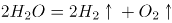（通电），表示水通电后生成氢气和氧气。一个水分子是由两个氢原子和一个氧原子组成，所以得到氢气和氧气的体积比为2：1。

C项正确，沼气的主要成分是甲烷。低温条件下，沼气会冷凝成固态，加温后在未达到熔点的情况下，可以提取出甲烷。

D项错误，复分解反应是由两种化合物互相交换成分，生成另外两种化合物的反应。石灰石的主要成分为碳酸钙（CaCO_3），煅烧石灰石就是煅烧碳酸钙，而碳酸钙是不溶于水的碳酸盐，受热容易分解为对应的金属氧化物（氧化钙）和二氧化碳气体（化学方程式：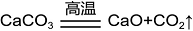），属于分解反应而非复分解反应。

本题为选非题，故正确答案为D。

**考点**：化学常识

**来源**：2022年国家公务员录用考试《行测》题（副省级网友回忆版）第16题

### 第 17 题

下列哪一情形在历史上有可能发生？

A. 秦朝时郑某升任西域都护，友人为他摆酒饯行

B. 唐朝富商李某在女儿出嫁时陪送白瓷数十套

C. 西汉时张某担任市舶使，负责采购舶来品

D. 明代官员王某请戏班演出京剧《白蛇传》

第 17 题 · 答案与解析

**参考答案（粉笔题库参考内容）**

B

**解析**

本题考查人文常识。

A项错误，西域都护是汉代在西域设立的最高军政长官，西域都护府是汉朝时期在西域（今新疆轮台）设置的管辖机构，其主要职责在于守境安土，协调西域各国间的矛盾和纠纷，制止外来势力的侵扰，维护西域地方的社会秩序，确保丝绸之路的畅通。因此，秦朝的郑某不可能升任西域都护。

B项正确，白瓷是传统瓷器分类（青瓷、黑瓷、白瓷、红瓷、蓝瓷、彩瓷等品种）中的一种，它一般是指瓷胎或化妆土为白色、表面施有一层薄而透明釉的瓷器。邢窑是中国最早的白瓷窑址，有中华白瓷鼻祖的美誉。邢窑创烧于北朝晚期，经过隋朝的飞速发展，到唐朝已达到鼎盛阶段。因此，唐朝的富商可能用白瓷做陪嫁品。

C项错误，市舶司在宋代出现，是中国在宋、元及明初在各海港设立的管理海上对外贸易的官府，是中国古代管理对外贸易的机关，相当于海关。而市舶司前身是市舶使，唐玄宗开元间（713年—741年），广州即设有市舶使，一般由宦官担任。西汉时期没有市舶使这一官职。

D项错误，京剧形成于清代乾隆年间。清代乾隆五十五年（1790年）起，原在南方演出的三庆、四喜、和春、春台四大徽班陆续进入北京，与来自湖北的汉调艺人合作，同时接受了昆曲、秦腔的部分剧目、曲调和表演方法，又吸收了一些地方民间曲调，通过不断交流、融合，最终形成京剧。在明代尚未形成京剧这一剧种。

故正确答案为B。

**考点**：中国历史

**来源**：2022年国家公务员录用考试《行测》题（副省级网友回忆版）第17题

### 第 18 题

我国很多成语都与植物有关，下列有关说法错误的是：

A. “投桃报李”中的“桃”和“李”属于同一科植物

B. “藕断丝连”中藕丝的作用是为植物输送水和养分

C. “望梅止渴”和“折梅寄远”中的“梅”分别是果梅和花梅

D. “胸有成竹”中“竹”的年龄可以根据竹节的数量判断

第 18 题 · 答案与解析

**参考答案（粉笔题库参考内容）**

D

**解析**

本题考查科技常识。

A项正确，“投桃报李”出自《诗经·大雅·抑》，桃是蔷薇科、桃属植物，落叶小乔木；李是蔷薇科、李属植物，落叶乔木。

B项正确，“藕断丝连”中的“丝”即藕丝，它是藕的导管壁增厚连续成螺旋状，形成的螺旋形导管，是输导组织，可以运输水分和无机盐（养分）。输导组织是植物体中担负物质长途运输的主要组织，其细胞呈管状并上下连接，形成一个连续的运输通道。

C项正确，梅花按应用可分为花梅和果梅，一般所说的梅花即指花梅，以观赏为栽培目的的梅花品种；果梅又名春梅、酸梅、乌梅，植物分类学上属于蔷薇科，李属，原产中国。“望梅止渴”意为眼望梅林，流出口水而解渴，这里的“梅”指果梅。“折梅寄远”意思是折一枝梅花送给远方的朋友，这里的“梅”指花梅，即梅花。

D项错误，竹又名竹子，品种繁多，为多年生禾本科竹亚科植物，茎多为木质，也有草本。竹笋（即幼竹）在土中生长阶段，经过顶端分生组织不断进行细胞分裂和分化，形成节、节间、节隔、笋箨、侧芽和居间分生组织，到出土前全笋（也是全株）的节数已定，出土后不再增加新节。一般通过观察竹子的叶片颜色来判断竹龄。

本题为选非题，故正确答案为D。

**考点**：生物常识

**来源**：2022年国家公务员录用考试《行测》题（副省级网友回忆版）第18题

### 第 19 题

下列物理学家与名言对应错误的是：

A. 费曼——没有人真正了解量子力学

B. 麦克斯韦——电和磁的实验中最明显的现象是，处于彼此距离相当远的物体之间的相互作用

C. 卢瑟福——固执于光的旧有理论的人们，最好是从它自身的原理出发，提出实验的说明

D. 牛顿——万有引力、电的相互作用和磁的相互作用，可以在很远的地方明显地表现出来，因此用肉眼就可以观察到

第 19 题 · 答案与解析

**参考答案（粉笔题库参考内容）**

C

**解析**

本题考查科技常识。

A项正确，理查德·菲利普斯·费曼，美籍犹太裔物理学家，加州理工学院物理学教授，1965年诺贝尔物理学奖得主。他提出了费曼图、费曼规则和重正化的计算方法，这是研究量子电动力学和粒子物理学不可缺少的工具。1964年的11月，费曼在康奈尔大学开展的系列讲座“物理定律的本性”中提到了“没有人真正了解量子力学”的名言。

B项正确，詹姆斯·克拉克·麦克斯韦，英国物理学家、数学家，经典电动力学的创始人，统计物理学的奠基人之一。“电和磁的实验中最明显的现象是，处于彼此距离相当远的物体之间的相互作用。因此，把这些现象化为科学的第一步就是，确定物体之间作用力的大小和方向”这句话是由麦克斯韦提出的。

C项错误，欧内斯特·卢瑟福是英国著名物理学家，知名的原子核物理学之父。1911年，卢瑟福根据α粒子散射实验现象提出原子核式结构模型。该实验被评为“物理最美实验”之一。1919年，卢瑟福做了用α粒子轰击氮核的实验。“固执于光的旧有理论的人们，最好是从它自身的原理出发，提出实验的说明。并且，如果他的这种努力失败的话，他应该承认这些事实”这句话是由托马斯·杨提出的。托马斯·杨是英国医生、物理学家，光的波动说的奠基人之一。

D项正确，艾萨克·牛顿，英国皇家学会会长，英国著名的物理学家、数学家，百科全书式的“全才”，著有《自然哲学的数学原理》《光学》。“万有引力、电的相互作用和磁的相互作用，可以在很远的地方明显地表现出来，因此用肉眼就可以观察到；但也许存在另一些相互作用力，他们的距离如此之小，以至无法观察”这句话是由牛顿提出的。

本题为选非题，故正确答案为C。

**考点**：物理常识

**来源**：2022年国家公务员录用考试《行测》题（副省级网友回忆版）第19题

### 第 20 题

下列与急救有关的说法正确的是：

A. 误服氨水者应该立即进行洗胃或催吐

B. 农药沾染皮肤中毒可立即用热水擦洗

C. 误食强酸可以立即口服氢氧化铝凝胶

D. 烧伤时应立即饮用大量凉水补充体液

第 20 题 · 答案与解析

**参考答案（粉笔题库参考内容）**

C

**解析**

本题考查科技常识。

A项错误，氨水是无色透明液体，有强烈的刺激性气味，极易挥发出氨气，浓氨水对呼吸道和皮肤有刺激作用，并能损伤中枢神经系统，具有弱碱性。误服氨水者应立即漱口，口服稀释的醋或柠檬汁，并及时就医。切不可催吐，也不能洗胃，防止发生食道和胃穿孔。

B项错误，农药进入人体的主要途径有三条：皮肤、消化道和呼吸道。大部分农药都可以通过完好的皮肤吸收，而且吸收后在皮肤表面不留任何痕迹，生产和使用农药时发生了农药中毒，要尽快将中毒病人脱离污染的现场至阴凉通风的场所，同时立即脱去病人被污染的衣物，用肥皂水或流动清水反复清洗被污染的皮肤、毛发等部位，并及时就医。不可用热水清洗，因为热水会使皮肤温度升高，毛孔扩张，可能会加速农药的溶解和吸收。

C项正确，误食强酸可以引起食道灼伤，导致食管粘膜损伤或者坏死、狭窄，甚至危及生命。如果误食强酸，可以口服3％-4％氢氧化铝凝胶60ml，或者0.17％的氢氧化钙200ml。如果在家找不到上述药物，可服用鸡蛋清或牛奶60ml，或者植物油100ml，以保护食管及胃黏膜。

D项错误，烧伤时应少量多次饮用凉水以补充体液，因为烧伤后的病人身体虚弱，一次性大量喝水可能会导致水肿。如果有条件，一升水中外加半汤匙盐，或者加半勺小苏打效果更好，因为烧伤后病人流失的体液除了水还包括一些电解质（如钠离子、氯离子等无机盐），所以喝一些淡盐水更好。

故正确答案为C。

**考点**：生活常识

**来源**：2022年国家公务员录用考试《行测》题（副省级网友回忆版）第20题

### 第 21 题

思政课教师要有正确的党史观和过硬的党史知识，只有自己观点正确、史料丰富，才能准确无误地给学生指引方向、有力有理有据地反驳错误观点、            地选择恰当的教学方式，推动党史教育入脑入心、开花结果。

填入画横线部分最恰当的一项是：

A. 信手拈来

B. 游刃有余

C. 轻而易举

D. 随心所欲

第 21 题 · 答案与解析

**参考答案（粉笔题库参考内容）**

B

**解析**

文段中强调思政课老师具备正确的党史观和过硬的党史知识，对其教学产生非常积极的影响，因此横线处应填入褒义词，且该成语与“选择恰当的教学方式”形成搭配。B项“游刃有余”比喻做事熟练，解决问题轻松利落，感情色彩偏积极且符合文意，当选。

A项“信手拈来”指随手拿来，多形容词汇或材料丰富，不假思索，就能写出文章来，相较于“游刃有余”用来形容选择教学方式不够恰当，排除；

C项“轻而易举”形容事情容易做，不费力气，相较于“游刃有余”无法体现出思政课老师的熟练自如，感情色彩上不及B项恰当，排除；

D项“随心所欲”指一切都由着自己的心意，想干什么就干什么，侧重“随意”，与文意不符，排除。

故正确答案为B。

【文段出处】《发挥好互联网在党史学习教育中的重要作用》

**考点**：对应关系-前后呼应、成语填空

**来源**：2022年国家公务员录用考试《行测》题（副省级网友回忆版）第21题

### 第 22 题

卫星定位系统是通过获得卫星和用户接收机之间的距离来计算用户位置的，而距离等于传播时间乘以光速，因此，精确的距离测量实际上就是精确的时间测量。没有高精度的时频，卫星定位系统就不可能实现高精度的定位。所谓失之毫“秒”谬以千里，这正是原子钟            的地方。

填入画横线部分最恰当的一项是：

A. 大显身手

B. 牛刀小试

C. 脱颖而出

D. 无往不利

第 22 题 · 答案与解析

**参考答案（粉笔题库参考内容）**

A

**解析**

根据文意可知，原子钟可以实现高精度的时间测量，故横线处所填成语应表达出解决“这”所指代的“失之毫’秒’谬以千里”的问题是原子钟的优势。A项“大显身手”指充分显露自己的本领，即能够在精确到“毫”“秒”的精确测量方面展现优势，符合文意，当选。

B项“牛刀小试”比喻有大本领的人，先在小事情上略展才能，文段并未体现“小事情”，与文意不符，排除；C项“脱颖而出”比喻人的才能全部显示出来，常搭配“有才能的人”，与“原子钟”搭配不当，且“脱颖而出”往往用在比较语境，本题中并未进行对比，排除；D项“无往不利”指无论到什么地方或干什么事情，一切顺畅通利，用于此处程度过重，排除。

故正确答案为A。

【文段出处】《原子钟让计时精度走向极限》

**考点**：词的辨析-程度轻重、对应关系-前后呼应、成语填空、对应关系-形象表达

**来源**：2022年国家公务员录用考试《行测》题（副省级网友回忆版）第22题

### 第 23 题

在未来战争中，掌握算法优势的一方，能快速准确        战场态势，创新最优作战方法，实现“未战而先胜”的战争目的。同时，智能科技将        到战争全要素全过程，物联网、智联网与脑联网成为战争的基础，从而使得战争全息透明，呈现战争控制“有人”、战场交锋“无人”的状态。

依次填入画横线部分最恰当的一项是：

A. 预测 渗透

B. 主导 贯穿

C. 判断 投射

D. 反映 覆盖

第 23 题 · 答案与解析

**参考答案（粉笔题库参考内容）**

A

**解析**

第一空，搭配“态势”，且根据“实现‘未战而先胜’的战争目的”可知，横线处所填词语应体现对战场态势的事前推测，A项“预测”、C项“判断”均符合文意，保留。B项“主导”指决定并且引导事物向某方面发展，程度过重，排除；D项“反映”比喻把客观事物的实质表现出来，也指把情况、意见等告诉上级或有关部门，文段侧重掌握优势后可以自己判断态势，而非向别人反映，排除。

第二空，根据“到战争全要素全过程”“物联网、智联网与脑联网成为战争的基础”可知，横线处所填词语应体现智能科技融入到战争的全过程，A项“渗透”指某种事物或势力逐渐进入其他方面，符合文意，当选。C项“投射”指（光线等）射，或对着目标扔、掷，与“智能科技”搭配不当，排除。

故正确答案为A。

【文段出处】《智能化战争的制胜机理变在哪里》

**考点**：词的辨析-搭配对象、词的辨析-程度轻重、实词填空、对应关系-前后呼应

**来源**：2022年国家公务员录用考试《行测》题（副省级网友回忆版）第23题

### 第 24 题

实施传统胸外按压心肺复苏，常会发生肋骨或胸骨骨折，导致肺、胸膜及心脏损伤，影响心肺复苏的成功率，急救专家由此探索出“胸路不通走腹路”的新路径，腹部提压心肺复苏技术            。与传统心肺复苏技术相比，该技术            ，利用腹部提压心肺复苏仪达到起腹心动、起腹呼吸的目的。

依次填入画横线部分最恰当的一项是：

A. 异军突起 推陈出新

B. 横空出世 一举两得

C. 应运而生 另辟蹊径

D. 粉墨登场 扬长避短

第 24 题 · 答案与解析

**参考答案（粉笔题库参考内容）**

C

**解析**

第一空，根据“由此探索出‘胸路不通走腹路’的新路径”可知，腹部提压心肺复苏技术在“传统胸外按压心肺复苏”可能产生问题的情况下出现，且感情色彩积极，C项“应运而生”指随着某种形势而产生，符合文意，保留。A项“异军突起”比喻另一支新的力量突然出现，B项“横空出世”形容人或物高大，横在空中，浮出人世，或比喻卓尔不群，均强调突然出现，不能体现新技术在传统技术产生问题的情况下出现，与文意不符，排除；D项“粉墨登场”今多借指登上政治舞台（含讥讽意），感情色彩消极，与文段感情色彩不符，排除。

第二空，代入验证，对应前文“新路径”，C项“另辟蹊径”比喻另创一种新风格或新方法，符合文意，当选。

故正确答案为C。

【文段出处】《<腹部提压心肺复苏技术>荣获2020“科创中国”先导技术》

**考点**：词的辨析-感情色彩、对应关系-前后呼应、成语填空

**来源**：2022年国家公务员录用考试《行测》题（副省级网友回忆版）第24题

### 第 25 题

建筑工程投入巨大，一旦建成再做拆改可谓            。对此，需要完善设计规范和管理制度，从方案设计一开始就强化监管审核，确保建筑物在形体、色彩、体量、高度和空间环境等方面符合城市设计要求，避免陷入“            ”的窘境，最大程度地维护公共利益。

依次填入画横线部分最恰当的一项是：

A. 徒劳无功 覆水难收

B. 劳民伤财 木已成舟

C. 得不偿失 尾大不掉

D. 血本无归 闭门造车

第 25 题 · 答案与解析

**参考答案（粉笔题库参考内容）**

B

**解析**

第一空，根据前文“建筑工程投入巨大”可知，横线处表达投入巨大的工程建成再拆会造成浪费和损失，B项“劳民伤财”意思是既让百姓劳苦，又耗费了钱财。现多指滥用人力物力，C项“得不偿失”指得到的抵不上付出的，均符合文意，保留。A项“徒劳无功”指白白付出劳动而没有成效，侧重工作没有成效，无法体现浪费或损失的含义，排除；D项“血本无归”指辛苦积聚的资本全部亏损，无法收回，程度过重，排除。

第二空，根据“对此，需要完善设计规范和管理制度，从方案设计一开始就······符合城市设计要求”可知，横线处表达需提前做好规划避免造成难以改变的局面。B项“木已成舟”指树木已经制造成舟楫。比喻事已定型，不能改变，为形象表达且符合文意，当选。C项“尾大不掉”指尾巴太大，掉转不灵。现比喻机构庞大，指挥不灵，文段并未体现“机构庞大”之意，与文意无关，排除。

故正确答案为B。

【文段出处】《让建筑体现审美“高线”》

**考点**：词的辨析-程度轻重、成语填空、对应关系-形象表达、对应关系-解释说明

**来源**：2022年国家公务员录用考试《行测》题（副省级网友回忆版）第25题

### 第 26 题

当前，我国发展面临着前所未有的风险挑战，既有国内的也有国际的，既有政治、经济、文化、社会等领域的也有来自自然界的，既有传统的也有非传统的，“黑天鹅”、“灰犀牛”还会            。要更好应对前进道路上各种可以预见和难以预见的风险挑战，我们必须从历史中获得启迪，从历史经验中提炼出            的法宝。

依次填入画横线部分最恰当的一项是：

A. 不期而至 克敌制胜

B. 有机可乘 攻无不克

C. 纷至沓来 所向披靡

D. 不请自来 攻坚克难

第 26 题 · 答案与解析

**参考答案（粉笔题库参考内容）**

A

**解析**

本题可从第二空入手，搭配“法宝”，根据文意可知，横线处对应“要更好应对前进道路上······的风险挑战”，需体现出我们从历史经验中获取了应对风险挑战的对策，从而顺利前进发展之意。A项“克敌制胜”指打败敌人，取得胜利，填入横线处可以体现出应对前进道路上的风险挑战，最终取得胜利，继续前进发展之意，保留。B项“攻无不克”比喻做什么事情都能成功，百战百胜，C项“所向披靡”比喻力量强大，所到之处，什么也阻挡不了，均强调所有问题都能解决，填入横线处表述过于绝对，排除；D项“攻坚克难”指人们克服各种艰难险阻，圆满地完成任务，仅能体现克服困难之意，无法体现战胜困难继续前进发展之意，与文意不符，排除。

第一空，代入验证，A项“不期而至”指事先没有约定而意外到来，没有预料地到来，填入横线处与“黑天鹅”“灰犀牛”这些概率事件搭配得当，当选。

故正确答案为A。

【文段出处】《习近平谈增强风险意识》

**考点**：对应关系-前后呼应、成语填空

**来源**：2022年国家公务员录用考试《行测》题（副省级网友回忆版）第26题

### 第 27 题

解剖是认识动物体内形态特征的重要方式，但对于罕见或稀有物种而言，解剖无疑会破坏珍贵的样本，其损失            。近年来，无损检测已开始应用于文物鉴定等多种领域，        相关技术的应用经验，研发出一套专门针对珍稀动物样本无损检测的方法，必将大有可为。

依次填入画横线部分最恰当的一项是：

A. 难以估量 拓展

B. 触目惊心 参考

C. 毋庸置疑 模仿

D. 不言而喻 借鉴

第 27 题 · 答案与解析

**参考答案（粉笔题库参考内容）**

D

**解析**

本题可从第二空入手，搭配“经验”，B项“参考”指参照，D项“借鉴”指把别的人或事当镜子，对照自己，以便吸取经验或教训，均搭配恰当，保留。A项“拓展”指在原有的基础上，增加新的东西，C项“模仿”指照着现成的样子学着做，均与“经验”搭配不当，排除。

第一空，搭配“损失”，D项“不言而喻”指不用说就能明白，搭配恰当，且可对应前文“无疑”，当选。B项“触目惊心”指看见某种严重情况而内心震惊，形容事态严重，引起轰动，文中重在强调损失的必然性，而非强调损失有多么严重，与文意不符，排除。

故正确答案为D。

【文段出处】《无创和微创技术结合首次鉴定出新物种》

**考点**：词的辨析-搭配对象、混搭填空

**来源**：2022年国家公务员录用考试《行测》题（副省级网友回忆版）第27题

### 第 28 题

当今世界正经历百年未有之大变局，新一轮科技革命和产业变革深入发展，国际力量对比深刻        ，和平与发展仍然是时代主题，人类命运共同体理念            ，同时，国际环境日趋复杂，不稳定性不确定性明显增加，新冠肺炎疫情影响广泛深远，经济全球化遭遇逆流，世界进入动荡变革期。

依次填入画横线部分最恰当的一项是：

A. 调整 深入人心

B. 扭转 经久不衰

C. 变化 源远流长

D. 变换 牢不可破

第 28 题 · 答案与解析

**参考答案（粉笔题库参考内容）**

A

**解析**

第一空，根据“当今世界正经历百年未有之大变局，新一轮科技革命和产业变革深入发展”可知，横线处应体现在这样的背景下，国际力量对比有了深刻的变化，A项“调整”指改变原有的情况，C项“变化”指事物在形态上或本质上产生新的状况，均符合文意，保留。B项“扭转”指使事物的发展方向或目前的状况发生变化，侧重大的变化，与“深刻”搭配不当，排除；D项“变换”指事物的一种形式或内容换成另一种，文段只是表达力量对比发生变化，而非变成另一种东西，排除。

第二空，根据“和平与发展仍然是时代主题”可知，横线处应体现人类命运共同体理念是人们所推崇的，A项“深入人心”指理论、学说、政策等为人们深切了解和信服，符合文意，当选。C项“源远流长”形容历史悠久，文段未体现人类命运共同体理念时间悠久，排除。

故正确答案为A。

【文段出处】《深刻认识和把握新发展阶段的五个维度》

**考点**：词的辨析-词义侧重、词的辨析-搭配对象、对应关系-前后呼应、混搭填空

**来源**：2022年国家公务员录用考试《行测》题（副省级网友回忆版）第28题

### 第 29 题

人体肠道内生物的多样性令人惊讶，除细菌外，还        着数十万种被称为噬菌体的病毒，这些噬菌体可以感染细菌。众所周知，肠道微生物组不平衡会引发各种疾病，如炎症性肠病、过敏和肥胖，但我们对肠道细菌及噬菌体在人类健康和疾病方面起何种作用却            。

依次填入画横线部分最恰当的一项是：

A. 潜伏 知之甚少

B. 分布 浑然不觉

C. 活跃 束手无策

D. 充斥 一知半解

第 29 题 · 答案与解析

**参考答案（粉笔题库参考内容）**

A

**解析**

第一空，所填词语搭配“病毒”，表示人体肠道内存在病毒。A项“潜伏”、B项“分布”、C项“活跃”用在此处均可，保留。D项“充斥”指充满、多得到处都是，正常的人体不可能体内到处都是病毒，用在此处程度过重，排除。

第二空，横线前出现“但”“却”表示转折，根据前文“众所周知”可知，转折前表示人们对肠道微生物了解的足够多，故所填成语表示人们对肠道细菌及噬菌体的作用了解的少。A项“知之甚少”指对某方面知道的太少，符合文意，当选。B项“浑然不觉”指毫无察觉，文段讨论的是人们对微生物的具体作用是否了解，而非是否察觉其作用，排除；C项“束手无策”形容遇到问题时毫无解决的办法，文段并非强调没有解决办法而是知道的少，排除。

故正确答案为A。

【文段出处】《人肠道内竟有超14万种病毒，其中一半以上从未见过》

**考点**：词的辨析-搭配对象、混搭填空、关联关系-转折关系

**来源**：2022年国家公务员录用考试《行测》题（副省级网友回忆版）第29题

### 第 30 题

稳就业之“稳”，既要着眼于        存量，让大家把“饭碗”端稳，更要着眼于扩大增量，拓宽就业空间。一方面需要不断优化营商环境，让新增市场主体成为解决就业的            ；另一方面还要充分利用新技术衍生的新业态，引导人们转变观念，实现更宽更广的就业。

依次填入画横线部分最恰当的一项是：

A. 维持 星星之火

B. 夯实 不二法门

C. 强化 中流砥柱

D. 巩固 源头活水

第 30 题 · 答案与解析

**参考答案（粉笔题库参考内容）**

D

**解析**

第一空，搭配“存量”，根据横线前后“稳就业”“端稳”可知，横线处所填词语要表达保持“存量”不变，稳定之意。A项“维持”指保持、使继续存在，B项“夯实”指加固，D项“巩固”意为使牢固，均搭配恰当，符合文意，保留。C项“强化”指增强某种状态、行为的过程，通常用在“强化增量”“强化记忆”等语境，表现对事物增长状态的加强，“存量”相对静态，搭配不当，且文段强调“存量”保持不变，与文意不符，排除。

第二空，由“需要”可知，后文为对策表述，横线处所填成语应体现新增市场主体为解决就业提供了帮助。D项“源头活水”指事物发展的动力和源泉，填入此处表示为解决就业提供动力，符合文意，当选。A项“星星之火”比喻开始时弱小，但有远大发展前途的新事物，文段并未提及新增市场主体的强弱，与文意不符，排除；B项“不二法门”比喻最好的或独一无二的方法，文段还提及了“充分利用新技术衍生的新业态”，表述过于绝对，程度过重，排除。

故正确答案为D。

【文段出处】中国经济网《开局良好 稳就业要靠这“三招”》

**考点**：词的辨析-搭配对象、词的辨析-程度轻重、对应关系-前后呼应、混搭填空

**来源**：2022年国家公务员录用考试《行测》题（副省级网友回忆版）第30题

### 第 31 题

系统观念是做好“十四五”时期各项工作必须坚持的重要原则。各级税务机关要加强          思考，立足当前、放眼长远，加强税收领域前沿问题研究，增强做好税收工作的主动性和预见性。要进行          谋划，自觉把税收工作融入到党和国家事业发展大局中去思考和谋划，加强“十四五”税收改革发展的顶层设计。

依次填入画横线部分最恰当的一项是：

A. 针对性 战略性

B. 系统性 长期性

C. 前瞻性 全局性

D. 独立性 统一性

第 31 题 · 答案与解析

**参考答案（粉笔题库参考内容）**

C

**解析**

第一空，根据后文“立足当前、放眼长远”可知，横线处应体现眼光长远之意，C项“前瞻性”比喻具有未来发展的可能性，符合文意，保留。Ａ项“针对性”指对确定的对象采取具体措施，B项“系统性”指同类事物按一定的关系联合起来，成为一个有组织的整体，D项“独立性”指人的意志不易受他人影响，有较强的独立提出和实施行为目的的能力，均无法体现眼光长远之意，排除。

第二空，代入验证，C项“全局性”与“谋划”搭配恰当，且与后文“发展大局”形成对应，当选。

故正确答案为C。

【文段出处】《王军：充分发挥税收职能作用 积极服务全面建设社会主义现代化国家》

**考点**：实词填空、对应关系-前后呼应

**来源**：2022年国家公务员录用考试《行测》题（副省级网友回忆版）第31题

### 第 32 题

病毒变异每时每刻都在发生，随机性极大，突变率高，变异速度快，这意味着它们更有机会形成适应环境的        。然而，并非每种变异都能让病毒存活并发展下去。同一时期，病毒的变异株可能有很多种，但“            ”，只有那些能更有效        免疫系统侦测且传播能力强的毒株才能最终成为优势株。

依次填入画横线部分最恰当的一项是：

A. 特质 优胜劣汰 突破

B. 机能 胜者为王 迷惑

C. 性状 适者生存 躲避

D. 表征 此消彼长 逃脱

第 32 题 · 答案与解析

**参考答案（粉笔题库参考内容）**

C

**解析**

本题可从第三空入手，搭配“侦测”，且由文意可知横线处需体现毒株隐藏起来，不被免疫系统发现之意。C项“躲避”、D项“逃脱”均符合文意，保留。A项“突破”指打开缺口，打破某种界限，超越，常搭配“难关”“防线”“记录”等，B项“迷惑”指辨不清是非，摸不着头脑，使人迷乱，均与“侦测”搭配不当，排除。

第一空，根据文意可知，横线处需体现病毒能够形成适应生存环境的特点之意。C项“性状”指性质和状态，D项“表征”指显示出来的现象或表现出来的特征，均符合文意，保留。

第二空，由“只有那些能更有效······免疫系统侦测且传播能力强的毒株才能最终成为优势株”可知，横线处意在表达那些具有更多优势且更为适应环境的毒株才有机会存活下去。C项“适者生存”指能够适应各种环境的人或事物才有可能得到生存发展的机会，符合文意，当选。D项“此消彼长”指这个下降，那个上升，文段并无此意，排除。

故正确答案为C。

【文段出处】《新冠病毒为什么会变异》

**考点**：词的辨析-搭配对象、对应关系-前后呼应、混搭填空

**来源**：2022年国家公务员录用考试《行测》题（副省级网友回忆版）第32题

### 第 33 题

我国各地情况千差万别，要            推进城市空间布局形态多元化。东部等人口密集地区，要        城市群内部空间结构，合理控制大城市规模，不能盲目“摊大饼”。要推动城市组团式发展，形成多中心、多层级、多节点的网络型城市群结构。城市之间既要加强互联互通，也要有必要的生态和安全        。

依次填入画横线部分最恰当的一项是：

A. 因地制宜 优化 屏障

B. 持之以恒 修正 措施

C. 不遗余力 重组 壁垒

D. 循序渐进 改善 系统

第 33 题 · 答案与解析

**参考答案（粉笔题库参考内容）**

A

**解析**

第一空，根据“我国各地情况千差万别”可知，在推进城市空间布局形态多元化时应当立足各地特征，不能一刀切，A项“因地制宜”指根据各地的具体情况，制定适宜的办法，符合文意，保留。B项“持之以恒”指长久地坚持下去，强调坚持，C项“不遗余力”指把全部力量都使出来，一点也不保留，侧重努力，D项“循序渐进”指学习工作等按照一定的步骤逐渐深入或提高，侧重稳扎稳打，均无法与“千差万别”对应，不符合文意，排除。

第二空，代入验证，A项“优化城市群内部空间结构”搭配得当，A项符合文意，保留。

第三空，代入验证，城市之间在“加强互联互通”的同时，也要在生态和安全方面建立保护的“屏障”，符合文意，A项当选。

故正确答案为A。

【文段出处】《习近平：国家中长期经济社会发展战略若干重大问题》

**考点**：对应关系-前后呼应、混搭填空

**来源**：2022年国家公务员录用考试《行测》题（副省级网友回忆版）第33题

### 第 34 题

长期以来，由于政府同社会智库之间的智库成果报送渠道不畅，从而导致智库成果“体内循环多、成果转化少”等问题。为此，要给社会智库与官方智库        的待遇，建立畅通的智库成果快速报送渠道，            、广谋良策，充分发挥各级各类智库的“        ”作用。

依次填入画横线部分最恰当的一项是：

A. 公平 从善如流 军师

B. 一致 群策群力 向导

C. 相同 集思广益 顾问

D. 平等 广开言路 参谋

第 34 题 · 答案与解析

**参考答案（粉笔题库参考内容）**

D

**解析**

本题从第二空入手，顿号提示横线所填词语与“广谋良策”构成近义并列，应体现广泛吸取意见之意，B项“群策群力”指大家共同想办法，一起出力，C项“集思广益”指集中群众的智慧，广泛吸收有益的意见，D项“广开言路”形容尽量给人们创造发表意见的机会，均能体现广泛吸取意见之意，保留。A项“从善如流”形容听取正确的意见及接受善意的规劝像流水那样快而自然，不能体现广泛吸取意见之意，排除。

第三空，根据主题词“智库”及“智库成果快速报送”可知，横线所填词语应体现出智库辅助政府执政的作用，C项“顾问”指解答疑问的人，D项“参谋”泛指帮忙出主意的人，填入横线处均可形象表达出智库的积极作用，保留。B项“向导”指领路人，政府不会由一个社会机构领路，此处程度过重，排除。

回到首空，根据文意，可知先前政府与社会智库之间的渠道不畅，因此要给社会智库一个更加“平等”的待遇，D项“平等”，符合文意，当选。C项“相同”指完全一样，但“社会智库”与“官方智库”待遇不可能做到完全一样，程度较重，排除。

故正确答案为D。

【文段出处】《发挥智库作用，助常态化疫情防控更科学精准》

**考点**：词的辨析-程度轻重、混搭填空、对应关系-形象表达、关联关系-并列关系

**来源**：2022年国家公务员录用考试《行测》题（副省级网友回忆版）第34题

### 第 35 题

发达国家一两百年出现的环境问题，在我国30多年来的快速发展中集中显现，呈现明显的结构型、压缩型、复合型特点，老的环境问题尚未解决，新的环境问题            。走老路，去无节制消耗资源，去不计代价污染环境，            ！要正确处理经济发展同生态环境保护之间的关系，更加        地推动绿色发展、循环发展、低碳发展，决不以牺牲环境、浪费资源为代价换取一时的经济增长。

依次填入画横线部分最恰当的一项是：

A. 层出不穷 如履薄冰 迅速

B. 数不胜数 肆无忌惮 努力

C. 接踵而至 难以为继 自觉

D. 突如其来 积重难返 积极

第 35 题 · 答案与解析

**参考答案（粉笔题库参考内容）**

C

**解析**

第一空，根据前文“快速发展中集中显现”可知，横线处要体现出老问题还没有解决，新问题就集中出现之意。A项“层出不穷”形容事物连续出现，没有穷尽，C项“接踵而至”指人们前脚跟着后脚，接连不断地来，均符合文意，保留。B项“数不胜数”形容数量多，D项“突如其来”形容事情发生的很突然，均与文意不符，排除。

第二空，根据“无节制消耗资源”“不计代价污染环境”等可知，横线处应体现错误处理经济发展与生态环境保护之间的关系导致的后果。C项“难以为继”形容难以继续下去，可体现出“消耗资源”“污染环境”的不良结果，符合文意，保留。A项“如履薄冰”比喻行事极为谨慎，存有戒心，与文意无关，排除。

第三空，代入验证，C项“自觉”可与“要正确处理经济发展同生态环境保护之间的关系”对应，符合文意，当选。

故正确答案为C。

【文段出处】《习近平总书记系列重要讲话读本（2016年版）》

**考点**：对应关系-前后呼应、混搭填空

**来源**：2022年国家公务员录用考试《行测》题（副省级网友回忆版）第35题

### 第 36 题

？这是党史观的重大问题。一个马克思主义政党对自己的错误所抱的态度，是衡量这个党是否真正履行对人民群众所负责任的一个最重要最可靠的尺度。我们党对自己包括领袖人物的失误和错误历来采取郑重的态度，一是敢于承认，二是正确分析，三是坚决纠正，从而使失误和错误连同党的成功经验一起成为宝贵的历史教材。

填入画横线部分最恰当的一项是：

A. 如何对待逆耳忠言

B. 如何看待曲折、失误

C. 是否始终坚持实事求是

D. 犯了错误后能否正确应对

第 36 题 · 答案与解析

**参考答案（粉笔题库参考内容）**

B

**解析**

横线出现在开头，需结合后文内容进行分析。根据“这是党史观的重大问题”可知，横线处需填入一个表示“问题”的句子，后文先通过“最重要”“最可靠”两个程度词强调“马克思主义政党”面对自己错误的态度很重要。接着详细解释了我们党在面对失误和错误时采取的态度，并强调这种态度取得了较好的效果。故后文重在强调我们党在面对失误和错误时所采取的态度，则横线处所填问题应该与面对错误的态度有关，B项“曲折、失误”即政党发展过程中的问题、错误，符合文意，当选。

A项，“逆耳忠言”强调建议、忠告，偏离后文核心话题“面对错误的态度”，排除；

C项，“实事求是”与后文“问题”“态度”无关，话题不一致，无中生有，排除；

D项，“能否正确应对”为对策表述，后文强调面对错误时应有的态度，而非如何应对错误，排除。

故正确答案为B。

【文段出处】《旗帜鲜明坚持和运用正确党史观》

**考点**：横线在开头

**来源**：2022年国家公务员录用考试《行测》题（副省级网友回忆版）第36题

### 第 37 题

在传统基层治理中，缺乏社会组织、市场等各主体的共同参与、质询和监督，必然导致政府公共服务能力下降、权力垄断和滥用等问题，容易弱化公众信任程度，引发社会信任危机。区块链技术基于去中介信任机制、共识机制、协调共享机制，适用于多环节、多方协同参与且互不信任的场景。而信任是多元主体进行基层协同治理和互信规则建构的合作基础，区块链的算法信任机制与基层社会治理“公共性+信任”的价值追求相契合。借助区块链技术可以促进治理生态中双边信任向多边信任及社会公信的转变，突破传统国家治理体系所形成的认知固化和思维僵化。

这段文字意在强调：

A. 健全信任机制是基层协同治理的条件

B. 区块链技术有助于推进基层治理改革

C. 区块链技术的应用能够提升政府公信力

D. 治理生态离不开多元社会主体间的协作

第 37 题 · 答案与解析

**参考答案（粉笔题库参考内容）**

B

**解析**

文段开篇介绍传统基层治理中遇到的问题，即引发信任危机，接下来指出区块链适用于多环节、多方协同参与且互不信任的场景，并指出区块链的算法信任机制与基层社会治理“公共性+信任”的价值追求相契合，即可以将区块链技术用于基层治理中，尾句进一步强调区块链技术对于促进治理生态转变及突破传统国家治理体系中认知固化和思维僵化的作用，故文段旨在强调区块链技术对于基层治理的意义，对应B项。

A项、D项，均缺少主题词“区块链技术”，排除；

C项，缺少主题词“基层治理”，排除。

故正确答案为B。

【文段出处】《区块链嵌入社会治理路径》

**考点**：主题词

**来源**：2022年国家公务员录用考试《行测》题（副省级网友回忆版）第37题

### 第 38 题

，最能代表一个时代的风貌，最能引领一个时代的风气。“文变染乎世情，兴废系乎时序。”在欧洲文艺复兴运动中，但丁、彼特拉克、薄伽丘、达·芬奇、拉斐尔、米开朗琪罗、蒙田、塞万提斯、莎士比亚等文艺巨人，发出了新时代的啼声，开启了人们的心灵。在谈到文艺复兴运动时，恩格斯说，这“是一个需要巨人而且产生了巨人——在思维能力、热情和性格方面，在多才多艺和学识渊博方面的巨人的时代”。在我国发展史上，包括文艺在内的文化发展同样与中华民族发展紧紧联系在一起。先秦时期，我国出现了百家争鸣的兴盛局面，开创了我国古代文化的一个鼎盛期。20世纪初，在五四新文化运动中，发端于文艺领域的创新风潮对社会变革产生了重大影响，成为全民族思想解放运动的重要引擎。

填入画横线部分最恰当的一项是：

A. 文艺是铸造灵魂的工程

B. 文艺是时代前进的号角

C. 文化是民族生存和发展的重要力量

D. 文艺创新是与时代脉搏同频共振的

第 38 题 · 答案与解析

**参考答案（粉笔题库参考内容）**

B

**解析**

横线在文段开头，与“最能代表一个时代的风貌，最能引领一个时代的风气”做衔接，且需结合后文对横线内容做出判断。后文先引用名言，接着分别以欧洲文艺复兴、我国先秦时期和五四新文化运动时期为例，具体阐述文艺对时代的代表与引领，充分体现出文艺对时代进步的重要性，对应B项。

A项，“铸造灵魂”无中生有，文段强调文艺可推动时代发展，帮助人类打开新世界的大门，排除；

C项，“民族生存”文段未体现，无中生有，排除；

D项，“同频共振”侧重于共存，但文段强调的是文艺对时代的代表与引领，偏离文段中心，且“文艺创新”主题词范围缩小，不够精准，排除。

故正确答案为B。

【文段出处】《在文艺工作座谈会上的讲话》

**考点**：横线在开头

**来源**：2022年国家公务员录用考试《行测》题（副省级网友回忆版）第38题

### 第 39 题

约25亿年前的“大氧化事件”是指大气中的游离氧含量突然增加。这一事件的具体原因迄今尚不得而知，但有若干种假说能加以解释，其中主流说法认为，当时破坏氧气的甲烷细菌所依赖的镍元素急剧减少，而海藻类植物通过光合作用使得地球上的氧气迅速增加，大气中的含氧量不断提升。正是这一事件使地球上矿物的成分发生了变化，也使动物在地球上有了生存可能。而在“大氧化事件”之前，地球表面虽然已出现了海洋和陆地，但是空气中依旧氧气稀薄，因此当时的地球是光秃秃的，毫无绿意。

关于“大氧化事件”，文中没有提及：

A. 对发生原因的主流解释

B. 对地球生态系统的影响

C. 事件发生前的地球面貌

D. 能提供佐证的岩石样本

第 39 题 · 答案与解析

**参考答案（粉笔题库参考内容）**

D

**解析**

A项，根据“其中主流说法认为，当时破坏氧气的······大气中的含氧量不断提升”可知，“对发生原因的主流解释”文段有提及，排除；

B项，根据“正是这一事件使地球上······地球上有了生存可能”可知，“对地球生态系统的影响”文段有提及，排除；

C项，根据“而在‘大氧化事件’之前，地球表面虽然已出现了海洋和陆地······毫无绿意”可知，“事件发生前的地球面貌”文段有提及，排除；

D项，文段并未提及“岩石样本”，故“能提供佐证的岩石样本”无中生有，当选。

本题为选非题，故正确答案为D。

【文段出处】《十亿年后地球大气将重回低氧水平》

**考点**：细节判断题

**来源**：2022年国家公务员录用考试《行测》题（副省级网友回忆版）第39题

### 第 40 题

①即使是有文字记载以后的文明史，也需要通过考古工作来参考、印证、丰富、完善

②百万年的人类起源史和上万年的人类史前文明史，主要依靠考古成果来建构

③保护好、传承好历史文化遗产是对历史负责、对人民负责

④考古学是一门十分重要的学科

⑤历史文化遗产不仅生动述说着过去，也深刻影响着当下和未来；不仅属于我们，也属于子孙后代

⑥我们要加强考古工作和历史研究，让收藏在博物馆里的文物、陈列在广阔大地上的遗产、书写在古籍里的文字都活起来，丰富全社会历史文化滋养

将以上6个句子重新排列，语序正确的一项是：

A. ③⑤④②①⑥

B. ②⑤⑥④①③

C. ⑥①②④⑤③

D. ④②①⑤③⑥

第 40 题 · 答案与解析

**参考答案（粉笔题库参考内容）**

D

**解析**

对比选项，判断首句。②句指出“人类起源史和人类史前文明史主要依靠考古成果来建构”，④句引出“考古学”的话题，指出其重要性，⑥句提出加强考古工作的具体做法，②④⑥三句均围绕“考古学”这一话题展开论述，按逻辑顺序，应该先引出“考古学”的话题，再具体阐述考古学如何重要以及加强考古工作的具体做法，因此④句相较②⑥两句更适合作首句，排除B、C两项。③句指出“保护好、传承好历史文化遗产的必要性”，话题与“考古学”有所区别，无法判断首句，保留A、D两项。

对比A、D两项，发现③⑤两句顺序不同，③句强调要保护历史文化遗产，⑤句论述历史文化遗产的重要性，应先论述历史文化遗产重要性再提及保护的话题，因此⑤句在③句之前，排除A项。

故正确答案为D。

【文段出处】《中国考古学的使命、特色与风格》

**考点**：确定顺序

**来源**：2022年国家公务员录用考试《行测》题（副省级网友回忆版）第40题

### 第 41 题

①海绵是一种最原始的多细胞动物，化石记录最早可追溯到寒武纪时期，至今已发展到一万多种

②阿糖腺苷成为首个从海洋天然产物衍生并成功上市的抗病毒药物

③目前，从海绵提取物中分离得到的天然产物往往具有独特的结构骨架或显著的生理功能，可用于开发药物和作为有机合成或半合成化学中间体，具有作为药物先导物的巨大潜力

④日本化学家从日本黑海绵中提取了软海绵素，将其衍生成抗肿瘤药物，用于治疗转移性乳腺癌等癌症

⑤作为一种营固着生长的生物体，海绵极易被其他生物猎食，却能在残酷的海洋环境中生存，可能依赖于其独特的化学防御策略

⑥美国化学家从海绵中分离得到抗病毒药阿糖腺苷和抗癌药物阿糖胞苷的先导化合物

将以上6个句子重新排列，语序正确的一项是：

A. ①⑤③⑥②④

B. ①③④②⑥⑤

C. ⑤①④⑥②③

D. ⑤③①④②⑥

第 41 题 · 答案与解析

**参考答案（粉笔题库参考内容）**

A

**解析**

对比选项，确定首句。①句是对海绵下定义，⑤句是在介绍海绵能够在残酷的海洋环境中生存，应先引出海绵再介绍其生存，故①句更适合作首句，排除C、D两项。

继续观察，②⑥两句均提及信息“阿糖腺苷”，②句介绍阿糖腺苷成功上市，⑥句指出美国化学家从海绵中分离出阿糖腺苷，按照逻辑顺序应先引出阿糖腺苷，然后再介绍其成功上市，故⑥句应在②句之前，排除B项。

故正确答案为A。

【文段出处】《从海洋放线菌天然宝库中“淘金”》

**考点**：确定首句-首句特征、确定捆绑、确定顺序

**来源**：2022年国家公务员录用考试《行测》题（副省级网友回忆版）第41题

### 第 42 题

改革开放以来，我国人才流动都是由中小城市向中心城市不断聚集，城市的“聚集效应”大于“扩散效应”，包括人才在内的各种资源源源不断地向城市特别是大城市涌入。不过，如今人才向一线城市聚集的趋势正在悄然改变，人才逐渐“下沉”的迹象日益明显。如果说过去人才向一线城市聚集是为追求更高收入、更好发展前景，那么现在二三线城市在这些方面与一线城市的差距正在逐渐缩小，相应的人才流动多元化也开始出现。

这段文字接下来最可能讲的是：

A. 人才“下沉”出现的具体原因

B. 城市“扩散效应”引发的连锁反应

C. 一线城市避免人才流出的举措

D. 城市“聚集效应”出现的背景条件

第 42 题 · 答案与解析

**参考答案（粉笔题库参考内容）**

A

**解析**

文段开篇介绍背景，指出改革开放以来人才向中心城市聚集，接下来通过“不过”强调重点，指出如今人才流动呈下沉趋势。尾句将过去和现在进行对比，“如果······前景”指出过去人才聚集一线城市的原因，“那么······多元化也开始出现”点明人才开始多元化流动，故接下来应论述“人才流动多元化”，即详细说明人才“下沉”的原因，对应A项。

B项，“城市‘扩散效应’引发的连锁反应”不仅包括人才流动，还包括对其他各种资源的影响，文段主要围绕人才展开论述，“城市‘扩散效应’”范围扩大，排除；

C项，“避免人才流出的举措”和后文重点并不符，或文段应该结束人才“下沉”原因分析这一话题后，再展开论述一线城市的举措，排除；

D项，“城市‘聚集效应’出现的背景条件”文段已经论述过，后文不会再论述，排除。

故正确答案为A。

【文段出处】环球网《李长安：“人才下沉”开拓更大发展空间》

**考点**：接语选择题

**来源**：2022年国家公务员录用考试《行测》题（副省级网友回忆版）第42题

### 第 43 题

福厦高铁是我国第一条真正意义上的海洋环境下运行的高速铁路。湄洲湾跨海大桥是其中最长的海域施工区段，也是全线的重点控制性工程，其主桥设计为预应力混凝土连续刚构矮塔斜拉桥。索鞍是斜拉桥施工中的关键环节，施工精度高，控制难度大。湄洲湾跨海大桥位于曲线段上，海域风大浪急，斜拉桥主塔索鞍定位困难。为达到主跨通航要求，主墩承台均需埋入河床面以下，这给围堰施工作业增加了难度。施工人员克服海上恶劣天气的影响，采取预埋劲性骨架、增加控制点位等手段实现了索鞍精确定位，有效地解决了索鞍定位控制难题。

这段文字主要介绍了湄洲湾跨海大桥：

A. 对福厦高铁贯通的重要意义

B. 围堰施工中面临的复杂环境

C. 索鞍定位的难点及解决措施

D. 使用矮塔斜拉索结构的原因

第 43 题 · 答案与解析

**参考答案（粉笔题库参考内容）**

C

**解析**

文段开篇通过福厦高铁引出湄洲湾跨海大桥，接着又通过其斜拉桥引出“索鞍”话题，提出索鞍施工精度高，控制难度大，并重点指出由于湄洲湾跨海大桥位于曲线段且海上风浪大，“索鞍”定位困难，最后提到施工人员克服困难，采取了一系列措施实现了索鞍的精确定位。故文段核心话题为“索鞍”，主要介绍了索鞍在定位中遇到的一系列难点问题及解决措施，对应C项。

A项，“福厦高铁”对应文段首句引出话题部分，非重点，且未提到核心话题“索鞍”，排除；

B项，未提到文段核心话题“索鞍”，且“复杂环境”只涉及问题部分，排除；

D项，文段并未论述要应用矮塔斜拉索结构的原因，无中生有，且未提到核心话题“索鞍”，排除。

故正确答案为C。

【文段出处】《这条跨海高铁创多项“中国造”之最》

**考点**：关联词-并列、主题词

**来源**：2022年国家公务员录用考试《行测》题（副省级网友回忆版）第43题

### 第 44 题

隔扇是我国古代的一种门，用于分隔室内外或室内空间，隔扇门既可联通内外，又能分隔空间，还可透光、通风，因而兼具门、窗、墙的功能。据记载，隔扇门在唐代已经出现，宋代以后大量采用，多置于朝向内院的房屋，用于分隔内部空间。太和殿隔扇主要由抹头（横向的木条）、上部的隔芯和下部的裙板组成，其中隔芯在隔扇中占用的比例最大。隔芯部分的纹饰稀疏有致，为糊纸或裱绢提供支点，同时起到通风、采光的作用。由于隔芯会采取不同形式的纹饰，因而这部分是最能体现隔扇艺术特色的部分，是装饰的重点所在。

关于隔扇，这段文字未提及：

A. 制作流程

B. 出现时间

C. 基本功能

D. 主要材质

第 44 题 · 答案与解析

**参考答案（粉笔题库参考内容）**

A

**解析**

A项，文段未提及隔扇制作的流程，故表述无中生有，当选；

B项，根据“隔扇门在唐代已经出现，宋代以后大量采用”可知，隔扇的“出现时间”文段有所论述，排除；

C项，根据“隔扇是我国古代的一种门，用于分隔室内外或室内空间”可知，隔扇的“基本功能”文段有所论述，排除；

D项，根据“隔扇主要由抹头（横向的木条）、上部的隔芯和下部的裙板组成，其中隔芯在隔扇中占用的比例最大。隔芯部分的纹饰稀疏有致，为糊纸或裱绢提供支点”可知，隔扇的“主要材质”文段有所论述，排除。

本题为选非题，故正确答案为A。

【文段出处】《紫禁城古建筑门窗的运用智慧》

**考点**：细节判断题

**来源**：2022年国家公务员录用考试《行测》题（副省级网友回忆版）第44题

### 第 45 题

。党的历次集中教育活动，都以思想教育打头，着力解决学习不深入、思想不统一、行动跟不上的问题，既绵绵用力又集中发力，推动全党思想上统一、政治上团结、行动上一致。要把学习贯彻党的创新理论作为思想武装的重中之重，同学习马克思主义基本原理贯通起来，同学习党史、新中国史、改革开放史、社会主义发展史结合起来，同新时代我们进行伟大斗争、建设伟大工程、推进伟大事业、实现伟大梦想的丰富实践联系起来，在学懂弄通做实上下苦功夫，在解放思想中统一思想，在深化认识中提高认识，切实增强贯彻落实的思想自觉和行动自觉。

填入画横线部分最恰当的一项是：

A. 实践证明，只有马克思主义才能发展中国

B. 坚持思想建党，是我们党的一大政治优势

C. 理论创新每前进一步，理论武装就要跟进一步

D. 一个民族要走在时代前列，一刻不能没有思想指引

第 45 题 · 答案与解析

**参考答案（粉笔题库参考内容）**

C

**解析**

横线出现在文段开头，需结合后文内容进行分析。文段首先指出党的历次集中教育活动，都以思想教育打头，通过思想教育解决学习、思想、行动方面的问题，接着通过“要”“重中之重”强调思想武装的重点是学习贯彻党的创新理论，后文论述学习贯彻党的创新理论的具体展开方式，故文段重在强调学习贯彻党的创新理论对思想武装的重要性，把握核心话题“创新理论”“思想武装”，对应C项。

A项，“只有······才”重在强调“马克思主义”，对应后文解释说明的内容，非重点，且表述片面，排除；

B项，重在强调“思想建党”，缺少文段主题词“创新理论”，排除；

D项，重在强调“思想指引”，缺少文段主题词“创新理论”，排除。

故正确答案为C。

【文段出处】《坚定不移听党话跟党走——学习<论中国共产党历史>（二十）》

**考点**：横线在开头

**来源**：2022年国家公务员录用考试《行测》题（副省级网友回忆版）第45题

### 第 46 题

改革开放40多年来，尽管我国农业劳动力绝对数量不断下降，但农产品产量逐年增加，土地适度规模经营不断推进，制度创新成果显著。我国实现土地适度规模经营主要的方式有两种：一是土地经营权流转形成的土地适度规模经营，由农户拥有的承包权派生出租、转包、入股等方式，让第三方分享其经营权；二是土地经营权不流转，农户将田间作业环节托转给新的服务主体，形成服务的适度规模经营。这两种方式都形成了新条件下土地农户承包经营权的共享，为小农与现代农业有机衔接找到了切实可行的路径。

这段文字意在说明：

A. 土地经营权的制度创新促进了农业发展

B. 土地经营权的流转要把握好尺度和范围

C. 经营权共享是土地适度规模经营的核心特征

D. 农业专业化发展离不开土地权属的制度创新

第 46 题 · 答案与解析

**参考答案（粉笔题库参考内容）**

C

**解析**

文段开篇说明虽然我国农业劳动力数量减少，但是农业方面不断进步，土地适度规模经营不断推进。接着具体介绍我国实现土地适度规模经营的两种方式。尾句通过指代词“这”指代前文得出结论，强调土地农户承包经营权的共享实现了土地适度规模经营，从而有利于实现小农与现代农业有机衔接。故文段强调了经营权共享对于土地适度规模经营很重要，且把握住文段主题词“土地适度规模经营”、“经营权的共享”，对应C项。

A项，缺少主题词“土地适度规模经营”、“经营权的共享”，且“制度创新”表述不明确，“农业发展”表述范围扩大，排除；

B项，“土地经营权的流转”非文段重点，且表述片面，排除；

D项，缺少主题词“土地适度规模经营”、“经营权的共享”，且“制度创新”表述不明确，排除。

故正确答案为C。

【文段出处】《人民日报人民要论：抓好农村重点改革任务》

**考点**：关联词-因果、主题词

**来源**：2022年国家公务员录用考试《行测》题（副省级网友回忆版）第46题

### 第 47 题

当技术的进步逐渐拨开传统“战争迷雾”之时，网络和电磁等虚拟空间因素也给侦察情报带来了相应的挑战。一方面，网络空间的开放互联、庞大的用户群体、被动的防御特性、未知的安全漏洞，使得网络攻击的隐蔽性不断增强、难以防范。同时，情报的处理、分发离不开安全稳定的网络支撑。另一方面，战场上的无人化侦察装备种类繁多，特别是重点区域和要害目标附近，用频装备数量庞大，导致局部电磁拥挤，容易出现频率自扰现象。而且交战双方极易互相实施电磁干扰和压制，使得无人化侦察装备的稳定运行遭受严峻考验。

这段文字主要介绍了：

A. 新形势下驱散传统“战争迷雾”的关键

B. 无人化侦察装备升级引发的连锁反应

C. 虚拟空间因素对侦察情报工作的影响

D. 侦察情报技术信息化进程中遭遇的困境

第 47 题 · 答案与解析

**参考答案（粉笔题库参考内容）**

C

**解析**

文段开篇指出，虚拟空间因素给侦察情报带来了挑战，接下来从两方面具体介绍，一方面网络空间使得网络攻击的隐蔽性不断增强，而情报工作依托于稳定的网络支撑，即网络空间影响情报侦察，另一方面，战场上无人化侦察装备种类繁多，交战双方极易互相实施电磁干扰和压制，破坏无人化侦察装备的稳定性，即空间因素影响情报侦察，故文段重点强调虚拟空间因素对侦察情报工作的影响，对应C项。

A项，“战争迷雾”非重点，且没有提到主题词“虚拟空间因素”，偏离文段中心，排除；

B项，“无人化侦察装备”仅对应另一方面的内容，表述片面且非重点，排除；

D项，没有提到主题词“虚拟空间因素”，偏离文段中心，排除。

故正确答案为C。

【文段出处】《无人化装备给侦察情报带来的新变化》

**考点**：分述句特征-多角度论述、主题词

**来源**：2022年国家公务员录用考试《行测》题（副省级网友回忆版）第47题

### 第 48 题

行政处罚不是为罚而罚，行政处罚法是为了规范行政处罚的设定和实施。依据处罚与教育相结合、过罚相当等基本原则，对于故意扰乱交通秩序、严重违法的行为，确实应该给予严厉处罚。但对于轻微、对社会没什么危害性的违法行为，若事事都处罚，会加大交通运输从业人员负担，反而不符合规范市场秩序、更好地促进社会稳定等执法理念的要求。同时，也会降低违法行为人受到行政处罚后的耻辱感，达不到处罚与教育相结合的目的。

这段文字讨论的问题是：

A. 如何让违法行为人感受到执法的温度

B. 如何科学认定轻微违法行为

C. 是否应对所有违法行为进行处罚

D. 处罚标准是否应作出调整

第 48 题 · 答案与解析

**参考答案（粉笔题库参考内容）**

C

**解析**

文段首句指出“行政处罚”的目的是什么，接着指出对于故意扰乱交通秩序、严重违法的行为需要进行严厉处罚，然后由转折关联词“但”强调对于轻微的违法行为不一定要处罚，后文通过列举轻微违法行为处罚的两方面危害进一步论证了前文观点。故文段讨论的是对于严重的违法行为需要处罚，而对于轻微的违法行为不一定要处罚，对应C项。

A项，“执法温度”文段并未体现，无中生有，排除；

B项，文段讨论话题为“是否所有违法行为都要处罚”，而非强调“如何科学认定轻微违法行为”，偏离文段核心话题，排除；

D项，文段讨论话题为“是否所有违法行为都要处罚”，而不是讨论“调整处罚标准”，偏离核心话题，且缺少文段主题词“违法行为”，排除。

故正确答案为C。

【文段出处】《交通运输部印发严格规范公正文明执法意见 优化改进执法方式避免“大炮轰小鸟”》

**考点**：关联词-并列、主题词、关联词-转折

**来源**：2022年国家公务员录用考试《行测》题（副省级网友回忆版）第48题

### 第 49 题

目前，我国自主选育品种播种面积占95%以上，良种对粮食增产贡献率已超过45%，为粮食连年丰收和重要农产品稳产保供提供了关键支撑。然而，我国种业自主创新水平与发达国家还有差距，一些品种、领域和环节会影响农业发展速度、质量和效益。这就要求我们加强农业种质资源保护利用，加快推进关键核心技术攻关，缩小玉米、大豆等品种和国际先进水平的差距，确保重要农产品种源自主可控。同时，打通种子生产、加工、销售、技术服务等环节，逐步完善产学研用深度融合的创新链条，加快提升种业产业化水平，让一粒粒好种子长成农民的致富希望。

最适合做这段文字标题的是：

A. 打造种子这枚农业“芯片”

B. 要让创新为中国农业赋能

C. 种出农民致富的新希望

D. 种业产业化发展的启示

第 49 题 · 答案与解析

**参考答案（粉笔题库参考内容）**

A

**解析**

文段首先介绍良种对于粮食丰收、农产品稳产保供的重要性，接下来通过“然而”进行转折，提出问题，我国种业自主创新水平与发达国家存在差距，随后通过指代词“这”进行总结，并通过并列关联词“同时”引导两方面对策，即加强农业种质资源保护利用，推进技术攻关、完善创新链条，提升种业产业化水平。故文段为提出问题+解决问题的结构，重点为对策，即提升种业产业化水平，助力农业发展，A项概括恰当，且“打造······芯片”的表述非常形象，当选。

B项，缺少主题词“种子”，偏离文段核心话题，排除；

C项，“种出新希望”的表述相较于文段主题词“种子”范围扩大，且选项强调的是“种”这个动作，而非“种子”这个核心名词，排除；

D项，“启示”表述不明确，且“产业化发展”表述片面，排除。

故正确答案为A。

【文段出处】《人民日报 人民时评：给农业插上科技的翅膀》

**考点**：标题填入题

**来源**：2022年国家公务员录用考试《行测》题（副省级网友回忆版）第49题

### 第 50 题

对于山区河流开发保护研究来说，传统采沙方法依靠人力取水，采样时间间隔长，获取数据效率低。坐底仿生水沙观测系统的投放，标志着我国山区河流水沙监测进入了高时间分辨率全过程监测的新阶段。所谓仿生，就是指系统形状像一条鱼，能匍匐在水流很急的水底，这种系统和技术可以搭载水温、浊度及压力传感器等多种观测设备，以此实现对河流水文特征及动力条件的分钟级连续观测。目前，该技术已经应用于对青藏高原河流沉积物来源、组成及从搬运动力过程开展超高时间分辨率定量化研究中。

根据这段文字，坐底仿生水沙观测系统：

A. 是我国第一套监测山区河流水沙的系统

B. 探测结果可以为灾害预警提供数据支撑

C. 可以自行漂浮在水中对全流域进行监测

D. 实现了对河流水沙沉积过程的连续监测

第 50 题 · 答案与解析

**参考答案（粉笔题库参考内容）**

D

**解析**

A项，“我国第一套监测山区河流水沙的系统”文段未提及，无中生有，排除；

B项，“为灾害预警提供数据支撑”文段未提及，无中生有，排除；

C项，根据“能匍匐在水流很急的水底”可知，“自行漂浮在水中”表述错误，且“全流域”无中生有，排除；

D项，根据“对青藏高原河流沉积物来源、组成及从搬运动力过程开展超高时间分辨率定量化研究中”以及“实现对河流水文特征及动力条件的分钟级连续观测”可知，表述正确，当选。

故正确答案为D。

【文段出处】《我国自主研发仿生水沙观测系统坐底雅鲁藏布江》

**考点**：细节判断题

**来源**：2022年国家公务员录用考试《行测》题（副省级网友回忆版）第50题

## 材料 1

①几百万年前，气候变化导致森林退化，人类祖先被迫走出森林，到草原上生活。这被认为是人类与其生活在森林里的类人猿亲戚们分化的关键时刻。传统观点认为，在草原上，猿人们很快过上了狩猎者的生活。作为灵长类生物，他们并不具备强健的肌肉和锋利的牙齿，仅凭体力很难成功捕获猎物，不得不依靠精细的社会分工进行合作，并通过发明各种工具和武器捕猎求生。捕猎所获肉食，使得他们获得了丰富的蛋白质，对大脑发育也有某种助益。总之，狩猎的生活方式最终塑造了我们目前熟悉的人类。

②然而，这个观点也并非没有漏洞。在原始人类究竟是否为狩猎者这个问题上，学界始终有不同意见。唐娜·哈特与罗伯特·W.苏斯曼就在他们所著的《被狩猎的人类：灵长类、捕食者和人类的演化》中提出了“人类猎物假说”。他们认为猿人不是猎人，而是各种食肉动物的猎物。这个假说有不少证据支持，其中最有力的证据是原始人类遗留的骨骼中经常包含明显的被啃咬的痕迹。1929年在北京周口店发现的北京猿人头骨底部有巨大破口，研究者曾一直认为这个现象证明了北京猿人有“人吃人”的习惯。实际上，这一损伤更可能是鬣狗啃噬造成的。在远古时代，有些种类的鬣狗体型巨大，完全有能力咬碎猿人的头骨。

③那么，“原始人类是各种食肉动物的猎物”这个假说对于解释人类的进化又有什么意义呢？哈特和苏斯曼提出了一些有趣的观点，比如，他们认为语言可能起源于声音警报，在此声音信号系统上继续发展，便慢慢奠定了语言形成的基础。支持“人类猎物假说”的学者认为，人类形成复杂的大脑功能并不是为了更好地协调狩猎行为，而是为了挫败食肉动物的攻击。具有一定智慧的复杂大脑可以使原始人类更好地互相协调，从而及时制订躲避乃至反制策略。

④除了上述“人类猎物假说”，还有另外一种假说，即“人类长跑者假说”。该观点认为原始人类很可能属于一种本着“机会主义”生存原则的食腐动物，需要长时间在非洲草原四处游走，寻找新鲜的动物尸体食用。这个假说可以解释现代人类为何具有较强的耐力这一事实。虽然人类的冲刺能力不如很多食肉或食草动物，但是如果在炎热的非洲草原上进行万米长跑比赛，大部分哺乳动物会输给人类。与其他灵长类动物相比，人类的骨骼与韧带结构更适合长距离奔跑。人类还可以高效利用分布于全身的汗腺来控制体温，防止在炎热环境下长距离奔跑导致的躯体过热。此外，直立行走的姿态和人类的胸腔结构，使人类能在奔跑时更好地调节呼吸。

⑤实际上，在上百万年的进化过程中，人类的生态位并非一成不变，上述假说也许都不全面。真正的人类故事很可能是古老的猿类从猎物和食腐动物向猎人演变的过程，他们作为“猎物”“食腐者”所进化出的一些特征，比如为防止被捕猎而形成的复杂社会网络、为了适应食腐生活而逐渐形成的适合长跑的身体结构等，很可能也为后来人类成为“猎人”打下了基础。当人类祖先真正成为合格的猎人之后，智人也就登上了历史舞台，改变了其他各种生物的命运，也让整个地球生态发生了翻天覆地的变化。

### 第 51 题

下面这段文字最适合放在文章的哪个位置？

在这种食腐生活模式下，人类进化成了一种需要花大量精力进行“战略思考”的生物。比如，原始人类可能具有一定的计划能力和交流能力，以便在不同个体之间交换动物尸体位置的信息。这些也许对人类大脑的进化起到了推动作用。

A. ①和②之间

B. ②和③之间

C. ③和④之间

D. ④和⑤之间

第 51 题 · 答案与解析

**参考答案（粉笔题库参考内容）**

D

**解析**

根据题干句子中“在这种食腐生活模式下”可知，前文应围绕“食腐生活模式”展开。第④段提到“人类长跑者假说”，认为原始人很可能是食腐动物，并通过人类能够奔跑并调节呼吸等特点进行进一步解释论证，其他文段围绕的话题均非“食腐生活模式”。故这段文字应该放在④和⑤之间。对应D项。

第①段指出狩猎的生活方式塑造人类；第②段通过转折词“然而”指出这个观点有漏洞，并提出了“人类猎物假说”；第③段对假说进一步解释说明，均没有提到“食腐生活模式”，排除A、B、C三项。

故正确答案为D。

【文段出处】《人类祖先是猎人还是猎物》

**考点**：语句填空题、普通篇章

**来源**：2022年国家公务员录用考试《行测》题（副省级网友回忆版）第51题

### 第 52 题

作者列举北京猿人的例子，意在说明：

A. 远古人类的骨骼尚未进化完善

B. 远古时期存在“人吃人”的现象

C. 远古时期猛兽对人类形成严重威胁

D. 远古人类可能是食肉动物的猎物

第 52 题 · 答案与解析

**参考答案（粉笔题库参考内容）**

D

**解析**

“北京猿人”的例子位于第②段，根据“他们认为猿人不是猎人，而是各种食肉动物的猎物。这个假说有不少证据支持，其中最有力的证据是原始人类遗留的骨骼中经常包含明显的被啃咬的痕迹”可知，作者列举北京猿人的例子是为了具体说明原始人类遗留的骨骼中包含明显的被啃咬的痕迹，以此论证“远古人类可能是食肉动物的猎物”的观点，对应D项。

A项，“骨骼尚未进化完善”文章并未提及，无中生有，排除；

B项，“人吃人”的现象出现在“实际上”之前，文段通过转折否认这一说法，说明这一损伤可能是鬣狗啃噬造成的，而并非“人吃人”造成的，排除；

C项，“猛兽对人类形成严重威胁”与D项相比，表述不明确，排除。

故正确答案为D。

【文段出处】《人类祖先是猎人还是猎物》

**考点**：中心理解题、普通篇章

**来源**：2022年国家公务员录用考试《行测》题（副省级网友回忆版）第52题

### 第 53 题

关于支持“人类长跑者假说”的人体特征和能力，文中未涉及：

①骨骼结构 ②发音器官 ③图像分辨能力 ④听觉神经 ⑤体温调控功能 ⑥直立形态

A. ①⑤⑥

B. ②③④

C. ③④⑤

D. ④⑤⑥

第 53 题 · 答案与解析

**参考答案（粉笔题库参考内容）**

B

**解析**

“人类长跑者假说”位于第④段，根据文段“······与其他灵长类动物相比，人类的骨骼与韧带结构更适合长距离奔跑。人类还可以高效利用分布于全身的汗腺来控制体温，防止在炎热环境下长距离奔跑导致的躯体过热。此外，直立行走的姿态和人类的胸腔结构，使人类能在奔跑时更好地调节呼吸”可知①骨骼结构、⑤体温调控功能、⑥直立形态文中均有涉及，②③④三项文中均未涉及，对应B项。

故正确答案为B。

【文段出处】《人类祖先是猎人还是猎物》

**考点**：细节判断题、普通篇章

**来源**：2022年国家公务员录用考试《行测》题（副省级网友回忆版）第53题

### 第 54 题

下列哪一说法能在这篇文章中得到印证？

A. 研究者在远古人类获得生存优势的原因方面已达成共识

B. 人类语言的复杂性得益于原始人类作为猎人的分工协作

C. 具有复杂功能的大脑极大地帮助人类获得了生存优势

D. 长期居于稳定的生态位是从猿人进化到智人的关键

第 54 题 · 答案与解析

**参考答案（粉笔题库参考内容）**

C

**解析**

A项，根据第⑤段“上述假说也许都不全面。真正的人类故事很可能是古老的猿类从猎物和食腐动物向猎人演变的过程”可知，“已达成共识”表述错误，排除；

B项，“语言”对应第③段“他们认为语言可能起源于声音警报”，“分工”对应第①段“不得不依靠精细的社会分工进行合作”，二者为概念混搭，且“复杂性得益于”文章并未提及，无中生有，排除；

C项，根据第③段“具有一定智慧的复杂大脑可以使原始人类更好地互相协调，及时制订躲避乃至反制策略”可知，表述正确，当选；

D项，根据第⑤段“人类的生态位并非一成不变”可知，“长期居于稳定的生态位”表述错误，排除。

故正确答案为C。

【文段出处】《人类祖先是猎人还是猎物》

**考点**：细节判断题、普通篇章

**来源**：2022年国家公务员录用考试《行测》题（副省级网友回忆版）第54题

### 第 55 题

最适合做这篇文章标题的是：

A. 人类的祖先是猎人还是猎物

B. 你从哪里来？化石知道答案

C. 人类的攻击性来自远古狩猎生活

D. 智慧大脑帮助人类走出非洲草原

第 55 题 · 答案与解析

**参考答案（粉笔题库参考内容）**

A

**解析**

文章第①段引出“狩猎的生活方式最终塑造了我们目前熟悉的人类”的传统观点；第②段通过转折词“然而”指出传统观点可能存在漏洞，并说明在原始人类究竟是否为狩猎者这个问题上，学界始终有不同意见。随后介绍“人类猎物假说”，即“猿人不是猎人，而是各种食肉动物的猎物”；第③段对上述假说进行分析，具体介绍了它的意义以及在该假说基础上人体大脑功能是如何形成的；第④段介绍“人类长跑者假说”，认为原始人类很可能属于一种本着“机会主义”生存原则的食腐动物；第⑤段通过“实际上”转折指出，上述假说都不全面，引出“真正的人类故事很可能是古老的猿类从猎物和食腐动物向猎人演变的过程”，即人类祖先不只具备一种身份，可能有过猎物、食腐动物、猎人多重身份，之后对该观点进行解释说明。故整篇文章主要围绕人类到底是否为猎人展开，结尾给出作者观点，强调“真正的人类故事很可能是古老的猿类从猎物和食腐动物向猎人演变的过程”，对应A项。

B项，该项重点为“从哪里来”与“化石”的关系，并非文段讨论重点，且“化石”无中生有，排除；

C项，“人类的攻击性”文段并未提及，第③段中只涉及“食肉动物的攻击”，排除；

D项，“智慧大脑”可对应第③段的尾句，属于对“人类猎物假说”的具体分析，非重点，且“走出非洲草原”无中生有，文章并未提及，排除。

故正确答案为A。

【文段出处】《人类祖先是猎人还是猎物》

**考点**：标题填入题、普通篇章

**来源**：2022年国家公务员录用考试《行测》题（副省级网友回忆版）第55题

## 材料 2

①老鼠生性胆小机警，我们常用“胆小如鼠”来形容一个人懦弱怕事。老鼠怕猫更被认为是天经地义的事情。这对冤家也常被搬上屏幕，例如《猫和老鼠》和《黑猫警长》。

②那么，老鼠有没有不怕猫的时候呢？

③答案是肯定的。比如当老鼠感染一种名叫刚地弓形虫的寄生虫的时候。1908年，细菌学家查尔斯·尼科尔在突尼斯的刚地疏趾鼠体内发现了这种只有几个微米大小的细胞内寄生原虫。随着研究深入，人们发现，弓形虫只在家猫和虎、狮等猫科动物体内进行有性生殖，其无性繁殖则可以发生在几乎所有温血动物（比如老鼠）的有核细胞中。

④值得一提的是，弓形虫的感染通常比较温和。在免疫力正常的动物体内，弓形虫以一种叫做组织包囊的形式存在于动物大脑或肌肉中，呈慢性感染。只有当动物免疫力低下时，弓形虫感染才会引起严重的临床后果，比如脑炎、视网膜脉络膜炎等。

⑤慢性感染并不表示弓形虫对动物没有影响，何况它感染的部位是大脑。早在2014年，分子与细胞生物学教授迈克·艾森团队就发现，慢性感染弓形虫的小鼠对猫尿液的畏惧程度降低了。研究人员将小鼠体内的弓形虫完全清除后，这种变化并没有发生反转。通俗地讲，老鼠胆子变大了，不再害怕猫留下的痕迹和气味，而且“一时感染，终生受用”。

⑥2020年1月，日内瓦大学医学院多米尼克·索达提——法威尔教授团队发表论文称，慢性感染弓形虫的小鼠，不只是针对猫的胆子变大，面对其他捕食者时胆子也会变大。

⑦“我们发现感染弓形虫的小鼠的恐惧感丧失不仅仅是针对猫的，”科研人员表示，“这些小鼠思维活跃，四处游走探索。”在该研究中，研究人员建立了弓形虫慢性感染的小鼠模型，惊奇地发现，在慢性感染状态下，小鼠的焦虑水平降低了，更喜欢探索未知的东西。

⑧难道小鼠的胆子真的变大了？研究人员检测了小鼠对不同动物尿液的恐惧程度，发现弓形虫慢性感染的小鼠对猫尿液的恐惧程度明显降低，也不惧怕狐狸和豚鼠的尿液。就算附近放置的是处于麻醉状态的活的大鼠，小鼠依然来去自如。这和未感染组小鼠的小心翼翼形成鲜明对比。

⑨研究人员进而发现，弓形虫感染的小鼠，其行为变化程度与其脑组织中的包囊数量呈一定的相关性，弓形虫感染量越大，小鼠的探索性行为就越明显。通过转录组学分析，研究人员发现弓形虫慢性感染的小鼠，脑组织中炎性因子的转录水平发生了明显变化，并且与脑组织中包囊的数量和行为的变化程度具有相关性。科研人员推测，弓形虫慢性感染会引起动物脑组织持续性的炎症反应，炎性因子的释放会影响神经细胞的功能，最终导致动物的“勇敢”行为。

⑩安徽医科大学一位病原生物学教授说，弓形虫感染引起动物行为的变化可以拉近猎物和捕食者之间的空间距离，有利于虫体的扩散传播；老鼠不怕猫则更有助于弓形虫在猫体内的有性生殖，促进弓形虫的进化以及对环境的适应。动物实验研究有助于揭示人体“慢性无症状感染”相关神经精神障碍性疾病的发病机制。

### 第 56 题

下面这段文字最适合放在文章的哪个位置？

有人不禁要问，既然老鼠感染弓形虫后连猫都不怕，那么它对其他捕食者或威胁的恐惧感有没有变化呢？

A. ②和③之间

B. ③和④之间

C. ⑤和⑥之间

D. ⑦和⑧之间

第 56 题 · 答案与解析

**参考答案（粉笔题库参考内容）**

C

**解析**

本题为横线在中间的语句填空的变形，需结合上下文解题。上文应围绕感染弓形虫的老鼠不怕猫展开，下文应围绕老鼠对其他捕食者或威胁的恐惧感有无变化来展开。文章第②至⑤段均围绕感染弓形虫的老鼠不怕猫展开论述，第⑥至⑧段指出感染弓形虫的老鼠面对其他捕食者时胆子也会变大并做具体说明，故题干文字应放在⑤⑥两段中间，对应C项。

故正确答案为C。

【文段出处】《神奇！是什么让老鼠不怕猫？》

**考点**：语句填空题、普通篇章

**来源**：2022年国家公务员录用考试《行测》题（副省级网友回忆版）第56题

### 第 57 题

关于弓形虫感染，下列说法与原文相符的是：

A. 主动诱发弓形虫慢性感染有可能治疗人类的焦虑症

B. 免疫力低下的小鼠感染弓形虫时不会出现行为改变

C. 受弓形虫感染的小鼠会完全丧失对危险因素的恐惧感

D. 小鼠受弓形虫慢性感染引发的恐惧感减弱是不可逆的

第 57 题 · 答案与解析

**参考答案（粉笔题库参考内容）**

D

**解析**

A项，根据第⑩段“动物实验研究有助于揭示人体‘慢性无症状感染’相关神经精神障碍性疾病的发病机制”可知，文段只提及动物实验研究有助于揭示人体相关疾病的发病机制，但并未提及“治疗”，排除；

B项，根据第⑨段“弓形虫感染的小鼠······最终导致动物的‘勇敢’行为”，可知行为出现了变化，排除；

C项，根据第⑤段“慢性感染弓形虫的小鼠对猫尿液的畏惧程度降低了”可知，“完全丧失”表述过于绝对，排除；

D项，根据第⑤段“慢性感染弓形虫的小鼠对猫尿液的畏惧程度降低了。研究人员将小鼠体内的弓形虫完全清除后，这种变化并没有发生反转······‘一时感染，终生受用’”可知，表述正确，当选。

故正确答案为D。

【文段出处】《神奇！是什么让老鼠不怕猫？》

**考点**：细节判断题、普通篇章

**来源**：2022年国家公务员录用考试《行测》题（副省级网友回忆版）第57题

### 第 58 题

根据这篇文章，下列说法正确的是：

A. 尼科尔发现弓形虫对老鼠的感染比较温和

B. 老鼠只有被弓形虫感染了才不会怕猫

C. 刚地弓形虫可以在老鼠体内进行有性生殖

D. 动物行为的改变可能是脑组织持续性炎症的后果

第 58 题 · 答案与解析

**参考答案（粉笔题库参考内容）**

D

**解析**

A项，根据第③段“细菌学家查尔斯·尼科尔在突尼斯的刚地疏趾鼠体内发现了这种只有几个微米大小的细胞内寄生原虫。随着研究深入，人们发现······”，可知尼科尔并未发现弓形虫对老鼠的感染比较温和，表述错误，排除；

B项，文章没有指出被弓形虫感染是老鼠不怕猫的唯一原因，表述过于绝对，排除；

C项，根据第③段“弓形虫只在家猫和虎、狮等猫科动物体内进行有性生殖，其无性繁殖则可以发生在几乎所有温血动物（比如老鼠）的有核细胞中”，可知弓形虫在老鼠体内并不能进行有性生殖，表述错误，排除；

D项，根据第⑨段“弓形虫慢性感染会引起动物脑组织持续性的炎症反应，炎性因子的释放会影响神经细胞的功能，最终导致动物的‘勇敢’行为”，可知脑组织持续性炎症可能会导致动物行为的改变，表述正确，当选。

故正确答案为D。

【文段出处】《神奇！是什么让老鼠不怕猫？》

**考点**：细节判断题、普通篇章

**来源**：2022年国家公务员录用考试《行测》题（副省级网友回忆版）第58题

### 第 59 题

实验人员在复现文中所讲的实验时，不小心打翻鼠笼，导致两组小鼠混淆。以下最有可能已经受到弓形虫感染的是：

A. 一只凑到研究人员面前嗅来嗅去的小鼠

B. 一只在墙边不停嗅着自己尿液气味的小鼠

C. 一只不停撕咬其他几只同伴的小鼠

D. 一只移动速度明显快于其他同伴的小鼠

第 59 题 · 答案与解析

**参考答案（粉笔题库参考内容）**

A

**解析**

A项，根据第⑦段“慢性感染状态下，小鼠的焦虑水平降低了，更喜欢探索未知的东西”可知，“凑到研究人员面前嗅来嗅去”属于探索行为，可以说明已经受到感染，当选；

B项，根据第⑧段“发现弓形虫慢性感染的小鼠对猫尿液的恐惧程度明显降低”可知，“嗅着自己尿液气味”并不能说明已经受到感染，排除；

C项，文章没有论述慢性感染的小鼠对同伴的攻击性会增强，故并不能说明已经受到感染，排除；

D项，文章没有体现慢性感染的小鼠的移动速度会加快，故并不能说明已经受到感染，排除。

故正确答案为A。

【文段出处】《神奇！是什么让老鼠不怕猫？》

**考点**：细节判断题、普通篇章

**来源**：2022年国家公务员录用考试《行测》题（副省级网友回忆版）第59题

### 第 60 题

最适合做这篇文章标题的是：

A. 是什么让老鼠不怕猫

B. 刚地弓形虫的生存秘籍

C. 焦虑症研究的新突破

D. 动物行为学家看“勇敢”

第 60 题 · 答案与解析

**参考答案（粉笔题库参考内容）**

A

**解析**

文章第①段提出老鼠怕猫的话题，第②段至第⑤段指出老鼠感染弓形虫的时候不怕猫，并简要介绍了弓形虫感染的症状，第⑥段至第⑨段指出慢性感染弓形虫的小鼠面对其他捕食者时胆子也会变大，并介绍了弓形虫慢性感染使小鼠胆子变大的生理机制，第⑩段介绍弓形虫感染使小鼠胆子变大的进化意义及相关研究的科研意义。故文段重在强调弓形虫让老鼠不怕猫，对应A项。

B、C、D三项，均未提及文段核心话题“老鼠”，偏离文段中心，排除。

故正确答案为A。

【文段出处】《神奇！是什么让老鼠不怕猫？》

**考点**：标题填入题、普通篇章

**来源**：2022年国家公务员录用考试《行测》题（副省级网友回忆版）第60题

### 第 61 题

某企业职工筹款给甲村学龄儿童购买学习用具，如按100元/人的标准执行则资金剩余550元，如按120元/人的标准执行则还需筹集630元。现额外筹集2510元，且最终按80元/人的标准，正好能给甲、乙两村的学龄儿童购买学习用具。问乙村学龄儿童有多少人？

A. 50

B. 53

C. 56

D. 59

第 61 题 · 答案与解析

**参考答案（粉笔题库参考内容）**

B

**解析**

设甲村学龄儿童为x人，根据题意可列方程：100x+550=120x-630，解得x=59，则原来筹款资金为100×59+550=6450元。现额外筹集2510元，则此时共有6450+2510=8960元。根据“80元/人的标准”，可得甲、乙两村的学龄儿童人数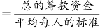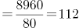人，则乙村学龄儿童有112-59=53人。

故正确答案为B。

**考点**：和差倍比问题、平均数问题

**来源**：2022年国家公务员录用考试《行测》题（副省级网友回忆版）第61题

### 第 62 题

甲、乙、丙、丁、戊5名职工参加党史知识测验，每人得分均不相同。甲和乙的平均分比丙多2分，丁和戊的平均分比丁多5分，甲、乙的平均分比丙、丁、戊的平均分多3分。问丙、丁、戊三人得分的排序为：

A. 丙>丁>戊

B. 丙>戊>丁

C. 丁>丙>戊

D. 戊>丙>丁

第 62 题 · 答案与解析

**参考答案（粉笔题库参考内容）**

D

**解析**

根据“丁和戊的平均分比丁多5分”，可知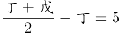，整理可得：戊=丁+10······①，可知戊＞丁。根据“甲和乙的平均分比丙多2分”，可知：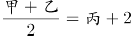······②；根据“甲、乙的平均分比丙、丁、戊的平均分多3分”，可知：(甲+乙)/2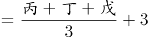，代入①可得：(甲+乙)/2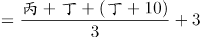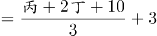······③，联立②③：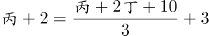，整理可得：丙=丁+6.5。则戊=丁+10＞丙=丁+6.5＞丁。

故正确答案为D。

**考点**：和差倍比问题

**来源**：2022年国家公务员录用考试《行测》题（副省级网友回忆版）第62题

### 第 63 题

企业列出500万元设备采购预算，如用于购买x台进口设备，最后剩余20万元。经董事会研究后，决定购买质量更高的同类国产设备，单价仅为进口设备的75%。当前预算可购买x+3台，最后剩余5万元。问国产设备的单价在以下哪个范围内？

A. 不到30万元/台

B. 30—40万元/台之间

C. 40—50万元/台之间

D. 50万元/台以上

第 63 题 · 答案与解析

**参考答案（粉笔题库参考内容）**

C

**解析**

根据题意，若购买x台进口设备，最后剩余20万元，则每台进口设备的单价为万元。若购买国产设备，单价为进口设备的75%，则每台国产设备的单价为。当前预算可购买国产设备x+3台，最后剩余5万元，可列式：，解得x=8。则共购买国产设备8+3=11台，花费495万元，其单价为万元，在C项范围内。

故正确答案为C。

**考点**：和差倍比问题

**来源**：2022年国家公务员录用考试《行测》题（副省级网友回忆版）第63题

### 第 64 题

甲和乙两个乡村图书室共有5000本藏书，其中甲图书室的藏书比乙图书室多3x本。现从甲图书室中取出150本书放入乙图书室后，甲图书室的藏书仍比乙图书室多2x本。问甲图书室原有图书多少本？

A. 2500

B. 2750

C. 2950

D. 3500

第 64 题 · 答案与解析

**参考答案（粉笔题库参考内容）**

C

**解析**

方法一：设甲图书室原有藏书y本，则乙图书室藏书为（y-3x）本，由题意可列方程：y+y-3x=5000······①；甲图书室中取出150本书放入乙图书室，此时甲图书室有藏书（y-150）本，则乙图书室藏书为（y-3x+150）本，由题意可列方程：（y-150）-（y-3x+150）=2x······②。通过②式解得x=300，代入①式，解得y=2950，即甲图书室原有图书2950本。

方法二：结合盈亏思想分析：从甲图书室中取出150本书放入乙图书室后，甲乙两个图书室的藏书之差从3x本变为2x本，即150×2=3x-2x，解得x=300。则原来甲图书室的藏书比乙图书室多3×300=900本，即原来甲-乙=900······①，又知甲和乙两个图书室共有5000本藏书，即甲+乙=5000······②，联立①②，解得甲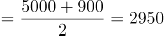，即甲图书室原有图书2950本。

故正确答案为C。

**考点**：和差倍比问题

**来源**：2022年国家公务员录用考试《行测》题（副省级网友回忆版）第64题

### 第 65 题

李某骑车从甲地出发前往乙地，出发时的速度为15千米/小时，此后均匀加速，骑行25%的路程后速度达到21千米/小时。剩余路段保持此速度骑行，总行程前半段比后半段多用时3分钟。问甲、乙两地之间的距离在以下哪个范围内？

A. 不到23千米

B. 在23~24千米之间

C. 在24~25千米之间

D. 超过25千米

第 65 题 · 答案与解析

**参考答案（粉笔题库参考内容）**

D

**解析**

设总行程为4S千米，则总行程前半段为2S千米，后半段为2S千米。总行程前25%的路程为匀加速运动，初速度为15千米/小时，末速度为21千米/小时，代入公式：匀加速运动平均速度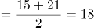千米/小时。根据“总行程前半段比后半段多用时3分钟”，可列方程：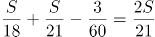，解得S=6.3千米，故甲、乙两地之间的距离4S=6.3×4=25.2千米，对应D项。

故正确答案为D。

**考点**：行程问题-其他

**来源**：2022年国家公务员录用考试《行测》题（副省级网友回忆版）第65题

### 第 66 题

高校某专业70多名毕业生中，有96%在毕业后去西部省区支援国家建设。其中去偏远中小学支教的毕业生占该专业毕业生总数的20%，比任职大学生村官的毕业生少2人，比在西部地区参军入伍的毕业生多1人，其余的毕业生选择去国有企业西部边远岗位工作。问去国有企业西部边远岗位工作的毕业生有多少人？

A. 32

B. 29

C. 26

D. 23

第 66 题 · 答案与解析

**参考答案（粉笔题库参考内容）**

C

**解析**

根据题意可知，，可知总毕业生人数为25的倍数，则总毕业生人数为75人，去西部省区支援国家建设的毕业生有75×96%=72人，去偏远中小学支教的毕业生有75×20%=15人，去任职大学生村官的毕业生有15+2=17人，在西部地区参军入伍的毕业生有15-1=14人，则去国有企业西部边远岗位工作的毕业生有72-15-17-14=26人。

故正确答案为C。

**考点**：和差倍比问题

**来源**：2022年国家公务员录用考试《行测》题（副省级网友回忆版）第66题

### 第 67 题

某地引进新的杂交水稻品种，今年每亩稻谷产量比上年增加了20%，且由于口感改善，每斤稻谷的售价从1.5元提升到1.65元。以此计算，今年每亩稻谷的销售收入比上年高660元。问今年的稻谷亩产是多少斤？

A. 2200

B. 1980

C. 1650

D. 1375

第 67 题 · 答案与解析

**参考答案（粉笔题库参考内容）**

C

**解析**

根据题意，假设上年每亩稻谷产量为x斤，则今年每亩稻谷产量为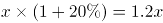斤。今年每亩稻谷的销售收入比上年高660元，即，解得x=1375，则今年的稻谷亩产为1.2×1375=1650斤。

故正确答案为C。

**考点**：经济利润问题

**来源**：2022年国家公务员录用考试《行测》题（副省级网友回忆版）第67题

### 第 68 题

甲地在丙地正西17千米，乙地在丙地正北8千米。张从甲地、李从乙地同时出发，分别向正东和正南方向匀速行走。两人速度均为整数千米/小时，且1小时后两人的直线距离为13千米，又经过3小时后两人均经过了丙地且直线距离为5千米。已知李的速度是张的60%，则张经过丙地的时间比李：

A. 早不到10分钟

B. 早10分钟以上

C. 晚不到10分钟

D. 晚10分钟以上

第 68 题 · 答案与解析

**参考答案（粉笔题库参考内容）**

D

**解析**

设张的速度为5m千米/小时，则李的速度为3m千米/小时。由题意可知，张、李两人1小时后直线距离为13千米，又经过3小时后直线距离为5千米，且此时均经过了丙地，即出发4小时后张、李两人分别到达图示甲、乙处。则根据勾股定理可得：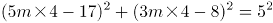，因两人速度均为整数千米/小时，则m=1时，符合题干所有要求。因此张到达丙地需17/5小时，即3小时24分钟，李到达丙地需8/3小时，即2小时40分钟，即张经过丙地的时间比李晚44分钟。

故正确答案为D。

**考点**：几何结论类-三角形相关、几何公式类-平面图形、普通行程

**来源**：2022年国家公务员录用考试《行测》题（副省级网友回忆版）第68题

### 第 69 题

某县通过发展旅游业来实现乡村振兴，引进了甲、乙、丙、丁、戊和己6名专家。其中甲、乙、丙是环境保护专家，丁、戊、己是旅游行业专家，甲、丁、戊熟悉社交媒体宣传。现要将6名专家平均分成2个小组，每个小组都要有环境保护专家、旅游行业专家和熟悉社交媒体宣传的人，问有多少种不同的分组方式？

A. 12

B. 24

C. 4

D. 8

第 69 题 · 答案与解析

**参考答案（粉笔题库参考内容）**

D

**解析**

方法一：由题意可知，6名专家平均分成2个小组，因分组为平均分组，故对应总情况数为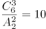种。考虑不满足题目要求的情况为：①小组3人不含有环境保护专家（丁戊己），②小组3人不含有旅游行业专家（甲乙丙），③小组不含有熟悉社交媒体宣传的人（乙丙己），由于①和②其实是同一种分组下的两组，故不满足题目要求的情况为2种。故满足要求的情况数为10-2=8种。

方法二：将熟悉社交媒体宣传的甲、丁、戊分成两部分：

①甲一组，丁、戊一组，要满足要求，剩下的乙、丙、己需选在乙、丙两人中选出一人与丁戊一组，只有（甲乙己、丙丁戊）和（甲丙己、乙丁戊）2种情况；

②丁一组，甲、戊一组，剩下的乙、丙、己选一个与甲、戊一组即可满足要求，有（丙丁己、甲乙戊）、（乙丁己、甲丙戊）、（乙丙丁、甲戊己）3种情况；

③戊一组，甲、丁一组，剩下的乙、丙、己选一个与甲、丁一组即可满足要求，有（丙戊己、甲乙丁）、（乙戊己、甲丙丁）、（乙丙戊、甲丁己）3种情况。

共2+3+3=8种情况满足要求。

故正确答案为D。

**考点**：基础排列组合

**来源**：2022年国家公务员录用考试《行测》题（副省级网友回忆版）第69题

### 第 70 题

某水果种植特色镇创办水果加工厂，从去年年初开始通过电商平台销售桃汁、橙汁两种产品。从去年2月开始，每个月桃汁的销量都比上个月多5000盒，橙汁的销量都比上个月多2000盒。已知去年第一季度桃汁的总销量比橙汁少4.5万盒，则去年桃汁的销量比橙汁：

A. 少不到5万盒

B. 少5万盒以上

C. 多不到5万盒

D. 多5万盒以上

第 70 题 · 答案与解析

**参考答案（粉笔题库参考内容）**

A

**解析**

根据题意，设去年1月桃汁销量为x万盒，去年1月橙汁销量为y万盒，根据等差数列通项公式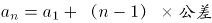，可将具体情况列表如下：

根据“去年第一季度桃汁的总销量比橙汁少4.5万盒”可知（y+y+0.2+y+0.4）-（x+x+0.5+x+1）=4.5，解得y-x=1.8万盒，根据等差数列求和公式，即桃汁去年总销量为万盒；橙汁去年总销量为万盒，故所求为12x+33-（12y+13.2）=12（x-y）+19.8=-1.8万盒，即少1.8万盒。

故正确答案为A。

**考点**：数列问题

**来源**：2022年国家公务员录用考试《行测》题（副省级网友回忆版）第70题

### 第 71 题

救灾部门紧急运送两批大米分给受灾群众。已知甲村人数是丙村的2倍，如果两批大米都给甲村，每人正好能分24斤；如果第一批大米分给乙村，每人正好能分12斤，第二批大米分给甲、乙、丙三个村，每人正好能分4斤。为尽量保障受灾群众的基本需求，现决定另运送一批面粉分给甲村，并将两批大米都分给乙、丙两村。问乙、丙两村平均每人分到的大米重量在以下哪个范围内？

A. 不到14斤

B. 14～15斤之间

C. 15～16斤之间

D. 16斤以上

第 71 题 · 答案与解析

**参考答案（粉笔题库参考内容）**

B

**解析**

设丙村有x人，乙村有y人，则甲村有2x人。根据两批大米的总重量不变，可列方程：24×2x=12y+4×（2x+y+x），解得y=(9/4)x，故两批大米都分给乙、丙两村，平均每人分到的大米重量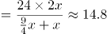斤，在B项范围内。

故正确答案为B。

**考点**：和差倍比问题

**来源**：2022年国家公务员录用考试《行测》题（副省级网友回忆版）第71题

### 第 72 题

为降低碳排放，企业对生产设备进行改造，改造后日产量下降了10%，但生产每件产品的能耗成本下降了50%，其他成本和出厂价不变的情况下每天的利润提高了10%。已知单件利润=出厂价-能耗成本-其他成本，且改造前产品的出厂价是单件利润的3倍，则改造前能耗成本为其他成本的：

A. 不到1/4

B. 1/4\-1/3之间

C. 1/3\-1/2之间

D. 超过1/2

第 72 题 · 答案与解析

**参考答案（粉笔题库参考内容）**

B

**解析**

设改造前能耗成本为x、其他成本为y、日产量为10、单件利润为100，则每天利润为1000、出厂价为300。根据每件产品的能耗成本下降了50%，可知改造后成本为0.5x；每天的利润提高了10%，可知改造后每天利润为1000×（1+10%）=1100；根据改造后日产量下降了10%，可知改造后日产量为9，则改造后单件利润为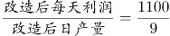。主体多可以考虑列表，表格如下图所示：

已知单件利润=出厂价-能耗成本-其他成本，根据改造前后可列方程组：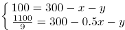，解得：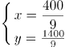，所求为：x/y=2/7，在1/4\-1/3之间。

故正确答案为B。

**考点**：经济利润问题

**来源**：2022年国家公务员录用考试《行测》题（副省级网友回忆版）第72题

### 第 73 题

一个圆柱体零件的高为1，其圆形底面上的内接正方形边长正好也为1。现将圆柱体零件切割4次，得到棱长为1的正方体，则切去部分的总表面积为：

A. √2(π+2)

B. 2√2(π−2)

C. (√2+1)π+2

D. 

第 73 题 · 答案与解析

**参考答案（粉笔题库参考内容）**

C

**解析**

如下图所示，圆形底面上的内接正方形的对角线即为圆的直径，则该圆柱体的底面直径=√2，半径=√2/2。要想得到棱长为1的正方体，则需要分别沿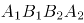、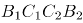、、切割4次，且切去的4个部分完全相同。切去部分的表面积包括圆柱体的侧面积、圆柱体的2个底面积扣除内接正方形的部分、正方体的4个侧面。故切去部分的总表面积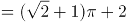。

故正确答案为C。

**考点**：几何结论类-三角形相关、几何公式类-立体图形

**来源**：2022年国家公务员录用考试《行测》题（副省级网友回忆版）第73题

### 第 74 题

甲和乙两条效率相同的生产线从早上不同时间开始生产同一种产品，到中午12：00时分别正好生产了x件和y件。已知乙生产x件时，甲生产了54件；甲生产y件时，乙生产了1.5x件。如乙从9：00开始生产且12：00后两条生产线仍保持原有速度，问两条生产线生产的产品总量达到500件是在什么时候？

A. 16：30之前

B. 16：30～17：00之间

C. 17：00～17：30之间

D. 17：30之后

第 74 题 · 答案与解析

**参考答案（粉笔题库参考内容）**

D

**解析**

根据甲和乙两条生产线效率相同，故在甲、乙均开始生产后，两条生产线生成产品数量的差值始终不变，则可列式：y-x=x-54=1.5x-y，解得x=72，y=90。由于乙从9：00开始生产，到12：00时乙生产了3小时，生产了90件，则甲、乙的效率均为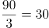件/小时。12：00时，甲、乙共生产72+90=162件，则两条生产线生产的产品总量达到500件还需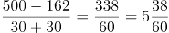小时，即时间为17：38时，两条生产线生产的产品总量达到500件。

故正确答案为D。

**考点**：给具体单位型

**来源**：2022年国家公务员录用考试《行测》题（副省级网友回忆版）第74题

### 第 75 题

某种商品的定价为成本的1.5倍，如果在降价30元/件的基础上再打八折，则销售5件这种商品的利润比原价销售1件时多130元。问用以下哪种折扣销售时，1.5万元能买到的件数正好比原价销售时多4件？

A. 先降价50元/件再打八折

B. 先打九折再降价50元/件

C. 降价150元/件

D. 打八五折

第 75 题 · 答案与解析

**参考答案（粉笔题库参考内容）**

B

**解析**

设该种商品每件成本为x元，则每件定价为1.5x元。根据题意可列方程：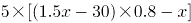，解得x=500，即该种商品每件成本为500元，则每件定价为1.5×500=750元。按原价销售时，1.5万元可购买件，按选项折扣销售时，1.5万元需购买20+4=24件，此时每件售价应为元。代入选项：

A项：折扣售价=(750-50)×0.8=560元≠625元，排除；

B项：折扣售价=750×0.9-50=625元，符合题意，当选。无需验证其他选项。

故正确答案为B。

**考点**：经济利润问题

**来源**：2022年国家公务员录用考试《行测》题（副省级网友回忆版）第75题

### 第 76 题

从所给的四个选项中，选择最合适的一个填入问号处，使之呈现一定的规律性：

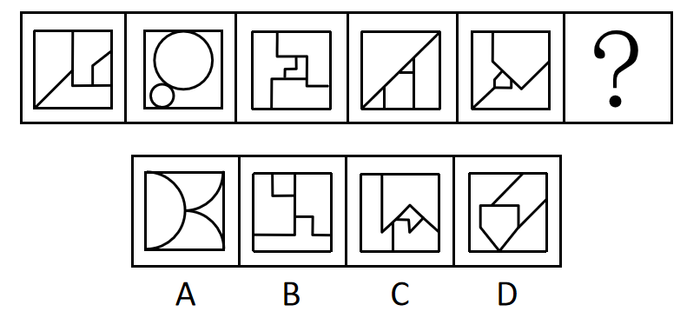

A. A

B. B

C. C

D. D

第 76 题 · 答案与解析

**参考答案（粉笔题库参考内容）**

C

**解析**

图形元素组成不同，无明显属性规律，优先考虑数量规律。图形封闭面较多，优先考虑数面，但数面无规律。再观察发现题干图形存在明显最大面和最小面，且二者形状相同，按照此规律只有C项符合。

故正确答案为C。

**考点**：数量规律-面

**来源**：2022年国家公务员录用考试《行测》题（副省级网友回忆版）第76题

### 第 77 题

从所给的四个选项中，选择最合适的一个填入问号处，使之呈现一定的规律性：

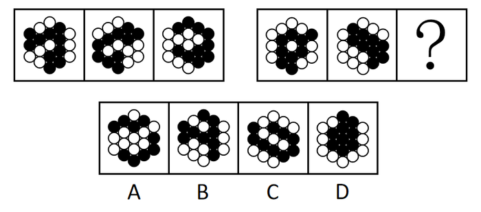

A. A

B. B

C. C

D. D

第 77 题 · 答案与解析

**参考答案（粉笔题库参考内容）**

D

**解析**

图形元素组成相同，但无明显位置规律。观察发现，题干所有图形黑球全部相连，优先考虑部分数。第一组图形中黑球的部分数均是1，第二组图形中黑球的部分数也均是1，故？处应选择一个黑球的部分数为1的图形，排除A项。通过黑球的部分数无法得出唯一答案，再看白球的部分数，观察发现，第一组图形中白球的部分数依次为3、2、1，第二组图形中白球的部分数依次为3、2、？，故？处应选择一个白球的部分数为1的图形，只有D项符合。

故正确答案为D。

**考点**：黑白块类、数量规律-素

**来源**：2022年国家公务员录用考试《行测》题（副省级网友回忆版）第77题

### 第 78 题

从所给的四个选项中，选择最合适的一个填入问号处，使之呈现一定的规律性：

A. A

B. B

C. C

D. D

第 78 题 · 答案与解析

**参考答案（粉笔题库参考内容）**

B

**解析**

元素组成不同，且无明显属性规律，考虑数量规律。题干所给的黑块图形出现多个明显的直角，优先考虑直角数。第一组图形中，黑块图形内部的直角个数依次为1、2、3。第二组图形运用规律，图1、图2黑块图形内部的直角个数分别为1、2，故“？”处应选择黑块图形内部直角个数为3的图形，只有B项符合。

故正确答案为B。

**考点**：数量规律-角

**来源**：2022年国家公务员录用考试《行测》题（副省级网友回忆版）第78题

### 第 79 题

从所给的四个选项中，选择最合适的一个填入问号处，使之呈现一定的规律性：

A. A

B. B

C. C

D. D

第 79 题 · 答案与解析

**参考答案（粉笔题库参考内容）**

A

**解析**

题干每行图形均由相同的黑白球组成，元素组成相同，优先考虑位置规律。九宫格题目优先看横行。观察发现，在第一行图形中，上半部分的黑球每次逆时针平移一格，在前两行小球中转圈走，下半部分的黑球每次向左平移一格，在每一行小球中走到最左边后，再从最右边从头开始向左走（循环走）。观察可知，第二行图形同样符合此规律，同理第三行也应满足此规律。在第三行图形中，第三幅图应该在第二幅图的基础上，上半部分的黑球逆时针平移一格，下半部分的黑球向左平移一格（循环走），只有A项符合。

故正确答案为A。

**考点**：位置规律-平移

**来源**：2022年国家公务员录用考试《行测》题（副省级网友回忆版）第79题

### 第 80 题

左图是给定纸盒的外表面，下面哪项能由它折叠而成？

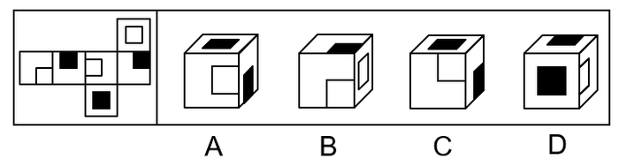

A. A

B. B

C. C

D. D

第 80 题 · 答案与解析

**参考答案（粉笔题库参考内容）**

A

**解析**

将原展开图标上序号如下图，逐一进行分析。

A项：选项出现了面g、面k和面f，选项与题干展开图一致，当选；

B项：选项出现了面e、面i和面h，面e和面h的公共边挨着面e中的小白块，而题干的面e和面h的公共边没有挨着面e中的小白块，选项与题干展开图不一致，排除；

C项：选项出现了面e、面k和面i，面e和面i的公共边挨着面e中的小白块，而题干的面e和面i的公共边没有挨着面e中的小白块，选项与题干展开图不一致，排除；

D项：选项出现了面k、面f和面g，面f和面g的公共边没有挨着面g中的小白块，而题干中面f和面g的公共边挨着面g中的小白块，选项与题干展开图不一致，排除。

故正确答案为A。

**考点**：空间类-空间重构-六面体

**来源**：2022年国家公务员录用考试《行测》题（副省级网友回忆版）第80题

### 第 81 题

左图是给定的空心立体图形，将其从任一面剖开，右边哪项可能是该立体图形的截面？

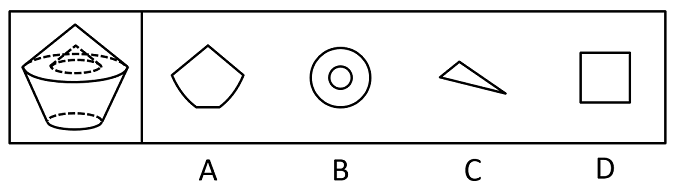

A. A

B. B

C. C

D. D

第 81 题 · 答案与解析

**参考答案（粉笔题库参考内容）**

B

**解析**

本题考查截面图，逐一分析选项。

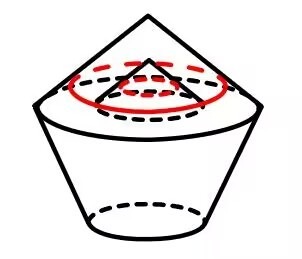

A项：无法切出，排除；

B项：从图形上半部分横着切，经过中间空心部分即可得到，当选；

C项：无法切出，排除；

D项：无法切出，排除。

故正确答案为B。

**考点**：空间类-截面图

**来源**：2022年国家公务员录用考试《行测》题（副省级网友回忆版）第81题

### 第 82 题

左图给定的是由相同正方体堆叠而成的多面体。该多面体可以由①、②和③三个多面体组合而成，以下哪项能填入问号处？

A. A

B. B

C. C

D. D

第 82 题 · 答案与解析

**参考答案（粉笔题库参考内容）**

D

**解析**

本题考查立体拼合。

观察题干给出的多面体可知，图形可分为3层，由上至下第一层有2个小立方体，第二层有7个小立方体，第三层有9个小立方体。观察发现，图②共有3层，由上至下第一层有2个小立方体，第二层有1个小立方体，第三层有3个小立方体，可以拼合在多面体右侧，如下图所示，则题干多面体第二层还剩余6个小立方体，第三层还剩余6个小立方体。图①最下层的5个小立方体排列形状与题干多面体第二层剩余的形状相似，故图①最下层可以拼合在多面体第二层，最上层可以拼合在多面体第三层，如下图所示。根据凹凸一致的原则，剩余的形状只有D项符合。具体组合方式如下图所示：

故正确答案为D。

**考点**：空间类-立体拼合

**来源**：2022年国家公务员录用考试《行测》题（副省级网友回忆版）第82题

### 第 83 题

把下面的六个图形分为两类，使每一类图形都有各自的共同特征或规律，分类正确的一项是：

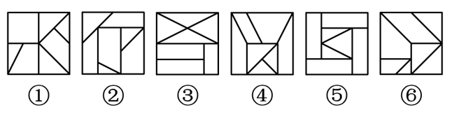

A. ①②③，④⑤⑥

B. ①④⑤，②③⑥

C. ①②④，③⑤⑥

D. ①③⑥，②④⑤

第 83 题 · 答案与解析

**参考答案（粉笔题库参考内容）**

D

**解析**

本题为分组分类题目。元素组成不同，且无明显属性规律，考虑数量规律。观察发现，题干图形被分割明显，考虑面数量，但整体数面无法分组，所有图形的面数量均为7。再次观察发现，题干图形存在较多的三角形面，则考虑数三角形面的个数，图①③⑥均有4个三角形面，图②④⑤均有3个三角形面，故图①③⑥为一组，图②④⑤为一组。

故正确答案为D。

**考点**：数量规律-面

**来源**：2022年国家公务员录用考试《行测》题（副省级网友回忆版）第83题

### 第 84 题

把下面的六个图形分为两类，使每一类图形都有各自的共同特征或规律，分类正确的一项是：

A. ①②⑤，③④⑥

B. ①③④，②⑤⑥

C. ①⑤⑥，②③④

D. ①②④，③⑤⑥

第 84 题 · 答案与解析

**参考答案（粉笔题库参考内容）**

A

**解析**

本题为分组分类题目。元素组成不同，优先考虑属性规律。观察可知，题干图形比较规整，考虑对称性。图①②⑤一组，对称轴穿过图中的两个交点；图③④⑥一组，对称轴穿过图中的两条线，并且这两条线和对称轴垂直，对应A项。

故正确答案为A。

**考点**：属性规律-对称性

**来源**：2022年国家公务员录用考试《行测》题（副省级网友回忆版）第84题

### 第 85 题

把下面的六个图形分为两类，使每一类图形都有各自的共同特征或规律，分类正确的一项是：

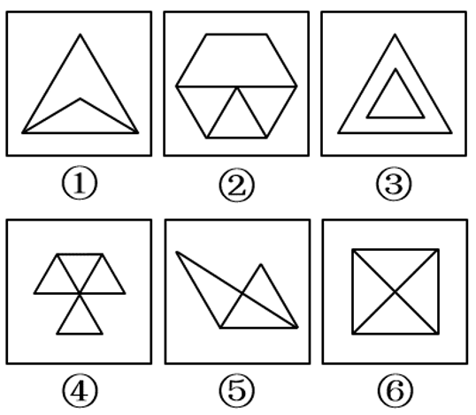

A. ①②⑤，③④⑥

B. ①②③，④⑤⑥

C. ①③⑥，②④⑤

D. ①④⑤，②③⑥

第 85 题 · 答案与解析

**参考答案（粉笔题库参考内容）**

D

**解析**

本题为分组分类题目。元素组成不同，无明显属性规律，考虑数量规律。观察发现，图①和图⑥分别为“日”字、“田”字的变形图，考虑笔画数。图①④⑤为一笔画图形，图②③⑥为两笔画图形。即图①④⑤一组，图②③⑥一组。

故正确答案为D。

**考点**：数量规律-线

**来源**：2022年国家公务员录用考试《行测》题（副省级网友回忆版）第85题

### 第 86 题

归因不变性原则是指人们会寻找某一特定结果与特定原因之间的不变联系，如果某种特定原因在许多情境下总是与某种结果相伴，人们就会把特定结果归结于那一原因。归因折扣原则是指人们不完全相信某一现象的形成确是由于某种原因所导致，即某一特定原因在产生特定结果中的作用，如果存在其他似是而非的原因，应该“打折扣”。

根据上述定义，两类归因原则均没有体现的是：

A. 电视广告中明星推销洗发水时，观众觉得她的一头秀发不完全是因为洗发水才有的

B. 创业失败总会使创业者背负债务，创业者小罗这几年债台高筑，朋友认为他一定是创业失败了

C. 在代理了诸多离婚案件后，律师小林统计发现离婚诉讼中大多数争议与财产纠纷有关

D. 对一系列盗窃案的分析显示，现场都出现过同一个男人，人们容易假定该男人就是犯罪嫌疑人

第 86 题 · 答案与解析

**参考答案（粉笔题库参考内容）**

C

**解析**

第一步：找出定义关键词。

归因不变性原则：“某种特定原因在许多情境下总是与某种结果相伴”、“人们就会把特定结果归结于那一原因”；

归因折扣原则：“人们不完全相信某一现象的形成确是由于某种原因所导致”。

第二步：逐一分析选项。

A项：该项中观众觉得明星的秀发不完全是因为洗发水才有的，符合“人们不完全相信某一现象的形成确是由于某种原因所导致”，符合归因折扣原则定义，排除；

B项：该项中创业失败总会导致创业者背负债务，符合“某种特定原因在许多情境下总是与某种结果相伴”，朋友认为小罗这几年债台高筑的原因是创业失败，符合“人们就会把特定结果归结于那一原因”，符合归因不变性原则定义，排除；

C项：该项中律师小林发现离婚诉讼中大多数争议与财产纠纷有关，并没有体现人们是否将离婚诉讼这个结果归结于财产纠纷，不符合“某种特定原因在许多情境下总是与某种结果相伴”、“人们就会把特定结果归结于那一原因”，不符合归因不变性原则定义，同时该项也没有体现人们对于财产纠纷这个原因的质疑，不符合“人们不完全相信某一现象的形成确是由于某种原因所导致”，不符合归因折扣原则定义，当选；

D项：该项中盗窃案的现场都出现了同一个男人，符合“某种特定原因在许多情境下总是与某种结果相伴”，人们容易假定该男人就是盗窃案的犯罪嫌疑人，符合“人们就会把特定结果归结于那一原因”，符合归因不变性原则定义，排除。

本题为选非题，故正确答案为C。

**考点**：特殊问法

**来源**：2022年国家公务员录用考试《行测》题（副省级网友回忆版）第86题

### 第 87 题

按调查范围来看，可将调查分为全面调查和非全面调查。全面调查指的是一定范围内的情况普查；非全面调查是指从总体中抽取一部分对象进行情况调查，又可分为：根据随机原则选择样本的抽样调查和有意识选取若干样本进行的典型调查。

根据上述定义，下列说法正确的是：

A. 对某市幼儿园所有儿童进行口腔卫生检查，这属于非全面调查

B. 对省内1~3年级的全体学生进行体育活动时间的调查，这属于非全面调查

C. 对全国招生规模较大的前30所医学院校进行学生就业情况调查，这属于典型调查

D. 对某市中考数学成绩最好的几所学校进行调查，总结相关经验，这属于抽样调查

第 87 题 · 答案与解析

**参考答案（粉笔题库参考内容）**

C

**解析**

第一步：找出定义关键词。

全面调查：“一定范围内的情况普查”；

非全面调查：“从总体中抽取一部分对象进行情况调查”；

抽样调查：“根据随机原则选择样本”；

典型调查：“有意识选取若干样本”。

第二步：逐一分析选项。

A项：对某市幼儿园所有儿童进行口腔卫生检查，符合“一定范围内的情况普查”，符合“全面调查”的定义，不符合“非全面调查”的定义，排除；

B项：对省内1~3年级的全体学生进行的调查，符合“一定范围内的情况普查”，符合“全面调查”的定义，不符合“非全面调查”的定义，排除；

C项：在医学院校里选取了规模较大的前30所院校进行调查，不是随机选择，是有意识地选取一部分进行调查，符合“有意识选取若干样本”，符合“典型调查”的定义，当选；

D项：对某市中考数学成绩最好的几所学校进行调查，不是随机选择，是有意识地选取一部分进行调查，符合“有意识选取若干样本”，符合“典型调查”的定义，不符合“抽样调查”的定义，排除。

故正确答案为C。

**考点**：特殊问法

**来源**：2022年国家公务员录用考试《行测》题（副省级网友回忆版）第87题

### 第 88 题

对于特定论域中的任意两个对象a、b而言，当对象a与对象b之间具有关系R时，对象b与对象a之间是否也具有关系R？基于此，对称性关系命题可分为正对称关系、反对称关系和半对称关系。（1）正对称关系：若对象a与b之间具有关系R，则对象b与a之间也具有关系R；（2）反对称关系：若对象a与b之间具有关系R，则对象b与a之间一定不具有关系R；（3）半对称关系：若对象a与b之间具有关系R，则对象b与a之间不一定具有关系R。

根据上述定义，下列关系属于半对称关系的是：

A. 学生之间的同学关系

B. 两个分数之间的小于关系

C. 人与人之间的帮助关系

D. 城市与城市之间的相邻关系

第 88 题 · 答案与解析

**参考答案（粉笔题库参考内容）**

C

**解析**

第一步：找出定义关键词。

正对称关系：“若对象a与b之间具有关系R，则对象b与a之间也具有关系R”；

反对称关系：“若对象a与b之间具有关系R，则对象b与a之间一定不具有关系R”；

半对称关系：“若对象a与b之间具有关系R，则对象b与a之间不一定具有关系R”。

第二步：逐一分析选项。

A项：若学生a与学生b之间具有同学关系R，则学生b与学生a之间也具有同学关系R，符合“若对象a与b之间具有关系R，则对象b与a之间也具有关系R”，符合“正对称关系”定义，不符合“半对称关系”定义，排除；

B项：若分数a与分数b之间具有小于关系R，则分数b与分数a之间一定不具有小于关系R，而是具有大于关系，符合“若对象a与b之间具有关系R，则对象b与a之间一定不具有关系R”，符合“反对称关系”定义，不符合“半对称关系”定义，排除；

C项：若一个人a帮助了另一个人b（即a与b之间具有帮助关系R），不能确定b是否也帮助了a（即b与a之间不一定具有帮助关系R，可能有也可能没有），符合“若对象a与b之间具有关系R，则对象b与a之间不一定具有关系R”，符合“半对称关系”定义，当选；

D项：若城市a与城市b之间具有相邻关系R，则城市b与城市a之间也具有相邻关系R，符合“若对象a与b之间具有关系R，则对象b与a之间也具有关系R”，符合“正对称关系”定义，不符合“半对称关系”定义，排除。

故正确答案为C。

**考点**：常规问法

**来源**：2022年国家公务员录用考试《行测》题（副省级网友回忆版）第88题

### 第 89 题

司法物理鉴定是运用物理学原理和方法，即通过检验确定物质的颜色、硬度、结构、比重、熔点、沸点、浓度、导电导热系数等物理属性，或显现肉眼看不见的痕迹特征，对与案件有关的痕迹、物品进行鉴认、识别的一种技术手段。

根据上述定义，下列仅使用了司法物理鉴定手段的是：

A. 选用试剂对被害人胃内容物进行分离、提纯，明确其中毒类型

B. 通过技术手段复原受害人被删除的手机信息，排查案件嫌疑人

C. 使用天平称量案件中伪造文件的重量，并采用试剂染色法检验纸浆的种类

D. 利用不同波长光对受害者衣物进行照射，通过观察颜色、透射率来辨别色料种类

第 89 题 · 答案与解析

**参考答案（粉笔题库参考内容）**

D

**解析**

第一步：找出定义关键词。

“运用物理学原理和方法”、“检验确定物质的颜色、硬度、结构、比重、熔点、沸点、浓度、导电导热系数等物理属性”、“显现肉眼看不见的痕迹特征”、“与案件有关的痕迹、物品进行鉴认、识别”。

第二步：逐一分析选项。

A项：选用试剂对被害人胃内容物进行分离、提纯，是运用了化学分析的原理和方法，不符合“运用物理学原理和方法”、“检验确定物质的颜色、硬度、结构、比重、熔点、沸点、浓度、导电导热系数等物理属性”，不符合定义，排除；

B项：复原受害人被删除的手机信息，排查案件嫌疑人，是运用了技术手段进行分析，不符合“运用物理学原理和方法”、“检验确定物质的颜色、硬度、结构、比重、熔点、沸点、浓度、导电导热系数等物理属性”，不符合定义，排除；

C项：使用天平称量案件中伪造文件的重量，符合“运用物理学原理和方法”、“检验确定物质的颜色、硬度、结构、比重、熔点、沸点、浓度、导电导热系数等物理属性”，但采用试剂染色法检验纸浆的种类，试剂染色法主要利用化学试剂与被检物中某些物质发生显色、沉淀或结晶反应的现象来进行检验，不符合“运用物理学原理和方法”，不符合仅使用了司法物理鉴定手段，不符合定义，排除；

D项：利用不同波长光对衣物进行照射，观察颜色、透射率，光线照射衣物属于物理方法，符合“运用物理学原理和方法”、“检验确定物质的颜色”、“显现肉眼看不见的痕迹特征”，且检验的是受害者衣物，符合“与案件有关的痕迹、物品进行鉴认、识别”，符合定义，当选。

故正确答案为D。

**考点**：方式目的

**来源**：2022年国家公务员录用考试《行测》题（副省级网友回忆版）第89题

### 第 90 题

由于人类建设活动的破坏和干扰，生物群体原来连续成片的生活环境被割裂，形成分散的岛状甚至碎片状的生境，生境廊道是指连接破碎化生境并适宜生物生活、移动或扩散的通道，便于实现物种基因、能量、物质的流动。

根据上述定义，下列不属于生境廊道的是：

A. 国家公园内，两棵参天古树跨过公路上方枝叶相连，金丝猴借助古树跨越公路。不同区域的金丝猴群可以保持接触

B. 为了让野生象群在两个自然保护区之间迁移，管理者设计建成了迁移通道，避开村寨，并保证该区域范围内有丰富的水和食物资源

C. 某地将过去严重污染的河道改造为河滨公园，架设了多座拱桥，美化了环境，方便了交通，还吸引了大量鸟类来此栖息

D. 为避免青藏铁路隔断藏羚羊迁徙路线，动物学家设计了桥梁下方、隧道上方及路基缓坡3种形式的野生动物通路

第 90 题 · 答案与解析

**参考答案（粉笔题库参考内容）**

C

**解析**

第一步：找出定义关键词。

“连接破碎化生境”、“适宜生物生活、移动或扩散的通道”、“便于实现物种基因、能量、物质的流动”。

第二步：逐一分析选项。

A项：两棵参天古树跨过公路上方枝叶相连，符合“连接破碎化生境”，不同区域的金丝猴群可以通过相连的枝叶来保持接触，实现基因、能量、物质的流动，符合“适宜生物生活、移动或扩散的通道”、“便于实现物种基因、能量、物质的流动”，符合定义，排除；

B项：管理者在两个自然保护区之间建立迁移通道，符合“连接破碎化生境”，野生象群可以通过迁移通道实现基因、能量、物质的流动，符合“适宜生物生活、移动或扩散的通道”、“便于实现物种基因、能量、物质的流动”，符合定义，排除；

C项：某地将严重污染的河道改造为河滨公园，但河滨公园只是鸟类的栖息地，没有体现对于破碎化生境的连接，不符合“连接破碎化生境”、“适宜生物生活、移动或扩散的通道”，不符合定义，当选；

D项：动物学家设计野生动物通路来避免藏羚羊的迁移路线被阻隔，符合“连接破碎化生境”，多种形式的野生动物通路可以让藏羚羊之间实现基因、能量、物质的流动，符合“适宜生物生活、移动或扩散的通道”、“便于实现物种基因、能量、物质的流动”，符合定义，排除。

本题为选非题，故正确答案为C。

**考点**：方式目的

**来源**：2022年国家公务员录用考试《行测》题（副省级网友回忆版）第90题

### 第 91 题

领主属宾句是汉语中的一种句式，句子主干由主语、动词和宾语三个部分组成。这种句子的主语和宾语之间具有比较稳定的“领有——隶属”关系：主语是“领有”的一方，宾语是“隶属”的一方；句子的动词和主语没有直接的语义关系。

根据上述定义，下列属于领主属宾句的是：

A. 他的脸上长了一点肉

B. 从远处走来一个挑夫

C. 去年他烂了一车苹果

D. 他头顶上飞过一只鸟

第 91 题 · 答案与解析

**参考答案（粉笔题库参考内容）**

C

**解析**

第一步：找出定义关键词。

“句子主干由主语、动词和宾语三个部分组成”、“主语和宾语之间具有比较稳定的‘领有——隶属’关系：主语是‘领有’的一方，宾语是‘隶属’的一方”、“句子的动词和主语没有直接的语义关系”。

第二步：逐一分析选项。

A项：“他的脸上长了一点肉”中，主语是“他的脸上”，动词是“长”，宾语是“一点肉”，符合“句子主干由主语、动词和宾语三个部分组成”、“主语和宾语之间具有比较稳定的‘领有——隶属’关系：主语是‘领有’的一方，宾语是‘隶属’的一方”，但是主语“他的脸上”和动词“长”是有直接语义关系的，不符合“句子的动词和主语没有直接的语义关系”，不符合定义，排除；

B项：“从远处走来一个挑夫”中，只有宾语“挑夫”，没有主语，不符合“句子主干由主语、动词和宾语三个部分组成”，不符合定义，排除；

C项：“去年他烂了一车苹果”中，主语是“他”，动词是“烂”，宾语是“一车苹果”，符合“句子主干由主语、动词和宾语三个部分组成”、“主语和宾语之间具有比较稳定的‘领有——隶属’关系：主语是‘领有’的一方，宾语是‘隶属’的一方”。主语“他”和动词“烂”没有直接的语义关系，符合“句子的动词和主语没有直接的语义关系”，符合定义，当选；

D项：“他头顶上飞过一只鸟”是倒装句，即“一只鸟从他头顶飞过”，该句中主语是“一只鸟”，动词是“飞过”，没有宾语，不符合“句子主干由主语、动词和宾语三个部分组成”，不符合定义，排除。

故正确答案为C。

**考点**：单定义-其他句式

**来源**：2022年国家公务员录用考试《行测》题（副省级网友回忆版）第91题

### 第 92 题

基因污染指原生物种基因库非预期或不受控制的基因流动，即外源基因通过转基因作物、外来入侵物种、家养动物等扩散到其他栽培作物或自然野生物种并成为后者基因的一部分。

根据上述定义，下列没有体现出基因污染的是：

A. 某农场生产的大豆发现了转基因成分Bt基因，这些成分是附近地区种植的基因工程Bt大豆通过交叉授粉传播过来的

B. 黑足猫是一种体型娇小但捕猎能力超强的野生猫，跑到野外的家猫和黑足猫交配后，生出血统不纯正的黑足猫，真正的黑足猫几近灭绝

C. 转基因SL玉米获批做动物饲料，SL玉米只占某国玉米总产量的1%，但一年后该国22%的玉米样本被认定含有SL玉米基因

D. 某国开发出耐除草剂的转基因油菜，油菜出油率提高，但这种油菜种子能在土壤中休眠数年，因此成为其他作物中的“杂草”

第 92 题 · 答案与解析

**参考答案（粉笔题库参考内容）**

D

**解析**

第一步：找出定义关键词。

“外源基因通过转基因作物、外来入侵物种、家养动物等扩散到其他栽培作物或自然野生物种”、“成为后者基因的一部分”。

第二步：逐一分析选项。

A项：Bt基因通过基因工程种植的大豆扩散到了农场生产的大豆中，符合“外源基因通过转基因作物、外来入侵物种、家养动物等扩散到其他栽培作物或自然野生物种”、“成为后者基因的一部分”，符合定义，排除；

B项：家猫的基因扩散到了新生的黑足猫中，符合“外源基因通过转基因作物、外来入侵物种、家养动物等扩散到其他栽培作物或自然野生物种”、“成为后者基因的一部分”，符合定义，排除；

C项：SL玉米基因通过转基因SL玉米扩散到了该国的其他玉米中，符合“外源基因通过转基因作物、外来入侵物种、家养动物等扩散到其他栽培作物或自然野生物种”、“成为后者基因的一部分”，符合定义，排除；

D项：转基因油菜成为了其他作物中的“杂草”，没有体现通过基因扩散到了其他物种中，不符合“外源基因通过转基因作物、外来入侵物种、家养动物等扩散到其他栽培作物或自然野生物种”、“成为后者基因的一部分”，不符合定义，当选。

本题为选非题，故正确答案为D。

**考点**：方式目的

**来源**：2022年国家公务员录用考试《行测》题（副省级网友回忆版）第92题

### 第 93 题

总量指标动态数列是将反映某种社会经济现象的一系列总量指标按时间先后顺序排列形成的数列，可分为两类：（1）时期数列：每个指标都表示社会经济现象在一定时期内发展过程的总量，各指标值可以相加，指标数值的大小与时期长短有直接关系；（2）时点数列：每个指标都表示社会经济现象在某一时点（时刻）上的数量，各指标值不能相加，指标数值大小和“时点间隔”长短没有直接关系，每个指标通常都是定期（间断）登记取得的。

根据上述定义，下列属于时点数列的是：

A. 2016~2020年某市税收情况

B. 2017~2020年某公司员工人数情况

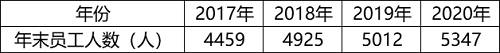

C. 2021年1~5月某地区城镇私营单位就业人员月均工资

D. 2020年某地区各季度电动汽车生产产量

第 93 题 · 答案与解析

**参考答案（粉笔题库参考内容）**

B

**解析**

第一步：找出定义关键词。

总量指标动态数列：“将反映某种社会经济现象的一系列总量指标按时间先后顺序排列”；

时期数列：“每个指标都表示社会经济现象在一定时期内发展过程的总量”、“各指标值可以相加”、“指标数值的大小与时期长短有直接关系”；

时点数列：“每个指标都表示社会经济现象在某一时点（时刻）上的数量”、“各指标值不能相加”、“指标数值大小和‘时点间隔’长短没有直接关系，每个指标通常都是定期（间断）登记取得的”。

第二步：逐一分析选项。

A项：选项中每项指标表示的是每一年的税收情况，属于一定时期内的总量，符合“每个指标都表示社会经济现象在一定时期内发展过程的总量”，符合“时期数列”定义，不符合“时点数列”定义，排除；

B项：选项中每项指标表示的是每一年的年末员工人数，“年末”是个时点，符合“每个指标都表示社会经济现象在某一时点（时刻）上的数量”，指标是年末的人数，不能相加，符合“各指标值不能相加”，且和时间长短没有直接关系，统计每年的年末数据，说明其是间断取得的，符合“指标数值大小和‘时点间隔’长短没有直接关系，每个指标通常都是定期（间断）登记取得的”，符合“时点数列”定义，当选；

C项：选项中每项指标表示的是每月的平均工资，是一整月的工资平均值，不是某一时点（时刻）上的数量，不符合“每个指标都表示社会经济现象在某一时点（时刻）上的数量”，不符合“时点数列”定义，排除；

D项：选项中每项指标表示的是每一季度的生产产量，属于一定时期内的总量，符合“每个指标都表示社会经济现象在一定时期内发展过程的总量”，符合“时期数列”定义，不符合“时点数列”定义，排除。

故正确答案为B。

**考点**：常规问法

**来源**：2022年国家公务员录用考试《行测》题（副省级网友回忆版）第93题

### 第 94 题

在卫生经济学评价中，直接成本是指与疾病有关的预防、诊断、治疗和康复等所支出的费用，包括直接医疗成本和直接非医疗成本。直接医疗成本是指与医疗服务的提供直接相关的医疗成本，包括一切必要的医学检验和检查的成本，以及卫生服务管理成本和所有后续治疗成本。直接非医疗成本是指与医疗服务的提供直接相关的非医疗成本。

根据上述定义，下列没有体现上述成本的是：

A. 患者李某前往医院看夜间急诊的出租车费

B. 患者赵某因右臂受伤停工造成的工资损失

C. 在口腔科拔取智齿前，患者于某支付的血常规化验费

D. 在陪同女儿去外地做手术期间，何某住宾馆支付的住宿费

第 94 题 · 答案与解析

**参考答案（粉笔题库参考内容）**

B

**解析**

第一步：找出定义关键词。

直接成本：“与疾病有关的预防、诊断、治疗和康复等所支出的费用”；

直接医疗成本：“与医疗服务的提供直接相关的医疗成本”、“包括一切必要的医学检验和检查的成本”、“卫生服务管理成本和所有后续治疗成本”；

直接非医疗成本：“与医疗服务的提供直接相关的非医疗成本”。

第二步：逐一分析选项。

A项：患者李某前往医院看夜间急诊的出租车费，是前往医疗机构治疗疾病所支付的非医疗费用，符合“与医疗服务的提供直接相关的非医疗成本”，符合“直接非医疗成本”的定义，排除；

B项：患者赵某因受伤停工造成的工资损失，不是为疾病所支出的费用，不符合“与疾病有关的预防、诊断、治疗和康复等所支出的费用”，不符合“直接成本”的定义，即也不符合“直接医疗成本”和“直接非医疗成本”的定义，当选；

C项：患者于某支付的血常规化验费，是为诊断疾病所支出的费用，符合“与医疗服务的提供直接相关的医疗成本”、“包括一切必要的医学检验和检查的成本”，符合“直接医疗成本”的定义，排除；

D项：何某陪同女儿做手术期间支付的住宿费，是为了治疗疾病所支付的非医疗费用，符合“与医疗服务的提供直接相关的非医疗成本”，符合“直接非医疗成本”的定义，排除。

本题为选非题，故正确答案为B。

**考点**：特殊问法

**来源**：2022年国家公务员录用考试《行测》题（副省级网友回忆版）第94题

### 第 95 题

地球物理勘探是通过研究和观测各种地球物理场的变化来探测地层岩性、地质构造等地质条件的过程。由于组成地壳的不同岩层介质往往在密度、弹性、导电性等方面存在差异，这些差异将引起相应的地球物理场的局部变化，通过测量这些物理场的分布和变化特征，结合已知地质资料进行分析研究，就可以达到推断地质性状的目的。

根据上述定义，下列不属于地球物理勘探的是：

A. 根据岩石和矿石导电性、电磁感应特性等来记录地层界面的深度和形态

B. 利用人工激发的地震波在弹性不同地层内的传播规律，了解水文地质的分布情况

C. 采集岩石样品，分析岩石内的微量元素，通过发现与矿化有关的原生异常来寻找矿床

D. 通过观测不同岩石引起的重力差异，判断地下地层的岩性及状态，确定沉积盆地范围

第 95 题 · 答案与解析

**参考答案（粉笔题库参考内容）**

C

**解析**

第一步：找出定义关键词。

“研究和观测各种地球物理场的变化”、“探测地层岩性、地质构造等地质条件”、“密度、弹性、导电性”、“达到推断地质性状的目的”。

第二步：逐一分析选项。

A项：导电性、电磁感应特性都属于物理场的范畴，符合“研究和观测各种地球物理场的变化”、“密度、弹性、导电性”，记录地层界面的深度和形态，符合“探测地层岩性、地质构造等地质条件”、“达到推断地质性状的目的”，符合定义，排除；

B项：利用人工激发的地震波在弹性不同地层内的传播规律，符合“研究和观测各种地球物理场的变化”、“密度、弹性、导电性”，了解水文地质的分布情况，符合“探测地层岩性、地质构造等地质条件”、“达到推断地质性状的目的”，符合定义，排除；

C项：分析岩石内的微量元素，是在分析岩石的化学成分，不属于物理场的范畴，不符合关键词“研究和观测各种地球物理场的变化”，不符合定义，当选；

D项：重力差异属于物理场的范畴，符合“研究和观测各种地球物理场的变化”，判断地下地层的岩性及状态，确定沉积盆地范围，符合“探测地层岩性、地质构造等地质条件”、“达到推断地质性状的目的”，符合定义，排除。

本题为选非题，故正确答案为C。

**考点**：方式目的

**来源**：2022年国家公务员录用考试《行测》题（副省级网友回忆版）第95题

### 第 96 题

珍珠：珍珠婚

A. 蘑菇：蘑菇云

B. 母亲：母亲河

C. 面包：面包树

D. 槐花：槐花蜜

第 96 题 · 答案与解析

**参考答案（粉笔题库参考内容）**

B

**解析**

第一步：判断题干词语间逻辑关系。

珍珠婚是指像珍珠一样珍贵的婚姻关系，后者是根据前者的内在特性进行类比而命名的，二者是对应关系。

第二步：判断选项词语间逻辑关系。

A项：蘑菇云是指由于爆炸而产生的强大的爆炸云，是因为其形状类似于蘑菇而命名的，后者是根据前者的外在特性进行类比而命名的，与题干逻辑关系不一致，排除；

B项：母亲河是指像母亲一样哺育人民的河流，后者是根据前者的内在特性进行类比而命名的，二者是对应关系，与题干逻辑关系一致，当选；

C项：面包树是一种木本植物，果实淀粉含量非常丰富，是因为其果实风味类似面包而命名的，与题干逻辑关系不一致，排除；

D项：槐花蜜是蜜蜂采集洋槐花蜜酿造而成的蜂蜜，是根据其原材料而命名的，与题干逻辑关系不一致，排除。

故正确答案为B。

**考点**：逻辑关系-对应关系

**来源**：2022年国家公务员录用考试《行测》题（副省级网友回忆版）第96题

### 第 97 题

呼吸系统：生殖系统

A. 生产计划：年度计划

B. 观赏花卉：药用花卉

C. 水面舰艇：巡洋舰艇

D. 简牍公文：纸质公文

第 97 题 · 答案与解析

**参考答案（粉笔题库参考内容）**

D

**解析**

第一步：判断题干词语间逻辑关系。

呼吸系统和生殖系统是两种不同的人体系统，二者是并列关系。

第二步：判断选项词语间逻辑关系。

A项：年度计划是对一年的工作、活动等所做的规划，不同的人、不同的工作的年度计划不同，生产计划是企业对生产任务作出的规划，有的生产计划是年度计划，有的生产计划不是年度计划，有的年度计划是生产计划，有的年度计划不是生产计划，二者是交叉关系，与题干逻辑关系不一致，排除；

B项：观赏花卉是具有观赏价值的花卉，药用花卉是能够防病、治病的花卉，有的观赏花卉是药用花卉，有的观赏花卉不是药用花卉，有的药用花卉是观赏花卉，有的药用花卉不是观赏花卉，二者是交叉关系，与题干逻辑关系不一致，排除；

C项：巡洋舰艇是一种在远洋活动的大型水面舰艇，与水面舰艇是种属关系，与题干逻辑关系不一致，排除；

D项：简牍公文是在竹简、木简、竹牍或木牍上书写的公文，与纸质公文是并列关系，与题干逻辑关系一致，当选。

故正确答案为D。

**考点**：逻辑关系-并列关系

**来源**：2022年国家公务员录用考试《行测》题（副省级网友回忆版）第97题

### 第 98 题

载歌：载舞

A. 人云：亦云

B. 且战：且退

C. 自作：自受

D. 全心：全意

第 98 题 · 答案与解析

**参考答案（粉笔题库参考内容）**

B

**解析**

第一步：判断题干词语间逻辑关系。

“载歌”指一边唱歌，“载舞”是指一边跳舞，二者为并列关系，是两个同时进行的动作。

第二步：判断选项词语间逻辑关系。

A项：“人云”指人家说什么，“亦云”指自己也跟着说什么，两个动作存在时间先后顺序，与题干逻辑关系不一致，排除；

B项：“且战”指一边战斗，“且退”指一边向后移动，二者为并列关系，是两个同时进行的动作，与题干逻辑关系一致，当选；

C项：“自作”指自己做错了事，“自受”指自己承担不好的后果，二者存在时间先后顺序，与题干逻辑关系不一致，排除；

D项：“全心”和“全意”均是指用全部的精力，二者为近义关系，不是两个同时进行的动作，与题干逻辑关系不一致，排除。

故正确答案为B。

**考点**：逻辑关系-并列关系

**来源**：2022年国家公务员录用考试《行测》题（副省级网友回忆版）第98题

### 第 99 题

边防检查：走私

A. 科普宣传：迷信

B. 农药喷洒：除害

C. 个税申报：偷税

D. 手术治疗：患病

第 99 题 · 答案与解析

**参考答案（粉笔题库参考内容）**

A

**解析**

第一步：判断题干词语间逻辑关系。

边防检查是为了防止走私，二者是对应关系，且“走私”是动词。

第二步：判断选项词语间逻辑关系。

A项：科普宣传是为了防止迷信，二者是对应关系，且“迷信”是动词，与题干逻辑关系一致，当选；

B项：农药喷洒是为了除害，而不是为了防止除害，与题干逻辑关系不一致，排除；

C项：个税申报是为了防止偷税，二者是对应关系，但“偷税”是动宾结构，与题干逻辑关系不一致，排除；

D项：手术治疗是为了治病，而不是为了防止患病，与题干逻辑关系不一致，排除。

故正确答案为A。

**考点**：逻辑关系-对应关系

**来源**：2022年国家公务员录用考试《行测》题（副省级网友回忆版）第99题

### 第 100 题

独幕剧：歌剧：话剧

A. 流行歌曲：通俗歌曲：现代歌曲

B. 自由体操：竞技体操：艺术体操

C. 远程面试：单独面试：小组面试

D. 顺序作业：流水作业：平行作业

第 100 题 · 答案与解析

**参考答案（粉笔题库参考内容）**

C

**解析**

第一步：判断题干词语间逻辑关系。

独幕剧指不分幕的小型戏剧，歌剧指综合诗歌、音乐、舞蹈等艺术而以歌唱为主的戏剧，话剧指用对话和动作来表演的戏剧。歌剧和话剧为并列关系，同时二者与独幕剧均构成交叉关系。

第二步：判断选项词语间逻辑关系。

A项：通俗歌曲又叫流行歌曲，二者为全同关系，与题干逻辑关系不一致，排除；

B项：自由体操是竞技体操的一种，二者为种属关系；体操主要包括竞技体操、艺术体操、蹦床等项目，竞技体操和艺术体操构成并列关系，与题干逻辑关系不一致，排除；

C项：远程面试是根据面试的距离远近进行分类的面试类型，单独面试和小组面试是根据面试的主体数量进行分类的面试类型，单独面试和小组面试为并列关系，二者与远程面试均构成交叉关系，与题干逻辑关系一致，当选；

D项：顺序作业、流水作业、平行作业均为施工组织的作业方式，三者为并列关系，与题干逻辑关系不一致，排除。

故正确答案为C。

**考点**：逻辑关系-并列关系、逻辑关系-交叉关系

**来源**：2022年国家公务员录用考试《行测》题（副省级网友回忆版）第100题

### 第 101 题

剪发：烫发剂：烫发

A. 催熟：防腐剂：防腐

B. 伐树：植树节：植树

C. 风蚀：碳酸钙：溶蚀

D. 镇痛：止痛药：止痛

第 101 题 · 答案与解析

**参考答案（粉笔题库参考内容）**

A

**解析**

第一步：判断题干词语间逻辑关系。

剪发和烫发是两种不同的美发方式，二者为并列关系；烫发剂的功能是烫发，二者为功能对应关系。

第二步：判断选项词语间逻辑关系。

A项：催熟和防腐是两种不同的技术，二者为并列关系；防腐剂的功能是防腐，二者为功能对应关系，与题干逻辑关系一致，当选；

B项：伐树和植树是两个不同的行为，二者为并列关系；在植树节植树，二者为节日和活动的对应关系，与题干逻辑关系不一致，排除；

C项：风蚀和溶蚀是两种不同的侵蚀作用，二者为并列关系；碳酸钙本身不具备溶蚀的功能，是因为碳酸盐岩等可溶岩的构成物是碳酸钙，碳酸钙能够与水中的碳酸发生反应，所以才会发生溶蚀，二者不是功能对应关系，与题干逻辑关系不一致，排除；

D项：镇痛指对急慢性疼痛等的治疗，有减少疼痛的意思，和止痛是近义关系，与题干逻辑关系不一致，排除。

故正确答案为A。

**考点**：逻辑关系-并列关系、逻辑关系-对应关系

**来源**：2022年国家公务员录用考试《行测》题（副省级网友回忆版）第101题

### 第 102 题

提起公诉：宣告判决：收押罪犯

A. 撰写教案：课堂教学：解答疑问

B. 手机点餐：外卖送餐：五星好评

C. 违章行驶：交警处罚：行人受伤

D. 方案设计：建筑施工：竣工验收

第 102 题 · 答案与解析

**参考答案（粉笔题库参考内容）**

D

**解析**

第一步：判断题干词语间逻辑关系。

首先“提起公诉”，其次“宣告判决”，最后“收押罪犯”，三者为时间先后顺序的对应关系，且“提起公诉”的主体为检察院，“宣告判决”的主体为法院，“收押罪犯”的主体为监狱或看守所，三者主体不一致。

第二步：判断选项词语间逻辑关系。

A项：首先“撰写教案”，其次“课堂教学”，最后“解答疑问”，三者为时间先后顺序的对应关系，但三者的主体均为老师，与题干逻辑关系不一致，排除；

B项：首先“手机点餐”，其次“外卖送餐”，最后“五星好评”，三者为时间先后顺序的对应关系，但“手机点餐”和“五星好评”的主体均为顾客，与题干逻辑关系不一致，排除；

C项：首先“违章行驶”，其次“行人受伤”，最后“交警处罚”，三者为时间先后顺序的对应关系，但与题干顺序不一致，与题干逻辑关系不一致，排除；

D项：首先“方案设计”，其次“建筑施工”，最后“竣工验收”，三者为时间先后顺序的对应关系，且“方案设计”的主体为建筑设计研究院，“建筑施工”的主体为建设单位，“竣工验收”的主体为监理单位，三者主体不一致，与题干逻辑关系一致，当选。

故正确答案为D。

**考点**：逻辑关系-对应关系

**来源**：2022年国家公务员录用考试《行测》题（副省级网友回忆版）第102题

### 第 103 题

二线城市：港口城市：商业城市

A. 海上战争：常规战争：空中战争

B. 科技期刊：电子期刊：纸本期刊

C. 自助旅游：国内旅游：探亲旅游

D. 街心公园：森林公园：湿地公园

第 103 题 · 答案与解析

**参考答案（粉笔题库参考内容）**

C

**解析**

第一步：判断题干词语间逻辑关系。

二线城市、港口城市和商业城市是从不同的划分角度去命名的，三者互为交叉关系。

第二步：判断选项词语间逻辑关系。

A项：海上战争和空中战争为并列关系，二者与常规战争均为交叉关系，与题干逻辑关系不一致，排除；

B项：电子期刊和纸本期刊为并列关系，二者与科技期刊均为交叉关系，与题干逻辑关系不一致，排除；

C项：自助旅游、国内旅游和探亲旅游是从不同的划分角度去命名的，三者互为交叉关系，与题干逻辑关系一致，当选；

D项：森林公园和湿地公园为并列关系，与题干逻辑关系不一致，排除。

故正确答案为C。

**考点**：逻辑关系-交叉关系

**来源**：2022年国家公务员录用考试《行测》题（副省级网友回忆版）第103题

### 第 104 题

纪录片 对于 （ ） 相当于 （ ） 对于 客观题

A. 电影；主观题

B. 国产片；选择题

C. 动画片；考试题

D. 译制片；必答题

第 104 题 · 答案与解析

**参考答案（粉笔题库参考内容）**

D

**解析**

逐一代入选项。

A项：有的纪录片是电影，有的纪录片不是电影，有的电影是纪录片，有的电影不是纪录片，二者为交叉关系。主观题是自由应答型试题，包括论述题、材料分析题等，客观题是固定应答型试题，包括判断题、选择题等，二者为矛盾关系，前后逻辑关系不一致，排除；

B项：有的纪录片是国产片，有的纪录片不是国产片，有的国产片是纪录片，有的国产片不是纪录片，二者为交叉关系。选择题是一种客观题，二者为种属关系，前后逻辑关系不一致，排除；

C项：纪录片是以真实生活为创作素材，以展现真实为本质的电影或电视艺术形式，动画片是在动画的基础上，由制作者赋予艺术内涵与思想内涵，所产生的艺术作品，二者为并列关系。有的考试题是客观题，有的考试题不是客观题，有的客观题是考试题，有的客观题不是考试题，二者为交叉关系，前后逻辑关系不一致，排除；

D项：译制片是指将原版影片的对白或解说翻译成另一种语言后，以该种语言配音混录或叠加字幕后的影片，有的纪录片是译制片，有的纪录片不是译制片，有的译制片是纪录片，有的译制片不是纪录片，二者为交叉关系。有的必答题是客观题，有的必答题不是客观题，有的客观题是必答题，有的客观题不是必答题，二者也为交叉关系，前后逻辑关系一致，当选。

故正确答案为D。

**考点**：逻辑关系-交叉关系

**来源**：2022年国家公务员录用考试《行测》题（副省级网友回忆版）第104题

### 第 105 题

自然声源 对于 （ ） 相当于 （ ） 对于 煤炭

A. 人工声源；植物遗骸

B. 燕语莺声；矿石燃料

C. 传播介质；社区供暖

D. 物体振动；地质危害

第 105 题 · 答案与解析

**参考答案（粉笔题库参考内容）**

B

**解析**

逐一代入选项。

A项：自然声源与人工声源二者是并列关系，煤炭是古代植物遗骸在地下经历了复杂的生物化学和物理化学变化逐渐形成的固体可燃性矿物，二者为原材料对应关系，前后逻辑关系不一致，排除；

B项：燕语莺声的意思是燕子的话语，黄鹂的歌声，燕语莺声是自然声源，二者为种属关系，煤炭是矿石燃料，二者为种属关系，前后逻辑关系一致，当选；

C项：自然声源需要在传播介质的条件下才能传播出声音，二者为必要条件对应关系，社区供暖需要煤炭来提供能量，二者为对应关系，但不是必要条件对应关系，前后逻辑关系不一致，排除；

D项：物体振动产生自然声源，二者为对应关系，煤炭与地质危害无明显逻辑关系，前后逻辑关系不一致，排除。

故正确答案为B。

备注：本题所给词语“自然声源”、“矿石燃料”与专有名词存在区别，如果按照专有名词的释义进行分析，则本题没有答案，所以解析时按照日常理解进行题干分析。

**考点**：逻辑关系-包容关系

**来源**：2022年国家公务员录用考试《行测》题（副省级网友回忆版）第105题

### 第 106 题

最近，主打白噪音的助眠产品引起很多人的兴趣。有人认为，白噪音可以掩盖环境中干扰性的刺激，有助于促进睡眠、改善睡眠质量。但研究者对此持怀疑态度，认为白噪音可改善睡眠的研究证据不足，持续白噪音甚至会对睡眠造成影响。

以下哪项如果为真，不能支持研究者的观点？

A. 持续暴露在白噪音下，听觉系统会不断将声音信号转换成神经信号，上传大脑，大脑会持续保持活跃，无法充分休息

B. 持续的白噪音会引起听力的损害，甚至会导致认知功能障碍，严重者还会导致失眠或嗜睡

C. 白噪音会使健康志愿者睡眠期间脑电波的循环交替模式显著改变，这意味着健康人睡眠结构受到干扰

D. 白噪音掩盖环境中干扰性的刺激，也会掩盖环境中有意义的声音，可能对人的生活甚至对生命造成威胁

第 106 题 · 答案与解析

**参考答案（粉笔题库参考内容）**

D

**解析**

第一步：找出论点和论据。

论点：白噪音可改善睡眠的研究证据不足，持续白噪音甚至会对睡眠造成影响。

论据：无。

题干只有论点无论据，因是加强选非题，找到说明白噪音不可改善睡眠、持续白噪音会对睡眠造成影响的三个选项排除即可。

第二步：逐一分析选项。

A项：持续白噪音通过不断的神经信号让大脑持续保持活跃，无法休息，即从原理说明持续白噪音会对睡眠造成影响，解释原因，可以加强，排除；

B项：持续白噪音可以导致部分人失眠或嗜睡，举例说明持续白噪音会对睡眠造成影响，可以加强，排除；

C项：白噪音可通过改变脑电波使健康人睡眠结构受到干扰，即从原理说明持续白噪音会对睡眠造成影响，解释原因，可以加强，排除；

D项：白噪音会掩盖住有意义的声音或对生命造成威胁，但论点讨论的是白噪音和睡眠之间的关系，话题不一致，无关选项，无法加强，当选。

本题为选非题，故正确答案为D。

**考点**：加强选非题

**来源**：2022年国家公务员录用考试《行测》题（副省级网友回忆版）第106题

### 第 107 题

聚苯乙烯泡沫塑料广泛用于制造一次性咖啡杯等用品，但其原料来自石油等不可再生能源，生成的聚苯乙烯高温条件下可能产生对人体有害组分，且无法自然降解，燃烧时还会造成环境污染。研究人员开发出一种源自特定植物的环保材料，这种环保材料质量较轻，可支撑自身重量200倍的物体而不变形，还可自然降解，燃烧不会产生污染性烟尘。研究人员认为，这种环保材料有望成为制造一次性咖啡杯等用品的重要材料。

以下哪项如果为真，最能削弱上述结论？

A. 这种环保材料不具有一次性咖啡杯所需的良好隔热性能，盛装液体后也很难具有聚苯乙烯泡沫塑料的耐久性

B. 这种环保材料大规模投入生产后，会挤垮生产聚苯乙烯泡沫塑料的厂家，减少市场上一次性咖啡杯等用品的供应量

C. 对该植物有过敏反应的人群使用这种环保材料会产生过敏反应，该环保材料不适用于这类过敏人群

D. 这种环保材料还不能完全替代聚苯乙烯泡沫材料，还有很多用品仍然需要使用聚苯乙烯泡沫材料生产

第 107 题 · 答案与解析

**参考答案（粉笔题库参考内容）**

A

**解析**

第一步：找出论点和论据。

论点：这种环保材料有望成为制造一次性咖啡杯等用品的重要材料。

论据：聚苯乙烯泡沫塑料广泛用于制造一次性咖啡杯等用品，但其原料来自石油等不可再生能源，生成的聚苯乙烯高温条件下可能产生对人体有害组分，且无法自然降解，燃烧时还会造成环境污染。研究人员开发出一种源自特定植物的环保材料，这种环保材料质量较轻，可支撑自身重量200倍的物体而不变形，还可自然降解，燃烧不会产生污染性烟尘。

本题论据讨论的是研发出的特定环保材料比聚苯乙烯泡沫塑料更环保、更安全，论点讨论的是这种环保材料有望成为制造一次性咖啡杯等用品的重要材料，本质都是在说研发出的特定环保材料比聚苯乙烯泡沫塑料更好，更适合制造一次性咖啡杯等用品，论点论据话题一致，削弱优先考虑否定论点。

第二步：逐一分析选项。

A项：该项说这种环保材料不具有一次性咖啡杯所需的良好隔热性能且耐久性不如聚苯乙烯泡沫塑料，说明即使这种环保材料更环保，但也不能成为制造一次性咖啡杯等用品的重要材料，直接否定论点，可以削弱，保留；

B项：该项说的是这种环保材料大规模生产后，一次性咖啡杯等用品的供应量会减少，而论点说的是这种环保材料是否能够成为制造一次性咖啡杯等用品的重要材料，话题不一致，无法削弱，排除；

C项：该项说过敏人群无法使用这种环保材料，说明这种材料在适用范围上有缺陷，可能无法成为制造一次性咖啡杯等用品的重要材料，举例削弱论点，可以削弱，保留；

D项：该项讨论的是这种环保材料是否能够完全替代聚苯乙烯泡沫材料，而论点说的是这种环保材料是否能成为制造一次性咖啡杯等用品的重要材料，成为重要材料不代表要完全替代聚苯乙烯泡沫材料，话题不一致，无法削弱，排除。

比较A、C两项，A项直接否定论点的削弱力度强于C项举例削弱论点，A项当选。

故正确答案为A。

**考点**：削弱论点

**来源**：2022年国家公务员录用考试《行测》题（副省级网友回忆版）第107题

### 第 108 题

一颗恒星足够大且经过超新星爆发，才会坍缩为一颗中子星并伴随磁场增强。在这些中子星中，只有拥有强大磁场和高自转速度才能成为磁星。一般认为，磁星的磁场是在恒星变成中子星的首十秒透过炽热内核物质的对流所产生的，只有在对流现象发生期间拥有高自转速度（周期约10毫秒左右），产生的电流才会传遍整颗天体。

由此可以推出：

A. 能演变成磁星的星体一定是中子星

B. 拥有高自转速度的中子星会产生强大磁场

C. 如果不经历超新星爆发，大质量恒星是不会成为中子星的

D. 只要中子星的内核物质产生强烈对流，就会在整个星体内出现电流

第 108 题 · 答案与解析

**参考答案（粉笔题库参考内容）**

C

**解析**

第一步：翻译题干。

（1）坍缩为一颗中子星→足够大 且 经过超新星爆发；

（2）成为磁星的中子星→中子星拥有强大磁场 且 高自转速度；

（3）产生的电流传遍整颗天体→在对流现象发生期间 且 拥有高自转速度。

第二步：逐一分析选项。

A项：选项翻译为“变成磁星→中子星”，二者不存在逻辑关系，无法推出，排除；

B项：选项指出拥有高自转速度的中子星会产生强大磁场，根据（2）可知，中子星拥有强大磁场和高自转速度为且关系的两项，二者不存在逻辑关系，无法推出，排除；

C项：选项翻译为“-经历超新星爆发→-成为中子星”，是对（1）且关系其中一项的否定，且关系其中一项为假，整个关系为假，因此是对（1）的否后，否后必否前，可以推出，当选；

D项：选项翻译为“中子星的内核物质产生强烈对流→在整个星体内出现电流”，“强烈对流”肯定了（3）后面“且关系”中的一项，另一项无法判断，无法推出星体内是否有电流，排除。

故正确答案为C。

**考点**：常规翻译

**来源**：2022年国家公务员录用考试《行测》题（副省级网友回忆版）第108题

### 第 109 题

小陈、小李、小刘3人从学校脱颖而出，到市里参加竞赛。5人预测：

小陈、小李都获奖；

小陈、小李至多有1人获奖；

小陈获奖，小李未获奖；

小陈未获奖，小李获奖；

若小陈获奖，则小刘也获奖。

结果发现，只有1人预测正确。

由此可以推出：

A. 小陈、小李都未获奖

B. 小陈、小刘都获奖

C. 小李、小刘都未获奖

D. 小陈、小李都获奖

第 109 题 · 答案与解析

**参考答案（粉笔题库参考内容）**

D

**解析**

第一步：找出题干矛盾命题。

（1）小陈 且 小李；

（2）-小陈 或 -小李；

（3）小陈 且 -小李；

（4）-小陈 且 小李；

（5）小陈→小刘。

分析题干条件，（1）与（2）为矛盾关系，必有一真一假。

第二步：根据题干条件进行推理。

根据题干条件可知，只有一人预测正确，故（3）（4）（5）均为假话；根据（5）为假话可知，其矛盾命题“小陈 且 -小刘”为真，即小陈获奖、小刘未获奖，排除A、B两项；根据（3）为假话可知，其矛盾命题“-小陈 或 小李”为真，已知小陈获奖，否定了或关系的其中一项，则另一项一定为真，可知小李一定获奖；最终可推出小陈、小李获奖，小刘未获奖，只有D项符合。

故正确答案为D。

**考点**：只有一真/一假

**来源**：2022年国家公务员录用考试《行测》题（副省级网友回忆版）第109题

### 第 110 题

不同的读者在阅读时，会对文章进行不同的加工编码，一种是浏览，从文章中收集观点和信息，使知识作为独立的单元输入大脑，称为线性策略；一种是做笔记，在阅读时会构建一个层次清晰的架构，就像用信息积木搭建了一个“金字塔”，称为结构策略。做笔记能够对文章的主要内容进行标注，因此与单纯的浏览相比，做笔记能够取得更优的阅读效果。

要使上述论证成立，还需基于以下哪一前提？

A. 阅读效果的好坏取决于能否在阅读时抓住要点

B. 用浏览的方式进行阅读属于知识加工的线性策略

C. 做笔记涉及到了更加复杂的认知加工过程

D. 与线性策略相比，结构策略能够让学习提升速度

第 110 题 · 答案与解析

**参考答案（粉笔题库参考内容）**

A

**解析**

第一步：找出论点和论据。

论点：与单纯的浏览相比，做笔记能够取得更优的阅读效果。

论据：做笔记能够对文章的主要内容进行标注。

本题提问为“基于以下哪一前提”，优先考虑搭桥和必要条件。论点讨论的是做笔记能够取得更优的阅读效果，而论据讨论的是做笔记是在标注文章的主要内容，二者话题不一致，优先考虑搭桥，即建立“标注文章主要内容”和“阅读效果”的联系。

第二步：逐一分析选项。

A项：该项说阅读效果的好坏取决于能否在阅读时抓住要点，将“标注文章主要内容（抓住要点）”和“阅读效果”建立了联系，属于搭桥项，可以加强，当选；

B项：该项说的是浏览阅读属于知识加工的线性策略，而论点讨论的是笔记阅读的效果，话题不一致，无法加强，排除；

C项：该项说做笔记涉及到了更加复杂的认知加工过程，但通过这个复杂的认知加工过程能否取得更优的阅读效果并不明确，属于不明确项，无法加强，排除；

D项：该项说结构策略比线性策略更能提升学习速度，强调的是两种阅读方式在提升学习速度方面的差异，而论点讨论的是阅读效果，话题不一致，无法加强，排除。

故正确答案为A。

**考点**：搭桥

**来源**：2022年国家公务员录用考试《行测》题（副省级网友回忆版）第110题

### 第 111 题

地理老师在五个柜子里放入了五种矿物，每个柜子只放一种矿物：赤铁矿、黑云母、绿泥石、黄铜矿、方铅矿。已知：（1）如果一号柜放赤铁矿，那么二号柜不放黑云母；（2）或者三号柜放赤铁矿，或者一号柜放赤铁矿；（3）如果二号柜不放黑云母，那么四号柜不放绿泥石；（4）若五号柜放方铅矿，则四号柜放绿泥石。

以下哪项如果为真，可以得出“三号柜放赤铁矿”的结论？

A. 二号柜不放黑云母

B. 一号柜不放黄铜矿

C. 五号柜放的是方铅矿

D. 四号柜不放绿泥石

第 111 题 · 答案与解析

**参考答案（粉笔题库参考内容）**

C

**解析**

第一步：翻译题干。

（1）一号柜放赤铁矿→二号柜不放黑云母；

（2）三号柜放赤铁矿 或 一号柜放赤铁矿；

（3）二号柜不放黑云母→四号柜不放绿泥石；

（4）五号柜放方铅矿→四号柜放绿泥石。

第二步：逐一分析选项。

提问为“得出‘三号柜放赤铁矿’”，本题给出了结论，需要从结论出发倒推条件。

根据条件（2）可知：想要推出“三号柜放赤铁矿”，需要一号柜不放赤铁矿；

根据条件（1）可知：想要得到“一号柜不放赤铁矿”，需要二号柜放黑云母；

根据条件（3）可知：想要得到“二号柜放黑云母”，需要四号柜放绿泥石；

根据条件（4）可知：想要得到“四号柜放绿泥石”，需要五号柜放方铅矿。

故正确答案为C。

**考点**：常规翻译

**来源**：2022年国家公务员录用考试《行测》题（副省级网友回忆版）第111题

### 第 112 题

熊蜂是一类多食性昆虫，与蜜蜂相比，熊蜂体型更大且多毛，颜色各异，大多有着经典的黄黑条纹，黑身红尾。人们发现，由于密集管理型农业系统的推广，熊蜂在这些地方开始衰落，有的种类已经灭绝，相对而言，普通蜜蜂的数量并没有明显减少。因此，相比普通蜜蜂，农田利用方式的改变对熊蜂的生存威胁更大。

以下哪项如果为真，最能支持上述结论？

A. 蜜蜂采食会派出“侦查员”，回来后通过一种“摆动舞”告知蜂群食源在哪里，而熊蜂不会跳舞，因此大多独自采食

B. 蜜蜂会在蜂巢内储藏大量食物，熊蜂的蜂巢储存食物量较少，一旦出现食物短缺，熊蜂就会处于劣势

C. 蜜蜂属于大型化社群，而熊蜂属于小型化社群，这会导致基因分异度降低，更易受到寄生虫感染而大量死亡

D. 密集型农田往往种植单一植物，如果植物不是处于花期，熊蜂就会因无法如蜜蜂般进行远距离飞行而岌岌可危

第 112 题 · 答案与解析

**参考答案（粉笔题库参考内容）**

D

**解析**

第一步：找出论点和论据。

论点：相比普通蜜蜂，农田利用方式的改变对熊蜂的生存威胁更大。

论据：由于密集管理型农业系统的推广，熊蜂在这些地方开始衰落，有的种类已经灭绝，相对而言，普通蜜蜂的数量并没有明显减少。

论点和论据都在讨论熊蜂生存情况和农田利用方式的关系，话题一致，加强优先考虑补充论据。

第二步：逐一分析选项。

A项：该项讨论蜜蜂和熊蜂的采食方式，与题干论点讨论的话题无关，无法加强，排除；

B项：该项讨论蜜蜂和熊蜂储存食物的习惯不同，出现食物短缺时熊蜂更容易受到影响，但农田利用方式的改变是否会出现食物短缺情况文段并未提及，与题干论点讨论的话题无关，无法加强，排除；

C项：该项讨论熊蜂因基因分异度降低更易受到寄生虫感染，但农田利用方式的改变是否会有寄生虫感染的风险文段并未提及，与题干论点讨论的话题无关，无法加强，排除；

D项：该项指出密集型农田对熊蜂影响更大，熊蜂无法远距离飞行而岌岌可危，解释农田利用方式的改变为什么更能威胁熊蜂的生存，解释原因，可以加强，当选。

故正确答案为D。

**考点**：补充论据

**来源**：2022年国家公务员录用考试《行测》题（副省级网友回忆版）第112题

### 第 113 题

在我国北方的春天，树木花粉是一种主要的过敏原，它们通过空气传播，不可避免地被吸入体内，使过敏体质人群产生或轻或重的炎症反应。与此同时，作为树木种子的杨柳飞絮同样使过敏人群感到不适。有研究人员认为，杨柳飞絮虽然会使呼吸道产生不适，但它不是过敏原，许多声称杨柳飞絮过敏的人实际上是花粉过敏。

以下哪项如果为真，不能支持研究人员的论证？

A. 杨柳飞絮容易进入人的呼吸道，并粘附其上产生刺激作用，出现类似过敏的症状

B. 杨柳飞絮漫天飞舞之时，正值很多种树开花之际，二者在时间上存在着重叠

C. 杨柳飞絮含有油质和多糖类物质，作用在皮肤上可通过一系列反应变成一种过敏原

D. 由于被杨柳飞絮包裹携带，风媒花粉更容易进入呼吸道引起过敏反应

第 113 题 · 答案与解析

**参考答案（粉笔题库参考内容）**

C

**解析**

第一步：找出论点和论据。

论点：杨柳飞絮虽然会使呼吸道产生不适，但它不是过敏原，许多声称杨柳飞絮过敏的人实际上是花粉过敏。

论据：无。

本题只有论点，没有论据，因为是加强选非题，找到可证明杨柳飞絮不是过敏原或者花粉才是过敏原的三个选项排除即可。

第二步：逐一分析选项。

A项：杨柳飞絮让人出现类似过敏的症状，说明杨柳飞絮没有产生过敏反应，不是过敏原，补充论据，可以加强，排除；

B项：杨柳飞絮和树开花产生的花粉在时间上存在着重叠，说明引起人过敏的可能不是杨柳飞絮而是花粉，补充论据，可以加强，排除；

C项：杨柳飞絮可通过一系列反应变成一种过敏原，可以致敏，削弱论点，无法加强，当选；

D项：花粉被杨柳飞絮包裹携带更容易引起过敏反应，说明引起人过敏的可能不是杨柳飞絮而是花粉，补充论据，可以加强，排除。

本题为选非题，故正确答案为C。

**考点**：加强选非题

**来源**：2022年国家公务员录用考试《行测》题（副省级网友回忆版）第113题

### 第 114 题

由于集合了榨汁机、豆浆机、料理机、研磨机等产品功能，破壁机近年来一直备受消费者青睐。某公司生产了R型和W型两款功能相同的破壁机，相比而言R型清洗更方便，W型噪音更小。上市三年后的数据显示，R型销量更好，所以公司认为消费者更喜欢易于清洗的破壁机产品。

以下哪项如果为真，最能削弱上述观点？

A. 相比W型产品，R型网上促销力度更大，价格更具优势

B. W型产品的外观设计更美观，许多白领上班族都更倾向于买W型

C. 和其他生产破壁机产品的公司相比，该公司具有更高的市场占有率

D. R型和W型产品在全国的销售渠道一致，主要投放在超市、购物中心

第 114 题 · 答案与解析

**参考答案（粉笔题库参考内容）**

A

**解析**

第一步：找出论点和论据。

论点：消费者更喜欢易于清洗的破壁机产品。

论据：R型清洗更方便，W型噪音更小，上市三年后的数据显示，R型销量更好。

第二步：逐一分析选项。

A项：R型除了清洗更方便，价格也更具有优势，即消费者不一定是因为R型更易清洗而购买，也可能是因为价格便宜，可以削弱，当选；

B项：该项只是说明许多白领上班族倾向于买W型，但无法得知其他类型的消费者倾向于买哪种类型，不明确选项，不能削弱，排除；

C项：该项说的是该公司市场占有率更高，并未提及消费者是否更喜欢易于清洗的破壁机产品，与论点话题不一致，不能削弱，排除；

D项：该项说的是两款破壁机的销售渠道一致，并未提及消费者是否更喜欢易于清洗的破壁机产品，与论点话题不一致，不能削弱，排除。

故正确答案为A。

**考点**：他因削弱

**来源**：2022年国家公务员录用考试《行测》题（副省级网友回忆版）第114题

### 第 115 题

为满足乘客用餐多样化的需要，某地区推出了旅客列车的互联网订餐服务。该服务上线一年以来，通过线上渠道（官网、订票APP等）进行了大量的宣传，但订单量除了刚推出的前三个月有小幅增长外，其他月份并未增长，甚至下降。由此可见，该地区出行的旅客对列车提供的网上订餐服务需求量不高。

以下能够削弱上述结论的有几项？

①接受旅客列车网络订餐的餐厅数量较少，食物品种相对单一

②即使推出了互联网订餐，大部分乘客还是愿意去空间较大的餐车用餐

③该地区的短程列车数量较多，相比短程列车，长程列车的网上订餐量更大

④线上宣传缺少对用户的精准定位，许多订票用户并未注意到列车有网上订餐服务

A. 1项

B. 2项

C. 3项

D. 4项

第 115 题 · 答案与解析

**参考答案（粉笔题库参考内容）**

B

**解析**

第一步：找出论点和论据。

论点：该地区出行的旅客对列车提供的网上订餐服务需求量不高。

论据：该服务上线一年以来，通过线上渠道（官网、订票APP等）进行了大量的宣传，但订单量除了刚推出的前三个月有小幅增长外，其他月份并未增长，甚至下降。

本题论据阐述了互联网订餐服务订单量的变化，论点是基于此得出的旅客对列车提供的网上订餐服务需求量不高，论点和论据话题一致，削弱优先考虑削弱论点。

第二步：逐一分析。

①项：指出订单量少的原因可能是餐厅数量少和食物品种单一，而非需求量小，是对论点的间接否定，可以削弱；

②项：大部分乘客还是愿意去餐车用餐，说愿意去哪吃饭和是否在网上订餐不是一回事儿，无关选项（如果理解成愿意去餐车吃饭说明确实网上订餐量小的话，那是个加强项，总之不能削弱）；

③项：相比短程列车，长程列车的网上订餐量更大，说明短程列车的订餐量相对不大，而该地区又是短程列车较多，说明该地区的订餐量确实可能不高，顺着题干在说，不能削弱；

④项：指出订单量少的原因可能是许多用户并未注意到网上订餐服务，而非需求量小，是对论点的间接否定，可以削弱。

综上所述，能够削弱结论的有①、④共2项。

故正确答案为B。

**考点**：他因削弱

**来源**：2022年国家公务员录用考试《行测》题（副省级网友回忆版）第115题

## 材料 3

2021年1-2月，J省发电量为167亿千瓦时，其中风力发电量为17.4亿千瓦时。

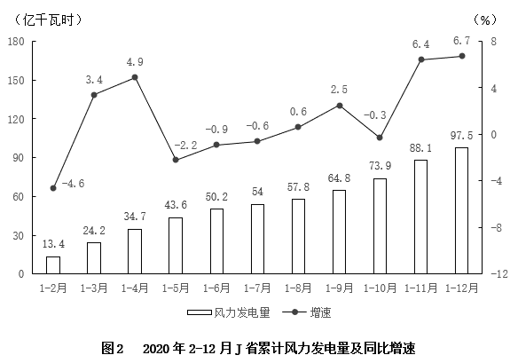

### 第 116 题

2020年第二季度，J省除风力发电之外的发电量在以下哪个范围内？

A. 不到200亿千瓦时

B. 在200亿~215亿千瓦时

C. 在215亿~230亿千瓦时

D. 超过230亿千瓦时

第 116 题 · 答案与解析

**参考答案（粉笔题库参考内容）**

A

**解析**

定位图1可得：2020年1-3月J省累计发电量为228.6亿千瓦时，1-6月为450.8亿千瓦时。定位图2可得：2020年1-3月J省累计风力发电量为24.2亿千瓦时，1-6月为50.2亿千瓦时。则2020年第二季度J省除风力发电之外的发电量=（450.8-228.6）-（50.2-24.2）=222.2-26=200-亿千瓦时，在A项范围内。

故正确答案为A。

**考点**：综合资料、简单加减计算

**来源**：2022年国家公务员录用考试《行测》题（副省级网友回忆版）第116题

### 第 117 题

2021年1-2月J省累计发电量同比增速比同期风力发电量同比增速：

A. 高不到10个百分点

B. 低不到10个百分点

C. 高10个百分点以上

D. 低10个百分点以上

第 117 题 · 答案与解析

**参考答案（粉笔题库参考内容）**

D

**解析**

根据题干“2021年1-2月······同比增速比······同比增速”，可判定本题为一般增长率问题。定位文字材料可得：2021年1-2月J省发电量为167亿千瓦时，其中风力发电量为17.4亿千瓦时。定位图1、图2可得：2020年1-2月J省累计发电量为155.4亿千瓦时，风力发电量为13.4亿千瓦时。根据公式：增长率，则题干所求，即低20个百分点以上，在D项范围内。

故正确答案为D。

**考点**：一般增长率、综合资料

**来源**：2022年国家公务员录用考试《行测》题（副省级网友回忆版）第117题

### 第 118 题

2020年3-12月，J省当月发电量同比增速快于当月累计发电量同比增速的月份有几个？

A. 5

B. 6

C. 7

D. 8

第 118 题 · 答案与解析

**参考答案（粉笔题库参考内容）**

C

**解析**

根据题干“2020年3-12月······当月发电量同比增速快于当月累计发电量同比增速······”，结合材料给出各月累计发电量同比增速，可判定本题为混合增长率问题。定位图1可得2020年2-12月J省各月累计发电量同比增速。当月累计发电量\=上月累计发电量+当月发电量，要求当月发电量同比增速快于当月累计发电量同比增速，根据“整体增速介于两部分增速之间”，可得当月发电量同比增速＞当月累计发电量同比增速＞上月累计发电量同比增速，即当月累计发电量同比增速＞上月累计发电量同比增速时满足条件。则满足题意的有4月、5月、6月、7月、9月、10月、11月，共7个月。

故正确答案为C。

**考点**：混合增长率、综合资料

**来源**：2022年国家公务员录用考试《行测》题（副省级网友回忆版）第118题

### 第 119 题

将2020年四个季度按J省风力发电量由高到低的顺序排列，以下正确的是：

A. 第三季度、第一季度、第二季度、第四季度

B. 第四季度、第二季度、第一季度、第三季度

C. 第四季度、第三季度、第一季度、第二季度

D. 第三季度、第一季度、第四季度、第二季度

第 119 题 · 答案与解析

**参考答案（粉笔题库参考内容）**

B

**解析**

定位图2可得：2020年1-3月（第一季度）J省累计风力发电量为24.2亿千瓦时，1-6月为50.2亿千瓦时，1-9月为64.8亿千瓦时，1-12月为97.5亿千瓦时。则第二季度（4-6月）J省风力发电量=50.2-24.2=26亿千瓦时；第三季度（7-9月）J省风力发电量亿千瓦时；第四季度（10-12月）J省风力发电量亿千瓦时，由高到低排列为第四季度、第二季度、第一季度、第三季度。

故正确答案为B。

**考点**：综合资料、排序类

**来源**：2022年国家公务员录用考试《行测》题（副省级网友回忆版）第119题

### 第 120 题

以下折线图反映了2020年哪个时间段内J省单月发电量的变化趋势？

A. 3-7月

B. 4-8月

C. 5-9月

D. 6-10月

第 120 题 · 答案与解析

**参考答案（粉笔题库参考内容）**

B

**解析**

定位图1可得2020年2-12月J省累计发电量，则3月发电量亿千瓦时；4月发电量亿千瓦时；5月发电量=376.8-299.8=77亿千瓦时；6月发电量=450.8-376.8=74亿千瓦时；7月发电量亿千瓦时；8月发电量亿千瓦时；9月发电量亿千瓦时；10月发电量亿千瓦时。折线图趋势为上升-下降-上升-下降，且时间段内的第4个月发电量最大，只有4-8月的单月发电量满足该变化趋势。

故正确答案为B。

**考点**：综合资料、排序类

**来源**：2022年国家公务员录用考试《行测》题（副省级网友回忆版）第120题

## 材料 4

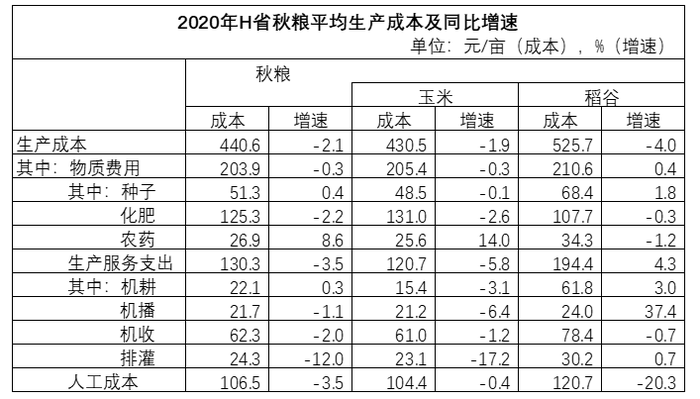

2020年，H省秋粮玉米和稻谷的市场平均交易价格分别为2.34元/公斤和2.74元/公斤，分别比上年上涨28.6%和8.7%。按此价格测算，2020年全省农户种植玉米、稻谷扣除成本前的产值分别为957.1元/亩、1520.7元/亩，分别比上年增长33.4%、8.9%。

### 第 121 题

2019年，H省秋粮稻谷的平均生产成本约为多少元/亩？

A. 439

B. 450

C. 533

D. 548

第 121 题 · 答案与解析

**参考答案（粉笔题库参考内容）**

D

**解析**

根据题干“2019年······约为多少元/亩”，结合材料时间为2020年，可判定本题为基期计算问题。定位表格材料可得：2020年H省秋粮稻谷平均生产成本为525.7元/亩，同比增速为-4.0%。根据公式：基期量，可知2019年H省秋粮稻谷的平均生产成本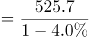元/亩，与D项最接近。

故正确答案为D。

**考点**：综合资料、基期计算

**来源**：2022年国家公务员录用考试《行测》题（副省级网友回忆版）第121题

### 第 122 题

将2020年H省秋粮机耕、机播、机收、排灌成本按同比增量从高到低的顺序排列，以下正确的是：

A. 机收、排灌、机耕、机播

B. 机耕、机播、机收、排灌

C. 机耕、机播、排灌、机收

D. 机收、排灌、机播、机耕

第 122 题 · 答案与解析

**参考答案（粉笔题库参考内容）**

B

**解析**

根据题干“将2020年······同比增量从高到低的顺序······”，可判定本题为增长量比较问题。定位表格材料可得，2020年H省秋粮机耕成本、增速分别为22.1元/亩，0.3%；机播成本、增速分别为21.7元/亩，-1.1%；机收成本、增速分别为62.3元/亩，-2.0%；排灌成本、增速分别为24.3元/亩，-12.0%。根据机耕成本增长，其余成本均下降，则机耕成本同比增量最高，排除A、D两项。根据公式：增长量，可得机收成本同比增量；排灌成本同比增量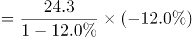；排灌成本同比增量（-3.5）<机收成本同比增量（-1.3），排除C项。

故正确答案为B。

**考点**：增长量比较、综合资料

**来源**：2022年国家公务员录用考试《行测》题（副省级网友回忆版）第122题

### 第 123 题

2020年，H省秋粮玉米和稻谷的亩产与上年相比：

A. 仅稻谷亩产高于上年水平

B. 仅玉米亩产高于上年水平

C. 两者亩产均高于上年水平

D. 两者亩产均低于上年水平

第 123 题 · 答案与解析

**参考答案（粉笔题库参考内容）**

C

**解析**

根据题干“2020年······亩产与上年相比”，结合材料给出了每亩产值和平均交易价格，可判定本题为两期平均数比较问题。根据平均交易价格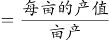，则有：亩产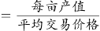。定位文字材料可知：2020年，H省秋粮玉米和稻谷的市场平均交易价格·······分别比上年上涨28.6%和8.7%（b）。按此价格测算，2020年全省农户种植玉米、稻谷扣除成本前的产值·······分别比上年增长33.4%、8.9%（a）。根据两期平均数比较理论，当a>b时，平均数提高，即2020年H省秋粮玉米和稻谷的亩产均高于上年水平。

故正确答案为C。

**考点**：两期平均数比较、综合资料

**来源**：2022年国家公务员录用考试《行测》题（副省级网友回忆版）第123题

### 第 124 题

如种植收益=产值-生产成本，则2020年H省秋粮稻谷平均每亩的种植收益约是玉米的多少倍？

A. 1.9

B. 1.6

C. 0.7

D. 0.5

第 124 题 · 答案与解析

**参考答案（粉笔题库参考内容）**

A

**解析**

根据题干“······2020年······是······的多少倍”，结合材料时间为2020年，可判定本题为现期倍数问题。定位统计表可得：2020年H省秋粮玉米和稻谷的平均生产成本分别为430.5元/亩和525.7元/亩；定位文字材料可得：2020年全省农户种植玉米、稻谷扣除成本前的产值分别为957.1元/亩、1520.7元/亩。根据题干条件“种植收益=产值-生产成本”，则所求倍数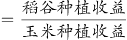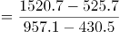≈995/530≈1.9。

故正确答案为A。

**考点**：现期倍数、综合资料

**来源**：2022年国家公务员录用考试《行测》题（副省级网友回忆版）第124题

### 第 125 题

2020年，H省农民老王在承包地中种植秋粮玉米，按全省平均生产成本估算，他在种子和农药上需要花费2000元。如亦按全省平均生产成本估算，他需要花费的人工成本在以下哪个范围内？

A. 不到2000元

B. 2000—2500元之间

C. 2500—3000元之间

D. 超过3000元

第 125 题 · 答案与解析

**参考答案（粉笔题库参考内容）**

C

**解析**

根据题干“2020年······按全省平均生产成本估算······人工成本······”，结合材料与题干给出玉米种子和农药的平均生产成本与总成本的数据，可判定本题为现期平均数问题。定位表格材料可得：2020年，H省秋粮玉米种子的平均生产成本为48.5元/亩；农药的平均生产成本为25.6元/亩；玉米的人工成本为104.4元/亩。由材料可知：平均生产成本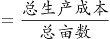，则老王承包土地的总亩数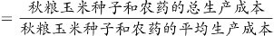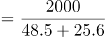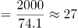亩。故按全省平均生产成本估算，老王需要花费的人工成本为元，在2500—3000元之间。

故正确答案为C。

**考点**：现期平均数、综合资料

**来源**：2022年国家公务员录用考试《行测》题（副省级网友回忆版）第125题

## 材料 5

2020年1-6月，全国电池制造业主要产品中，锂离子电池产量71.5亿只，同比增长1.3%；铅酸蓄电池产量9635.6万千伏安时，同比增长6.1%；原电池及原电池组（非扣式）产量178.2亿只，同比下降0.7%。

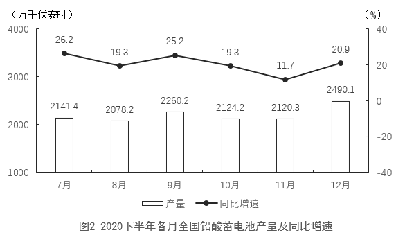

### 第 126 题

2019年上半年，全国铅酸蓄电池月均产量约为多少亿千伏安时？

A. 0.13

B. 0.14

C. 0.15

D. 0.16

第 126 题 · 答案与解析

**参考答案（粉笔题库参考内容）**

C

**解析**

根据题干“2019年上半年······月均产量约为······”，结合材料时间为2020年1-6月，可判定本题为基期平均数问题。定位文字材料可得，2020年1-6月······铅酸蓄电池产量9635.6万千伏安时，同比增长6.1%。根据公式：基期量，则2019年上半年全国铅酸蓄电池月均产量万千伏安时≈0.15亿千伏安时。

故正确答案为C。

**考点**：基期平均数、综合资料

**来源**：2022年国家公务员录用考试《行测》题（副省级网友回忆版）第126题

### 第 127 题

2020年四季度，全国锂离子电池产量约比三季度增长了多少亿只？

A. 5

B. 7

C. 9

D. 11

第 127 题 · 答案与解析

**参考答案（粉笔题库参考内容）**

B

**解析**

根据题干“2020年四季度······约比三季度增长了多少亿只”，可判定本题为增长量计算问题。定位统计图1可得：2020年7-12月各月全国锂离子电池产量分别为16.2亿只、17.9亿只、19.9亿只、19.7亿只、19.9亿只、21.7亿只。根据公式：增长量=现期量-基期量，则2020年四季度，全国锂离子电池产量比三季度增长了（19.7+19.9+21.7）-（16.2+17.9+19.9）=7.3亿只，与B项最接近。

故正确答案为B。

**考点**：增长量计算、综合资料

**来源**：2022年国家公务员录用考试《行测》题（副省级网友回忆版）第127题

### 第 128 题

2020年下半年，全国原电池及原电池组（非扣式）产量占全年产量的比重在以下哪个范围内？

A. 不到55%

B. 55%~60%

C. 60%~65%

D. 超过65%

第 128 题 · 答案与解析

**参考答案（粉笔题库参考内容）**

B

**解析**

根据题干“2020年下半年······占全年······的比重······”，结合材料时间为2020年，可判定本题为现期比重问题。定位文字材料可得：2020年1-6月全国原电池及原电池组（非扣式）产量178.2亿只；定位图3可得：2020年7-12月各月全国原电池及原电池组（非扣式）产量分别为38.8亿只、37.5亿只、38.6亿只、37.3亿只、37.5亿只、41.7亿只。根据公式：比重=部分/整体，则2020年下半年全国原电池及原电池组（非扣式）产量占全年产量的比重，在B项范围内。

故正确答案为B。

**考点**：现期比重、综合资料

**来源**：2022年国家公务员录用考试《行测》题（副省级网友回忆版）第128题

### 第 129 题

2020年下半年，全国锂离子电池产量同比增速快于铅酸蓄电池产量同比增速的月份有几个？

A. 2

B. 3

C. 4

D. 5

第 129 题 · 答案与解析

**参考答案（粉笔题库参考内容）**

D

**解析**

定位图1、图2可得，2020年7-12月各月全国锂离子电池产量的同比增速和铅酸蓄电池产量的同比增速。比较可知，2020年下半年，全国锂离子电池产量同比增速快于铅酸蓄电池产量同比增速的月份有：8月（23.3%＞19.3%）、9月（26.6%＞25.2%）、10月（29.8%＞19.3%）、11月（29.2%＞11.7%）、12月（26.4%＞20.9%），共5个。

故正确答案为D。

**考点**：直接找数、综合资料

**来源**：2022年国家公务员录用考试《行测》题（副省级网友回忆版）第129题

### 第 130 题

能够从上述资料中推出的是：

A. 2020年上半年，全国锂离子电池产量同比增长了不到1亿只

B. 2020年下半年，全国锂离子电池产量和原电池及原电池组（非扣式）产量最低的月份在同一个季度

C. 2020年12月，全国铅酸蓄电池当年累计产量首次超过2亿千伏安时

D. 2020年12月，全国锂离子电池产量环比增速快于同期铅酸蓄电池产量环比增速

第 130 题 · 答案与解析

**参考答案（粉笔题库参考内容）**

A

**解析**

A项：定位文字材料可得，2020年1-6月，全国锂离子电池产量71.5亿只，同比增长1.3%。根据公式：增长量，则2020年上半年，全国锂离子电池产量的同比增长量亿只，正确；

B项：定位图1和图3可得2020年下半年各月全国锂离子电池产量和原电池及原电池组（非扣式）产量。比较可知，2020年下半年全国锂离子电池产量最低的月份在7月（16.2亿只），为第三季度；原电池及原电池组（非扣式）产量最低的月份在10月（37.3亿只），为第四季度。非同一季度，错误；

C项：定位文字材料可得，2020年1-6月，全国铅酸蓄电池产量9635.6万千伏安时；定位图2可得，2020年下半年各月全国铅酸蓄电池产量分别为2141.4万千伏安时、2078.2万千伏安时、2260.2万千伏安时、2124.2万千伏安时、2120.3万千伏安时、2490.1万千伏安时。则2020年11月全国铅酸蓄电池当年累计产量为9635.6+2141.4+2078.2+2260.2+2124.2+2120.3＞9600+2100+2000+2200+2100+2100=20100万千伏安时＞20000万千伏安时=2亿千伏安时，故12月全国铅酸蓄电池当年累计产量并非首次超过2亿千伏安时，错误；

D项：定位图1可得，2020年11月和12月全国锂离子电池产量分别为19.9亿只和21.7亿只；定位图2可得，2020年11月和12月全国铅酸蓄电池产量分别为2120.3万千伏安时和2490.1万千伏安时。根据公式：增长率，则2020年12月全国锂离子电池产量的环比增速，2020年12月全国铅酸蓄电池产量的环比增速。前者慢于后者，错误。

故正确答案为A。

**考点**：综合分析、综合资料

**来源**：2022年国家公务员录用考试《行测》题（副省级网友回忆版）第130题

## 材料 6

2020年12月，C市天然气用量为9.67亿立方米，同比增长11.66%。从供应结构看：中石油供应7.22亿立方米，同比增长7.44%；中石化供应2.45亿立方米，同比增长26.29%。从用气结构看：民用气为3.98亿立方米，同比增长16.72%；CNG用气0.64亿立方米，同比下降7.25%；工业用气5.05亿立方米，同比增长10.75%。

2020年，C市天然气用量为107.47亿立方米，同比增长3.83%。其中，中石油供应73.96亿立方米，同比增长1.72%；中石化供应33.51亿立方米，同比增长8.8%。从用气结构看：民用气为33.75亿立方米，同比增长5.4%；CNG用气6.99亿立方米，同比下降13.92%；工业用气66.73亿立方米，同比增长5.3%。

2021年2月，C市天然气用量为9.31亿立方米，同比增长21.38%。从供应结构看：中石油供应6.7亿立方米，同比增长25.23%；中石化供应2.61亿立方米，同比增长12.5%。从用气结构看：民用气为3.56亿立方米，同比增长16.34%；CNG用气0.52亿立方米，同比增长205.88%；工业用气5.23亿立方米，同比增长17.79%。

2021年1—2月，C市天然气用量为19.21亿立方米，同比增长12.8%。其中，中石油供应14.23亿立方米，同比增长18.88%；中石化供应4.98亿立方米，同比下降1.58%。从用气结构看：民用气为7.78亿立方米，同比增长12.75%；CNG用气1.14亿立方米，同比增长44.3%；工业用气10.29亿立方米，同比增长10.17%。

### 第 131 题

2021年1月，C市天然气用量比上月：

A. 增加了0.2亿立方米以上

B. 减少了不到0.2亿立方米

C. 减少了0.2亿立方米以上

D. 增加了不到0.2亿立方米

第 131 题 · 答案与解析

**参考答案（粉笔题库参考内容）**

A

**解析**

根据题干“2021年1月······比上月”，结合选项带单位，可判定本题为增长量计算问题。定位文字材料第一、三、四段可得：2020年12月，C市天然气用量为9.67亿立方米；2021年2月，C市天然气用量为9.31亿立方米；2021年1—2月，C市天然气用量为19.21亿立方米。则2021年1月C市天然气用量=2021年1—2月C市天然气用量-2021年2月C市天然气用量=19.21-9.31=9.9亿立方米。故2021年1月C市天然气用量比上月（2020年12月）增加了9.9-9.67=0.23亿立方米>0.2亿立方米。

故正确答案为A。

**考点**：增长量计算、文字资料

**来源**：2022年国家公务员录用考试《行测》题（副省级网友回忆版）第131题

### 第 132 题

2020年，中石化供气量占C市天然气用量的比重比上年：

A. 减少了不到3个百分点

B. 增加了不到3个百分点

C. 减少了3个百分点以上

D. 增加了3个百分点以上

第 132 题 · 答案与解析

**参考答案（粉笔题库参考内容）**

B

**解析**

根据题干“2020年······占······的比重比上年”，结合选项为增加/减少+百分点，可判定本题为两期比重计算问题。定位文字材料第二段可得：2020年，C市天然气用量为107.47亿立方米（B），同比增长3.83%（b）。中石化供应33.51亿立方米（A），同比增长8.8%（a）。根据公式：两期比重差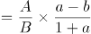，则2020年与上年的比重差值为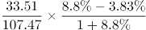，即增加了不到1.5个百分点，只有B项符合。

故正确答案为B。

**考点**：文字资料、两期比重

**来源**：2022年国家公务员录用考试《行测》题（副省级网友回忆版）第132题

### 第 133 题

2019—2020年，C市CNG用气总量约为多少亿立方米？

A. 15

B. 17

C. 11

D. 13

第 133 题 · 答案与解析

**参考答案（粉笔题库参考内容）**

A

**解析**

根据题干“2019—2020年······约为多少亿立方米”，结合材料中只给出了2020年的数据，可判定本题为基期计算问题。定位文字材料第二段可得：2020年，C市天然气用量为107.47亿立方米，同比增长3.83%。其中······CNG用气6.99亿立方米，同比下降13.92%。根据公式：基期量，则2019年C市CNG用气量为亿立方米，故2019—2020年，C市CNG用气总量为亿立方米，与A项最接近。

故正确答案为A。

**考点**：文字资料、基期计算

**来源**：2022年国家公务员录用考试《行测》题（副省级网友回忆版）第133题

### 第 134 题

以下哪个饼图最能准确反映2021年1—2月C市天然气用量中，民用气（白色）、CNG用气（黑色）和工业用气（斜线）的占比关系？

A. 

B. 

C. 

D. 

第 134 题 · 答案与解析

**参考答案（粉笔题库参考内容）**

D

**解析**

根据题干“以下哪个饼图最能准确反映2021年1—2月······的占比关系”，结合材料时间为2021年，可判定本题为现期比重问题。定位文字材料第四段可得“2021年1—2月，C市天然气用量为19.21亿立方米······从用气结构看：民用气为7.78亿立方米；CNG用气1.14亿立方米；工业用气10.29亿立方米”。因此，民用气占比为7.78/19.21，观察图形，A、B两项民用气占比大于50%，C项民用气占比小于25%，均不满足，排除A、B、C三项，D项当选。

故正确答案为D。

**考点**：文字资料、现期比重

**来源**：2022年国家公务员录用考试《行测》题（副省级网友回忆版）第134题

### 第 135 题

以下柱状图反映了C市天然气2020年12月—2021年2月间哪一数值的变化趋势？

A. 中石油供气量

B. 中石化供气量

C. 民用气用量

D. 工业用气用量

第 135 题 · 答案与解析

**参考答案（粉笔题库参考内容）**

B

**解析**

定位文字材料第一段可知，2020年12月，中石油供应7.22亿立方米，中石化供应2.45亿立方米，民用气为3.98亿立方米，工业用气5.05亿立方米。定位文字材料第三段可知，2021年2月，中石油供应6.7亿立方米，中石化供应2.61亿立方米，民用气为3.56亿立方米，工业用气5.23亿立方米。定位文字材料第四段可知，2021年1—2月，中石油供应14.23亿立方米，中石化供应4.98亿立方米，民用气为7.78亿立方米，工业用气10.29亿立方米。所以2021年1月，中石油供应=14.23-6.7=7.53亿立方米，中石化供应=4.98-2.61=2.37亿立方米，民用气=7.78-3.56=4.22亿立方米，工业用气=10.29-5.23=5.06亿立方米。观察发现，图中数据的变化趋势是先下降，再上升，满足变化趋势的只有中石化供气量。

故正确答案为B。

**考点**：文字资料、简单加减计算

**来源**：2022年国家公务员录用考试《行测》题（副省级网友回忆版）第135题

