# 2022年国家公务员录用考试《行测》题（行政执法卷网友回忆版）

<!-- gwy:overview:start -->
> **国考 · 2022 · 行测 · 行政执法** ｜ 130 题 · 图片 238 处 · 答案随题折叠

| 题型模块 | 题量 | 题号 |
| --- | ---: | ---: |
| 常识判断 | 20 | 1–20 |
| 言语理解与表达 | 40 | 21–60 |
| 数量关系 | 10 | 61–70 |
| 判断推理 | 40 | 71–110 |
| 资料分析 | 20 | 111–130 |
| **合计** | **130** | |

导航：[题型与作答说明](#题型与作答说明) · [题目](#题目) · [材料 1](#材料-1)
<!-- gwy:overview:end -->

> 候选采集稿。参考答案及解析来自粉笔页面，不代表官方答案或真实高分答卷；来源使用许可与原卷对应关系仍需人工核实。

## 题型与作答说明

常识判断

（20题）

第一部分 常识判断。 根据题目要求，在四个选项中选出一个最恰当的答案。

言语理解与表达

（40题）

第二部分 言语理解与表达。 本部分包括表达与理解两方面的内容。请根据题目要求，在四个选项中选出一个最恰当的答案。

数量关系

（10题）

第三部分 数量关系。 在这部分试题中，每道题呈现一段表述数字关系的文字，要求你迅速、准确地计算出答案。

判断推理

（40题）

第四部分 判断推理。 本部分包括图形推理、定义判断、类比推理与逻辑判断四种类型的试题，在四个选项中选出一个最恰当的答案。

资料分析

（20题）

第五部分 资料分析。 所给出的图、表、文字或综合性资料均有若干个问题要你回答。你应根据资料提供的信息进行分析、比较、计算和判断处理。

## 题目

### 第 1 题

进入新发展阶段，是中华民族伟大复兴历史进程的大跨越，以下关于新发展阶段的理解，正确的有几项？

①新发展阶段是中国共产党带领人民迎来从站起来、富起来到强起来历史性跨越的新阶段

②新发展阶段是基本实现社会主义现代化、全面建成小康社会的发展阶段

③新发展阶段是超越社会主义初级阶段、迈入社会主义更高阶段的发展阶段

④新发展阶段是实现第一个百年奋斗目标，向着第二个百年奋斗目标迈进的发展阶段

A. 1项

B. 2项

C. 3项

D. 4项

第 1 题 · 答案与解析

**参考答案（粉笔题库参考内容）**

B

**解析**

本题考查政治常识。

2021年1月11日，习近平总书记在省部级主要领导干部学习贯彻党的十九届五中全会精神专题研讨班上发表重要讲话。

①正确，讲话指出：“新发展阶段是我们党带领人民迎来从站起来、富起来到强起来历史性跨越的新阶段。”

②错误，④正确，讲话指出：“党的十九届五中全会提出，全面建成小康社会、实现第一个百年奋斗目标之后，我们要乘势而上开启全面建设社会主义现代化国家新征程、向第二个百年奋斗目标进军，这标志着我国进入了一个新发展阶段。”因此新发展阶段是全面建设社会主义现代化国家、向第二个百年奋斗目标进军的时代，而非全面建成小康社会的发展阶段。

③错误，讲话指出：“新发展阶段是社会主义初级阶段中的一个阶段，同时是其中经过几十年积累、站到了新的起点上的一个阶段。”因此新发展阶段并未超越社会主义初级阶段。

综上所述，正确的有①④，共2项。

故正确答案为B。

**考点**：经济建设、重要会议讲话

### 第 2 题

习近平总书记指出，要根据我国经济发展实际情况，建立起扩大内需的有效制度，释放内需潜力，加快培育完整内需体系，加强需求侧管理，扩大居民消费，提升消费层次，使建设超大规模的国内市场成为一个可持续的历史过程。下列举措不属于需求侧改革的是：

A. 剥离企业办社会职能

B. 完善收入分配制度

C. 严格落实“房住不炒”

D. 构建“智能+”消费生态体系

第 2 题 · 答案与解析

**参考答案（粉笔题库参考内容）**

A

**解析**

本题考查政治常识。

需求侧，简而言之就是关于需求那一方面的诸多问题，需求侧改革的首要任务是进行收入分配制度与体系的深化改革，既要考虑初次分配的改革也要考虑再分配的改造，更要进行土地制度、住宅制度、社会保障、医疗保障、教育体系等方面的综合改革，使我国居民目前收入水平下的消费能力得以提高与释放。供给侧改革是用改革的办法推进结构调整，减少无效和低端供给，扩大有效和中高端供给，增强供给结构对需求变化的适应性和灵活性，提高全要素生产率，使供给体系更好适应需求结构变化。

A项错误，剥离企业办社会职能，是向社会化经营主体或地方公共机构移交各种社会服务职能，是全面深化国企改革的重要任务、是供给侧结构性改革的重大举措，也是提升公共管理服务水平、实现基本公共服务均等化的重大民生工程。

B项正确，分配在连接生产和消费中发挥着重要作用，分配方式是否公平、合理，关系到社会成员各自获得物质利益的多少，决定着社会产品能否顺利、有效地进入消费过程，直接影响到整个经济社会的正常运行。收入分配制度与体系的深化改革是需求侧改革的首要任务。

C项正确，房价的大幅上涨对居民消费会产生直接抑制。严格落实“房住不炒”有利于确保楼市平稳运行，充分发挥国内需求潜力，形成以国内大循环为主体、国内国际双循环相互促进的新发展格局，属于需求侧改革的举措。

D项正确，“智能+”消费生态体系融合了智能元素，在高新科技的支持下，“智能+”消费生态体系将更加贴合人们的消费需求，顺应社会发展的潮流趋势，有助于释放更大的消费潜力。因此，构建“智能+”消费生态体系属于需求侧改革的举措。

本题为选非题，故正确答案为A。

**考点**：经济建设

### 第 3 题

“七一勋章”获得者都来自人民，植根人民，是立足本职、默默奉献的平凡英雄，他们的事迹可学可做，他们的精神可追可及。以下“七一勋章”获得者与其先进事迹表述对应正确的是：

A. 张桂梅——坚持志愿服务十余载，群众心中的“活雷锋”

B. 王兰花——点亮贫困山区女孩梦想的“校长妈妈”

C. 孙景坤——公而忘私，永葆革命本色的战斗功臣

D. 李宏塔——为国守海寸步不让，带领群众共同致富

第 3 题 · 答案与解析

**参考答案（粉笔题库参考内容）**

C

**解析**

本题考查政治常识。

A、B两项错误，张桂梅扎根贫困地区40余年，创办全国第一所全免费女子高中，帮助近2000名贫困山区女孩圆了大学梦，是点亮贫困山区女孩梦想的“校长妈妈”，先后荣获“全国脱贫攻坚楷模”“全国优秀共产党员”“全国先进工作者”等荣誉称号。王兰花，中共党员，她十多年如一日坚持志愿服务，带领“王兰花热心小组”先后为居民解决各类困难7000多件，调解各类民事纠纷600多起，开展公益活动7000多场次，推动宁夏吴忠市利通区的志愿者从最初7人发展到6.5万余人，是群众心中的“活雷锋”，先后荣获“全国三八红旗手标兵”“全国民族团结进步模范个人”等称号。

C项正确，孙景坤是永葆革命本色的战斗功臣，先后参加了四平、辽沈、平津、解放长沙、解放海南岛、抗美援朝等战役战争，荣立一等功一次、二等功多次，荣获“抗美援朝一级战士荣誉勋章”。退役后他回乡带领群众改变家乡面貌，是共产党员吃苦在前、公而忘私崇高品质的典范。

D项错误，李宏塔，安徽省政协原党组成员、副主席，第十一、十二届全国政协委员，他始终艰苦朴素、严于律己，在每个岗位上都践行党的根本宗旨，当好人民“勤务员”，树立了党员领导干部忠诚干净担当的典范。王书茂，中共党员，他先后参加多项国家重大涉海工作，在南海维权斗争中冲锋在前，不怕牺牲、寸步不让，坚决捍卫我国领海主权和海洋权益。此外他还带领群众造大船、闯深海，发展休闲渔业、建起海洋民宿，实现共同致富。荣获了“全国劳动模范”“改革先锋”等称号，是第十三届全国人大代表。

故正确答案为C。

**考点**：重要事件、其他建设

### 第 4 题

关于中国共产党成立百年的宝贵经验，下列说法不准确的是：

A. 勇于自我革命是中国共产党区别于其他政党的显著标志

B. 马克思主义是我们立党立国的根本指导思想

C. 爱国统一战线是实现中华民族伟大复兴的战略支撑

D. 中国特色社会主义是实现中华民族伟大复兴的正确道路

第 4 题 · 答案与解析

**参考答案（粉笔题库参考内容）**

C

**解析**

本题考查政治常识。

A项正确，习近平总书记在庆祝中国共产党成立100周年大会上的讲话中指出：“以史为鉴、开创未来，必须不断推进党的建设新的伟大工程。勇于自我革命是中国共产党区别于其他政党的显著标志。”

B项正确，习近平总书记在庆祝中国共产党成立100周年大会上的讲话中指出：“以史为鉴、开创未来，必须继续推进马克思主义中国化。马克思主义是我们立党立国的根本指导思想，是我们党的灵魂和旗帜。”

C项错误，习近平总书记在庆祝中国共产党成立100周年大会上的讲话中指出：“以史为鉴、开创未来，必须加强中华儿女大团结。在百年奋斗历程中，中国共产党始终把统一战线摆在重要位置，不断巩固和发展最广泛的统一战线，团结一切可以团结的力量、调动一切可以调动的积极因素，最大限度凝聚起共同奋斗的力量。爱国统一战线是中国共产党团结海内外全体中华儿女实现中华民族伟大复兴的重要法宝。”

D项正确，习近平总书记在庆祝中国共产党成立100周年大会上的讲话中指出：“以史为鉴、开创未来，必须坚持和发展中国特色社会主义。走自己的路，是党的全部理论和实践立足点，更是党百年奋斗得出的历史结论。中国特色社会主义是党和人民历经千辛万苦、付出巨大代价取得的根本成就，是实现中华民族伟大复兴的正确道路。”

本题为选非题，故正确答案为C。

**考点**：重要会议讲话、其他建设

### 第 5 题

习近平总书记在全国脱贫攻坚总结表彰大会上的讲话指出：“贫困是人类社会的顽疾。反贫困始终是古今中外治国安邦的一件大事。一部中国史，就是一部中华民族同贫困作斗争的历史。从 ① ‘长太息以掩涕兮，哀民生之多艰’的感慨，到杜甫‘ ② ’的憧憬，再到 ③ ‘家给人足，四海之内无一夫不获其所’的夙愿，都反映了中华民族对摆脱贫困、丰衣足食的深深渴望。”文中①②③处应分别填入：

A. 司马迁；安得广厦千万间，大庇天下寒士俱欢颜；严复

B. 屈原；安得广厦千万间，大庇天下寒士俱欢颜；孙中山

C. 司马迁；岂辞云水三千里，犹济疮痍十万民；孙中山

D. 屈原；岂辞云水三千里，犹济疮痍十万民；严复

第 5 题 · 答案与解析

**参考答案（粉笔题库参考内容）**

B

**解析**

本题考查政治常识。

B项正确，A、C、D三项错误，习近平总书记在全国脱贫攻坚总结表彰大会上的讲话指出：“贫困是人类社会的顽疾。反贫困始终是古今中外治国安邦的一件大事。一部中国史，就是一部中华民族同贫困作斗争的历史。从屈原‘长太息以掩涕兮，哀民生之多艰’的感慨，到杜甫‘安得广厦千万间，大庇天下寒士俱欢颜’的憧憬，再到孙中山‘家给人足，四海之内无一夫不获其所’的夙愿，都反映了中华民族对摆脱贫困、丰衣足食的深深渴望。”其中，“长太息以掩涕兮，哀民生之多艰”出自屈原的《离骚》；“安得广厦千万间，大庇天下寒士俱欢颜”出自杜甫的《茅屋为秋风所破歌》；“家给人足，四海之内无一夫不获其所”出自孙中山的《同盟会宣言》。

故正确答案为B。

**考点**：经济建设、重要会议讲话

### 第 6 题

《中华人民共和国宪法》（1982年）实施以来，先后五次以修正案的形式进行了修改。下列宪法条款与宪法修正案对应正确的是：

A. 公民的合法的私有财产不受侵犯——1993年宪法修正案

B. 农村集体经济组织实行家庭承包经营为基础、统分结合的双层经营体制——2004年宪法修正案

C. 国家尊重和保障人权——1999年宪法修正案

D. 中国共产党领导是中国特色社会主义最本质的特征——2018年宪法修正案

第 6 题 · 答案与解析

**参考答案（粉笔题库参考内容）**

D

**解析**

本题考查法律常识。

A项错误，2004年宪法修正案将第十三条改为：公民的合法的私有财产不受侵犯。国家依照法律规定保护公民的私有财产权和继承权。国家为了公共利益的需要，可以依照法律规定对公民的私有财产实行征收或者征用并给予补偿。

B项错误，1999年宪法修正案将第八条第一款改为：农村集体经济组织实行家庭承包经营为基础、统分结合的双层经营体制······

C项错误，2004年宪法修正案将第三十三条改为：凡具有中华人民共和国国籍的人都是中华人民共和国公民。中华人民共和国公民在法律面前一律平等。国家尊重和保障人权。任何公民享有宪法和法律规定的权利，同时必须履行宪法和法律规定的义务。

D项正确，2018年宪法修正案将第一条改为：中华人民共和国是工人阶级领导的、以工农联盟为基础的人民民主专政的社会主义国家。社会主义制度是中华人民共和国的根本制度。中国共产党领导是中国特色社会主义最本质的特征。禁止任何组织或者个人破坏社会主义制度。

故正确答案为D。

**考点**：宪法

### 第 7 题

新修订的《中华人民共和国行政处罚法》自2021年7月15日起施行。依据该法，下列说法正确的是：

A. 行政机关拟作出降低资质等级的处罚之前，应当组织听证

B. 法律、行政法规对违法行为未作出行政处罚规定的，地方性法规可补充设定

C. 行政机关可以在其法定权限内书面委托其他组织或个人实施行政处罚

D. 对当事人依法给予一百元以上罚款的，执法人员不得当场收缴

第 7 题 · 答案与解析

**参考答案（粉笔题库参考内容）**

B

**解析**

本题考查法律常识。

A项错误，根据《中华人民共和国行政处罚法》第六十三条第一款规定：“行政机关拟作出下列行政处罚决定，应当告知当事人有要求听证的权利，当事人要求听证的，行政机关应当组织听证：（一）较大数额罚款；（二）没收较大数额违法所得、没收较大价值非法财物；（三）降低资质等级、吊销许可证件；（四）责令停产停业、责令关闭、限制从业；（五）其他较重的行政处罚；（六）法律、法规、规章规定的其他情形。”

B项正确，根据《中华人民共和国行政处罚法》第十二条第三款规定：“法律、行政法规对违法行为未作出行政处罚规定，地方性法规为实施法律、行政法规，可以补充设定行政处罚。拟补充设定行政处罚的，应当通过听证会、论证会等形式广泛听取意见，并向制定机关作出书面说明。地方性法规报送备案时，应当说明补充设定行政处罚的情况。”

C项错误，根据《中华人民共和国行政处罚法》第二十条第一款规定：“行政机关依照法律、法规、规章的规定，可以在其法定权限内书面委托符合本法第二十一条规定条件的组织实施行政处罚。行政机关不得委托其他组织或者个人实施行政处罚。”

D项错误，根据《中华人民共和国行政处罚法》第六十八条规定：“依照本法第五十一条的规定当场作出行政处罚决定，有下列情形之一，执法人员可以当场收缴罚款：（一）依法给予一百元以下罚款的；（二）不当场收缴事后难以执行的。”第六十九条规定：“在边远、水上、交通不便地区，行政机关及其执法人员依照本法第五十一条、第五十七条的规定作出罚款决定后，当事人到指定的银行或者通过电子支付系统缴纳罚款确有困难，经当事人提出，行政机关及其执法人员可以当场收缴罚款。”故对当事人依法给予一百元以上罚款，但符合以上情况的，执法人员也可以当场收缴罚款。

故正确答案为B。

**考点**：行政法

### 第 8 题

新修订的《中华人民共和国安全生产法》自2021年9月1日起施行。依据该法，下列说法正确的是：

A. 应急管理部门对安全生产进行监督管理，其他行业主管部门无监管职责

B. 生产经营单位分管生产的负责人是本单位安全生产第一责任人

C. 安全生产违法行为导致重大事故损害公益的，人民检察院及有关公益组织可提起公益诉讼

D. 生产安全事故情节特别严重、影响特别恶劣的，罚款额最高可达一亿元

第 8 题 · 答案与解析

**参考答案（粉笔题库参考内容）**

D

**解析**

本题考查法律常识。

A项错误，根据《中华人民共和国安全生产法》第十条规定：“国务院应急管理部门依照本法，对全国安全生产工作实施综合监督管理；县级以上地方各级人民政府应急管理部门依照本法，对本行政区域内安全生产工作实施综合监督管理。国务院交通运输、住房和城乡建设、水利、民航等有关部门依照本法和其他有关法律、行政法规的规定，在各自的职责范围内对有关行业、领域的安全生产工作实施监督管理；县级以上地方各级人民政府有关部门依照本法和其他有关法律、法规的规定，在各自的职责范围内对有关行业、领域的安全生产工作实施监督管理。对新兴行业、领域的安全生产监督管理职责不明确的，由县级以上地方各级人民政府按照业务相近的原则确定监督管理部门。应急管理部门和对有关行业、领域的安全生产工作实施监督管理的部门，统称负有安全生产监督管理职责的部门。负有安全生产监督管理职责的部门应当相互配合、齐抓共管、信息共享、资源共用，依法加强安全生产监督管理工作。”可知，应急管理部门对安全生产工作实施综合监督管理，交通运输、住房和城乡建设、水利、民航等其他行业主管部门在各自的职责范围内实施监督管理。

B项错误，根据《中华人民共和国安全生产法》第五条规定：“生产经营单位的主要负责人是本单位安全生产第一责任人，对本单位的安全生产工作全面负责。其他负责人对职责范围内的安全生产工作负责。”由此可知，生产经营单位分管生产的负责人对职责范围内的安全生产工作负责。

C项错误，根据《中华人民共和国安全生产法》第七十四条第二款规定：“因安全生产违法行为造成重大事故隐患或者导致重大事故，致使国家利益或者社会公共利益受到侵害的，人民检察院可以根据民事诉讼法、行政诉讼法的相关规定提起公益诉讼。”

D项正确，根据《中华人民共和国安全生产法》第一百一十四条规定：“发生生产安全事故，对负有责任的生产经营单位除要求其依法承担相应的赔偿等责任外，由应急管理部门依照下列规定处以罚款：（一）发生一般事故的，处三十万元以上一百万元以下的罚款；（二）发生较大事故的，处一百万元以上二百万元以下的罚款；（三）发生重大事故的，处二百万元以上一千万元以下的罚款；（四）发生特别重大事故的，处一千万元以上二千万元以下的罚款。发生生产安全事故，情节特别严重、影响特别恶劣的，应急管理部门可以按照前款罚款数额的二倍以上五倍以下对负有责任的生产经营单位处以罚款。”由此可知，生产安全事故情节特别严重、影响特别恶劣的，应急管理部门最高可以按照二千万元的五倍处以罚款，即罚款额最高可达一亿元。

故正确答案为D。

**考点**：其他法律法规

### 第 9 题

《中华人民共和国数据安全法》自2021年9月1日起施行。依据该法，下列说法错误的是（ ）。

A. 国家工业和信息化主管部门负责国家数据安全工作的决策和议事协调

B. 省级以上人民政府应当将数字经济发展纳入本级国民经济和社会发展规划

C. 国家建立数据分类分级保护制度，对数据实行分类分级保护

D. 从事数据交易中介服务的机构提供服务，应当要求数据提供方说明数据来源

第 9 题 · 答案与解析

**参考答案（粉笔题库参考内容）**

A

**解析**

本题考查法律常识。

A项错误，根据《中华人民共和国数据安全法》第五条规定：“中央国家安全领导机构负责国家数据安全工作的决策和议事协调，研究制定、指导实施国家数据安全战略和有关重大方针政策，统筹协调国家数据安全的重大事项和重要工作，建立国家数据安全工作协调机制。”

B项正确，根据《中华人民共和国数据安全法》第十四条规定：“国家实施大数据战略，推进数据基础设施建设，鼓励和支持数据在各行业、各领域的创新应用。省级以上人民政府应当将数字经济发展纳入本级国民经济和社会发展规划，并根据需要制定数字经济发展规划。”

C项正确，根据《中华人民共和国数据安全法》第二十一条规定：“国家建立数据分类分级保护制度，根据数据在经济社会发展中的重要程度，以及一旦遭到篡改、破坏、泄露或者非法获取、非法利用，对国家安全、公共利益或者个人、组织合法权益造成的危害程度，对数据实行分类分级保护。国家数据安全工作协调机制统筹协调有关部门制定重要数据目录，加强对重要数据的保护。关系国家安全、国民经济命脉、重要民生、重大公共利益等数据属于国家核心数据，实行更加严格的管理制度。各地区、各部门应当按照数据分类分级保护制度，确定本地区、本部门以及相关行业、领域的重要数据具体目录，对列入目录的数据进行重点保护。”

D项正确，根据《中华人民共和国数据安全法》第三十三条规定：“从事数据交易中介服务的机构提供服务，应当要求数据提供方说明数据来源，审核交易双方的身份，并留存审核、交易记录。”

本题为选非题，故正确答案为A。

**考点**：其他法律法规

### 第 10 题

下列甲乙丙丁的行为构成利用影响力受贿罪的是（ ）。

A. 甲为某生态环境局副局长，某项目经理王某为减轻环境行政罚款向其行贿5万元，后甲向下属监察大队负责人打招呼撤销罚款决定

B. 乙为某市场监督管理局局长，某项目经理张某为减轻国土资源行政罚款向其行贿5万元，后乙向自然资源局领导打招呼望撤销罚款决定

C. 丙为某税务局公务员，其夫为教育局局长，丙收受李某5万元并通过其夫职权解决李某小孩跨区入学问题，其夫不知情

D. 丁为某教育局局长，其妻为私企员工，私下收受刘某5万元并通过其夫职权解决刘某小孩跨区入学问题，丁知情后未反对

第 10 题 · 答案与解析

**参考答案（粉笔题库参考内容）**

C

**解析**

本题考查法律常识。

根据《刑法》第三百八十八条规定：“国家工作人员利用本人职权或者地位形成的便利条件，通过其他国家工作人员职务上的行为，为请托人谋取不正当利益，索取请托人财物或者收受请托人财物的，以受贿论处。”第三百八十八条之一规定：“国家工作人员的近亲属或者其他与该国家工作人员关系密切的人，通过该国家工作人员职务上的行为，或者利用该国家工作人员职权或者地位形成的便利条件，通过其他国家工作人员职务上的行为，为请托人谋取不正当利益，索取请托人财物或者收受请托人财物，数额较大或者有其他较重情节的，处三年以下有期徒刑或者拘役，并处罚金；数额巨大或者有其他严重情节的，处三年以上七年以下有期徒刑，并处罚金；数额特别巨大或者有其他特别严重情节的，处七年以上有期徒刑，并处罚金或者没收财产。离职的国家工作人员或者其近亲属以及其他与其关系密切的人，利用该离职的国家工作人员原职权或者地位形成的便利条件实施前款行为的，依照前款的规定定罪处罚。”第三百八十八条之一是关于利用影响力受贿罪的规定。

A项错误，甲为某生态环境局副局长，是国家工作人员，其利用本人职权形成的便利条件，通过其他国家工作人员职务上的行为，为请托人王某谋取不正当利益，打招呼撤销罚款决定，收受5万元贿赂，构成受贿罪。

B项错误，乙为某市场监督管理局局长，是国家工作人员，其利用本人职权形成的便利条件，通过其他国家工作人员职务上的行为，为请托人张某谋取不正当利益，打招呼撤销罚款决定，收受5万元贿赂，构成受贿罪。

C项正确，丙系教育局局长之妻，属于国家工作人员的近亲属，利用其夫的职务便利，收取了李某钱款5万元，为请托人谋取不正当利益，解决李某小孩跨区入学问题，构成利用影响力受贿罪。

D项错误，丁为某教育局局长，其妻利用其教育局局长的职权，收取了刘某钱款5万元，解决刘某小孩跨区入学问题，为请托人谋取不正当利益。虽然是丁的妻子收取的钱款，但丁知情未反对，属于事后收受贿赂的情形，构成受贿罪。

故正确答案为C。

**考点**：刑法

### 第 11 题

甲乙丙丁4人发起设立某商贸股份有限公司，并租赁了1处办公场所。在公司设立过程中，甲由于疏忽忘关水龙头致办公场所被淹，给办公场所业主戊造成5万元损失。公司设立后，业主戊向公司索赔。下列说法正确的是（ ）。

A. 因公司已设立，5万元损失由公司承担即可

B. 因系发起人责任，5万元损失由发起人共同承担

C. 因在公司设立过程中产生损失，5万元由公司和发起人共同承担

D. 公司可以先行向业主戊赔偿，再向甲追赔

第 11 题 · 答案与解析

**参考答案（粉笔题库参考内容）**

D

**解析**

本题考查法律常识。

D项正确，A、B、C三项错误，根据《最高人民法院关于适用<中华人民共和国公司法>若干问题的规定（三）》第二条规定：“发起人为设立公司以自己名义对外签订合同，合同相对人请求该发起人承担合同责任的，人民法院应予支持；公司成立后合同相对人请求公司承担合同责任的，人民法院应予支持。”《公司法》第九十四条规定：“股份有限公司的发起人应当承担下列责任：（一）公司不能成立时，对设立行为所产生的债务和费用负连带责任；（二）公司不能成立时，对认股人已缴纳的股款，负返还股款并加算银行同期存款利息的连带责任；（三）在公司设立过程中，由于发起人的过失致使公司利益受到损害的，应当对公司承担赔偿责任。”本题中，甲乙丙丁4人在公司设立过程中租赁了1处办公场所，公司成立后，业主戊可以向该公司要求赔偿。但由于甲的疏忽过失导致办公场所被淹，因此甲应当对公司承担赔偿责任。

故正确答案为D。

**考点**：劳动法和经济法

### 第 12 题

下列做法符合《中华人民共和国乡村振兴促进法》的是：

A. 某县政府为培育良种，划定一块永久基本农田作为重要农产品生产保护区

B. 某省政府严控农用地转为建设用地，不限制耕地转为林地

C. 某市政府为了方便规模经营，对农用地未分类而进行统一管理

D. 某乡政府遵循法定程序撤并村庄，要求涉及的农民无条件配合

第 12 题 · 答案与解析

**参考答案（粉笔题库参考内容）**

A

**解析**

本题考查法律常识。

A项正确，B、C两项错误，根据《中华人民共和国乡村振兴促进法》第十四条规定：“国家建立农用地分类管理制度，严格保护耕地，严格控制农用地转为建设用地，严格控制耕地转为林地、园地等其他类型农用地。省、自治区、直辖市人民政府应当采取措施确保耕地总量不减少、质量有提高。国家实行永久基本农田保护制度，建设粮食生产功能区、重要农产品生产保护区，建设并保护高标准农田。地方各级人民政府应当推进农村土地整理和农用地科学安全利用，加强农田水利等基础设施建设，改善农业生产条件。”

D项错误，根据《中华人民共和国乡村振兴促进法》第五十一条规定：“县级人民政府和乡镇人民政府应当优化本行政区域内乡村发展布局，按照尊重农民意愿、方便群众生产生活、保持乡村功能和特色的原则，因地制宜安排村庄布局，依法编制村庄规划，分类有序推进村庄建设，严格规范村庄撤并，严禁违背农民意愿、违反法定程序撤并村庄。”故某乡政府遵循法定程序对村庄进行撤并的同时严禁违背农民意愿。

故正确答案为A。

**考点**：其他法律法规

### 第 13 题

下列经济现象或做法符合经济学常理的是：

A. 中央银行增加外汇储备引起货币供应量减少

B. 通货紧缩时期政府减少在社会福利方面的支出

C. 政府通过降低税率、减少税收，抑制通货膨胀

D. 流动性过剩时中央银行在金融市场上出售国债

第 13 题 · 答案与解析

**参考答案（粉笔题库参考内容）**

D

**解析**

本题考查经济常识。

A项错误，外汇储备又称为外汇存底，指为了应付国际支付的需要，各国的中央银行及其他政府机构所集中掌握并可以随时兑换成外国货币的外汇资产。中央银行增加外汇储备时，为了维持外汇市场的稳定，必须发行更多的本国货币，致使国内货币的基础供应量增加，容易形成并加重国内通货膨胀的局面。

B项错误，通货紧缩是指流通中的货币量少于实际需要的货币量，从而引起的货币升值和物价普遍持续下跌的经济现象，其实质是社会总需求小于社会总供给。通货紧缩时期，市场上流通的货币量较少，此时政府应增加在社会福利方面的支出，从而刺激需求、拉动经济，以达到供需平衡的状态。

C项错误，通货膨胀是指流通中的货币量超过实际需要的货币量，从而引起的货币贬值和物价水平全面而持续上涨的经济现象，其实质是社会总需求大于社会总供给。政府作为财政政策的主体，在抑制通货膨胀时，应提高税率增加税收，减少人均可支配收入，促使流通中的货币量减少。

D项正确，流动性过剩又称为资金周转过度，即有过多的货币投放量，这些多余的资金需要寻找投资出路，于是就有了投资或经济过热的现象以及通货膨胀的危险。流动性过剩时需要紧缩银根，中央银行将其持有的资产如国债出售，可以回收市场上多余的资金，从而达到紧缩流动性的目的。

故正确答案为D。

**考点**：宏观经济与调控政策

### 第 14 题

下列毛泽东诗词与创作背景对应正确的是：

A. 金沙水拍云崖暖，大渡桥横铁索寒——1930年第一次反“围剿”

B. 宜将剩勇追穷寇，不可沽名学霸王——1949年解放南京

C. 军叫工农革命，旗号镰刀斧头。匡庐一带不停留，要向潇湘直进——1948年淮海战役

D. 三十八年过去，弹指一挥间。可上九天揽月，可下五洋捉鳖，谈笑凯歌还——1941年延安整风运动

第 14 题 · 答案与解析

**参考答案（粉笔题库参考内容）**

B

**解析**

本题考查人文常识。

A项错误，诗句出自毛泽东同志1935年创作的《七律·长征》。1934年第五次反“围剿”失败，中国共产党被迫进行战略转移，红军开始了二万五千里长征。在1935年10月长征即将胜利时，毛主席心潮澎湃写下了《七律·长征》一诗，回顾了长征的过程。其中“金沙水拍云崖暖，大渡桥横铁索寒”反映的是长征途中红军巧渡金沙江、强渡大渡河、飞夺泸定桥的历史事件。

B项正确，诗句出自毛泽东同志1949年创作的《七律·人民解放军占领南京》。1949年4月20日，全面内战已进入尾声，国民党军队全线溃败，拒绝在和平协定上签字。4月21日，毛泽东和朱德发出《向全国进军的命令》，号令全军坚决、彻底、干净、全部地歼灭中国境内一切敢于抵抗的国民党反动派，解放全中国。当夜，中国人民解放军百万雄师在东起江苏江阴、西至江西湖口的一千余里的战线上分三路强渡长江。23日晚，东路陈毅的第三野战军占领南京。毛泽东听到这个消息后欢欣鼓舞，写下了这首诗。

C项错误，该句词出自毛泽东同志1927年创作的《西江月·秋收起义》。1927年9月，毛主席以中央特派员的身份，回到湘赣边界领导了秋收起义。起义后几天，当时革命正处在异常艰苦的关头，毛主席激情满怀地写下了《西江月·秋收起义》一词。“军叫工农革命，旗号镰刀斧头。匡庐一带不停留，要向潇湘直进”是词作上阙部分，描写了起义军声势浩大的局面，体现了工农革命军的坚决态度。

D项错误，该句词出自毛泽东同志1965年创作的《水调歌头·重上井冈山》。1965年5月，毛主席重上井冈山，回顾自1927年上井冈山开辟工农武装割据道路起，中国的革命历程，他感慨良多，写下了《水调歌头·重上井冈山》一词。他希望的“可上九天揽月，可下五洋捉鳖”如今都已实现，即奋斗者号潜入马里亚纳海沟探寻深度和生物，嫦娥五号顺利从月球带回样品。

故正确答案为B。

**考点**：文学常识

### 第 15 题

2020年12月8日，国家主席习近平同尼泊尔总统班达里互致信函，共同宣布珠穆朗玛峰高程。关于此次珠峰高程测量，下列说法错误的是：

A. 水准测量从日喀则一等水准点起测

B. 使用北斗卫星导航系统进行高精度定位

C. 首次在珠峰北侧开展航空重力测量

D. 探测峰顶雪深的雪深雷达通过超声波探测

第 15 题 · 答案与解析

**参考答案（粉笔题库参考内容）**

D

**解析**

本题考查地理国情。

A项正确，为测得珠峰高度，在珠峰及周边地区布设高程控制网，开展水准测量，从位于西藏日喀则地区的国家一等水准点起测，测量队员利用精密水准仪，一站一站地将黄海高程基准值精确传递到珠峰脚下，最终得出准确数值。

B项正确，2020珠峰高程测量在多方面实现突破，其中技术手段更加丰富和全面，实现了对北斗卫星导航系统高精度定位、航空重力测量与遥感、实景三维建模、厘米级似大地水准面精化等测绘高新技术的综合运用。

C项正确，珠峰地区平均海拔高度在5000米以上，地形地貌极端复杂，大部分区域无法开展地面重力测量，重力数据稀少，存在大量重力资料空白区。本次测量是全世界首次在珠峰北侧地区开展航空重力测量，以解决重力数据空白问题，提升珠峰地区高程起算面的精度。

D项错误，雪深雷达主要利用天线发射和接收高频电磁波来探测地面雪深，通过雪深雷达观测获得珠峰峰顶冰雪层厚度，并将其从珠峰峰顶雪面海拔高中扣除，即获得珠峰峰顶岩石面海拔高。

本题为选非题，故正确答案为D。

**考点**：自然地理

### 第 16 题

关于我国航天事业，下列说法正确的是：

A. 所有发射任务都是长征系列火箭承担的

B. 我国第一颗地球同步轨道卫星是在文昌发射

C. 航天员搭乘“神舟十二号”首次进入我国自己的空间站

D. “实践十三号”是用于监测国土资源的卫星

第 16 题 · 答案与解析

**参考答案（粉笔题库参考内容）**

C

**解析**

本题考查科技常识。

A项错误，长征系列运载火箭，是中国航天的主力运载火箭，承担了我国绝大部分的发射任务，比如搭载神舟十三号载人飞船的长征二号F遥十三运载火箭。除此之外，我国还有“快舟”一号等其他火箭。“快舟”一号固体运载火箭是我国首个“星箭一体化”设计的小型固体运载火箭，具有快速集成、快速入轨等特点。主要应用于自然灾害突发和通信系统发生故障时，实现卫星的快速发射和空间部署，及时获取灾害情况信息，以最大限度地减少灾害损失并组织抗灾救灾。

B项错误，1984年4月8日，我国在西昌卫星发射中心用长征三号运载火箭成功将东方红二号第二颗试验通信卫星准确送入预定轨道。4月17日，卫星成功开通通信、电视传输。此次发射标志着中国成为世界上第五个能独立研制和发射静止轨道卫星（地球同步卫星）的国家，第三个掌握先进低温火箭技术的国家。而文昌卫星发射中心是2009年始建，2016年首次使用。

C项正确，2021年6月17日，搭载神舟十二号载人飞船的长征二号F遥十二运载火箭，在酒泉卫星发射中心点火发射，顺利将聂海胜、刘伯明、汤洪波3名航天员送入太空，飞行乘组状态良好，发射取得圆满成功。神舟十二号载人飞行任务是空间站关键技术验证阶段第四次飞行任务，也是空间站阶段首次载人飞行任务，是我国航天员首次进入我国自己的空间站。

D项错误，2017年4月12日，我国在西昌卫星发射中心用长征三号乙运载火箭成功发射实践十三号卫星。实践十三号卫星是我国首颗高通量通信卫星，也是我国技术试验和示范应用成功结合的典范，对于促进我国通信卫星技术及产业的跨越发展具有重要里程碑意义。2018年1月23日，中国首颗高通量通信卫星实践十三号在轨交付，正式投入使用。资源卫星是专门用于探测和研究地球资源的卫星，可分陆地资源卫星和海洋资源卫星，一般都采用太阳同步轨道。比如我国的资源一号卫星、资源三号卫星。

故正确答案为C。

**考点**：科技理论与成就

### 第 17 题

我国一直致力于改善生态环境，在长期不懈的治理之下，陕西榆林以北的毛乌素沙漠正在消失。关于毛乌素沙漠，下列说法正确的是：

A. 治理之前毛乌素沙漠是我国最大的沙漠

B. 毛乌素沙漠地区属于温带大陆性气候

C. 治理毛乌素沙漠适合种植耐酸性植物

D. 毛乌素沙漠在“三北”防护林体系范围之外

第 17 题 · 答案与解析

**参考答案（粉笔题库参考内容）**

B

**解析**

本题考查地理国情。

A项错误，塔克拉玛干沙漠位于新疆南疆的塔里木盆地中心，是中国最大的沙漠，面积约为33万平方公里。毛乌素沙漠面积约为4.22万平方公里。

B项正确，如图所示，我国温带季风气候与温带大陆性气候的分界线：大兴安岭——阴山——贺兰山——祁连山——巴颜喀拉山一线。毛乌素沙漠位于陕西省榆林市长城一线以北，属于温带大陆性气候。

C项错误，治理毛乌素沙漠适合种植耐盐性植物，沙漠中的地下水往往都是高浓度的盐水，并且在沙漠土壤当中也含有大量盐分，所以最适合的植物是耐盐性的，避免因干涸而死。

D项错误，“三北”防护林工程是指在中国三北地区（西北、华北和东北）建设的大型人工林业生态工程。毛乌素沙漠位于陕西省榆林市长城一线以北，属于西北地区，在“三北”防护林体系范围之内。

故正确答案为B。

**考点**：中国地理

### 第 18 题

下列物理学家与名言对应错误的是：

A. 费曼——没有人真正了解量子力学

B. 麦克斯韦——电和磁的实验中最明显的现象是，处于彼此距离相当远的物体之间的相互作用

C. 卢瑟福——固执于光的旧有理论的人们，最好是从它自身的原理出发，提出实验的说明

D. 牛顿——万有引力、电的相互作用和磁的相互作用，可以在很远的地方明显地表现出来，因此用肉眼就可以观察到

第 18 题 · 答案与解析

**参考答案（粉笔题库参考内容）**

C

**解析**

本题考查科技常识。

A项正确，理查德·菲利普斯·费曼，美籍犹太裔物理学家，加州理工学院物理学教授，1965年诺贝尔物理学奖得主。他提出了费曼图、费曼规则和重正化的计算方法，这是研究量子电动力学和粒子物理学不可缺少的工具。1964年的11月，费曼在康奈尔大学开展的系列讲座“物理定律的本性”中提到了“没有人真正了解量子力学”的名言。

B项正确，詹姆斯·克拉克·麦克斯韦，英国物理学家、数学家，经典电动力学的创始人，统计物理学的奠基人之一。“电和磁的实验中最明显的现象是，处于彼此距离相当远的物体之间的相互作用。因此，把这些现象化为科学的第一步就是，确定物体之间作用力的大小和方向”这句话是由麦克斯韦提出的。

C项错误，欧内斯特·卢瑟福是英国著名物理学家，知名的原子核物理学之父。1911年，卢瑟福根据粒子散射实验现象提出原子核式结构模型。该实验被评为“物理最美实验”之一。1919年，卢瑟福做了用粒子轰击氮核的实验。“固执于光的旧有理论的人们，最好是从它自身的原理出发，提出实验的说明。并且，如果他的这种努力失败的话，他应该承认这些事实”这句话是由托马斯·杨提出的。托马斯·杨是英国医生、物理学家，光的波动说的奠基人之一。

D项正确，艾萨克·牛顿，英国皇家学会会长，英国著名的物理学家、数学家，百科全书式的“全才”，著有《自然哲学的数学原理》《光学》。“万有引力、电的相互作用和磁的相互作用，可以在很远的地方明显地表现出来，因此用肉眼就可以观察到；但也许存在另一些相互作用力，他们的距离如此之小，以至无法观察”这句话是由牛顿提出的。

本题为选非题，故正确答案为C。

**考点**：物理常识

### 第 19 题

下列哪一情形在历史上有可能发生？

A. 秦朝时郑某升任西域都护，友人为他摆酒饯行

B. 唐朝富商李某在女儿出嫁时陪送白瓷数十套

C. 西汉时张某担任市舶使，负责采购舶来品

D. 明代官员王某请戏班演出京剧《白蛇传》

第 19 题 · 答案与解析

**参考答案（粉笔题库参考内容）**

B

**解析**

本题考查人文常识。

A项错误，西域都护是汉代在西域设立的最高军政长官，西域都护府是汉朝时期在西域（今新疆轮台）设置的管辖机构，其主要职责在于守境安土，协调西域各国间的矛盾和纠纷，制止外来势力的侵扰，维护西域地方的社会秩序，确保丝绸之路的畅通。因此，秦朝的郑某不可能升任西域都护。

B项正确，白瓷是传统瓷器分类（青瓷、黑瓷、白瓷、红瓷、蓝瓷、彩瓷等品种）中的一种，它一般是指瓷胎或化妆土为白色、表面施有一层薄而透明釉的瓷器。邢窑是中国最早的白瓷窑址，有中华白瓷鼻祖的美誉。邢窑创烧于北朝晚期，经过隋朝的飞速发展，到唐朝已达到鼎盛阶段。因此，唐朝的富商可能用白瓷做陪嫁品。

C项错误，市舶司在宋代出现，是中国在宋、元及明初在各海港设立的管理海上对外贸易的官府，是中国古代管理对外贸易的机关，相当于海关。而市舶司前身是市舶使，唐玄宗开元间（713年—741年），广州即设有市舶使，一般由宦官担任。西汉时期没有市舶使这一官职。

D项错误，京剧形成于清代乾隆年间。清代乾隆五十五年（1790年）起，原在南方演出的三庆、四喜、和春、春台四大徽班陆续进入北京，与来自湖北的汉调艺人合作，同时接受了昆曲、秦腔的部分剧目、曲调和表演方法，又吸收了一些地方民间曲调，通过不断交流、融合，最终形成京剧。在明代尚未形成京剧这一剧种。

故正确答案为B。

**考点**：中国历史

### 第 20 题

下列与急救有关的说法正确的是：

A. 误服氨水者应该立即进行洗胃或催吐

B. 农药沾染皮肤中毒可立即用热水擦洗

C. 误食强酸可以立即口服氢氧化铝凝胶

D. 烧伤时应立即饮用大量凉水补充体液

第 20 题 · 答案与解析

**参考答案（粉笔题库参考内容）**

C

**解析**

本题考查科技常识。

A项错误，氨水是无色透明液体，有强烈的刺激性气味，极易挥发出氨气，浓氨水对呼吸道和皮肤有刺激作用，并能损伤中枢神经系统，具有弱碱性。误服氨水者应立即漱口，口服稀释的醋或柠檬汁，并及时就医。切不可催吐，也不能洗胃，防止发生食道和胃穿孔。

B项错误，农药进入人体的主要途径有三条：皮肤、消化道和呼吸道。大部分农药都可以通过完好的皮肤吸收，而且吸收后在皮肤表面不留任何痕迹，生产和使用农药时发生了农药中毒，要尽快将中毒病人脱离污染的现场至阴凉通风的场所，同时立即脱去病人被污染的衣物，用肥皂水或流动清水反复清洗被污染的皮肤、毛发等部位，并及时就医。不可用热水清洗，因为热水会使皮肤温度升高，毛孔扩张，可能会加速农药的溶解和吸收。

C项正确，误食强酸可以引起食道灼伤，导致食管粘膜损伤或者坏死、狭窄，甚至危及生命。如果误食强酸，可以口服3％-4％氢氧化铝凝胶60ml，或者0.17％的氢氧化钙200ml。如果在家找不到上述药物，可服用鸡蛋清或牛奶60ml，或者植物油100ml，以保护食管及胃黏膜。

D项错误，烧伤时应少量多次饮用凉水以补充体液，因为烧伤后的病人身体虚弱，一次性大量喝水可能会导致水肿。如果有条件，一升水中外加半汤匙盐，或者加半勺小苏打效果更好，因为烧伤后病人流失的体液除了水还包括一些电解质（如钠离子、氯离子等无机盐），所以喝一些淡盐水更好。

故正确答案为C。

**考点**：生活常识

### 第 21 题

安装监控补光灯的目的在于更好地识别车辆信息，从而提高执法效率，存留违法车辆的有效证据。然而，交通执法的根本目的在于维护道路交通安全，如果执法手段本身对交通安全构成了隐患，甚至不幸导致事故，那么无疑是            。

填入画横线部分最恰当的一项是：

A. 本末倒置

B. 得不偿失

C. 背道而驰

D. 因小失大

第 21 题 · 答案与解析

**参考答案（粉笔题库参考内容）**

A

**解析**

根据横线前“无疑是”可知，前文是对横线处的解释说明。根据“交通执法的根本目的在于维护道路交通安全，如果执法手段本身对交通安全构成了隐患”可知，横线处想体现的是不合适的执法手段可能会影响执法的根本目的。A项“本末倒置”比喻把主要的和次要的、本质和非本质的关系弄颠倒了，“本”对应“执法目的”，“末”对应“执法手段”，符合文意，当选。

B项“得不偿失”指所得的利益抵偿不了所受的损失，文段未提及“得”，与文意无关，排除；

C项“背道而驰”指朝着相反的方向走，比喻方向、目标完全相反，一般指背离了正确的道路，监控补光灯可能确实存在隐患，但并不意味着安装监控补光灯就完全背离了正确的道路，更多时候它的作用依然存在，故程度过重，排除；

D项“因小失大”指为了小的利益而失去大的利益，文段未提及大、小利益的得失，与文意无关，排除。

故正确答案为A。

【文段出处】《光明时评：“亮瞎眼”监控补光灯问题，该及时解决了》

**考点**：成语填空、对应关系-解释说明

### 第 22 题

文创产品能否经受检验、笑到最后，关键在于是否蕴含了深厚的文化价值与审美价值，在专注其实用价值的同时，更要看到它们所承载的文化意涵、所具有的文化表达功能。如果对传统文化            ，盲目引入商业化流程，反而会贬损传统文化的价值。

填入画横线部分最恰当的一项是：

A. 敬而远之

B. 不求甚解

C. 不以为然

D. 浅尝辄止

第 22 题 · 答案与解析

**参考答案（粉笔题库参考内容）**

B

**解析**

横线处搭配“传统文化”，根据前文“关键在于······文化价值与审美价值，······更要看到······文化意涵、所具有的文化表达功能”及后文“盲目引入商业化流程，反而会贬损传统文化的价值”可知，横线处应表达对传统文化的文化意涵、文化表达功能等不了解之意。B项“不求甚解”指学习或研究不认真，符合文意，当选。

A项“敬而远之”表示尊敬却有所顾虑不愿接近，与文意不符，排除；

C项“不以为然”指不认为是对的，表示不同意或否定，与文意无关，排除；

D项“浅尝辄止”指略微尝试一下就停下来，一般用于形容做某件事，如研究传统文化、学习传统文化浅尝辄止，“对传统文化浅尝辄止”的用法错误，排除。

故正确答案为B。

【文段出处】《人民财评：从唐宫夜宴到清宫咖啡，让期待更多了》

**考点**：对应关系-前后呼应、成语填空

### 第 23 题

思政课教师要有正确的党史观和过硬的党史知识，只有自己观点正确、史料丰富，才能准确无误地给学生指引方向、有力有理有据地反驳错误观点、            地选择恰当的教学方式，推动党史教育入脑入心、开花结果。

填入画横线部分最恰当的一项是：

A. 信手拈来

B. 游刃有余

C. 轻而易举

D. 随心所欲

第 23 题 · 答案与解析

**参考答案（粉笔题库参考内容）**

B

**解析**

文段中强调思政课老师具备正确的党史观和过硬的党史知识，对其教学产生非常积极的影响，因此横线处应填入褒义词，且该成语与“选择恰当的教学方式”形成搭配。B项“游刃有余”比喻做事熟练，解决问题轻松利落，感情色彩偏积极且符合文意，当选。

A项“信手拈来”指随手拿来，多形容词汇或材料丰富，不假思索，就能写出文章来，相较于“游刃有余”用来形容选择教学方式不够恰当，排除；

C项“轻而易举”形容事情容易做，不费力气，相较于“游刃有余”无法体现出思政课老师的熟练自如，感情色彩上不及B项恰当，排除；

D项“随心所欲”指一切都由着自己的心意，想干什么就干什么，侧重“随意”，与文意不符，排除。

故正确答案为B。

【文段出处】《发挥好互联网在党史学习教育中的重要作用》

**考点**：对应关系-前后呼应、成语填空

### 第 24 题

解剖是认识动物体内形态特征的重要方式，但对于罕见或稀有物种而言，解剖无疑会破坏珍贵的样本，其损失            。近年来，无损检测已开始应用于文物鉴定等多种领域，        相关技术的应用经验，研发出一套专门针对珍稀动物样本无损检测的方法，必将大有可为。

依次填入画横线部分最恰当的一项是：

A. 难以估量 拓展

B. 触目惊心 参考

C. 毋庸置疑 模仿

D. 不言而喻 借鉴

第 24 题 · 答案与解析

**参考答案（粉笔题库参考内容）**

D

**解析**

本题可从第二空入手，搭配“经验”，B项“参考”指参照，D项“借鉴”指把别的人或事当镜子，对照自己，以便吸取经验或教训，均搭配恰当，保留。A项“拓展”指在原有的基础上，增加新的东西，C项“模仿”指照着现成的样子学着做，均与“经验”搭配不当，排除。

第一空，搭配“损失”，D项“不言而喻”指不用说就能明白，搭配恰当，且可对应前文“无疑”，当选。B项“触目惊心”指看见某种严重情况而内心震惊，形容事态严重，引起轰动，文中重在强调损失的必然性，而非强调损失有多么严重，与文意不符，排除。

故正确答案为D。

【文段出处】《无创和微创技术结合首次鉴定出新物种》

**考点**：词的辨析-搭配对象、混搭填空

### 第 25 题

如今，网络文艺评论受到大众欢迎，但在花样繁多的内容背后经常        着商业目的，无论是无端批评，还是一味吹捧，都会对观众造成误导，给影视创作带来伤害。互联网的普及让我们既为网络文艺评论生态的蓬勃生长感到惊喜，也为其            的状况感到忧虑。

依次填入画横线部分最恰当的一项是：

A. 夹杂 乌烟瘴气

B. 潜藏 泥沙俱下

C. 渗透 鱼龙混杂

D. 裹挟 杂乱无章

第 25 题 · 答案与解析

**参考答案（粉笔题库参考内容）**

B

**解析**

第一空，根据前文“花样繁多的内容背后”可知，“商业目的”是藏在背后的，具有一定的隐蔽性。B项“潜藏”指隐藏在显露的外表之下，可体现出隐蔽性，符合文段语境，保留。A项“夹杂”指掺杂、混杂，无法体现出隐蔽性，排除；C项“渗透”指某种事物或势力逐渐进入其他方面，一般不与“背后”连用，排除；D项“裹挟”指（形势、潮流等）把人卷进去，迫使其采取某种态度，与文意不符，排除。

第二空，代入验证，B项“泥沙俱下”比喻好坏不同的人或事物混杂在一起，用在此处形容网络文艺评论的状况，符合文段语境，当选。

故正确答案为B。

【文段出处】《文艺评论既要言之有物也要传之有道》

**考点**：对应关系-前后呼应、混搭填空

### 第 26 题

基层是国家治理体系的末梢，但这末梢并非            的边角毫末，而是治理现代化总体方略的关键词，也是人民群众日常生活获得感的中转站。基层治理要满足群众的殷切期望，因此，需要        重心下移的治理体系，增添治理资源、激发治理活力，如此基层才能“发声呐喊”。

依次填入画横线部分最恰当的一项是：

A. 无足轻重 构建

B. 可有可无 规范

C. 默默无闻 打造

D. 微乎其微 补充

第 26 题 · 答案与解析

**参考答案（粉笔题库参考内容）**

A

**解析**

第一空，根据“并非······而是”可知，横线处与“治理现代化总体方略的关键词”语义相反，体现不关键、不重要之意。A项“无足轻重”指无关紧要，并不重要，B项“可有可无”指有没有都无关紧要，均符合文意，保留。C项“默默无闻”通常形容人或事物没有名气，不为人知，与文意无关，排除；D项“微乎其微”形容非常小或非常少，侧重“少”，而非“不重要”，与文意不符，排除。

第二空，搭配“治理体系”。A项“构建”指建立，多用于抽象事物，与“体系”为常用搭配，当选。B项“规范”意为使合乎规范，一般不与“体系”搭配使用，排除。

故正确答案为A。

【文段出处】《让基层末梢成治理聚焦点》

**考点**：词的辨析-搭配对象、混搭填空、关联关系-并列关系

### 第 27 题

在宇宙过去130多亿年里，暗物质扮演了十分重要的角色。由于在物质的质量比例上占据        地位，暗物质决定了宇宙物质在大尺度上的分布——宇宙大尺度结构。现代超级计算机模拟更是向我们揭示，宇宙中暗物质的空间分布可以再现观测到的星系分布，暗示了星系和暗物质之间            的关系。

依次填入画横线部分最恰当的一项是：

A. 关键 盘根错节

B. 核心 唇齿相依

C. 主导 千丝万缕

D. 优势 如影随形

第 27 题 · 答案与解析

**参考答案（粉笔题库参考内容）**

C

**解析**

第一空，根据后文“暗物质决定了······”可知，横线处表达能起决定作用之意。A项“关键”指对情况起决定作用的因素，B项“核心”指主要部分，C项“主导”指统领全局，均符合文意，保留。D项“优势”指有利的形势，无法体现决定之意，排除。

第二空，根据前文“宇宙中暗物质的空间分布可以再现观测到的星系分布”可知，横线处表达密切之意。C项“千丝万缕”指关系十分密切，符合文意，当选。A项“盘根错节”形容关系错综复杂，很难处理，文段并未表达复杂之意，与文意不符，排除；B项“唇齿相依”指像嘴唇和牙齿那样互相依靠，形容二者相互依存，文段并未体现相互依存之意，与文意不符，排除。

故正确答案为C。

【文段出处】《反常的星系：它们的暗物质去哪儿了？》

**考点**：对应关系-前后呼应、混搭填空

### 第 28 题

人体肠道内生物的多样性令人惊讶，除细菌外，还        着数十万种被称为噬菌体的病毒，这些噬菌体可以感染细菌。众所周知，肠道微生物组不平衡会引发各种疾病，如炎症性肠病、过敏和肥胖，但我们对肠道细菌及噬菌体在人类健康和疾病方面起何种作用却            。

依次填入画横线部分最恰当的一项是：

A. 潜伏 知之甚少

B. 分布 浑然不觉

C. 活跃 束手无策

D. 充斥 一知半解

第 28 题 · 答案与解析

**参考答案（粉笔题库参考内容）**

A

**解析**

第一空，所填词语搭配“病毒”，表示人体肠道内存在病毒。A项“潜伏”、B项“分布”、C项“活跃”用在此处均可，保留。D项“充斥”指充满、多得到处都是，正常的人体不可能体内到处都是病毒，用在此处程度过重，排除。

第二空，横线前出现“但”“却”表示转折，根据前文“众所周知”可知，转折前表示人们对肠道微生物了解的足够多，故所填成语表示人们对肠道细菌及噬菌体的作用了解的少。A项“知之甚少”指对某方面知道的太少，符合文意，当选。B项“浑然不觉”指毫无察觉，文段讨论的是人们对微生物的具体作用是否了解，而非是否察觉其作用，排除；C项“束手无策”形容遇到问题时毫无解决的办法，文段并非强调没有解决办法而是知道的少，排除。

故正确答案为A。

【文段出处】《人肠道内竟有超14万种病毒，其中一半以上从未见过》

**考点**：词的辨析-搭配对象、混搭填空、关联关系-转折关系

### 第 29 题

近400年来，人类在探索宇宙方面取得了长足的进步。我们知道了地球上再壮观的烟火表演与超新星爆发相比，都            ；一颗方糖大小的中子星就有数亿吨重；宇宙中充满着            的物质，包括难以捉摸的黑洞、暗物质、引力波等。

依次填入画横线部分最恰当的一项是：

A. 相形见绌 林林总总

B. 不值一提 莫名其妙

C. 大相径庭 千奇百怪

D. 黯然失色 不可思议

第 29 题 · 答案与解析

**参考答案（粉笔题库参考内容）**

D

**解析**

第一空，根据“再壮观的烟火表演与超新星爆发相比”可知，横线处所填成语表示“不如、比不上”的意思。A项“相形见绌”指两相比较之下显得不如对方，D项“黯然失色”比喻相比之下有很大差距，远远不如，均符合文意，保留。B项“不值一提”意思是不值得提起，形容事情很轻微或者不重要，侧重事物不重要，与文意不符，排除；C项“大相径庭”比喻彼此差别很大，极为不同，体现不出“比不上”之意，排除。

第二空，根据“包括难以捉摸的黑洞、暗物质、引力波等”可知，横线处所填成语与“难以捉摸”形成对应。D项“不可思议”指无法想象，难以理解，与“难以捉摸”对应恰当，符合文段语境，当选。A项“林林总总”形容事物繁多，仅强调数量多，与“难以捉摸”无法形成对应，排除。

故正确答案为D。

【文段出处】《揭开宇宙重要天体活动的秘密》

**考点**：对应关系-前后呼应、成语填空

### 第 30 题

透光摄影、多光谱成像、三维病害模型······这些听起来更像是医疗或化工业的技术，如今在文物修复圈成为            的“神器”。正是这些现代科技手段对文物的“问诊”与“体检”，弥补了用肉眼无法看到、用手无法摸到“病情”的缺陷，从而使修复人员可以“            ”。

依次填入画横线部分最恰当的一项是：

A. 举足轻重 有的放矢

B. 必不可少 对症下药

C. 崭露头角 药到病除

D. 交口称赞 妙手回春

第 30 题 · 答案与解析

**参考答案（粉笔题库参考内容）**

B

**解析**

本题可从第二空入手，根据“问诊”“体检”“病情”可知，文段通过形象表达，将修复文物比作治病，且对应前文“弥补了用肉眼无法看到、用手无法摸到‘病情’的缺陷”可知，横线处应体现找到病因之意，B项“对症下药”意思是针对病症开方用药，符合文意，保留。A项“有的放矢”指有靶子才射箭，比喻说话、做事都有明确的目的，相较于“对症下药”不够形象，排除；C项“药到病除”指药一到，疾病就消除，形容药物灵验，医术高明，D项“妙手回春”比喻将快死的人救活，指医生医术高明，均侧重强调医术水平高，治病救人效果好，而非有针对性的解决问题，与文意不符，排除。

第一空，代入验证，B项“必不可少”表示绝对需要的，与“神器”搭配，可以体现其重要程度，当选。

故正确答案为B。

【文段出处】《科技“神器”摸清文物“病情”？故宫文物修复“对症下药”》

**考点**：成语填空、对应关系-形象表达、关联关系-因果关系

### 第 31 题

太阳能、风能是产生电力的主要可再生新能源，但都具有随机性、          、波动性等特点。太阳能光板在晴天、白天时能发电，阴天、夜晚时就“罢工”了，风能发电也跟风力和天气息息相关。因此，目前迫切需要大规模储能装置，将富余的电能储存起来，在发电不足的时间用，以保证电力的        供给。

依次填入画横线部分最恰当的一项是：

A. 地域性 持续

B. 阶段性 弹性

C. 间歇性 平稳

D. 周期性 高效

第 31 题 · 答案与解析

**参考答案（粉笔题库参考内容）**

C

**解析**

第一空，由顿号引导，横线处与“随机性”“波动性”构成近义并列，且由后文“阴天、夜晚时就‘罢工’”“也跟风力和天气息息相关”可知，横线处应体现太阳能、风能发电的不稳定性。C项“间歇性”强调动作、变化等隔一定时间就停息一会，符合文意，保留。A项“地域性”指地方性，B项“阶段性”指事物发展过程中根据一定的标准划分的段落，如人生可以划分为少年、青年、中年、老年四个阶段，D项“周期性”指物体的周期运动、持续循环的性质，均与不稳定的语义无关，排除。

第二空，代入验证，横线处应体现“将富余的电能储存起来”给电力供给带来良好结果，C项“平稳”符合文意，当选。

故正确答案为C。

【文段出处】《物美价廉，钠离子电池或成我国能源超车新赛道》（科技日报）

**考点**：实词填空、对应关系-前后呼应、关联关系-因果关系、关联关系-并列关系

### 第 32 题

实施传统胸外按压心肺复苏，常会发生肋骨或胸骨骨折，导致肺、胸膜及心脏损伤，影响心肺复苏的成功率，急救专家由此探索出“胸路不通走腹路”的新路径，腹部提压心肺复苏技术            。与传统心肺复苏技术相比，该技术            ，利用腹部提压心肺复苏仪达到起腹心动、起腹呼吸的目的。

依次填入画横线部分最恰当的一项是：

A. 异军突起 推陈出新

B. 横空出世 一举两得

C. 应运而生 另辟蹊径

D. 粉墨登场 扬长避短

第 32 题 · 答案与解析

**参考答案（粉笔题库参考内容）**

C

**解析**

第一空，根据“由此探索出‘胸路不通走腹路’的新路径”可知，腹部提压心肺复苏技术在“传统胸外按压心肺复苏”可能产生问题的情况下出现，且感情色彩积极，C项“应运而生”指随着某种形势而产生，符合文意，保留。A项“异军突起”比喻另一支新的力量突然出现，B项“横空出世”形容人或物高大，横在空中，浮出人世，或比喻卓尔不群，均强调突然出现，不能体现新技术在传统技术产生问题的情况下出现，与文意不符，排除；D项“粉墨登场”今多借指登上政治舞台（含讥讽意），感情色彩消极，与文段感情色彩不符，排除。

第二空，代入验证，对应前文“新路径”，C项“另辟蹊径”比喻另创一种新风格或新方法，符合文意，当选。

故正确答案为C。

【文段出处】《<腹部提压心肺复苏技术>荣获2020“科创中国”先导技术》

**考点**：词的辨析-感情色彩、对应关系-前后呼应、成语填空

### 第 33 题

商标是产品跨入市场的敲门砖，在行业竞争激烈的市场上，市场主体为了在竞争者中            ，往往倾向于选择能够彰显个性、标新立异的标识作为商标。然而，如果一味追求个性、博公众眼球，效果可能            。一旦触碰公共秩序和良善风俗底线，就会遭遇商标注册申请被驳回的尴尬境遇。

依次填入画横线部分最恰当的一项是：

A. 一马当先 大打折扣

B. 一鸣惊人 事与愿违

C. 拔得头筹 过犹不及

D. 独树一帜 适得其反

第 33 题 · 答案与解析

**参考答案（粉笔题库参考内容）**

D

**解析**

第一空，由后文“选择能够彰显个性、标新立异的标识作为商标”可知，横线处需体现市场主体想要突显自己有个性，与一般竞争者不同之意。D项“独树一帜”比喻创造出独特的风格、主张，自成一家，能够体现独特之意，符合文意，保留。A项“一马当先”比喻带头，领先，B项“一鸣惊人”比喻平日默默无闻的人，突然获得优异成绩，从而引起人们的惊异，C项“拔得头筹”比喻取得了第一个出场比赛资格，现多指在竞争、比赛中夺得第一，均无法体现与其他竞争者不同，与文意不符，排除。

第二空，代入验证，搭配“效果”，且根据后文“就会遭遇商标注册申请被驳回的尴尬境遇”可知，横线处应体现做过头了，就会产生与之前相反的效果，D项“适得其反”比喻恰恰得到与愿望相反的结果，搭配恰当且与文意相符，当选。

故正确答案为D。

【文段出处】《商标注册勿踩“不良影响”禁区》

**考点**：对应关系-前后呼应、成语填空、关联关系-转折关系

### 第 34 题

当前，我国发展面临着前所未有的风险挑战，既有国内的也有国际的，既有政治、经济、文化、社会等领域的也有来自自然界的，既有传统的也有非传统的，“黑天鹅”、“灰犀牛”还会            。要更好应对前进道路上各种可以预见和难以预见的风险挑战，我们必须从历史中获得启迪，从历史经验中提炼出            的法宝。

依次填入画横线部分最恰当的一项是：

A. 不期而至 克敌制胜

B. 有机可乘 攻无不克

C. 纷至沓来 所向披靡

D. 不请自来 攻坚克难

第 34 题 · 答案与解析

**参考答案（粉笔题库参考内容）**

A

**解析**

本题可从第二空入手，搭配“法宝”，根据文意可知，横线处对应“要更好应对前进道路上······的风险挑战”，需体现出我们从历史经验中获取了应对风险挑战的对策，从而顺利前进发展之意。A项“克敌制胜”指打败敌人，取得胜利，填入横线处可以体现出应对前进道路上的风险挑战，最终取得胜利，继续前进发展之意，保留。B项“攻无不克”比喻做什么事情都能成功，百战百胜，C项“所向披靡”比喻力量强大，所到之处，什么也阻挡不了，均强调所有问题都能解决，填入横线处表述过于绝对，排除；D项“攻坚克难”指人们克服各种艰难险阻，圆满地完成任务，仅能体现克服困难之意，无法体现战胜困难继续前进发展之意，与文意不符，排除。

第一空，代入验证，A项“不期而至”指事先没有约定而意外到来，没有预料地到来，填入横线处与“黑天鹅”“灰犀牛”这些概率事件搭配得当，当选。

故正确答案为A。

【文段出处】《习近平谈增强风险意识》

**考点**：对应关系-前后呼应、成语填空

### 第 35 题

当下，传播媒介的        为文化传播不断创造着新符号。其中，短视频平台跨越专业内容生产门槛，        海量用户，进行日常生活的自我呈现，体现了传播的视觉转向和影像化特点。而虚拟现实、增强现实、混合现实则在视觉、听觉、触觉等多模态符号中        了人类感官，建构受众的认知和体验。

依次填入画横线部分最恰当的一项是：

A. 创新 吸引 挑战

B. 更迭 聚集 延伸

C. 涌现 引导 丰富

D. 升级 融合 重塑

第 35 题 · 答案与解析

**参考答案（粉笔题库参考内容）**

B

**解析**

本题可从第二空入手，搭配“海量用户”，A项“吸引”指把事物或别人的注意力引到自己方面来，B项“聚集”指集合，C项“引导”指带领、指引，均可体现短视频平台可以让用户分享日常生活之意，且与“海量用户”搭配恰当，保留。D项“融合”指融化汇合，合成一体，与“海量用户”搭配不当，排除。

第三空，搭配“人类感官”，根据文意以及后文“建构受众的认知和体验”可知，横线处要体现“虚拟现实”等对“人类感官”的作用，B项“延伸”指扩大宽度、大小、范围，填入此处体现出人类感觉器官通过“虚拟现实”等得到了增强，且与“人类感官”搭配恰当，保留。A项“挑战”指故意激怒敌人，使敌人出来打仗，或指鼓动对方跟自己竞赛，与文意无关，排除；C项“丰富”做动词意为使丰富，取变多之意，“感官”即感觉器官的简称，为客观存在的，无法通过“虚拟现实”等增加其数量，排除。

第一空，代入验证，搭配“传播媒介”，根据“不断创造着新符号”可知，横线处要体现传播媒介持续创造新内容之意。B项“更迭”指交换、更替，符合文意，当选。

故正确答案为B。

【文段出处】《中华文化数字传播：媒介、共享与认同》

**考点**：词的辨析-搭配对象、实词填空、对应关系-前后呼应

### 第 36 题

早期的电影多是全景式的“纪录视角”，这是由于摄影机无法移动，只能        传统戏剧我演你看的观演关系。随着各种摄影新技术和剪辑新手法的出现，电影依靠独特的镜头语言，逐渐脱离戏剧的束缚，            。完全依据戏剧思维，使用单一固定的场景所打造的电影虽有佳作，但            。

依次填入画横线部分最恰当的一项是：

A. 照搬 自立门户 屈指可数

B. 保持 另起炉灶 凤毛麟角

C. 沿袭 独当一面 差强人意

D. 复制 革故鼎新 寥寥无几

第 36 题 · 答案与解析

**参考答案（粉笔题库参考内容）**

A

**解析**

第一空，根据“由于摄影机无法移动”“只能”以及“逐渐脱离戏剧的束缚”可知，早期电影受技术所限，只能采用传统戏剧的观演关系。A项“照搬”指照原样不动地搬用（现成的方法、经验、教材等），C项“沿袭”指依照旧传统或原有的规定办理，因袭，D项“复制”指依照原件制作成同样的，均与文意相符，保留。B项“保持”意为维持（原状），使不消失或减弱，文段并不是让电影维持传统戏曲的观演关系，而是使用传统戏曲的观演关系，与文意不符，排除。

第二空，根据“逐渐脱离戏剧的束缚”可知，横线处应体现电影从戏剧中脱离出来，成为独立的个体之意。A项“自立门户”比喻从某一团体中独立出来，自成一家，与文意相符，保留。C项“独当一面”指单独承当一方面的工作或使命，强调能力强，D项“革故鼎新”意为去掉旧的，建立新的，多指改朝换代或重大变革，二者均无法体现脱离原有的基础独立出来之意，排除。

第三空，代入验证，根据“但”可知，横线处与“有佳作”构成转折。A项“屈指可数”形容数目很少，能够与前文构成转折，符合文意，当选。

故正确答案为A。

【文段出处】《戏剧与电影“深情相拥”对大家都好？》

**考点**：对应关系-前后呼应、混搭填空

### 第 37 题

如果历史观错误，不仅达不到学习教育的目的，反倒会            、走入误区。现在，一些错误倾向要引起警惕：有的        党史上的失误和曲折，肆意抹黑歪曲党的历史、攻击党的领导；有的将党史事件同现实问题刻意勾连、恶意炒作；有的不信正史信野史，将党史庸俗化、娱乐化，热衷传播八卦轶闻，对非法境外出版物            ，等等。

依次填入画横线部分最恰当的一项是：

A. 轻重倒置 渲染 青睐有加

B. 南辕北辙 夸大 津津乐道

C. 缘木求鱼 聚焦 趋之若鹜

D. 断章取义 曲解 如数家珍

第 37 题 · 答案与解析

**参考答案（粉笔题库参考内容）**

B

**解析**

第一空，根据文意可知，横线处所填成语需表达历史观错误会带来一些错误倾向的意思，B项“南辕北辙”比喻行动和目的相反，填入文段可表达不仅不能达到教育目的，还走上相反道路，与文意相符，保留；C项“缘木求鱼”比喻方向或办法不对头，不可能达到目的，也可表达错误的倾向，保留；D项“断章取义”指不顾全篇文章或谈话的内容，孤立地取其中的一段或一句的意思，可体现“走入误区”之意，保留；A项“轻重倒置”指将重要与不重要的位置或事情颠倒，文段并未体现孰轻孰重，排除。

第二空，搭配“失误和曲折”，根据横线后“肆意抹黑”“攻击”可知，横线处所填词语表示对党史上的“失误和曲折”存在“错误倾向”，不能正确地看待，感情色彩较为消极，B项“夸大”意为言语超过了原有的事实，与后文“抹黑歪曲”对应恰当，保留；D项“曲解”指不正确的解释或歪曲原意，也可体现对党史的错误理解，语义尚可，保留；C项“聚焦”指使光线或电子束等集中于一点，中性词，不符合文段消极的感情色彩，排除；

第三空，根据“将党史庸俗化、娱乐化”以及“热衷传播八卦轶闻”可知，横线处所填成语需表达热衷讨论“非法境外出版物”的意思，B项“津津乐道”形容很有兴味地谈论，与文意相符，当选；D项“如数家珍”比喻对所讲的事情非常熟悉，侧重强调熟悉，与文意不符，排除。

故正确答案为B。

【文段出处】《在党史学习教育动员大会上的讲话》

**考点**：词的辨析-感情色彩、词的辨析-程度轻重、对应关系-前后呼应、混搭填空

### 第 38 题

病毒变异每时每刻都在发生，随机性极大，突变率高，变异速度快，这意味着它们更有机会形成适应环境的        。然而，并非每种变异都能让病毒存活并发展下去。同一时期，病毒的变异株可能有很多种，但“            ”，只有那些能更有效        免疫系统侦测且传播能力强的毒株才能最终成为优势株。

依次填入画横线部分最恰当的一项是：

A. 特质 优胜劣汰 突破

B. 机能 胜者为王 迷惑

C. 性状 适者生存 躲避

D. 表征 此消彼长 逃脱

第 38 题 · 答案与解析

**参考答案（粉笔题库参考内容）**

C

**解析**

本题可从第三空入手，搭配“侦测”，且由文意可知横线处需体现毒株隐藏起来，不被免疫系统发现之意。C项“躲避”、D项“逃脱”均符合文意，保留。A项“突破”指打开缺口，打破某种界限，超越，常搭配“难关”“防线”“记录”等，B项“迷惑”指辨不清是非，摸不着头脑，使人迷乱，均与“侦测”搭配不当，排除。

第一空，根据文意可知，横线处需体现病毒能够形成适应生存环境的特点之意。C项“性状”指性质和状态，D项“表征”指显示出来的现象或表现出来的特征，均符合文意，保留。

第二空，由“只有那些能更有效······免疫系统侦测且传播能力强的毒株才能最终成为优势株”可知，横线处意在表达那些具有更多优势且更为适应环境的毒株才有机会存活下去。C项“适者生存”指能够适应各种环境的人或事物才有可能得到生存发展的机会，符合文意，当选。D项“此消彼长”指这个下降，那个上升，文段并无此意，排除。

故正确答案为C。

【文段出处】《新冠病毒为什么会变异》

**考点**：词的辨析-搭配对象、对应关系-前后呼应、混搭填空

### 第 39 题

对武器装备来说，没有永远的“明星”，只有彼此的“克星”。站在对手的角度，选准新装备的“克星”，才能让我们进一步            ，抢在对手之前探寻更先进武器装备的制胜机理，打造出        未来战场的坚甲利器。从这个意义上说，一个强劲的对手，既是改进武器的“        ”，也是研发武器的“催化剂”。

依次填入画横线部分最恰当的一项是：

A. 知己知彼 适应 磨刀石

B. 攻其不备 颠覆 指向标

C. 以逸待劳 引领 助推器

D. 战无不胜 胜任 源动力

第 39 题 · 答案与解析

**参考答案（粉笔题库参考内容）**

A

**解析**

第一空，根据横线前后“彼此的‘克星’”“站在对手的角度”“抢在对手之前”可知，横线处要体现出站在对手的角度思考问题，了解对手想法，制造出更先进武器的含义，A项“知己知彼”意为对自己和对方都了解得很透彻，符合文意，保留。B项“攻其不备”意为趁对方没有防备时进攻，文段体现不出对方是否有防备，且文段无“进攻”之意，与文意不符，排除；C项“以逸待劳”指作战的时候采取守势，养精蓄锐，等来攻的敌人疲惫后再出击，文段并无养精蓄锐之意，与文意不符，排除；D项“战无不胜”意为打仗没有不取得胜利的，形容力量十分强大，文段并无打仗全都取得胜利之意，程度过重，排除。

第二空，代入验证，A项“适应”填入横线处能够体现出我们的先进武器装备符合未来战场要求之意，符合文意，保留。

第三空，代入验证，A项“磨刀石”填入横线处能够体现出强劲对手对我们改进武器的磨砺作用，符合文意，当选。

故正确答案为A。

【文段出处】《装备：没有永远的“明星” 只有彼此的“克星”》

**考点**：词的辨析-程度轻重、对应关系-前后呼应、混搭填空

### 第 40 题

近年来出现的《我在故宫修文物》等以国宝为题材的纪录片，提供了认识历史的新        。这些纪录片以具体的文物为线索，又不        于文物，而是描绘物品所处时代的精神世界，以此引导当代观众与传统文化发生碰撞，引导情感参与，开拓历史视野。这些节目如同荧屏上的博物馆，让观众            。

依次填入画横线部分最恰当的一项是：

A. 方向 受制 大开眼界

B. 视角 拘泥 流连忘返

C. 境界 局限 身临其境

D. 途径 止步 叹为观止

第 40 题 · 答案与解析

**参考答案（粉笔题库参考内容）**

B

**解析**

第一空，依据文意可知纪录片提供了认识历史的新形式，A项“方向”、B项“视角”、D项“途径”均可填入文段，保留；C项“境界”表示事物所达到的程度或表现的情况，与文意不符，且无法和“提供”搭配，排除。

第二空，文段强调纪录片不仅描绘文物，而且描绘物品所处时代的精神世界，A项“受制”、B项“拘泥”、D项“止步”填入文段均可表示纪录片描绘内容比较广博的含义，故均保留。

第三空，根据“如同荧屏上的博物馆”可知，考查形象表达，文段将节目比作了“博物馆”，B项“流连忘返”形容徘徊、留恋而不忍离去，当选。A项“大开眼界”指广泛地开阔了视野，增长了见识，无法和“博物馆”这一地点构成形象对应，且与前文“开拓历史视野”重复，排除；D项“叹为观止”强调赞叹观赏的对象精妙之极、完美之至，程度过重且无法与“博物馆”这一地点构成形象对应，排除。

故正确答案为B。

【文段出处】人民在线《当文化遗产遇上现代视听媒介 从“国宝”出发的视听呈现》

**考点**：词的辨析-搭配对象、对应关系-前后呼应、混搭填空

### 第 41 题

“                    。”要加快完善中国特色社会主义法律体系，使之更加科学完备、统一权威。党的十八大以来，全国人大及其常委会通过宪法修正案，制定法律48件，修改法律203件次，作出法律解释9件，通过有关法律问题和重大问题的决定79件次，截至目前，现行有效法律282件，行政法规608件，地方性法规12000余件，民法典为其他领域立法法典化提供了很好的范例，要总结编纂民法典的经验，适时推动条件成熟的立法领域法典编纂工作，要研究丰富立法形式，可以搞一些“大块头”，也要搞一些“小快灵”，增强立法的针对性、适用性、可操作性。

填入画横线部分最恰当的一项是：

A. 法者，天下之准绳也

B. 国皆有法，而无使法必行之法

C. 立善防恶谓之礼，禁非立是谓之法

D. 治国无其法则乱，守法而不变则衰

第 41 题 · 答案与解析

**参考答案（粉笔题库参考内容）**

D

**解析**

横线出现在文段开头，需结合后文内容进行分析。横线后首先指出要加快完善中国特色社会主义法律体系，随后详细介绍了十八大以来我国制定、修改法律的情况以及截至目前的法律法规数量和民法典的相关情况，接着强调要研究丰富立法形式，增强立法的针对性、适用性和可操作性，故文段重在强调一个国家要有相应的法律法规，并且要随着现实的变化进行适时调整。D项“治国无其法则乱，守法而不变则衰”指国家若没有法度就会混乱，固守法度若不知变革就会衰落，是对全文内容的概括，当选。

A项，“法者，天下之准绳也”指法律，是天下人做事应当遵循的原则、标准，与后文内容衔接不当，排除；

B项，“国皆有法，而无使法必行之法”指国家都有法律，但却没有让法律一定得到遵循的办法，后文未提及“遵循法律”的相关内容，衔接不当，排除；

C项，“立善防恶谓之礼，禁非立是谓之法”指确立善的防止恶的称之为礼仪，禁止错误的确立正确的称之为法律，后文未提及“礼仪”的相关内容，衔接不当，排除。

故正确答案为D。

【文段出处】《习近平：坚定不移走中国特色社会主义法治道路，为全面建设社会主义现代化国家提供有力法治保障》

**考点**：横线在开头

### 第 42 题

依托数字文化资源进行新文旅业态和产品的开发，是文物古迹焕发新活力、增强吸引力的重要手段。但科技应用应有边界，即                    。一旦两者有冲突，理应遵循保护优先原则。打造沉浸式场景，要借助声电光影，将静态的、单一的遗产地场景，转化为多维、立体、丰富的体验场景，其目的无可非议。但沉浸式场景的构建多会涉及器材、设施、设备的导入和搭建，即使只存在小概率风险，也须慎重。鉴于此，文化遗产地的沉浸式游览，可考虑在遗产地保护范围之外，打造不依托文物本体的沉浸式体验项目。

填入画横线部分最恰当的一项是：

A. 需坚持适度开发和可持续性发展策略

B. 要把握好真实性和娱乐性之间的尺度

C. 不能过度强调沉浸式体验而忽略文化内涵

D. 不能对资源本身及其价值造成破坏或产生不良影响

第 42 题 · 答案与解析

**参考答案（粉笔题库参考内容）**

D

**解析**

横线在文段中间，需考虑与前后文的衔接。横线前介绍依托数字文化资源进行开发，是文物古迹焕发新活力、增强吸引力的重要手段，即文化资源的开发应与科技紧密结合，之后通过转折词“但”指出科技应用应有边界，横线后强调两者发生冲突时，应遵循保护优先原则，故这里的两者应是科技与资源，即科技应用于资源时，若发生冲突，应优先保护资源，之后列举“沉浸式场景”的例子，指出就算存在小概率风险，也须慎重，再次说明要保护好“文化资源”，不能产生不良影响，对应D项。

A项“可持续性发展策略”、B项“真实性和娱乐性”、C项“文化内涵”文段均未体现，无中生有，排除。

故正确答案为D。

【文段出处】《真正高质量、可持续的沉浸式文旅应该是什么样？》

**考点**：横线在中间

### 第 43 题

，最能代表一个时代的风貌，最能引领一个时代的风气。“文变染乎世情，兴废系乎时序。”在欧洲文艺复兴运动中，但丁、彼特拉克、薄伽丘、达·芬奇、拉斐尔、米开朗琪罗、蒙田、塞万提斯、莎士比亚等文艺巨人，发出了新时代的啼声，开启了人们的心灵。在谈到文艺复兴运动时，恩格斯说，这“是一个需要巨人而且产生了巨人——在思维能力、热情和性格方面，在多才多艺和学识渊博方面的巨人的时代”。在我国发展史上，包括文艺在内的文化发展同样与中华民族发展紧紧联系在一起。先秦时期，我国出现了百家争鸣的兴盛局面，开创了我国古代文化的一个鼎盛期。20世纪初，在五四新文化运动中，发端于文艺领域的创新风潮对社会变革产生了重大影响，成为全民族思想解放运动的重要引擎。

填入画横线部分最恰当的一项是：

A. 文艺是铸造灵魂的工程

B. 文艺是时代前进的号角

C. 文化是民族生存和发展的重要力量

D. 文艺创新是与时代脉搏同频共振的

第 43 题 · 答案与解析

**参考答案（粉笔题库参考内容）**

B

**解析**

横线在文段开头，与“最能代表一个时代的风貌，最能引领一个时代的风气”做衔接，且需结合后文对横线内容做出判断。后文先引用名言，接着分别以欧洲文艺复兴、我国先秦时期和五四新文化运动时期为例，具体阐述文艺对时代的代表与引领，充分体现出文艺对时代进步的重要性，对应B项。

A项，“铸造灵魂”无中生有，文段强调文艺可推动时代发展，帮助人类打开新世界的大门，排除；

C项，“民族生存”文段未体现，无中生有，排除；

D项，“同频共振”侧重于共存，但文段强调的是文艺对时代的代表与引领，偏离文段中心，且“文艺创新”主题词范围缩小，不够精准，排除。

故正确答案为B。

【文段出处】《在文艺工作座谈会上的讲话》

**考点**：横线在开头

### 第 44 题

法律和道德都是具有一定约束性的社会规范，都能发挥规范人们行为的功能。法律更注重以国家的外在强制力保障规则实施，主要是一种他律。道德虽然也通过社会评价等方式产生外部约束作用，但更强调自律，通过人们内心的价值认同来感染人心、凝聚共识，实现个体对于道德规范的自愿遵从。现代法治强调良法善治，实现这一目标离不开道德作用的发挥。道德为法律创制提供伦理基础，为法律的正当性提供评判标准，也为法律实施提供道义支持，对于法治体系的建立和运行具有重要支撑作用。

这段文字意在说明：

A. 良法善治的实现需要道德“保驾护航”

B. 道德规范是现代法治精神的重要来源

C. 法律和道德发挥作用的机制不同

D. 法治和德治互为表里、不可偏废

第 44 题 · 答案与解析

**参考答案（粉笔题库参考内容）**

A

**解析**

文段开篇指出法律和道德可以发挥约束、规范人们行为的功能，接着分别论述两者功能机制的不同侧重，之后指出现代法治的目标是良法善治，并通过“离不开、基础、标准、支持、重要支撑作用”强调道德对于实现这一目标的重要性，故文段重点强调实现良法善治离不开道德，对应A项。

B项，“现代法治精神的重要来源”文段并未提及，无中生有，排除；

C项，“机制不同”对应文段分述句部分的内容，非重点，排除；

D项，“法治和德治互为表里”文段并未提及，无中生有，排除。

故正确答案为A。

【文段出处】《以道德滋养法治精神》

**考点**：关联词-对策

### 第 45 题

长期以来，人民调解员队伍以兼职为主。兼职人民调解员的优势是容易发挥基层社会各行各业的力量，国家投入人力成本和财政成本比较低。但同时，由于兼职调解员在时间精力、专业素质等方面受限，制约了调解工作的有效开展。在现阶段，一方面，矛盾纠纷主体更加多元、类型更加多样，调解难度不断加大；另一方面，人民群众的权利意识、法治意识不断增强，对矛盾纠纷化解质效提出了更高要求。这些都需要人民调解员投入更多的时间和精力，具备较高的政策水平、法律素养和专业知识。

这段文字接下来最可能说的是：

A. 兼职人民调解员的局限性

B. 人民调解制度的发展过程

C. 人民调解员应当具备的专业素养

D. 建立人民调解员专职队伍的举措

第 45 题 · 答案与解析

**参考答案（粉笔题库参考内容）**

D

**解析**

文段开篇介绍背景，指出人民调解员队伍以兼职为主，接着介绍了兼职人民调解员的优势，然后通过转折词“但”指出问题，接着指出现阶段矛盾调解难度大且要求更高，这些需要人民调解员投入更多时间和精力，并具备更高的政策水平、法律素养和专业知识，即兼职人民调解员已不能够解决所有纠纷问题，需要更加专业的团队。故后文应围绕解决兼职人民调解员所存在的问题，建立人民调解员专职队伍展开，对应D项。

A项，“兼职人民调解员的局限性”前文已经论述，接下来不会继续论述，排除；

B项，“人民调解制度”文段并未提及，衔接不当，排除；

C项，“专业素养”对应“法律素养”，仅为尾句的其中一部分对策，表述片面，排除。

故正确答案为D。

【文段出处】《用法理情守护千家万户的安宁祥和》

**考点**：接语选择题

### 第 46 题

当技术的进步逐渐拨开传统“战争迷雾”之时，网络和电磁等虚拟空间因素也给侦察情报带来了相应的挑战。一方面，网络空间的开放互联、庞大的用户群体、被动的防御特性、未知的安全漏洞，使得网络攻击的隐蔽性不断增强、难以防范。同时，情报的处理、分发离不开安全稳定的网络支撑。另一方面，战场上的无人化侦察装备种类繁多，特别是重点区域和要害目标附近，用频装备数量庞大，导致局部电磁拥挤，容易出现频率自扰现象。而且交战双方极易互相实施电磁干扰和压制，使得无人化侦察装备的稳定运行遭受严峻考验。

这段文字主要介绍了：

A. 新形势下驱散传统“战争迷雾”的关键

B. 无人化侦察装备升级引发的连锁反应

C. 虚拟空间因素对侦察情报工作的影响

D. 侦察情报技术信息化进程中遭遇的困境

第 46 题 · 答案与解析

**参考答案（粉笔题库参考内容）**

C

**解析**

文段开篇指出，虚拟空间因素给侦察情报带来了挑战，接下来从两方面具体介绍，一方面网络空间使得网络攻击的隐蔽性不断增强，而情报工作依托于稳定的网络支撑，即网络空间影响情报侦察，另一方面，战场上无人化侦察装备种类繁多，交战双方极易互相实施电磁干扰和压制，破坏无人化侦察装备的稳定性，即空间因素影响情报侦察，故文段重点强调虚拟空间因素对侦察情报工作的影响，对应C项。

A项，“战争迷雾”非重点，且没有提到主题词“虚拟空间因素”，偏离文段中心，排除；

B项，“无人化侦察装备”仅对应另一方面的内容，表述片面且非重点，排除；

D项，没有提到主题词“虚拟空间因素”，偏离文段中心，排除。

故正确答案为C。

【文段出处】《无人化装备给侦察情报带来的新变化》

**考点**：分述句特征-多角度论述、主题词

### 第 47 题

都察院是明代设立的重要监察机构，为风宪耳目之官，总负正风肃纪之责。明代对其所属监察御史的选用，要求明显不同于一般的官吏。除了普遍性的清正廉洁这一操守要求外，还十分看重其“介直”“骨鲠”的个性。在任职资格上，明英宗正统年间，开始打破了新仕进士不得除授御史之职的规定。明中叶后，监察御史选用“多不得人”，管理御史的“宪规”“条约”成为空文，御史不断参与到朝廷的政争之中，使明代官僚体系的有效监督、净化能力不断削弱，这是明代政治日趋腐朽、不断走向衰败的重要原因。

这是一篇论文的摘要，论文中最不可能论述哪项内容：

A. 监察御史选用资历的演化

B. 明代监察法规在后世的延续及价值分析

C. 监察成效对明代政治走向的影响

D. 都察院的设置及监察御史品秩的演化

第 47 题 · 答案与解析

**参考答案（粉笔题库参考内容）**

B

**解析**

论文摘要以提供文献内容梗概为目的，故论文内容应围绕摘要内容进行论述。文段以“明代”为时间线，主要围绕“都察院”及其所属“监察御史”选用标准、职责演变、及其带来的政治影响进行论述，故A项“监察御史选用资历的演化”、C项“监察成效”、D项“都察院的设置及监察御史品秩的演化”在文中均有涉及，均为论文可能论述内容，而B项“后世的延续及价值分析”在文段没有提及，论文最不可能论述该内容。

本题为选非题，故正确答案为B。

【文段出处】《耳目之坏：从御史选用制度的演化看明代政治走向》

**考点**：细节判断题

### 第 48 题

约25亿年前的“大氧化事件”是指大气中的游离氧含量突然增加。这一事件的具体原因迄今尚不得而知，但有若干种假说能加以解释，其中主流说法认为，当时破坏氧气的甲烷细菌所依赖的镍元素急剧减少，而海藻类植物通过光合作用使得地球上的氧气迅速增加，大气中的含氧量不断提升。正是这一事件使地球上矿物的成分发生了变化，也使动物在地球上有了生存可能。而在“大氧化事件”之前，地球表面虽然已出现了海洋和陆地，但是空气中依旧氧气稀薄，因此当时的地球是光秃秃的，毫无绿意。

关于“大氧化事件”，文中没有提及：

A. 对发生原因的主流解释

B. 对地球生态系统的影响

C. 事件发生前的地球面貌

D. 能提供佐证的岩石样本

第 48 题 · 答案与解析

**参考答案（粉笔题库参考内容）**

D

**解析**

A项，根据“其中主流说法认为，当时破坏氧气的······大气中的含氧量不断提升”可知，“对发生原因的主流解释”文段有提及，排除；

B项，根据“正是这一事件使地球上······地球上有了生存可能”可知，“对地球生态系统的影响”文段有提及，排除；

C项，根据“而在‘大氧化事件’之前，地球表面虽然已出现了海洋和陆地······毫无绿意”可知，“事件发生前的地球面貌”文段有提及，排除；

D项，文段并未提及“岩石样本”，故“能提供佐证的岩石样本”无中生有，当选。

本题为选非题，故正确答案为D。

【文段出处】《十亿年后地球大气将重回低氧水平》

**考点**：细节判断题

### 第 49 题

①强调严格执法，让违法者敬法畏法，但绝不是暴力执法、过激执法，要让执法既有力度又有温度

②要推进严格规范公正文明执法，提高司法公信力

③同时，一些地方运动式、“一刀切”执法问题仍时有发生，执法不作为问题突出

④近年来，我们整治执法不规范、乱作为等问题，取得很大成效

⑤要加强省市县乡四级全覆盖的行政执法协调监督工作体系建设，强化全方位、全流程监督，提高执法质量

⑥行政执法工作面广量大，一头连着政府，一头连着群众，直接关系群众对党和政府的信任、对法治的信心

将以上6个句子重新排列，语序正确的一项是：

A. ①⑥③②④⑤

B. ⑥②④③①⑤

C. ④③②⑤⑥①

D. ②③⑥⑤④①

第 49 题 · 答案与解析

**参考答案（粉笔题库参考内容）**

B

**解析**

对比选项，确定首句。①句指出严格执法的具体做法，②句指出推进严格规范公正文明执法的办法，④句通过“近年来”指出整治执法问题取得很大成效，⑥句引出行政执法的话题，对比发现，①②两句为对策类表述，②句引出要严格执法，①句具体展开如何实现，②句应在①句之前，排除A项。

接下来，寻找其他线索，③句出现“同时”，介绍行政执法存在的问题，对比选项，③句之前分别是④句和②句，②句提出对策，④句介绍执法工作取得的成效，④③两句衔接恰当，②③两句衔接不当，排除D项。

进一步分析，⑥句说明行政执法直接关系到群众对法治的信心，指出行政执法的影响，②句提出对策，要推进严格规范公正文明执法，以此提高司法公信力。根据逻辑顺序可知，应先介绍行政执法的影响，再据此提出要如何行政执法，故⑥句应在②句之前，排除C项。

故正确答案为B。

【文段出处】《坚定不移走中国特色社会主义法治道路 为全面建设社会主义现代化国家提供有力法治保障》

**考点**：确定捆绑、确定顺序

### 第 50 题

①除萤科于白垩纪缅甸琥珀及一些新生代地层中有化石记录外，其他类群化石此前尚未被报道过

②能够生物发光的叩甲总科物种大部分归属于萤类，包括萤科、光萤科、雌光萤科及华光叩甲科

③日前，科研人员在缅甸琥珀中发现了叩甲总科的新科――白垩光萤科

④在陆生动物中，能进行生物发光的物种大都属于鞘翅目昆虫，其中叩甲总科最多见

⑤萤类分支中除华光叩甲科，其他物种身体均较为柔软，部分类群的雌性还具有幼态持续现象，也正因此其物种很难被保存为化石

⑥这一新类群的发现，对于研究叩甲总科中生物发光的起源与演化具有重要意义

将以上6个句子重新排列，语序正确的一项是：

A. ③⑥④⑤②①

B. ③⑤④①⑥②

C. ④②⑤①③⑥

D. ④⑤①②⑥③

第 50 题 · 答案与解析

**参考答案（粉笔题库参考内容）**

C

**解析**

首先，根据选项判断首句，③句指出日前科研人员发现了叩甲总科的新科；④句介绍了叩甲总科是最多见的生物发光的昆虫物种类群，按照逻辑顺序，应先介绍叩甲总科，再介绍叩甲总科的新科，故④句在③句前，排除A、B两项。

继续观察，发现⑥句出现指代词“这一新类群”，说明前句应该提出了新类群相关的概念，⑥句前有②句、③句，②句在介绍生物发光的叩甲总科物种的种属关系，只有③句介绍了“新类群”，故③⑥两句捆绑，排除D项，C项当选。

故正确答案为C。

【文段出处】《1亿年前萤火虫就已学会发光抵御捕食者》

**考点**：确定捆绑、确定顺序

### 第 51 题

①发展是硬道理，而水则是硬约束

②自古以来，我国基本水情一直是夏汛冬枯、北缺南丰，水资源时空分布极不均衡

③以黄河为例，黄河水资源总量不到长江的7%，黄河流域人均水资源占有量仅为全国平均水平的27%

④水资源格局，影响和决定着经济社会发展格局

⑤党和国家实施南水北调工程建设，就是要对水资源进行科学调剂，促进南北方均衡发展、可持续发展

⑥在京津所在的海河流域，由于经济社会快速发展和人口不断增加，华北地区地下水长期超采，形成世界上最大、最深的“漏斗区”

将以上6个句子重新排列，语序正确的一项是：

A. ①⑤⑥③②④

B. ②③④⑤⑥①

C. ④②③⑥①⑤

D. ⑤④①②③⑥

第 51 题 · 答案与解析

**参考答案（粉笔题库参考内容）**

C

**解析**

对比选项，确定首句。①句提出观点，强调水是硬约束，②句提出问题，即自古以来我国水资源分布不均衡，④句论述水资源格局的重要性，三句均适合作首句；⑤句的南水北调工程是解决水资源分布不均衡问题的对策，根据逻辑顺序，应先提出问题再解决问题，故②句应在⑤句之前，排除A、D两项。

对比B、C两项，①句提出水是硬约束，⑥句提出华北地区地下水超采，均在论述水制约发展的问题，而⑤句是解决水资源分布不均衡的对策，相比之下⑤句更适合作尾句，而非放在⑥①之前，锁定C项。

故正确答案为C。

【文段出处】《求是网评论员：南水北调事关战略全局、长远发展、人民福祉》

**考点**：确定尾句、确定顺序

### 第 52 题

改革开放以来，我国人才流动都是由中小城市向中心城市不断聚集，城市的“聚集效应”大于“扩散效应”，包括人才在内的各种资源源源不断地向城市特别是大城市涌入。不过，如今人才向一线城市聚集的趋势正在悄然改变，人才逐渐“下沉”的迹象日益明显。如果说过去人才向一线城市聚集是为追求更高收入、更好发展前景，那么现在二三线城市在这些方面与一线城市的差距正在逐渐缩小，相应的人才流动多元化也开始出现。

这段文字接下来最可能讲的是：

A. 人才“下沉”出现的具体原因

B. 城市“扩散效应”引发的连锁反应

C. 一线城市避免人才流出的举措

D. 城市“聚集效应”出现的背景条件

第 52 题 · 答案与解析

**参考答案（粉笔题库参考内容）**

A

**解析**

文段开篇介绍背景，指出改革开放以来人才向中心城市聚集，接下来通过“不过”强调重点，指出如今人才流动呈下沉趋势。尾句将过去和现在进行对比，“如果······前景”指出过去人才聚集一线城市的原因，“那么······多元化也开始出现”点明人才开始多元化流动，故接下来应论述“人才流动多元化”，即详细说明人才“下沉”的原因，对应A项。

B项，“城市‘扩散效应’引发的连锁反应”不仅包括人才流动，还包括对其他各种资源的影响，文段主要围绕人才展开论述，“城市‘扩散效应’”范围扩大，排除；

C项，“避免人才流出的举措”和后文重点并不符，或文段应该结束人才“下沉”原因分析这一话题后，再展开论述一线城市的举措，排除；

D项，“城市‘聚集效应’出现的背景条件”文段已经论述过，后文不会再论述，排除。

故正确答案为A。

【文段出处】环球网《李长安：“人才下沉”开拓更大发展空间》

**考点**：接语选择题

### 第 53 题

福厦高铁是我国第一条真正意义上的海洋环境下运行的高速铁路。湄洲湾跨海大桥是其中最长的海域施工区段，也是全线的重点控制性工程，其主桥设计为预应力混凝土连续刚构矮塔斜拉桥。索鞍是斜拉桥施工中的关键环节，施工精度高，控制难度大。湄洲湾跨海大桥位于曲线段上，海域风大浪急，斜拉桥主塔索鞍定位困难。为达到主跨通航要求，主墩承台均需埋入河床面以下，这给围堰施工作业增加了难度。施工人员克服海上恶劣天气的影响，采取预埋劲性骨架、增加控制点位等手段实现了索鞍精确定位，有效地解决了索鞍定位控制难题。

这段文字主要介绍了湄洲湾跨海大桥：

A. 对福厦高铁贯通的重要意义

B. 围堰施工中面临的复杂环境

C. 索鞍定位的难点及解决措施

D. 使用矮塔斜拉索结构的原因

第 53 题 · 答案与解析

**参考答案（粉笔题库参考内容）**

C

**解析**

文段开篇通过福厦高铁引出湄洲湾跨海大桥，接着又通过其斜拉桥引出“索鞍”话题，提出索鞍施工精度高，控制难度大，并重点指出由于湄洲湾跨海大桥位于曲线段且海上风浪大，“索鞍”定位困难，最后提到施工人员克服困难，采取了一系列措施实现了索鞍的精确定位。故文段核心话题为“索鞍”，主要介绍了索鞍在定位中遇到的一系列难点问题及解决措施，对应C项。

A项，“福厦高铁”对应文段首句引出话题部分，非重点，且未提到核心话题“索鞍”，排除；

B项，未提到文段核心话题“索鞍”，且“复杂环境”只涉及问题部分，排除；

D项，文段并未论述要应用矮塔斜拉索结构的原因，无中生有，且未提到核心话题“索鞍”，排除。

故正确答案为C。

【文段出处】《这条跨海高铁创多项“中国造”之最》

**考点**：关联词-并列、主题词

### 第 54 题

回溯法律史，从法的完善来看，“由习惯到习惯法再到成文法”是法演进的一般规律；从整个法体系看，民商事立法最早进行了习惯考量。我国民事立法也有考量习惯的传统，《大清民律草案》等均开宗明义地阐明了习惯要素的地位；新中国成立后，民事立法中的制度和政策要素不断增强，习惯要素逐渐式微；当下，伴随依法治国的深入推进，在《中华人民共和国民法典》编纂过程中，直接源于生活并反映生活的社会习惯要素得以强调，如在规定处理民事纠纷的依据时，就直接说明“法律没有规定的，可以适用习惯”，并将习惯的内涵从《合同法》中的“交易习惯”拓展到“民事习惯”范畴。

这段文字主要介绍：

A. 我国民事立法中对习惯要素的重视与考量

B. 习惯要素在我国《民法典》中的具体体现

C. 我国民事立法发展与演进的一般规律

D. 习惯要素作为中西方立法来源的传统

第 54 题 · 答案与解析

**参考答案（粉笔题库参考内容）**

A

**解析**

文段开头通过“回溯法律史”交代背景，从“法的完善”和“法体系”两个角度引出法律立法有对“习惯”的考量。紧接着通过“也”引出我国民事立法有考量习惯的传统，《大清民律草案》阐明了习惯要素的地位；接着通过两个分号指出新中国成立之后民事立法中习惯要素式微；当下《中华人民共和国民法典》立法中习惯要素得以强调，并通过“如”举例说明。故文段为并列结构，分别介绍了在清末时期、新中国成立后、当下三个不同时间阶段我国民事立法对习惯要素的考量的变化，全面概括，对应A项。

B项，《中华人民共和国民法典》对应“当下”的阶段，表述片面，且无法体现出“习惯”对于民事立法的重要性，排除；

C项，“发展与演进的一般规律”对应文段开头引出话题部分，非文段重点，排除；

D项，“中西方立法”偏离文段中心，文段侧重强调我国民事立法，范围扩大，排除。

故正确答案为A。

【文段出处】《重视〈民法典〉中的习惯要素》

**考点**：关联词-并列

### 第 55 题

隔扇是我国古代的一种门，用于分隔室内外或室内空间，隔扇门既可联通内外，又能分隔空间，还可透光、通风，因而兼具门、窗、墙的功能。据记载，隔扇门在唐代已经出现，宋代以后大量采用，多置于朝向内院的房屋，用于分隔内部空间。太和殿隔扇主要由抹头（横向的木条）、上部的隔芯和下部的裙板组成，其中隔芯在隔扇中占用的比例最大。隔芯部分的纹饰稀疏有致，为糊纸或裱绢提供支点，同时起到通风、采光的作用。由于隔芯会采取不同形式的纹饰，因而这部分是最能体现隔扇艺术特色的部分，是装饰的重点所在。

关于隔扇，这段文字未提及：

A. 制作流程

B. 出现时间

C. 基本功能

D. 主要材质

第 55 题 · 答案与解析

**参考答案（粉笔题库参考内容）**

A

**解析**

A项，文段未提及隔扇制作的流程，故表述无中生有，当选；

B项，根据“隔扇门在唐代已经出现，宋代以后大量采用”可知，隔扇的“出现时间”文段有所论述，排除；

C项，根据“隔扇是我国古代的一种门，用于分隔室内外或室内空间”可知，隔扇的“基本功能”文段有所论述，排除；

D项，根据“隔扇主要由抹头（横向的木条）、上部的隔芯和下部的裙板组成，其中隔芯在隔扇中占用的比例最大。隔芯部分的纹饰稀疏有致，为糊纸或裱绢提供支点”可知，隔扇的“主要材质”文段有所论述，排除。

本题为选非题，故正确答案为A。

【文段出处】《紫禁城古建筑门窗的运用智慧》

**考点**：细节判断题

### 第 56 题

兵法中说“必胜之术，合变之形，妙在于乘”，强调作战中乘敌之隙的重要性。战场上激烈角逐中，战机从来不是无缘无故就有的，敌之隙不可能轻而易举地得到，它是双方指挥员进行谋略博弈的结果，离不开指挥员发挥主观能动性去创造，离不开指挥员运用各种手段去促成。信息化战争中，要充分运用谋略，善用战术技术手段，灵活运用隐真示假、声东击西等方法，诱惑敌人产生错觉，从而产生部署失误、行动失当等“隙”，使有准备之敌变成毫无准备之敌、使集中之敌成为分散之敌、使占地利之敌变成运动之敌、使士气旺盛之敌变成士气低落之敌、使难打之敌变成好打之敌，并伺机击敌，达成作战胜利。

最适合做这段文字标题的是：

A. 科学预见，敢于乘敌之隙

B. 沉着冷静，精于辨敌之隙

C. 运用谋略，善于察敌之隙

D. 主动作为，工于造敌之隙

第 56 题 · 答案与解析

**参考答案（粉笔题库参考内容）**

D

**解析**

文段开篇首先引用兵法中的名言，意在强调作战中乘敌之隙的重要性，也就是要善于把握和运用战机，接着指出战场上战机的获得，离不开指挥员的主观能动性，是指挥员主动创造出来的，然后具体论述在信息化战争中，如何通过发挥主观能动性来制造战机，从而获得最终的胜利，所以文段重在强调指挥员主观能动性的发挥对于获得战机的重要性，对应D项。

A项，“科学预见”重在强调根据事物的发展规律，对将来进行预料，文段并未提及，无中生有，排除；

B项，“沉着冷静”重在强调从容不迫，稳重镇定的态度，文段并未提及，无中生有，排除；

C项，“运用谋略”对应后文解释说明的内容，且表述片面，排除。

故正确答案为D。

【文段出处】《战场指挥要善于乘敌之隙，把握战机方能出奇制胜》

**考点**：标题填入题

### 第 57 题

客观而言，在脱贫攻坚战中，虽然一些地方探索出了农民入股合作社当股东分红的经营模式，但由于农民是个体分散入股，在合作社中也只是小股东，各类决策经营权都由合作社说了算，农民的主体地位和作用发挥不明显，积极性也不是很高。改变这种状况，需要集体经济组织出面，整合各类资源要素，比如各类“三农”资金、土地资源以及其他闲置资源等，以集体经济组织的名义加入到专业的合作社，从而增加农民的话语权和经营决策权，更有效地维护农民的利益。

这段文字意在说明：

A. 农民在合作社中积极性不高的原因

B. 当前巩固脱贫攻坚成果的主要途径

C. 在合作社中引入集体经济组织的意义

D. 专业合作社在整合资源要素中的作用

第 57 题 · 答案与解析

**参考答案（粉笔题库参考内容）**

C

**解析**

文段开篇介绍农民入股合作社的脱贫经营模式，之后通过转折词“但”指出农民的主体作用不明显且积极性不高的问题，紧接着通过“需要”提出对策，即需要通过集体经济组织整合各类资源要素，之后通过举例子及意义效果进行解释说明。故文段重点在对策，强调集体经济组织出面加入合作社的重要性，对应C项。

A项，“农民的积极性不高”为问题表述，非文段重点，排除；

B项，“主要途径”对策表述不明确，文段重点强调的对策是“通过集体经济组织整合各类资源要素”，排除；

D项，根据“需要集体经济组织出面，整合各类资源要素”可知，文段强调的是“集体经济组织”可以“整合各类资源要素”，而非“专业合作社”，偷换概念，排除。

故正确答案为C。

【文段出处】《乡村振兴要突出合作社这个支撑点》

**考点**：关联词-对策

### 第 58 题

对于生活在浅海的硬骨鱼类来说，鱼鳔非常重要，可以帮助其调整浮力，实现上浮或下潜。但是对于深海鱼来说，充满气的鱼鳔像是脆弱的气球，在外部巨大水压的挤压下，会炸成碎片。因此，很多深海鱼在进化过程中“舍弃”了鱼鳔这个“危险”的部件，转而依靠某些脂类提供浮力。相比于浅海中的鱼，深海鱼的骨骼和肌肉含量都比较少，脂质和胶质相对较多。此外，深海鱼骨骼中软骨的比例也远高于浅海鱼。对于深海鱼来说，这些都是为了适应深海生活所作出的必要的“妥协”。毕竟相比于骨骼和肌肉，脂质和胶质能更好地帮助鱼类对抗巨大的压力。

最适合做这段文字标题的是：

A. 深海鱼竟是“软骨头”

B. 抗压，从鱼鳔的“断舍离”开始

C. 精通以柔克刚的深海鱼

D. 深海压力，无法承受之痛

第 58 题 · 答案与解析

**参考答案（粉笔题库参考内容）**

B

**解析**

文段开篇介绍鱼鳔对于浅海硬骨鱼类的重要性，并通过转折关联词“但是”指出鱼鳔无法承受深海压力，接着通过“因此”总结前文，强调深海鱼为了承受水压而在进化过程中“舍弃”了鱼鳔，转而依靠某些脂类提供浮力。后文通过介绍深海鱼与浅海鱼在骨骼和肌肉含量等方面的不同，继续论述深海鱼类为了适应深海生活而作出的“妥协”。故文段强调深海鱼为了“抗压”而“舍弃”鱼鳔，依靠脂类，对应B项。

A项，“软骨头”对应“此外”之后的内容，表述片面，排除；

C项，未提及核心话题“抗压”，且文段指出深海鱼相对于浅海鱼的一些不同是“为了适应深海生活所作出的必要的‘妥协’”，“以柔克刚”指用柔软的去克制刚强的，与文意不符，排除；

D项，“无法承受之痛”文段并未提及，无中生有，且程度过重，排除。

故正确答案为B。

【文段出处】《鱼类能顶住深海压力，可不是因为心态好》

**考点**：标题填入题

### 第 59 题

科学家发现，人类基因组里除了与编码蛋白质有关的特异性DNA序列之外，还有相当一部分重复DNA序列。基因测序结果表明，在同一人类个体的基因组中，这些序列有的重复几次，有的重复成千上万次；其中既有长达20万个碱基对的片段重复，也包括短的简单序列；重复的基本单位有时只有一个碱基，有时包含几个碱基。它们加起来甚至超过了人类基因组的一半。在过去，研究者认为这些重复序列不过是DNA复制过程中的副产物，然而随着认识的深入，他们开始意识到那些曾被认为是毫无用处的重复DNA序列，对基因表达和决定生物性状至关重要。

这段文字接下来最可能介绍：

A. 不同物种的重复DNA序列有何差异

B. DNA序列在重复的过程中遵循哪些规律

C. 特异性DNA序列在基因表达中所占的比例

D. 重复DNA序列如何影响生物基因表达

第 59 题 · 答案与解析

**参考答案（粉笔题库参考内容）**

D

**解析**

根据提问方式可知，本题为接语选择题。文段首先介绍人类基因组里含有特异性DNA序列以及重复DNA序列，随后详细论述了重复DNA序列的具体表现，并指出重复DNA序列加起来可占到人类基因组一半以上，尾句通过转折词“然而”强调重复DNA序列对基因表达和决定生物性状的重要性，故后文应继续围绕“重复DNA序列”展开论述，按照逻辑顺序，应该先论述“重复DNA序列”对“基因表达”的作用，对应D项。

A项，文段并未提到“不同物种”，无中生有，排除；

B项，DNA序列重复规律可对应“这些序列有的重复几次······有时包含几个碱基”，属于论述过的内容，后文不会再论述，排除；

C项，文段重点论述“重复DNA序列”，“特异性DNA序列”对应文段首句，非重点，后文不会再论述，排除。

故正确答案为D。

【文段出处】《人类基因组中一半以上都是“垃圾”DNA，它们究竟有什么用？》

**考点**：接语选择题

### 第 60 题

研究发现，人体存在一种细胞清洁过程，被称为分子伴侣介导的自噬（CMA）。CMA和阿尔兹海默症之间存在动态的相互作用。CMA的效率会随着人类年龄的增长而下降，导致人体内有害蛋白质积累成不溶性团块，形成有毒蛋白质聚集体，从而损害细胞，导致阿尔兹海默症症状的出现。而早期的阿尔兹海默症也会损害CMA，使CMA活性显著降低。为此，研究人员开发出了一种新药，该药物通过提高CMA关键成分的受体水平来重振CMA效率，从而改善小鼠记忆力，显示出治疗阿尔兹海默症的潜力。

根据这段文字，以下说法正确的是：

A. 新药物能够减缓阿尔兹海默症的发展

B. 阿尔兹海默症抑制了CMA的发生

C. 抑制有害蛋白质积累能够提高记忆力

D. 新药物的功效是通过提高CMA效率来实现的

第 60 题 · 答案与解析

**参考答案（粉笔题库参考内容）**

D

**解析**

A项，根据“研究人员开发出了一种新药······显示出治疗阿尔兹海默症的潜力”可知，新药物在将来有可能治疗阿尔兹海默症，并非现在能够减缓阿尔兹海默症的发展，表述过于绝对，排除；

B项，根据“而早期的阿尔兹海默症也会损害CMA，使CMA活性显著降低”可知，早期的阿尔兹海默症会对CMA造成损害，而非所有阶段的阿尔兹海默症，范围扩大，且“抑制了CMA的发生”表述错误，文段强调“CMA活性显著降低”，排除；

C项，文段并未提及“抑制有害蛋白质积累能够提高记忆力”，无中生有，排除；

D项，根据“该药物通过提高CMA关键成分的受体水平来重振CMA效率，从而改善小鼠记忆力，显示出治疗阿尔兹海默症的潜力”可知，新药物是通过提高CMA效率显示出治疗功效的，表述正确，当选。

故正确答案为D。

【文段出处】《实验性药物可逆转阿尔茨海默氏症》

**考点**：细节判断题

### 第 61 题

某单位办事大厅有3个相同的办事窗口，2天最多可以办理600笔业务，每个窗口办理单笔业务的用时均相同。现对该办事大厅进行流程优化，增设2个与以前相同的办事窗口，且每个办事窗口办理每笔业务的用时缩短到以前的。问优化后的办事大厅办理6000笔业务最少需要多少天？

A. 8

B. 10

C. 12

D. 15

第 61 题 · 答案与解析

**参考答案（粉笔题库参考内容）**

A

**解析**

根据“每个窗口办理单笔业务的用时均相同”，则1个窗口1天可办理业务笔，根据题意，增设2个窗口，且每个办事窗口办理每笔业务的用时缩短到以前的，同一项业务，办理时间和办理效率成反比，则每笔业务办理的效率是原来的，即优化后1个窗口1天可办理业务笔。设优化后6000笔业务最少需要t天办理完成，则有6000=150×（3+2）×t，解得t=8，即最少需要8天。

故正确答案为A。

**考点**：给具体单位型

### 第 62 题

张和李2名社区工作者上门统计某小区内住户的新冠疫苗接种情况，两人各负责1栋住宅楼，每访问1户居民均需要5分钟。李因处理公文比张晚出发一段时间。已知14：00时两人共访问63户，15：00时张访问的户数是李的2倍。问李访问完50户居民是在什么时候？

A. 16：30

B. 16：45

C. 17：00

D. 17：15

第 62 题 · 答案与解析

**参考答案（粉笔题库参考内容）**

B

**解析**

设14：00时，张访问了x户，李访问了63-x户，则15：00时，张访问了户，李访问了户。根据“15：00时张访问的户数是李的2倍”，可得x+12=2（75-x），解得x=46。则14：00时李访问了63-46=17户，还需访问50-17=33户，需要时间为33×5=165分钟，14：00再过165分钟为16∶45。

故正确答案为B。

**考点**：和差倍比问题

### 第 63 题

李某骑车从甲地出发前往乙地，出发时的速度为15千米/小时，此后均匀加速，骑行25%的路程后速度达到21千米/小时。剩余路段保持此速度骑行，总行程前半段比后半段多用时3分钟。问甲、乙两地之间的距离在以下哪个范围内？

A. 不到23千米

B. 在23~24千米之间

C. 在24~25千米之间

D. 超过25千米

第 63 题 · 答案与解析

**参考答案（粉笔题库参考内容）**

D

**解析**

设总行程为4S千米，则总行程前半段为2S千米，后半段为2S千米。总行程前25%的路程为匀加速运动，初速度为15千米/小时，末速度为21千米/小时，代入公式：匀加速运动平均速度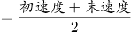千米/小时。根据“总行程前半段比后半段多用时3分钟”，可列方程：，解得S=6.3千米，故甲、乙两地之间的距离4S=6.3×4=25.2千米，对应D项。

故正确答案为D。

**考点**：行程问题-其他

### 第 64 题

某水果种植特色镇创办水果加工厂，从去年年初开始通过电商平台销售桃汁、橙汁两种产品。从去年2月开始，每个月桃汁的销量都比上个月多5000盒，橙汁的销量都比上个月多2000盒。已知去年第一季度桃汁的总销量比橙汁少4.5万盒，则去年桃汁的销量比橙汁：

A. 少不到5万盒

B. 少5万盒以上

C. 多不到5万盒

D. 多5万盒以上

第 64 题 · 答案与解析

**参考答案（粉笔题库参考内容）**

A

**解析**

根据题意，设去年1月桃汁销量为x万盒，去年1月橙汁销量为y万盒，根据等差数列通项公式，可将具体情况列表如下：

根据“去年第一季度桃汁的总销量比橙汁少4.5万盒”可知（y+y+0.2+y+0.4）-（x+x+0.5+x+1）=4.5，解得y-x=1.8万盒，根据等差数列求和公式，即桃汁去年总销量为万盒；橙汁去年总销量为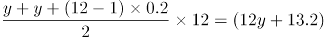万盒，故所求为12x+33-（12y+13.2）=12（x-y）+19.8=-1.8万盒，即少1.8万盒。

故正确答案为A。

**考点**：数列问题

### 第 65 题

一个圆柱体零件的高为1，其圆形底面上的内接正方形边长正好也为1。现将圆柱体零件切割4次，得到棱长为1的正方体，则切去部分的总表面积为：

A. 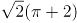

B. 

C. 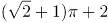

D. 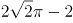

第 65 题 · 答案与解析

**参考答案（粉笔题库参考内容）**

C

**解析**

如下图所示，圆形底面上的内接正方形的对角线即为圆的直径，则该圆柱体的底面直径，半径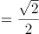。要想得到棱长为1的正方体，则需要分别沿、、、切割4次，且切去的4个部分完全相同。切去部分的表面积包括圆柱体的侧面积、圆柱体的2个底面积扣除内接正方形的部分、正方体的4个侧面。故切去部分的总表面积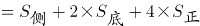。

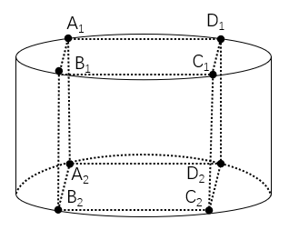

故正确答案为C。

**考点**：几何结论类-三角形相关、几何公式类-立体图形

### 第 66 题

为降低碳排放，企业对生产设备进行改造，改造后日产量下降了10%，但生产每件产品的能耗成本下降了50%，其他成本和出厂价不变的情况下每天的利润提高了10%。已知单件利润=出厂价-能耗成本-其他成本，且改造前产品的出厂价是单件利润的3倍，则改造前能耗成本为其他成本的：

A. 不到

B. \-之间

C. \-之间

D. 超过

第 66 题 · 答案与解析

**参考答案（粉笔题库参考内容）**

B

**解析**

设改造前能耗成本为x、其他成本为y、日产量为10、单件利润为100，则每天利润为1000、出厂价为300。根据每件产品的能耗成本下降了50%，可知改造后成本为0.5x；每天的利润提高了10%，可知改造后每天利润为1000×（1+10%）=1100；根据改造后日产量下降了10%，可知改造后日产量为9，则改造后单件利润为。主体多可以考虑列表，表格如下图所示：

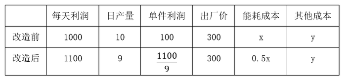

已知单件利润=出厂价-能耗成本-其他成本，根据改造前后可列方程组：，解得：，所求为：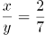，在\-之间。

故正确答案为B。

**考点**：经济利润问题

### 第 67 题

甲地在丙地正西17千米，乙地在丙地正北8千米。张从甲地、李从乙地同时出发，分别向正东和正南方向匀速行走。两人速度均为整数千米/小时，且1小时后两人的直线距离为13千米，又经过3小时后两人均经过了丙地且直线距离为5千米。已知李的速度是张的60%，则张经过丙地的时间比李：

A. 早不到10分钟

B. 早10分钟以上

C. 晚不到10分钟

D. 晚10分钟以上

第 67 题 · 答案与解析

**参考答案（粉笔题库参考内容）**

D

**解析**

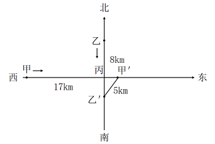

设张的速度为5m千米/小时，则李的速度为3m千米/小时。由题意可知，张、李两人1小时后直线距离为13千米，又经过3小时后直线距离为5千米，且此时均经过了丙地，即出发4小时后张、李两人分别到达图示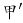、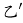处。则根据勾股定理可得：，因两人速度均为整数千米/小时，则m=1时，符合题干所有要求。因此张到达丙地需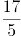小时，即3小时24分钟，李到达丙地需小时，即2小时40分钟，即张经过丙地的时间比李晚44分钟。

故正确答案为D。

**考点**：几何结论类-三角形相关、几何公式类-平面图形、普通行程

### 第 68 题

某企业将5台不同的笔记本电脑和5台不同的平板电脑捐赠给甲、乙两所小学，每所学校分配5台电脑。如在所有可能的分配方式中随机选取一种，两所学校分得的平板电脑数量均不超过3台的概率为：

A. 

B. 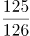

C. 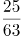

D. 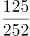

第 68 题 · 答案与解析

**参考答案（粉笔题库参考内容）**

A

**解析**

根据题意，甲、乙两所学校分配5台电脑的总情况数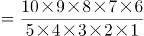种。满足两所学校分得的平板电脑数量均不超过3台的情况分类讨论如下：

①甲学校分得2台笔记本电脑、3台平板电脑，则乙学校分得3台笔记本电脑、2台平板电脑，情况数\=100种；

②甲学校分得3台笔记本电脑、2台平板电脑，则乙学校分得2台笔记本电脑、3台平板电脑，情况数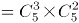\=100种。

则所求概率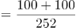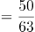。

故正确答案为A。

**考点**：给情况求概率

### 第 69 题

某种商品的定价为成本的1.5倍，如果在降价30元/件的基础上再打八折，则销售5件这种商品的利润比原价销售1件时多130元。问用以下哪种折扣销售时，1.5万元能买到的件数正好比原价销售时多4件？

A. 先降价50元/件再打八折

B. 先打九折再降价50元/件

C. 降价150元/件

D. 打八五折

第 69 题 · 答案与解析

**参考答案（粉笔题库参考内容）**

B

**解析**

设该种商品每件成本为x元，则每件定价为1.5x元。根据题意可列方程：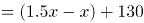，解得x=500，即该种商品每件成本为500元，则每件定价为1.5×500=750元。按原价销售时，1.5万元可购买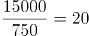件，按选项折扣销售时，1.5万元需购买20+4=24件，此时每件售价应为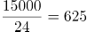元。代入选项：

A项：折扣售价=(750-50)×0.8=560元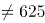元，排除；

B项：折扣售价=750×0.9-50=625元，符合题意，当选。无需验证其他选项。

故正确答案为B。

**考点**：经济利润问题

### 第 70 题

甲、乙等16人参加乒乓球淘汰赛。每轮对所有未被淘汰选手进行抽签分组两两比赛，胜者进入下一轮。已知除甲以外，其余任意两人比赛时双方胜率均为50%。甲对乙的胜率为0%，对其他14人的胜率均为100%。则甲夺冠的概率为：

A. 

B. 

C. 

D. 

第 70 题 · 答案与解析

**参考答案（粉笔题库参考内容）**

C

**解析**

根据题意，甲若想夺冠，需进行四轮比赛且比赛中不能与乙同组比赛，正面讨论较为复杂，正难则反，考虑反面情况（甲乙同组比赛），分类讨论如下：

甲在第一轮与乙比赛：甲在第一轮碰到乙的概率为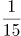，则淘汰概率为；

甲在第二轮与乙比赛：甲、乙在第一轮均胜出的概率为，甲在第二轮碰到乙的概率为，则淘汰概率为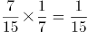；

甲在第三轮与乙比赛：甲、乙在第一轮均胜出的概率为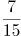，在第二轮均胜出的概率为；甲在第三轮碰到乙的概率为，则淘汰概率为；

甲在第四轮与乙比赛：甲、乙在第一轮均胜出的概率为，在第二轮均胜出的概率为，在第三轮均胜出的概率为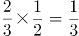；甲在第四轮碰到乙的概率为1，则甲在第四轮淘汰的概率为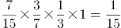。

则题目所求概率=1-反面情况概率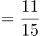。

故正确答案为C。

**考点**：给概率求概率

### 第 71 题

从所给的四个选项中，选择最合适的一个填入问号处，使之呈现一定的规律性：

A. A

B. B

C. C

D. D

第 71 题 · 答案与解析

**参考答案（粉笔题库参考内容）**

A

**解析**

图形元素组成相同，但无明显位置规律，考虑属性规律。观察发现，图形比较规整，考虑对称性。画出图形对称轴后发现对称轴依次逆时针旋转，故“？”处图形的对称轴应为竖直方向，只有A项符合。

故正确答案为A。

**考点**：黑白块类、属性规律-对称性

### 第 72 题

从所给的四个选项中，选择最合适的一个填入问号处，使之呈现一定的规律性：

A. A

B. B

C. C

D. D

第 72 题 · 答案与解析

**参考答案（粉笔题库参考内容）**

C

**解析**

图形元素组成不同，无明显属性规律，优先考虑数量规律。图形封闭面较多，优先考虑数面，但数面无规律。再观察发现题干图形存在明显最大面和最小面，且二者形状相同，按照此规律只有C项符合。

故正确答案为C。

**考点**：数量规律-面

### 第 73 题

从所给的四个选项中，选择最合适的一个填入问号处，使之呈现一定的规律性：

A. A

B. B

C. C

D. D

第 73 题 · 答案与解析

**参考答案（粉笔题库参考内容）**

D

**解析**

图形元素组成相同，但无明显位置规律。观察发现，题干所有图形黑球全部相连，优先考虑部分数。第一组图形中黑球的部分数均是1，第二组图形中黑球的部分数也均是1，故？处应选择一个黑球的部分数为1的图形，排除A项。通过黑球的部分数无法得出唯一答案，再看白球的部分数，观察发现，第一组图形中白球的部分数依次为3、2、1，第二组图形中白球的部分数依次为3、2、？，故？处应选择一个白球的部分数为1的图形，只有D项符合。

故正确答案为D。

**考点**：黑白块类、数量规律-素

### 第 74 题

从所给的四个选项中，选择最合适的一个填入问号处，使之呈现一定的规律性：

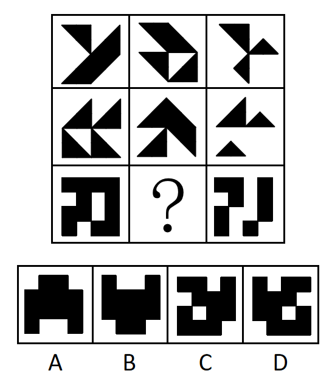

A. A

B. B

C. C

D. D

第 74 题 · 答案与解析

**参考答案（粉笔题库参考内容）**

C

**解析**

图形元素组成相似，优先考虑样式规律。题干图形存在黑色和空白区域，优先考虑黑白运算。九宫格优先横向观察，第一行图形的黑白运算规律为：黑+黑=黑，黑+白=白，白+黑=白，白+白=白，第二行经验证符合此规律，第三行应用此规律，只有C项符合。

故正确答案为C。

**考点**：样式规律-黑白运算

### 第 75 题

下列纸盒的外表面展开图中，哪项折叠成的纸盒和其他三个不一样？

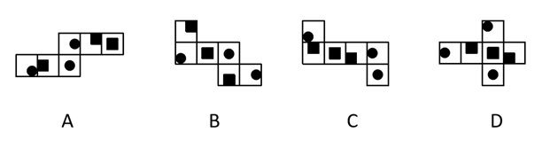

A. A

B. B

C. C

D. D

第 75 题 · 答案与解析

**参考答案（粉笔题库参考内容）**

A

**解析**

将选项展开图标上序号，如下图所示（各选项面都相同，故相同的面用相同字母表示），逐一进行分析。

A项：以面e挨着黑块的点为起点进行顺时针画边（如下图所示），边1对应面f，边2对应面c，边3对应面d；

B项：以面e挨着黑块的点为起点进行顺时针画边（如下图所示），边1对应面f，边2对应面a，边3对应面d；

C项：以面e挨着黑块的点为起点进行顺时针画边（如下图所示），边1对应面f，边2对应面a，边3对应面d；

D项：以面e挨着黑块的点为起点进行顺时针画边（如下图所示），边1对应面f，边2对应面a，边3对应面d。

综上，只有A项与其他三项不同。

本题为选非题，故正确答案为A。

**考点**：空间类-空间重构-六面体

### 第 76 题

左图是给定的立体图形，将其从任一面剖开，以下哪项可能是该立体图形的截面？

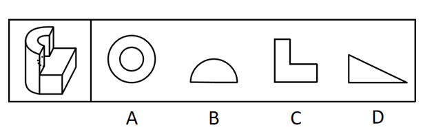

A. A

B. B

C. C

D. D

第 76 题 · 答案与解析

**参考答案（粉笔题库参考内容）**

C

**解析**

本题考查截面图，逐一分析选项。

A项：无法截出完整的圆环，排除；

B项：无法截出半圆，排除；

C项：如下图所示，可以截出，当选；

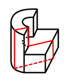

D项：长方体中无法截出直角三角形，排除。

故正确答案为C。

**考点**：空间类-截面图

### 第 77 题

左图给定的是由相同正方体堆叠而成的多面体。该多面体可以由①、②和③三个多面体组合而成，以下哪项能填入问号处？

A. A

B. B

C. C

D. D

第 77 题 · 答案与解析

**参考答案（粉笔题库参考内容）**

D

**解析**

本题考查立体拼合。

观察题干给出的多面体可知，图形可分为3层，由上至下第一层有2个小立方体，第二层有7个小立方体，第三层有9个小立方体。观察发现，图②共有3层，由上至下第一层有2个小立方体，第二层有1个小立方体，第三层有3个小立方体，可以拼合在多面体右侧，如下图所示，则题干多面体第二层还剩余6个小立方体，第三层还剩余6个小立方体。图①最下层的5个小立方体排列形状与题干多面体第二层剩余的形状相似，故图①最下层可以拼合在多面体第二层，最上层可以拼合在多面体第三层，如下图所示。根据凹凸一致的原则，剩余的形状只有D项符合。具体组合方式如下图所示：

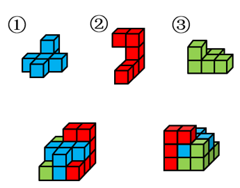

故正确答案为D。

**考点**：空间类-立体拼合

### 第 78 题

把下面的六个图形分为两类，使每一类图形都有各自的共同特征或规律，分类正确的一项是：

A. ①②⑤，③④⑥

B. ①③④，②⑤⑥

C. ①⑤⑥，②③④

D. ①②④，③⑤⑥

第 78 题 · 答案与解析

**参考答案（粉笔题库参考内容）**

A

**解析**

本题为分组分类题目。元素组成不同，优先考虑属性规律。观察可知，题干图形比较规整，考虑对称性。图①②⑤一组，对称轴穿过图中的两个交点；图③④⑥一组，对称轴穿过图中的两条线，并且这两条线和对称轴垂直，对应A项。

故正确答案为A。

**考点**：属性规律-对称性

### 第 79 题

把下面的六个图形分为两类，使每一类图形都有各自的共同特征或规律，分类正确的一项是：

A. ①②⑤，③④⑥

B. ①②③，④⑤⑥

C. ①③⑥，②④⑤

D. ①④⑤，②③⑥

第 79 题 · 答案与解析

**参考答案（粉笔题库参考内容）**

D

**解析**

本题为分组分类题目。元素组成不同，无明显属性规律，考虑数量规律。观察发现，图①和图⑥分别为“日”字、“田”字的变形图，考虑笔画数。图①④⑤为一笔画图形，图②③⑥为两笔画图形。即图①④⑤一组，图②③⑥一组。

故正确答案为D。

**考点**：数量规律-线

### 第 80 题

把下面的六个图形分为两类，使每一类图形都有各自的共同特征或规律，分类正确的一项是：

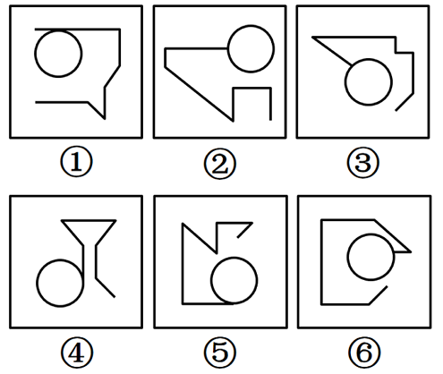

A. ①②④，③⑤⑥

B. ①③⑤，②④⑥

C. ①④⑤，②③⑥

D. ①②⑥，③④⑤

第 80 题 · 答案与解析

**参考答案（粉笔题库参考内容）**

C

**解析**

本题为分组分类题目。元素组成不同，无明显属性规律，考虑数量规律。观察发现，每幅图形均有曲线与直线，且题干图形相切明显，考虑切点数量。图①④⑤的切点数均为1，图②③⑥的切点数均为0。即图①④⑤为一组，图②③⑥为一组。

故正确答案为C。

**考点**：数量规律-点

### 第 81 题

同种数罪是指行为人实施数个行为，符合数个性质相同的基本犯罪构成，触犯数个罪名相同的数罪。

根据上述定义，下列情形属于同种数罪的是：

A. 甲为了自杀，在水中投入剧毒农药，其幼女误饮后身亡，甲见状也饮水身亡

B. 乙为阻止警察抓捕其子，采用暴力手段妨害警察的执法行为，挥刀将警察砍成重伤

C. 丙因缺钱，先是对某单位实施了盗窃，而后又使用暴力手段抢劫了素不相识的赵某

D. 丁故意杀死了与其分手的女友张某，而后又杀死了在生意上与其竞争的李某

第 81 题 · 答案与解析

**参考答案（粉笔题库参考内容）**

D

**解析**

第一步：找出定义关键词。

“行为人实施数个行为”、“符合数个性质相同的基本犯罪构成”、“触犯数个罪名相同的数罪”。

第二步：逐一分析选项。

A项：甲为了自杀，在水中投入剧毒农药，其幼女误饮后身亡，甲见状也饮水身亡，前者是幼女误饮身亡，后者是自杀，而自杀不是犯罪，不符合“符合数个性质相同的基本犯罪构成”，不符合定义，排除；

B项：乙采用暴力手段妨害警察的执法行为和挥刀将警察砍成重伤，是性质不相同的犯罪，不符合“符合数个性质相同的基本犯罪构成”、“触犯数个罪名相同的数罪”，不符合定义，排除；

C项：丙对某单位实施了盗窃和使用暴力手段抢劫赵某，是性质不相同的犯罪，不符合“符合数个性质相同的基本犯罪构成”、“触犯数个罪名相同的数罪”，不符合定义，排除；

D项：丁故意杀死了与其分手的女友张某和在生意上与其竞争的李某，丁实施的两个犯罪行为都是故意杀人，符合“行为人实施数个行为”、“符合数个性质相同的基本犯罪构成”、“触犯数个罪名相同的数罪”，符合定义，当选。

故正确答案为D。

**考点**：单定义-其他句式

### 第 82 题

刑事科学技术是公安、司法机关依照刑事诉讼法的规定，应用现代科学技术的成果，收集、检验和鉴定与犯罪活动有关的物证，为侦查、起诉、审判工作提供线索和证据的专门技术。

根据上述定义，下列没有体现刑事科学技术的是：

A. 通过核对公司台账、采购合同等文件资料，确定犯罪嫌疑人行贿的具体数额

B. 交通肇事伤亡案件中，根据车辆损毁情况推断车辆的接触点，行驶方向及事故成因

C. 应用声谱仪对手机录音与犯罪嫌疑人的语音进行声学特征分析，作出是否为同一人的判断

D. 对警犬识别出来的可疑物进行成分鉴定，判断嫌疑人所携带的物品是否为违禁品

第 82 题 · 答案与解析

**参考答案（粉笔题库参考内容）**

A

**解析**

第一步：找出定义关键词。

“公安、司法机关依照刑事诉讼法的规定”、“应用现代科学技术的成果”、“收集、检验和鉴定与犯罪活动有关的物证”、“为侦查、起诉、审判工作提供线索和证据”。

第二步：逐一分析选项。

A项：核对公司台账、采购合同等文件资料，只涉及资料核对，不符合“应用现代科学技术的成果”，不符合定义，当选；

B项：交通肇事伤亡案件中，根据车辆损毁情况推断车辆的接触点、行驶方向及事故成因，涉及应用现代科学技术中的痕迹检验，符合“应用现代科学技术的成果”、“收集、检验和鉴定与犯罪活动有关的物证”、“为侦查、起诉、审判工作提供线索和证据”，符合定义，排除；

C项：应用声谱仪对手机录音与犯罪嫌疑人的语音进行声学特征分析，涉及应用现代科学技术中的声像技术，符合“应用现代科学技术的成果”、“为侦查、起诉、审判工作提供线索和证据”，手机录音是犯罪活动的物证，符合“收集、检验和鉴定与犯罪活动有关的物证”，符合定义，排除；

D项：对警犬识别出来的可疑物进行成分鉴定，涉及应用现代科学技术中的刑事理化检验，符合“应用现代科学技术的成果”、“为侦查、起诉、审判工作提供线索和证据”，鉴定后的携带物品可以作为犯罪活动的物证，符合“收集、检验和鉴定与犯罪活动有关的物证”，符合定义，排除。

本题为选非题，故正确答案为A。

**考点**：方式目的

### 第 83 题

在卫生经济学评价中，直接成本是指与疾病有关的预防、诊断、治疗和康复等所支出的费用，包括直接医疗成本和直接非医疗成本。直接医疗成本是指与医疗服务的提供直接相关的医疗成本，包括一切必要的医学检验和检查的成本，以及卫生服务管理成本和所有后续治疗成本。直接非医疗成本是指与医疗服务的提供直接相关的非医疗成本。

根据上述定义，下列没有体现上述成本的是：

A. 患者李某前往医院看夜间急诊的出租车费

B. 患者赵某因右臂受伤停工造成的工资损失

C. 在口腔科拔取智齿前，患者于某支付的血常规化验费

D. 在陪同女儿去外地做手术期间，何某住宾馆支付的住宿费

第 83 题 · 答案与解析

**参考答案（粉笔题库参考内容）**

B

**解析**

第一步：找出定义关键词。

直接成本：“与疾病有关的预防、诊断、治疗和康复等所支出的费用”；

直接医疗成本：“与医疗服务的提供直接相关的医疗成本”、“包括一切必要的医学检验和检查的成本”、“卫生服务管理成本和所有后续治疗成本”；

直接非医疗成本：“与医疗服务的提供直接相关的非医疗成本”。

第二步：逐一分析选项。

A项：患者李某前往医院看夜间急诊的出租车费，是前往医疗机构治疗疾病所支付的非医疗费用，符合“与医疗服务的提供直接相关的非医疗成本”，符合“直接非医疗成本”的定义，排除；

B项：患者赵某因受伤停工造成的工资损失，不是为疾病所支出的费用，不符合“与疾病有关的预防、诊断、治疗和康复等所支出的费用”，不符合“直接成本”的定义，即也不符合“直接医疗成本”和“直接非医疗成本”的定义，当选；

C项：患者于某支付的血常规化验费，是为诊断疾病所支出的费用，符合“与医疗服务的提供直接相关的医疗成本”、“包括一切必要的医学检验和检查的成本”，符合“直接医疗成本”的定义，排除；

D项：何某陪同女儿做手术期间支付的住宿费，是为了治疗疾病所支付的非医疗费用，符合“与医疗服务的提供直接相关的非医疗成本”，符合“直接非医疗成本”的定义，排除。

本题为选非题，故正确答案为B。

**考点**：特殊问法

### 第 84 题

在生物学、医学及其子科学的研究中，对从通常的生物学环境中分离出的生物体组织成分进行体外研究的实验称为体外实验；在活体生物机体之中进行研究的实验称为体内实验。

根据上述定义，下列属于体外实验的是：

A. 在培养皿中对卵子授精后观察受精卵的发育情况

B. 在光学显微镜下观察枯草杆菌是否具有鞭毛

C. 研究不同比例氮肥对玉米植株生长的影响

D. 在试管中观察药剂与某溶液的化学反应

第 84 题 · 答案与解析

**参考答案（粉笔题库参考内容）**

A

**解析**

第一步：找出定义关键词。

体外实验：“从通常的生物学环境中分离出的生物体组织成分”、“进行体外研究”；

体内实验：“在活体生物机体之中进行研究”。

第二步：逐一分析选项。

A项：在培养皿中对卵子授精后观察受精卵的发育情况，“卵子”是从雌性体内分离出的生殖细胞，符合“从通常的生物学环境中分离出的生物体组织成分”，观察受精卵的发育情况，符合“进行体外研究”，符合“体外实验”，当选；

B项：观察枯草杆菌是否具有鞭毛，不是将鞭毛分离出来进行研究，不符合“从通常的生物学环境中分离出的生物体组织成分”，不符合“体外实验”，排除；

C项：研究不同比例氮肥对玉米植株生长的影响，是研究不同情况下的活体植株，符合“在活体生物机体之中进行研究”，符合“体内实验”，不符合“体外实验”，排除；

D项：在试管中观察药剂与某溶液的化学反应，“药剂”和“某溶液”都不是生物体组织成分，不符合“从通常的生物学环境中分离出的生物体组织成分”，不符合“体外实验”，排除。

故正确答案为A。

**考点**：常规问法

### 第 85 题

回指是在语法描写中用来指一个语言单位（回指语）从先前某个已表达的单位或意义（先行语）得出自身释义的过程或结果。回指可分为直接回指和间接回指。直接回指是指回指语与先行语存在明显共指关系，回指语是对先行语的重复。间接回指是指回指语与先行语之间的关系不明显，必须通过特定语境进行判断才能确立。

根据上述定义，下列画横线部分所反映的先行语和回指语之间的关系属于直接回指的是：

A. 要向前来参会的人表示感谢，人家来参会就是对我们的支持

B. 门口停着好些三轮车，许多车夫在那里闲站着

C. 这房子相当讲究，门是楠木做的

D. 他午饭前来到餐馆点了一杯咖啡，服务员是一位意大利人

第 85 题 · 答案与解析

**参考答案（粉笔题库参考内容）**

A

**解析**

第一步：找出定义关键词。

回指：“用来指一个语言单位（回指语）从先前某个已表达的单位或意义（先行语）得出自身释义的过程或结果”；

直接回指：“回指语与先行语存在明显共指关系”、“回指语是对先行语的重复”；

间接回指：“回指语与先行语之间的关系不明显”、“必须通过特定语境进行判断才能确立”。

第二步：逐一分析选项。

A项：选项中先行语是“前来参会的人”，回指语是“人家”，“人家”用来指代前文中提到的“前来参会的人”，符合“回指语与先行语存在明显共指关系”、“回指语是对先行语的重复”，符合“直接回指”定义，当选；

B项：选项中先行语是“三轮车”，回指语是“车夫”，前者是物，后者是人，二者间无明显的共指关系，“车夫”也不是对“三轮车”的重复，不符合“回指语与先行语存在明显共指关系”、“回指语是对先行语的重复”，不符合“直接回指”定义，排除；

C项：选项中先行语是“这房子”，回指语是“门”，前者是整体，后者是前者的部分，二者间无明显的共指关系，“门”也不是对“房子”的重复，不符合“回指语与先行语存在明显共指关系”、“回指语是对先行语的重复”，不符合“直接回指”定义，排除；

D项：选项中先行语是“餐馆”，回指语是“服务员”，前者是场所，后者是人，二者间无明显的共指关系，“服务员”也不是对“餐馆”的重复，不符合“回指语与先行语存在明显共指关系”、“回指语是对先行语的重复”，不符合“直接回指”定义，排除。

故正确答案为A。

**考点**：常规问法

### 第 86 题

总量指标动态数列是将反映某种社会经济现象的一系列总量指标按时间先后顺序排列形成的数列，可分为两类：（1）时期数列：每个指标都表示社会经济现象在一定时期内发展过程的总量，各指标值可以相加，指标数值的大小与时期长短有直接关系；（2）时点数列：每个指标都表示社会经济现象在某一时点（时刻）上的数量，各指标值不能相加，指标数值大小和“时点间隔”长短没有直接关系，每个指标通常都是定期（间断）登记取得的。

根据上述定义，下列属于时点数列的是：

A. 2016~2020年某市税收情况

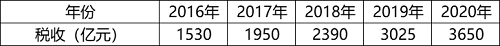

B. 2017~2020年某公司员工人数情况

C. 2021年1~5月某地区城镇私营单位就业人员月均工资

D. 2020年某地区各季度电动汽车生产产量

第 86 题 · 答案与解析

**参考答案（粉笔题库参考内容）**

B

**解析**

第一步：找出定义关键词。

总量指标动态数列：“将反映某种社会经济现象的一系列总量指标按时间先后顺序排列”；

时期数列：“每个指标都表示社会经济现象在一定时期内发展过程的总量”、“各指标值可以相加”、“指标数值的大小与时期长短有直接关系”；

时点数列：“每个指标都表示社会经济现象在某一时点（时刻）上的数量”、“各指标值不能相加”、“指标数值大小和‘时点间隔’长短没有直接关系，每个指标通常都是定期（间断）登记取得的”。

第二步：逐一分析选项。

A项：选项中每项指标表示的是每一年的税收情况，属于一定时期内的总量，符合“每个指标都表示社会经济现象在一定时期内发展过程的总量”，符合“时期数列”定义，不符合“时点数列”定义，排除；

B项：选项中每项指标表示的是每一年的年末员工人数，“年末”是个时点，符合“每个指标都表示社会经济现象在某一时点（时刻）上的数量”，指标是年末的人数，不能相加，符合“各指标值不能相加”，且和时间长短没有直接关系，统计每年的年末数据，说明其是间断取得的，符合“指标数值大小和‘时点间隔’长短没有直接关系，每个指标通常都是定期（间断）登记取得的”，符合“时点数列”定义，当选；

C项：选项中每项指标表示的是每月的平均工资，是一整月的工资平均值，不是某一时点（时刻）上的数量，不符合“每个指标都表示社会经济现象在某一时点（时刻）上的数量”，不符合“时点数列”定义，排除；

D项：选项中每项指标表示的是每一季度的生产产量，属于一定时期内的总量，符合“每个指标都表示社会经济现象在一定时期内发展过程的总量”，符合“时期数列”定义，不符合“时点数列”定义，排除。

故正确答案为B。

**考点**：常规问法

### 第 87 题

由于人类建设活动的破坏和干扰，生物群体原来连续成片的生活环境被割裂，形成分散的岛状甚至碎片状的生境，生境廊道是指连接破碎化生境并适宜生物生活、移动或扩散的通道，便于实现物种基因、能量、物质的流动。

根据上述定义，下列不属于生境廊道的是：

A. 国家公园内，两棵参天古树跨过公路上方枝叶相连，金丝猴借助古树跨越公路。不同区域的金丝猴群可以保持接触

B. 为了让野生象群在两个自然保护区之间迁移，管理者设计建成了迁移通道，避开村寨，并保证该区域范围内有丰富的水和食物资源

C. 某地将过去严重污染的河道改造为河滨公园，架设了多座拱桥，美化了环境，方便了交通，还吸引了大量鸟类来此栖息

D. 为避免青藏铁路隔断藏羚羊迁徙路线，动物学家设计了桥梁下方、隧道上方及路基缓坡3种形式的野生动物通路

第 87 题 · 答案与解析

**参考答案（粉笔题库参考内容）**

C

**解析**

第一步：找出定义关键词。

“连接破碎化生境”、“适宜生物生活、移动或扩散的通道”、“便于实现物种基因、能量、物质的流动”。

第二步：逐一分析选项。

A项：两棵参天古树跨过公路上方枝叶相连，符合“连接破碎化生境”，不同区域的金丝猴群可以通过相连的枝叶来保持接触，实现基因、能量、物质的流动，符合“适宜生物生活、移动或扩散的通道”、“便于实现物种基因、能量、物质的流动”，符合定义，排除；

B项：管理者在两个自然保护区之间建立迁移通道，符合“连接破碎化生境”，野生象群可以通过迁移通道实现基因、能量、物质的流动，符合“适宜生物生活、移动或扩散的通道”、“便于实现物种基因、能量、物质的流动”，符合定义，排除；

C项：某地将严重污染的河道改造为河滨公园，但河滨公园只是鸟类的栖息地，没有体现对于破碎化生境的连接，不符合“连接破碎化生境”、“适宜生物生活、移动或扩散的通道”，不符合定义，当选；

D项：动物学家设计野生动物通路来避免藏羚羊的迁移路线被阻隔，符合“连接破碎化生境”，多种形式的野生动物通路可以让藏羚羊之间实现基因、能量、物质的流动，符合“适宜生物生活、移动或扩散的通道”、“便于实现物种基因、能量、物质的流动”，符合定义，排除。

本题为选非题，故正确答案为C。

**考点**：方式目的

### 第 88 题

除草剂必须具有良好的选择性，即在一定的用量与使用期内，能够防除杂草而又不伤害作物。其中，形态选择性是利用作物与杂草的形态结构差异而获得的选择性。生化选择性是利用作物和杂草在代谢过程中活化机制和解毒反应差异而产生的选择性。

根据上述定义，下列属于生化选择性的是：

A. 将玉米种子事先用吸附性强的活性炭处理，通过这种保护物质避免或降低除草剂对种子的伤害

B. 除草剂草甘膦用于作物播种、移栽或插秧之前，杀死已萌发的杂草，而这种除草剂在土壤中会很快失活或钝化，因此使用过后可安全地播种作物

C. 小麦叶片窄、直立，表面有较厚的蜡质层和角质层，可使药液不易沾着，而杂草则因叶片宽、平、角质层薄，易接触除草剂而被杀伤

D. 除草剂敌稗可被水稻含有的酰胺水解酶分解，而杂草不具备足量的酰胺水解酶，无法分解敌稗，易被杀死

第 88 题 · 答案与解析

**参考答案（粉笔题库参考内容）**

D

**解析**

第一步：找出定义关键词。

形态选择性：“利用作物与杂草的形态结构差异而获得的选择性”；

生化选择性：“利用作物和杂草在代谢过程中活化机制和解毒反应差异而产生的选择性”。

第二步：逐一分析选项。

A项：通过活性炭处理的方式避免或降低除草剂对种子的伤害，没有体现除草剂在作物和杂草之间的选择性，不符合“利用作物和杂草在代谢过程中活化机制和解毒反应差异而产生的选择性”，不符合生化选择性的定义，排除；

B项：除草剂草甘膦可杀死土壤中的杂草，同时不会对土壤产生副作用，但这个过程发生在播种作物之前，没有体现除草剂在作物和杂草之间的选择性，不符合“利用作物和杂草在代谢过程中活化机制和解毒反应差异而产生的选择性”，不符合生化选择性的定义，排除；

C项：由于小麦和杂草的叶片形状及角质层的差异，除草剂可以选择性地杀伤杂草，体现了除草剂在作物和杂草之间的选择性，符合“利用作物与杂草的形态结构差异而获得的选择性”，符合形态选择性的定义，不符合生化选择性的定义，排除；

D项：水稻中含有的酰胺水解酶可以分解除草剂敌稗，而杂草因无法分解敌稗易被杀死，酰胺水解酶分解敌稗的过程体现了不同代谢过程中活化机制和解毒反应的差异，也体现了除草剂在作物和杂草之间的选择性，符合“利用作物和杂草在代谢过程中活化机制和解毒反应差异而产生的选择性”，符合生化选择性的定义，当选。

故正确答案为D。

**考点**：常规问法

### 第 89 题

归因不变性原则是指人们会寻找某一特定结果与特定原因之间的不变联系，如果某种特定原因在许多情境下总是与某种结果相伴，人们就会把特定结果归结于那一原因。归因折扣原则是指人们不完全相信某一现象的形成确是由于某种原因所导致，即某一特定原因在产生特定结果中的作用，如果存在其他似是而非的原因，应该“打折扣”。

根据上述定义，两类归因原则均没有体现的是：

A. 电视广告中明星推销洗发水时，观众觉得她的一头秀发不完全是因为洗发水才有的

B. 创业失败总会使创业者背负债务，创业者小罗这几年债台高筑，朋友认为他一定是创业失败了

C. 在代理了诸多离婚案件后，律师小林统计发现离婚诉讼中大多数争议与财产纠纷有关

D. 对一系列盗窃案的分析显示，现场都出现过同一个男人，人们容易假定该男人就是犯罪嫌疑人

第 89 题 · 答案与解析

**参考答案（粉笔题库参考内容）**

C

**解析**

第一步：找出定义关键词。

归因不变性原则：“某种特定原因在许多情境下总是与某种结果相伴”、“人们就会把特定结果归结于那一原因”；

归因折扣原则：“人们不完全相信某一现象的形成确是由于某种原因所导致”。

第二步：逐一分析选项。

A项：该项中观众觉得明星的秀发不完全是因为洗发水才有的，符合“人们不完全相信某一现象的形成确是由于某种原因所导致”，符合归因折扣原则定义，排除；

B项：该项中创业失败总会导致创业者背负债务，符合“某种特定原因在许多情境下总是与某种结果相伴”，朋友认为小罗这几年债台高筑的原因是创业失败，符合“人们就会把特定结果归结于那一原因”，符合归因不变性原则定义，排除；

C项：该项中律师小林发现离婚诉讼中大多数争议与财产纠纷有关，并没有体现人们是否将离婚诉讼这个结果归结于财产纠纷，不符合“某种特定原因在许多情境下总是与某种结果相伴”、“人们就会把特定结果归结于那一原因”，不符合归因不变性原则定义，同时该项也没有体现人们对于财产纠纷这个原因的质疑，不符合“人们不完全相信某一现象的形成确是由于某种原因所导致”，不符合归因折扣原则定义，当选；

D项：该项中盗窃案的现场都出现了同一个男人，符合“某种特定原因在许多情境下总是与某种结果相伴”，人们容易假定该男人就是盗窃案的犯罪嫌疑人，符合“人们就会把特定结果归结于那一原因”，符合归因不变性原则定义，排除。

本题为选非题，故正确答案为C。

**考点**：特殊问法

### 第 90 题

老年系数是指65岁及以上的人口数在总人口中所占的百分比；少年儿童系数是指14岁及以下人口数在总人口中的百分比；抚养比是指人口中非劳动年龄人数与劳动年龄人数之比（百分比），一般以15～64岁为劳动年龄，14岁及以下和65岁及以上称为非劳动年龄或被抚养年龄；老少比是65岁及以上的人口与14岁及以下人口数量之比（百分比）。

根据上述定义，下列说法正确的是：

A. 一般情况下，抚养比大于老年系数与少年儿童系数之和

B. 当社会总人口不变，劳动年龄人数增加时，少年儿童系数就会减少

C. 老年系数和少年儿童系数的乘积等于老少比

D. 老少比通常表示的是每100名老年人对应多少少年儿童

第 90 题 · 答案与解析

**参考答案（粉笔题库参考内容）**

A

**解析**

第一步：找出定义关键词。

老年系数：“65岁及以上的人口数在总人口中所占的百分比”；

少年儿童系数：“14岁及以下人口数在总人口中的百分比”；

抚养比：“人口中非劳动年龄人数与劳动年龄人数之比”、“一般以15～64岁为劳动年龄，14岁及以下和65岁及以上称为非劳动年龄或被抚养年龄”；

老少比：“65岁及以上的人口与14岁及以下人口数量之比”。

第二步：逐一分析选项。

A项：抚养比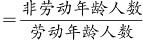，老年系数＋少年儿童系数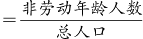，劳动年龄人数一定是小于总人口的，所以一般情况下，抚养比大于老年系数与少年儿童系数之和，说法正确，当选；

B项：少年儿童系数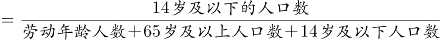，已知总人口不变，当劳动年龄人数增加时，65岁及以上人口数和14岁及以下人口数之和会减少，但14岁及以下人口数的具体情况不明，因此少年儿童系数不一定会减少，说法错误，排除；

C项：老年系数×少年儿童系数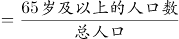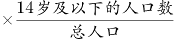，老少比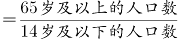，两者之间不能划等号，说法错误，排除；

D项：题干中老少比是65岁及以上的人口数与14岁及以下人口数之比，正确的表述应该是每100名少年儿童对应多少老年人，说法错误，排除。

故正确答案为A。

**考点**：特殊问法

### 第 91 题

贸易摩擦：出口下滑

A. 醉酒驾驶：例行检查

B. 行政处罚：违规生产

C. 商业垄断：市场失灵

D. 职务犯罪：谋取私利

第 91 题 · 答案与解析

**参考答案（粉笔题库参考内容）**

C

**解析**

第一步：判断题干词语间逻辑关系。

因为贸易摩擦，所以出口下滑，二者为因果对应关系。

第二步：判断选项词语间逻辑关系。

A项：通过例行检查可以发现是否有人醉酒驾驶，二者并非因果对应关系，与题干逻辑关系不一致，排除；

B项：因为违规生产，所以遭受行政处罚，二者为因果关系，但词语顺序与题干相反，与题干逻辑关系不一致，排除；

C项：因为商业垄断，所以市场失灵，二者为因果关系，与题干逻辑关系一致，当选；

D项：职务犯罪的目的是谋取私利，二者为方式与目的对应关系，与题干逻辑关系不一致，排除。

故正确答案为C。

**考点**：逻辑关系-对应关系

### 第 92 题

载歌：载舞

A. 人云：亦云

B. 且战：且退

C. 自作：自受

D. 全心：全意

第 92 题 · 答案与解析

**参考答案（粉笔题库参考内容）**

B

**解析**

第一步：判断题干词语间逻辑关系。

“载歌”指一边唱歌，“载舞”是指一边跳舞，二者为并列关系，是两个同时进行的动作。

第二步：判断选项词语间逻辑关系。

A项：“人云”指人家说什么，“亦云”指自己也跟着说什么，两个动作存在时间先后顺序，与题干逻辑关系不一致，排除；

B项：“且战”指一边战斗，“且退”指一边向后移动，二者为并列关系，是两个同时进行的动作，与题干逻辑关系一致，当选；

C项：“自作”指自己做错了事，“自受”指自己承担不好的后果，二者存在时间先后顺序，与题干逻辑关系不一致，排除；

D项：“全心”和“全意”均是指用全部的精力，二者为近义关系，不是两个同时进行的动作，与题干逻辑关系不一致，排除。

故正确答案为B。

**考点**：逻辑关系-并列关系

### 第 93 题

微型无人机：旋翼无人机

A. 热带植物：香料植物

B. 集体决策：个人决策

C. 形象思维：抽象思维

D. 开环系统：闭环系统

第 93 题 · 答案与解析

**参考答案（粉笔题库参考内容）**

A

**解析**

第一步：判断题干词语间逻辑关系。

微型无人机是指尺寸只有手掌大小（约15cm）的飞行器，旋翼无人机是指用旋翼提供升力的无人驾驶飞行器，有的微型无人机是旋翼无人机，有的微型无人机不是旋翼无人机，有的旋翼无人机是微型无人机，有的旋翼无人机不是微型无人机，二者为交叉关系。

第二步：判断选项词语间逻辑关系。

A项：热带植物是指生活在热带地区的植物，香料植物是指能分泌和积累具有芳香气味物质的一类植物，有的热带植物是香料植物，有的热带植物不是香料植物，有的香料植物是热带植物，有的香料植物不是热带植物，二者为交叉关系，与题干逻辑关系一致，当选；

B项：集体决策是通过集体做出的决策，个人决策是指由一个人单独做出的决策，二者为并列关系，与题干逻辑关系不一致，排除；

C项：形象思维是以直观形象和表象为支柱的思维过程，抽象思维是指用词进行判断、推理并得出结论的过程，二者为并列关系，与题干逻辑关系不一致，排除；

D项：开环系统是指在一个控制系统中系统的输入信号不受输出信号影响的控制系统，闭环系统是指系统的输入影响输出，同时又受输出的直接或间接影响的系统，二者为并列关系，与题干逻辑关系不一致，排除。

故正确答案为A。

**考点**：逻辑关系-交叉关系

### 第 94 题

呼吸系统：生殖系统

A. 生产计划：年度计划

B. 观赏花卉：药用花卉

C. 水面舰艇：巡洋舰艇

D. 简牍公文：纸质公文

第 94 题 · 答案与解析

**参考答案（粉笔题库参考内容）**

D

**解析**

第一步：判断题干词语间逻辑关系。

呼吸系统和生殖系统是两种不同的人体系统，二者是并列关系。

第二步：判断选项词语间逻辑关系。

A项：年度计划是对一年的工作、活动等所做的规划，不同的人、不同的工作的年度计划不同，生产计划是企业对生产任务作出的规划，有的生产计划是年度计划，有的生产计划不是年度计划，有的年度计划是生产计划，有的年度计划不是生产计划，二者是交叉关系，与题干逻辑关系不一致，排除；

B项：观赏花卉是具有观赏价值的花卉，药用花卉是能够防病、治病的花卉，有的观赏花卉是药用花卉，有的观赏花卉不是药用花卉，有的药用花卉是观赏花卉，有的药用花卉不是观赏花卉，二者是交叉关系，与题干逻辑关系不一致，排除；

C项：巡洋舰艇是一种在远洋活动的大型水面舰艇，与水面舰艇是种属关系，与题干逻辑关系不一致，排除；

D项：简牍公文是在竹简、木简、竹牍或木牍上书写的公文，与纸质公文是并列关系，与题干逻辑关系一致，当选。

故正确答案为D。

**考点**：逻辑关系-并列关系

### 第 95 题

青铜器物：商朝礼器：文化遗产

A. 科幻小说：微型小说：文学作品

B. 中式建筑：苏州园林：特色建筑

C. 仰韶文化：半坡遗址：华夏文明

D. 进口食品：速冻海鲜：冷冻食品

第 95 题 · 答案与解析

**参考答案（粉笔题库参考内容）**

A

**解析**

第一步：判断题干词语间逻辑关系。

青铜器物与商朝礼器构成交叉关系，同时二者均是文化遗产的一种，二者均与文化遗产构成种属关系。

第二步：判断选项词语间逻辑关系。

A项：科幻小说与微型小说构成交叉关系，同时二者均是文学作品的一种，二者均与文学作品构成种属关系，与题干逻辑关系一致，当选；

B项：苏州园林是一种中式建筑，二者为种属关系，中式建筑和特色建筑构成交叉关系，与题干逻辑关系不一致，排除；

C项：半坡遗址是新石器时代仰韶文化聚落遗址，二者为对应关系；仰韶文化是华夏文明的组成部分，二者为组成关系，与题干逻辑关系不一致，排除；

D项：进口食品与速冻海鲜构成交叉关系，但进口食品与冷冻食品也构成交叉关系，与题干逻辑关系不一致，排除。

故正确答案为A。

注：青铜器物不仅是红铜与其他化学元素锡、铅等的合金，而且因为刚刚铸造完成的青铜器是金色，出土的青铜因为时间流失产生锈蚀后变为青绿色，所以被称为青铜。因此现在仅仅由红铜与其他化学元素锡、铅等物质制成的器具是不能称之为青铜器的，只能称之为铜器物。故题干青铜器物和文化遗产间是种属关系。

**考点**：逻辑关系-交叉关系、逻辑关系-包容关系

### 第 96 题

独幕剧：歌剧：话剧

A. 流行歌曲：通俗歌曲：现代歌曲

B. 自由体操：竞技体操：艺术体操

C. 远程面试：单独面试：小组面试

D. 顺序作业：流水作业：平行作业

第 96 题 · 答案与解析

**参考答案（粉笔题库参考内容）**

C

**解析**

第一步：判断题干词语间逻辑关系。

独幕剧指不分幕的小型戏剧，歌剧指综合诗歌、音乐、舞蹈等艺术而以歌唱为主的戏剧，话剧指用对话和动作来表演的戏剧。歌剧和话剧为并列关系，同时二者与独幕剧均构成交叉关系。

第二步：判断选项词语间逻辑关系。

A项：通俗歌曲又叫流行歌曲，二者为全同关系，与题干逻辑关系不一致，排除；

B项：自由体操是竞技体操的一种，二者为种属关系；体操主要包括竞技体操、艺术体操、蹦床等项目，竞技体操和艺术体操构成并列关系，与题干逻辑关系不一致，排除；

C项：远程面试是根据面试的距离远近进行分类的面试类型，单独面试和小组面试是根据面试的主体数量进行分类的面试类型，单独面试和小组面试为并列关系，二者与远程面试均构成交叉关系，与题干逻辑关系一致，当选；

D项：顺序作业、流水作业、平行作业均为施工组织的作业方式，三者为并列关系，与题干逻辑关系不一致，排除。

故正确答案为C。

**考点**：逻辑关系-并列关系、逻辑关系-交叉关系

### 第 97 题

提起公诉：宣告判决：收押罪犯

A. 撰写教案：课堂教学：解答疑问

B. 手机点餐：外卖送餐：五星好评

C. 违章行驶：交警处罚：行人受伤

D. 方案设计：建筑施工：竣工验收

第 97 题 · 答案与解析

**参考答案（粉笔题库参考内容）**

D

**解析**

第一步：判断题干词语间逻辑关系。

首先“提起公诉”，其次“宣告判决”，最后“收押罪犯”，三者为时间先后顺序的对应关系，且“提起公诉”的主体为检察院，“宣告判决”的主体为法院，“收押罪犯”的主体为监狱或看守所，三者主体不一致。

第二步：判断选项词语间逻辑关系。

A项：首先“撰写教案”，其次“课堂教学”，最后“解答疑问”，三者为时间先后顺序的对应关系，但三者的主体均为老师，与题干逻辑关系不一致，排除；

B项：首先“手机点餐”，其次“外卖送餐”，最后“五星好评”，三者为时间先后顺序的对应关系，但“手机点餐”和“五星好评”的主体均为顾客，与题干逻辑关系不一致，排除；

C项：首先“违章行驶”，其次“行人受伤”，最后“交警处罚”，三者为时间先后顺序的对应关系，但与题干顺序不一致，与题干逻辑关系不一致，排除；

D项：首先“方案设计”，其次“建筑施工”，最后“竣工验收”，三者为时间先后顺序的对应关系，且“方案设计”的主体为建筑设计研究院，“建筑施工”的主体为建设单位，“竣工验收”的主体为监理单位，三者主体不一致，与题干逻辑关系一致，当选。

故正确答案为D。

**考点**：逻辑关系-对应关系

### 第 98 题

城市公园：公共设施：休闲娱乐

A. 国宾礼炮：电子礼炮：国事庆祝

B. 医用口罩：卫生用品：过滤空气

C. 升降舞台：露天剧场：演出空间

D. 云服务器：虚拟技术：信息备份

第 98 题 · 答案与解析

**参考答案（粉笔题库参考内容）**

B

**解析**

第一步：判断题干词语间逻辑关系。

“城市公园”是一种“公共设施”，二者为种属关系；“城市公园”具有“休闲娱乐”的功能，二者为功能对应关系。

第二步：判断选项词语间逻辑关系。

A项：有的“国宾礼炮”是“电子礼炮”，有的“国宾礼炮”不是“电子礼炮”，有的“电子礼炮”是“国宾礼炮”，有的“电子礼炮”不是“国宾礼炮”，二者为交叉关系；“国宾礼炮”和“电子礼炮”都有用于“国事庆祝”的功能，三者构成功能对应关系，与题干逻辑关系不一致，排除；

B项：“医用口罩”是一种“卫生用品”，二者为种属关系；“医用口罩”具有“过滤空气”的功能，二者为功能对应关系，与题干逻辑关系一致，当选；

C项：“升降舞台”是“露天剧场”的组成部分，二者为组成关系；“露天剧场”是一种“演出空间”，二者为种属关系，与题干逻辑关系不一致，排除；

D项：“云服务器”运用了“虚拟技术”，二者不是种属关系；“云服务器”具有“信息备份”的功能，二者为功能对应关系，与题干逻辑关系不一致，排除。

故正确答案为B。

**考点**：逻辑关系-包容关系、逻辑关系-对应关系

### 第 99 题

自然声源 对于 （ ） 相当于 （ ） 对于 煤炭

A. 人工声源；植物遗骸

B. 燕语莺声；矿石燃料

C. 传播介质；社区供暖

D. 物体振动；地质危害

第 99 题 · 答案与解析

**参考答案（粉笔题库参考内容）**

B

**解析**

逐一代入选项。

A项：自然声源与人工声源二者是并列关系，煤炭是古代植物遗骸在地下经历了复杂的生物化学和物理化学变化逐渐形成的固体可燃性矿物，二者为原材料对应关系，前后逻辑关系不一致，排除；

B项：燕语莺声的意思是燕子的话语，黄鹂的歌声，燕语莺声是自然声源，二者为种属关系，煤炭是矿石燃料，二者为种属关系，前后逻辑关系一致，当选；

C项：自然声源需要在传播介质的条件下才能传播出声音，二者为必要条件对应关系，社区供暖需要煤炭来提供能量，二者为对应关系，但不是必要条件对应关系，前后逻辑关系不一致，排除；

D项：物体振动产生自然声源，二者为对应关系，煤炭与地质危害无明显逻辑关系，前后逻辑关系不一致，排除。

故正确答案为B。

备注：本题所给词语“自然声源”、“矿石燃料”与专有名词存在区别，如果按照专有名词的释义进行分析，则本题没有答案，所以解析时按照日常理解进行题干分析。

**考点**：逻辑关系-包容关系

### 第 100 题

纪录片 对于 （ ） 相当于 （ ） 对于 客观题

A. 电影；主观题

B. 国产片；选择题

C. 动画片；考试题

D. 译制片；必答题

第 100 题 · 答案与解析

**参考答案（粉笔题库参考内容）**

D

**解析**

逐一代入选项。

A项：有的纪录片是电影，有的纪录片不是电影，有的电影是纪录片，有的电影不是纪录片，二者为交叉关系。主观题是自由应答型试题，包括论述题、材料分析题等，客观题是固定应答型试题，包括判断题、选择题等，二者为矛盾关系，前后逻辑关系不一致，排除；

B项：有的纪录片是国产片，有的纪录片不是国产片，有的国产片是纪录片，有的国产片不是纪录片，二者为交叉关系。选择题是一种客观题，二者为种属关系，前后逻辑关系不一致，排除；

C项：纪录片是以真实生活为创作素材，以展现真实为本质的电影或电视艺术形式，动画片是在动画的基础上，由制作者赋予艺术内涵与思想内涵，所产生的艺术作品，二者为并列关系。有的考试题是客观题，有的考试题不是客观题，有的客观题是考试题，有的客观题不是考试题，二者为交叉关系，前后逻辑关系不一致，排除；

D项：译制片是指将原版影片的对白或解说翻译成另一种语言后，以该种语言配音混录或叠加字幕后的影片，有的纪录片是译制片，有的纪录片不是译制片，有的译制片是纪录片，有的译制片不是纪录片，二者为交叉关系。有的必答题是客观题，有的必答题不是客观题，有的客观题是必答题，有的客观题不是必答题，二者也为交叉关系，前后逻辑关系一致，当选。

故正确答案为D。

**考点**：逻辑关系-交叉关系

### 第 101 题

由于集合了榨汁机、豆浆机、料理机、研磨机等产品功能，破壁机近年来一直备受消费者青睐。某公司生产了R型和W型两款功能相同的破壁机，相比而言R型清洗更方便，W型噪音更小。上市三年后的数据显示，R型销量更好，所以公司认为消费者更喜欢易于清洗的破壁机产品。

以下哪项如果为真，最能削弱上述观点？

A. 相比W型产品，R型网上促销力度更大，价格更具优势

B. W型产品的外观设计更美观，许多白领上班族都更倾向于买W型

C. 和其他生产破壁机产品的公司相比，该公司具有更高的市场占有率

D. R型和W型产品在全国的销售渠道一致，主要投放在超市、购物中心

第 101 题 · 答案与解析

**参考答案（粉笔题库参考内容）**

A

**解析**

第一步：找出论点和论据。

论点：消费者更喜欢易于清洗的破壁机产品。

论据：R型清洗更方便，W型噪音更小，上市三年后的数据显示，R型销量更好。

第二步：逐一分析选项。

A项：R型除了清洗更方便，价格也更具有优势，即消费者不一定是因为R型更易清洗而购买，也可能是因为价格便宜，可以削弱，当选；

B项：该项只是说明许多白领上班族倾向于买W型，但无法得知其他类型的消费者倾向于买哪种类型，不明确选项，不能削弱，排除；

C项：该项说的是该公司市场占有率更高，并未提及消费者是否更喜欢易于清洗的破壁机产品，与论点话题不一致，不能削弱，排除；

D项：该项说的是两款破壁机的销售渠道一致，并未提及消费者是否更喜欢易于清洗的破壁机产品，与论点话题不一致，不能削弱，排除。

故正确答案为A。

**考点**：他因削弱

### 第 102 题

研究员让流行音乐爱好者听一组流行歌曲，同时用功能磁共振成像监测他们的大脑活动。在进行扫描前，研究员通过经颅磁刺激间接刺激或抑制大脑的奖赏回路。结果发现，在听音乐之前刺激奖赏回路会增加被试听音乐时的愉悦感，而抑制它则会降低愉悦感。因此，研究员认为，大脑的奖赏回路会影响人们对音乐的喜欢程度。

以下哪项如果为真，最能支持上述结论？

A. 缺乏音乐快感的人听音乐时，其大脑奖赏回路的活动很微弱

B. 人们在享受美食时，也会出现大脑奖赏回路活动性升高

C. 不喜欢流行音乐的人在听流行歌曲时，也会出现大脑奖赏回路的活动

D. 音乐家喜欢的音乐，对“乐盲”而言可能是噪音，因为两者的大脑活动机制不同

第 102 题 · 答案与解析

**参考答案（粉笔题库参考内容）**

A

**解析**

第一步：找出论点和论据。

论点：大脑的奖赏回路会影响人们对音乐的喜欢程度。

论据：在听音乐之前刺激奖赏回路会增加被试听音乐时的愉悦感，而抑制它则会降低愉悦感。

本题论点论据都是在说明大脑的奖赏回路会影响人们对音乐的喜欢程度，论点论据话题一致，所以加强可以优先考虑补充论据，可以举例子，也可以解释原因。

第二步：逐一分析选项。

A项：举了缺乏音乐快感的人听音乐时其大脑奖赏回路的活动很微弱的例子说明了大脑奖赏回路确实可以影响人对音乐的喜欢程度，补充论据，当选；

B项：论点说的是大脑奖赏回路会影响人们对音乐的喜欢程度，该项说的是享受美食和大脑奖赏回路活动性的关系，没有提及对音乐的喜欢程度的话题，与论点话题不一致，无法加强，排除；

C项：不喜欢流行音乐的人在听流行歌曲时，也会出现大脑奖赏回路的活动，说明无论是否喜欢流行音乐，都会出现大脑奖赏回路活动，即大脑奖赏回路活动与人对音乐的喜欢程度无关，削弱项，无法加强，排除；

D项：没有具体说明对于两者的大脑活动机制不同是否与大脑奖赏回路的活动有关，不明确项，无法加强，排除。

故正确答案为A。

**考点**：补充论据

### 第 103 题

一家全国连锁珠宝店的H分店，去年在当地投放大量电梯促销广告。广告投放后，客流量激增，净利润和前一年同期相比增长了30%。可见电梯促销广告对于提高企业利润十分有效。假设G、M、R、S是与H分店规模、位置等具有可比性的其他4家分店，则下列最能削弱上述论证的是：

A. G分店，去年没有投放电梯广告，利润比H分店更高

B. M分店，去年选择投放了报纸广告，销售额同比提升了30%

C. R分店，去年投放大量电梯广告，销售额却比H分店低

D. S分店，去年投放大量电梯广告，利润同比下降了10%

第 103 题 · 答案与解析

**参考答案（粉笔题库参考内容）**

D

**解析**

第一步：找出论点和论据。

论点：电梯促销广告对于提高企业利润十分有效。

论据：H分店，去年在当地投放大量电梯促销广告。广告投放后，客流量激增，净利润和前一年同期相比增长了30%。

本题的论点和论据都在讨论投放电梯促销广告和企业利润之间的关系，论点论据话题一致，优先考虑否定论点。

第二步：逐一分析选项。

A项：G分店去年没有投放电梯广告，但是利润却比H分店更高，只能说明G分店去年利润高于H分店，但是没有说明投放电梯广告能否进一步提高G分店的利润，而题干论点讨论的是投放电梯广告能否提高利润，话题不一致，无法削弱，排除；

B项：M分店投放的是报纸广告，题干论点讨论的是电梯广告，话题不一致，无法削弱，排除；

C项：R分店投放了电梯广告，销售额比H分店低，论点讨论的是利润，该项给出的是销售额，话题不一致，无法削弱，排除；

D项：S分店投放了电梯广告但是利润同比下降了，说明投放电梯广告反而使得该店利润下降，举反例削弱论点，当选。

故正确答案为D。

**考点**：削弱论点

### 第 104 题

不同的读者在阅读时，会对文章进行不同的加工编码，一种是浏览，从文章中收集观点和信息，使知识作为独立的单元输入大脑，称为线性策略；一种是做笔记，在阅读时会构建一个层次清晰的架构，就像用信息积木搭建了一个“金字塔”，称为结构策略。做笔记能够对文章的主要内容进行标注，因此与单纯的浏览相比，做笔记能够取得更优的阅读效果。

要使上述论证成立，还需基于以下哪一前提？

A. 阅读效果的好坏取决于能否在阅读时抓住要点

B. 用浏览的方式进行阅读属于知识加工的线性策略

C. 做笔记涉及到了更加复杂的认知加工过程

D. 与线性策略相比，结构策略能够让学习提升速度

第 104 题 · 答案与解析

**参考答案（粉笔题库参考内容）**

A

**解析**

第一步：找出论点和论据。

论点：与单纯的浏览相比，做笔记能够取得更优的阅读效果。

论据：做笔记能够对文章的主要内容进行标注。

本题提问为“基于以下哪一前提”，优先考虑搭桥和必要条件。论点讨论的是做笔记能够取得更优的阅读效果，而论据讨论的是做笔记是在标注文章的主要内容，二者话题不一致，优先考虑搭桥，即建立“标注文章主要内容”和“阅读效果”的联系。

第二步：逐一分析选项。

A项：该项说阅读效果的好坏取决于能否在阅读时抓住要点，将“标注文章主要内容（抓住要点）”和“阅读效果”建立了联系，属于搭桥项，可以加强，当选；

B项：该项说的是浏览阅读属于知识加工的线性策略，而论点讨论的是笔记阅读的效果，话题不一致，无法加强，排除；

C项：该项说做笔记涉及到了更加复杂的认知加工过程，但通过这个复杂的认知加工过程能否取得更优的阅读效果并不明确，属于不明确项，无法加强，排除；

D项：该项说结构策略比线性策略更能提升学习速度，强调的是两种阅读方式在提升学习速度方面的差异，而论点讨论的是阅读效果，话题不一致，无法加强，排除。

故正确答案为A。

**考点**：搭桥

### 第 105 题

在我国北方的春天，树木花粉是一种主要的过敏原，它们通过空气传播，不可避免地被吸入体内，使过敏体质人群产生或轻或重的炎症反应。与此同时，作为树木种子的杨柳飞絮同样使过敏人群感到不适。有研究人员认为，杨柳飞絮虽然会使呼吸道产生不适，但它不是过敏原，许多声称杨柳飞絮过敏的人实际上是花粉过敏。

以下哪项如果为真，不能支持研究人员的论证？

A. 杨柳飞絮容易进入人的呼吸道，并粘附其上产生刺激作用，出现类似过敏的症状

B. 杨柳飞絮漫天飞舞之时，正值很多种树开花之际，二者在时间上存在着重叠

C. 杨柳飞絮含有油质和多糖类物质，作用在皮肤上可通过一系列反应变成一种过敏原

D. 由于被杨柳飞絮包裹携带，风媒花粉更容易进入呼吸道引起过敏反应

第 105 题 · 答案与解析

**参考答案（粉笔题库参考内容）**

C

**解析**

第一步：找出论点和论据。

论点：杨柳飞絮虽然会使呼吸道产生不适，但它不是过敏原，许多声称杨柳飞絮过敏的人实际上是花粉过敏。

论据：无。

本题只有论点，没有论据，因为是加强选非题，找到可证明杨柳飞絮不是过敏原或者花粉才是过敏原的三个选项排除即可。

第二步：逐一分析选项。

A项：杨柳飞絮让人出现类似过敏的症状，说明杨柳飞絮没有产生过敏反应，不是过敏原，补充论据，可以加强，排除；

B项：杨柳飞絮和树开花产生的花粉在时间上存在着重叠，说明引起人过敏的可能不是杨柳飞絮而是花粉，补充论据，可以加强，排除；

C项：杨柳飞絮可通过一系列反应变成一种过敏原，可以致敏，削弱论点，无法加强，当选；

D项：花粉被杨柳飞絮包裹携带更容易引起过敏反应，说明引起人过敏的可能不是杨柳飞絮而是花粉，补充论据，可以加强，排除。

本题为选非题，故正确答案为C。

**考点**：加强选非题

## 材料 1

某超市从前到后整齐排列着7排货架，放置着文具、零食、调料、日用品、酒、粮油和饮料7类商品，每类商品占据一排。已知：

（1）酒类排在调料类之前；

（2）文具类和调料类中间隔着3排；

（3）粮油类在零食类之后，中间隔着2排；

（4）日用品类紧挨在文具类前一排或者后一排。

### 第 106 题

下列各项中，哪一类商品不可能排在第一排？

A. 文具类

B. 粮油类

C. 酒类

D. 日用品类

第 106 题 · 答案与解析

**参考答案（粉笔题库参考内容）**

B

**解析**

第一步：分析题干条件。

（1）酒类排在调料类之前；

（2）文具类和调料类中间隔着3排；

（3）粮油类在零食类之后，中间隔着2排；

（4）日用品类紧挨在文具类前一排或者后一排。

第二步：根据题干条件进行推理。

根据条件（3）可知，粮油类排在零食类之后，中间隔着2排，故粮油类不可能排在第一排。

本题为选非题，故正确答案为B。

### 第 107 题

按照从前到后，下列哪项排列是可能的？

A. 文具类、零食类、日用品类、酒类、调料类、粮油类、饮料类

B. 零食类、文具类、日用品类、粮油类、饮料类、调料类、酒类

C. 日用品类、文具类、零食类、酒类、粮油类、调料类、饮料类

D. 日用品类、文具类、酒类、零食类、饮料类、调料类、粮油类

第 107 题 · 答案与解析

**参考答案（粉笔题库参考内容）**

D

**解析**

第一步：分析题干条件。

（1）酒类排在调料类之前；

（2）文具类和调料类中间隔着3排；

（3）粮油类在零食类之后，中间隔着2排；

（4）日用品类紧挨在文具类前一排或者后一排。

第二步：根据题干条件进行推理。

本题题干信息确定，选项信息充分，优先考虑排除法。

根据条件（1）“酒类排在调料类之前”，排除B项。

根据条件（3）“粮油类在零食类之后，中间隔着2排”，排除A、C两项。

故正确答案为D。

### 第 108 题

零食类和文具类中间最多可能隔几排？

A. 2排

B. 3排

C. 4排

D. 5排

第 108 题 · 答案与解析

**参考答案（粉笔题库参考内容）**

D

**解析**

第一步：分析题干条件。

（1）酒类排在调料类之前；

（2）文具类和调料类中间隔着3排；

（3）粮油类在零食类之后，中间隔着2排；

（4）日用品类紧挨在文具类前一排或者后一排。

第二步：根据题干分析选项。

题干设问是“最多可能隔几排”，应以最远的距离摆放零食类和文具类，可以从涉及零食类和文具类的条件开始推理。

根据条件（3）可知，零食类在粮油类之前，且中间隔着2排，即零食类肯定不可能在第5排之后，但零食类可能在第1排，故此时可以假设二者相隔最远的情况，即文具类在第7排，零食类在第1排，验证是否符合题干条件。当文具类在第7排，零食类在第1排时，根据条件（2）、条件（3）和条件（4）可得调料类在第3排、粮油类在第4排、日用品类在第6排，再结合条件（1）可得酒类在第2排，则饮料类在第5排。此时满足题干所有条件，可能为真，故零食类和文具类最多可能隔5排。

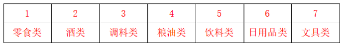

故正确答案为D。

### 第 109 题

如果零食类排在第1排，那么下列哪项中的两类商品不可能是相邻的两排？

A. 文具类和粮油类

B. 零食类和文具类

C. 日用品类和酒类

D. 零食类和日用品类

第 109 题 · 答案与解析

**参考答案（粉笔题库参考内容）**

C

**解析**

第一步：分析题干条件。

（1）酒类排在调料类之前；

（2）文具类和调料类中间隔着3排；

（3）粮油类在零食类之后，中间隔着2排；

（4）日用品类紧挨在文具类前一排或者后一排。

第二步：根据题干条件进行推理。

若零食类排在第1排，根据条件（3）可知，粮油类在第4排，如下表：

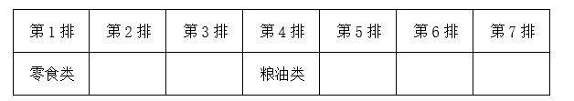

提问为“不可能”，所以考虑代入法。

代入A项，若文具类和粮油类相邻，根据条件（2）可知，文具类在第3排，调料类在第7排；根据条件（4）可知，日用品类在第2排；根据条件（1）可知，酒类在第5排或第6排，题干条件均满足，可能为真，排除；

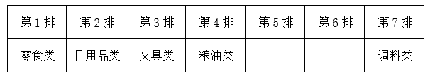

代入B项，若零食类和文具类相邻，则文具类在第2排；根据条件（2）可知，调料类在第6排；根据条件（4）可知，日用品类在第3排；根据条件（1）可知，酒类在第5排；则饮料类在第7排，题干条件均满足，可能为真，排除；

代入C项，若日用品类和酒类相邻，根据条件（4）可知，日用品类、酒类和文具类相邻，则此三类只能占据第5、6、7排的位置，而调料类和饮料类只能在第2排或第3排，与条件（1）矛盾，不可能为真，当选；

代入D项，若零食类和日用品类相邻，则日用品类在第2排；根据条件（4）可知，文具类在第3排；根据条件（2）可知，调料类在第7排；根据条件（1）可知，酒类在第5排或第6排，题干条件均满足，可能为真，排除。

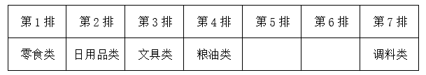

本题为选非题，故正确答案为C。

### 第 110 题

如果饮料类排在第1排，则以下哪项是可能的？

A. 零食类排在文具类前一排

B. 粮油类排在调料类前一排

C. 日用品类排在文具类前一排

D. 酒类排在文具类前一排

第 110 题 · 答案与解析

**参考答案（粉笔题库参考内容）**

A

**解析**

第一步：分析题干条件。

（1）酒类排在调料类之前；

（2）文具类和调料类中间隔着3排；

（3）粮油类在零食类之后，中间隔着2排；

（4）日用品类紧挨在文具类前一排或者后一排。

第二步：根据题干条件进行推理。

若饮料类排在第1排，如下表：

提问为“可能”，所以考虑代入法。

代入A项，若零食类排在文具前一排，根据条件（4）可知，零食类、文具类和日用品类先后相邻，可以分别放在第2排、第3排和第4排；根据条件（2）可知，调料类在第7排；根据条件（3）可知，粮油类在第5排；此时酒类放在第6排，符合条件（1）；与题干所有条件均不矛盾，可能为真，当选。

代入B项，若粮油类排在调料类前一排，结合条件（3）可知，零食类和调料类中间隔着3排，这与条件（2）矛盾，排除；

代入C项，若日用品类排在文具类前一排，根据条件（2），文具类和调料类中间隔着3排，假设文具类在调料类前，一共只有7排，则文具类只能在第3排，调料类在第7排，日用品类在第2排，如图所示，现只剩下第4、5、6排空缺，与条件（3）矛盾，排除；

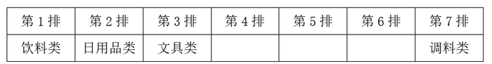

假设文具类在调料类后，根据条件（1），调料类只能在第3排，文具类在第7排，酒类在第2排，根据条件（4），日用品类在第6排，如图所示，现只剩下第4、5排空缺，与条件（3）矛盾，排除；

代入D项，若酒类排在文具类前一排，根据条件（4）可知，酒类、文具类和日用品类先后相邻；根据条件（1）、（2）可知，文具类只能在调料类前面，且为文具类×××调料类，进一步推出文具类在第3排，调料类在第7排，酒类在第2排，日用品类在第4排，如图所示，现只剩下第5、6排空缺，与条件（3）矛盾，排除。

故正确答案为A。

## 材料 2

### 第 111 题

表中所列食品类别中，2021年第一季度所有抽检样本全部合格的有几类？

A. 2

B. 3

C. 4

D. 5

第 111 题 · 答案与解析

**参考答案（粉笔题库参考内容）**

B

**解析**

定位表格材料可得，抽检量与合格量相等的种类有“可可及焙烤咖啡产品”、“特殊医学用途配方食品”、“食品添加剂”，共3类。

故正确答案为B。

**考点**：统计表、直接找数

### 第 112 题

2021年第一季度市场监管部门食品安全监督抽检的总体不合格率在以下哪个范围内？

A. 不到1%

B. 1%～2%之间

C. 2%～3%之间

D. 3%以上

第 112 题 · 答案与解析

**参考答案（粉笔题库参考内容）**

C

**解析**

根据题干“2021年第一季度······的总体不合格率······”，结合材料给出2021年第一季度抽检量和合格量，可判定本题为现期比重问题。定位表格材料可知，2021年第一季度的总抽检量为420403批次，总合格量为410711批次。代入公式：不合格率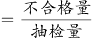，则抽检的总体不合格率，在C项范围。

故正确答案为C。

**考点**：现期比重、统计表

### 第 113 题

2021年第一季度市场监管部门食品安全监督抽检量最多的3个食品类别，同期抽检不合格量约是其余所有类别抽检不合格量的多少倍？

A. 0.5

B. 0.8

C. 1.3

D. 1.9

第 113 题 · 答案与解析

**参考答案（粉笔题库参考内容）**

D

**解析**

根据题干“2021年第一季度······是······的多少倍”，结合材料时间为2021年第一季度，可判定本题为现期倍数计算问题。定位表格材料可知，2021年第一季度市场监管部门食品安全监督抽检量最多的3个食品类别分别是食用农产品（169040批次）、餐饮食品（37795批次）、粮食加工品（23131批次），且食用农产品合格量为164905批次、餐饮食品合格量为35986批次、粮食加工品合格量为22751批次，同期抽检的所有食品合计抽检量为420403批次，合格量为410711批次。则食用农产品、餐饮食品、粮食加工品不合格量之和=（169040-164905）+（37795-35986）+（23131-22751）批次，同期抽检的所有食品不合格量=420403-410711批次。所以题干所求倍。

故正确答案为D。

**考点**：现期倍数、统计表

### 第 114 题

将①肉制品、②乳制品和③蛋制品按2021年第一季度市场监管部门食品安全监督抽检合格率从高到低排列，以下正确的是：

A. ①②③

B. ①③②

C. ③②①

D. ②③①

第 114 题 · 答案与解析

**参考答案（粉笔题库参考内容）**

D

**解析**

根据题干“······2021年第一季度······抽检合格率从高到低······”，结合材料给出抽检量和合格量，可判定本题为现期比重比较问题。定位表格材料可得：2021年第一季度肉制品抽检量为18104批次、合格量为17779批次，乳制品抽检量为8704批次、合格量为8690批次，蛋制品抽检量为1185批次、合格量为1182批次，则①肉制品抽检合格率②乳制品抽检合格率，③蛋制品抽检合格率，三者按从高到低排列为②③①。

故正确答案为D。

**考点**：现期比重、统计表

### 第 115 题

关于2021年第一季度市场监管部门食品安全监督情况，以下信息能够从上述资料中推出的有几项？

①蔬菜、水果制品的总体抽检合格率高于95%

②样品抽检量超过1万批次的食品类别有12个

③糕点类食品的抽检合格量是不合格量的50倍以上

A. 0项

B. 1项

C. 2项

D. 3项

第 115 题 · 答案与解析

**参考答案（粉笔题库参考内容）**

A

**解析**

①： 定位统计表可知，蔬菜制品的抽检量为9241，合格量为8598；水果制品的抽检量为5744，合格量为5611。根据合格率，则蔬菜，水果制品的总体抽检合格率。故蔬菜，水果制品的总体抽检合格率并非高于95%，错误；

②：定位统计表可知，样品抽检量超过1万批次的食品类别有：粮食加工品，食用油、油脂及其制品，调味品，酒类，炒货食品及坚果制品，糕点，餐饮食品，食用农产品，肉制品，饮料，速冻食品，共11个，错误；

③：定位统计表可知，糕点类食品的抽检量为14517，合格量为14214，则抽检不合格量为：14517-14214=303，因为14214<303×50=15150，因此糕点类食品的抽检合格量不到不合格量的50倍，错误。

故正确答案为A。

**考点**：综合分析、统计表

## 材料 3

2020年12月，全国“12369环保举报联网管理平台”共接到环保举报31156件，环比下降23.2%，同比下降10.3%，其中，受理量23792件，较11月减少6316件；因举报线索不详或不属于生态环境部门职责范围而未受理7364件，较11月减少3119件。

### 第 116 题

2020年1月，全国“12369环保举报联网管理平台”接到环保举报件数比上个月：

A. 下降了不到30%

B. 下降了30%以上

C. 上升了不到30%

D. 上升了30%以上

第 116 题 · 答案与解析

**参考答案（粉笔题库参考内容）**

B

**解析**

根据题干“2020年1月······比上个月”，结合选项为百分数，可判定本题为一般增长率计算问题。定位文字材料可得：2020年12月，全国“12369环保举报联网管理平台”共接到环保举报31156件，环比下降23.2%，同比下降10.3%。根据公式：基期量，则2019年12月，全国“12369环保举报联网管理平台”共接到环保举报件数为件；定位柱状图可得：2020年1月，全国“12369环保举报联网管理平台”接到环保举报件数中未受理量为4543件，受理量为15123件。则2020年1月，全国“12369环保举报联网管理平台”接到环保举报件数为4543+15123=19666件。根据公式：增长率，则所求增长率，即下降了30%以上，对应B项。

故正确答案为B。

**考点**：一般增长率、综合资料

### 第 117 题

2020年1～4月，通过微信举报的件数占当月环保举报件数比重最高的月份是：

A. 1月

B. 2月

C. 3月

D. 4月

第 117 题 · 答案与解析

**参考答案（粉笔题库参考内容）**

B

**解析**

根据题干“2020年1～4月······占······比重”，结合材料时间为2020年各月，可判定本题为现期比重问题。定位表格材料可得：2020年1～4月，各月通过微信举报的件数分别为9410件、7288件、18588件、22585件。通过微信举报的件数占当月环保举报件数比重，由环保举报件数=受理量+未受理量，定位统计图可得：2020年1～4月，各月环保举报件数分别为15123+4543=19666件、8180+3387=11567件、26218+7458=33676件、32976+9561=42537件。故2020年1～4月，各月通过微信举报的件数占当月环保举报件数比重分别为、、、，即2月通过微信举报的件数占当月环保举报件数比重最高。

故正确答案为B。

**考点**：现期比重、综合资料

### 第 118 题

2020年下半年，环保举报的受理率超过75%的月份有几个？

A. 3

B. 4

C. 5

D. 6

第 118 题 · 答案与解析

**参考答案（粉笔题库参考内容）**

C

**解析**

根据题干“2020年下半年······受理率······”，结合材料时间为2020年各月，可判定本题为现期比重问题。根据受理率，2020年下半年为2020年7~12月，定位统计图可得：

2020年7月，环保举报的受理率；

2020年8月，环保举报的受理率；

2020年9月，环保举报的受理率；

2020年10月，环保举报的受理率；

2020年11月，环保举报的受理率；

2020年12月，环保举报的受理率。

故2020年下半年，环保举报的受理率超过75%的月份有7月、8月、9月、10月和12月，共5个月份。

故正确答案为C。

**考点**：现期比重、综合资料

### 第 119 题

如同一个月内各类举报的受理率彼此相同，则2020年12月通过电话的环保举报被受理的件数在以下哪个范围内？

A. 低于7501件

B. 7501～8500件之间

C. 8501～9500件之间

D. 高于9500件

第 119 题 · 答案与解析

**参考答案（粉笔题库参考内容）**

C

**解析**

根据题干“2020年12月······件数在以下哪个范围内”，结合材料给出通过电话的环保举报数量及举报量与受理量，可判定本题为现期比重问题。定位文字材料可得：2020年12月，全国“12369环保举报联网管理平台”共接到环保举报31156件······受理量23792件。根据公式：受理率，则2020年12月的受理率。定位表格材料可得：2020年12月，通过电话的环保举报数量为11970件。根据公式：受理量=受理率×举报量，由“同一个月内各类举报的受理率彼此相同”，则2020年12月通过电话的环保举报被受理的件数=受理率×电话举报数量件，在8501~9500件之间。

故正确答案为C。

**考点**：现期比重、综合资料

### 第 120 题

以下折线图反映了2020年第二季度各月哪类环保举报件数环比增量的变化趋势？

A. 电话举报

B. 微信举报

C. 网上举报

D. 其他渠道举报

第 120 题 · 答案与解析

**参考答案（粉笔题库参考内容）**

D

**解析**

根据题干“······环比增量的变化趋势”，可判定本题为增长量比较问题。定位表格材料可得：2020年3~6月各途径的环保举报数量。观察折线图，该类途径第二季度各月环比增量应符合：6月增量＞4月增量＞5月增量。

根据公式：增长量=现期量-基期量，则2020年第二季度各途径的环保举报件数的环比增量如下：

电话举报：4月，件；5月，件；6月，18441-19113＜0件。4月增量＞5月增量＞6月增量，不符合；

微信举报：4月，件；5月，件；6月，19676-23657＜0件。4月增量＞5月增量＞6月增量，不符合；

网上举报：4月，件；5月，2628-2707＜0件；6月，件。4月增量＞6月增量＞5月增量，不符合；

其他渠道举报：4月，件；5月，件；6月，件。6月增量＞4月增量＞5月增量，变化趋势恰好与折线图相符合。

故正确答案为D。

**考点**：增长量比较、综合资料

## 材料 4

### 第 121 题

2019年，中国IC先进封装市场规模约为多少亿元?

A. 235

B. 252

C. 279

D. 296

第 121 题 · 答案与解析

**参考答案（粉笔题库参考内容）**

D

**解析**

根据题干“2019年，中国IC先进封装市场规模约为多少亿元”，结合材料给出2019年中国IC封装市场规模以及IC先进封装市场规模的占比，可判定本题为现期比重问题。定位统计图可得：2019年中国IC封装市场规模为2349.7亿元，IC先进封装市场规模占比为12.58%。根据公式：部分=整体×比重，则2019年中国IC先进封装市场规模亿元，只有D项满足。

故正确答案为D。

**考点**：现期比重、统计图

### 第 122 题

“十三五”（2016-2020年）期间，中国IC封装市场总规模：

A. 不到1.0万亿元

B. 在1.0~1.1万亿元之间

C. 在1.1~1.2万亿元之间

D. 超过1.2万亿元

第 122 题 · 答案与解析

**参考答案（粉笔题库参考内容）**

B

**解析**

定位统计图可得，2016-2020年中国IC封装市场规模分别为1564.3、1889.7、2193.9、2349.7、2478.9亿元。则“十三五”期间IC封装市场总规模为1564.3+1889.7+2193.9+2349.7+2478.92000×5+（-440-110+190+350+480）=10470亿元=1.047万亿元，在B项范围之内。

故正确答案为B。

**考点**：统计图、简单加减计算

### 第 123 题

2012~2020年，中国IC封装市场中IC先进封装市场规模占比同比提升1个百分点以上的年份有几个？

A. 2

B. 3

C. 4

D. 5

第 123 题 · 答案与解析

**参考答案（粉笔题库参考内容）**

A

**解析**

定位统计图，可知2011-2020年中国IC封装市场中IC先进封装市场规模占比，则其占比同比提升1个百分点以上的有2012年（5.65%-4.12%＞1%）、2015年（9.91%-7.37%＞1%），共2年。

故正确答案为A。

**考点**：统计图、简单加减计算

### 第 124 题

2012~2020年，中国IC封装市场规模同比增量最大的年份是:

A. 2016年

B. 2017年

C. 2018年

D. 2019年

第 124 题 · 答案与解析

**参考答案（粉笔题库参考内容）**

B

**解析**

根据题干“······同比增量最大的年份是”，可判定本题为增长量比较问题。定位统计图可得：中国IC封装市场规模2015年、2016年、2017年、2018年、2019年分别是1384.0亿元、1564.3亿元、1889.7亿元、2193.9亿元、2349.7亿元。根据公式：增长量=现期量-基期量，则2016-2019年中国IC封装市场规模的同比增长量分别为：

2016年：亿元；

2017年：亿元；

2018年：亿元；

2019年：亿元。

比较可知，中国IC封装市场规模同比增长量最大的年份是2017年。

故正确答案为B。

**考点**：增长量比较、统计图

### 第 125 题

已知2020年中国IC封装市场规模同比增长x亿元，IC封装市场中IC先进封装市场规模占比同比增长y个百分点，而2020年往后中国IC封装市场规模及IC先进封装市场规模占比每年都分别同比增长x亿元和y个百分点，则到“十四五”最后一年（2025年），中国IC先进封装市场规模将达到多少亿元?

A. 433

B. 469

C. 521

D. 575

第 125 题 · 答案与解析

**参考答案（粉笔题库参考内容）**

C

**解析**

根据题干“······‘十四五’最后一年（2025年）······将达到多少亿元”，可判定本题为现期计算问题。定位统计图可得：2020年、2019年IC封装市场规模分别为2478.9亿元、2349.7亿元；IC先进封装市场规模占比分别为13.26%、12.58%。则x=2478.9-2349.7=129.2亿元；y=13.26%-12.58%=0.68%，即0.68个百分点。根据公式：现期量=基期量+增长量×n，则2025年IC封装市场规模=2478.9+129.2×5=3124.9亿元，IC先进封装市场规模占比=13.26%+0.68%×5=16.66%。根据公式：部分=总体×比重，则2025年中国IC先进封装市场规模将达到亿元。

故正确答案为C。

**考点**：现期计算、统计图

## 材料 5

2021年1-5月，全国共破获电信网络诈骗案件11.4万起，打掉犯罪团伙1.4万个，抓获犯罪嫌疑人15.4万名，同比分别上升60.4%、80.6%和146.5%。2021年5月，全国共立电信网络诈骗案件8.46万起，与4月相比下降14.3%。

2021年1-5月，全国拦截诈骗电话6.1亿次，拦截诈骗短信9.1亿条，封堵诈骗网址82.1万个。1-5月公安部日均下发预警指令5.2万条。

2021年1-5月，全国共成功劝阻771万名群众免于受骗，紧急止付涉案资金2654亿元，为群众挽回经济损失991亿元。

2021年1-5月，全国公安机关捣毁境内诈骗窝点6500余个，共破获被骗百万元以上案件881起，同比上升160.5%，先后组织20余次集中收网行动，抓获犯罪嫌疑人2421名，打掉技术开发平台、网络引流推广、虚拟货币洗钱等团伙380余个。

2020年10月至2021年5月，全国公安机关会同检察、法院、通讯、金融等部门，共打掉“两卡”违法犯罪团伙1.5万个，缴获涉诈电话卡373.3万张，银行卡56.6万张，惩戒“两卡”失信人员17.3万名，整治违规行业网点，机构1.8万家。

### 第 126 题

2020年1-5月，全国平均每月打掉电信网络诈骗犯罪团伙：

A. 不到1000个

B. 1000～2000个之间

C. 2000～4000个之间

D. 4000个以上

第 126 题 · 答案与解析

**参考答案（粉笔题库参考内容）**

B

**解析**

根据题干“2020年1-5月······平均每月······”，结合材料时间为2021年，可判定本题为基期平均数问题。定位文字材料第一段可得：2021年1-5月，全国打掉犯罪团伙1.4万个，同比上升80.6%。根据公式：基期量，可得2020年1-5月全国打掉电信网络诈骗犯罪团伙个数。则2020年1-5月，全国平均每月打掉电信网络诈骗犯罪团伙个数，属于B项的范围。

故正确答案为B。

**考点**：文字资料、基期平均数

### 第 127 题

2021年4-5月，全国共立电信网络诈骗案件约多少万起？

A. 12

B. 14

C. 16

D. 18

第 127 题 · 答案与解析

**参考答案（粉笔题库参考内容）**

D

**解析**

根据题干“2021年4-5月······约多少万起”，结合材料时间为2021年5月，可判定本题为基期计算问题。定位文字材料第一段可得：2021年5月，全国共立电信网络诈骗案件8.46万起，与4月相比下降14.3%。根据公式：基期量，则2021年4月全国共立电信网络诈骗案件万起。故2021年4-5月，全国共立电信网络诈骗案件=8.46＋9.87=18.33万起，与D项最接近。

故正确答案为D。

**考点**：文字资料、基期计算

### 第 128 题

2021年1-5月，全国平均每天拦截诈骗短信约多少万条？

A. 545

B. 571

C. 603

D. 659

第 128 题 · 答案与解析

**参考答案（粉笔题库参考内容）**

C

**解析**

根据题干“2021年1-5月······平均每天······”，结合材料时间为2021年1-5月，可判定本题为现期平均数问题。定位文字材料第二段可得：2021年1-5月，全国拦截诈骗短信9.1亿条。2021年1-5月共计31+28+31+30+31=151天，则平均每天拦截诈骗短信万条。

故正确答案为C。

**考点**：文字资料、现期平均数

### 第 129 题

2021年1-5月，全国紧急止付涉案资金金额约是为群众挽回经济损失金额的多少倍？

A. 2.7

B. 2.4

C. 2.1

D. 1.8

第 129 题 · 答案与解析

**参考答案（粉笔题库参考内容）**

A

**解析**

根据题干“2021年1-5月······是······的多少倍”，结合材料时间为2021年1-5月，可判定本题为现期倍数问题。定位文字材料第三段可得：2021年1-5月，全国紧急止付涉案资金2654亿元，为群众挽回经济损失991亿元，则题目所求倍数倍。

故正确答案为A。

**考点**：文字资料、现期倍数

### 第 130 题

以下信息中，能够从上述资料中推出的有几项？

①2020年1-5月，全国抓获电信网络诈骗犯罪嫌疑人10万名以上

②2021年1-5月，全国公安机关破获被骗百万元以上案件比去年同期多500件以上

③2020年10月-2021年5月，每打掉1个“两卡”违法犯罪团伙，平均缴获的电话卡和银行卡总量就在300张以上

A. 0项

B. 1项

C. 2项

D. 3项

第 130 题 · 答案与解析

**参考答案（粉笔题库参考内容）**

B

**解析**

①：定位文字材料第一段可得：2021年1-5月，全国共破获电信网络诈骗案件······抓获犯罪嫌疑人15.4万名，同比分别上升······146.5%。根据公式：基期量，则2020年1-5月，全国抓获电信网络诈骗犯罪嫌疑人 万名＜10万名，错误；

②：定位文字材料第四段可得：2021年1-5月，全国公安机关共破获被骗百万元以上案件881起，同比上升160.5%。根据公式：增长量，则2021年1-5月，全国公安机关破获被骗百万元以上案件同比增长量起，正确；

③：定位文字材料第五段可得：2020年10月至2021年5月，全国公安机关会同检察、法院、通讯、金融等部门，共打掉“两卡”违法犯罪团伙1.5万个，缴获涉诈电话卡373.3万张，银行卡56.6万张。则题目所求平均数张，错误。

综上所述，只有②正确，共1项。

故正确答案为B。

**考点**：文字资料、综合分析

