# 2024年国家公务员录用考试《行测》题（地市级网友回忆版）

<!-- gwy:overview:start -->
> **国考 · 2024 · 行测 · 地市级** ｜ 130 题 · 图片 187 处 · 答案随题折叠

| 题型模块 | 题量 | 题号 |
| --- | ---: | ---: |
| 常识判断 | 20 | 1–20 |
| 言语理解与表达 | 40 | 21–60 |
| 数量关系 | 10 | 61–70 |
| 判断推理 | 40 | 71–110 |
| 资料分析 | 20 | 111–130 |
| **合计** | **130** | |

导航：[题型与作答说明](#题型与作答说明) · [题目](#题目) · [材料 1](#材料-1)
<!-- gwy:overview:end -->

> 候选采集稿。参考答案及解析来自粉笔页面，不代表官方答案或真实高分答卷；来源使用许可与原卷对应关系仍需人工核实。

## 题型与作答说明

常识判断

（20题）

第一部分 常识判断。 根据题目要求，在四个选项中选出一个最恰当的答案。

言语理解与表达

（40题）

第二部分 言语理解与表达。 本部分包括表达与理解两方面的内容。请根据题目要求，在四个选项中选出一个最恰当的答案。

数量关系

（10题）

第三部分 数量关系。 在这部分试题中，每道题呈现一段表述数字关系的文字，要求你迅速、准确地计算出答案。

判断推理

（40题）

第四部分 判断推理。 本部分包括图形推理、定义判断、类比推理与逻辑判断四种类型的试题，在四个选项中选出一个最恰当的答案。

资料分析

（20题）

第五部分 资料分析。 所给出的图、表、文字或综合性资料均有若干个问题要你回答。你应根据资料提供的信息进行分析、比较、计算和判断处理。

## 题目

### 第 1 题

习近平总书记指出，我们要坚守人民至上理念，突出现代化方向的人民性。关于现代化方向的人民性，下列表述正确的有几项？

①人民是历史的创造者，是推进现代化最坚实的根基、最深厚的力量

②现代化道路最终能否走得通、行得稳，关键要看是否坚持以人民为中心

③现代化不仅要看纸面上的指标数据，更要看人民的幸福安康

④政党要锚定人民对美好生活的向往，让现代化更好回应人民各方面诉求和多层次需要

A. 1项

B. 2项

C. 3项

D. 4项

第 1 题 · 答案与解析

**参考答案（粉笔题库参考内容）**

D

**解析**

本题考查政治常识。

习近平总书记在中国共产党与世界政党高层对话会上的主旨讲话中指出：“我们要坚守人民至上理念，突出现代化方向的人民性。人民是历史的创造者，是推进现代化最坚实的根基、最深厚的力量。现代化的最终目标是实现人自由而全面的发展。现代化道路最终能否走得通、行得稳，关键要看是否坚持以人民为中心。现代化不仅要看纸面上的指标数据，更要看人民的幸福安康。政党要锚定人民对美好生活的向往，顺应人民对文明进步的渴望，努力实现物质富裕、政治清明、精神富足、社会安定、生态宜人，让现代化更好回应人民各方面诉求和多层次需要，既增进当代人福祉，又保障子孙后代权益，促进人类社会可持续发展。”

故①②③④表述正确，共4项。

故正确答案为D。

### 第 2 题

习近平总书记指出，农业强国是社会主义现代化强国的根基，满足人民美好生活需要、实现高质量发展、夯实国家安全基础，都离不开农业发展。下列关于建设农业强国的表述正确的是：

①农业科技创新要以农业关键核心技术攻关为引领，以促进大规模经营为导向

②要坚持把增加农民收入作为“三农”工作的中心任务

③要一体推进农业现代化和农村现代化，实现乡村由表及里、形神兼备的全面提升

④扩大耕地面积是建设农业强国的首要任务

A. ①③

B. ①④

C. ②③

D. ②④

第 2 题 · 答案与解析

**参考答案（粉笔题库参考内容）**

C

**解析**

本题考查政治常识。

①错误，2022年中央农村工作会议上习近平主席强调：“要依靠科技和改革双轮驱动加快建设农业强国······要以农业关键核心技术攻关为引领，以产业急需为导向，聚焦底盘技术、核心种源、关键农机装备等领域，发挥新型举国体制优势，整合各级各类优势科研资源，强化企业科技创新主体地位，构建梯次分明、分工协作、适度竞争的农业科技创新体系。”

②正确，2022年中央农村工作会议上习近平主席指出：“全面推进乡村振兴是新时代建设农业强国的重要任务，人力投入、物力配置、财力保障都要转移到乡村振兴上来······要坚持把增加农民收入作为‘三农’工作的中心任务，千方百计拓宽农民增收致富渠道。”

③正确，2022年中央农村工作会议上习近平主席强调：“农村现代化是建设农业强国的内在要求和必要条件，建设宜居宜业和美乡村是农业强国的应有之义。要一体推进农业现代化和农村现代化，实现乡村由表及里、形神兼备的全面提升。”

④错误，刊载于《求是》杂志的文章《全面推进乡村振兴 加快建设农业强国》中指出：“第二，全方位有力夯实粮食安全根基，持续提升粮食产能，确保完成建设农业强国的首要任务。全面推进乡村振兴、加快建设农业强国的首要任务就是保障国家粮食安全，不断提高粮食综合生产能力，全面完善粮食产能提高机制。”

故②③表述正确。

故正确答案为C。

### 第 3 题

习总书记强调，要大兴调查研究之风，深入了解群众需求，切实解决广大老百姓关心关切的利益问题，不断提高人民群众的获得感、幸福感、安全感，关于调查研究正确的有几项？

①调查研究是我们党的传家宝，是做好各项工作的基本功

②要大兴务实之风，抓好调查研究，在察实情、出实招、求实效上下功夫

③检验调查研究成效，要看是否摸清社情民意、是否解决实际问题

④调查研究是了解情况的主要渠道，不能通过二手材料了解情况

A. 4

B. 3

C. 2

D. 1

第 3 题 · 答案与解析

**参考答案（粉笔题库参考内容）**

B

**解析**

本题考查政治常识。

①正确，《习近平关于调查研究论述摘编》中指出：“调查研究是我们党的传家宝，是做好各项工作的基本功。调查研究是马克思主义者认识世界的根本方法，是中国共产党的历史经验。”

②正确，2023年6月，习近平总书记在内蒙古考察时对如何开展好主题教育这样要求：“要大兴务实之风，抓好调查研究，在察实情、出实招、求实效上下功夫，把工作抓实、基础打实、步子迈实，在力戒形式主义、官僚主义上取得明显实质性进展，以这次主题教育为契机，将调查研究发扬光大。”

③正确，2023年7月，习近平总书记在四川考察时对如何检验主题教育成效提出“五个检验”：（1）检验理论学习成效，要看党的创新理论是否入心见行、党员干部是否做到善思善用。（2）检验调查研究成效，要看是否摸清社情民意、是否解决实际问题。（3）检验推动发展成效，要看高质量发展是否有新突破，人民生活品质是否有新提升。（4）检验检视整改成效，要看问题症结是否找准、整改整治是否到位。（5）检验干部队伍教育整顿成效，要看思想不纯和组织不纯现象是否纠正、政治隐患是否消除。

④错误，《习近平关于调查研究论述摘编》中指出：“了解情况的渠道千条万条，但是调查研究要放在第一条，这是不可替代、不会失真的一条。通过二手材料了解情况是必要的，但不能代替亲身调研。”“不能通过二手材料了解情况”的说法错误。

故①②③表述正确，共3项。

故正确答案为B。

### 第 4 题

中国共产党登上中国历史舞台后，经过艰辛探索和实践，成功在中华大地上制定和实施了具有鲜明社会主义性质的宪法、真正意义上的人民宪法，在我国宪法发展史乃至世界宪法制度史上都具有开创性意义，为人类法治文明进步贡献了中国智慧、中国方案。下列有关我国宪法的表述正确的有几项？

①我国宪法确认了中国共产党的领导地位，这是我国宪法最显著的特征

②宪法是治国安邦的总章程，是中国共产党治国理政的根本法律依据

③要全面发挥宪法在立法中的核心地位功能，每一个立法环节都把好宪法关

④必须坚持宪法监督制度化法规化，宪法的生命在于监督，宪法的权威也在于监督

A. 1项

B. 2项

C. 3项

D. 4项

第 4 题 · 答案与解析

**参考答案（粉笔题库参考内容）**

C

**解析**

本题考查政治常识。

2022年12月，习近平主席发表文章《谱写新时代中国宪法实践新篇章——纪念现行宪法公布施行40周年》（以下简称《文章》）。

①项正确，《文章》指出：“一是必须坚持中国共产党领导。我国宪法确认了中国共产党的领导地位，这是我国宪法最显著的特征，也是我国宪法得到全面贯彻实施的根本保证。······”

②项正确，《文章》指出：“第二，把宪法实施贯穿到治国理政各方面全过程，不断提高党依宪治国、依宪执政的能力。宪法是治国安邦的总章程，是我们党治国理政的根本法律依据，是国家政治和社会生活的最高法律规范。······”

③项正确，《文章》指出：“要完善立法体制机制，推进科学立法、民主立法、依法立法，统筹立改废释纂，增强立法系统性、整体性、协同性、时效性。要全面发挥宪法在立法中的核心地位功能，每一个立法环节都把好宪法关，努力使每一项立法都符合宪法精神、体现宪法权威、保证宪法实施。······”

④项错误，《文章》指出：“五是必须坚持宪法实施与监督制度化法规化。宪法的生命在于实施，宪法的权威也在于实施。······”可见，宪法的生命与权威在于实施，而非监督。

故①②③表述正确，共3项。

故正确答案为C。

### 第 5 题

习总书记强调，要引导民营企业和民营企业家正确理解党中央方针政策，增强信心、轻装上阵、大胆发展，实现民营经济健康发展、高质量发展。关于推动民营经济高质量发展，下列选项正确的是（ ）。

①民营企业要践行新发展理念，转变发展方式、调整产业结构、转换增长动力，坚守主业、做强实业，自觉走高质量发展路子

②有能力、有条件的民营企业要加强自主创新，在推进科技自立自强和科技成果转化中发挥更大作用

③要激发民间资本投资活力，鼓励和吸引民间资本参与互联网投资和境外投资，为促进国内外双循环做出更大贡献

④要依法规范和引导各类资本健康发展，有效防范化解系统性金融风险，为各类所有制企业创造公平竞争、竞相发展的环境

A. ①②④

B. ①②③

C. ①③④

D. ②③④

第 5 题 · 答案与解析

**参考答案（粉笔题库参考内容）**

A

**解析**

本题考查政治常识。

①②④正确，③错误，2023年3月，习近平总书记在看望参加政协会议的民建工商联界委员时强调：“高质量发展对民营经济发展提出了更高要求。民营企业要践行新发展理念，深刻把握民营经济发展存在的不足和面临的挑战，转变发展方式、调整产业结构、转换增长动力，坚守主业、做强实业，自觉走高质量发展路子。有能力、有条件的民营企业要加强自主创新，在推进科技自立自强和科技成果转化中发挥更大作用。要激发民间资本投资活力，鼓励和吸引更多民间资本参与国家重大工程、重点产业链供应链项目建设，为构建新发展格局、推动高质量发展作出更大贡献。要依法规范和引导各类资本健康发展，有效防范化解系统性金融风险，为各类所有制企业创造公平竞争、竞相发展的环境。”

故正确答案为A。

### 第 6 题

中华优秀传统文化有很多重要元素，共同塑造出中华文明的突出特性，其中之一就是具有突出的创新性。对于中华文明具有突出的创新性，下列理解正确的是：

①从根本上决定了中华文化对世界文明兼收并蓄的开放胸怀

②从根本上决定了中华民族守正不守旧、尊古不复古的进取精神

③从根本上决定了中华民族不惧新挑战、勇于接受新事物的无畏品格

④从根本上决定了中华民族交往交流交融的历史取向

A. ①②

B. ②③

C. ①④

D. ③④

第 6 题 · 答案与解析

**参考答案（粉笔题库参考内容）**

B

**解析**

本题考查政治常识。

①④错误，2023年6月，习近平主席出席文化传承发展座谈会并发表重要讲话指出：“中华文明具有突出的包容性，从根本上决定了中华民族交往交流交融的历史取向，决定了中国各宗教信仰多元并存的和谐格局，决定了中华文化对世界文明兼收并蓄的开放胸怀。”

②③正确，2023年6月，习近平主席出席文化传承发展座谈会并发表重要讲话指出：“中华文明具有突出的创新性，从根本上决定了中华民族守正不守旧、尊古不复古的进取精神，决定了中华民族不惧新挑战、勇于接受新事物的无畏品格。”

故②③表述正确。

故正确答案为B。

### 第 7 题

在2023年7月召开的全国生态环境保护大会上，习近平总书记全面总结我国生态文明建设取得的举世瞩目的巨大成就，精辟概括了“四个重大转变”，这四个重大转变是：

①实现由重点整治到系统治理的重大转变

②实现由被动应对到主动作为的重大转变

③实现由全球环境治理参与者到引领者的重大转变

④实现由实践探索到科学理论指导的重大转变

⑤实现由多重压力叠加到单一结构性压力的重大转变

A. ①②③④

B. ①②③⑤

C. ②③④⑤

D. ①③④⑤

第 7 题 · 答案与解析

**参考答案（粉笔题库参考内容）**

A

**解析**

本题考查政治常识。

①②③④正确，⑤错误，2023年7月17日至18日，全国生态环境保护大会在北京召开。中共中央总书记、国家主席、中央军委主席习近平出席会议并发表重要讲话。他强调，我们从解决突出生态环境问题入手，注重点面结合、标本兼治，实现由重点整治到系统治理的重大转变；坚持转变观念、压实责任，不断增强全党全国推进生态文明建设的自觉性主动性，实现由被动应对到主动作为的重大转变；紧跟时代、放眼世界，承担大国责任、展现大国担当，实现由全球环境治理参与者到引领者的重大转变；不断深化对生态文明建设规律的认识，形成新时代中国特色社会主义生态文明思想，实现由实践探索到科学理论指导的重大转变。

故正确答案为A。

### 第 8 题

习近平总书记强调，要把黑土地保护作为一件大事来抓，把黑土地用好养好。《中华人民共和国黑土地保护法》自 2022 年8月1日起施行，下列表述不符合该法规定的是:

A. 黑土层深厚、土壤性状良好的黑土地划入永久基本农田，重点用于粮食生产

B. 无法修复的黑土地不列入黑土地保护范围进行修复

C. 县级以上人民政府应当将黑土地保护工作纳入国民经济和社会发展规划

D. 除国防建设项目选址无法避开外，其他建设项目一律不得占用黑土地

第 8 题 · 答案与解析

**参考答案（粉笔题库参考内容）**

D

**解析**

本题考查法律常识。

A项正确，根据《中华人民共和国黑土地保护法》第五条规定：“黑土地应当用于粮食和油料作物、糖料作物、蔬菜等农产品生产。黑土层深厚、土壤性状良好的黑土地应当按照规定的标准划入永久基本农田，重点用于粮食生产，实行严格保护，确保数量和质量长期稳定。”

B项正确，根据《中华人民共和国黑土地保护法》第四条第二款规定：“······历史上属黑土地的，除确无法修复的外，原则上都应列入黑土地保护范围进行修恢复。”可见，确无法修复的黑土地，并未规定需列入黑土地保护范围。

C项正确，根据《中华人民共和国黑土地保护法》第十条第一款规定：“县级以上人民政府应当将黑土地保护工作纳入国民经济和社会发展规划。”

D项错误，根据《中华人民共和国黑土地保护法》第二十一条第一款规定：“建设项目不得占用黑土地；确需占用的，应当依法严格审批，并补充数量和质量相当的耕地。”可见，建设项目原则上不得占用黑土地；但确需占用的，经过依法严格审批，并补充数量和质量相当的耕地即可。

本题为选非题，故正确答案为D。

### 第 9 题

根据《中华人民共和国立法法》下列说法错误的是（ ）。

A. 国家监察委员会可以向全国人大常委会提出法律案

B. 县级人大常委可以对基层治理方面的事项制定地方性法规

C. 设区的市人大常委会可以根据实际需要设立基层立法联系点

D. 法律草案的说明应当包括起草过程中对重大分歧意见的协调处理情况

第 9 题 · 答案与解析

**参考答案（粉笔题库参考内容）**

B

**解析**

本题考查法律常识。

A项正确，根据《中华人民共和国立法法》第十七条第二款规定：“全国人民代表大会常务委员会、国务院、中央军事委员会、国家监察委员会、最高人民法院、最高人民检察院、全国人民代表大会各专门委员会，可以向全国人民代表大会提出法律案，由主席团决定列入会议议程。”

B项错误，根据《中华人民共和国立法法》第八十一条第一款规定：“设区的市的人民代表大会及其常务委员会根据本市的具体情况和实际需要，在不同宪法、法律、行政法规和本省、自治区的地方性法规相抵触的前提下，可以对城乡建设与管理、生态文明建设、历史文化保护、基层治理等方面的事项制定地方性法规，法律对设区的市制定地方性法规的事项另有规定的，从其规定。设区的市的地方性法规须报省、自治区的人民代表大会常务委员会批准后施行。省、自治区的人民代表大会常务委员会对报请批准的地方性法规，应当对其合法性进行审查，认为同宪法、法律、行政法规和本省、自治区的地方性法规不抵触的，应当在四个月内予以批准。”因此，设区的市的人民代表大会及其常务委员会根据本市的具体情况和实际需要，有权在基层治理方面的事项制定地方性法规，而不是县级人大常委。

C项正确，根据《中华人民共和国立法法》第九十条规定：“省、自治区、直辖市和设区的市、自治州的人民代表大会常务委员会根据实际需要设立基层立法联系点，深入听取基层群众和有关方面对地方性法规、自治条例和单行条例草案的意见。”

D项正确，根据《中华人民共和国立法法》第五十八条规定：“提出法律案，应当同时提出法律草案文本及其说明，并提供必要的参阅资料。修改法律的，还应当提交修改前后的对照文本。法律草案的说明应当包括制定或者修改法律的必要性、可行性和主要内容，涉及合宪性问题的相关意见以及起草过程中对重大分歧意见的协调处理情况。”

本题为选非题，故正确答案为B。

### 第 10 题

根据《中华人民共和国反间谍法》，下列说法或做法错误的是（ ）。

A. 甲涉嫌间谍行为被传唤，在其嫌疑消除前不得将传唤原因通知其家属

B. 乙涉嫌间谍行为，移民管理机构接到省国家安全机关通知后，不准其出境

C. 丙在境外受胁迫参加间谍组织后，及时向大使馆如实说明情况，并有悔改表现，可以不予追究

D. 丁因协助反间谍工作导致财产损失，根据国家有关规定，可获得补偿

第 10 题 · 答案与解析

**参考答案（粉笔题库参考内容）**

A

**解析**

本题考查法律常识。

A项错误，根据《中华人民共和国反间谍法》第二十七条第四款规定：“除无法通知或者可能妨碍调查的情形以外，国家安全机关应当及时将传唤的原因通知被传唤人家属。在上述情形消失后，应当立即通知被传唤人家属。”选项中，除无法通知甲的家属或者通知甲的家属可能妨碍调查的情形以外，国家安全机关都应当及时将传唤的原因通知被传唤人家属，而不是在其嫌疑消除前不得将传唤原因通知其家属。

B项正确，根据《中华人民共和国反间谍法》第三十三条第二款规定：“对涉嫌间谍行为人员，省级以上国家安全机关可以通知移民管理机构不准其出境。”

C项正确，根据《中华人民共和国反间谍法》第五十五条第二款规定：“在境外受胁迫或者受诱骗参加间谍组织、敌对组织，从事危害中华人民共和国国家安全的活动，及时向中华人民共和国驻外机构如实说明情况，或者入境后直接或者通过所在单位及时向国家安全机关如实说明情况，并有悔改表现的，可以不予追究。”

D项正确，根据《中华人民共和国反间谍法》第四十六条第三款规定：“个人和组织因支持、协助反间谍工作导致财产损失的，根据国家有关规定给予补偿。”

本题为选非题，故正确答案为A。

### 第 11 题

2022年11月28日，中共中央办公厅、国务院办公厅发布《乡村振兴责任制实施办法》。下列与乡村振兴责任制有关的说法不准确的是:

A. 坚持党对农村工作的全面领导，省市县乡村五级书记抓乡村振兴

B. 中央和国家机关有关部门要以健全城乡融合发展体制为主线深化农村改革

C. 地方政府乡村振兴要把确保粮食和重要农产品供给作为首要任务

D. 县级党委和政府是乡村振兴“一线指挥部”

第 11 题 · 答案与解析

**参考答案（粉笔题库参考内容）**

B

**解析**

本题考查政治常识。

《乡村振兴责任制实施办法》以下简称《实施办法》。

A项正确，《实施办法》在第三条指出：“坚持党对农村工作的全面领导，健全党委统一领导、政府负责、党委农村工作部门统筹协调的农村工作领导体制，省市县乡村五级书记抓乡村振兴”。

B项错误，《实施办法》在第五条指出：“中央和国家机关有关部门乡村振兴责任主要包括：······（六）以处理好农民和土地的关系为主线深化农村改革，巩固和完善农村基本经营制度，发展新型农村集体经济，发展新型农业经营主体和社会化服务，发展农业适度规模经营······”。

C项正确，《实施办法》在第八条指出：“地方党委和政府乡村振兴责任主要包括：······（三）把确保粮食和重要农产品供给作为首要任务，全面落实耕地保护和粮食安全党政同责，严格落实耕地和永久基本农田保护、高标准农田建设任务，保质保量完成粮食和重要农产品生产目标任务，调动农民种粮积极性，全面提高本地区粮食安全保障能力······”。

D项正确，《实施办法》在第十一条指出：“县级党委和政府是乡村振兴‘一线指挥部’。县级党委和政府主要负责人是本地区乡村振兴第一责任人，应当把主要精力放在乡村振兴工作上，责任主要包括：（一）结合本地区实际谋划制定乡村振兴规划和年度实施方案······”。

本题为选非题，故正确答案为B。

### 第 12 题

下列不能被授予专利权的是：

A. 一种医疗口腔内科专用的喷药器

B. 一种治疗主动脉夹层的新型手术方法

C. 一种计算机控制油墨颜色配制的装置

D. 一种针对水稻辐射诱变育种的新技术

第 12 题 · 答案与解析

**参考答案（粉笔题库参考内容）**

B

**解析**

本题考查法律常识。

A、C、D三项正确，B项错误，根据《中华人民共和国专利法》第二十五条规定：“对下列各项，不授予专利权：（一）科学发现；（二）智力活动的规则和方法；（三）疾病的诊断和治疗方法；（四）动物和植物品种；（五）原子核变换方法以及用原子核变换方法获得的物质；（六）对平面印刷品的图案、色彩或者二者的结合作出的主要起标识作用的设计。对前款第（四）项所列产品的生产方法，可以依照本法规定授予专利权。”可知，一种治疗主动脉夹层的新型手术方法不能被授予专利权。

本题为选非题，故正确答案为B。

### 第 13 题

下列与企业应负担的税种有关的说法正确的是：

A. 对纳税人出口应税消费品，一般免征消费税

B. 所有印花税税目均按照统一的税率征收

C. 增值税专用发票是增值税小规模纳税人销售货物等开具的发票

D. 企业所得税应纳税所得额不包括向投资者支付的股息、红利

第 13 题 · 答案与解析

**参考答案（粉笔题库参考内容）**

A

**解析**

本题考查经济常识。

A项正确，《中华人民共和国消费税暂行条例》第十一条规定：“对纳税人出口应税消费品，免征消费税；国务院另有规定的除外。出口应税消费品的免税办法，由国务院财政、税务主管部门规定。”

B项错误，《中华人民共和国印花税暂行条例》第三条第一款规定：“纳税人根据应纳税凭证的性质，分别按比例税率或者按件定额计算应纳税额······”目前我国的印花税税率有五档。

C项错误，增值税专用发票是由国家税务总局监制设计印制的，只限于增值税一般纳税人领购使用的，既作为纳税人反映经济活动中的重要会计凭证又是兼记销货方纳税义务和购货方进项税额的合法证明；是增值税计算和管理中重要的决定性的合法的专用发票。2023年发布的《财政部 税务总局关于增值税小规模纳税人减免增值税政策的公告》指出：“为进一步支持小微企业和个体工商户发展，现将延续小规模纳税人增值税减免政策公告如下：一、对月销售额10万元以下（含本数）的增值税小规模纳税人，免征增值税······”

D项错误，根据《中华人民共和国企业所得税法》第十条规定：“在计算应纳税所得额时，下列支出不得扣除：（一）向投资者支付的股息、红利等权益性投资收益款项······”

故正确答案为A。

### 第 14 题

习近平总书记在给山东省地矿局第六地质大队全体地质工作者的回信中强调：“矿产资源是经济社会发展的重要物质基础，矿产资源勘查开发事关国计民生和国家安全。”下列与我国矿产资源有关的说法错误的是：

A. 锡矿是我国的优势矿产资源之一

B. 我国已在南海实现天然气水合物试采

C. 新疆罗布泊是我国钾盐的主要产地之一

D. 我国目前最大的金矿在云南省内

第 14 题 · 答案与解析

**参考答案（粉笔题库参考内容）**

D

**解析**

本题考查地理国情。

A项正确，我国已发现矿产171种，按探明储量计算，中国有45种优势矿产，而锡矿是我国的优势矿产资源之一。中国锡资源丰富，长期以来一直是锡的生产大国，储量和产量均居于世界前列。目前已探明矿产地293处，总保有储量锡407万吨，我国锡矿分布于15个省（区），以广西、云南两省（区）储量最多，分别占全国的32.9%和31.4%。

B项正确，2017年，我国海域天然气水合物在南海北部神狐海域第一轮试采成功，实现连续稳定产气60天，累计产气量30.9万立方米。这次试采是我国首次，也是世界首次成功实现资源量占全球90%以上、开发难度最大的泥质粉砂型天然气水合物安全可控开采。

C项正确，中国钾盐的主要产地有青海柴达木现代盐湖、新疆罗布泊现代盐湖和云南勐野井固体钾盐矿。新疆罗布泊地区北部钾盐储量2.5亿吨以上，是中国为数不多的钾盐矿中次大的一个超大型钾盐矿。2000年，我国成立新疆罗布泊钾盐公司，先后完成中试，建成年产4万吨硫酸钾示范厂。

D项错误，西岭金矿是迄今为止国内发现的最大单体金矿床，属世界级巨型单体金矿床。西岭金矿位于山东省莱州市三山岛金矿深部，并非云南省。山东黄金矿产资源丰富，地质储量居全国之首，是全国黄金产量第一大省。

本题为选非题，故正确答案为D。

### 第 15 题

2023年2月6日，自然资源部印发《公开地图内容表示规范》，下列说法与之不相符的是：

A. 香港特别行政区、澳门特别行政区在地图上应按省级行政单位表示

B. 表现地为我国境内的地图不得表示未对社会公众开放的卫星导航定位基准站

C. 台湾省地图的图幅范围，应当绘出钓鱼岛和赤尾屿

D. 表现地为我国境内的遥感影像，地面分辨率不得优于0.1米

第 15 题 · 答案与解析

**参考答案（粉笔题库参考内容）**

D

**解析**

本题考查地理国情。

A项正确，《公开地图内容表示规范》的“九、特别行政区地图表示规定”中指出：“（一）香港特别行政区、澳门特别行政区在地图上应当按省级行政单位表示······”

B项正确，《公开地图内容表示规范》的”二十、表现地为我国境内的地图不得表示下列内容（对社会公众开放的除外）”中指出：“······（六）卫星导航定位基准站······”

C项正确，《公开地图内容表示规范》的“八、台湾省地图表示规定”中指出：“······（二）台湾省地图的图幅范围，应当绘出钓鱼岛和赤尾屿（以‘台湾岛’命名的地图除外）。钓鱼岛和赤尾屿既可以包括在台湾省全图中，也可以用台湾本岛与钓鱼岛、赤尾屿的地理关系作附图反映······”

D项错误，《公开地图内容表示规范》中指出：“二十二、表现地为我国境内的遥感影像，地面分辨率不得优于0.5米，不得标注涉密、敏感信息，不得伪装处理建筑物、构筑物等固定设施。”

本题为选非题，故正确答案为D。

### 第 16 题

某地将要举办一场主题为“星汉灿烂——追溯两汉科技”的学术交流会，下列论文题目最不可能出现在这次交流会上的是：

A. 太初历制定中的年干支变化

B. 水运仪象台复原研究新探

C. 《汜胜之书》中的栽培技术及区种法探析

D. 试论直辕犁的推广及其对农业生产的影响

第 16 题 · 答案与解析

**参考答案（粉笔题库参考内容）**

B

**解析**

本题考查人文常识。

A项正确，太初历是汉武帝时期制定的一种历法，是中国古代一部比较完整的历法。太初历将原来以冬十月为岁首恢复为以夏历正月为岁首，并吸收了干支历的二十四节气成分作为指导农事的补充历法，以没有中气的月份为闰月，使历书与农时季节更为适应。

B项错误，水运仪象台是北宋时期苏颂、韩公廉等人发明制造的以漏刻水力驱动的，集天文观测、天文演示和报时系统为一体的大型自动化天文仪器。它标志着中国古代天文仪器制造史上的高峰，被誉为世界上的最早的天文钟。

C项正确，《氾胜之书》是西汉晚期的一部重要农学著作，一般认为是中国现存最早的一部农书。《氾胜之书》将中国古代黄河流域普通劳动人民的农业活动经验进行总结，详细记录耕种、劳作、栽培等多项技术，体现出劳动人民的聪慧。

D项正确，西汉出现的直辕犁，只有犁头和扶手，比较适合在平原地区使用。在缺少耕牛的地区，还只能使用依靠人力的“踏犁”。

本题为选非题，故正确答案为B。

### 第 17 题

下列与统计学相关的说法正确的是：

①两个变量相关程度很高，说明两者存在因果关系

②回归可以利用过去的数据预测未来的趋势

③自变量是一种随机变量

④众数的大小可能与样本数据中的部分数据无关

A. ①③

B. ①④

C. ②④

D. ②③

第 17 题 · 答案与解析

**参考答案（粉笔题库参考内容）**

C

**解析**

本题考查科技常识。

①错误，相关性是统计学上的一个概念，是指一个变量变化的同时，另一个因素也会伴随发生变化，但不能确定一个变量变化是不是另一个变量变化的原因。即两个变量相关程度很高，不一定说明两者存在因果关系。

②正确，回归分析是研究自变量与因变量之间关系的一种统计方法，通过构建数学模型来描述变量间的线性关系。通过分析历史数据，可以通过回归模型预测未来的趋势。这是因为回归分析充分考虑了变量间的因果关系，能够量化参数的影响并进行预测。

③错误，任何一个系统（或模型）都是由各种变量构成的，当分析这些系统（或模型）时，可以选择研究其中一些变量对另一些变量的影响，那么选择的这些变量就称为自变量，而被影响的量就被称为因变量。随机变量表示随机试验各种结果的实值单值函数，固定变量是人们可以精确控制其量值的变量。回归分析中自变量可以是固定变量。

④正确，众数是样本观测值在频数分布表中频数最多的那一组的组中值，主要应用于大面积普查研究之中。众数是指一组数据中出现次数或出现频率最多的数值，它是一种位置平均数，不受极端变量值的影响。因此，众数的大小可能与样本数据中的部分数据无关。

故正确答案为C。

### 第 18 题

某展览馆举办的“奋进新时代”主题成就展设置了一些地方展区。下列场景最可能出现的是：

A. 在天津展区，观众仔细阅读着展柜中黄文秀生前的日记，久久不愿离去

B. 在江苏展区，杨柳青年画代表性传承人正忙着给观众们制作年画作品

C. 在河北展区，观众在“地球卫士奖”奖杯前感叹荒原变林海的人间奇迹

D. 在广西展区，观众在“今日开山岛”模型前聆听王继才、王仕花夫妇的守岛事迹

第 18 题 · 答案与解析

**参考答案（粉笔题库参考内容）**

C

**解析**

本题考查政治常识。

A项错误，黄文秀出生于广西壮族自治区百色市，2018年3月26日，黄文秀在百色市乐业县新化镇百坭村担任驻村第一书记。2019年6月17日凌晨，黄文秀从百色市返回乐业县的途中遭遇山洪因公殉职，年仅30岁。2020年5月17日，黄文秀被评为“感动中国2019年度人物”；2021年6月29日，中共中央授予黄文秀“七一勋章”。

B项错误，杨柳青木版年画，是天津市民间传统美术，据传约始于明朝万历年间，盛于清代中叶。杨柳青木版年画题材广泛，内容丰富，构图饱满，寓意吉祥，雅俗共赏。它采用刻绘结合的手法，刻工精美，绘制细腻，人物生动，色彩典雅。2006年5月20日，杨柳青木版年画经中华人民共和国国务院批准列入第一批国家级非物质文化遗产名录。

C项正确，2017年12月5日，中国塞罕坝机械林场三代建设者登上联合国的领奖台，捧回了联合国环保最高荣誉——“地球卫士奖”。塞罕坝机械林场位于河北省承德市围场满族蒙古族自治县北部坝上地区，自1962年建场以来，几代人响应国家号召，在荒漠沙地上艰苦奋斗、甘于奉献，将荒原变成林海，诠释了绿水青山就是金山银山的理念，铸就了牢记使命、艰苦创业、绿色发展的塞罕坝精神。

D项错误，开山岛位于江苏省连云港市，是一个远离大陆的荒岛，王继才、王仕花夫妇从1986年开始离开家园，守卫这个偏远的荒岛，到2012年已经有26年之久。在这26年的时间里，王继才、王仕花夫妇忍受着家人离别和荒岛的孤苦，守卫着开山岛上的一石一木、军事设施，并观测相关信息。

故正确答案为C。

### 第 19 题

关于肥料，下列说法错误的是：

A. 化肥宜用金属器皿密封储藏，以防潮湿变质

B. 秸秆、餐厨垃圾都是有机肥料的原料

C. 细菌肥料一般应避光保存

D. 水溶性肥料适合滴灌施肥

第 19 题 · 答案与解析

**参考答案（粉笔题库参考内容）**

A

**解析**

本题考查科技常识。

A项错误，化肥储存要注意防潮湿，诸如碳酸氢铵易吸湿，会造成氮挥发损失；硝酸铵吸湿性很强，易结块、潮解；石灰氮和过磷酸钙吸湿后易结块，影响施用效果。因此，这些化肥应存放在干燥、阴凉处，尤其碳酸氢铵贮存时包装要密封牢固，避免与空气接触。但这并不意味着需要用金属器皿密封保存，因为有些化肥具有腐蚀性，如过磷酸钙，应防止与金属器具接触。

B项正确，有机肥原料是指生产有机肥所需的原料。有机肥原料很多，具体可以分为以下几类：1.农业废弃物，比如秸秆、豆粕、棉粕、菇渣、沼渣、菌渣、木质素渣等；2.畜禽粪便，比如鸡粪、马粪、兔粪等；3.工业废弃物，比如酒糟、醋糟、木薯渣、糖渣、糠醛渣等；4.生活垃圾，比如餐厨垃圾等；5.城市污泥，比如河道淤泥、下水道淤泥等。

C项正确，细菌肥料一方面含有“有机质、氮、磷、钾”等作物生长所必需的营养成分，同时产品中还含有大量的有益微生物菌，而太阳光线中的紫外线有杀菌作用，会将微生物菌杀死，所以细菌肥料一般应避光保存。

D项正确，滴灌是微灌的一种形式，是将水加压、过滤，通过低压管道送达滴头，以点滴方式滴入作物根部的一种滴灌方式，把需施用的肥料溶于水中进行此方式的灌溉即成滴灌施肥。水溶性肥料是一种可以完全溶于水的多元复合肥料，它能迅速地溶解于水中，更容易被作物吸收，而且其吸收利用率相对较高，适合于滴灌施肥。

本题为选非题，故正确答案为A。

### 第 20 题

下列与家庭用电有关的说法错误的是：

A. 电能表应安装在家庭电路的干路上

B. 空气开关需要搭配保险丝使用才能起到保护电路的作用

C. 使用同一插线板供电的家用小电器之间是并联连接方式

D. 白炽灯利用电流的热效应进行工作

第 20 题 · 答案与解析

**参考答案（粉笔题库参考内容）**

B

**解析**

本题考查科技常识。

A项正确，电能表是用来测量电能的仪表，电能表安装在家庭电路的干路上，这样才能测出全部家用电器消耗的电能。

B项错误，空气开关又名空气断路器，是断路器的一种，是一种只要电路中电流超过额定电流就会自动断开的开关。保险丝也被称为电流保险丝，保险丝会在电流异常升高到一定的高度和热度的时候，自身熔断切断电流，保护电路安全运行。两者都具有保护电路的作用，因此，不需要搭配使用也可以起到保护电路的作用。

C项正确，并联的特点是将2个同类或不同类的元件、器件等首首相接，同时尾尾亦相连的一种连接方式。通常是用来指电路中电子元件的连接方式，即并联电路。使用同一插线板供电的家用小电器之间是并联连接方式，因为这种连接方式才可以使每个连接插座的电器互不打扰。

D项正确，当电流通过电阻时，电流做功而消耗电能，产生热量，这种现象叫做电流的热效应。白炽灯利用了电流的热效应，原理是将灯丝通电加热到白炽状态，利用热辐射发出可见光，由美国发明家爱迪生发明。

本题为选非题，故正确答案为B。

### 第 21 题

所谓环境影响评价，是指对规划和建设项目实施后可能造成的环境影响进行分析、预测和评估，提出预防或减轻不良环境影响的对策和措施，进行跟踪监测的方法与制度。可以说，环境影响评价是控制环境风险的“          ”，也是在发展中守住绿水青山的第一道防线，对协同推进经济高质量发展和生态环境高水平保护发挥着重要作用。

填入画横线部分最恰当的一项是：

A. 预警机

B. 安全阀

C. 试金石

D. 缓冲器

第 21 题 · 答案与解析

**参考答案（粉笔题库参考内容）**

B

**解析**

根据横线前“可以说”可知，横线处词语与前文构成因果关系，根据横线后“也是”可知，横线处词语与后文构成并列关系。前文提及“提出预防或减轻不良环境影响的对策和措施”，后文提及“也是在发展中守住绿水青山的第一道防线”，故横线处词语表达“环境影响评价”能够预防、减轻环境风险，对环境起到保护作用。B项“安全阀”比喻保障安全的措施，与文意相符，当选。

A项“预警机”比喻能够提醒不好情况的事物，“环境影响评价”并非单纯的起到提醒作用，还能够“提出预防或减轻不良环境影响的对策和措施”，起到保护环境的作用，与文意对应不够准确，排除；

C项“试金石”比喻可靠的考验人或事物的方法，文段并未提及考验人或事物，与文意不符，排除；

D项“缓冲器”比喻能够起到缓和冲突作用的事物，无法与后文的“防线”构成并列关系，与文意不符，排除。

故正确答案为B。

【文段出处】法制日报《环评文件弄虚作假要不得》

### 第 22 题

现在，我国经济金融领域风险隐患很多，但总体可控。要坚持底线思维。古人说：“祸几始作，当杜其萌；疾证方形，当绝其根。”我们要发挥好党的领导和我国社会主义制度优势，            ，抓早抓小，着力避免发生重大风险或危机。

填入画横线部分最恰当的一项是：

A. 对症下药

B. 审时度势

C. 见微知著

D. 当机立断

第 22 题 · 答案与解析

**参考答案（粉笔题库参考内容）**

C

**解析**

根据“，”可知，横线处所填成语与“抓早抓小”语义相近，且根据前文“祸几始作，当杜其萌；疾证方形，当绝其根”，即杜绝祸患当于其萌发之时，斩断病根当于其形成之际可知，应体现在问题刚萌发的时候尽早发现制止，避免问题扩大，产生重大风险之意。C项“见微知著”指见到细微的苗头，就能预知事物发展的方向，符合文意，当选。

A项“对症下药”意思是针对病症开方用药，B项“审时度势”指观察分析时势，估计情况的变化，侧重于对时势的估量，D项“当机立断”形容抓住时机、立刻决断，均无法体现在问题萌发阶段及早发现之意，排除。

故正确答案为C。

【文段出处】新华社《〈求是〉杂志发表习近平总书记重要文章〈正确认识和把握我国发展重大理论和实践问题〉》

### 第 23 题

战场上未解之惑、未识之物、未通之理皆可疑。战场中的善疑并非一味多疑或疑而无度，而是要从全局出发，围绕作战目的、作战对手、作战体系而“疑”，观察战场态势，分析关联要点，力求对敌方的军事行动            ，对敌方的结构体系心知肚明，从而把握重心，掌握大局。

填入画横线部分最恰当的一项是（ ）

A. 洞若观火

B. 防患未然

C. 胸有成竹

D. 未卜先知

第 23 题 · 答案与解析

**参考答案（粉笔题库参考内容）**

A

**解析**

“对敌方的军事行动······对敌方的结构体系”为句式一致引导的并列，故横线处成语应与“心知肚明”语义相近，体现出对敌方的军事行动非常了解之意。A项“洞若观火”指清楚得就像看火一样，形容观察事物透彻分明，符合文意，当选。

B项“防患未然”指在祸患发生之前就加以预防，强调“预防”，C项“胸有成竹”比喻处理事情之前已有完整的谋划打算，强调“有把握”，D项“未卜先知”指没有占卜便能事先知道，强调“预见性”，均无法体现清楚了解之意，排除。

故正确答案为A。

【文段出处】解放军报《善疑者善谋》

### 第 24 题

推进乡村振兴必须规避两种倾向：一是“只见树木、不见森林”，打造“样板村”，并将资源或政策向其倾斜；二是“            、平均用力”，即将单一发展方式套用到所有农村，或将资源进行简单分解。只有尊重农村发展实际和市场规律，            实施振兴政策，才能使广大农民得到实惠。

依次填入画横线部分最恰当的一项是：

A. 一视同仁 脚踏实地

B. 等量齐观 因地制宜

C. 面面俱到 坚定不移

D. 不偏不倚 步步为营

第 24 题 · 答案与解析

**参考答案（粉笔题库参考内容）**

B

**解析**

本题可从第二空入手，根据“只有尊重农村发展实际和市场规律”可知，横线处所填成语应体现根据农村的实际情况实施政策。B项“因地制宜”意为根据不同地区的具体情况规定适宜的办法，与文意相符，保留。A项“脚踏实地”形容做事踏实认真，C项“坚定不移”意为（立场、主张、意志等）稳定坚强，不动摇，D项“步步为营”形容行动谨慎，防备严密，三者均未体现根据农村的实际情况实施政策，排除。

第一空，代入验证，根据横线后“、”可知，横线处所填成语与“平均用力”意思相近，B项“等量齐观”意为不管事物间的差异，同等看待，符合文意，当选。

故正确答案为B。

【文段出处】光明日报《全面推进乡村振兴与全面建设社会主义现代化国家》

### 第 25 题

史书是古人写就的，有些内容可能会因有人随意取舍、记忆有误或者心存故意而        历史真实。运用基因等高科技手段的考古研究是科学，它以客观而非主观的科学事实和科学数据得出结论。科学可以检验，可以用重复操作检验此前的研究成果是否准确、正确，从而        了人为造假的可能。

依次填入画横线部分最恰当的一项是：

A. 违背 化解

B. 掩盖 规避

C. 虚构 杜绝

D. 偏离 降低

第 25 题 · 答案与解析

**参考答案（粉笔题库参考内容）**

D

**解析**

第一空，根据横线前“可能会因有人随意取舍、记忆有误或者心存故意”可知，横线处应体现出史书内容可能会因人的有意或无意造成与真实的历史有出入之意，A项“违背”意为违反，不遵守，B项“掩盖”意为遮盖、隐藏、隐瞒，D项“偏离”意为因出现偏差而离开原定的轨道、方向等，均能体现出与真实历史有出入之意，符合文意，保留。C项“虚构”意为凭空捏造，与前文“记忆有误”对应不恰当，排除。

第二空，根据文意可知，横线处体现的是科学检验可以使人为造假的情况减少，D项“降低”意为下降、使下降，符合文意，并且“降低······的可能”搭配恰当，当选。A项“化解”意为消除、解除，B项“规避”意为设法躲避，人为造假的可能无法完全消除或避开，均程度过重，排除。

故正确答案为D。

【文段出处】《波音：在对历史的“勘误”中，寻找我们真正的来历 | 专访》

### 第 26 题

应急情境下妥善治理谣言，考验的是应急处置能力的临场发挥，更是应急处置能力的建设。网络谣言治理主要有治标与治本两条路径，前者针对既成事实，            ，即时奏效；后者侧重于“治未病”，            ，久久为功。两条路径有机结合，方可有效遏制互联网谣言的生产与传播。

依次填入画横线部分最恰当的一项是：

A. 亡羊补牢 曲突徙薪

B. 双管齐下 未雨绸缪

C. 惩前毖后 深谋远虑

D. 补偏救弊 先发制人

第 26 题 · 答案与解析

**参考答案（粉笔题库参考内容）**

A

**解析**

第一空，“前者”指代“治标”，且根据“针对既成事实”“即时奏效”可知，横线处应体现对已经产生的谣言的治理方法。A项“亡羊补牢”比喻在受到损失之后想办法补救，免得以后再遭受损失，D项“补偏救弊”指补救偏差漏洞，纠正缺点错误，均适用于治理已经产生的谣言，保留。B项“双管齐下”比喻从两方面同时进行，横线处仅针对已成事实的谣言的处理，无法对应“两方面”，排除；C项“惩前毖后”指吸取过去失败的教训，不致重犯，强调的是吸取教训，无法体现对当下谣言的治理方法，排除。

第二空，“后者”指代“治本”，且与“治未病”形成对应，“治未病”指采取相应的措施防止疾病的发生发展，故横线处应体现对可能产生的谣言要有所防范。A项“曲突徙薪”比喻事先采取预防措施，以免发生灾祸，符合文意，当选。D项“先发制人”指争取主动，先动手来制服对方，文段强调防范而非制服，且无法对应“治未病”，排除。

故正确答案为A。

【文段出处】学习时报《应急情境下如何防止网络谣言传播》

### 第 27 题

从长远看，保护个人信息，并不是把信息数据与互联网经济        开来，而是应当探讨如何在必要、合理、合规的基础上，实现信息保护与利用的共赢。在大数据、信息化时代，如何在海量个人信息中        敏感信息、利用好其他可用信息，对发展信息产业、平衡数据应用与用户权益之间的关系，都具有重要意义。

依次填入画横线部分最恰当的一项是：

A. 独立 屏蔽

B. 分离 甄别

C. 区别 剔除

D. 隔绝 剥离

第 27 题 · 答案与解析

**参考答案（粉笔题库参考内容）**

D

**解析**

第一空，“不是······而是”表示反义并列关系，故横线处所填词语应与“应当探讨如何在必要、合理、合规的基础上，实现信息保护与利用的共赢”语义相反，表示让信息数据与互联网经济分开，B项“分离”指分开、别离，D项“隔绝”指阻隔，分隔断绝，均符合文意，保留。A项“独立”指单独地站立或脱离原来所属单位，成为另一单位，可以表述为“信息数据从互联网经济中独立出来”或“信息数据独立开来”，但无法表述为“信息数据与互联网经济独立开来”，用法错误，排除；C项“区别”强调比较事物之间的不同，题干并未涉及要区分信息数据与互联网经济之间的不同，与文意不符，排除。

第二空，“、”表示并列关系，且根据“敏感信息”及“可用信息”可知，横线处所填词语与“利用”语义相反，表示不利用敏感信息，D项“剥离”指脱落，分开，符合文意，当选。B项“甄别”指考核鉴别、审查区分，仅强调区分，未涉及不利用的含义，与文意不符，排除。

故正确答案为D。

【文段出处】工人日报《“1杯奶茶87条数据”，小微消费场景不能成信息保护死角》

### 第 28 题

“潜”是“显”的基础，“显”是“潜”的结果。对于事关长远、事关基础的任务，“一口吃不成个胖子”，就要扎扎实实、稳步有序推进。这些工作并不            ，政绩也并非            ，但有助于各项事业全面发展、长足进步，是真正对党、对人民、对历史负责的体现。

依次填入画横线部分最恰当的一项是：

A. 声势浩大 家喻户晓

B. 惊天动地 有目共睹

C. 显山露水 一目了然

D. 轰轰烈烈 引人注目

第 28 题 · 答案与解析

**参考答案（粉笔题库参考内容）**

C

**解析**

第一空，横线前出现否定词“不”，且根据“‘潜’是‘显’的基础”“对于事关长远、事关基础的任务”可知，“这些工作”指代前文具有“潜”性质的基础工作，故横线处与“潜”语意相反，体现突出、直接显现之意，C项“显山露水”比喻显露才能，表现自己，与文意相符，保留。A项“声势浩大”指声威和气势非常壮大，B项“惊天动地”形容声势浩大或事业伟大，D项“轰轰烈烈”形容气魄雄伟，声势浩大，均强调宏伟、浩大，相反面为渺小、普通，与文意不符，排除。

第二空，代入验证，根据“‘潜’是‘显’的基础······就要扎扎实实、稳步有序推进”可知，横线处应体现政绩并不是一下子就能看出来的，C项“一目了然”指一眼就看得很清楚，符合文意，当选。

故正确答案为C。

【文段出处】人民网《把握好潜绩和显绩的关系（人民论坛）》

### 第 29 题

在音乐文化中，          并不会形成传播壁垒，反而会引发人们对不同文化背景下的音乐进行探索。电影是讲好中国故事的重要媒介，面对跨文化背景下的观众，应当充分发挥音乐这一艺术形式的作用，让优秀的中国故事、中国精神、中国文化更好地与全球不同层次的观众实现        。

依次填入画横线部分最恰当的一项是：

A. 多元化 互动

B. 差异性 共鸣

C. 独特性 连接

D. 本土化 沟通

第 29 题 · 答案与解析

**参考答案（粉笔题库参考内容）**

B

**解析**

第一空，根据“引发人们对不同文化背景下的音乐进行探索”可知，横线处应体现不同音乐文化之意，A项“多元化”强调多种多样，B项“差异性”强调存在区别、不同，均可体现不同音乐文化之意，保留。C项“独特性”强调独有的，与一般不同的，文段仅强调不同，并非“独有”，排除；D项“本土化”侧重强调本地，原来的生长地，与文意无关，排除。

第二空，根据文意可知，横线处需表达通过音乐可以让全球观众理解中国故事、感受中国文化，B项“共鸣”指由别人的某种思想感情激发出来的相同的思想感情，符合文意，当选。A项“互动”指彼此联系，相互影响的过程，文段并未体现相互影响之意，且“中国故事、中国精神”与“观众”无法互动，搭配不当，排除。

故正确答案为B。

【文段出处】光明日报《让动人音乐与经典电影并蒂开花》

### 第 30 题

马克思主义理论必须随着实践发展而发展，必须中国化才能            、本土化才能深入人心。马克思主义中国化的进程是中国共产党人解放思想、统一思想的过程。解放思想不是脱离国情的            ，也不是闭门造车的主观想象，而是要求我们一切从实际出发。

依次填入画横线部分最恰当的一项是：

A. 薪火相传 高谈阔论

B. 枝繁叶茂 空穴来风

C. 落地生根 异想天开

D. 生生不息 海市蜃楼

第 30 题 · 答案与解析

**参考答案（粉笔题库参考内容）**

C

**解析**

第一空，根据“、”以及“······才能······”的相同句式可知，横线处与“深入人心”语义相近，指理论、学说、政策等为人们深切了解和信服，C项“落地生根”比喻长期安家落户或切切实实、一心一意地做好所从事的工作，置于此处可体现出马克思主义理论深度融入中国，符合文意，保留。A项“薪火相传”比喻学问和技艺一代代地继承下去，也比喻种族、文化等代代相传，侧重传承，B项“枝繁叶茂”指树木的枝叶繁密茂盛，侧重发展好，D项“生生不息”指不断地生长、繁殖，侧重强调生命力旺盛，均体现不出深入人心之意，排除。

第二空，代入验证，横线处表达脱离国情、脱离实际之意，C项“异想天开”比喻想法离奇而完全不切实际，符合文意，当选。

故正确答案为C。

【文段出处】中国教育报《理论创新是党百年奋斗伟大成就的根本》

### 第 31 题

“木刻分水”是哈尼族在长期梯田农耕活动中形成的        分配水源的制度，具体做法是：根据沟渠所能灌溉的梯田面积，经过集体协商，确定每份梯田应得水量，刻在横木上，作为分配水源的尺子。哈尼人用其量水、分水，取之有度，用之有节，既体现出对大自然的崇敬，也实现了对水资源的            。

依次填入画横线部分最恰当的一项是：

A. 公平 精打细算

B. 便捷 物尽其用

C. 科学 量入为出

D. 精确 开源节流

第 31 题 · 答案与解析

**参考答案（粉笔题库参考内容）**

A

**解析**

第一空，根据“具体做法是：根据沟渠所能灌溉的梯田面积，经过集体协商，确定每份梯田应得水量，刻在横木上，作为分配水源的尺子”可知，横线处应体现这种分配水源的制度是集体讨论一致通过的，是比较民主、合理的。A项“公平”指处理事情合情合理，不偏袒哪一方面，C项“科学”指合乎科学的，合理的，均符合文意，保留。B项“便捷”指快而方便，也指行动轻快敏捷，D项“精确”指精密而准确，均无法体现民主、合理之意，排除。

第二空，根据“哈尼人用其量水、分水，取之有度，用之有节”可知，横线处应体现哈尼人对水资源合理、有效、有节制地利用，A项“精打细算”指在使用人力物力上精心细致地计算安排，符合文意，当选。C项“量入为出”指根据收入的多少来决定开支的限度与要求，侧重表示在自己的能力范围之内规划支出，文中的“水资源”与收入支出并无关联，排除。

故正确答案为A。

【文段出处】《激活“清廉密码”！元阳县将警示教育讲堂开到梯田上》

### 第 32 题

民生服务的创新不应忽略老年人的感受，很多对年轻人而言            的操作却给老年人带来不小烦恼，甚至成为难以逾越的数字鸿沟。因此，大力推进数字技术适老化改造势在必行。这需要全社会成员            站在老年人的角度，感受他们可能遭遇的困境，让适老化理念贯彻民生服务始终。

依次填入画横线部分最恰当的一项是：

A. 司空见惯 设身处地

B. 烂熟于心 推己及人

C. 手到擒来 将心比心

D. 习以为常 感同身受

第 32 题 · 答案与解析

**参考答案（粉笔题库参考内容）**

A

**解析**

第一空，搭配“操作”，且根据“却给老年人带来不小烦恼，甚至成为难以逾越的数字鸿沟”可知，横线处所填成语应体现民生服务的创新对年轻人来说是比较常规的操作。A项“司空见惯”指某事常常见到，不足为奇，D项“习以为常”指习惯了，就觉得成常规了，均符合文意，保留。B项“烂熟于心”形容对某件事情或者事物的发展情况在心里记得很清楚，文段强调的是操作层面的难易程度，而非记忆的牢固程度，与文意不符，排除；C项“手到擒来”指不费力就把要捕捉的对象捉到，比喻极容易地拿到，“捉到”“拿到”这层语义与横线后的“操作”搭配不当，排除。

第二空，根据“站在老年人的角度，感受他们可能遭遇的困境，让适老化理念贯彻民生服务始终”可知，推进数字技术适老化改造，需要全社会成员先站在老年人的角度思考问题，之后才能感受到他们的困境。对比A、D两项，A项“设身处地”指把自己放在别人所处的地位上考虑，替别人着想，符合文意，当选。D项“感同身受”指虽未亲身经历，但感受就同亲身经历过一样，在和“站在老年人的角度”的对应上不如A项恰当，且“感同身受”通常用作谓语或宾语，例如“百姓的难处我们感同身受”“《活着》里主人公悲惨的境遇不少读者都感同身受”，置于横线处用法不当，排除。

故正确答案为A。

【文段出处】《数字时代要注重适老化》

### 第 33 题

北极地区常年漂浮着体积巨大、厚薄不一的海冰。面对这些海冰，绝大部分战舰只能            ，唯有破冰船和冰面下的潜艇敢于一试身手。当前，世界上力量最强的破冰船，排水量可达3.3万吨，能够            地破开近3米厚的坚冰，堪称北极航线上的开路先锋。

依次填入画横线部分最恰当的一项是：

A. 望而却步 轻而易举

B. 束手无策 易如反掌

C. 退避三舍 游刃有余

D. 裹足不前 长驱直入

第 33 题 · 答案与解析

**参考答案（粉笔题库参考内容）**

A

**解析**

第一空，根据“北极地区常年漂浮着体积巨大、厚薄不一的海冰”以及“绝大部分······唯有······”可知，横线处所填成语应与“敢于一试身手”语义相反，体现因海冰巨大而不敢尝试之意，A项“望而却步”指看到了危险或力不能及的事而往后退缩，D项“裹足不前”比喻有所顾忌，不愿去做，均可体现不敢尝试之意，符合文意，保留。B项“束手无策”形容遇到问题毫无解决的办法，侧重解决不了问题，语义程度较重，且并未体现不敢尝试之意，与文意不符，排除；C项“退避三舍”比喻退让和回避，避免冲突，与文意无关，排除。

第二空，横线处所填成语搭配“破开”，且根据“世界上力量最强”“堪称北极航线上的开路先锋”可知，该破冰船能够很容易地破除坚冰，故横线处所填成语应体现很容易之意，A项“轻而易举”形容事情容易做，不费力，省事，符合文意，当选。D项“长驱直入”本义是迅速向很远的目的地前进，后形容进军迅猛顺利，用来表示军队以不可阻挡之势向前挺进，深入敌方心脏，侧重不可阻挡，与文意不符，且与“破开”搭配不当，排除。

故正确答案为A。

【文段出处】《剑指北极：寒地变热土》

### 第 34 题

许多老大难问题之所以长期无解，重要原因是调查研究流于形式，导致情况吃得不透、病根找得不准。有的是“盲人摸象”式调研，眼中只有一个个孤立的“盆景”，得出的结论往往是            ；有的是“刻舟求剑”式调研，对新情况多凭主观判断下结论，导致出台的政策          不强。

依次填入画横线部分最恰当的一项是：

A. 以偏概全 针对性

B. 老生常谈 科学性

C. 一孔之见 时效性

D. 闭门造车 可行性

第 34 题 · 答案与解析

**参考答案（粉笔题库参考内容）**

A

**解析**

第一空，根据“有的是‘盲人摸象’式调研，眼中只有一个个孤立的‘盆景’”可知，横线处应体现“盲人摸象”式调研得出的结论，“盲人摸象”比喻对事物了解不全面，以偏概全，乱加揣测。A项“以偏概全”指片面地根据局部现象来推论整体，得出错误的结论，C项“一孔之见”比喻狭隘片面的见解，均符合文意，保留。B项“老生常谈”指人们听惯了的没有新意的话，D项“闭门造车”比喻只凭主观办事，不顾客观实际，均与文意不符，排除。

第二空，根据横线前“导致”可知，横线处应体现“刻舟求剑”式调研所带来的结果，即死守教条，拘泥成法，固执不变通，出台的政策无法解决眼下的问题。A项“针对性”指对确定的对象采取具体措施，置于此处可体现出台的政策没有从客观实际出发，精准性不强之意，当选。C项“时效性”指同一件事物在不同的时间具有很大的性质上的差异，侧重强调时间的重要性，文段并未体现出台的政策过时、落伍，与文意不符，排除。

故正确答案为A。

【文段出处】《调查研究要戒“虚”存“真”》

### 第 35 题

量子理论描述了微观粒子的诸多反直觉行为，广义相对论描述了引力的本质，并做出许多        的预言，比如黑洞、引力波、引力透镜等。这两种理论在各自领域都运作得非常好，却无法以一种        的方式结合起来。因此，寻找能将这两种理论统一起来的量子引力理论，是物理学家最大的        之一。

依次填入画横线部分最恰当的一项是：

A. 奇特 完美 目标

B. 著名 直观 难题

C. 大胆 简便 挑战

D. 神秘 合理 困惑

第 35 题 · 答案与解析

**参考答案（粉笔题库参考内容）**

A

**解析**

本题可从第二空入手，横线后出现因果关系标志词“因此”，后文提到寻找将两种理论统一起来的方法，说明横线处应体现现在两种理论还无法统一，A项“完美”指完备美好，没有缺陷，D项“合理”指合乎道理或事理，均符合文意，保留。B项“直观”指用感官直接接受的，C项“简便”指简单方便，文段并非强调现在两种理论结合的方法不够直观与简单，而是根本无法结合，均排除。

第三空，“寻找能将这两种理论统一起来的量子引力理论”，是物理学家努力的方向和目标，A项“目标”符合文意，保留。D项“困惑”指感到疑惑，不知该怎么办，与“寻找”搭配不当，排除。

第一空，代入验证，A项“奇特”指异乎寻常的人或事物，可用来形容“预言”，符合文意，当选。

故正确答案为A。

【文段出处】腾讯新闻《研究量子引力的新途径》

### 第 36 题

读书学习的过程，实际上是一个不断思考认知的过程。思考是阅读的        ，是认知的必然，是把书读活的关键。如果只是机械地阅读、被动地接受、        地浏览，没有思考，            ，再好的知识也难以吸收和消化。

依次填入画横线部分最恰当的一项是：

A. 延伸 浮泛 敷衍了事

B. 升华 肤浅 走马观花

C. 深化 简单 人云亦云

D. 转化 消极 挂一漏万

第 36 题 · 答案与解析

**参考答案（粉笔题库参考内容）**

C

**解析**

本题可从第三空入手，根据“没有思考”可知，横线处应体现没有思考之意，C项“人云亦云”指没有主见，只会随声附和，能够体现出没有独立思考之意，且与前文“机械地阅读、被动地接受······地浏览”对应准确，保留。A项“敷衍了事”指办事马马虎虎，只求应付过去就算完事，强调态度不端正，与“思考”无关，排除；B项“走马观花”意思是骑在奔跑的马上看花，原形容事情如意，心境愉快，后多指大略地观察一下，只能对应前文中的“浏览”，与“机械地阅读、被动地接受”对应不够准确，排除；D项“挂一漏万”形容列举不周，选了一个，但遗漏很多，一般用来自谦，与文意不符，排除。

第一空，代入验证，C项“深化”指向更深的阶段发展，置于此处可体现由读到想的进一步思考之意，符合文意，保留。

第二空，代入验证，C项“简单”指不复杂、头绪少；也指草率、不细致、平凡等，置于此处可体现泛泛浏览之意，符合文意，当选。

故正确答案为C。

【文段出处】人民网《从解锁三道题领悟习近平的读书之道》

### 第 37 题

载人航天是系统最复杂、科技最        、创新最活跃的工程之一，它        力学、天文学、地球科学、航天医学、空间科学等众多科学领域，涉及系统工程、自动控制、计算机、航天动力、通信、遥感、新能源、新材料等诸多工程技术，是            的国家科技成果的“集大成者”。

依次填入画横线部分最恰当的一项是：

A. 广泛 融合 众望所归

B. 密集 涵盖 当之无愧

C. 尖端 集中 独占鳌头

D. 先进 兼顾 不折不扣

第 37 题 · 答案与解析

**参考答案（粉笔题库参考内容）**

B

**解析**

第一空，搭配“科技”，且根据文意可知，横线处意在表达载人航天系统具有极高的科技含量。B项“密集”指数量很多地聚集在一处，C项“尖端”指发展水平最高，D项“先进”指位于前列，可为表率，均符合文意，且“科技密集”“科技尖端”“科技先进”均为常见搭配，保留。A项“广泛”指涉及的方面广、范围大，常见搭配有“覆盖范围广泛”“应用广泛”等，与“科技”搭配不当，排除。

第二空，搭配“众多科学领域”，且根据“涉及······诸多工程技术”和“国家科技成果的‘集大成者’”可知，横线处意在表达载人航天系统所包含的科学领域非常多样。B项“涵盖”指包括、包容，符合文意且搭配恰当，保留。C项“集中”指把分散的人、事物、力量等聚集起来，常见搭配有“集中力量”“集中精力”等，与“众多科学领域”搭配不当，排除；D项“兼顾”指同时照顾几个方面，与文意不符，排除。

第三空，代入验证，根据文意可知，横线处意在表达载人航天系统是名副其实的国家科技成果的“集大成者”。B项“当之无愧”指完全够条件承当某种荣誉，不用惭愧，符合文意，当选。

故正确答案为B。

【文段出处】解放军报《回望中国载人航天工程30年：梦圆“天宫”在今朝》

### 第 38 题

基层工作            ，调研起来难免千头万绪。调查研究要从“小切口”入题，从民生实事选题定向。同时，调研要坚持“一根竿子插到底”，            直面“真问题”，克服认知盲区和思维局限，秉持更加开阔的视野，方能        基层“最后一公里”的症结。

依次填入画横线部分最恰当的一项是：

A. 盘根错节 高屋建瓴 治理

B. 错综复杂 追根溯源 洞见

C. 包罗万象 抽丝剥茧 破解

D. 任重道远 实事求是 缓解

第 38 题 · 答案与解析

**参考答案（粉笔题库参考内容）**

C

**解析**

第一空，根据“调研起来难免千头万绪”可知，横线处应体现基层工作头绪繁多的意思，A项“盘根错节”比喻事物的关系错综复杂，很难处理，B项“错综复杂”形容头绪繁多，情况复杂，C项“包罗万象”形容内容丰富，应有尽有，均符合文意，保留。D项“任重道远”比喻肩负的责任重大，并需要长期的艰苦努力，与文意不符，排除。

第二空，搭配“真问题”，所谓“真问题”即具有一定研究价值、别人没有研究过或研究还不深入、尚未得到有效解决的问题，故横线处应体现能够解决“真问题”的方式， B项“追根溯源”意思是追溯事物发生的根源，C项“抽丝剥茧”形容分析事物极为细致，有层次，均符合文意，保留。A项“高屋建瓴”比喻居高临下，不可阻挡的形势，与文意不符，排除。

第三空，搭配“症结”，且根据“要从‘小切口’入题······克服认知盲区和思维局限”可知，横线处应体现经过一系列的方法，“‘最后一公里’的症结”可得到解决，C项“破解”意为解开，解决，与“症结”搭配恰当且符合文意，当选。B项“洞见”指清楚地看到，不能体现解决问题的意思，排除。

故正确答案为C。

【文段出处】千龙网《大兴调查研究之风 做好“小”文章》

### 第 39 题

生命科学界普遍认同“科学数据共享”，研究人员在使用数据库的同时，将自己研究发现的基因序列或蛋白质结构数据存入数据库，同时成为数据库的使用者和          。如今，数据库已经成为生命史书最        的纪录载体和强大的数据分析平台，为整个生命科学研究所        。

依次填入画横线部分最恰当的一项是：

A. 维护者 完备 期待

B. 推广者 稳定 认可

C. 贡献者 可靠 依赖

D. 建设者 坚定 欢迎

第 39 题 · 答案与解析

**参考答案（粉笔题库参考内容）**

C

**解析**

第一空，搭配“研究人员”，体现研究人员对数据库的作用，根据文意可知，“使用者”对应“研究人员在使用数据库”，故横线处需对应“将自己研究发现的基因序列或蛋白质结构数据存入数据库”，C项“贡献者”指作出贡献的人，D项“建设者”指对工程、事业等进行建设的人，均对应得当，保留。A项“维护者”指负责保持、维护和管理已有的事物、系统或环境的人，B项“推广者”指利用自己所能够利用的资源来为某个产品或者服务进行宣传的人，均对应不当，排除。

第二空，搭配“纪录载体”，C项“可靠”指可以信赖依靠，与“纪录载体”搭配得当，保留。D项“坚定”指意志坚强，不动摇，与“纪录载体”搭配不当，排除。

第三空，代入验证，C项“依赖”指倚靠，填入文段，搭配得当且符合文意，当选。

故正确答案为C。

【文段出处】中国科学院院刊《世界生命科学格局中的中国》

### 第 40 题

守正是创新的前提，创新是守正的路径。守正不是            、循规蹈矩，而是守住本和源、根和魂；创新也不是凭空幻想、            ，而是在把握事物发展规律的基础上充分发挥主观能动性。只有守正，才能恪守正道、            ；只有创新，才能与时俱进、推陈出新。

依次填入画横线部分最恰当的一项是：

A. 陈陈相因 纸上谈兵 正本清源

B. 抱残守缺 天马行空 返璞归真

C. 食古不化 向壁虚造 拨乱反正

D. 墨守成规 恣意妄为 固本强基

第 40 题 · 答案与解析

**参考答案（粉笔题库参考内容）**

D

**解析**

本题可从第二空入手，根据“、”可知，横线处与“凭空幻想”构成并列，语义相近，且根据“不是······而是······”可知，横线处与后文构成反义并列，语义相反，后文指出要把握事物发展规律，故横线处应表达凭想象做事、脱离客观实际之意。B项“天马行空”形容才华横溢，气势豪放，不受约束，也形容言论空泛，不着边际，D项“恣意妄为”意思是随心所欲，胡作非为，均能体现出凭想象做事、脱离客观实际之意，保留。A项“纸上谈兵”比喻空谈理论，不能解决实际问题，文段并无空谈理论、不实干之意，与文意不符，排除；C项“向壁虚造”比喻无事实根据，凭空捏造，一般用于随意编造故事、杜撰历史的语境，与文段语境不符，排除。

第三空，根据“、”可知，横线处与“恪守正道”构成并列，语义相近，形容“守正”的意义，且根据前文“守住本和源、根和魂”可知，横线处应表达能够坚守本源与基础之意。D项“固本强基”指加固本体、强化基础，符合文意，保留。B项“返璞归真”指除去外饰，恢复原来的质朴状态，形容恢复淳朴的本性，与文意不符，排除。

第一空，代入验证，根据“、”可知，横线处与“循规蹈矩”构成并列，语义相近，表达拘泥于旧准则，不敢稍做变通之意。D项“墨守成规”指思想保守，守着老规矩不肯改变，符合文意，当选。

故正确答案为D。

【文段出处】《深刻把握守正创新的核心意涵》

### 第 41 题

，让绿水青山充分发挥经济社会效益，关键是要树立正确的发展思路，因地制宜选择好发展产业。在内蒙古大兴安岭的北岸林场，林业工人在护林的同时，围绕“林”字做活“绿文章”，发展森林旅游，实现了“不砍树照样能致富”；在陕西延安，依托自然生态优势，“小苹果”形成大产业，助村民挑起“金扁担”······思路一变天地宽。生态保护和经济发展不是矛盾对立关系，积极探索绿水青山转化为金山银山的新路径，利用自然优势发展特色产业，因地制宜壮大“美丽经济”，就能创造更多“点绿成金”的新奇迹。

填入画横线部分最恰当的一项是：

A. 党旗红，引领生态绿

B. 思路决定出路

C. 农业发展要因地制宜

D. 美丽经济是发展新出路

第 41 题 · 答案与解析

**参考答案（粉笔题库参考内容）**

B

**解析**

横线出现在文段开头，需结合后文内容分析。文段首先指出正确的发展思路是让绿水青山发挥效益的关键，之后列举内蒙古、陕西的例子，接下来介绍思路变化的作用，尾句阐述找到绿水青山转化的正确思路就能创造奇迹，再次强调思路的重要性。故后文主要强调找到正确思路对经济社会发展的重要性，对应B项，此处“出路”对应“充分发挥经济社会效益”。

A项，“党旗红”文段未提及，无中生有，排除；

C项，偏离文段核心话题“思路”，且“因地制宜”与后文“因地制宜选择好发展产业”用词重复，衔接不当，排除；

D项，“经济”表述片面，且“美丽经济”对应尾句，与后文衔接不够紧密，排除。

故正确答案为B。

【文段出处】人民日报《让更多山川披绿、林海生金（人民观点）——身边变化看生态③》

### 第 42 题

良法是善治的前提。“法非从天下，非从地出，发于人间，合乎人心而已。”                    ，发挥好人大及其常委会在立法工作中的主导作用，坚持尊重和体现客观规律，坚持为了人民、依靠人民，坚持严格依照法定权限和法定程序，深入推进科学立法、民主立法、依法立法。

填入画横线部分最恰当的一项是：

A. 要抓住提高立法质量这个关键

B. 人大要统筹运用法定监督方式

C. 法律体系须与时俱进加以完善

D. 治国理政要保障人民当家作主

第 42 题 · 答案与解析

**参考答案（粉笔题库参考内容）**

A

**解析**

横线出现在文段尾句，且为尾句的分句，故需结合横线前内容以及尾句内容进行分析。横线前先强调了良法的重要性，随后引述古文，表示一部好的法律，应该顺应人民的利益和愿望，体现广大人民群众的意志。横线后指出在立法工作中要发挥立法机关的主导作用，以人民为中心推进立法工作高质量开展。因此，横线处所填句子应围绕“立法”这一话题展开论述。结合选项分析，A项“要抓住提高立法质量这个关键”既能承接上文法律话题，又能引出横线后分句中立法机关如何提高立法质量的内容，衔接恰当，当选。

B项，“法定监督方式”文段未体现，与横线后分句内容衔接不当，排除；

C项，“与时俱进”文段并未提及，无中生有，排除；

D项，“要保障人民当家作主”侧重点在于人民民主，文段后文强调的是立法机关如何提高立法质量，选项内容偏离文段，与横线后分句内容衔接不当，排除。

故正确答案为A。

【文段出处】《在中央人大工作会议上的讲话》

### 第 43 题

目录链主要依托区块链技术进行搭建，可将政府部门、职能机构的数据共享关系和流程上链锁定，建构起数据共享的新规则。所有的政务数据共享、业务协同行为在链上共建共管，无数据的职责会被调整，未上链的系统将被关停，从而建立起部门业务、数据、履职的全新“闭环”，解决应用与数据脱节、技术与管理失控等问题。在具体技术应用上，目录链通过数据协调机制实现数据信息高效交互，通过多点共识确保数据存储不可篡改，通过交互验证对数据计算和结果的可信度审计追溯，从而实现对数据资源目录进行全面管理和监控。

这段文字主要介绍了目录链的：

A. 产生背景及共享规则

B. 数据存储及监管流程

C. 适用场景及流程体系

D. 技术依托及应用价值

第 43 题 · 答案与解析

**参考答案（粉笔题库参考内容）**

D

**解析**

文段开篇介绍目录链主要依托区块链技术搭建，可建构起数据共享的新规则。接着指出利用目录链共建共管可解决相关问题。然后从技术应用角度，介绍目录链如何实现对数据资源目录进行全面管理和监控，故文段重点围绕目录链技术依托与应用两方面进行论述，对应D项。

A项“产生背景”、C项“流程体系”文段均未提及，无中生有，排除；

B项，“数据存储及监管流程”仅对应“技术应用”部分，表述片面，排除。

故正确答案为D。

【文段出处】《产业与治理｜打破城市“信息孤岛”，目录链建设可成抓手》

### 第 44 题

获得“低损伤、高分辨、动态实时”的功能图像是医学影像技术研究的核心目标之一。医学电阻抗成像技术因无创、无损、无辐射等优势备受关注，并在对急性呼吸窘迫综合征的治疗中发挥了积极作用。由于人体不同组织和器官的电特性不同，从中获得的电特性图像也会存在差异，这些图像包含丰富的解剖学信息，也能反映组织和器官的生理、病理状态和功能变化，对疾病诊断具有重要的临床价值。然而实现高质量的图像重建是电阻抗成像技术领域的巨大挑战，获取功能医学影像大数据在临床上也极其困难。

这段文字接下来最可能讲的是：

A. 对医学图像重建方法的探索

B. 共享功能影像大数据的意义

C. 电阻抗成像技术的实际应用

D. 图像对疾病诊疗的重要作用

第 44 题 · 答案与解析

**参考答案（粉笔题库参考内容）**

A

**解析**

本题为接语选择题，应通读全文，重点关注文段最后论述的核心话题。文段首先指出医学影像技术研究的核心目标之一是获得“低损伤、高分辨、动态实时”的功能图像，之后引出医学电阻抗成像技术的话题，并对其特征及作用进行阐述，后文指出人体不同组织器官获得的电特性图像不同，这些图像有重要的临床价值，最后通过“然而”强调实现高质量的图像重建是电阻抗成像技术领域的巨大挑战，获取功能医学影像大数据也极其困难。图像重建即通过物体外部测量的数据，经数字处理获得三维物体的形状信息的技术，常见的如CT，结合后半句获取功能医学影像大数据很困难，而图像重建需要相关数据可知，文段最后重点说的是高质量图像重建比较困难。根据话题保持一致性与连贯性的原则，后文应围绕医学图像重建的方法进行论述，对应A项。

B项，“共享功能影像大数据”与文段话题不一致，文段围绕“医学”领域展开论述，排除；

C项，“电阻抗成像技术的实际应用”为前文论述的话题，排除；

D项，选项话题与文段最后谈论的核心话题不一致，且“图像对疾病诊疗的重要作用”为前文论述的话题，排除。

故正确答案为A。

【文段出处】《深度功能医学影像实现电阻抗图像重建范式突破》

### 第 45 题

最高人民法院对近年来生效裁判进行系统化、常态化梳理，深入总结提炼在审理过程中形成的价值理念、司法经验和裁判规则，推动形成体系完备、门类齐全、科学权威、便捷适用的裁判要旨提炼编撰体系。最高人民法院还出台了法律适用分歧解决机制的实施办法和统一法律适用工作实施办法，有效解决生效裁判之间存在的法律适用分歧问题，创新“点对点”法律适用分歧解决机制，推动法律适用分歧解决机制运行更加精准有效、灵活快捷，切实防止司法正义因地域、城乡、行业差异而打折扣。

最适合做这段文字标题的是：

A. 统一裁判尺度，维护社会公平

B. 以法律适用统一提升执法水平

C. 用良法善治夯实法治之基

D. 消除“同案不同判”迫在眉睫

第 45 题 · 答案与解析

**参考答案（粉笔题库参考内容）**

A

**解析**

文段开篇介绍最高人民法院对近年来生效裁判进行了梳理、总结和提炼，推动形成具有较高参考价值的裁判要旨提炼编撰体系。随后提出最高人民法院还出台了多项具体的实施办法，来解决生效裁判之间存在的法律适用分歧问题，之后阐述其重要意义，即可以防止司法正义因地域、城乡、行业差异而打折扣。故文段为并列结构，意在指出最高人民法院针对裁判分歧作出的一系列措施，对应A项。

B项，缺少主题词“裁判”“公平正义”，偏离文段中心，且“提升执法水平”无中生有，排除；

C项，“良法善治”文段并未提及，无中生有，排除；

D项，“消除‘同案不同判’”不如A项“统一裁判尺度”更为明确，排除。

故正确答案为A。

【文段出处】《统一裁判尺度 维护社会公平》

### 第 46 题

村落形成是优胜劣汰、自我生长的过程。我们现在看到的村落，是经过历史“折叠”后的结果，当下呈现的只是其中一个切面。村落里的大部分遗留物中，都隐藏着不同历史阶段的痕迹，想要看清楚，需要将“折叠”展开，按照各种痕迹进行重新整理和立体化呈现。所谓“没有特色、没有传统的村落”，其实是因为信息残缺较为严重，但其中的历史印记不会完全消失。要发现这些信息，必须通过长时间的田野调查，与原住民进行深入交流，感受他们对艺术的认知与理解，找到他们能接受、认为美的形式，这才是艺术乡建最重要的切入点。

作者通过这段文字想说的是：

A. 村落中的历史文化信息亟待发掘整理

B. 艺术乡建应以复原村落特色为着力点

C. 发现历史细节是振兴传统村落的基础

D. 扎实的田野调查对艺术乡建至关重要

第 46 题 · 答案与解析

**参考答案（粉笔题库参考内容）**

D

**解析**

文段开篇指出村落形成的过程，接着介绍村落是经过历史“折叠”后的结果，隐藏了历史痕迹，之后指出“没有特色、没有传统的村落”的原因是“信息残缺较为严重”，并指出“历史印记不会完全消失”，故文段前半部分意在引出村落的特色、传统可以通过挖掘信息来发现的话题，最后通过“必须”提出对策，并通过“最重要”强调针对艺术乡建，以田野调查来感受原住民对艺术的认知与理解很重要，故文段重在强调田野调查对于艺术乡建的重要性，对应D项。

A项，“历史文化信息亟待发掘整理”为对策之前的内容，非重点，且缺少文段主题词“田野调查”，偏离文段核心话题，排除；

B项，“复原村落特色”文段并未提及，无中生有，排除；

C项，“振兴传统村落”文段并未提及，无中生有，且文段强调“田野调查”，“发现历史细节”表述不明确，排除。

故正确答案为D。

【文段出处】农民日报《艺术乡建是一场公平的对话》

### 第 47 题

核桃油富含不饱和脂肪酸，但易氧化、存储时间短，限制了其应用。最近，研究团队以食用纳米纤维素作为唯一凝胶因子，以核桃油为载体，通过乳液模板法，成功构造出性能良好的核桃油凝胶，使核桃油变身“植物黄油”。在乳液阶段，食用纳米纤维素吸附并紧密包裹在核桃油油滴表面，形成不均匀的致密网格结构，降低液滴的聚集；冷冻干燥后，其结构产生形变，获得油脂结合能力强的核桃油凝胶。由于纳米纤维素可定向“裁剪”，因此可构造不同性质的多不饱和油凝胶，这为核桃油的多元化应用提供了新路径。

下列说法与这段文字相符的是：

A. 食用纳米纤维素具有不易吸附的特点

B. 添加食用纳米纤维素会稀释核桃油浓度

C. 纳米纤维素会使不饱和脂肪酸发生形变

D. 纳米纤维素拓宽了核桃油的应用范围

第 47 题 · 答案与解析

**参考答案（粉笔题库参考内容）**

D

**解析**

A项，根据“在乳液阶段，食用纳米纤维素吸附并紧密包裹在核桃油油滴表面”可知，“不易吸附”与文意相悖，排除；

B项，文段未提及“食用纳米纤维素会稀释核桃油浓度”，无中生有，排除；

C项，根据“在乳液阶段，食用纳米纤维素吸附并紧密包裹在核桃油油滴表面······冷冻干燥后，其结构产生形变，获得油脂结合能力强的核桃油凝胶”可知，食用纳米纤维素会使核桃油的结构产生形变，并非使“不饱和脂肪酸”发生形变，偷换概念，排除；

D项，根据“由于纳米纤维素可定向‘裁剪’，因此可构造不同性质的多不饱和油凝胶，这为核桃油的多元化应用提供了新路径”可知，表述正确，当选。

故正确答案为D。

【文段出处】科技日报《新技术把核桃油变“植物黄油”》

### 第 48 题

过去“时事新闻”不受著作权法的保护，何谓“时事新闻”一直界定困难且存在争议。2020年《关于修改<中华人民共和国著作权法>的决定》将不受法律保护的时事新闻压缩为“单纯事实消息”，这意味着除此以外的绝大多数新闻作品都有可能成为著作权法意义上的“作品”，此举不但厘清了新闻报道保护与不保护的界限，还遏制了洗稿、随意转载等侵权现象，加大了对新闻作品的保护力度。不过在全媒体时代新闻作品版权保护仍面临着诸多障碍，只有在有效版权保护的前提下做好内容传播，才能推动新闻出版更高质量发展。

这段文字接下来最可能讲的是：

A. 明确时事新闻范围对版权保护的意义

B. 全媒体时代新闻作品版权保护的思路

C. 当前新闻作品版权保护面临的诸多困境

D. 我国新闻出版社更高质量发展的前提条件

第 48 题 · 答案与解析

**参考答案（粉笔题库参考内容）**

B

**解析**

根据提问方式可知，本题为接语选择题，应在通读全文的基础上，重点关注文段最后论述的核心话题。文段开篇指出过去时事新闻不受著作权法的保护，何谓“时事新闻”一直界定困难且存在争议，接着指出《关于修改<中华人民共和国著作权法>的决定》将不受法律保护的时事新闻压缩为“单纯事实消息”，并介绍此举带来的好处，尾句通过关联词“不过”进行转折，指出全媒体时代新闻作品版权保护面临诸多障碍，最后通过“只有·····才······”提出对策，强调要在有效版权保护的前提下做好内容传播，故后文应围绕“版权保护”这一对策展开具体论述，对应B项。

A项，“明确时事新闻范围”为前文论述的话题，偏离文段最后论述的核心话题，排除；

C项，“诸多困境”为问题的表述，文段尾句已经给出对策，故接下来应围绕对策展开具体论述，排除；

D项，“更高质量发展的前提条件”即“在有效版权保护的前提下做好内容传播”，为文段中已经论述过的内容，排除。

故正确答案为B。

【文段出处】中国版权协会《数字时代如何保护新闻作品版权》

### 第 49 题

。我们党当初为什么要创办中央党校？就是为人民解放事业培养骨干力量。90年来，各级党校特别是中央党校与党的事业同频共振、按需施训，教育培训了一批又一批领导干部，肩负起为党育才的神圣职责，推动党的事业从胜利走向新的胜利。例如，党校创办初期，马克思共产主义学校一年多时间里共培训了 1000 多名干部；延安时期，中央党校常规班次培养各类骨干上万人，其中约 65%的七大代表有中央党校的学习工作经历。党的十八大以来，中央党校举办的主体班次共培训轮训干部8.8万人，其中省部级干部1.3万余人。

填入画横线部分最恰当的一项是：

A. 党校是领导干部锤炼党性的“大熔炉 ”

B. 党校是干部教育培训的主阵地

C. 党校是传承党的精神血脉的殿堂

D. 党校是党的意识形态工作的重要前沿阵地

第 49 题 · 答案与解析

**参考答案（粉笔题库参考内容）**

B

**解析**

横线出现在文段开头，需结合后文内容进行分析。横线后首先提出“我们党当初为什么要创办中央党校”的问题，接着回答问题，即“培养骨干力量”，之后指出多年来中央党校通过教育培训领导干部推动党的事业从胜利走向新的胜利，接下来通过“例如”进行举例论证，阐述在不同时期中央党校具体培训的干部数据。故后文主要强调在中央党校进行了大量干部教育培训，真正做到了为党育才，B项“主阵地”一词形象而准确，当选。

A项，“党性”指党的本质属性，是通过政党的纲领、章程、思想基础、奋斗目标、根本制度等表现出来，反推后文应围绕深入开展理想信念、党的宗旨、革命传统等党性教育培训展开论述，而文段强调在中央党校进行干部教育培训，没有提到关于“锤炼党性”的培训内容，与文意不符，排除；

C项“传承党的精神血脉”、D项“党的意识形态工作”文段均未提及，无中生有，且偏离文段核心话题 “干部”，排除。

故正确答案为B。

【文段出处】中共中央党校《在中央党校建校90周年庆祝大会暨2023年春季学期开学典礼上的讲话》

### 第 50 题

“                    。”人民代表大会制度之所以具有强大生命力和显著优越性，关键在于深深植根于人民之中。一切国家机关和国家工作人员必须牢固树立人民公仆意识，把人民放在心中最高位置，保持同人民的密切联系，倾听人民意见和建议，接受人民监督，努力为人民服务。要丰富人大代表联系人民群众的内容和形式，拓宽联系渠道，积极回应社会关切，更好接地气、察民情、聚民智、惠民生。各级人大常委会要加强代表工作能力建设，支持和保障代表更好依法履职，使发挥各级人大代表作用成为人民当家作主的重要体现。

填入画横线部分最恰当的一项是：

A. 人视水见形，视民知治不

B. 为政之要，以顺民心为本

C. 善为政者，弊则补之，决则塞之

D. 苟利于民，不必法古；苟周于事，不必循俗

第 50 题 · 答案与解析

**参考答案（粉笔题库参考内容）**

B

**解析**

横线出现在文段开头，需结合后文内容进行分析。后文首先通过“关键在于”强调人民对于人民代表大会制度的重要性，随后通过多个对策表述，强调国家机关和国家工作人员应该把人民放在首位，听取人民意见，服务好人民，让人民当家作主。故后文通过阐述人民在人民代表大会制度中的重要地位，强调国家执政要以人民为主。B项“为政之要，以顺民心为本”指为政者要以顺应民心为根本，体现出顺应民心，把人民放在首位的意思，符合文意，与后文衔接恰当，当选。

A项，“人视水见形，视民知治不”意为人从水中可以看到自己的形象，在民众中可以看出国家治理的状况。侧重表达民生是评判执政水平的依据，而文段强调的是国家执政需要把民众作为根本，以人民为主，选项偏离文意，排除；

C项，“善为政者，弊则补之，决则塞之”意为善于治理国家的人会在发现问题的时候及时补救、及时解决，绝不会听之任之，任由它酿成大祸，与文段强调的国家执政要以人民为主无关，排除；

D项，“苟利于民，不必法古；苟周于事，不必循俗”意为只要对人民有好处，就不必一定要效法古人的制度；只要有助于事情的成功，就不必沿袭旧有的规矩。侧重强调改革创新，与后文话题无关，衔接不当，排除。

故正确答案为B。

【文段出处】求是网《习近平：在中央人大工作会议上的讲话（全文）》

### 第 51 题

①与以往依靠自身装甲抵御弹药不同，战车主动防护系统实施贴身或近距离防御且强调先敌主动出击、御“敌拳”于车体之外

②从第二次世界大战至今，装甲车辆尤其是坦克的性能和数量一直是影响陆战胜负的重要因素

③如果面对的是轻型反坦克武器的近距离突袭，主动防护系统甚至能使装甲车辆的生存概率提高3~4倍

④随着反坦克武器弹药的发展，装甲车辆仅靠自身装甲抗衡来袭弹药的时代已渐渐远去

⑤有关测试资料显示，加装主动防护系统后，装甲车辆的生存概率可以提高1倍以上

⑥主动防护系统是通过雷达和光电等探测装置，感知并获取来袭弹药的运动轨迹和特征，然后由计算机控制对抗装置，有针对性地进行自卫

将以上6个句子重新排列，语序正确的一项是：

A. ②④①⑥⑤③

B. ②④⑥①③⑤

C. ④⑥①②⑤③

D. ④①②③⑥⑤

第 51 题 · 答案与解析

**参考答案（粉笔题库参考内容）**

A

**解析**

对比选项，确定首句。②句指出从第二次世界大战到现在，装甲车辆尤其是坦克对于陆战胜负的重要性，④句论述伴随反坦克武器弹药的发展，装甲车辆无法仅靠自身装甲抗衡来袭弹药，按照逻辑顺序，应先论述坦克的重要性，再论述反坦克武器的发展，故②句应在④句之前，排除C、D两项。继续对比选项，发现A、B两项尾句存在差异，即③句与⑤句的顺序。③句出现递进关联词“甚至”，强调主动防护系统能使装甲车辆的生存概率提高3~4倍，⑤句论述加装主动防护系统可使装甲车辆的生存概率提高1倍以上，按照逻辑顺序，应先论述⑤句再论述③句，且③句恰好是对⑤句的递进表述，③句更适合作尾句，排除B项，A项当选。

故正确答案为A。

【文段出处】解放军报《主动防护系统——以攻代守的战车“软猬甲”》

### 第 52 题

①当前，我国荒漠化、沙化土地治理呈现出“整体好转、改善加速”的良好态势，但沙化土地面积大、分布广、程度重、治理难的基本面尚未根本改变

②现实表明，我国荒漠化防治和防沙治沙工作形势依然严峻

③我国是世界上荒漠化最严重的国家之一，荒漠化土地主要分布在三北地区，而且荒漠化地区与经济欠发达区、少数民族聚居区等高度耦合

④荒漠化、风沙危害和水土流失导致的生态灾害，制约着三北地区经济社会发展，对中华民族的生存、发展构成挑战

⑤我们要充分认识防沙治沙工作的长期性、艰巨性、反复性和不确定性，进一步提高站位，增强使命感和紧迫感

⑥这两年，受气候变化异常影响，我国北方沙尘天气次数有所增加

将以上6个句子重新排列，语序正确的一项是：

A. ①③⑥⑤②④

B. ②⑤⑥①④③

C. ④①③②⑥⑤

D. ③④①⑥②⑤

第 52 题 · 答案与解析

**参考答案（粉笔题库参考内容）**

D

**解析**

对比选项，确定首句。①句和②句均介绍我国的荒漠化、沙化土地的防治情况。③句介绍我国是荒漠化最严重的国家之一及我国荒漠化土地的主要分布地区，引出我国“荒漠化”这一话题。根据逻辑顺序，应先引出“荒漠化”的话题，再论述其防治的情况，故③句应在①句和②句之前，锁定D项。

验证D项的逻辑，③句引出“我国是荒漠化最严重的国家之一”这一话题，接着④句介绍荒漠化影响着生态及经济等的发展，随后①句介绍荒漠化经过治理虽有好转，但根本问题依然存在，⑥句通过近两年我国北方沙尘天气次数增加对前文进行论证，接着通过②句再次指出我国的荒漠化及沙化防治形势严峻，最后⑤句给出对策，我们要认识到防沙治沙工作的特性，提高站位，增强使命感和紧迫感，逻辑通顺，当选。

故正确答案为D。

【文段出处】国家林业和草原局《习近平在内蒙古巴彦淖尔考察并主持召开加强荒漠化综合防治和推进“三北”等重点生态工程建设座谈会》

### 第 53 题

穿山甲的外壳由被称作角蛋白的有机骨骼组成，能为躯体提供强有力的保护作用，却不会妨碍行动或损伤自身。穿山甲能把角质鳞片组成重叠结构，灵活无碍地移动。受其启发，工程师设计出一个拥有重叠鳞片设计的微型机器人，用于在人体内进行安全和微创的医学治疗。它通过变形，可以到达人体内难以触及的胃或小肠等区域。在概念验证实验中，微型机器人能够加热到，对人体组织进行医疗处理，包括在难以触及区域进行癌症热疗或止血。此外，机器人能够将负载物释放到组织，未来可用于递送药物。

关于微型机器人，下列说法与这段文字不相符的是：

A. 鳞片结构与穿山甲类似

B. 具有灵活机动的移动能力

C. 治疗能力已在临床中得到验证

D. 可用在微创手术中进行止血

第 53 题 · 答案与解析

**参考答案（粉笔题库参考内容）**

C

**解析**

A项，根据“穿山甲能把角质鳞片组成重叠结构，灵活无碍地移动。受其启发，工程师设计出一个拥有重叠鳞片设计的微型机器人”可知，表述正确，排除；

B项，根据“穿山甲能把角质鳞片组成重叠结构······可以到达人体内难以触及的胃或小肠等区域”可知，表述正确，排除；

C项，根据“在概念验证实验中，微型机器人能够加热到，对人体组织进行医疗处理，包括在难以触及区域进行癌症热疗或止血。此外，机器人能够将负载物释放到组织，未来可用于递送药物。”可知，文段仅论述微型机器人在概念验证实验中的治疗能力，而未提及是否在临床中得到验证，无中生有，当选；

D项，根据“微型机器人能够加热到，对人体组织进行医疗处理，包括在难以触及区域进行癌症热疗或止血”可知，表述正确，排除。

本题为选非题，故正确答案为C。

【文段出处】科技日报《体内“穿山甲”微型机器人问世》

### 第 54 题

大模型赋能，生成式人工智能正在引发新一轮智能化浪潮。得益于拥有庞大的数据、参数以及较好的学习能力，大模型增强了人工智能的通用性。从与人顺畅聊天到写合同、剧本，从检测程序安全漏洞到辅助创作游戏甚至电影，生成式人工智能本领加速进化。随着技术迭代，更高效、更“聪明”的大模型将渗透到越来越多的领域，有望成为人工智能技术及应用的新基座，变成人们生产生活的基础性工具，进而带来经济社会发展和产业的深刻变革。人工智能大模型强大的创新潜能，使其成为全球竞争的焦点之一。

这段文字意在说明:

A. 人工智能在大模型赋能下正在快速发展

B. 加快发展新一代人工智能势在必行

C. 生成式人工智能的创新潜能亟待挖掘

D. 生成式人工智能已成为全球研究的焦点

第 54 题 · 答案与解析

**参考答案（粉笔题库参考内容）**

A

**解析**

文段开篇介绍“大模型赋能”引发了新一轮智能化浪潮，随后论述大模型赋能人工智能的优势及其在各个领域的应用，接下来指出未来大模型将进入更多领域，有望成为人工智能的基座，带来产业的变革，尾句强调人工智能大模型成为全球竞争的焦点。故文段围绕的核心话题为“大模型”和 “人工智能”，对应A项。

B项，“新一代”表述不明确，偏离文段核心话题“大模型”，排除；

C、D两项，均偏离文段核心话题“大模型”，文段强调“大模型”赋能下的“人工智能”，排除。

故正确答案为A。

【文段出处】加快发展新一代人工智能（人民时评）

### 第 55 题

我国经济已由高速增长阶段转向高质量发展阶段，这是一个重要转变。一个时期以来，传统投资驱动的经济增长模式已经难以为继，同时经济全球化遭遇逆流，大进大出的环境条件已经变化，不可能单纯依靠出口实现经济发展质的提升。因此，必须根据我国经济发展实际情况，建立起扩大内需的有效制度，特别是要更好更充分释放消费潜力。消费作用的不断强化，能有效降低我们对出口和投资的依赖，有利于经济长远发展，促进经济内外平衡发展，实现提质增效。

这段文字意在说明：

A. 高质量的经济发展需重点平衡好质与量的关系

B. 单纯依靠出口实现经济发展的模式亟待改变

C. 释放消费潜力有利于推动经济高质量发展

D. 优化扩大内需制度是经济长远发展的关键

第 55 题 · 答案与解析

**参考答案（粉笔题库参考内容）**

C

**解析**

文段开篇交代背景，指出我国经济已转向高质量发展阶段，接着提出问题，即目前已不可能单纯依靠出口提升经济发展，之后通过“因此”总结前文，并通过“必须”给出对策，且由程度词“特别是”可知，此处强调更好更充分释放消费潜力对促进经济发展很重要。接下来正面论证释放消费潜力带来的好处，故文段意在强调释放消费潜力的重要性，对应C项。

A、B两项，均未提及文段核心话题“消费潜力”，排除；

D项，“扩大内需制度”对应程度词“特别是”之前的内容，非重点，排除。

故正确答案为C。

【文段出处】《消费在经济增长中应发挥什么作用》

### 第 56 题

火山喷发时，大量矿物粒子及颗粒物裹挟烟尘形成蘑菇云，甚至瞬间穿透对流层，进入相对稳定的平流层。其中部分颗粒物很快随风雨降落地面，另一部分以硫化物为主的物质在平流层中长期无法沉降，经过一系列化学反应形成硫酸盐气溶胶，随风在全球范围内均匀扩散，像遮阳伞一样反射太阳光，被称为“阳伞效应”。同时，这些气溶胶颗粒又是形成云层冰晶的凝结核，这导致火山灰波及之处多为阴雨天气。而水汽在向液态、固态水转化的过程中也会吸收大量太阳辐射，这也是为什么在强烈火山喷发活动后，地表会出现明显的降温现象。

这段文字未对哪一现象做出解释？

A. 火山灰波及之处多为阴雨天气

B. 硫酸盐气溶胶在全球范围内扩散

C. 强烈火山喷发活动后地表明显降温

D. 硫化物在平流层中发生的化学反应

第 56 题 · 答案与解析

**参考答案（粉笔题库参考内容）**

D

**解析**

A项，根据“这些气溶胶颗粒又是形成云层冰晶的凝结核，这导致火山灰波及之处多为阴雨天气”可知，文段对这一现象做出了解释，排除；

B项，根据“另一部分以硫化物为主的物质在平流层中长期无法沉降，经过一系列化学反应形成硫酸盐气溶胶，随风在全球范围内均匀扩散”可知，文段对这一现象做出了解释，排除；

C项，根据“而水汽在向液态、固态水转化的过程中也会吸收大量太阳辐射，这也是为什么在强烈火山喷发活动后，地表会出现明显的降温现象”可知，文段对这一现象做出了解释，排除；

D项，根据“另一部分以硫化物为主的物质在平流层中长期无法沉降，经过一系列化学反应形成硫酸盐气溶胶”可知，文段并未对“平流层中发生的化学反应”进行任何具体解释说明，无中生有，当选。

本题为选非题，故正确答案为D。

【文段出处】学习强国《每日科普|地球打个“饱嗝”，后果竟这么严重？》

### 第 57 题

①据有关机构估算，每年损失浪费的食物超过22.7%，约9200亿斤，若能挽回一半的损失，就够1.9亿人吃一年

②食物节约减损既可有效减轻供给压力，也可减少资源使用，善莫大焉

③我国居民食用油和“红肉”人均消费量，分别超过膳食指南推荐标准约1倍和2倍

④当前，食物采收、储运、加工、销售、消费每个环节都有“跑冒滴漏”，情况还相当严重

⑤要树立节约减损就是增产的理念，推进全链条节约减损，健全常态化、长效化工作机制，每个环节都要有具体抓手，越是损失浪费严重的环节越要抓得实

⑥消费环节大有文章可做，不仅要制止“舌尖上的浪费”，深入开展“光盘行动”，还要提倡健康饮食

将以上6个句子重新排列，语序正确的一项是：

A. ①⑥③②④⑤

B. ①③④⑤②⑥

C. ④①⑥③②⑤

D. ④②⑤③①⑥

第 57 题 · 答案与解析

**参考答案（粉笔题库参考内容）**

C

**解析**

对比选项，确定首句。首句分别为①句和④句，④句指出食物的每个环节都有“跑冒滴漏”的现象存在，即引出食物损失浪费的话题，①句通过数据具体分析了我国每年损失浪费食物的现象十分严重，根据逻辑顺序，应先引出食物损失浪费的话题再具体分析，故④句更适合作首句，保留C、D两项，排除A、B两项。

观察对比C、D两项，判断④句之后接①句还是②句，①句具体分析了我国每年损失浪费食物的现象十分严重，与④句话题一致，衔接恰当，②句提出“食物节约减损”即针对食物损失浪费的问题提出对策，根据逻辑顺序，应先指出问题再提出对策，故②句应在①句之后，排除D项，C项当选。

故正确答案为C。

【文段出处】《习近平：加快建设农业强国 推进农业农村现代化》

### 第 58 题

任何领域人才的成长进阶之路都离不开激励。以往提起技能人员，人们往往会想到“社会认可度低”“上升空间有限”“工资待遇不高”等标签。一些年轻人不愿意进工厂，企业也时常出现技工荒，这都不利于制造业的高质量发展。经过多年的努力，我国通过出台各类支持技能人才发展的政策措施，引导用人单位对高技能人才实行岗位分红、专项特殊奖励、技术创新成果入股等激励办法，为构建完善的高技能人才培养体系提供了保障和依据。如今，技能人才的上升空间更加广阔，上升渠道更加通畅，评价机制更加完善，待遇水平也更有吸引力。

这段文字意在说明：

A. 政策激励使技能人才培养体系更完善

B. 企业应为技能人才成长提供上升空间

C. 应不断创新企业吸纳人才的激励办法

D. 技能人才是制造业高质量发展的保障

第 58 题 · 答案与解析

**参考答案（粉笔题库参考内容）**

A

**解析**

文段开篇引出话题，指出激励对于任何领域人才的成长都非常重要，接着论述过去人们对技能人员的刻板印象，这导致出现一些年轻人不愿进厂、企业技工荒等问题，后文论述针对这一问题我国采取的对策，即出台了一系列政策措施激励技能人才发展，最后详细阐述了对策带来的意义。故文段重点强调我国出台的政策激励措施对于技能人才培养的重要性，对应A项。

B项，“企业”偏离文段中心，文段侧重围绕国家出台的政策激励措施展开论述，排除；

C项，缺少文段核心话题“政策”，且“人才”范围扩大，文段重点围绕“技能人才”展开论述，排除；

D项，文段并非强调技能人才的重要性，而是强调通过政策激励支持技能人才的发展，偏离文段中心，排除。

故正确答案为A。

【文段出处】经济日报《打破技能人才成长天花板》

### 第 59 题

如何精准评估生态产品的受益主体与范围，准确核算产品的价值量，是实现生态产品价值绕不开的问题，鼓励研发自然资源资产信息化管理平台是主要途径之一。将自然资源资产负债表所涉及的资源信息和评估核算模块录入系统，依托技术、数据，叠加功能图形信息，形成自然资源资产“一张图”信息化管理平台。还应鼓励有条件的城市建设生态系统生产总值数字化服务平台，利用大数据、云计算技术，系统反映生态资源的数量、质量、分布、权属等信息，绘制生态产品价值地图，实现精细化动态核算。

这段文字主要讲的是:

A. 开发信息化管理平台，提升生态产品监管水平

B. 利用数字技术，增强生态产品价值的核算效能

C. 建设统一的服务平台，实现生态资源系统管理

D. 整合自然资源资产，推动数字化管理平台建构

第 59 题 · 答案与解析

**参考答案（粉笔题库参考内容）**

B

**解析**

文段开篇引出精准评估生态产品及其价值量的话题，并指出这是实现生态产品价值必须解决的问题，后文首先提出鼓励研发自然资源资产信息化管理平台管理自然资源资产这一对策，并对其进行详细论述，随后通过“还”表并列论述另一个对策，即应鼓励建设生态系统生产总值数字化服务平台以实现精细化动态核算。故文段为提出问题+解决问题的文段，强调通过研发自然资源资产信息化管理平台和生态系统生产总值数字化服务平台，核算生态产品的价值量，对应B项。

A项“信息化管理平台”、D项“数字化管理平台”，仅对应第一个对策，C项，“服务平台”仅对应第二个对策，均表述片面，且缺少文段核心话题“生态产品价值”，排除。

故正确答案为B。

【文段出处】《以数字技术赋能生态产品价值实现》

### 第 60 题

在数字经济时代，因为用工关系的多样化、灵活化、去组织体化、去劳动关系化等特征，市场配置劳动力资源的一面更加凸显，就更需要回到市场经济的一般法律体系，从数字经济协同治理的角度考虑新就业形态劳动者权益保护的问题。劳动法的制度和思路处于兜底保障的位置，是一种末端解决问题的思路；其他市场经济的法律处于优化产业和市场秩序的位置，是一种前端解决问题的思路。源头治理与兜底保障相结合，才能更好实现产业有序发展与新就业形态劳动者权益维护的平衡。

这段文字意在说明：

A. 劳动法与市场经济的其他法律是相辅相成的

B. 新就业形态下劳动者权益维护思路亟待更新

C. 数字经济时代劳动保障需加强法律体系协同

D. 维护劳动者权益才能更好促进数字经济发展

第 60 题 · 答案与解析

**参考答案（粉笔题库参考内容）**

C

**解析**

文段开篇指出在数字经济时代背景下，市场配置劳动力资源的一面更加凸显，随后给出对策，即更需要一般法律体系从协同治理的角度，考虑新就业形态劳动者权益保护的问题。后文通过论述“劳动法”的兜底保障和“其他市场经济的法律”的源头治理相结合，加强论证前文的观点。故文段重点为对策，强调数字经济时代保护劳动者权益需协同治理，对应C项。

A项，“劳动法与市场经济的其他法律”非重点，且缺少文段核心话题“劳动保障”，排除；

B项，文段明确指出对策为“协同治理”，“亟待更新”表述不明确，排除；

D项，文段并未提及如何促进数字经济发展，无中生有，且偏离文段核心话题“协同治理”，排除。

故正确答案为C。

【文段出处】中国社会科学网《数字经济协同治理与新就业形态劳动者维权》

### 第 61 题

某地为工业企业提供相当于营业额2%的税收优惠，当地的A工厂原本预计当年会产生相当于营业额0.8%的亏损，在享受优惠政策后预计可以盈利300万元。问A工厂当年的预计营业额为多少亿元？

A. 4

B. 3.6

C. 3

D. 2.5

第 61 题 · 答案与解析

**参考答案（粉笔题库参考内容）**

D

**解析**

设A工厂当年的预计营业额为x亿元，则A工厂原本预计会产生的亏损为0.8%x亿元，在享受税收优惠后盈利为2%x-0.8%x=1.2%x=300万元=0.03亿元，解得x=2.5。

故正确答案为D。

### 第 62 题

某企业招聘笔试参考人员均来自甲、乙、丙三所高校。笔试结束后，在进入面试的100人中，来自甲高校人员占比从笔试时的50%下降至当前的40%，乙高校人员占比下降了15个百分点，丙高校的有50人。问笔试时来自甲、乙、丙三所高校的人员比例是多少？

A. 2：1：1

B. 2：3：2

C. 3：1：2

D. 3：2：1

第 62 题 · 答案与解析

**参考答案（粉笔题库参考内容）**

A

**解析**

根据题意，进入面试的100人中，来自甲高校的人员占比为40%，来自丙高校的有50人，占比为，故来自乙高校的人员占比为1-40%-50%=10%。根据“乙高校人员占比下降了15个百分点”，可得笔试参考人员中来自乙高校的人员占比为10%+15%=25%。根据题意，笔试参考人员中来自甲高校的人员占比为50%，则来自丙高校的人员占比为1-50%-25%=25%，故笔试时来自甲、乙、丙三所高校的人员比例为50%：25%：25%=2：1：1。

故正确答案为A。

### 第 63 题

甲、乙分别从一个环形跑道的A、B两点同时出发，分别以顺时针、逆时针方向匀速跑步，甲跑15秒后与乙相遇，又跑了20秒后到达B点，又跑了45秒后回到A点，问此时乙还要跑多久才能再次回到B点（ ）。

A. 40秒

B. 50秒

C. 20秒

D. 30秒

第 63 题 · 答案与解析

**参考答案（粉笔题库参考内容）**

A

**解析**

设甲的速度为，乙的速度为。由题意可知，甲由A点到B点共需要15+20=35秒，根据相遇公式：，可知，解得：。已知甲由A点到B点再回到A点，即甲跑完一圈所需时间为15+20+45=80秒。当路程相等时，速度与时间成反比，则，所以乙跑完一圈所需时间为秒。故当甲回到A点时，乙再次回到B点需要60×2-80=40秒。

故正确答案为A。

### 第 64 题

公司有六个编号依次为1—6的研发团队，现安排这6个团队参与甲、乙两个科研课题，要求每个团队参与一个课题。每个课题最少安排2个团队，每个课题安排一个团队负责，且负责团队不能是该课题所有参与团队中编号最小的团队。问有多少种不同的安排方式？

A. 300

B. 340

C. 150

D. 170

第 64 题 · 答案与解析

**参考答案（粉笔题库参考内容）**

D

**解析**

因每个课题最少安排2个团队，可分成三大类情况：

第一大类：甲课题由2个团队参与，有种情况，其中编号较大的团队负责该课题，有1种情况；乙课题由剩余的4个团队参与，负责团队可为编号较大的3个团队之一，有种情况。故共有15×1×3=45种安排方式。

第二大类：乙课题由2个团队参与，有种情况，其中编号较大的团队负责该课题，有1种情况；甲课题由剩余的4个团队参与，负责团队可为编号较大的3个团队之一，有种情况。故共有15×1×3=45种安排方式。

第三大类：甲课题由3个团队参与，有种情况，负责团队可为编号较大的2个团队之一，有种情况；乙课题由剩余的3个团队参与，负责团队为编号较大的2个团队之一，有种情况。故共有20×2×2=80种安排方式。

分类用加法，满足条件的共有45+45+80=170种不同的安排方式。

故正确答案为D。

### 第 65 题

甲、乙、丙三个研发团队共有研发人员300多人，其中甲的人数比乙多26%。现丙调3人去乙后，两个团队人数相同。问此时甲至少调多少人去丙后，才能保证丙的人数是甲的2倍以上？

A. 49

B. 35

C. 50

D. 40

第 65 题 · 答案与解析

**参考答案（粉笔题库参考内容）**

C

**解析**

由于甲的人数比乙多26%，可得：，则甲的人数是63的倍数，乙的人数是50的倍数，设乙的人数为50x人，则甲的人数为63x人。根据丙调3人去乙后，两个团队人数相同，可得：丙-3=50x+3，则丙=（50x+6）人。根据三个研发团队共有研发人员300多人，可得：300<63x+50x+50x+6<400，解得：x=2，即甲的人数为63x=63×2=126人，丙原来的人数为50x+6=50×2+6=106人。丙调3人去乙后，此时丙的人数为106-3=103人。设此时甲调y人去丙，可得：103+y>2×（126-y），解得：，向上取整，则y取50，即此时甲至少调50人去丙后，才能保证丙的人数是甲的2倍以上。

故正确答案为C。

### 第 66 题

2023年王的年龄比张的年龄的2倍小2岁，2025年张的年龄是李的年龄的1.5倍，2030年张和李的年龄之和与王的年龄相同。问3人的年龄之和在哪一年第一次超过120岁？

A. 2037年

B. 2036年

C. 2035年

D. 2034年

第 66 题 · 答案与解析

**参考答案（粉笔题库参考内容）**

D

**解析**

设2025年李的年龄为x岁，根据题意列表如下：

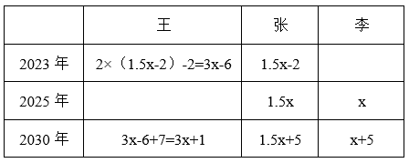

根据“2030年张和李的年龄之和与王的年龄相同”，可列式：3x+1=1.5x+5+x+5，解得x=18，则2030年3人的年龄之和为岁。设从2030年起，再过n年3人的年龄之和超过120岁，则有110+3n>120，解得，取整为4年，即3人的年龄之和在2030+4=2034年第一次超过120岁。

故正确答案为D。

### 第 67 题

甲、乙、丙三人未来3周均要去A、B、C三个地方调研，每人每个地方调研时长为1周，如每个人随机安排顺序，则每周三个人去的地方都不同的概率为：

A. 

B. 

C. 

D. 

第 67 题 · 答案与解析

**参考答案（粉笔题库参考内容）**

C

**解析**

由题意可知，甲未来3周分别要去A、B、C三个地方调研，则甲的情况数为种情况，同理乙、丙的情况数均为6种情况，则总情况数为6×6×6=216种情况。要满足每周三个人去的地方都不同，先考虑第一周，甲、乙、丙三人对应A、B、C三个地方，则第一周三人的情况数为种情况。以甲、乙、丙分别去A、B、C三个地方为例，讨论第二周及第三周情况，如下表所示：

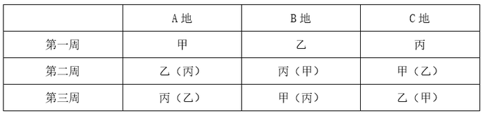

如表格所示，若第一周A地点由甲调研时，则第二周A地点可以从乙、丙二人中选择，有种情况，若第二周A地点人员确定，即其余地点和时间的人员均确定，则满足要求的情况数为6×2=12种情况。根据概率，则每周三个人去的地方都不同的概率。

故正确答案为C。

### 第 68 题

某高校外国语学院中，会俄语的学生都会英语，其中一半还会法语；会英语的学生中有一半会法语；这三种语言都会的学生有50人，只会其中两种语言的有100人，只会其中一种语言的有150人。问会法语的学生有多少人？

A. 100

B. 200

C. 50

D. 150

第 68 题 · 答案与解析

**参考答案（粉笔题库参考内容）**

B

**解析**

因为“会俄语的学生都会英语”，所以会俄语的学生包含于会英语的学生，因此作图如下：

又因为“会俄语的学生都会英语，其中一半还会法语”，即会俄语的学生的一半三种语言都会，又因为“三种语言都会的学生有50人”，所以会俄语的学生的一半是50人，另一半只会俄语和英语的有50人。又因为“只会其中两种语言的有100人”，所以只会英语和法语的学生有100-50=50人，会英语的学生中有50+50=100人会法语，结合“会英语的学生中有一半会法语”，可得会英语的学生共有100×2=200人，其中只会英语的学生有200-50-100=50人。根据“只会其中一种语言的有150人”，可得只会法语的学生有150-50=100人，则会法语的学生有100+50+50=200人。

故正确答案为B。

### 第 69 题

小张每周二、周五和周日固定参加骑行社团活动。某年9月和10月，小张分别参加了13次和14次活动。问当年他最后一次参加活动是在哪一天？

A. 12月31日

B. 12月30日

C. 12月29日

D. 12月28日

第 69 题 · 答案与解析

**参考答案（粉笔题库参考内容）**

A

**解析**

由题意可知，小张连续7天参加3次社团活动，9月有30天，前28天参加次社团活动，则后2天需参加13-12=1次；同理，10月有31天，后28天也参加12次社团活动，则前3天需满足参加14-12=2次，即9月29日-10月3日连续5天内需满足参加3次社团活动。

若9月29日为周一，连续5天内只有2天参加社团活动，不满足题意；

若9月29日为周二，连续5天内只有2天参加社团活动，不满足题意；

若9月29日为周三，连续5天内只有2天参加社团活动，不满足题意；

若9月29日为周四，连续5天内只有2天参加社团活动，不满足题意；

若9月29日为周五，连续5天内有3天参加社团活动，满足题意；

若9月29日为周六，连续5天内只有2天参加社团活动，不满足题意；

若9月29日为周日，连续5天内只有2天参加社团活动，不满足题意。

综上可知，9月29日只能是周五，则9月30日为周六，10-12月共31+30+31=92天，天，则12月31日为周日，恰好为当年小张最后一次参加社团活动。

故正确答案为A。

### 第 70 题

某小区内部的道路如下图所示，道路转弯处的、、均为直角，。已知AB、CD、EA的长度分别为40米、50米、60米，问整圈道路的总长度在以下哪个范围内？

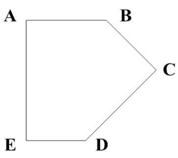

A. 在200~210米之间

B. 在210~220米之间

C. 不到200米

D. 超过220米

第 70 题 · 答案与解析

**参考答案（粉笔题库参考内容）**

B

**解析**

延长AB、ED，作C点关于AB和ED的垂线，分别交于F点、G点，如下图所示：

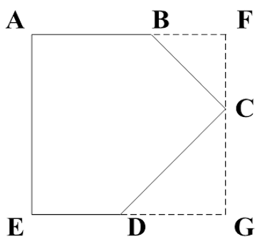

因五边形内角和为，则，即。又因为直角，则为等腰直角三角形，CD=50米，则米。同理，为等腰直角三角形，设BF=FC=x米，则米。因FG=AE，则，解得米，即米。因AF=EG，则AB+BF=ED+DG，即，解得米。故道路总长度为米，在B项范围内。

故正确答案为B。

备注：根据多边形内角和公式：n边形内角和，可知五边形内角和。

### 第 71 题

从所给的四个选项中，选择最合适的一个填入问号处，使之呈现一定的规律性：

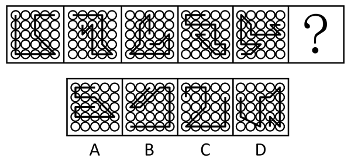

A. A

B. B

C. C

D. D

第 71 题 · 答案与解析

**参考答案（粉笔题库参考内容）**

C

**解析**

元素组成不同，且无明显属性规律，优先考虑数量规律。观察发现，题干图形均由线条和宫格构成，且线条将宫格中的小白球都分成了两部分，排除D项；继续观察发现，题干图形中两部分白球数量存在差异，个数分别为5、5和6、4交替出现，故？处图形两部分白球个数应为6、4，只有C项符合。

故正确答案为C。

### 第 72 题

从所给的四个选项中，选择最合适的一项填入问号处，使之呈现一定的规律性：

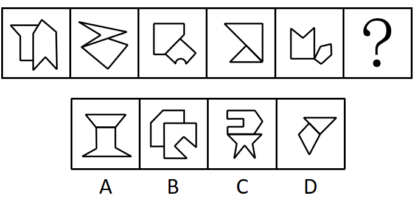

A. A

B. B

C. C

D. D

第 72 题 · 答案与解析

**参考答案（粉笔题库参考内容）**

B

**解析**

元素组成不同，且无明显属性规律，考虑数量规律。观察发现，题干图形均由两个挨着的多边形构成，出现多边形优先考虑线数量，题干前五幅图多边形的边数量分别为（6，6）、（4，4）、（5，5）、（3，3）、（5，5），每幅图中两个封闭图形的边数相等，故？处两个多边形边数量也应相等，只有B项符合。

故正确答案为B。

### 第 73 题

从所给的四个选项中，选择最合适的一项填入问号处，使之呈现一定的规律性：

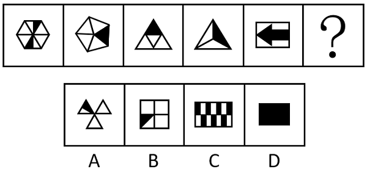

A. A

B. B

C. C

D. D

第 73 题 · 答案与解析

**参考答案（粉笔题库参考内容）**

D

**解析**

元素组成不同，且无明显属性规律，观察发现，题干图形均由黑块和白块组成，且色块分布均匀，优先考虑黑白块面积。题干图形的黑块面积依次为整体图形面积的、、、、，故？处图形的黑块面积应为整个图形的面积，即整个图形全为黑色，只有D项符合。

故正确答案为D。

### 第 74 题

从所给的四个选项中，选择最合适的一项填入问号处，使之呈现一定的规律性：

A. A

B. B

C. C

D. D

第 74 题 · 答案与解析

**参考答案（粉笔题库参考内容）**

B

**解析**

解析一：九宫格每行元素组成相同，优先考虑位置规律。九宫格优先看横行，第一行图形中，图1所有黑球沿如下图所示方向往右上方移动一格后得图2。

图2所有黑球沿如下图所示方向往右下方移动一格后得图3。

经验证，第二行满足相同的规律（到头循环走），如下图所示：

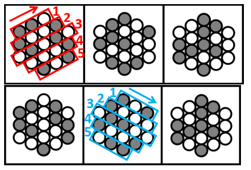

第三行应用规律，图1所有黑球沿如下图所示方向往右上方移动一格后得图2（到头循环走）。

图2所有黑球沿如下图所示方向往右下方移动一格（到头循环走）得到B项。

故正确答案为B。

解析二：九宫格每行元素组成相同，优先考虑位置规律。九宫格优先看横行，每横行相邻比较发现，相邻的两幅图都有一部分区域黑白球的位置摆放相同，如下图所示，以此类推，？处应选择一个和第三行图2拥有一部分区域黑白球的位置摆放相同的图形，只有B项符合。

故正确答案为B。

备注：两种解析思路均可得出正确答案B，由于解析一考查的是全部黑球的平移规律，解析二相同的是部分区域，比较而言解析一的规律更为严谨，故粉笔更倾向于本题考查平移规律。

### 第 75 题

左图为13个白色正方体和5个灰色正方体组合而成的多面体，现用经A、B、C三个顶点的平面对该多面体进行切割，正确的截面是：

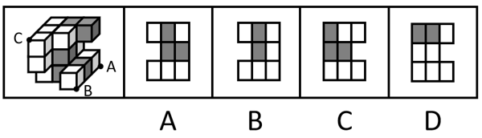

A. A

B. B

C. C

D. D

第 75 题 · 答案与解析

**参考答案（粉笔题库参考内容）**

B

**解析**

本题考查截面图。根据平面公理“过不在一条直线上的三点，有且只有一个平面”得出A、B、C三个点可以确定一个唯一的截面，如下图所示：

将截面上下翻转后即可得到如下截图：

故正确答案为B。

### 第 76 题

左图为15个白色正方体和3个灰色正方体组合而成的多面体，其可以由①、②、③三个多面体组合而成，问哪项能填入问号处？

A. A

B. B

C. C

D. D

第 76 题 · 答案与解析

**参考答案（粉笔题库参考内容）**

A

**解析**

本题考查立体拼合。如下图所示，立体图可以由①、②以及A项拼合而成。

故正确答案为A。

### 第 77 题

左图为8个白色正方体和4个黑色正方体粘接而成的长方体，问以下哪一个不可能是其外表面展开图？

A. A

B. B

C. C

D. D

第 77 题 · 答案与解析

**参考答案（粉笔题库参考内容）**

D

**解析**

将长方体的外表面依次标上序号，如下图所示，面e为正面、面f为顶面、面k为右侧面、面i为左侧面，面g为背面，面h为底面，逐一分析选项。

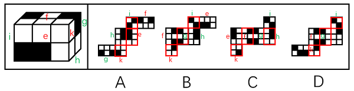

A项：展开图的6个面（如上图所示）与长方体的外表面一一对应，选项与题干一致，排除；

B项：展开图的6个面（如上图所示）与长方体的外表面一一对应，选项与题干一致，排除；

C项：展开图的6个面（如上图所示）与长方体的外表面一一对应，选项与题干一致，排除；

D项：展开图中左下角的面和右侧的面为无中生有的面，选项与题干不一致，当选。

本题为选非题，故正确答案为D。

### 第 78 题

把下面六个图形分为两类，使每一类图形都有各自的共同特征或规律，分类正确的一项是：

A. ①②⑥，③④⑤

B. ①③④，②⑤⑥

C. ①③⑥，②④⑤

D. ①③⑤，②④⑥

第 78 题 · 答案与解析

**参考答案（粉笔题库参考内容）**

C

**解析**

本题为分组分类题目。题干每幅图形均由三个面和一个黑块拼接而成，考虑图形间关系。观察发现，题干中黑块与图形外框均相交于边，且图①③⑥中黑块与图形外框公共边的数量均为1，图②④⑤中黑块与图形外框公共边的数量均为2，即图①③⑥为一组，图②④⑤为一组。

故正确答案为C。

### 第 79 题

把下面六个图形分为两类，使每一类图形都有各自的共同特征或规律，分类正确的一项是：

A. ①④⑤，②③⑥

B. ①③④，②⑤⑥

C. ①⑤⑥，②③④

D. ①②⑥，③④⑤

第 79 题 · 答案与解析

**参考答案（粉笔题库参考内容）**

C

**解析**

本题为分组分类题目。元素组成不同，且无明显属性规律，考虑数量规律。观察发现，题干图形被分割，考虑面数量，但面数量无规律，且框内有明显一笔构成的线条，考虑笔画数。图①⑤⑥均为两笔画图形，图②③④均为一笔画图形，故图①⑤⑥为一组，图②③④为一组。

故正确答案为C。

### 第 80 题

把下面的六个图形分为两类，使每一类图形都有各自的共同特征或规律，分类正确的一项是：

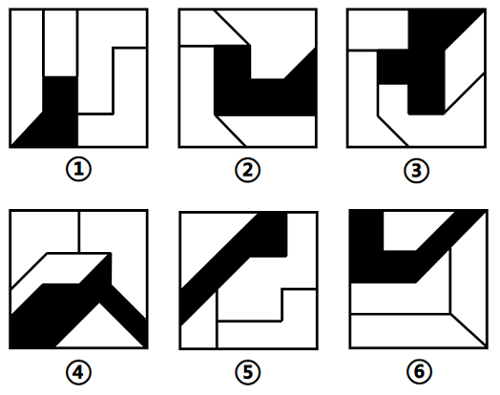

A. ①②⑥，③④⑤

B. ①④⑥，②③⑤

C. ①③⑤，②④⑥

D. ①②③，④⑤⑥

第 80 题 · 答案与解析

**参考答案（粉笔题库参考内容）**

D

**解析**

本题为分组分类题目。元素组成不同，且无明显属性规律，考虑数量规律。题干图形明显被分割，优先考虑面数量，题干图形均有四个白块和一个黑块，不能分组；继续观察发现，题干图形均由几个图形拼接而成，还可以考虑图形间关系。题干图形均有一个黑块，图①②③中黑块均与4个白块存在公共边，图④⑤⑥中黑块均与3个白块存在公共边。即图①②③为一组，图④⑤⑥为一组。

故正确答案为D。

### 第 81 题

多级养殖是指根据物种代谢产物或残余有机质的利用价值及其在食物链中所处的级次，依次放养相应生物，多级次利用营养物质的一种养殖方式。

根据上述定义，下列属于多级养殖的是：

A. 将养殖过江蓠的海水用于放养贝类，以利用其中繁殖的浮游生物；再将养殖过贝类的水用于放养对虾；再以对虾代谢分解的产物养殖藻类

B. 将鱼、虾、贝类与藻类放在同一水槽混养，其代谢产物会为藻类提供必要的营养要素，藻类的光合作用又产生更多的溶解氧

C. 在一台浮筏上，于冬春季养殖海带；至夏秋季养殖海湾扇贝或石花菜，从而更好利用海况条件，满足市场需要

D. 同一池塘中，鲢、鳙生活在上层，主食浮游生物；草鱼、鳊生活在中下层，主食草类；鲤、鲫生活在底层，主食底栖动物和有机碎屑

第 81 题 · 答案与解析

**参考答案（粉笔题库参考内容）**

A

**解析**

第一步：找出定义关键词。

“根据物种代谢产物或残余有机质的利用价值及其在食物链中所处的级次”、“依次放养相应生物”、“多级次利用营养物质”。

第二步：逐一分析选项。

A项：养殖江蓠的海水放养贝类，再利用养殖贝类的水放养对虾，再利用对虾代谢分解的产物养殖藻类，符合“根据物种代谢产物或残余有机质的利用价值及其在食物链中所处的级次”、“依次放养相应生物”、“多级次利用营养物质”，符合定义，当选；

B项：将鱼、虾、贝类与藻类放在同一水槽混养，不符合“依次放养相应生物”等，不符合定义，排除；

C项：冬春季养殖海带，至夏秋季养殖海湾扇贝或石花菜，不符合“根据物种代谢产物或残余有机质的利用价值及其在食物链中所处的级次”、“多级次利用营养物质”，不符合定义，排除；

D项：同一池塘中生活在不同层的生物，不符合“依次放养相应生物”、“多级次利用营养物质”，不符合定义，排除。

故正确答案为A。

### 第 82 题

复杂型消费行为是指消费者对价格昂贵，品牌差异大，功能复杂的商品，由于缺乏必要的商品知识，需要慎重选择，仔细对比，以求降低风险的购买行为；多变型消费行为是指如果消费者购买的商品价格低，可供选择的品牌很多时，他们并不花太多的时间选择品牌，而是经常变换品牌。

根据上述定义，下列说法正确的是：

A. 老李给儿子换了十几个钢琴老师之后，发现还是第一个钢琴老师最好，于是一次性交了一年的学费。这属于复杂型消费行为

B. 小明去超市买某品牌饼干，心想上次买了巧克力口味，这次买绿茶口味，下次再试一下夹心的。这属于多变型消费行为

C. 老王打算买一辆越野车，网上查阅了各种型号参数，试驾了十几款品牌之后，才做出决定。这属于复杂型消费行为

D. 小丽逛街的时候本来只想买一条裤子，后来发现需要搭配一件合适的上衣和配套的手提包，所以买了全套。这属于多变型消费行为

第 82 题 · 答案与解析

**参考答案（粉笔题库参考内容）**

C

**解析**

第一步：找出定义关键词。

复杂型消费行为：“价格昂贵，品牌差异大，功能复杂的商品”、“慎重选择，仔细对比，以求降低购买风险”；

多变型消费行为：“价格低，可选品牌多的商品”、“不花太多的时间选择品牌，经常变换品牌”。

第二步：逐一分析选项。

A项：老李给儿子更换和对比了钢琴老师，但钢琴授课服务并不属于“功能复杂的商品”，不符合“价格昂贵，品牌差异大，功能复杂的商品”，不符合“复杂型消费行为”定义，排除；

B项：小明更换的是不同口味、类型的饼干，未体现变换品牌，不符合“不花太多的时间选择品牌，经常变换品牌”，不符合“多变型消费行为”定义，排除；

C项：老王购买越野车，其中越野车符合“价格昂贵，品牌差异大，功能复杂的商品”，老王试驾十几款品牌后才做决定，符合“慎重选择，仔细对比，以求降低购买风险”，符合“复杂型消费行为”定义，当选；

D项：小丽本来只想购买裤子，后为了搭配购买了全套，未体现价格是否昂贵，以及是否更换品牌，不符合“价格低，可选品牌多的商品”、“不花太多的时间选择品牌，经常变换品牌”，不符合“多变型消费行为”定义，排除。

故正确答案为C。

### 第 83 题

慢病也称为慢性非传染性疾病，是指长期的、不能自愈的、也几乎不能被治愈的疾病。慢病自我管理是指慢病患者主动监测自己的病情，以积极态度及行动，改善健康和情绪，通过对疾病的认识，学习与疾病长期共存。

根据上述定义，下列属于慢病自我管理的是：

A. 老张在患了流感后多方查阅相关信息，每天监测血氧、心率、血压等指标，不做剧烈运动，避免着凉

B. 老王因慢性肾功能衰竭需定期在医院进行透析治疗，医院为其建立了慢病管理档案，追踪监测肾功能等各项指标

C. 老赵的父母都因胃癌去世，老赵深知该疾病的严重后果，每年全面体检一次，定期进行胃肠镜检查，不熬夜不喝酒，规律作息

D. 患II型糖尿病的老李，平日生活格外谨慎，含糖量高的食物一概不碰，每天按时服药，定期监测血糖水平

第 83 题 · 答案与解析

**参考答案（粉笔题库参考内容）**

D

**解析**

第一步：找出定义关键词。

慢病：“慢性非传染性疾病”、“长期的、不能自愈的、也几乎不能被治愈的疾病”；

慢病自我管理：“慢病患者主动监测自己的病情，积极改善健康和情绪，学习与疾病长期共存”。

第二步：逐一分析选项。

A项：“流感”属于传染性疾病，不符合“慢性非传染性疾病”，不符合“慢病”定义，因此也不符合“慢病自我管理”定义，排除；

B项：医院为老王建立慢病管理档案并追踪监测肾功能等各项指标，不是患者老王监测自己的病情，不符合“慢病患者主动监测自己的病情，积极改善健康和情绪，学习与疾病长期共存”，不符合“慢病自我管理”定义，排除；

C项：老赵并没有患病，不是患者，不符合“慢病患者主动监测自己的病情，积极改善健康和情绪，学习与疾病长期共存”，不符合“慢病自我管理”定义，排除；

D项：II型糖尿病属于慢性非传染性疾病，患II型糖尿病的老李按时服药，定期监测血糖水平，符合“慢病患者主动监测自己的病情，积极改善健康和情绪，学习与疾病长期共存”，符合“慢病自我管理”定义，当选。

故正确答案为D。

### 第 84 题

人际关系图，是用一套特定的符号来表示团体内成员之间各种关系的图形。依据前期的调查，将团体成员的关系分为“吸引”“排斥”“无关”三类。图中圆圈内的字母是团体内每一成员的代号。实线与虚线表示相互关系，其中实线表示吸引关系，虚线表示排斥关系，箭头表示方向（例如：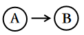表示A受B吸引，表示A排斥B），其中被实线箭头指向最多的人，就是处于团体中心位置的人。

根据上述定义，对下图的判断正确的是：

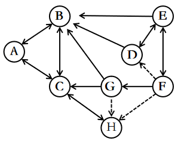

A. 该团体中没有相互排斥的人

B. C是处于团体中心位置的人

C. F是该团体中受排斥最多的人

D. H和B是相互吸引的人

第 84 题 · 答案与解析

**参考答案（粉笔题库参考内容）**

A

**解析**

第一步：找出定义关键词。

实线：“表示吸引关系”；

虚线：“表示排斥关系”；

：“表示A受B吸引”；

：“表示A排斥B”；

团体中心位置的人：“被实线箭头指向最多的人”。

第二步：逐一分析选项。

A项：题干图示中没有双向虚线箭头，根据“虚线表示排斥关系”可知，该团体中没有相互排斥的人，表述正确，当选；

B项：题干图示中C被四个实线箭头指向，而B被五个实线箭头指向，根据“被实线箭头指向最多的人”可知，B是处于团体中心位置的人，而不是C，表述错误，排除；

C项：题干图示中F没有被虚线箭头指向，根据“虚线表示排斥关系”可知，F没有受到排斥，表述错误，排除；

D项：题干图示中H和B没有直接的双向实线关系，根据“实线表示吸引关系”可知，H和B不是相互吸引的人，表述错误，排除。

故正确答案为A。

### 第 85 题

电子测量是指利用电子技术为测量手段，进行电的或非电的各种测量，主要分两类：电参量的测量，是指对用电设备中用电参数的测量；非电参量的测量，是指通过不同类型的传感器将物理的、化学的、机械的非电参量转换成电信号，然后利用电子技术测出其相应的电参量，最后将其折合成非电参量数据。

根据上述定义，下列电子测量与其他三项类型不同的是：

A. 利用电子仪表测量某机房电路的电压、电流

B. 用电子天平称出物体的重量

C. 声波使话筒内的驻极体薄膜振动，产生随之变化的电压，这一电压被数据采集器接收，用于测量声音的振动频率

D. 将电极放到体表采集患者心脏活动的电信号，经过放大传输到机器后形成心电图

第 85 题 · 答案与解析

**参考答案（粉笔题库参考内容）**

A

**解析**

第一步：找出定义关键词。

电参量的测量：“对用电设备中用电参数的测量”；

非电参量的测量：“通过不同类型的传感器将物理的、化学的、机械的非电参量转换成电信号”、“利用电子技术测出其相应的电参量并将其折合成非电参量数据”。

第二步：逐一分析选项。

A项：利用电子仪表测量某机房电路的电压、电流，符合“对用电设备中用电参数的测量”，符合“电参量的测量”定义；

B项：用电子天平称出物体的重量，是利用电磁力平衡测量被称物体的重力，符合“通过不同类型的传感器将物理的非电参量转换成电信号”、“利用电子技术测出其相应的电参量并将其折合成非电参量数据”，符合“非电参量的测量”定义；

C项：声波使话筒内的驻极体薄膜振动，产生随之变化的电压并被数据采集器接收，符合“通过不同类型的传感器将物理的非电参量转换成电信号”，用于测量声音的振动频率，符合“利用电子技术测出其相应的电参量并将其折合成非电参量数据”，符合“非电参量的测量”定义；

D项：通过电极采集心脏活动的电信号，符合“通过不同类型的传感器将物理的非电参量转换成电信号”，再经过放大传输到机器后形成心电图，符合“利用电子技术测出其相应的电参量并将其折合成非电参量数据”，符合“非电参量的测量”定义。

综上，A项为“电参量的测量”，B、C、D三项均为“非电参量的测量”，只有A项和其他三项不同。

本题为选非题，故正确答案为A。

### 第 86 题

总被引频次是指期刊自创刊以来登载的全部论文在统计当年被引用的总次数。扩散因子是一个用于评估期刊影响力的学术指标，显示总被引频次扩散的范围，具体意义为期刊当年每被引100次所涉及的期刊数，即扩散因子。

甲刊：创刊于1980年，2022年总被引频次为2000，涉及期刊800种

乙刊：创刊于2000年，2022年总被引频次为1500，涉及期刊500种

丙刊：创刊于2020年，2022年总被引频次为200，涉及期刊60种

根据定义，在2022年，上述三种期刊按照扩散因子由大到小排序正确的是：

A. 丙、甲、乙

B. 丙、乙、甲

C. 乙、丙、甲

D. 甲、乙、丙

第 86 题 · 答案与解析

**参考答案（粉笔题库参考内容）**

D

**解析**

第一步：找出定义关键词。

总被引频次：“期刊自创刊以来登载的全部论文在统计当年被引用的总次数”；

扩散因子：“期刊当年每被引100次所涉及的期刊数”、“扩散因子”。

第二步：逐一分析选项。

甲刊扩散因子；

乙刊扩散因子；

丙刊扩散因子。

综上，三种期刊按照扩散因子由大到小排序应为甲、乙、丙。

故正确答案为D。

### 第 87 题

动态描写法是指记叙文中对人物、景物作运动状态的描写，创造具体而栩栩如生的形象的一种描写方法。动态描写法包括两类：一类是对运动着的景物的描写，一类是对静物所作的动态描写。动态描写法的目的在于赋予客观事物以运动感、活力感、变化感，克服形象的单调性，丰富形象的多样性，达到更好地表现事物、感染读者的艺术效果。

根据上述定义，下列没有体现动态描写法的是：

A. 有的松树望穿秋水，不见你来，独自上到高处，斜着身子张望

B. 夜阑人静，家养的大黄狗趴在院子里安静地睡了

C. 七股大水，从水库的桥孔跃出，仿佛七幅闪光的黄锦，直铺下去

D. 一轮杏黄色的满月，悄悄从山嘴处爬出来，把倒影投入湖水中

第 87 题 · 答案与解析

**参考答案（粉笔题库参考内容）**

B

**解析**

第一步：找出定义关键词。

“对运动着的景物的描写”、“对静物所作的动态描写”、“目的在于赋予客观事物以运动感、活力感、变化感”。

第二步：逐一分析选项。

A项：该项中“松树上到高处，斜着身子张望”，将静态的松树写成动态，而且赋予它情感，生动形象地描绘了松树婀娜多姿的风貌，符合“对静物所作的动态描写”、“目的在于赋予客观事物以运动感、活力感、变化感”，符合定义，排除；

B项：该项中“大黄狗趴在院子里安静地睡了”，未体现动态的表达，大黄狗只是处于静止状态趴在院子里，不符合“对运动着的景物的描写”、“对静物所作的动态描写”、“目的在于赋予客观事物以运动感、活力感、变化感”，不符合定义，当选；

C项：该项中“水从桥孔跃出”，将动态的水描写得生动、壮观、有气势，符合“对运动着的景物的描写”、“目的在于赋予客观事物以运动感、活力感、变化感”，符合定义，排除；

D项：该项中“满月从山嘴处爬出来”，将月亮升起的动态生动地描绘出来，符合“对运动着的景物的描写”、“目的在于赋予客观事物以运动感、活力感、变化感”，符合定义，排除。

本题为选非题，故正确答案为B。

### 第 88 题

附性法推理是指将同一属性分别附加在原命题的主项和谓项前面，从而形成一个新命题的推理方法，以公式表示即为：“所有S（主项）是P（谓项）所有NS是NP”（其中“N”表示某种属性）。运用这种推理必须遵守的规则是：①原命题必须断定了某个类别的所有事物的某种共性；②附加的属性概念必须保持含义的同一；③结论中的主谓项关系应与前提中的主谓项关系相同。

根据上述定义，下列符合附性法推理规则的是：

A. 蝴蝶是昆虫，所以，色彩斑斓的蝴蝶是色彩斑斓的昆虫

B. 教师是人，所以，老教师是老人

C. 有些诗人是画家，所以，有些女诗人是女画家

D. 音乐家是人，所以，无天赋的音乐家是无天赋的人

第 88 题 · 答案与解析

**参考答案（粉笔题库参考内容）**

A

**解析**

第一步：找出定义关键词。

“原命题必须断定了某个类别的所有事物的某种共性”、“附加的属性概念必须保持含义的同一”、“结论中的主谓项关系应与前提中的主谓项关系相同”。

第二步：逐一分析选项。

A项：蝴蝶是昆虫，所以，色彩斑斓的蝴蝶是色彩斑斓的昆虫，蝴蝶和昆虫前附加的“色彩斑斓”含义均是色彩灿烂的样子，符合“原命题必须断定了某个类别的所有事物的某种共性”、“附加的属性概念必须保持含义的同一”、“结论中的主谓项关系应与前提中的主谓项关系相同”，符合定义，当选；

B项：老教师中的“老”含义是经验丰富，老人中的“老”含义是上了年纪，两者含义不同，不符合“附加的属性概念必须保持含义的同一”，不符合定义，排除；

C项：有些诗人是画家，不符合“原命题必须断定了某个类别的所有事物的某种共性”，不符合定义，排除；

D项：无天赋的音乐家中的“无天赋”含义是在音乐领域没有天赋，无天赋的人中的“无天赋”含义是在所有领域没有天赋，两者含义不同，不符合“附加的属性概念必须保持含义的同一”，不符合定义，排除。

故正确答案为A。

### 第 89 题

中医七方指的是大方、小方、缓方、急方、奇方、偶方、复方七种方剂的总称。其中缓方是指药性缓和，治疗病势缓慢需长期服用的方剂；急方是指药性峻猛，治疗病势急重急于取效的方剂；奇方是指单数药物组成的方剂；偶方是指双数药物组成的方剂。

根据上述定义，下列既属于缓方又属于偶方的是：

A. 参附汤：人参15克、附子30克，有回阳、益气、固脱之功，常用于元气大亏、阳气暴脱之症

B. 甘草汤：甘草6克，主治少阴咽痛，兼治舌肿，有清热解毒之功效

C. 四君子汤：人参、甘草、茯苓、白术各等分，主治脾胃气虚证，症见面色萎黄、语声低微、气短乏力等

D. 生脉散：人参9克、麦门冬9克、五味子6克，为补益剂，具有益气生津、敛阴止汗之功效

第 89 题 · 答案与解析

**参考答案（粉笔题库参考内容）**

C

**解析**

第一步：找出定义关键词。

缓方：“药性缓和”、“治疗病势缓慢需长期服用的方剂”；

急方：“药性峻猛”、“治疗病势急重急于取效的方剂”；

奇方：“单数药物组成的方剂”；

偶方：“双数药物组成的方剂”。

第二步：逐一分析选项。

A项：参附汤：人参15克、附子30克，符合“双数药物组成的方剂”，符合“偶方”定义；常用于元气大亏、阳气暴脱之症，说明其适用于病势急重的病症，不符合“治疗病势缓慢需长期服用的方剂”，不符合“缓方”定义，排除；

B项：甘草汤：甘草6克，不符合“双数药物组成的方剂”，不符合“偶方”定义，排除；

C项：四君子汤：人参、甘草、茯苓、白术各等分，符合“双数药物组成的方剂”，符合“偶方”定义；主治脾胃气虚证，症见面色萎黄、语声低微、气短乏力等，说明其适用于病势缓慢的病症，符合“治疗病势缓慢需长期服用的方剂”，符合“缓方”定义，当选；

D项：生脉散：人参9克、麦门冬9克、五味子6克，不符合“双数药物组成的方剂”，不符合“偶方”定义，排除。

故正确答案为C。

### 第 90 题

在图书馆统计指标中，文献流通数是指实际被阅读者借阅、利用的文献数。文献流通率是指文献流通数与馆藏中提供流通的文献数的比率。文献利用率是指文献流通数与馆藏文献总数的比率。文献拒借率是指读者未能借到的文献数与读者合理要求借阅的文献数的比率，即索书条拒借数占索书条总数的百分比。文献保障率是指图书馆提供读者借阅、利用的文献数与图书馆拥有的读者数的比率。

根据上述定义，下列说法正确的是：

A. 对一个图书馆来说，文献流通率一定不低于文献利用率

B. 对一个图书馆来说，文献流通率反映了图书馆馆藏文献的规模及读者的需求

C. 当文献拒借率越高时，文献保障率就越低

D. 文献流通数越多而馆藏中提供流通的文献数越少，文献利用率就越高

第 90 题 · 答案与解析

**参考答案（粉笔题库参考内容）**

A

**解析**

第一步：找出定义关键词。

文献流通数：“实际被阅读者借阅、利用的文献数”；

文献流通率：“文献流通数与馆藏中提供流通的文献数的比率”；

文献利用率：“文献流通数与馆藏文献总数的比率”；

文献拒借率：“读者未能借到的文献数与读者合理要求借阅的文献数的比率”、“索书条拒借数占索书条总数的百分比”；

文献保障率：“图书馆提供读者借阅、利用的文献数与图书馆拥有的读者数的比率”。

第二步：逐一分析选项。

A项：文献流通率，文献利用率，二者的分子相同，但馆藏中提供流通的文献数一定小于或等于馆藏文献总数，即文献流通率的分母一定小于或等于文献利用率的分母，故文献流通率一定不低于文献利用率，说法正确，当选；

B项：文献流通率，无法体现图书馆馆藏文献的规模及读者的需求，说法错误，排除；

C项：文献拒借率，文献保障率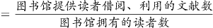，文献拒借率越高时，无法确定文献保障率的高低，说法错误，排除；

D项：文献利用率，当文献流通数越多而馆藏中提供流通的文献数越少时，因不确定馆藏文献总数的情况，故无法确定文献利用率的高低，说法错误，排除。

故正确答案为A。

### 第 91 题

卫冕：夺冠

A. 庄园：田园

B. 追讨：诉讼

C. 续约：签约

D. 姓名：笔名

第 91 题 · 答案与解析

**参考答案（粉笔题库参考内容）**

C

**解析**

第一步：判断题干词语间逻辑关系。

卫冕指竞赛中保住上次获得的冠军称号，所以卫冕是再次夺冠，二者为对应关系。

第二步：判断选项词语间逻辑关系。

A项：庄园指封建主占有和经营的大片地产，田园指田地和园圃，借指农村，二者不是对应关系，与题干逻辑关系不一致，排除；

B项：追讨指追赶讨伐，诉讼指司法机关在案件当事人和其他有关人员的参与下，按照法定程序解决案件时所进行的活动，俗称“打官司”，二者无明显逻辑关系，与题干逻辑关系不一致，排除；

C项：续约指合同、合约期满后继续签约，所以续约是再次签约，二者为对应关系，与题干逻辑关系一致，当选；

D项：姓名指人的姓氏和名字，笔名指作者发表作品时用的别名，二者不是对应关系，与题干逻辑关系不一致，排除。

故正确答案为C。

### 第 92 题

花生壳：核桃仁

A. 刺梨汁：桃花扇

B. 丝瓜络：石榴籽

C. 杏仁露：葡萄皮

D. 葛根茶：芡实粉

第 92 题 · 答案与解析

**参考答案（粉笔题库参考内容）**

B

**解析**

第一步：判断题干词语间逻辑关系。

“花生壳”是花生的组成部分；“核桃仁”是核桃的组成部分，二者都是组成各自植物果实的一部分。

第二步：判断选项词语间逻辑关系。

A项：“刺梨汁”是一种以刺梨为原材料制成的果汁；“桃花扇”是指扇面上画有桃花的扇子，二者不是组成各自植物果实的一部分，与题干逻辑关系不一致，排除；

B项：“丝瓜络”是干燥成熟丝瓜的网状纤维，“丝瓜络”是丝瓜的组成部分；“石榴籽”是石榴的组成部分，二者都是组成各自植物果实的一部分，与题干逻辑关系一致，当选；

C项：“杏仁露”是一种以杏仁为原材料制成的饮料；“葡萄皮”是葡萄的组成部分，与题干逻辑关系不一致，排除；

D项：“葛根茶”是一种以葛根为原材料制成的茶饮料；“芡实粉”是一种以芡实为原材料磨成的粉，与题干逻辑关系不一致，排除。

故正确答案为B。

### 第 93 题

诛禁不当：反受其央

A. 为者常成：行者常至

B. 君子检身：常若有过

C. 其身不正：虽令不从

D. 麻雀虽小：五脏俱全

第 93 题 · 答案与解析

**参考答案（粉笔题库参考内容）**

C

**解析**

第一步：判断题干词语间逻辑关系。

诛禁不当，反受其央，意思是惩罚得不恰当，反而受其祸害。因为诛禁不当，所以反受其央，二者是因果对应关系。

第二步：判断选项词语间逻辑关系。

A项：为者常成，行者常至，意思是努力去做的人常常可以成功，不倦前行的人常常可以达到目的，二者是并列关系，与题干逻辑关系不一致，排除；

B项：君子检身，常若有过，意思是君子要时时反省检查自己，就像自己经常会有缺点过失那样，二者不是因果对应关系，与题干逻辑关系不一致，排除；

C项：其身不正，虽令不从，意思是在上位的管理者本身言行不正，即使发出命令，大家也不会服从遵守。因为其身不正，所以虽令不从，二者是因果对应关系，与题干逻辑关系一致，当选；

D项：麻雀虽小，五脏俱全，比喻事物的体积或规模虽小，具备的内容却很齐全，二者不是因果对应关系，与题干逻辑关系不一致，排除。

故正确答案为C。

### 第 94 题

明辨是非：静待成败

A. 判若云泥：开释左右

B. 洞鉴古今：博观始终

C. 一争高低：弱肉强食

D. 惩恶劝善：天差地别

第 94 题 · 答案与解析

**参考答案（粉笔题库参考内容）**

B

**解析**

第一步：判断题干词语间逻辑关系。

“明辨是非”指把是非分清楚，“静待成败”指安静地等待成功或失败，二者没有明显的语义关系，考虑拆分，两个词语中的第三个字和第四个字（即“是”和“非”、“成”和“败”）均是反义关系。

第二步：判断选项词语间逻辑关系。

A项：“判若云泥”指高低差别好像天上的云彩和地下的泥土的距离那样远，形容差别极大，“开释左右”指用劝慰、开导的话消除对方的忧愁、疑虑和烦恼，但第一个词语中的第三个字和第四个字（即“云”和“泥”）并不是反义关系，与题干逻辑关系不一致，排除；

B项：“洞鉴古今”指深入透彻地了解历史与现实世事，“博观始终”指广博地观察事物的始终，两个词语中的第三个字和第四个字（即“古”和“今”、“始”和“终”）均是反义关系，与题干逻辑关系一致，当选；

C项：“一争高低”指争一争，谁的本事高，“弱肉强食”指动物中弱者被强者吃掉，泛指弱者被强者欺凌、吞并，但第二个词语中的第三个字和第四个字（即“强”和“食”）并不是反义关系，与题干逻辑关系不一致，排除；

D项：“惩恶劝善”指惩罚坏人，奖励好人，“天差地别”指两种或多种事物之间的差距很大，就像天和地之间的距离一样，但两个词语中的第三个字和第四个字（即“劝”和“善”、“地”和“别”）均不是反义关系，与题干逻辑关系不一致，排除。

故正确答案为B。

### 第 95 题

蚜虫：七星瓢虫：小麦

A. 蛇：鸟：谷子

B. 稗草：螳螂：水稻

C. 蚊子：青蛙：高粱

D. 老鼠：黄鼬：玉米

第 95 题 · 答案与解析

**参考答案（粉笔题库参考内容）**

D

**解析**

第一步：判断题干词语间逻辑关系。

蚜虫会吸食小麦的汁液，二者为捕食者与被捕食对象的对应关系；七星瓢虫会捕食蚜虫，二者为捕食者与被捕食对象的对应关系。

第二步：判断选项词语间逻辑关系。

A项：有的蛇会吃鸟，有的鸟会吃蛇，二者是相互捕食的对应关系，与题干逻辑关系不一致，排除；

B项：稗草是一种常见的田间杂草，会和水稻竞争稻田里的资源，二者是竞争关系，并非捕食者与被捕食对象的对应关系，与题干逻辑关系不一致，排除；

C项：蚊子和高粱没有必然关系，与题干逻辑关系不一致，排除；

D项：老鼠吃玉米，二者为捕食者与被捕食对象的对应关系；黄鼬即黄鼠狼，会捕食老鼠，二者为捕食者与被捕食对象的对应关系，与题干逻辑关系一致，当选。

故正确答案为D。

### 第 96 题

感想：主观性：体会

A. 典范：示范性：表率

B. 发明：创造性：方法

C. 泥土：可塑性：材料

D. 规律：普适性：定理

第 96 题 · 答案与解析

**参考答案（粉笔题库参考内容）**

A

**解析**

第一步：判断题干词语间逻辑关系。

感想是指由接触外界事物而引起的思想反应，体会指的是体验领会，二者为近义关系；感想和体会均具有主观性，与第二个词构成必然属性对应关系。

第二步：判断选项词语间逻辑关系。

A项：典范是指可以作为学习、仿效标准的人或事物，表率是指好的榜样，二者为近义关系；典范和表率均具有示范性，与第二个词构成必然属性对应关系，与题干逻辑关系一致，当选；

B项：发明需要一定的方法，二者为对应关系，与题干逻辑关系不一致，排除；

C项：泥土是一种材料，二者为种属关系；材料不一定具有可塑性，与第二个词构成或然属性对应关系，与题干逻辑关系不一致，排除；

D项：规律是指事物之间的内在必然联系，定理是指已经证明具有正确性、可以作为原则或规律的命题或公式，定理是规律的一种，二者为种属关系，与题干逻辑关系不一致，排除。

故正确答案为A。

### 第 97 题

自发裂变：核裂变：诱发裂变

A. 波浪能：太阳能：可再生能源

B. 铁路交通：现代交通：公路交通

C. 贸易逆差：贸易平衡：贸易顺差

D. 负有理数：负实数：负无理数

第 97 题 · 答案与解析

**参考答案（粉笔题库参考内容）**

D

**解析**

第一步：判断题干词语间逻辑关系。

“核裂变”是指由重的原子核分裂成两个或多个质量较小的原子的一种核反应形式。“核裂变”分为“自发裂变”和“诱发裂变”两种。前者指在无外部激发情况下，重核自发裂变；后者指重核受到中子或其它粒子激发而发生的裂变。因此，第一词和第三词为矛盾关系，与第二词均为种属关系。

第二步：判断选项词语间逻辑关系。

A项：“波浪能”和“太阳能”都是“可再生能源”的一种，前两词为反对关系，与第三词均为种属关系，与题干逻辑关系不一致，排除；

B项：“铁路交通”和“公路交通”都是“现代交通”的一种，第一词和第三词为反对关系，与第二词均为种属关系，与题干逻辑关系不一致，排除；

C项：“贸易逆差”指进口总值大于出口总值，“贸易平衡”指出口总值与进口总值相等，“贸易顺差”指出口总值大于进口总值，三者为反对关系，与题干逻辑关系不一致，排除；

D项：“负实数”分为“负有理数”和“负无理数”，第一词和第三词为矛盾关系，与第二词均为种属关系，与题干逻辑关系一致，当选。

故正确答案为D。

### 第 98 题

轮作休耕：耕地保护：严禁占用

A. 植树造林：碳中和：节能减排

B. 登月计划：空间站：太空探索

C. 商品交换：国际贸易：技术服务

D. 观众评选：荣获大奖：出类拔萃

第 98 题 · 答案与解析

**参考答案（粉笔题库参考内容）**

A

**解析**

第一步：判断题干词语间逻辑关系。

轮作休耕和严禁占用的目的都是耕地保护，第一个词和第三个词分别与第二个词构成方式目的的对应关系。

第二步：判断选项词语间逻辑关系。

A项：植树造林和节能减排的目的都是实现碳中和，第一个词和第三个词分别与第二个词构成方式目的的对应关系，与题干逻辑关系一致，当选；

B项：空间站是在近地轨道上运行的载人航天器，可以在登月计划中发挥作用，但登月计划的目的不是空间站，前两个词不是方式目的的对应关系，与题干逻辑关系不一致，排除；

C项：国际贸易是指商品和劳务的国际交换活动，国际贸易是商品交换的一种形式，前两个词不是方式目的的对应关系，与题干逻辑关系不一致，排除；

D项：观众评选的目的不是荣获大奖，前两个词不是方式目的的对应关系，与题干逻辑关系不一致，排除。

故正确答案为A。

### 第 99 题

领头雁 对于 （ ） 相当于 （ ） 对于 先驱

A. 领导者；拓荒牛

B. 鸟类；革命

C. 迁徙；先锋

D. 出头鸟；先行者

第 99 题 · 答案与解析

**参考答案（粉笔题库参考内容）**

A

**解析**

逐一代入选项。

A项：领头雁比喻在众人眼里有一定的号召力和领导能力，具有榜样力量的人，与领导者构成比喻象征关系；拓荒牛比喻开拓创新的先行者，先驱指前行开路的人，二者构成比喻象征关系，前后逻辑关系一致，当选；

B项：领头雁是鸟类，二者为种属关系；革命的先驱，二者为偏正关系，前后逻辑关系不一致，排除；

C项：迁徙是领头雁的一种习性，二者为对应关系；先锋指行军或作战时的先遣将领或先头部队，先驱指前行开路的人，二者为近义关系，前后逻辑关系不一致，排除；

D项：领头雁比喻在众人眼里有一定的号召力和领导能力，具有榜样力量的人，出头鸟比喻表现突出或领头的人，也比喻因出头露面而招人注目的人，二者是并列关系；先行者指首先倡导的人，先驱指前行开路的人，二者是近义/全同关系，前后逻辑关系不一致，排除。

故正确答案为A。

### 第 100 题

重型战机 对于 （ ） 相当于 （ ） 对于 分辨率

A. 隐形战机 清晰度

B. 战斗机 性能指标

C. 轻型战机 订单量

D. 载弹量 显示器

第 100 题 · 答案与解析

**参考答案（粉笔题库参考内容）**

D

**解析**

逐一代入选项。

A项：重型战机是指战斗机中体型相对较大，航程相对较远，载弹量相对较大的战斗机，隐形战机是指雷达一般探测不到的战斗机，有的重型战机是隐形战机，有的重型战机不是隐形战机，有的隐形战机是重型战机，有的隐形战机不是重型战机，二者是交叉关系；分辨率是表征清晰度的一个因素，二者是对应关系，前后逻辑关系不一致，排除；

B项：重型战机是指战斗机中体型相对较大，航程相对较远，载弹量相对较大的战斗机，二者是种属关系；分辨率是一种性能指标，二者是种属关系，但顺序反了，前后逻辑关系不一致，排除；

C项：重型战机与轻型战机是并列关系；分辨率可能会影响订单量，二者为对应关系，前后逻辑关系不一致，排除；

D项：载弹量是重型战机的一个性能指标，二者为对应关系；分辨率是显示器的一个性能指标，二者为对应关系，前后逻辑关系一致，当选。

故正确答案为D。

### 第 101 题

冰雪旅游是利用冰雪气候资源体验冰雪文化的旅游活动，包括冰雪观光演艺、运动竞技等内容。H地区冰雪旅游开展了五年，调查显示：在近万名受访者中，有90%的人曾以不同形式体验过冰雪旅游，平均每年有65%的人体验过1~2次冰雪旅游，有25%的人体验过3~4次，且这一比例逐年升高。这说明H地区冰雪旅游的需求较高，常态化多次消费正成为H地区越来越多人的选择。

以下哪项如果为真，最能削弱上述结论？

A. 参与调查的受访者几乎都是了解或喜爱冰雪旅游的年轻人

B. 近五年，H地区冰雪旅游产业的年均投资额接近，没有增加

C. H地区位于北半球北部，冬季较长，许多游客会来此体验冰雪旅游

D. 为扩大宣传，H地区许多冰雪项目会推出优惠组合套餐，吸引人们多次消费

第 101 题 · 答案与解析

**参考答案（粉笔题库参考内容）**

A

**解析**

第一步：找出论点和论据。

论点：H地区冰雪旅游的需求较高，常态化多次消费正成为H地区越来越多人的选择。

论据：在近万名受访者中，有90%的人曾以不同形式体验过冰雪旅游，平均每年有65%的人体验过1~2次冰雪旅游，有25%的人体验过3~4次，且这一比例逐年升高。

本题通过调查受访者进行冰雪旅游的次数，得出H地区冰雪旅游需求较高，越来越多的人会常态化多次消费的结论，论点论据话题不一致，削弱优先考虑拆桥，即不能通过“受访者冰雪旅游次数增多”推出“H地区冰雪旅游需求较高，越来越多的人会常态化多次消费”。

第二步：逐一分析选项。

A项：选项说的是参与调查的受访者几乎都是了解或喜爱冰雪旅游的年轻人，调查的都是原本就喜爱冰雪旅游的人，那么通过受访者的冰雪旅游次数，无法得出H地区冰雪旅游需求的真实情况，为拆桥项，可以削弱，当选；

B项：选项说的是近五年H地区冰雪旅游产业的年均投资额接近，与论点讨论的选择冰雪旅游的人数是否增加无关，为无关项，无法削弱，排除；

C项：论点说的是H地区的人旅游需求高，该项说的是许多游客来H地区体验冰雪旅游，主体不一致，无法削弱，排除；

D项：选项说的是H地区许多冰雪项目推出的优惠组合套餐会吸引人们多次消费，解释了为什么越来越多的人会常态化多次消费，补充论据进行加强，无法削弱，排除。

故正确答案为A。

### 第 102 题

多重宇宙理论通常也称为平行宇宙理论，该理论认为有无数个宇宙与我们所在的宇宙并存，虽然我们无法意识到这一点。这些宇宙可能与我们所处的宇宙截然不同，但也可能与我们的宇宙极其相似，在更广的意义上，要证明多重宇宙存在远比单纯想象它困难得多。甚至从一开始，有一部分科学家就认为这个理论称不上是“真正意义上的科学”。因为没有人能证明多重宇宙理论是错误的——即它无法被证伪。

以下哪项可能是上述科学家论证的前提？

A. 平行宇宙理论至今未获证实，只是单纯的想象

B. 只有能被证伪的理论，才能称得上是“真正意义上的科学”

C. 平行宇宙理论即使变成现实，对于人类的文明进步也未必是坏事

D. 如果平行宇宙的数量足够多，那可能意味着在我们认为的虚拟世界中发生的事情也会真实地发生在平行宇宙中

第 102 题 · 答案与解析

**参考答案（粉笔题库参考内容）**

B

**解析**

第一步：找出论点和论据。

论点：多重宇宙理论称不上是“真正意义上的科学”。

论据：没有人能证明多重宇宙理论是错误的——即它无法被证伪。

论点讨论的是“多重宇宙理论”和“真正意义上的科学”的关系，论据讨论的是“多重宇宙理论”和“被证伪”的关系，论点和论据话题不一致，且提问方式为“前提”，加强优先考虑搭桥，即建立“被证伪”和“真正意义上的科学”之间的联系。

第二步：逐一分析选项。

A项：该项说的是平行宇宙理论至今未获证实，与论据讨论的平行宇宙理论是否能被证伪无关，也与论点讨论的平行宇宙理论是否能称得上是“真正意义上的科学”无关，无法加强，排除；

B项：该项说的是只有能被证伪的理论，才能称得上是“真正意义上的科学”，即建立了“被证伪”和“真正意义上的科学”之间的联系，为搭桥项，是论证成立的前提，可以加强，当选；

C项：该项说的是平行宇宙理论对于人类文明的影响，与论点讨论的平行宇宙理论是否能称得上是“真正意义上的科学”无关，话题不一致，无法加强，排除；

D项：该项说的是如果平行宇宙的数量足够多会出现的情况，与论点讨论的平行宇宙理论是否能称得上是“真正意义上的科学”无关，话题不一致，无法加强，排除。

故正确答案为B。

### 第 103 题

在过去，药物的研发主要来自于陆地生物，这与陆地生物更被熟知且容易获得有关。近几十年来，越来越多的药物开始从海洋生物中产生，海洋生态环境极具复杂性，因而海洋生物相比于陆地生物有着更为广泛的多样性。有人据此认为，海洋生物产业潜力巨大，海洋生物更有可能是未来新型抗生素、抗癌药物的来源。

以下除哪项外，均能支持上述观点？

A. 目前抗生素都来源于陆地微生物，病菌耐药性不断上升，而海洋微生物药物已经对一些感染性疾病提供了替代性疗法

B. 借助计算机工具，人们已经将庞大的生物基因组库和具有生物活性的化合物库进行关联，用以探索新药物

C. 一些海洋生物如鲸、鲨等终身不得癌症，有近300种海洋生物含有抗肿瘤物质，它们是研究抗癌药物的重要资源

D. 当前已经发现的3.5万个海洋天然产物中有一半以上都具有生物活性，还有更多数以万计的未知海洋天然产物亟待开发

第 103 题 · 答案与解析

**参考答案（粉笔题库参考内容）**

B

**解析**

第一步：找出论点和论据。

论点：海洋生物产业潜力巨大，海洋生物更有可能是未来新型抗生素、抗癌药物的来源。

论据：近几十年来，越来越多的药物开始从海洋生物中产生，海洋生态环境极具复杂性，因而海洋生物相比于陆地生物有着更为广泛的多样性。

本题论点说的是“海洋生物”更有可能是“未来抗生素、抗癌药物的来源”，论据是越来越多的“药物”开始从“海洋生物”中产生，且海洋生物有着更为广泛的多样性。论点论据话题一致，因为本题是选非题，找到可加强的选项排除即可。

第二步：逐一分析选项。

A项：该项指出陆地微生物生产抗生素的不足，而海洋微生物提供了替代性疗法，举例说明海洋微生物确实可能是新型抗生素的来源，补充论据，可以加强，排除；

B项：该项说明人们将庞大的“生物基因组库”和“具有生物活性的化合物库”进行关联，用以探索新药物，并未说明“海洋生物”是否是“未来抗生素，抗癌药物的来源”，话题不一致，无法加强，当选；

C项：该项用“鲸、鲨”等海洋生物终身不得癌症，并且有近300种海洋生物含有抗肿瘤物质，举例说明海洋生物是研究抗癌药物的重要资源，补充论据，可以加强，排除；

D项：该项说明大量海洋天然产物具有生物活性，还有很多海洋天然产物亟待开发，这就说明海洋生物产业潜力巨大，补充论据，可以加强，排除。

本题为选非题，故正确答案为B。

### 第 104 题

研究中，实验组小鼠每天晚上接受两小时的蓝光照射，对照组小鼠白天接受两个小时的蓝光照射。三周之后，所有小鼠进行“强迫游泳”和“糖水偏好”测试。这两项测试常用来检测小鼠是否出现了类似抑郁的症状。结果发现，相比于白天接受光照的小鼠，夜间接受光照的小鼠明显表现出类似抑郁的症状。研究者认为，长期在夜间暴露于蓝光下，人们出现抑郁情绪的风险会提高。

以下除哪项外，均能削弱研究者的观点？

A. 小鼠与人的生活习性完全不同，小鼠昼伏夜出，而人类基本是白天活动，晚上休息

B. 光对于小鼠是厌恶型刺激，小鼠回避光以降低被发现和捕食的风险，而人通常在光明的环境感觉更加安全

C. 行为测试是否能够测试主观情绪体验，类似抑郁的症状是否等同于出现抑郁的情绪体验，尚存在争议

D. 相比白天，夜间的光照更容易通过视网膜神经节细胞激活伏隔核，该脑区与负性情绪的产生有关

第 104 题 · 答案与解析

**参考答案（粉笔题库参考内容）**

D

**解析**

第一步：找出论点和论据。

论点：长期在夜间暴露于蓝光下，人们出现抑郁情绪的风险会提高。

论据：研究中，实验组小鼠每天晚上接受两小时的蓝光照射，对照组小鼠白天接受两个小时的蓝光照射。三周之后，所有小鼠进行“强迫游泳”和“糖水偏好”测试。这两项测试常用来检测小鼠是否出现了类似抑郁的症状。结果发现，相比于白天接受光照的小鼠，夜间接受光照的小鼠明显表现出类似抑郁的症状。

本题论点讨论的是长期在夜间暴露于蓝光下，人们出现抑郁情绪的风险会提高，论据讨论的是通过两组对照实验发现夜间暴露于蓝光照射下的小鼠出现了类似抑郁的症状，论点和论据讨论的主体不一致，可以优先考虑拆桥，但本题为选非题，排除能削弱的选项即可。

第二步：逐一分析选项。

A项：该项说的是小鼠昼伏夜出，而人类白天活动，晚上休息，说明小鼠和人类的作息习惯并不相同，不能通过小鼠实验直接得出人类的情况，拆断了小鼠和人类之间的必然联系，为拆桥项，可以削弱，排除；

B项：该项说的是小鼠回避光，而人类通常在光明的环境中感觉更安全，说明小鼠和人类对于光的反应不同，不能通过小鼠实验直接得出人类的情况，拆断了小鼠和人类之间的必然联系，为拆桥项，可以削弱，排除；

C项：该项说的是类似抑郁的症状是否等同于出现抑郁情绪，此说法存在争议，说明出现了类似抑郁的症状不能直接等同于出现了抑郁情绪，拆断了论据中“实验小鼠在经过夜间蓝光照射后出现了类似抑郁的症状”和论点中“出现抑郁情绪的风险提高”之间的必然联系，为拆桥项，可以削弱，排除；

D项：该项说的是夜间光照通过视网膜神经节细胞激活了伏隔核，而伏隔核与负性情绪的产生有关，解释了夜间光照确实会提高出现抑郁情绪的风险的原因，属于补充论据，为加强项，无法削弱，当选。

本题为选非题，故正确答案为D。

### 第 105 题

研究发现，一种被称为EPAS1的特殊基因能调节机体生理状态，使人类适应缺氧环境。考古研究表明这种特殊基因最早可追溯至16万年前已居住于青藏高原的古人类。由于16万年前全国同时生活着尼安德特人、丹尼索瓦人及古老的直立人，其中只有丹尼索瓦人拥有这一基因，考古学家推测丹尼索瓦人很有可能在16万年前居住于青藏高原。

以下除哪项外，均能支持考古学家的推测？

A. 通过对牙齿形态的扫描，发现青藏高原古人类的牙齿齿列和丹尼索瓦人最为相似

B. 分析青藏高原人骨化石中的蛋白质序列，发现这些人类与丹尼索瓦人同属一类

C. 考古人员在青藏高原东北部的白石崖溶洞遗址提取到丹尼索瓦人的线粒体DNA

D. 丹尼索瓦人曾在亚洲广泛分布，他们曾在西伯利亚生活过，可耐受高寒环境

第 105 题 · 答案与解析

**参考答案（粉笔题库参考内容）**

D

**解析**

第一步：找出论点和论据。

论点：丹尼索瓦人很有可能在16万年前居住于青藏高原。

论据：研究发现，一种被称为EPAS1的特殊基因能调节机体生理状态，使人类适应缺氧环境。考古研究表明这种特殊基因最早可追溯至16万年前已居住于青藏高原的古人类。由于16万年前全国同时生活着尼安德特人、丹尼索瓦人及古老的直立人，其中只有丹尼索瓦人拥有这一基因。

本题论点和论据话题一致，都在讨论“丹尼索瓦人”与“青藏高原”的关系，加强优先考虑补充论据。本题为选非题，将可以加强的选项排除即可。

第二步：逐一分析选项。

A项：该项指出青藏高原古人类的牙齿齿列和丹尼索瓦人最为相似，说明二者存在相似之处，则丹尼索瓦人很有可能曾居住于青藏高原，补充论据，可以加强，排除；

B项：该项指出青藏高原人骨化石中的蛋白质序列与丹尼索瓦人同属一类，说明二者存在相似之处，则丹尼索瓦人很有可能曾居住于青藏高原，补充论据，可以加强，排除；

C项：该项指出在青藏高原的白石崖溶洞遗址提取到丹尼索瓦人的线粒体DNA，说明丹尼索瓦人曾在青藏高原出现过，则丹尼索瓦人很有可能曾居住于青藏高原，补充论据，可以加强，排除；

D项：该项指出丹尼索瓦人曾在亚洲广泛分布，曾在西伯利亚生活过，可耐受高寒环境，没有提及丹尼索瓦人是否曾居住于青藏高原，无法加强，当选。

本题为选非题，故正确答案为D。

## 材料 1

有甲、乙、丙、丁、戊、己6个城市，其中的两个城市在2021年结成一对友好城市，其余4个城市中的2个在2022年结成一对友好城市，剩余的2个城市在2023年也结成一对友好城市，已知：

（1）乙的结对城市不是丁

（2）甲的结对城市不是乙就是丙

（3）甲和乙均不是在2021年结对的

（4）丁和戊均不是在2023年结对的

### 第 106 题

下列哪项是可能的先后依次结对的城市名单？

A. 甲和丙，丁和戊，乙和己

B. 丙和丁，甲和乙，戊和己

C. 丁和己，丙和戊，甲和乙

D. 丙和戊，甲和丁，乙和己

第 106 题 · 答案与解析

**参考答案（粉笔题库参考内容）**

C

**解析**

第一步：分析题干条件。

（1）乙的结对城市不是丁；

（2）甲乙/甲丙；

（3）甲和乙均不是在2021年结对的；

（4）丁和戊均不是在2023年结对的。

第二步：根据题干条件进行推理。

本题题干信息确定，选项信息充分，优先考虑排除法。

根据条件（2）“甲乙/甲丙”，排除D项；

根据条件（3）“甲和乙均不是在2021年结对”，排除A项；

根据条件（4）“丁和戊均不是在2023年结对”，排除B项。

经验证，C项满足题干所有条件，当选。

故正确答案为C。

### 第 107 题

如果己是2023年结对的，那么戊一定是和哪个城市结对的？

A. 甲

B. 乙

C. 丙

D. 丁

第 107 题 · 答案与解析

**参考答案（粉笔题库参考内容）**

D

**解析**

第一步：分析题干条件。

（1）乙的结对城市不是丁；

（2）甲乙/甲丙；

（3）甲和乙均不是在2021年结对的；

（4）丁和戊均不是在2023年结对的；

（5）己是2023年结对的。

第二步：根据题干条件进行推理。

根据条件（2）（4）（5）可知，己的结对城市不是甲、丁、戊，即己的结对城市是乙或丙，且甲不在2023年结对；再结合条件（2）（3）可知，甲在2022年结对，结对城市是乙或丙；剩余的丁和戊只能在2021年结对，即戊一定是和丁结对的，对应D项。

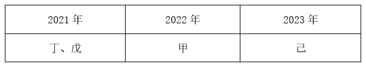

故正确答案为D。

### 第 108 题

如果丁是2022年结对的，那么下列各项中，哪两个城市可能结对？

A. 丙和戊

B. 乙和己

C. 甲和戊

D. 乙和戊

第 108 题 · 答案与解析

**参考答案（粉笔题库参考内容）**

A

**解析**

第一步：分析题干条件。

（1）乙的结对城市不是丁；

（2）甲的结对城市不是乙就是丙；

（3）甲和乙均不是在2021年结对的；

（4）丁和戊均不是在2023年结对的；

（5）在2021年2个城市结对，其余4个城市中的2个在2022年结对，剩余的2个城市在2023年结对；

（6）丁是2022年结对的。

第二步：根据题干条件进行推理。

提问方式为“可能”，优先使用代入法。

代入A项：若丙和戊结对，根据条件（2）可知，甲和乙结对，结合条件（5）（6）可知，每年只有2个城市结对，因此甲和乙不在2022年结对，再结合条件（3）可知，甲和乙在2023年结对。根据条件（5）（6）可知，丙和戊在2021年结对，此时己和丁在2022年结对，满足题干所有条件，可能为真，当选；

代入B项：若乙和己结对，根据条件（2）可知，甲和丙结对，结合条件（5）（6）可知，每年只有2个城市结对，因此甲和丙不在2022年结对，再结合条件（3）可知，甲和丙在2023年结对。根据条件（5）（6）可知，乙和己在2021年结对，此时不满足题干条件（3），不可能为真，排除；

代入C项：若甲和戊结对，不满足题干条件（2），不可能为真，排除；

代入D项：若乙和戊结对，根据条件（2）可知，甲和丙结对，结合条件（5）（6）可知，每年只有2个城市结对，因此甲和丙不在2022年结对，再结合条件（3）可知，甲和丙在2023年结对。根据条件（5）（6）可知，乙和戊在2021年结对，此时不满足题干条件（3），不可能为真，排除。

故正确答案为A。

### 第 109 题

如果甲和丙结对，下列哪一项一定为真？

A. 丙是2023年结对的

B. 己是2023年结对的

C. 丁是2021年结对的

D. 戊是2021年结对的

第 109 题 · 答案与解析

**参考答案（粉笔题库参考内容）**

C

**解析**

第一步：分析题干条件。

（1）乙的结对城市不是丁；

（2）甲乙/甲丙；

（3）甲和乙均不是在2021年结对的；

（4）丁和戊均不是在2023年结对的；

（5）甲和丙结对。

第二步：根据题干条件进行推理。

提问方式为“一定为真”，可利用假设法进行解题。

根据条件（3）（5）可知，甲和丙在2022年或2023年结对。

假设甲和丙是在2022年结对的。根据条件（4）可知，丁和戊在2021年结对，则剩余的乙和己在2023年结对。（如下图所示）

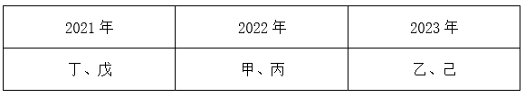

假设甲和丙是在2023年结对的。根据条件（4）可知，丁、戊均可在2021年或2022年结对。根据条件（1）（3）可知，乙的结对城市不是丁，且乙不在2021年结对，因此，乙在2022年结对，则丁只能在2021年结对。（如下图所示）

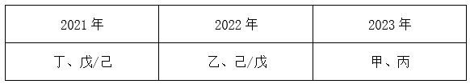

综上，丁是2021年结对的一定为真。

故正确答案为C。

### 第 110 题

有几个城市可能是在2022年与其他城市结对的？

A. 6个

B. 5个

C. 4个

D. 3个

第 110 题 · 答案与解析

**参考答案（粉笔题库参考内容）**

A

**解析**

第一步：分析题干条件。

（1）乙的结对城市不是丁；

（2）甲乙/甲丙；

（3）甲和乙均不是在2021年结对的；

（4）丁和戊均不是在2023年结对的。

第二步：根据题干条件进行推理。

根据条件（2）可知，甲的结对城市是乙或丙，因此可优先从甲和乙入手进行假设。

假设一：当甲和乙结对时，根据条件（3）可知，甲和乙只能在2022年或2023年结对。当甲和乙在2022年结对时，根据条件（4）可知，丁和戊在2021年结对，那么丙和己在2023年结对；当甲和乙在2023年结对时，丙、丁、戊、己均可在2021年或2022年结对。

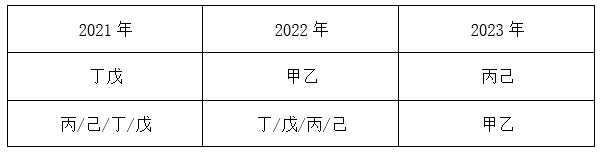

假设二：当甲和丙结对时，根据条件（3）可知，甲和丙只能在2022年或2023年结对。当甲和丙在2022年结对时，根据条件（4）可知，丁和戊在2021年结对，那么乙和己在2023年结对；当甲和丙在2023年结对时，根据条件（1）可知，乙和丁不能结对，根据条件（3）（4）可知，丁和戊不在2023年结对，乙不在2021年结对，因此，丁/戊/己可在2021年结对，乙/戊/己可在2022年结对。

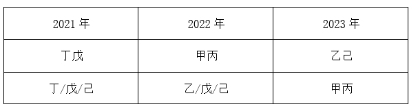

综上，6个城市均可能是在2022年与其他城市结对的。

故正确答案为A。

## 材料 2

2022年，S省各级12315工作机构共接收诉求220.4万件，同比增长21.41%。其中，投诉55.6万件、举报26.3万件、咨询138.5万件，比上一年分别增加14.0万件、8.9万件、16.0万件。

### 第 111 题

将S省各级12315工作机构接收的投诉、举报和咨询三类诉求量按2022年同比增速从高到低排序，以下正确的是：

A. 投诉量、举报量、咨询量

B. 咨询量、投诉量、举报量

C. 举报量、咨询量、投诉量

D. 举报量、投诉量、咨询量

第 111 题 · 答案与解析

**参考答案（粉笔题库参考内容）**

D

**解析**

根据题干“······按2022年同比增速从高到低排序······”，可判定本题为一般增长率比较问题。定位文字材料可知：2022年S省各级12315工作机构接收的诉求中：投诉55.6万件、举报26.3万件、咨询138.5万件，比上一年分别增加14.0万件、8.9万件、16.0万件。根据公式：增长率，则2022年三类诉求量的同比增速分别为：投诉量；举报量；咨询量。故同比增速从高到低排序为：举报量、投诉量、咨询量。

故正确答案为D。

### 第 112 题

2022年，S省各级12315工作机构热线电话投诉接收件数占投诉总件数的比重比热线电话举报接收件数占举报总件数的比重：

A. 高20个百分点以上

B. 低20个百分点以上

C. 高不到20个百分点

D. 低不到20个百分点

第 112 题 · 答案与解析

**参考答案（粉笔题库参考内容）**

A

**解析**

根据题干“2022年······占······的比重比······占······的比重”，可判定本题为现期比重问题。定位文字材料可得：2022年S省各级12315工作机构共接收投诉55.6万件、举报26.3万件。定位统计表可得：2022年S省各级12315工作机构热线电话共接收投诉304498件、举报61021件。根据公式：比重，则所求，即高20个百分点以上。

故正确答案为A。

### 第 113 题

以下折线图反映了2022年哪一时间段内S省各级12315工作机构的接收诉求量环比增量的变化趋势？

A. 2~5月

B. 3~6月

C. 5~8月

D. 8~11月

第 113 题 · 答案与解析

**参考答案（粉笔题库参考内容）**

B

**解析**

根据题干“······环比增量的变化趋势”，可判定本题为增长量比较问题。定位柱状图可得2022年S省各级12315工作机构各月接收诉求量。

A项：2月接收诉求量环比增量=现期量-基期量=12.8-15.2<0；3月环比增量=20.1-12.8>0，即折线图中第1个点应低于第2个点，与题干折线图矛盾，排除；

B项：3月环比增量=20.1-12.8=7.3万件，4月环比增量=16.6-20.1=-3.5万件，5月环比增量=18.5-16.6=1.9万件，6月环比增量=21.2-18.5=2.7万件，满足题干折线图趋势，当选；

C项：5月环比增量（1.9万件）<6月环比增量（2.7万件），即折线图中第1个点应低于第2个点，与题干折线图矛盾，排除；

D项：8月环比增量=22.0-21.6=0.4万件，9月环比增量=20.0-22.0=-2万件，10月环比增量=17.7-20.0=-2.3万件，即折线图中第2个点应略高于第3个点，与题干折线图矛盾，排除。

故正确答案为B。

### 第 114 题

2022年，S省各级12315工作机构接收诉求量最少的季度是：

A. 第一季度

B. 第二季度

C. 第三季度

D. 第四季度

第 114 题 · 答案与解析

**参考答案（粉笔题库参考内容）**

A

**解析**

定位柱状图可得2022年S省各级12315工作机构各月接收诉求量。观察可知，1~3月的接收诉求量均分别低于4~6月，故第一季度接收诉求量低于第二季度；10~12月的接收诉求量均分别低于7~9月，故第四季度接收诉求量低于第三季度，故比较第一季度和第四季度即可。第一季度接收诉求量=15.2+12.8+20.1=48.1万件；第四季度接收诉求量=17.7+17.8+17>17×3=51万件，则接收诉求量最少的是第一季度。

故正确答案为A。

### 第 115 题

关于2022年S省各级12315工作机构接收诉求状况，不能从上述资料中推出的是：

A. 2~12月间，接收诉求件数环比增量最大的是3月

B. 全年接收诉求件数最多月份的诉求件数是最少月份的1.5倍以上

C. 全年举报接收量占本渠道投诉、举报接收量比重最高的渠道是来函

D. 全年互联网渠道投诉、举报接收件数超过40万件

第 115 题 · 答案与解析

**参考答案（粉笔题库参考内容）**

C

**解析**

A项：定位统计图可得2022年S省各级12315工作机构各月接收诉求量。观察可知2、4、9、10、12月的柱状图均低于上月，即环比增量为负数，剩余3、5、6、7、8、11月份中，3月的柱状图与2月的柱状图高度差最大，故3月环比增量最大，正确；

B项：定位统计图可得2022年全年接收诉求件数最多的月份是8月，共接收诉求件数22.0万件；接收诉求件数最少的月份是2月，共接收诉求件数12.8万件。则所求倍数，正确；

C项：定位统计表可得2022年S省各级12315工作机构各渠道投诉、举报接收量。根据公式：比重，可知所求比重，则来函渠道比重，但通过观察数据可知，官方网站渠道比重，所占比重大于来函，错误；

D项：定位统计表可得2022年互联网渠道中各渠道的投诉、举报接收量。则全年接收件数=62890+121266+92029+35292+78696+38045+3000+7000+2000=447000件>40万件，正确。

本题为选非题，故正确答案为C。

## 材料 3

2022年，京津冀地区生产总值合计10.0万亿元，是2013年的1.8倍。其中，北京、河北跨越4万亿元量级，均为4.2万亿元，分别是2013年的2.0倍和1.7倍；天津1.6万亿元，是2013年的1.6倍。京津冀第一产业、第二产业、第三产业增加值占生产总值比重构成由2013年的6.2：35.7：58.1变化为2022年的4.8：29.6：65.6。京津冀三地第三产业增加值占生产总值比重分别为83.8%、61.3％和49.4%，较2013年分别提高4.3、7.2和8.4个百分点。

2013—2022年，京津冀地区城镇累计分别新增就业288.1万、405.5万和748.4万人。2021年，北京法人单位从业人员中，第三产业比重为84.4%，较2013年提高6.2个百分点，其中信息服务业和商务服务业占比达25.5%，较2013年提高6.2个百分点；天津和河北第三产业就业人员占比为60.5％和46.6%，较2013年提高10.9和15.1个百分点。

2022年，京津冀三地全体居民人均可支配收入分别为77415元、48976元和30867元，与2013年相比，年均分别增长7.4%、7.1％和8.2%。其中，城镇居民人均可支配收入分别增长7.3%、6.9％和7.1%，农村居民人均可支配收入分别增长8.2%、7.3％和8.6%。

### 第 116 题

以2013年为基期，则2013-2022年京津冀地区生产总值年均约增加多少万亿元？

A. 1.1

B. 0.9

C. 0.7

D. 0.5

第 116 题 · 答案与解析

**参考答案（粉笔题库参考内容）**

D

**解析**

根据题干“······年均约增加多少万亿元”，可判定本题为年均增长量问题。定位文字材料第一段可得：2022年，京津冀地区生产总值合计10.0万亿元，是2013年的1.8倍。则2013年，京津冀地区生产总值合计万亿元。根据公式：年均增长量，则2013-2022年京津冀地区生产总值年均增加万亿元。

故正确答案为D。

### 第 117 题

2013年，北京第三产业增加值占其生产总值比重比天津高多少个百分点？

A. 25.4

B. 22.5

C. 19.6

D. 16.7

第 117 题 · 答案与解析

**参考答案（粉笔题库参考内容）**

A

**解析**

定位文字材料第一段可知，2022年京津冀三地第三产业增加值占生产总值比重分别为83.8%、61.3％和49.4%，较2013年分别提高4.3、7.2和8.4个百分点。则2013年北京第三产业增加值占其生产总值比重=83.8%-4.3%=79.5%，2013年天津第三产业增加值占其生产总值比重=61.3％-7.2%=54.1%，故题干所求=79.5%-54.1%=25.4%，即2013年北京第三产业增加值占其生产总值比重比天津高25.4个百分点。

故正确答案为A。

### 第 118 题

2013—2022年，北京城镇累计新增就业人数约占同期京津冀地区城镇累计新增就业总人数的：

A. 30%

B. 35%

C. 20%

D. 25%

第 118 题 · 答案与解析

**参考答案（粉笔题库参考内容）**

C

**解析**

根据题干“2013—2022年······占······”，可判定本题为现期比重问题。定位文字材料第二段可得：2013—2022年，京津冀地区城镇累计分别新增就业288.1万、405.5万和748.4万人。根据公式：比重，则题干所求比重为。

故正确答案为C。

### 第 119 题

将京、津、冀按2013—2022年居民人均可支配收入年均增速的城乡差值的绝对值从大到小排列，以下正确的是：

A. 京、冀、津

B. 冀、京、津

C. 京、津、冀

D. 冀、津、京

第 119 题 · 答案与解析

**参考答案（粉笔题库参考内容）**

B

**解析**

定位文字材料第三段可知，2022年与2013年相比，京津冀三地城镇和农村居民人均可支配收入年均增速。三地居民城乡人均可支配收入年均增速差值的绝对值分别为：京|7.3%-8.2%|=0.9%，津|6.9%-7.3%|=0.4%，冀|7.1%-8.6%|=1.5%，故从大到小排列为：冀、京、津。

故正确答案为B。

### 第 120 题

在以下信息中，能够从上述资料中推出的有几项？

①2013—2022年京津冀第一产业增加值年均增量（以2013年为基期）

②2013年天津第一产业、第二产业增加值之和

③2013—2022年河北城镇新增就业人员中第三产业就业人员人数

A. 0项

B. 1项

C. 2项

D. 3项

第 120 题 · 答案与解析

**参考答案（粉笔题库参考内容）**

C

**解析**

①定位文字材料第一段可得，2022年，京津冀地区生产总值合计10.0万亿元，是2013年的1.8倍。京津冀第一产业占生产总值比重构成由2013年的6.2：35.7：58.1变化为2022年的4.8：29.6：65.6。则所求年均增量，可以推出；

②定位文字材料第一段可得，2022年······天津1.6万亿元，是2013年的1.6倍。京津冀三地第三产业增加值占生产总值的比重分别为83.8%、61.3%和49.4%，较2013年分别提高4.3、7.2和8.4个百分点。则2013年天津地区生产总值为万亿元，2013年天津第三产业增加值占比为61.3%-7.2%=54.1%。则所求=2013年天津总产值×（1-第三产业增加值占比）万亿元，可以推出；

③定位文字材料第二段可知，材料只给出2022年河北城镇累计新增就业人数和2021年、2013年河北第三产业就业人员占比，2013—2022年河北城镇新增就业人员中第三产业就业人员人数均无法推出。

综上可知，只有①②可以推出，共2项。

故正确答案为C。

## 材料 4

### 第 121 题

2016~2020年，我国马铃薯总产量在以下哪个范围内？

A. 不到0.9亿吨

B. 0.9亿~0.92亿吨之间

C. 0.92亿~0.94亿吨之间

D. 超过0.94亿吨

第 121 题 · 答案与解析

**参考答案（粉笔题库参考内容）**

A

**解析**

定位图1可得：2016~2020年，我国马铃薯产量分别为1699万吨、1770万吨、1798万吨、1778万吨、1798万吨。则2016~2020年我国马铃薯总产量为1699+1770+1798+1778+1798<1700+1800+1800+1800+1800=8900万吨=0.89亿吨，即不到0.9亿吨。

故正确答案为A。

### 第 122 题

2018~2022年，我国马铃薯单位面积产量同比增长的年份有几个？

A. 2

B. 3

C. 4

D. 5

第 122 题 · 答案与解析

**参考答案（粉笔题库参考内容）**

D

**解析**

根据题干“2018~2022年······单位面积产量同比增长的年份有几个”，结合材料给出了2017~2022年我国马铃薯的播种面积和产量，可判定本题为两期平均数比较问题。定位图1可得：2017~2022年我国马铃薯的播种面积和产量。单位面积产量，根据两期平均数比较结论“当分子增速（a）大于分母增速（b）时，平均数上升”，观察发现，2018、2020、2021、2022年我国马铃薯产量的同比增长率均大于0，面积的同比增长率均小于0，则这4个年份我国马铃薯单位面积产量为同比增长。只需再判断2019年我国马铃薯单位面积产量是否同比增长即可。

方法一：2018年我国马铃薯单位面积产量为，2019年为，则2019年我国马铃薯单位面积产量同比增长。

方法二：根据公式：增长率，可得2019年我国马铃薯产量的同比增长率（a）为，面积的同比增长率（b）为。a＞b，可判断平均数上升，即2019年我国马铃薯单位面积产量同比增长。

综上分析，2018~2022年我国马铃薯单位面积产量同比增长的年份有5个。

故正确答案为D。

### 第 123 题

2017~2022年我国马铃薯出口量最高的年份，当年出口额在这6年中排名（ ）。

A. 第一

B. 第二

C. 第三

D. 第四

第 123 题 · 答案与解析

**参考答案（粉笔题库参考内容）**

C

**解析**

定位图2，可知2017~2022年我国马铃薯出口额及出口量。出口量最高的年份为2017年（50.95万吨），当年对应的出口额（2.81亿美元）排名第三。

故正确答案为C。

### 第 124 题

2020~2022年，我国马铃薯出口量占产量的比重呈现何种变化趋势？

A. 持续上升

B. 持续下降

C. 先降后升

D. 先升后降

第 124 题 · 答案与解析

**参考答案（粉笔题库参考内容）**

C

**解析**

根据题干“2020~2022年，······比重呈现何种变化趋势”，可判定本题为现期比重问题。定位图1可得2020~2022年我国马铃薯产量；定位图2可得2020~2022年我国马铃薯出口量。根据公式：比重，则2020年我国马铃薯出口量占产量的比重，2021年的比重，2022年的比重。故2020~2022年，我国马铃薯出口量占产量的比重呈现先降后升的变化趋势。

故正确答案为C。

### 第 125 题

以下折线图反映了2019~2022年我国马铃薯哪一产销数据的同比增量变化趋势？

A. 出口额

B. 出口量

C. 播种面积

D. 产量

第 125 题 · 答案与解析

**参考答案（粉笔题库参考内容）**

D

**解析**

根据题干“以下折线图反映了2019~2022年······同比增量变化趋势”，可判定本题为增长量比较问题。定位图1可得2018~2022年我国马铃薯播种面积及产量；定位图2可得2018~2022年我国马铃薯出口额及出口量。根据公式：增长量=现期量-基期量，可得：

A项：2019年出口额同比上升（3.98亿美元>2.61亿美元），增长量>0；2020年出口额同比下降（2.90亿美元<3.98亿美元），增长量<0。则第二个点应低于第一个点，不符合折线图趋势，排除；

B项：2019年出口量同比上升（50.33万吨>44.81万吨），增长量>0；2020年出口量同比下降（44.19万吨<50.33万吨），增长量<0。则第二个点应低于第一个点，不符合折线图趋势，排除；

C项：2020年播种面积同比增量为466-467=-1万公顷；2021年同比增量为461-466=-5万公顷。则第三个点应低于第二个点，不符合折线图趋势，排除；

D项：2019年产量同比增量为1778-1798=-20万吨；2020年同比增量为1798-1778=20万吨；2021年同比增量为1831-1798=33万吨；2022年同比增量为1852-1831=21万吨，符合折线图趋势，当选。

故正确答案为D。

## 材料 5

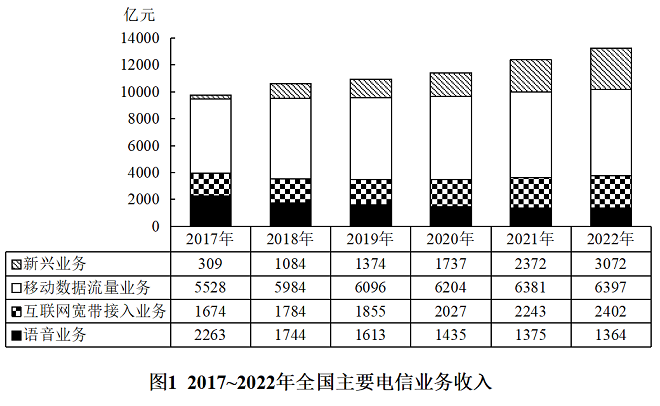

### 第 126 题

2017~2022年，全国移动数据流量业务收入总额在以下哪个范围内？

A. 不到3.4万亿元

B. 超过3.6万亿元

C. 3.4万亿—3.5万亿元之间

D. 3.5万亿—3.6万亿元之间

第 126 题 · 答案与解析

**参考答案（粉笔题库参考内容）**

B

**解析**

定位图1可知2017~2022年每年全国移动数据流量业务收入。则题干所求=5528+5984+6096\=36600亿元=3.66万亿元，在B项范围内。

故正确答案为B。

### 第 127 题

2019年，蜂窝物联网终端用户数同比增量约是移动电话用户数同比增量的多少倍？

A. 7

B. 10

C. 13

D. 16

第 127 题 · 答案与解析

**参考答案（粉笔题库参考内容）**

B

**解析**

根据题干“2019年······约是······的多少倍”，可判定本题为现期倍数问题。定位图2可得：2019年蜂窝物联网终端用户数10.28亿户，移动电话用户数16.01亿户；2018年蜂窝物联网终端用户数6.71亿户，移动电话用户数15.66亿户。根据公式：增长量=现期量-基期量，则题干所求倍。

故正确答案为B。

### 第 128 题

以下年份中，全国电信新兴业务收入同比增速最快的是：

A. 2019年

B. 2020年

C. 2021年

D. 2022年

第 128 题 · 答案与解析

**参考答案（粉笔题库参考内容）**

C

**解析**

根据题干“以下年份中······同比增速最快的是”，可判定本题为一般增长率比较问题。定位图1可得：2018~2022年全国电信新兴业务收入分别为1084亿元、1374亿元、1737亿元、2372亿元、3072亿元。根据公式：增长率，可得2019~2022年各年全国电信新兴业务收入同比增速分别为：

A项：2019年，；

B项：2020年，；

C项：2021年，；

D项：2022年，。

比较可知，全国电信新兴业务收入同比增速最快的是2021年。

故正确答案为C。

### 第 129 题

如2022年内每个月移动电话用户数增量和蜂窝物联网终端用户数增量均为固定值，则2022年蜂窝物联网终端用户数第一次超过移动电话用户数是在哪个季度？

A. 第一季度

B. 第二季度

C. 第三季度

D. 第四季度

第 129 题 · 答案与解析

**参考答案（粉笔题库参考内容）**

C

**解析**

根据题干“······2022年······第一次超过······是在哪个季度”，可判定本题为现期追赶问题。定位图2可得：2021~2022年，蜂窝物联网终端用户数分别为13.98亿户、18.45亿户，移动电话用户数分别为16.43亿户、16.83亿户。根据公式：月均增长量，则2022年蜂窝物联网终端用户数的月均增长量为亿户，2022年移动电话用户数的月均增长量为亿户。根据公式：现期量=基期量+增长量×n，可列式：，解得，则n至少为第8个月，8月在三季度，即2022年蜂窝物联网终端用户数第一次超过移动电话用户数是在第三季度。

故正确答案为C。

### 第 130 题

以下折线图反映了2019~2022年全国哪一类电信业务收入同比增量的变化趋势？

A. 新兴业务

B. 移动数据流量业务

C. 互联网宽带接入业务

D. 语音业务

第 130 题 · 答案与解析

**参考答案（粉笔题库参考内容）**

D

**解析**

根据题干“······2019~2022年······同比增量的变化趋势”，可判定本题为增长量比较问题。定位图1可知2018~2022年全国主要电信业务收入。根据公式：增长量=现期量-基期量，可得2019~2022年全国主要电信业务收入的同比增量：

A项：2019年，亿元；2020年，亿元。不符合折线图中第二个点低于第一个点的趋势，排除；

B项：2021年，亿元；2022年，亿元。不符合折线图中第四个点高于第三个点的趋势，排除；

C项：2019年，亿元；2020年，亿元。不符合折线图中第二个点低于第一个点的趋势，排除；

D项：2019年，1613-1744=-131亿元；2020年，1435-1613=-178亿元；2021年，1375-1435=-60亿元；2022年，1364-1375=-11亿元。完全符合折线图的变化趋势，当选。

故正确答案为D。

