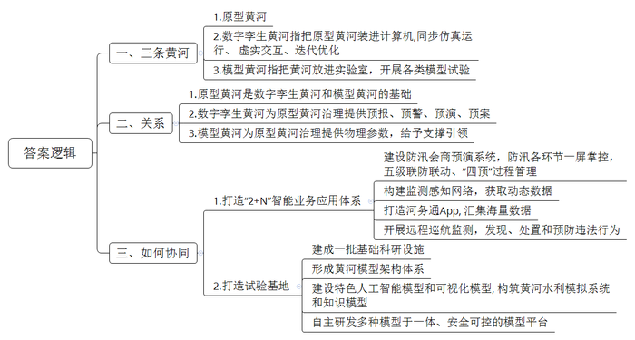
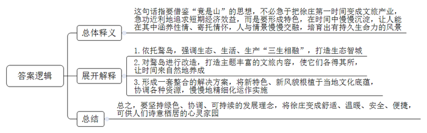
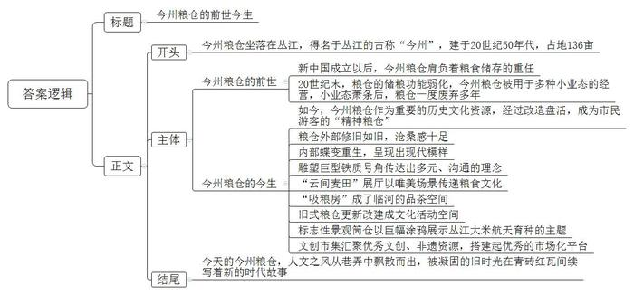
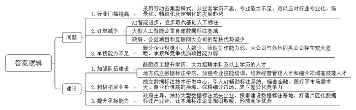
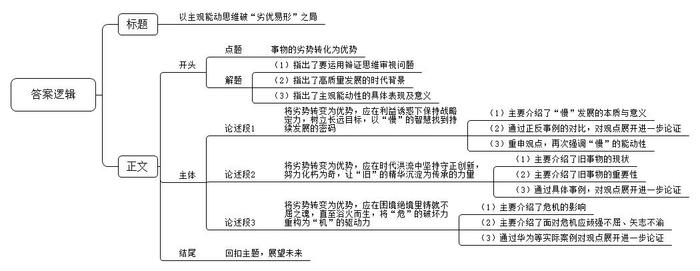

# 2025年国家公考《申论》题（副省级）

> 候选采集稿。参考答案及解析来自粉笔页面，不代表官方答案或真实高分答卷；来源使用许可与原卷对应关系仍需人工核实。

## 给定材料

### 材料 1

黄河奔腾生生不息，科技活水澎湃成潮。进入新的发展阶段，信息技术不断迭代升级，各种科技实践也正一幕幕上演，为黄河保护治理赋予新解。

“我手中这个设备俗称‘智慧石头’，它由智能芯片和电池组成。把它放到防洪堤坝根石堆里，它就成了打入根石堆的一个小小‘侦察员’，能够24小时全天候实时预警。”智慧黄河研究院赵工程师介绍说，“如果根石发生位移，它会自动抓拍并发出报警信号，一线巡查人员就能及时赶到现场处置险情。”

其实，“智慧石头”只是数字孪生黄河建设的一个基础应用。2022年水利部黄河水利委员会发布的《数字孪生黄河建设规划（2022—2025）》提出，要加快构建具有预报、预警、预演、预案（“四预”）功能的数字孪生黄河。数字孪生黄河，就是把实体的原型黄河“装进”计算机，实现与原型黄河的同步仿真运行、虚实交互、迭代优化。近年来，黄河水利委员会以流域防洪、水资源管理为建设重点，开展水工程安全、淤地坝、河湖管理保护等业务应用系统建设，初步形成了“2+N”智能业务应用体系。

走进黄河防汛值班室，大屏幕上，一条被“复刻”至计算机的“黄河”滔滔奔涌，清晰演示着洪水演进、滩区灾情损失情况，工作人员犹如置身黄河岸边，在“云端”研判和商定调度方案。这个防汛会商预演系统，让防汛监测、感知、巡查、指挥等环节一屏掌控，实现省、市、县、班、点五级联防联动和“四预”模拟推演的过程管理。

“在数字孪生黄河里模拟一场洪水的发生，观察洪水对工程哪些部分造成了冲击，据此再对实体的原型黄河相应工程进行防范或者处置。”数字孪生黄河建设负责人介绍说，“在这个过程中，构建智能高效的监测感知网络，获取原型黄河的动态数据，是基础，也是关键。”

“你看，现在有2200人在线，85个工程靠河，158人进行了现场巡查，上报了309个巡查日志。”河南河务局数字办负责人打开河务通App后介绍说。据了解，这个将监测感知系统、应用支撑系统、业务应用系统的海量数据汇集于手机端的河务通App，已经成为河南河务局工作人员巡河使用的日常工具。

“叮咚！”收到河务通App的预警提醒，值班员小军马上打开手机查看：“系统识别出管理A段以北疑似有较大漂浮物在移动。”小军立即启动无人机复核现场，再将复核后的信息上传平台，通过系列程序就完成了一次工程险情处置。

据小军介绍，远程巡航监测能及时发现并处置河道管理范围内的水事违法行为，还能对灌区引水情况开展巡查，督查计量设施及水量计量情况，预防出现无计量取水、无证取水及擅自改变取水用途等违法行为，提高了灌区取用水监查和河道管理的效率。

“模型黄河”试验基地隶属于黄河水利科学研究院，已经成为科技治黄的闪亮名片。经过30多年发展，该基地已建成水土流失试验厅、水库试验厅、下游河道试验厅、黄河口试验厅以及基础研究试验厅、水工试验厅、抗震实验室、抗磨实验室、综合实验楼等一批基础科研设施，为洪水防御、重大水利工程建设论证、河道整治、河口治理、水工程调度和水沙运动及河床演变规律探索等提供物理参数，发挥支撑与引领作用。

“模型黄河”就是把黄河“放进”实验室。比如，利用“模型黄河”开展洪水预演实体模型试验，为黄河防汛决策指挥和调整防洪部署提供重要技术支撑；利用水土流失试验厅，开展典型黄土丘陵区坡面水流侵蚀产沙的动力学机理模拟试验，为坡面水土保持措施优化配置提供理论依据；利用小浪底库区试验厅，开展小浪底水库淤积形态优选与调控试验，为小浪底水库优化运行找寻方案。此外，黄河水利科学研究院自主研发的河工模型人工智能地形制作设备，可实现高精度、高分辨率、大场景复杂模型三维地形的快速制作；用水需求及水资源配置模型，能够精准预测黄河流域灌区未来10天至15天的引黄灌溉需水量等等。

据介绍，黄河水利委员会现已基本形成水文预报、工程调度、灾情评估、冰凌预报、河口治理等拥有自主知识产权的黄河模型架构体系，同时开展流域特色人工智能模型和可视化模型建设，构筑基于云服务的黄河水利模拟系统和知识模型，自主研发了耦合水文、水动力、冰凌等多种模型于一体、安全可控的模型平台，为流域统一治理提供了坚实支撑。

“黄河很美，将来会更美。”2024年9月，习近平总书记在甘肃省兰州市考察黄河时指出，要更加突出黄河治理的系统性、整体性、协同性，推动构建上下游贯通一体的生态环境治理体系，深入实施重要生态系统保护和修复重大工程，提升流域生态系统稳定性。

运用科技让三条“黄河”协同关联，已经成为保障黄河安澜的重要手段，有力推动了沿黄人民生命财产安全防线的构筑。

### 材料 2

徐庄位于F市山青区海安路街道，历史上其“十字街”的商业十分繁盛，是当时远近闻名的一个富庶小镇。21世纪初，在城市化浪潮中，大量流动人口涌入，私搭乱建使其环境每况愈下，古镇风貌不再，逐渐沦为脏乱差的“城中村”。2024年初，徐庄开始推进“城中村”改造项目。

徐庄很有成为“网红”的特质：依托鹜岛，强调生态、生活、生产“三生相融”，可以打造“生态智城”；鹜岛四面环水，保留休闲码头，今后来一场环岛漫游，应该不是奢望；生态公园三面环水，林间道路曲折有致，地势时有起伏，颇有野趣。

“我们这儿，不想仅仅成为未来的网红打卡地。”改造项目负责人李主任说，“有些网红打卡地，一夜之间就‘红起来’了，你说好他说好，一时也没人细想好在哪里。待人们热情一过，新的‘网红’抢去了兴奋点，它又一夜之间沉寂，再也没人提起了。”

项目组成员小王认为：“旅游应是放松心情、慢慢品味的事，不是打卡‘完成任务’。同样的，要想让徐庄的‘风姿’变得绰约，鹜岛的‘味儿’变得醇厚，也需要在时间中慢慢沉淀。”

经过反复讨论，大家认为不必急于把项目第一时间变成文旅产业，急功近利地从中“兑现真金白银”。只有慢慢发展，慢慢成熟，蓦然回首才会发现：不是产业，竟是产业。

项目组顾问赵教授介绍，“不是……竟是……”的理念，是受古人建造私家园林“竟是山园”的思想启发而来。当时有文士详述了“竟是山”取名的来由：“宅之东北隅，适有累土以成山之形者，触目会心，遂名之曰‘竟是山’。植木其巅，种蔬其麓，于时登临，于时游憇。”智者乐水，仁者乐山。乐与不乐，“在乎性之静躁，而不在乎山之是非也”。

“‘竟是山’这个名字的涵义十分深广。山山水水，其实并不在于它有多大多高，一个土阜、一处累土，即使起伏只有一点‘山之形’，只要人可以在其中涵养性情、寄托情怀，人与情景慢慢交融，就能培育出大家时不时就想去看一看的风景。”赵教授说道，“这种‘不是山，竟是山’的传统建园理念引发我们很多思考。”

“我们进一步挖掘了‘竟是山’的建设理念。在改造‘蓝图’里，未来在鹜岛上，会有‘乐之山、趣之山、蔬之山、光之山、秋之山、春之山、艺之山’，让音乐欣赏、儿童游乐、光影游艺、山野田园等各种文旅内容各得其所，并让时间来自然地养成。”李主任说。

此次改造方案，仍然以“十字街”为中心形成基本骨架，保留了街区内在肌理，附近的老屋、老街以及古桥等也都被保留下来了。“未来，在粉墙黛瓦屋檐下，将会入驻客栈、书店、茶馆、咖啡店、文化艺术中心等多元业态。”李主任介绍，“要把厚重的历史变成当代语言，符合当代人的审美，变成当代人生活的一部分，难度非常大。以河流为例，这里曾小工厂林立、小作坊混杂，工厂排放的污水导致河流变成了臭水沟。改造时要清淤、要涵养，不能用化学药剂，要用生物菌活化剂自然改造，改造完了后还要建立生态。因此改造这类项目要有一套整合的解决方案，要考虑新特色、新风貌如何根植于这里的文化底蕴。改造项目要像交响乐队一样去协调，需要慢慢地精细化运作实施。”

此次改造中，徐庄的“鹜岛照明产业园”也将同步规划和升级。“F市照明产业远近闻名，我们这里是照明产业的一个重要产业园，从改革开放初期的乡镇企业起步，如今已发展成光能产业，可以说我们一直在‘追光’，因此我们设计了‘追光博物馆’，来记述我们‘追光’的历史与文化。”李主任介绍道。

“海明威曾说，假如你有幸年轻时在巴黎生活过，那么你此后一生中不论去到哪里，她都与你同在，因为巴黎是一席流动的盛宴。同样的，我们也想要打造属于我们这个时代的‘流动盛宴’，将徐庄变成舒适、温暖、安全、便捷，以及可供人们诗意栖居的心灵家园。”李主任说。

### 材料 3

历史上的丛江，米业兴旺、漕舟云集，粮食存储自古有之。明朝起，丛江就是长江下游一带主要的粮食集散地之一，具有独特的粮食文化。

20世纪50年代，占地面积136亩的今州粮仓在此落成。丛江古称今州，今州粮仓由此得名。粮仓傍运河、临良田，粮食及与粮食有关的营生就成为这里长久以来的支柱产业。新中国成立以后，这里就承担着粮食储存的重任。今州粮仓作为丛江粮食文化的重要“见证者”，保留了诸多历史记忆。曾经在粮仓工作过的老王指着老照片回忆道：“粮食问题关系着生存问题，粮食的保管至关重要。当时能在粮仓工作，是非常光荣的。我们那个时候技术落后，交粮、搬运、收发货全凭体力。夏天浑身汗，冬天满身霜，叉袋扁担加栲栳，肩挑背负走高跳，这就是最真实的写照。”

20世纪末，粮仓的储粮功能逐渐弱化，衰落的步伐不断加速。后来，粮仓被分给100多个小业主，一个大粮仓里混杂着五金、仓储、广告等好几种业态，经营混乱驳杂。再后来，这些小业态也萧条了。

今州粮仓虽废弃多年，所幸，那些几乎与新中国同龄的“万担仓”被完好地保留了下来，它们是重要的历史文化资源，也有着很大的改造空间。

“当初进来时，这里满眼凄凉与荒疏。”今州粮仓园区负责人老金描述起当时的情景，“空落落的院子里，杂草从水泥地面缝隙钻出。建筑内部，各种箱子、架子、隔板东倚西躺，还有东拖西拉的绳索、电线，以及瓜皮帽样的白炽灯、低低下垂的吊扇等，显得凌乱不堪。”如何通过改造让破败的老粮仓“苏醒”，成为园区改造项目组面临的难题。

大家最初想在粮仓屋顶上搭建可以漫步的云廊。听起来很浪漫，但是设计师不建议这样做。“粮仓才是整个项目的主题和背景，应该保留原来那些朴素的东西。”项目组最后决定不加云廊，而是突出老粮仓屋顶上的青瓦、红瓦，这样，从空中往下看，也颇有味道。

“老粮仓的基本架构没有改变，尽可能地保留了原貌。”老金说。当年粮仓的墙面依旧沧桑斑驳，墙上的白灰剥脱后透出亮眼的红，也无须填补。粮仓内部也一样，桁条依旧是那根桁条，立柱也依旧瘦削颀长，照明的灯罩还是瓜皮帽的模样，只是灯泡已换成环保低耗的产品。

如今，百年粮仓修旧如旧，外部依旧沧桑感十足，内部却蝶变重生，呈现出一幅现代模样。

步入改造后的今州粮仓园区，映入眼帘的一大片空地是以前的晒谷场，旷远疏阔，视野很好。现在，这里矗立着一个造型独特的雕塑——巨型铁质号角，蕴含着表达诉求、为不同群体发声的意义，传达出多元、沟通的理念。

“远处蔚蓝天空下，涌动着金色的麦浪……”一首歌曲让人们仿佛看到翻涌的金黄在麦田间姿态万千。而今州粮仓就将这“金色麦田”搬了进来。曾经，无数的稻穗在这里成为米粒，无数的麦子在这里被磨成面粉。为了更好地展现粮食文化底蕴，今州粮仓特意打造“云间麦田”展厅，让人们得以通过唯美的场景感悟粮食文化。整个展厅都是一簇簇金黄的麦穗，游客低头就能闻到麦香。扎实的草垛错落地藏在麦田里，游客抬头就能看见展厅里特意布置的棉花云，沉浸式感受浓浓的丰收气息。

如今，虽然粮仓的功能与从前不同了，但是粮食文化作为精神食粮将一直保留。昔日农民用来交粮的“吸粮房”，摇身一变成了临河的品茶空间，可供游人伴着清雅音乐闻香品茗；今州粮仓现存数十座完好的旧式粮仓，经过更新改建，有的做了画室，有的变身剧场或展馆，沉浸式演出、画展、爱粮节粮主题日等活动在这里陆续举办；高24米、直径5.5米的标志性景观——筒仓，现在披上了巨幅涂鸦《稻田守望者》——宇航员行走在稻田中，手持水稻，仰望星空，表现了丛江大米航天育种的主题。

在这里，人们除了能触摸到老粮仓的文化历史，还能翻开更多的丛江历史。“丛江自宋代以来便有市集，诞生时间早、规模大。”老金介绍说，“园区特意策划了文创市集，汇聚当地及周边地区的优秀文创、非遗资源，搭建起了更多优秀的市场化平台。”

人文之风从巷弄中飘散而出，被凝固的旧时光在青砖红瓦间开始续写时代故事。今州粮仓好比一个精美的花园，不仅吸引了名人艺术家纷纷入驻，也吸引了更多的游人前来品茗看展，这里已经成为深受市民游客喜爱的“精神粮仓”。

### 材料 4

为了带动更多劳动力就业，吸引外出务工人员回乡创业，中国西部S市所辖的青溪县积极探索县域经济发展转型之路，大力发展数据标注产业。

2018年，该市县域第一家人工智能数据标注公司——青溪县祥云公司成立。如今该公司已成为当地最大的用工企业。“AI不只属于大城市，‘东数西算’也给我们小县城带来了机会。”祥云公司总经理于波涛说。数据、算法和算力是AI发展的三大支柱，其中数据是基石。数据标注是劳动密集型产业，许多AI公司基于节约成本的考虑大多将数据标注业务外包，这就给祥云公司这样的企业提供了生长空间。在当地政府的支持下，青溪县的数据标注企业正在不断增加。

“我们就像AI的眼睛，带AI看世界、理解世界，帮助其快速成长。”二十出头的祥云公司数据标注员张扬说，“我正在做‘车道线打点’，就是给无人驾驶进行车道线标注，告诉AI虚线时车辆可变道、实线则不可变道等交通知识。”

“数据标注按件计酬，我现在日均收入在300元左右，在公司里算是中等水平吧，有些人的日均收入已经能破千了。”张扬笑着说，“开始觉得这活儿简单不费脑子，现在看来，我要学的东西还很多。”在青溪县各家数据标注公司里，像张扬这样的数据标注员还有很多。他们大多学历不算高，但愿意学习新技能。大家坐在一排排电脑屏幕前，专注地对文本、图片、语音和视频等数据集作标注。

数据标注师是在教AI认识人类社会，让自动驾驶、工业生产等变得更智能。员工培训课上，蜂鸟数据公司总经理任倩一边讲一边带领学员操作电脑。大学毕业后，任倩开过奶茶店、干过网店销售、还做过财务。2020年，她回到老家青溪县成为一名数据标注员，2022年自主创业，创立了蜂鸟数据公司。

“回到家乡从事数据标注，让我找到新的努力方向，创立公司也是想帮助更多人掌握就业技能，参与到我们县的数据标注产业中来。”任倩表示。四年来，从普通标注员、组长到培训讲师，再到自主创立公司，任倩在努力奔跑着。她坦言：“经常需要线上线下学习，我感觉下的苦功夫比上学时还要多。”当然，这也让她快速成长为一名干练的公司管理者。

与蜂鸟公司一样，祥云公司同样从未停止前进的脚步。截至2023年底，祥云公司已将业务辐射到相邻区县，陆续孵化了6个数字基地，扩大了数据标注员的规模，也帮助其他县发展数字产业。目前祥云公司及其数字基地已先后承接过互联网公司、网商、银行等机构的90多种数据标注业务，现有员工1053人，2023年总营收近4000万元，成为S市数据标注行业的龙头企业。

“随着AI被‘喂养’得越来越智能，其数据智能处理能力也逐渐增强，基础性的人工标注会逐步被AI自动标注取代，这也意味着我们的订单将会越来越少。”于波涛冷静地分析。2023年国内一家大型人工智能公司自建了数据标注基地，招募的标注员全是本科及以上学历，这也预示着数据标注行业的准入门槛开始提高，数据标注专业化、场景化、精细化以及定制化或将成为今后行业的发展趋势。

于波涛对公司现状表示担忧：“前几年我们优势还是明显的，有地方政府在资源、政策等方面大力支持，又得到公益基金会数字就业项目的推动指导，还受惠于互联网大公司帮扶订单的‘投喂’，因此在过去这些年，我们无需主动去市场上‘觅食’，但是，如果想要继续更好、更长久地活下去，还必须要靠我们自己。”为了公司长远的良性运转，于波涛迫切希望寻求更多订单。

2023年11月，于波涛来到东部的H市，想要给公司拿下更多订单。他四处上门拜访，几天后还是空手而归。不过，对H市数据标注产业示范园内大型数据标注企业、数据标注学院和数据标注技术研发中心等的考察，还是让他大开眼界，也带给了他很多启发和思考。

“我只是本科毕业，虽然很努力，但面对更大世界、更新知识以及更多专业问题，也未必能完全搞明白、说清楚，在商业谈判、市场开拓和业务管理上也吃了不少亏，交了不少‘学费’。”于波涛说，“公司发展需要有更多人才来支撑。2020年以来，我们一方面鼓励员工继续参加成人自考，拿到更高的学历，另一方面也大力招聘本科及以上学历的人才，但这并不容易，五年前县城里人们争相排队来应聘的火爆场景再没出现。”

与于波涛一样，任倩也感受到了数据标注行业的快速变化。“现在金融、医疗、智能制造等领域的数据标注市场需求大、商业价值高，积极拓展这些领域的业务，可以帮助公司快速发展和壮大。”任倩说，“不过这些标注业务对技术专业度要求很高。此前我参与竞标一个智能制造方面的标注业务，专门挑选了公司里本科学历的5名员工去模拟练习，他们直呼太难了，最后我们也只能放弃这单合同标的很高的业务。”

“标注业务非常注重团队协作，大多优质项目要求人数不低于50人。县里很多小标注公司因此走入死循环：找不到优质订单就养不起员工，养不起员工就发展不起来，也就接不到优质订单，接到的订单往往是被分包过好几层的，也就赚不到钱了。”任倩说，“我也在想方设法提高公司的业务承接能力。”

于波涛也坦言：“我们公司虽说已有较大规模，但从长远发展来看还远远不够，尤其是与其他省市同类公司相比，在承接和竞争优质项目方面还存在很大差距。”据他介绍，在S市的各区县，许多数据标注公司也都在努力探索着自身的发展之路。

“现在国家实施‘东数西算’工程，支持西部探索建设数据标注基地。我们也想着‘借东风’进一步推动产业发展。”青溪县数据局王局长说。

“据我了解，我县和邻县大大小小的数据标注企业也有60多家，如果能以点带面、连片协作，打造一个片区化数据标注产业带，抱团取暖，形成合力，更容易形成竞争优势。”于波涛说，“不过这是个庞大的梦想，已经不是我个人力量能实现的。”

## 题目

### 第 1 题

**“给定资料**1**”提到了三条“黄河”，请你谈谈这三条“黄河”分别指的是什么，并说明它们是如何协同发挥作用的。（15分）**

关联材料：材料 1

作答要求：

要求：全面、准确、有条理。不超过350字。

### 第 2 题

**请根据****“给定资料**2**”****，****谈谈你对划线句子****“只有慢慢发展，慢慢成熟，蓦然回首才会发现****：****不是产业，竟是产业****”的理解。（10分）**

关联材料：材料 2

作答要求：

要求：分析全面、准确、条理清晰。不超过300字。

### 第 3 题

**今州粮仓计划在园区入口处设立宣传展板。请你根据****“给定资料**3**”，为展板拟写一篇文稿，宣传介绍粮仓的“前世今生”。（20分）**

关联材料：材料 3

作答要求：

要求：

（1）紧扣资料，内容全面；

（2）条理清晰，语言生动；

（3）不超过400字。

### 第 4 题

**如果你是青溪县数据局工作人员，请根据****“给定****资****料**4**”，梳理青溪县数据标注企业发展中面临的问题，并提出进一步推动该县数据标注产业发展的建议****。****（****20分）**

关联材料：材料 4

作答要求：

要求：

（1）问题梳理全面、准确、有条理；

（2）所提建议有针对性、切实可行；

（3）层次分明，有逻辑性；

（4）不超过400字。

### 第 5 题

**事物的劣势在特定条件下可以转化为优势，这种转化往往有赖于人的主观能动性，请你对此进行深入思考，参考给定资料，联系实际，自选角度，自拟题目，写一篇文章。（****35分）**

关联材料：材料 1、材料 2、材料 3、材料 4

作答要求：

要求：

（1）观点明确，见解深刻，内容充实；

（2）参考“给定资料”，但不拘泥于“给定资料”；

（3）思路清晰，语言流畅；

（4）字数1000-1200字。

## 答案与解析

第 1 题

**参考答案（粉笔题库参考内容）**

一、三条黄河：1.原型黄河。2.数字孪生黄河指把原型黄河装进计算机，同步仿真运行、虚实交互、迭代优化。3.模型黄河指把黄河放进实验室，开展各类模型试验。

二、关系：1.原型黄河是数字孪生黄河和模型黄河的基础。2.数字孪生黄河为原型黄河治理提供预报、预警、预演、预案。3.模型黄河为原型黄河治理提供物理参数，给予支撑引领。

三、如何协同：1.打造“2+N”智能业务应用体系。建设防汛会商预演系统，防汛各环节一屏掌控，五级联防联动、“四预”过程管理；构建监测感知网络，获取动态数据；打造河务通App，汇集海量数据；开展远程巡航监测，发现、处置和预防违法行为。2.打造试验基地。建成一批基础科研设施；形成黄河模型架构体系；建设特色人工智能模型和可视化模型，构筑黄河水利模拟系统和知识模型；自主研发多种模型于一体、安全可控的模型平台。

**参考答案说明：**本参考答案从三条“黄河”的释义、三者间的关系、发挥协同作用的方式三个角度展开。其中，释义部分指出三条“黄河”分别指原型黄河、数字孪生黄河和模型黄河；三者关系分别对三条“黄河”间相互作用的关系进行了阐述；发挥协同作用的方式分别从“打造‘2+N’智能业务应用体系”和“打造实验基地”两个方面展开。各条答案要点之间在内容上相互并列，没有交叉。

**解析**

**考点**：多要素组合类

**来源**：2025年国家公考《申论》题（副省级）

> 粉笔申论页面对本题只提供「解析视频」入口，该入口是会员推广位，页面无视频地址与文字解析。

第 2 题

**参考答案（粉笔题库参考内容）**

**参考答案****一**

这句话指要借鉴“竟是山”的思想，不必急于把徐庄第一时间变成文旅产业，急功近利地追求短期经济效益，而是要形成特色，在时间中慢慢沉淀，让人能在其中涵养性情、寄托情怀，人与情景慢慢交融，培育出有持久生命力的风景。

具体而言要：1.依托鹜岛，强调生态、生活、生产“三生相融”，打造生态智城。2.对鹜岛进行改造，打造主题丰富的文旅内容，使它们各得其所，让时间来自然地养成。3.形成一套整合的解决方案，将新特色、新风貌根植于当地文化底蕴，协调各种资源，慢慢地精细化运作实施。

总之，要坚持绿色、协调、可持续的发展理念，将徐庄变成舒适、温暖、安全、便捷，可供人们诗意栖居的心灵家园。

**参考答案说明**：思路方面，本参考答案按照词句解释题“总体释义+展开解释+总结”的一般答题思路展开。内容方面，本参考答案先对题干给定句子的含义进行了总体解释；然后从“打造生态智城”“丰富文旅内容”“制定系统解决方案”这三个方面展开解释；最后进行了总结。词句表达方面，本参考答案加上了“具体而言要”“总之”等连接词来承接上下文。

**参考答案二**

这句话指要借鉴“竟是山”的思想，徐庄开发不可急功近利、盲目上马文旅项目、追逐短期效益，统筹生态、生活、生产三生相融，慢慢沉淀特色，实现人与情景交融，培育具备持久生命力的风景。

具体而言要：1.尊重美化自然环境。依托鹜岛，保护自然基底，塑造原生景观，让景色随时间自然形成。2.统筹规划，改善人居环境。根植本土文化，尊重场地肌理；整治脏乱差和污染问题，丰富文旅内容，使空间各得其所。3.延续并拓展产业发展。做强传统照明产业，同步开发灯具观光文旅，孕育产业发展新动能。

坚持绿色、协调、可持续的发展理念，将徐庄打造成舒适、温暖、安全、便捷，可供人们诗意栖居的心灵家园。

——张小龙

**解析**

**考点**：词句解释类

**来源**：2025年国家公考《申论》题（副省级）

> 粉笔申论页面对本题只提供「解析视频」入口，该入口是会员推广位，页面无视频地址与文字解析。

第 3 题

**参考答案（粉笔题库参考内容）**

**参考答案一**

今州粮仓的前世今生

今州粮仓坐落在丛江，得名于丛江的古称“今州”，建于20世纪50年代，占地136亩。

新中国成立以后，今州粮仓肩负着粮食储存的重任。20世纪末，粮仓的储粮功能弱化，今州粮仓被用于多种小业态的经营，小业态萧条后，粮仓一度废弃多年。

如今，今州粮仓作为重要的历史文化资源，经过改造盘活，成为市民游客的“精神粮仓”。粮仓外部修旧如旧，沧桑感十足；内部蝶变重生，呈现出现代模样。雕塑巨型铁质号角传达出多元、沟通的理念；“云间麦田”展厅以唯美场景传递粮食文化；“吸粮房”成了临河的品茶空间；旧式粮仓更新改建成文化活动空间；标志性景观筒仓以巨幅涂鸦展示丛江大米航天育种的主题；文创市集汇聚优秀文创、非遗资源，搭建起优秀的市场化平台。

今天的今州粮仓，人文之风从巷弄中飘散而出，被凝固的旧时光在青砖红瓦间续写着新的时代故事。

**参考答案说明：**（1）本题是公文题，要求写一篇宣传类文稿，格式由“标题+正文”构成。（2）内容方面，围绕着“今州粮仓的‘前世今生’”这一主题，本参考答案开头部分先介绍了今州粮仓的背景性内容；接着主体部分从“今州粮仓的前世”和“今州粮仓的今生”两个方面展开；最后结尾部分进行了总结评价。形式方面，本参考答案做到了分段、分条撰写，整体上条理较为清晰。

**参考答案二**

今州粮仓的前世今生

曾经，今州粮仓坐落于丛江，得名于丛江古称“今州”，始建于20世纪50年代，占地136亩。新中国成立后肩负储粮重任。上世纪末储粮功能弱化，尝试小型业态经营，衰败后粮仓长期废弃。

如今，我们保留粮仓的结构和风貌，开展空间改造，坚持修旧如旧，保留原有建筑框架，仅对内部设施微调更新，留存历史沧桑质感。同时增添创新文化元素，外部设置巨型铁质号角雕塑，内部打造“云间麦田”展厅、筒仓涂鸦景观等主题空间。

本次改造带来多重价值：完善休闲设施，打造临河品茶空间，丰富群众生活；拓展产业，打造文化活动空间，发展文旅产业；传承粮食文化与精神，依托各类场景讲好粮食故事；整合文创、非遗各类资源，搭建市场化平台。

粮仓以粮为脉继往开来，从存放谷物的实体粮仓，蜕变为“精神粮仓”，让尘封的旧时光在新时代续写故事。

——张小龙

**解析**

**考点**：宣传类

**来源**：2025年国家公考《申论》题（副省级）

> 粉笔申论页面对本题只提供「解析视频」入口，该入口是会员推广位，页面无视频地址与文字解析。

第 4 题

**参考答案（粉笔题库参考内容）**

问题：1.行业门槛提高。采用劳动密集型模式，从业者学历不高，专业能力不足，难以应对行业专业化、场景化、精细化及定制化的发展趋势。2.订单减少。AI智能进步，逐步取代基础人工标注；大型人工智能公司自建数据标注基地；政府、公益项目和互联网大公司的帮扶优势减少。3.承接能力不足。部分企业规模小，人数少，团队协作能力弱，大公司与外地同类公司存在较大差距，承接和竞争优质项目能力弱。

建议：1.加强队伍建设。鼓励员工提升学历，大力招聘本科及以上学历的人才；地方成立数据标注学院，加强专业技能培训，培养经营管理人才和细分领域高技能人才。2.积极拓展业务。成立数据标注技术研发中心，引入AI辅助标注系统，瞄准金融、医疗等市场需求大、商业价值高的领域，深耕细分市场，建立差异化竞争力。3.提升承接能力。政府主导，扶持大型数据标注龙头企业，探索建设数据标注基地，打造片区化数据标注产业带，让本地标注企业抱团取暖，形成竞争优势。

**参考答案说明**：本参考答案整体分为“问题”和“建议”两个部分，其中“问题”部分从“行业门槛提高”“订单减少”“承接能力不足”三个方面展开，“建议”部分从“加强队伍建设”“积极拓展业务”“提升承接能力”三个方面展开，且所提建议与问题相对应。各条答案要点之间在内容上相互并列，没有交叉。

**解析**

**考点**：提出对策类

**来源**：2025年国家公考《申论》题（副省级）

> 粉笔申论页面对本题只提供「解析视频」入口，该入口是会员推广位，页面无视频地址与文字解析。

第 5 题

**参考答案（粉笔题库参考内容）**

**参考答案一**

**以主观能动思维破****“劣优易形”之局**

矛盾如同一枚硬币的两面，只有全面辩证地审视问题，主动寻求矛盾转化的路径，才能扭转被动局面，将死局盘活、将困局盘新。站在高质量发展的关键点，我们面前依然荆棘丛生、挑战重重。唯有充分运用主观能动思维，在战略定力中深挖底蕴，在守正创新中重赋价值，在危机形势下把握机遇，才能走出从“劣势”到“优势”的妙手。

**将劣势转变为优势，应在利益诱惑下保持战略定力，树立长远目标，以****“慢”的智慧找到持续发展的密码****。**在高质量发展的浪潮下，“慢”并非停滞不前，而是从容应对利益诱惑的坚定意志。从可持续发展的角度来看，“慢”的本质是对发展规律的尊重与敬畏，是对长远规划的深思熟虑，它能够有效地将短期利益的“减法”转化为长远价值的“加法”。尽管徐庄具有典型的“网红特质”，但当地政府并未急切地兑现“真金白银”，而是慢工出细活，逐渐将多元业态、生态治理等发展思路融入街区改造，让历史老街重现新特色、新风貌、新气象。反观国内某些网红古城，盲目开发，急于求成，最终昙花一现。可见，只有用“细火慢炖”的智慧，才能与时间订立长久契约。

**将劣势转变为优势，应在时代洪流中坚持守正创新，努力化朽为奇，让****“旧”的精华沉淀为传承的力量。**随着社会的飞速发展，一些旧物件、旧建筑等，被看作落后、陈旧的“破烂儿”，正以惊人的速度从人们的记忆中消失。然而，时间的沉淀绝不等同于效能的衰减，文明的褶皱也不是进步的累赘。“旧事物”是文明基因的实体化载体，其精神价值远超出物质形态。只要利用得当，旧事物将会以颠覆性姿态重构价值坐标。故宫猫日历、唐妞冰箱贴、民国笔记本……近年来，各大历史博物院的文创产品成为了市场上备受追捧的“香饽饽”。精美的现代构思与厚重的高墙旧物，这恰如其分的融合，让旧时光在新时代续写着传奇。

**将劣势转变为优势，应在困境绝境里铸就不屈之魂，直至浴火而生，将****“危”的破坏力重构为“机”的驱动力。**危机并不必然通向终点，也有可能是认知重构、生命重塑的起点。面对危机的挑战，只有顽强不屈、矢志不渝，才能劈波斩浪，逆风飞翔。正如华为领袖任正非所言：危机是常态，我们要学会在危机中成长。面对西方国家的技术封锁，华为众志成城，奋发进取，在无数个日夜征程中咬紧牙关，攻克难题，最终涅槃重生，让鸿蒙系统在科技领域中留下了浓墨重彩的一笔。不仅如此，从手机制造商转变为物联网生态企业的小米，从电商平台蜕变为数字经济体的阿里巴巴……这些企业在命运悬崖的每一次绝地反击，都在重写着中国经济升级进化的方程式。

中国式现代化道路上的每次突破，无不蕴含着化被动为主动、变劣势为优势的智略。将这种主观能动思维注入社会发展实践，便能在危机的巨浪中开辟先机的航道，于变局的风暴中找寻新局的曙光，最终绘就出一幅高质量发展的壮阔蓝图！

**文章分析**

**以主观能动思维破****“****劣优易形****”之局**

【**标题的优点**：标题中含有主题词，清晰地突出了文章主题。此外，借用法的写作技巧，为标题增加了一定的亮点。】

（1）矛盾如同一枚硬币的两面，只有全面辩证地审视问题，主动寻求矛盾转化的路径，才能扭转被动局面，将死局盘活、将困局盘新。（2）站在高质量发展的关键点，我们面前依然荆棘丛生、挑战重重。（3）唯有充分运用主观能动思维，在战略定力中深挖底蕴，在守正创新中重赋价值，在危机形势下把握机遇，才能走出从“劣势”到“优势”的妙手。

【**开头的优点**：★内容方面。范文的开头是紧扣“事物的劣势转化为优势”这一主题展开的。（1）首先指出了要运用辩证思维审视问题。（2）接着指出了高质量发展的时代背景。（3）最后指出了主观能动性的具体表现及意义。★文字表达方面。使用了“唯有……才能”等连接词，增强了语言表达的逻辑性。】

**将劣势转变为优势，应在利益诱惑下保持战略定力，树立长远目标，以****“慢”的智慧找到持续发展的密码。**（1）在高质量发展的浪潮下，“慢”并非停滞不前，而是从容应对利益诱惑的坚定意志。从可持续发展的角度来看，“慢”的本质是对发展规律的尊重与敬畏，是对长远规划的深思熟虑，它能够有效地将短期利益的“减法”转化为长远价值的“加法”。（2）尽管徐庄具有典型的“网红特质”，但当地政府并未急切地兑现“真金白银”，而是慢工出细活，逐渐将多元业态、生态治理等发展思路融入街区改造，让历史老街重现新特色、新风貌、新气象。反观国内某些网红古城，盲目开发，急于求成，最终昙花一现。（3）可见，只有用“细火慢炖”的智慧，才能与时间订立长久契约。

【**论述段****1的优点**：★观点句：范文的观点句是紧扣“事物的劣势转化为优势”这一主题提出的。形式上，它在段首处直接写出，位置突出，容易发现。内容上，关键词突出，内容要点明确，可以明显看出主要从保持战略定力的角度出发，论述了如何运用主观能动性促使劣势转化为优势。★论述内容：（1）主要介绍了“慢”发展的本质与意义；（2）通过正反事例的对比，对观点展开进一步论证；（3）重申观点，再次强调“慢”的能动性。注意：以上三个方面的内容都是紧扣“将劣势转变为优势，应在利益诱惑下保持战略定力，树立长远目标，以‘慢’的智慧找到持续发展的密码”这个观点句进行分析论述的，论述的针对性强，内容层次丰富。在论述方法上理证例证相结合，做到了层次清晰，论述有力。】

**将劣势转变为优势，应在时代洪流中坚持守正创新，努力化朽为奇，让****“旧”的精华沉淀为传承的力量。**（1）随着社会的飞速发展，一些旧物件、旧建筑等，被看作落后、陈旧的“破烂儿”，正以惊人的速度从人们的记忆中消失。（2）然而，时间的沉淀绝不等同于效能的衰减，文明的褶皱也不是进步的累赘。“旧事物”是文明基因的实体化载体，其精神价值远超出物质形态。只要利用得当，旧事物将会以颠覆性姿态重构价值坐标。（3）故宫猫日历、唐妞冰箱贴、民国笔记本……近年来，各大历史博物院的文创产品成为了市场上备受追捧的“香饽饽”。精美的现代构思与厚重的高墙旧物，这恰如其分的融合，让旧时光在新时代续写着传奇。

【**论述段****2的优点**：★观点句：范文的观点句是紧扣“事物的劣势转化为优势”这一主题提出的。形式上，它在段首处直接写出，位置突出，容易发现。内容上，关键词突出，内容要点明确，可以明显看出主要从坚持守正创新的角度出发，论述了如何运用主观能动性促使劣势转化为优势。★论述内容：（1）主要介绍了旧事物的现状；（2）主要介绍了旧事物的重要性；（3）通过具体事例，对观点展开进一步论证。注意：以上三个方面的内容都是紧扣“将劣势转变为优势，应在时代洪流中坚持守正创新，努力化朽为奇，让‘旧’的精华沉淀为传承的力量”这个观点句进行分析论述的，论述的针对性强，内容层次丰富。在论述方法上理证例证相结合，做到了有理有据，具有说服力。】

**将劣势转变为优势，应在困境绝境里铸就不屈之魂，直至浴火而生，将****“危”的破坏力重构为“机”的驱动力。**（1）危机并不必然通向终点，也有可能是认知重构、生命重塑的起点。（2）面对危机的挑战，只有顽强不屈、矢志不渝，才能劈波斩浪，逆风飞翔。（3）正如华为领袖任正非所言：危机是常态，我们要学会在危机中成长。面对西方国家的技术封锁，华为众志成城，奋发进取，在无数个日夜征程中咬紧牙关，攻克难题，最终涅槃重生，让鸿蒙系统在科技领域中留下了浓墨重彩的一笔。不仅如此，从手机制造商转变为物联网生态企业的小米，从电商平台蜕变为数字经济体的阿里巴巴……这些企业在命运悬崖的每一次绝地反击，都在重写着中国经济升级进化的方程式。

【**论述段****3的优点**：★观点句：范文的观点句是紧扣“事物的劣势转化为优势”这一主题提出的。形式上，它在段首处直接写出，位置突出，容易发现。内容上，关键词突出，内容要点明确，可以明显看出主要从顽强不屈的角度出发，论述了如何运用主观能动性促使劣势转化为优势。★论述内容：（1）主要介绍了危机的影响；（2）主要介绍了面对危机应顽强不屈、矢志不渝；（3）通过华为等实际案例对观点展开进一步论证。注意：以上三个方面的内容都是紧扣“将劣势转变为优势，应在困境绝境里铸就不屈之魂，直至浴火而生，将‘危’的破坏力重构为‘机’的驱动力”这个观点句进行分析论述的，论述的针对性强，内容层次丰富。在论述方法上既有理证，也有例证，逻辑清晰，论述有力。】

【**论述段之间的关系**：★内在逻辑上：文章先论述“保持战略定力”，再论述“坚持守正创新”，最后论述“顽强不屈”，三个论述段充分解读了如何发挥主观能动性，将劣势转化为优势，整体呈现出并列逻辑，彼此不交叉、不重复。★外在形式上：都以主题词引出观点，整体呈现出匀称的排比句式。】

中国式现代化道路上的每次突破，无不蕴含着化被动为主动、变劣势为优势的智略。将这种主观能动思维注入社会发展实践，便能在危机的巨浪中开辟先机的航道，于变局的风暴中找寻新局的曙光，最终绘就出一幅高质量发展的壮阔蓝图！

【**结尾的优点：**范文的结尾回扣了“事物的劣势转化为优势”这个主题，并且进行了展望，发出了号召。】

**参考答案二**

**认知的力量**

物质决定意识，意识反作用于物质，物质是运动变化的，运动有其客观规律，这是辩证唯物论的四大基本原理。这个原理告诉我们“事物的劣势在特定条件下可以转化为优势，这种转化有赖于人的主观能动性”。要想把劣势变为优势，就必须认识世界，动态把握世界的变化，发现事物变化发展的规律，才能达到有效改造世界的目的。

**改造事物首先要认识事物。这需要我们实事求是，一切从实际出发，提升对事物的把握理解。**认识事物必须全面、动态、深刻，这不仅需要靠人的直观，还要借助方法，依靠现代化科学技术等工具提升认知。以治理黄河为例，必须要认识黄河。首先是全面系统认识，为此搭建黄河物理模型，把整个黄河放进实验室，通过模型更好地全面认识黄河。再好的模型都是“死”模型，而黄河水是滔滔不绝的，必须要认识“活”黄河。要借助现代技术，打造数字孪生黄河，实时动态监测黄河变化。还要深刻认识黄河，不仅要知道黄河在动，还要知道为什么动，怎么动，往什么方向动，从而把握黄河的变化规律。只有在这些认知基础上，才能把“水害”黄河，变为水利黄河、经济黄河、生态黄河、美丽黄河。

**认识事物是为了更好改造事物，要发挥人****的****主观能动性，树立正确发展理念，****做好整体规划****，因地制宜、实事求是。**以某地城中村改造为例，首先在观念上，不急功近利地单纯追求经济利益，而是顺势而为，最后实现经济文化效益双丰收。其次有一整套合理方案，不搞大拆大建，而是尊重物理空间的内在机理，保留建筑历史文化，将历史文化和现代审美相融合。最后在执行上充分考虑当地实际情况，把照明产业园同步升级改造为“追光博物馆”，赋予了冰冷的产业以历史厚度和人文温度。

**世界是不断发展变化的，改造事物还要认识运动变化、顺势而为。**以今州粮仓为例，随着时代变化，今州粮仓不再具备粮食储存功能，成为破败的废仓。这是因为以前粮食是最重要商品，是战略物资，现在国家社会经济步入新时代，社会主要矛盾已经从人民日益增长的物质文化需要同落后的社会生产之间的矛盾，转变为人民日益增长的美好生活需要和不平衡不充分的发展之间的矛盾。简单说人民群众需求已经从满足基本吃穿，升级为文化旅游等精神消费。把破败的“物质粮仓”改造升级为粮食文化小镇的“精神粮仓”就是顺应了这种变化。

**把劣势转化为优势，还需要认知主动出击，深刻认识事物变化规律，有预见性、前瞻性、系统性****地****解决问题。**某地抓住科技产业升级的机会，大力发展数据标注产业，这是把握产业发展机遇。同时也要看到，随着AI技术发展，数据标注产业业务量会逐步下滑，对标注人才要求、团队协作要求也会日渐提升。这种认识不能只是个体的认识，而是要变成集体共同的认识，简称“共识”。党和政府应该积极寻求共识，凝聚共识，引领共识，才能动态把握产业变化的规律，提前规划布局，提升团队素质，整合资源、形成合力，打造标注产业带，提升综合竞争力，从而解决长期发展的问题。

要把劣势变为优势，就必须认识事物，尤其认识事物变化发展规律。既要把握黄河这种自然界的规律，更要深刻理解社会历史发展规律。要了解社会发展规律，一定要树立正确的历史观，要牢记人民群众是历史的创造者和推动者。只要坚定不移依靠群众、学习群众、服务群众，把人民群众主观能动性调动起来，就没有什么困难能难倒14亿的英雄人民！所有的劣势都会化为推动中华民族进步的动力，早日实现民族的伟大复兴！

张小龙 2026年9月28日于北京酒仙桥

**解析**

**考点**：文章写作题

**来源**：2025年国家公考《申论》题（副省级）

> 粉笔申论页面对本题只提供「解析视频」入口，该入口是会员推广位，页面无视频地址与文字解析。

