# 2025年国家公务员录用考试《行测》题（副省级网友回忆版）

<!-- gwy:overview:start -->
> **国考 · 2025 · 行测 · 副省级** ｜ 135 题 · 图片 291 处 · 答案随题折叠

| 题型模块 | 题量 | 题号 |
| --- | ---: | ---: |
| 政治理论 | 20 | 1–20 |
| 常识判断 | 15 | 21–35 |
| 言语理解与表达 | 30 | 36–65 |
| 数量关系 | 15 | 66–80 |
| 判断推理 | 35 | 81–115 |
| 资料分析 | 20 | 116–135 |
| **合计** | **135** | |

导航：[题型与作答说明](#题型与作答说明) · [题目](#题目) · [材料 1](#材料-1)
<!-- gwy:overview:end -->

> 候选采集稿。参考答案及解析来自粉笔页面，不代表官方答案或真实高分答卷；来源使用许可与原卷对应关系仍需人工核实。

## 题型与作答说明

政治理论

（20题）

根据题目要求，在四个选项中选出一个最恰当的答案。

常识判断

（15题）

根据题目要求，在四个选项中选出一个最恰当的答案。

言语理解与表达

（30题）

本部分包括表达与理解两方面的内容。请根据题目要求，在四个选项中选出一个最恰当的答案。

数量关系

（15题）

在这部分试题中，每道题呈现一段表述数字关系的文字，要求你迅速、准确地计算出答案。

判断推理

（35题）

本部分包括图形推理、定义判断、类比推理与逻辑判断四种类型的试题，在四个选项中选出一个最恰当的答案。

资料分析

（20题）

所给出的图、表、文字或综合性资料均有若干个问题要你回答。你应根据资料提供的信息进行分析、比较、计算和判断处理。

## 题目

### 第 1 题

习近平总书记指出，马克思主义是为人民立言、为人民代言的理论，是为改变人民命运而创立、在人民求解放的实践中丰富和发展的，人民的创造性实践是马克思主义理论创新的不竭源泉。下列说法与这一论述相符的是：

①人民不仅是物质财富的创造者，也是精神财富的创造者

②要坚持以理论工作者的首创精神为引领，注重从理论创新中总结实践经验

③无论是毛泽东思想、中国特色社会主义理论体系，还是习近平新时代中国特色社会主义思想，无不源自于人民的智慧、人民的探索、人民的创造

④各级领导干部身处实践最前沿，对实践变化感知最敏感、感受最深切，也最聪慧

A. ①②

B. ①③

C. ②④

D. ③④

第 1 题 · 答案与解析

**参考答案（粉笔题库参考内容）**

B

**解析**

本题考查理论与政策。

①正确，2023年6月30日，习近平总书记在二十届中共中央政治局第六次集体学习时强调，“马克思主义是为人民立言、为人民代言的理论，是为改变人民命运而创立、在人民求解放的实践中丰富和发展的，人民的创造性实践是马克思主义理论创新的不竭源泉。人民作为历史的创造者，不仅是物质财富的创造者，也是精神财富的创造者。”

②错误，2023年6月30日，习近平总书记在二十届中共中央政治局第六次集体学习时强调，“要尊重人民首创精神，注重从人民的创造性实践中总结新鲜经验，上升为理性认识，提炼出新的理论成果，着力让党的创新理论深入亿万人民心中，成为接地气、聚民智、顺民意、得民心的理论。”

③正确，2023年6月30日，习近平总书记在二十届中共中央政治局第六次集体学习时强调，“无论是毛泽东思想、中国特色社会主义理论体系，还是新时代中国特色社会主义思想，无不源自于人民的智慧、人民的探索、人民的创造。”

④错误，《求是》杂志发表习近平总书记重要文章《必须坚持人民至上》中指出：“人民群众身处实践最前沿，对实践变化感知最敏感、感受最深切，也最聪慧，只要走到人民群众中去，很多百思不得其解的问题就能豁然开朗、找到答案。”

故①③表述正确。

故正确答案为B。

### 第 2 题

习近平总书记指出，问题是事物矛盾的表现形式，我们强调增强问题意识、坚持问题导向，就是承认矛盾的普遍性、客观性，就是要善于把认识和化解矛盾作为打开工作局面的突破口。关于矛盾的普遍性、客观性，下列说法正确的是：

A. 矛盾的普遍性是有条件的，并根据条件的变化而变化

B. 矛盾的客观性从属于主观性，不能脱离人的认知、情感、意志而存在

C. 矛盾的普遍性是矛盾的共性，矛盾的特殊性是矛盾的个性

D. 矛盾的普遍性、客观性决定了事物的不同性质，是认清事物本质和发展规律的基础

第 2 题 · 答案与解析

**参考答案（粉笔题库参考内容）**

C

**解析**

本题考查马克思主义。

A项错误，矛盾的普遍性是指矛盾存在于一切事物中，存在于一切事物发展过程的始终，旧的矛盾解决了，新的矛盾又产生，事物始终在矛盾中运动。矛盾的普遍性即矛盾的共性，矛盾的共性是无条件的、绝对的。故“矛盾的普遍性是有条件的”说法错误。

B项错误，矛盾规律具有普遍性和客观性，是不以人的意志为转移的。“矛盾的客观性从属于主观性，不能脱离人的认知、情感、意志而存在”的观点认为主观决定客观，属于唯心主义的范畴，故说法错误。

C项正确，矛盾的普遍性和特殊性是辩证统一的关系。矛盾的普遍性即矛盾的共性，矛盾的特殊性即矛盾的个性。矛盾的共性是无条件的、绝对的，矛盾的个性是有条件的、相对的。

D项错误，矛盾的特殊性是指各个具体事物的矛盾、同一事物的矛盾在不同发展过程和发展阶段、每一个矛盾的各个方面各有其特点。矛盾的特殊性决定了事物的不同性质，如实地分析矛盾的特殊性是认清事物本质和发展规律的基础，故说法错误。

故正确答案为C。

### 第 3 题

关于马克思主义政治经济学，下列说法正确的是：

A. 商品的价值量是由生产该商品所需的个别劳动时间决定的

B. 货币的价值尺度职能是通过实际的物质交换来实现的

C. 具体劳动和抽象劳动是不同商品生产过程中的不同劳动

D. 具体劳动创造商品的使用价值，抽象劳动形成商品的价值

第 3 题 · 答案与解析

**参考答案（粉笔题库参考内容）**

D

**解析**

本题考查马克思主义。

A项错误，商品的价值量是指商品价值的大小，是由生产商品的社会必要劳动时间决定的。社会必要劳动时间即在现有的社会正常的生产条件下，在社会平均的劳动熟练程度和劳动强度下制造某种使用价值所需要的劳动时间。

B项错误，货币的价值尺度职能，是指以自身价值作为尺度来衡量其他商品的价值。货币执行价值尺度职能，不需要现实的货币，只需要观念上的货币，不需要通过实际的物质交换来实现。

C项错误，具体劳动和抽象劳动，是生产商品的同一劳动过程的两个方面，而不是两种劳动或两次劳动。具体劳动说明的是劳动是什么样的，是怎样进行的；抽象劳动说明的是劳动的量的多少，劳动时间的长短。

D项正确，具体劳动是指人们在一定的具体形式下进行的劳动，体现着人和自然的关系，生产出各种各样的使用价值。抽象劳动是指撇开一切具体形式的无差别的一般人类劳动，即人的体力和脑力的消耗。抽象劳动形成商品的价值。

故正确答案为D。

### 第 4 题

习近平总书记指出：“中国共产党人的理想信念，建立在马克思主义科学真理的基础之上，建立在马克思主义揭示的人类社会发展规律的基础之上，建立在为最广大人民谋利益的崇高价值的基础之上。我们坚定，是因为我们追求的是真理。我们坚定，是因为我们遵循的是规律。我们坚定，是因为我们代表的是最广大人民根本利益。”这一论述最直接体现了马克思主义的哪一基本观点？

A. 真理尺度与价值尺度的辩证统一

B. 认识世界与改造世界的辩证统一

C. 量变与质变的辩证统一

D. 矛盾的特殊性与普遍性的辩证统一

第 4 题 · 答案与解析

**参考答案（粉笔题库参考内容）**

A

**解析**

本题考查马克思主义。

A项正确，真理是标志主观与客观相符合的哲学范畴，是对客观事物及其规律的正确反映。“中国共产党人的理想信念，建立在马克思主义科学真理和人类社会发展规律的基础之上”即体现了真理原则。价值是指在实践基础上形成的主体和客体之间的意义关系，是客体对个人、群体乃至整个社会的生活和活动所具有的积极意义。“建立在为最广大人民谋利益的崇高价值的基础之上”和“代表的是最广大人民根本利益”即体现了价值原则。

B项错误，从认识论的角度来看，人类的活动不外乎两种，即认识世界和改造世界。认识世界的任务不仅在于解释世界，更重要的在于为改造世界提供理论指导。认识世界和改造世界是相互依赖、相互制约、辩证统一的。认识世界是为了改造世界，正确地认识世界是有效地改造世界的必要前提。题干并未体现认识世界与改造世界的辩证统一。

C项错误，量变质变规律揭示了事物发展的形式和状态，量变是质变的必要准备，质变是量变的必然结果，量变和质变相互渗透。题干并未体现量变与质变的辩证统一。

D项错误，矛盾的普遍性和特殊性的关系，也就是共性与个性、一般与个别的关系。矛盾普遍性与特殊性是互相联系的。普遍性存在于特殊性之中，特殊性中包含着普遍性；普遍性与特殊性在一定条件下可以互相转化。题干并未体现矛盾的特殊性与普遍性的辩证统一。

故正确答案为A。

### 第 5 题

高质量发展是全面建设社会主义现代化国家的首要任务，金融要为经济社会发展提供高质量服务。下列与之相关的表述不准确的是：

A. 优化资金供给结构，把更多金融资源用于促进科技创新、绿色发展、传统制造和国有企业

B. 要着力营造良好的货币金融环境，切实加强对重大战略、重点领域和薄弱环节的优质金融服务

C. 始终保持货币政策的稳健性，更加注重做好跨周期和逆周期调节，充实货币政策工具箱

D. 完善机构定位，支持国有大型金融机构做优做强，当好服务实体经济的主力军和维护金融稳定的压舱石

第 5 题 · 答案与解析

**参考答案（粉笔题库参考内容）**

A

**解析**

本题考查理论与政策。

2023年10月30日至31日，中央金融工作会议在北京举行。习近平总书记出席会议并发表重要讲话，科学回答了金融事业发展的一系列重大理论和实践问题。

B、C两项正确，A项错误，会议指出，高质量发展是全面建设社会主义现代化国家的首要任务，金融要为经济社会发展提供高质量服务。要着力营造良好的货币金融环境，切实加强对重大战略、重点领域和薄弱环节的优质金融服务。始终保持货币政策的稳健性，更加注重做好跨周期和逆周期调节，充实货币政策工具箱。优化资金供给结构，把更多金融资源用于促进科技创新、先进制造、绿色发展和中小微企业，大力支持实施创新驱动发展战略、区域协调发展战略，确保国家粮食和能源安全等。

D项正确，会议指出，完善机构定位，支持国有大型金融机构做优做强，当好服务实体经济的主力军和维护金融稳定的压舱石，严格中小金融机构准入标准和监管要求，立足当地开展特色化经营，强化政策性金融机构职能定位，发挥保险业的经济减震器和社会稳定器功能。

本题为选非题，故正确答案为A。

### 第 6 题

习近平总书记强调，粮食安全是“国之大者”。下列保障粮食安全的举措正确的有几项？

①全面落实粮食安全党政同责，坚持稳面积、增单产两手发力

②树立大农业观、大食物观，农林牧渔并举，构建多元化食物供给体系

③加大高标准农田建设投入和管护力度，确保耕地数量有保障、质量有提升

④扩大粮食领域高水平对外开放，逐步加大国外优质种业资源和海外粮食产品在我国市场的占有率

⑤强化科技和改革双轮驱动，加大核心技术攻关力度

A. 2项

B. 3项

C. 4项

D. 5项

第 6 题 · 答案与解析

**参考答案（粉笔题库参考内容）**

C

**解析**

本题考查理论与政策。

①正确，2023年12月14日至15日，习近平总书记来到广西考察，指出乡村振兴是建设农业强国的基础性工程，要落实规划、扎实推进。要全面落实粮食安全党政同责，坚持稳面积、增单产两手发力，实现粮食均衡增产。

②正确，2024年9月15日发布的《国务院办公厅关于践行大食物观构建多元化食物供给体系的意见》指出，树立大农业观、大食物观，农林牧渔并举，构建多元化食物供给体系，是党中央提出的明确要求，是保障粮食和重要农产品稳定安全供给的客观要求和重要举措。

③⑤正确，2023年12月19日召开的中央农村工作会议指出，要守住耕地这个命根子，坚决整治乱占、破坏耕地违法行为，加大高标准农田建设投入和管护力度，确保耕地数量有保障、质量有提升。要强化科技和改革双轮驱动，加大核心技术攻关力度，改革完善“三农”工作体制机制，为农业现代化增动力、添活力。

④错误，中央经济工作会议提出，在经济全球化深入发展的背景下，我国进一步推进农业现代化，同样要用好国内国际两个市场、两种资源，深化农业对外开放，发挥超大规模市场和强大生产能力的优势。但“加大国外优质种业资源和海外粮食产品在我国市场的占有率”的做法不利于我国的粮食安全。习总书记强调的“中国人的饭碗任何时候都要牢牢端在自己手中”，是基于对粮食基本属性的正确认识和粮食战略价值的准确评估作出的重大判断，对于维护社会稳定、保障国民经济平稳运行、应对国际变局具有重要意义。

故正确的有4项。

故正确答案为C。

### 第 7 题

习近平总书记强调，要坚定不移贯彻新发展理念，更加自觉地把高质量充分就业作为经济社会发展的优先目标。下列关于高质量充分就业的表述正确的是：

①全面贯彻劳动者自主就业、政府主导就业、市场促进就业的方针

②坚持扩大就业容量和提升就业质量相结合

③坚持就业带动创业

④加强灵活就业和新就业形态劳动者权益保障，扩大职业伤害保障试点

A. ①②

B. ①③

C. ②④

D. ③④

第 7 题 · 答案与解析

**参考答案（粉笔题库参考内容）**

C

**解析**

本题考查理论与政策。

2024年10月31日，《求是》杂志发表习近平总书记的重要文章《促进高质量充分就业》。

①错误，文章指出：“要坚持以人民为中心的发展思想，全面贯彻劳动者自主就业、市场调节就业、政府促进就业和鼓励创业的方针，以推动高质量发展为基础，以实施就业优先战略为引领，以强化就业优先政策为抓手，以深化就业体制机制改革为动力，持续促进就业质的有效提升和量的合理增长，不断增强广大劳动者的获得感幸福感安全感，为以中国式现代化全面推进强国建设、民族复兴伟业提供有力支撑。”

②正确，③错误，文章指出：“在这个过程中，我们不断深化对新时代就业工作规律的认识，积累了许多经验，主要包括：坚持党对就业工作的全面领导，坚持把就业作为民生之本，坚持实施就业优先战略，坚持依靠发展促进就业，坚持扩大就业容量和提升就业质量相结合，坚持突出抓好重点群体就业，坚持创业带动就业，坚持营造公平就业环境，坚持构建和谐劳动关系，等等。这些经验十分宝贵，要长期坚持并不断丰富发展。”

④正确，文章指出：“加强灵活就业和新就业形态劳动者权益保障，扩大职业伤害保障试点，及时总结经验、形成制度。加强市场监管和劳动保障监察执法，有效治理就业歧视、欠薪欠保、违法裁员等乱象。”

故②④表述正确。

故正确答案为C。

### 第 8 题

党的十八大以来，在推进全面从严治党的伟大实践中，我们不断进行实践探索和理论思考，在毛泽东同志当年给出“让人民来监督政府”的第一个答案基础上，给出了第二个答案，那就是不断推进党的自我革命。关于深入推进党的自我革命实践，下列表述不准确的是：

A. 以引领伟大社会革命为根本目的

B. 以跳出历史周期率为战略目标

C. 以解决大党独有难题为主攻方向

D. 以自我监督和法律监督相结合为强大动力

第 8 题 · 答案与解析

**参考答案（粉笔题库参考内容）**

D

**解析**

本题考查理论与政策。

A、B、C三项正确，D项错误。习近平总书记在二十届中央纪委三次全会上深刻阐述了党的自我革命的重要思想，对持续发力、纵深推进反腐败斗争作出战略部署，明确提出了新征程上深入推进党的自我革命“九个以”的实践要求。以坚持党中央集中统一领导为根本保证。以引领伟大社会革命为根本目的。以习近平新时代中国特色社会主义思想为根本遵循。以跳出历史周期率为战略目标。以解决大党独有难题为主攻方向。以健全全面从严治党体系为有效途径。以锻造坚强组织、建设过硬队伍为重要着力点。以正风肃纪反腐为重要抓手。以自我监督和人民监督相结合为强大动力。

本题为选非题，故正确答案为D。

### 第 9 题

习近平总书记指出，要加强科技基础能力建设，深化科技体制改革，打造科创高地。关于深化科技体制改革，下列表述正确的是：

A. 建立以竞争性支持取代稳定支持的基础研究投入机制

B. 允许科研类事业单位实行比一般事业单位更灵活的管理制度

C. 限制开展高风险、高投入基础研究

D. 降低科技人员在科技成果转化收益分配上的自主权

第 9 题 · 答案与解析

**参考答案（粉笔题库参考内容）**

B

**解析**

本题考查理论与政策。

2024年7月18日，中国共产党第二十届中央委员会第三次全体会议通过了《中共中央关于进一步全面深化改革 推进中国式现代化的决定》（以下简称《决定》）。

A项错误，《决定》在“四、构建支持全面创新体制机制”部分的“（14）深化科技体制改革”中指出：“改进科技计划管理，强化基础研究领域、交叉前沿领域、重点领域前瞻性、引领性布局。加强有组织的基础研究，提高科技支出用于基础研究比重，完善竞争性支持和稳定支持相结合的基础研究投入机制，鼓励有条件的地方、企业、社会组织、个人支持基础研究，支持基础研究选题多样化，鼓励开展高风险、高价值基础研究。”

B项正确，《决定》在“四、构建支持全面创新体制机制”部分的“（14）深化科技体制改革”中指出：“完善中央财政科技经费分配和管理使用机制，健全中央财政科技计划执行和专业机构管理体制······允许科研类事业单位实行比一般事业单位更灵活的管理制度，探索实行企业化管理。”

C项错误，《决定》在“四、构建支持全面创新体制机制”部分的“（14）深化科技体制改革”中指出：“加强有组织的基础研究，提高科技支出用于基础研究比重，完善竞争性支持和稳定支持相结合的基础研究投入机制，鼓励有条件的地方、企业、社会组织、个人支持基础研究，支持基础研究选题多样化，鼓励开展高风险、高价值基础研究。”

D项错误，《决定》在“四、构建支持全面创新体制机制”部分的“（14）深化科技体制改革”中指出：“允许科技人员在科技成果转化收益分配上有更大自主权，建立职务科技成果资产单列管理制度，深化职务科技成果赋权改革。深化高校、科研院所收入分配改革。”

故正确答案为B。

### 第 10 题

完善收入分配制度，构建初次分配、再分配、第三次分配协调配套的制度体系，是进一步全面深化改革的重要任务。关于完善收入分配制度，下列表述不准确的是：

A. 提高劳动报酬在初次分配中的比重

B. 完善劳动者工资决定、合理增长、支付保障机制，健全按要素分配政策制度

C. 规范财富积累机制，多渠道增加城乡居民财产性收入

D. 完善税收、社会保障、转移支付等第三次分配调节机制

第 10 题 · 答案与解析

**参考答案（粉笔题库参考内容）**

D

**解析**

本题考查理论与政策。

2024年7月18日，中国共产党第二十届中央委员会第三次全体会议通过了《中共中央关于进一步全面深化改革 推进中国式现代化的决定》（以下简称《决定》）。

A、B两项正确，D项错误，《决定》在“十一、健全保障和改善民生制度体系”部分“（42）完善收入分配制度”中指出：“构建初次分配、再分配、第三次分配协调配套的制度体系，提高居民收入在国民收入分配中的比重，提高劳动报酬在初次分配中的比重。完善劳动者工资决定、合理增长、支付保障机制，健全按要素分配政策制度。完善税收、社会保障、转移支付等再分配调节机制。支持发展公益慈善事业。”

C项正确，《决定》在“十一、健全保障和改善民生制度体系”部分“（42）完善收入分配制度”中指出：“规范收入分配秩序，规范财富积累机制，多渠道增加城乡居民财产性收入，形成有效增加低收入群体收入、稳步扩大中等收入群体规模、合理调节过高收入的制度体系。深化国有企业工资决定机制改革，合理确定并严格规范国有企业各级负责人薪酬、津贴补贴等。”

本题为选非题，故正确答案为D。

### 第 11 题

习近平总书记强调，要牢牢扭住自主创新这个“牛鼻子”。关于自主创新的举措，下列表述正确的有几项？

①主动对接国家战略需求，整合和优化科教创新资源

②培育产业园区，加强对口合作，加快科研成果落地转化

③培育新能源、新材料、先进制造、电子信息等战略性新兴产业

④建设风光火核储一体化能源基地

⑤逐步弱化央地合作，鼓励各地自主发展新兴产业

A. 2项

B. 3项

C. 4项

D. 5项

第 11 题 · 答案与解析

**参考答案（粉笔题库参考内容）**

C

**解析**

本题考查理论与政策。

2023年9月7日，中共中央总书记、国家主席、中央军委主席习近平在黑龙江省哈尔滨市主持召开新时代推动东北全面振兴座谈会并发表重要讲话（以下简称“讲话”）。

①②③④正确，⑤错误，习近平总书记在讲话中强调，要以科技创新推动产业创新，加快构建具有东北特色优势的现代化产业体系······主动对接国家战略需求，整合和优化科教创新资源，加大研发投入，掌握更多关键核心技术。积极培育产业园区，加强对口合作，加快科研成果落地转化。积极培育新能源、新材料、先进制造、电子信息等战略性新兴产业，积极培育未来产业，加快形成新质生产力，增强发展新动能。加快发展风电、光电、核电等清洁能源，建设风光火核储一体化能源基地······创新央地合作模式，促进央地融合发展，更好带动地方经济发展。

综上，共4项正确。

故正确答案为C。

### 第 12 题

党的二十届三中全会提出，要稳步扩大制度型开放。关于稳步扩大制度型开放，下列举措不恰当的是：

A. 独立自主构建不同于国际经贸规则的中国特色经贸规则体系

B. 有序扩大我国商品市场、服务市场、资本市场、劳务市场等对外开放

C. 积极参与全球经济治理体系改革，提供更多全球公共产品

D. 扩大对最不发达国家单边开放

第 12 题 · 答案与解析

**参考答案（粉笔题库参考内容）**

A

**解析**

本题考查理论与政策。

A项错误，B、C、D三项正确，2024年7月18日，中国共产党第二十届中央委员会第三次全体会议通过的《中共中央关于进一步全面深化改革 推进中国式现代化的决定》在“七、完善高水平对外开放体制机制”部分指出：“（24）稳步扩大制度型开放。主动对接国际高标准经贸规则，在产权保护、产业补贴、环境标准、劳动保护、政府采购、电子商务、金融领域等实现规则、规制、管理、标准相通相容，打造透明稳定可预期的制度环境。扩大自主开放，有序扩大我国商品市场、服务市场、资本市场、劳务市场等对外开放，扩大对最不发达国家单边开放······积极参与全球经济治理体系改革，提供更多全球公共产品······”

本题为选非题，故正确答案为A。

### 第 13 题

习近平总书记指出，宣传思想文化工作事关党的前途命运，事关国家长治久安，事关民族凝聚力和向心力，是一项极端重要的工作。宣传思想文化工作的首要政治任务是：

A. 培育和践行社会主义核心价值观

B. 用党的创新理论武装全党、教育人民

C. 提升国家文化软实力和中华文化影响力

D. 赓续中华文脉、推动中华优秀传统文化创造性转化和创新性发展

第 13 题 · 答案与解析

**参考答案（粉笔题库参考内容）**

B

**解析**

本题考查新思想。

2023年10月7日至8日，全国宣传思想文化工作会议在北京召开。会上传达了习近平总书记对宣传思想文化工作作出的重要指示。

B项正确，A、C、D三项错误，习近平总书记强调，宣传思想文化工作面临新形势新任务，必须要有新气象新作为。要坚持以新时代中国特色社会主义思想为指导，全面贯彻党的二十大精神，聚焦用党的创新理论武装全党、教育人民这个首要政治任务······着力培育和践行社会主义核心价值观······着力赓续中华文脉、推动中华优秀传统文化创造性转化和创新性发展······不断提升国家文化软实力和中华文化影响力，为全面建设社会主义现代化国家、全面推进中华民族伟大复兴提供坚强思想保证、强大精神力量、有利文化条件。

故正确答案为B。

### 第 14 题

完善大统战工作格局，是习近平总书记关于做好新时代党的统一战线工作的重要思想的重要内容，是做好新时代统战工作的重要保障，也是进一步全面深化改革、为推进中国式现代化凝心聚力的重要举措。下列各项不属于完善大统战格局措施的是：

A. 更好发挥党外人士作用，健全党外代表人士队伍建设制度

B. 制定民族团结进步促进法，健全铸牢中华民族共同体意识制度机制

C. 全面构建亲清政商关系，健全促进非公有制经济健康发展、非公有制经济人士健康成长工作机制

D. 健全人大议事规则和论证、评估、评议、听证制度

第 14 题 · 答案与解析

**参考答案（粉笔题库参考内容）**

D

**解析**

本题考查理论与政策。

2024年7月18日，中国共产党第二十届中央委员会第三次全体会议正式通过《中共中央关于进一步全面深化改革 推进中国式现代化的决定》（以下简称《决定》）。

A、B、C三项正确，《决定》在“八、健全全过程人民民主制度体系”部分指出：“（32）完善大统战工作格局。完善发挥统一战线凝聚人心、汇聚力量政治作用的政策举措。坚持好、发展好、完善好中国新型政党制度。更好发挥党外人士作用，健全党外代表人士队伍建设制度。制定民族团结进步促进法，健全铸牢中华民族共同体意识制度机制，增强中华民族凝聚力。系统推进我国宗教中国化，加强宗教事务治理法治化。完善党外知识分子和新的社会阶层人士政治引领机制。全面构建亲清政商关系，健全促进非公有制经济健康发展、非公有制经济人士健康成长工作机制。完善港澳台和侨务工作机制。”

D项错误，《决定》在“八、健全全过程人民民主制度体系”部分指出：“（29）加强人民当家作主制度建设······健全人大议事规则和论证、评估、评议、听证制度。丰富人大代表联系人民群众的内容和形式。健全吸纳民意、汇集民智工作机制。发挥工会、共青团、妇联等群团组织联系服务群众的桥梁纽带作用。”

本题为选非题，故正确答案为D。

### 第 15 题

党的二十届三中全会提出，健全绿色低碳发展机制，实施支持绿色低碳发展的财税、金融、投资、价格政策和标准体系，发展绿色低碳产业，健全绿色消费激励机制，促进绿色低碳循环发展经济体系建设。关于健全绿色低碳发展机制，下列举措不恰当的是：

A. 优化政府绿色采购政策，完善绿色税制

B. 建立碳排放双控向能耗双控全面转型新机制

C. 完善资源总量管理和全面节约制度，健全废弃物循环利用体系

D. 加快规划建设新型能源体系，完善新能源消纳和调控政策措施

第 15 题 · 答案与解析

**参考答案（粉笔题库参考内容）**

B

**解析**

本题考查理论与政策。

A、C、D三项正确，B项错误，《中共中央关于进一步全面深化改革、推进中国式现代化的决定》“十二、深化生态文明体制改革”部分指出：“（49）健全绿色低碳发展机制。实施支持绿色低碳发展的财税、金融、投资、价格政策和标准体系，发展绿色低碳产业，健全绿色消费激励机制，促进绿色低碳循环发展经济体系建设。优化政府绿色采购政策，完善绿色税制。完善资源总量管理和全面节约制度，健全废弃物循环利用体系。健全煤炭清洁高效利用机制。加快规划建设新型能源体系，完善新能源消纳和调控政策措施。完善适应气候变化工作体系。建立能耗双控向碳排放双控全面转型新机制。构建碳排放统计核算体系、产品碳标识认证制度、产品碳足迹管理体系，健全碳市场交易制度、温室气体自愿减排交易制度，积极稳妥推进碳达峰碳中和。”故B项中“碳排放双控向能耗双控全面转型”表述有误，应为“能耗双控向碳排放双控全面转型”。

本题为选非题，故正确答案为B。

### 第 16 题

深化医药卫生体制改革，是进一步全面深化改革的重要任务。关于深化医药卫生体制改革，下列举措不恰当的是：

A. 促进优质医疗资源扩容下沉和区域均衡布局

B. 加快建设分级诊疗体系，强化基层医疗卫生服务

C. 完善公立医院薪酬制度，严格限制、缩减编制数量

D. 促进医疗、医保、医药协同发展和治理

第 16 题 · 答案与解析

**参考答案（粉笔题库参考内容）**

C

**解析**

本题考查理论与政策。

2024年7月18日，中国共产党第二十届中央委员会第三次全体会议通过了《中共中央关于进一步全面深化改革 推进中国式现代化的决定》（以下简称《决定》）。

A、B、D三项正确，C项错误，《决定》中“十一、健全保障和改善民生制度体系”中“（45）深化医药卫生体制改革”部分指出：“实施健康优先发展战略，健全公共卫生体系，促进社会共治、医防协同、医防融合，强化监测预警、风险评估、流行病学调查、检验检测、应急处置、医疗救治等能力。促进医疗、医保、医药协同发展和治理。促进优质医疗资源扩容下沉和区域均衡布局，加快建设分级诊疗体系，推进紧密型医联体建设，强化基层医疗卫生服务。深化以公益性为导向的公立医院改革，建立以医疗服务为主导的收费机制，完善薪酬制度，建立编制动态调整机制。引导规范民营医院发展。创新医疗卫生监管手段。健全支持创新药和医疗器械发展机制，完善中医药传承创新发展机制。”故“严格限制、缩减编制数量”说法错误。

本题为选非题，故正确答案为C。

### 第 17 题

完善市场经济基础制度是构建高水平社会主义市场经济体制的重要内容。下列不属于完善市场经济基础制度内容的是：

A. 完善财政转移支付体系

B. 完善市场信息披露制度

C. 完善市场准入制度

D. 完善产权制度

第 17 题 · 答案与解析

**参考答案（粉笔题库参考内容）**

A

**解析**

本题考查理论与政策。

A项错误，B、C、D三项正确，2024年7月18日中国共产党第二十届中央委员会第三次全体会议通过《中共中央关于进一步全面深化改革 推进中国式现代化的决定》，其中“二、构建高水平社会主义市场经济体制”部分指出：“（7）完善市场经济基础制度。完善产权制度，依法平等长久保护各种所有制经济产权，建立高效的知识产权综合管理体制。完善市场信息披露制度，构建商业秘密保护制度······完善市场准入制度，优化新业态新领域市场准入环境。深化注册资本认缴登记制度改革，实行依法按期认缴。健全企业破产机制，探索建立个人破产制度，推进企业注销配套改革，完善企业退出制度。健全社会信用体系和监管制度。”而“完善财政转移支付体系”属于“深化财税体制改革”的内容。

本题为选非题，故正确答案为A。

### 第 18 题

习近平总书记强调，加强党风廉政建设，一体推进不敢腐、不能腐、不想腐，严格落实中央八项规定精神，督促党员、干部特别是领导干部清廉自守、廉洁从政、干净做事。根据《中国共产党纪律处分条例》，下列违纪情况属于违反廉洁纪律的是：

A. 在重大原则问题上不同党中央保持一致且有实际言论、行为或者造成不良后果的

B. 拒不执行党组织的分配、调动、交流等决定的

C. 干涉生产经营自主权，致使群众财产遭受较大损失的

D. 滥用职权或者职务上的影响操办婚丧喜庆事宜，造成不良影响的

第 18 题 · 答案与解析

**参考答案（粉笔题库参考内容）**

D

**解析**

本题考查毛中特。《中国共产党纪律处分条例》以下简称《条例》。

A项错误，《条例》“第六章 对违反政治纪律行为的处分”第四十九条规定：“在重大原则问题上不同党中央保持一致且有实际言论、行为或者造成不良后果的，给予警告或者严重警告处分；情节较重的，给予撤销党内职务或者留党察看处分；情节严重的，给予开除党籍处分。”

B项错误，《条例》“第七章 对违反组织纪律行为的处分”第七十九条第一款规定：“拒不执行党组织的分配、调动、交流等决定的，给予警告、严重警告或者撤销党内职务处分。”

C项错误，《条例》“第九章 对违反群众纪律行为的处分”第一百二十三条规定：“干涉生产经营自主权，致使群众财产遭受较大损失的，对直接责任者和领导责任者，给予警告或者严重警告处分；情节严重的，给予撤销党内职务或者留党察看处分。”

D项正确，《条例》“第八章 对违反廉洁纪律行为的处分”第一百条规定：“利用职权或者职务上的影响操办婚丧喜庆事宜，造成不良影响的，给予警告或者严重警告处分；情节严重的，给予撤销党内职务处分；借机敛财或者有其他侵犯国家、集体和人民利益行为的，从重或者加重处分，直至开除党籍。”

故正确答案为D。

### 第 19 题

习近平总书记指出，要推动各级领导班子认真践行正确政绩观，切实形成正确工作导向。下列表述与正确政绩观要求相符合的是：

A. 领导干部要树牢竞争优先、力争上游的政绩观

B. 坚持高质量发展，要完善推动高质量发展的政绩考核评价办法

C. 坚持打基础利长远，要注重在做强发展指标、做优发展数据上下功夫

D. 坚持出实招求实效，要大力发展高标准、大气派的工程

第 19 题 · 答案与解析

**参考答案（粉笔题库参考内容）**

B

**解析**

本题考查理论与政策。

A项错误，2024年全国两会期间，习近平总书记在参加十四届全国人大一次会议江苏代表团审议时强调，“不要有大干快上的冲动，也就是不能不按规律办事，急功近利、急于出成绩。要把这种浮躁心理、急躁心态都压下来，扎扎实实、踏踏实实地搞现代化建设”。“竞争优先、力争上游”的政绩观过于浮躁，不利于党和国家事业的稳定发展。

B项正确，坚持新发展理念、推动高质量发展，是以习近平同志为核心的党中央作出的一项重大战略部署，是关系我国发展全局的一场深刻变革。要充分发挥政绩考核指挥棒作用，把贯彻落实习近平总书记重要指示批示精神和党中央决策部署，贯彻新发展理念、推动高质量发展的实际表现和工作实绩，作为评价领导班子和领导干部政绩的基本依据。2024年2月，习近平总书记在中共中央政治局第十一次集体学习时强调，“完善推动高质量发展的考核评价体系，为推动高质量发展打牢基础”。

C项错误，习近平总书记在2022年春季学期中央党校（国家行政学院）中青年干部培训班开班式上指出：“有些事情是不是好事实事，不能只看群众眼前的需求，还要看是否会有后遗症，是否会‘解决一个问题，留下十个遗憾’。我们做事情、干工作要既符合党、国家和人民眼前利益的要求，又符合党、国家和人民长远利益的要求。”所以，选项“坚持打基础利长远”的说法正确，但“要注重在做强发展指标、做优发展数据上下功夫”表述有误，属于形式主义，与正确政绩观“干实事”的要求不一致。

D项错误，习近平总书记在2021年春季学期中央党校（国家行政学院）中青年干部培训班开班式上的讲话中指出：“要坚持实事求是、求真务实，从实际出发谋划事业和工作，使提出的点子、政策、方案符合实际情况、符合客观规律、符合科学精神，以创造性工作把党中央决策部署落到实处。”与选项“坚持出实招求实效”的说法对应，属于正确政绩观，但“大力发展高标准、大气派的工程”是在搞形象工程，背离了广大群众的利益，会造成严重影响和巨大损失。

故正确答案为B。

### 第 20 题

西部地区在全国改革发展稳定大局中举足轻重。要一以贯之抓好党中央推动西部大开发政策举措的贯彻落实，进一步形成大保护、大开放、高质量发展新格局。关于新时代推动西部大开发，下列表述不正确的是：

A. 要坚持把全面发展新兴产业作为主攻方向，加快西部地区产业转型升级

B. 要坚持以大开放促进大开发，提高西部地区对内对外开放水平

C. 要坚持统筹发展和安全，提升能源资源等重点领域安全保障能力

D. 要坚持推进新型城镇化和乡村全面振兴有机结合，在发展中保障和改善民生

第 20 题 · 答案与解析

**参考答案（粉笔题库参考内容）**

A

**解析**

本题考查理论与政策。

2024年4月23日，中共中央总书记、国家主席、中央军委主席习近平在重庆主持召开新时代推动西部大开发座谈会并发表重要讲话。

A项错误，习近平强调，要坚持把发展特色优势产业作为主攻方向，因地制宜发展新兴产业，加快西部地区产业转型升级。强化科技创新和产业创新深度融合，积极培养引进用好高层次科技创新人才，努力攻克一批关键核心技术。

B项正确，习近平强调，要坚持以大开放促进大开发，提高西部地区对内对外开放水平。大力推进西部陆海新通道建设，推动沿线地区开发开放，深度融入共建“一带一路”。

C项正确，习近平指出，要坚持统筹发展和安全，提升能源资源等重点领域安全保障能力。加快建设新型能源体系，做大做强一批国家重要能源基地。

D项正确，习近平强调，要坚持推进新型城镇化和乡村全面振兴有机结合，在发展中保障和改善民生。深入实施乡村振兴战略，加大对国家乡村振兴重点帮扶县支持力度，建立低收入人口和欠发达地区常态化帮扶机制，坚决防止发生规模性返贫。

本题为选非题，故正确答案为A。

### 第 21 题

2024政府工作报告提出，着力扩大国内需求，推动经济实现良性循环。下列措施有利于扩大内需的是：

①完善粮食生产收储加工体系

②加大出口信贷和出口信保支持

③合理扩大地方政府专项债券投向领域

④实施数字消费、绿色消费、健康消费促进政策

A. ①②

B. ②③

C. ①④

D. ③④

第 21 题 · 答案与解析

**参考答案（粉笔题库参考内容）**

D

**解析**

本题考查经济常识。

①错误，2024政府工作报告在“三、2024年政府工作任务”部分“（六）更好统筹发展和安全，有效防范化解重点领域风险”中指出：“加强重点领域安全能力建设。完善粮食生产收储加工体系，全方位夯实粮食安全根基。”

②错误，2024政府工作报告在“三、2024年政府工作任务”部分“（五）扩大高水平对外开放，促进互利共赢”中指出：“推动外贸质升量稳。加强进出口信贷和出口信保支持，优化跨境结算、汇率风险管理等服务，支持企业开拓多元化市场。”

③正确，2024政府工作报告在“三、2024年政府工作任务”部分“（三）着力扩大国内需求，推动经济实现良性循环”中指出：“积极扩大有效投资······合理扩大地方政府专项债券投向领域和用作资本金范围，额度分配向项目准备充分、投资效率较高的地区倾斜。”

④正确，2024政府工作报告在“三、2024年政府工作任务”部分“（三）着力扩大国内需求，推动经济实现良性循环”中指出：“培育壮大新型消费，实施数字消费、绿色消费、健康消费促进政策，积极培育智能家居、文娱旅游、体育赛事、国货‘潮品’等新的消费增长点。”

综上所述，③④符合题意。

故正确答案为D。

### 第 22 题

下列与我国的立法权相关的说法正确的是：

A. 强制隔离戒毒、冻结存款的行政强制措施只能由法律予以设定

B. 全国人民代表大会可授权国务院根据实际需要制定法律

C. 法律解释权属于全国人大常委会、最高人民法院及最高人民检察院

D. 行政法规由国务院及其组成部门、直属机构、办事机构予以制定发布

第 22 题 · 答案与解析

**参考答案（粉笔题库参考内容）**

A

**解析**

本题考查法律常识。

A项正确，根据《中华人民共和国行政强制法》第九条规定：“行政强制措施的种类：（一）限制公民人身自由；（二）查封场所、设施或者财物；（三）扣押财物；（四）冻结存款、汇款；（五）其他行政强制措施。”第十条规定：“行政强制措施由法律设定。尚未制定法律，且属于国务院行政管理职权事项的，行政法规可以设定除本法第九条第一项、第四项和应当由法律规定的行政强制措施以外的其他行政强制措施。尚未制定法律、行政法规，且属于地方性事务的，地方性法规可以设定本法第九条第二项、第三项的行政强制措施。法律、法规以外的其他规范性文件不得设定行政强制措施。”因此，限制公民人身自由（强制隔离戒毒）与冻结存款、汇款的行政强制措施只能由法律予以设定。

B项错误，根据《中华人民共和国立法法》第十条第三款规定：“全国人民代表大会可以授权全国人民代表大会常务委员会制定相关法律。”第十二条规定：“本法第十一条规定的事项尚未制定法律的，全国人民代表大会及其常务委员会有权作出决定，授权国务院可以根据实际需要，对其中的部分事项先制定行政法规，但是有关犯罪和刑罚、对公民政治权利的剥夺和限制人身自由的强制措施和处罚、司法制度等事项除外。”因此，全国人民代表大会可授权全国人民代表大会常务委员会制定相关法律，可授权国务院根据实际需要先制定行政法规，而非法律。

C项错误，根据《中华人民共和国立法法》第四十八条第一款规定：“法律解释权属于全国人民代表大会常务委员会。”第一百一十九条第一款规定“最高人民法院、最高人民检察院作出的属于审判、检察工作中具体应用法律的解释，应当主要针对具体的法律条文，并符合立法的目的、原则和原意。遇有本法第四十八条第二款规定情况的，应当向全国人民代表大会常务委员会提出法律解释的要求或者提出制定、修改有关法律的议案。”因此，法律解释权属于全国人民代表大会常务委员会，最高人民法院、最高人民检察院只可以作出属于审判、检察工作中具体应用法律的解释。

D项错误，根据《中华人民共和国立法法》第七十二条第一款规定：“国务院根据宪法和法律，制定行政法规。”第九十一条第一款规定：“国务院各部、委员会、中国人民银行、审计署和具有行政管理职能的直属机构以及法律规定的机构，可以根据法律和国务院的行政法规、决定、命令，在本部门的权限范围内，制定规章。”因此，国务院制定的是行政法规，国务院组成部门、直属机构制定的是规章。

故正确答案为A。

### 第 23 题

下列情形不在申请行政复议范围之内的是：

A. 餐馆甲因食品卫生不达标，被吊销餐饮服务许可证，甲不服

B. 建设单位乙在申请建筑工程施工许可证时，因申请材料不全被拒绝，乙不服

C. 公务员丙不能胜任工作，其所属行政机关作出降职处理决定，丙不服

D. 工人丁提出工伤认定申请，当地人力资源和社会保障局作出不予受理决定，丁不服

第 23 题 · 答案与解析

**参考答案（粉笔题库参考内容）**

C

**解析**

本题考查法律常识。

A项正确，根据《中华人民共和国行政复议法》第十一条第一项规定：“有下列情形之一的，公民、法人或者其他组织可以依照本法申请行政复议：（一）对行政机关作出的行政处罚决定不服。”根据《中华人民共和国行政处罚法》第九条规定：“行政处罚的种类：（一）警告、通报批评；（二）罚款、没收违法所得、没收非法财物；（三）暂扣许可证件、降低资质等级、吊销许可证件；（四）限制开展生产经营活动、责令停产停业、责令关闭、限制从业；（五）行政拘留；（六）法律、行政法规规定的其他行政处罚。”吊销餐饮服务许可证属于行政处罚，因此，餐馆甲有权申请行政复议。

B项正确，根据《中华人民共和国行政复议法》第十一条第三项规定：“有下列情形之一的，公民、法人或者其他组织可以依照本法申请行政复议：（三）申请行政许可，行政机关拒绝或者在法定期限内不予答复，或者对行政机关作出的有关行政许可的其他决定不服。”建设单位乙在申请建筑工程施工许可证时，因申请材料不全被拒绝，属于对行政机关作出的有关行政许可的决定不服，建设单位乙有权申请行政复议。

C项错误，根据《中华人民共和国行政复议法》第十二条第三项规定：“下列事项不属于行政复议范围：（三）行政机关对行政机关工作人员的奖惩、任免等决定。”针对公务员丙作出的降职处理决定，属于对行政机关工作人员的奖惩、任免等决定，不在行政复议范围之内。

D项正确，根据《中华人民共和国行政复议法》第十一条第七项规定：“有下列情形之一的，公民、法人或者其他组织可以依照本法申请行政复议：（七）对行政机关作出的不予受理工伤认定申请的决定或者工伤认定结论不服。”工人丁提出工伤认定申请，当地人力资源和社会保障局作出不予受理决定，属于对行政机关作出的不予受理工伤认定申请的决定不服，工人丁有权申请行政复议。

本题为选非题，故正确答案为C。

### 第 24 题

根据《中华人民共和国食品安全法》，下列情形符合法律规定的是：

A. 某食品生产企业自行检验产品后，不再委托专业机构进行检验

B. 某乳制品生产企业以分装方式生产婴幼儿配方乳粉

C. 某食品安全监督管理部门向食品生产经营者收取检验费

D. 某个体工商户仅销售预包装食品，未报食品安全监督管理部门备案

第 24 题 · 答案与解析

**参考答案（粉笔题库参考内容）**

A

**解析**

本题考查法律常识。

A项正确，根据《中华人民共和国食品安全法》第八十九条第一款规定：“食品生产企业可以自行对所生产的食品进行检验，也可以委托符合本法规定的食品检验机构进行检验。”因此，某食品生产企业自行检验产品后，可以不再委托专业机构进行检验。

B项错误，根据《中华人民共和国食品安全法》第八十一条第五款规定：“不得以分装方式生产婴幼儿配方乳粉，同一企业不得用同一配方生产不同品牌的婴幼儿配方乳粉。”因此，某乳制品生产企业不得以分装方式生产婴幼儿配方乳粉。

C项错误，根据《中华人民共和国食品安全法》第八十七条规定：“县级以上人民政府食品安全监督管理部门应当对食品进行定期或者不定期的抽样检验，并依据有关规定公布检验结果，不得免检。进行抽样检验，应当购买抽取的样品，委托符合本法规定的食品检验机构进行检验，并支付相关费用；不得向食品生产经营者收取检验费和其他费用。”因此，某食品安全监督管理部门不得向食品生产经营者收取检验费。

D项错误，根据《中华人民共和国食品安全法》第三十五条第一款规定：“国家对食品生产经营实行许可制度。从事食品生产、食品销售、餐饮服务，应当依法取得许可。但是，销售食用农产品和仅销售预包装食品的，不需要取得许可。仅销售预包装食品的，应当报所在地县级以上地方人民政府食品安全监督管理部门备案。”因此，某个体工商户仅销售预包装食品，应报所在地县级以上地方人民政府食品安全监督管理部门备案。

故正确答案为A。

### 第 25 题

国家主席习近平在二〇二四年新年贺词中指出：“良渚、二里头的文明曙光，殷墟甲骨的文字传承，三星堆的文化瑰宝，国家版本馆的文脉赓续······泱泱中华，历史何其悠久。文明何其博大，这是我们的自信之基、力量之源。”下列与之相关的说法不准确的是：

A. “良渚”遗址中出土了大量的玉器

B. “殷墟甲骨”中包含了大量的卜辞

C. “蚕丛及鱼凫”与“二里头”遗址有关

D. 青铜神树是“三星堆的文化瑰宝”之一

第 25 题 · 答案与解析

**参考答案（粉笔题库参考内容）**

C

**解析**

本题考查人文常识。

A项正确，良渚古城遗址，位于浙江省杭州市余杭区瓶窑镇凤都路，1986年，考古学者在浙江余杭反山遗址发掘了良渚文化大墓11座，出土了1200多件套玉器，包括完整的玉琮、玉璧等。

B项正确，殷墟位于河南省安阳市，是商代晚期的都城遗址。殷墟甲骨文中的绝大多数材料是卜辞，即占卜记录，但占卜的范围很广，包含鬼神、祭祀、战争、农业、田猎、天象、疾病、历法等丰富内容，涉及当时社会的王室、贵族、平民和奴隶等各个阶层。

C项错误，“蚕丛及鱼凫”应与三星堆遗址有关。蚕丛和鱼凫是传说中古蜀国两位国王的名字。三星堆遗址出土的纵目面具被认为是蚕丛的象征，出土大量的鸟头勺柄，鸟头形象颇似鱼凫（鱼鹰），被认为可能与古蜀传说中以鱼凫为族名、族徽的鱼凫王朝有关。“二里头”遗址，位于洛阳盆地东部的偃师区境内，是迄今为止可确认的中国最早的王国都城遗址。

D项正确，三星堆遗址位于四川省广汉市三星堆镇鸭子河南岸。在三星堆遗址共发掘出6棵青铜神树，是“三星堆的文化瑰宝”。其中最完整的是Ⅰ号大型铜神树，由底座、树和龙三部分组成，采用分段铸造法铸造，使用了套铸、铆铸、嵌铸等工艺，通高3.96米，是中国现存最大的单件青铜文物。

本题为选非题，故正确答案为C。

### 第 26 题

下图为夏季某天我国两个城市的日月升落时间示意图，下列与之相关的说法正确的是：

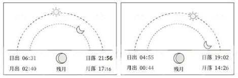

A. 左图城市比右图城市纬度高

B. 这一天是农历的二十左右

C. 左图城市比右图城市位置更靠东

D. 两地的人所看到的月相是不同的

第 26 题 · 答案与解析

**参考答案（粉笔题库参考内容）**

A

**解析**

本题考查地理国情。

A项正确，夏季，太阳直射点在北回归线和赤道之间移动，北半球每天被太阳照到的时间长，照不到的时间短，所以夏季北半球昼长夜短。而且在夏季，北半球纬度越高，昼越长，夜越短。左图城市的白天时间为15个小时又25分钟，右图城市的白天时间为14个小时又7分钟，因此，左图城市比右图城市纬度高。

B项错误，月亮在公转过程中，它和太阳、地球三者的相对位置不断发生变化，被太阳光照亮的部分，形成周期性圆缺盈亏的各种形状，称为月相。月相变化可粗略概括为：新月（朔月）-上娥眉月-上弦月-满月（望月）-下弦月-下娥眉月（残月）-新月（朔月），如此往复循环。图中的月相为残月（下娥眉月），故这一天是农历的二十七左右。

C项错误，地球自西向东自转，所以越靠东，越早看到日出。左图城市的日出时间为06：31，右图城市的日出时间为04：55，右图城市更早看到日出。因此，右图城市比左图城市位置更靠东。

D项错误，两个城市的月相都是残月（下娥眉月）。虽然月出和月落的时间不同，但这是由于两地经度不同导致的时间差异，而不是月相本身不同。

故正确答案为A。

### 第 27 题

下列物理学家与其提出的著名观点对应错误的是：

A. 麦克斯韦：能量的交换不是连续的，而是以最小的不可分割的单元进行，这些单元被称为“量子”

B. 安培：在原子、分子等物质微粒的内部，存在着一种环形电流-分子电流、使每个微粒成为微小的磁体

C. 牛顿：任何两个物体之间都存在引力，这种力的大小与它们质量的乘积成正比，与它们之间的距离的平方成反比

D. 伽利略：物体的运动并不需要力来维持，运动的物体之所以会停下来，是因为受到了阻力

第 27 题 · 答案与解析

**参考答案（粉笔题库参考内容）**

A

**解析**

本题考查科技常识。

A项错误，量子是现代物理的重要概念，即一个物理量如果存在最小的不可分割的基本单位，则这个物理量是量子化的，并把最小单位称为量子。该概念最早是由德国物理学家M·普朗克在1900年提出的。他假设黑体辐射中的辐射能量是不连续的，只能取能量基本单位的整数倍，从而很好地解释了黑体辐射的实验现象。麦克斯韦的主要贡献包括预言了电磁波的存在，建立了麦克斯韦方程组。

B项正确，分子电流假说是安培提出的电磁学理论，他认为在原子、分子等物质微粒的内部，存在着一种环形电流——分子电流，使每个微粒成为微小的磁体，分子的两侧相当于两个磁极。通常情况下磁体分子的分子电流取向是杂乱无章的，它们产生的磁场互相抵消，对外不显磁性。当外界磁场作用后，分子电流的取向大致相同，分子间相邻的电流作用抵消，而表面部分未抵消，它们的效果显示出宏观磁性。

C项正确，万有引力定律是艾萨克·牛顿于1687年在《自然哲学的数学原理》上所发表的一种自然规律，表述如下：任何两个质点都存在通过其连心线方向上的相互吸引的力。该引力大小与它们质量的乘积成正比，与它们之间的距离的平方成反比，与两物体的化学组成和其间介质种类无关。

D项正确，物体的运动并不需要力来维持，运动的物体之所以会停下来，是因为受到了阻力。这一观点首先由伽利略通过实验分析得出的。伽利略通过斜面实验结合推理，证明了力不是维持物体运动的原因，而是改变物体运动状态的原因。

本题为选非题，故正确答案为A。

### 第 28 题

纪录片《何以中国》讲述了多元一体中华民族的形成和中华文明创生的故事。下列哪句解说词不可能出现在《秦汉》一集中？

A. 他登峰山，攀泰山，上琅琊，经之罘，过东观，临碣石，至会稽，巡行之处皆刊石勒铭

B. 武丁左手扶住卜骨，右手持炭棒，灼烧着钻槽，通红的棒头神秘地闪烁，不久后，裂缝在钻槽边绽开，发出脆响

C. 从长安出发时，车马粼粼百余人，回程路上，只有两人，一十三年间，有利益相诱，有武力相胁，温柔乡、囹圄境，却从未丢失身为汉使的旌节，从未磨灭此行的初心

D. 龙首原上，长乐、未央两宫东西并峙，于高处制掣全城。桂宫、北宫、明光宫横列两宫之北

第 28 题 · 答案与解析

**参考答案（粉笔题库参考内容）**

B

**解析**

本题考查人文常识。

A项正确，秦始皇在统一六国后，为了巩固统治，多次进行巡游。这段话描述的是秦始皇巡游的路线和所到之处刻石勒铭的情况，可能出现在《秦汉》一集中。

B项错误，这段话描述的是武丁进行占卜的情景，武丁是商朝晚期的君主，这与秦汉时期的历史背景不符，不可能出现在《秦汉》一集中。

C项正确，这段话描述的是汉代使节张骞出使西域的艰辛历程，是秦汉时期的重要历史事件，可能出现在《秦汉》一集中。

D项正确，这段话描述的是汉代长安城的宫殿布局，是秦汉时期的重要建筑和文化象征。长乐宫，是在秦离宫兴乐宫基础上改建而成的西汉第一座正规宫殿，位于西汉长安城内东南隅，始建于高祖五年。未央宫，西汉帝国的大朝正宫，汉朝的政治中心和国家象征，建于汉高祖七年。长乐宫、未央宫和建章宫同为汉代三宫，可能出现在《秦汉》一集中。

本题为选非题，故正确答案为B。

### 第 29 题

关于医学检查方法，下列说法错误的是：

A. 做心脏超声检查，无需患者做憋尿、空腹等特殊准备

B. 造影利用了造影剂与人体组织密度的区别

C. 磁共振检查没有放射性，适用于孕妇、婴幼儿等人群

D. 血清检查是判断幽门螺旋杆菌感染的最佳方法

第 29 题 · 答案与解析

**参考答案（粉笔题库参考内容）**

D

**解析**

本题考查科技常识。

A项正确，‌做心脏超声检查，无需患者做憋尿、空腹等特殊准备‌。心脏超声检查是一种无创、无辐射的检查方法，主要通过超声波来观察心脏的结构和功能。这种检查不需要患者做特殊的准备，如憋尿或空腹等。

B项正确，造影检查是一种常用的医学检查方法，它利用造影剂与人体组织在X射线下的密度差异来形成对比，从而更清晰地显示病变部位。

C项正确，人们日常生活中常说的磁共振，是指核磁共振成像（MRI），是一种利用磁场和无线电波进行成像的检查方法，因此没有放射性。这使得MRI成为孕妇、婴幼儿等对辐射敏感人群的理想选择。

D项错误，虽然血清检查可以检测幽门螺旋杆菌的抗体，但它并不是判断幽门螺旋杆菌感染的最佳方法。实际上，呼气试验（如C-13或C-14尿素呼气试验）被认为是更为准确、便捷且无创的检测方法。呼气试验可以通过检测患者呼出的气体中是否含有幽门螺旋杆菌产生的特定标记物来判断感染情况。

本题为选非题，故正确答案为D。

### 第 30 题

某博物馆想办一期关于中国自然与人文的地理展览，开设以下几个专题，哪个专题所拟名称不恰当？

A. 长江：稻作文明与鱼米之乡

B. 都江堰：千年水道神韵再现

C. 胡焕庸线：中国的“东与西”

D. 五岳：高山神圣性的代表

第 30 题 · 答案与解析

**参考答案（粉笔题库参考内容）**

B

**解析**

本题考查地理国情。

A项正确，‌稻作文明与鱼米之乡形容的是长江流域，尤其是长江中下游地区‌。长江流域依靠其优越的自然条件，孕育了东亚稻作文明，为中华民族的繁衍提供了稳定的物质条件。长江流域的河姆渡遗址、城头山遗址等考古发现表明，早在1万年前，这里就已经开始了水稻的种植，成为世界稻作文明的发源地之一‌。

B项错误，继2022年经补水实现百年来首次全线水流贯通后，截至2024年断流百年的京杭大运河已连续三年全线水流贯通，再现了壮美运河千年神韵。都江堰是当今世界年代久远、唯一留存、以无坝引水为特征的宏大水利工程，建堰两千多年来经久不衰，而且发挥着愈来愈大的效益。‌

C项正确，“胡焕庸线”是1935年胡焕庸在“中国人口之分布”一文中提出的一条人口地理分界线，即今天的“黑河—腾冲线”。‌中国人口分布以“胡焕庸线（黑河—腾冲线）”为界，呈现出极不均衡的特征，东南多、西北少。同时，“胡焕庸线（黑河—腾冲线）”也是中国东西分界线。‌

D项正确，五岳是中华传统文化中五大名山的总称，包括东岳泰山、西岳华山、南岳衡山、北岳恒山、中岳嵩山。五岳是具有方位代表性的神圣高山，它们是文明核心地域范围的象征，是华夏文明地理构建中极具特色的成果。

本题为选非题，故正确答案为B。

### 第 31 题

下列诗句都涉及天体，其中说法错误的是：

A. “卧看牵牛织女星”所涉及的天体不属于太阳系

B. “每依北斗望京华”中的天体不包括北极星

C. “启明星在树梢头”中的行星公转轨道半径较地球更大

D. “岁星渐高辰星光”中的“岁星”属于气态巨行星

第 31 题 · 答案与解析

**参考答案（粉笔题库参考内容）**

C

**解析**

本题考查地理国情。

A项正确，太阳系包括太阳、8个行星、近500个卫星和至少120万个小行星，还有一些矮行星和彗星。牛郎星，又名河鼓二、“天鹰座”，是恒星光谱A型中的主序星，不属于太阳系。织女星，或者称为织女一或天琴座，是天琴座中最明亮的恒星，也不属于太阳系。

B项正确，北斗七星，是夜空中的七颗亮星，它们组成的图形像是古代舀酒的斗，故命名为北斗七星。北斗七星从斗身最前端开始，到斗柄的末尾，按顺序依次命名为大熊座、大熊座、大熊座、大熊座、大熊座、大熊座、大熊座。北极星现在一般指“勾陈一”（小熊座）。北斗七星不包括北极星。

C项错误，金星在中国古代被称为太白金星，清晨在东方天空出现则被称为“启明星”，晚间在西方天空出现被称为“长庚星”或“昏星”。金星是太阳系的八大行星之一，是从太阳向外的第二颗行星，公转轨道半径比地球小。

D项正确，中国古代称木星为岁星。木星是太阳系中距离太阳第五近的行星，也是太阳系中体积最大的行星。木星是一颗气态巨行星，质量是太阳的千分之一，但却是太阳系中其他七大行星质量总和的2.5倍。

本题为选非题，故正确答案为C。

### 第 32 题

在关于真菌的科普文章中，下列表述存在错误的是：

A. 古人很早就利用真菌发酵食物，比如利用乳酸菌酿造果酒

B. 人类历史上发现的第一种抗生素来自微型真菌

C. 羊肚菌、松茸等食用真菌味道鲜美，含有丰富的优质蛋白质

D. 植物的根能和真菌形成共生关系，菌丝吸收水分、无机盐等供给植物

第 32 题 · 答案与解析

**参考答案（粉笔题库参考内容）**

A

**解析**

本题考查科技常识。

A项错误，约9000年前，我们的祖先就会利用微生物将谷物、水果等发酵为含酒精的饮料。1857年，法国微生物学家巴斯德通过实验证明，酒精发酵是由活的酵母菌引起的，从而将酵母菌与发酵联系起来。乳酸菌是一类能利用可发酵碳水化合物产生大量乳酸的细菌的统称。故古人利用“乳酸菌”酿造果酒说法错误。

B项正确，抗生素一般指能抑制细菌生长或杀死细菌的一类药物。1928年，英国人弗莱明发现，被污染的金黄色葡萄球菌培养基上生长出一种带有毒素的微型真菌——青霉菌，从青霉菌中分离出来的青霉素成为人类历史上发现的第一种抗生素。

C项正确，羊肚菌是食药兼用菌，其香味独特，营养丰富。松茸菌又名松口蘑，是一种珍贵的真菌，具有很高的药用食疗作用。两者都是可食用真菌类的食材，都含有十分丰富的蛋白质、氨基酸、维生素和矿物质。

D项正确，植物的根与真菌之间的共生关系是一种非常重要的生物学现象，这种关系被称为菌根共生。菌根真菌通过产生大量菌丝来增加植物根表面积，使其能够更有效地吸收土壤中的水分和营养物质。同时，真菌从植物中获取所需的糖类物质。

本题为选非题，故正确答案为A。

### 第 33 题

关于温室栽培，下列说法错误的是：

A. 夜间降低温室内的温度，可以减少农作物营养物质的消耗

B. 相比普通塑料温室大棚，玻璃温室可以让阳光更容易进入

C. 紫外线灯是一种大棚中经常使用且效果较好的植物补光灯

D. 在作物栽培过程中通入适量的二氧化碳可以提高作物产量

第 33 题 · 答案与解析

**参考答案（粉笔题库参考内容）**

C

**解析**

本题考查科技常识。

A项正确，夜间降低温室内的温度，可以减少农作物的呼吸作用，温度越低，农作物的呼吸作用越弱，有机物的消耗也就越少，可以提高农作物的产量。

B项正确，温室是采光建筑，因而透光率是评价温室透光性能的一项最基本指标。透光率是指透进温室内的光照量与室外光照量的百分比。一般来说，连栋塑料温室的透光率在50%-60%，玻璃温室的透光率在60%-70%，日光温室的透光率可达到70%以上。

C项错误，植物灯模拟植物需要太阳光进行光合作用的原理，对植物进行补光或者完全代替太阳光。目前主流的植物补光灯包含LED灯和高压钠灯。在温室大棚种植补光中，这两种产品都有较为广泛的应用。紫外线灯具有较好的杀菌作用，主要用于杀菌消毒，并不在大棚中经常使用。

D项正确，二氧化碳是植物进行光合作用的主要原料之一。在光照条件下，植物通过吸收二氧化碳和水，利用叶绿素将太阳能转化为化学能，进而合成有机物质并释放出氧气。因此，增加二氧化碳的浓度可以促进作物进行光合作用，提高光合作用的效率，从而加快作物的生长速度和提高作物产量。

本题为选非题，故正确答案为C。

### 第 34 题

下列情境中的两个物理量成正比例的是：

①通过某一电阻器的电流与其两端的电压

②物体所受浮力与其体积

③弹性限度内弹簧的伸长量与其所受拉力

④汽车行驶时的加速度与速度

A. ①②

B. ②④

C. ③④

D. ①③

第 34 题 · 答案与解析

**参考答案（粉笔题库参考内容）**

D

**解析**

本题考查科技常识。

①正确，根据欧姆定律，电阻器中的电流I与其两端的电压U之间的关系是，其中R是电阻器的电阻，是一个常数。因此，当电压U增加时，电流I也会增加，且增加的比例是固定的（即）。所以，通过某一电阻器的电流与其两端的电压成正比例。

②错误，物体所受浮力与其体积V之间的关系并不总是成正比例的。根据阿基米德原理，浮力等于物体排开的液体所受的重力，即，其中是液体的密度，g是重力加速度，是物体排开的液体的体积。如果物体完全浸入液体中，那么等于物体的体积V，此时浮力与物体的体积成正比。但是，如果物体只是部分浸入液体中，那么就小于物体的体积V，此时浮力与物体的体积就不成正比。因此，不能简单地说物体所受浮力与其体积成正比例。

③正确，在弹性限度内，弹簧的伸长量x与其所受拉力F之间的关系符合胡克定律，即F=kx，其中k是弹簧的劲度系数，是一个常数。因此，当拉力F增加时，弹簧的伸长量x也会增加，且增加的比例是固定的（即）。所以，弹性限度内弹簧的伸长量与其所受拉力成正比例。

④错误，汽车行驶时的加速度a与速度v之间并没有固定的比例关系。加速度是速度变化率与时间的比值，即。加速度的大小取决于速度的变化率，而不是速度本身。因此，汽车行驶时的加速度与速度不成正比例。

综上，①③符合题意。

故正确答案为D。

### 第 35 题

下列与体育比赛有关的说法错误的是：

A. 跳水运动的难度系数涉及动作姿势和翻腾转体周数等方面

B. 篮球比赛中罚球时允许球员双脚离地

C. 足球比赛的常规时间长度为90分钟

D. 举重运动中判定试举成功需要三名裁判均亮白灯

第 35 题 · 答案与解析

**参考答案（粉笔题库参考内容）**

D

**解析**

本题考查科技常识。

A项正确，跳水运动的难度系数是由国际泳联（FINA）根据动作的复杂程度、执行难度以及创新性等因素综合评定得出的一个数值，具体因素包括动作的转体次数、翻腾次数和姿势难度等。

B项正确，根据篮球规则，罚球需在罚球线后方的半圆内完成。不限制投篮方式，但球必须由篮筐上方投入或触及篮筐。当裁判员将球置于可处理时，球员应在5秒钟内将球投出。在球触及篮筐之前，罚球人不得触及罚球线或进入限制区域（罚球半圆以外的区域）。罚球时不可以做假动作。由此可知，罚球时并未规定球员双脚是否可以离地，故认定是否离地都可以。‌

C项正确，‌足球比赛的常规时间长度为90分钟‌，分为上下两个半场，每个半场的时间为45分钟。如果在90分钟内比赛双方打成平局，且需要决出胜负，则会进行30分钟的加时赛。‌

D项错误，举重比赛的裁判系统需要3个白灯、3个红灯和1个蜂鸣器。比赛临场裁判员3名，裁判员手里各控制1个白灯和1个红灯。裁决时，3个白灯为成功；3个红灯为失败。如2白1红或2红1白，那就要少数服从多数，前者仍为成功，后者仍为失败。

本题为选非题，故正确答案为D。

### 第 36 题

我们想问题、作决策、办事情，首先要考虑人口基数问题，考虑我国城乡区域发展水平差异大等实际，既不能            ，也不能因循守旧，要保持历史耐心，坚持稳中求进、循序渐进、持续推进。

填入画横线部分最恰当的一项是：

A. 朝令夕改

B. 寅吃卯粮

C. 好高骛远

D. 一厢情愿

第 36 题 · 答案与解析

**参考答案（粉笔题库参考内容）**

C

**解析**

横线处所填成语搭配“想问题、作决策、办事情”，且根据“首先要考虑人口基数问题，考虑我国城乡区域发展水平差异大等实际”以及“要保持历史耐心，坚持稳中求进、循序渐进、持续推进”可知，横线处应体现出“想问题、作决策、办事情”不能偏离实际，而应脚踏实地之意。C项“好高骛远”指脱离实际去追求过高的、难以实现的目标，符合文意，当选。A项“朝令夕改”形容主张或办法经常改变，一会儿一个样；B项“寅吃卯粮”比喻入不敷出，预先支用未来的收入。二者均与“不能偏离实际”的语义无关，排除。D项“一厢情愿”指处理彼此有关的事情时，只管自己愿意，不管对方愿意不愿意，或指办事时不考虑客观实际情况，全从主观意愿出发，与前文的“想问题”搭配不当，排除。

故正确答案为C。

【文段出处】人民网《全面推进城乡、区域协调发展》

### 第 37 题

随着技术经验积累，高空风弹道修正等技术方法能使火箭在飞行过程中有效抵抗风干扰。为了有更强的适应性，本发长八火箭在使用自主抗干扰控制技术等成熟方法之外，还增加了自动滚转减载技术，根据风的来向，会在空中主动滚动调整，使火箭用更稳定的优势面来应对高空风，用“             ”的方式，通过自身的旋转抵消掉高空风的影响。

填入画横线部分最恰当的一项是：

A. 以柔克刚

B. 以守为攻

C. 以虚为实

D. 以退为进

第 37 题 · 答案与解析

**参考答案（粉笔题库参考内容）**

A

**解析**

横线处所填成语形容火箭飞行的方式，且根据双引号可知此处应为形象表达。根据文意可知，面对高空风的干扰，火箭会根据风的来向在空中主动滚动调整，通过自身的旋转来灵活应对，故横线处所填成语需体现火箭应对方式的灵活性。A项“以柔克刚”指用柔软的去克制刚强的，比喻避开锋芒，用温和的方法、手段来制伏强硬的对手，置于此处能够形象地说明火箭灵活地应对高空风的干扰，符合文意，当选。B项“以守为攻”指用防御作为击破敌人的手段，文段并未体现出火箭处于防御的状态，与文意不符，排除。C项“以虚为实”指军事上迷惑对方，使其难辨虚实和真伪的一种战术，文段并未体现火箭使高空风无法辨别虚实和真伪，排除。D项“以退为进”原指以谦让取得德行的进步，后指以退让的姿态作为进取的手段，文段中火箭并非以后退的方式应对高空风的干扰，与文意不符，排除。

故正确答案为A。

【文段出处】《护送新“鹊桥”，长八火箭量身打造三项本领》

### 第 38 题

要提高“临事能断”本领，就要处理好反复权衡与适时决断的关系，既要深入考量、三思而行，又要视情而断、当机立断，不能等待观望、            、议而不决。当然，提倡在关键时刻善于决断，并不意味着可以            、我行我素，而是要善于聚民意、集众智，推动科学决策。

依次填入画横线部分最恰当的一项是：

A. 犹豫不决 泥古不化

B. 左顾右盼 听之任之

C. 举棋不定 刚愎自用

D. 见风使舵 自作主张

第 38 题 · 答案与解析

**参考答案（粉笔题库参考内容）**

C

**解析**

第一空，顿号引导并列关系，故横线处所填词语应与“等待观望”“议而不决”语义相近，体现不能决断之意。A项“犹豫不决”指拿不定主意，B项“左顾右盼”指向左边看看，又向右边看看，形容顾虑重重、犹豫不决的样子，C项“举棋不定”比喻犹豫不决，拿不定主意，三项均符合文意，保留。D项“见风使舵”比喻看势头或看别人的眼色行事，无法体现不能决断之意，排除。

第二空，顿号引导并列关系，横线处所填词语应与“我行我素”语义相近，体现不管别人意见，按照自己想法去做之意。C项“刚愎自用”指十分倔强固执，不考虑别人的意见，符合文意，当选。A项“泥古不化”指拘泥于古代的成规或古人的说法而不知变通，与文意无关，排除。B项“听之任之”指听任事情自然发展变化，不管不问，强调放任自流的消极态度，无法表达完全按照自己想法去做之意，排除。

故正确答案为C。

【文段出处】解放军报《锤炼“临事能断”本领》

### 第 39 题

当前，各地纷纷布局，加快形成和发展新质生产力。然而，发展新质生产力是一项系统工程，不能盲目跟风、            ，也不能脱离实际、急于求成，更不能简单复制一种模式，必须坚持从实际出发，从新质生产力的形成条件入手，考虑周全、            。

依次填入画横线部分最恰当的一项是：

A. 照猫画虎 厚积薄发

B. 一哄而上 谋定后动

C. 拾人牙慧 有备无患

D. 随波逐流 集思广益

第 39 题 · 答案与解析

**参考答案（粉笔题库参考内容）**

B

**解析**

本题可从第二空入手。根据横线前的顿号可知，横线处所填成语与“考虑周全”构成近义并列，需体现出全面思考问题、深思熟虑之意。B项“谋定后动”指谋划完毕才开始行动，C项“有备无患”指事先有准备就可以避免祸患，二者均符合文意，保留。A项“厚积薄发”指大量地积累，只择其精要少量地表露出来，多用于称赞人学问深厚，学风严谨，也形容经过长时间的积累和准备而获得大的成功，文段没有体现“长时间的积累”，与文意不符，排除。D项“集思广益”指集中众人的智慧，广泛吸收有益的意见，文段没有体现“集中众人的智慧”，排除。

第一空，根据横线前的顿号可知，横线处所填成语与“盲目跟风”构成近义并列，需体现没有主见、随大流之意。B项“一哄而上”指没有经过认真准备和严密组织，一下子行动起来，符合文意，当选。C项“拾人牙慧”指拾取人家的只言片语当作自己的话，多指模仿或抄袭他人的观点，没有体现随大流之意，排除。

故正确答案为B。

【文段出处】学习时报《发展新质生产力要坚持从实际出发》

### 第 40 题

人才培养是循序渐进的过程，需认识、        、尊重人才成长规律，坚持“严管”和“厚爱”相结合。人才干事创业中难免有失误，如果培养者因为害怕犯错而顾虑重重、            ，则违背了人才培育的初衷。所以，要为人才“松绑”，建立健全正向激励和容错纠错机制，为人才成长创造宽容的环境。

依次填入画横线部分最恰当的一项是：

A. 把握 因噎废食

B. 顺应 矫枉过正

C. 运用 半途而废

D. 归纳 瞻前顾后

第 40 题 · 答案与解析

**参考答案（粉笔题库参考内容）**

A

**解析**

本题可从第二空入手。“、”连接的前后内容构成并列关系，且根据前文“如果培养者因为害怕犯错而顾虑重重”可知，横线处所填成语应体现培养者因为害怕犯错而有所顾虑。A项“因噎废食”比喻因为怕出问题，索性不干；D项“瞻前顾后”形容顾虑太多，犹豫不决。两项均符合文意，保留。B项“矫枉过正”比喻纠正偏差做得过了头，文段中为“害怕犯错”而非“纠正错误”，不符合文意，排除。C项“半途而废”指半路上终止，比喻做事情有始无终，不能体现出害怕犯错而有所顾虑的意思，排除。

第一空，搭配“规律”。A项“把握”指抓住，与“规律”搭配恰当，且“认识、把握、尊重人才成长规律”可以体现出三词并列的先后顺序，当选。D项“归纳”指归拢并使有条理，“规律”本身就是归纳的结果，“归纳”与“规律”搭配不当，排除。

故正确答案为A。

【文段出处】人民论坛网《人民论坛网评|人才培育当多管齐下》

### 第 41 题

“南橘北枳”是            的自然规律。一些植物美则美矣，但只能生活在特定的自然环境中。某些地区不顾本地条件，只想迅速复制网红景观，画虎不成反类犬。一个地区的山水林田湖草是生命共同体，人为“改弦更张”，可能破坏生态平衡，到头来            。

依次填入画横线部分最恰当的一项是：

A. 颠扑不破 得不偿失

B. 显而易见 后患无穷

C. 众所周知 一无所有

D. 毋庸置疑 贻笑大方

第 41 题 · 答案与解析

**参考答案（粉笔题库参考内容）**

A

**解析**

本题可从第二空入手。根据文意可知，横线处需表达某些地区为了复制网红景观，不顾本地实际情况，最终可能导致生态平衡遭到破坏之意。A项“得不偿失”指得到的抵不上失去的，符合文意，保留。B项“后患无穷”指今后的祸患没有穷尽，C项“一无所有”指什么也没有，二者置于此处均程度过重，文段仅提到强行复制网红景观“可能”会破坏生态环境，排除。D项“贻笑大方”指让内行人笑话，文段强调自身利益受损，而非被人笑话，排除。

第一空，代入验证。A项“颠扑不破”指无论怎样摔打都破不了，比喻理论、学说等完全正确，不会被驳倒推翻，置于此处可体现“南橘北枳”是不可改变的自然规律，符合文意，且与“自然规律”搭配恰当，当选。

故正确答案为A。

【文段出处】《北京日报》客户端《园林景观网红化？警惕“生态形式主义”》

### 第 42 题

推进中国式现代化是一个探索性事业，还有许多未知领域，需要我们在实践中去大胆探索，通过改革创新来推动事业发展，决不能            、守株待兔。各地区各部门要结合各自具体实际开拓创新，特别是在前沿实践、未知领域，鼓励大胆探索、            ，寻求有效解决新矛盾新问题的思路和办法，努力创造可复制、可推广的新鲜经验。

依次填入画横线部分最恰当的一项是：

A. 刻舟求剑 敢为人先

B. 坐井观天 踔厉奋发

C. 望梅止渴 推陈出新

D. 画地为牢 大展拳脚

第 42 题 · 答案与解析

**参考答案（粉笔题库参考内容）**

A

**解析**

第一空，根据“需要······决不能······”可知，横线处应与前文构成反义并列关系，体现不改革创新、守旧死板之意。A项“刻舟求剑”比喻办事刻板，拘泥成例而不知变通；D项“画地为牢”比喻只准在指定范围内活动，可形容思想受限。两项均符合文意，保留。B项“坐井观天”比喻眼界狭小，看到的有限；C项“望梅止渴”比喻用空想或假象安慰自己。两项均与文意不符，排除。

第二空，根据“寻求有效解决新矛盾新问题的思路和办法，努力创造可复制、可推广的新鲜经验”可知，横线处所填成语应体现要先人一步、创造新经验之意。A项“敢为人先”指敢于做别人没有做过的事情，符合文意，当选。D项“大展拳脚”指充分施展本领，与文意不符，排除。

故正确答案为A。

【文段出处】求是《推进中国式现代化需要处理好若干重大关系》

### 第 43 题

无论采取哪种储存方式，液氢对储存系统          的要求都比传统燃油系统更高、更复杂。这是因为氢分子远小于航空煤油，更容易从管路缝隙中        ；对于液氢储存，还必须考虑        条件的实现问题，否则升温气化后体积膨胀的氢气有可能导致燃料箱因压强骤增而直接爆炸。

依次填入画横线部分最恰当的一项是：

A. 密封性 逃逸 恒温

B. 稳定性 泄漏 压力

C. 完整性 溢出 热量

D. 安全性 弥散 季节

第 43 题 · 答案与解析

**参考答案（粉笔题库参考内容）**

A

**解析**

本题可从第三空入手。根据“否则升温气化后体积膨胀的氢气有可能导致燃料箱因压强骤增而直接爆炸”可知，横线处所填词语应与温度有关，且应体现出液氢储存要防止升温之意。A项“恒温”意为相对稳定的温度，符合文意，保留。B项“压力”指物体所承受的与表面垂直的作用力，D项“季节”意为一年里的某个有特点的时期，均与温度无关，排除。C项“热量”指温度高的物体传递到温度低的物体上的能量，虽与温度有关，但根据后文可知，横线处应体现需要保持温度的稳定性，因此该项不如A项“恒温”更符合文意，排除。

第一空，代入验证。根据“这是因为氢分子远小于航空煤油，更容易从管路缝隙中······”可知，氢分子更容易从管路缝隙中跑出去，故液氢对储存系统防外泄的功能有更高的要求。A项“密封性”指密封件在特定条件下防止介质外泄或外界杂质侵入的能力，符合文意，保留。

第二空，代入验证。根据“氢分子远小于航空煤油”可知，氢分子更容易从管路缝隙中跑出去。A项“逃逸”指逃跑，符合文意，当选。

故正确答案为A。

【文段出处】人民网《“氢”装上阵，助力航空碳中和（科技大观）》

### 第 44 题

改进文风就要多写“短实新”的好文章。“实”就是讲符合实际的话不讲脱离实际的话，讲管用的话不讲空话，讲反映自己思考的话不讲            的话，讲有感而发的话不讲            的话，讲通俗明白的话不讲故作高深的话，            ，用朴实的语言阐述深刻的理论。

依次填入画横线部分最恰当的一项是：

A. 故弄玄虚 装腔作势 由表及里

B. 照本宣科 无病呻吟 深入浅出

C. 人云亦云 言不由衷 举一反三

D. 陈词滥调 冠冕堂皇 言简意赅

第 44 题 · 答案与解析

**参考答案（粉笔题库参考内容）**

B

**解析**

第一空，根据“讲······的话不讲······的话”可知，横线处所填成语应与“反映自己思考”构成反义并列关系，体现缺乏自己思考之意。B项“照本宣科”意为死板地照现成文章或稿子宣读，指不能灵活运用；C项“人云亦云”意为人家说什么自己也跟着说什么，形容没有主见。两项均符合文意，保留。A项“故弄玄虚”形容故意玩弄使人迷惑的花招，与文意不符，排除。D项“陈词滥调”意为陈旧而不切合实际的话，与后文的“话”语义重复，排除。

第二空，根据“讲······的话不讲······的话”可知，横线处所填成语应与“有感而发”构成反义并列关系，体现不是真正所感之意。B项“无病呻吟”比喻没有值得忧虑的事情却长吁短叹，也比喻文艺作品缺乏真情实感，矫揉造作；C项“言不由衷”意为说的话不是从内心发出来的，指心口不一致。两项均符合文意，保留。

第三空，根据后文“用朴实的语言阐述深刻的理论”可知，横线处所填成语应体现用通俗的话讲明白深刻的道理之意。B项“深入浅出”指文章或言论的内容很深刻，措辞却浅显易懂，符合文意，当选。C项“举一反三”意为从一件事情类推而知道其他许多事情，与文意无关，排除。

故正确答案为B。

【文段出处】光明日报《大力倡导优良文风》

### 第 45 题

循环肿瘤细胞是早期癌症诊断的重要临床标志物，但其数量仅占正常血细胞量的十亿分之一。想要找到它，可谓            。新近研制出的多功能仿生柔性膜，拥有“火眼金睛”，可         “生擒”循环肿瘤细胞，还有媲美人体环境的仿生机制，能将细胞            地带回，实现对癌症的分子分型诊断。

依次填入画横线部分最恰当的一项是：

A. 大海捞针 准确 毫发无损

B. 雾里看花 直接 严丝合缝

C. 异想天开 迅速 轻而易举

D. 无从下手 巧妙 完好无缺

第 45 题 · 答案与解析

**参考答案（粉笔题库参考内容）**

A

**解析**

第一空，根据“可谓”可知，前文是对横线处的解释说明。根据前文“其数量仅占正常血细胞量的十亿分之一”可知，横线处应体现想要找到循环肿瘤细胞很难之意。A项“大海捞针”指在大海里捞一根针，比喻极难找到，置于此处可形象地体现出在海量血细胞里寻觅数量极其稀少的循环肿瘤细胞的艰难程度，符合文意，保留。B项“雾里看花”形容对事物的本质或真相看不清楚，侧重看不清楚，C项“异想天开”形容想法离奇，不切实际，侧重想法离奇，D项“无从下手”指事物头绪纷繁或防范极其严密，没有办法着手处理，侧重做某事缺乏切入点，而文段强调寻找难度大，三项均与文意不符，排除。

第二空，代入验证。A项“准确”指行动的结果完全符合实际或预期，置于此处能体现出多功能仿生柔性膜解决了难以在海量血细胞中寻找到循环肿瘤细胞的问题，且与“拥有‘火眼金睛’”对应得当，保留。

第三空，代入验证。根据前文“‘生擒’循环肿瘤细胞，还有媲美人体环境的仿生机制”“实现对癌症的分子分型诊断”可知，横线处应体现出细胞被找到时状态完好。A项“毫发无损”指连毫毛、头发这样细微的部位都没有损伤，与文意相符，当选。

故正确答案为A。

【文段出处】科技日报《仅靠一张膜就能实现癌症分子分型诊断》

### 第 46 题

如果一味沉湎于琐碎的日常事务，缺乏大局观念和政治远见，不分轻重缓急，不从原则高度想问题，就会陷入事务主义。习近平总书记指出：“如果忙忙碌碌，只是机械做事，陷入事务主义，是很难提高认识和工作水平的。”这就意味着，要提高认识水平，必须走出事务主义的泥潭。毛泽东曾经指出：“庸俗的事务主义家不是这样，他们尊重经验而看轻理论，因而不能通观客观过程的全体，缺乏明确的方针，没有远大的前途，沾沾自喜于一得之功和一孔之见。”这为如何走出事务主义提供了指南针和路线图。

这段文字认为，为避免陷入事务主义，应该：

A. 具有清晰明确的工作方案

B. 坚持从理论高度看待问题

C. 不断从实践中总结经验教训

D. 通过学习补齐能力素质短板

第 46 题 · 答案与解析

**参考答案（粉笔题库参考内容）**

B

**解析**

文段开篇从反面提对策，指出避免陷入事务主义，要有大局观念和政治远见，要从原则高度思考问题。随后引用习近平总书记的讲话强调要提高认识水平，不能陷入事务主义泥潭。后文通过毛泽东的讲话再一次从反面说明没有大局观念及政治远见的庸俗的事务主义家的特点。故文段重点为首句的对策，即要避免陷入事务主义，就应有大局观念和政治远见，要从原则高度思考问题，对应B项。

A、C、D三项：A项“工作方案”、C项“从实践中总结经验教训”、D项“通过学习补齐能力素质短板”文段均未提及，无中生有，排除。

故正确答案为B。

【文段出处】《为什么说只有理解了的东西才更深刻地感觉它？》

### 第 47 题

定向能武器是通过定向发射高能激光束、电磁波束、高能粒子束等对目标发起直接攻击的武器。低空无人机飞行速度慢、尺寸小、雷达散射面窄、红外特征弱，普通防空系统难以及时发现和截获，而定向能武器则可利用强激光点杀伤与高功率微波面覆盖相互配合，在低空近程区形成密集拦截网，应对无人机“蜂群”的压制。无人机“蜂群”高度依赖高敏传感器和无线通信设备，飞行越低、密度越大，导航和控制系统越易受外界干扰。此时，定向能武器对其稍加影响，使其联合作战能力受限，即可快速实现对无人机“蜂群”的杀伤。

这段文字主要介绍了定向能武器：

A. 在无人化战争中的作战模式

B. 应对无人机“蜂群”的制胜机理

C. 实现低空作战的基本原理和核心技术

D. 具有超越普通防空系统的特点和优势

第 47 题 · 答案与解析

**参考答案（粉笔题库参考内容）**

B

**解析**

文段开篇通过下定义的方式引出“定向能武器”的话题，接着介绍了低空无人机飞行速度慢、尺寸小等特点，并指出定向能武器能够在低空近程区形成密集拦截网，应对无人机“蜂群”的压制，随后论述了无人机“蜂群”高度依赖高敏传感器和无线通信设备，飞行低、密度大时其导航和控制系统容易受到外界干扰，最后指出定向能武器可通过对其施加影响，快速实现对无人机“蜂群”的杀伤。故整个文段为并列结构，从两方面介绍了定向能武器如何应对无人机“蜂群”的攻击，对应B项。

A项：文段核心话题为“无人机‘蜂群’”，“无人化战争”话题范围扩大，偏离文段中心，排除。

C、D两项：均缺少文段核心话题“无人机‘蜂群’”，偏离文段中心，且均仅对应文段的前半部分，表述片面，排除。

故正确答案为B。

【文段出处】解放军报《定向能武器反“蜂群”有优势》

### 第 48 题

习近平新时代中国特色社会主义思想植根于新时代中国特色社会主义伟大事业的创造性实践，每一个理论成分背后都有着鲜活的实践支撑，比如蕴含“创新、协调、绿色、开放、共享”新发展理念的经济高质量发展案例、体现“党的领导、人民当家作主和依法治国有机统一”政治理念的现代治理案例、体现“绿水青山就是金山银山”的生态文明思想案例等。通过讲述这些蕴含中国观点、体现中国立场、彰显中国智慧、弘扬中国价值的生动故事，让国际社会更加深切地感知和理解习近平新时代中国特色社会主义思想的理论内涵和实践逻辑。

这段文字意在强调：

A. 党的创新理论要在实践中检验和发展

B. 讲好中国故事有助于提高国际话语权

C. 要积极利用案例传播党的创新理论

D. 理论宣传应该综合运用国内外资源

第 48 题 · 答案与解析

**参考答案（粉笔题库参考内容）**

C

**解析**

文段开篇提出习近平新时代中国特色社会主义思想的每一个理论成分背后都有实践支撑，接着通过“比如”进行举例说明，尾句通过指代词“这些”总结前文，指出通过讲述这些案例可以让国际社会更加深切地感知和理解习近平新时代中国特色社会主义思想的理论内涵和实践逻辑。故文段讨论的核心话题为“习近平新时代中国特色社会主义思想”，重点强调通过讲述案例来传播习近平新时代中国特色社会主义思想，即传播党的创新理论，对应C项。

A项：“在实践中检验和发展”对应举例部分的内容，非重点，排除。

B项：文段主题词为“党的创新理论”，而非“中国故事”，该项主题词错误，排除。

D项：文段讨论的核心话题为“党的创新理论”，“理论”范围扩大，且“国外资源”无中生有，排除。

故正确答案为C。

【文段出处】《做好党的创新理论对外传播》

### 第 49 题

相对于狭义的农业即种植业而言，大农业是指广义的农业，不仅包括种植业、林草业、畜牧业和渔业，还包括产前的技术研发、品种繁育与推广、水利建设、农机生产与销售、农资储备与供应等，产后的烘干、储藏、运输、加工、营销与进出口贸易等，由此形成一个与农业发展有关、为农业发展服务的庞大产业体系。可以说，                    。发展现代化大农业就是要构建一个现代化的大农业产业体系，这也是当前我国构建现代乡村产业体系的核心所在。

填入画横线部分最恰当的一项是：

A. 大农业是对农业及其紧密联系的相关产业的高度概括

B. 农村产业融合化发展是当今乡村产业发展的必然趋势

C. 大农业是在当前技术条件下实现的对小农经济的超越

D. 发展现代化大农业应该因地制宜推进农业规模化经营

第 49 题 · 答案与解析

**参考答案（粉笔题库参考内容）**

A

**解析**

本题为语句填空题，横线位于文段中间，需结合前后文语境进行分析。横线前指出大农业是指广义的农业，不仅包括农林牧渔业，还包括产前的技术研发、水利建设等和产后的烘干、储藏等一系列相关产业，之后通过因果标志词“由此”强调大农业形成了一个庞大的产业体系，随后通过“可以说”对前文进行总结，横线后表明想要发展现代化大农业就需要构建现代化的大农业产业体系。结合前后文可知，横线处应围绕“大农业”展开论述，并说明大农业是包括农林牧渔业及其紧密联系的相关产业的有机整体，是跨越行业边界的庞大产业，对应A项。

B项：“农村产业融合化”偏离文段核心话题“大农业”，排除。

C项：“对小农经济的超越”偏离文段核心，文段重在强调大农业是包括农林牧渔业及其一系列相关产业的有机整体，该项无法与前后文衔接，排除。

D项：“因地制宜推进农业规模化经营”文段未提及，无中生有，排除。

故正确答案为A。

【文段出处】《坚持以发展现代化大农业为主攻方向》

### 第 50 题

同位素定年方法利用放射性同位素衰变原理来计算地表水进入封闭地下环境的时间，可以反映水在地下的补给径流排泄规律；稳定同位素有同位素分馏和季节效应，在不同体系中分布比例存在差异，因此可以用来示踪地下水的混合过程。目前，地下水循环研究中常用的同位素包括碳、氢、氧、硫等。随着技术发展，金属同位素等非传统同位素的应用，扩大了地下水定年范围。其中，镁元素是主要造岩元素，易在风化过程中以离子形式进入水体，且镁元素迁移行为简单、参与地球化学行为广，可以在地下水科学研究中发挥重要作用。

这段文字没有提及：

A. 稳定同位素用于示踪地下水混合过程的原理

B. 镁元素在地下水研究中发挥重要作用的原因

C. 推动非传统同位素用于地下水研究的关键技术

D. 计算地表水进入封闭地下环境所用时间的意义

第 50 题 · 答案与解析

**参考答案（粉笔题库参考内容）**

C

**解析**

A项：根据“稳定同位素有同位素分馏和季节效应，在不同体系中分布比例存在差异，因此可以用来示踪地下水的混合过程”可知，该项文段有提及，排除。

B项：根据“镁元素是主要造岩元素，易在风化过程中以离子形式进入水体，且镁元素迁移行为简单、参与地球化学行为广，可以在地下水科学研究中发挥重要作用”可知，该项文段有提及，排除。

C项：文段仅提及“金属同位素等非传统同位素的应用，扩大了地下水定年范围”，未提及“推动非传统同位素用于地下水研究的关键技术”，无中生有，当选。

D项：根据“同位素定年方法利用放射性同位素衰变原理来计算地表水进入封闭地下环境的时间，可以反映水在地下的补给径流排泄规律”可知，该项文段有提及，排除。

本题为选非题，故正确答案为C。

【文段出处】中国矿业报《透视地下蕴藏的水信息》

### 第 51 题

“足国之道，节用裕民，而善臧其余。”党政机关过紧日子不是一时之需、权宜之策，而是一贯的、长期的、常态化的工作要求。一个国家可调配的资源总量是有限的，唯有坚持该花的花、该省的省，才能集中财力办大事，把更多真金白银用于发展紧要处、民生急需上。一路走来，艰苦奋斗、勤俭节约始终是我们党的优良作风，也是我们党不断发展壮大的重要保证。“党和政府带头过紧日子，目的是为老百姓过好日子”。这本国之大账，是民生大账，亦是民心大账。

这段文字是一篇文章的开头，最适合做文章标题的是：

A. 节用裕民，“过紧日子”算的是国之大账

B. 严格落实党政机关“过紧日子”的要求

C. 在“过紧日子”中诠释忠诚干净担当

D. 落实落细，把“过紧日子”的要求贯穿始终

第 51 题 · 答案与解析

**参考答案（粉笔题库参考内容）**

A

**解析**

本题为接语选择题与标题填入题的结合题型。文段首先引用“足国之道，节用裕民，而善臧其余”并指出党政机关过紧日子是长期工作要求，接着说明国家可调配资源有限，需坚持该花则花、该省则省，以集中财力办大事，把财力用于发展紧要处和民生关键处，随后介绍艰苦奋斗、勤俭节约是我们党的优良作风和发展壮大的重要保证，最后总结指出党和政府带头过紧日子是为了让老百姓过好日子，这算的是涉及民生与民心的国之大账。故文章应重点围绕党政机关“过紧日子”及其与民生的关系展开论述，对应A项。

B、C、D三项：均未体现出党政机关“过紧日子”与民生的关系，偏离重点，排除。

故正确答案为A。

【文段出处】长安观察《锐评｜节用裕民，过“紧日子”算的是国之大账》

### 第 52 题

①但目前来看，新一代AI都表现出一定的回避提问的意图，这可能与模型试图节约算力资源有关

②在目前的法律框架内，数字生命还不是可以承担法律责任的主体，而被认为是程序、代码，或是人在网络空间中的一个身份

③如果机器向人输出了错误或者不能理解的内容，这是算法故障，应当要求开发、维护人员尽快修复，而不是指令机器“立刻改正”

④不过一旦模型有自主选择逃避人类提问的能力，并且已经脱离了开发人员的控制，AI没有法律人格的结论就要面临挑战了

⑤一般认为，创造数字生命的人，就是对数字生命负责的人，例如程序的开发者、AI的使用者等

⑥这除了伦理上的考虑，还有其不具备承担责任可能的因素

将以上6个句子重新排列，语序正确的一项是：

A. ②⑤⑥①④③

B. ⑤②⑥④①③

C. ②⑥⑤③①④

D. ⑤③②⑥④①

第 52 题 · 答案与解析

**参考答案（粉笔题库参考内容）**

C

**解析**

对比选项，确定首句。②句引出“数字生命”这一概念，并阐述其不是可以承担法律责任的主体，⑤句指出创造数字生命的人就是对数字生命负责的人。按照行文逻辑，应该先引出“数字生命”这一话题，再介绍数字生命的创造者，故②句更适合作为首句，排除B、D两项。

观察句子发现，⑥句中出现指代词“其”，对比A、C两项，⑥句之前分别为⑤句和②句，⑥句论述“其”不具备承担责任可能的因素，说明⑥句之前所接的句子应提到无法承担责任的主体对象，②句指出数字生命还不是可以承担法律责任的主体，可与⑥句构成指代词捆绑，C项当选。⑤句提到对数字生命负责的人，与⑥句话题不一致，无法构成指代词捆绑，排除A项。

故正确答案为C。

【文段出处】学习时报《数字生命遥远吗？》

### 第 53 题

合唱发端于公元6世纪的西方古典音乐，并于20世纪初以“学堂乐歌”的方式传入中国。作为一种高度专业化的多声部声乐类别，其千百年来一直在追求创作与演唱技术的发展与精进。过去相当长的时间内，中国的室内合唱更多在音乐专业领域内，或是有一定知识储备的文化圈内开展艺术实践与鉴赏，与普通老百姓的欣赏层面尚有距离，使其推广受到限制。近年来，随着一批合唱团与合唱作品的“改良下沉”，这一艺术形式逐渐亲民，其厚重的古典传统不断被注入轻盈的流行时尚气息，“跨界”属性使合唱频频突破专业视野，吸引大众目光。

这段文字意在说明：

A. 室内合唱和传统合唱存在技术差别

B. 流行音乐为合唱艺术注入了新活力

C. 合唱艺术呈现出亲民化发展趋势

D. 合唱艺术由重技术向重形式转变

第 53 题 · 答案与解析

**参考答案（粉笔题库参考内容）**

C

**解析**

文段开篇引出“合唱”的话题，介绍了合唱的发端以及如何传入我国，接着指出其千百年来一直在追求创作与演唱技术的发展与精进，然后指出过去中国室内合唱与普通老百姓的欣赏层面存在距离，而近年来合唱逐渐亲民，频频突破专业视野，吸引大众目光。故文段重在强调合唱这一艺术形式逐渐亲民，对应C项。

A项：“室内合唱和传统合唱存在技术差别”文段并未介绍，无中生有，排除。

B项：“注入了新活力”偏离文段重点，文段重在论述合唱这一艺术形式逐渐亲民，且文段仅提到合唱被注入流行时尚气息，并非“流行音乐”为合唱艺术注入了新活力，排除。

D项：文段并未介绍合唱艺术转变为“重形式”，该项无中生有，排除。

故正确答案为C。

【文段出处】光明日报《合唱演出大众化：引领审美新时尚》

### 第 54 题

电动垂直起降航空器是航空飞行器的一种，是低空飞行器的一种，无人驾驶，无需传统机场和跑道，像直升机一样垂直起飞，使用纯电动力。这一技术设想目的是实现城市内和都市圈城际间点对点出行，或将在未来成为空中出行的重要方式，并形成新的广阔市场。2023年中央经济工作会议指出，打造生物制造、商业航天、低空经济等若干战略性新兴产业。低空经济产业链条长、应用场景丰富，对构建现代产业体系具有重要作用，发展空间极为广阔。有白皮书预测，到2025年，低空经济对中国国民经济的综合贡献值将达3万亿至5万亿元。

这段文字接下来最可能讲的是：

A. 低空飞行器的动力模式分类

B. 电动垂直起降航空器的推广难点

C. 低空飞行器相对于传统交通工具的优势

D. 政府对发展低空经济提供的支持和保障

第 54 题 · 答案与解析

**参考答案（粉笔题库参考内容）**

D

**解析**

本题为接语选择题，应在通读全文的基础上，重点关注文段最后论述的核心话题。文段开篇引出“电动垂直起降航空器”的话题，并指出其属于低空飞行器，无需传统机场和跑道，使用纯电动力。然后介绍该飞行器的设想目的，指出其或将在未来成为空中出行的重要方式。接着介绍2023年中央经济工作会议指出若干战略性新兴产业，其中涉及“低空经济”。最后着重围绕“低空经济”展开论述，强调“低空经济”的重要价值。故文段最后论述的核心话题为“低空经济”，接下来应继续围绕“低空经济”展开论述，对应D项。

A项：“低空飞行器的动力模式”属于前文论述过的内容，与文段最后论述的核心话题“低空经济”衔接不当，排除。

B项：“电动垂直起降航空器的推广难点”与文段最后论述的核心话题“低空经济”不一致，无法衔接，排除。

C项：“低空飞行器相对于传统交通工具的优势”属于前文论述过的内容，与文段最后论述的核心话题“低空经济”不一致，排除。

故正确答案为D。

【文段出处】《光明网评论员：深圳飞珠海仅20分钟，低空经济未来可期》

### 第 55 题

经济是肌体，金融是血脉，两者共生共荣。银行利润建立在企业发展的基础上，实体经济如果没有足够的利润率或者盈利能力，银行是没有办法获得持续发展和盈利空间的。而当前净息差的降低，使企业从银行获得了低成本贷款，能够极大减轻企业经营发展负担，把更多资金投入科研创新、转型升级、设备更新等领域，进而实现高质量发展。唯有实体经济规模扩大、效益改善、质量提升，银行才能获得自身高质量发展的坚实基础。

这段文字意在说明：

A. 银行的盈利空间与企业盈利能力相辅相成

B. 经济的稳定与繁荣是金融持续发展的根基

C. 银行要稳健发展须保持合理的净息差水平

D. 降低净息差有助于促进企业和银行的共赢

第 55 题 · 答案与解析

**参考答案（粉笔题库参考内容）**

D

**解析**

文段开篇指出经济与金融是共生共荣的关系，接着说明银行利润建立在企业发展的基础上，随后指出目前净息差的降低减轻了企业经营发展负担，使得企业能够把更多资金投入科研创新等领域，实现高质量发展，而企业高质量发展能为银行高质量发展打下坚实的基础。故文段重点强调降低净息差既能够促使企业发展，也能够推动银行发展，对应D项。

A、B两项：均对应文段开篇话题引入部分的内容，非重点，且缺少文段核心话题“降低净息差”，排除。

C项：缺少文段核心话题“企业”，且“合理的净息差水平”与文段“降低净息差”表述不一致，排除。

故正确答案为D。

【文段出处】人民日报《净息差20年来最低，背后是银行让利实体经济》

## 材料 1

①中国古代早期的农作物种植结构，尤其是在先秦时期，可以简单分为以长江中下游地区为代表的典型稻作单一农作物种植制度和以中原地区为代表的多品种农作物种植制度。其中，中原地区实施多品种农作物种植制度，包括了粟、黍、稻米、大豆等生长条件需求不同的农作物品种。

②中原地区先秦时期农作物种植结构方面经历了数次重大变化：从裴李岗时期到仰韶时代早期，黍一直是最为重要的农作物资源，对黍这种耐寒、耐贫瘠但产量较低作物的重视，与当时社会以狩猎采集为主、农业种植为辅的生计模式相契合；庙底沟时期以后，更为高产的粟取代黍成为主体农作物，这一时期人们获取食物的主要来源从狩猎采集转变为农耕生产，而大豆的少量出现可能源于人们对植物蛋白的诉求；中原地区在龙山时期时，稻米和大豆的重要性有了明显提升，显示了本区域对不适于旱作生产低洼地的开发以及通过大豆的种植一定程度恢复地力；二里岗时期，郑州地区小麦数量增多，可能是人力资源充沛的条件下人们为缓解春荒采取的重要举措所致；东周时期，小麦重要性的进一步提升，以及红小豆的普遍出现，则可能与“两年三熟轮作制”的实施有着直接关系。

③《尔雅·释地》中记载：“田一岁曰菑，二岁曰新田，三岁曰畲”，《诗经·小雅》中也提及土地“薄言采芑，于彼新田，呈此菑亩”，说明商周时期种植制度中存在“菑”“新”“畲”，虽然各家对这几个词的解读说法不一，但当时存在撂荒、休耕制度是肯定的。在《周礼》中出现的“田莱制”和“易田制”，一方面说明休耕制度的普遍存在，另一方面显示已经不再实行一致休耕，而是根据土地肥沃或贫瘠的不同确定休耕的长短。

④人们对土地的利用方式，普遍经历了从长期休耕、短期休耕，再到连年复种、多茬复种的过程。而其中土地种植方式的转变，也受到了诸多因素的影响，比如可供选择的农作物品种，可利用的耕地条件、水源条件，可选用的肥料来源，是否有便利的生产工具，等等。但是向农业集约化转变的决定性因素，在于人口密度是否已经达到了原有土地利用方式难以满足的程度。我们同样可以从植物考古的相关研究中梳理出先秦时期中原地区几千年来土地利用方式的演变。

⑤裴李岗时期的中原地区，以粗放型的黍为主要作物，农业占比不高，遗址中多见来自森林山麓地区的核果、浆果类植物遗存，几乎不见农田杂草，应该属于长期休耕或“森林休耕”的范畴。这一土地利用方式可能一直延续到了庙底沟时期，随着庙底沟文化的急剧发展，人口和聚落数量大增，河谷平原地区成为遗址的集中分布区，高产的粟代替黍成为主粮，在采集类植物遗存锐减的同时，农田杂草可能开始大量出现，这一阶段土地的利用率明显提高，休耕时长可能大大缩短，我们认为该阶段从“森林休耕”转变为“灌木休耕”。

⑥进入龙山晚期，中原地区迎来了人口和聚落数量的高峰，这一时期气候和降水变动剧烈，大豆在多数遗址的重要性增加，显示了人们对保持土壤肥力的重视，农田杂草在种类上的增多，可能反映了大量新拓荒的耕地或土地休耕时长的进一步缩短，从龙山晚期到夏商时期，可能已经进入了“短期休耕”或“草地休耕”的阶段。至迟在战国时期，我们认为复种制度已经出现在了中原地区，尤其是人口密度最高的河谷区域，一方面铁器和犁耕的普及极大地提高了生产力水平，另一方面豆类作物和小麦的重要性显著提高，                    。

### 第 56 题

下面这段文字最适合填入文中哪个位置?

不论是粟对黍的取代，还是稻米、大豆的加入，再到小麦重要性的提升，以及红小豆被纳入轮作体系，都是该地区人们逐渐提高土地利用率的结果。

A. ①和②之间

B. ②和③之间

C. ③和④之间

D. ⑥之后

第 56 题 · 答案与解析

**参考答案（粉笔题库参考内容）**

B

**解析**

题干文字论述粟对黍的取代、稻米和大豆的加入、小麦重要性的提升以及红小豆被纳入轮作体系，并出现指代词“该地区”，强调该地区农作物种植的转变是当地人们提高土地利用率的结果，故前文应介绍某地区发生农作物种植的转变且有提高土地利用率的举措。②处详细介绍了中原地区先秦时期农作物种植结构方面经历的变化，皆对应题干中涉及的种植结构的转变，且“人们为缓解春荒采取的重要举措”“‘两年三熟轮作制’的实施”等对应“提高土地利用率的举措”，故题干文字应置于②处之后，对上文内容起到概括总结的作用，对应B项。

A、C、D三项：①处介绍中国古代早期的农作物种植结构，并未提及提高土地利用率的相关内容，③处介绍商周时期存在撂荒、休耕制度，并未涉及具体的“地区”，⑥处介绍从龙山晚期至战国时期种植制度的变化，虽涉及土地利用率的相关内容，但未体现粟、黍等农作物种植的转变，均无法与题干内容衔接，排除。

故正确答案为B。

【文段出处】人民日报《考古中的早期农作物种植制度（博古知今）》

### 第 57 题

填入画横线部分最恰当的一项是：

A. 都极大推动了农业种植结构的演变

B. 都为这一地区土地复种提供了可能

C. 成为推动古代农业发展水平跃进的关键

D. 也都是反映农业集约化发展的重要指标

第 57 题 · 答案与解析

**参考答案（粉笔题库参考内容）**

B

**解析**

横线出现在第⑥段“另一方面”之后，故横线处所填内容需与尾句紧密相连。第⑥段首先介绍龙山晚期中原地区迎来了人口和聚落数量的高峰，接着指出由于气候和降水变动，人们重视保持土壤肥力，而农田杂草种类增多，反映了大量土地休耕时长的缩短，因此从龙山晚期到夏商时期，可能已经进入了“短期休耕”或“草地休耕”阶段。随后介绍至迟在战国时期，复种制度已经出现在了中原地区，最后从两方面进行解释说明，即一方面铁器和犁耕的普及提高了生产力水平，另一方面豆类作物和小麦的重要性提高。因此横线处应总结前文，体现该区域适合复种制度，对应B项。

A、C、D三项：均未提及第⑥段最后讨论的核心话题“复种制度”，无法与前文衔接，排除。

故正确答案为B。

【文段出处】《考古中的早期农作物种植制度（博古知今）》

### 第 58 题

下列时期与土地利用方式，对应正确的一项是：

A. 裴李岗时期——长期休耕或森林休耕

B. 庙底沟时期——草地休耕

C. 龙山时期——轮作制

D. 二里岗时期——复种

第 58 题 · 答案与解析

**参考答案（粉笔题库参考内容）**

A

**解析**

A项：根据第⑤段“裴李岗时期的中原地区······应该属于长期休耕或‘森林休耕’的范畴”可知，该项对应正确，当选。

B项：根据第⑤段“这一土地利用方式可能一直延续到了庙底沟时期······我们认为该阶段从‘森林休耕’转变为‘灌木休耕’”可知，庙底沟时期从“森林休耕”转变为“灌木休耕”，而不是“草地休耕”，该项对应错误，排除。

C项：根据第⑥段“从龙山晚期到夏商时期，可能已经进入了‘短期休耕’或‘草地休耕’的阶段”可知，文章并未提及龙山时期是否使用“轮作制”，该项无中生有，排除。

D项：根据第⑥段“至迟在战国时期，我们认为复种制度已经出现在了中原地区”可知，“复种”在战国时期出现过，但文章并未提及是否在二里岗时期出现过，该项无中生有，排除。

故正确答案为A。

【文段出处】人民网《考古中的早期农作物种植制度（博古知今）》

### 第 59 题

关于中国古代早期的农作物品种，下列哪一说法与原文不相符？

A. 长江中下游地区农作物品种相对比较单一

B. 郑州一带是中国古代较早种植小麦的地区

C. 仰韶时代人们开始通过种植大豆改善土壤

D. 东周时期红小豆已经在中原地区普遍种植

第 59 题 · 答案与解析

**参考答案（粉笔题库参考内容）**

C

**解析**

A项：根据第①段“中国古代早期的农作物种植结构······以长江中下游地区为代表的典型稻作单一农作物种植制度······”可知，该项表述正确，排除。

B项：根据第②段“二里岗时期，郑州地区小麦数量增多，可能是人力资源充沛的条件下人们为缓解春荒采取的重要举措所致”可知，该项表述正确，排除。

C项：根据第②段“中原地区在龙山时期时······通过大豆的种植一定程度恢复地力”可知，人们在龙山时期开始通过种植大豆改善土壤，而非仰韶时代，该项表述错误，当选。

D项：根据第②段“中原地区先秦时期农作物种植结构方面经历了数次重大变化”及“东周时期，小麦重要性的进一步提升，以及红小豆的普遍出现······”可知，该项表述正确，排除。

本题为选非题，故正确答案为C。

【文段出处】人民日报《考古中的早期农作物种植制度》

### 第 60 题

最适合做这篇文章标题的是：

A. 休耕与复种：中国古代先民的农耕智慧

B. 中国古代的土地利用方式演变史

C. 古代中原地区的农作物种植制度

D. 早期农作物：人类如何从狩猎走向农耕

第 60 题 · 答案与解析

**参考答案（粉笔题库参考内容）**

C

**解析**

文章第①段引出中国古代中原地区农作物种植制度的话题，第②段对中原地区的种植结构及制度变化进行详细的介绍，第③段通过文献记载，对商周时期撂荒、休耕制度进行具体介绍，第④段从考古研究中梳理先秦时期中原地区几千年来土地利用方式的演变，第⑤⑥段按照时间顺序对考古研究的内容展开介绍，即从古代中原地区农作物种植制度变化的角度进行详细阐述“‘森林休耕’—‘灌木休耕’—‘草地休耕’—复种制度的出现”。故整篇文章围绕古代中原地区农作物种植制度展开介绍，对应C项。

A、B两项：A项“休耕与复种”、B项“土地利用方式”均仅对应文章后半部分的内容，表述片面，且未提及文章核心话题“中原地区”，排除。

D项：“早期农作物”非重点，文章重点论述的是“农作物种植制度”，排除。

故正确答案为C。

【文段出处】人民日报《考古中的早期农作物种植制度（博古知今）》

## 材料 2

在19世纪的欧洲，                     。精致的赛璐珞发梳一受热就可能突然起火，优雅的河狸礼帽要用剧毒汞盐来加工，而迷恋明亮鲜艳的翠绿色则可能引来名为砷中毒的死神。

含砷绿颜料的历史从一种名为“舍勒绿”的物质开始。1775年，瑞典化学家卡尔·威廉·舍勒首先在实验室里得到了它。在加热的碳酸钠溶液里缓缓加入三氧化二砷，然后加进硫酸铜，再把产物过滤干燥，就得到了这种颜色有点像抹茶的绿色粉末，它的化学成分是铜的亚砷酸氢盐。25年后，一种更鲜艳的翠绿色颜料诞生了。它常被叫做“巴黎绿”，或者“翡翠绿”，背后的化学成分是乙酸亚砷酸铜。这两种绿颜料都有很强的毒性。按照当时的话说，“只要几格令就可以置人于死地”（一格令大约相当于65毫克）。

在梵高、透纳等著名画家的作品中都有这种绿颜料的身影，同时，它在人们的生活中也普及到了令人吃惊的程度。这是名副其实的“维多利亚流行色”，它们被用于制作印花壁纸、人造花、包装纸和衣服，甚至还出现在食品和儿童玩具当中。

公平地讲，在那个年代有问题的远不只是绿色颜料，不过鲜艳的巴黎绿和它制成的华美壁纸确实颇具代表性。在19世纪的欧洲和美国，鲜艳华丽的壁纸图案十分盛行。很多壁纸都描绘着花卉图案或者大幅的自然风景，要想表现它们的美，就需要大面积使用鲜艳的绿色颜料。砷绿颜料不易褪色、成本低廉，于是它自然受到了壁纸生产商的青睐。这些壁纸表面会“上胶”，但它却往往不能起到充分的固定作用。时间一长，壁纸上的绿色便渐渐褪去，同时房间里的各种东西都会覆盖上一层绿色的“灰尘”。除此之外，在潮湿环境和霉菌的作用下，壁纸中的砷颜料还会发生化学变化，产生带着大蒜味的三甲基胂气体，它同样有可能危害健康。

除了壁纸，这些绿颜料在当时的应用非常普遍，即使不追求华美的装饰，人们也可能会在意想不到的地方中招。例如，一位波士顿的医生受到手指疼痛的困扰，最终发现原因是他玩的纸牌使用了有毒砷颜料来上色。而在一个位于马萨诸塞州的儿童福利院，孩子们持续不断地出现呼吸困难，甚至还有两名婴儿死亡，结果问题出在护士们制服上——其中也发现了含砷颜料。

砷绿礼服刺激皮肤，含砷壁纸令人头疼、恶心，但真正承担最大风险的并不是消费者，而是生产它们的人。在开采、加工砷矿，以及用绿颜料装饰产品的过程中，工人们接触到的毒物剂量都远超过了消费者。即使面对恶劣的工作环境，他们也可能别无选择。

其实在这些颜料问世之初，就已经有人提出了担忧。1815年，德国化学家利奥波德·格梅林就在报纸上指出，把砷颜料用于壁纸是危险的。从1850年开始，报纸、杂志和医学期刊上都刊登出了大量中毒案例，这些危险才真正开始得到关注。欧洲各国逐渐开始立法禁止含砷颜料在生活用品中的使用，但唯独在英国，禁令迟迟没有出台——这与砷矿开采和壁纸制造业的利益牵连有关。

为复制大自然的美，人们选择了舍勒绿与巴黎绿，但这些颜料带来的后果却完全走向了“清新自然”的反面。现在再来欣赏那些维多利亚风格的壁纸图案，也会感到它们美得相当讽刺吧。

### 第 61 题

填入画横线部分最恰当的一项是：

A. 新发明未必值得期待

B. 追求时尚远比现在危险

C. 人们难免会亲历惊悚体验

D. 科技创新的火花也会灼伤人

第 61 题 · 答案与解析

**参考答案（粉笔题库参考内容）**

B

**解析**

横线位于文段开头，需结合后文进行分析。后文介绍在19世纪的欧洲，精致的赛璐珞发梳受热容易起火，优雅的河狸礼帽用剧毒汞盐加工而成，迷恋翠绿色可能导致砷中毒。“赛璐珞发梳”“河狸礼帽”“翠绿色”均为流行之物，故横线处应体现过去人们追求流行之物可能会面临危险，对应B项。

A项：“新发明未必值得期待”并未体现“危险性”，与后文衔接不当，排除。

C项：“亲历惊悚体验”表述过于绝对，文段强调的是“可能”会面临危险，排除。

D项：“科技”后文并未提及，无中生有，排除。

故正确答案为B。

【文段出处】科普中国《含砷绿颜料，致命的流行色》

### 第 62 题

下列说法与原文相符的是：

A. 最早的含砷绿颜料的得名与发明者的姓名有关

B. 巴黎绿所制壁纸有毒是因为表面未做任何处理

C. 儿童福利院中毒事件促使立法禁止使用含砷颜料

D. 波士顿医生的例子证明砷绿颜料被用于医疗领域

第 62 题 · 答案与解析

**参考答案（粉笔题库参考内容）**

A

**解析**

A项：根据第二段“含砷绿颜料的历史从一种名为‘舍勒绿’的物质开始。1775年，瑞典化学家卡尔·威廉·舍勒首先在实验室里得到了它”可知，最早的含砷绿颜料命名与发明者姓名有关，该项表述正确，当选。

B项：根据第四段“不过鲜艳的巴黎绿和它制成的华美壁纸确实颇具代表性······砷绿颜料不易褪色、成本低廉，于是它自然受到了壁纸生产商的青睐”“这些壁纸表面会‘上胶’，但它却往往不能起到充分的固定作用”可知，巴黎绿所制壁纸表面做了“上胶”处理，“未做任何处理”与文意相悖，排除。

C项：文章并未提及“儿童福利院中毒事件”与“立法禁止使用含砷颜料”之间的关系，该项无中生有，排除。

D项：根据第五段“例如，一位波士顿的医生受到手指疼痛的困扰，最终发现原因是他玩的纸牌使用了有毒砷颜料来上色”可知，波士顿医生手指疼痛是因为他所玩的纸牌使用了砷绿颜料，“医疗领域”偷换概念，排除。

故正确答案为A。

【文段出处】科普中国《含砷绿颜料，致命的流行色》

### 第 63 题

本文没有对下列哪一问题进行解释？

A. 英国对含砷颜料为何迟迟不颁发禁令

B. 含砷绿颜料最初是如何制备的

C. 贴壁纸的房间为何会有大蒜味

D. 生产砷绿的工人如何避免砷中毒

第 63 题 · 答案与解析

**参考答案（粉笔题库参考内容）**

D

**解析**

A项：根据第七段“但唯独在英国，禁令迟迟没有出台——这与砷矿开采和壁纸制造业的利益牵连有关”可知，英国迟迟不颁布禁令与砷矿开采和壁纸制造业的利益有关，表述正确，排除。

B项：根据第二段“含砷绿颜料的历史从一种名为‘舍勒绿’的物质开始······在加热的碳酸钠溶液里缓缓加入三氧化二砷，然后加进硫酸铜，再把产物过滤干燥，就得到了这种颜色有点像抹茶的绿色粉末”可知，文段介绍了含砷绿颜料最初的制备过程，表述正确，排除。

C项：根据第四段“在潮湿环境和霉菌的作用下，壁纸中的砷颜料还会发生化学变化，产生带着大蒜味的三甲基胂气体”可知，文段介绍了贴壁纸的房间有大蒜味的原因，表述正确，排除。

D项：“生产砷绿的工人如何避免砷中毒”文章并未提及，无中生有，当选。

本题为选非题，故正确答案为D。

【文段出处】科普中国《含砷绿颜料，致命的流行色》

### 第 64 题

文中没有提及下列哪方面信息？

A. 砷中毒病例频繁见诸报道的时间

B. 砷绿颜料用于壁纸加工的突出优势

C. 较早公开提醒含砷颜料有毒的化学家

D. 因使用砷绿颜料而出现中毒症状的画家

第 64 题 · 答案与解析

**参考答案（粉笔题库参考内容）**

D

**解析**

A项，根据文章第七段“从1850年开始，报纸、杂志和医学期刊上都刊登出了大量中毒案例”可知，关于砷中毒病例频繁见诸报道的时间，文章有所提及，排除；

B项，根据文章第四段“砷绿颜料不易褪色、成本低廉，于是它自然受到了壁纸生产商的青睐”可知，关于砷绿颜料用于壁纸加工的突出优势，文章有所提及，排除；

C项，根据文章第七段“其实在这些颜料问世之初，就已经有人提出了担忧。1815年，德国化学家利奥波德·格梅林就在报纸上指出，把砷颜料用于壁纸是危险的”可知，关于较早公开提醒含砷颜料有毒的化学家，文章有所提及，排除；

D项，根据文章第五段“例如，一位波士顿的医生受到手指疼痛的困扰······结果问题出在护士们制服上——其中也发现了含砷颜料”可知，文章只提到医生和福利院孩子因接触砷绿颜料而出现中毒症状，但并未提及因使用砷绿颜料而出现中毒症状的画家，无中生有，当选。

本题为选非题，故正确答案为D。

【文段出处】科普中国《含砷绿颜料，致命的流行色》

### 第 65 题

最适合做这篇文章标题的是：

A. 砷绿：十九世纪致命流行色

B. 复古花卉壁纸：华丽与危机

C. 清新色彩风：迷人的田园假象

D. 美丽的诱惑：来自实验室的毒药

第 65 题 · 答案与解析

**参考答案（粉笔题库参考内容）**

A

**解析**

文章第一段引出砷绿颜料的话题，第二段介绍了砷绿颜料的起源，并指出其毒性很强，第三段至第六段具体说明了砷绿颜料在实际生产和普遍应用中，对于人体健康造成的严重危害，第七段提到早在颜料问世之初就有人担忧其危险性，直到19世纪中期，这些危险才真正开始得到关注，并指出欧洲很多国家开始立法禁止在生活用品中使用含砷颜料，除了英国，第八段总结前文，强调砷绿颜料的使用带来了严重后果，故整篇文章围绕砷绿颜料在19世纪流行却危害健康展开论述，对应A项。

B项，未提及“砷绿颜料”这一主题词，且“复古花卉壁纸”仅对应文章砷绿颜料应用的一方面内容，表述片面，排除；

C项，未提及“砷绿颜料”这一主题词，且“迷人的田园假象”并未明确指出对健康的危害，表述不明确，排除；

D项，未提及“砷绿颜料”这一主题词，且“实验室”并非文章重点，排除。

故正确答案为A。

【文段出处】科普中国《含砷绿颜料，致命的流行色》

### 第 66 题

运送一批货物，第一趟派出10辆大车，第二趟又增派15辆小车，运输量比第一趟高50%。问每辆大车的载货量是小车的多少倍？

A. 3

B. 2.5

C. 2

D. 1.5

第 66 题 · 答案与解析

**参考答案（粉笔题库参考内容）**

A

**解析**

设每辆大车的载货量为x，每辆小车的载货量为y，则第一趟的运输量为10x，第二趟的运输量为10x+15y。根据题意可列式：10x+15y=(1+50%)×10x，整理可得：x=3y，即每辆大车的载货量是小车的3倍。

故正确答案为A。

### 第 67 题

某企业今年3月节电量是1月的1.2倍、2月的1.5倍，已知2月节电量比1月少4万度，问今年一季度企业节电量为多少万度？

A. 48

B. 52

C. 56

D. 60

第 67 题 · 答案与解析

**参考答案（粉笔题库参考内容）**

D

**解析**

设3月节电量为6x万度，则1月节电量为万度，2月节电量为万度，根据“2月节电量比1月少4万度”可得：4x=5x-4，解得x=4。故今年一季度企业节电量=5x+4x+6x=15x=15×4=60万度。

故正确答案为D。

### 第 68 题

甲和乙从环形跑道的同一点出发，向相反方向匀速慢跑，乙的速度是甲的一半。两人3分钟后第一次相遇，此后乙加速又跑了正好半圈后和甲第二次相遇。问两人第一次到第二次相遇间隔了多长时间？

A. 2分10秒

B. 2分15秒

C. 2分20秒

D. 2分30秒

第 68 题 · 答案与解析

**参考答案（粉笔题库参考内容）**

B

**解析**

根据题意，赋值最初乙每分钟的速度为1，则甲每分钟的速度为2。环形跑道同点出发反向而行，第一次相遇路程和为一圈，设环形跑道一圈路程为S，则。从第一次相遇到第二次相遇，两人的路程和又是一圈，而乙正好跑了半圈，则甲跑的路程也为半圈，即甲跑的路程为。甲的速度始终未变，则两人第一次到第二次相遇间隔了分钟，即2分15秒。

故正确答案为B。

### 第 69 题

某研发小组员工中，60％的人参与了A项目，45％的人参与了B项目，两个项目都参与的人比两个项目都不参与的多2人。问该研发小组有多少人？

A. 100

B. 50

C. 40

D. 20

第 69 题 · 答案与解析

**参考答案（粉笔题库参考内容）**

C

**解析**

设该研发小组有x人，则参与了A项目的有人，参与了B项目的有人；设两个项目都不参与的有y人，则两个项目都参与的有（y+2）人。根据两集合容斥原理公式：，可列式：0.6x+0.45x-（y+2）=x-y，解得x=40，即该研发小组有40人。

故正确答案为C。

### 第 70 题

2024年甲、乙、丙三人的年龄之和与2034年甲的年龄相同，且甲、乙的年龄之差大于乙、丙的年龄之差。已知乙的年龄小于甲但大于丙，问2024年甲的年龄最小可能为多少岁？

A. 13

B. 11

C. 10

D. 9

第 70 题 · 答案与解析

**参考答案（粉笔题库参考内容）**

D

**解析**

根据“2024年甲、乙、丙三人的年龄之和与2034年甲的年龄相同”可得：甲+乙+丙=甲+（2034-2024），化简为：丙=10-乙······①，根据“乙的年龄小于甲但大于丙”，则乙>5。年龄问题优先考虑代入排除法，问最小，按照从小到大依次代入。

代入D项，当甲=9时，根据“甲、乙的年龄之差大于乙、丙的年龄之差”可得：9-乙>乙-丙······②，将①代入②，解得：，又因乙>5，则乙=6，丙=10-6=4，满足题干所有条件，无需验证其他选项。

故正确答案为D。

### 第 71 题

甲、乙、丙3台收割机每小时均能收割2亩小麦，三台机器上午先后开始收割工作，12：00时甲收割的面积是乙的1.5倍，且比丙多收割6亩，16：00时3台收割机共收割了50亩，问乙是何时开始工作的？

A. 6：00

B. 7：00

C. 8：00

D. 9：00

第 71 题 · 答案与解析

**参考答案（粉笔题库参考内容）**

C

**解析**

12：00至16：00，3台收割机均工作4小时，共收割2×4×3=24亩小麦，则12：00之前3台收割机收割50-24=26亩小麦。设12：00之前乙收割机工作了x小时，收割面积为2x亩，根据题意可列等式：，解得x=4，即乙收割机在12：00之前工作了4小时，则乙是在8：00开始工作的。

故正确答案为C。

### 第 72 题

某竞赛由5道次序固定的判断题组成，参赛者起始为0分，每答对1题加1分，每答错1题扣1分。小王作答了所有试题，答完每道题时当前的得分都不低于1分。问他的答题情况有多少种不同的可能？

A. 7

B. 6

C. 4

D. 3

第 72 题 · 答案与解析

**参考答案（粉笔题库参考内容）**

B

**解析**

根据题干“答完每道题时当前的得分都不低于1分”可知，第一题和第二题均答对，第三题分情况讨论：

①第三题答对，此时有3分，第四题和第五题不论是答对还是答错，均能保证答完每道题时当前的得分都不低于1分，故第四题和第五题答题情况均为2种，分步用乘法，有2×2=4种情况；

②第三题答错，此时还剩1分，所以第四题必须答对，第四题答对后有2分，则第五题不论答对还是答错均满足题干条件，有2种情况。

分类用加法，即共有4+2=6种情况。

故正确答案为B。

### 第 73 题

某种机械由3个A模块和2个B模块组成。甲车间每天可生产6个A模块或3个B模块，乙车间每天可生产1个A模块或2个B模块。现两车间合作生产40台该机械所需模块，问至少需要多少天？

A. 24

B. 26

C. 28

D. 30

第 73 题 · 答案与解析

**参考答案（粉笔题库参考内容）**

C

**解析**

要使所需时间最少，则让两个车间分别生产相对效率更高的模块。甲车间相对于乙车间生产A模块的效率为，生产B模块的相对效率为，比较发现，甲车间生产A模块的相对效率更高，故先由甲车间生产A模块，乙车间生产B模块。甲车间生产A模块需要天，此时乙车间已生产B模块2×20=40个，还剩40×2-40=40个B模块由两车间共同生产，需要天，故至少需要20+8=28天。

故正确答案为C。

### 第 74 题

甲船在A港正东n海里，乙船在A港正南海里，两船相距120海里，同时出发向A港匀速行驶。已知乙船的速度是甲船的倍，比甲船早3小时到A港。问甲船的速度是多少海里/小时？

A. 10

B. 15

C. 

D. 

第 74 题 · 答案与解析

**参考答案（粉笔题库参考内容）**

A

**解析**

根据题意可知，，解得n=60，则甲船距离A港60海里，乙船距离A港海里。已知乙船的速度是甲船的倍，则，根据乙船比甲船早3小时到A港，可列式：，即，解得。

故正确答案为A。

### 第 75 题

某门店星期一至星期五的日营业额均为1万元，星期六和星期日的日营业额均为2万元。某月1-16日的总营业额为22万元，问该月8日为：

A. 星期三

B. 星期四

C. 星期五

D. 星期六

第 75 题 · 答案与解析

**参考答案（粉笔题库参考内容）**

D

**解析**

根据题意，该门店每周的营业额为1×5+2×2=9万元，周······2天，即该月1-16日的总营业额包含2个整周加2天的营业额，这2天的营业额为22-9×2=4万元，则多出的这2天只能是星期六和星期日，即该月1-16日包含3个星期六和3个星期日，连续的14天（3日至16日）包含星期一至星期日各2个，则该月1日只能是星期六，该月8日也是星期六。

故正确答案为D。

### 第 76 题

某种商品在定价基础上打八折销售，打折之前每天卖40件，开始打折第一天起，每天都比前一天多卖10件。打折销售15天的利润总额与打折之前销售20天的利润总额相同，问这种商品的成本是定价的：

A. 60%

B. 64%

C. 70%

D. 75%

第 76 题 · 答案与解析

**参考答案（粉笔题库参考内容）**

B

**解析**

设该商品的成本为x，且赋值该商品的定价为10，则打折前该商品每件的利润为10-x；打折后该商品每件的售价为10×0.8=8，利润为8-x。根据等差数列通项公式可知，打折销售第15天卖出该商品件；根据等差数列求和公式可知，该商品打折销售15天共计销售件。根据题意可列方程：（8-x）×1800=（10-x）×20×40，解得x=6.4。故这种商品的成本是定价的。

故正确答案为B。

### 第 77 题

将甲、乙两种设备各5件全部分配给A、B、C三个车间，要求每个车间分配两种设备至少各1件，A车间分配的设备总数比其他任一车间都多，B车间分配的甲设备多于乙设备，问有多少种不同的分配方式？

A. 3

B. 6

C. 12

D. 24

第 77 题 · 答案与解析

**参考答案（粉笔题库参考内容）**

A

**解析**

根据题意，符合要求的情况列表如下：

综上，共有3种不同的分配方式。

故正确答案为A。

### 第 78 题

某厂区如图所示，其中ABCD为矩形，ABEF为直角梯形，AB与DE相交于G点，其中阴影区域ADGF为涉密区域。已知AD、AF、AB长度分别为240米、150米、100米，问涉密区域的面积为多少万平方米？

A. 1.2

B. 1.3

C. 1.4

D. 1.5

第 78 题 · 答案与解析

**参考答案（粉笔题库参考内容）**

A

**解析**

方法一：如下图所示，连接AE，根据“ABEF为直角梯形”，可知EB⊥AB，和均以AG为底、EB为高，即两个三角形同底等高，则。由于ABCD为矩形且AD、AB长度分别为240米、100米，则所求涉密区域面积平方米=1.2万平方米。

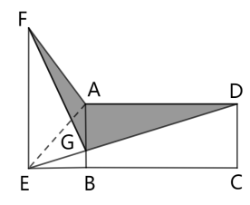

方法二：设AG、BE的长度分别为x米、y米，则BG的长度为（100-x）米。根据“ABCD为矩形，ABEF为直角梯形”，则，，因此，则有，即，整理可得，故所求涉密区域面积平方米=1.2万平方米。

故正确答案为A。

### 第 79 题

小王计划在7天假期自学甲、乙两门在线课程，每门课程需要连学2整天。如在所有可能的安排中随机选择1种，不用学习的3天均不相邻的概率为：

A. 

B. 

C. 

D. 

第 79 题 · 答案与解析

**参考答案（粉笔题库参考内容）**

D

**解析**

根据公式：概率，分析如下：

甲、乙两门课程均需要占用相邻的2天，可用捆绑法，先将每门课程所占用的2天分别捆绑，再将这2个捆绑体和其它3天进行排序。因每“天”均相同，不用排序，而两门课程不同，需要排序，则总情况数种情况；

根据题意，不用学习的3天均不相邻，可用插空法，优先安排学习两门课程的时间，因两门课程不同，对两门课程进行排序有种情况，再将剩余3天插入两门课程安排好之后形成的3个空隙，因每“天”均相同不用再排序，有种情况，故满足要求的情况数=2×1=2种情况。

综上，所求概率。

故正确答案为D。

### 第 80 题

一个容器的下部分为高12厘米的倒立圆锥体，上部分为圆柱体，且圆锥和圆柱的底面半径相等。现匀速向容器中注入水，1分钟后液面高6厘米，又过30分钟后注满。问整个容器的高度为多少厘米？

A. 22

B. 22.5

C. 23

D. 23.5

第 80 题 · 答案与解析

**参考答案（粉笔题库参考内容）**

D

**解析**

根据题意，该容器由圆柱体和倒立圆锥体组成，注入水后先注满圆锥体，再注满圆柱体。根据几何等比例放缩性质，在立体几何中，体积比等于相似比的立方，根据题意可知，，则相似比为1：2，故，因为注入水的流速相同，则，故注满圆锥体需要用时8分钟；水注满圆锥体后，再注满圆柱体需要用时1+30-8=23分钟，因圆锥体和圆柱体的底面半径相等，则二者的底面积相等，设圆锥体和圆柱体的底面积为S，圆柱体的高为厘米，根据公式：，，可得，解得厘米，则整个容器的高度为12+11.5=23.5厘米。

故正确答案为D。

### 第 81 题

从所给的四个选项中，选择最合适的一个填入问号处，使之呈现一定的规律性：

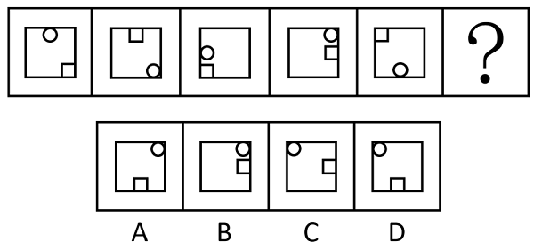

A. A

B. B

C. C

D. D

第 81 题 · 答案与解析

**参考答案（粉笔题库参考内容）**

D

**解析**

元素组成相同，优先考虑位置规律。如下图所示，在正方形外框上标记8个位置，观察发现，圆形每次顺时针移动3步，方块每次逆时针移动3步，只有D项符合。

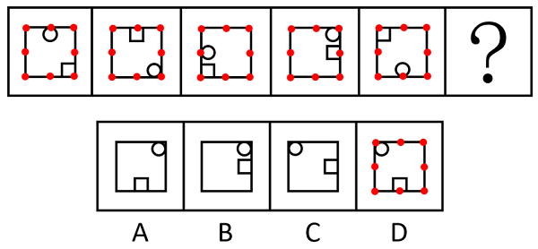

故正确答案为D。

### 第 82 题

从所给的四个选项中，选择最合适的一项填入问号处，使之呈现一定的规律性：

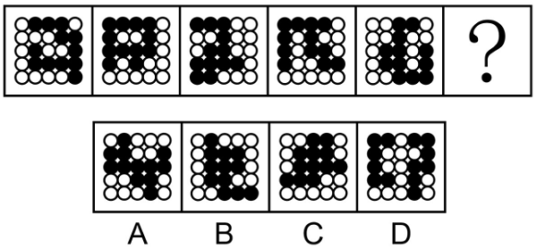

A. A

B. B

C. C

D. D

第 82 题 · 答案与解析

**参考答案（粉笔题库参考内容）**

B

**解析**

解法一：

元素组成相同，但无位置规律和属性规律，考虑数量规律。观察发现，题干图形中黑球和白球分堆明显，考虑部分数，题干图形中黑球部分数均为1，白球部分数均为2，？处图形也应遵循此规律，只有B项符合。

解法二：

元素组成相同，但无位置规律和属性规律，考虑数量规律。观察发现，题干图形中黑球和白球分堆明显，考虑部分数，题干图形中白球部分数均为2，且两部分的白球数量分别为12、1，11、2，10、3，9、4，8、5，一部分数量递减，另一部分数量递增，？处图形白球两部分数量应为7和6，只有B项符合。

故正确答案为B。

### 第 83 题

从所给的四个选项中，选择最合适的一个填入问号处，使之呈现一定的规律性：

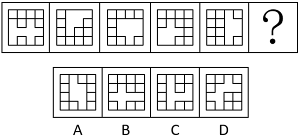

A. A

B. B

C. C

D. D

第 83 题 · 答案与解析

**参考答案（粉笔题库参考内容）**

D

**解析**

元素组成不同，优先考虑属性规律。观察发现，题干图形均出现规整的空白区域，考虑空白区域的对称性。题干图形空白区域对称轴方向依次顺时针旋转，故问号处应选择空白区域对称轴方向由左上到右下倾斜的，只有D项符合。

故正确答案为D。

### 第 84 题

从所给的四个选项中，选择最合适的一个填入问号处，使之呈现一定的规律性：

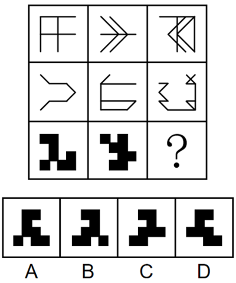

A. A

B. B

C. C

D. D

第 84 题 · 答案与解析

**参考答案（粉笔题库参考内容）**

A

**解析**

元素组成相似，优先考虑样式规律。九宫格优先看横行。观察发现，第一行图形中，图一和图二先求异，再将求异后的图形左右翻转，得到图三；经验证，第二行符合此规律；第三行应用此规律，图一和图二先求异，再将求异后的图形左右翻转，只有A项符合。

故正确答案为A。

### 第 85 题

左边为15个白色和3个灰色正方体组合而成多面体的正、反两面直观图，其可以由①、②和③三个多面体组合而成，问哪一项能填入问号处？

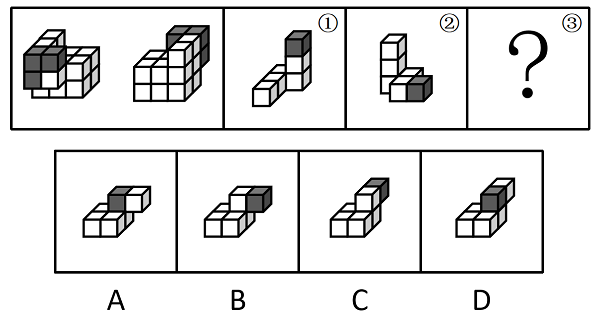

A. A

B. B

C. C

D. D

第 85 题 · 答案与解析

**参考答案（粉笔题库参考内容）**

B

**解析**

本题考查立体拼合。题干立体图形可以由①、②以及B项旋转后拼合而成，如下图所示：

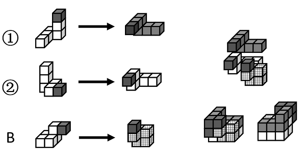

故正确答案为B。

### 第 86 题

下图为4个黑色、8个白色正方体粘接成的长方体，问哪一项可能是其正确的外表面展开图?

A. A

B. B

C. C

D. D

第 86 题 · 答案与解析

**参考答案（粉笔题库参考内容）**

D

**解析**

本题为空间重构题，可以通过公共边进行判断，由构成直角的两条边为公共边可知，公共边两侧对应的黑白块颜色应相同，逐一进行分析。

A项：公共边①和②两侧黑白块颜色不同，选项与题干不一致，排除；

B项：公共边①和②两侧黑白块颜色不同，选项与题干不一致，排除；

C项：公共边①和②、③和④两侧黑白块颜色不同，选项与题干不一致，排除；

D项：公共边①和②、③和④、⑤和⑥两侧黑白块颜色均相同，选项与题干一致，当选。

故正确答案为D。

### 第 87 题

左边为给定的多面体，现用经P、Q、R三个顶点的平面对其进行切割，问哪个选项是其切面？

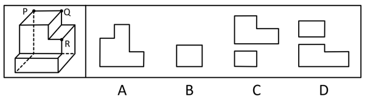

A. A

B. B

C. C

D. D

第 87 题 · 答案与解析

**参考答案（粉笔题库参考内容）**

B

**解析**

本题考查截面图。根据平面公理“过不在一条直线上的三点，有且只有一个平面”可以得出，经过P、Q、R三点可以确定唯一的平面，即切面为B项，如下图所示：

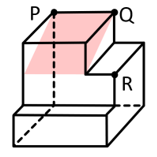

故正确答案为B。

### 第 88 题

把下面的六个图形分为两类，使每一类图形都有各自的共同特征或规律，分类正确的一项是：

A. ①②④，③⑤⑥

B. ①③⑤，②④⑥

C. ①③④，②⑤⑥

D. ①③⑥，②④⑤

第 88 题 · 答案与解析

**参考答案（粉笔题库参考内容）**

C

**解析**

本题为分组分类题目。元素组成相同，但整体看没有明显的位置规律。观察发现，每幅图中均有一个正方形，且图①③④中的正方形在图形的中心位置，图②⑤⑥中的正方形在图形的四周位置。故图①③④为一组，图②⑤⑥为一组。

故正确答案为C。

### 第 89 题

把下面的六个图形分为两类，使每一类图形都有各自的共同特征或规律，分类正确的一项是：

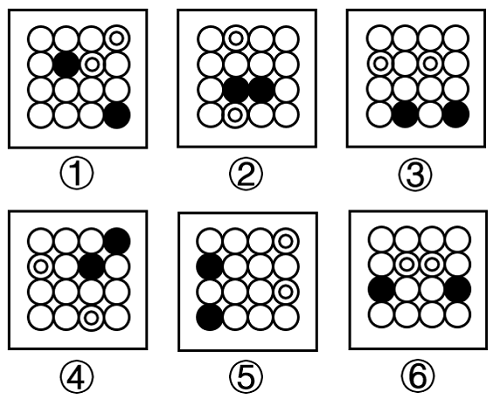

A. ①②③，④⑤⑥

B. ①⑤⑥，②③④

C. ①②④，③⑤⑥

D. ①③⑤，②④⑥

第 89 题 · 答案与解析

**参考答案（粉笔题库参考内容）**

C

**解析**

本题为分组分类题目。观察发现，题干图形均出现黑球与白球，且每幅图均有两个黑球和两个套圈白球，虽然元素组成相同，但黑球与套圈白球的位置无规律，考虑两点确定一条直线，将两个黑球连线，两个套圈白球连线，观察连线的规律。观察发现，图①②④中，黑球连线与套圈白球连线互相垂直，图③⑤⑥中，黑球连线与套圈白球连线互相平行，即图①②④为一组，图③⑤⑥为一组。

故正确答案为C。

### 第 90 题

把下面的六个图形分为两类，使每一类图形都有各自的共同特征或规律，分类正确的一项是：

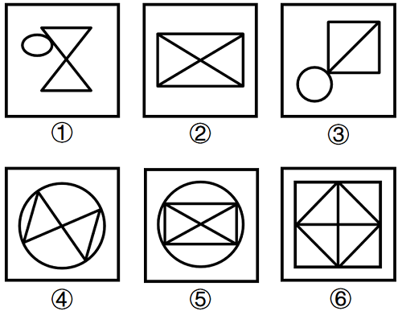

A. ①②④，③⑤⑥

B. ①③④，②⑤⑥

C. ①②⑤，③④⑥

D. ①④⑤，②③⑥

第 90 题 · 答案与解析

**参考答案（粉笔题库参考内容）**

B

**解析**

本题为分组分类题目。元素组成不同，且无明显属性规律，考虑数量规律。观察发现，图②为“田”字的变形图，图③有“日”字的变形图，考虑笔画数。图①③④为一笔画图形，图②⑤⑥为两笔画图形，即图①③④为一组，图②⑤⑥为一组。

故正确答案为B。

### 第 91 题

后视错觉是个体的一种认知偏差，是指在一件事情已经发生之后，即使个体之前没有对此做过预判，也认为自己“早就知道会这样”。

根据上述定义，下列符合后视错觉的是：

A. 小瑾是一个悲观的人，她申请升职失败后，灰心丧气地说：“我早就知道，我什么都不如别人，什么也做不好。”

B. 朋友邀阿欣去爬山，阿欣说高温预警不宜爬山，朋友坚持去，才到半山腰就汗流浃背，阿欣说：“我早就说会很热啊。”

C. 晓琳参加一个重要会议迟到了。她懊悔地说：“我早该想到周一早上会堵车，不该按周末的情况预估通勤时间。”

D. 晓菲在股票大跌之后，懊恼地说：“我早就觉察到那些信号了，觉得走势不太好，怎么就没有早卖出啊。”

第 91 题 · 答案与解析

**参考答案（粉笔题库参考内容）**

D

**解析**

第一步：找出定义关键词。

“在一件事情已经发生之后”、“个体之前没有对此做过预判”、“认为自己‘早就知道会这样’”。

第二步：逐一分析选项。

A项：小瑾是一个“悲观”的人，说明她对自己升职的申请不抱有希望，认为自己会失败，在事情发生之前就预判了失败的结果，不符合“个体之前没有对此做过预判”，不符合定义，排除；

B项：阿欣在爬山前说高温预警不宜爬山，是朋友坚持爬山，说明在事情发生之前阿欣已经对“爬山会很热”做出了预判，不符合“个体之前没有对此做过预判”，不符合定义，排除；

C项：晓琳参加一个重要会议迟到了，符合“在一件事情已经发生之后”，她懊悔地说“我早该想到周一早上会堵车，不该按周末的情况预估通勤时间”，说明她在对“自己没有想到周一早上会堵车”这件事懊悔，不符合“认为自己‘早就知道会这样’”，不符合定义，排除；

D项：晓菲在股票大跌之后，符合“在一件事情已经发生之后”，懊恼地说“我早就觉察到那些信号了，觉得走势不太好”，说明晓菲认为自己早就觉察到股票会下跌，符合“认为自己‘早就知道会这样’”，符合定义，当选。

故正确答案为D。

### 第 92 题

回应型预算要求政府基于与人民的民主协商作出预算决策，相关责任部门应当及时反应并积极回复人民的质疑和诉求。

根据上述定义，下列属于回应型预算的是：

A. 甲国突发大规模严重旱情，财政部门从中央及各级政府应急预算中，通过多种财政政策安排，保障应急救援经费

B. 乙省是地质灾害高发地区，年初该省编制《乙省地质灾害应急中心XX年度部门预算公开说明》并在官网上发布

C. 丙市在年初将上一年度的地方预算执行情况在官网进行公布，诚邀广大市民和社会公众踊跃监督并提出意见

D. 丁区实行预算听证制度，对与公共服务和社会民生相关的重大支出项目开展听证，并就意见和建议进行书面答复

第 92 题 · 答案与解析

**参考答案（粉笔题库参考内容）**

D

**解析**

第一步：找出定义关键词。

“政府基于与人民的民主协商作出预算决策”、“相关责任部门及时反应并积极回复人民的质疑和诉求”。

第二步：逐一分析选项。

A项：甲国财政部门从应急预算中安排保障应急救援经费，只是在应对旱情时进行经费安排，未体现出基于与人民的民主协商作出预算决策，也没有涉及回复人民的质疑和诉求，不符合“政府基于与人民的民主协商作出预算决策”、“相关责任部门及时反应并积极回复人民的质疑和诉求”，不符合定义，排除；

B项：乙省编制并发布预算公开说明，只是将预算情况公开，没有体现出基于与人民的民主协商作出预算决策以及回复人民的质疑和诉求，不符合“政府基于与人民的民主协商作出预算决策”、“相关责任部门及时反应并积极回复人民的质疑和诉求”，不符合定义，排除；

C项：丙市是将上一年度的地方预算执行情况公布并邀请监督、提出意见，但这是对上一年度已执行情况的公开，并非作出预算决策的过程，不符合“政府基于与人民的民主协商作出预算决策”，不符合定义，排除；

D项：丁区实行预算听证制度，开展听证意味着是与人民进行民主协商的过程，符合“政府基于与人民的民主协商作出预算决策”，对相关重大支出项目听取意见，并且就意见和建议进行书面答复，体现了相关责任部门及时反应并积极回复人民的质疑和诉求，符合“相关责任部门及时反应并积极回复人民的质疑和诉求”，符合定义，当选。

故正确答案为D。

### 第 93 题

选择或然率理论解释的是影响受众对大众传播内容选择的决定性因素。该理论的核心公式是：选择或然率=报偿的保证/费力的程度。其中，报偿的保证指的是传播内容满足选择者需要的程度，即内容对于受众的吸引力和实用性；费力的程度指的是获取传播内容和使用传播途径的难度。

根据上述定义，下列属于提高选择或然率的传播行为的是：

A. 视频号平台借助数据分析和个性化算法，给用户推荐符合其偏好的视频

B. 时下流行的某影视作品在播放之前被插入一段2分钟的广告

C. 某商家优化了商品布局，将畅销商品放在出口处，顾客可直接扫码支付

D. 电视内置视频播放软件，开机后须先注册登录，才可搜索相关内容观看

第 93 题 · 答案与解析

**参考答案（粉笔题库参考内容）**

A

**解析**

第一步：找出定义关键词。

选择或然率理论：“影响受众对大众传播内容选择的决定性因素”、“该理论的核心公式是：选择或然率=报偿的保证/费力的程度”；

报偿的保证：“传播内容满足选择者需要的程度”、“内容对于受众的吸引力和实用性”；

费力的程度：“获取传播内容和使用传播途径的难度”。

第二步：逐一分析选项。

A项：平台推荐用户偏好的视频，说明传播内容贴近用户需求，对用户具有吸引力，提高了“传播内容满足选择者需要的程度”和“内容对于受众的吸引力和实用性”，即“报偿的保证”提高了，平台推荐说明用户获取传播途径的难度小，降低了“获取传播内容和使用传播途径的难度”，即“费力的程度”降低了，而“选择或然率=报偿的保证/费力的程度”，因此属于提高选择或然率的传播行为，符合定义，当选；

B项：影视作品在播放之前被插入一段2分钟的广告，增加了用户观看影视作品的难度，提高了“获取传播内容和使用传播途径的难度”，即“费力的程度”提高了，而“选择或然率=报偿的保证/费力的程度”，因此属于降低选择或然率的传播行为，不符合定义，排除；

C项：某商家将畅销商品放在出口处，不涉及传播内容，不符合“影响受众对大众传播内容选择的决定性因素”，不符合定义，排除；

D项：电视内置视频播放软件，开机后须先注册登录，才可搜索相关内容观看，增加了用户看视频的难度，提高了“获取传播内容和使用传播途径的难度”，即“费力的程度”提高了，而“选择或然率=报偿的保证/费力的程度”，因此属于降低选择或然率的传播行为，不符合定义，排除。

故正确答案为A。

### 第 94 题

三维反求是测量技术、数据处理技术、图形处理技术和加工技术相结合的综合性技术，是指用一定的测量方法对实物进行测量，根据测量数据通过三维几何建模方法重构实物的数字化模型的过程。

根据上述定义，下列关于三维反求工程的步骤，排序正确的是：

①通过制造样品来验证模型是否满足精度和其他性能指标

②通过一定的算法，从测量数据中提取零件的设计与加工特征

③使用高精度的三维测量技术获取零件表面各点的空间坐标

④使用计算机辅助设计软件将数据与特征重构为三维模型

A. ①③④②

B. ①④③②

C. ③①②④

D. ③②④①

第 94 题 · 答案与解析

**参考答案（粉笔题库参考内容）**

D

**解析**

第一步：找出定义关键词。

“用一定的测量方法对实物进行测量”、“根据测量数据通过三维几何建模方法重构实物的数字化模型”。

第二步：逐一对照选项并判断正确答案。

根据定义可知，三维反求工程的步骤应先“对实物进行测量”，再“根据测量数据通过三维几何建模方法重构实物的数字化模型”，故步骤③应位于首句，排除A、B两项。继续分析步骤①和步骤④可知，应先“重构三维模型”再“验证模型”，故步骤④应在步骤①之前，排除C项。

故正确答案为D。

### 第 95 题

形象史学是指把形与象作为主要材料，用以研究历史的一门学问。具体来说，是指把传世的包括出土（水）的具有研究价值的石刻、陶塑、壁画、雕砖、铜玉、织绣、漆器、木器、绘画等历史实物、文本图像以及文化史迹作为主要研究对象，并结合传统文献来综合考察历史的一种新的史学研究模式。

根据上述定义，下列属于形象史学研究范畴的是：

A. 结合《晋书》等史书，通过对吉林集安长川1号墓礼佛图主佛形象及莲花纹的考察，研究三燕文化对高句丽佛教产生的影响

B. 通过对现存的汉画像石（汉代人雕刻在墓室、祠堂四壁的装饰石刻壁画）的实地考察，分析汉画像石的雕刻风格和雕刻技法

C. 根据史诗《伊利亚特》的记载，找到特洛伊城的遗址，并在其中发掘出王冠、银瓶、短剑等大量器物

D. 通过对二十世纪二三十年代齐白石、傅抱石等人具有代表性的国画作品进行研究，分析当时国画中所蕴含的思想意境

第 95 题 · 答案与解析

**参考答案（粉笔题库参考内容）**

A

**解析**

第一步：找出定义关键词。

“把传世的包括出土（水）的具有研究价值的石刻、陶塑、壁画、雕砖、铜玉、织绣、漆器、木器、绘画等历史实物、文本图像以及文化史迹作为主要研究对象”、“结合传统文献”、“综合考察历史”。

第二步：逐一分析选项。

A项：结合《晋书》等史书，符合“结合传统文献”，对吉林集安长川1号墓礼佛图主佛形象及莲花纹的考察，符合“把传世的包括出土（水）的具有研究价值的石刻、陶塑、壁画、雕砖、铜玉、织绣、漆器、木器、绘画等历史实物、文本图像以及文化史迹作为主要研究对象”，研究三燕文化对高句丽佛教产生的影响，符合“综合考察历史”，符合定义，当选；

B项：只有对现存的汉画像石的实地考察，没有结合文献资料，不符合“结合传统文献”，分析汉画像石的雕刻风格和雕刻技法，不符合“综合考察历史”，不符合定义，排除；

C项：根据史诗《伊利亚特》的记载，找到特洛伊城的遗址，目的是发掘出王冠、银瓶、短剑等大量器物，而不是结合出土的器物考察历史，不符合“把传世的包括出土（水）的具有研究价值的石刻、陶塑、壁画、雕砖、铜玉、织绣、漆器、木器、绘画等历史实物、文本图像以及文化史迹作为主要研究对象”、“综合考察历史”，不符合定义，排除；

D项：只是对齐白石、傅抱石等人的国画作品进行研究，没有结合文献资料，不符合“结合传统文献”，分析当时国画中所蕴含的思想意境，不符合“综合考察历史”，不符合定义，排除。

故正确答案为A。

### 第 96 题

深度优先搜索是指从初始节点出发，按照一定的顺序扩展到下一个节点，然后从下一个节点出发继续扩展到新的节点，不断递归执行这个过程，直到某个节点不能再扩展到下一个节点，此时返回上一个节点重新寻找一个新的节点继续扩展，如此搜索下去，直到找到目标节点，或者搜索完所有节点为止。

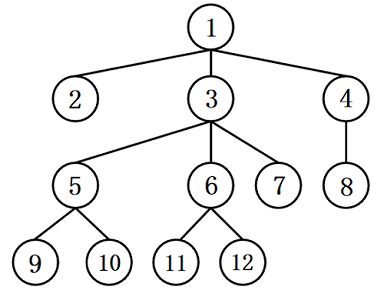

根据上述定义，如果以“1”为初始节点，“12”为目标节点，下列搜索路径符合深度优先搜索的是：

A. 121361112

B. 148413612

C. 135373612

D. 135105313612

第 96 题 · 答案与解析

**参考答案（粉笔题库参考内容）**

B

**解析**

第一步：找出定义关键词。

“从初始节点出发，按照一定的顺序不断扩展到下一个节点，直到不能再扩展”、“此时返回上一个节点重新寻找一个新的节点继续扩展，直到找到目标节点，或者搜索完所有节点为止”。

第二步：逐一分析选项。

A项：121361112，图中显示，扩展到节点11时已无法继续扩展，且未找到目标节点，此时应返回到上一个节点6，而该项直接扩展到同级的节点12，不符合“此时返回上一个节点重新寻找一个新的节点继续扩展，如此搜索下去，直到找到目标节点，或者搜索完所有节点为止”，不符合定义，排除；

B项：148413612，图中显示，从初始节点1出发，扩展到下一个节点4，继续扩展到下一个节点8，此时已无法继续扩展，且未找到目标节点，应返回到上一个节点4，同理继续返回上一个节点1，扩展到下一个节点3，继续扩展到下一个节点6，再扩展到下一个节点12，此时已找到目标节点，搜索完成，符合“从初始节点出发，按照一定的顺序不断扩展到下一个节点，直到不能再扩展”、“此时返回上一个节点重新寻找一个新的节点继续扩展，直到找到目标节点，或者搜索完所有节点为止”，符合定义，当选；

C项：135373612，图中显示，扩展到节点5时直接返回到上一个节点3，而节点5含有节点9和节点10两个下级节点，属于扩展不完整，不符合“从初始节点出发，按照一定的顺序不断扩展到下一个节点，直到不能再扩展”，不符合定义，排除；

D项：135105313612，图中显示，从节点10返回到节点5时又返回到节点3，而节点5还含有节点9这一下级节点，返回到节点5时需要继续扩展到节点9，因此扩展顺序有误，不符合“此时返回上一个节点重新寻找一个新的节点继续扩展，如此搜索下去，直到找到目标节点，或者搜索完所有节点为止”，不符合定义，排除。

故正确答案为B。

### 第 97 题

元科学也称元理论，是一种以科学为研究对象的学科，它研究科学的性质、特征、形成和发展规律。科学概念是“科学内部”出现的概念，如“质量”“频率”等；而元科学概念是“谈论科学的”，表示科学的陈述或活动特征的概念。

根据上述定义，下列说法正确的是:

A. “黑洞”是科学概念，“量子”是元科学概念

B. “物质波”“科学”都是科学概念

C. “理论”“确证”都是元科学概念

D. “经验”是科学概念，“宇宙”是元科学概念

第 97 题 · 答案与解析

**参考答案（粉笔题库参考内容）**

C

**解析**

第一步：找出定义关键词。

元科学：“是一种以科学为研究对象的学科”、“它研究科学的性质、特征、形成和发展规律”；

科学概念：“‘科学内部’出现的概念”；

元科学概念：“是‘谈论科学的’，表示科学的陈述或活动特征的概念”。

第二步：逐一分析选项。

A项：“黑洞”“量子”都是“科学内部”出现的概念，符合“科学概念”，排除；

B项：“物质波”是“科学内部”出现的概念，符合“科学概念”；“科学”是元科学的研究对象，不是“科学内部”出现的概念，不符合“科学概念”，排除；

C项：“理论”“确证”都是用来“谈论科学的”，表示科学的陈述或活动特征，符合“元科学概念”，当选；

D项：“经验”不是“科学内部”出现的概念，不符合“科学概念”；“宇宙”是“科学内部”出现的概念，符合“科学概念”，排除。

故正确答案为C。

### 第 98 题

同一认定是指侦查中具有专门知识的人或了解客体特征的人，通过比较先后出现的客体的特征而对客体是否同一做出的判断。这里所说的客体是指与案件有关联的人或物。

根据上述定义，下列属于同一认定的是：

A. 通过对手机中所存储的信息进行检查，确定其是否为报案人所丢失的手机

B. 通过对犯罪现场提取的DNA信息与DNA信息库进行比对，查找犯罪嫌疑人

C. 通过对走私案中所缴获的走私物品进行多次鉴定，认定其是否为国外某厂家所生产

D. 通过对犯罪嫌疑人车上所收缴的各类物品进行检验，判断其是否属于违禁物品

第 98 题 · 答案与解析

**参考答案（粉笔题库参考内容）**

B

**解析**

第一步：找出定义关键词。

“侦查中具有专门知识的人或了解客体特征的人”、“通过比较先后出现的客体的特征”、“对客体是否同一做出的判断”。

第二步：逐一分析选项。

A项：通过对手机中所存储的信息进行检查，只是检查手机存储的信息，不符合“通过比较先后出现的客体的特征”，不符合定义，排除；

B项：通过对犯罪现场提取的DNA信息与DNA信息库进行比对，把现场提取的DNA信息与先录入到DNA信息库中的进行比对，符合“通过比较先后出现的客体的特征”，通过DNA比对查找犯罪嫌疑人，即判断现场提取的DNA信息与DNA信息库中储存的信息是否为同一人，符合“对客体是否同一做出的判断”，符合定义，当选；

C项：通过对走私案中所缴获的走私物品进行多次鉴定，判断是否是国外某厂家生产的物品，只能证明这些物品是否产自于国外某厂家，无法证明该物品与其他物品为同一个物品，不符合“对客体是否同一做出的判断”，不符合定义，排除；

D项：通过对犯罪嫌疑人车上所收缴的各类物品进行检验，只是检查收缴的物品，不符合“通过比较先后出现的客体的特征”，不符合定义，排除。

故正确答案为B。

### 第 99 题

流域内降雨或融冰化雪都可以引起河水显著上涨。春季，气候转暖，流域内的季节性积雪融化、河流解冻或春雨，引起河水上涨称春汛。因正值桃花盛开时节，故亦称桃汛。我国北方，把春季河冰解冻引起的涨水现象专称为凌汛。夏季，流域内的暴雨或高山冰川和积雪融化，使河水急剧上涨，称夏汛。我国习惯上把发生在夏季三伏前后的汛水称为伏汛。秋季由于暴雨，河水发生急剧上涨称秋汛。

根据上述定义，下列判断错误的是：

A. 春汛包含凌汛

B. 夏汛包含伏汛

C. 伏汛在凌汛前

D. 春汛就是桃汛

第 99 题 · 答案与解析

**参考答案（粉笔题库参考内容）**

C

**解析**

第一步：找出定义关键词。

春汛、桃汛：“春季，流域内的季节性积雪融化、河流解冻或春雨，引起河水上涨”、“因正值桃花盛开时节，故亦称桃汛”；

凌汛：“春季河冰解冻引起的涨水现象”；

夏汛：“夏季，流域内的暴雨或高山冰川和积雪融化，使河水急剧上涨”；

伏汛：“发生在夏季三伏前后的汛水”；

秋汛：“秋季由于暴雨，河水发生急剧上涨”。

第二步：逐一分析选项。

A项：凌汛是春季河冰解冻引起的涨水现象，说明是在春季因河流解冻引起的河水上涨，属于春汛的一种，所以春汛包含凌汛，判断正确，排除；

B项：伏汛是发生在夏季三伏前后的汛水，说明是在夏季发生的河水上涨，属于夏汛的一种，所以夏汛包含伏汛，判断正确，排除；

C项：伏汛是发生在夏季三伏前后的汛水，凌汛是春季河冰解冻引起的涨水现象，夏季在春季后，所以伏汛在凌汛后，判断错误，当选；

D项：春汛的发生因正值桃花盛开时节，故亦称桃汛，所以春汛就是桃汛，判断正确，排除。

本题为选非题，故正确答案为C。

### 第 100 题

具有包含与被包含关系的三个概念，如植物、乔木、水杉等，可至少形成三个正确的命题：所有的水杉都是乔木，所有的乔木都是植物，所有的水杉都是植物，由“所有的乔木都是植物”“所有的水杉都是植物”而得出“所有的水杉都是乔木”，这样的推理被称为排序推理。

根据上述定义，下列属于排序推理的是：

A. 所有的平行四边形都是四边形，所有的菱形都是四边形，所以，所有的菱形都是平行四边形

B. 所有的昆虫都是动物，所有的蝴蝶都是昆虫，所以，所有的蝴蝶都是动物

C. 所有的文字都是符号，所有的文字都是图形，所以，所有的符号都是图形

D. 这个花园的花都是迎春花，迎春花都在冬、春季开放，所以，这个花园的花都在冬、春季开放

第 100 题 · 答案与解析

**参考答案（粉笔题库参考内容）**

A

**解析**

第一步：找出定义关键词。

“具有包含与被包含关系的三个概念”。

题干“排序推理”的例子可以理解为：由“所有的乔木（a）都是植物（b），所有的水杉（c）都是植物（b）”而得出“所有的水杉（c）都是乔木（a）”，即逻辑结构为：“所有a都是b，所有c都是b，所以，所有c都是a”。

第二步：逐一分析选项。

A项：菱形、平行四边形、四边形符合“具有包含与被包含关系的三个概念”，选项可以理解为：“所有的平行四边形（a）都是四边形（b），所有的菱形（c）都是四边形（b），所以，所有的菱形（c）都是平行四边形（a）”，即逻辑结构为：“所有a都是b，所有c都是b，所以，所有c都是a”，符合定义，当选；

B项：蝴蝶、昆虫、动物符合“具有包含与被包含关系的三个概念”，选项可以理解为：“所有的昆虫（a）都是动物（b），所有的蝴蝶（c）都是昆虫（a），所以，所有的蝴蝶（c）都是动物（b）”，即逻辑结构为：“所有a都是b，所有c都是a，所以，所有c都是b”，不符合定义，排除；

C项：文字、符号、图形不符合“具有包含与被包含关系的三个概念”，不符合定义，排除；

D项：这个花园的花、迎春花、冬春季开放的花不符合“具有包含与被包含关系的三个概念”，不符合定义，排除。

故正确答案为A。

### 第 101 题

逐客令：挡箭牌

A. 急先锋：领航者

B. 避风港：马后炮

C. 敲门砖：绊脚石

D. 鸿门宴：攻心计

第 101 题 · 答案与解析

**参考答案（粉笔题库参考内容）**

C

**解析**

第一步：判断题干词语间逻辑关系。

“逐客令”本为驱逐客卿的命令，后用于指主人对客人不欢迎时，用明说或暗示的方式，催客人离去。“挡箭牌”指古代防御武器中可以抵挡刀箭的盾牌，比喻推掉事情的借口或可以掩护的东西。“逐客令”与“挡箭牌”均根据功能进行命名。

第二步：判断选项词语间逻辑关系。

A项：“急先锋”比喻冲锋在前或积极领头的人。“领航者”通常指的是在特定领域或活动中，为其他人或组织提供指导和方向的人。其中“急先锋”不是根据功能进行命名，与题干逻辑关系不一致，排除；

B项：“避风港”意思是供船只躲避大风浪的港湾，比喻供躲避激烈斗争的地方。“马后炮”是象棋术语，比喻事后才采取措施，但已无济于事。其中“马后炮”不是根据功能进行命名，与题干逻辑关系不一致，排除；

C项：“敲门砖”是指敲门的砖石，比喻借以谋取名利的工具，目的一旦达到就被抛弃。“绊脚石”是指行走时使脚受阻而跌倒的石块，喻指前进道路上的障碍物。“敲门砖”与“绊脚石”均根据功能进行命名，与题干逻辑关系一致，当选；

D项：“鸿门宴”意指不怀好意、居心不良的邀宴，比喻想要加害客人的宴会。“攻心计”指的是从心理上、精神上分析对方，从而瓦解对方，达到目的的一种心理战术。其中“鸿门宴”不是根据功能进行命名，与题干逻辑关系不一致，排除。

故正确答案为C。

### 第 102 题

嘤其鸣矣：求其友声

A. 遏其生气：以求重价

B. 求之其本：经旬必得

C. 道不拾遗：夜不闭户

D. 避其锐气：击其惰归

第 102 题 · 答案与解析

**参考答案（粉笔题库参考内容）**

A

**解析**

第一步：判断题干词语间逻辑关系。

“嘤其鸣矣，求其友声”指小鸟那嘤嘤的叫声，是为了寻求知音，二者为方式目的的对应关系。

第二步：判断选项词语间逻辑关系。

A项：“遏其生气，以求重价”指阻抑它（梅花）的生机，这样做是为了谋求高价，二者为方式目的的对应关系，与题干逻辑关系一致，当选；

B项：“求之其本，经旬必得”指做事情如果从根本做起，经过一段时间必定能够收效，二者为条件对应关系，与题干逻辑关系不一致，排除；

C项：“道不拾遗，夜不闭户”指东西丢在路上没有人拾走，夜里睡觉都不需要关门防盗，二者为并列关系，与题干逻辑关系不一致，排除；

D项：“避其锐气，击其惰归”指先避开敌人初来时的气势，等敌人疲惫时再狠狠打击，二者为时间先后顺序的对应关系，与题干逻辑关系不一致，排除。

故正确答案为A。

### 第 103 题

直观性：即时性：网络直播

A. 等边性：对称性：等腰梯形

B. 公开性：权威性：行政法律

C. 周期性：延展性：机械钟摆

D. 挥发性：保温性：石棉纤维

第 103 题 · 答案与解析

**参考答案（粉笔题库参考内容）**

B

**解析**

第一步：判断题干词语间逻辑关系。

网络直播具有直观性和即时性，前两词与第三词构成属性对应关系。

第二步：判断选项词语间逻辑关系。

A项：等边性是指图形中各边的长度都相等，等腰梯形只有一组对边相等，不具有等边性，与题干逻辑关系不一致，排除；

B项：行政法律具有公开性和权威性，前两词与第三词构成属性对应关系，与题干逻辑关系一致，当选；

C项：延展性是表示材料在受力而产生破裂之前，其塑性变形的能力，机械钟摆作为一个整体装置，不具有延展性，与题干逻辑关系不一致，排除；

D项：挥发性是指液态物质在低于沸点的温度条件下转变成气态的能力，以及一些气体溶质从溶液中逸出的能力，石棉纤维是天然纤维状的硅质矿物的泛称，不具有挥发性，与题干逻辑关系不一致，排除。

故正确答案为B。

### 第 104 题

光伏电站：电池板：发电

A. 跨海大桥：桥墩支架：交通

B. 射电望远镜：电磁波：信号

C. 海底气田：油气管道：钻井

D. 游乐设施：球幕电影：娱乐

第 104 题 · 答案与解析

**参考答案（粉笔题库参考内容）**

A

**解析**

第一步：判断题干词语间逻辑关系。

电池板是光伏电站的组成部分，前两词为组成关系，光伏电站具有发电的功能，第一个词和第三个词为功能对应关系。

第二步：判断选项词语间逻辑关系。

A项：桥墩支架是跨海大桥的组成部分，前两词为组成关系，跨海大桥具有交通功能，第一个词和第三个词为功能对应关系，与题干逻辑关系一致，当选；

B项：射电望远镜的工作原理是接收来自宇宙空间的电磁波，二者不是组成关系，与题干逻辑关系不一致，排除；

C项：油气管道是海底气田开发生产系统的组成部分，但钻井是开发海底气田的一项工程，二者不是功能对应关系，与题干逻辑关系不一致，排除；

D项：球幕电影是一种电影形式，游乐设施是指用于经营目的，承载游客游乐的载体，二者不是组成关系，与题干逻辑关系不一致，排除。

故正确答案为A。

### 第 105 题

稀树草原 对于 （ ） 相当于 （ ） 对于 国际公约

A. 物种多样性；缔约国家

B. 落叶阔叶林；多边条约

C. 气候变迁；政治协调

D. 植被类型；联合国宪章

第 105 题 · 答案与解析

**参考答案（粉笔题库参考内容）**

D

**解析**

逐一代入选项。

A项：稀树草原是炎热、季节性干旱气候条件下长成的植被类型，稀树草原物种丰富，具有物种多样性，二者为属性对应关系；缔约国家是条约制定国以及自愿加入或者遵守并同意签约的其他主权国家，只有签订国际公约才是缔约国家，二者为条件对应关系，前后逻辑关系不一致，排除；

B项：稀树草原是炎热、季节性干旱气候条件下长成的植被类型，落叶阔叶林也是一种植被类型，二者为并列关系；国际公约是国家之间签署的公约，多边条约是指外交条约，国际公约是外交条约，二者为种属关系，前后逻辑关系不一致，排除；

C项：气候变迁可能会导致形成稀树草原，二者为因果对应关系；国际公约有政治协调的功能，二者为功能对应关系，前后逻辑关系不一致，排除；

D项：稀树草原是炎热、季节性干旱气候条件下长成的植被类型，二者为种属关系；联合国宪章是联合国的基本大法，是国际公约，二者为种属关系，前后逻辑关系一致，当选。

故正确答案为D。

### 第 106 题

某企业对于如何进行产教融合，形成如下两种方案：一是“做深”，企业自建培训中心，成立专职和兼职的企业培训师队伍，并根据企业需求，制定专门的培训大纲和计划，该中心与毕业生未来形成签约。二是“做浅”，在学校设立“冠名班”和“订单班”，以学校教育为主，企业与学生当前没有签约意向，但随时保持互相选择的权利。

以下理由中，能够支持企业选择第二方案的是：

A. 企业必须付出人力成本，人力资源自带“稀缺”和“增值”属性，在企业面临竞争压力时尤其要重视

B. 企业订单量并不是稳定的，遇到订单量突然增加需要扩产的时候，才临时需要大量的人参与进来

C. 该企业生产使用的是特种专业设备，竞争对手稀少，不具备从市场上挖掘技术人员的条件

D. 学校教育内容具有普适性，而自建培训中心有利于企业保障准员工的培养质量，提前锁定毕业生

第 106 题 · 答案与解析

**参考答案（粉笔题库参考内容）**

B

**解析**

第一步：找出论点和论据。

论点：企业选择产教融合的第二种方案：“做浅”，在学校设立“冠名班”和“订单班”，以学校教育为主，企业与学生当前没有签约意向，但随时保持互相选择的权利。

论据：无。

本题的论点说的是企业与学校合作，培养企业需要的人，随时需求随时签约。本题只有论点，没有论据，加强考虑补充论据。

第二步：逐一分析选项。

A项：企业付出人力成本，与论点讨论的企业和学校合作无关，话题不一致，无法加强，排除；

B项：企业订单不稳定，订单突然增加时才需要大量人员，那么可以和学校签约“订单班”，随时和学生互相选择，能支持选择第二方案，补充论据，可以加强，当选；

C项：企业生产使用特种专业设备，不具有从市场挖人的条件，与论点讨论的企业和学校合作无关，话题不一致，无法加强，排除；

D项：自建培训中心比学校教育更有利，支持第一方案，反而削弱第二方案，无法加强，排除。

故正确答案为B。

### 第 107 题

海山是海面下的岛屿，与岛屿中的火山岛有相同的起源和相似的形态，以往的海山生物调查发现，海山岩石上的生物群落与海山周边的软底沉积和深海平原上的生物群落大不相同。而且，一些海山之间的生物群落在物种构成上较少重叠。因此，有一些学者认为，相对孤立的海山存在独特的生物群落且拥有高度特有的动物群。

以下哪项如果为真，最能反驳上述学者的观点？

A. 远离大陆的孤岛，因为海洋的分割往往会形成相对孤立且独特的岛屿生物群

B. 物理隔离海洋的现象在海洋中很少出现，所以海山不可能长期被隔离成水下孤岛

C. 早期一些海山中发现的高度特有物种其实是采样不足造成的，很多海山都有相同的生物来源

D. 地形和海流的相互作用在某些海山顶部形成封闭环流，使栖息其上的生物幼体难以扩散

第 107 题 · 答案与解析

**参考答案（粉笔题库参考内容）**

C

**解析**

第一步：找出论点和论据。

论点：相对孤立的海山存在独特的生物群落且拥有高度特有的动物群。

论据：以往的海山生物调查发现，海山岩石上的生物群落与海山周边的软底沉积和深海平原上的生物群落大不相同。而且，一些海山之间的生物群落在物种构成上较少重叠。

本题论点和论据说的都是海山的生物群落比较独特，话题一致，削弱可以考虑削弱论点或削弱论据。

第二步：逐一分析选项。

A项：指出远离大陆的孤岛因为海洋的分割往往会形成相对孤立且独特的岛屿生物群，但论点讨论的是海山，海山并不都是远离大陆的孤岛，话题不一致，无法削弱，排除；

B项：指出海山不可能长期被隔离成水下孤岛，但论点讨论的是海山是否存在独特的生物群落且拥有高度特有的动物群，话题不一致，无法削弱，排除；

C项：指出早期一些海山中发现的高度特有物种其实是采样不足造成的，很多海山都有相同的生物来源，说明论据里面的调查并不全面，削弱论据，可以削弱，当选；

D项：指出某些海山顶部形成封闭环流，使栖息其上的生物幼体难以扩散，讨论的是生物幼体难以扩散的原因，但论点讨论的是海山是否存在独特的生物群落且拥有高度特有的动物群，话题不一致，无法削弱，排除。

故正确答案为C。

### 第 108 题

飞行信息记录系统，也就是俗称的黑匣子，在空难事故调查中的重要作用不需赘言，但无论在陆上还是海上的空难事故中，搜寻黑匣子都极其不易。有人建议，可利用现在飞速发展的互联技术，把黑匣子升级成为“云匣子”，那么飞机在空中就能够实时与地面进行信息交互，使空难事故的分析变得更加便捷。

以下哪项如果为真，最能质疑上述建议？

A. 飞机接入互联网，其信号稳定性受到太多外界不可控因素的影响

B. 空难是极小概率事件，投入高昂的数据管理成本不如直接用于提升飞行安全

C. 即使救援人员能够顺利搜寻到黑匣子，想要依靠其揭开事故真相也绝非易事

D. 实时同步每一架飞机的海量数据，对飞行管理并无帮助，更无必要

第 108 题 · 答案与解析

**参考答案（粉笔题库参考内容）**

A

**解析**

第一步：找出论点和论据。

论点：可利用现在飞速发展的互联技术，把黑匣子升级成为“云匣子”，那么飞机在空中就能够实时与地面进行信息交互，使空难事故的分析变得更加便捷。

论据：无。

本题只有论点，没有论据，削弱优先考虑削弱论点。

第二步：逐一分析选项。

A项：该项指出飞机接入互联网的信号稳定性受到太多外界不可控因素的影响，说明把黑匣子升级成为“云匣子”也无法实现飞机实时与地面进行信息交互，直接否定论点，可以削弱，当选；

B项：该项指出投入高昂的数据管理成本不如直接用于提升飞行安全，但不明确把黑匣子升级成为“云匣子”的成本是否高昂，也不明确把黑匣子升级成为“云匣子”能否使空难事故的分析变得更加便捷，为不明确项，无法削弱，排除；

C项：该项指出即使能顺利搜寻到黑匣子也难以揭开事故真相，讨论的是依靠黑匣子能否揭开事故真相，而论点讨论的是把黑匣子升级成为“云匣子”能否使空难事故的分析变得更加便捷，话题不一致，无法削弱，排除；

D项：该项指出实时同步每一架飞机的海量数据对飞行管理并无帮助，讨论的是同步每一架飞机数据对飞行管理的影响，而论点讨论的是把黑匣子升级成为“云匣子”能否使空难事故的分析变得更加便捷，话题不一致，无法削弱，排除。

故正确答案为A。

### 第 109 题

某项研究显示，与未接触空气污染的人相比，暴露于空气污染中的人死于乳腺癌的风险增加了80%，死于其他各类癌症的风险增加了22%。该研究团队由此认为，这可能与空气污染物中的PM2.5有关，因为PM2.5会导致脏器的炎症和氧化应激反应。

以下哪项如果为真，最可能是上述专家预设的前提？

A. 脏器的炎症和氧化应激反应是明确的致癌危险因素

B. PM2.5在大气成分中含量较少，但对空气质量有重要影响

C. 吸食香烟和电子烟等都可以将PM2.5直接输送到肺部

D. 女性更易接触烹饪油烟，其中含有大量的PM2.5

第 109 题 · 答案与解析

**参考答案（粉笔题库参考内容）**

A

**解析**

第一步：找出论点和论据。

论点：死于癌症的风险增加可能与空气污染物中的PM2.5有关。

论据：PM2.5会导致脏器的炎症和氧化应激反应。

本题论点讨论的是“PM2.5”和“死于癌症的风险”之间的关系，论据讨论的是“PM2.5”和“脏器的炎症和氧化应激反应”之间的关系，二者话题不一致，加强优先考虑搭桥，即在“脏器的炎症和氧化应激反应”与“死于癌症的风险”之间建立联系。

第二步：逐一分析选项。

A项：该项指出脏器的炎症和氧化应激反应是明确的致癌危险因素，即在“脏器的炎症和氧化应激反应”与“死于癌症的风险”之间建立了联系，为搭桥项，可以加强，当选；

B项：该项指出PM2.5在大气中的情况，而论点讨论的是死于癌症的风险与PM2.5是否有关，话题不一致，无法加强，排除；

C项：该项指出吸烟会将PM2.5直接输送到肺部，但最终死于癌症的风险是否会增加并未明确指出，为不明确项，无法加强，排除；

D项：该项指出女性更容易接触烹饪油烟，其中有PM2.5，但最终死于癌症的风险是否会增加并未明确指出，为不明确项，无法加强，排除。

故正确答案为A。

### 第 110 题

甲、乙、丙、丁4人按顺时针依次围坐在四方桌前，每人坐一面，4人中只有1人说真话。

甲：坐在东面的人说谎；

乙：坐在南面的人说谎；

丙：我坐在西面或者北面；

丁：我坐在北面。

根据以上陈述，可以得出：

A. 甲坐在北面

B. 甲坐在东面

C. 乙坐在西面

D. 乙坐在南面

第 110 题 · 答案与解析

**参考答案（粉笔题库参考内容）**

A

**解析**

第一步：分析题干条件。

（1）甲：东面的人说谎；

（2）乙：南面的人说谎；

（3）丙：丙西面 或 丙北面；

（4）丁：丁北面；

（5）4人按顺时针顺序依次围坐，每人坐一面；

（6）4人中只有1人说真话。

第二步：根据题干条件进行推理。

根据条件（6）可知，甲乙不能同时说假话（如果甲乙都说假话，那么坐在东面和南面的人都说真话，与条件（6）矛盾），即甲、乙当中1人说真话，1人说假话，所以可以推出丙、丁都说假话。

丙说假话意味着，丙不坐在西面也不坐在北面，即丙要么坐在东面，要么坐在南面。

假设丙坐在东面，结合条件（5）可知，丁坐在南面，此时坐在东面和南面的人都说假话，即甲、乙都说真话，与条件（6）矛盾，故假设不成立，丙不坐在东面，而坐在南面。此时，甲坐在北面，乙坐在东面，丁坐在西面。

故正确答案为A。

### 第 111 题

随着通货膨胀的蔓延，H国电子企业主要产品的原材料价格大幅上涨。该国最大的电子企业公报显示，今年该企业智能手机应用处理器价格较上年上涨30%，用于智能手机的相机模块价格上涨11%，用于电视和显示器的面板价格上涨9%。H国经济界认为，电子企业原材料价格居高不下，将严重削弱该国电子企业在国际市场上的竞争力。

以下哪项如果为真，最能支持上述结论？

A. 近年来，无论是国际还是国内，硅化合物价格始终呈上涨趋势，这是导致H国电子企业主要产品原材料价格大幅上涨的原因

B. 在H国电子企业主要产品的原材料价格大幅上涨的同时，由于购买力下降等原因，电子产品的全球消费需求在缩减

C. 其他国家电子企业都在通过科技创新降低产品原材料价格上涨的影响，以求通过低价在竞争激烈的国际电子产品市场中脱颖而出

D. 一直以来，H国电子企业生产的产品以其卓越的技术和质量优势在国际市场上极具竞争力，近年来这种竞争优势在逐渐减弱

第 111 题 · 答案与解析

**参考答案（粉笔题库参考内容）**

C

**解析**

第一步：找出论点和论据。

论点：电子企业原材料价格居高不下，将严重削弱该国电子企业在国际市场上的竞争力。

论据：随着通货膨胀的蔓延，H国电子企业主要产品的原材料价格大幅上涨。该国最大的电子企业公报显示，今年该企业智能手机应用处理器价格较上年上涨30%，用于智能手机的相机模块价格上涨11%，用于电视和显示器的面板价格上涨9%。

本题论点讨论的是H国电子企业原材料价格上涨与国际市场竞争力之间的关系，论据讨论的是H国最大的电子企业原材料价格上涨，故论点和论据的话题一致，加强优先考虑补充论据，即解释H国电子企业原材料价格上涨将削弱其在国际市场上的竞争力的原因或举例证明。

第二步：逐一分析选项。

A项：该项讨论的是电子企业主要产品原材料价格大幅上涨的原因，而论点讨论的是H国电子企业原材料价格上涨与国际市场竞争力之间的关系，话题不一致，无法加强，排除；

B项：该项讨论的是电子产品的全球消费需求在缩减的原因，而论点讨论的是H国电子企业原材料价格上涨与国际市场竞争力之间的关系，话题不一致，无法加强，排除；

C项：该项讨论的是其他国家电子企业通过科技创新降低产品原材料价格上涨的影响，以求通过低价在国际市场中脱颖而出，说明H国的电子企业相较于其他国家的电子企业，可能因原材料价格更高，在国际市场上的竞争中处于劣势，补充论据，可以加强，当选；

D项：该项讨论的是近年来H国电子企业的产品在技术和质量上的竞争优势正在逐渐减弱，但不明确原材料价格上涨是否会进一步削弱其在国际市场上的竞争力，为不明确项，无法加强，排除。

故正确答案为C。

### 第 112 题

我军军语惯于将数字1、2、7、9、0变读为幺、两、拐、勾、洞，这些数字有个共同特点，即其原本的发音部位与发音方法使得在读这些数字时无法发出较大声音，在噪声干扰较为强烈的战场上，通信兵使用通讯设备进行情报交流时，话筒对这些数字的实际增音效果并不明显，可能会影响信息的准确性。因此，在军语中将这些数字变读，是为了符合实际需要。

以下哪项如果为真，不能支持上述结论？

A. 常规数字念法中1、7的韵尾相同，发音相似，在嘈杂的战场环境中容易混淆，造成信息传达错误

B. 士兵一般都来自不同的兵源地，不可避免地带有家乡口音，将数字变读可以避免口音问题

C. 在国际无线电通话中，也会对字母读音进行变读，如将A读成Alpha，将D读成Delta

D. 将0读成“洞”时，更容易提高声音，同时也使声音更加干脆清晰，确保信息的准确性

第 112 题 · 答案与解析

**参考答案（粉笔题库参考内容）**

C

**解析**

第一步：找出论点和论据。

论点：在军语中将这些数字变读，是为了符合实际需要。

论据：我军军语惯于将数字1、2、7、9、0变读为幺、两、拐、勾、洞，这些数字有个共同特点，即其原本的发音部位与发音方法使得在读这些数字时无法发出较大声音，在噪声干扰较为强烈的战场上，通信兵使用通讯设备进行情报交流时，话筒对这些数字的实际增音效果并不明显，可能会影响信息的准确性。

本题论点说的是军语中将部分数字变读的原因，论据说的是这些数字的原本发音会影响信息的准确性。论点、论据话题一致，且本题为选非题，找到可加强的选项排除即可。

第二步：逐一分析选项。

A项：该项指出常规数字念法中1、7的韵尾相同，发音相似，说明了原发音在战场上可能导致信息传达错误，而变读可以避免错误，是为了符合实际需要，补充论据，可以加强，排除；

B项：该项指出变读可以避免口音问题，减少误解，是为了符合实际需要，补充论据，可以加强，排除；

C项：该项指出“在国际无线电通话中”，也会对“字母”读音进行变读，而论点说的是在“军语”中将“数字”变读，话题不一致，不能加强，当选；

D项：该项指将0读成“洞”时，更容易提高声音，举例说明变读能确保信息的准确性，是为了符合实际需要，补充论据，可以加强，排除。

本题为选非题，故正确答案为C。

### 第 113 题

国内市场只有形成完备的市场体系与商业规则环境，才能为企业参与出口竞争提供真正的市场根基，要形成完备的市场体系，必须深化要素市场化配置体制机制改革，只有促进要素自主有序流动，且提高要素配置效率，才能深化要素市场化配置体制机制改革，要形成完备的商业规则环境，必须推进全方位开放并建立全国统一大市场，且加强执法效率和司法保障。

根据以上陈述，可以推出下列哪项？

A. 只要深化要素市场化配置体制机制改革就能形成完备的市场体系

B. 如果加强执法效率和司法保障，就能推进全方位开放并建立全国统一大市场

C. 只有促进要素自主有序流动，且提高要素配置效率，才能使国内市场形成完备的商业规则环境

D. 除非推进全方位开放并建立全国统一大市场，且加强执法效率和司法保障，否则不能为企业参与出口竞争提供真正的市场根基

第 113 题 · 答案与解析

**参考答案（粉笔题库参考内容）**

D

**解析**

第一步：翻译题干。

①为企业参与出口竞争提供真正的市场根基形成完备的市场体系与商业规则环境；

②形成完备的市场体系深化要素市场化配置体制机制改革；

③深化要素市场化配置体制机制改革促进要素自主有序流动 且 提高要素配置效率；

④形成完备的商业规则环境推进全方位开放并建立全国统一大市场 且 加强执法效率和司法保障；

将①②③串联可得到⑤：为企业参与出口竞争提供真正的市场根基形成完备的市场体系深化要素市场化配置体制机制改革促进要素自主有序流动 且 提高要素配置效率；

将①④串联可得到⑥：为企业参与出口竞争提供真正的市场根基形成完备的商业规则环境推进全方位开放并建立全国统一大市场 且 加强执法效率和司法保障。

第二步：逐一分析选项。

A项：翻译为：深化要素市场化配置体制机制改革形成完备的市场体系，是对条件②的肯后，肯后无必然结论，无法推出，排除；

B项：翻译为：加强执法效率和司法保障推进全方位开放并建立全国统一大市场，二者之间无推出关系，无法推出，排除；

C项：翻译为：国内市场形成完备的商业规则环境促进要素自主有序流动 且 提高要素配置效率，二者之间无法建立联系，无法推出，排除；

D项：翻译为：为企业参与出口竞争提供真正的市场根基推进全方位开放并建立全国统一大市场 且 加强执法效率和司法保障，是对条件⑥的肯前，根据“肯前必肯后”，可以推出，当选。

故正确答案为D。

### 第 114 题

红霉素是一种抗生素，最早从放线菌糖多孢红霉菌的分泌物中发现，最新研究中，人们发现一种名为文蛤的贝类体内也会分泌红霉素。红霉素主要由微生物合成，此前从未在动物体内发现，研究者据此推测，文蛤合成红霉素的能力应当源于文蛤体内的微生物，正是这些微生物帮助文蛤合成了红霉素。

以下哪项如果为真，最能削弱研究者的推测？

A. 文蛤的基因组中具有红霉素合成基因，该基因表达在文蛤外套膜的粘液细胞中

B. 文蛤贝壳下有一层外套膜，膜的上皮内分布着粘液细胞，它们能存储红霉素

C. 通过对文蛤体内的所有微生物进行检测，并没有发现糖多孢红霉菌

D. 研究者在其他贝类体内也发现了类似红霉素的抗生素

第 114 题 · 答案与解析

**参考答案（粉笔题库参考内容）**

A

**解析**

第一步：找出论点和论据。

论点：文蛤合成红霉素的能力应当源于文蛤体内的微生物，正是这些微生物帮助文蛤合成了红霉素。

论据：红霉素主要由微生物合成，此前从未在动物体内发现。

本题论点讨论的是文蛤合成红霉素的能力来源于其体内的微生物，论据讨论的是红霉素主要由微生物合成，且此前从未在动物体内发现，二者话题一致，削弱可以考虑削弱论点。

第二步：逐一分析选项。

A项：选项指出文蛤具有红霉素合成基因，即文蛤自身具有合成红霉素的能力，说明其合成红霉素的能力不是来源于体内的微生物，削弱论点，可以削弱，当选；

B项：选项指出文蛤贝壳的外套膜可以“存储”红霉素，而论点讨论的是“合成”红霉素能力的来源，二者话题不一致，无关选项，无法削弱，排除；

C项：选项指出文蛤体内没有发现糖多孢红霉菌，但红霉素只是最早从糖多孢红霉菌的分泌物中发现，并不是只有这种微生物能合成红霉素，因此不明确文蛤合成红霉素的能力是否来源于其它微生物，无法削弱，排除；

D项：选项指出在其他贝类体内发现了类似红霉素的抗生素，但论点讨论的是“文蛤”，二者讨论的主体不一致，无关选项，无法削弱，排除。

故正确答案为A。

### 第 115 题

甲、乙、丙、丁、戊、己、庚7人报名参加象棋比赛，对于比赛结果，大家预测如下：

（1）戊、己、庚至少有2人获奖；

（2）如果甲、丙、戊至少有1人获奖，则丁、己均不获奖；

（3）如果乙、戊、己至少有1人获奖，则丁获奖而丙不获奖。

比赛结束后，发现上述预测完全正确。

根据上述信息，一定获奖的是：

A. 甲

B. 乙

C. 丙

D. 丁

第 115 题 · 答案与解析

**参考答案（粉笔题库参考内容）**

D

**解析**

第一步：分析题干条件。

（1）戊、己、庚至少有2人获奖；

（2）甲、丙、戊至少有1人获奖丁获奖 且 -己获奖；

（3）乙、戊、己至少有1人获奖丁获奖 且 -丙获奖。

第二步：根据题干条件进行推理。

题干中“戊、己”提及次数最多，可优先从此处入手进行推理。

根据条件（1）“戊、己、庚至少有2人获奖”可知，戊、己至少有1人获奖，因此乙、戊、己也至少有1人获奖，这是对条件（3）的肯前，根据“肯前必肯后”可知，丁获奖而丙不获奖，因此一定获奖的是丁，对应D项。

故正确答案为D。

## 材料 3

截至2023年末，我国集成电路布图设计登记累计申请93147件，发证72378件，2024年1-4月，我国集成电路布图设计登记申请3503件，发证4189件。

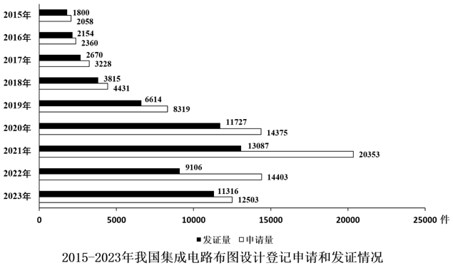

### 第 116 题

截至2014年末，我国集成电路布图设计登记累计申请量在以下哪个范围内？

A. 0.8万-1.5万件之间

B. 不到0.8万件

C. 1.5万-2.2万件之间

D. 超过2.2万件

第 116 题 · 答案与解析

**参考答案（粉笔题库参考内容）**

A

**解析**

定位文字材料可得：截至2023年末，我国集成电路布图设计登记累计申请93147件；定位统计图可知2015-2023年我国集成电路布图设计登记申请量。则截至2014年末，我国集成电路布图设计登记累计申请量=2023年末累计申请量-2015至2023年申请量之和=93147-(2058+2360+3228+4431+8319+14375+20353+20400+14400+12500)=93100-82100=11000件=1.1万件，在A项范围内。

故正确答案为A。

### 第 117 题

如2024年5-12月，我国集成电路布图设计登记月均发证量与1-4月水平相同，则2024年全年，我国集成电路布图设计登记发证量将比上年：

A. 下降不到20%

B. 下降20%以上

C. 上升不到20%

D. 上升20%以上

第 117 题 · 答案与解析

**参考答案（粉笔题库参考内容）**

C

**解析**

根据题干“······我国集成电路布图设计登记发证量将比上年”，结合选项为百分数，可判定本题为一般增长率问题。定位文字材料可知：2024年1-4月，我国集成电路布图设计登记申请3503件，发证4189件。定位统计图可知：2023年我国集成电路布图设计登记发证11316件。则2024年1-4月我国集成电路布图设计登记月均发证量件，2024年全年我国集成电路布图设计登记发证量=4189+1047×（12-4）=12565件。根据公式：增长率，可得2024年全年我国集成电路布图设计登记发证量比上年增长，即上升不到20%。

故正确答案为C。

### 第 118 题

2019-2021年，我国集成电路布图设计登记申请量三年的同比增速：

A. 先升后降

B. 先降后升

C. 逐年上升

D. 逐年下降

第 118 题 · 答案与解析

**参考答案（粉笔题库参考内容）**

D

**解析**

根据题干“2019-2021······三年的同比增速”，可判定本题为一般增长率问题。定位统计图可得：2018-2021年我国集成电路布图设计登记申请量分别为4431件、8319件、14375件、20353件。根据公式：增长率，则2019-2021年我国集成电路布图设计登记申请量同比增速分别为：

2019年，；

2020年，；

2021年，。

综上所述，2019-2021年，我国集成电路布图设计登记申请量同比增速逐年下降。

故正确答案为D。

### 第 119 题

2015-2023年，我国集成电路布图设计登记当年发证量与当年申请量比值大于0.9的年份有几个？

A. 2

B. 3

C. 4

D. 5

第 119 题 · 答案与解析

**参考答案（粉笔题库参考内容）**

A

**解析**

根据题干“2015-2023年······与······比值大于0.9的年份有几个”，可判定本题为比值计算问题。定位统计图可知2015-2023年我国集成电路布图设计登记当年发证量与当年申请量。2015-2023年各年份比值分别为：

2015年，；

2016年，；

2017年，；

2018年，；

2019年，；

2020年，；

2021年，；

2022年，；

2023年，。

综上，2015-2023年我国集成电路布图设计登记当年发证量与当年申请量比值大于0.9的年份有2016年、2023年，共2个。

故正确答案为A。

### 第 120 题

以下柱状图反映了哪一时间段内，我国集成电路布图设计登记发证量同比增量的变化趋势（横轴位置表示增量为0）？

A. 2017-2020年

B. 2016-2019年

C. 2019-2022年

D. 2018-2021年

第 120 题 · 答案与解析

**参考答案（粉笔题库参考内容）**

D

**解析**

根据题干“······同比增量的变化趋势”，可判定本题为增长量比较问题。定位统计图可得2015-2022年我国集成电路布图设计登记发证量。根据公式：增长量=现期量-基期量，则2016-2022年我国集成电路布图设计登记发证量同比增量分别为：

2016年，；

2017年，；

2018年，；

2019年，；

2020年，；

2021年，；

2022年，9106-13087<0。

观察可知，柱状图呈现先上升再下降的趋势，且第三个柱子最高，与2018-2021年同比增量的变化趋势一致。

故正确答案为D。

## 材料 4

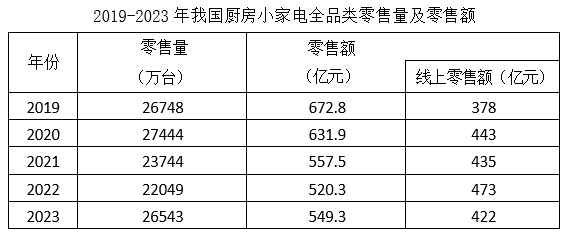

### 第 121 题

2019-2023年我国厨房小家电全品类零售总量在以下哪个范围？

A. 12亿台-13亿台之间

B. 13亿台-14亿台之间

C. 不到12亿台

D. 超过14亿台

第 121 题 · 答案与解析

**参考答案（粉笔题库参考内容）**

A

**解析**

定位统计表可得：2019-2023年我国厨房小家电全品类零售量分别为26748万台、27444万台、23744万台、22049万台、26543万台。则2019-2023年我国厨房小家电全品类零售总量为万台=12.7亿台，在A项范围内。

故正确答案为A。

### 第 122 题

2019-2023年，我国厨房小家电全品类零售额中线上零售额占比超过75%的年份有几个？

A. 4

B. 3

C. 2

D. 1

第 122 题 · 答案与解析

**参考答案（粉笔题库参考内容）**

B

**解析**

根据题干“2019-2023年······中······占比超过75%的年份有几个”，可判定本题为现期比重问题。定位统计表可得：2019-2023年，我国厨房小家电全品类零售额分别为672.8亿元、631.9亿元、557.5亿元、520.3亿元、549.3亿元；线上零售额分别为378亿元、443亿元、435亿元、473亿元、422亿元。根据公式：比重，可得各年份我国厨房小家电全品类零售额中线上零售额占比分别为：

2019年：，不满足；

2020年：，不满足；

2021年：，满足；

2022年：，满足；

2023年：，满足。

综上，2019-2023年，我国厨房小家电全品类零售额中线上零售额占比超过75%的年份有2021年、2022年、2023年，共3个。

故正确答案为B。

### 第 123 题

资料所列厨房小家电品类当中，2023年零售额超过全品类零售总额10%的有几类？

A. 4

B. 3

C. 2

D. 1

第 123 题 · 答案与解析

**参考答案（粉笔题库参考内容）**

C

**解析**

根据题干“······2023年······超过······10%的有几类”，结合材料时间为2023年，可判定本题为现期比重问题。定位表格可得：2023年，我国厨房小家电全品类零售总额为549.3亿元。定位柱形图可知2023年我国厨房小家电分品类零售额情况。根据公式：部分=整体×比重，则2023年超过全品类零售总额10%的小家电品类零售额应超过549.3×10%=54.93亿元，故符合题意的有破壁机（62.7亿元）、电饭煲（133.4亿元），共2类。

故正确答案为C。

### 第 124 题

2023年电饭煲、破壁机和电压力锅零售额之和约是台式单烤、电炖锅和榨汁机零售额之和的多少倍？

A. 8

B. 7

C. 6

D. 5

第 124 题 · 答案与解析

**参考答案（粉笔题库参考内容）**

A

**解析**

根据题干“2023年······约是······的多少倍”，结合材料时间为2023年，可判定本题为现期倍数问题。定位图形材料可得：2023年，电饭煲、破壁机、电压力锅零售额分别为133.4亿元、62.7亿元、53.6亿元，台式单烤、电炖锅、榨汁机零售额分别为12.1亿元、12亿元、6.5亿元。则所求倍。

故正确答案为A。

### 第 125 题

以下折线图中，最能准确反映2019-2023年我国厨房小家电平均每台零售价变化趋势的是：

A. 

B. 

C. 

D. 

第 125 题 · 答案与解析

**参考答案（粉笔题库参考内容）**

D

**解析**

根据题干“······2019-2023年······平均每台零售价变化趋势的是”，可判定本题为现期平均数问题。定位统计表可得：2019-2023年，我国厨房小家电全品类零售量及零售额。平均每台零售价，可得2019-2023年我国厨房小家电平均每台零售价分别为：

2019年，元/台；

2020年，元/台；

2021年，元/台；

2022年，元/台；

2023年，元/台。

比较可知，2019年我国厨房小家电平均每台零售价比其它年份都明显高，排除A、B两项；2020年-2022年这三年数值接近，排除C项，只有D项符合。

故正确答案为D。

## 材料 5

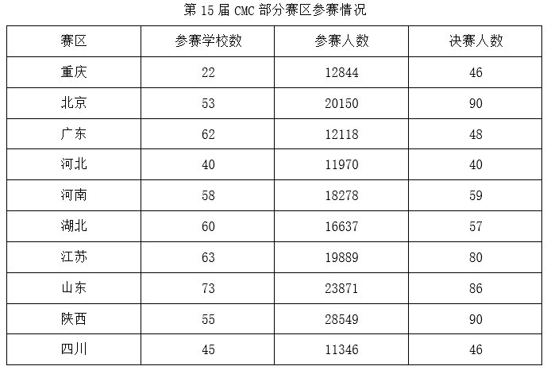

### 第 126 题

表中所列赛区中，第15届CMC平均每个参赛学校参赛人数最少的是：

A. 河北

B. 湖北

C. 四川

D. 广东

第 126 题 · 答案与解析

**参考答案（粉笔题库参考内容）**

D

**解析**

根据题干“······第十五届······平均每个······”，结合材料给出第十五届CMC各赛区参赛情况，可判定本题为现期平均数问题。定位统计表可知第十五届CMC各赛区参赛学校数及参赛人数，根据公式：平均数，可得：河北为，湖北为，四川为，广东为。比较可知，广东赛区平均每个参赛学校参赛人数最少。

故正确答案为D。

### 第 127 题

如果第15届CMC参赛人数是首届的10.85倍，问第10届CMC参赛人数是首届参赛人数的多少倍？

A. 3

B. 5

C. 7

D. 9

第 127 题 · 答案与解析

**参考答案（粉笔题库参考内容）**

B

**解析**

根据题干“······第10届······是首届······倍”，可判定本题为现期倍数问题。定位统计图可知：第15届CMC参赛人数为28.84万人，第10届CMC参赛人数为13.88万人。由题干可知：第15届CMC参赛人数是首届的10.85倍，即首届CMC参赛人数为万人。则所求倍数为。

故正确答案为B。

### 第 128 题

若保持第15届CMC参赛人数环比增量不变，问哪一届CMC参赛人数将第一次超过50万人？

A. 第19届

B. 第20届

C. 第21届

D. 第22届

第 128 题 · 答案与解析

**参考答案（粉笔题库参考内容）**

A

**解析**

根据题干“若保持······环比增量不变，······将第一次超过50万人”，可判定本题为现期计算问题。定位图1可得：第14届CMC参赛人数为23.18万人，第15届CMC参赛人数为28.84万人。根据公式：增长量=现期量-基期量，则第15届CMC参赛人数环比增量=28.84-23.18=5.66万人。根据公式：现期量=基期量+增长量×n，可得28.84+5.66×n>50，解得n>3.7，则n至少取到4，故第15+4=19届CMC参赛人数将第一次超过50万人。

故正确答案为A。

### 第 129 题

表中所列赛区中，参加第15届CMC决赛人数占当届决赛总人数的：

A. 不到40%

B. 40%-50%之间

C. 50%-60%之间

D. 超过60%

第 129 题 · 答案与解析

**参考答案（粉笔题库参考内容）**

C

**解析**

根据题干“······参加第15届······占当届······的”，结合选项为百分数，可判定本题为现期比重问题。定位统计图可得：参加第15届CMC决赛的总人数为1169人；定位统计表可得：表中所列赛区参加第15届CMC决赛的人数=46+90+48+40+59+57+80+86+90+46=642人。根据公式：比重，则所求比重，在C项范围内。

故正确答案为C。

### 第 130 题

以下折线图中，最能准确反映第10-14届CMC决赛人数占参赛人数比重变化趋势的是：

A. 

B. 

C. 

D. 

第 130 题 · 答案与解析

**参考答案（粉笔题库参考内容）**

B

**解析**

根据题干“······第10-14届······比重······”，结合材料给出第10-14届CMC参赛人数情况，可判定本题为现期比重问题。定位统计图可知第10-14届CMC参赛人数及决赛人数。根据公式：比重，可得第10-14届CMC决赛人数占参赛人数比重分别为：

第10届，；

第11届，；

第12届，；

第13届，；

第14届，。

比较可知，第12届比重最小，第14届比重最大，只有B项满足。

故正确答案为B。

## 材料 6

2023年三季度，支付系统共处理支付业务3358.88亿笔，金额3151.37万亿元，同比分别增长12.59%和6.97%。

三季度，人民银行清算总中心系统共处理支付业务54.79亿笔，金额2379.52万亿元，同比分别增长0.92%和9.53%，其中，大额实时支付系统处理业务9518.17万笔，同比下降10.39%，金额2254.07万亿元，同比增长9.72%；小额批量支付系统处理业务11.51亿笔，金额46.69万亿元，同比分别增长5.73%和10.03%；网上支付跨行清算系统处理业务42.31亿笔，同比下降0.03%，金额74.66万亿元，同比增长5.38%；境内外币支付系统处理业务134.46万笔，同比增长2.83%，金额5707.35亿美元，同比下降14.63%。

在其他支付系统中，银行行内业务系统三季度处理业务54.42亿笔，同比增长11.14%，金额539.56万亿元，同比下降4.10%；银联跨行支付系统处理业务837.93亿笔，金额70.27万亿元，同比分别增长21.37%和8.70%；城银清算支付清算系统处理业务1056.40万笔，金额9744.45亿元，同比分别增长34.61%和36.31%；农信银支付清算系统处理业务7.41亿笔，金额7162.13亿元，同比分别下降39.98%和13.55%；人民币跨境支付系统处理业务176.43万笔，金额33.42万亿元，同比分别增长43.23%和31.41%；网联清算平台处理业务2404.21亿笔，金额126.92万亿元，同比分别增长10.42%和6.28%。

### 第 131 题

2023年三季度，支付系统平均每笔支付业务金额比上年同期：

A. 下降了不到1000元

B. 下降了1000元以上

C. 上升了不到1000元

D. 上升了1000元以上

第 131 题 · 答案与解析

**参考答案（粉笔题库参考内容）**

A

**解析**

根据题干“2023年三季度······平均每······比上年同期”，结合选项带单位，可判定本题为平均数的增长量问题。定位文字材料第一段可得：2023年三季度，支付系统共处理支付业务3358.88亿笔（B），金额3151.37万亿元（A），同比分别增长12.59%（b）和6.97%（a）。根据公式：平均数的增长量，可得所求为元，即下降了不到1000元。

故正确答案为A。

### 第 132 题

2023年三季度，人民银行清算总中心系统处理支付业务中，小额批量支付系统处理业务笔数的占比同比：

A. 下降了2个百分点以上

B. 下降了不到2个百分点

C. 上升了2个百分点以上

D. 上升了不到2个百分点

第 132 题 · 答案与解析

**参考答案（粉笔题库参考内容）**

D

**解析**

根据题干“2023年三季度，······中······的占比同比”，结合选项为“上升/下降+百分点”，可判定本题为两期比重计算问题。定位文字材料第二段可得：2023年三季度，人民银行清算总中心系统共处理支付业务54.79亿笔（B），同比增长0.92%（b），其中，小额批量支付系统处理业务11.51亿笔（A），同比增长5.73%（a）。根据公式：两期比重差，则题干所求，即上升了不到2个百分点。

故正确答案为D。

### 第 133 题

2022年三季度，人民银行清算总中心系统境内外币支付系统处理业务日均处理金额在以下哪个范围内？

A. 超过80亿美元

B. 70亿-80亿美元之间

C. 60亿-70亿美元之间

D. 不到60亿美元

第 133 题 · 答案与解析

**参考答案（粉笔题库参考内容）**

B

**解析**

根据题干“2022年三季度······日均处理金额······”，结合材料时间为2023年三季度，可判定本题为基期平均数问题。定位文字材料第二段可得：2023年三季度，人民银行清算总中心系统境内外币支付系统处理金额5707.35亿美元，同比下降14.63%。根据公式：基期量，可得2022年三季度，人民银行清算总中心系统境内外币支付系统处理金额亿美元。由于2022年7月有31天，8月有31天，9月有30天，则三季度共有31+31+30=92天，可得三季度日均处理金额亿美元，在B项范围内。

故正确答案为B。

### 第 134 题

将其他支付系统中①银行行内业务系统、②银联跨行支付系统、③城银清算支付清算系统和④农信银支付清算系统按2023年三季度平均每笔业务金额同比增速从高到低排列，以下正确的是：

A. ①②③④

B. ③②①④

C. ④③②①

D. ④①②③

第 134 题 · 答案与解析

**参考答案（粉笔题库参考内容）**

C

**解析**

根据题干“······2023年三季度平均每笔业务金额同比增速······”，可判定本题为平均数的增长率问题。定位文字资料第三段可得：（2023年三季度）在其他支付系统中，银行行内业务系统三季度处理业务数量同比增长11.14%（），金额同比下降4.10%（）；银联跨行支付系统处理业务数量和金额同比分别增长21.37%（）和8.70%（）；城银清算支付清算系统处理业务数量和金额同比分别增长34.61%（）和36.31%（）；农信银支付清算系统处理业务数量和金额同比分别下降39.98%（）和13.55%（）。根据公式：平均数的增长率，则2023年三季度①银行行内业务系统、②银联跨行支付系统、③城银清算支付清算系统和④农信银支付清算系统平均每笔业务金额同比增速分别为：

①银行行内业务系统：；

②银联跨行支付系统：；

③城银清算支付清算系统：；

④农信银支付清算系统：。

综上可知，同比增速从高到低排列为：④③②①。

故正确答案为C。

### 第 135 题

关于2023年三季度支付系统运行情况，不能从上述资料中推出的是：

A. 网上支付跨行清算系统处理业务平均每笔金额同比增长了5%以上

B. 银联跨行支付系统处理业务金额同比增量高于城银清算支付清算系统处理业务金额同比增量

C. 大额实时支付系统处理业务金额占人民银行清算总中心系统处理支付业务总金额的95%以上

D. 人民币跨境支付系统处理业务笔数同比增长了40万笔以上

第 135 题 · 答案与解析

**参考答案（粉笔题库参考内容）**

C

**解析**

A项：定位文字材料第二段可得，2023年三季度，网上支付跨行清算系统处理业务42.31亿笔，同比下降0.03%（b），金额74.66万亿元，同比增长5.38%（a）。根据公式：平均数的增长率，可得所求，正确；

B项：定位文字材料第三段可得，2023年三季度，银联跨行支付系统处理业务金额70.27万亿元，同比增长8.70%；城银清算支付清算系统处理业务金额9744.45亿元，同比增长36.31%。根据公式：增长量，可得银联跨行支付系统处理业务金额同比增量亿元；城银清算支付清算系统处理业务金额同比增量亿元。故银联跨行支付系统处理业务金额同比增量高于城银清算支付清算系统处理业务金额同比增量，正确；

C项：定位文字材料第二段可得，2023年三季度，人民银行清算总中心系统共处理支付业务金额2379.52万亿元，其中，大额实时支付系统处理业务金额2254.07万亿元。根据公式：比重，可得所求，错误；

D项：定位文字材料第三段可得，2023年三季度，人民币跨境支付系统处理业务176.43万笔，同比增长43.23%。根据公式：增长量，可得所求万笔>40万笔，正确。

本题为选非题，故正确答案为C。

