# 2025年国家公务员录用考试《行测》题（行政执法卷网友回忆版）

<!-- gwy:overview:start -->
> **国考 · 2025 · 行测 · 行政执法** ｜ 130 题 · 图片 193 处 · 答案随题折叠

| 题型模块 | 题量 | 题号 |
| --- | ---: | ---: |
| 政治理论 | 20 | 1–20 |
| 常识判断 | 15 | 21–35 |
| 言语理解与表达 | 30 | 36–65 |
| 数量关系 | 10 | 66–75 |
| 判断推理 | 35 | 76–110 |
| 资料分析 | 20 | 111–130 |
| **合计** | **130** | |

导航：[题型与作答说明](#题型与作答说明) · [题目](#题目) · [材料 1](#材料-1)
<!-- gwy:overview:end -->

> 候选采集稿。参考答案及解析来自粉笔页面，不代表官方答案或真实高分答卷；来源使用许可与原卷对应关系仍需人工核实。

## 题型与作答说明

政治理论

（20题）

根据题目要求，在四个选项中选出一个最恰当的答案。

常识判断

（15题）

根据题目要求，在四个选项中选出一个最恰当的答案。

言语理解与表达

（30题）

本部分包括表达与理解两方面的内容。请根据题目要求，在四个选项中选出一个最恰当的答案。

数量关系

（10题）

在这部分试题中，每道题呈现一段表述数字关系的文字，要求你迅速、准确地计算出答案。

判断推理

（35题）

本部分包括图形推理、定义判断、类比推理与逻辑判断四种类型的试题，在四个选项中选出一个最恰当的答案。

资料分析

（20题）

所给出的图、表、文字或综合性资料均有若干个问题要你回答。你应根据资料提供的信息进行分析、比较、计算和判断处理。

## 题目

### 第 1 题

习近平总书记指出，马克思主义是为人民立言、为人民代言的理论，是为改变人民命运而创立、在人民求解放的实践中丰富和发展的，人民的创造性实践是马克思主义理论创新的不竭源泉。下列说法与这一论述相符的是：

①人民不仅是物质财富的创造者，也是精神财富的创造者

②要坚持以理论工作者的首创精神为引领，注重从理论创新中总结实践经验

③无论是毛泽东思想、中国特色社会主义理论体系，还是习近平新时代中国特色社会主义思想，无不源自于人民的智慧、人民的探索、人民的创造

④各级领导干部身处实践最前沿，对实践变化感知最敏感、感受最深切，也最聪慧

A. ①②

B. ①③

C. ②④

D. ③④

第 1 题 · 答案与解析

**参考答案（粉笔题库参考内容）**

B

**解析**

本题考查理论与政策。

①正确，2023年6月30日，习近平总书记在二十届中共中央政治局第六次集体学习时强调，“马克思主义是为人民立言、为人民代言的理论，是为改变人民命运而创立、在人民求解放的实践中丰富和发展的，人民的创造性实践是马克思主义理论创新的不竭源泉。人民作为历史的创造者，不仅是物质财富的创造者，也是精神财富的创造者。”

②错误，2023年6月30日，习近平总书记在二十届中共中央政治局第六次集体学习时强调，“要尊重人民首创精神，注重从人民的创造性实践中总结新鲜经验，上升为理性认识，提炼出新的理论成果，着力让党的创新理论深入亿万人民心中，成为接地气、聚民智、顺民意、得民心的理论。”

③正确，2023年6月30日，习近平总书记在二十届中共中央政治局第六次集体学习时强调，“无论是毛泽东思想、中国特色社会主义理论体系，还是新时代中国特色社会主义思想，无不源自于人民的智慧、人民的探索、人民的创造。”

④错误，《求是》杂志发表习近平总书记重要文章《必须坚持人民至上》中指出：“人民群众身处实践最前沿，对实践变化感知最敏感、感受最深切，也最聪慧，只要走到人民群众中去，很多百思不得其解的问题就能豁然开朗、找到答案。”

故①③表述正确。

故正确答案为B。

### 第 2 题

习近平总书记指出，问题是事物矛盾的表现形式，我们强调增强问题意识、坚持问题导向，就是承认矛盾的普遍性、客观性，就是要善于把认识和化解矛盾作为打开工作局面的突破口。关于矛盾的普遍性、客观性，下列说法正确的是：

A. 矛盾的普遍性是有条件的，并根据条件的变化而变化

B. 矛盾的客观性从属于主观性，不能脱离人的认知、情感、意志而存在

C. 矛盾的普遍性是矛盾的共性，矛盾的特殊性是矛盾的个性

D. 矛盾的普遍性、客观性决定了事物的不同性质，是认清事物本质和发展规律的基础

第 2 题 · 答案与解析

**参考答案（粉笔题库参考内容）**

C

**解析**

本题考查马克思主义。

A项错误，矛盾的普遍性是指矛盾存在于一切事物中，存在于一切事物发展过程的始终，旧的矛盾解决了，新的矛盾又产生，事物始终在矛盾中运动。矛盾的普遍性即矛盾的共性，矛盾的共性是无条件的、绝对的。故“矛盾的普遍性是有条件的”说法错误。

B项错误，矛盾规律具有普遍性和客观性，是不以人的意志为转移的。“矛盾的客观性从属于主观性，不能脱离人的认知、情感、意志而存在”的观点认为主观决定客观，属于唯心主义的范畴，故说法错误。

C项正确，矛盾的普遍性和特殊性是辩证统一的关系。矛盾的普遍性即矛盾的共性，矛盾的特殊性即矛盾的个性。矛盾的共性是无条件的、绝对的，矛盾的个性是有条件的、相对的。

D项错误，矛盾的特殊性是指各个具体事物的矛盾、同一事物的矛盾在不同发展过程和发展阶段、每一个矛盾的各个方面各有其特点。矛盾的特殊性决定了事物的不同性质，如实地分析矛盾的特殊性是认清事物本质和发展规律的基础，故说法错误。

故正确答案为C。

### 第 3 题

关于马克思主义政治经济学，下列说法正确的是：

A. 商品的价值量是由生产该商品所需的个别劳动时间决定的

B. 货币的价值尺度职能是通过实际的物质交换来实现的

C. 具体劳动和抽象劳动是不同商品生产过程中的不同劳动

D. 具体劳动创造商品的使用价值，抽象劳动形成商品的价值

第 3 题 · 答案与解析

**参考答案（粉笔题库参考内容）**

D

**解析**

本题考查马克思主义。

A项错误，商品的价值量是指商品价值的大小，是由生产商品的社会必要劳动时间决定的。社会必要劳动时间即在现有的社会正常的生产条件下，在社会平均的劳动熟练程度和劳动强度下制造某种使用价值所需要的劳动时间。

B项错误，货币的价值尺度职能，是指以自身价值作为尺度来衡量其他商品的价值。货币执行价值尺度职能，不需要现实的货币，只需要观念上的货币，不需要通过实际的物质交换来实现。

C项错误，具体劳动和抽象劳动，是生产商品的同一劳动过程的两个方面，而不是两种劳动或两次劳动。具体劳动说明的是劳动是什么样的，是怎样进行的；抽象劳动说明的是劳动的量的多少，劳动时间的长短。

D项正确，具体劳动是指人们在一定的具体形式下进行的劳动，体现着人和自然的关系，生产出各种各样的使用价值。抽象劳动是指撇开一切具体形式的无差别的一般人类劳动，即人的体力和脑力的消耗。抽象劳动形成商品的价值。

故正确答案为D。

### 第 4 题

习近平总书记指出：“中国共产党人的理想信念，建立在马克思主义科学真理的基础之上，建立在马克思主义揭示的人类社会发展规律的基础之上，建立在为最广大人民谋利益的崇高价值的基础之上。我们坚定，是因为我们追求的是真理。我们坚定，是因为我们遵循的是规律。我们坚定，是因为我们代表的是最广大人民根本利益。”这一论述最直接体现了马克思主义的哪一基本观点？

A. 真理尺度与价值尺度的辩证统一

B. 认识世界与改造世界的辩证统一

C. 量变与质变的辩证统一

D. 矛盾的特殊性与普遍性的辩证统一

第 4 题 · 答案与解析

**参考答案（粉笔题库参考内容）**

A

**解析**

本题考查马克思主义。

A项正确，真理是标志主观与客观相符合的哲学范畴，是对客观事物及其规律的正确反映。“中国共产党人的理想信念，建立在马克思主义科学真理和人类社会发展规律的基础之上”即体现了真理原则。价值是指在实践基础上形成的主体和客体之间的意义关系，是客体对个人、群体乃至整个社会的生活和活动所具有的积极意义。“建立在为最广大人民谋利益的崇高价值的基础之上”和“代表的是最广大人民根本利益”即体现了价值原则。

B项错误，从认识论的角度来看，人类的活动不外乎两种，即认识世界和改造世界。认识世界的任务不仅在于解释世界，更重要的在于为改造世界提供理论指导。认识世界和改造世界是相互依赖、相互制约、辩证统一的。认识世界是为了改造世界，正确地认识世界是有效地改造世界的必要前提。题干并未体现认识世界与改造世界的辩证统一。

C项错误，量变质变规律揭示了事物发展的形式和状态，量变是质变的必要准备，质变是量变的必然结果，量变和质变相互渗透。题干并未体现量变与质变的辩证统一。

D项错误，矛盾的普遍性和特殊性的关系，也就是共性与个性、一般与个别的关系。矛盾普遍性与特殊性是互相联系的。普遍性存在于特殊性之中，特殊性中包含着普遍性；普遍性与特殊性在一定条件下可以互相转化。题干并未体现矛盾的特殊性与普遍性的辩证统一。

故正确答案为A。

### 第 5 题

高质量发展是全面建设社会主义现代化国家的首要任务，金融要为经济社会发展提供高质量服务。下列与之相关的表述不准确的是：

A. 优化资金供给结构，把更多金融资源用于促进科技创新、绿色发展、传统制造和国有企业

B. 要着力营造良好的货币金融环境，切实加强对重大战略、重点领域和薄弱环节的优质金融服务

C. 始终保持货币政策的稳健性，更加注重做好跨周期和逆周期调节，充实货币政策工具箱

D. 完善机构定位，支持国有大型金融机构做优做强，当好服务实体经济的主力军和维护金融稳定的压舱石

第 5 题 · 答案与解析

**参考答案（粉笔题库参考内容）**

A

**解析**

本题考查理论与政策。

2023年10月30日至31日，中央金融工作会议在北京举行。习近平总书记出席会议并发表重要讲话，科学回答了金融事业发展的一系列重大理论和实践问题。

B、C两项正确，A项错误，会议指出，高质量发展是全面建设社会主义现代化国家的首要任务，金融要为经济社会发展提供高质量服务。要着力营造良好的货币金融环境，切实加强对重大战略、重点领域和薄弱环节的优质金融服务。始终保持货币政策的稳健性，更加注重做好跨周期和逆周期调节，充实货币政策工具箱。优化资金供给结构，把更多金融资源用于促进科技创新、先进制造、绿色发展和中小微企业，大力支持实施创新驱动发展战略、区域协调发展战略，确保国家粮食和能源安全等。

D项正确，会议指出，完善机构定位，支持国有大型金融机构做优做强，当好服务实体经济的主力军和维护金融稳定的压舱石，严格中小金融机构准入标准和监管要求，立足当地开展特色化经营，强化政策性金融机构职能定位，发挥保险业的经济减震器和社会稳定器功能。

本题为选非题，故正确答案为A。

### 第 6 题

习近平总书记强调，粮食安全是“国之大者”。下列保障粮食安全的举措正确的有几项？

①全面落实粮食安全党政同责，坚持稳面积、增单产两手发力

②树立大农业观、大食物观，农林牧渔并举，构建多元化食物供给体系

③加大高标准农田建设投入和管护力度，确保耕地数量有保障、质量有提升

④扩大粮食领域高水平对外开放，逐步加大国外优质种业资源和海外粮食产品在我国市场的占有率

⑤强化科技和改革双轮驱动，加大核心技术攻关力度

A. 2项

B. 3项

C. 4项

D. 5项

第 6 题 · 答案与解析

**参考答案（粉笔题库参考内容）**

C

**解析**

本题考查理论与政策。

①正确，2023年12月14日至15日，习近平总书记来到广西考察，指出乡村振兴是建设农业强国的基础性工程，要落实规划、扎实推进。要全面落实粮食安全党政同责，坚持稳面积、增单产两手发力，实现粮食均衡增产。

②正确，2024年9月15日发布的《国务院办公厅关于践行大食物观构建多元化食物供给体系的意见》指出，树立大农业观、大食物观，农林牧渔并举，构建多元化食物供给体系，是党中央提出的明确要求，是保障粮食和重要农产品稳定安全供给的客观要求和重要举措。

③⑤正确，2023年12月19日召开的中央农村工作会议指出，要守住耕地这个命根子，坚决整治乱占、破坏耕地违法行为，加大高标准农田建设投入和管护力度，确保耕地数量有保障、质量有提升。要强化科技和改革双轮驱动，加大核心技术攻关力度，改革完善“三农”工作体制机制，为农业现代化增动力、添活力。

④错误，中央经济工作会议提出，在经济全球化深入发展的背景下，我国进一步推进农业现代化，同样要用好国内国际两个市场、两种资源，深化农业对外开放，发挥超大规模市场和强大生产能力的优势。但“加大国外优质种业资源和海外粮食产品在我国市场的占有率”的做法不利于我国的粮食安全。习总书记强调的“中国人的饭碗任何时候都要牢牢端在自己手中”，是基于对粮食基本属性的正确认识和粮食战略价值的准确评估作出的重大判断，对于维护社会稳定、保障国民经济平稳运行、应对国际变局具有重要意义。

故正确的有4项。

故正确答案为C。

### 第 7 题

习近平总书记强调，要坚定不移贯彻新发展理念，更加自觉地把高质量充分就业作为经济社会发展的优先目标。下列关于高质量充分就业的表述正确的是：

①全面贯彻劳动者自主就业、政府主导就业、市场促进就业的方针

②坚持扩大就业容量和提升就业质量相结合

③坚持就业带动创业

④加强灵活就业和新就业形态劳动者权益保障，扩大职业伤害保障试点

A. ①②

B. ①③

C. ②④

D. ③④

第 7 题 · 答案与解析

**参考答案（粉笔题库参考内容）**

C

**解析**

本题考查理论与政策。

2024年10月31日，《求是》杂志发表习近平总书记的重要文章《促进高质量充分就业》。

①错误，文章指出：“要坚持以人民为中心的发展思想，全面贯彻劳动者自主就业、市场调节就业、政府促进就业和鼓励创业的方针，以推动高质量发展为基础，以实施就业优先战略为引领，以强化就业优先政策为抓手，以深化就业体制机制改革为动力，持续促进就业质的有效提升和量的合理增长，不断增强广大劳动者的获得感幸福感安全感，为以中国式现代化全面推进强国建设、民族复兴伟业提供有力支撑。”

②正确，③错误，文章指出：“在这个过程中，我们不断深化对新时代就业工作规律的认识，积累了许多经验，主要包括：坚持党对就业工作的全面领导，坚持把就业作为民生之本，坚持实施就业优先战略，坚持依靠发展促进就业，坚持扩大就业容量和提升就业质量相结合，坚持突出抓好重点群体就业，坚持创业带动就业，坚持营造公平就业环境，坚持构建和谐劳动关系，等等。这些经验十分宝贵，要长期坚持并不断丰富发展。”

④正确，文章指出：“加强灵活就业和新就业形态劳动者权益保障，扩大职业伤害保障试点，及时总结经验、形成制度。加强市场监管和劳动保障监察执法，有效治理就业歧视、欠薪欠保、违法裁员等乱象。”

故②④表述正确。

故正确答案为C。

### 第 8 题

党的十八大以来，在推进全面从严治党的伟大实践中，我们不断进行实践探索和理论思考，在毛泽东同志当年给出“让人民来监督政府”的第一个答案基础上，给出了第二个答案，那就是不断推进党的自我革命。关于深入推进党的自我革命实践，下列表述不准确的是：

A. 以引领伟大社会革命为根本目的

B. 以跳出历史周期率为战略目标

C. 以解决大党独有难题为主攻方向

D. 以自我监督和法律监督相结合为强大动力

第 8 题 · 答案与解析

**参考答案（粉笔题库参考内容）**

D

**解析**

本题考查理论与政策。

A、B、C三项正确，D项错误。习近平总书记在二十届中央纪委三次全会上深刻阐述了党的自我革命的重要思想，对持续发力、纵深推进反腐败斗争作出战略部署，明确提出了新征程上深入推进党的自我革命“九个以”的实践要求。以坚持党中央集中统一领导为根本保证。以引领伟大社会革命为根本目的。以习近平新时代中国特色社会主义思想为根本遵循。以跳出历史周期率为战略目标。以解决大党独有难题为主攻方向。以健全全面从严治党体系为有效途径。以锻造坚强组织、建设过硬队伍为重要着力点。以正风肃纪反腐为重要抓手。以自我监督和人民监督相结合为强大动力。

本题为选非题，故正确答案为D。

### 第 9 题

习近平总书记指出，要加强科技基础能力建设，深化科技体制改革，打造科创高地。关于深化科技体制改革，下列表述正确的是：

A. 建立以竞争性支持取代稳定支持的基础研究投入机制

B. 允许科研类事业单位实行比一般事业单位更灵活的管理制度

C. 限制开展高风险、高投入基础研究

D. 降低科技人员在科技成果转化收益分配上的自主权

第 9 题 · 答案与解析

**参考答案（粉笔题库参考内容）**

B

**解析**

本题考查理论与政策。

2024年7月18日，中国共产党第二十届中央委员会第三次全体会议通过了《中共中央关于进一步全面深化改革 推进中国式现代化的决定》（以下简称《决定》）。

A项错误，《决定》在“四、构建支持全面创新体制机制”部分的“（14）深化科技体制改革”中指出：“改进科技计划管理，强化基础研究领域、交叉前沿领域、重点领域前瞻性、引领性布局。加强有组织的基础研究，提高科技支出用于基础研究比重，完善竞争性支持和稳定支持相结合的基础研究投入机制，鼓励有条件的地方、企业、社会组织、个人支持基础研究，支持基础研究选题多样化，鼓励开展高风险、高价值基础研究。”

B项正确，《决定》在“四、构建支持全面创新体制机制”部分的“（14）深化科技体制改革”中指出：“完善中央财政科技经费分配和管理使用机制，健全中央财政科技计划执行和专业机构管理体制······允许科研类事业单位实行比一般事业单位更灵活的管理制度，探索实行企业化管理。”

C项错误，《决定》在“四、构建支持全面创新体制机制”部分的“（14）深化科技体制改革”中指出：“加强有组织的基础研究，提高科技支出用于基础研究比重，完善竞争性支持和稳定支持相结合的基础研究投入机制，鼓励有条件的地方、企业、社会组织、个人支持基础研究，支持基础研究选题多样化，鼓励开展高风险、高价值基础研究。”

D项错误，《决定》在“四、构建支持全面创新体制机制”部分的“（14）深化科技体制改革”中指出：“允许科技人员在科技成果转化收益分配上有更大自主权，建立职务科技成果资产单列管理制度，深化职务科技成果赋权改革。深化高校、科研院所收入分配改革。”

故正确答案为B。

### 第 10 题

完善收入分配制度，构建初次分配、再分配、第三次分配协调配套的制度体系，是进一步全面深化改革的重要任务。关于完善收入分配制度，下列表述不准确的是：

A. 提高劳动报酬在初次分配中的比重

B. 完善劳动者工资决定、合理增长、支付保障机制，健全按要素分配政策制度

C. 规范财富积累机制，多渠道增加城乡居民财产性收入

D. 完善税收、社会保障、转移支付等第三次分配调节机制

第 10 题 · 答案与解析

**参考答案（粉笔题库参考内容）**

D

**解析**

本题考查理论与政策。

2024年7月18日，中国共产党第二十届中央委员会第三次全体会议通过了《中共中央关于进一步全面深化改革 推进中国式现代化的决定》（以下简称《决定》）。

A、B两项正确，D项错误，《决定》在“十一、健全保障和改善民生制度体系”部分“（42）完善收入分配制度”中指出：“构建初次分配、再分配、第三次分配协调配套的制度体系，提高居民收入在国民收入分配中的比重，提高劳动报酬在初次分配中的比重。完善劳动者工资决定、合理增长、支付保障机制，健全按要素分配政策制度。完善税收、社会保障、转移支付等再分配调节机制。支持发展公益慈善事业。”

C项正确，《决定》在“十一、健全保障和改善民生制度体系”部分“（42）完善收入分配制度”中指出：“规范收入分配秩序，规范财富积累机制，多渠道增加城乡居民财产性收入，形成有效增加低收入群体收入、稳步扩大中等收入群体规模、合理调节过高收入的制度体系。深化国有企业工资决定机制改革，合理确定并严格规范国有企业各级负责人薪酬、津贴补贴等。”

本题为选非题，故正确答案为D。

### 第 11 题

习近平总书记强调，要牢牢扭住自主创新这个“牛鼻子”。关于自主创新的举措，下列表述正确的有几项？

①主动对接国家战略需求，整合和优化科教创新资源

②培育产业园区，加强对口合作，加快科研成果落地转化

③培育新能源、新材料、先进制造、电子信息等战略性新兴产业

④建设风光火核储一体化能源基地

⑤逐步弱化央地合作，鼓励各地自主发展新兴产业

A. 2项

B. 3项

C. 4项

D. 5项

第 11 题 · 答案与解析

**参考答案（粉笔题库参考内容）**

C

**解析**

本题考查理论与政策。

2023年9月7日，中共中央总书记、国家主席、中央军委主席习近平在黑龙江省哈尔滨市主持召开新时代推动东北全面振兴座谈会并发表重要讲话（以下简称“讲话”）。

①②③④正确，⑤错误，习近平总书记在讲话中强调，要以科技创新推动产业创新，加快构建具有东北特色优势的现代化产业体系······主动对接国家战略需求，整合和优化科教创新资源，加大研发投入，掌握更多关键核心技术。积极培育产业园区，加强对口合作，加快科研成果落地转化。积极培育新能源、新材料、先进制造、电子信息等战略性新兴产业，积极培育未来产业，加快形成新质生产力，增强发展新动能。加快发展风电、光电、核电等清洁能源，建设风光火核储一体化能源基地······创新央地合作模式，促进央地融合发展，更好带动地方经济发展。

综上，共4项正确。

故正确答案为C。

### 第 12 题

党的二十届三中全会提出，要稳步扩大制度型开放。关于稳步扩大制度型开放，下列举措不恰当的是：

A. 独立自主构建不同于国际经贸规则的中国特色经贸规则体系

B. 有序扩大我国商品市场、服务市场、资本市场、劳务市场等对外开放

C. 积极参与全球经济治理体系改革，提供更多全球公共产品

D. 扩大对最不发达国家单边开放

第 12 题 · 答案与解析

**参考答案（粉笔题库参考内容）**

A

**解析**

本题考查理论与政策。

A项错误，B、C、D三项正确，2024年7月18日，中国共产党第二十届中央委员会第三次全体会议通过的《中共中央关于进一步全面深化改革 推进中国式现代化的决定》在“七、完善高水平对外开放体制机制”部分指出：“（24）稳步扩大制度型开放。主动对接国际高标准经贸规则，在产权保护、产业补贴、环境标准、劳动保护、政府采购、电子商务、金融领域等实现规则、规制、管理、标准相通相容，打造透明稳定可预期的制度环境。扩大自主开放，有序扩大我国商品市场、服务市场、资本市场、劳务市场等对外开放，扩大对最不发达国家单边开放······积极参与全球经济治理体系改革，提供更多全球公共产品······”

本题为选非题，故正确答案为A。

### 第 13 题

习近平总书记指出，宣传思想文化工作事关党的前途命运，事关国家长治久安，事关民族凝聚力和向心力，是一项极端重要的工作。宣传思想文化工作的首要政治任务是：

A. 培育和践行社会主义核心价值观

B. 用党的创新理论武装全党、教育人民

C. 提升国家文化软实力和中华文化影响力

D. 赓续中华文脉、推动中华优秀传统文化创造性转化和创新性发展

第 13 题 · 答案与解析

**参考答案（粉笔题库参考内容）**

B

**解析**

本题考查新思想。

2023年10月7日至8日，全国宣传思想文化工作会议在北京召开。会上传达了习近平总书记对宣传思想文化工作作出的重要指示。

B项正确，A、C、D三项错误，习近平总书记强调，宣传思想文化工作面临新形势新任务，必须要有新气象新作为。要坚持以新时代中国特色社会主义思想为指导，全面贯彻党的二十大精神，聚焦用党的创新理论武装全党、教育人民这个首要政治任务······着力培育和践行社会主义核心价值观······着力赓续中华文脉、推动中华优秀传统文化创造性转化和创新性发展······不断提升国家文化软实力和中华文化影响力，为全面建设社会主义现代化国家、全面推进中华民族伟大复兴提供坚强思想保证、强大精神力量、有利文化条件。

故正确答案为B。

### 第 14 题

完善大统战工作格局，是习近平总书记关于做好新时代党的统一战线工作的重要思想的重要内容，是做好新时代统战工作的重要保障，也是进一步全面深化改革、为推进中国式现代化凝心聚力的重要举措。下列各项不属于完善大统战格局措施的是：

A. 更好发挥党外人士作用，健全党外代表人士队伍建设制度

B. 制定民族团结进步促进法，健全铸牢中华民族共同体意识制度机制

C. 全面构建亲清政商关系，健全促进非公有制经济健康发展、非公有制经济人士健康成长工作机制

D. 健全人大议事规则和论证、评估、评议、听证制度

第 14 题 · 答案与解析

**参考答案（粉笔题库参考内容）**

D

**解析**

本题考查理论与政策。

2024年7月18日，中国共产党第二十届中央委员会第三次全体会议正式通过《中共中央关于进一步全面深化改革 推进中国式现代化的决定》（以下简称《决定》）。

A、B、C三项正确，《决定》在“八、健全全过程人民民主制度体系”部分指出：“（32）完善大统战工作格局。完善发挥统一战线凝聚人心、汇聚力量政治作用的政策举措。坚持好、发展好、完善好中国新型政党制度。更好发挥党外人士作用，健全党外代表人士队伍建设制度。制定民族团结进步促进法，健全铸牢中华民族共同体意识制度机制，增强中华民族凝聚力。系统推进我国宗教中国化，加强宗教事务治理法治化。完善党外知识分子和新的社会阶层人士政治引领机制。全面构建亲清政商关系，健全促进非公有制经济健康发展、非公有制经济人士健康成长工作机制。完善港澳台和侨务工作机制。”

D项错误，《决定》在“八、健全全过程人民民主制度体系”部分指出：“（29）加强人民当家作主制度建设······健全人大议事规则和论证、评估、评议、听证制度。丰富人大代表联系人民群众的内容和形式。健全吸纳民意、汇集民智工作机制。发挥工会、共青团、妇联等群团组织联系服务群众的桥梁纽带作用。”

本题为选非题，故正确答案为D。

### 第 15 题

党的二十届三中全会提出，健全绿色低碳发展机制，实施支持绿色低碳发展的财税、金融、投资、价格政策和标准体系，发展绿色低碳产业，健全绿色消费激励机制，促进绿色低碳循环发展经济体系建设。关于健全绿色低碳发展机制，下列举措不恰当的是：

A. 优化政府绿色采购政策，完善绿色税制

B. 建立碳排放双控向能耗双控全面转型新机制

C. 完善资源总量管理和全面节约制度，健全废弃物循环利用体系

D. 加快规划建设新型能源体系，完善新能源消纳和调控政策措施

第 15 题 · 答案与解析

**参考答案（粉笔题库参考内容）**

B

**解析**

本题考查理论与政策。

A、C、D三项正确，B项错误，《中共中央关于进一步全面深化改革、推进中国式现代化的决定》“十二、深化生态文明体制改革”部分指出：“（49）健全绿色低碳发展机制。实施支持绿色低碳发展的财税、金融、投资、价格政策和标准体系，发展绿色低碳产业，健全绿色消费激励机制，促进绿色低碳循环发展经济体系建设。优化政府绿色采购政策，完善绿色税制。完善资源总量管理和全面节约制度，健全废弃物循环利用体系。健全煤炭清洁高效利用机制。加快规划建设新型能源体系，完善新能源消纳和调控政策措施。完善适应气候变化工作体系。建立能耗双控向碳排放双控全面转型新机制。构建碳排放统计核算体系、产品碳标识认证制度、产品碳足迹管理体系，健全碳市场交易制度、温室气体自愿减排交易制度，积极稳妥推进碳达峰碳中和。”故B项中“碳排放双控向能耗双控全面转型”表述有误，应为“能耗双控向碳排放双控全面转型”。

本题为选非题，故正确答案为B。

### 第 16 题

深化医药卫生体制改革，是进一步全面深化改革的重要任务。关于深化医药卫生体制改革，下列举措不恰当的是：

A. 促进优质医疗资源扩容下沉和区域均衡布局

B. 加快建设分级诊疗体系，强化基层医疗卫生服务

C. 完善公立医院薪酬制度，严格限制、缩减编制数量

D. 促进医疗、医保、医药协同发展和治理

第 16 题 · 答案与解析

**参考答案（粉笔题库参考内容）**

C

**解析**

本题考查理论与政策。

2024年7月18日，中国共产党第二十届中央委员会第三次全体会议通过了《中共中央关于进一步全面深化改革 推进中国式现代化的决定》（以下简称《决定》）。

A、B、D三项正确，C项错误，《决定》中“十一、健全保障和改善民生制度体系”中“（45）深化医药卫生体制改革”部分指出：“实施健康优先发展战略，健全公共卫生体系，促进社会共治、医防协同、医防融合，强化监测预警、风险评估、流行病学调查、检验检测、应急处置、医疗救治等能力。促进医疗、医保、医药协同发展和治理。促进优质医疗资源扩容下沉和区域均衡布局，加快建设分级诊疗体系，推进紧密型医联体建设，强化基层医疗卫生服务。深化以公益性为导向的公立医院改革，建立以医疗服务为主导的收费机制，完善薪酬制度，建立编制动态调整机制。引导规范民营医院发展。创新医疗卫生监管手段。健全支持创新药和医疗器械发展机制，完善中医药传承创新发展机制。”故“严格限制、缩减编制数量”说法错误。

本题为选非题，故正确答案为C。

### 第 17 题

完善市场经济基础制度是构建高水平社会主义市场经济体制的重要内容。下列不属于完善市场经济基础制度内容的是：

A. 完善财政转移支付体系

B. 完善市场信息披露制度

C. 完善市场准入制度

D. 完善产权制度

第 17 题 · 答案与解析

**参考答案（粉笔题库参考内容）**

A

**解析**

本题考查理论与政策。

A项错误，B、C、D三项正确，2024年7月18日中国共产党第二十届中央委员会第三次全体会议通过《中共中央关于进一步全面深化改革 推进中国式现代化的决定》，其中“二、构建高水平社会主义市场经济体制”部分指出：“（7）完善市场经济基础制度。完善产权制度，依法平等长久保护各种所有制经济产权，建立高效的知识产权综合管理体制。完善市场信息披露制度，构建商业秘密保护制度······完善市场准入制度，优化新业态新领域市场准入环境。深化注册资本认缴登记制度改革，实行依法按期认缴。健全企业破产机制，探索建立个人破产制度，推进企业注销配套改革，完善企业退出制度。健全社会信用体系和监管制度。”而“完善财政转移支付体系”属于“深化财税体制改革”的内容。

本题为选非题，故正确答案为A。

### 第 18 题

习近平总书记强调，加强党风廉政建设，一体推进不敢腐、不能腐、不想腐，严格落实中央八项规定精神，督促党员、干部特别是领导干部清廉自守、廉洁从政、干净做事。根据《中国共产党纪律处分条例》，下列违纪情况属于违反廉洁纪律的是：

A. 在重大原则问题上不同党中央保持一致且有实际言论、行为或者造成不良后果的

B. 拒不执行党组织的分配、调动、交流等决定的

C. 干涉生产经营自主权，致使群众财产遭受较大损失的

D. 滥用职权或者职务上的影响操办婚丧喜庆事宜，造成不良影响的

第 18 题 · 答案与解析

**参考答案（粉笔题库参考内容）**

D

**解析**

本题考查毛中特。《中国共产党纪律处分条例》以下简称《条例》。

A项错误，《条例》“第六章 对违反政治纪律行为的处分”第四十九条规定：“在重大原则问题上不同党中央保持一致且有实际言论、行为或者造成不良后果的，给予警告或者严重警告处分；情节较重的，给予撤销党内职务或者留党察看处分；情节严重的，给予开除党籍处分。”

B项错误，《条例》“第七章 对违反组织纪律行为的处分”第七十九条第一款规定：“拒不执行党组织的分配、调动、交流等决定的，给予警告、严重警告或者撤销党内职务处分。”

C项错误，《条例》“第九章 对违反群众纪律行为的处分”第一百二十三条规定：“干涉生产经营自主权，致使群众财产遭受较大损失的，对直接责任者和领导责任者，给予警告或者严重警告处分；情节严重的，给予撤销党内职务或者留党察看处分。”

D项正确，《条例》“第八章 对违反廉洁纪律行为的处分”第一百条规定：“利用职权或者职务上的影响操办婚丧喜庆事宜，造成不良影响的，给予警告或者严重警告处分；情节严重的，给予撤销党内职务处分；借机敛财或者有其他侵犯国家、集体和人民利益行为的，从重或者加重处分，直至开除党籍。”

故正确答案为D。

### 第 19 题

习近平总书记指出，要推动各级领导班子认真践行正确政绩观，切实形成正确工作导向。下列表述与正确政绩观要求相符合的是：

A. 领导干部要树牢竞争优先、力争上游的政绩观

B. 坚持高质量发展，要完善推动高质量发展的政绩考核评价办法

C. 坚持打基础利长远，要注重在做强发展指标、做优发展数据上下功夫

D. 坚持出实招求实效，要大力发展高标准、大气派的工程

第 19 题 · 答案与解析

**参考答案（粉笔题库参考内容）**

B

**解析**

本题考查理论与政策。

A项错误，2024年全国两会期间，习近平总书记在参加十四届全国人大一次会议江苏代表团审议时强调，“不要有大干快上的冲动，也就是不能不按规律办事，急功近利、急于出成绩。要把这种浮躁心理、急躁心态都压下来，扎扎实实、踏踏实实地搞现代化建设”。“竞争优先、力争上游”的政绩观过于浮躁，不利于党和国家事业的稳定发展。

B项正确，坚持新发展理念、推动高质量发展，是以习近平同志为核心的党中央作出的一项重大战略部署，是关系我国发展全局的一场深刻变革。要充分发挥政绩考核指挥棒作用，把贯彻落实习近平总书记重要指示批示精神和党中央决策部署，贯彻新发展理念、推动高质量发展的实际表现和工作实绩，作为评价领导班子和领导干部政绩的基本依据。2024年2月，习近平总书记在中共中央政治局第十一次集体学习时强调，“完善推动高质量发展的考核评价体系，为推动高质量发展打牢基础”。

C项错误，习近平总书记在2022年春季学期中央党校（国家行政学院）中青年干部培训班开班式上指出：“有些事情是不是好事实事，不能只看群众眼前的需求，还要看是否会有后遗症，是否会‘解决一个问题，留下十个遗憾’。我们做事情、干工作要既符合党、国家和人民眼前利益的要求，又符合党、国家和人民长远利益的要求。”所以，选项“坚持打基础利长远”的说法正确，但“要注重在做强发展指标、做优发展数据上下功夫”表述有误，属于形式主义，与正确政绩观“干实事”的要求不一致。

D项错误，习近平总书记在2021年春季学期中央党校（国家行政学院）中青年干部培训班开班式上的讲话中指出：“要坚持实事求是、求真务实，从实际出发谋划事业和工作，使提出的点子、政策、方案符合实际情况、符合客观规律、符合科学精神，以创造性工作把党中央决策部署落到实处。”与选项“坚持出实招求实效”的说法对应，属于正确政绩观，但“大力发展高标准、大气派的工程”是在搞形象工程，背离了广大群众的利益，会造成严重影响和巨大损失。

故正确答案为B。

### 第 20 题

西部地区在全国改革发展稳定大局中举足轻重。要一以贯之抓好党中央推动西部大开发政策举措的贯彻落实，进一步形成大保护、大开放、高质量发展新格局。关于新时代推动西部大开发，下列表述不正确的是：

A. 要坚持把全面发展新兴产业作为主攻方向，加快西部地区产业转型升级

B. 要坚持以大开放促进大开发，提高西部地区对内对外开放水平

C. 要坚持统筹发展和安全，提升能源资源等重点领域安全保障能力

D. 要坚持推进新型城镇化和乡村全面振兴有机结合，在发展中保障和改善民生

第 20 题 · 答案与解析

**参考答案（粉笔题库参考内容）**

A

**解析**

本题考查理论与政策。

2024年4月23日，中共中央总书记、国家主席、中央军委主席习近平在重庆主持召开新时代推动西部大开发座谈会并发表重要讲话。

A项错误，习近平强调，要坚持把发展特色优势产业作为主攻方向，因地制宜发展新兴产业，加快西部地区产业转型升级。强化科技创新和产业创新深度融合，积极培养引进用好高层次科技创新人才，努力攻克一批关键核心技术。

B项正确，习近平强调，要坚持以大开放促进大开发，提高西部地区对内对外开放水平。大力推进西部陆海新通道建设，推动沿线地区开发开放，深度融入共建“一带一路”。

C项正确，习近平指出，要坚持统筹发展和安全，提升能源资源等重点领域安全保障能力。加快建设新型能源体系，做大做强一批国家重要能源基地。

D项正确，习近平强调，要坚持推进新型城镇化和乡村全面振兴有机结合，在发展中保障和改善民生。深入实施乡村振兴战略，加大对国家乡村振兴重点帮扶县支持力度，建立低收入人口和欠发达地区常态化帮扶机制，坚决防止发生规模性返贫。

本题为选非题，故正确答案为A。

### 第 21 题

下列与我国的立法权相关的说法正确的是：

A. 强制隔离戒毒、冻结存款的行政强制措施只能由法律予以设定

B. 全国人民代表大会可授权国务院根据实际需要制定法律

C. 法律解释权属于全国人大常委会、最高人民法院及最高人民检察院

D. 行政法规由国务院及其组成部门、直属机构、办事机构予以制定发布

第 21 题 · 答案与解析

**参考答案（粉笔题库参考内容）**

A

**解析**

本题考查法律常识。

A项正确，根据《中华人民共和国行政强制法》第九条规定：“行政强制措施的种类：（一）限制公民人身自由；（二）查封场所、设施或者财物；（三）扣押财物；（四）冻结存款、汇款；（五）其他行政强制措施。”第十条规定：“行政强制措施由法律设定。尚未制定法律，且属于国务院行政管理职权事项的，行政法规可以设定除本法第九条第一项、第四项和应当由法律规定的行政强制措施以外的其他行政强制措施。尚未制定法律、行政法规，且属于地方性事务的，地方性法规可以设定本法第九条第二项、第三项的行政强制措施。法律、法规以外的其他规范性文件不得设定行政强制措施。”因此，限制公民人身自由（强制隔离戒毒）与冻结存款、汇款的行政强制措施只能由法律予以设定。

B项错误，根据《中华人民共和国立法法》第十条第三款规定：“全国人民代表大会可以授权全国人民代表大会常务委员会制定相关法律。”第十二条规定：“本法第十一条规定的事项尚未制定法律的，全国人民代表大会及其常务委员会有权作出决定，授权国务院可以根据实际需要，对其中的部分事项先制定行政法规，但是有关犯罪和刑罚、对公民政治权利的剥夺和限制人身自由的强制措施和处罚、司法制度等事项除外。”因此，全国人民代表大会可授权全国人民代表大会常务委员会制定相关法律，可授权国务院根据实际需要先制定行政法规，而非法律。

C项错误，根据《中华人民共和国立法法》第四十八条第一款规定：“法律解释权属于全国人民代表大会常务委员会。”第一百一十九条第一款规定“最高人民法院、最高人民检察院作出的属于审判、检察工作中具体应用法律的解释，应当主要针对具体的法律条文，并符合立法的目的、原则和原意。遇有本法第四十八条第二款规定情况的，应当向全国人民代表大会常务委员会提出法律解释的要求或者提出制定、修改有关法律的议案。”因此，法律解释权属于全国人民代表大会常务委员会，最高人民法院、最高人民检察院只可以作出属于审判、检察工作中具体应用法律的解释。

D项错误，根据《中华人民共和国立法法》第七十二条第一款规定：“国务院根据宪法和法律，制定行政法规。”第九十一条第一款规定：“国务院各部、委员会、中国人民银行、审计署和具有行政管理职能的直属机构以及法律规定的机构，可以根据法律和国务院的行政法规、决定、命令，在本部门的权限范围内，制定规章。”因此，国务院制定的是行政法规，国务院组成部门、直属机构制定的是规章。

故正确答案为A。

### 第 22 题

根据《中华人民共和国食品安全法》，下列情形符合法律规定的是：

A. 某食品生产企业自行检验产品后，不再委托专业机构进行检验

B. 某乳制品生产企业以分装方式生产婴幼儿配方乳粉

C. 某食品安全监督管理部门向食品生产经营者收取检验费

D. 某个体工商户仅销售预包装食品，未报食品安全监督管理部门备案

第 22 题 · 答案与解析

**参考答案（粉笔题库参考内容）**

A

**解析**

本题考查法律常识。

A项正确，根据《中华人民共和国食品安全法》第八十九条第一款规定：“食品生产企业可以自行对所生产的食品进行检验，也可以委托符合本法规定的食品检验机构进行检验。”因此，某食品生产企业自行检验产品后，可以不再委托专业机构进行检验。

B项错误，根据《中华人民共和国食品安全法》第八十一条第五款规定：“不得以分装方式生产婴幼儿配方乳粉，同一企业不得用同一配方生产不同品牌的婴幼儿配方乳粉。”因此，某乳制品生产企业不得以分装方式生产婴幼儿配方乳粉。

C项错误，根据《中华人民共和国食品安全法》第八十七条规定：“县级以上人民政府食品安全监督管理部门应当对食品进行定期或者不定期的抽样检验，并依据有关规定公布检验结果，不得免检。进行抽样检验，应当购买抽取的样品，委托符合本法规定的食品检验机构进行检验，并支付相关费用；不得向食品生产经营者收取检验费和其他费用。”因此，某食品安全监督管理部门不得向食品生产经营者收取检验费。

D项错误，根据《中华人民共和国食品安全法》第三十五条第一款规定：“国家对食品生产经营实行许可制度。从事食品生产、食品销售、餐饮服务，应当依法取得许可。但是，销售食用农产品和仅销售预包装食品的，不需要取得许可。仅销售预包装食品的，应当报所在地县级以上地方人民政府食品安全监督管理部门备案。”因此，某个体工商户仅销售预包装食品，应报所在地县级以上地方人民政府食品安全监督管理部门备案。

故正确答案为A。

### 第 23 题

2024年5月，甲驾驶重型半挂车行驶至某县辖区内被交警临检。该县公安局交警大队认定甲存在驾驶故意污损机动车号牌的机动车在道路行驶的行为，遂当场作出罚款200元、记9分的处罚决定。甲认为其不存在故意污损号牌的行为，对处罚决定不服。下列说法正确的是（ ）。

A. 甲可以不经行政复议，直接向人民法院提起行政诉讼

B. 甲若申请行政复议，复议机关为该县公安局

C. 甲若申请行政复议，不适用简易程序审理

D. 甲若申请行政复议，该案可适用调解

第 23 题 · 答案与解析

**参考答案（粉笔题库参考内容）**

D

**解析**

本题考查法律常识。

A项错误，根据《中华人民共和国行政复议法》第二十三条第一款第一项规定：“有下列情形之一的，申请人应当先向行政复议机关申请行政复议，对行政复议决定不服的，可以再依法向人民法院提起行政诉讼：（一）对当场作出的行政处罚决定不服；”题中，县公安局交警大队是当场对甲作出罚款200元、记9分的处罚决定，甲对此不服应当先向行政复议机关申请行政复议，对行政复议决定不服的，可以再依法向人民法院提起行政诉讼，不得直接向人民法院提起行政诉讼。

B项错误，根据《中华人民共和国行政复议法》第二十四条第一款第一项规定：“县级以上地方各级人民政府管辖下列行政复议案件：（一）对本级人民政府工作部门作出的行政行为不服的；”题中，甲对行政处罚决定不服，则县公安局为被申请人，复议机关为县政府，而不是县公安局。

C项错误，根据《中华人民共和国行政复议法》第五十三条第一款第一项规定：“行政复议机关审理下列行政复议案件，认为事实清楚、权利义务关系明确、争议不大的，可以适用简易程序：（一）被申请行政复议的行政行为是当场作出；”题中，县公安局交警大队是当场对甲作出罚款200元、记9分的处罚决定，依法可以适用简易程序审理。

D项正确，根据《中华人民共和国行政复议法》第五条第一款：“行政复议机关办理行政复议案件，可以进行调解。”因此，甲若申请行政复议，该案可适用调解。

故正确答案为D。

### 第 24 题

虚假诉讼、作伪证是我国重点打击的破坏司法秩序的行为。下列说法错误的是：

A. 甲伪造合同向法院起诉，意图获得非法利益，甲可能被罚款、拘留或被追究刑事责任

B. 甲指使乙在一民事案件中作伪证，甲的行为构成妨害作证罪

C. 甲欠乙2万元，因欠条遗失，乙补写欠条并模仿甲的签名后向法院起诉，乙的行为构成虚假诉讼罪

D. 甲为鉴定人，在某刑事案件中故意作虚假鉴定，意图陷害他人，甲的行为构成伪证罪

第 24 题 · 答案与解析

**参考答案（粉笔题库参考内容）**

C

**解析**

本题考查法律常识。

A项正确，根据《中华人民共和国民事诉讼法》第一百一十四条第一款第一项规定：“诉讼参与人或者其他人有下列行为之一的，人民法院可以根据情节轻重予以罚款、拘留；构成犯罪的，依法追究刑事责任：（一）伪造、毁灭重要证据，妨碍人民法院审理案件的；”选项中，甲伪造合同向法院起诉，属于伪造、毁灭重要证据，妨碍人民法院审理案件的行为，甲可能被罚款、拘留或被追究刑事责任。

B项正确，根据《中华人民共和国刑法》第三百零七条第一款关于妨害作证罪规定：“以暴力、威胁、贿买等方法阻止证人作证或者指使他人作伪证的，处三年以下有期徒刑或者拘役；情节严重的，处三年以上七年以下有期徒刑。”选项中，甲指使乙在案件中作伪证，属于妨害作证的情形。因此，甲的行为构成妨害作证罪。

C项错误，根据《中华人民共和国刑法》第三百零七条之一第一款关于虚假诉讼罪规定：“以捏造的事实提起民事诉讼，妨害司法秩序或者严重侵害他人合法权益的，处三年以下有期徒刑、拘役或者管制，并处或者单处罚金；情节严重的，处三年以上七年以下有期徒刑，并处罚金。”选项中，甲确实欠乙2万元，虽然后期乙补写欠条并模仿甲的签名，但是乙并不存在捏造事实的情形。因此，乙的行为并不构成虚假诉讼罪。

D项正确，根据《中华人民共和国刑法》第三百零五条关于伪证罪规定：“在刑事诉讼中，证人、鉴定人、记录人、翻译人对与案件有重要关系的情节，故意作虚假证明、鉴定、记录、翻译，意图陷害他人或者隐匿罪证的，处三年以下有期徒刑或者拘役；情节严重的，处三年以上七年以下有期徒刑。”选项中，甲为鉴定人，在案件中故意作虚假鉴定，属于作伪证的情形。因此，甲的行为构成伪证罪。

本题为选非题，故正确答案为C。

### 第 25 题

关于所有权的取得，下列说法正确的是：

A. 甲在公园捡到一条金项链，经多方寻找失主未果，此时甲获得项链的所有权

B. 乙以市价购买了一辆自行车，后发现该车是卖家借来的，乙仍可获得该车的所有权

C. 丙继承了一处房产，但尚未办理变更登记，丙此时还未获得该房产的所有权

D. 丁从村集体处承包了一块田地用于农作物种植，丁同时取得这块田地的所有权

第 25 题 · 答案与解析

**参考答案（粉笔题库参考内容）**

B

**解析**

本题考查法律常识。

A项错误，根据《中华人民共和国民法典》第三百一十四条规定：“拾得遗失物，应当返还权利人。拾得人应当及时通知权利人领取，或者送交公安等有关部门。”因此，甲应当及时通知权利人领取，或者送交公安等有关部门，甲并不可以获得项链的所有权。

B项正确，根据《中华人民共和国民法典》第三百一十一条第一款规定：“无处分权人将不动产或者动产转让给受让人的，所有权人有权追回；除法律另有规定外，符合下列情形的，受让人取得该不动产或者动产的所有权：（一）受让人受让该不动产或者动产时是善意；（二）以合理的价格转让；（三）转让的不动产或者动产依照法律规定应当登记的已经登记，不需要登记的已经交付给受让人。”因此，乙以市价购买了一辆自行车，后发现该车是卖家借来的，乙可以善意取得该车的所有权。

C项错误，根据《中华人民共和国民法典》第一千一百二十一条规定：“继承从被继承人死亡时开始。”第二百三十条规定：“因继承取得物权的，自继承开始时发生效力。”因此，丙对于该房屋所有权的取得，自继承开始即被继承人死亡时发生效力。

D项错误，根据《中华人民共和国民法典》第三百二十四条规定：“国家所有或者国家所有由集体使用以及法律规定属于集体所有的自然资源，组织、个人依法可以占有、使用和收益。”因此，丁对该田地可以依法享有占有、使用和收益的权利，并不享有所有权。

故正确答案为B。

### 第 26 题

《中华人民共和国消费者权益保护法实施条例》自2024年7月1日起施行。下列说法或做法符合相关法律法规的是：

A. 甲公司在消费者订购云服务前将自动续费条款放置于显著位置，消费者同意订购并勾选自动续费，甲公司可在该服务到期时自动扣费

B. 乙加油站为消费者提供免费洗车服务时造成车身划痕，该加油站无需承担赔偿责任

C. 丙在某直播平台上直播卖服装，称自己的服装为尾货和瑕疵品，要求大家谨慎购买，该商品不适用七天无理由退货

D. 丁健身馆与消费者签订书面合同，约定提供为期半年的健身私教课程服务并收取3000元预付款

第 26 题 · 答案与解析

**参考答案（粉笔题库参考内容）**

D

**解析**

本题考查法律常识。

A项错误，根据《中华人民共和国消费者权益保护法实施条例》第十条第二款规定：“经营者采取自动展期、自动续费等方式提供服务的，应当在消费者接受服务前和自动展期、自动续费等日期前，以显著方式提请消费者注意。”因此，甲公司的自动扣费业务，不仅应当在消费者接受服务前以显著方式提请消费者注意，还应当在自动续费日期前，以显著方式提请消费者注意。

B项错误，根据《中华人民共和国消费者权益保护法实施条例》第七条第二款规定：“经营者向消费者提供商品或者服务（包括以奖励、赠送、试用等形式向消费者免费提供商品或者服务），应当保证商品或者服务符合保障人身、财产安全的要求······”因此，乙加油站虽然为消费者提供的是免费洗车服务，但仍应当保证商品或者服务符合保障人身、财产安全的要求。

C项错误，根据《中华人民共和国消费者权益保护法实施条例》第十九条第一、二款规定：“经营者通过网络、电视、电话、邮购等方式销售商品的，应当遵守消费者权益保护法第二十五条规定，不得擅自扩大不适用无理由退货的商品范围。经营者应当以显著方式对不适用无理由退货的商品进行标注，提示消费者在购买时进行确认，不得将不适用无理由退货作为消费者默认同意的选项。未经消费者确认，经营者不得拒绝无理由退货。”根据《中华人民共和国消费者权益保护法》第二十五条第一、二款规定：“经营者采用网络、电视、电话、邮购等方式销售商品，消费者有权自收到商品之日起七日内退货，且无需说明理由，但下列商品除外：（一）消费者定作的；（二）鲜活易腐的；（三）在线下载或者消费者拆封的音像制品、计算机软件等数字化商品；（四）交付的报纸、期刊。除前款所列商品外，其他根据商品性质并经消费者在购买时确认不宜退货的商品，不适用无理由退货。”因此，在消费者权益保护法第二十五条明确规定不适用无理由退货的商品范围以外的商品，未经消费者确认，经营者不得拒绝无理由退货。

D项正确，根据《中华人民共和国消费者权益保护法实施条例》第二十二条第一款规定：“经营者以收取预付款方式提供商品或者服务的，应当与消费者订立书面合同，约定商品或者服务的具体内容、价款或者费用、预付款退还方式、违约责任等事项。”因此，丁健身馆与消费者约定提供为期半年的健身私教课程服务并收取3000元预付款，可以通过订立书面合同的方式约定。

故正确答案为D。

### 第 27 题

下列情形中，甲的主张最可能得到人民法院支持的是：

A. 甲竞买人在现场拍卖中拍得一件艺术品，甲主张合同自拍卖师落槌时成立

B. 甲乙企业签订的合作备忘录仅表达了双方深度合作的意向，甲主张预约合同成立

C. 甲游戏平台在采用格式条款订立合同时，仅以设置勾选的方式提示用户，甲主张已履行提示义务

D. 甲与乙的房产买卖合同存在可撤销的情形，但已办理产权变更登记手续，甲以此为由主张合同有效

第 27 题 · 答案与解析

**参考答案（粉笔题库参考内容）**

A

**解析**

本题考查法律常识。

A项正确，根据《最高人民法院关于适用<中华人民共和国民法典>合同编通则若干问题的解释》第四条第二款规定：“采取现场拍卖、网络拍卖等公开竞价方式订立合同，当事人请求确认合同自拍卖师落槌、电子交易系统确认成交时成立的，人民法院应予支持。合同成立后，当事人拒绝签订成交确认书的，人民法院应当依据拍卖公告、竞买人的报价等确定合同内容。”选项中，拍卖师落槌该合同即成立。

B项错误，根据《最高人民法院关于适用<中华人民共和国民法典>合同编通则若干问题的解释》第六条第二款规定：“当事人通过签订意向书或者备忘录等方式，仅表达交易的意向，未约定在将来一定期限内订立合同，或者虽然有约定但是难以确定将来所要订立合同的主体、标的等内容，一方主张预约合同成立的，人民法院不予支持。”选项中，甲乙企业签订的合作备忘录仅表达了双方深度合作的意向，不构成预约合同。

C项错误，根据《最高人民法院关于适用<中华人民共和国民法典>合同编通则若干问题的解释》第十条第三款规定：“提供格式条款的一方对其已经尽到提示义务或者说明义务承担举证责任。对于通过互联网等信息网络订立的电子合同，提供格式条款的一方仅以采取了设置勾选、弹窗等方式为由主张其已经履行提示义务或者说明义务的，人民法院不予支持，但是其举证符合前两款规定的除外。”本条前两款是关于履行提示义务或者说明义务的要求。选项中，甲仅以设置勾选的方式提示用户并未尽到提示义务。

D项错误，根据《最高人民法院关于适用<中华人民共和国民法典>合同编通则若干问题的解释》第十三条规定：“合同存在无效或者可撤销的情形，当事人以该合同已在有关行政管理部门办理备案、已经批准机关批准或者已依据该合同办理财产权利的变更登记、移转登记等为由主张合同有效的，人民法院不予支持。”选项中，以办理产权变更登记手续为由，不能主张合同有效。

故正确答案为A。

### 第 28 题

下列人物所说的话与经济有关，其中说法正确的是：

A. 社区居民：我的定期储蓄存款被统计在货币供应量M1中

B. 外资企业CEO：我公司的产值持续增长，为中国GDP提升做出了贡献

C. 留美学生：人民币汇率降低，我的学费也降低了

D. 纳税商户：相比于增值税，营业税的好处是避免重复征税

第 28 题 · 答案与解析

**参考答案（粉笔题库参考内容）**

B

**解析**

本题考查经济常识。

A项错误，中国货币供应量的层次划分为：M0=流通中现金，是最活跃的货币，包含那些掏出来就能用的钱。M1被称为狭义货币，M1=M0+单位活期存款+个人活期存款+非银行支付机构客户备付金。M2被称为广义货币，M2=M1+单位定期存款+个人定期存款等，几乎涵盖了一切可能成为现实购买力的货币形式。社区居民的定期储蓄存款应被计入M2，而非M1。

B项正确，GDP（国内生产总值）是指一个国家和地区所有常住单位在一定时期内生产活动的全部最终成果。外资企业在中国的生产活动产生的价值会计入中国的GDP。

C项错误，人民币汇率降低，意味着人民币贬值，美元相对升值。对于在美国留学的学生来说，这通常会导致他们需要支付更多的人民币来兑换美元以支付学费，而不是降低。

D项错误，营业税是一种流转税，是在商品销售或劳务提供过程中，针对流转额（如销售额、营业额等）征收的税款。而增值税是对商品和服务在流转过程中产生的增值额进行征税。增值税的一个重要特点就是可以避免重复征税，因为它只对每个环节的增值部分征税。

故正确答案为B。

### 第 29 题

下图为夏季某天我国两个城市的日月升落时间示意图，下列与之相关的说法正确的是：

A. 左图城市比右图城市纬度高

B. 这一天是农历的二十左右

C. 左图城市比右图城市位置更靠东

D. 两地的人所看到的月相是不同的

第 29 题 · 答案与解析

**参考答案（粉笔题库参考内容）**

A

**解析**

本题考查地理国情。

A项正确，夏季，太阳直射点在北回归线和赤道之间移动，北半球每天被太阳照到的时间长，照不到的时间短，所以夏季北半球昼长夜短。而且在夏季，北半球纬度越高，昼越长，夜越短。左图城市的白天时间为15个小时又25分钟，右图城市的白天时间为14个小时又7分钟，因此，左图城市比右图城市纬度高。

B项错误，月亮在公转过程中，它和太阳、地球三者的相对位置不断发生变化，被太阳光照亮的部分，形成周期性圆缺盈亏的各种形状，称为月相。月相变化可粗略概括为：新月（朔月）-上娥眉月-上弦月-满月（望月）-下弦月-下娥眉月（残月）-新月（朔月），如此往复循环。图中的月相为残月（下娥眉月），故这一天是农历的二十七左右。

C项错误，地球自西向东自转，所以越靠东，越早看到日出。左图城市的日出时间为06：31，右图城市的日出时间为04：55，右图城市更早看到日出。因此，右图城市比左图城市位置更靠东。

D项错误，两个城市的月相都是残月（下娥眉月）。虽然月出和月落的时间不同，但这是由于两地经度不同导致的时间差异，而不是月相本身不同。

故正确答案为A。

### 第 30 题

下列情境中的两个物理量成正比例的是：

①通过某一电阻器的电流与其两端的电压

②物体所受浮力与其体积

③弹性限度内弹簧的伸长量与其所受拉力

④汽车行驶时的加速度与速度

A. ①②

B. ②④

C. ③④

D. ①③

第 30 题 · 答案与解析

**参考答案（粉笔题库参考内容）**

D

**解析**

本题考查科技常识。

①正确，根据欧姆定律，电阻器中的电流I与其两端的电压U之间的关系是，其中R是电阻器的电阻，是一个常数。因此，当电压U增加时，电流I也会增加，且增加的比例是固定的（即）。所以，通过某一电阻器的电流与其两端的电压成正比例。

②错误，物体所受浮力与其体积V之间的关系并不总是成正比例的。根据阿基米德原理，浮力等于物体排开的液体所受的重力，即，其中是液体的密度，g是重力加速度，是物体排开的液体的体积。如果物体完全浸入液体中，那么等于物体的体积V，此时浮力与物体的体积成正比。但是，如果物体只是部分浸入液体中，那么就小于物体的体积V，此时浮力与物体的体积就不成正比。因此，不能简单地说物体所受浮力与其体积成正比例。

③正确，在弹性限度内，弹簧的伸长量x与其所受拉力F之间的关系符合胡克定律，即F=kx，其中k是弹簧的劲度系数，是一个常数。因此，当拉力F增加时，弹簧的伸长量x也会增加，且增加的比例是固定的（即）。所以，弹性限度内弹簧的伸长量与其所受拉力成正比例。

④错误，汽车行驶时的加速度a与速度v之间并没有固定的比例关系。加速度是速度变化率与时间的比值，即。加速度的大小取决于速度的变化率，而不是速度本身。因此，汽车行驶时的加速度与速度不成正比例。

综上，①③符合题意。

故正确答案为D。

### 第 31 题

下列与纤维材料有关的说法错误的是：

A. 玻璃纤维性脆，耐磨性较差

B. 碳纤维抗张强度好且没有导电性

C. 竹炭纤维能吸湿和清除异味

D. 大豆蛋白纤维细腻，适用于内衣制造

第 31 题 · 答案与解析

**参考答案（粉笔题库参考内容）**

B

**解析**

本题考查科技常识。

A项正确，玻璃纤维的特点是拉伸强度高，但质地较脆，易折断。在受到摩擦等外力作用时，其耐磨性表现相对较差，比较容易出现磨损等情况。

B项错误，碳纤维具有诸多优良性能，比如它的抗张强度非常好，能够承受较大的拉力等外力作用。同时，碳纤维具有导电性，可以作为一种功能性材料应用在一些需要导电特性的领域，如电子等领域。

C项正确，竹炭纤维是一种新型的环保纤维，纤维内部有很多微孔结构，这种结构使得它具备比较强的吸湿能力，能够吸收环境中的水分；而且微孔还可以吸附异味分子，从而起到清除异味的效果。

D项正确，大豆蛋白纤维是一种再生植物蛋白纤维，它的手感细腻、柔软，穿着舒适性高，同时具有良好的吸湿性、透气性和亲肤性，非常适合用于内衣等贴身衣物的制造。

本题为选非题，故正确答案为B。

### 第 32 题

如果要写一部《地球史诗》，下列描述与地质年代对应不当的是：

A. 虽然这时的大陆荒凉一片，但大海的子民空前繁盛，藻类欣欣向荣，三叶虫风头最劲，生命是这个时代永恒的主题——寒武纪

B. 新生的纪元始于大灭绝之后，哺乳动物继恐龙成为新主，被子植物极度繁盛，裸子植物只有松柏长青——志留纪

C. 鱼类是这个时代的代言人，裸蕨在大地上站稳了脚根，成片的森林改写了历史，登陆的两栖类颠覆了乾坤——泥盆纪

D. 森林以裸子植物为名养育了恐龙，鸟类首次翱翔于天空，恐龙最终征服了世界——侏罗纪

第 32 题 · 答案与解析

**参考答案（粉笔题库参考内容）**

B

**解析**

本题考查地理国情。

A项正确，寒武纪是古生代的第一个纪，约开始于5.4亿年前，结束于4.85亿年前。在这个时期里，陆地下沉，北半球大部被海水淹没。寒武纪常被称为“三叶虫的时代”，这是因为寒武纪岩石中保存有比其他类群丰富的矿化的三叶虫硬壳。植物中红藻、绿藻等开始繁盛。

B项错误，志留纪是古生代的第三个纪，约开始于4.43亿年前，结束于4.19亿年前。在这个时期里，地壳相当稳定，但末期有强烈的造山运动。生物群中腕足类和珊瑚繁荣，三叶虫和笔石仍繁盛，无颌类发育，到晚期出现原始鱼类，末期出现原始陆生植物裸蕨。新生代是显生宙的第三个代，分为古近纪、新近纪和第四纪。在这个时期地壳有强烈的造山运动，中生代的爬行动物绝迹，哺乳动物繁盛，生物达到高度发展阶段，和现代接近，后期有人类出现。

C项正确，泥盆纪是古生代的第四个纪，约开始于4.19亿年前，结束于3.59亿年前。这个时期的初期各处海水退去，积聚后层沉积物。后期海水又淹没陆地并形成含大量有机物质的沉积物。在泥盆纪里蕨类植物繁盛，昆虫和两栖类兴起。脊椎动物进入飞跃发展时期，鱼形动物数量和种类增多，现代鱼类——硬骨鱼开始发展。泥盆纪常被称为“鱼类时代”。

D项正确，侏罗纪是中生代的第二个纪，约开始于2.01亿年前，结束于1.45亿年前。在这个时期里，有造山运动和剧烈的火山活动。这一时期恐龙成为陆地的统治者，爬行动物非常发达，翼龙类和鸟类出现，哺乳动物开始发展。植物中苏铁、银杏最繁盛。

本题为选非题，故正确答案为B。

### 第 33 题

下列与体育比赛有关的说法错误的是：

A. 跳水运动的难度系数涉及动作姿势和翻腾转体周数等方面

B. 篮球比赛中罚球时允许球员双脚离地

C. 足球比赛的常规时间长度为90分钟

D. 举重运动中判定试举成功需要三名裁判均亮白灯

第 33 题 · 答案与解析

**参考答案（粉笔题库参考内容）**

D

**解析**

本题考查科技常识。

A项正确，跳水运动的难度系数是由国际泳联（FINA）根据动作的复杂程度、执行难度以及创新性等因素综合评定得出的一个数值，具体因素包括动作的转体次数、翻腾次数和姿势难度等。

B项正确，根据篮球规则，罚球需在罚球线后方的半圆内完成。不限制投篮方式，但球必须由篮筐上方投入或触及篮筐。当裁判员将球置于可处理时，球员应在5秒钟内将球投出。在球触及篮筐之前，罚球人不得触及罚球线或进入限制区域（罚球半圆以外的区域）。罚球时不可以做假动作。由此可知，罚球时并未规定球员双脚是否可以离地，故认定是否离地都可以。‌

C项正确，‌足球比赛的常规时间长度为90分钟‌，分为上下两个半场，每个半场的时间为45分钟。如果在90分钟内比赛双方打成平局，且需要决出胜负，则会进行30分钟的加时赛。‌

D项错误，举重比赛的裁判系统需要3个白灯、3个红灯和1个蜂鸣器。比赛临场裁判员3名，裁判员手里各控制1个白灯和1个红灯。裁决时，3个白灯为成功；3个红灯为失败。如2白1红或2红1白，那就要少数服从多数，前者仍为成功，后者仍为失败。

本题为选非题，故正确答案为D。

### 第 34 题

下列诗句都涉及天体，其中说法错误的是：

A. “卧看牵牛织女星”所涉及的天体不属于太阳系

B. “每依北斗望京华”中的天体不包括北极星

C. “启明星在树梢头”中的行星公转轨道半径较地球更大

D. “岁星渐高辰星光”中的“岁星”属于气态巨行星

第 34 题 · 答案与解析

**参考答案（粉笔题库参考内容）**

C

**解析**

本题考查地理国情。

A项正确，太阳系包括太阳、8个行星、近500个卫星和至少120万个小行星，还有一些矮行星和彗星。牛郎星，又名河鼓二、“天鹰座”，是恒星光谱A型中的主序星，不属于太阳系。织女星，或者称为织女一或天琴座，是天琴座中最明亮的恒星，也不属于太阳系。

B项正确，北斗七星，是夜空中的七颗亮星，它们组成的图形像是古代舀酒的斗，故命名为北斗七星。北斗七星从斗身最前端开始，到斗柄的末尾，按顺序依次命名为大熊座、大熊座、大熊座、大熊座、大熊座、大熊座、大熊座。北极星现在一般指“勾陈一”（小熊座）。北斗七星不包括北极星。

C项错误，金星在中国古代被称为太白金星，清晨在东方天空出现则被称为“启明星”，晚间在西方天空出现被称为“长庚星”或“昏星”。金星是太阳系的八大行星之一，是从太阳向外的第二颗行星，公转轨道半径比地球小。

D项正确，中国古代称木星为岁星。木星是太阳系中距离太阳第五近的行星，也是太阳系中体积最大的行星。木星是一颗气态巨行星，质量是太阳的千分之一，但却是太阳系中其他七大行星质量总和的2.5倍。

本题为选非题，故正确答案为C。

### 第 35 题

关于温室栽培，下列说法错误的是：

A. 夜间降低温室内的温度，可以减少农作物营养物质的消耗

B. 相比普通塑料温室大棚，玻璃温室可以让阳光更容易进入

C. 紫外线灯是一种大棚中经常使用且效果较好的植物补光灯

D. 在作物栽培过程中通入适量的二氧化碳可以提高作物产量

第 35 题 · 答案与解析

**参考答案（粉笔题库参考内容）**

C

**解析**

本题考查科技常识。

A项正确，夜间降低温室内的温度，可以减少农作物的呼吸作用，温度越低，农作物的呼吸作用越弱，有机物的消耗也就越少，可以提高农作物的产量。

B项正确，温室是采光建筑，因而透光率是评价温室透光性能的一项最基本指标。透光率是指透进温室内的光照量与室外光照量的百分比。一般来说，连栋塑料温室的透光率在50%-60%，玻璃温室的透光率在60%-70%，日光温室的透光率可达到70%以上。

C项错误，植物灯模拟植物需要太阳光进行光合作用的原理，对植物进行补光或者完全代替太阳光。目前主流的植物补光灯包含LED灯和高压钠灯。在温室大棚种植补光中，这两种产品都有较为广泛的应用。紫外线灯具有较好的杀菌作用，主要用于杀菌消毒，并不在大棚中经常使用。

D项正确，二氧化碳是植物进行光合作用的主要原料之一。在光照条件下，植物通过吸收二氧化碳和水，利用叶绿素将太阳能转化为化学能，进而合成有机物质并释放出氧气。因此，增加二氧化碳的浓度可以促进作物进行光合作用，提高光合作用的效率，从而加快作物的生长速度和提高作物产量。

本题为选非题，故正确答案为C。

### 第 36 题

随着技术经验积累，高空风弹道修正等技术方法能使火箭在飞行过程中有效抵抗风干扰。为了有更强的适应性，本发长八火箭在使用自主抗干扰控制技术等成熟方法之外，还增加了自动滚转减载技术，根据风的来向，会在空中主动滚动调整，使火箭用更稳定的优势面来应对高空风，用“             ”的方式，通过自身的旋转抵消掉高空风的影响。

填入画横线部分最恰当的一项是：

A. 以柔克刚

B. 以守为攻

C. 以虚为实

D. 以退为进

第 36 题 · 答案与解析

**参考答案（粉笔题库参考内容）**

A

**解析**

横线处所填成语形容火箭飞行的方式，且根据双引号可知此处应为形象表达。根据文意可知，面对高空风的干扰，火箭会根据风的来向在空中主动滚动调整，通过自身的旋转来灵活应对，故横线处所填成语需体现火箭应对方式的灵活性。A项“以柔克刚”指用柔软的去克制刚强的，比喻避开锋芒，用温和的方法、手段来制伏强硬的对手，置于此处能够形象地说明火箭灵活地应对高空风的干扰，符合文意，当选。B项“以守为攻”指用防御作为击破敌人的手段，文段并未体现出火箭处于防御的状态，与文意不符，排除。C项“以虚为实”指军事上迷惑对方，使其难辨虚实和真伪的一种战术，文段并未体现火箭使高空风无法辨别虚实和真伪，排除。D项“以退为进”原指以谦让取得德行的进步，后指以退让的姿态作为进取的手段，文段中火箭并非以后退的方式应对高空风的干扰，与文意不符，排除。

故正确答案为A。

【文段出处】《护送新“鹊桥”，长八火箭量身打造三项本领》

### 第 37 题

《营造法式》刊行之后，两浙一带的建筑技术借助官方的推广完全融入了中国古典木构建筑技术的主流。以抬梁式为梁柱结构，屋面重量通过椽、檩、梁、斗栱、柱传递至基础的方案，形成此后中国官式建筑            的发展路径。这种结构开间大，立柱少，气势恢宏，可细分为殿堂式与厅堂式，满足不同礼制等级的需要。

填入画横线部分最恰当的一项是：

A. 源远流长

B. 标新立异

C. 一枝独秀

D. 一以贯之

第 37 题 · 答案与解析

**参考答案（粉笔题库参考内容）**

D

**解析**

横线处所填词语搭配“发展路径”。根据“完全融入了中国古典木构建筑技术的主流······形成此后中国官式建筑······的发展路径”可知，横线处应体现此后中国官式建筑按照这一路径继续发展之意。D项“一以贯之”指用一种思想理论贯穿于始终，置于此处可体现发展路径一直延续之意，符合文意，当选。A项“源远流长”比喻历史悠久，根底深厚，常搭配“历史”，与“发展路径”搭配不当，排除。B项“标新立异”多形容敢于改革创新或提出新奇的主张，表示与一般不同，也指为了显示自己而故意另搞一套，文段既未体现“创新”，也未体现“故意另搞一套”，不符合文意，排除。C项“一枝独秀”形容在同类人或同类事物中出类拔萃，文段并未体现“出类拔萃”之意，不符合文意，排除。

故正确答案为D。

【文段出处】吴文化博物馆《百工有业｜从紫禁之巅到纽约苏园——从古代走入现代的香山帮》

### 第 38 题

兔和羚羊等食草动物获取食物时动作敏捷，牛类有瘤胃可以囤积食物，到安全环境中再慢慢消化。大熊猫既没有这样的敏捷度，也没有瘤胃结构，所以“            ”，选择了其他动物不吃的食物种类，也出现了一些与进食、消化有关的基因突变，形成了独特的食性——将箭竹作为主食。

填入画横线部分最恰当的一项是：

A. 扬长避短

B. 顺水推舟

C. 因陋就简

D. 另辟蹊径

第 38 题 · 答案与解析

**参考答案（粉笔题库参考内容）**

D

**解析**

根据“选择了其他动物不吃的食物种类”“形成了独特的食性”可知，横线处所填成语应表达大熊猫选择与其他动物不同的食物种类之意。D项“另辟蹊径”比喻另创一种新风格或另找一个新途径、新方法，符合文意，当选。A项“扬长避短”指发扬优点或发挥有利条件，克服缺点或回避不利条件；B项“顺水推舟”比喻顺着某个趋势办事或顺着某种方式说话；C项“因陋就简”多指就着原有的简陋的条件办事。三项均与文意不符，排除。

故正确答案为D。

【文段出处】上海科普网《“滚滚”是怎么把自己熬成“活化石”的？丨爱科学的十万个理由》

### 第 39 题

习近平总书记关于党的自我革命的重要思想，强调坚持真理，坚守马克思主义政党的性质宗旨，谋根本、谋大利；强调修正错误，不讳疾忌医、不            ，及时发现和解决自身存在的问题；强调            ，不断深化对党的自我革命的规律性认识，把党的自我革命的思路举措搞得更加严密，蕴含着党在革故鼎新、守正创新中实现自身跨越的完整逻辑。

依次填入画横线部分最恰当的一项是：

A. 文过饰非 与时俱进

B. 矫枉过正 实事求是

C. 避重就轻 学以致用

D. 掩耳盗铃 脚踏实地

第 39 题 · 答案与解析

**参考答案（粉笔题库参考内容）**

A

**解析**

第一空，根据“、”可知，横线处所填成语与“讳疾忌医”构成近义并列关系，且对应前文的“修正错误”。“讳疾忌医”指怕人知道有病而不肯医治，比喻掩饰缺点，不愿改正，故横线处所填成语应体现在修正错误的过程中掩饰缺点、不愿改正之意。A项“文过饰非”指掩饰自己的过失和错误，符合文意，保留。B项“矫枉过正”指纠正偏差超过了应有的限度，强调过度纠正错误，而非故意掩饰缺点，不愿改正，与文意不符，排除。C项“避重就轻”指避开重要的而拣次要的事来做，也指回避主要的问题，只谈无关紧要的方面，D项“掩耳盗铃”比喻自己欺骗自己，明明掩盖不了的事偏要设法掩盖，二者均与“修正错误”的语义无关，排除。

第二空，代入验证。根据后文“不断深化······认识”“党在革故鼎新、守正创新中实现自身跨越”可知，文段强调党在自我革命中要不断深化认识、有所革新。A项“与时俱进”指随着时代的发展而不断发展、前进，有更新、革新之意，与文意相符，当选。

故正确答案为A。

【文段出处】中央纪委国家监委网站《引领百年大党开辟自我革命新境界》

### 第 40 题

此前，司法机关获取救助线索主要靠人工摸排，这存在一定的          、被动性。为此，司法机关尝试运用大数据，主动发现救助线索，实现“应救尽救、应救即救”，同时衔接社会救助力量，构建多元帮扶机制，提供          救助，切实解决了一些困难群体急难愁盼问题。

依次填入画横线部分最恰当的一项是：

A. 片面性 一揽子

B. 滞后性 全方位

C. 偶然性 一站式

D. 局限性 全天候

第 40 题 · 答案与解析

**参考答案（粉笔题库参考内容）**

B

**解析**

本题可从第二空入手。横线处搭配“救助”，且根据“实现‘应救尽救、应救即救’，同时衔接社会救助力量，构建多元帮扶机制”“切实解决了一些困难群体急难愁盼问题”可知，横线处应表达救助要顾及方方面面，最终帮助困难群体解决问题之意。B项“全方位”指各方面都包括在内，符合文意，且与“救助”搭配恰当，保留。A项“一揽子”指对各种事物不加区别或不加选择，包揽一切，常搭配“政策”“计划”等，与“救助”搭配不当，排除。C项“一站式”指一个地点就能解决所有问题，D项“全天候”指每天24小时不受限制的，二者均与文意无关，排除。

第一空，代入验证。B项“滞后性”指事物落后于形势发展的特性，与后文“应救尽救、应救即救”“切实解决了一些困难群体急难愁盼问题”对应恰当，表达靠人工摸排获取救助线索在时间上有一些延迟，符合文意，当选。

故正确答案为B。

【文段出处】法治日报《大数据为司法救助注入新动能》

### 第 41 题

政府机关作为法律授权履行公共职责的部门，承担广告监管职责            ，但网络平台企业也应参与网络广告的治理。法律规定，互联网平台经营者在提供互联网信息服务过程中应当采取措施防范、制止违法广告，将网络平台视为违法广告的“          ”，要求其扮演“协同监管者”的角色。

依次填入画横线部分最恰当的一项是：

A. 责无旁贷 清道夫

B. 义不容辞 责任田

C. 当仁不让 防火墙

D. 自不待言 过滤网

第 41 题 · 答案与解析

**参考答案（粉笔题库参考内容）**

D

**解析**

本题可从第二空入手。根据横线前的“将网络平台视为违法广告的······”可知，横线处所填词语应表达网络平台对于违法广告发挥的某种作用。C项“防火墙”原指房屋之间用来防止火情蔓延的墙，后也用作计算机网络术语，指用来阻断计算机网络不安全因素以保护用户资料与信息安全的一种技术，可以起到保障作用，防止不良侵害；D项“过滤网”指可使流体通过，把其中所含的固体颗粒或有害成分分离出去的网。二者置于此处均能体现出网络平台可对违法广告进行防范、监管、筛除，且与“协同监管者”对应恰当，保留。A项“清道夫”原指清扫街道的人，引申为清除问题的事物，根据前文“应当采取措施防范、制止违法广告”可知，重点在于拦截、防范，而非清除，语义程度过重，且根据后文“协同监管者”可知，网络平台无法独自承担“清道夫”的角色，排除。B项“责任田”原指将村集体所有耕地承包给农户，由农户自己负责耕种和管理，但不能随意买卖和挪作他用的田地，引申为需要负责的任务或工作，置于此处用法不当，正确用法应为“网络平台应该管好自己的‘责任田’，采取措施防范、制止违法广告”，排除。

第一空，搭配“承担广告监管职责”。D项“自不待言”指大家心里明白，不必再用言语解释，搭配恰当且符合文意，当选。C项“当仁不让”指遇到道义情理上应该做的事就积极主动去做，不退让，广告监管是政府自身职责，置于此处用法不当，排除。

故正确答案为D。

【文段出处】法治日报《监管互联网广告要发挥公私协同效应》

### 第 42 题

党的规模大了，一些人容易出现搞小山头、小圈子、小团伙现象，容易出现            、自行其是问题，破坏党的团结统一，影响党的凝聚力战斗力。随着改革开放逐步深入，社会利益多元化、思想多样化也深刻影响到党员干部的观念和行为。我们必须在重大问题、严峻形势面前始终心往一处想、劲往一处使，做到凝心聚力、            ，确保全党紧密团结在党中央周围，步调一致向前进。

依次填入画横线部分最恰当的一项是：

A. 分崩离析 群策群力

B. 南辕北辙 和衷共济

C. 尾大不掉 众志成城

D. 阳奉阴违 同仇敌忾

第 42 题 · 答案与解析

**参考答案（粉笔题库参考内容）**

C

**解析**

第一空，顿号引导并列关系，横线处应与“自行其是”语义接近，且前文指出“党的规模大了，一些人容易出现搞小山头、小圈子、小团伙现象”，后文论述“破坏党的团结统一，影响党的凝聚力战斗力”，故横线处所填成语应体现由于党的规模扩大而出现不团结的现象。C项“尾大不掉”比喻机构下强上弱，或组织庞大、涣散，指挥不灵，D项“阳奉阴违”指表面上遵从，暗地里违背，二者均会破坏团结，影响党的凝聚力战斗力，保留。A项“分崩离析”形容国家或集团等分裂瓦解，文段只是论述党内出现不团结现象，并非瓦解，语义程度过重，排除。B项“南辕北辙”指想往南而车子却向北行，比喻行动和目的正好相反，文段未提及“行动”“目的”，排除。

第二空，根据横线前的“、”可知，横线处所填成语应与“凝心聚力”语义相近。“凝心聚力”指将大家的想法、思路和力量凝聚在一起，共同为某一件事情而努力和奋斗，强调团结。C项“众志成城”比喻大家团结一致，就能克服困难，得到成功，与文意相符，当选。D项“同仇敌忾”指全体一致痛恨敌人，文段强调全体党员团结起来去解决问题，而非痛恨敌人，排除。

故正确答案为C。

【文段出处】中国纪检监察报《加强政治监督 促进全党始终统一思想统一意志统一行动》

### 第 43 题

要提高“临事能断”本领，就要处理好反复权衡与适时决断的关系，既要深入考量、三思而行，又要视情而断、当机立断，不能等待观望、            、议而不决。当然，提倡在关键时刻善于决断，并不意味着可以            、我行我素，而是要善于聚民意、集众智，推动科学决策。

依次填入画横线部分最恰当的一项是：

A. 犹豫不决 泥古不化

B. 左顾右盼 听之任之

C. 举棋不定 刚愎自用

D. 见风使舵 自作主张

第 43 题 · 答案与解析

**参考答案（粉笔题库参考内容）**

C

**解析**

第一空，顿号引导并列关系，故横线处所填词语应与“等待观望”“议而不决”语义相近，体现不能决断之意。A项“犹豫不决”指拿不定主意，B项“左顾右盼”指向左边看看，又向右边看看，形容顾虑重重、犹豫不决的样子，C项“举棋不定”比喻犹豫不决，拿不定主意，三项均符合文意，保留。D项“见风使舵”比喻看势头或看别人的眼色行事，无法体现不能决断之意，排除。

第二空，顿号引导并列关系，横线处所填词语应与“我行我素”语义相近，体现不管别人意见，按照自己想法去做之意。C项“刚愎自用”指十分倔强固执，不考虑别人的意见，符合文意，当选。A项“泥古不化”指拘泥于古代的成规或古人的说法而不知变通，与文意无关，排除。B项“听之任之”指听任事情自然发展变化，不管不问，强调放任自流的消极态度，无法表达完全按照自己想法去做之意，排除。

故正确答案为C。

【文段出处】解放军报《锤炼“临事能断”本领》

### 第 44 题

能量的产生和使用不一定        。可再生能源发电如风力发电、太阳能发电等，会因为天气、季节、地理位置的不同，存在不同时间尺度的间歇性，而用电需求也有          ，时多时少。低成本大规模的储能系统可以突破可再生能源“即发即用、不能存储”的瓶颈，显著提高风、光等可再生能源的消纳水平。

依次填入画横线部分最恰当的一项是：

A. 同步 波动性

B. 协调 机动性

C. 平衡 规律性

D. 匹配 差异性

第 44 题 · 答案与解析

**参考答案（粉笔题库参考内容）**

A

**解析**

第一空，根据“可再生能源发电······存在不同时间尺度的间歇性，而用电需求也······时多时少”可知，横线处所填词语应体现能量的产生和使用在时间上存在不一致性。A项“同步”泛指互相关联的事物在进行速度上协调一致，D项“匹配”指两个或多个事物在某些方面相适应、相符合或相配合，二者均符合文意，保留。B项“协调”指配合得适当，C项“平衡”指对立的各方面在质量或数量上相等或相抵，二者均无法体现出在时间上的不一致性，排除。

第二空，根据“时多时少”可知，横线处所填词语应体现用电需求不稳定、存在变化的意思。A项“波动性”指某事物在一定时间或范围内不稳定，存在一定变化的特性，符合文意，当选。D项“差异性”指与其他事物相比有差别或不同点的特性，侧重不同主体之间的差别，不能用来表示“用电需求”这一主体的特征，排除。

故正确答案为A。

【文段出处】人民日报《新型储能技术助力高质量发展（开卷知新）》

### 第 45 题

“南橘北枳”是            的自然规律。一些植物美则美矣，但只能生活在特定的自然环境中。某些地区不顾本地条件，只想迅速复制网红景观，画虎不成反类犬。一个地区的山水林田湖草是生命共同体，人为“改弦更张”，可能破坏生态平衡，到头来            。

依次填入画横线部分最恰当的一项是：

A. 颠扑不破 得不偿失

B. 显而易见 后患无穷

C. 众所周知 一无所有

D. 毋庸置疑 贻笑大方

第 45 题 · 答案与解析

**参考答案（粉笔题库参考内容）**

A

**解析**

本题可从第二空入手。根据文意可知，横线处需表达某些地区为了复制网红景观，不顾本地实际情况，最终可能导致生态平衡遭到破坏之意。A项“得不偿失”指得到的抵不上失去的，符合文意，保留。B项“后患无穷”指今后的祸患没有穷尽，C项“一无所有”指什么也没有，二者置于此处均程度过重，文段仅提到强行复制网红景观“可能”会破坏生态环境，排除。D项“贻笑大方”指让内行人笑话，文段强调自身利益受损，而非被人笑话，排除。

第一空，代入验证。A项“颠扑不破”指无论怎样摔打都破不了，比喻理论、学说等完全正确，不会被驳倒推翻，置于此处可体现“南橘北枳”是不可改变的自然规律，符合文意，且与“自然规律”搭配恰当，当选。

故正确答案为A。

【文段出处】《北京日报》客户端《园林景观网红化？警惕“生态形式主义”》

### 第 46 题

各国正逐步形成以无人机、巡航导弹、弹道导弹、轰炸机等为主力的高效空袭体系，可以实现对目标空域的饱和袭击。这让只能命中单一目标的防空导弹陷入            的境地。面对复杂多样的战场威胁，防空导弹不再            ，而是“攥指成拳”，朝着防空导弹系统升级转变。

依次填入画横线部分最恰当的一项是：

A. 腹背受敌 各自为战

B. 鞭长莫及 形单影只

C. 捉襟见肘 故步自封

D. 孤掌难鸣 单打独斗

第 46 题 · 答案与解析

**参考答案（粉笔题库参考内容）**

D

**解析**

第一空，根据“各国正逐步······可以实现对目标空域的饱和袭击”可知，只能命中单一目标的防空导弹能力不足。C项“捉襟见肘”指顾此失彼，穷于应付，D项“孤掌难鸣”指孤立无助，难以成事，二者均能体现只能命中单一目标的防空导弹能力不足，无法应付复杂的战场威胁，保留。A项“腹背受敌”指前后受到敌人的攻击，文段并未体现防空导弹遭受夹击之意，与文意不符，排除。B项“鞭长莫及”比喻因距离太远而无能为力，文段并未表达防空导弹因距离远而无能为力之意，排除。

第二空，根据“不再······而是······”可知，横线处所填成语与形象表达“攥指成拳”语义相反。“攥指成拳”指手指头攥紧才能变成拳头，才能有力打击，比喻心往一处想，力往一处使，事情才能办成，故横线处应体现不团结、单独作战之意。D项“单打独斗”指独自一个人去打斗、做事，符合文意，当选。C项“故步自封”指因循守旧，安于现状，不求创新进取，与文意不符，排除。

故正确答案为D。

【文段出处】中国军网-解放军报《防空导弹的进阶之路丨从单打独斗到攥指成拳》

### 第 47 题

再严明的纪律，不执行、不遵守、不维护，也是            。从一些违反党纪党规的言行看，有不认真学习造成的情况，更有            的情况。有的把政治规矩置于脑后，把党的纪律要求            ，毫无自我约束。纪律不是可松可紧的橡皮筋，不是可有可无的空摆设。

依次填入画横线部分最恰当的一项是：

A. 事与愿违 敷衍了事 视而不见

B. 徒劳无功 混淆是非 本末倒置

C. 一纸空文 明知故犯 束之高阁

D. 虚有其表 有恃无恐 弃如敝屣

第 47 题 · 答案与解析

**参考答案（粉笔题库参考内容）**

C

**解析**

第一空，根据“再严明的纪律，不执行、不遵守、不维护”及“纪律不是可松可紧的橡皮筋，不是可有可无的空摆设”可知，横线处所填成语应体现纪律在没有落实的情况下无法发挥效用之意。B项“徒劳无功”指白白付出劳动而没有成效，C项“一纸空文”指只是写在纸上没有兑现或不能兑现的东西，D项“虚有其表”指空有好看的外表，实际上不行，指有名无实，三项均能体现出纪律如果不被执行、遵守、维护，就成了毫无意义的规定，符合文意，保留。A项“事与愿违”指事情的发展与主观愿望相反，侧重结果与期望不符，横线处强调纪律不被执行、遵守、维护就形同虚设，并非强调结果与期望的关系，与文意不符，排除。

第二空，通过“更”可知，横线处与“不认真学习造成的情况”构成递进关系，前后语义相近，程度加重。C项“明知故犯”指明明知道不能做，却故意违犯，可与前文构成递进关系，且符合文意，保留。B项“混淆是非”指故意把正确的说成错误的，把错误的说成正确的，与“不认真学习党纪党规”语义不相近，排除。D项“有恃无恐”指因有所倚仗而毫不害怕，文段并未提及“倚仗”，与文意不符，排除。

第三空，代入验证。根据“有的把政治规矩置于脑后”“毫无自我约束”可知，横线处所填成语应体现对党的纪律要求不当回事。C项“束之高阁”的意思是把东西捆起来，放在高高的架子上，指弃置不用或置之不理，符合文意，当选。

故正确答案为C。

【文段出处】新华网《从严抓好党的纪律建设》

### 第 48 题

借鉴各地耕保的好经验、好做法，可以少走弯路，但不可将借鉴当作        。比如，平原地区的耕地恢复方法不一定适合山区，粮食主产区与主销区可能            。有些经验做法依托的是当地经济基础和民风社情，外地可能“借”不来也“学”不好，盲目推广可能导致            、劳民伤财。

依次填入画横线部分最恰当的一项是：

A. 套用 背道而驰 功亏一篑

B. 照搬 大相径庭 水土不服

C. 复制 截然不同 物极必反

D. 效仿 天差地别 弄巧成拙

第 48 题 · 答案与解析

**参考答案（粉笔题库参考内容）**

B

**解析**

本题可从第三空入手。根据横线后的“、”可知，所填成语与“劳民伤财”构成近义并列。“劳民伤财”指既使人民劳苦，又耗费钱财，体现了“盲目推广”带来的消极影响。同时结合横线前的“有些经验做法依托的是当地经济基础和民风社情，外地可能‘借’不来也‘学’不好”可知，横线处需体现盲目推广不适合本地的经验做法可能会导致失败之意。B项“水土不服”指对一个地方的气候条件或饮食习惯等不能适应，置于此处可表达盲目照抄其他地区的耕保经验可能不适用于本地实际情况之意，符合文意，保留。A项“功亏一篑”比喻做事因差最后一点努力而未能完成，文段并未介绍地方耕保进行到什么程度，与文意不符，排除。C项“物极必反”指事物发展到极端，就会向相反的方面转化，文段并未表达“事物发展到极端”之意，排除。D项“弄巧成拙”指本想耍弄聪明，结果做了蠢事，或把事情弄糟，文段只是对盲目推广其他地方的经验做法这一行为展开分析，并未提及“耍弄聪明”，与文意不符，排除。

第一空，代入验证。B项“照搬”指照原样不动地搬用（现成的方法、经验、教材等），填入文段表达借鉴不可原封不动地搬用之意，与后文“比如，平原地区的耕地恢复方法不一定适合山区”对应得当，符合文意，保留。

第二空，代入验证。B项“大相径庭”比喻相差很远或截然不同，置于此处与前文“平原地区的耕地恢复方法不一定适合山区”对应得当，表达粮食主产区与主销区可能差别很大之意，符合文意，当选。

故正确答案为B。

【文段出处】中国自然资源报《抓好耕地保护当多思“六须六忌”》

### 第 49 题

循环肿瘤细胞是早期癌症诊断的重要临床标志物，但其数量仅占正常血细胞量的十亿分之一。想要找到它，可谓            。新近研制出的多功能仿生柔性膜，拥有“火眼金睛”，可         “生擒”循环肿瘤细胞，还有媲美人体环境的仿生机制，能将细胞            地带回，实现对癌症的分子分型诊断。

依次填入画横线部分最恰当的一项是：

A. 大海捞针 准确 毫发无损

B. 雾里看花 直接 严丝合缝

C. 异想天开 迅速 轻而易举

D. 无从下手 巧妙 完好无缺

第 49 题 · 答案与解析

**参考答案（粉笔题库参考内容）**

A

**解析**

第一空，根据“可谓”可知，前文是对横线处的解释说明。根据前文“其数量仅占正常血细胞量的十亿分之一”可知，横线处应体现想要找到循环肿瘤细胞很难之意。A项“大海捞针”指在大海里捞一根针，比喻极难找到，置于此处可形象地体现出在海量血细胞里寻觅数量极其稀少的循环肿瘤细胞的艰难程度，符合文意，保留。B项“雾里看花”形容对事物的本质或真相看不清楚，侧重看不清楚，C项“异想天开”形容想法离奇，不切实际，侧重想法离奇，D项“无从下手”指事物头绪纷繁或防范极其严密，没有办法着手处理，侧重做某事缺乏切入点，而文段强调寻找难度大，三项均与文意不符，排除。

第二空，代入验证。A项“准确”指行动的结果完全符合实际或预期，置于此处能体现出多功能仿生柔性膜解决了难以在海量血细胞中寻找到循环肿瘤细胞的问题，且与“拥有‘火眼金睛’”对应得当，保留。

第三空，代入验证。根据前文“‘生擒’循环肿瘤细胞，还有媲美人体环境的仿生机制”“实现对癌症的分子分型诊断”可知，横线处应体现出细胞被找到时状态完好。A项“毫发无损”指连毫毛、头发这样细微的部位都没有损伤，与文意相符，当选。

故正确答案为A。

【文段出处】科技日报《仅靠一张膜就能实现癌症分子分型诊断》

### 第 50 题

新质生产力既需要政府超前规划引导、科学政策支持，也需要市场机制调节、企业等微观主体不断创新，是政府“有形之手”和市场“无形之手”        培育和驱动形成的。因此，要深化经济体制、科技体制等改革，着力打通        新质生产力发展的堵点卡点，建立高标准市场体系，创新生产要素配置方式，让各类先进优质生产要素向发展新质生产力        流动。

依次填入画横线部分最恰当的一项是：

A. 联合 羁绊 竞相

B. 系统 制约 自由

C. 有序 妨碍 高效

D. 共同 束缚 顺畅

第 50 题 · 答案与解析

**参考答案（粉笔题库参考内容）**

D

**解析**

第一空，搭配“政府‘有形之手’和市场‘无形之手’”，且根据前文“新质生产力既需要政府超前规划引导、科学政策支持，也需要市场机制调节、企业等微观主体不断创新”可知，新质生产力是政府“有形之手”和市场“无形之手”一同培育和驱动形成的，二者要一起发挥作用。A项“联合”指联系使不分散、结合起来，D项“共同”指大家一起，二者均符合文意，保留。B项“系统”指同类事物按一定的关系组成的整体，也形容有条理、有顺序，C项“有序”指有秩序，侧重有条理，二者均无法体现出政府和市场一起发挥作用之意，与文意不符，排除。

第二空，根据“打通······堵点卡点”可知，要消除那些对新质生产力发展起阻碍、限制作用的因素，使其发展更加顺利。A项“羁绊”指缠住了不能脱身、束缚，D项“束缚”指使受到约束限制，二者均符合文意，保留。

第三空，根据文意可知，横线处所填词语应体现打通新质生产力发展的堵点卡点后，各类先进优质生产要素能够毫无阻碍地向发展新质生产力流动之意。D项“顺畅”指通畅，没有阻碍，符合文意，当选。A项“竞相”指争相，侧重多个主体之间相互竞争、你追我赶的态势，文段并未体现出各类先进优质生产要素相互竞争的意思，与文意不符，排除。

故正确答案为D。

【文段出处】《习近平：发展新质生产力是推动高质量发展的内在要求和重要着力点》

### 第 51 题

如果一味沉湎于琐碎的日常事务，缺乏大局观念和政治远见，不分轻重缓急，不从原则高度想问题，就会陷入事务主义。习近平总书记指出：“如果忙忙碌碌，只是机械做事，陷入事务主义，是很难提高认识和工作水平的。”这就意味着，要提高认识水平，必须走出事务主义的泥潭。毛泽东曾经指出：“庸俗的事务主义家不是这样，他们尊重经验而看轻理论，因而不能通观客观过程的全体，缺乏明确的方针，没有远大的前途，沾沾自喜于一得之功和一孔之见。”这为如何走出事务主义提供了指南针和路线图。

这段文字认为，为避免陷入事务主义，应该：

A. 具有清晰明确的工作方案

B. 坚持从理论高度看待问题

C. 不断从实践中总结经验教训

D. 通过学习补齐能力素质短板

第 51 题 · 答案与解析

**参考答案（粉笔题库参考内容）**

B

**解析**

文段开篇从反面提对策，指出避免陷入事务主义，要有大局观念和政治远见，要从原则高度思考问题。随后引用习近平总书记的讲话强调要提高认识水平，不能陷入事务主义泥潭。后文通过毛泽东的讲话再一次从反面说明没有大局观念及政治远见的庸俗的事务主义家的特点。故文段重点为首句的对策，即要避免陷入事务主义，就应有大局观念和政治远见，要从原则高度思考问题，对应B项。

A、C、D三项：A项“工作方案”、C项“从实践中总结经验教训”、D项“通过学习补齐能力素质短板”文段均未提及，无中生有，排除。

故正确答案为B。

【文段出处】《为什么说只有理解了的东西才更深刻地感觉它？》

### 第 52 题

“足国之道，节用裕民，而善臧其余。”党政机关过紧日子不是一时之需、权宜之策，而是一贯的、长期的、常态化的工作要求。一个国家可调配的资源总量是有限的，唯有坚持该花的花、该省的省，才能集中财力办大事，把更多真金白银用于发展紧要处、民生急需上。一路走来，艰苦奋斗、勤俭节约始终是我们党的优良作风，也是我们党不断发展壮大的重要保证。“党和政府带头过紧日子，目的是为老百姓过好日子”。这本国之大账，是民生大账，亦是民心大账。

这段文字是一篇文章的开头，最适合做文章标题的是：

A. 节用裕民，“过紧日子”算的是国之大账

B. 严格落实党政机关“过紧日子”的要求

C. 在“过紧日子”中诠释忠诚干净担当

D. 落实落细，把“过紧日子”的要求贯穿始终

第 52 题 · 答案与解析

**参考答案（粉笔题库参考内容）**

A

**解析**

本题为接语选择题与标题填入题的结合题型。文段首先引用“足国之道，节用裕民，而善臧其余”并指出党政机关过紧日子是长期工作要求，接着说明国家可调配资源有限，需坚持该花则花、该省则省，以集中财力办大事，把财力用于发展紧要处和民生关键处，随后介绍艰苦奋斗、勤俭节约是我们党的优良作风和发展壮大的重要保证，最后总结指出党和政府带头过紧日子是为了让老百姓过好日子，这算的是涉及民生与民心的国之大账。故文章应重点围绕党政机关“过紧日子”及其与民生的关系展开论述，对应A项。

B、C、D三项：均未体现出党政机关“过紧日子”与民生的关系，偏离重点，排除。

故正确答案为A。

【文段出处】长安观察《锐评｜节用裕民，过“紧日子”算的是国之大账》

### 第 53 题

定向能武器是通过定向发射高能激光束、电磁波束、高能粒子束等对目标发起直接攻击的武器。低空无人机飞行速度慢、尺寸小、雷达散射面窄、红外特征弱，普通防空系统难以及时发现和截获，而定向能武器则可利用强激光点杀伤与高功率微波面覆盖相互配合，在低空近程区形成密集拦截网，应对无人机“蜂群”的压制。无人机“蜂群”高度依赖高敏传感器和无线通信设备，飞行越低、密度越大，导航和控制系统越易受外界干扰。此时，定向能武器对其稍加影响，使其联合作战能力受限，即可快速实现对无人机“蜂群”的杀伤。

这段文字主要介绍了定向能武器：

A. 在无人化战争中的作战模式

B. 应对无人机“蜂群”的制胜机理

C. 实现低空作战的基本原理和核心技术

D. 具有超越普通防空系统的特点和优势

第 53 题 · 答案与解析

**参考答案（粉笔题库参考内容）**

B

**解析**

文段开篇通过下定义的方式引出“定向能武器”的话题，接着介绍了低空无人机飞行速度慢、尺寸小等特点，并指出定向能武器能够在低空近程区形成密集拦截网，应对无人机“蜂群”的压制，随后论述了无人机“蜂群”高度依赖高敏传感器和无线通信设备，飞行低、密度大时其导航和控制系统容易受到外界干扰，最后指出定向能武器可通过对其施加影响，快速实现对无人机“蜂群”的杀伤。故整个文段为并列结构，从两方面介绍了定向能武器如何应对无人机“蜂群”的攻击，对应B项。

A项：文段核心话题为“无人机‘蜂群’”，“无人化战争”话题范围扩大，偏离文段中心，排除。

C、D两项：均缺少文段核心话题“无人机‘蜂群’”，偏离文段中心，且均仅对应文段的前半部分，表述片面，排除。

故正确答案为B。

【文段出处】解放军报《定向能武器反“蜂群”有优势》

### 第 54 题

合唱发端于公元6世纪的西方古典音乐，并于20世纪初以“学堂乐歌”的方式传入中国。作为一种高度专业化的多声部声乐类别，其千百年来一直在追求创作与演唱技术的发展与精进。过去相当长的时间内，中国的室内合唱更多在音乐专业领域内，或是有一定知识储备的文化圈内开展艺术实践与鉴赏，与普通老百姓的欣赏层面尚有距离，使其推广受到限制。近年来，随着一批合唱团与合唱作品的“改良下沉”，这一艺术形式逐渐亲民，其厚重的古典传统不断被注入轻盈的流行时尚气息，“跨界”属性使合唱频频突破专业视野，吸引大众目光。

这段文字意在说明：

A. 室内合唱和传统合唱存在技术差别

B. 流行音乐为合唱艺术注入了新活力

C. 合唱艺术呈现出亲民化发展趋势

D. 合唱艺术由重技术向重形式转变

第 54 题 · 答案与解析

**参考答案（粉笔题库参考内容）**

C

**解析**

文段开篇引出“合唱”的话题，介绍了合唱的发端以及如何传入我国，接着指出其千百年来一直在追求创作与演唱技术的发展与精进，然后指出过去中国室内合唱与普通老百姓的欣赏层面存在距离，而近年来合唱逐渐亲民，频频突破专业视野，吸引大众目光。故文段重在强调合唱这一艺术形式逐渐亲民，对应C项。

A项：“室内合唱和传统合唱存在技术差别”文段并未介绍，无中生有，排除。

B项：“注入了新活力”偏离文段重点，文段重在论述合唱这一艺术形式逐渐亲民，且文段仅提到合唱被注入流行时尚气息，并非“流行音乐”为合唱艺术注入了新活力，排除。

D项：文段并未介绍合唱艺术转变为“重形式”，该项无中生有，排除。

故正确答案为C。

【文段出处】光明日报《合唱演出大众化：引领审美新时尚》

### 第 55 题

随着互联网的发展，网络空间中出现了许多“声音工作者”，以生产解说、配音等相关的数字产品为生。然而，随着技术发展，模仿人声用AI生产内容逐渐普及，不仅一些具有辨识度的名人声音被滥用，许多“声音工作者”的声纹信息也遭遇侵权风险。民法典规定，对自然人声音的保护参照适用肖像权保护的有关规定。所以，声音权即声音的可辨识性，具有人格属性，可以作为一项人格权益保护的条件。任何自然人的声音均应受到法律的保护，未经许可，擅自使用、许可他人使用录音制品中的声音，构成侵权。

这段文字主要介绍了：

A. 声音权侵权行为构成要件的法律规定

B. 应用AI技术模仿人声存在侵权风险

C. “声音工作者”职业发展中的权益危机

D. 技术发展给人格权益保护带来挑战

第 55 题 · 答案与解析

**参考答案（粉笔题库参考内容）**

A

**解析**

文段开篇引出“声音工作者”的话题并对其进行了简单介绍，之后通过转折关联词“然而”指出许多名人声音被滥用，“声音工作者”的声纹信息遭遇侵权风险，接着介绍民法典的相关规定，即对自然人声音的保护参照适用肖像权保护的有关规定，之后通过“所以”得出结论，即声音权具有人格属性，任何自然人的声音均应受到法律的保护，并论述了侵权的构成要件。故文段重点从法律的角度论述声音权侵权行为，对应A项。

B、C两项：B项“侵权风险”、C项“权益危机”均对应结论前问题部分，且未明确提及法律的相关规定，偏离文段中心，排除。

D项：缺少主题词“声音”，偏离文段中心，排除。

故正确答案为A。

注：“构成要件”是法学术语，指一定法律效果发生的前提条件。本题中，A项“声音权侵权行为构成要件”即构成声音权侵权行为的前提条件。

【文段出处】扬子晚报《AI配音侵权案宣判 声音也有人格属性》

### 第 56 题

足够的执法权限是基层治理高效运行的必要条件。权限不足，可能导致基层执法需求与实际权力配置之间存在较大张力，让基层治理陷入“看得见的管不着”的低效治理困境；但权限如果过度下放，又可能出现“接不住、管不好”的现象。因此，一方面需要进一步完善执法目录动态调整机制和制度，确保执法职能精准划转、行政职权科学配置；另一方面需要加快完善基层执法事项基准库，建立基层执法事项指导目录，确保执法事项在基层供需精准对接、有效贯通执行、全面落实落细。

这段文字意在强调，基层治理应：

A. 重视“基层执法”，提升基层执法服务效果

B. 围绕“精准赋权”，科学动态调整执法权属

C. 加快“权限下放”，精准对接基层执法需求

D. 调整“执法目录”，落实落细基层执法事项

第 56 题 · 答案与解析

**参考答案（粉笔题库参考内容）**

B

**解析**

文段开篇介绍足够的执法权限对于基层治理高效运行的重要性，接着从两方面进行论证，介绍权限不足和权限过度下放对基层治理的负面影响，最后通过“因此”进行总结，强调一方面要完善执法目录动态调整机制和制度，确保执法职能精准划转等，另一方面要完善基层执法事项基准库，建立基层执法事项指导目录，确保执法事项在基层供需精准对接等。故文段由结论词引导中心句，通过并列两方面强调执法权限需通过完善执法目录动态调整机制、建立基层执法事项基准库等措施实现精准化，对应B项。

A项：偏离文段核心话题“执法权限”，排除。

C项：“权限下放”对应结论前的内容，非重点，排除。

D项：偏离文段核心话题“执法权限”，且“执法目录”“基层执法事项”仅对应“另一方面”的内容，表述片面，排除。

故正确答案为B。

【文段出处】学习时报《打通行政执法“最后一公里”》

### 第 57 题

。农药、化肥和农膜污染是主要的农业面源污染源，在不同程度上影响着耕地生态水平。近年来，在一系列农业绿色发展政策的支持下，农药、化肥和农用塑料薄膜使用量大幅下降，农业面源污染情况持续改善。耕地对于气候调节、水源涵养、生物多样性保护具有重要意义，因此推动耕地高质量保护，提升农田生态系统的稳定性是题中应有之义。目前，一些地方全力打造生态高标准农田，采用“稻田+生态沟渠+水塘/生态塘”等治理模式，不仅有效实现了稻田主要面源污染物的减少，还推动了乡村游等生态产业发展。

填入画横线部分最恰当的一项是：

A. 践行绿色生态理念，强化耕地生态功能

B. 多举措全面发力，推动耕地高质量保护

C. 落实耕地保护政策，夯实粮食安全根基

D. 加强农业生态投资，助力生态产业发展

第 57 题 · 答案与解析

**参考答案（粉笔题库参考内容）**

A

**解析**

横线出现在文段开头，需结合后文内容进行分析。后文首先指出多种农业面源污染源影响着耕地生态水平，接着指出在一系列农业绿色发展政策的支持下农业面源污染情况持续改善，随后介绍耕地在多方面的重要意义，并通过“因此”及“题中应有之义”强调提升农田生态系统稳定性的重要性，最后列举了一些地方的生态农田实践进行说明，指出打造生态高标准农田、采用特定治理模式具有减少面源污染物和推动生态产业发展的成效。故文段重点强调着力提升耕地生态水平以及农田生态系统的稳定性，对应A项。

B项：“多举措全面发力”是指多种做法同时进行，文段并未提及，且该项缺少文段主题词“耕地生态”，排除。

C项：“夯实粮食安全根基”无中生有，文段并未提及与粮食安全相关的内容，排除。

D项：“加强农业生态投资”无中生有，且该项缺少文段主题词“耕地生态”，排除。

故正确答案为A。

【文段出处】光明网《【光明时评】全力加强耕地保护 夯实粮食安全根基》

### 第 58 题

从本质上看，量子雷达成像的原理与传统雷达一致，都是对电磁场携带信息的提取，但二者获取物体信息的物理机制不同。传统成像技术建立在电磁场的确定性理论模型之上，利用电磁场的一阶关联信息，通过记录辐射场的光强或相位分布获取物体的图像信息；而量子成像技术则建立在电磁场的量子统计不确定性理论之上，利用了电磁场的高阶关联信息，通过辐射场分布的强度、相位的空间统计特性获得物体图像信息，因而量子雷达可以获得超越传统雷达系统衍射极限的成像分辨能力。

这段文字无法解释下列哪一问题?

A. 量子成像技术是如何获得物体图像信息的

B. 传统成像技术与电磁场的确定性理论模型有何关系

C. 量子雷达成像分辨能力为何可以超越传统雷达

D. 量子雷达与传统雷达的发射信息载体有何不同

第 58 题 · 答案与解析

**参考答案（粉笔题库参考内容）**

D

**解析**

A项：根据“而量子成像技术则建立在电磁场的量子统计不确定性理论之上······获得物体图像信息”可知，文段解释了量子成像技术获得物体图像信息的方式，排除。

B项：根据“传统成像技术建立在电磁场的确定性理论模型之上······获取物体的图像信息”可知，文段解释了传统成像技术与电磁场的确定性理论模型的关系，排除。

C项：根据“而量子成像技术则建立······因而量子雷达可以获得超越传统雷达系统衍射极限的成像分辨能力”可知，文段解释了量子雷达成像分辨能力可以超越传统雷达的原因，排除。

D项：文段中并未提及量子雷达与传统雷达在发射信息载体上的不同，该项无中生有，当选。

本题为选非题，故正确答案为D。

【文段出处】中国军网《量子雷达：洞察千里的“火眼金睛”》

### 第 59 题

知识产权相关法律的立法宗旨不仅在于保护私权，而且在于促进科技进步、文化繁荣和经济社会发展，维护公平合理的市场竞争秩序。因此，知识产权纠纷的解决经常涉及社会公共利益。许多知识产权案件涉及复杂技术问题和疑难法律问题，且尚无明确的法律规则可以遵循，故通常审理难度较大。人民法院案例库中的知识产权参考案例所体现的裁判规则，明确案件的审理思路、裁判逻辑与法律适用，可以有效解决“同案不同判”的司法难题。

这段文字接下来最可能讲的是：

A. 知识产权案件审判工作难度较大的各种原因

B. 进一步优化人民法院案例库建设的主要思路

C. 案例库建设对提升案件审判质效的重要意义

D. 知识产权参考案例指导司法审判的具体实践

第 59 题 · 答案与解析

**参考答案（粉笔题库参考内容）**

D

**解析**

文段首先介绍知识产权相关法律的立法宗旨，并通过“因此”得出结论，即知识产权纠纷的解决涉及社会公共利益。接着指出许多知识产权案件审理难度较大的原因，即涉及复杂技术和疑难法律问题，且无明确的法律规则可循。尾句指出人民法院案例库中的知识产权参考案例可以解决上述难题。故文段最后谈论的核心话题是“知识产权参考案例”，根据话题一致原则，后文应继续围绕这一话题展开，对应D项。

A项：“审判工作难度较大的各种原因”为前文论述过的内容，后文不会再次论述，排除。

B、C两项：B项“人民法院案例库”、C项“案例库”话题范围均扩大，文段最后谈论的核心话题是“知识产权参考案例”，排除。

故正确答案为D。

【文段出处】《体现裁判规则 明晰行为规范》

### 第 60 题

近百年来，对于天然气水合物的研究通常是通过保压取样后在实验室进行，或在耐压舱中模拟水合物的形成分解。但由于深海与海面之间压力和温度的差异，在样品回收过程中，天然气水合物的一些性质会被破坏，实验室的模拟舱也很难还原深海复杂的环境条件。拉曼光谱技术能在深海原位环境中对天然气水合物进行直接研究。在这项技术中，激光通过光纤系统传输到深海，并与待测样品发生拉曼散射，通过采集和分析散射光谱，可获得样品组分、结构和理化性质等信息。

这段文字没有提及：

A. 在实验室模拟舱研究天然气水合物的弊端

B. 拉曼光谱技术对研究天然气水合物的优势

C. 深海环境对应用拉曼光谱技术的限制

D. 天然气水合物样品性质被破坏的原因

第 60 题 · 答案与解析

**参考答案（粉笔题库参考内容）**

C

**解析**

A项：根据“由于深海与海面之间压力和温度的差异······实验室的模拟舱也很难还原深海复杂的环境条件”可知，“在实验室模拟舱研究天然气水合物的弊端”文段有提及，排除。

B项：根据“由于深海与海面之间压力和温度的差异······实验室的模拟舱也很难还原深海复杂的环境条件”及“拉曼光谱技术能在深海原位环境中对天然气水合物进行直接研究。在该项技术中，激光通过光纤系统传输到深海，并与待测样品发生拉曼散射，通过采集和分析散射光谱，可获得样品组分、结构和理化性质等信息”可知，拉曼光谱技术能解决传统实验室研究天然气水合物的弊端，故“研究天然气水合物的优势”文段有提及，排除。

C项：“深海环境对应用拉曼光谱技术的限制”文段未提及，无中生有，当选。

D项：根据“由于深海与海面之间压力和温度的差异，在样品回收过程中，天然气水合物的一些性质会被破坏”可知，“天然气水合物样品性质被破坏的原因”文段有提及，排除。

本题为选非题，故正确答案为C。

【文段出处】中科院之声《“可燃冰”是如何到达海表的？｜科技最前线》

### 第 61 题

①绝缘问题已不是一般材料的简单组合和简单工艺所能解决，而需要有一些特定性能的材料，针对具体的绝缘要求做成特定形式的结构才能适应需要

②随着技术发展，社会对电工产品的经济效益和性能稳定性的要求不断提高，绝缘材料才从材料的大类里分离而出

③在电工技术发展初期，电工产品对绝缘的要求不高，一般天然材料如棉、麻、丝等纤维，松香、石蜡等有机物质即可满足使用要求

④这样一来，一批多功能的协和性组合绝缘结构得到了开发，绝缘技术也发展到了一个新的阶段

⑤因而，当时没有专门用于绝缘的材料，也没有绝缘工艺和绝缘结构的概念

⑥随着使用电压的不断提高，电工产品使用领域的扩展，环境因素对绝缘的影响越来越显著

将以上6个句子重新排列，语序正确的一项是：

A. ②③⑤⑥④①

B. ②③⑥⑤①④

C. ③⑤②⑥①④

D. ③⑤⑥②④①

第 61 题 · 答案与解析

**参考答案（粉笔题库参考内容）**

C

**解析**

对比选项，确定首句。②句介绍随着技术发展以及要求的提高，绝缘材料才从材料大类里分离出来，③句介绍在电工技术发展初期，电工产品对绝缘的要求不高，一般天然材料就能满足要求，按照时间顺序，应先介绍技术发展初期绝缘材料的情况，再介绍技术进一步发展后绝缘材料的情况，故③句应在②句之前，③句适合做首句，排除A、B两项。

继续观察题干语句，发现④句出现指代词“这样”，并强调一批绝缘结构得到了开发，故④句之前应同样论述与绝缘结构有关的话题，并介绍其得以开发的缘由。对比C、D两项可知，④句之前分别是①句和②句。①句介绍解决绝缘问题需要有一些特定材料针对绝缘需求做成特定结构，与④句话题一致，内容对应得当，故①句与④句构成指代词捆绑，C项当选。②句介绍随着技术发展以及要求的提高，绝缘材料从材料大类里分离出来，并未提及与绝缘结构相关的话题，故②句无法与④句构成指代词捆绑，D项排除。

故正确答案为C。

【文段出处】新华网-科普《绝缘材料》

### 第 62 题

①严格执法与公正司法是相辅相成的

②加强行政执法与刑事司法衔接，是为了确保二者之间既能互不干扰，又能高效转换，从而更有力地实施法律

③前端为后端减负、后端为前端增力，才能更好地让严格执法与公正司法共同发力，促进法律有效实施，保障社会公平正义

④特别是在环境保护、食品安全等关系人民切身利益的重点领域，行政执法与刑事司法脱节会导致法律威慑力不足

⑤习近平总书记指出，“要加强行政执法与刑事司法有机衔接，坚决克服有案不移、以罚代刑等现象”

⑥严格执法位于前端，通过行政手段依法保障人民群众的生命财产安全；公正司法位于后端，定分止争，是公平正义的最后一道防线

将以上6个句子重新排列，语序正确的一项是：

A. ①⑥⑤②④③

B. ①②④⑤③⑥

C. ⑤③⑥④①②

D. ⑤⑥②③①④

第 62 题 · 答案与解析

**参考答案（粉笔题库参考内容）**

A

**解析**

对比选项，确定首句。①句指出严格执法与公正司法是相辅相成的，⑤句通过引用习近平总书记的话，指出要加强行政执法与刑事司法有机衔接，两句均无明显的非首句特征，无法判断首句。

继续寻找其他线索，③⑥两句均在论述“前端”“后端”的话题，且③句介绍前端与后端的配合能够更好地让严格执法与公正司法共同发力，⑥句介绍前端是严格执法，后端是公正司法，按照逻辑顺序，应先介绍前端与后端所指的内容，再介绍二者应如何配合，故⑥句应在③句之前，排除B、C两项。

对比A、D两项的尾句，尾句分别为③句与④句，③句通过必要条件“······才······”给出了前端与后端配合的对策，④句介绍了行政执法与刑事司法脱节所带来的问题，按照行文逻辑可知，应先论述问题，再提出对策，故④句应在③句之前，排除D项，A项当选。

故正确答案为A。

【文段出处】学习时报《建立行政执法与刑事司法“无缝衔接”机制》

### 第 63 题

由于缺乏现代的科学技术手段，古代的城市排水系统将依托地形、自流排水的理念贯穿在城市的规划和设计中。因此，                    。元朝时期，元大都的排水系统的规划设计与城市总体布局的规划设计同时进行，排水设施的建造先于或与城市道路、宫殿、城墙的建设同步，系统设计地下管网的高度差，充分发挥“水往低处流”的概念，使城市的内涝现象和污水溢出现象得到进一步缓解。元朝后，明清首都（北京）的排水格局也基本保持了元朝的设计。

填入画横线部分最恰当的一项是：

A. 排水系统的设计也需要结合建筑的特点“量体裁衣”

B. 城市排水的运行效率非常依赖工程人员对地势的把握

C. 具备较完整的城市管网及排水体系是城市建设的关键

D. 地下管网的功能主要聚焦在供水、排污、排涝等方面

第 63 题 · 答案与解析

**参考答案（粉笔题库参考内容）**

B

**解析**

横线出现在文段中间，需结合前后文进行分析。横线前指出，古代在进行城市规划设计时，会针对城市地形设计排水系统。横线后介绍元朝时期，元大都的排水系统在设计和建造时，利用了城市地势特点，充分发挥“水往低处流”的概念。后文补充说明明清首都的排水设计和元朝理念基本相同。故横线前后均在论述城市地形对于城市排水工程的重要作用，对应B项。

A项：“需要结合建筑的特点‘量体裁衣’”文段未提及，无中生有，排除。

C项：偏离文段核心，文段重在强调城市地形对排水系统的影响，而非强调城市管网与排水系统是城市建设的关键，排除。

D项：“供水”文段未提及，且“地下管网的功能”非文段重点，排除。

故正确答案为B。

【文段出处】《城市管网与污水治理》

### 第 64 题

相比高校和科研机构，企业处于市场最前沿，对有市场潜力的技术感知更灵敏，对产业发展趋势的把握也更敏锐。因此，在颠覆性技术的研发、转移转化过程中，需要强化企业科技创新主体地位。在课题立项中，要加快提升企业技术创新决策的主体地位，建立企业常态化参与国家科技创新决策的机制；在创新过程中，要着力强化企业科研组织的主体地位，支持领军企业聚焦国家重大需求，牵头组建创新联合体，加快形成企业主导的产学研深度融合。同时，人才、经费等创新要素也要加快向企业特别是科技领军企业集聚。

这段文字意在说明：

A. 应着力完善国家科技创新决策的体制机制

B. 颠覆性技术创新需重视并发挥企业的作用

C. 要大力推进颠覆性技术的研发及转移转化

D. 创新要素的大量集聚有助于企业技术创新

第 64 题 · 答案与解析

**参考答案（粉笔题库参考内容）**

B

**解析**

文段开篇指出企业在市场中具有重要地位，接着通过“因此”得出结论，并通过“需要”提出对策，即在颠覆性技术的研发和转移转化过程中，需要强化企业科技创新主体地位。后文分别从课题立项、创新过程以及创新要素三方面进行具体解释。故文段重在强调应强化企业在颠覆性技术创新中的主体地位，对应B项。

A项：“国家科技创新决策的体制机制”对应后文解释说明部分，非重点，且缺少文段主题词“企业”，排除。

C项：缺少文段主题词“企业”，偏离文段重点，排除。

D项：“创新要素”仅对应文段解释说明的一个方面，非重点且表述片面，排除。

故正确答案为B。

【文段出处】《大力推进颠覆性技术创新》

### 第 65 题

织纹螺主要分布于中国东南沿海，一般生活在近海礁石附近和泥沙底，自身并不产毒，其毒素来源于摄入的带毒海藻。织纹螺使人中毒的毒素主要是麻痹性贝类毒素，其中的石房蛤毒素是已知毒性最强的海洋生物毒素之一，它通过阻断神经细胞膜中的钠通道而引起麻痹，毒性是眼镜蛇毒的80倍；另外还有河豚毒素，这是自然界发现的毒性最强的神经毒素之一，其毒性比氰化钠还强1000多倍，0.5毫克即可致人死亡。这两种毒素的化学性质非常稳定，煮沸、盐腌、日晒等均不能将其破坏，所以吃上一颗织纹螺就可能致人死亡。

这段文字没有解释下列哪一问题？

A. 河豚毒素的毒性为何比氰化钠更强

B. 织纹螺携带的毒素是从哪里来的

C. 石房蛤毒素是如何使人体麻痹的

D. 为何加工过的织纹螺仍然含有毒素

第 65 题 · 答案与解析

**参考答案（粉笔题库参考内容）**

A

**解析**

A项：文段并未对河豚毒素的毒性为何比氰化钠更强作出解释，当选。

B项：根据“织纹螺主要分布于中国东南沿海，一般生活在近海礁石附近和泥沙底，自身并不产毒，其毒素来源于摄入的带毒海藻”可知，文段介绍了织纹螺携带的毒素来自其食用的带毒海藻，排除。

C项：根据“其中的石房蛤毒素是已知毒性最强的海洋生物毒素之一，它通过阻断神经细胞膜中的钠通道而引起麻痹”可知，文段解释了石房蛤毒素是如何使人体麻痹的，排除。

D项：根据“这两种毒素的化学性质非常稳定，煮沸、盐腌、日晒等均不能将其破坏，所以吃上一颗织纹螺就可能致人死亡”可知，文段解释了为何加工过的织纹螺仍然含有毒素，排除。

本题为选非题，故正确答案为A。

【文段出处】健康浙江《吃海螺吃进了ICU，这种无药可解的螺我们要小心！》

### 第 66 题

甲、乙、丙3台收割机每小时均能收割2亩小麦，三台机器上午先后开始收割工作，12：00时甲收割的面积是乙的1.5倍，且比丙多收割6亩，16：00时3台收割机共收割了50亩，问乙是何时开始工作的？

A. 6：00

B. 7：00

C. 8：00

D. 9：00

第 66 题 · 答案与解析

**参考答案（粉笔题库参考内容）**

C

**解析**

12：00至16：00，3台收割机均工作4小时，共收割2×4×3=24亩小麦，则12：00之前3台收割机收割50-24=26亩小麦。设12：00之前乙收割机工作了x小时，收割面积为2x亩，根据题意可列等式：，解得x=4，即乙收割机在12：00之前工作了4小时，则乙是在8：00开始工作的。

故正确答案为C。

### 第 67 题

甲、乙、丙、丁四个部门共有210名员工，且甲部门员工数比丁部门多10人。现乙部门调动20名员工到丙部门且其剩余员工并入丁部门后，甲、丙、丁三个部门的员工数之比为3：3：4。问原乙部门有多少名员工？

A. 41

B. 46

C. 51

D. 56

第 67 题 · 答案与解析

**参考答案（粉笔题库参考内容）**

C

**解析**

方法一：调动后，甲、丙、丁三个部门的员工数分别为名、63名、210-63-63=84名。则调动前，甲、丙、丁三个部门的员工数分别为63名、63-20=43名、63-10=53名，原乙部门有210-63-43-53=51名员工。

方法二：调动后，甲、丁两个部门的员工数分别为名、名。则调动前，甲、丁两个部门的员工数分别为63名、63-10=53名，可知乙部门并入丁部门的员工数为84-53=31名，原乙部门有20+31=51名员工。

故正确答案为C。

### 第 68 题

张、王、李、赵4人的平均年龄为28岁，张、王的年龄之和比李大25岁，李、赵的年龄之和比张大27岁。已知张比王大2岁，问他们4人中年龄最大的比最小的大几岁？

A. 5

B. 6

C. 3

D. 4

第 68 题 · 答案与解析

**参考答案（粉笔题库参考内容）**

B

**解析**

根据题意可列方程组：，解得：王=27，张=29，李=31，赵=25。

因此4人中年龄最大的李（31岁）比最小的赵（25岁）大31-25=6岁。

故正确答案为B。

### 第 69 题

将甲、乙两种设备各5件全部分配给A、B、C三个车间，要求每个车间分配两种设备至少各1件，A车间分配的设备总数比其他任一车间都多，B车间分配的甲设备多于乙设备，问有多少种不同的分配方式？

A. 3

B. 6

C. 12

D. 24

第 69 题 · 答案与解析

**参考答案（粉笔题库参考内容）**

A

**解析**

根据题意，符合要求的情况列表如下：

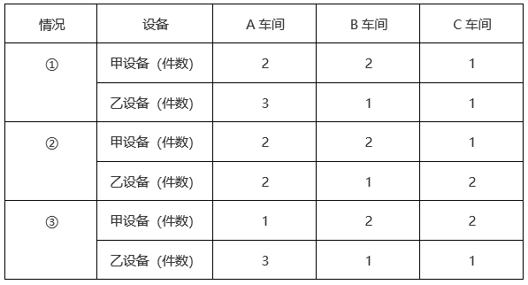

综上，共有3种不同的分配方式。

故正确答案为A。

### 第 70 题

张某8：00开车从A地出发，在A、B两地之间往返行驶。8：30第一次到达A、B之间的C点时加速30%继续行驶，并于9：00第二次到达C点。问AC距离是BC距离的多少倍？

A. 

B. 

C. 

D. 

第 70 题 · 答案与解析

**参考答案（粉笔题库参考内容）**

C

**解析**

设张某出发时的速度为v，8：00从A地出发，8：30到达C点，则AC间的路程共用时30分钟。根据公式：路程=速度×时间，则AC距离为30v。8：30到达C点后，加速30%继续行驶，并于9：00第二次到达C点。则可知张某在BC间往返共用时30分钟，即单程用时15分钟，速度变为1.3v，则BC距离为。故AC距离是BC距离的倍。

故正确答案为C。

### 第 71 题

小张每周一到周四夜跑，周五到周日休息，已知某年2月他夜跑17次，3月夜跑19次，问4月他夜跑多少次？

A. 16

B. 17

C. 18

D. 19

第 71 题 · 答案与解析

**参考答案（粉笔题库参考内容）**

A

**解析**

由题意可知，小张每周夜跑4次，则任意连续的28天共夜跑次。2月前28天（2月1日-2月28日）夜跑16次，不足17次，故该年2月应为29天，最后1天（2月29日）再夜跑1次。3月有31天，后28天（3月4号-3月31日）共夜跑16次，前3天（3月1日-3月3日）夜跑19-16=3次，即2月29日-3月3日连续4天夜跑4次，则这4天只能是周一至周四。4月有30天，前28天夜跑16次，后2天分别为周五、周六，不夜跑，因此小张4月夜跑16次。

故正确答案为A。

### 第 72 题

某种商品在定价基础上打八折销售，打折之前每天卖40件，开始打折第一天起，每天都比前一天多卖10件。打折销售15天的利润总额与打折之前销售20天的利润总额相同，问这种商品的成本是定价的：

A. 60%

B. 64%

C. 70%

D. 75%

第 72 题 · 答案与解析

**参考答案（粉笔题库参考内容）**

B

**解析**

设该商品的成本为x，且赋值该商品的定价为10，则打折前该商品每件的利润为10-x；打折后该商品每件的售价为10×0.8=8，利润为8-x。根据等差数列通项公式可知，打折销售第15天卖出该商品件；根据等差数列求和公式可知，该商品打折销售15天共计销售件。根据题意可列方程：（8-x）×1800=（10-x）×20×40，解得x=6.4。故这种商品的成本是定价的。

故正确答案为B。

### 第 73 题

某厂区如图所示，其中ABCD为矩形，ABEF为直角梯形，AB与DE相交于G点，其中阴影区域ADGF为涉密区域。已知AD、AF、AB长度分别为240米、150米、100米，问涉密区域的面积为多少万平方米？

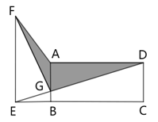

A. 1.2

B. 1.3

C. 1.4

D. 1.5

第 73 题 · 答案与解析

**参考答案（粉笔题库参考内容）**

A

**解析**

方法一：如下图所示，连接AE，根据“ABEF为直角梯形”，可知EB⊥AB，和均以AG为底、EB为高，即两个三角形同底等高，则。由于ABCD为矩形且AD、AB长度分别为240米、100米，则所求涉密区域面积平方米=1.2万平方米。

方法二：设AG、BE的长度分别为x米、y米，则BG的长度为（100-x）米。根据“ABCD为矩形，ABEF为直角梯形”，则，，因此，则有，即，整理可得，故所求涉密区域面积平方米=1.2万平方米。

故正确答案为A。

### 第 74 题

某单位65名职工中，拥有甲、乙、丙三项认证中至少一项的职工正好占80%，没有甲认证的职工与有乙认证的职工人数一样多，仅有丙认证的职工有3人，三项认证都有的职工有6人，问有多少人仅拥有甲、乙两项认证？

A. 10

B. 13

C. 16

D. 19

第 74 题 · 答案与解析

**参考答案（粉笔题库参考内容）**

A

**解析**

根据题意，该单位没有甲、乙、丙三项认证中任何一项的职工人数为65×（1-80%）=13人。如图所示，设仅有甲、乙两项认证的人数为x人，仅有乙、丙两项认证的人数为y人，仅有乙认证的人数为z人。则没有甲认证的职工人数为（z+y+3+13）人，有乙认证的职工人数为（z+y+x+6）人，根据题意可得：z+y+3+13=z+y+x+6，解得x=10，即仅有甲、乙两项认证的人数为10人。

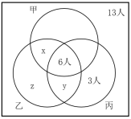

故正确答案为A。

### 第 75 题

一个长方体零件最大面的面积是最小面的3倍，次大面的面积是最大、最小面面积平均值的。问该零件最小面的长是其宽的多少倍？

A. 

B. 

C. 

D. 

第 75 题 · 答案与解析

**参考答案（粉笔题库参考内容）**

C

**解析**

设该长方体零件的三条不同长度的棱长从长到短依次为a、b、c，则最大面的面积为ab、次大面的面积为ac、最小面的面积为bc，根据题意则有，根据①可得a=3c，代入②可得。

故正确答案为C。

### 第 76 题

从所给的四个选项中，选择最合适的一个填入问号处，使之呈现一定的规律性：

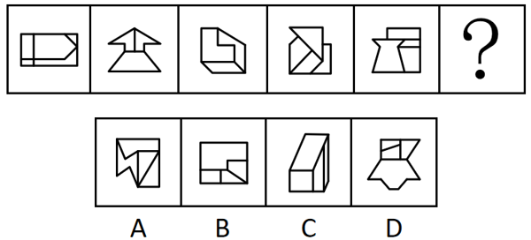

A. A

B. B

C. C

D. D

第 76 题 · 答案与解析

**参考答案（粉笔题库参考内容）**

D

**解析**

元素组成不同，且无明显属性规律，考虑数量规律。观察发现，题干图形封闭面较多，优先考虑数面，但整体数面无规律。继续观察发现，题干图形均明显存在最大面，且最大面均为轴对称图形，只有D项符合。

故正确答案为D。

### 第 77 题

从所给的四个选项中，选择最合适的一个填入问号处，使之呈现一定的规律性：

A. A

B. B

C. C

D. D

第 77 题 · 答案与解析

**参考答案（粉笔题库参考内容）**

C

**解析**

元素组成相同，优先考虑位置规律。观察发现，小短线在外圈依次逆时针平移1格，折线的拐点在内圈依次顺时针平移1格，折线整体依次顺时针旋转了，只有C项符合。

故正确答案为C。

### 第 78 题

从所给的四个选项中，选择最合适的一项填入问号处，使之呈现一定的规律性：

A. A

B. B

C. C

D. D

第 78 题 · 答案与解析

**参考答案（粉笔题库参考内容）**

B

**解析**

解法一：

元素组成相同，但无位置规律和属性规律，考虑数量规律。观察发现，题干图形中黑球和白球分堆明显，考虑部分数，题干图形中黑球部分数均为1，白球部分数均为2，？处图形也应遵循此规律，只有B项符合。

解法二：

元素组成相同，但无位置规律和属性规律，考虑数量规律。观察发现，题干图形中黑球和白球分堆明显，考虑部分数，题干图形中白球部分数均为2，且两部分的白球数量分别为12、1，11、2，10、3，9、4，8、5，一部分数量递减，另一部分数量递增，？处图形白球两部分数量应为7和6，只有B项符合。

故正确答案为B。

### 第 79 题

从所给的四个选项中，选择最合适的一个填入问号处，使之呈现一定的规律性：

A. A

B. B

C. C

D. D

第 79 题 · 答案与解析

**参考答案（粉笔题库参考内容）**

A

**解析**

元素组成相似，优先考虑样式规律。九宫格优先看横行。观察发现，第一行图形中，图一和图二先求异，再将求异后的图形左右翻转，得到图三；经验证，第二行符合此规律；第三行应用此规律，图一和图二先求异，再将求异后的图形左右翻转，只有A项符合。

故正确答案为A。

### 第 80 题

左边为给定的多面体，现用经P、Q、R三点的平面对其进行切割，问哪个选项是其切面？

A. A

B. B

C. C

D. D

第 80 题 · 答案与解析

**参考答案（粉笔题库参考内容）**

A

**解析**

本题考查截面图。根据平面公理“过不在一条直线上的三点，有且只有一个平面”可以得出，经过P、Q、R三点可以确定的唯一切面（即截面），即为A项，如下图所示：

故正确答案为A。

### 第 81 题

以下为4个由若干棱长为1的正方体拼成的多面体，将它们在3×3×4空间内进行拼接，不可能拼成以下四个选项中的哪一个多面体？

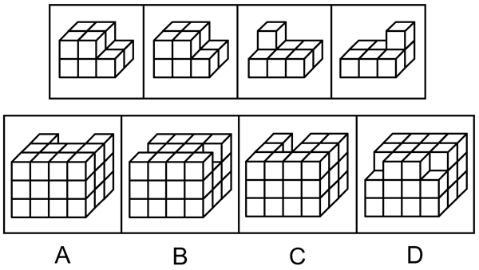

A. A

B. B

C. C

D. D

第 81 题 · 答案与解析

**参考答案（粉笔题库参考内容）**

C

**解析**

本题考查立体拼合。如下图所示，A、B、D三项均能由题干多面体拼接而成。

本题为选非题，故正确答案为C。

### 第 82 题

以下除哪项外，都是同一正方体纸盒的外表面展开图？

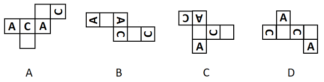

A. A

B. B

C. C

D. D

第 82 题 · 答案与解析

**参考答案（粉笔题库参考内容）**

D

**解析**

解法一：本题为空间重构题，如下图所示，A、B、C项中，两个“C”的开口方向一致，但D项中，两个“C”的开口方向不一致，因此D项折成的纸盒与其他三个不同。

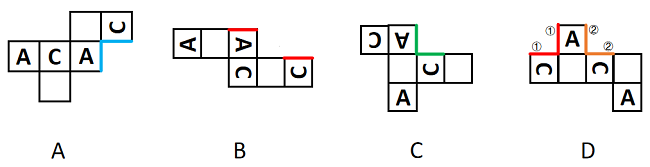

解法二：本题为空间重构题，如下图所示，A、B、C项中，“A”的左右分别与“C”的开口和后背相邻，但D项中，一个“A”的左右均与“C”的后背相邻，另一个“A”的左右均与“C”的开口相邻，因此D项折成的纸盒与其他三个不同。

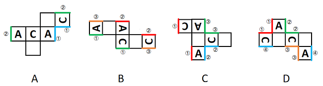

本题为选非题，故正确答案为D。

### 第 83 题

把下面的六个图形分为两类，使每一类图形都有各自的共同特征或规律，分类正确的一项是：

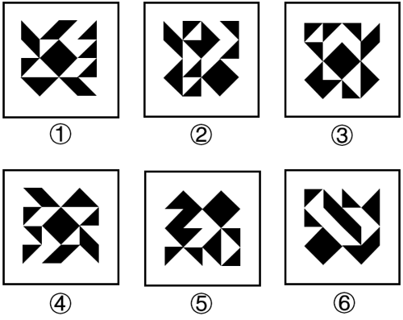

A. ①②④，③⑤⑥

B. ①③⑤，②④⑥

C. ①③④，②⑤⑥

D. ①③⑥，②④⑤

第 83 题 · 答案与解析

**参考答案（粉笔题库参考内容）**

C

**解析**

本题为分组分类题目。元素组成相同，但整体看没有明显的位置规律。观察发现，每幅图中均有一个正方形，且图①③④中的正方形在图形的中心位置，图②⑤⑥中的正方形在图形的四周位置。故图①③④为一组，图②⑤⑥为一组。

故正确答案为C。

### 第 84 题

把下面的六个图形分为两类，使每一类图形都有各自的共同特征或规律，分类正确的一项是：

A. ①②③，④⑤⑥

B. ①⑤⑥，②③④

C. ①②④，③⑤⑥

D. ①③⑤，②④⑥

第 84 题 · 答案与解析

**参考答案（粉笔题库参考内容）**

C

**解析**

本题为分组分类题目。观察发现，题干图形均出现黑球与白球，且每幅图均有两个黑球和两个套圈白球，虽然元素组成相同，但黑球与套圈白球的位置无规律，考虑两点确定一条直线，将两个黑球连线，两个套圈白球连线，观察连线的规律。观察发现，图①②④中，黑球连线与套圈白球连线互相垂直，图③⑤⑥中，黑球连线与套圈白球连线互相平行，即图①②④为一组，图③⑤⑥为一组。

故正确答案为C。

### 第 85 题

把下面的六个图形分为两类，使每一类图形都有各自的共同特征或规律，分类正确的一项是：

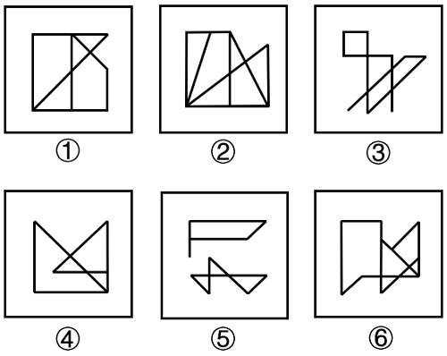

A. ①②⑥，③④⑤

B. ①③④，②⑤⑥

C. ①③⑤，②④⑥

D. ①④⑥，②③⑤

第 85 题 · 答案与解析

**参考答案（粉笔题库参考内容）**

B

**解析**

本题为分组分类题目。元素组成不同，且无明显属性规律，考虑数量规律。观察发现，图③为多端点图形，考虑笔画数。图①③④均为一笔画图形，图②⑤⑥均为两笔画图形。即图①③④为一组，图②⑤⑥为一组。

故正确答案为B。

### 第 86 题

后视错觉是个体的一种认知偏差，是指在一件事情已经发生之后，即使个体之前没有对此做过预判，也认为自己“早就知道会这样”。

根据上述定义，下列符合后视错觉的是：

A. 小瑾是一个悲观的人，她申请升职失败后，灰心丧气地说：“我早就知道，我什么都不如别人，什么也做不好。”

B. 朋友邀阿欣去爬山，阿欣说高温预警不宜爬山，朋友坚持去，才到半山腰就汗流浃背，阿欣说：“我早就说会很热啊。”

C. 晓琳参加一个重要会议迟到了。她懊悔地说：“我早该想到周一早上会堵车，不该按周末的情况预估通勤时间。”

D. 晓菲在股票大跌之后，懊恼地说：“我早就觉察到那些信号了，觉得走势不太好，怎么就没有早卖出啊。”

第 86 题 · 答案与解析

**参考答案（粉笔题库参考内容）**

D

**解析**

第一步：找出定义关键词。

“在一件事情已经发生之后”、“个体之前没有对此做过预判”、“认为自己‘早就知道会这样’”。

第二步：逐一分析选项。

A项：小瑾是一个“悲观”的人，说明她对自己升职的申请不抱有希望，认为自己会失败，在事情发生之前就预判了失败的结果，不符合“个体之前没有对此做过预判”，不符合定义，排除；

B项：阿欣在爬山前说高温预警不宜爬山，是朋友坚持爬山，说明在事情发生之前阿欣已经对“爬山会很热”做出了预判，不符合“个体之前没有对此做过预判”，不符合定义，排除；

C项：晓琳参加一个重要会议迟到了，符合“在一件事情已经发生之后”，她懊悔地说“我早该想到周一早上会堵车，不该按周末的情况预估通勤时间”，说明她在对“自己没有想到周一早上会堵车”这件事懊悔，不符合“认为自己‘早就知道会这样’”，不符合定义，排除；

D项：晓菲在股票大跌之后，符合“在一件事情已经发生之后”，懊恼地说“我早就觉察到那些信号了，觉得走势不太好”，说明晓菲认为自己早就觉察到股票会下跌，符合“认为自己‘早就知道会这样’”，符合定义，当选。

故正确答案为D。

### 第 87 题

选择或然率理论解释的是影响受众对大众传播内容选择的决定性因素。该理论的核心公式是：选择或然率=报偿的保证/费力的程度。其中，报偿的保证指的是传播内容满足选择者需要的程度，即内容对于受众的吸引力和实用性；费力的程度指的是获取传播内容和使用传播途径的难度。

根据上述定义，下列属于提高选择或然率的传播行为的是：

A. 视频号平台借助数据分析和个性化算法，给用户推荐符合其偏好的视频

B. 时下流行的某影视作品在播放之前被插入一段2分钟的广告

C. 某商家优化了商品布局，将畅销商品放在出口处，顾客可直接扫码支付

D. 电视内置视频播放软件，开机后须先注册登录，才可搜索相关内容观看

第 87 题 · 答案与解析

**参考答案（粉笔题库参考内容）**

A

**解析**

第一步：找出定义关键词。

选择或然率理论：“影响受众对大众传播内容选择的决定性因素”、“该理论的核心公式是：选择或然率=报偿的保证/费力的程度”；

报偿的保证：“传播内容满足选择者需要的程度”、“内容对于受众的吸引力和实用性”；

费力的程度：“获取传播内容和使用传播途径的难度”。

第二步：逐一分析选项。

A项：平台推荐用户偏好的视频，说明传播内容贴近用户需求，对用户具有吸引力，提高了“传播内容满足选择者需要的程度”和“内容对于受众的吸引力和实用性”，即“报偿的保证”提高了，平台推荐说明用户获取传播途径的难度小，降低了“获取传播内容和使用传播途径的难度”，即“费力的程度”降低了，而“选择或然率=报偿的保证/费力的程度”，因此属于提高选择或然率的传播行为，符合定义，当选；

B项：影视作品在播放之前被插入一段2分钟的广告，增加了用户观看影视作品的难度，提高了“获取传播内容和使用传播途径的难度”，即“费力的程度”提高了，而“选择或然率=报偿的保证/费力的程度”，因此属于降低选择或然率的传播行为，不符合定义，排除；

C项：某商家将畅销商品放在出口处，不涉及传播内容，不符合“影响受众对大众传播内容选择的决定性因素”，不符合定义，排除；

D项：电视内置视频播放软件，开机后须先注册登录，才可搜索相关内容观看，增加了用户看视频的难度，提高了“获取传播内容和使用传播途径的难度”，即“费力的程度”提高了，而“选择或然率=报偿的保证/费力的程度”，因此属于降低选择或然率的传播行为，不符合定义，排除。

故正确答案为A。

### 第 88 题

自动投案是指犯罪事实或者犯罪嫌疑人未被司法机关发觉，或者虽被发觉，但犯罪嫌疑人尚未受到讯问、未被采取强制措施时，主动、直接向公安机关、人民检察院或者人民法院投案。

根据上述定义，下列不属于自动投案的是：

A. 甲实施多起电信诈骗，获利十余万元，在公安机关进行的一次隐患排查入户走访中，发现甲形迹可疑，经盘问甲主动交代了自己的罪行

B. 乙致人重伤后潜逃，在公安机关经侦查确认乙为该案的犯罪嫌疑人时，乙正因酒后驾驶被行政拘留，经公安机关讯问后，乙交代了自己的罪行

C. 丙多次挪用公款，其父母发现异常后，多次规劝其投案自首无效，直至单位发现款项异常开始查账后，丙才到公安机关交代自己的罪行

D. 丁因入室盗窃被判处有期徒刑，在服刑期间，丁主动向公安机关交代自己系公安机关久未破获的“7·26”走私案的主谋之一

第 88 题 · 答案与解析

**参考答案（粉笔题库参考内容）**

B

**解析**

第一步：找出定义关键词。

“犯罪事实或者犯罪嫌疑人未被司法机关发觉，或者虽被发觉，但犯罪嫌疑人尚未受到讯问、未被采取强制措施时”、“主动、直接向公安机关、人民检察院或者人民法院投案”。

第二步：逐一分析选项。

A项：甲实施多起电信诈骗，公安机关在入户走访中发现甲形迹可疑，对甲进行盘问，符合“犯罪事实或者犯罪嫌疑人未被司法机关发觉，或者虽被发觉，但犯罪嫌疑人尚未受到讯问、未被采取强制措施时”，甲主动交代了自己的罪行，符合“主动、直接向公安机关、人民检察院或者人民法院投案”，符合定义，排除；

B项：乙致人重伤后潜逃且被公安机关确认为该案的犯罪嫌疑人，后因酒后驾驶被行政拘留，经公安机关讯问后交代了自己的罪行，不符合“犯罪事实或者犯罪嫌疑人未被司法机关发觉，或者虽被发觉，但犯罪嫌疑人尚未受到讯问、未被采取强制措施时”，不符合定义，当选；

C项：丙多次挪用公款，其所在单位发现款项异常开始查账，符合“犯罪事实或者犯罪嫌疑人未被司法机关发觉，或者虽被发觉，但犯罪嫌疑人尚未受到讯问、未被采取强制措施时”，丙到公安机关交代自己的罪行，符合“主动、直接向公安机关、人民检察院或者人民法院投案”，符合定义，排除；

D项：丁在入室盗窃服刑期间，主动向公安机关交代自己系公安机关久未破获的“7·26”走私案的主谋之一，符合“犯罪事实或者犯罪嫌疑人未被司法机关发觉，或者虽被发觉，但犯罪嫌疑人尚未受到讯问、未被采取强制措施时”、“主动、直接向公安机关、人民检察院或者人民法院投案”，符合定义，排除。

本题为选非题，故正确答案为B。

### 第 89 题

三维反求是测量技术、数据处理技术、图形处理技术和加工技术相结合的综合性技术，是指用一定的测量方法对实物进行测量，根据测量数据通过三维几何建模方法重构实物的数字化模型的过程。

根据上述定义，下列关于三维反求工程的步骤，排序正确的是：

①通过制造样品来验证模型是否满足精度和其他性能指标

②通过一定的算法，从测量数据中提取零件的设计与加工特征

③使用高精度的三维测量技术获取零件表面各点的空间坐标

④使用计算机辅助设计软件将数据与特征重构为三维模型

A. ①③④②

B. ①④③②

C. ③①②④

D. ③②④①

第 89 题 · 答案与解析

**参考答案（粉笔题库参考内容）**

D

**解析**

第一步：找出定义关键词。

“用一定的测量方法对实物进行测量”、“根据测量数据通过三维几何建模方法重构实物的数字化模型”。

第二步：逐一对照选项并判断正确答案。

根据定义可知，三维反求工程的步骤应先“对实物进行测量”，再“根据测量数据通过三维几何建模方法重构实物的数字化模型”，故步骤③应位于首句，排除A、B两项。继续分析步骤①和步骤④可知，应先“重构三维模型”再“验证模型”，故步骤④应在步骤①之前，排除C项。

故正确答案为D。

### 第 90 题

都、国、鄙、邑四个词在古汉语中表示不同的概念。“国”既可以指诸侯的封地，又可以指天子或诸侯的都城。“都”本义是大城邑，后引申为具有重要政治地位的大城邑。“鄙”在古汉语中是指边邑，即边远的小城。“邑”在古汉语中是指城镇。

下列图示对上述概念关系的描述，正确的是：

A. 

B. 

C. 

D. 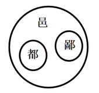

第 90 题 · 答案与解析

**参考答案（粉笔题库参考内容）**

D

**解析**

第一步：找出定义关键词。

国：“天子或诸侯的都城”；

都：“具有重要政治地位的大城邑”；

鄙：“边远的小城”；

邑：“城镇”。

图示中，

表示：P包含于Q；

表示：Q和P是并列关系。

第二步：逐一分析选项。

A项：“都”指具有重要政治地位的大城邑，“邑”指城镇，“都”包含于“邑”，而图片表示为“邑”包含于“都”，图示关系错误，排除；

B项：“国”指天子或诸侯的都城，“都”指具有重要政治地位的大城邑，有些“国”是“都”，有些“国”不是“都”，有些“都”是“国”，有些“都”不是“国”，“国”和“都”是交叉关系，而图片表示为“都”包含于“国”，图示关系错误，排除；

C项：“都”指具有重要政治地位的大城邑，“邑”指城镇，“都”包含于“邑”，而图片表示为“邑”和“都”是并列关系，图示关系错误，排除；

D项：“都”指具有重要政治地位的大城邑，“邑”指城镇，“鄙”指边远的小城，“都”包含于“邑”，“鄙”包含于“邑”，“都”和“鄙”是并列关系，图示关系正确，当选。

故正确答案为D。

### 第 91 题

流域内降雨或融冰化雪都可以引起河水显著上涨。春季，气候转暖，流域内的季节性积雪融化、河流解冻或春雨，引起河水上涨称春汛。因正值桃花盛开时节，故亦称桃汛。我国北方，把春季河冰解冻引起的涨水现象专称为凌汛。夏季，流域内的暴雨或高山冰川和积雪融化，使河水急剧上涨，称夏汛。我国习惯上把发生在夏季三伏前后的汛水称为伏汛。秋季由于暴雨，河水发生急剧上涨称秋汛。

根据上述定义，下列判断错误的是：

A. 春汛包含凌汛

B. 夏汛包含伏汛

C. 伏汛在凌汛前

D. 春汛就是桃汛

第 91 题 · 答案与解析

**参考答案（粉笔题库参考内容）**

C

**解析**

第一步：找出定义关键词。

春汛、桃汛：“春季，流域内的季节性积雪融化、河流解冻或春雨，引起河水上涨”、“因正值桃花盛开时节，故亦称桃汛”；

凌汛：“春季河冰解冻引起的涨水现象”；

夏汛：“夏季，流域内的暴雨或高山冰川和积雪融化，使河水急剧上涨”；

伏汛：“发生在夏季三伏前后的汛水”；

秋汛：“秋季由于暴雨，河水发生急剧上涨”。

第二步：逐一分析选项。

A项：凌汛是春季河冰解冻引起的涨水现象，说明是在春季因河流解冻引起的河水上涨，属于春汛的一种，所以春汛包含凌汛，判断正确，排除；

B项：伏汛是发生在夏季三伏前后的汛水，说明是在夏季发生的河水上涨，属于夏汛的一种，所以夏汛包含伏汛，判断正确，排除；

C项：伏汛是发生在夏季三伏前后的汛水，凌汛是春季河冰解冻引起的涨水现象，夏季在春季后，所以伏汛在凌汛后，判断错误，当选；

D项：春汛的发生因正值桃花盛开时节，故亦称桃汛，所以春汛就是桃汛，判断正确，排除。

本题为选非题，故正确答案为C。

### 第 92 题

断取是修辞格的一种，引用词语时，只截取其中部分字眼的意义，而置其余于不顾，是一种“断章取义”的修辞方式。

根据上述定义，下列没有采用断取修辞方式的是:

A. 相较于他之前见过的大阵仗，眼前的情形在他眼中就是“小儿科”

B. 小林一心扑在科研项目上，他至今还是一个“光杆司令”呢

C. 山林发生火灾，消防员“上刀山下火海”，奋力保卫人民的生命和财产安全

D. 实在走投无路，他最终还是找老师“开药方”，问询这一困局的破解之道

第 92 题 · 答案与解析

**参考答案（粉笔题库参考内容）**

D

**解析**

第一步：找出定义关键词。

“引用词语时，只截取其中部分字眼的意义，而置其余于不顾”。

第二步：逐一分析选项。

A项：该项引用“小儿科”时，只取“小”义而舍“儿科”义，表明了眼前的情形在他眼中只是小阵仗，符合“引用词语时，只截取其中部分字眼的意义，而置其余于不顾”，符合定义，排除；

B项：该项引用“光杆司令”时，只取“光杆”义而舍“司令”义，表明了小林因搞科研而至今未成婚，仍独身一人，符合“引用词语时，只截取其中部分字眼的意义，而置其余于不顾”，符合定义，排除；

C项：该项引用“上刀山下火海”时，只取“下火海”义而舍“上刀山”义，突出了消防员在扑救大火时不畏艰难险阻的勇敢精神，符合“引用词语时，只截取其中部分字眼的意义，而置其余于不顾”，符合定义，排除；

D项：该项引用“开药方”时，用了其完整的意思，表明了他在走投无路时，找老师寻求解决方法，不符合“引用词语时，只截取其中部分字眼的意义，而置其余于不顾”，不符合定义，当选。

本题为选非题，故正确答案为D。

### 第 93 题

细胞化学是研究细胞的化学成分及其在细胞活动中的变化和定位的学科。具体来说，细胞化学是在不破坏细胞形态结构的状况下，用生化的和物理的技术对细胞的各种组分做定量分析，研究其动态变化，了解细胞代谢过程中各种细胞组分的作用。

根据上述定义，下列属于细胞化学研究范围的是：

A. 观察玉米根系细胞从周围环境中摄取营养的能力以及受环境影响产生的活动

B. 根据哺乳动物细胞内核酸、蛋白质吸收不同紫外光的特点，分析其含量

C. 抽取患者骨髓液，根据显微镜下骨髓细胞的不同形态，判断患者的疾病种类

D. 研究小鼠免疫细胞受病原体侵入后，病原体释放毒素杀死免疫细胞的动态过程

第 93 题 · 答案与解析

**参考答案（粉笔题库参考内容）**

B

**解析**

第一步：找出定义关键词。

“研究细胞的化学成分及其在细胞活动中的变化和定位”、“在不破坏细胞形态结构的状况下”、“对细胞的各种组分做定量分析”、“了解细胞代谢过程中各种细胞组分的作用”。

第二步：逐一分析选项。

A项：观察玉米根系细胞摄取营养的能力及受环境影响产生的活动，不涉及细胞的化学成分，也没有对细胞的各种组分做定量分析，不符合“研究细胞的化学成分及其在细胞活动中的变化和定位”、“对细胞的各种组分做定量分析”，不符合定义，排除；

B项：分析哺乳动物细胞内核酸、蛋白质的含量，是对细胞内化学成分“核酸”和“蛋白质”做定量分析，符合“研究细胞的化学成分及其在细胞活动中的变化和定位”、“对细胞的各种组分做定量分析”，符合定义，当选；

C项：根据显微镜下“骨髓细胞的不同形态”来判断患者的疾病种类，不是研究细胞的化学成分，也没有对细胞的各种组分做定量分析，不符合“研究细胞的化学成分及其在细胞活动中的变化和定位”、“对细胞的各种组分做定量分析”，不符合定义，排除；

D项：研究小鼠免疫细胞被病原体杀死的动态过程，其研究的是“病原体”释放毒素杀死免疫细胞的过程，不是研究免疫细胞的各种组分，不符合“研究细胞的化学成分及其在细胞活动中的变化和定位”、“对细胞的各种组分做定量分析”，不符合定义，排除。

故正确答案为B。

### 第 94 题

同一认定是指侦查中具有专门知识的人或了解客体特征的人，通过比较先后出现的客体的特征而对客体是否同一做出的判断。这里所说的客体是指与案件有关联的人或物。

根据上述定义，下列属于同一认定的是：

A. 通过对手机中所存储的信息进行检查，确定其是否为报案人所丢失的手机

B. 通过对犯罪现场提取的DNA信息与DNA信息库进行比对，查找犯罪嫌疑人

C. 通过对走私案中所缴获的走私物品进行多次鉴定，认定其是否为国外某厂家所生产

D. 通过对犯罪嫌疑人车上所收缴的各类物品进行检验，判断其是否属于违禁物品

第 94 题 · 答案与解析

**参考答案（粉笔题库参考内容）**

B

**解析**

第一步：找出定义关键词。

“侦查中具有专门知识的人或了解客体特征的人”、“通过比较先后出现的客体的特征”、“对客体是否同一做出的判断”。

第二步：逐一分析选项。

A项：通过对手机中所存储的信息进行检查，只是检查手机存储的信息，不符合“通过比较先后出现的客体的特征”，不符合定义，排除；

B项：通过对犯罪现场提取的DNA信息与DNA信息库进行比对，把现场提取的DNA信息与先录入到DNA信息库中的进行比对，符合“通过比较先后出现的客体的特征”，通过DNA比对查找犯罪嫌疑人，即判断现场提取的DNA信息与DNA信息库中储存的信息是否为同一人，符合“对客体是否同一做出的判断”，符合定义，当选；

C项：通过对走私案中所缴获的走私物品进行多次鉴定，判断是否是国外某厂家生产的物品，只能证明这些物品是否产自于国外某厂家，无法证明该物品与其他物品为同一个物品，不符合“对客体是否同一做出的判断”，不符合定义，排除；

D项：通过对犯罪嫌疑人车上所收缴的各类物品进行检验，只是检查收缴的物品，不符合“通过比较先后出现的客体的特征”，不符合定义，排除。

故正确答案为B。

### 第 95 题

土地监测是利用遥感、遥测技术，对一个国家或地区土地利用状况的动态变化进行定期或不定期的监视和测定，目的在于为国家和地区有关部门提供准确的土地利用变化情况，及时进行土地利用数据更新与对比分析，以便编制土地利用变化图解等。

根据上述定义，下列属于土地监测的是:

A. 通过量化多时相遥感图像空间域、时间域、光谱域的耦合特征，获得土地变化的类型、位置和数量

B. 利用定期现场踏勘的方式标绘各土地使用单位及各类型土地的界线，对变化的地物界线作出修正

C. 通过某地区土地权属变更资料的分析，梳理该地区土地所有权、使用权的变化，以及土地纠纷调解情况

D. 利用植被具有红光强吸收特点，通过遥感设备监测植被的生长状态，并绘制植被的生长周期图

第 95 题 · 答案与解析

**参考答案（粉笔题库参考内容）**

A

**解析**

第一步：找出定义关键词。

“利用遥感、遥测技术，对一个国家或地区土地利用状况的动态变化进行定期或不定期的监视和测定”、“目的在于为国家和地区有关部门提供准确的土地利用变化情况，及时进行土地利用数据更新与对比分析，以便编制土地利用变化图解等”。

第二步：逐一分析选项。

A项：该项说的是通过遥感技术获得了土地变化的类型、位置和数量，即通过遥感技术获得土地利用情况，符合“利用遥感、遥测技术，对一个国家或地区土地利用状况的动态变化进行定期或不定期的监视和测定”、“目的在于为国家和地区有关部门提供准确的土地利用变化情况，及时进行土地利用数据更新与对比分析，以便编制土地利用变化图解等”，符合定义，当选；

B项：该项说的是定期现场踏勘土地使用单位及各类型土地的界线，没有提及是否运用了遥感、遥测技术，也未涉及土地利用情况，不符合“利用遥感、遥测技术，对一个国家或地区土地利用状况的动态变化进行定期或不定期的监视和测定”、“目的在于为国家和地区有关部门提供准确的土地利用变化情况，及时进行土地利用数据更新与对比分析，以便编制土地利用变化图解等”，不符合定义，排除；

C项：该项说的是土地的权属情况，未涉及土地利用情况，也未涉及遥感、遥测技术，不符合“利用遥感、遥测技术，对一个国家或地区土地利用状况的动态变化进行定期或不定期的监视和测定”、“目的在于为国家和地区有关部门提供准确的土地利用变化情况，及时进行土地利用数据更新与对比分析，以便编制土地利用变化图解等”，不符合定义，排除；

D项：该项说的是通过遥感设备监测植被的生长状态，并绘制植被的生长周期图，涉及的是植被情况，不是土地利用情况，不符合“利用遥感、遥测技术，对一个国家或地区土地利用状况的动态变化进行定期或不定期的监视和测定”、“目的在于为国家和地区有关部门提供准确的土地利用变化情况，及时进行土地利用数据更新与对比分析，以便编制土地利用变化图解等”，不符合定义，排除。

故正确答案为A。

### 第 96 题

嘤其鸣矣：求其友声

A. 遏其生气：以求重价

B. 求之其本：经旬必得

C. 道不拾遗：夜不闭户

D. 避其锐气：击其惰归

第 96 题 · 答案与解析

**参考答案（粉笔题库参考内容）**

A

**解析**

第一步：判断题干词语间逻辑关系。

“嘤其鸣矣，求其友声”指小鸟那嘤嘤的叫声，是为了寻求知音，二者为方式目的的对应关系。

第二步：判断选项词语间逻辑关系。

A项：“遏其生气，以求重价”指阻抑它（梅花）的生机，这样做是为了谋求高价，二者为方式目的的对应关系，与题干逻辑关系一致，当选；

B项：“求之其本，经旬必得”指做事情如果从根本做起，经过一段时间必定能够收效，二者为条件对应关系，与题干逻辑关系不一致，排除；

C项：“道不拾遗，夜不闭户”指东西丢在路上没有人拾走，夜里睡觉都不需要关门防盗，二者为并列关系，与题干逻辑关系不一致，排除；

D项：“避其锐气，击其惰归”指先避开敌人初来时的气势，等敌人疲惫时再狠狠打击，二者为时间先后顺序的对应关系，与题干逻辑关系不一致，排除。

故正确答案为A。

### 第 97 题

殚精竭虑：费尽心机

A. 狐假虎威：虚张声势

B. 舍生忘死：死里逃生

C. 侃侃而谈：喋喋不休

D. 光怪陆离：五光十色

第 97 题 · 答案与解析

**参考答案（粉笔题库参考内容）**

C

**解析**

第一步：判断题干词语间逻辑关系。

“殚精竭虑”指用尽精力、费尽心思，“费尽心机”指挖空心思、想尽办法，二者是近义关系。

第二步：判断选项词语间逻辑关系。

A项：“狐假虎威”指狐狸假借老虎的威势吓跑百兽，比喻倚仗别人的势力来欺压、恐吓人，“虚张声势”形容假装出强大的气势，指假造声势，借以吓人，二者是近义关系，与题干逻辑关系一致，保留；

B项：“舍生忘死”形容不顾性命危险，“死里逃生”指从极其危险的境地中逃脱，二者不是近义关系，与题干逻辑关系不一致，排除；

C项：“侃侃而谈”指理直气壮、不慌不忙地说话，“喋喋不休”指说话唠唠叨叨、没完没了，二者是近义关系，与题干逻辑关系一致，保留；

D项：“光怪陆离”形容现象奇异、色彩繁杂，“五光十色”形容色彩鲜艳、样式繁多，二者是近义关系，与题干逻辑关系一致，保留。

比较A、C、D三项，题干中“殚精竭虑”是褒义词，“费尽心机”是贬义词，A项中“狐假虎威”和“虚张声势”都是贬义词，D项中“光怪陆离”是中性词，“五光十色”是褒义词，C项中“侃侃而谈”是褒义词，“喋喋不休”是贬义词，故C项更为合适。

故正确答案为C。

### 第 98 题

群众来访：窗口接访：调查督办

A. 地面试验：点火飞行：燃料加注

B. 支付本币：兑换外币：确认汇率

C. 建造堤坝：潮汐发电：送电入户

D. 重启谈判：临时休战：边境冲突

第 98 题 · 答案与解析

**参考答案（粉笔题库参考内容）**

C

**解析**

第一步：判断题干词语间逻辑关系。

先群众来访，再窗口接访，最后调查督办，三者为时间先后顺序的对应关系。

第二步：判断选项词语间逻辑关系。

A项：先燃料加注，再点火飞行，第二词和第三词的时间先后顺序与题干不同，与题干逻辑关系不一致，排除；

B项：一般是先确认汇率，再兑换外币，第二词和第三词的时间先后顺序与题干不同，与题干逻辑关系不一致，排除；

C项：先建造堤坝，再潮汐发电，最后送电入户，三者为时间先后顺序的对应关系，与题干逻辑关系一致，当选；

D项：先临时休战，再重启谈判，第一词和第二词的时间先后顺序与题干不同，与题干逻辑关系不一致，排除。

故正确答案为C。

### 第 99 题

收集罪证：提取指纹：透明胶

A. 温度不当：叶子发黄：营养液

B. 逃生自救：敲碎车窗：安全锤

C. 道路施工：设置防护：混凝土

D. 冷风侵入：肩周疼痛：艾草贴

第 99 题 · 答案与解析

**参考答案（粉笔题库参考内容）**

B

**解析**

第一步：判断题干词语间逻辑关系。

提取指纹是为了收集罪证，二者为方式目的的对应关系；透明胶是提取指纹的工具，二者为工具对应关系。

第二步：判断选项词语间逻辑关系。

A项：温度不当会导致叶子发黄，二者为因果对应关系，与题干逻辑关系不一致，排除；

B项：敲碎车窗是为了逃生自救，二者为方式目的的对应关系；安全锤是敲碎车窗的工具，二者为工具对应关系，与题干逻辑关系一致，当选；

C项：设置防护是为了道路施工，二者为方式目的的对应关系，但混凝土不是设置防护的工具，二者不是工具对应关系，与题干逻辑关系不一致，排除；

D项：冷风侵入会导致肩周疼痛，二者为因果对应关系，与题干逻辑关系不一致，排除。

故正确答案为B。

### 第 100 题

行政文书 对于 （ ） 相当于 （ ） 对于 汇编语言

A. 行政机关；编程人员

B. 行政管理；传送指令

C. 商务文书；符号语言

D. 监管函；计算机语言

第 100 题 · 答案与解析

**参考答案（粉笔题库参考内容）**

D

**解析**

逐一代入选项。

A项：行政文书是国家行政机关处理公务所形成的具有特定格式的文字材料，行政机关发布行政文书，二者构成主宾关系；汇编语言是任何一种用于电子计算机、微处理器、微控制器或其他可编程器件的低级语言，编程人员编写汇编语言，二者构成主宾关系，但词语前后顺序相反，前后逻辑关系不一致，排除；

B项：利用行政文书进行行政管理，二者为工具对应关系；利用汇编语言传送指令，二者为工具对应关系，但词语前后顺序相反，前后逻辑关系不一致，排除；

C项：行政文书是国家行政机关处理公务所形成的具有特定格式的文字材料，商务文书是指企业在经营运作、贸易往来、开拓发展等一系列商务活动中所使用的各种文书的总称，二者为并列关系；汇编语言又被称为符号语言，二者为全同关系，前后逻辑关系不一致，排除；

D项：监管函是一种由监管部门向被监管对象发出的书面通知，旨在告知其存在的违规事实或风险状况，并要求其及时补救、改正或防范，监管函是一种行政文书，二者为种属关系；汇编语言是一种计算机语言，二者为种属关系，前后逻辑关系一致，当选。

故正确答案为D。

### 第 101 题

研究者设计了一个“拔河比赛”的实验，要求被试分别在单独和群体的情境下拔河，同时用仪器来测量他们的拉力。结果发现随着被试人数的增加，平均每个被试使出的力减少了。据此研究者认为，提高团队业绩的最佳途径就是减少团队人数。

下列选项如果为真，除哪项外均能质疑上述研究者的观点？

A. 团队合作中各取所长很重要，人数过少效率也会随之下降

B. 团队一起工作时，个人的贡献不被凸显，很容易失去积极性

C. 团队的合作与管理方式要比拔河复杂得多，不能一概而论

D. 增强个体对团队的归属感、责任感，能够更好地提高团队业绩

第 101 题 · 答案与解析

**参考答案（粉笔题库参考内容）**

B

**解析**

第一步：找出论点和论据。

论点：提高团队业绩的最佳途径就是减少团队人数。

论据：随着被试人数的增加，平均每个被试使出的力减少了。

本题论点讨论的是减少团队人数是提高团队业绩的最佳途径。论据讨论的是在“拔河比赛”的实验中被试人数增加，则平均每个被试使出的力会减少，即人数减少有利于每个被试使出的力增加。二者话题不一致，削弱可以考虑拆桥、削弱论点、削弱论据等。本题为选非题，排除能削弱的选项即可。

第二步：逐一分析选项。

A项：团队中人数过少则效率也会随之下降，说明减少团队人数可能不会提高团队业绩，削弱论点，可以削弱，排除；

B项：团队中个人的贡献不被凸显，很容易失去积极性，解释了为什么随着被试人数的增加，平均每个被试使出的力减少了，为加强项，无法削弱，当选；

C项：团队的合作和管理方式比拔河更复杂，说明不能将拔河得到的结论应用在团队合作中，拆断了拔河比赛与团队合作、管理方式之间的联系，为拆桥项，可以削弱，排除；

D项：增强个体对团队的归属感、责任感能更好地提高团队业绩，说明减少团队人数并非提高团队业绩的最佳途径，削弱论点，可以削弱，排除。

本题为选非题，故正确答案为B。

### 第 102 题

随着通货膨胀的蔓延，H国电子企业主要产品的原材料价格大幅上涨。该国最大的电子企业公报显示，今年该企业智能手机应用处理器价格较上年上涨30%，用于智能手机的相机模块价格上涨11%，用于电视和显示器的面板价格上涨9%。H国经济界认为，电子企业原材料价格居高不下，将严重削弱该国电子企业在国际市场上的竞争力。

以下哪项如果为真，最能支持上述结论？

A. 近年来，无论是国际还是国内，硅化合物价格始终呈上涨趋势，这是导致H国电子企业主要产品原材料价格大幅上涨的原因

B. 在H国电子企业主要产品的原材料价格大幅上涨的同时，由于购买力下降等原因，电子产品的全球消费需求在缩减

C. 其他国家电子企业都在通过科技创新降低产品原材料价格上涨的影响，以求通过低价在竞争激烈的国际电子产品市场中脱颖而出

D. 一直以来，H国电子企业生产的产品以其卓越的技术和质量优势在国际市场上极具竞争力，近年来这种竞争优势在逐渐减弱

第 102 题 · 答案与解析

**参考答案（粉笔题库参考内容）**

C

**解析**

第一步：找出论点和论据。

论点：电子企业原材料价格居高不下，将严重削弱该国电子企业在国际市场上的竞争力。

论据：随着通货膨胀的蔓延，H国电子企业主要产品的原材料价格大幅上涨。该国最大的电子企业公报显示，今年该企业智能手机应用处理器价格较上年上涨30%，用于智能手机的相机模块价格上涨11%，用于电视和显示器的面板价格上涨9%。

本题论点讨论的是H国电子企业原材料价格上涨与国际市场竞争力之间的关系，论据讨论的是H国最大的电子企业原材料价格上涨，故论点和论据的话题一致，加强优先考虑补充论据，即解释H国电子企业原材料价格上涨将削弱其在国际市场上的竞争力的原因或举例证明。

第二步：逐一分析选项。

A项：该项讨论的是电子企业主要产品原材料价格大幅上涨的原因，而论点讨论的是H国电子企业原材料价格上涨与国际市场竞争力之间的关系，话题不一致，无法加强，排除；

B项：该项讨论的是电子产品的全球消费需求在缩减的原因，而论点讨论的是H国电子企业原材料价格上涨与国际市场竞争力之间的关系，话题不一致，无法加强，排除；

C项：该项讨论的是其他国家电子企业通过科技创新降低产品原材料价格上涨的影响，以求通过低价在国际市场中脱颖而出，说明H国的电子企业相较于其他国家的电子企业，可能因原材料价格更高，在国际市场上的竞争中处于劣势，补充论据，可以加强，当选；

D项：该项讨论的是近年来H国电子企业的产品在技术和质量上的竞争优势正在逐渐减弱，但不明确原材料价格上涨是否会进一步削弱其在国际市场上的竞争力，为不明确项，无法加强，排除。

故正确答案为C。

### 第 103 题

考古人员发现了近300枚16亿年前的丝状体生物化石，这些丝状体均由巨型细胞组成，直径20~194微米不等。化石中，有些丝状体直径保持不变，细胞呈短柱状至长柱状；有些丝状体整体向一端均匀收缩，细胞呈柱状、桶状或杯状；而有的丝状体仅一端变细，形态呈现了一定的复杂性。考古人员据此认为，这些丝状体很可能属于真核生物。

以下各项如果为真，除哪项外均能支持上述观点？

A. 这些化石中被发现有类似于现生繁殖细胞——孢子一样的圆形结构，这一结构只出现在真核生物中

B. 原核生物细胞的直径一般小于2微米，而真核生物细胞的直径一般在10~100微米之间

C. 在目前已知的原核生物中，大多数的丝状体形态都比较简单，只有个别呈现出过渡期形态

D. 经比对，该化石中丝状体与一些现生绿藻（一种真核生物）的藻丝体形态、细胞大小分布和繁殖方式等最为接近

第 103 题 · 答案与解析

**参考答案（粉笔题库参考内容）**

C

**解析**

第一步：找出论点和论据。

论点：这些丝状体很可能属于真核生物。

论据：这些丝状体均由巨型细胞组成，直径20~194微米不等。化石中，有些丝状体直径保持不变，细胞呈短柱状至长柱状；有些丝状体整体向一端均匀收缩，细胞呈柱状、桶状或杯状；而有的丝状体仅一端变细，形态呈现了一定的复杂性。

本题论点说的是这些丝状体很可能属于真核生物，而论据说的是这些丝状体化石有哪些形态特征，论点和论据话题不一致，加强优先考虑搭桥，且本题为选非题，将可以加强的选项排除即可。

第二步：逐一分析选项。

A项：该项说的是这些丝状体生物化石中发现了类似于真核生物的圆形结构，建立了论据中“丝状体化石”与论点中“真核生物”的联系，为搭桥项，可以加强，排除；

B项：该项说的是真核生物细胞的直径一般在10~100微米之间，与丝状体生物化石中的巨型细胞直径20~194微米范围类似，建立了论据中“丝状体化石”与论点中“真核生物”的联系，为搭桥项，可以加强，排除；

C项：该项说的是原核生物的形态特点，与论点讨论的真核生物以及论据讨论的丝状体化石均无关系，为无关项，无法加强，当选；

D项：该项说的是化石中丝状体的形态等特征与一种真核生物绿藻相似，建立了论据中“丝状体化石”与论点中“真核生物”的联系，为搭桥项，可以加强，排除。

本题为选非题，故正确答案为C。

### 第 104 题

某项研究显示，与未接触空气污染的人相比，暴露于空气污染中的人死于乳腺癌的风险增加了80%，死于其他各类癌症的风险增加了22%。该研究团队由此认为，这可能与空气污染物中的PM2.5有关，因为PM2.5会导致脏器的炎症和氧化应激反应。

以下哪项如果为真，最可能是上述专家预设的前提？

A. 脏器的炎症和氧化应激反应是明确的致癌危险因素

B. PM2.5在大气成分中含量较少，但对空气质量有重要影响

C. 吸食香烟和电子烟等都可以将PM2.5直接输送到肺部

D. 女性更易接触烹饪油烟，其中含有大量的PM2.5

第 104 题 · 答案与解析

**参考答案（粉笔题库参考内容）**

A

**解析**

第一步：找出论点和论据。

论点：死于癌症的风险增加可能与空气污染物中的PM2.5有关。

论据：PM2.5会导致脏器的炎症和氧化应激反应。

本题论点讨论的是“PM2.5”和“死于癌症的风险”之间的关系，论据讨论的是“PM2.5”和“脏器的炎症和氧化应激反应”之间的关系，二者话题不一致，加强优先考虑搭桥，即在“脏器的炎症和氧化应激反应”与“死于癌症的风险”之间建立联系。

第二步：逐一分析选项。

A项：该项指出脏器的炎症和氧化应激反应是明确的致癌危险因素，即在“脏器的炎症和氧化应激反应”与“死于癌症的风险”之间建立了联系，为搭桥项，可以加强，当选；

B项：该项指出PM2.5在大气中的情况，而论点讨论的是死于癌症的风险与PM2.5是否有关，话题不一致，无法加强，排除；

C项：该项指出吸烟会将PM2.5直接输送到肺部，但最终死于癌症的风险是否会增加并未明确指出，为不明确项，无法加强，排除；

D项：该项指出女性更容易接触烹饪油烟，其中有PM2.5，但最终死于癌症的风险是否会增加并未明确指出，为不明确项，无法加强，排除。

故正确答案为A。

### 第 105 题

某桃园5月份对其种植的蟠桃进行套袋。6月份，桃果出现异常，50克左右的大果很少；10余克的小果特别多，约占75%。正常情况下，此时果实应重50克左右。有人推测，今年出现小果占比过大是由于套袋较早造成的，因为过早套袋会使果实失去营养竞争力，在营养供应不足的情况下，果实竞争不过新梢。

以下哪项如果为真，最能削弱上述推测？

A. 今年套果袋时果实大小基本一致，并且期间无病虫危害

B. 纸袋的遮光作用影响果实光合能力，进而影响甜度

C. 今年在没有分出大小果时就完成了疏除冗余幼果的操作，留下的不一定是优质大果

D. 今年桃树长得太快，加之萌芽肥、花后肥都没有追施，导致后期果实营养供应不足

第 105 题 · 答案与解析

**参考答案（粉笔题库参考内容）**

D

**解析**

第一步：找出论点和论据。

论点：今年出现小果占比过大是由于套袋较早造成的。

论据：过早套袋会使果实失去营养竞争力，在营养供应不足的情况下，果实竞争不过新梢。

本题论据说的是过早套袋会使果实失去营养竞争力，进而导致果实竞争不过新梢，即小果占比大；论点是基于此得出的小果占比过大的原因是套袋较早，二者话题一致，削弱优先考虑否定论点，即小果占比过大不是由于套袋较早造成的。

第二步：逐一分析选项。

A项：该项指出今年套果袋时果实大小基本一致，并且期间无病虫危害，只能说明病虫危害不是导致小果占比过大的原因，但是否存在其他的原因导致小果占比过大不明确，为不明确项，无法削弱，排除；

B项：该项指出纸袋的遮光作用影响果实光合能力，进而影响甜度，只能说明套袋影响甜度，而论点讨论的是小果占比过大的原因，话题不一致，无法削弱，排除；

C项：该项指出今年在没有分出大小果时就完成了疏除冗余幼果的操作，留下的不一定是优质大果，说明小果占比过大可能是由于没有分出大小果时就完成了疏除冗余幼果的操作造成的，把优质大果去掉了，保留下小果，直接否定论点，可以削弱，保留；

D项：该项指出今年桃树长得太快，加之萌芽肥、花后肥都没有追施，导致后期果实营养供应不足，说明果实营养供应不足是桃树长得太快，没有追肥造成的，进而导致小果占比过大，直接否定论点，可以削弱，保留。

对比C、D两项，C项表述为“不一定”，为可能性削弱，D项为肯定性削弱，削弱力度更强，D项当选。

故正确答案为D。

## 材料 1

某科研机构今年拟举办甲、乙、丙、丁、戊、己、庚、辛8次学术会议，每个季度最多举办3次，且各次会议举办时间不重叠。具体安排要求如下：

（1）丁、辛安排在第二季度；

（2）甲、戊安排在同一个季度；

（3）丁在乙之后丙之前举办；

（4）丙在甲之前己之后举办。

### 第 106 题

如果第二季度只安排2次会议，那么以下哪次会议一定安排在第一季度？

A. 甲

B. 乙

C. 庚

D. 丙

第 106 题 · 答案与解析

**参考答案（粉笔题库参考内容）**

B

**解析**

第一步：分析题干条件。

（1）丁、辛在第二季度；

（2）甲、戊在同一个季度；

（3）丁在乙之后丙之前举办；

（4）丙在甲之前己之后举办；

（5）第二季度只安排2次会议。

第二步：根据题干条件进行推理。

根据条件（1）和（5）可知，第二季度只安排了丁、辛两次会议，结合条件（3）可知，丁在乙之后举办，因此乙会议一定在第一季度举办，对应B项。

故正确答案为B。

### 第 107 题

下列哪2次会议可以安排在第一季度？

A. 甲和戊

B. 丙和丁

C. 丁和己

D. 己和庚

第 107 题 · 答案与解析

**参考答案（粉笔题库参考内容）**

D

**解析**

第一步：分析题干条件。

（1）丁、辛在第二季度；

（2）甲、戊在同一个季度；

（3）丁在乙之后丙之前举办；

（4）丙在甲之前己之后举办；

（5）甲、乙、丙、丁、戊、己、庚、辛8次学术会议，每个季度最多举办3次。

第二步：根据题干条件进行推理。

根据条件（1）可知，丁在第二季度举办，排除B、C两项；根据条件（3）和（4）可知，甲的前面一定有乙、丁、己、丙4次会议，结合条件（5）“每个季度最多举办3次”可知，甲一定不在第一季度举办，排除A项，只有D项符合。

故正确答案为D。

### 第 108 题

如果每个季度至少安排1次会议，并且最后一个季度仅安排1次会议，下列哪2次会议一定安排在第三季度？

A. 甲和戊

B. 乙和丙

C. 丙和己

D. 己和庚

第 108 题 · 答案与解析

**参考答案（粉笔题库参考内容）**

A

**解析**

第一步：分析题干条件。

（1）丁、辛在第二季度；

（2）甲、戊在同一个季度；

（3）丁在乙之后丙之前举办；

（4）丙在甲之前己之后举办；

（5）甲、乙、丙、丁、戊、己、庚、辛8次学术会议，每个季度最多举办3次；

（6）每个季度至少安排1次会议；

（7）第四季度仅安排1次会议。

第二步：根据题干条件进行推理。

根据条件（1）（2）（5）可知，甲和戊不可能安排在第二季度；此时结合条件（7）可知，甲和戊不可能安排在第四季度；再结合条件（4）可知，甲前面已经有己、丙，而每个季度最多举办3次，所以甲和戊在同一季度的情况下，不可能安排在第一季度，因此甲和戊只能安排在第三季度，对应A项。

故正确答案为A。

### 第 109 题

如果丙、戊安排在第四季度，下列哪2次会议可以安排在第三季度？

A. 甲和庚

B. 乙和丁

C. 乙和己

D. 己和庚

第 109 题 · 答案与解析

**参考答案（粉笔题库参考内容）**

D

**解析**

第一步：分析题干条件。

（1）丁、辛在第二季度；

（2）甲、戊同一季度；

（3）丁在乙之后，在丙之前；

（4）丙在甲之前，在己之后；

（5）乙、丙、丁、戊、己、庚、辛8次学术会议，每个季度最多举办3次；

（6）丙、戊在第四季度。

第二步：根据题干条件进行推理。

本题题干信息确定，选项信息充分，优先考虑排除法。

根据条件（1）（3）可知，乙在第二季度或者之前，不可能安排在第三季度，排除B、C两项；

根据条件（2）（6）可知，甲一定在第四季度，排除A项。

经验证，D项满足题干所有条件，当选。

故正确答案为D。

### 第 110 题

如果甲安排在第三季度，第四季度不安排会议，庚不可能和哪次会议安排在同一个季度？

A. 乙

B. 丙

C. 己

D. 辛

第 110 题 · 答案与解析

**参考答案（粉笔题库参考内容）**

B

**解析**

第一步：分析题干条件。

（1）丁、辛在第二季度；

（2）甲、戊同一季度；

（3）丁在乙之后，在丙之前；

（4）丙在甲之前，在己之后；

（5）甲、乙、丙、丁、戊、己、庚、辛8次学术会议，每个季度最多举办3次；

（6）甲在第三季度，第四季度不安排会议。

第二步：根据题干条件进行推理。

根据题干条件（3）和条件（4）可知，丙前有乙、丁和己，情况较少，因此可优先从丙入手进行假设。

假设丙被安排在第一季度，由条件（1）可知，丁、辛在第二季度，此时，丙在第一季度，丁在第二季度，不符合条件（3），因此，丙不能安排在第一季度。

假设丙被安排在第二季度，由条件（1）（2）（6）可知，丁、辛在第二季度，甲、戊在第三季度。结合条件（3）（4）（5）可知，乙和己在丙之前的第一季度，此时第一季度和第三季度均可安排庚，庚可能和乙、己、甲、戊安排在同一个季度。

假设丙被安排在第三季度，由条件（1）（2）（6）可知，丁、辛在第二季度，甲、戊在第三季度。结合条件（3）（4）（5）可知，乙和己在丙之前的第一季度或第二季度（如下图所示）。此时第一季度和第二季度均可安排庚，庚可能和乙、己、丁、辛安排在同一个季度。

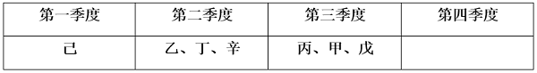

综上，庚不可能和丙安排在同一个季度。

本题为选非题，故正确答案为B。

## 材料 2

截至2023年末，我国集成电路布图设计登记累计申请93147件，发证72378件，2024年1-4月，我国集成电路布图设计登记申请3503件，发证4189件。

### 第 111 题

截至2014年末，我国集成电路布图设计登记累计申请量在以下哪个范围内？

A. 0.8万-1.5万件之间

B. 不到0.8万件

C. 1.5万-2.2万件之间

D. 超过2.2万件

第 111 题 · 答案与解析

**参考答案（粉笔题库参考内容）**

A

**解析**

定位文字材料可得：截至2023年末，我国集成电路布图设计登记累计申请93147件；定位统计图可知2015-2023年我国集成电路布图设计登记申请量。则截至2014年末，我国集成电路布图设计登记累计申请量=2023年末累计申请量-2015至2023年申请量之和=93147-(2058+2360+3228+4431+8319+14375+20353+20400+14400+12500)=93100-82100=11000件=1.1万件，在A项范围内。

故正确答案为A。

### 第 112 题

如2024年5-12月，我国集成电路布图设计登记月均发证量与1-4月水平相同，则2024年全年，我国集成电路布图设计登记发证量将比上年：

A. 下降不到20%

B. 下降20%以上

C. 上升不到20%

D. 上升20%以上

第 112 题 · 答案与解析

**参考答案（粉笔题库参考内容）**

C

**解析**

根据题干“······我国集成电路布图设计登记发证量将比上年”，结合选项为百分数，可判定本题为一般增长率问题。定位文字材料可知：2024年1-4月，我国集成电路布图设计登记申请3503件，发证4189件。定位统计图可知：2023年我国集成电路布图设计登记发证11316件。则2024年1-4月我国集成电路布图设计登记月均发证量件，2024年全年我国集成电路布图设计登记发证量=4189+1047×（12-4）=12565件。根据公式：增长率，可得2024年全年我国集成电路布图设计登记发证量比上年增长，即上升不到20%。

故正确答案为C。

### 第 113 题

2019-2021年，我国集成电路布图设计登记申请量三年的同比增速：

A. 先升后降

B. 先降后升

C. 逐年上升

D. 逐年下降

第 113 题 · 答案与解析

**参考答案（粉笔题库参考内容）**

D

**解析**

根据题干“2019-2021······三年的同比增速”，可判定本题为一般增长率问题。定位统计图可得：2018-2021年我国集成电路布图设计登记申请量分别为4431件、8319件、14375件、20353件。根据公式：增长率，则2019-2021年我国集成电路布图设计登记申请量同比增速分别为：

2019年，；

2020年，；

2021年，。

综上所述，2019-2021年，我国集成电路布图设计登记申请量同比增速逐年下降。

故正确答案为D。

### 第 114 题

2015-2023年，我国集成电路布图设计登记当年发证量与当年申请量比值大于0.9的年份有几个？

A. 2

B. 3

C. 4

D. 5

第 114 题 · 答案与解析

**参考答案（粉笔题库参考内容）**

A

**解析**

根据题干“2015-2023年······与······比值大于0.9的年份有几个”，可判定本题为比值计算问题。定位统计图可知2015-2023年我国集成电路布图设计登记当年发证量与当年申请量。2015-2023年各年份比值分别为：

2015年，；

2016年，；

2017年，；

2018年，；

2019年，；

2020年，；

2021年，；

2022年，；

2023年，。

综上，2015-2023年我国集成电路布图设计登记当年发证量与当年申请量比值大于0.9的年份有2016年、2023年，共2个。

故正确答案为A。

### 第 115 题

以下柱状图反映了哪一时间段内，我国集成电路布图设计登记发证量同比增量的变化趋势（横轴位置表示增量为0）？

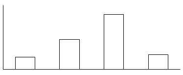

A. 2017-2020年

B. 2016-2019年

C. 2019-2022年

D. 2018-2021年

第 115 题 · 答案与解析

**参考答案（粉笔题库参考内容）**

D

**解析**

根据题干“······同比增量的变化趋势”，可判定本题为增长量比较问题。定位统计图可得2015-2022年我国集成电路布图设计登记发证量。根据公式：增长量=现期量-基期量，则2016-2022年我国集成电路布图设计登记发证量同比增量分别为：

2016年，；

2017年，；

2018年，；

2019年，；

2020年，；

2021年，；

2022年，9106-13087<0。

观察可知，柱状图呈现先上升再下降的趋势，且第三个柱子最高，与2018-2021年同比增量的变化趋势一致。

故正确答案为D。

## 材料 3

### 第 116 题

2023年，Z省含村、社区在内的法律顾问数约是2020年的多少倍？

A. 1.2

B. 1.4

C. 1.6

D. 1.8

第 116 题 · 答案与解析

**参考答案（粉笔题库参考内容）**

B

**解析**

根据题干“2023年······约是······多少倍”，可判定本题为现期倍数问题。定位统计表可得：2023年Z省（不含村、社区）法律顾问数为111811家，村(社区)法律顾问数为23652家；2020年Z省（不含村、社区）法律顾问数为72739家，村（社区）法律顾问数为26153家。则题干所求倍。

故正确答案为B。

### 第 117 题

2020-2023年，Z省律师办理法律业务数之和约是同期基层法律服务工作者办理法律业务数之和的多少倍？

A. 12

B. 15

C. 18

D. 21

第 117 题 · 答案与解析

**参考答案（粉笔题库参考内容）**

A

**解析**

根据题干“2020-2023年······之和约是······之和的多少倍”，可判定本题为现期倍数问题。定位统计表可知：2020-2023年每年Z省律师办理法律业务数、基层法律服务工作者办理法律业务数。可得题干所求倍数为倍。

故正确答案为A。

### 第 118 题

2021-2023年，Z省各年律师人数与律师事务所总数的比值：

A. 先升后降

B. 先降后升

C. 持续下降

D. 持续上升

第 118 题 · 答案与解析

**参考答案（粉笔题库参考内容）**

D

**解析**

根据题干“2021-2023年······与······的比值”，结合选项为判断升降变化，可判定本题为比值比较问题。定位统计表可得：2021-2023年，Z省各年律师人数分别为30889人、36938人、41924人；各年律师事务所总数分别为1705家、1755家、1826家。则比值分别为2021年：；2022年：；2023年：，故2021-2023年，Z省各年律师人数与律师事务所总数的比值持续上升。

故正确答案为D。

### 第 119 题

如保持2023年同比增量不变，则到哪一年Z省律师办理法律业务数将首次超过150万件？

A. 2026年

B. 2027年

C. 2028年

D. 2029年

第 119 题 · 答案与解析

**参考答案（粉笔题库参考内容）**

C

**解析**

根据题干“如保持2023年同比增量不变，则到哪一年······将首次超过150万件”，结合材料时间为2023年，可判定本题为现期追赶问题。定位统计表可得：2022年、2023年Z省律师办理法律业务数分别为81.24万件、93.55万件。根据公式：增长量=现期量-基期量，则2023年Z省律师办理法律业务数的同比增长量=93.55-81.24=12.31万件。根据公式：现期量=基期量＋n×增长量，可列式：93.55＋n×12.31>150，解得n>4.6，则n至少为5，即2023+5=2028年Z省律师办理法律业务数将首次超过150万件。

故正确答案为C。

### 第 120 题

以下柱状图反映了2021、2022和2023年Z省律师、基层法律服务工作哪一指标的同比增量变化趋势（横轴位置表示增量为0）？

A. 律师事务所总数

B. 律师人数

C. 村（社区）法律顾问数

D. 法律顾问数（不含村、社区）

第 120 题 · 答案与解析

**参考答案（粉笔题库参考内容）**

D

**解析**

根据题干“以下柱状图反映了2021、2022和2023年······同比增量变化趋势（横轴位置表示增量为0）”，可判定本题为增长量比较问题。定位统计表可得2020-2023年Z省律师事务所总数、律师人数、村（社区）法律顾问数、法律顾问数（不含村、社区）。根据公式：增长量=现期量-基期量，可得2021-2023年各指标同比增长量：

A项，律师事务所总数：2022年，1755-1705=50家；2023年，1826-1755=71家。2022年同比增长量＜2023年同比增长量，不符合柱状图变化趋势，排除；

B项，律师人数：2021年，30889-27302=人；2022年，36938-30889=人。2021年同比增长量＜2022年同比增长量，不符合柱状图变化趋势，排除；

C项，村（社区）法律顾问数：2021年（24951家）＜2020年（26153家），同比增长量＜0，而柱状图（横轴位置表示增量为0）中2021年同比增长量＞0，不符合，排除；

D项，法律顾问数（不含村、社区）：2021年，89450-72739=家；2022年，102251-89450=家；2023年，111811-102251=家。2021年同比增长量＞2022年同比增长量＞2023年同比增长量，符合柱状图变化趋势，当选。

故正确答案为D。

## 材料 4

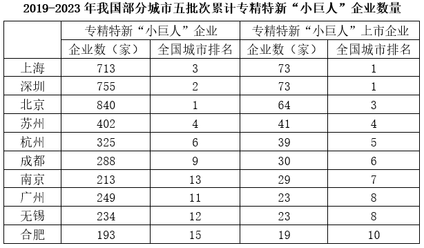

### 第 121 题

2019-2023年，有几个城市五批次累计公示的专精特新“小巨人”上市企业数量占全国的比重超过5%？

A. 1

B. 2

C. 3

D. 4

第 121 题 · 答案与解析

**参考答案（粉笔题库参考内容）**

C

**解析**

根据题干“2019-2023年，有几个城市······占全国的比重超过5%”，结合材料时间为2019-2023年，可判定本题为现期比重问题。定位柱状图可知2019-2023年我国各批次专精特新“小巨人”上市企业数量，则2019-2023年我国五批次累计公示的专精特新“小巨人”上市企业数量为39+198+229+282+134=882家。根据公式：比重，题目求，则满足城市>全国×5%=882×5%=44.1家即可。定位表格可知全国排名前10的城市五批次累计专精特新“小巨人”上市企业数量，观察发现，从第4名开始均小于44.1家，即只有3个城市的占比超过5%。

故正确答案为C。

### 第 122 题

以下批次中，公示的专精特新“小巨人”上市企业数量占同批次专精特新“小巨人”企业数量比重最高的是：

A. 第二批次

B. 第三批次

C. 第四批次

D. 第五批次

第 122 题 · 答案与解析

**参考答案（粉笔题库参考内容）**

A

**解析**

根据题干“以下批次中······占同批次······比重最高的是”，可判定本题为现期比重问题。定位统计图可知各批次公示的专精特新“小巨人”上市企业数量及企业数量，根据公式：比重，各批次公示的专精特新“小巨人”上市企业数量占同批次专精特新“小巨人”企业数量比重分别为：第二批次，；第三批次，；第四批次，；第五批次，，则第二批次公示的专精特新“小巨人”上市企业数量占同批次专精特新“小巨人”企业数量比重最高。

故正确答案为A。

### 第 123 题

已知2023年第五批次公示的专精特新“小巨人”企业分布于全国300个城市中，则这些城市平均每个有多少家第五批次公示的专精特新“小巨人”非上市企业？

A. 不到11家

B. 11-12家之间

C. 12-13家之间

D. 超过13家

第 123 题 · 答案与解析

**参考答案（粉笔题库参考内容）**

B

**解析**

根据题干“已知2023年第五批次公示······平均每个有多少家······”，结合材料给出2023年第五批次公示相关数据，可判定本题为现期平均数问题。定位统计图可得：2023年第五批次公示专精特新“小巨人”企业数量为3671家，专精特新“小巨人”上市企业数量为134家。根据平均数，可得全国300个城市中，平均每个城市第五批次公示的专精特新“小巨人”非上市企业数量家，在B项范围内。

故正确答案为B。

### 第 124 题

2019-2023年，北京、上海、广州、深圳4个城市五批次累计公示的专精特新“小巨人”企业数量之和约占全国总数的：

A. 35%

B. 30%

C. 25%

D. 20%

第 124 题 · 答案与解析

**参考答案（粉笔题库参考内容）**

D

**解析**

根据题干“2019-2023年······约占······”，结合材料给出2019-2023年的相关数据，可判定本题为现期比重问题。定位统计图可得：2019-2023年我国五批次公示的专精特新“小巨人”企业数量分别为248家、1744家、2930家、4357家、3671家；定位统计表可得：2019-2023年北京、上海、广州、深圳4个城市五批次累计专精特新“小巨人”企业数量分别为840家、713家、249家、755家。根据公式：比重，可得题干所求。

故正确答案为D。

### 第 125 题

以下饼状图中，最能准确反映2019-2023年五批次公示的专精特新“小巨人”上市企业中，第一批次（黑色）、第二批次（横线）、第三批次（竖线）、第四批次（白色）和第五批次（网格）企业数量比例关系的是：

A. 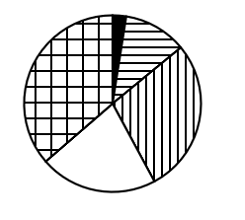

B. 

C. 

D. 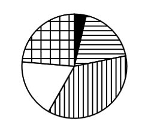

第 125 题 · 答案与解析

**参考答案（粉笔题库参考内容）**

B

**解析**

根据题干“······最能准确反映2019-2023年······企业数量比例关系的是”，结合材料时间为2019-2023年，可判定本题为现期比重问题。定位统计图可知：2019-2023年五批次公示的专精特新“小巨人”上市企业数量分别为39家、198家、229家、282家、134家。根据第四批次公示上市企业数量（282家）最多，可知第四批次（白色）占比最大，排除A、D两项；第五批次公示上市企业数量（134家）<第二批次公示上市企业数量（198家），可知第五批次（网格）占比<第二批次（横线）占比，排除C项，B项当选。

故正确答案为B。

## 材料 5

2023年三季度，支付系统共处理支付业务3358.88亿笔，金额3151.37万亿元，同比分别增长12.59%和6.97%。

三季度，人民银行清算总中心系统共处理支付业务54.79亿笔，金额2379.52万亿元，同比分别增长0.92%和9.53%，其中，大额实时支付系统处理业务9518.17万笔，同比下降10.39%，金额2254.07万亿元，同比增长9.72%；小额批量支付系统处理业务11.51亿笔，金额46.69万亿元，同比分别增长5.73%和10.03%；网上支付跨行清算系统处理业务42.31亿笔，同比下降0.03%，金额74.66万亿元，同比增长5.38%；境内外币支付系统处理业务134.46万笔，同比增长2.83%，金额5707.35亿美元，同比下降14.63%。

在其他支付系统中，银行行内业务系统三季度处理业务54.42亿笔，同比增长11.14%，金额539.56万亿元，同比下降4.10%；银联跨行支付系统处理业务837.93亿笔，金额70.27万亿元，同比分别增长21.37%和8.70%；城银清算支付清算系统处理业务1056.40万笔，金额9744.45亿元，同比分别增长34.61%和36.31%；农信银支付清算系统处理业务7.41亿笔，金额7162.13亿元，同比分别下降39.98%和13.55%；人民币跨境支付系统处理业务176.43万笔，金额33.42万亿元，同比分别增长43.23%和31.41%；网联清算平台处理业务2404.21亿笔，金额126.92万亿元，同比分别增长10.42%和6.28%。

### 第 126 题

2023年三季度，支付系统平均每笔支付业务金额比上年同期：

A. 下降了不到1000元

B. 下降了1000元以上

C. 上升了不到1000元

D. 上升了1000元以上

第 126 题 · 答案与解析

**参考答案（粉笔题库参考内容）**

A

**解析**

根据题干“2023年三季度······平均每······比上年同期”，结合选项带单位，可判定本题为平均数的增长量问题。定位文字材料第一段可得：2023年三季度，支付系统共处理支付业务3358.88亿笔（B），金额3151.37万亿元（A），同比分别增长12.59%（b）和6.97%（a）。根据公式：平均数的增长量，可得所求为元，即下降了不到1000元。

故正确答案为A。

### 第 127 题

2023年三季度，人民银行清算总中心系统处理支付业务中，小额批量支付系统处理业务笔数的占比同比：

A. 下降了2个百分点以上

B. 下降了不到2个百分点

C. 上升了2个百分点以上

D. 上升了不到2个百分点

第 127 题 · 答案与解析

**参考答案（粉笔题库参考内容）**

D

**解析**

根据题干“2023年三季度，······中······的占比同比”，结合选项为“上升/下降+百分点”，可判定本题为两期比重计算问题。定位文字材料第二段可得：2023年三季度，人民银行清算总中心系统共处理支付业务54.79亿笔（B），同比增长0.92%（b），其中，小额批量支付系统处理业务11.51亿笔（A），同比增长5.73%（a）。根据公式：两期比重差，则题干所求，即上升了不到2个百分点。

故正确答案为D。

### 第 128 题

2022年三季度，人民银行清算总中心系统境内外币支付系统处理业务日均处理金额在以下哪个范围内？

A. 超过80亿美元

B. 70亿-80亿美元之间

C. 60亿-70亿美元之间

D. 不到60亿美元

第 128 题 · 答案与解析

**参考答案（粉笔题库参考内容）**

B

**解析**

根据题干“2022年三季度······日均处理金额······”，结合材料时间为2023年三季度，可判定本题为基期平均数问题。定位文字材料第二段可得：2023年三季度，人民银行清算总中心系统境内外币支付系统处理金额5707.35亿美元，同比下降14.63%。根据公式：基期量，可得2022年三季度，人民银行清算总中心系统境内外币支付系统处理金额亿美元。由于2022年7月有31天，8月有31天，9月有30天，则三季度共有31+31+30=92天，可得三季度日均处理金额亿美元，在B项范围内。

故正确答案为B。

### 第 129 题

将其他支付系统中①银行行内业务系统、②银联跨行支付系统、③城银清算支付清算系统和④农信银支付清算系统按2023年三季度平均每笔业务金额同比增速从高到低排列，以下正确的是：

A. ①②③④

B. ③②①④

C. ④③②①

D. ④①②③

第 129 题 · 答案与解析

**参考答案（粉笔题库参考内容）**

C

**解析**

根据题干“······2023年三季度平均每笔业务金额同比增速······”，可判定本题为平均数的增长率问题。定位文字资料第三段可得：（2023年三季度）在其他支付系统中，银行行内业务系统三季度处理业务数量同比增长11.14%（），金额同比下降4.10%（）；银联跨行支付系统处理业务数量和金额同比分别增长21.37%（）和8.70%（）；城银清算支付清算系统处理业务数量和金额同比分别增长34.61%（）和36.31%（）；农信银支付清算系统处理业务数量和金额同比分别下降39.98%（）和13.55%（）。根据公式：平均数的增长率，则2023年三季度①银行行内业务系统、②银联跨行支付系统、③城银清算支付清算系统和④农信银支付清算系统平均每笔业务金额同比增速分别为：

①银行行内业务系统：；

②银联跨行支付系统：；

③城银清算支付清算系统：；

④农信银支付清算系统：。

综上可知，同比增速从高到低排列为：④③②①。

故正确答案为C。

### 第 130 题

关于2023年三季度支付系统运行情况，不能从上述资料中推出的是：

A. 网上支付跨行清算系统处理业务平均每笔金额同比增长了5%以上

B. 银联跨行支付系统处理业务金额同比增量高于城银清算支付清算系统处理业务金额同比增量

C. 大额实时支付系统处理业务金额占人民银行清算总中心系统处理支付业务总金额的95%以上

D. 人民币跨境支付系统处理业务笔数同比增长了40万笔以上

第 130 题 · 答案与解析

**参考答案（粉笔题库参考内容）**

C

**解析**

A项：定位文字材料第二段可得，2023年三季度，网上支付跨行清算系统处理业务42.31亿笔，同比下降0.03%（b），金额74.66万亿元，同比增长5.38%（a）。根据公式：平均数的增长率，可得所求，正确；

B项：定位文字材料第三段可得，2023年三季度，银联跨行支付系统处理业务金额70.27万亿元，同比增长8.70%；城银清算支付清算系统处理业务金额9744.45亿元，同比增长36.31%。根据公式：增长量，可得银联跨行支付系统处理业务金额同比增量亿元；城银清算支付清算系统处理业务金额同比增量亿元。故银联跨行支付系统处理业务金额同比增量高于城银清算支付清算系统处理业务金额同比增量，正确；

C项：定位文字材料第二段可得，2023年三季度，人民银行清算总中心系统共处理支付业务金额2379.52万亿元，其中，大额实时支付系统处理业务金额2254.07万亿元。根据公式：比重，可得所求，错误；

D项：定位文字材料第三段可得，2023年三季度，人民币跨境支付系统处理业务176.43万笔，同比增长43.23%。根据公式：增长量，可得所求万笔>40万笔，正确。

本题为选非题，故正确答案为C。

