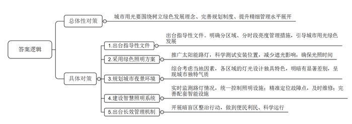
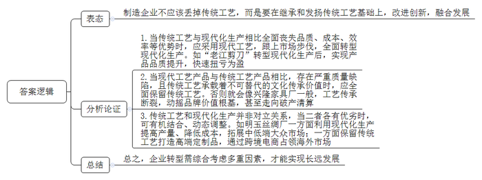
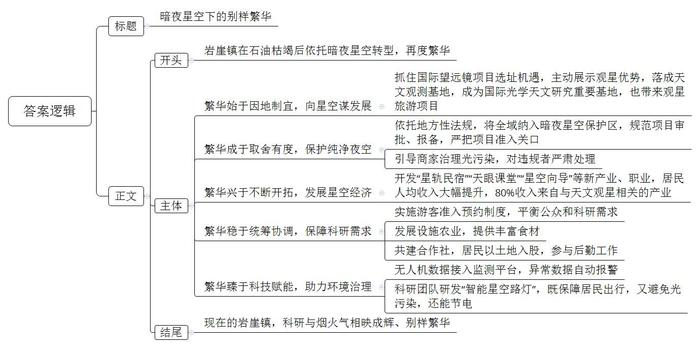
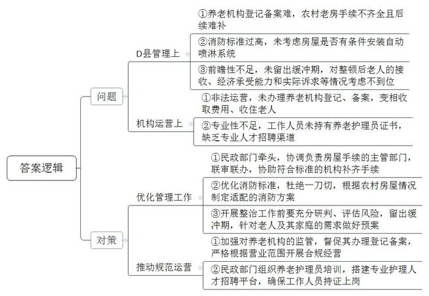
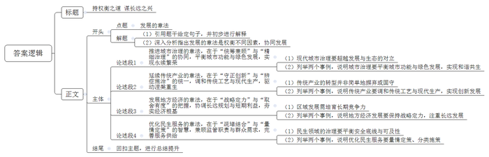

# 2026年国家公考《申论》题（副省级）

<!-- gwy:overview:start -->
> **国考 · 2026 · 申论 · 副省级** ｜ 5 题 · 图片 5 处 · 答案随题折叠

导航：[题目](#题目) · [材料 1](#材料-1)
<!-- gwy:overview:end -->

> 候选采集稿。参考答案及解析来自粉笔页面，不代表官方答案或真实高分答卷；来源使用许可与原卷对应关系仍需人工核实。

## 给定材料

### 材料 1

城市与灯光密不可分。夜幕降临，华灯渐次亮起，装扮城市形象，照亮居民生活。随着绿色发展理念的不断深入，城市用能面临新考验，景观、表演、建筑、交通等灯光的使用需要更新理念和规划，“城市用光”的管理，考验的是城市治理的精细化水平。

“H市发布了《城市用光总体规划（2023—2027年）》，这是关于H市用光总体布局、建设、管理的指导性文件，引导城市用光向‘绿色’方向发展，更好地构建城市夜空景观形象，尤其是明确了分区域亮度管理措施，以避免光污染进入自然生态较好的区域。”H市城市管理局市容景观发展中心段主任说，“目前，月溪湿地公园、远山国家森林公园等九大区域，仅保留功能性照明路灯，不允许设置景观照明灯。”

H市对全市户外媒体墙、灯光秀等项目作出规定，原则上不允许新增，商业街区、旅游场所等也需控制灯光亮度、色温及辐射范围。有市民在政府留言板中写到：“居民区均设置了柔和的灯光，避免对居民的干扰，非常人性化。”段主任表示，H市还设计了平日、周末、节假日三种亮灯模式，通过不同环境氛围下的灯光色温变化，满足夜间照明需求，服务城市发展。

近年来，H市积极推广太阳能路灯这一绿色照明方案，“太阳能路灯由太阳能电池板、蓄电池、LED光源与智能控制器等部件组成，共同构成了一个完整的自主照明供电体系。LED灯耗电量低，照明效果却更好。”段主任介绍，“规划设计时，安装位置经过科学测试，以减少周边建筑和树木造成的遮光影响，确保每盏路灯都能获得有效光照时间。”据测算，如果H市这座大城市的传统路灯全部替换为太阳能路灯，每年可减少上万吨二氧化碳排放。

“城市景观照明是对城市夜空元素的系统组织，必须综合考虑当地自然地理、历史文化等因素，总体规划布局城市夜景环境，呈现城市的独特气质。”H市美术学院任教授认为，“H市是一座山水人文相依的城市，尤其要保留南国水乡氤氲灵秀的气质。”在灯光设计上，各区域独具特色——A城区定位为“人文之城”，照明结合山水资源和历史文化环境，灯光贴合街区、山脉、河流风貌；B城区营造“古韵”，以运河为照明建设核心，体现古城气息；C城区主打“靓丽”，形成华美、时尚、动感的整体氛围……

不同区域夜景明暗也有显著差别。青湖区域运用泛光、点射、投射等多种照明手法，湖光山色在若隐若现、浓淡相宜的灯光点缀下，增添了如诗如画的韵味，而岸远路天桥、霞明路天桥等处，以环天桥一周的国际酒店、绘中广场、市北大都汇等建筑为载体，进行了规模化组团设计，整体协调周边灯光，打造都市夜景典范。

走进H市市容景观发展中心，智慧照明系统实时监测大屏幕映入眼帘，全市所有路灯设施的情况，如配电箱状态、亮灯时间、能耗等一目了然，随着节能改造工程的推进，连每月、每周，甚至每天节省的电能都直观可见。“目前，H市全城区道路，主副城区接壤道路以及市内重要景观的照明设施已基本实现统一控制。”段主任说，“随着照明智慧化管理水平的提高，可通过智慧照明系统精准定位路灯故障点，及时调派工作人员到一线进行维修。路灯养护的人工巡查频率降低了，而作业效率却提高了不少。”

中星大桥、金鹿大桥、鸣悦东路安装了5G智慧灯杆，集安防监控、空气质量监测、报警、信息发布等多种功能于一体，向人们展示了路灯管理运用的全新可能。H市智慧公交候车亭的设计也下足了功夫：顶灯运用了人体自动感应技术，当夜晚有人候车时，灯光自动亮起，并播放公交车辆到站信息，使候车人感觉既安全又温暖。

灯光既要提供照明，还需带来美感，让人们体会到城市的文化和气质，这是城市打造灯光景观的追求，但要真正实现却不易。“尤其是大城市，区域广、人口多，灯光应用场景复杂，居民诉求多元。无论景观照明，还是功能照明，是暗一点，还是亮一点，本质上都是为老百姓服务。”段主任坦言，“众口难调。分区域亮度管理刚开始试验时，有人指责是炒作，有人觉得该亮的不够亮。”他认为，城市灯光亮与不亮，不是“拉个开关”的问题，而是一个城市治理命题。

“市里出台了《关于建立城市道路和公共区域照明长效管理机制的意见》，下一步我们将开展照明‘暗盲区’整治行动，聚焦老旧小区、背街小巷的路灯照明，切实做到便民、利民、科学运行。”段主任说。

### 材料 2

在C市的五金行业里，提起“老江剪刀”，老一辈人没有不竖大拇指的。这家老字号曾凭借独特的“千层钢”手工锻打工艺声名远扬。老师傅们先把铁块烧得通红，再反复打，最后淬火开刃。这样做出来的剪刀据说能轻松剪开八层棉布，并且能用几十年。20世纪80年代鼎盛时期，厂里三十多个工匠日夜赶工，订单仍应接不暇。

但随着现代化生产技术的普及，“老江剪刀”优势渐失，手工剪刀又重又贵，而市场上轻便耐用的不锈钢产品层出不穷。祁厂长算了一笔账：一把手工剪刀成本上百元，老师傅一天最多能做两把；市里某企业的一级不锈钢剪刀才卖几十元，而且一天能产出上千把。更糟的是，连老客户也表示“老式剪刀不如新式剪刀好用”。连续亏损后，厂里就是否保留传统工艺问题产生了争论，有人认为：“祖传工艺是立身之本，不能丢。”有人则反驳：“这套工艺成本是别人的好几倍，效率却只有几百分之一，再不改革厂子就要垮了。”最终，祁厂长拍板决定：“我们要跟上市场步伐，全面转型现代化生产！”

三个月后，当第一批采用新材料和自动化工艺生产的剪刀下线时，所有人惊讶地发现，新产品不仅轻便防锈，锋利度也优于传统产品，更可喜的是，当年年底工厂便扭亏为盈，一位老师傅感叹说：“看来有些东西，该丢就得丢啊！”

“老江剪刀”的成功转型令人振奋，而另一家老字号却在取舍之中摔了跟头，C市的兴隆家具厂已走过70年历程，这家老字号企业以精湛的榫卯工艺闻名遐迩，其手工家具不仅结实耐用，更承载着凸凹嵌接组合的传统美学智慧和“天人合一”“道法自然”等传统哲学思想，但销售额骤降的困境，使兴隆家具厂站在了转型的十字路口。

当时，传统家具市场正日渐萎缩，业内存在两种声音：一种主张彻底转型现代化生产，认为传统工艺已成包袱；另一种则坚持传统工艺不可丢弃。郑总经理选择了前者，投入2500万元引进自动化设备，同时将传统工艺团队规模缩减至15%。转型初期效益明显，当年销售额便明显回升，但很快出现了问题，客户投诉率达行业平均水平的2.5倍，问题集中在开胶变形，接缝不严等缺陷上。更严重的是，52%的老客户因“产品失去原来的工艺特色”“毫无传承价值”停止续订，一位老工匠痛心地说：“我们丢掉的不仅是手艺，更是几代传承的文化瑰宝。”

“在规模化生产中，工艺传承的断裂动摇了品牌的价值根基。”郑总经理遗憾地说。然而为时已晚，当兴隆家具厂试图重振传统工艺时，32位资深匠人仅剩4人。2022年，这家老字号不得不申请破产清算。

在兴隆家具厂黯然离场之际，另一家百年企业明玉丝绸厂却为传统制造业的发展开辟了新路。这家创立于清末的C市老字号，曾因其独特的手工织造技艺闻名全国。第五代传人小夏接管时，企业正面临严峻挑战。小夏向厂里的领导班子成员展示了一项数据：手工织造成本是机器织造的18倍，交货周期长达3个月，部分成员主张全面转向自动化生产，甚至提议变卖五代传承的老织机。最终大家一致决定采用相对保险的转型方式，引入自动化设备提高产量，同时保留部分传统工艺，并跟踪市场需求进行动态调整。

明玉丝绸厂引进了先进自动化生产线，同时组建了专业电商团队开拓跨境市场。那一年，产量提升了近20倍，虽然机器批量生产的产品价格较低，拓展了中低端市场，但整体销售额不如预期。一位合作多年的旗袍师傅说：“我要的是能传世的料子，不是这种机器批量产出的工业品。”

转机出现在第二年的巴黎展会上，小夏带去的几款融合手工织造元素的限量版丝巾大受欢迎，售价高达500欧元一条的丝巾被抢购一空，这些丝巾运用独特的手工技法，其繁复的纹理与灵动光泽是机器无法复制的。一位著名设计师评价道：“机器织造呈现的是一种表面的光鲜，而手工织造则守护着独特的艺术灵魂。”回国后，小夏和大家商议调整了战略，将70%产能转向现代化生产满足大众市场，同时保留核心手工团队专门打造高端定制品，他们推出的“百年传承”系列，每件产品都配有匠人手写证书和制作视频，价格虽是普通产品的10-20倍，但在海外市场仍大受欢迎。

如今，明玉丝绸厂年销售额突破1.2亿元，其中跨境电商业务占比达35%。产品通过互联网远销30多个国家和地区。“我们就像蚕一样，经历了一次蜕变，现代化给了我们规模，传统工艺给了我们灵魂，互联网则给了我们走向世界的翅膀。企业的转型发展是个长期课题，必然会受到多重因素的影响。”小夏在品牌120周年庆典上说道，“运用合适的章法处理好不同因素之间的关系，是促进事物长远发展的关键。”

### 材料 3

位于西北戈壁的M省岩崖镇平均海拔2800米，年降水量不足80毫米。在20世纪50年代，这里因石油而聚集了十多万人，商场、影院等处处人来人往，热闹非凡。后来这里资源枯竭，人们像退潮般离去，小镇陷入沉寂。

为寻求转型发展，岩崖镇黄镇长和同事们一直在尝试和努力，如招商引资、引进文旅公司等，但均未有结果，转折出现在2017年。彼时，科学院天文学家邓教授正为找不到国际望远镜项目的“安家之所”而一筹莫展，黄镇长他们得知后，便找上门，给邓教授展示了岩崖镇的观星优势。岩崖镇满天繁星的夜空，深深吸引了邓教授，在进行细心考察和实地观测后，他认为，“腾塞山就是这里最适合观星的地方！”腾塞山位于岩崖镇西北，全年有300天适合星空观测，是观测遥远星系的天然实验室，“暗夜星空是天文观测基地建立的必要条件，如果没有暗夜，地面光学观测就会无法开展。基地的选址一直是个难题，而岩崖镇的暗夜星空，为中国天文观测打开了一扇新的大门。”邓教授说，天文观测基地最后选址于此，岩崖镇成为国际光学天文研究的重要基地。

随之而来的观星旅游项目落地，也照亮了岩崖镇的转型发展之路。然而这一“亮”也带来新的难题。如果大规模开发，灯光必然会对星空观测产生影响。

2023年元旦，岩崖镇的商户们收到了一份特殊的新年礼物——镇政府发放的遮光罩。“给灯装上遮光罩，光线就不会往天上跑了。”这项措施的依据是M省新实施的地方性法规《光学天文观测环境保护条例》（以下简称《保护条例》），其中明文规定以天文观测基地为中心，向外50公里是暗夜保护核心区，再向外50公里为缓冲区。《保护条例》要求对核心区内的光源种类、亮度以及所有户外固定夜间照明设施的照射方向等进行严格划分。

“我们这里曾经的宝藏在地下，如今在天上，‘暗夜星空’就是我们的‘金山银山’，如果没有严密的保护，岩崖镇的‘荒凉’并不值钱。”黄镇长说道。为保护天文观测环境，岩崖镇将全域都纳入暗夜星空保护区，全面规范观测基地核心区、缓冲区内规划项目的审批、报备流程，严把暗夜星空保护区域内的项目准入关口，当地还对3个已立项的新能源项目进行重新选址，撤销了2个风电项目建设用地计划。

“实事求是地说，《保护条例》对招商引资确有一定影响，引进项目对我们这样的小镇极为不易，但天文观测有其特殊环境要求，比如对光线、粉尘等要严控，未来产业布局就要与天文观测需求相适应，有些利益必须舍弃，才能确保本镇经济发展与重大科研活动并行不悖。”黄镇长说道。

针对旅游业快速发展可能带来光污染的隐患，岩崖镇多次组织当地商户召开座谈会，宣讲暗夜星空保护相关要求，并与镇区宾馆、商超、餐饮等经营场所签订《关闭外设灯源承诺书》，积极做好光污染治理引导工作，并对违规者进行严肃处理。

这些不懈努力换来了一片纯净的夜空，腾塞山的山脊线俨然成为“天文设备博览会”，12家单位的45台望远镜依次排开，构成密集的光学观测矩阵。这些望远镜的背后，是近30亿元的大科学装置投入。如今，岩崖镇已成为天文科研的“打卡地”，有11家科研单位在此扎根，每年有500多名科研人员在此从事科研工作。

依托天文观测基地和暗夜星空资源，岩崖镇不断开拓关联项目，发展出独特的“星空经济”，例如：将原矿区改造成为“星轨民宿”集群，12家民宿的屋顶都装着天文望远镜，旺季时要提前两周预订；带着游客观星、讲解星座传说的“星空向导”在此成了新职业，年收入能达到8万元；天文科普营地开设了“天眼课堂”，让孩子们通过VR设备“触摸”月球，年接待研学团队超5万人次。数据显示，岩崖镇居民人均收入大幅提升，80%的收入来自与天文观星相关的产业。

“天文观测对人为干扰极为敏感，为确保有效观测时间，从去年开始我们对腾塞山实施了游客准入与预约制度，预警系统可动态调整游客数量，既满足公众需求，又保障了科研需求。”黄镇长说道。

在岩崖镇的设施农业种植园里，利用无土栽培技术种植的各类蔬菜瓜果蓬勃生长，这里一年四季都能种植、收获，为科研人员和当地百姓源源不断地提供丰富食材。此外，镇政府还与科研单位共建了“星光合作社”，居民以土地入股，参与科研后勤、科普服务等工作。“后勤跟得上，科学家才能安心‘追星星’。”黄镇长笑着说。

岩崖镇的暗夜下，一架无人机正悠悠地飞行，机身上的传感器实时传回数据：核心区灯光亮度为0.2勒克斯，大气透明度为92%，电磁辐射为0.3微瓦/平方厘米。这些数据同步显示在天文台及岩崖镇的联合监测平台上。任何一项接近阈值，系统就会自动报警。由天文科研团队为岩崖镇专门研发的“智能星空路灯”，能根据月相和观测需求自动调节亮度，既不影响居民出行，又避免了光污染，一年还能节省12万度电。“岩崖的戈壁滩上天地辽阔、霞光灿烂，科研的星辰大海与小镇的烟火日常在银河下相映成辉。”黄镇长满怀喜悦地说道。

### 材料 4

近日，D县民政局等部门共同开展了全县养老机构综合检查整治工作，其中，有数十家民办家庭式养老机构因未办理合法手续，被责令三天之内停业整顿，涉及三百余位老人需要转移安置。

为深入了解情况，某报记者进行了实地探访，记者了解到，D县近年兴起家庭式养老院，以农村自建房、县城小区底楼为经营场所，每个养老院接纳的老人在20人左右，因经营灵活和收费低的优势，深受市场欢迎，但有些机构的经营也存在不少问题。开展此次专项整治，是为了切实保障老人合法权益，推动养老服务行业健康有序发展。

D县红花乡晚靖颐养院李老板告诉记者，颐养院目前住了18位老人，都是亲戚之间口口相传介绍来的，平日里是由他们夫妻和一位护工一起照顾，“我们和老人们都已相处出了感情。”李老板说道，“这两天，不少老人跟我说他们不想走。我也急呀，咨询过了如何办营业执照，说是如果营业执照上经营范围包含老年人养护服务的，工作人员需要有养老护理员证书才能上岗。这可急死我了，我们哪学过这些呀，也不知道到哪儿能找到有证书的护理员。”

郑老板在东山乡竹溪村租用农家院，并专门做了适老化改造，但因民房性质无法登记为养老院，只能改为“温馨之家”民宿院，以住宿餐饮名义申领营业执照。

“开业两年了，消防检查让买灭火器，买了；工商检查提出的要求，做了；卫生许可证、食品经营许可证，办了。”郑老板说。不过此次他还是收到停业整顿通知：未办理养老机构登记、备案，变相收取费用、收住老人，属于“非法运营”。据记者了解，农村老房子改建的养老机构，很多都没有土地证、房屋准建证及规划设计方面的手续，这些手续在建设时没有，后续很难补。而没有这些手续，养老机构登记备案也难。

“我是因为所在房屋不具备安装消防自动喷淋系统的条件，消防检查没过关，被要求停业整顿。”宏光镇柳树社区一所养老院的苏老板告诉记者。长期研究县域养老机构的王教授说：“像这类家庭式养老院，按现行消防标准极难百分百达标。”他解释说，要安装消防自动喷淋系统，需在每个房间铺设管道，还要有消防水池和水泵房，农村自建房一般没条件安装，“保障消防安全是必须做的，但在执行中也要实事求是、因地制宜，要考虑到对相关者的影响，老人需要地方安度晚年呀！”王教授说。

记者了解到，目前县里合规经营的民营养老机构已经没有床位。D县还有4家公建养老机构，但3家只接收农村五保户老人，只有1家公建民营养老院可以接收其他老人。

“因父亲腿脚不便，我就考虑将他接回后送去县里的公建民营养老院，月费是3700元。父亲的低保和补贴能抵扣700元，但3000元也几乎是我一个月的收入了。父亲目前住在村里张叔办的富泽养老院，月费只要1300元。”在县城打工的小赵说道，记者从小赵那里了解到，他父亲并不想去县里的公建民营养老院，因为听说那里“跟住宾馆似的”“看不到花花草草，没认识的人”“没人推着晒太阳”，小赵真是愁死了。

王女士此前为老母亲选的是镇里卫生院旁的一家养老院，月费1800元，她和弟弟都在外打工，共同承担费用。“很多养老院管吃住没问题，但老人有病就麻烦了。我母亲身体不太好，就找到这家医养合作的养老院。有事就能请医生过来，这让我比较放心。”王女士说，但因该养老院即将停业整顿，她只能回来照看。在D县，像王女士这样外出务工的年轻人很多，此次停业整顿也让他们措手不及。

“我们团队对15个县的农村养老机构情况进行调研后发现，农村老人收入月均一般只有几百元，家庭照料能力弱，类似D县这样的家庭式养老机构在农村较多。”某大学社会学专家程教授表示。他告诉记者，政府补贴政策当前更多倾向大型标准化养老机构，而农村小微型养老机构因难达标而无法获得支持。近年来，有些地方进行积极探索，利用农村闲置校舍、村集体用房等闲置资源进行适老化、合规化改造，通过低成本改造满足农村老人养老的实际需求。

第七次全国人口普查数据显示，农村60岁以上人口占比显著高于城镇。中央有关文件提出，要加快健全覆盖城乡的县乡村三级养老服务网络。国家有关部门也联合发文，明确要求发展农村普惠型养老机构，现实中，如何平衡农村养老机构安全监管与农村老人“家门口养老”的需求，是当前县乡村养老服务体系建设中的关键课题。

## 题目

### 第 1 题

**请根据****“给定资料**1**”，谈一谈H市是如何管理“城市用光”的。****（****10分）**

关联材料：材料 1

作答要求：

要求：全面准确，有条理，不超过250字。

第 1 题 · 答案与解析

**参考答案（粉笔题库参考内容）**

城市用光要围绕树立绿色发展理念、完善规划制度、提升精细管理水平展开：

1.出台指导性文件。明确分区域、分时段亮度管理措施，引导城市用光绿色发展。

2.采用绿色照明方案。推广太阳能路灯，科学测试安装位置，减少遮光影响，确保光照时间。

3.规划城市夜景环境。综合考虑当地因素，各区域的灯光设计独具特色，明暗有显著差别，呈现城市独特气质。

4.建设智慧照明系统。实时监测路灯情况，统一控制照明设施；精准定位故障点，及时维修；完善配套智能设施。

5.出台长效管理机制。开展暗盲区整治行动，做到便民利民、科学运行。

**解析**

**参考答案说明**：本参考答案宏观上呈现出总分逻辑，先写宏观措施，接着从“出台指导性文件”“采用绿色照明方案”“规划城市夜景环境”“建设智慧照明系统”“出台长效管理机制”五个方面展开具体措施，各条答案要点之间在内容上相互并列，没有交叉。

**参考答案二**

城市用光要围绕树立绿色发展理念、完善规划制度、提升精细管理水平展开：

1.出台政策，总体布局。明确绿色发展方向，实行分区管理制度，保护生态。

2.合理布局空间和时间。严控商业用光数量、范围、参数，分时段设置亮灯模式。

3.推广绿色照明。推广太阳能，使用低能耗LED灯，科学规划安装位置。

4.打造光的美学。结合自然、人文条件，进行分区、分类管理。

5.完善智慧照明系统。统一管控检测，精准定位故障，使用感应技术，满足差异需求。

——张小龙

**考点**：概括措施类

**来源**：2026年国家公考《申论》题（副省级）

粉笔申论页面对本题只提供「解析视频」入口，该入口是会员推广位，页面无视频地址与文字解析。

### 第 2 题

**请结合****“给定资料**2**”中C市三家制造业企业的案例，对这类企业发展中该不该丢掉传统工艺的问题谈谈你的看法，并加以说明。****（****15分）**

关联材料：材料 2

作答要求：

要求：紧扣资料，观点明确，分析全面，逻辑清晰。不超过350字。

第 2 题 · 答案与解析

**参考答案（粉笔题库参考内容）**

制造企业不应该丢掉传统工艺，而是要在继承和发扬传统工艺基础上，改进创新，融合发展。

1.当传统工艺与现代化生产相比全面丧失品质、成本、效率等优势时，应采用现代工艺，跟上市场步伐，全面转型现代化生产。如“老江剪刀”转型现代化生产后，实现产品品质提升，快速扭亏为盈。

2.当现代工艺产品与传统工艺产品相比，存在严重质量缺陷，且传统工艺承载着不可替代的文化传承价值时，应全面保留传统工艺。否则就会像兴隆家具厂一般，工艺传承断裂，动摇品牌价值根基，甚至走向破产清算。

3.传统工艺和现代化生产并非对立关系，当二者各有优劣时，可有机结合、动态调整。如明玉丝绸厂一方面利用现代化生产提高产量、降低成本，拓展中低端大众市场；一方面保留传统工艺打造高端定制品，通过跨境电商占领海外市场。

总之，企业转型需综合考虑多重因素，才能实现长远发展。

**解析**

**参考答案说明：**（1）思路方面，本参考答案按照“表态+分析论证+总结”的答题思路展开。（2）内容方面，本参考答案先表明态度，再分析论证了“老江剪刀”“兴隆家具厂”“明玉丝绸厂”三个案例，最后进行了总结。各条要点之间在内容上是并列关系，没有交叉。

**参考答案二**

制造企业不应丢掉传统工艺，而是要在继承发扬传统工艺的基础上，改进创新、融合发展。

对落后的传统工艺，要保留品牌，改革创新、优化工艺。老江剪刀立足技艺内核，改良生产流程，引入现代化生产，提质降本，拓宽销路，实现销量稳步提升。

对优秀的传统工艺，要坚守技艺精髓，传承工艺所承载的文化底蕴与匠人精神。兴隆家具厂盲目舍弃核心工艺、简化生产，造成品质下滑，品牌根基流失，丧失市场竞争力。

企业要推动传统工艺与现代发展深度融合。明玉丝绸坚守丝织技艺，结合现代化生产、品牌运营与线上渠道，开拓高端、海外市场。

总而言之，制造企业要择优传承、破旧创新、古今融合，兼顾文化传承与产业升级，推动传统工艺持续发展。

——张小龙

**考点**：观点现象分析类

**来源**：2026年国家公考《申论》题（副省级）

粉笔申论页面对本题只提供「解析视频」入口，该入口是会员推广位，页面无视频地址与文字解析。

### 第 3 题

**“给定资料**3**”是某报刊登的关于戈壁小镇岩崖镇转型发展的报道。请你以“暗夜星空下的别样繁华”为标题，为该报撰写一则短评。（20分）**

关联材料：材料 3

作答要求：

要求：

（1）观点明确，重点突出；

（2）语言流畅，逻辑清晰；

（3）不超过450字。

第 3 题 · 答案与解析

**参考答案（粉笔题库参考内容）**

暗夜星空下的别样繁华

岩崖镇在石油枯竭后依托暗夜星空转型，再度繁华。

繁华始于因地制宜，向星空谋发展。抓住国际望远镜项目选址机遇，主动展示观星优势，落成天文观测基地，成为国际光学天文研究重要基地，也带来观星旅游项目。

繁华成于取舍有度，保护纯净夜空。依托地方性法规，将全域纳入暗夜星空保护区，规范项目审批、报备，严把项目准入关口；引导商家治理光污染，对违规者严肃处理。

繁华兴于不断开拓，发展星空经济。开发“星轨民宿”“天眼课堂”“星空向导”等新产业、职业，居民人均收入大幅提升，80%收入来自与天文观星相关的产业。

繁华稳于统筹协调，保障科研需求。实施游客准入预约制度，平衡公众和科研需求；发展设施农业，提供丰富食材；共建合作社，居民以土地入股，参与后勤工作。

繁华臻于科技赋能，助力环境治理。无人机数据接入监测平台，异常数据自动报警；科研团队研发“智能星空路灯”，既保障居民出行，又避免光污染，还能节电。

现在的岩崖镇，科研与烟火气相映成辉、别样繁华。

**解析**

**参考答案说明：**（1）格式方面，本参考答案写到了“标题”“正文”两个部分。（2）正文部分：一方面从内容来看，围绕着“岩崖镇转型发展”这一主题，本参考答案开头部分先介绍了岩崖镇转型发展的背景，并给出观点。接着主体部分从“繁华始于因地制宜，向星空谋发展”“繁华成于取舍有度，保护纯净夜空”“繁华兴于不断开拓，发展星空经济”“繁华稳于统筹协调，保障科研需求”和“繁华臻于科技赋能，助力环境治理”，五个方面进行了评论，最后结尾部分进行了总结。另一方面从形式来看，本参考答案做到了分段、分条撰写，各条要点在内容上各自独立，没有交叉。

**参考答案****二**

暗夜星空下的别样繁华

岩崖镇在石油枯竭后，走出一条生态与经济协调发展的别样繁华之路。

因地制宜，推动多项目发展。依托天然优势，抓住机遇，招商引资，推动落成天文观测基地和观星旅游项目。

取舍有度，完善保护措施。出台地方性法规，划定保护核心区与缓冲区，规范光源管控流程，开展全域生态保护；加强服务管理，引导全民参与，对违规行为依法处罚。

不断开拓，延长产业链。完善配套硬件，打造星轨民宿集群；开设天眼课堂科普研学项目，培育星空向导等新职业，发展新型服务业。

统筹协调，促进城乡发展。实施游客准入制度，平衡旅游和科研需求；成立合作社，推动土地入股，拓宽增收渠道；发展特色农业，保障科研后勤食材供给，带动就业。

科技赋能，平衡科研与生活。借助无人机平台，实时监测暗夜生态数据；研发智能路灯，严控光源，规避光污染，同时保障居民日常出行。

坚持绿色、全面、统筹、平衡发展，走创新发展之路。

——张小龙

**考点**：评论类

**来源**：2026年国家公考《申论》题（副省级）

粉笔申论页面对本题只提供「解析视频」入口，该入口是会员推广位，页面无视频地址与文字解析。

### 第 4 题

**如果你是****D县民政部门的工作人员，请梳理“给定资料**4**”中D县对家庭式养老机构的管理与机构自身运营存在的问题，并就进一步推动其健康发展提出对策建议。（20分****）**

关联材料：材料 4

作答要求：

要求：

（1）问题梳理全面、准确、有条理；

（2）对策有针对性、切实可行；

（3）层次分明，逻辑清晰；

（4）不超过400字。

第 4 题 · 答案与解析

**参考答案（粉笔题库参考内容）**

一、问题：1.D县管理上：①养老机构登记备案难，农村老房手续不齐全且后续难补。②消防标准过高，未考虑房屋是否有条件安装自动喷淋系统。③前瞻性不足，未留出缓冲期，对整顿后老人的接收、经济承受能力和实际诉求等情况考虑不到位。2.机构运营上：①非法运营，未办理养老机构登记、备案，变相收取费用、收住老人。②专业性不足，工作人员未持有养老护理员证书，缺乏专业人才招聘渠道。

二、对策：1.优化管理工作：①民政部门牵头，协调负责房屋手续的主管部门，联审联办，协助符合标准的机构补齐手续。②优化消防标准，杜绝一刀切，根据农村房屋情况制定适配的消防方案。③开展整治工作前要充分研判、评估风险，留出缓冲期，针对老人及其家庭的需求做好预案。2.推动规范运营：①加强对养老机构的监管，督促其办理登记备案，严格根据营业范围开展合规经营。②民政部门组织养老护理员培训，搭建专业护理人才招聘平台，确保工作人员持证上岗。

**解析**

**参考答案说明：**本参考答案结合题干要求分成了问题和对策建议两个部分。首先，从“D县管理”“机构运营”2个方面指出了D县家庭式养老机构发展面临的问题；接着，针对每一方面的问题给出了相应的对策。此外，形式方面，本答案做到了分类分条撰写，各条要点之间在内容上是并列关系，没有交叉。

**参考答案二**

存在问题

政府管理：1.执法粗放，监管缺位，整治一刀切。2.标准脱离实际，审批繁琐，农村养老机构消防适配不足，合规成本高。3.资源失衡，资金偏向大型机构，小微家庭养老机构扶持不足。

机构运营：1.资质不合规，证照不全，经营范围与实际不符。2.专业人才短缺，从业人员无资质，队伍建设滞后。3.硬件薄弱，消防设施不完善，安全不达标。

对策建议

政府层面：1.规范监管巡查，建立常态化巡查机制，柔性分类治理。2.优化审批流程与行业标准，制定适配农村的消防规范。3.扶持家庭式养老机构，盘活闲置资源，扩充基层养老供给。4.均衡资源配置，扶持小微养老机构，完善公办养老配套并合理降费。

机构层面：1.规范经营，补齐证照，做到经营范围与登记一致。2.培育专业人才，开展技能培训，提升服务水平。3.完善消防设施，压实安全责任。4.推进医养结合，对接医疗机构，完善医疗配套。

——张小龙

**考点**：提出对策类

**来源**：2026年国家公考《申论》题（副省级）

粉笔申论页面对本题只提供「解析视频」入口，该入口是会员推广位，页面无视频地址与文字解析。

### 第 5 题

**“给定资料**2**”中提到：“运用合适的章法处理好不同因素之间的关系，是促进事物长远发展的关键。”请你对这句话进行深入思考，参考给定资料，联系实际，自选角度，自拟题目，写一篇文章。（35分）**

关联材料：材料 1

作答要求：

要求：

（1）观点明确，见解深刻；

（2）参考给定资料，但不拘泥于给定资料；

（3）思路清晰，语言流畅；

（4）字数1000-1200字。

第 5 题 · 答案与解析

**参考答案（粉笔题库参考内容）**

**持权衡之道 谋长远之兴**

“运用合适的章法处理好不同因素之间的关系，是促进事物长远发展的关键。”这句话深刻揭示了复杂系统演进的内在逻辑。无论是城市治理、产业转型、区域规划还是民生服务，皆面临着多重目标的交织与取舍。真正的智慧，并非简单化地“二选一”，而在于以系统思维构建动态平衡，以辩证方法调和张力矛盾，使相互制约的要素在更高维度上协同共生，最终推动发展行稳致远、历久弥新。

**推进城市治理的章法，在于****“统筹兼顾”与“精细治理”的协同，平衡城市功能与绿色发展，实现永续繁荣。**现代城市治理需超越“要发展还是要生态”的二元对立。新加坡的“ABC水计划”将功能性排水系统转化为活跃的社区滨水空间；我国北京城市副中心构建“城市绿心”，在核心功能区嵌入万亩森林公园，实现了商务活力与生态碳汇的完美融合。这启示我们，城市的未来在于以系统规划将绿色基因植入肌理，以智慧管理实现资源精准配置，让人、城、自然和谐共生。

**延续传统产业的章法，在于****“守正创新”与“辨症施治”的统一，调和传统工艺与现代生产，驱动涅槃重生。**传统产业的转型，非“一刀切”地摒弃或固守。日本刀具品牌“庖丁工坊”将百年锻造技艺与材料科学结合，打造出兼具古法神韵与现代性能的高端产品；我国“王星记”扇子在坚守手工制作核心的同时，开发数字藏品、文创联名，让老手艺走进新生活。这表明，产业的长青之道在于以创新激活传统基因，在现代化进程中锚定独特文化价值，实现“老树发新枝”。

**发展地方经济的章法，在于****“战略定力”与“取舍有度”的把握，协调长远规划与短期利益，夯实经济根基。**区域发展需抵制“短平快”诱惑，培育长期竞争力。德国众多“隐形冠军”企业并非位于繁华都市，而是得益于地方数十年如一日营造的卓越职教体系与稳定创新环境；我国浙江等地“地瓜经济”的蓬勃发展，正是源于鼓励企业“跳出浙江发展浙江”，同时将研发、总部等根脉深深扎在本地。种种实践证明，地方发展的长久活力，正是来自于对战略定力的坚守和基础生态的持续涵养。

**优化民生服务的章法，在于****“疏堵结合”与“量情定策”的智慧，兼顾监管职责与群众需求，完善服务供给。**民生领域的治理，需在安全底线与可及性之间找到平衡点。针对农村养老难题，一些地方发展“家庭床位”，通过适老化改造与智能设备入户，让老人实现“原居安养”；在城市老旧小区改造中，则以“微更新”替代大拆大建，既保留社区记忆，又提升居住品质。这彰显了公共服务的长效优化，更体现了政策从刚性约束转向柔性引导，在分类施策中回应最迫切的民生关切。

治理之道，贵在权衡。面对多重目标交织的现实挑战，唯有以“合适的章法”统筹兼顾、辩证施策，才能在发展中凝聚共识、在变革中筑牢根基，最终开创经济社会持续健康、包容协调的高质量发展新局面。

**解析**

**文章分析**

**持权衡之道** **谋长远之兴**

【**标题的优点：**首先，范文的标题突出了“发展的章法”这一主题。其次，形式上，文字简洁明快。】

（1）“运用合适的章法处理好不同因素之间的关系，是促进事物长远发展的关键。”这句话深刻揭示了复杂系统演进的内在逻辑。（2）无论是城市治理、产业转型、区域规划还是民生服务，皆面临着多重目标的交织与取舍。真正的智慧，并非简单化地“二选一”，而在于以系统思维构建动态平衡，以辩证方法调和张力矛盾，使相互制约的要素在更高维度上协同共生，最终推动发展行稳致远、历久弥新。

【**开头的优点：**★内容方面：范文的开头是紧扣“发展的章法”这一主题展开的。首先，开头点出主题，做到了主题明确。其次，对“发展的章法”这一主题进行了分析阐述：（1）先引用题干给定句子，并初步进行解释；（2）再深入分析指出发展的章法是权衡不同因素，协同发展。★文字表达方面：使用了“无论是……还是……”“并非……而在于……”等关联词，使语言表达有逻辑性。】

**推进城市治理的章法，在于****“统筹兼顾”与“精细治理”的协同，平衡城市功能与绿色发展，实现永续繁荣。**（1）现代城市治理需超越“要发展还是要生态”的二元对立。（2）新加坡的“ABC水计划”将功能性排水系统转化为活跃的社区滨水空间；我国北京城市副中心构建“城市绿心”，在核心功能区嵌入万亩森林公园，实现了商务活力与生态碳汇的完美融合。这启示我们，城市的未来在于以系统规划将绿色基因植入肌理，以智慧管理实现资源精准配置，让人、城、自然和谐共生。

【**论述段****1的优点：**★观点句：范文的观点句是紧扣“发展的章法”这一文章主题提出的。形式上，它在段首处直接写出，位置突出，容易发现。内容上，关键词突出，内容要点明确，可以明显看出主要从“推进城市治理”这个角度展开论述。★论述内容：（1）指出现代城市治理要超越发展与生态的对立；（2）列举两个事例，说明城市治理要平衡城市功能与绿色发展，实现和谐共生。注意：以上两个方面的内容都是紧扣“推进城市治理的章法，在于‘统筹兼顾’与‘精细治理’的协同，平衡城市功能与绿色发展，实现永续繁荣”这个观点句进行分析论述的，论述的针对性强，内容层次丰富。在论述方法上采用了讲道理与举例子相结合的方式，论述充实透彻。】

**延续传统产业的章法，在于****“守正创新”与“辨症施治”的统一，调和传统工艺与现代生产，驱动涅槃重生。**（1）传统产业的转型，非“一刀切”地摒弃或固守。（2）日本刀具品牌“庖丁工坊”将百年锻造技艺与材料科学结合，打造出兼具古法神韵与现代性能的高端产品；我国“王星记”扇子在坚守手工制作核心的同时，开发数字藏品、文创联名，让老手艺走进新生活。这表明，产业的长青之道在于以创新激活传统基因，在现代化进程中锚定独特文化价值，实现“老树发新枝”。

【**论述段****2****的优点：**★观点句：范文的观点句是紧扣“发展的章法”这一文章主题提出的。形式上，它在段首处直接写出，位置突出，容易发现。内容上，关键词突出，内容要点明确，可以明显看出主要从“延续传统产业”这个角度展开论述。★论述内容：（1）指出传统产业的转型并非简单地摒弃或固守；（2）列举两个事例，说明传统产业要调和传统工艺与现代生产，实现创新发展。注意：以上两个方面的内容都是紧扣“延续传统产业的章法，在于‘守正创新’与‘辨症施治’的统一，调和传统工艺与现代生产，驱动涅槃重生”这个观点句进行分析论述的，论述的针对性强，内容层次丰富。在论述方法上采用了讲道理与举例子相结合的方式，论述充实清晰。】

**发展地方经济的章法，在于****“战略定力”与“取舍有度”的把握，协调长远规划与短期利益，夯实经济根基。**（1）区域发展需抵制“短平快”诱惑，培育长期竞争力。（2）德国众多“隐形冠军”企业并非位于繁华都市，而是得益于地方数十年如一日营造的卓越职教体系与稳定创新环境；我国浙江等地“地瓜经济”的蓬勃发展，正是源于鼓励企业“跳出浙江发展浙江”，同时将研发、总部等根脉深深扎在本地。种种实践证明，地方发展的长久活力，正是来自于对战略定力的坚守和基础生态的持续涵养。

【**论述段****3****的优点：**★观点句：范文的观点句是紧扣“发展的章法”这一文章主题提出的。形式上，它在段首处直接写出，位置突出，容易发现。内容上，关键词突出，内容要点明确，可以明显看出主要从“发展地方经济”这个角度展开论述。★论述内容：（1）指出区域发展需培育长期竞争力；（2）列举两个事例，说明地方经济发展要保持战略定力，注重长远发展。注意：以上两个方面的内容都是紧扣“发展地方经济的章法，在于‘战略定力’与‘取舍有度’的把握，协调长远规划与短期利益，夯实经济根基”这个观点句进行分析论述的，论述的针对性强，内容层次丰富。在论述方法上采用了讲道理与举例子相结合的方式，论述充实到位。】

**优化民生服务的章法，在于****“疏堵结合”与“量情定策”的智慧，兼顾监管职责与群众需求，完善服务供给。**（1）民生领域的治理，需在安全底线与可及性之间找到平衡点。（2）针对农村养老难题，一些地方发展“家庭床位”，通过适老化改造与智能设备入户，让老人实现“原居安养”；在城市老旧小区改造中，则以“微更新”替代大拆大建，既保留社区记忆，又提升居住品质。这彰显了公共服务的长效优化，更体现了政策从刚性约束转向柔性引导，在分类施策中回应最迫切的民生关切。

【**论述段****4****的优点：**★观点句：范文的观点句是紧扣“发展的章法”这一文章主题提出的。形式上，它在段首处直接写出，位置突出，容易发现。内容上，关键词突出，内容要点明确，可以明显看出主要从“优化民生服务”这个角度展开论述。★论述内容：（1）指出民生领域的治理要平衡安全底线与可及性；（2）列举两个事例，说明优化民生服务要量情定策、分类施策。注意：以上两个方面的内容都是紧扣“优化民生服务的章法，在于‘疏堵结合’与‘量情定策’的智慧，兼顾监管职责与群众需求，完善服务供给”这个观点句进行分析论述的，论述的针对性强，内容层次丰富。在论述方法上采用了讲道理与举例子相结合的方式，论述充实深刻。】

【**论述段之间的关系：**★内容的内在逻辑：范文的论述段之间是依照“并列”的逻辑展开的。论述段1先写了“推进城市治理的章法”，论述段2再写了“延续传统产业的章法”，论述段3接着写了“发展地方经济的章法”，论述段4最后写了“优化民生服务的章法”。文章整体论述思路清晰。】

治理之道，贵在权衡。面对多重目标交织的现实挑战，唯有以“合适的章法”统筹兼顾、辩证施策，才能在发展中凝聚共识、在变革中筑牢根基，最终开创经济社会持续健康、包容协调的高质量发展新局面。

【**结尾的优点：**范文的结尾回扣了“发展的章法”这个主题，并且进行了总结提升。】

**参考答案二**

**章法与关系**

“运用合适的章法处理好不同因素之间的关系，是促进事物长远发展的关键。”什么是章法呢？“章法”就是要从整体上谋篇布局，谋划一件事要有整体观大局观。好的章法不能是孤立、静止、片面地看问题，而是要联系、发展、全面地谋划，处理好不同因素关系。“合适的章法”，就是要根据事物发展变化，在不同的关系中去动态调整章法，这就需要处理好各种关系。就企业发展来说，需要处理好传统与现代、改革与稳定、创新与风险、国内与国际、线下和线上的关系。

**“合适的章法”要根据不同产品和时代，具体问题具体分析，处理好传统与现代、创新与传承、发展与稳定的关系**。以“老江剪刀”为例，虽然传统工艺结实耐用，但是成本高，使用不便，在现代化不锈钢剪刀面前没有竞争力。企业果断保留品牌，改进工艺，制造出又好又便宜的剪刀，受到市场欢迎，给“老字号”插上科技的“新翅膀”，使其重新焕发生机。为什么同样是老字号的兴隆家具，现代化转型却失败了？剪刀是单纯的实用工具，消费者只追求便宜好用，而好的家具则可以是工艺品甚至艺术品，除了实用还有对智慧文化美学的理解，能提供情绪和审美的价值。兴隆家具在转型中抛弃了自身核心价值，转向生产实用型家居，这本无可厚非。但他们只重数量不重质量、盲目扩大投入，最后不仅丢掉了市场，还失去自身特色和灵魂。

**同样是传统企业，明玉丝绸走出了一条稳健的创新发展之路**。这主要得益于他们认真调研，实事求是，找到了适合自身企业发展的“合适章法”。他们很好地平衡了稳定与发展、传统工艺与现代化生产、中低端与高端市场的关系。引入自动化设备的同时，保留传统工艺。传统工艺是根据地，自动化设备是开拓新市场，是千里跃进大别山。当发现自动化设备生产低端产品不符合市场需求，及时调整将传统工艺和现代化生产结合，既守护了产品“独特的灵魂”，又提升了效率，还扩大了市场。

**用****“合适的章法”处理好不同关系，不能仅仅求稳定、搞平衡，一定要守正出奇，不断开拓创新**。明玉丝绸在产品形式、市场拓展、销售渠道上都积极探索创新。首先是产品形式创新，通过匠人手写证书和录制视频，给产品注入灵魂，提升产品独特性与附加值。在市场开发上，积极拓展国外高端市场，让全球消费者领略中国风采，实现经济和文化价值双丰收。在销售渠道上，积极利用互联网拓展线上销售，为古老的传统工艺插上了互联网这双腾飞的翅膀。

古语有云：“不谋万世者，不足谋一时；不谋全局者，不足谋一域”，无论企业经营还是国家社会发展，我们要先立其大，既要尊重社会经济发展规律，紧跟时代潮流，动态地谋篇布局，也要保持开阔的视野，有全球视角，全面规划，更要结合自身实际，开拓创新，走出一条适合自身企业和国家发展的具有中国特色的现代化康庄大道。

张小龙 2026年9月27日于北京温榆河畔

**考点**：文章写作题

**来源**：2026年国家公考《申论》题（副省级）

粉笔申论页面对本题只提供「解析视频」入口，该入口是会员推广位，页面无视频地址与文字解析。

