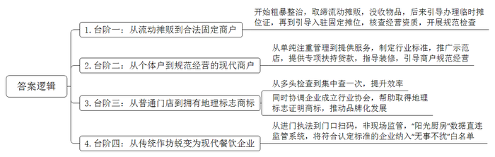
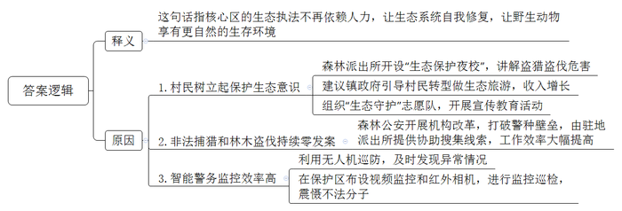
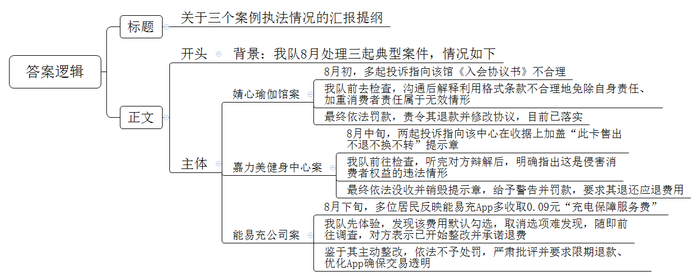
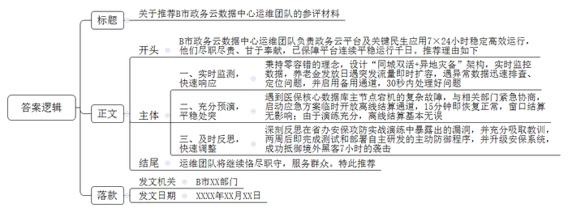
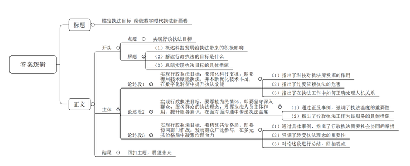

# 2026年国家公考《申论》题（行政执法）

<!-- gwy:overview:start -->
> **国考 · 2026 · 申论 · 行政执法** ｜ 5 题 · 图片 5 处 · 答案随题折叠

导航：[题目](#题目) · [材料 1](#材料-1)
<!-- gwy:overview:end -->

> 候选采集稿。参考答案及解析来自粉笔页面，不代表官方答案或真实高分答卷；来源使用许可与原卷对应关系仍需人工核实。

## 给定材料

### 材料 1

2025年10月的一天，鲁师傅办公桌上的电脑屏幕弹出广合县市场监督管理局发来的“体检报告”，那是他所经营的三家门店的“检测指标”。此刻，以前当街头小贩的情景又浮现在鲁师傅眼前。

2000年春节前，鲁师傅务工结束返乡。回到县城时，一阵烧饼香气飘来，让他想起母亲做的广合烧饼。广合烧饼在当地世代相传，是当地人最爱的日常小吃，而且以其独特的制作工艺和香酥可口的风味声名远播。

春节后，鲁师傅做了个简易烤炉，在县汽车站旁支起烧饼摊。“这里可不能摆摊啊！”工商执法人员收走了他的烤炉。鲁师傅这才知道，乱摆摊是工商部门重点整治的问题。他攒钱买了新烤炉，在巷子深处卖烧饼。

转折出现在2003年夏天，县工商局开展“百日整治”行动，鲁师傅的烤炉再次被没收。但这次工商局的老罗告诉他：“县里试点《流动摊贩备案管理办法》，符合条件就能办证。”鲁师傅申领后，拿到了临时摊位证，取回被没收的烤炉，在城南菜场门口重新支起了摊位。鲁师傅发现，这之后工商局不仅查证件，还会给他讲解新政策。

2007年，广合县规划小吃一条街，工商局的小李劝鲁师傅入驻。搬到固定摊位后，他的烧饼有了稳定客源。县里开展食品安全专项整治，工商和卫生部门多次进行联合检查，工商人员核查经营资质，卫生监督人员则用温度计测馅料温度，用试纸检测餐具消毒情况，检查越来越规范。后来，鲁师傅领到了《食品摊贩登记卡》。他站在小吃街上望着来往的人群，意识到自己迈上了一个新台阶——从东搬西挪的流动摊贩，变成了合法经营的固定商户。

2014年初，县工商局与质量技术监督局等部门整合，成立了县工商和质监局。局里邀请鲁师傅参加“广合美食产业发展座谈会”。会上提出的“五个统一”标准让他坐不住了。他站起来说：“做烧饼哪能这么死板？”周局长解释：“标准化是为了保证品质，让每个顾客吃到同样好的烧饼。”

会后，周局长带着座谈会代表们参观了示范店。明亮的玻璃橱窗、规范的操作让鲁师傅心动，但改造费让他犯了难。“钱的事不用担心，县里有专项扶持贷款。”周局长说。装修期间，局里的工作人员常来指导：“排水沟坡度不够”“操作台要离墙80厘米”……2015年3月，“鲁师傅广合烧饼”正式开张了。年底盘账，鲁师傅发现自己的收入比上年翻了一倍多。

2016年，鲁师傅被县里评为“高级广合烧饼师傅”，店里也挂上了“重点扶持商户”的铜牌。鲁师傅明白自己又迈上了一个新台阶——从凭经验做生意的个体户，变成了规范经营的现代商户。

2017年3月的一天，鲁师傅看到门口停着贴了新标识的执法车。带队的正是熟悉的老罗：“我们改叫市场监管局啦。工商、质监、食药监都合并了，以后一次检查就能查完所有项目。”果然，验秤、取样、查消毒记录，半小时就查完了。“这改革好啊！”鲁师傅感叹，“以前检查，我得接待好几拨人，这得耽误做多少烧饼啊。”

2018年初，鲁师傅在省城展销会上发现有人打着“广合烧饼”的招牌在经营。他立即联合县里做广合烧饼的几个老板找对方理论，却被反问：“你们注册商标了吗？”大家被问得哑口无言。随后，在广合县市场监管局的协调下，鲁师傅联合各家老店成立广合烧饼行业协会，着手整理相关资料，准备申请地理标志证明商标。其中最难的是工艺描述，市场监管局请专家拍摄鲁师傅的和面手法，逐帧分析技术要点。2020年6月，由鲁师傅等人发起成立的广合烧饼行业协会成功取得了地理标志证明商标。站在新装修的店里，鲁师傅知道自己迈上了第三个台阶——从一个只有门牌号的店铺，到拥有了“金字招牌”。

2022年春天，鲁师傅发现执法人员不再进门，而是在门口扫码。“这是‘非现场监管’。”执法队员小王解释，“您的‘阳光厨房’监控数据直连我们的系统。”鲁师傅看到，智能传感器能自动监测面团温度和馅料储存状态；“智食链”系统可扫码查询原料检测报告。2024年夏天，鲁师傅的店铺因符合认定标准，被纳入首批“无事不扰”白名单。

“鲁师傅，您三家店的数据全部达标。”小王的电话将鲁师傅的思绪拉回现实。如今，鲁师傅已迈上第四个台阶——传统烧饼作坊已经蜕变为现代化餐饮企业。从街头巷尾的躲躲藏藏，到数据化管理的游刃有余，改变的不仅是鲁师傅的烧饼生意，更是时代赋予小商贩的温度与希望。

### 材料 2

威山自然保护区森林覆盖面积达13800公顷，不仅是大量候鸟的停歇点，也是多种野生动物的栖息地。然而，盗伐、非法猎捕等行为在这里曾一度猖獗。

“过去，尤其是物质匮乏那些年，靠山吃山的观念重，上山打鸟、逮野物曾是不少村民的习惯。”村民姜大爷回忆，“这后果就是山林里没了生气。”这样的局面，直到威山森林派出所成立才逐渐改变。

派出所成立之初，条件极为艰苦。“进山只能住帐篷，物资全靠人背马驮，连喝的水都得省着用。”派出所毛所长回忆道，“那时候，大家常讲‘三不定三不通’。‘三不定’是人员不定、路线不定、时间不定，‘三不通’是物资不通、水不通、电话不通，这便是当时派出所工作的常态。”即便如此，民警们仍坚持日复一日巡山守护，直到派出所在山上建起砖混结构的固定站点，才结束了长年的风餐露宿。

毛所长回忆，刚开始进山时，他和同事最多一个晚上发现过十多伙人盗猎盗伐。“他们有暗哨，所以我们得早进林子，在他们常出没的地方蹲守。”毛所长说，“抓捕效率虽有所提升，但也非常辛苦且危险。除了蚊虫、蚂蟥，还有野猪、熊、毒蛇等威胁。”

“生态保护最大的阻力并非违法者，而是部分村民根深蒂固的观念。”民警小邓介绍说，“以前过年过节，桌上没有野味就像缺了啥。”起初村民们对禁猎工作极为排斥，甚至有人当面反驳：“山里的野物，我们祖祖辈辈都在打，你们凭啥管？”冲突最激烈的一次，发生在民警老李等人身上。那晚，他们巡山撞见村民老范在设置捕兽夹，制止时对方竟挥舞工具威胁：“断俺的财路，谁都别想走出去！”

民警们开始调整策略，一方面联合村委会开设“生态保护夜校”，用当地方言讲解盗猎盗伐造成的生态破坏；另一方面向镇政府提交建议书，引导村民转型做生态旅游，推动“自然生态体验经济”。不久，老范在镇政府的支持下开起了农家乐，带游客拍飞鸟、游山林，收入翻了数倍。后来，老范主动加入了巡逻队。“现在才明白，活着的动物比捕猎来的值钱多了！”老范说。

此外，派出所组织辖区党员和退休干部成立“生态守护”志愿队，开展宣传教育活动，呼吁群众拒捕拒食野生动物、杜绝盗伐，营造爱护生态、保护野生动物的良好社会氛围。渐渐地，村民们的态度发生了变化，威山森林派出所平均每年救助上百只野生动物，其中许多是群众直接送来或是提供线索救助的。

之后，森林公安自上而下进行机构改革，破除了警种壁垒。“以前无论是求援还是办案，我们主要与林业和草原服务中心联系，与驻地派出所联系很少。现在，我们可以随时联系驻地派出所，请他们协助搜集线索情报，工作效率大幅提高。”毛所长说，“2023年末，片区已实现非法捕猎和林木盗伐零发案，这一成果持续至今。”

“核心保护区是反盗猎盗伐野外巡护的重点区域。”民警小邓边操控无人机边说，“利用无人机巡防，辐射面广，不受地形限制，能够及时发现异常情况。”2024年8月，威山森林派出所将智能警务与传统警务结合，通过与有关部门合作，在保护区布设视频监控和红外相机，进行监控巡检，震慑不法分子。

“当有人进入核心保护区时，视频监控会预警。无人机可以提早发现警情和森林火情，效率远高于传统蹲守和瞭望。”毛所长说，“核心区的生态执法不用再依赖人力，既减少人为干扰，让生态系统更好地自我修复，也能让野生动物享有更自然的生存环境。<u><u>现在，我们已经可以从核心保护区撤离到林区边缘，把这片林海</u></u><u><u>完</u></u><u><u><u>完整整地还给大山了。</u></u><u><u>”</u></u></u>

### 材料 3

2025年8月初，D市市场监管局接到多起投诉，均指向河滨区婧心瑜伽馆的《入会协议书》。投诉人陈女士找到综合执法队郭队长：“协议说‘会籍申请一经接纳，不得擅自退会。无论主动还是被动终止，均无权以任何理由要求退还已交费用’。我近期刚做完手术，没办法做瑜伽，可馆方就是不退款，还规定‘会员已知悉运动风险，因自身原因造成的意外事故，会馆不承担责任’。这感觉像是被骗了。”

郭队长带队前去检查，瑜伽馆甘经理赶忙解释：“我这是协议书不是合同，而且会员卡本来就是预付费性质，成本都摊进去了。瑜伽练习确实有风险，我们提前告知，也是为会员负责，她签了字就代表认可了。”

郭队长请甘经理坐下后对其解释：“您这种协议书包含了所有关于合同的要件，实质就是合同。法律规定，当事人为了重复使用而预先拟定，并在订立合同时未与对方协商的条款，就是格式条款。您家入会协议里的两条是典型的利用格式条款不合理地免除自身责任、加重消费者责任，属于可以被判定无效的情形。”甘经理沉默不语。郭队长强调：“法律保护公平交易，而非单方面的免责盾牌。消费者因健康等原因要求退还未消费部分是合理的，不能通过条款拒绝退费。”

市场监管局依法对婧心瑜伽馆进行了罚款，责令其退款并立即修改《入会协议书》。陈女士收到应退款项后很高兴，婧心瑜伽馆新的协议文本也明确列出了可协商退费的情形。

8月中旬，市场监管局收到两份投诉，均指向嘉力美健身中心。该中心在提供给消费者的收据上加盖提示章：“此卡售出不退不换不转”。

案件交到了郭队长手上，他带人到嘉力美健身中心检查，约谈了负责人施经理。施经理起初试图辩解：“我们不是所有收据都盖这个章！只有那些看起来‘可能’会闹着退卡的顾客，销售员才给盖上。我们没靠这个多赚钱！”

郭队长耐心听完后说：“您这枚提示章，无论是否每张都盖，无论是否因此额外获利，其内容都直接单方面封死了所有退费可能。这本身就是侵害消费者权益的违法行为。”

郭队长进一步说：“您说只有‘可能退卡’的人才盖，这恰恰说明你们意识到消费者有退卡的需求和可能，却选择用这种不公平的方式去堵。至于是否因此获利，不影响对违法行为的认定。”市场监管局依法对嘉力美健身中心这枚提示章予以没收并销毁，对该中心给予警告并罚款，同时要求其退还应退费用。

8月下旬，城南佳荷小区多位居民向市场监管局反映：每次用“能易充”电动自行车充电桩给车充电，App里的支付账单总莫名其妙多出0.09元的充电保障服务费。

郭队长负责此案。他了解到，该小区电动自行车充电桩运营方是D市能易充智能设备有限公司。他前去体验“能易充”App，扫码、选择充电时长、跳转到支付页面后，屏幕中央显示充电金额，下方一行小字标注“+充电保障服务费0.09元”，旁边一个方框已被默认勾选。若不仔细看，角落里的“取消”选项几乎无法发现，极易被搭售。

郭队长带队前往能易充公司调查。公司负责人说：“这是今年4月上线的新功能，针对充电过程中车辆可能发生的自燃、爆炸等意外提供一定的费用补助保障，单次9分钱。我们绝对没有强制，用户是可以手动取消的。”负责人表示，接到用户投诉后他们已经开始整改，在即将更新的App上设置了两个并列按钮供用户选择，再加上操作说明，同时承诺将之前收取的全部充电保障服务费原路退还。

鉴于能易充公司发现问题后主动整改，态度诚恳且配合调查，市场监管局依法对其作出不予行政处罚的决定，但对其进行了严肃批评，要求限期完成退款并持续优化App界面，确保交易透明、选择自由。

### 材料 4

清晨6:30，A省B市政务云数据中心监控室里，小林对小赵说：“快看！社保查询流量开始爬升了，比预测数据高了近40%。”小赵看向日历：“今天是养老金发放日。这个数据比上个月高了8个百分点，马上开始扩容！”

市政务云数据中心的运维团队担负着全市政务云平台及关键民生应用7×24小时稳定高效运行的重任，一直以来尽职尽责、甘于奉献，自组建后已经保障该市政务云连续平稳运行了1000个工作日，多次获得市委市政府的充分肯定及相关部门的赞扬。

监控屏幕上运行曲线在变动，小林突然发现湖东区的查询数据有异常。经排查，主要原因是某街道办事处网络设备老化。小林立即启用了备用传输通道。“现在智能监控系统能在30秒内定位到故障点，以前处理这种小问题很费时。”他说。

刚到运维团队时，小林对政务云数据中心的“保守”作风很不理解，特别是在第一次参加应急预案演练时还有些不以为然。不过，当小林陪同政务云数据中心李主任到政务服务中心调研后，他的想法有了很大的变化。刚进门，小林就看见一位大爷正在发火：“这机器非说我不是我！我中风后左脸不会动，刷脸验证通不过，但养老金总得让我领吧？”工作人员最后用“指纹+身份证+人工核验”的方式解决了问题。李主任对小林说：“去年全省政务云共发生故障427起，其中68%发生在技术团队‘绝对有把握’的环节。政务系统背后连接的不是冷冰冰的数据，而是老百姓的柴米油盐，容不得半点差错。”小林沉默不语，随后主动申请加入渗透测试团队，当第一次尝试用漏洞扫描技术检测自家系统时，才明白那套被自己认为“过度设计”的同城双活+异地灾备架构，究竟在守护什么。

李主任永远记得那个暴雨如注的周末。她的手机一大早突然响起警报声：医保核心数据库主节点宕机。她马上安排进行远程排查，并赶忙冒雨跑到数据中心。故障比想象的复杂，需要主机和备机立即切换，但完成切换需要15分钟，期间医保实时结算会失败。李主任的额头渗出冷汗，医院排队缴费的场景在脑海中闪现。

关键时刻，她与相关部门紧急协商，决定启用应急方案：临时开放医院离线结算通道。这个决定意味着可能要承担费用计算差错的风险。15分钟后，各医院反馈医保实时结算系统已恢复正常，窗口结算基本没有受到影响。事后检验发现，本次离线结算基本无误，这都得益于充分的预先演练。有关部门负责人还特地打来电话表示感谢。

上个月，安全组组长老程带队参加了省政务云数据中心举办的安保攻防实战演练。3小时后，他们败下阵来——攻击者竟然通过某政务App的拍照上传功能，利用图像隐写技术渗透进了内网。复盘会上，省中心技术负责人调出三维攻击路径图：“你们守住了所有标准入口，却忘了每个功能点都可能是漏洞。”会议室里鸦雀无声。

实战演练后的两周，老程做了些看似极端的事：测试和部署了自主研发的主动防御程序；将安保系统从2.0升级为3.0。这些准备在后面派上了大用场。某境外黑客来袭时，防御程序让攻击者徒劳折腾了7小时。“安全运维就像修堤坝。”老程指着监控屏，“平时100%的精力都用于防备可能永远不会来的洪水。”

在中心，每个人都有自己的工作习惯：小赵在晨会上必问“今天有哪些变更单”，因为三年前某次未经审批的升级导致户籍系统瘫痪两小时；李主任的手机永远开着最高报警音量，连洗澡都放在防水袋里带进浴室；小方的白板上贴着五颜六色的便签，记录着各部门信息中心主任的电话——“关键时刻找对人能省一天流程”……

上午9:00，交接班时间到了，小林在电子日志上写到：“早高峰平稳度过，社保查询平均响应时间0.28秒，无重大变更。”此时，墙上贴着的“网安则民安 民安则国安”十个大字在阳光映照下显得格外醒目。

### 材料 5

E市一家快餐配送点内，身着厨师服、佩戴口罩的工作人员正将一盒盒快餐放入配送箱内，准备送往各个订餐点。这一幕被24小时运行的智能摄像头记录并识别分析，数据实时同步至AI监管系统。这正是E市推行的“非现场监管”场景。

2023年年初，E市被确定为“非现场监管”试点地区。率先启动数字化监管，旨在通过科技手段减少对企业正常经营活动的影响，提高监管精准性。

试点初期，E市全力推进技术应用，投入大量资源构建智慧监管体系，多部门协作开发了AI监管系统，全市安装了7000余台监控设备，通过远程监管、移动监管等方式实现对相关企业的全天候监控。2023年，AI监管系统自动识别安全隐患3200余起，执法响应时间大幅缩短，效率显著提升。

在这项工作的推进中也逐渐暴露出一些问题。2024年3月，某化工厂反应釜的温度传感器出现异常，AI监管系统因阈值设置问题未能及时报警。同年6月，某建筑工地一名电焊工持伪造的特种作业操作证上岗，AI监管系统的人脸识别程序却显示“验证通过”。此外，有企业负责人抱怨：“系统只是自动发送整改通知，没有解释说明，我们不知道如何整改才符合规范。”“执法人员就偶尔来一次，来了也就是查看监控数据，很少现场指导了。”这些问题的出现，促使监管部门开始反思：执法工作的本质是什么？引入AI监管系统的根本目的是什么？

面对这些挑战，E市没有继续盲目推进，而是主动暂停下来，开展了为期3个月的调整修正。工作布置会上，分管这项工作的刘副市长表示：“暂时停下来，不是要放弃数字化监管，而是要让技术更好服务于我们。<u><u>要获得真正的进步，不能只是一味往前跑，更关键的是要明确跑的目标。</u></u><u><u>”</u></u>

这段时间里，各监管部门组织执法人员深入200余家企业走访调研，收集意见建议500多条。经充分论证，E市推出了一系列改进措施。如，重新校准监控设备参数，进一步完善AI监管系统；增设“AI初筛——专员复核——专家会审”三级审核流程；建立企业联络员制度，开设技术服务热线；推出“线上智能监测+线下精准指导”新模式，要求执法人员每月应有一定的时间下沉企业一线等。这些措施很快显现出成效。截至目前，E市监管投诉率下降50%，企业满意度达97.6%，实现了从“管得住”到“管得好”的质的飞跃。

## 题目

### 第 1 题

**请结合“给定资料1”中鲁师傅广合烧饼发展过程中的四个台阶，谈谈广合县市场监管部门的执法方式发生了哪些变化。（15分）**

关联材料：材料 1

作答要求：

要求：全面、准确、有条理，不超过300字。

第 1 题 · 答案与解析

**参考答案（粉笔题库参考内容）**

**参考答案一**

1.台阶一：从流动摊贩到合法固定商户。开始粗暴整治，取缔流动摊贩，没收物品，后来引导办理临时摊位证，再到引导入驻固定摊位，核查经营资质，开展规范检查。

2.台阶二：从个体户到规范经营的现代商户。从单纯注重管理到提供服务，制定行业标准，推广示范店，提供专项扶持贷款，指导装修，引导商户规范经营。

3.台阶三：从普通门店到拥有地理标志商标。从多头检查到集中查一次，提升效率；同时协调企业成立行业协会，帮助取得地理标志证明商标，推动品牌化发展。

4.台阶四：从传统作坊蜕变为现代餐饮企业。从进门执法到门口扫码，非现场监管，“阳光厨房”数据直连监管系统，将符合认定标准的企业纳入“无事不扰”白名单。

**解析**

**参考答案说明：**本参考答案从“台阶一：从流动摊贩到合法固定商户”“台阶二：从个体户到规范经营的现代商户”“台阶三：从普通门店到拥有地理标志商标”“台阶四：从传统作坊蜕变为现代餐饮企业”这四个方面进行了分条撰写。各条要点之间在内容上相互并列，没有交叉。

**参考答案二**

台阶一：从流动摊贩到固定商户。监管从“粗暴管控”到“引导规范”转变：完善政策，引导办证、规范管理。

台阶二：从固定普通商户到有标准现代商户。监管从重“单一管理”到重“联合服务”：统一标准、提供贷款、规范流程。

台阶三：从现代商户到有商标品牌商户。监管从“分散多头执法”到“合并一次检查”，并协同赋能：成立协会，申请商标，打造品牌。

台阶四：从品牌商户到连锁经营现代企业。监管从“现场监管”到“智能监管”：监管数据化、线上化，设立白名单制度减少监管。

——张小龙

文与质的辩证关系

——申论答题形式和内容哪个重要

不少同学一说起申论答题，就是想去挖掘得分点，去找材料。很多人忽略了一点，审题才是第一步。甚至对有些题目来说，答题形式先于答题内容。注意这里说的是先于，不是大于。也就是先确定好形式，再确定内容。如果形式不对，内容再全面丰富，也得不了高分。形式的意思不仅仅是格式，还包括答题分几部分，内容的先后顺序和逻辑关系等等。申论中不少阅卷参考规则有这样的表述“未按照……分类，在……分以下”，大家可以理解为一种命题的方式，也可以理解为命题作文为提高阅卷效率的一种策略。

哪些题目形式先于内容呢？这种情况在文章写作里比较常见，比如25年国考有一篇作文要求写事物相互作用、相互激发、相互促进，这就是一个命题作文，最好按照这个顺序写。不仅要按照这个顺序写，还要写清楚三者关系。“相互作用”是一种客观存在的被动或者叫自然状态，“相互激发”里面包含了竞争、监督、批评等等含有一些人主动作为的因素，也就是一个事物从自然状态向社会状态转变。比如自然界植物和土壤，土壤给植物提供营养，植物改善土壤的结构，丰富土壤生态，当然也可能是土壤不适合植物生长，植物也没有改善反而破坏了土壤，它们关系叫相互作用。比如袁东和张小龙两个都说自己课讲得好，相互批评对方，在网上吵架撕逼，然后各自去认真备课，也可能一直撕不备课，这叫相互激发。相互促进则不一样，明确的是有发展的意思。正向的作用和激励才能叫促进，它和前两者构成了某种递进关系。从作用到激发，是从自然状态到社会状态，这是一种发展和进步。从中性的作用和激发，到正向的作用，这又是一种进步。答题首先按照顺序，三个依次写好，还要写清楚这三者逻辑关系，就是一份好答卷。

不仅是作文，小题中也有很多注重形式的。比如这个题：“材料提到了三条黄河，请你谈谈这三条黄河分别指的是什么，并说明它们是如何协同发挥作用的。”答题形式上先分别指出三条黄河是什么，然后再写作用，这是比较好理解的。但是有些提问方式就比较模糊，比如：

请结合“给定资料1”中鲁师傅广合烧饼发展过程中的四个台阶，谈谈广合县市场监管部门的执法方式发生了哪些变化。要求：全面、准确、有条理，不超过300字。

这个题目有一个争议点，要不要写“四个台阶”是什么，各家机构和老师理解都不一样。申论比较讨厌的是官方不公布答案，然后大家都可以众说纷纭。有些人宣称自己有内部消息，有什么规则，或者暗示自己上面有人，所以权威。问题这个人没有官方认证，考生没法验证。还有一些人宣称自己实战高分，这个好验证，但是一次高分不一定次次高分。最后就看谁能说会道，谁解释得好，申论最后成了一个任人打扮的小女孩，成为我们这些培训师忽悠学生的工具。回到题目上来，单纯从字面意思，主要是写执法的变化，只是要“结合”四个台阶来写。结合是什么意思呢？到底是把台阶融入执法变化中，还是明确写出来？从答题全面、清晰、安全来说，都最好把四个台阶明确地写出来，我们虽然不知道具体阅卷规则是什么，但是可以肯定，这种题目是按点给分的。万一台阶有分，没有写就惨了。或者写了，不够明确清晰，融入执法里看不见，也很难得分。申论答题有一点很重要，不仅要把点写出来，重要的点一定要明确突出，要让阅卷人看见。当然有同学说，万一台阶没有分怎么办？我不白写了。说对了，就是白写了，你也不损失什么。万一它有分你就惨了。当然也不是没有坏处，占用了字数。所以最好的策略是写，尽量简洁一点，何况这个题有300字，字数比较宽松。

我的朋友，如果还是纠结，让我们一起回顾一下著名的物理学家、思想家、文学家帕斯卡在他著名有趣的《思想录》中阐明的一个有趣的观点，让我们一起来温习一下这段话：

神存在，或者是不存在。然而，我们将倾向哪一边呢？在这上面，理智是不能决定什么的；有一种无限的混沌把我们隔离开了，可是不得不赌；这一点并不是自愿的，你已经上了船。然则，你将选择哪一方呢？让我们看看吧。既然非抉择不可，就让我们来看什么对你的利害关系最小。你有两样东西可输：即真与善；有两件东西可赌：即你的理智和你的意志，你的知识和你的福祉；而你的天性又有两样东西要躲避：即错误与悲惨。既然非抉择不可，所以抉择一方而非另一方也就不会更有损于你的理智。这是已成定局的一点。然而你的福祉呢？让我们权衡一下赌上帝存在这一方面的得失吧。让我们估价这两种情况：假如你赢了，你就赢得了一切；假如你输了，你却一无所失。因此，你就不必迟疑去赌神存在吧。（何兆武译，《思想录》第233节）

我亲爱的朋友，原谅我让你读到如此冗长晦涩的句子，我知道或许你已经厌倦了我的自作聪明和卖弄，你失去了耐心并对我感到厌恶。那就由我，来帮你做一个简单总结吧。如果神不存在，你相信了，除了浪费了你的时间和虔诚，并没有特别的坏处。如果神存在，你却没有相信，我的朋友啊，你就亏大了。

我开始厌恶自己，从一个申论答题的形式说到了神，我已经越来越精神不正常了。哦，请原谅我，不想做一个单纯的理性工具人，而想成为一个完整全面的人。为了赚钱还是让我们回到让人讨厌的申论答题中来吧。我们再来看一个题目：

D市市场监管局拟召开月度工作总结会。假如你是郭队长，请根据“给定资料3”，拟写一份关于三个案例的执法情况汇报提纲。（20分）要求：（1）包括三个案例的基本情况、执法过程及处理结果；（2）要点全面，层次分明；（3）不超过400字。

这个题目明确要求说三件事，并且每一件事要分成基本情况、执法过程、处理结果三个部分。我的朋友啊，如果你是有理性和智慧的，相信你看到的不是一个题干，而是一个完全清晰的阅卷规则！我相信你心中已经有了答案，没错，三个案件每个三个步骤，一共九个点，每个点2分，一共18分。如果我亲爱的朋友们还懂得写上一个可爱简短的标题，再配上一个礼貌的开头，你或许还会获得两金币的奖励。

朋友们，我写了这许多，请原谅我唠叨和啰嗦，如果我打扰了您，那都是为了成就您那热情急迫又朴素崇高的为人民服务的理想，我想我会获得您的理解和宽恕的，对吗？

——你们的朋友、演员和讲师，一个热情的申论课兜售者，Your most obedient servant，张小龙2026年10月2日晨于沱江河畔

**考点**：变化类

**来源**：2026年国家公考《申论》题（行政执法）

### 第 2 题

**“给定资料2”中毛所长说：“现在，我们已经可以从核心保护区撤离到林区边缘，把这片林海完完整整地还给大山了。”请根据“给定资料2”，谈谈毛所长这句话的意思，以及他为什么这么说。（10分）**

关联材料：材料 2

作答要求：

要求：理解准确，内容全面，条理清晰。不超过250字。

第 2 题 · 答案与解析

**参考答案（粉笔题库参考内容）**

**参考答案一**

这句话指核心区的生态执法不再依赖人力，让生态系统自我修复，让野生动物享有更自然的生存环境。这么说的原因是：1.村民树立起保护生态意识。森林派出所开设“生态保护夜校”，讲解盗猎盗伐危害；建议镇政府引导村民转型做生态旅游，收入增长；组织“生态守护”志愿队，开展宣传教育活动。2.非法捕猎和林木盗伐持续零发案。森林公安开展机构改革，打破警种壁垒，由驻地派出所提供协助搜集线索，工作效率大幅提高。3.智能警务监控效率高。利用无人机巡防，及时发现异常情况；在保护区布设视频监控和红外相机，进行监控巡检，震慑不法分子。

**解析**

**参考答案说明：**本参考答案包括“释义”和“原因”两个部分，其中“原因”部分从“村民树立起保护生态意识”“非法捕猎和林木盗伐持续零发案”“智能警务监控效率高”三个方面展开，各条答案要点之间在内容上相互并列，没有交叉。

**参考答案二**

所长意思：1.“撤离”是指不再依赖传统人力驻点巡查，转而实现无打扰监管；2.“还给大山”是指减少人为干预，让生态系统休养生息、实现自我修复。

原因：1.村民观念转变。组织“生态守护”志愿队，开展宣传教育；发展生态旅游，带动群众增收，让村民转变为生态保护者。2.完善执法机制。推进森林公安机构改革，打破警种壁垒，由驻地派出所协助搜集线索，开展联合执法，案件大幅减少，实现零案发。3.利用先进技术。联合多部门，布设视频监控、红外相机，运用无人机巡防，实时发现异常情况，高效开展监控巡检，震慑不法分子。

——张小龙

**考点**：多要素组合类

**来源**：2026年国家公考《申论》题（行政执法）

### 第 3 题

**D市市场监管局拟召开月度工作总结会。假如你是郭队长，请根据“给定资料3”，拟写一份关于三个案例的执法情况汇报提纲。（20分）**

关联材料：材料 3

作答要求：

要求：

（1）包括三个案例的基本情况、执法过程及处理结果；

（2）要点全面，层次分明；

（3）不超过400字。

第 3 题 · 答案与解析

**参考答案（粉笔题库参考内容）**

**参考答案一**

关于三个案例执法情况的汇报提纲

背景：我队8月处理三起典型案件，情况如下。

婧心瑜伽馆案：8月初，多起投诉指向该馆《入会协议书》不合理。我队前去检查，沟通后解释利用格式条款不合理地免除自身责任、加重消费者责任属于无效情形。最终依法罚款，责令其退款并修改协议，目前已落实。

嘉力美健身中心案：8月中旬，两起投诉指向该中心在收据上加盖“此卡售出不退不换不转”提示章。我队前往检查，听完对方辩解后，明确指出这是侵害消费者权益的违法情形。最终依法没收并销毁提示章，给予警告并罚款，要求其退还应退费用。

能易充公司案：8月下旬，多位居民反映能易充App多收取0.09元“充电保障服务费”。我队先体验，发现该费用默认勾选，取消选项难发现，随即前往调查，对方表示已开始整改并承诺退费。鉴于其主动整改，依法不予处罚，严肃批评并要求限期退款、优化App确保交易透明。

**解析**

**参考答案说明：**（1）格式方面，本参考答案写到了“标题”“正文”两个部分。（2）正文部分，一方面从内容上来看，围绕“三个案例执法情况”这一主题，本参考答案的开头先写到了背景；接着主体从“婧心瑜伽馆案”“嘉力美健身中心案”“能易充公司案”三个案例分别介绍了其基本情况、执法过程、处理结果等。另一方面，形式上，本参考答案做到了分段、分条撰写，整体上条理较为清晰。

**参考答案二**

执法情况汇报提纲

8月，我队聚焦预付式消费乱象，开展专项处置，情况如下：

一、婧心瑜伽馆格式条款侵权案

基本情况：协议含有不退费、免责等格式条款，因健康原因申请退费遭拒。

执法过程：核查指出属于格式合同，相关条款无效，明确侵权性质。

处理结果：依法罚款，责令退款，修改协议，明确退费情形。

二、嘉力美健身中心收据违规案

基本情况：收据加盖“不退不换”印章，区别对待用户。

执法过程：约谈负责人，指出客观上侵权，主观上故意。

处理结果：没收销毁违规印章，给予警告罚款，退还费用。

三、能易充公司违规搭售案

基本情况：APP默认0.09元服务费，强制搭售。

执法过程：体验APP，实地调查，企业主动承认违规事实，并开展自查整改。

处理结果：责令限期退还费用，优化APP操作界面。

——张小龙

**考点**：总结类

**来源**：2026年国家公考《申论》题（行政执法）

### 第 4 题

**A省拟开展全省政务服务先进集体评选活动，B市准备推荐市政务云数据中心运维团队参选。请根据“给定资料4”，拟写一份推荐材料。（20分）**

关联材料：材料 4

作答要求：

要求：

（1）紧扣资料，内容全面；

（2）结构完整，语言流畅；

（3）不超过450字。

第 4 题 · 答案与解析

**参考答案（粉笔题库参考内容）**

**参考答案一**

关于推荐B市政务云数据中心运维团队的参评材料

B市政务云数据中心运维团队负责政务云平台及关键民生应用7×24小时稳定高效运行，他们尽职尽责、甘于奉献，已保障平台连续平稳运行千日。推荐理由如下：

一、实时监测，快速响应。秉持零容错的理念，设计“同城双活+异地灾备”架构，实时监控数据，养老金发放日遇突发流量即时扩容，遇异常数据迅速排查、定位问题，并启用备用通道，30秒内处理好问题。二、充分预演，平稳处突。遇到医保核心数据库主节点宕机的复杂故障，与相关部门紧急协商，启动应急方案临时开放离线结算通道，15分钟即恢复正常，窗口结算无影响；由于演练充分，离线结算基本无误。三、及时反思，快速调整。深刻反思在省办安保攻防实战演练中暴露出的漏洞，并充分吸取教训，两周后即完成测试和部署自主研发的主动防御程序，并升级安保系统，成功抵御境外黑客7小时的袭击。

运维团队将继续恪尽职守，服务群众。特此推荐！

B市XX部门

XXXX年XX月XX日

**解析**

**参考答案说明：**（1）格式方面，本参考答案写到了“标题”“正文”“落款”三个部分。（2）正文部分，一方面从内容来看，围绕着“B市政务云数据中心运维团队”这一主题，本参考答案的开头先写到了“运维团队的基本情况”；接着主体部分从“实时监测，快速响应”“充分预演，平稳处突”“及时反思，快速调整”这三个方面介绍了运维团队的具体做法；结尾部分进行了总结推荐。另一方面，形式上，本参考答案做到了分段、分条撰写，整体上条理较为清晰。

**参考答案二**

推荐云数据中心运维团队评先进集体的报告

政务云数据中心运维团队，肩负全市政务运行保障重任，组建以来尽职尽责、认真负责、甘于奉献，已保障政务云连续平稳运行1000个工作日，是守护民生服务的“数字安全卫士”。

他们响应及时，决策果断。养老金发放日数据激增40%，及时扩容。发现数据异常，30秒定位排除。医保数据库宕机时，果断启动应急预案，15分钟完成切换。

他们严谨细致，保障有力。深入基层，发现并解决问题。依托同城双活+异地灾备架构，提前演练保障数据准确。及时发现漏洞，研发主动防御程序，抵御住了境外黑客7小时的攻击。

该团队作风过硬、勇于创新、执行力强。李主任周末冒雨赴岗指挥，手机常年高音待机。老程发扬“修堤坝精神”，防范技术风险。小赵、小方等紧盯日常工作变化，落实细致。

特此推荐！

推荐单位：B市XX局

XXXX年XX月XX日

——张小龙

**考点**：总结类

**来源**：2026年国家公考《申论》题（行政执法）

### 第 5 题

**“给定资料5”中提到：“要获得真正的进步，不能只是一味往前跑，更关键的是要明确跑的目标。”请你对这句话进行深入思考，针对行政执法工作，联系实际，自选角度，自拟题目，写一篇文章。（35分）**

关联材料：材料 1、材料 2、材料 3、材料 4、材料 5

作答要求：

要求：

（1）观点明确，见解深刻；

（2）参考给定资料，但不拘泥于给定资料；

（3）思路清晰，语言流畅；

（4）字数1000-1200字。

第 5 题 · 答案与解析

**参考答案（粉笔题库参考内容）**

**参考答案一**

**锚定执法目标 绘就数字时代执法新画卷**

新技术，新力量。近年来，大数据研判、非接触式执法等新技术让执法更加高效。然而，执法工作在紧跟时代步伐、利用技术推动变革和创新的同时，不能忽视技术的潜在风险，不能一味在技术赋能之路上狂奔，要记得时时回头看当初为何出发——**执法的目标是要维护社会秩序，保障群众和企业的权益。唯有以科技为翼提升效能、以为民为本传递温度、以共治为基凝聚合力，方能刚柔并济维护法律权威、彰显制度优势，与时俱进绘就“执法为民”的壮美画卷。**

**实现行政执法目标，要强化科技支撑。即要善用技术赋能执法，并不断优化技术不足，在数字化转型中提升执法效能。**科技之光正在重塑执法版图。城市大脑通过数据整合，实现违章自动识别、智能派单，执法效率大幅提升；“一网通办”平台让审批从“跑断腿”变为“不见面”，时限压缩过半。然而，技术并非万能钥匙。算法误判、数据偏差、系统故障等问题时有发生，过度依赖仍然不是执法的最优解。技术应是执法的助推器而非替代品，既要用好人脸识别、大数据分析等利器，更要建立技术纠错机制，在人机协同中实现精准执法、高效执法。

**实现行政执法目标，要厚植为民情怀。即要坚守深入群众、服务群众的执法理念，发挥执法人员主体作用，提升服务意识，在面对面沟通中传递执法温度。**法律的生命在于实施，执法的温度源于人心。“柔性执法”为外卖小哥设立弹性执法区，既维护秩序又体恤民生；城管队员雨中为流动摊贩撑伞执法，一个举动温暖人心。反观某些地方过度依赖电子监控，执法人员“躲在屏幕”后，机械执法，甚至“无人执法”，无疑违背了执法的初心。数字化不应成为执法者缺位的借口，再先进的技术也无法替代执法人员的现场判断与人文关怀。唯有俯下身子倾听诉求，沉下心来释法说理，才能让法律既有力度更有温度，在春风化雨中赢得民心。

**实现行政执法目标，要构建共治格局。即要协同部门作战，发动群众广泛参与，在多元共治格局中凝聚治理合力。**“众人拾柴火焰高”，治理效能的提升离不开多方协同。“吹哨报到”机制打破部门壁垒，解决了大量群众身边的操心事；网格化管理让网格员成为流动的“执法触角”，实现问题发现、化解在基层。更可喜的是，从“随手拍”举报违章到市民观察团监督执法，群众正从旁观者变为参与者。这种转变昭示着治理理念的跃升：执法不再是政府的独角戏，而是全社会的交响乐。唯有打通部门藩篱，激活社会细胞，才能编织起全覆盖的治理网络，在共建共治中实现共享。

“工欲善其事，必先利其器；欲利其器，必先得其人；欲得其人，必先正其心。”新时代的行政执法，既要插上科技的翅膀，更要怀揣为民的初心，凝聚众人的力量。唯有如此，方能在数字化浪潮中坚定航向，绘就一幅执法为民、共治共享的时代画卷！

**文章分析**

**锚定执法目标 绘就数字时代执法新画卷**

【**标题的优点：**标题中含有主题词，使文章主题更突出、清晰。】

（1）新技术，新力量。近年来，<u><u>大数据研判、非接触式执法等新技术让执法更加高效</u></u>。（2）然而，执法工作在紧跟时代步伐、利用技术推动变革和创新的同时，<u><u>不能忽视技术的潜在风险</u></u>，<u><u>不能一味在技术赋能之路上狂奔</u></u>，要记得时时回头看当初为何出发——<u><u>执法的目标是要维护社会秩序</u></u>，<u><u>保障群众和企业的权益</u></u>。（3）唯有<u><u>以科技为翼提升效能、以为民为本传递温度、以共治为基凝聚合力</u></u>，方能刚柔并济维护法律权威、彰显制度优势，与时俱进绘就“执法为民”的壮美画卷。

【**开头的优点：**★内容方面。范文的开头是紧扣题目给定的“实现行政执法目标”这一主题展开的。首先，概述科技发展给执法带来的积极影响；其次，解读行政执法的目标是什么；最后，高度总结实现执法目标的具体措施。★文字表达方面。运用了“然而”“唯有”等连词，使语言表达有逻辑性、并增强文章气势。】

**实现行政执法目标，要强化科技支撑。即要善用技术赋能执法，并不断优化技术不足，在数字化转型中提升执法效能。**（1）<u><u>科技之光正在重塑执法版图</u></u>。<u><u>城市大脑通过数据整合</u></u>，实现违章自动识别、智能派单，<u><u>执法效率大幅提升</u></u>；<u><u>“一网通办”平台</u></u>让审批从“跑断腿”变为“不见面”，<u><u>时限压缩过半</u></u>。（2）然而，<u><u>技术并非万能钥匙</u></u>。算法误判、数据偏差、系统故障等问题时有发生，<u><u>过度依赖仍然不是执法的最优解</u></u>。（3）<u><u>技术应是执法的助推器而非替代品</u></u>，既要用好人脸识别、大数据分析等利器，更要<u><u>建立技术纠错机制</u></u>，<u><u>在人机协同中实现精准执法、高效执法</u></u>。

【**论述段1的优点：**★观点句：范文的观点句是紧扣“实现行政执法目标”这一文章主题提出的。形式上，它在段首处直接写出，位置突出，容易发现。内容上，关键词突出，内容要点明确，可以明显看出主要论述从“做好行政执法工作，要强化科技支撑”方面入手。★论述内容：（1）指出了科技对执法所发挥的作用；（2）指出了过度依赖执法的危害；（3）指出了在执法工作中如何正确处理人机关系。注意：以上三个方面的内容都是紧扣“做好行政执法工作，要强化科技支撑。即要善用技术赋能执法，并不断优化技术不足，在数字化转型中提升执法效能”这个观点句进行分析论述的，论述的针对性强，内容层次丰富。在论述方法上以道理论证为主，论述清晰透彻。】

**实现行政执法目标，要厚植为民情怀。即要坚守深入群众、服务群众的执法理念，发挥执法人员主体作用，提升服务意识，在面对面沟通中传递执法温度。**（1）法律的生命在于实施，<u><u>执法的温度源于人心</u></u>。<u><u>“柔性执法”为外卖小哥设立弹性执法区</u></u>，既维护秩序又体恤民生；<u><u>城管队员雨中为流动摊贩撑伞执法</u></u>，一个举动温暖人心。反观<u><u>某些地方过度依赖电子监控</u></u>，执法人员“躲在屏幕”后，机械执法，甚至“无人执法”，无疑<u><u>违背了执法的初心</u></u>。（2）数字化不应成为执法者缺位的借口，再先进的技术也无法替代执法人员的现场判断与人文关怀。唯有<u><u>俯下身子倾听诉求</u></u>，<u><u>沉下心来释法说理</u></u>，才能<u><u>让法律既有力度更有温度</u></u>，在春风化雨中赢得民心。

【**论述段2的优点：**★观点句：范文的观点句是紧扣“实现行政执法目标”这一文章主题提出的。形式上，它在段首处直接写出，位置突出，容易发现。内容上，关键词突出，内容要点明确，可以明显看出主要论述从“实现行政执法目标，要厚植为民情怀”方面入手。★论述内容：（1）通过正反事例，强调了执法温度的重要性；（2）指出了行政执法工作为民服务的具体措施。注意：以上两个方面的内容都是紧扣“实现行政执法目标，要厚植为民情怀。即要坚守深入群众、服务群众的执法理念，发挥执法人员主体作用，提升服务意识，在面对面沟通中传递执法温度”这个观点句进行分析论述的，论述的针对性强，内容层次丰富。在论述方法上采用举例论证与道理论证相结合的方式，论述有理有据。】

**实现行政执法目标，要构建共治格局。即要协同部门作战，发动群众广泛参与，在多元共治格局中凝聚治理合力。**（1）“众人拾柴火焰高”，<u><u>治理效能的提升离不开多方协同</u></u>。<u><u>“吹哨报到”机制打破部门壁垒</u></u>，解决了大量群众身边的操心事；<u><u><u>网格化管理让网格员成为流动的</u></u></u><u><u><u>“执法触角”</u></u></u>，实现问题发现、化解在基层。更可喜的是，<u><u><u>从</u></u></u><u><u><u>“随手拍”举报违章到市民观察团监督执法</u></u></u>，群众正从旁观者变为参与者。（2）<u><u>这种转变昭示着治理理念的跃升</u></u>：<u><u>执法不再是政府的独角戏</u></u>，<u><u>而是全社会的交响乐</u></u>。（3）<u><u>唯有打通部门藩篱</u></u>，<u><u>激活社会细胞</u></u>，才能<u><u>编织起全覆盖的治理网络</u></u>，<u><u>在共建共治中实现共享</u></u>。

【**论述段3的优点：**★观点句：范文的观点句是紧扣“实现行政执法目标”这一文章主题提出的。形式上，它在段首处直接写出，位置突出，容易发现。内容上，关键词突出，内容要点明确，可以明显看出主要论述从“实现行政执法目标，要构建共治格局”方面入手。★论述内容：（1）通过具体事例，指出了行政执法需要社会协同的举措；（2）强调了转变执法理念的重要性；（3）对论述段进行总结，回扣观点。注意：以上三个方面的内容都是紧扣“实现行政执法目标，要构建共治格局。即要协同部门作战，发动群众广泛参与，在多元共治格局中凝聚治理合力”这个观点句进行分析论述的，论述的针对性强，内容层次丰富。在论述方法上主要以道理论证为主，论述清晰透彻。】

【**论述段之间的关系：**三个论述段都围绕着“实现行政执法目标”这一文章展开，首先论述了“实现行政执法目标，要强化科技支撑”，接着论述了“实现行政执法目标，要厚植为民情怀”，最后论述了“实现行政执法目标，要构建共治格局”，三段呈现出并列关系，论述清晰明了，内容丰富。】

“工欲善其事，必先利其器；欲利其器，必先得其人；欲得其人，必先正其心。”新时代的行政执法，既要插上科技的翅膀，更要怀揣为民的初心，凝聚众人的力量。唯有如此，方能在数字化浪潮中坚定航向，绘就一幅执法为民、共治共享的时代画卷！

【**结尾的优点：**范文的结尾回扣了“实现行政执法目标”这个主题，并且进行了总结与升华。】

**参考答案二**

**监管的辩证法**

“要获得真正的进步，不能只是一味往前跑，更关键的是要明确跑的目标”，这句话表明行政执法监管，不能单纯以快作为目标，必须思考如何从“管得住”向“管得好”转变。要管得好首先必须目标明确，转变观念树立服务意识，要保障安全、提升效率、降低成本、赋能发展。管理手段上依靠先进的科技、科学的制度、完善的流程和认真负责的执法队伍。

**“管得好”首先是要“管得住”，要管得住还得靠“新技术”。**新技术才能实现更高效、全面、精准、低成本的监管。这样的监管离不开先进的AI技术。在空间上，AI技术可以实现远程非现场监管，执法人员不必到现场，效率更高。在时间上，可以24小时全天候监管，还可以利用大数据，对多个地方监管，让监管无死角。打破了传统监管时间空间的限制，让监管更全面。AI技术和传统技术区别在于其智能性，就是具备“认知”能力，发现问题才监管，这提高了监管的精准性。E市利用AI技术之后，自动识别3200余项安全隐患就是很好证明。

**“管得好”还需要深入群众、充分调研、科学论证、建立制度、优化流程、完善机制。**技术有自己的局限和漏洞，存在响应滞后、识别偏差、方案不完善等问题。当技术缺位的时候，人必须“补位”。技术过于强调“快、多、大、全”，往往容易陷入“因为走得太远，以致于忘记为什么出发”的历史和价值虚无主义中。我们既要看到技术的工具性本质，也要始终“不忘初心、牢记使命”，不能为管而管，把管理本身当成目标。管理首先要知道哪些需要管哪些不该管，这需要广泛征询意见，全面掌握信息，要到一线调研。我们不仅要听群众意见，也要尊重专业人士意见，把民主和集中结合，常识和专业知识结合，充分论证，才能得到全面科学的方案。发现好的方案一定要固定下来，沉淀为长期机制制度，并认真落实执行。

**“管得好”必须摒弃“管”的思维，管理不是最终目标，通过“管”的手段最终“不管”，达到“道常无为而无不为”才是我们的目标。**因此“管得好”不能单纯依靠科技、制度，而必须依靠具备服务意识的“人”才是关键。我们执法人员必须深入群众、依靠群众、服务群众，坚定不移走群众路线，时时刻刻把企业和人民需求放在心上，才能实现好的管理。E市要求执法人员每月必须到企业一线，这不是去管企业，而是去发现并解决问题。最终实现了投诉率下降，企业满意度提高就是最好例证。“管”的目的是“少管、不管”，最终从管理变为服务，这就是管理和服务的辩证统一。

总之，我们的执法人员必须摒弃那种以为有AI技术，就可以包打天下、坐享其成的姿态，要时时刻刻把群众放在心里，对工作要“时时勤拂拭，勿使惹尘埃”，用自己的热情、智慧和汗水去浇灌出让人民群众喜爱满意的幸福之花！

张小龙 2026年中秋于北京温榆河畔

**解析状态：unknown（来源未提供）**

**考点**：文章写作题

**来源**：2026年国家公考《申论》题（行政执法）

