# 2026年国家公务员录用考试《行测》题（副省级网友回忆版）

<!-- gwy:overview:start -->
> **国考 · 2026 · 行测 · 副省级** ｜ 135 题 · 图片 33 处 · 答案随题折叠

| 题型模块 | 题量 | 题号 |
| --- | ---: | ---: |
| 政治理论 | 20 | 1–20 |
| 常识判断 | 15 | 21–35 |
| 言语理解与表达 | 30 | 36–65 |
| 数量关系 | 15 | 66–80 |
| 判断推理 | 35 | 81–115 |
| 资料分析 | 20 | 116–135 |
| **合计** | **135** | |

导航：[题型与作答说明](#题型与作答说明) · [题目](#题目) · [材料 1](#材料-1)
<!-- gwy:overview:end -->

> 候选采集稿。参考答案及解析来自粉笔页面，不代表官方答案或真实高分答卷；来源使用许可与原卷对应关系仍需人工核实。

## 题型与作答说明

政治理论

（20题）

根据题目要求，在四个选项中选出一个最恰当的答案。

常识判断

（15题）

根据题目要求，在四个选项中选出一个最恰当的答案。

言语理解与表达

（30题）

本部分包括表达与理解两方面的内容。请根据题目要求，在四个选项中选出一个最恰当的答案。

数量关系

（15题）

在这部分试题中，每道题呈现一段表述数字关系的文字，要求你迅速、准确地计算出答案。

判断推理

（35题）

本部分包括图形推理、定义判断、类比推理与逻辑判断四种类型的试题，在四个选项中选出一个最恰当的答案。

资料分析

（20题）

所给出的图、表、文字或综合性资料均有若干个问题要你回答。你应根据资料提供的信息进行分析、比较、计算和判断处理。

## 题目

### 第 1 题

习近平总书记强调，必须坚持自信自立。中国人民和中华民族从近代以后的深重苦难走向伟大复兴的光明前景，从来就没有教科书，更没有现成答案。关于坚持自信自立，下列表述正确的有几项？

①走自己的路，是党的全部理论和实践立足点，更是党百年奋斗得出的历史结论

②推进中国式现代化，必须坚持把国家和民族发展放在自己力量的基点上

③中国式现代化既要物质财富极大丰富，也要精神财富极大丰富、在思想文化上自信自强

④独立自主是中华民族的优良传统，是中国共产党、中华人民共和国立党立国的重要原则

A. 1项

B. 2项

C. 3项

D. 4项

第 1 题 · 答案与解析

**参考答案（粉笔题库参考内容）**

D

**解析**

本题考查理论与政策。

①正确，2021年7月1日，习近平总书记在庆祝中国共产党成立100周年大会上的重要讲话中指出：“以史为鉴、开创未来，必须坚持和发展中国特色社会主义。走自己的路，是党的全部理论和实践立足点，更是党百年奋斗得出的历史结论······”

②正确，2023年2月7日，习近平总书记在新进中央委员会的委员、候补委员和省部级主要领导干部学习贯彻习近平新时代中国特色社会主义思想和党的二十大精神研讨班开班式上的讲话中指出：“推进中国式现代化，必须坚持独立自主、自立自强，坚持把国家和民族发展放在自己力量的基点上，坚持把我国发展进步的命运牢牢掌握在自己手中。”

③正确，2023年2月7日，习近平总书记在新进中央委员会的委员、候补委员和省部级主要领导干部学习贯彻习近平新时代中国特色社会主义思想和党的二十大精神研讨班上的讲话中指出：“中国式现代化既要物质财富极大丰富，也要精神财富极大丰富、在思想文化上自信自强。”

④正确，2013年12月26日，习近平总书记在纪念毛泽东同志诞辰120周年座谈会上的讲话中指出：“独立自主是中华民族的优良传统，是中国共产党、中华人民共和国立党立国的重要原则。在中国这样一个人口众多和经济文化落后的东方大国进行革命和建设的国情与使命，决定了我们只能走自己的路。”

故正确的有①②③④，共4项。

故正确答案为D。

**考点**：其他建设

**来源**：2026年国家公务员录用考试《行测》题（副省级网友回忆版）第1题

### 第 2 题

习近平总书记强调，科学制定和接续实施五年规划，是我们党治国理政一条重要经验，也是中国特色社会主义一个重要政治优势。关于五年规划编制工作，下列说法正确的是：

A. 我国五年规划（计划）编制工作起始于1949年，有力推动了经济社会发展、综合国力提升、人民生活改善

B. 中长期发展规划有助于充分发挥政府在资源配置中的决定性作用，彰显了政府对经济社会发展的宏观调控能力

C. 从第一个五年计划到当前的五年规划，一以贯之的主题是把我国建设成为社会主义现代化国家

D. 通过互联网就“十五五”规划编制向全社会征求意见和建议，在我国五年规划编制史上是第一次

第 2 题 · 答案与解析

**参考答案（粉笔题库参考内容）**

C

**解析**

本题考查理论与政策。

2025年6月16日出版的第12期《求是》杂志发表了习近平总书记的重要文章《用中长期规划指导经济社会发展是我们党治国理政的一种重要方式》。这是习近平总书记2015年10月至2025年4月期间有关重要论述的节录。

A、B两项错误，2020年8月24日，习近平总书记在经济社会领域专家座谈会上的讲话中指出：“用中长期规划指导经济社会发展，是我们党治国理政的一种重要方式。从1953年开始，我国已经编制实施了13个五年规划（计划），其中改革开放以来编制实施8个，有力推动了经济社会发展、综合国力提升、人民生活改善，创造了世所罕见的经济快速发展奇迹和社会长期稳定奇迹。实践证明，中长期发展规划既能充分发挥市场在资源配置中的决定性作用，又能更好发挥政府作用。”故A项“五年规划（计划）编制工作起始于1949年”表述有误，应为“1953年”；B项“政府在资源配置中的决定性作用”表述有误，应为“市场在资源配置中的决定性作用”。

C项正确，2020年10月29日，习近平总书记在党的十九届五中全会第二次全体会议上的讲话中指出：“从第一个五年计划到第十四个五年规划，一以贯之的主题是把我国建设成为社会主义现代化国家。”

D项错误，2020年9月25日，习近平总书记在对“十四五”规划编制工作网上意见征求活动的指示中指出：“通过互联网就‘十四五’规划编制向全社会征求意见和建议，在我国五年规划编制史上是第一次。这次活动效果很好，社会参与度很高，提出了许多建设性的意见和建议。”故第一次通过互联网向全社会征求意见和建议的并非“十五五”规划编制，而是“十四五”规划。

故正确答案为C。

**考点**：其他建设

**来源**：2026年国家公务员录用考试《行测》题（副省级网友回忆版）第2题

### 第 3 题

建设文化强国，事关中国式现代化建设全局，事关中华民族复兴大业，事关提升国际竞争力，锚定2035年建成社会主义文化强国的战略目标，必须始终坚持文化建设着眼于人、落脚于人。下列有关说法正确的是：

①文化强国之“强”最终要体现在为人民提供文化服务和文化产品的能力上

②坚持以人民为中心，着眼满足人民群众多样化、多层次、多方面的精神文化需求

③文化创造核心在人，要建设一支规模宏大、结构合理、锐意创新的高水平文化人才队伍

④尊重人才成长规律，完善符合文化领域特点的人才选拔、培养、使用、激励机制，营造识才、重才、爱才的良好政策环境

A. ①②③

B. ②③④

C. ①②④

D. ①③④

第 3 题 · 答案与解析

**参考答案（粉笔题库参考内容）**

B

**解析**

本题考查理论与政策。

2025年4月16日，《求是》杂志发表习近平总书记重要文章《加快建设文化强国》（以下简称“文章”）。

①错误，②正确，文章指出：“第三，始终坚持文化建设着眼于人、落脚于人。文化强国之‘强’最终要体现在人民的思想境界、精神状态、文化修养上。要坚持以人民为中心，着眼满足人民群众多样化、多层次、多方面的精神文化需求，提升文化服务和文化产品供给能力，增强人民群众文化获得感、幸福感。要重视发挥文化养心志、育情操的作用，涵养全民族昂扬奋发的精神气质。”故①“为人民提供文化服务和文化产品的能力”表述错误，应为“人民的思想境界、精神状态、文化修养”。

③④正确，文章指出：“文化创造核心在人。要把育人才、建队伍作为重要而紧迫的战略任务，统筹各类人才培养，建设一支规模宏大、结构合理、锐意创新的高水平文化人才队伍。要尊重人才成长规律，建立健全科学权威、公开透明的文艺和学术评价体系，完善符合文化领域特点的人才选拔、培养、使用、激励机制，营造识才、重才、爱才的良好政策环境。”

故②③④正确。

故正确答案为B。

**考点**：文化建设、重要会议讲话

**来源**：2026年国家公务员录用考试《行测》题（副省级网友回忆版）第3题

### 第 4 题

中共中央、国务院印发《加快建设农业强国规划（2024-2035年）》，提出面对新形势新要求，必须把加快建设农业强国作为统领“三农”工作的战略总纲，摆上建设社会主义现代化强国的重要位置，下列与加快建设农业强国有关的说法正确的是：

A. 推进生态综合补偿，健全横向生态保护补偿机制，统筹推进生态环境损害赔偿

B. 建立健全长江流域信息共享系统，推进长江流域农业深度节水控水

C. 完善粮食产销奖补制度，中央预算内投资向粮食主销区倾斜

D. 推进农业科技推广体系，从经营性向公益性转变

第 4 题 · 答案与解析

**参考答案（粉笔题库参考内容）**

A

**解析**

本题考查理论与政策。

2025年4月，中共中央、国务院印发了《加快建设农业强国规划（2024－2035年）》（以下简称《规划》）。

A项正确，B项错误，《规划》在“五、全链条推进农业产业体系升级，提升农业综合效益”中指出：“（十八）加快推进农业全面绿色转型······推进农业面源污染综合防治，发展生态循环农业。健全山水林田湖草沙一体化保护和系统治理机制。实施好长江十年禁渔和海洋伏季休渔，推进黄河流域农业深度节水控水。建立农业生态环境保护监测制度。推进生态综合补偿，健全横向生态保护补偿机制，统筹推进生态环境损害赔偿。”故B项“建立健全长江流域信息共享系统”无中生有，“长江流域”表述错误，应为“黄河流域”。

C项错误，《规划》在“二、全方位夯实粮食安全根基，把中国人的饭碗端得更牢更稳”中指出：“（三）健全粮食生产扶持政策······健全粮食主产区利益补偿机制，完善产粮大县奖补制度，中央预算内投资向粮食主产区倾斜，省级统筹的土地出让收入可按规定用于粮食主产区的高标准农田建设、现代种业提升等，统筹建立粮食产销区省际横向利益补偿机制。”故“完善粮食产销奖补制度，中央预算内投资向粮食主销区倾斜”表述错误，应为“完善产粮大县奖补制度，中央预算内投资向粮食主产区倾斜”。

D项错误，《规划》在“三、全领域推进农业科技装备创新，加快实现高水平农业科技自立自强”中指出：“（六）加快农业科技创新水平整体跃升······加强农业知识产权保护和侵权打击。健全公益性和经营性相结合的农业科技推广体系，加强基层农技推广队伍建设。”故“推进农业科技推广体系，从经营性向公益性转变”表述错误，应为“健全公益性和经营性相结合的农业科技推广体系”。

故正确答案为A。

**考点**：经济建设、重要文件

**来源**：2026年国家公务员录用考试《行测》题（副省级网友回忆版）第4题

### 第 5 题

全面推进依法治国是一个系统工程，必须坚持法治国家、法治政府、法治社会一体建设。下列相关表述不准确的是：

A. 法治社会是构筑法治国家、法治政府的基础

B. 建设法治政府对建设法治社会具有重要引领和带动作用

C. 法治政府、法治社会建设必须服从、服务于法治国家建设

D. 法治国家是依法治国的主体，是法治社会建设的先导和示范

第 5 题 · 答案与解析

**参考答案（粉笔题库参考内容）**

D

**解析**

本题考查理论与政策。

2020年4月21日，人民日报发表《坚持法治国家、法治政府、法治社会一体建设》（以下简称文章）。

A项正确，2020年11月16日，习总书记在中央全面依法治国工作会议上讲话中指出：“法治国家、法治政府、法治社会相辅相成，法治国家是法治建设的目标，法治政府是建设法治国家的重点，法治社会是构筑法治国家的基础。”

B项正确，文章指出，法治政府是法治国家建设的主体和重点，是法治社会建设的先导和示范······建设法治政府对建设法治社会具有重要引领和带动作用。故D项“法治国家是依法治国的主体”表述错误，应为“法治政府是法治国家建设的主体和重点”。

C项正确，文章指出，法治国家是法治政府、法治社会建设的目标，法治政府、法治社会建设必须服从、服务于法治国家建设。

D项错误，2020年11月16日，习总书记在中央全面依法治国工作会议上讲话中指出：“我多次强调，推进全面依法治国，法治政府建设是重点任务和主体工程，对法治国家、法治社会建设具有示范带动作用，要率先突破。”且文章中指出，法治政府是法治社会建设的先导和示范。故“法治国家”表述错误，应该为“法治政府”。

本题为选非题，故正确答案为D。

（备注：D选项：2014年10月通过的《中共中央关于全面推进依法治国若干重大问题的决定》中指出：“坚持人民主体地位。人民是依法治国的主体和力量源泉······”但题目主要是在考查法治政府、法治国家和法治社会的关系。）

**考点**：其他建设

**来源**：2026年国家公务员录用考试《行测》题（副省级网友回忆版）第5题

### 第 6 题

2025年7月，习近平总书记在中央城市工作会议上发表重要讲话，明确做好城市工作的总体要求、重要原则、重点任务，为做好新时代新征程的城市工作提供了根本遵循。关于城市工作，下列说法正确的是：

A. 要把握“我国城镇化正从快速增长期转向稳定发展期”的历史方位

B. 城市工作重心应向更加注重建设投入转变

C. 着力通过外延扩张发展组团式的现代化城市群和都市圈

D. 城市政府应从城市事务管理的“掌舵人”转变为“划桨人”

第 6 题 · 答案与解析

**参考答案（粉笔题库参考内容）**

A

**解析**

本题考查理论与政策。

A项正确，B项错误，2025年7月14日至15日，中央城市工作会议在北京举行。会议指出，我国城镇化正从快速增长期转向稳定发展期，城市发展正从大规模增量扩张阶段转向存量提质增效为主的阶段。城市工作要深刻把握、主动适应形势变化······转变城市工作重心，更加注重治理投入；转变城市工作方法，更加注重统筹协调。故B项“城市工作重心应向更加注重建设投入转变”表述错误，应为“城市工作重心应向更加注重治理投入转变”。

C项错误，2025年7月14日至15日，中央城市工作会议在北京举行。会议部署城市工作7个方面的重点任务。一是着力优化现代化城市体系。着眼于提高城市对人口和经济社会发展的综合承载能力，发展组团式、网络化的现代化城市群和都市圈，分类推进以县城为重要载体的城镇化建设，继续推进农业转移人口市民化，促进大中小城市和小城镇协调发展，促进城乡融合发展。其次，会议指出，要以坚持城市内涵式发展为主线。故选项“着力通过外延扩张发展组团式的现代化城市群和都市圈”表述错误，应为“着力通过内涵式发展组团式、网络化的现代化城市群和都市圈”。

D项错误，2015年12月20日，习近平总书记在中央城市工作会议上指出：“要尊重市民对城市发展决策的知情权、参与权、监督权，鼓励企业和市民通过各种方式参与城市建设、管理。在共建共享过程中，城市政府应该从‘划桨人’转变为‘掌舵人’，同市场、企业、市民一起管理城市事务、承担社会责任。”

故正确答案为A。

**考点**：重要会议讲话、社会建设

**来源**：2026年国家公务员录用考试《行测》题（副省级网友回忆版）第6题

### 第 7 题

经济工作千头万绪，必须统筹好有效市场和有为政府的关系、总供给和总需求的关系、培育新动能和更新旧动能的关系、做优增量和盘活存量的关系、提升质量和做大总量的关系。下列相关说法不准确的是：

A. 要加快推动作为经济增长和就业收入基本依托的传统产业改造升级

B. 要加快补上内需特别是消费短板，使内需成为拉动经济增长的主动力和稳定锚

C. 要坚持以量取胜、充分发挥规模效应，用好超大规模市场优势和丰富应用场景

D. 要用好各类增量资源和存量资源，通过盘活存量来带动增量

第 7 题 · 答案与解析

**参考答案（粉笔题库参考内容）**

C

**解析**

本题考查理论与政策。

2025年2月28日，《求是》杂志发表习近平总书记重要文章《经济工作必须统筹好几对重要关系》。

A项正确，文章指出：“三是必须统筹好培育新动能和更新旧动能的关系，因地制宜发展新质生产力。要以科技创新为引领，大力培育壮大新兴产业和未来产业，占据国际竞争制高点，塑造经济发展新动能、新优势。同时，加快推动作为经济增长和就业收入基本依托的传统产业改造升级，使之焕发新的生机活力，推动新旧发展动能平稳接续转换。”

B项正确，文章指出：“二是必须统筹好总供给和总需求的关系，畅通国民经济循环。要坚持供需两侧协同发力、动态平衡，持续深化供给侧结构性改革，有进有退、有保有压，增强供给与需求的适配性、平衡性。扩大内需既关系经济稳定，也关系经济安全，不是权宜之计，而是战略之举。要加快补上内需特别是消费短板，使内需成为拉动经济增长的主动力和稳定锚。”

C项错误，文章指出：“五是必须统筹好提升质量和做大总量的关系，夯实中国式现代化的物质基础。我国拥有巨大的经济体量、市场容量和产业配套能力，是提升质量、做优做强的有利条件。我国人均国民收入尚未达到世界平均水平，发展不平衡不充分问题仍然突出。要坚持以质取胜和发挥规模效应相统一，用好超大规模市场优势和丰富应用场景，培育更多世界一流企业和领先技术，把质的有效提升和量的合理增长统一于高质量发展的全过程。”故“要坚持以量取胜、充分发挥规模效应”表述有误，应为“要坚持以质取胜和发挥规模效应相统一”。

D项正确，文章指出：“四是必须统筹好做优增量和盘活存量的关系，全面提高资源配置效率。经过长期发展，我国需要同时加强资产管理和负债管理，统筹用好各类增量资源和存量资源，善于通过盘活存量来带动增量。要持续推动产业园区‘腾笼换鸟’，用好置换存量隐性债务、盘活存量土地等政策，统筹做优增量和盘活存量、管好资产和调整负债，拓展新的发展空间。”

本题为选非题，故正确答案为C。

**考点**：经济建设、重要会议讲话

**来源**：2026年国家公务员录用考试《行测》题（副省级网友回忆版）第7题

### 第 8 题

2025年7月30日，中共中央政治局召开会议，对扎实做好民生保障工作作了重要部署。下列相关表述不准确的是（ ）。

A. 巩固拓展脱贫攻坚成果，确保不发生规模性返贫致贫

B. 夯实“三农”基础，推动粮食和重要农产品价格保持在合理水平

C. 突出就业优先政策导向，促进高校毕业生、退役军人、农民工等重点群体就业

D. 始终把人民群众财产安全放在第一位，加强安全生产监管

第 8 题 · 答案与解析

**参考答案（粉笔题库参考内容）**

D

**解析**

本题考查理论与政策。

2025年7月30日，中共中央政治局召开会议，决定召开二十届四中全会，分析研究当前经济形势和经济工作，中共中央总书记习近平主持会议。

A项正确，会议指出，要扎实推进乡村全面振兴，巩固拓展脱贫攻坚成果，确保农村人口不发生规模性返贫致贫。要加强耕地保护和质量提升，抓好农业生产，努力夺取全年粮食丰收。

B、C两项正确，D项错误，会议强调，要扎实做好民生保障工作。突出就业优先政策导向，促进高校毕业生、退役军人、农民工等重点群体就业。落实好惠民政策，健全分层分类社会救助体系。夯实“三农”基础，推动粮食和重要农产品价格保持在合理水平。巩固拓展脱贫攻坚成果，确保不发生规模性返贫致贫。始终把人民群众生命安全放在第一位，加强安全生产和食品安全监管，全力做好防汛应急抢险救灾，保障迎峰度夏期间能源电力供应。做好“十五五”规划编制工作。故D项“人民群众财产安全”表述有误，应为“人民群众生命安全”。

本题为选非题，故正确答案为D。

**考点**：重要会议讲话、社会建设

**来源**：2026年国家公务员录用考试《行测》题（副省级网友回忆版）第8题

### 第 9 题

做好新时代人口工作，要完善新时代人口发展战略，认识、适应、引领人口发展新常态，以人口高质量发展支撑中国式现代化。关于做好新时代人口工作，下列说法正确的是：

A. 要树立“大人口观”，推动人口与财政、货币、就业、产业、投资、消费、生态、区域等政策形成系统集成效应

B. 必须推动人口工作由稳定总量、畅通流动向调节数量、优化结构转变

C. 要更加重视“引导”和“激励”的办法，由社会治理向政府治理转变

D. 坚持人民主体地位，把人口高速增长同人民高品质生活紧密结合起来

第 9 题 · 答案与解析

**参考答案（粉笔题库参考内容）**

A

**解析**

本题考查理论与政策。

2024年11月16日，《求是》杂志发表了习近平总书记题为《以人口高质量发展支撑中国式现代化》的重要文章，以下简称文章。

A项正确，文章中“（二）做好新时代人口工作的基本思路和重大原则”部分指出：“二是坚持以系统观念统筹谋划人口问题。要树立‘大人口观’，从中国式现代化全局出发，深入研判人口变化对经济社会发展的复杂影响，在制定经济社会政策时充分考虑人口变化因素，推动人口与财政、货币、就业、产业、投资、消费、生态、区域等政策形成系统集成效应。”

B项错误，文章中“（二）做好新时代人口工作的基本思路和重大原则”部分指出：“一是坚持以人口高质量发展促进经济社会高质量发展。我国已经进入推动高质量发展的关键时期，必须推动人口工作由调节数量为主向提升素质、稳定总量、优化结构、畅通流动转变，以人口高质量发展打造高素质人力资源，加快构建新发展格局，着力推动高质量发展。”故“推动人口工作由稳定总量、畅通流动向调节数量、优化结构转变”说法错误，应为“必须推动人口工作由调节数量为主向提升素质、稳定总量、优化结构、畅通流动转变”。

C项错误，文章中“（二）做好新时代人口工作的基本思路和重大原则”部分指出：“三是坚持以改革创新推动人口高质量发展。过去人口工作以‘管’为主，今后工作覆盖面更广了、颗粒度更细了，要更加重视‘引导’和‘激励’的办法，由主要依靠政府力量向政府和社会协同治理转变。”故“由社会治理向政府治理转变”说法错误，应为“由主要依靠政府力量向政府和社会协同治理转变”。

D项错误，文章中“（二）做好新时代人口工作的基本思路和重大原则”部分指出：“四是坚持促进人的全面发展和全体人民共同富裕。做好新时代人口工作，要顺应人民群众对美好生活的期待，坚持人民主体地位，把人口高质量发展同人民高品质生活紧密结合起来······”故“把人口高速增长同人民高品质生活紧密结合起来”说法错误，应为“把人口高质量发展同人民高品质生活紧密结合起来”。

故正确答案为A。

**考点**：重要会议讲话、社会建设

**来源**：2026年国家公务员录用考试《行测》题（副省级网友回忆版）第9题

### 第 10 题

《中共中央关于制定国民经济和社会发展第十五个五年规划的建议》提出，推进国家安全体系和能力现代化，建设更高水平平安中国。下列有关说法正确的是（ ）。

A. 锻造实战实用的国家安全能力，把捍卫国土安全摆在首位

B. 统筹推进房地产、地方政府债务、中小金融机构等风险有序化解

C. 健全国家安全体系，坚持以风险防控为先导、法治保障为落脚点

D. 完善公共安全体系，推动公共安全治理模式由事后处理向事中控制转型

第 10 题 · 答案与解析

**参考答案（粉笔题库参考内容）**

B

**解析**

本题考查理论与政策。

2025年10月23日，中国共产党第二十届中央委员会第四次全体会议通过了《中共中央关于制定国民经济和社会发展第十五个五年规划的建议》，以下简称《建议》。

A项错误，《建议》中“十三、推进国家安全体系和能力现代化，建设更高水平平安中国”部分指出：“（50）加强重点领域国家安全能力建设。锻造实战实用的国家安全能力，突出保障事关国家长治久安、经济健康稳定、人民安居乐业的重大安全，把捍卫政治安全摆在首位。”故“把捍卫国土安全摆在首位”说法错误，应为“把捍卫政治安全摆在首位”。

B项正确，《建议》中“十三、推进国家安全体系和能力现代化，建设更高水平平安中国”部分指出：“（50）加强重点领域国家安全能力建设······提高防范化解重点领域风险能力，统筹推进房地产、地方政府债务、中小金融机构等风险有序化解，严防系统性风险。”

C项错误，《建议》中“十三、推进国家安全体系和能力现代化，建设更高水平平安中国”部分指出：“（49）健全国家安全体系······坚持以战略为先导、政策为抓手、法治为保障、风险防控为落脚点，完善国家安全法治体系、战略体系、政策体系、风险防控体系。”故“坚持以风险防控为先导、法治保障为落脚点”说法错误，应为“坚持以战略为先导、风险防控为落脚点”。

D项错误，《建议》中“十三、推进国家安全体系和能力现代化，建设更高水平平安中国”部分指出：“（51）提高公共安全治理水平。完善公共安全体系，推动公共安全治理模式向事前预防转型。”故“推动公共安全治理模式由事后处理向事中控制转型”说法错误，应为“推动公共安全治理模式向事前预防转型”。

故正确答案为B。

**考点**：重要文件、其他建设

**来源**：2026年国家公务员录用考试《行测》题（副省级网友回忆版）第10题

### 第 11 题

习近平总书记高度重视战略思维，多次强调党员领导干部要加强战略思维，增强战略定力。下列体现战略思维的说法，正确的有几项？

①粮食多一点少一点是战略问题，粮食安全是战术问题

②统战工作的本质要求是大团结大联合，解决的是人心和力量问题

③要心怀“国之大者”，站在全局和战略的高度想问题、办事情，一切工作都要以贯彻落实党中央决策部署为前提

④自觉把党的对外工作放到党和国家工作大局中来认识，放到中国与世界关系的发展变化中来把握

A. 1项

B. 2项

C. 3项

D. 4项

第 11 题 · 答案与解析

**参考答案（粉笔题库参考内容）**

C

**解析**

本题考查理论与政策。

①错误，《习近平谈治国理政》第四卷中的《牢牢把住粮食安全主动权》中指出：“‘五谷者，万民之命，国之重宝。’我反复强调，粮食多一点少一点是战术问题，粮食安全是战略问题。应对新冠肺炎疫情，粮食和重要农副产品供给充裕功不可没，充分印证了这一点。”故“粮食多一点少一点是战略问题，粮食安全是战术问题”表述错误，应为“粮食多一点少一点是战术问题，粮食安全是战略问题”。

②正确，2024年1月15日，《求是》杂志发表的习近平总书记重要文章《完整、准确、全面贯彻落实关于做好新时代党的统一战线工作的重要思想》中指出：“第二，必须解决好人心和力量问题。人心向背、力量对比是决定党和人民事业成败的关键，是最大的政治。统战工作的本质要求是大团结大联合，解决的就是人心和力量问题。这是党治国理政必须下大气力解决好的重大问题。”

③正确，2022年3月1日，习近平总书记在中央党校（国家行政学院）中青年干部培训班开班式上发表重要讲话强调：“要心怀‘国之大者’，站在全局和战略的高度想问题、办事情，一切工作都要以贯彻落实党中央决策部署为前提，不能为了局部利益损害全局利益、为了暂时利益损害根本利益和长远利益。”

④正确，2023年7月3日，《学习时报》发表《习近平总书记论战略思维》中指出：“习近平总书记视野开阔、胸襟博大······谈到外交工作，他指出：‘自觉把党的对外工作放到党和国家工作大局中来认识，放到中国与世界关系的发展变化中来把握，放到国家总体外交的战略部署中来谋划。’”

综上，②③④表述正确，共3项。

故正确答案为C。

**考点**：其他建设

**来源**：2026年国家公务员录用考试《行测》题（副省级网友回忆版）第11题

### 第 12 题

习近平总书记指出，我们要建成的教育强国，是中国特色社会主义教育强国，应当具有强大的思政引领力、人才竞争力、科技支撑力、民生保障力、社会协同力、国际影响力，为以中国式现代化全面推进强国建设、民族复兴伟业提供有力支撑。关于建设教育强国，下列说法正确的是：

A. 要坚持教育均等化原则，把教育公平作为国家基本教育政策

B. 要完善人才培养与经济社会发展需要适配机制，顺应时代发展要求，适度增加学科专业数量

C. 要把引进全球顶尖科学家摆到更加突出位置，着力培育拔尖创新人才，推动实现高水平科技自立自强

D. 从教育大国到教育强国是一个系统性跃升和质变，必须以改革创新为动力

第 12 题 · 答案与解析

**参考答案（粉笔题库参考内容）**

D

**解析**

本题考查理论与政策。

A项错误，2018年9月10日，习近平总书记在全国教育大会上的讲话中指出：“我们要坚持我国教育现代化的社会主义方向，坚持教育公益性原则，把教育公平作为国家基本教育政策，大力推进教育体制改革创新。”故“均等化”表述错误，应为“公益性”。

B项错误，2025年6月1日，《求是》杂志发表的习近平总书记重要文章《加快建设教育强国》指出：“三是培养人才和满足社会需要的关系······要完善人才培养与经济社会发展需要适配机制，顺应时代发展要求，动态调整学科专业，优化办学资源配置，完善学生实习实践制度，努力让每一位人才都能人尽其才、才尽其用、各得其所。”故“适度增加学科专业数量”表述错误，应为“动态调整学科专业”。

C项错误，2025年6月1日，《求是》杂志发表的习近平总书记重要文章《加快建设教育强国》指出：“一是支撑国家战略和满足民生需求的关系。要把培养国家重大战略急需人才摆到更加突出位置，着力造就拔尖创新人才，推动实现高水平科技自立自强。聚焦解决教育发展不平衡不充分问题，不断满足人民群众更高质量更加多样的教育需求。”故“要把引进全球顶尖科学家摆到更加突出位置”表述错误，应为“要把培养国家重大战略急需人才摆到更加突出位置”。

D项正确，2023年5月29日，中共中央政治局就建设教育强国进行第五次集体学习。习近平总书记强调，从教育大国到教育强国是一个系统性跃升和质变，必须以改革创新为动力。要坚持系统观念，统筹推进育人方式、办学模式、管理体制、保障机制改革，坚决破除一切制约教育高质量发展的思想观念束缚和体制机制弊端，全面提高教育治理体系和治理能力现代化水平。

故正确答案为D。

**考点**：社会建设

**来源**：2026年国家公务员录用考试《行测》题（副省级网友回忆版）第12题

### 第 13 题

习近平主席在二十国集团领导人第十九次峰会上指出，要完善全球贸易治理，建设开放型世界经济。下列相关表述正确的是：

A. 要适应经济问题政治化的潮流，通过强化绿色低碳要求推行贸易保护政策

B. 要积极构建更具平等性、包容性和建设性的产业链供应链伙伴关系，呼吁各方加强合作

C. 要把安全置于国际经贸议程中心地位，持续推动贸易和投资自由化便利化

D. 要一以贯之保持世界贸易组织规则不变，提高多边贸易体制的权威性、有效性和相关性

第 13 题 · 答案与解析

**参考答案（粉笔题库参考内容）**

B

**解析**

本题考查理论与政策。

当地时间2024年11月18日，国家主席习近平在巴西里约热内卢出席二十国集团领导人第十九次峰会第二阶段会议并发表题为《携手构建公正合理的全球治理体系》的讲话，以下简称讲话。

A项错误，习近平主席在讲话中指出：“第三，完善全球贸易治理，建设开放型世界经济······要避免经济问题政治化、人为割裂全球市场，避免以绿色低碳为名、行保护主义之实。”故“适应经济问题政治化的潮流”“推行贸易保护政策”表述错误。

B项正确，习近平主席在讲话中指出：“第三，完善全球贸易治理，建设开放型世界经济······两年前，中国同印度尼西亚等国共同发起《产业链供应链韧性与稳定国际合作倡议》，呼吁构建更具平等性、包容性和建设性的产业链供应链伙伴关系，我们愿同各方就此加强合作。”

C项错误，习近平主席在讲话中指出：“第三，完善全球贸易治理，建设开放型世界经济。要把发展置于国际经贸议程中心地位，持续推动贸易和投资自由化便利化，要继续推进世界贸易组织改革······”故“把安全置于国际经贸议程中心地位”表述错误，应为“把发展置于国际经贸议程中心地位”。

D项错误，习近平主席在讲话中指出：“第三，完善全球贸易治理，建设开放型世界经济······要积极推进世界贸易组织规则与时俱进，既要解决长期未决议题，又要积极探索制定面向未来的新规则，提高多边贸易体制的权威性、有效性和相关性。”故“一以贯之保持世界贸易组织规则不变”表述错误，应为“积极推进世界贸易组织规则与时俱进”。

故正确答案为B。

**考点**：重要会议讲话、其他建设

**来源**：2026年国家公务员录用考试《行测》题（副省级网友回忆版）第13题

### 第 14 题

中国式现代化要靠科技现代化作支撑，实现高质量发展要靠科技创新培育新动能。关于建成科技强国的举措，下列说法正确的是：

A. 要坚持有所为有所不为，突出经济发展需求，在重要领域实施科技战略部署

B. 要充分发挥人才在科技资源配置中的决定性作用，调动产学研各环节的积极性

C. 要充分发挥科技领军企业龙头作用，鼓励中小企业和民营企业科技创新，支持企业牵头或参与国家重大科技项目

D. 要降低基础研究组织化程度，强化自由探索，鼓励面向重大科学问题的协同攻关

第 14 题 · 答案与解析

**参考答案（粉笔题库参考内容）**

C

**解析**

本题考查理论与政策。

2024年6月24日，习近平总书记在全国科技大会、国家科学技术奖励大会、两院院士大会上发表重要讲话（以下简称讲话）。

A项错误，习总书记在讲话中指出：“要保持战略定力，坚持有所为有所不为，突出国家战略需求，在若干重要领域实施科技战略部署，凝练实施一批新的重大科技项目，形成竞争优势，赢得战略主动。”故“突出经济发展需求”表述错误，应为“突出国家战略需求”。

B项错误，习总书记在讲话中指出：“要充分发挥市场在科技资源配置中的决定性作用，更好发挥政府各方面作用，调动产学研各环节的积极性，形成共促关键核心技术攻关的工作格局。”故“人才”表述错误，应为“市场”。

C项正确，习总书记在讲话中指出：“融合的关键是强化企业科技创新主体地位。要充分发挥科技领军企业龙头作用，鼓励中小企业和民营企业科技创新，支持企业牵头或参与国家重大科技项目。”

D项错误，习总书记在讲话中指出：“要提高基础研究组织化程度，完善竞争性支持和稳定支持相结合的投入机制，强化面向重大科学问题的协同攻关，同时鼓励自由探索，努力提出原创基础理论、掌握底层技术原理，筑牢科技创新根基和底座。”故“降低基础研究组织化程度”“强化自由探索”“鼓励面向重大科学问题的协同攻关”表述错误，应为“提高基础研究组织化程度”“鼓励自由探索”“强化面向重大科学问题的协同攻关”。

故正确答案为C。

**考点**：经济建设、重要会议讲话

**来源**：2026年国家公务员录用考试《行测》题（副省级网友回忆版）第14题

### 第 15 题

习近平总书记强调，选人用人要加强党性鉴别，注重考察干部的境界格局和忠诚度廉洁度。下列与党性相关的说法正确的是：

A. 树立和践行正确政绩观，起决定性作用的是党性

B. 强党性，就是要自觉用马克思主义思想改造客观世界

C. 党性、党风、党纪是有机整体，党性是根本，党风是保障，党纪是表现

D. 作风问题本质上是党性问题，要把作风建设摆在党性修养的首位

第 15 题 · 答案与解析

**参考答案（粉笔题库参考内容）**

A

**解析**

本题考查理论与政策。

A项正确，2022年3月1日，习近平总书记在春季学期中央党校（国家行政学院）中青年干部培训班开班式上指出：“树立和践行正确政绩观，起决定性作用的是党性。”

B项错误，2023年4月3日，在学习贯彻习近平新时代中国特色社会主义思想主题教育工作会议上，习近平总书记对开展主题教育的总要求“学思想、强党性、重实践、建新功”作出深刻阐释，指出：“强党性，就是要自觉用新时代中国特色社会主义思想改造主观世界，深刻领会这一思想关于坚定理想信念、提升思想境界、加强党性锻炼等一系列要求，始终保持共产党人的政治本色。”因此“用马克思主义思想改造客观世界”表述错误，应为“用新时代中国特色社会主义思想改造主观世界”。

C项错误，2024年12月，习近平总书记在纪念乔石同志诞辰100周年座谈会上的讲话中指出，党性、党风、党纪是有机整体，党性是根本，党风是表现，党纪是保障。我们要始终坚持党的全面领导和党中央集中统一领导，坚定不移全面从严治党，深入推进党风廉政建设和反腐败斗争······故“党风是保障，党纪是表现”表述错误，应为“党风是表现，党纪是保障”。

D项错误，2018年1月5日，习近平总书记在新进中央委员会的委员、候补委员和省部级主要领导干部学习贯彻习近平新时代中国特色社会主义思想和党的十九大精神研讨班上的讲话指出：“作风问题本质上是党性问题。领导干部的作风直接关系党内风气和政治生态，关系民心向背，决定着党的群众基础。”2024年12月26日至27日，习近平总书记在主持召开中央政治局民主生活会时强调：“领导干部要把锤炼党性、提高思想觉悟作为终身课题，活到老、学到老、修养到老。要把政治修养摆在党性修养的首位，从党的创新理论中汲取党性滋养，把学习遵守贯彻党章党规党纪作为党性修养的重要内容。”因此“要把作风建设摆在党性修养的首位”表述错误，应为“要把政治修养摆在党性修养的首位”。

故正确答案为A。

**考点**：重要会议讲话、其他建设

**来源**：2026年国家公务员录用考试《行测》题（副省级网友回忆版）第15题

### 第 16 题

坚持问题导向是习近平新时代中国特色社会主义思想的世界观和方法论的重要内容。关于坚持问题导向，下列说法不准确的是：

A. 坚持问题导向是马克思主义的鲜明特点

B. 坚持问题导向要抓住人民最关心最直接最现实的利益问题

C. 坚持问题导向体现了矛盾的普遍性和客观性

D. 坚持问题导向本质是变与不变、继承与发展的辩证统一

第 16 题 · 答案与解析

**参考答案（粉笔题库参考内容）**

D

**解析**

本题考查马克思主义。

A项正确，在习近平新时代中国特色社会主义思想中，必须坚持问题导向并非一般性的要求，而是上升到了世界观和方法论的高度，具有深刻的哲学内涵。必须坚持问题导向是马克思主义的鲜明特点，是党的十八大以来党治国理政的突出特点，是推进马克思主义中国化时代化的现实着眼点。

B项正确，习近平总书记强调，要增强问题意识，聚焦人民群众急难愁盼问题等一系列重大问题。人民最关心最直接最现实的利益问题正是群众急难愁盼问题，坚持问题导向必然要求抓住这类问题，并以此为着力点制定政策、推进工作，切实解决群众诉求。

C项正确，问题是事物矛盾的表现形式，矛盾无处不在、无时不有（普遍性），矛盾是客观存在的（客观性）。坚持问题导向，就是承认矛盾、分析矛盾、解决矛盾，这直接体现了矛盾的普遍性和客观性。

D项错误，体现变与不变、继承与发展辩证统一的是“坚持守正创新”，而非“坚持问题导向”。守正意味着坚守马克思主义基本原理、党的根本宗旨等不变的原则，创新则是结合时代发展推出新理念新思路新办法，二者的结合正是这种辩证统一的体现。而坚持问题导向的本质是实事求是、一切从实际出发，核心是不断认识矛盾、解决矛盾以推动事物发展。

本题为选非题，故正确答案为D。

**考点**：唯物辩证法

**来源**：2026年国家公务员录用考试《行测》题（副省级网友回忆版）第16题

### 第 17 题

恩格斯深刻指出：“马克思的整个世界观不是教义，而是方法。它提供的不是现成的教条，而是进一步研究的出发点和供这种研究使用的方法。”下列有关马克思主义理论的说法不准确的是：

A. 马克思创立了辩证法，成为我们认识世界和改造世界的根本方法

B. 科学社会主义的原则不能丢，但科学社会主义也绝不是一成不变的教条

C. 当代中国的伟大社会变革不是简单套用马克思主义经典作家设想的模板

D. 《共产党宣言》发表至今，人类社会发生了翻天覆地的变化，但马克思主义所阐述的一般原理整个来说仍然是完全正确的

第 17 题 · 答案与解析

**参考答案（粉笔题库参考内容）**

A

**解析**

本题考查马克思主义。

A项错误，辩证法并非由马克思创立，而是历经多个时代、经多位哲学家逐步完善发展而来，是研究思维过程及矛盾运动的哲学方法。马克思和恩格斯的贡献在于批判继承了黑格尔辩证法的合理内核，摒弃其唯心主义外壳，结合唯物主义立场创立了唯物辩证法。唯物辩证法是我们认识世界和改造世界的根本方法。

B、C两项正确，2018年5月4日，习总书记在纪念马克思诞辰200周年大会上的讲话中指出：“对待科学的理论必须有科学的态度······科学社会主义基本原则不能丢，丢了就不是社会主义。同时，科学社会主义也绝不是一成不变的教条。我说过，当代中国的伟大社会变革，不是简单延续我国历史文化的母版，不是简单套用马克思主义经典作家设想的模板，不是其他国家社会主义实践的再版，也不是国外现代化发展的翻版。”

D项正确，2018年5月4日，习总书记在纪念马克思诞辰200周年大会上的讲话中指出：“从《共产党宣言》发表到今天，170年过去了，人类社会发生了翻天覆地的变化，但马克思主义所阐述的一般原理整个来说仍然是完全正确的。”

本题为选非题，故正确答案为A。

**考点**：哲学-其他

**来源**：2026年国家公务员录用考试《行测》题（副省级网友回忆版）第17题

### 第 18 题

以实践为基础，从整体上把握人与世界的关系，是马克思主义世界观的重要内容。关于马克思主义实践观，下列说法正确的是：

A. 正确发挥主观能动性是实践的根本途径

B. 实践的过程就是对于结果的检验和评价

C. 实践是人类生存和发展最基本的活动

D. 实践是一种无目的的适应环境的本能活动

第 18 题 · 答案与解析

**参考答案（粉笔题库参考内容）**

C

**解析**

本题考查马克思主义。

A项错误，实践是正确发挥人的主观能动性的根本途径。正确的认识要变为现实的物质力量，只能通过物质的活动即实践才能达到。选项表述颠倒了“正确发挥主观能动性”和“实践”的地位。

B项错误，实践是人类能动地改造世界的社会性的物质活动，实践的过程即“改造客观世界”，而对实践结果的检验和评价，本质上是实践作为真理检验标准的体现——即通过实践结果判断认识是否符合客观实际。实践的过程不仅仅是对于结果的检验和评价。

C项正确，马克思主义认为，实践是人类能动地改造客观世界的物质活动，其中生产实践是人类生存和发展最基本的实践形式。人类通过生产实践获取物质生活资料，解决人与自然的矛盾，是其他一切社会活动的基础。没有生产实践提供的物质前提，人类的生存无从谈起，更无法开展其他高级社会活动，因此“实践是人类生存和发展最基本的活动”说法正确，符合马克思主义实践观的核心内涵。

D项错误，实践的本质特征之一是自觉能动性，即人类的实践活动是有目的、有意识的能动活动，是在一定认识指导下主动改造世界的行为。而“无目的的适应环境的本能活动”是动物的生存行为，不具备人类实践的目的性和能动性。

故正确答案为C。

**考点**：认识论

**来源**：2026年国家公务员录用考试《行测》题（副省级网友回忆版）第18题

### 第 19 题

习近平总书记在对各省区市进行深入考察调研的过程中，结合各地实际情况，对推进高质量发展作出一系列重要部署。下列对应关系正确的是：

A. 江苏——要建设国家资源型经济转型综合配套改革试验区，重点抓好能源转型、产业升级和适度多元发展

B. 山东——要发挥海洋资源丰富的得天独厚优势，经略海洋、向海图强，打造世界级海洋港口群，打造现代海洋经济发展高地

C. 云南——要把握好挑大梁的着力点，在推动科技创新和产业创新融合上打头阵

D. 贵州——聚焦实现贸易、投资、跨境资金流动、人员进出、运输来往自由便利和数据安全有序流动

第 19 题 · 答案与解析

**参考答案（粉笔题库参考内容）**

B

**解析**

本题考查理论与政策。

A项错误，2025年7月，习近平总书记在山西考察时指出，建设国家资源型经济转型综合配套改革试验区是党中央交给山西的一项战略任务，要进一步统一思想，保持定力，坚定有序推进转型发展。重点要抓好能源转型、产业升级和适度多元发展。故“江苏”错误，应为“山西”。

B项正确，2024年5月，习近平总书记在山东考察时指出，要发挥海洋资源丰富的得天独厚优势，经略海洋、向海图强，打造世界级海洋港口群，打造现代海洋经济发展高地。

C项错误，2025年3月5日，习近平总书记在参加十四届全国人大三次会议江苏代表团审议时发表的重要讲话中强调，江苏要把握好挑大梁的着力点，在推动科技创新和产业创新融合上打头阵，在推进深层次改革和高水平开放上勇争先，在落实国家重大发展战略上走在前，在促进全体人民共同富裕上作示范。故“云南”错误，应为“江苏”。

D项错误，2024年12月17日，习近平总书记在海南三亚听取海南省委和省政府工作汇报时发表的重要讲话中强调，聚焦实现贸易、投资、跨境资金流动、人员进出、运输来往自由便利和数据安全有序流动，对标国际高水平经贸规则，大力推进制度型开放，营造市场化、法治化、国际化一流营商环境。故“贵州”错误，应为“海南”。

故正确答案为B。

**考点**：经济建设、重要会议讲话

**来源**：2026年国家公务员录用考试《行测》题（副省级网友回忆版）第19题

### 第 20 题

2025年是中国人民抗日战争暨世界反法西斯战争胜利80周年。中国人民对战争带来的苦难有着刻骨铭心的记忆，对和平有着孜孜不倦的追求。关于中国人民抗日战争，下列表述不准确的是：

A. 中国人民抗日战争的伟大胜利，是以爱国主义为核心的民族精神的伟大胜利

B. 中国人民抗日战争的伟大胜利，第一次确立了中国在世界上的大国地位，使中国人民赢得了世界爱好和平人民的尊敬

C. 中国人民抗日战争的伟大胜利，是近代以来中国抗击外敌入侵的第一次完全胜利

D. 中国人民抗日战争的伟大胜利，为中华民族由近代以来陷入深重危机走向伟大复兴确立了历史转折点

第 20 题 · 答案与解析

**参考答案（粉笔题库参考内容）**

B

**解析**

本题考查时政热点。

2025年9月1日出版的第17期《求是》杂志发表习近平总书记的重要文章《弘扬伟大抗战精神，向着中华民族伟大复兴的光辉彼岸奋勇前进》。

A项正确，文章指出，中国人民抗日战争胜利是以爱国主义为核心的民族精神的伟大胜利。爱国主义是我们民族精神的核心，是中国人民和中华民族同心同德、自强不息的精神纽带。

B项错误，C项正确，文章指出，中国人民抗日战争胜利，是近代以来中国抗击外敌入侵的第一次完全胜利。这一伟大胜利，彻底粉碎了日本军国主义殖民奴役中国的图谋，洗刷了近代以来中国抗击外来侵略屡战屡败的民族耻辱。这一伟大胜利，重新确立了中国在世界上的大国地位，使中国人民赢得了世界爱好和平人民的尊敬。这一伟大胜利，开辟了中华民族伟大复兴的光明前景，开启了古老中国凤凰涅槃、浴火重生的新征程。因此B项“第一次确立了中国在世界上的大国地位”表述错误，应为“重新确立了中国在世界上的大国地位”。

D项正确，文章指出，这（指中国人民抗日战争）是近代以来中国人民反抗外敌入侵持续时间最长、规模最大、牺牲最多的民族解放斗争，也是第一次取得完全胜利的民族解放斗争。这个伟大胜利，是中华民族从近代以来陷入深重危机走向伟大复兴的历史转折点、也是世界反法西斯战争胜利的重要组成部分，是中国人民的胜利、也是世界人民的胜利。

本题为选非题，故正确答案为B。

**考点**：重要事件

**来源**：2026年国家公务员录用考试《行测》题（副省级网友回忆版）第20题

### 第 21 题

根据《中华人民共和国全国人民代表大会和地方各级人民代表大会代表法》，下列说法错误的是：

A. 代表在本级人民代表大会闭会期间，原则上不得跨原选举单位进行视察、调研

B. 县级以上的各级人民代表大会常务委员会设立代表工作委员会，作为常务委员会的工作机构

C. 乡镇人民代表大会主席团按照就地就近的原则，定期组织和协助本乡镇代表开展联系人民群众的活动

D. 代表辞职或者责令辞职被接受的，其代表资格终止

第 21 题 · 答案与解析

**参考答案（粉笔题库参考内容）**

A

**解析**

本题考查法律常识。

A项错误，根据《中华人民共和国全国人民代表大会和地方各级人民代表大会代表法》第二十九条第一款规定：“县级以上的各级人民代表大会代表根据本级人民代表大会常务委员会的安排，对本级或者下级国家机关和有关单位的工作进行视察。乡、民族乡、镇的人民代表大会代表根据本级人民代表大会主席团的安排，对本级人民政府和有关单位的工作进行视察。根据安排，设区的市级以上的各级人民代表大会代表也可以在本行政区域内跨原选举单位进行视察。”第三十条规定：“代表根据本级人民代表大会常务委员会或者乡、民族乡、镇的人民代表大会主席团的安排，围绕经济社会发展和关系人民群众切身利益、社会普遍关注的重大问题、重大事项，以及本级人民代表大会常务委员会重点工作，开展专题调研。根据安排，设区的市级以上的各级人民代表大会代表也可以在本行政区域内跨原选举单位开展专题调研。”因此，法条并未限制代表跨原选举单位视察、调研，仅规定按常委会安排开展相关活动，因此“原则上不得跨原选举单位”的表述错误。

B项正确，根据《中华人民共和国全国人民代表大会和地方各级人民代表大会代表法》第十二条规定：“县级以上的各级人民代表大会常务委员会设立代表工作委员会，作为常务委员会的工作机构。”

C项正确，根据《中华人民共和国全国人民代表大会和地方各级人民代表大会代表法》第二十八条规定：“县级以上的地方各级人民代表大会常务委员会和乡、民族乡、镇的人民代表大会主席团按照就地就近的原则，定期组织和协助本行政区域内的代表开展联系人民群众的活动，听取和反映人民群众的意见和要求。”

D项正确，根据《中华人民共和国全国人民代表大会和地方各级人民代表大会代表法》第六十二条第一款第二项规定：“代表有下列情形之一的，其代表资格终止：（二）辞职或者责令辞职被接受的。”

本题为选非题，故正确答案为A。

**考点**：其他法律法规

**来源**：2026年国家公务员录用考试《行测》题（副省级网友回忆版）第21题

### 第 22 题

根据《政务数据共享条例》，下列说法错误的是：

A. 政务数据需求部门提交的申请材料不全的，政务数据提供部门不得直接予以拒绝

B. 政府部门通过共享获得政务数据后不得擅自将获得的政务数据提供给第三方

C. 可以提供给所有政府部门共享使用的政务数据属于无条件共享类政务数据

D. 政府部门应当新建政务数据共享交换系统开展跨层级政务数据共享相关工作

第 22 题 · 答案与解析

**参考答案（粉笔题库参考内容）**

D

**解析**

本题考查法律常识。

A项正确，根据《政务数据共享条例》第二十一条第二款规定：“政务数据需求部门提交的申请材料不全的，政务数据提供部门应当一次性告知其需要补充的材料，不得直接予以拒绝。政务数据提供部门不同意共享的，应当说明理由。”

B项正确，根据《政务数据共享条例》第二十五条第一款规定：“政府部门通过共享获得政务数据的，不得擅自扩大使用范围以及用于或者变相用于其他目的，不得擅自将获得的政务数据提供给第三方。确需扩大使用范围、用于其他目的或者提供给第三方的，应当经政务数据提供部门同意。”

C项正确，根据《政务数据共享条例》第十四条第一项规定：“政务数据按照共享属性分为无条件共享、有条件共享和不予共享三类：（一）可以提供给所有政府部门共享使用的政务数据属于无条件共享类；”

D项错误，根据《政务数据共享条例》第三十一条规定：“政府部门已建设的政务数据平台应当纳入全国一体化政务大数据体系。除法律、行政法规另有规定外，原则上不得通过新建政务数据共享交换系统开展跨层级、跨地域、跨系统、跨部门、跨业务的政务数据共享工作。”故“应当”说法错误，应为“原则上不得通过”。

本题为选非题，故正确答案为D。

**考点**：其他法律法规

**来源**：2026年国家公务员录用考试《行测》题（副省级网友回忆版）第22题

### 第 23 题

下列经济目标与政策工具匹配错误的是：

A. 扩大基础设施投资规模——提高专项债发行额度

B. 降低市场主体经营成本——延续小微企业增值税减免

C. 拓宽房企的融资渠道——增加保障性住房再贷款额度

D. 缓解基层“三保”支出压力——加大中央对地方转移支付

第 23 题 · 答案与解析

**参考答案（粉笔题库参考内容）**

C

**解析**

本题考查经济常识。

A项正确，专项债券是落实积极财政政策的重要抓手，能直接有效拉动投资。基础设施建设是专项债资金的主要投向领域，提高专项债发行额度有利于扩大基础设施投资规模，发挥强基础、补短板、惠民生、扩投资等积极作用。

B项正确，延续小微企业增值税减免能够显著减轻小微企业税收负担，从而减轻小微企业的经营压力，有利于稳定其经营状况。该政策直接降低小微企业税负，增强其经营信心，符合“降低市场主体经营成本”的经济目标。

C项错误，保障性住房再贷款是央行向商业银行发放的结构性货币政策工具。在化解保交楼风险过程中，由地方政府选定的市场化运营国有企业（非政府融资平台）作为收购主体，商业银行向其发放并购贷款用于收购已建成未售的存量商品房，商业银行再凭该笔合格贷款向央行申请保障性住房再贷款资金支持。该政策核心目的是通过市场化方式化解楼盘烂尾风险、保障购房人合法权益，资金不直接流向房地产开发企业，因此不能直接拓宽房企的融资渠道。

D项正确，为支持基层财政平稳运行，加强基层“三保”（保基本民生、保工资、保运转）保障，中央财政不断推动财力下沉。加大中央对地方转移支付，有利于增强地方财力并确保基层“三保”的稳固，以强化地方财力的支撑，助力地方更好地履行“三保”职责。

本题为选非题，故正确答案为C。

**考点**：宏观经济与调控政策

**来源**：2026年国家公务员录用考试《行测》题（副省级网友回忆版）第23题

### 第 24 题

我国始终高度重视荒漠化的治理工作，把防沙治沙作为荒漠化防治工作的主要任务。下列与我国荒漠化防治有关的说法错误的是：

A. 我国是全球首个实现土地退化零增长的国家

B. 塔克拉玛干沙漠实现生态屏障全面“锁边合龙”

C. 草方格固沙技术最早用于治理宁夏中卫的沙坡头地区

D. 甘肃民勤治沙工程有效阻止了毛乌素沙漠的推进

第 24 题 · 答案与解析

**参考答案（粉笔题库参考内容）**

D

**解析**

本题考查地理国情。

A项正确，2024年11月25日，国家林业和草原局召开防治荒漠化主题新闻发布会指出，据统计，我国53%的可治理沙化土地得到有效治理，沙化土地面积净减少6500万亩，呈现出“整体好转、改善加速”的良好态势，在全球率先实现了土地退化“零增长”、荒漠化和沙化土地“双缩减”。

B项正确，2024年11月28日，一条全长3046公里的绿色屏障被填补了最后缺口，沿着沙漠边缘蜿蜒成链，塔克拉玛干绿色阻沙防护带工程实现全面锁边“合龙”。由此，这道柔软而韧性十足的绿篱，能够强力制止流沙肆虐，将绿洲与黄沙、生命与死亡分隔。

C项正确，草方格沙障技术被誉为“中国魔方”，最早于20世纪50年代应用于宁夏中卫的沙坡头地区，目的是保障穿越腾格里沙漠的包兰铁路免受流沙侵蚀。该技术通过将麦草等材料扎成方格，有效增大地表粗糙度、降低风速、固定流沙，并能涵养水分，为植物生长创造条件，是实现工程固沙与生物固沙相结合的关键技术，是我国荒漠化防治的智慧结晶。

D项错误，毛乌素沙地主要分布在内蒙古自治区南部、陕西省榆林市北部以及宁夏回族自治区东部。阻止毛乌素沙地推进的治理工程主要位于陕西榆林等地。毛乌素沙地与甘肃民勤相距甚远，分属不同的地理区域和治理体系。故毛乌素沙漠的治理与甘肃无关。

本题为选非题，故正确答案为D。

**考点**：其他

**来源**：2026年国家公务员录用考试《行测》题（副省级网友回忆版）第24题

### 第 25 题

《贺新郎·读史》是毛泽东创作的咏史词，高度凝练了人类社会发展历程。下列相关说法不恰当的是：

A. 成汤创立商朝是“五帝三皇神圣事”之一

B. 在“只几个石头磨过”时人类学会了用火

C. 利簋是“铜铁炉中翻火焰”时代留下的器物

D. “更陈王奋起挥黄钺”揭开了秦末农民起义的序幕

第 25 题 · 答案与解析

**参考答案（粉笔题库参考内容）**

A

**解析**

本题考查人文常识。

毛泽东的《贺新郎·读史》写于1964年春，是一首咏史体裁的词，全词通过宏观视角梳理人类历史进程，并明确提出了对历史问题精到的思索和理解，歌颂了历史的真正创造者——劳动人民，表达了作者对人民力量的崇敬与共情以及对社会发展规律的深刻洞察与革命情怀。

A项错误，“五帝三皇神圣事”的意思是传说中国上古三皇五帝，都是最高尚最有才能的神圣人物。其中“五帝三皇”指的是中国远古传说时代夏朝建立之前的部落首领。成汤是商朝的建立者，大约公元前16世纪灭夏建商。因此，商朝的历史晚于“五帝三皇”时代，成汤创立商朝不属于“五帝三皇神圣事”。

B项正确，“只几个石头磨过”的意思是人类进步到最早的石器时代，这是人类历史的“小儿时节”。考古研究表明，人类早在石器时代就已学会使用火，最早的人类用火证据可追溯至100万年前，中国境内的西侯度遗址（山西）被认为是“人类文明的第一把圣火”所在地，距今约180万年。故石器时代与人类掌握用火技术在时间上高度吻合。

C项正确，“铜铁炉中翻火焰”的意思是在青铜器时代和铁器时代，青铜器和铁器都要用炉火来冶炼和翻铸。利簋是西周早期青铜器，1976年出土于陕西临潼，现藏于中国国家博物馆。故利簋作为西周时期的青铜器，正是“铜铁炉中翻火焰”时代的典型器物。

D项正确，“更陈王奋起挥黄钺”中“陈王”指陈胜，是秦末农民起义领袖，曾自立为“张楚王”；“挥黄钺”指挥动饰以黄金的大斧。陈胜吴广起义又称“大泽乡起义”，是秦末农民战争的一部分，这次起义沉重打击了秦朝，揭开了秦末农民起义的序幕，是中国历史上第一次大规模的农民起义。

本题为选非题，故正确答案为A。

**考点**：中国历史

**来源**：2026年国家公务员录用考试《行测》题（副省级网友回忆版）第25题

### 第 26 题

下列与海洋经济有关的说法错误的是：

A. 海水中氢离子和氢氧根离子浓度高，利用海水制氢效率高

B. 现代深远海养殖平台一般设置在有较大浪流的开放性水域

C. 潮汐发电的水轮机结构要适应海水落差小、流量大的特点

D. 液化天然气运输船的液舱通常采用超低温环境储存天然气

第 26 题 · 答案与解析

**参考答案（粉笔题库参考内容）**

A

**解析**

本题考查科技常识。

A项错误，常温下纯水中氢离子和氢氧根离子浓度为10^-7mol/L，海水中的氢离子和氢氧根离子浓度实际并不高（pH ≈ 8时，H^+浓度约为10^-8mol/L，OH^-浓度约为10^-6 mol/L），直接电解海水制氢效率并不高，且存在腐蚀、析氯等问题，通常需要淡化或特殊电解技术。

B项正确，深远海养殖是一项综合性系统工程，现代深远海养殖平台一般都是设置在水深超过15m且有较大浪流的开放性水域，在离岸较远（3海里外）的岛礁水域或养殖水体超过1万m^3的海水养殖网箱平台。

C项正确，潮汐发电是一种利用海水周期性涨落能量进行水力发电的技术，通过在海湾或感潮河口筑坝形成水库，利用潮位差驱动水轮机发电。其原理与常规水电类似，但需适应低水头（落差小）、大流量的海水特性，具有清洁可再生、发电稳定等特点，可结合围垦、养殖等综合利用。

D项正确，液化天然气运输船（LNG船）是专用于海上天然气运输的船型。运输天然气对船的要求非常苛刻，不仅要做到极高标准的密封性，保存天然气的液货舱还要能承受液化天然气零下163摄氏度的低温考验。液货舱最核心的就是一种叫殷瓦钢的材料，它在零下163摄氏度天然气变成液态的时候，能保质保量地将其储存起来。

本题为选非题，故正确答案为A。

**考点**：化学常识

**来源**：2026年国家公务员录用考试《行测》题（副省级网友回忆版）第26题

### 第 27 题

某学生假期参观历史古迹并写下记录。下列古迹与记录文字对应错误的是：

A. 马王堆遗址——何家村窖藏的金碗银壶在射灯下流淌着暗光，鎏金舞马衔杯纹银壶上的骏马俯首献酒

B. 北京故宫——气势恢宏的三层汉白玉须弥座犹如层叠的云，将金碧辉煌的太和殿高高托起，威严之外添了几分神秘与飘逸

C. 西夏陵——漫步于贺兰山前的戈壁滩，星罗棋布的古冢在眼前铺展，高低错落的残垣在风中静立，仿佛正缓缓撩开岁月的面纱

D. 敦煌莫高窟——朴实无华的山岗间，洞窟犹如蜂房一般，层层叠叠，保留了千年佛教艺术的灿烂遗影

第 27 题 · 答案与解析

**参考答案（粉笔题库参考内容）**

A

**解析**

本题考查人文常识。

A项错误，记录文字中描述的“何家村窖藏的金碗银壶”“鎏金舞马衔杯纹银壶”是唐代文物，出土于陕西西安何家村。而“马王堆遗址”是位于湖南长沙的西汉墓葬遗址，以辛追夫人、素纱襌衣、帛画等文物闻名。两者在时代、地域和文物属性上均不相关，因此将对何家村文物的描述对应马王堆遗址错误。

B项正确，太和殿，又称“金銮殿”，位于北京故宫博物院内，是紫禁城（故宫）中最大的殿宇。太和殿坐落于气势恢宏的三层汉白玉须弥座之上，这一设计既彰显了皇权的至高无上，其层叠的造型和洁白的石材也赋予了建筑庄严与飘逸并存的美感。描述符合北京故宫太和殿的建筑特征。

C项正确，西夏陵位于宁夏银川西侧的贺兰山前戈壁滩，2025年7月11日，被联合国教科文组织列入《世界遗产名录》。陵区现存众多夯土陵台与残垣，呈星罗棋布之势，在苍茫的天地间尽显历史的沧桑与神秘。描述与西夏陵的实际风貌和地理环境相符。

D项正确，敦煌莫高窟开凿在鸣沙山的崖壁上，洞窟密集如蜂房，层层叠叠，内部保存了跨越千年的精美佛教壁画与雕塑，是举世闻名的佛教艺术宝库。描述准确抓住了莫高窟的外观特点和核心文化价值。

本题为选非题，故正确答案为A。

**考点**：文化常识

**来源**：2026年国家公务员录用考试《行测》题（副省级网友回忆版）第27题

### 第 28 题

某物流公司要优化长三角到乌鲁木齐的易腐货物运输路线，下列方案最可行的是：

A. 夏季采用陇海——兰新铁路运输利用沿线低温天气自然保鲜

B. 冬季选择长江——京杭大运河——黄河水运组合避开陆路交通拥堵

C. 春秋季采用铁路冷藏集装箱运输平衡运输成本与时效性

D. 全年优先使用连霍高速公路运输以追求最低的运输成本

第 28 题 · 答案与解析

**参考答案（粉笔题库参考内容）**

C

**解析**

本题考查地理国情。

A项错误，兰新铁路东起甘肃省兰州，跨红柳河进入新疆维吾尔自治区，在达坂城穿过天山至乌鲁木齐。兰新铁路东连陇海铁路，在兰州与包兰线交汇。陇海铁路是中国东西方向的主要铁路干线之一，起自江苏省北部的连云港，横贯江苏、安徽、河南、陕西、甘肃5省，至甘肃省省会兰州。此方案时间成本高，陇海线经过河南、陕西，兰新线穿越河西走廊、新疆戈壁，夏季高温，且长途运输车厢内极易积聚热量，不适合自然保鲜。故此方案不可行。

B项错误，黄河干流冬季平均气温低于0°C，一般每年12月至次年3月为天然结冰期，船舶无法航行，且冬季黄河流域降水稀少、地表径流减少，进入枯水期后，下游河道水位显著下降，水位不足导致船舶搁浅风险极高。此方案耗时较长，且黄河水运无法直达乌鲁木齐，最终仍需衔接陆路，不能避开陆路交通拥堵。故此方案不可行。

C项正确，冷藏集装箱是指一种有良好隔热，且能维持一定低温要求，适用于各类易腐食品的运送、贮存的特殊集装箱。故不管春秋季沿线温度变化，都能保持货物所需的低温环境，避免变质。此方案的时间成本小于水运、经济成本小于公路运输，且可以保证货物不变质。故此方案可行。

D项错误，连云港—霍尔果斯高速公路，简称“连霍高速”，是中国境内连接江苏省连云港市和新疆维吾尔自治区伊犁哈萨克自治州的高速公路，全长4244公里，横贯我国中部。在长途、大批量货物运输中，公路运输的单位成本通常远高于铁路和水运。其次，公路运输受路况、天气影响大，时效不稳定，且货车冷藏需要持续供电，长途运输中若出现故障，货物容易变质，风险比铁路高。此方案的时间成本、经济成本都较高，且有货物腐坏变质等风险。故此方案不可行。

故正确答案为C。

**考点**：中国地理

**来源**：2026年国家公务员录用考试《行测》题（副省级网友回忆版）第28题

### 第 29 题

下列与自然界中的颜色有关的说法错误的是：

A. “橙色月亮”通常发生在大气层中水汽或颗粒物质较多时

B. 火烈鸟羽毛呈朱红色与摄入食物中的虾青素累积有关

C. 蓝闪蝶翅膀呈蓝色是由于其表面鳞片具有特殊的微结构

D. 蓝莓呈现靛蓝色是因为表面蜡质层中含高浓度花青素

第 29 题 · 答案与解析

**参考答案（粉笔题库参考内容）**

D

**解析**

本题考查科技常识。

A项正确，“橙色月亮”的形成核心与大气层散射作用相关。当大气层中水汽、尘埃、颗粒物质等杂质较多时（如日出日落、雾霾天、火山喷发后），月光穿过大气层的路径变长，波长较短的蓝、紫光被大量散射，而波长较长的橙、红光穿透能力更强，最终到达人眼，使月亮呈现橙色。

B项正确，火烈鸟的羽毛颜色并非天生固定，而是后天通过食物累积形成。其主要食物（如虾、蟹、藻类）中富含类胡萝卜素（核心为虾青素），这类物质无法被火烈鸟自身合成，需通过消化吸收后沉积在羽毛组织中，随着累积量增加，羽毛逐渐从白色变为鲜艳的朱红色。这一机制是生物学中“食物色素累积影响生物体色”的典型案例。

C项正确，蓝闪蝶翅膀的蓝色源于“结构色”（物理色），系因其翅膀表面覆盖着微小的鳞片，这些鳞片具有特殊的纳米级微结构（如多层薄膜、光栅结构），能够通过反射、折射、干涉等物理作用，选择性地增强蓝光的反射的同时削弱其他色光的传播，最终呈现出明亮的蓝色。

D项错误，蓝莓呈现靛蓝色并不是因为表面蜡质层中含有高浓度花青素。实际上，蓝莓的靛蓝色主要来源于表皮蜡质层的微型结构，这些结构通过散射光线产生结构色，而花青素主要存在于果肉或表皮细胞中，贡献的是紫色或红色色调，不会直接导致蓝莓呈现靛蓝色。

本题为选非题，故正确答案为D。

**考点**：生物常识

**来源**：2026年国家公务员录用考试《行测》题（副省级网友回忆版）第29题

### 第 30 题

下列关于河流入海口的描述与河流对应错误的是：

A. 浑浊的河水奔流而至，汇入清澈的渤海，形成一条清晰的分界线——黄河

B. “三龙吐珠，八门入海”，生动地描绘出了它的奇特形态——淮河

C. 在入海口的潮间带上，会看到一片耀眼的红色，又被称为“红海滩”——辽河

D. 在其与东海海潮的相互激荡下，造就了我国第三大岛崇明岛——长江

第 30 题 · 答案与解析

**参考答案（粉笔题库参考内容）**

B

**解析**

本题考查地理国情。

A项正确，黄河以含沙量大而闻名，黄河的河水呈黄色，比较浑浊，当其汇入相对清澈的渤海时，由于河水与海水的密度、盐度不同，会在一段时间内相互浸润而不混合，从而形成一条非常清晰黄蓝相间的分界线，这是黄河入海口的典型景观。

B项错误，“三龙吐珠，八门入海”描绘的是珠江入海口的形态，而非淮河。珠江下游水系发达，入海口区域水网密布，主要经由虎门、蕉门、洪奇门、横门、磨刀门、鸡啼门、虎跳门和崖门八个口门流入南海，形成了“八门入海”的奇特格局；“三龙”指珠江的西江、东江、北江三大干流。而淮河历史上因黄河夺淮入海，天然入海河道被淤塞，现主要通过淮河入海水道、苏北灌溉总渠、废黄河等多条人工及半天然河道入海，并无“八门入海”的特征。

C项正确，辽河入海口的潮间带上覆盖着大面积的碱蓬草，碱蓬草每年四月长出地面，在夏季为绿色，到了秋季则变为鲜艳的赤红色，从而形成了一望无际的“红海滩”。“红海滩”是辽宁盘锦地区的著名自然景观。

D项正确，长江水量巨大，携带着大量的泥沙在其入海口处沉积，同时，东海的海潮又对这些泥沙起到顶托和冲刷作用，在河流与海洋动力的长期相互作用下，泥沙不断淤积，最终形成了中国最大的冲积岛——崇明岛。

本题为选非题，故正确答案为B。

**考点**：中国地理

**来源**：2026年国家公务员录用考试《行测》题（副省级网友回忆版）第30题

### 第 31 题

某款创意时钟要用不同的符号替代表盘上的数字，下列设计不合适的是：

A. 用45度角的正弦“sin45°”替代“1”

B. 用3的阶乘“3！”替代“6”

C. 用重力加速度“g”替代“10”

D. 用二进制数“(1100)_2”替代“12”

第 31 题 · 答案与解析

**参考答案（粉笔题库参考内容）**

A

**解析**

本题考查科技常识。

A项错误，sin45° ≈ 0.707，与数字1的数值差异过大，不适合直接替代。若需用三角函数替代，可选择sin90°（值为1）。‌

B项正确，3的阶乘“3！”等于3×2×1=6，与数字6完全匹配，可替代‌。

C项正确，重力加速度g ≈ 9.8m/s^2，四舍五入后与10接近，可替代。

D项正确，二进制数“(1100)_2”转换为十进制为1×8+1×4+0×2+0×1=12，数值对应准确，可替代。

本题为选非题，故正确答案为A。

**考点**：其他

**来源**：2026年国家公务员录用考试《行测》题（副省级网友回忆版）第31题

### 第 32 题

关于核裂变与核衰变，下列说法错误的是：

A. 核衰变的过程中电荷数是守恒的

B. 放射性元素衰变是自然界自发进行的

C. 核裂变是一种异常剧烈的化学变化

D. 核裂变释放出的中子可以引起链式反应

第 32 题 · 答案与解析

**参考答案（粉笔题库参考内容）**

C

**解析**

本题考查科技常识。

A项正确，核衰变属于核反应，遵循电荷数守恒规律。无论何种衰变类型（如α衰变、β衰变），衰变前后原子核的总电荷数始终保持不变，这是原子核物理的基本守恒定律之一。

B项正确，放射性元素的衰变是自然界自发进行的过程。由于原子核内部结构不稳定，会主动释放粒子或能量向更稳定的状态转变，无需外界提供触发条件（如温度、压强变化等）。

C项错误，化学变化的核心是分子破裂、原子重新组合，原子核本身不发生改变；而核裂变是重原子核在中子轰击下分裂为轻原子核的过程，原子核的结构和组成发生了根本性变化，属于物理变化，并非化学变化。

D项正确，在核裂变过程中，重原子核分裂时会释放出2-3个中子，这些中子具有足够能量，可继续撞击周围的重原子核，使裂变持续发生，形成链式反应。

本题为选非题，故正确答案为C。

**考点**：物理常识

**来源**：2026年国家公务员录用考试《行测》题（副省级网友回忆版）第32题

### 第 33 题

关于化学平衡在人类活动中的应用，下列说法错误的是：

A. 处理硬水时，可通过加入适量石灰乳作为软化剂调节水的硬度

B. 血液中CO_2浓度增加时，血液中水电离出的氢氧根离子会增多

C. 适当降低水温增大CO_2的溶解度可维持冷却水管道中的盐类平衡

D. 向含有铜离子的废水中加入适量的碱可达到净化水质的环保目的

第 33 题 · 答案与解析

**参考答案（粉笔题库参考内容）**

B

**解析**

本题考查科技常识。

A项正确，硬水是指含有较多可溶性钙、镁化合物的水。石灰乳（主要成分为Ca(OH)2）可与水中的碳酸氢钙、碳酸氢镁反应生成碳酸钙、氢氧化镁沉淀，从而降低可溶性钙、镁离子浓度，达到降低水硬度的目的，是常用的硬水软化方法之一。

B项错误，血液中CO_2与水反应生成碳酸（H2CO3），碳酸电离出H^+，使血液中H^+浓度升高。根据水的电离平衡（H2O ⇌ H^+ + OH^-），H^+浓度增大会抑制水的电离，导致水电离出的OH^-减少，而非增多。

C项正确，CO_2在水中的溶解度随温度降低而增大，适当降低水温可增加CO_2溶解量，抑制冷却水管道中碳酸钙等盐类的析出（避免结垢），从而维持盐类平衡，保护管道。

D项正确，向含铜离子（Cu^2+）的废水中加碱（如NaOH），可使Cu^2+与OH^-反应生成氢氧化铜（Cu(OH)_2）沉淀，通过过滤等方式去除铜离子，达到净化水质、减少重金属污染的环保目的。

本题为选非题，故正确答案为B。

**考点**：化学常识

**来源**：2026年国家公务员录用考试《行测》题（副省级网友回忆版）第33题

### 第 34 题

关于医学治疗手段及其原理，下列说法正确的是：

A. 体外冲击波碎石术利用次声波可以将肾结石击碎成小块，使其随尿液排出体外

B. 免疫疗法治疗癌症，能够通过激活自身免疫系统，利用T细胞直接吞噬癌细胞

C. 血液透析依据半透膜原理，将血液中的有害物质以及多余的水分清除出体外

D. 激光治疗近视，利用激光对视网膜进行切割，改变视网膜的曲率，从而矫正视力

第 34 题 · 答案与解析

**参考答案（粉笔题库参考内容）**

C

**解析**

本题考查科技常识。

A项错误，体外冲击波碎石术利用的是超声波（频率高于20kHz）而非次声波。超声波频率高、波长短，在传播过程中具有方向性好、能量大、穿透能力强等特性，超声波通过高频机械振动产生的空化效应和机械应力击碎结石。次声波因频率低（<20Hz）、能量分散，无法精准聚焦于结石部位，临床上无法用于击碎结石。

B项错误，免疫疗法（如PD-1/PD-L1抑制剂）通过解除肿瘤微环境对T细胞的抑制，增强其识别和杀伤癌细胞的能力，但T细胞主要通过释放穿孔素、颗粒酶等直接杀死癌细胞，而非“吞噬”（吞噬是巨噬细胞的功能）。

C项正确，血液透析利用半透膜的选择透过性，使血液中的小分子代谢废物（如尿素、肌酐）和多余水分通过膜孔进入透析液，从而被清除出体外。而血细胞、蛋白质等大分子被保留。

D项错误，激光近视手术是通过切削角膜基质层改变角膜曲率从而矫正视力，而非视网膜。视网膜位于眼球后部，激光无法直接作用。

故正确答案为C。

**考点**：生物常识

**来源**：2026年国家公务员录用考试《行测》题（副省级网友回忆版）第34题

### 第 35 题

关于汽车自动驾驶技术，下列说法错误的是：

A. 激光雷达通过发射激光束来探测目标的位置、速度

B. 相对于毫米波雷达，超声波雷达更适合远距离探测

C. 强化学习有助于实现车辆的自主学习和智能决策

D. 陀螺仪和加速度计可用来测算车辆的姿态和运动信息

第 35 题 · 答案与解析

**参考答案（粉笔题库参考内容）**

B

**解析**

本题考查科技常识。

A项正确，激光雷达本质是发射激光束探测目标的雷达系统，其向目标发射激光束后，通过接收反射的回波信号与发射信号对比，能测算出目标的位置、速度、距离等多种参数，这也是其在自动驾驶中用于精准环境感知的核心原理。

B项错误，毫米波雷达是工作在毫米波波段（波长为1～10mm）探测的雷达，通过分析反射回来的电磁波来探测物体的距离、速度和角度。电磁波在空气中衰减很慢，能够实现百米以上的有效探测。‌超声波雷达是一种利用超声波（频率高于20kHz的声波）进行探测的传感器，主要用于短距离环境感知‌，常见于汽车泊车辅助、工业检测等领域。

C项正确，强化学习是一种机器学习方法，它允许智能体能够在与环境的交互中通过试错来学习最优策略。它能应用在自动驾驶的路径规划、紧急情况制动避让等决策环节，助力车辆实现自主学习和智能决策，提升应对复杂交通场景的能力。

D项正确，陀螺仪可测量车辆的角速度，以此判断车辆转向角度、姿态变化等；加速度计能测量车辆三轴方向的加速度，可推算车速变化等运动信息。二者常整合为惯性测量单元，为自动驾驶的车道保持、自适应巡航等功能提供车辆姿态和运动信息支撑。

本题为选非题，故正确答案为B。

**考点**：物理常识

**来源**：2026年国家公务员录用考试《行测》题（副省级网友回忆版）第35题

### 第 36 题

党员干部生活作风的蜕变，往往是从吃喝等看似小事的地方开始的。“堤溃蚁孔，气泄针芒”，这句古训就是强调            的重要性。习近平同志曾在《之江新语》中写道：“小事小节是一面镜子，能够反映人品，反映作风。”党员干部要严格对照中央八项规定精神，深刻认识小与大的辩证关系，主动“照镜子”自查。

填入画横线部分最恰当的一项是：

A. 防微杜渐

B. 积微成著

C. 慎小谨微

D. 曲突徙薪

第 36 题 · 答案与解析

**参考答案（粉笔题库参考内容）**

A

**解析**

根据“党员干部生活作风的蜕变，往往是从吃喝等看似小事的地方开始的”及“堤溃蚁孔，气泄针芒”可知，横线处所填成语应体现要警惕小事酿成大祸之意。A项“防微杜渐”指在错误或坏事刚露出苗头时就加以制止，防止其发展扩大，符合文意，当选。

B项“积微成著”指微小的事物不断积累就会变得显著，侧重微小积累带来积极的显著效果，而文段强调的是防范小问题负面影响的扩大，与文意不符，排除；

C项“慎小谨微”指对琐碎的事情过分小心谨慎，以致流于畏缩，多含有贬义，而文段强调的是党员干部要警惕小事酿成大祸的正面要求，与文段感情色彩不符，排除；

D项“曲突徙薪”比喻事先采取措施，防止危险发生，侧重提前做准备规避隐患，但文段重点是警惕已经出现的苗头性问题，时态错误，排除。

故正确答案为A。

【文段出处】人民日报《持之以恒加固中央八项规定堤坝（思想纵横）》

**考点**：词的辨析-感情色彩、成语填空、对应关系-前后呼应

**来源**：2026年国家公务员录用考试《行测》题（副省级网友回忆版）第36题

### 第 37 题

在太空实验室开展的脑电测试实验中，航天员戴的“小红帽”叫作脑电帽，里面嵌入了众多微小的触头，它们像一群            的小侦探，精准捕捉大脑每一个微妙的波动。这顶帽子赋予航天员神奇的能力——无须言语，无须动作，仅仅通过思维就能给电脑下指令，操控各种设备。

填入画横线部分最恰当的一项是：

A. 未卜先知

B. 明察秋毫

C. 洞若观火

D. 随机应变

第 37 题 · 答案与解析

**参考答案（粉笔题库参考内容）**

B

**解析**

横线处形容“小侦探”，且根据后文“精准捕捉大脑每一个微妙的波动”可知，横线处应体现脑电帽中的微小触头能够精准捕捉大脑中的细微信号之意。B项“明察秋毫”形容人很精明，对很小的事情也能察看得清清楚楚，符合文意，当选。A项“未卜先知”指没有占卜便能事先知道，强调“预见性”；C项“洞若观火”指观察事物如同看火一样清楚，形容对事情的本质和发展趋势看得非常透彻明了，强调“看透本质”；D项“随机应变”指跟着情况的变化，掌握时机，灵活应付，强调“灵活性”，三者均无法体现“精准捕捉大脑中的细微信号”之意，排除。

故正确答案为B。

【文段出处】今日头条《绕地飞行的太空实验——探秘中国国家太空实验室》

**考点**：成语填空、对应关系-前后呼应

**来源**：2026年国家公务员录用考试《行测》题（副省级网友回忆版）第37题

### 第 38 题

正如孙子所说，备战者要“先为不可胜，以待敌之可胜”。战争指挥员要先保证决策稳妥可靠，部署不出纰漏，不给对手以可乘之机。在            的战争态势下，这是可以掌控的事情。就像足球比赛中的防守反击战术，先得保证自己不盲动、不冒进、不失球，            、持重待机，而后抓住机会、一击制胜。

依次填入画横线部分最恰当的一项是：

A. 瞬息万变 按部就班

B. 一触即发 从长计议

C. 变幻莫测 稳扎稳打

D. 波诡云谲 以守为攻

第 38 题 · 答案与解析

**参考答案（粉笔题库参考内容）**

C

**解析**

第一空，与“战争态势”搭配，且根据“先保证决策稳妥可靠，部署不出纰漏，不给对手以可乘之机”“这是可以掌控的事情”可知，横线处应体现战争态势的不确定性与不可掌控性。C项“变幻莫测”指事物变化多端，难以预测，D项“波诡云谲”形容事物的变幻莫测，均能体现战争态势复杂多变、不可掌控之意，保留。A项“瞬息万变”指短时间内发生了千变万化，形容变化非常快，但与不确定性并无直接关系，B项“一触即发”形容形势非常紧张，马上会发生严重的事情，均未体现不确定性，排除。

第二空，与“持重待机”构成近义并列，语义相近，“持重待机”指持谨慎态度等待有利的战机，且根据前文“不盲动、不冒进、不失球”可知，横线处应体现做事谨慎、稳妥之意。C项“稳扎稳打”比喻有步骤、有把握地做事，符合文意，当选。D项“以守为攻”指用防御作为击破敌人的手段，该词强调的重点在于守的目的依然是为了攻，只是一种战术选择，而并非强调防守时的谨慎稳重态度，与后文“持重待机”这种纯粹等待时机、不主动出击的状态无法衔接，排除。

故正确答案为C。

【文段出处】《用好不确定性这把“双刃剑”》

**考点**：词的辨析-搭配对象、成语填空、关联关系-并列关系

**来源**：2026年国家公务员录用考试《行测》题（副省级网友回忆版）第38题

### 第 39 题

面对新的形势和要求，必须进一步全面深化改革，继续完善各方面制度机制，因而制度建设的任务更为繁重艰巨，加强顶层设计更为重要。如果不能全景式俯瞰和把握制度建设全局，采取总体构想和战略谋划，做到胸中有数，            地层层系统设计，难免顾此失彼、            ，无法取得制度建设的成效。

依次填入画横线部分最恰当的一项是：

A. 抽丝剥茧 捉襟见肘

B. 循序渐进 进退维谷

C. 由表及里 得不偿失

D. 自上而下 左支右绌

第 39 题 · 答案与解析

**参考答案（粉笔题库参考内容）**

D

**解析**

本题可从第二空入手，根据横线前“、”可知，横线处与“顾此失彼”构成近义并列，需体现应付不了之意，A项“捉襟见肘”比喻顾此失彼，应付不过来，D项“左支右绌”指力量不足，应付了这一方面，那一方面又有了问题，均与文意相符，保留。B项“进退维谷”形容处于进退两难的困境，C项“得不偿失”指得到的抵不上失去的，均与文意无关，排除。

第一空，根据“加强顶层设计更为重要”“如果不能全景式俯瞰和把握制度建设全局，采取总体构想和战略谋划，做到胸中有数”“层层系统设计”可知，横线处需体现从全局逐步向下推进之意，D项“自上而下”意为从上到下，与文意相符，当选。A项“抽丝剥茧”形容对事物进行细致入微、层次分明的分析，强调由表及里逐步探究本质的思维方式，与文意无关，排除。

故正确答案为D。

【文段出处】中国社会科学报《制度建设：明晰思路、建构体系和优势转化》

**考点**：成语填空、对应关系-前后呼应、关联关系-并列关系

**来源**：2026年国家公务员录用考试《行测》题（副省级网友回忆版）第39题

### 第 40 题

知识产权事务流程复杂，法规晦涩，让人摸不着头脑，公众常            。如今，人们可通过国家知识产权公共服务电子平台获取各类知识产权办理入口，进行基础数据查询，这样便捷的方式像“          ”一样，节省了时间成本，更有利于在公众心中埋下知识产权保护的种子。

依次填入画横线部分最恰当的一项是：

A. 不求甚解 直通车

B. 不知所措 通行证

C. 望洋兴叹 快进键

D. 望而却步 快车道

第 40 题 · 答案与解析

**参考答案（粉笔题库参考内容）**

D

**解析**

第一空，根据“知识产权事务流程复杂，法规晦涩，让人摸不着头脑”可知，横线处应体现公众面对复杂难懂的知识产权事务会产生畏难情绪、不敢轻易尝试。D项“望而却步”指看到了危险或力不能及的事而往后退缩，符合文意，保留。A项“不求甚解”意思是只求知道个大概，不求彻底了解，侧重学习、了解时不深入，体现不出畏难之意，排除；B项“不知所措”指不知道该怎么办，侧重慌乱，而文段强调因事务复杂而不敢涉足，不符合文意，排除；C项“望洋兴叹”指在伟大的事物面前开阔了眼界，感到自己的渺小，知识产权事务并非伟大的事物，且该词语强调完全无法企及，置于此处程度过重，排除。

第二空，代入验证。根据“节省了时间成本”可知，横线处应体现该平台能够使知识产权相关事务办理变得更加高效、快捷。D项“快车道”比喻速度快、效率高的途径或方式，符合文意，当选。

故正确答案为D。

【文段出处】《人民网评：“打包整合”知识产权服务》

**考点**：词的辨析-词义侧重、词的辨析-程度轻重、对应关系-形象表达、对应关系-前后呼应、混搭填空

**来源**：2026年国家公务员录用考试《行测》题（副省级网友回忆版）第40题

### 第 41 题

面对技术突破催生的新产品和新服务，市场响应往往具有          。在层出不穷的技术供给面前，市场选择是审慎、挑剔的，具有一定的随机性。对于一些技术虽然先进，但应用前景不明朗、难以迅速形成现金流的企业，市场通常会选择放弃。从这个角度看，瞪羚企业、独角兽企业都是经受住市场            的胜出者。

依次填入画横线部分最恰当的一项是：

A. 滞后性 大浪淘沙

B. 差异性 精挑细选

C. 被动性 优胜劣汰

D. 模糊性 千锤百炼

第 41 题 · 答案与解析

**参考答案（粉笔题库参考内容）**

A

**解析**

第一空，根据“在层出不穷的技术供给面前，市场选择是审慎、挑剔的”可知，横线处所填词语应体现市场对新产品和新服务的响应并不是快速的。A项“滞后性”指某个过程或现象发生后，才对之前的状况作出反应或调整，符合文意，保留。B项“差异性”指不同对象之间有差别，C项“被动性”指受外力推动才行动，D项“模糊性”指不清晰，文段强调市场对新产品和新服务并非立即跟随，均与文意不符，排除。

第二空，代入验证，根据“应用前景不明朗、难以迅速形成现金流的企业，市场通常会选择放弃”可知，横线处成语应表达瞪羚企业、独角兽企业经受住了市场的考验和筛选，A项“大浪淘沙”比喻在激烈的斗争中经受考验、筛选，符合文意，当选。

故正确答案为A。

【文段出处】中国社会科学网《独角兽企业培育的三重逻辑》

**考点**：对应关系-前后呼应、混搭填空

**来源**：2026年国家公务员录用考试《行测》题（副省级网友回忆版）第41题

### 第 42 题

利用网络存在的安全漏洞入网窃取数据信息，这种方式相当隐蔽，往往会使数据的安全响应            ；而且网络中流转数据的规模十分巨大，来源异常复杂，攻击者一旦掌握网络漏洞，入侵网络后就可以在网上“            ”，窃取数据。因此，必须严密防范数据在共享过程中可能遭受的各种攻击和泄露。

依次填入画横线部分最恰当的一项是：

A. 防不胜防 按图索骥

B. 形同虚设 守株待兔

C. 名存实亡 偷天换日

D. 鞭长莫及 瓮中捉鳖

第 42 题 · 答案与解析

**参考答案（粉笔题库参考内容）**

B

**解析**

第一空，搭配“安全响应”，根据“利用网络存在的安全漏洞入网窃取数据信息，这种方式相当隐蔽”可知，横线处应体现安全响应机制难以发挥作用之意。B项“形同虚设”形容事物空有形式而无实际效用，符合文意且与“安全响应”搭配恰当，保留。A项“防不胜防”指要防备的太多，防备不过来，“安全响应”是在安全事件发生后的反应，无法发出“防备”的动作，与“安全响应”搭配不当，排除；C项“名存实亡”指名义上还有，实际上已经不存在，文段并非表达安全响应实际上已经不存在之意，程度过重，排除；D项“鞭长莫及”比喻距离太远而无能为力，文段并未体现距离过远，与文意不符，排除。

第二步，代入验证。根据“攻击者一旦掌握网络漏洞，入侵网络后就可以在网上······窃取数据”可知，横线处应体现攻击者入侵后可轻松获取数据之意，且根据双引号可知，此处为形象表达。B项“守株待兔”比喻不主动努力，而存万一的侥幸心理，希望得到意外的收获，可以体现网络攻击者入侵后就如同等待猎物一样可轻松窃取数据，符合文意，且能够与文段内容构成形象表达，当选。

故正确答案为B。

【文段出处】中国军网《数据泛在共享面临挑战》

**考点**：词的辨析-搭配对象、词的辨析-程度轻重、成语填空、对应关系-形象表达、对应关系-前后呼应

**来源**：2026年国家公务员录用考试《行测》题（副省级网友回忆版）第42题

### 第 43 题

发展新质生产力不能简单理解为        传统产业，它与发展传统产业并不矛盾。一方面，传统产业平稳发展在稳就业、稳增长等方面具有不可替代的作用；另一方面，传统产业不仅对战略性新兴产业和未来产业发展有          的支撑作用，而且可以转化为新兴产业，通过科技赋能，成为新质生产力的重要        。

依次填入画横线部分最恰当的一项是：

A. 取代 持续性 依托

B. 摒弃 系统性 抓手

C. 淘汰 基础性 载体

D. 削弱 根本性 源头

第 43 题 · 答案与解析

**参考答案（粉笔题库参考内容）**

C

**解析**

本题从第二空入手。根据横线后“支撑作用”和前文“发展新质生产力不能简单理解为          传统产业，它与发展传统产业并不矛盾”“具有不可替代的作用”可知，横线处应表示传统产业对新兴产业和未来产业发展起到支撑作用的核心属性。C项“基础性”强调支撑的根基地位，突出不可或缺的前提价值，D项“根本性”侧重体现支撑作用的重要性，二者均能精准契合“支撑”的核心内涵，均符合文意，保留。A项“持续性”强调时间上的连续不断，文中并未突出传统产业对新兴产业和未来产业的支撑作用在时间上的连续性，与文意不符，排除；B项“系统性”侧重整体联动、有组织的体系化特征，文段未提及传统产业的支撑是“整体联动、有组织”的，与文意不符，排除。

第三空，根据“传统产业不仅对战略性新兴产业和未来产业发展有        支撑作用，而且可以转化为新兴产业，通过科技赋能，成为新质生产力的重要······”可知，横线处应表示传统产业通过科技赋能对新质生产力所发挥的作用。C项“载体”指能传递能量或运载其他物质的物体，置于此处可体现传统产业通过科技赋能成为新质生产力的重要载体，即传统产业作为一种承载新质生产力的形式，符合文意，保留。D项“源头”指事物的根源、起始点，文段强调传统产业通过科技赋能后参与新质生产力构建，而非作为新质生产力的起源，与文意不符，排除。

第一空，代入验证。C项“淘汰”有使不适应发展的事物去除之意，填入横线处可表示不能片面地认为因为发展新质生产力就将传统产业去除，与后文“它与发展传统产业并不矛盾”相呼应，符合文意，当选。

故正确答案为C。

【文段出处】湖南日报《新质生产力怎么“上新”》

**考点**：实词填空、对应关系-前后呼应

**来源**：2026年国家公务员录用考试《行测》题（副省级网友回忆版）第43题

### 第 44 题

敢于正视问题的反面是回避矛盾、            ，个别表现在：发言提纲套用、借用、翻用，发言内容偏离主题、不及重点，            、似曾相识，剖析问题避重就轻、            ，相互批评官话、套话······凡此种种，致使民主生活会的批评和自我批评有形式而无实质内容和效果，必须防止和纠正。

依次填入画横线部分最恰当的一项是：

A. 敷衍了事 老生常谈 隔靴搔痒

B. 虚与委蛇 长篇大论 大而化之

C. 畏首畏尾 陈词滥调 浮光掠影

D. 闪烁其词 不痛不痒 张冠李戴

第 44 题 · 答案与解析

**参考答案（粉笔题库参考内容）**

A

**解析**

第一空，根据“、”以及“个别表现在：发言提纲套用、借用、翻用，发言内容偏离主题、不及重点······相互批评官话、套话”可知，横线处与“回避矛盾”形成并列关系，表达不负责、不直面问题之意。A项“敷衍了事”指办事马马虎虎，只求应付过去就算完事，D项“闪烁其词”指言语遮遮掩掩，吞吞吐吐，侧重于说话不明确，可体现回避矛盾不直说之意，均符合文意，保留。B项“虚与委蛇”指对人虚情假意，敷衍应酬，虽有敷衍之意，但侧重于对人的态度，而非做事的态度，与文意不符，排除；C项“畏首畏尾”形容胆子小，疑虑重重，侧重于胆小，与文意无关，排除。

第二空，根据“、”可知，横线处与“似曾相识”形成并列关系，体现发言内容没有新意之意。A项“老生常谈”比喻人们听惯了的没有新鲜意思的话，符合文意，保留。D项“不痛不痒”比喻言行没有切中要害，不解决实际问题，与文意不符，排除。

第三空，代入验证。根据“、”可知，横线处与“避重就轻”形成并列关系，体现剖析问题找不到关键之意。A项“隔靴搔痒”比喻说话、作文等不中肯，没有抓住问题的关键，符合文意，当选。

故正确答案为A。

【文段出处】中国纪检监察报《方圆谈｜“用好批评和自我批评的武器”⑤敢于正视 主动改正》

**考点**：成语填空、对应关系-解释说明、关联关系-并列关系

**来源**：2026年国家公务员录用考试《行测》题（副省级网友回忆版）第44题

### 第 45 题

城镇化发展不宜            。城镇化率低且人口规模大的地区，应着重提升水平、挖掘潜力；城镇化率较高且人口持续集聚的地区，不妨促进大中小城市和小城镇        发展。在此过程中，要坚持系统观念，统筹城乡、双向发力。如此，才能在城乡一体、良性互动中，让城镇化成为一个顺势而为、            的发展过程。

依次填入画横线部分最恰当的一项是：

A. 一步到位 共同 自然而然

B. 一哄而上 均衡 顺理成章

C. 千篇一律 融合 大势所趋

D. 整齐划一 协调 水到渠成

第 45 题 · 答案与解析

**参考答案（粉笔题库参考内容）**

D

**解析**

第一空，根据“城镇化率低且人口规模大的地区，应着重提升水平、挖掘潜力；城镇化率较高且人口持续集聚的地区······发展”可知，文段强调针对不同地区应采取不同的城镇化发展策略，故城镇化发展不宜相同，横线处所填成语需体现相同之意。C项“千篇一律”指事物只有一种形式，毫无变化，也比喻按一种格式机械地办事，D项“整齐划一”强调规格一致、步调统一，均符合文意，保留。A项“一步到位”指一次就达到预定的目标，与文意不符，排除；B项“一哄而上”形容盲目跟风行动，多用于新生事物、稀缺事物的语境，而城镇化并非新生或稀缺事物，排除。

第二空，根据“统筹城乡、双向发力”可知，大中小城市和小城镇应当互相配合，协同发展。D项“协调”指和谐一致，配合得当，与文意相符，且“协调发展”搭配恰当，为政府公文常用表述，保留。C项“融合”指几种不同的事物合成一体，文段并未提及大中小城市和小城镇要交融到一起，排除。

第三空，代入验证，根据“坚持系统观念，统筹城乡、双向发力”以及“城乡一体、良性互动”可知，城镇化这一目标在正确观念的指引下、正确做法的推进下将会实现，D项“水到渠成”比喻条件成熟则事情自然成功，符合文意，且与“顺势而为”形成逻辑衔接，当选。

故正确答案为D。

【文段出处】人民日报《新型城镇化 因“人”更精彩》

**考点**：词的辨析-搭配对象、对应关系-前后呼应、混搭填空

**来源**：2026年国家公务员录用考试《行测》题（副省级网友回忆版）第45题

### 第 46 题

何为担当作为？从字面上看，担当作为就是承担起应尽的责任和义务，发挥出应有的能力和能量，创造出应然的成绩和实效；从辩证法看，担当是作为的前提和基础，作为是担当的体现和成效，二者相辅相成。习近平总书记强调：“                    。”事业发展不可能一帆风顺，做事总有风险，因此才需要担当。有时候越怕事越容易出事，越想绕道走矛盾就越堵着道。只有敢于担当，豁得出去、敢闯敢干，矛盾和困难才可能得到解决。

填入画横线部分最恰当的一项是：

A. 担当作为就要真抓实干、埋头苦干，决不能坐而论道、光说不练

B. 党把干部放在各个岗位上是要大家担当干事，而不是做官享福

C. 担当和作为是一体的，不作为就是不担当，有作为就要有担当

D. 如果不担当、不作为，没有执行力、战斗力，那是要打败仗的

第 46 题 · 答案与解析

**参考答案（粉笔题库参考内容）**

C

**解析**

横线出现在文段中间，需结合前后文进行分析。横线前引出“担当作为”的话题，从“字面”和“辩证法”两个角度论述“担当”与“作为”辩证统一的关系，横线后指出事业发展有风险需要担当，只有敢于担当才能解决矛盾。结合横线前后文内容可知，横线处既要承接前文“担当”与“作为”的辩证统一关系，又要能引出后文所论述的“需要担当”，C项“担当和作为是一体的，不作为就是不担当，有作为就要有担当”直接点明担当与作为的同一性，与前文“担当是作为的前提，作为是担当的体现”紧密呼应，且自然引出后文“才需要担当”的论述，衔接恰当，当选。

A项，强调“真抓实干、埋头苦干”，与前后文“辩证关系”和“风险矛盾”话题衔接不紧密，排除；

B项，强调干部要担当干事，未体现“作为”与“担当”的关系，无法承接前文，排除；

D项，强调不担当、不作为的后果，未体现出二者之间的关系，且后文与“打败仗”无关，排除。

故正确答案为C。

【文段出处】人民日报《让担当作为蔚然成风（思想纵横）》

**考点**：横线在中间

**来源**：2026年国家公务员录用考试《行测》题（副省级网友回忆版）第46题

### 第 47 题

埋藏较浅的饱水松散砂土遭受地震等强烈振动时，颗粒间的位置迅速调整，相互间失去接触压力和摩擦力，有被振密的趋势。由于孔隙水压力急剧升高，颗粒快速聚集、挤出，随着水流不断翻滚，由固态砂土变成液态混合物，这个过程叫作“液化”。液态混合物会向压力低的方向运动，若地下有合适的通道或洞穴，则会涌向这些地方。当它们涌出地表，呈现喷砂冒水状态时，就被称为“砂涌”。它们在流动过程中会破坏沿途的地貌景观和建筑，严重时还会造成人畜伤亡。

这段文字所描述的自然现象可以概括为：

A. 潜藏在地下的“暗河”

B. 被摇成“液体”的砂土

C. 沙漠中的“隐形”杀手

D. 大地的“多米诺骨牌”效应

第 47 题 · 答案与解析

**参考答案（粉笔题库参考内容）**

B

**解析**

文段开篇介绍埋藏较浅的饱水松散砂土在遭受地震等强烈振动时，颗粒间位置调整，由于孔隙水压力升高，固态砂土会变成液态混合物，即“液化”，接着说明液态混合物会向压力低的方向运动，涌出地表形成“砂涌”，最后阐述其在流动过程中的危害。故文段围绕的核心话题为“砂土”，重点介绍了砂土在特定条件下变成液态混合物及形成砂涌的现象，对应B项。

A项，“暗河”表述不明确，未提及文段主题词“砂土”，排除；

C项，“沙漠”无中生有，且未提及文段主题词“砂土”，排除；

D项，“多米诺骨牌”效应指系统中微小初始能量引发系列连锁变化，无中生有，且未提及文段主题词“砂土”，排除。

故正确答案为B。

【文段出处】知识就是力量2024年05期《砂土液化》

**考点**：主题词

**来源**：2026年国家公务员录用考试《行测》题（副省级网友回忆版）第47题

### 第 48 题

既往研究发现，病理性α\-突触核蛋白是帕金森病的关键致病蛋白。在病理条件下，正常的α\-突触核蛋白单体会发生错误折叠，并聚集在一起形成纤维，破坏神经元的正常功能并导致其死亡。它还会像种子一样散播，入侵邻近的正常神经元，诱导更多脑区中的α\-突触核蛋白聚集和神经元死亡，致病蛋白传播到中脑黑质区域时，可导致多巴胺能神经元死亡，从而出现动作迟缓、静止性震颤、肌强直等运动症状；传播到大脑皮层时，则会出现记忆力下降等认知障碍症状。

这段文字接下来最可能讲的是：

A. 阻断病理性α\-突触核蛋白传播的手段

B. 帕金森病引起的典型认知障碍

C. α\-突触核蛋白与神经元功能的关系

D. 帕金森病诱发机制的病理学研究

第 48 题 · 答案与解析

**参考答案（粉笔题库参考内容）**

A

**解析**

本题为接语选择题，需通读全文，重点把握文段最后论述的核心话题。文段首先引出病理性α\-突触核蛋白是帕金森病的关键致病蛋白。随后具体分析正常蛋白单体发生错误折叠会破坏神经元的正常功能甚至导致其死亡。紧接着指出致病α\-突触核蛋白会不断散播，入侵邻近的正常神经元，并扩散到更多脑区，最后指出致病蛋白传播到不同脑区会导致不同症状。故文段围绕病理性α\-突触核蛋白的传播展开论述，后文应论述如何阻断这一传播过程，对应A项。

B项，“认知障碍”与文段论述的核心话题不一致，排除；

C项，“α\-突触核蛋白与神经元功能的关系”文段已论述，后文不会继续展开，排除；

D项，文段通篇围绕“帕金森病诱发机制的病理学研究”展开论述，已完整阐述诱发机制，属于概括性重复前文核心内容，后文不会再论述，排除。

故正确答案为A。

【文段出处】光明日报《科学家发现帕金森病全新治疗靶点》

**考点**：接语选择题

**来源**：2026年国家公务员录用考试《行测》题（副省级网友回忆版）第48题

### 第 49 题

当前国际局势急剧变化，确保战略物资供应的安全与稳定已成为捍卫国家核心利益的战略制高点，世界多个国家立足战略物资供应链安全保障，已多轮更新《关键矿产清单》，展现了高度的敏锐性与响应速度。我国自《全国矿产资源规划（2016-2020年）》明确将稀土、晶质石墨等24种矿产纳入战略性矿产范畴以来，虽已奠定坚实基础，但在面对新兴战略物资尤其是对战略性新兴产业构成关键制约的矿物时，清单的更新步伐尚显滞后。以氢能电池产业为例，其核心材料如铂族金属等在全球战略价值日益凸显，却在我国当前的储备规划中未能获得应有的重视与优先地位。

这段文字意在说明：

A. 战略储备规划要与新能源发展需求相匹配

B. 铂族金属应纳入国家战略性矿产资源目录

C. 我国战略物资清单的更新力度亟待加强

D. 新形势对我国物资储备体系提出新要求

第 49 题 · 答案与解析

**参考答案（粉笔题库参考内容）**

C

**解析**

文段开篇指出确保战略物资供应安全与稳定的重要性，并通过多个国家的行动，说明更新《关键矿产清单》的价值。随后通过“但”构成转折，强调我国战略物资清单更新步伐滞后，并以氢能电池产业核心材料铂族金属为例证明。故文段重点强调我国战略物资清单的更新速度跟不上新兴战略物资的发展需求，应提高其更新速度，对应C项。

A项，文段重点强调的是我国战略物资清单更新滞后的问题，而非“战略储备规划与新能源发展需求”两者之间的关系，主题词错误，排除；

B项，“铂族金属”为举例论证中的内容，非重点，排除；

D项，“新形势对我国物资储备体系提出新要求”表述不明确，文段强调的是我国战略物资清单更新步伐滞后这一核心问题，排除。

故正确答案为C。

【文段出处】人民论坛网·国家治理网《建设富有韧性的国家战略物资储备体系》

**考点**：关联词-转折

**来源**：2026年国家公务员录用考试《行测》题（副省级网友回忆版）第49题

### 第 50 题

①在这种条件下点火并稳定燃烧，好比在12级狂风中点燃一根火柴

②在高超声速飞行器穿越云霄的征途中，动力推进技术就是打开高速大门的金钥匙

③当燃烧室内气流流速超过声速时，会形成复杂的激波系，激波前后气流状态会产生突变

④目前，超燃冲压发动机是这一领域的明星，它可以在大气中有效获取氧气，并且在高超声速条件下稳定燃烧

⑤想象一下，让一个重达数吨的飞行器在空气稀薄的高空中以数倍声速疾驰，需要多么强大的发动机提供足够的推力

⑥此时，常规的发动机技术完全不能适用，只有超燃冲压发动机才能在极短时间内将大量燃料转化为推力，并让飞行器加速稳定在高超声速

将以上6个句子重新排列，语序正确的一项是：

A. ②⑥③①④⑤

B. ②⑤④③①⑥

C. ⑤④①⑥③②

D. ⑤③②④⑥①

第 50 题 · 答案与解析

**参考答案（粉笔题库参考内容）**

B

**解析**

观察选项，对比首句。②句引入“高超声速飞行器”这一话题并指出动力推进技术是高超声速飞行器的关键，⑤句指出飞行器在高空中高速疾驰的过程中，对发动机推力的严苛要求，根据行文逻辑，应先引出高超声速飞行器这一话题，强调动力推进技术的重要性之后，再以“想象一下”引导一个具体的场景对②句中的观点进行论证，故②句应在⑤句之前，排除C、D两项。

分析A、B两项，对比尾句。⑤句指出飞行器在高空中高速疾驰的过程中，对发动机推力的严苛要求，⑥句通过对比常规发动机与超燃冲压发动机，指出超燃冲压发动机在高超声速条件下的不可替代性，根据行文逻辑，应先提出对发动机推力的严苛要求，再总结超燃冲压发动机在高超声速条件下的不可替代性，故⑤句应在⑥句之前，排除A项。

故正确答案为B。

【文段出处】中国军网-解放军报《高超声速飞行器：穿越云霄的“极速传奇”》

**考点**：确定首句-首句特征、确定顺序

**来源**：2026年国家公务员录用考试《行测》题（副省级网友回忆版）第50题

### 第 51 题

①非周期性意味着，由这种形状构成的整体图案，不能通过平移或旋转来恢复相同的图案

②在后续的研究中，数学家们逐渐缩小这一数字，直到20世纪70年代，罗杰·彭罗斯仅使用两种不同的菱形，就完成了非周期性铺砌

③“爱因斯坦”来源于德语，意思是“一块石头”，指的是单铺砌块

④在数学的铺砌领域，寻找“爱因斯坦”是许多数学家追求了半个多世纪的“圣杯”

⑤单铺砌块指的是一个可以填满无限平面，且不会自我重复的非周期性铺砌块

⑥早期的数学家需要多种形状来组成非周期铺砌块，比如首个可以覆盖无限平面的非周期铺砌是由2万多种形状组成的

将以上6个句子重新排列，语序正确的一项是：

A. ③⑤①④⑥②

B. ④③⑤⑥②①

C. ⑤④③②①⑥

D. ⑥①②⑤③④

第 51 题 · 答案与解析

**参考答案（粉笔题库参考内容）**

A

**解析**

对比选项，确定首句。③句引出“爱因斯坦”这一概念并解释其含义，④句指出寻找“爱因斯坦”是数学家的长期目标，⑤句对“单铺砌块”进行定义，⑥句讲述早期数学家的研究概况，均可作为首句，无法判断。

继续观察选项，对比尾句。①句解释“非周期性”的具体特征属于概念阐述，②句描述“在后续的研究中”对于非周期性铺砌问题的突破，④句论述寻找“爱因斯坦”是许多数学家追求的“圣杯”，⑥句论述“早期的数学家”在非周期铺砌块中需要很多形状，④句及⑥句均为早期研究阶段，从时间脉络与行文逻辑看，应先解释含义或提出早期的问题与困境，再阐述后续进展与成果，因此②句更适合作尾句，排除B、C、D三项。

故正确答案为A。

【文段出处】搜狐网《一个数学突破，进入了物理学领域》

**考点**：确定顺序

**来源**：2026年国家公务员录用考试《行测》题（副省级网友回忆版）第51题

### 第 52 题

行政决策要遵循科学、民主和依法的原则，但                    。按照行政决策的性质及目标划分，行政决策可分为经营性决策和管理型决策。经营性决策是政府为履行发展职能，促进经济社会发展而实施的决策，如制定产业政策、作出招商引资决定等，涉及经济社会高质量发展，因而需要更多遵循经济规律，面向市场进行成本效益分析，量力而行。管理型决策则是直接涉及行政相对人的利益，如公共福利政策制定、生态环境保护措施等，需要更多的开放性和公众参与。凡是利益相关者，都应赋予其表达意见、参与决策的权利。

填入画横线部分最恰当的一项是：

A. 要注意倾听各利益相关群体的不同声音

B. 应根据现实中的具体情况进行适当调整

C. 仍然需要完善相关制度以确保其规范运行

D. 具体要求则因行政决策性质的不同而有差异

第 52 题 · 答案与解析

**参考答案（粉笔题库参考内容）**

D

**解析**

横线出现在文段开头，且为首句中的分句，需结合首句及后文内容分析。文段开篇指出行政决策要遵循的原则，横线后指出按照行政决策的性质及目标，将其分为经营性决策和管理型决策。后文针对经营性决策和管理型决策的区别详细介绍。故文段强调了行政决策需要根据性质及目标不同，采取不同的行政决策模式，对应D项。

A项，仅对应后文“管理型决策”的相关内容，表述片面，排除；

B项，“具体情况”表述笼统，且缺少核心话题“行政决策”，排除；

C项，“完善相关制度以确保其规范运行”文段并未涉及相关内容，无法与后文衔接，排除。

故正确答案为D。

【文段出处】民主与法制网《完善行政决策制度体系 提升行政决策质量和效率》

**考点**：横线在开头

**来源**：2026年国家公务员录用考试《行测》题（副省级网友回忆版）第52题

### 第 53 题

在信息技术领域，晶体管和激光器是两大核心元件。晶体管的微型化推动电子芯片飞速发展，催生摩尔定律，即每隔约18个月，集成电路上可容纳的晶体管数量将翻一番，这一趋势推动最先进的晶体管尺寸达到纳米级别。相比晶体管，缩小激光器的难度要大得多，因为两者所依赖的微观粒子截然不同，前者依赖电子，后者依赖光子。在可见光和近红外波段，光子波长比晶体管中的电子波长高出3个数量级。受衍射极限制约，这些光子能被压缩到的最小模式体积比晶体管中的电子要大10亿倍。因此，构建纳米尺度激光器的核心挑战在于如何突破衍射极限，将光子的体积“压缩”到最小。

这段文字主要介绍：

A. 构建纳米尺度激光器的难点

B. 信息技术领域面临的核心挑战

C. 摩尔定律对于突破衍射极限的制约

D. 晶体管微型化对电子芯片发展的意义

第 53 题 · 答案与解析

**参考答案（粉笔题库参考内容）**

A

**解析**

文段开篇介绍信息技术领域的两大核心元件，即晶体管和激光器。随后说明晶体管的微型化推动最先进的晶体管尺寸达到纳米级别，接着通过对比指出，激光器缩小难度比晶体管更大，并分析其物理原因——光子波长数量级较高，受衍射极限限制，最小模式体积远大于电子，最后通过“因此”总结，强调构建纳米尺度激光器的核心挑战在于突破衍射极限、压缩光子体积。故文段重点在于分析构建纳米尺度激光器的难点，对应A项。

B项，“信息技术领域”范围过大，文段聚焦构建纳米尺度激光器问题，排除；

C项，“摩尔定律对于突破衍射极限的制约”文段并未提及，无中生有，排除；

D项，“晶体管微型化对电子芯片发展的意义”仅对应文段的引入铺垫部分，非重点，排除。

故正确答案为A。

【文段出处】光明日报《纳米激光器：“小”到极致的光》

**考点**：关联词-因果

**来源**：2026年国家公务员录用考试《行测》题（副省级网友回忆版）第53题

### 第 54 题

民主真正落地，需基于明确、可操作的行动指南，行动指南要依托科学规范的程序文本来呈现，在这个意义上，科学民主的程序文本是民主得以从理念转化为现实不可或缺的载体，也是维护民主之实的基本保证。一方面，可借鉴他山之石，一定程度地吸纳其他国家较为成熟的，基于民主、公正、法治原则所建立起的议事规则；另一方面，须扎根实际，不能将程序简单视为政治制度的“飞来峰”，照抄照搬或简而化之，需要注重历史和现实、理论和实践、形式和内容有机统一，找到正确的方式方法。此外，还应构建长效化的程序完善机制，不断夯实程序之基。

最适合做这段文字标题的是：

A. 以程序保障之力强化实质民主之效

B. 以程序内容之基筑牢实质民主之实

C. 以程序运行之效提升实质民主之质

D. 以程序科学之道阐释实质民主之义

第 54 题 · 答案与解析

**参考答案（粉笔题库参考内容）**

B

**解析**

文段开篇指出民主真正落地需要明确可操作的行动指南，而行动指南则需要依托科学规范的程序文本来呈现，引出“民主落地”和“程序文本”的话题，接着强调科学民主的程序文本对民主从理念转化为现实以及维护民主之实的重要作用。然后通过三方面进行具体的解释说明，一是借鉴他国成熟议事规则，二是扎根实际，注重历史与现实等有机统一找到正确方法，三是构建长效化程序完善机制。故文段重在强调要以科学规范的程序文本，即程序内容为基础来筑牢实质民主，对应B项。

A项，文段强调以“程序文本”为基础，“以程序保障之力”表述不明确，排除；

C项，文段重点围绕“程序文本”展开，未涉及“程序的运行”，无中生有，排除；

D项，文段强调以“程序文本”为基础，“以程序科学之道”表述不明确，且“民主之义”偏离重点，文段侧重讨论民主如何落到实处，排除。

故正确答案为B。

【文段出处】学习时报《坚持以程序民主赋能实质民主》

**考点**：标题填入题

**来源**：2026年国家公务员录用考试《行测》题（副省级网友回忆版）第54题

### 第 55 题

条叶庭荠和四齿芥是沙漠中常见的两种短命植物，其新成熟种子具有生理休眠特性，传播后的种子能在夏季高温中通过后熟作用，进入非休眠状态，随后在秋季土壤湿度适宜时萌发。未能在秋季萌发的种子，则会在冬季重新休眠。在早春湿润的雪融期，部分种子通过低温层积作用再次结束休眠，在早春季节萌发。这种一年两次的休眠循环机制使其能在一年内形成两个不同的萌发幼苗群体。这种适应策略可能是植物长期适应荒漠降水和温度胁迫生境的一种“两头下注”策略，有助于它们在极端环境下的维持和繁衍。

“‘两头下注’策略”指的是：

A. 一年中在不同季节发生两次休眠

B. 在休眠与非休眠状态间随机切换

C. 形成两个环境适应性不同的幼苗群体

D. 能同时应对降水和温度两种极端环境

第 55 题 · 答案与解析

**参考答案（粉笔题库参考内容）**

C

**解析**

本题为词句理解题，“‘两头下注’策略”位于文段结尾，需结合前文内容进行理解。前文指出，条叶庭荠和四齿芥的种子在一年内通过秋季和早春两次萌发机会，形成两个不同的萌发幼苗群体，这种机制是植物长期适应荒漠环境的一种策略，有助于在极端环境下维持和繁衍。因此，“两头下注”策略指的是植物为应对环境不确定性，在不同季节安排萌发，从而形成两个幼苗群体以增加生存几率的适应方式，对应C项。

A项，“两次休眠”偏离重点，文段强调的是萌发时机的分化，而非休眠次数，排除；

B项，“随机切换”表述错误，休眠与萌发的转换是有条件的规律性过程，并非随机，排除；

D项，“能同时应对降水和温度两种极端环境”更类似于这一策略所要达到的目的或效果，不是对“‘两头下注’策略”的直接解释，并且文段中“‘两头下注’策略”是针对不同季节的萌发机会分配，并非直接同时应对“降水”和“温度”两种环境，排除。

故正确答案为C。

【文段出处】中国科学院植物研究所植被与环境变化重点实验室网《植物所黄振英研究组在荒漠短命植物土壤种子休眠循环机制研究中取得新进展》

**考点**：实词

**来源**：2026年国家公务员录用考试《行测》题（副省级网友回忆版）第55题

## 材料 1

星状沙丘堪称沙漠奇观，它呈放射状分布，高达几百米，广泛分布于现代沙漠，甚至在太阳系其他天体（如火星和土卫六“泰坦”）中也有分布。然而，这种令人瞩目的庞然大物却是研究最少的沙丘类型。人们只知道它存在于风向多变的地区，因风与地表的强相互作用形成：当风从相反方向吹来，沙子就会堆积于此，星状沙丘的“触手”由此诞生。

近来，英国两位地质学家前往摩洛哥的厄尔切比沙海，试图探明星状沙丘背后的奥秘，结果发现星状沙丘正在沙漠中悄然“疾行”。①厄尔切比沙海广泛分布着各种类型的复杂沙丘，他们选择的研究对象，是一座高100米、宽700米的星状沙丘，含有约550万吨沙子，并以每年6400吨沙子的速度增长。②当地人称其为拉拉拉利亚，意为“最高的神圣点”。

研究人员想弄清该沙丘的形成年代，于是在其不同区域收集了19个样本，利用光释光测年法（OSL）测定年代——石英（沙子的主要成分）等矿物在沉积过程中因自然环境辐射电离而积累能量，OSL能检测这种信号积累的强度，从而判断样本最后一次接受辐射的时间。

他们惊讶地发现，这些样本似乎来自两个截然不同的时期：位于沙丘基部的样本测定结果显示其距今超过1万年，恰好与“新仙女木”事件处于同一时期，当时全球气温在数百年内骤降约6°C，中断了此前1万年全球的升温趋势，使全球重新回到寒冷干燥的环境。位于沙丘基部正上方、距离沙丘顶部约65米处的样本，形成时间距今仅约900年。也就是说，这座巨大星状沙丘的顶部仅在数百年间就迅速形成了，而且沙丘顶部与基部之间存在长达数千年的沉积间断。③他们还观察到，随着采样高度升高，沙丘变得越来越年轻。相较于沙丘主体，8个来自沙丘“触手”部位的样本尤其年轻，形成较早的样本距今约70年，形成最晚的距今仅约15年。样本的年龄分布还显示，沙丘西侧的样本最年轻，也就是说，离现在越近的沙子越容易积累在西边，表明沙丘正在向西迁移。④他们猜测可能是横跨撒哈拉沙漠的区域性东信风将它吹向了西边。

即使拉拉拉利亚沙丘正在“快速”移动，                    。探地雷达测定结果显示，该沙丘下面存在交错的地层，不同年代的交错层理朝向不同。这些数据综合反映了该地区过去超过1万年的古风向变化，研究人员据此终于理清了貌似一体的沙丘两大部分截然不同的形成过程。

那些最古老的地层样本，即来自全新世早期和新仙女木时期的样本，朝向东南方，说明当时该地的盛行风是北风和西北风。当时，一些新月形沙丘可能由北向南迁移，在风力作用下路线发生偏转，形成了该地层。

在新仙女木时期开始后不久，风力强度和风向可能都发生了巨变。此外，大约从1万年前，非洲进入湿润期。强烈的季风活动增加了降水量，可能还带来了冬季降水。植被数量开始增加，起到固沙作用，使得沙丘积累和被风侵蚀的速度放缓甚至完全停止。

到了大约4000至3300年前，西非的季风活动逐渐减弱，再次进入干旱期，沙尘却因某些原因未能积累，或者尚未开始堆积，因此这一期间形成了沉积间断。

直到全新世晚期，随着风向再次变化，星状沙丘开始形成。厄尔切比沙海如今的风以西南和东北风为主，还时常伴有较弱的东风。这些风与星状沙丘之间的相互作用，共同塑造了“触手”的形态和方向。

### 第 56 题

下面这段文字，最适合填入文中哪个位置？

研究人员通过计算发现，在过去890年中，该沙丘总共向西迁移了近500米，每年的移动速度都不相同，慢时0.35米/年，最快可达0.95米/年，并且似乎正变得越来越快。

A. ①处

B. ②处

C. ③处

D. ④处

第 56 题 · 答案与解析

**参考答案（粉笔题库参考内容）**

D

**解析**

题干文字通过数据指出了沙丘向西迁移的事实，故前后文应围绕这一内容展开论述。④处前文提到“表明沙丘正在向西迁移”，即提出观点，且后文提到 “横跨撒哈拉沙漠的区域性东信风将它吹向了西边”，即原因分析，题干文字放在④处，与前后文衔接恰当，对应D项。

①处、②处介绍沙丘基本情况和研究背景，③处讨论样本年龄分布和沉积间断，三处均未提及“沙丘向西迁移”这一内容，与题干衔接不当，排除A、B、C三项。

故正确答案为D。

【文段出处】澎湃网《一个巨大的“星星”正悄悄在沙漠中“疾行”，而且速度越来越快》

**来源**：2026年国家公务员录用考试《行测》题（副省级网友回忆版）第56题

### 第 57 题

填入画横线部分最恰当的一项是：

A. 仍然可用几个简单步骤还原该过程

B. 这并不影响它记录过去的气候变化

C. 也能探知远比想象复杂的内部结构

D. 沙丘依然呈现出对称和规律的形状

第 57 题 · 答案与解析

**参考答案（粉笔题库参考内容）**

B

**解析**

横线出现在文章第五段开头，需要结合上下文分析。横线前介绍“拉拉拉利亚沙丘正在‘快速’移动”，横线后指出该沙丘下面的交错地层、不同年代的交错层理朝向等数据反映了该地区过去的古风向变化，并据此理清了该沙丘的形成过程，后文从风力、风向、降水等方面介绍了气候变化对拉拉拉利亚沙丘的影响，故横线处应体现即使“快速”移动，交错的地层和不同年代交错的层理朝向也反映了拉拉拉利亚沙丘形成过程中的气候变化，即拉拉拉利亚沙丘记录了过去的气候变化，对应B项。

A项，“几个简单步骤还原该过程”与后文衔接不当，且根据文章可知拉拉拉利亚沙丘的形成很复杂，“简单步骤”表述错误，排除；

C项“内部结构”、D项“对称和规律的形状”均与后文接不当，后文主要介绍了“气候变化”对沙丘形成的影响，排除。

故正确答案为B。

【文段出处】澎湃网《一个巨大的“星星”正悄悄在沙漠中“疾行”，而且速度越来越快》

**来源**：2026年国家公务员录用考试《行测》题（副省级网友回忆版）第57题

### 第 58 题

文中没有提及下列哪方面信息？

A. 拉拉拉利亚沙丘的大致规模

B. 风力作用对星状沙丘形态的影响

C. 研究人员确定沙丘年代的方法

D. 星状沙丘在太阳系广泛分布的原因

第 58 题 · 答案与解析

**参考答案（粉笔题库参考内容）**

D

**解析**

A项，根据第二段“他们选择的研究对象，是一座高100米、宽700米的星状沙丘，含有约550万吨沙子，并以每年6400吨沙子的速度增长。当地人称其为拉拉拉利亚”可知，文中介绍了拉拉拉利亚沙丘的大致规模，排除；

B项，根据第一段“当风从相反方向吹来，沙子就会堆积于此，星状沙丘的‘触手’由此诞生”可知，文中介绍了风力作用对星状沙丘形态的影响，排除；

C项，根据第三段“研究人员想弄清该沙丘的形成年代，于是在其不同区域收集了19个样本，利用光释光测年法（OSL）测定年代”可知，文中介绍了研究人员确定沙丘年代的方法，排除；

D项，根据第一段“星状沙丘堪称沙漠奇观，它呈放射状分布，高达几百米，广泛分布于现代沙漠，甚至在太阳系其他天体（如火星和土卫六‘泰坦’）中也有分布”可知，文中仅介绍太阳系其他天体中存在星状沙丘，并未说明星状沙丘在太阳系中广泛分布，也并未提及其原因，当选。

本题为选非题，故正确答案为D。

【文段出处】澎湃网《一个巨大的“星星”正悄悄在沙漠中“疾行”，而且速度越来越快》

**来源**：2026年国家公务员录用考试《行测》题（副省级网友回忆版）第58题

### 第 59 题

关于拉拉拉利亚沙丘，下列说法与文章相符的是：

A. 早期位置可能在现在的西南方向

B. 沙丘西侧的“触手”形成年代最晚

C. 在距今三千多年的干旱期迅速发展

D. 是厄尔切比沙海中形态最独特的沙丘

第 59 题 · 答案与解析

**参考答案（粉笔题库参考内容）**

B

**解析**

A项，根据第四段“样本的年龄分布还显示，沙丘西侧的样本最年轻······表明沙丘正在向西迁移”可知，反推其早期位置应在现在的东侧，而非西南方向，表述错误，排除；

B项，根据第四段“相较于沙丘主体，8个来自沙丘‘触手’部位的样本尤其年轻······沙丘西侧的样本最年轻”可知，沙丘西侧“触手”的样本形成年代最晚，表述正确，当选；

C项，根据第八段“到了大约4000至3300年前······再次进入干旱期，沙尘却因某些原因未能积累，或者尚未开始堆积，因此这一期间形成了沉积间断”可知，该干旱期沙丘存在沉积间断，并未“迅速发展”，表述错误，排除；

D项，文章仅提及“厄尔切比沙海广泛分布着各种类型的复杂沙丘”，但并未提及拉拉拉利亚沙丘是“形态最独特”的，无中生有，排除。

故正确答案为B。

【文段出处】澎湃网《一个巨大的“星星”正悄悄在沙漠中“疾行”，而且速度越来越快》

**来源**：2026年国家公务员录用考试《行测》题（副省级网友回忆版）第59题

### 第 60 题

这篇文章支持下列哪一结论？

A. 湿润气候会减缓沙丘积累的速度

B. 厄尔切比沙海拥有世界上最古老的沙丘

C. 全球变暖会导致星状沙丘数量减少

D. 新月形沙丘在新仙女木时期尚未形成

第 60 题 · 答案与解析

**参考答案（粉笔题库参考内容）**

A

**解析**

A项，根据第七段“大约从1万年前，非洲进入湿润期。强烈的季风活动增加了降水量，可能还带来了冬季降水。植被数量开始增加，起到固沙作用，使得沙丘积累和被风侵蚀的速度放缓甚至完全停止”可知，表述正确，当选；

B项，根据第二段至第四段“厄尔切比沙海广泛分布着各种类型的复杂沙丘，他们选择的研究对象······研究人员想弄清该沙丘的形成年代，于是在其不同区域收集了19个样本······他们惊讶地发现，这些样本似乎来自两个截然不同的时期：位于沙丘基部的样本测定结果显示其距今超过1万年”可知，文段仅指出研究厄尔切比沙海沙丘的样本距今超过1万年，“拥有世界上最古老的沙丘”无中生有且表述过于绝对，排除；

C项，文章并未论述全球变暖与星状沙丘数量之间的关联，无中生有，排除；

D项，根据第六段“那些最古老的地层样本，即来自全新世早期和新仙女木时期的样本······当时，一些新月形沙丘可能由北向南迁移”可知，新月形沙丘在新仙女木时期已经形成，“尚未形成”与文意相悖，排除。

故正确答案为A。

【文段出处】澎湃网《一个巨大的“星星”正悄悄在沙漠中“疾行”，而且速度越来越快》

**来源**：2026年国家公务员录用考试《行测》题（副省级网友回忆版）第60题

## 材料 2

悬泉置遗址位于敦煌与瓜州交界处的祁连山支脉三危山北麓戈壁边缘，在今瓜敦公路甜水井南侧1.5千米处。悬泉置是汉帝国设立在丝绸之路上的国家驿置机关，创立于汉武帝时期，担负传递信息、接待官员、迎送使者的重大任务，是截至目前丝绸之路长安-天山廊道路网上唯一现存也是最古老的官方邮驿机构。

1987年全国第二次文物普查时，悬泉置遗址被发现。从1990年秋到1992年冬，经国家文物局批复后对遗址进行了清理发掘。历时三年的文物考古发掘，初步探明整个遗址包括主体建筑、灰区、马厩及其附属建筑，总面积22500平方米，出土各类文物残留碎片70000余件，仅汉简就出土了35000枚，其中写有字迹的有23000余枚，已被简牍学家辨识出来的有19000枚。虽然整个悬泉置遗址面积有22500平方米，但考古发掘面积只有4675平方米，真正出土文物的区域主要集中在院落和院落西墙后边的灰堆区。悬泉汉简的时间跨度长达百余年（从汉昭帝到王莽时期，公元前86年至公元23年），文字信息量非常浩大，绝大部分都是日常记录，是普通人和普通人的故事，很多内容是史书上所没有的。

出土书信《元致子方书》是一名叫“元”的下级军吏写给朋友“子方”的信，是目前所知两汉地下出土物中保存最完整、字数最多的私人信件；出土册书《元康五年悬泉置过长罗侯费用簿》记录了汉宣帝元康五年长罗侯常惠出使乌孙时，悬泉置招待长罗侯部属384人的事项及费用；出土国宝级文物《四时月令》是迄今为止保存下来最古老的月令，其中50条条例，分属四季12个月，对如何伐木、狩猎、捕鱼以及建筑和水渠修建都做了详尽的规定，《四时月令》也被誉为中国目前保留下来最古老的一部“生态环境保护法”。

汉朝在河西设置边塞并派遣戍卒，对防御匈奴侵扰寇掠发挥了重要作用，保障了河西走廊生活、生产的安宁，维护了丝绸之路的畅通。从汉简中我们也了解到当时戍边戍卒们日常的琐事和生活的艰辛。除巡边外，砍柴也是他们每天必须做的。年关辞旧迎新，戍卒们要清扫和粉刷墙壁；迎接外来宾客，他们要身着华服；大风天烽烟无法点燃时，他们需要快马加鞭甚至跑步去传送消息；没有战事时，戍卒们也需要扬帆报平安。汉简中虽然有医方的记载，但也留下了戍卒年幼的儿子得了急病，在送医过程中不幸离世的悲伤故事。

除汉简外，悬泉置遗址出土了400多片纸张，其中10片写有字迹。这些都清晰证实了早在西汉，我国民间就已经有人在造纸，并将纸张用于文字书写和文化传播。汉简中大量关于悬泉置接待各国使者的记载表明，公元前60年于阗国王曾亲自率领1074人的使团途经悬泉置，这是已知该驿站接待过的规模最大的一批客人，也表明悬泉置作为联接大汉与西域诸国的交通枢纽所发挥的重要作用。

作为丝绸之路上重要的驿站，悬泉置遗址中出土的大量丝绸、纸张、铁器等文物，见证了中西经贸交流的兴盛，勾勒出一幅波澜壮阔的多民族生活画卷。遗址出土的大量简牍文书，真实记载了2000年前丝绸之路的运营状况，证实丝绸之路长安-天山廊道路网真实存在。简牍生动记载了当时人们活动的情况。千年之后，我们仍然能从简牍所记小人物的小故事中，感受到扑面而来的生活气息。这些简牍文书具有不可复制性和唯一性，更凸显了其弥足珍贵的价值。

### 第 61 题

关于悬泉置，文中介绍了哪些信息？

①具体位置；②主要功能；③重要价值；④遗址发掘时间；⑤遗址特点；⑥历史沿革；⑦文物遗存；⑧名称由来；⑨遗址保护措施

A. ①②③④⑤⑦

B. ①③⑤⑥⑦⑧

C. ②③⑤⑥⑦⑨

D. ②③⑥⑦⑧⑨

第 61 题 · 答案与解析

**参考答案（粉笔题库参考内容）**

A

**解析**

根据第一段“悬泉置遗址位于敦煌与瓜州交界处的祁连山支脉三危山北麓戈壁边缘，在今瓜敦公路甜水井南侧1.5千米处”可知，①“具体位置”文中有介绍；根据第一段“悬泉置是汉帝国设立在丝绸之路上的国家驿置机关，创立于汉武帝时期，担负传递信息、接待官员、迎送使者的重大任务”可知，②“主要功能”文中有介绍；根据第一段“是截至目前丝绸之路长安-天山廊道路网上唯一现存也是最古老的官方邮驿机构”可知，③“重要价值”、⑤“遗址特点”文中均有介绍；根据第二段“从1990年秋到1992年冬，经国家文物局批复后对遗址进行了清理发掘”可知，④“遗址发掘时间”文中有介绍；根据第二段“出土各类文物残留碎片70000余件，仅汉简就出土了35000枚”可知，⑦“文物遗存”文中有介绍，故文中介绍了①②③④⑤⑦，对应A项。

B、C、D三项：⑥“历史沿革”指事物发展与变迁的过程、⑧“名称由来”、⑨“遗址保护措施”文中均未介绍，排除。

故正确答案为A。

【文段出处】中央广电总台国际在线《【简牍中国】悬泉汉简 记录千年丝路上的小故事和大历史》

**来源**：2026年国家公务员录用考试《行测》题（副省级网友回忆版）第61题

### 第 62 题

以下均为悬泉置遗址出土文物上的文字，哪一内容没有在这篇文章中重点介绍？

A. 今欲寄钱三百、帛一匹、絮十斤，愿子方受之

B. 羌人男子狼颠，持牛车一乘、羊十头，诣置易盐

C. 过长罗侯军长吏一，从者四人，人一食，食三升

D. 孟春，禁止伐木，毋覆巢，毋杀孩虫、胎、夭、飞鸟

第 62 题 · 答案与解析

**参考答案（粉笔题库参考内容）**

B

**解析**

A项“今欲寄钱三百、帛一匹、絮十斤，愿子方受之”意思是：现在我想寄给你三百钱、一匹帛布、十斤绵絮，希望子方能收下这些东西。根据文章第三段“出土书信《元致子方书》是一名叫‘元’的下级军吏写给朋友‘子方’的信”可知，选项内容在文中详细介绍过，排除；

B项“羌人男子狼颠，持牛车一乘、羊十头，诣置易盐”意思是：有一位名叫狼颠的羌人男子，赶着一辆牛车、带着十头羊，前往悬泉置，用这些物资交换食盐。文段虽有阐述“悬泉置作为联接大汉与西域诸国交通枢纽所发挥的重要作用”，但并未介绍羌人换盐的史实，文章未重点提及，无中生有，当选；

C项“过长罗侯军长吏一，从者四人，人一食，食三升”意为：长罗侯军队的高级官吏1人，随从人员4人，每人供应1份食物，每份食物的量为3升。根据文章第三段“出土册书《元康五年悬泉置过长罗侯费用簿》记录了汉宣帝元康五年长罗侯常惠出使乌孙时，悬泉置招待长罗侯部属384人的事项及费用”可知，选项内容与文章中“接待事项及费用”的介绍一致，排除；

D项“孟春，禁止伐木，毋覆巢，毋杀孩虫、胎、夭、飞鸟”意为：春季第一个月，禁止砍伐树木，不要倾覆鸟巢，不要杀害幼虫、未出生的动物和雏鸟。根据文章第三段“出土国宝级文物《四时月令》是迄今为止保存下来最古老的月令，其中50条条例，分属四季12个月，对如何伐木、狩猎、捕鱼以及建筑和水渠修建都做了详尽的规定”可知，选项内容与文章中“对如何伐木、狩猎······详尽的规定”的介绍一致，排除。

本题为选非题，故正确答案为B。

【文段出处】中央广电总台国际在线《【简牍中国】悬泉汉简 记录千年丝路上的小故事和大历史》

**来源**：2026年国家公务员录用考试《行测》题（副省级网友回忆版）第62题

### 第 63 题

下列说法与这篇文章相符的是：

A. 悬泉置是距离汉朝首都最遥远的驿站

B. 悬泉置遗址出土的简牍九成以上写有文字

C. 公元前一世纪悬泉置曾接待于阗使团

D. 悬泉置遗址出土的纸张主要作为书写载体

第 63 题 · 答案与解析

**参考答案（粉笔题库参考内容）**

C

**解析**

A项，文章并未提及悬泉置距离汉朝首都的距离，无中生有，排除；

B项，根据第二段“仅汉简就出土了35000枚，其中写有字迹的有23000余枚”可知，悬泉置遗址出土的简牍六成以上写有文字，不足九成，表述错误，排除；

C项，根据第五段“公元前60年于阗国王曾亲自率领1074人的使团途经悬泉置，这是已知该驿站接待过的规模最大的一批客人”可知，“公元前60年”属于“公元前一世纪”，表述正确，当选；

D项，根据第五段“悬泉置遗址出土了400多片纸张，其中10片写有字迹。这些都清晰证实了早在西汉，我国民间就已经有人在造纸，并将纸张用于文字书写和文化传播”可知，悬泉置遗址出土的400多片纸张仅有10片写有字迹，并未提及其主要作为书写载体，无中生有，排除。

故正确答案为C。

【文段出处】中央广电总台国际在线《【简牍中国】悬泉汉简 记录千年丝路上的小故事和大历史》

**来源**：2026年国家公务员录用考试《行测》题（副省级网友回忆版）第63题

### 第 64 题

下列哪篇论文最不可能提到悬泉置？

A. 《西北汉代医简所见戍边医学研究述评》

B. 《古代纸质文物纤维组成分析方法概述》

C. 《秦汉时期湘江洞庭水路邮驿的初步考察》

D. 《西汉经敦煌郡与匈奴在西域地区的争夺》

第 64 题 · 答案与解析

**参考答案（粉笔题库参考内容）**

C

**解析**

A项，根据第一段“悬泉置遗址位于敦煌与瓜州交界处的祁连山支脉三危山北麓戈壁边缘”可知，悬泉置位于西北，根据第四段“汉简中虽然有医方的记载······”可知，悬泉置的汉简涉及医学知识，故有可能提及，排除；

B项，根据第五段“除汉简外，悬泉置遗址出土了400多片纸张，其中10片写有字迹”可知，悬泉置出土古代纸质文物，故有可能提及，排除；

C项，根据第一段“悬泉置遗址位于敦煌与瓜州交界处的祁连山支脉三危山北麓戈壁边缘”可知，悬泉置位于西北的陆地，“湘江洞庭水路邮驿”位于南方的水域，地理位置完全不一致，故不可能提及，当选；

D项，根据第四段“汉朝在河西设置边塞并派遣戍卒，对防御匈奴侵扰寇掠发挥了重要作用······从汉简中我们也了解到当时戍边士卒们日常的琐事和生活的艰辛”可知，悬泉置遗址出土的汉简涉及西汉与匈奴的战争，故有可能提及，排除。

本题为选非题，故正确答案为C。

【文段出处】中央广电总台国际在线《【简牍中国】悬泉汉简 记录千年丝路上的小故事和大历史》

**来源**：2026年国家公务员录用考试《行测》题（副省级网友回忆版）第64题

### 第 65 题

最适合做这篇文章标题的是：

A. 大汉王朝的“官方招待所”

B. 汉代简牍上的丝路盛况

C. 驿站小人物与历史大事件

D. 悬泉汉简里的丝路往事

第 65 题 · 答案与解析

**参考答案（粉笔题库参考内容）**

D

**解析**

文章首段先引出悬泉置遗址的话题，介绍其是丝绸之路上的国家驿置机关，第二段介绍该地出土大量悬泉汉简，时间跨度长，文字信息量大，第三段至第五段列举了悬泉汉简中记录的丝路之上普通人、戍边士卒日常生活，以及悬泉置接待各国使者的相关信息，尾段指出悬泉汉简记载的丝路上的人和事具有弥足珍贵的价值。故文章围绕悬泉汉简与丝绸之路两个核心话题展开论述，重点强调悬泉汉简记载的丝绸之路上的故事，对应D项。

A项，缺少核心话题“悬泉汉简”和“丝路”，排除；

B项，“汉代简牍”扩大了核心话题“悬泉汉简”的范围，排除；

C项，缺少核心话题“悬泉汉简”和“丝路”，排除。

故正确答案为D。

【文段出处】中央广电总台国际在线《【简牍中国】悬泉汉简 记录千年丝路上的小故事和大历史》

**来源**：2026年国家公务员录用考试《行测》题（副省级网友回忆版）第65题

### 第 66 题

某园区种植甲、乙、丙三种花卉共10公顷，甲的种植面积是乙的2倍，丙的种植面积比乙少2公顷。问丙的种植面积为多少公顷？

A. 1

B. 2

C. 3

D. 4

第 66 题 · 答案与解析

**参考答案（粉笔题库参考内容）**

A

**解析**

设乙的种植面积为x公顷，则甲的种植面积为2x公顷，丙的种植面积为（x-2）公顷，根据题意可得：2x+x+（x-2）=10，解得x=3，则丙的种植面积为3-2=1公顷。

故正确答案为A。

**考点**：和差倍比问题

**来源**：2026年国家公务员录用考试《行测》题（副省级网友回忆版）第66题

### 第 67 题

甲和乙两个工厂共同生产5天，能生产w件产品。甲的效率是乙的m倍，如果甲效率提升50%，乙效率提升为原来的n倍，则3天就能生产w件产品。问m和n的关系为：

A. m=3n-5

B. m=6n-10

C. m=5-3n

D. m=10-6n

第 67 题 · 答案与解析

**参考答案（粉笔题库参考内容）**

B

**解析**

赋值乙原来的效率为每天生产1件，则甲原来的效率为每天生产m件，故w=（m+1）×5=5m+5件；后来甲的效率变为每天生产m×（1+50%）=1.5m件，乙变为1×n=n件，则w=（1.5m+n）×3=4.5m+3n。故5m+5=4.5m+3n，化简为m=6n-10。

故正确答案为B。

**考点**：给效率比例型

**来源**：2026年国家公务员录用考试《行测》题（副省级网友回忆版）第67题

### 第 68 题

某企业2023年开始拓展海外业务，当年海外业务亏损m元，但2024年海外业务实现利润2m元。在国内市场每年利润保持不变的前提下，2024年总利润是2023年的1.2倍。问该企业每年国内市场利润为多少元？

A. 13m

B. 14m

C. 15m

D. 16m

第 68 题 · 答案与解析

**参考答案（粉笔题库参考内容）**

D

**解析**

设该企业每年国内市场利润为x元，每年总利润=国内市场利润+海外业务利润，根据条件“2024年总利润是2023年的1.2倍”，可列式：x+2m=1.2（x-m），解得x=16m，即该企业每年国内市场利润为16m元。

故正确答案为D。

**考点**：经济利润问题

**来源**：2026年国家公务员录用考试《行测》题（副省级网友回忆版）第68题

### 第 69 题

某企业采购了A、B、C三个品牌的电脑共54台，其中采购A品牌电脑的台数比B品牌电脑少35%。问采购的C品牌电脑比B品牌电脑：

A. 少1台

B. 少2台

C. 多1台

D. 多2台

第 69 题 · 答案与解析

**参考答案（粉笔题库参考内容）**

C

**解析**

根据题意可得，该企业采购A品牌电脑数量=采购B品牌电脑数量×（1-35%），化简可得采购A品牌电脑数量/采购B品牌电脑数量 = 13/20，设该企业采购A品牌电脑13x台，采购B品牌电脑20x台，由于电脑数量必为正整数，且采购A、B品牌电脑数量之和13x+20x=33x<54台，取x=1，则该企业采购A品牌电脑13×1=13台，采购B品牌电脑20×1=20台，采购C品牌电脑54-13-20=21台，故采购的C品牌电脑比B品牌电脑多21-20=1台。

故正确答案为C。

**考点**：和差倍比问题

**来源**：2026年国家公务员录用考试《行测》题（副省级网友回忆版）第69题

### 第 70 题

4人参加乒乓球比赛，每2人对战一场，甲战胜乙的概率是0.4，乙战胜丙的概率是丙战胜丁概率的2倍。已知乙在比赛中对甲、丙均取胜的概率是0.18，问丙战胜丁的概率是：

A. 0.1

B. 0.12

C. 0.15

D. 0.3

第 70 题 · 答案与解析

**参考答案（粉笔题库参考内容）**

C

**解析**

根据“甲战胜乙的概率是0.4”，可知P乙战胜甲=1−P甲战胜乙\=1−0.4=0.6。设丙战胜丁的概率是x，则乙战胜丙的概率是2x，根据“乙在比赛中对甲、丙均取胜的概率是0.18”，可知P乙战胜甲 × P乙战胜丙 = 0.18，则有0.6 × 2x = 0.18，解得x=0.15，即丙战胜丁的概率是0.15。

故正确答案为C。

**考点**：给概率求概率

**来源**：2026年国家公务员录用考试《行测》题（副省级网友回忆版）第70题

### 第 71 题

甲、乙两地的中点为丙。张从甲出发在甲、乙之间往返匀速慢跑，同时王从乙出发在乙、丙之间往返匀速慢跑。出发后王第5次到达乙地时，张正好第4次到达乙地。问张的速度是王的多少倍？

A. 5/7

B. 7/5

C. 7/10

D. 10/7

第 71 题 · 答案与解析

**参考答案（粉笔题库参考内容）**

B

**解析**

设乙、丙之间的距离为S，由于丙为甲、乙两地的中点，故甲、乙之间的距离为2S。由于王从乙地出发在乙、丙两地之间往返匀速慢跑，故从出发到第5次到达乙地时，王共跑了10×S=10S；张从甲地出发在甲、乙两地之间往返匀速慢跑，故第4次到达乙地时，张共跑了7×2S=14S。

方法一：根据题意可知，两人所用时间相同，可列式10S/v王 = 14S/v张，整理可得v张/v王 = 14S/10S = 7/5。

方法二：根据时间相同，速度与路程成正比可知，张与王慢跑的路程之比为14S：10S=7：5，则速度之比为7：5，故张的速度是王的7/5倍。

故正确答案为B。

**考点**：普通行程

**来源**：2026年国家公务员录用考试《行测》题（副省级网友回忆版）第71题

### 第 72 题

甲和乙两个长方体零件的体积比为3：2，且甲和乙均有2个面为边长n厘米的正方形。将甲和乙粘接为一个长方体之后，表面积比原来2个零件的表面积之和减少了20%。问乙最短棱的长度是最长棱的：

A. 2/3

B. 3/4

C. 3/5

D. 4/5

第 72 题 · 答案与解析

**参考答案（粉笔题库参考内容）**

C

**解析**

根据V长方体 = 长 × 宽 × 高，因为甲和乙均有2个面为边长n厘米的正方形，所以另一棱长度之比等于体积比，赋值甲的另一棱为3厘米，乙的另一棱为2厘米。甲和乙粘接为一个长方体，表面积应是减少了两个正方形，故可列式：2 × n × n= 20%×[2×(3n+3n+nn)+2×(2n+2n+nn)]，解得n = 10/3，故乙最短棱的长度为2厘米，最长棱的长度为10/3厘米，题干所求= 2 ÷ 10/3 = 3/5。

故正确答案为C。

**考点**：几何公式类-立体图形

**来源**：2026年国家公务员录用考试《行测》题（副省级网友回忆版）第72题

### 第 73 题

某单位从所有职工中随机选3人参加某个会议，张立和李磊2人中只有1人被选中的概率是2人均被选中概率的30倍。问该单位有职工多少人？

A. 15

B. 17

C. 29

D. 33

第 73 题 · 答案与解析

**参考答案（粉笔题库参考内容）**

D

**解析**

根据公式：概率=满足条件的情况数/总的情况数；根据题意可知：只有1人被选中的情况数/总的情况数 = 2人均被选中的情况数/总的情况数 × 30，即只有1人被选中的情况数=2人均被选中的情况数×30。

方法一：

设该单位有职工n人，根据题意可知：n＞3。张立和李磊中只有1人被选中，需先从2人中选择1人，再从剩余的职工中选择2人，满足条件的情况数为C_2^1 × C_(n-2)^2 = 2 × (n-2)×(n-3)/2 = (n-2)×(n-3)；张立和李磊2人均被选中，需要从剩余的职工中再选择1人，满足条件的情况数为C(2,2) × C(n-2,1) = n - 2。可列式：（n−2）×（n−3）=（n−2）×30，解得n=33人。

方法二：

根据题干信息代入排除。

代入A项：若该单位有职工15人，张立和李磊中只有1人被选中，满足条件的情况数为C_2^1×C_(15−2)^2=2×(13×12)/(2×1)=13×12；张立和李磊均被选中，满足条件的情况数为C_2^2 × C_(15-2)^1 = C_13^1 = 13。可验证：(13×12)/13 ≠ 30，错误；

代入B项：若该单位有职工17人，张立和李磊中只有1人被选中，满足条件的情况数为C2^1×C(17-2)^2=2×(15×14)/(2×1)=15×14；张立和李磊均被选中，满足条件的情况数为C_2^2×C_(17−2)^1=C_15^1=15。可验证：(15 × 14)/15 ≠ 30，错误；

代入C项：若该单位有职工29人，张立和李磊中只有1人被选中，满足条件的情况数为C2^1×C(29−2)^2=2×(27×26)/(2×1)=27×26；张立和李磊均被选中，满足条件的情况数为C_2^2 × C_(29−2)^1 = C_27^1 = 27。可验证：(27×26)/27 ≠ 30，错误；

排除A、B、C三项，选择D项。

验证D项：若该单位有职工33人，张立和李磊中只有1人被选中，满足条件的情况数为C_2^1 × C_(33−2)^2 = 2 × (31×30)/(2×1) = 31 × 30；张立和李磊均被选中，满足条件的情况数为C_2^2×C_(33-2)^1=C_31^1=31。可验证：31×30/31 = 30，正确。

故正确答案为D。

**考点**：给情况求概率

**来源**：2026年国家公务员录用考试《行测》题（副省级网友回忆版）第73题

### 第 74 题

某考试有30人参加，每人得分都是0~100之间的整数且互不相同。已知得分不低于90的人平均分为93.8分，小姜得了92分，问他的成绩排名最低可能是第几名？

A. 4

B. 5

C. 7

D. 8

第 74 题 · 答案与解析

**参考答案（粉笔题库参考内容）**

A

**解析**

设得分不低于90的有n个人。根据题意“每人得分都是0~100之间的整数且互不相同”，则分数不低于90的人数最多为90~100分各1人，即n≤11；总分数为n个整数之和，即总分数＝93.8n为整数，则n只能为5或10。

若n＝10，则前十名的总分数为93.8×10＝938分。因分数为互不相同的整数，则前十名总分最低为90+91+92+93+94+95+96+97+98+99＝945>938，n＝10不成立，则n＝5，排除C、D两项。

n＝5，则前五名总分数为93.8×5＝469分。问“排名最低可能是第几名”，代入B项，92分为第5名，则前五名总分数最低为92+93+94+95+96＝470>469，不成立，排除。

故正确答案为A。

**考点**：非典型最值问题

**来源**：2026年国家公务员录用考试《行测》题（副省级网友回忆版）第74题

### 第 75 题

一块梯形场地如下图所示，已知OA=0.6OD，现在需要将这块场地拓展为一块长方形场地，问扩展后场地面积比原来至少增加：

A. 20%

B. 25%

C. 40%

D. 50%

第 75 题 · 答案与解析

**参考答案（粉笔题库参考内容）**

B

**解析**

场地要扩展成长方形且面积增加最少，需以梯形的最长底边为长方形的长，梯形的高为长方形的宽，扩展后的场地EFCD如下图所示。在梯形ABCD中，△AOB ∽ △DOC，AB/CD = OA/OD = 3/5，赋值AB=3，CD=5，设梯形的高为h，则S_梯ABCD= ((3+5)h)/2 = 4h。扩展后的长方形场地面积最小为5h，扩展后场地面积比原来至少增加(5h − 4h)/4h = 25%。

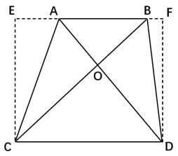

故正确答案为B。

**考点**：几何公式类-平面图形、几何结论类-相似图形、几何结论类-三角形相关

**来源**：2026年国家公务员录用考试《行测》题（副省级网友回忆版）第75题

### 第 76 题

甲和乙办公室各有4名职工，乙办公室职工平均年龄为32岁。现从甲办公室调动1人到乙办公室，2个办公室职工平均年龄都增加了2岁。问调动后甲办公室职工的平均年龄为多少岁？

A. 50

B. 48

C. 46

D. 44

第 76 题 · 答案与解析

**参考答案（粉笔题库参考内容）**

A

**解析**

设调动后甲办公室职工的平均年龄为x岁，则调动前甲办公室职工的平均年龄为（x-2）岁，根据甲办公室减少人员年龄等于乙办公室增加人员年龄，可列式：4(x-2) - (4-1)x= (4 + 1) × (32 + 2) − 32 × 4，解得x=50，即调动后甲办公室职工的平均年龄为50岁。

故正确答案为A。

**来源**：2026年国家公务员录用考试《行测》题（副省级网友回忆版）第76题

### 第 77 题

甲、乙两个工程队单独完成A、B、C三个工程，所需时间如下：

|  | A工程 | B工程 | C工程 |
| --- | --- | --- | --- |
| 甲队 | 10天 | 15天 | 10天 |
| 乙队 | 12天 | 9天 | 18天 |

问两队合作完成这3个工程至少需要多少天（不足1天算1天）？

A. 18

B. 17

C. 16

D. 15

第 77 题 · 答案与解析

**参考答案（粉笔题库参考内容）**

D

**解析**

根据题意，赋值A工程的工程总量为60，B工程为45，C工程为90，则甲、乙两队完成A、B、C三个工程的工作效率如下：

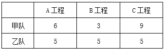

要想完成这3个工程的时间尽量少，需要让甲、乙两队优先完成各自擅长的工程。对比发现，甲队更擅长C工程，乙队更擅长B工程。则甲队优先完成C工程所需时间为10天，同时乙队完成B工程需要9天，此时乙队可再独自做10-9=1天A工程。甲队完成C工程后，两队再共同完成A工程，还需(60 - 5×1)/(6+5) = 5天，则两队合作完成这3个工程至少需要10+5=15天。

故正确答案为D。

**考点**：统筹规划问题、给完工时间型

**来源**：2026年国家公务员录用考试《行测》题（副省级网友回忆版）第77题

### 第 78 题

某社区干部每周一参加工作例会，每月10日、20日接访群众。已知8月与9月共有2次接访群众与工作例会在同一天，问当年9月1日是：

A. 周三

B. 周二

C. 周六

D. 周五

第 78 题 · 答案与解析

**参考答案（粉笔题库参考内容）**

C

**解析**

根据题意可知，8月10日、20日，9月10日、20日，这4天中有2天既接访群众又参加工作例会，即这4天中仅有2天是周一。这4天中相邻2天间隔天数依次为10天、21天、10天，21天为7的倍数，则仅8月20日与9月10日的星期数相同，故8月20日与9月10日为周一，则9月3日为周一，9月1日为周六。

故正确答案为C。

**考点**：星期日期问题

**来源**：2026年国家公务员录用考试《行测》题（副省级网友回忆版）第78题

### 第 79 题

甲、乙、丙三辆车同时从环形道路同一点出发匀速行驶，其中甲和乙顺时针行驶，丙逆时针行驶，且甲、乙、丙的速度比为4：5：6。已知甲丙和乙丙第一次相遇的时间间隔为5秒，问出发后多久乙第一次追上甲？

A. 不到8分钟

B. 8分钟~9分钟之间

C. 9分钟~10分钟之间

D. 超过10分钟

第 79 题 · 答案与解析

**参考答案（粉笔题库参考内容）**

C

**解析**

根据题意，赋值甲、乙、丙每秒的速度分别为4、5、6，设环形道路一圈的长度为S。甲丙和乙丙第一次相遇的时间间隔为5秒，根据相遇公式：S_和 = V_和 × t_遇，可列式：S/(4+6)−S/(5+6)=5，解得：S=550。设出发t秒后乙第一次追上甲，根据追及公式：S差 = V差 × t追，可列式：550=(5-4)t，解得t=550，550/60=9分钟······10秒，即出发9分钟10秒后乙第一次追上甲，在C项范围内。

故正确答案为C。

**考点**：相遇追及

**来源**：2026年国家公务员录用考试《行测》题（副省级网友回忆版）第79题

### 第 80 题

公司1月销售额为w元，从2月开始每个月的销售额都比上个月高k元。已知一季度完成全年销售目标的18%，上半年完成全年销售目标的48%，问公司全年实际销售额将比销售目标高多少元？

A. 21k

B. 28k

C. 33k

D. 44k

第 80 题 · 答案与解析

**参考答案（粉笔题库参考内容）**

C

**解析**

根据题意，公司每个月的销售额构成等差数列。根据等差数列求和公式：S_n = na_1 + (n×(n − 1))/2 × d，可得公司一季度完成销售额S3 = 3w + (3 × (3 − 1))/2 × k = (3w + 3k)元，公司上半年完成销售额S6=6w+(6×(6-1))/2×k=(6w+15k)元，公司全年完成销售额S12 = 12w + (12 × (12 − 1))/2 × k = (12w + 66k)元。根据题意，可列式：(3w + 3k)/18% = (6w + 15k)/48%，化简可得：w=3.5k，即全年销售目标为(3w+3k)/18%=(3×3.5k+3k)/18%=75k元，公司全年实际销售额为12w+66k=12×3.5k+66k=108k元，故公司全年实际销售额将比销售目标高108k-75k=33k元。

故正确答案为C。

**考点**：数列问题

**来源**：2026年国家公务员录用考试《行测》题（副省级网友回忆版）第80题

### 第 81 题

从所给的四个选项中，选择最合适的一个填入问号处，使之呈现一定的规律性：

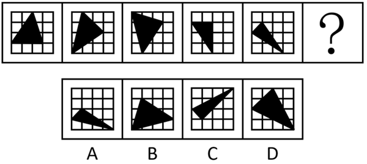

A. A

B. B

C. C

D. D

第 81 题 · 答案与解析

**参考答案（粉笔题库参考内容）**

A

**解析**

元素组成基本相同，优先考虑位置规律。题干图形出现十六宫格，可以优先考虑内外分开看。观察发现，题干图形中黑色三角形均存在三个顶点，其中外圈的两个顶点在外圈依次逆时针平移一格，内圈的顶点在内圈依次逆时针平移一格，故？处图形也应符合此规律，只有A项符合。

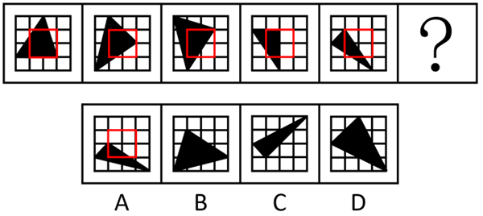

故正确答案为A。

**考点**：位置规律-平移

**来源**：2026年国家公务员录用考试《行测》题（副省级网友回忆版）第81题

### 第 82 题

从所给的四个选项中，选择最合适的一个填入问号处，使之呈现一定的规律性：

A. A

B. B

C. C

D. D

第 82 题 · 答案与解析

**参考答案（粉笔题库参考内容）**

D

**解析**

元素组成相同，但无明显位置规律和属性规律，考虑数量规律。观察发现，题干图形均由不同形状小黑块连接而成，且黑色块之间围成封闭面，考虑面数量。题干图形面数量依次为0、1、2、3、4，故？处图形面数量应为5，只有D项符合。

故正确答案为D。

**考点**：数量规律-面

**来源**：2026年国家公务员录用考试《行测》题（副省级网友回忆版）第82题

### 第 83 题

从所给四个选项中，选择最合适的一个填入问号处，使之呈现一定的规律性：

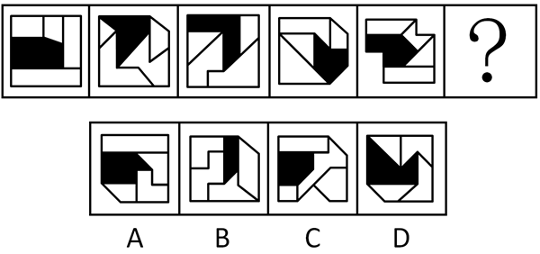

A. A

B. B

C. C

D. D

第 83 题 · 答案与解析

**参考答案（粉笔题库参考内容）**

D

**解析**

元素组成不同，且每幅图均由几个图形拼接而成，考虑图形间关系。观察发现，题干图形均有一个黑块，黑块与4个白块共有4条公共边，且与每个白块均存在1条公共边，A项黑块与白块共有5条公共边，B项黑块与白块共有3条公共边，C项中黑块与右下角白块不存在公共边，排除A、B、C三项，只有D项符合。

故正确答案为D。

**考点**：特殊规律-图形间关系

**来源**：2026年国家公务员录用考试《行测》题（副省级网友回忆版）第83题

### 第 84 题

从所给的四个选项中，选择最合适的一个填入问号处，使之呈现一定的规律性：

A. A

B. B

C. C

D. D

第 84 题 · 答案与解析

**参考答案（粉笔题库参考内容）**

C

**解析**

元素组成相似，且有相同线条重复出现，优先考虑样式规律中的加减同异。九宫格优先看横行，观察发现，第一行中，图1和图2先求异，再逆时针旋转90°，即可得到图3；经验证，第二行满足此规律；第三行应用此规律，只有C项符合。

故正确答案为C。

**考点**：样式规律-加减同异

**来源**：2026年国家公务员录用考试《行测》题（副省级网友回忆版）第84题

### 第 85 题

从所给的四个选项中，选择最合适的一个填入问号处，使之呈现一定的规律性：

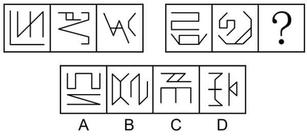

A. A

B. B

C. C

D. D

第 85 题 · 答案与解析

**参考答案（粉笔题库参考内容）**

B

**解析**

元素组成不同，优先考虑属性规律。观察发现，题干图形均由2个图形组成，且出现等腰元素，考虑对称性，题干均由1个中心对称图形和1个轴对称图形构成，排除D项；继续观察发现，题干图形出现明显的多端点图形，考虑笔画数，题干第一组图形笔画数均为3，其中轴对称图形为一笔画，中心对称图形为两笔画，第二组前两个图形笔画数均为3，其中中心对称图形为一笔画，轴对称图形为两笔画，故？处图形的笔画数应为3，且中心对称图形为一笔画，轴对称图形为两笔画，只有B项符合。

故正确答案为B。

**考点**：数量规律-复合

**来源**：2026年国家公务员录用考试《行测》题（副省级网友回忆版）第85题

### 第 86 题

左边为由15个白色正方体和3个黑色正方体组合而成的多面体俯视图和左视图，其正视图可能是：

A. A

B. B

C. C

D. D

第 86 题 · 答案与解析

**参考答案（粉笔题库参考内容）**

B

**解析**

本题考查三视图。题干中俯视图中间一列最下方为黑色正方形，左视图最右列只有最下方一个黑色正方形，则对应选项中正视图中间一列最下方为黑色正方形，排除C、D两项。

俯视图、左视图结合选项主视图可以确定立体图形，逐一分析A、B选项。

A项：结合题干两个视图和A项，可能的立体图形有以下5种情况（注意图④和图⑤两个箭头指向的正方体的下方为黑色正方体），如下图所示。此时在所有情况下，立体图形均只有12个白色正方体，而题干中所给为15个白色正方体，不符合题干要求，排除；

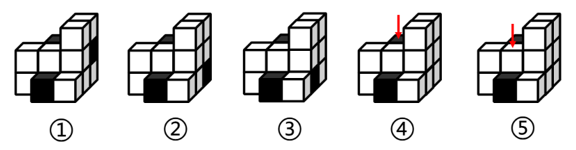

B项：结合题干两个视图和B项，可以确定立体图形（注意第二层左上角为黑色正方体），如下图所示。此时立体图形有15个白色正方体和3个黑色正方体，符合题干要求，当选。

故正确答案为B。

**考点**：空间类-三视图

**来源**：2026年国家公务员录用考试《行测》题（副省级网友回忆版）第86题

### 第 87 题

下图为由2个正方体组合而成的长方体，问这2个正方体的外表面展开图可能分别是：

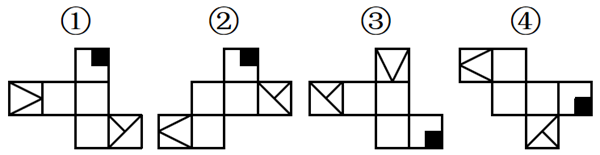

A. ②和④

B. ②和③

C. ①和④

D. ①和③

第 87 题 · 答案与解析

**参考答案（粉笔题库参考内容）**

D

**解析**

将题干2个正方体的面标上字母序号，并在立体图形和外表面展开图的“T”字形面（面e和面g）中以“T”字形中线端点为起始点，顺时针描边标号，如下图所示。

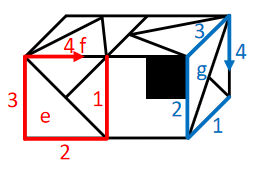

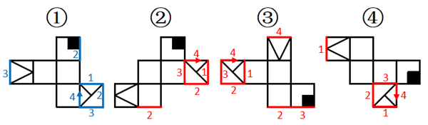

图①中，标出“T字形”面中对应的边2和边3后发现，二者与题干右侧正方体中面g的边2和边3对应一致，故图①可能是题干右侧正方体的外表面展开图；

图②中，标出“T字形”面中对应的边2和边3后发现，二者与题干右侧正方体中面g的边2和边3对应不一致，故图②不可能是题干右侧正方体的外表面展开图，标出“T字形”面中对应的边4后发现，与题干左侧正方体中面e的边4对应不一致，故图②不可能是题干左侧正方体的外表面展开图；

图③中，标出“T字形”面中对应的边4后发现，该公共边与题干左侧正方体中面e的边4对应一致，故图③可能是题干左侧正方体的外表面展开图；

图④中，标出“T字形”面中对应的边2和边3后发现，二者与题干右侧正方体中面g的边2和边3对应不一致，故图④不可能是题干右侧正方体的外表面展开图，标出“T字形”面中对应的边4后发现，与题干左侧正方体中面e的边4对应不一致，故图④不可能是题干左侧正方体的外表面展开图。

综上，2个正方体的外表面展开图可能是①和③，对应D项。

故正确答案为D。

**考点**：空间类-空间重构-六面体

**来源**：2026年国家公务员录用考试《行测》题（副省级网友回忆版）第87题

### 第 88 题

左边为由12个白色正方体和3个灰色正方体组合而成的多面体前后两面直观图，问其可以由除哪项外的三个多面体组合而成？

A. A

B. B

C. C

D. D

第 88 题 · 答案与解析

**参考答案（粉笔题库参考内容）**

B

**解析**

本题考查立体拼合。题干立体图形可以由A、C、D三项旋转后拼合而成，具体过程如下图所示：

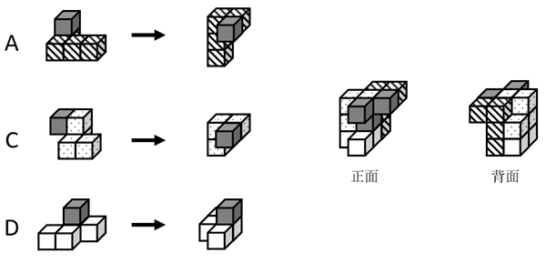

本题为选非题，故正确答案为B。

**考点**：空间类-立体拼合

**来源**：2026年国家公务员录用考试《行测》题（副省级网友回忆版）第88题

### 第 89 题

把下面的六个图形分为两类，使每一类图形都有各自的共同特征或规律，分类正确的一项是：

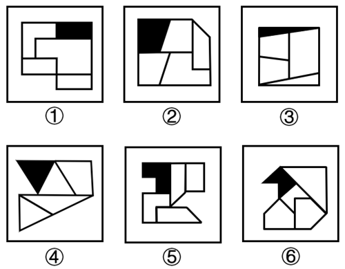

A. ①②⑥，③④⑤

B. ①②④，③⑤⑥

C. ①⑤⑥，②③④

D. ①④⑥，②③⑤

第 89 题 · 答案与解析

**参考答案（粉笔题库参考内容）**

B

**解析**

元素组成不同，且无明显属性规律，优先考虑数量规律。观察发现，题干每幅图中均存在一个黑色面和四个白色面，但根据面的数量无法分组分类，故考虑面的细化。再次观察发现，每幅图中均有1-2个白色面形状与黑色面形状相同，故考虑相同形状的面，图①②④中黑色面的形状与2个白色面形状一致，图③⑤⑥中黑色面的形状与1个白色面形状一致，故图①②④为一组，图③⑤⑥为一组。

故正确答案为B。

**考点**：数量规律-面

**来源**：2026年国家公务员录用考试《行测》题（副省级网友回忆版）第89题

### 第 90 题

把下面的六个图形分为两类，使每一类图形都有各自的共同特征或规律，分类正确的一项是：

A. ①②③，④⑤⑥

B. ①③④，②⑤⑥

C. ①③⑥，②④⑤

D. ①⑤⑥，②③④

第 90 题 · 答案与解析

**参考答案（粉笔题库参考内容）**

C

**解析**

本题为分组分类题目。元素组成相同，但无明显位置规律。观察发现，题干图形均出现两个黑块，在连接两个黑块的最短路径中，且图①③⑥中两个黑块均通过一条线连接，图②④⑤中两个黑块均通过一个面连接，即图①③⑥为一组，图②④⑤为一组。

故正确答案为C。

**考点**：特殊规律-图形间关系、黑白块类

**来源**：2026年国家公务员录用考试《行测》题（副省级网友回忆版）第90题

### 第 91 题

均变论认为，支配各种地质过程的法则在地质历史上没有发生过变化，现在起作用的各种自然营力在漫长的地质过程中具有普遍的均一性，即地质演变是一个渐变的过程，具有相同方式和相同的强度；地球上生物的种与种之间有过渡关系，生物进化过程是极其漫长的。灾变论认为，在整个地质发展的过程中，地球经常发生各种突如其来的、短暂的全球性灾难性变化，这些变化强烈地改变了地球的面貌；地球上生物的变化是反复多次灾变的结果。

根据上述定义，下列说法最能体现灾变论观点的是：

A. “我们找不到开始的痕迹，也看不到结束的迹象”

B. “地质记录是一部被鲜血和火焰写成的史诗”

C. “现在是通往过去的一把钥匙”

D. “自然界里没有飞跃”

第 91 题 · 答案与解析

**参考答案（粉笔题库参考内容）**

B

**解析**

第一步：找出定义关键词。

均变论：“支配各种地质过程的法则在地质历史上没有发生过变化”、“现在起作用的各种自然营力在漫长的地质过程中具有普遍的均一性”、“地球上生物的种与种之间有过渡关系，生物进化过程是极其漫长的”。

灾变论：“地球经常发生各种突如其来的、短暂的全球性灾难性变化，这些变化强烈地改变了地球的面貌”、“地球上生物的变化是反复多次灾变的结果”。

第二步：逐一分析选项。

A项：“我们找不到开始的痕迹，也看不到结束的迹象”，体现了“支配各种地质过程的法则在地质历史上没有发生过变化”、“地球上生物的种与种之间有过渡关系，生物进化过程是极其漫长的”，符合“均变论”定义，不符合“灾变论”定义，排除；

B项：“地质记录是一部被鲜血和火焰写成的史诗”，“鲜血和火焰”隐喻的是灾难，体现了“地球经常发生各种突如其来的、短暂的全球性灾难性变化，这些变化强烈地改变了地球的面貌”，符合“灾变论”定义，当选；

C项：“现在是通往过去的一把钥匙”，体现了“支配各种地质过程的法则在地质历史上没有发生过变化”、“现在起作用的各种自然营力在漫长的地质过程中具有普遍的均一性”、“地球上生物的种与种之间有过渡关系，生物进化过程是极其漫长的”，符合“均变论”定义，不符合“灾变论”定义，排除；

D项：“自然界里没有飞跃”，体现了“地球上生物的种与种之间有过渡关系，生物进化过程是极其漫长的”，符合“均变论”定义，不符合“灾变论”定义，排除。

故正确答案为B。

**考点**：常规问法

**来源**：2026年国家公务员录用考试《行测》题（副省级网友回忆版）第91题

### 第 92 题

波特五力模型是一种竞争分析工具，用于评估一个行业的竞争力和吸引力。该模型通过对同行业竞争对手的威胁、潜在进入者的威胁、替代品的威胁、上游供应商的议价能力和下游购买者的议价能力这五个方面的分析，帮助企业了解其所处行业的竞争环境，以制定相应的竞争策略。

根据上述定义，关于康复机器人行业，对下列问题的分析不能归入波特五力模型的是：

A. 康复机器人行业准入门槛高吗？需要强大的技术能力和创新能力吗？

B. 医院和康复中心患者规模如何？对于康复机器人的需求有多大？

C. 与传统物理治疗等康复治疗方法相比，康复机器人有竞争力吗？

D. 康复机器人企业内部各部门之间的协同合作程度高吗？

第 92 题 · 答案与解析

**参考答案（粉笔题库参考内容）**

D

**解析**

第一步：找出定义关键词。

“同行业竞争对手的威胁”、“潜在进入者的威胁”、“替代品的威胁”、“上游供应商的议价能力”、“下游购买者的议价能力”、“帮助企业了解其所处行业的竞争环境，以制定相应的竞争策略”。

第二步：逐一分析选项。

A项：康复机器人行业准入门槛高吗？需要强大的技术能力和创新能力吗？问题中的“准入门槛”、“技术能力和创新能力”直接关系到潜在企业能否进入康复机器人行业，符合波特五力模型中的“潜在进入者的威胁”，符合定义，排除；

B项：医院和康复中心患者规模如何？对于康复机器人的需求有多大？问题中的“医院”和“康复中心”是康复机器人的“下游购买者”，“患者规模”与“需求程度”会直接影响购买者采购时的“议价能力”，符合波特五力模型中的“下游购买者的议价能力”，符合定义，排除；

C项：与传统物理治疗等康复治疗方法相比，康复机器人有竞争力吗？问题中的“传统物理治疗”是康复机器人的“替代方案”，是在分析“替代品”的竞争力对行业的威胁，符合波特五力模型中的“替代品的威胁”，符合定义，排除；

D项：康复机器人企业内部各部门之间的协同合作程度高吗？问题中的“企业内部各部门之间的协同合作程度”属于企业“内部管理”的范畴，不符合波特五力模型中的任何一个，不符合定义，当选。

本题为选非题，故正确答案为D。

**考点**：方式目的

**来源**：2026年国家公务员录用考试《行测》题（副省级网友回忆版）第92题

### 第 93 题

选矿是指用物理、化学或者物理与化学相结合的方法，将原矿中的有用矿物与伴生的无用固定物质（脉石）或有害矿物分开的过程。选矿可显著提高矿石的质量，减少运输费用，降低冶炼成本，进而实现综合利用。

根据上述定义，下列没有体现选矿过程的是：

A. 利用矿物颗粒电性的差别，在高压电场中挑选出白钨矿、赤铁矿等，通过电机分离除尘

B. 利用水枪和洗矿槽等设备，将锡矿石中的泥土等杂质洗去，同时也可以将部分轻矿物冲走，实现锡石初步富集

C. 经验丰富的老师傅通过敲击、光照、观察皮壳等方法对开采的翡翠原石进行筛选，挑选优质原石

D. 将铜矿矿石破碎到一定的粒度后，混以少量的食盐和煤粉隔氧加热，矿石中的铜便以金属状态析出，由此获得铜精矿

第 93 题 · 答案与解析

**参考答案（粉笔题库参考内容）**

C

**解析**

第一步：找出定义关键词。

“用物理、化学或者物理与化学相结合的方法”、“将原矿中的有用矿物与伴生的无用固定物质（脉石）或有害矿物分开的过程”。

第二步：逐一分析选项。

A项：利用矿物颗粒电性的差别，属于物理方法，符合“用物理、化学或者物理与化学相结合的方法”，在高压电场中挑选出白钨矿、赤铁矿等（有用物质），通过电机分离除尘（伴生的无用固定物质），符合“将原矿中的有用矿物与伴生的无用固定物质（脉石）或有害矿物分开的过程”，符合定义，排除；

B项：利用水枪和洗矿槽等设备清洗锡矿石，属于物理方法，符合“用物理、化学或者物理与化学相结合的方法”，将锡矿石中的泥土等杂质（伴生的无用固定物质）洗去，同时也可以将部分轻矿物冲走，实现锡石（有用矿物）初步富集，符合“将原矿中的有用矿物与伴生的无用固定物质（脉石）或有害矿物分开的过程”，符合定义，排除；

C项：通过敲击、光照、观察皮壳等方法对开采的翡翠原石进行筛选，挑选优质原石，仅是对原石整体品质进行判断与挑选，不涉及对原石中的物质分开的过程，不符合“将原矿中的有用矿物与伴生的无用固定物质（脉石）或有害矿物分开的过程”，不符合定义，当选；

D项：将铜矿矿石破碎到一定的粒度后，属于物理方法，混以少量的食盐和煤粉隔氧加热，属于化学方法，符合“用物理、化学或者物理与化学相结合的方法”，矿石中的铜（有用矿物）便以金属状态析出，由此获得铜精矿，符合“将原矿中的有用矿物与伴生的无用固定物质（脉石）或有害矿物分开的过程”，符合定义，排除。

本题为选非题，故正确答案为C。

**考点**：方式目的

**来源**：2026年国家公务员录用考试《行测》题（副省级网友回忆版）第93题

### 第 94 题

根据动词对其后所接的宾语小句（作宾语的句子）真值的不同预设能力可以把现代汉语中的相关动词分为叙实动词、非叙实动词和反叙实动词。叙实动词的肯定式和否定式都预设其宾语小句为真；非叙实动词的肯定式和否定式都不预设其宾语小句为真，也不预设其宾语小句为假；反叙实动词的肯定式和否定式都预设其宾语小句为假。

根据上述定义，下列画线的动词属于非叙实动词的是：

A. 我听说他来过这里

B. 我庆幸听了你的建议

C. 我知道你帮助过我

D. 我幻想成为一只小鸟

第 94 题 · 答案与解析

**参考答案（粉笔题库参考内容）**

A

**解析**

第一步：找出定义关键词。

叙实动词：“肯定式和否定式都预设其宾语小句为真”；

非叙实动词：“肯定式和否定式都不预设其宾语小句为真，也不预设其宾语小句为假”；

反叙实动词：“肯定式和否定式都预设其宾语小句为假”。

第二步：逐一分析选项。

A项：“我听说他来过这里”中的“听说”只是陈述信息的来源，没有预设“来过这里”为真或为假，符合“肯定式和否定式都不预设其宾语小句为真，也不预设其宾语小句为假”，符合“非叙实动词”定义，当选；

B项：“我庆幸听了你的建议”中的“庆幸”意味着听了建议是已经发生的事实，是预设其为真，符合“肯定式和否定式都预设其宾语小句为真”，符合“叙实动词”定义，不符合“非叙实动词”定义，排除；

C项：“我知道你帮助过我”中的“知道”意味着帮助过我是真实存在的事实，是预设其为真，符合“肯定式和否定式都预设其宾语小句为真”，符合“叙实动词”定义，不符合“非叙实动词”定义，排除；

D项：“我幻想成为一只小鸟”中的“幻想”是不可能发生的事，是预设其为假，符合“肯定式和否定式都预设其宾语小句为假”，符合“反叙实动词”定义，不符合“非叙实动词”定义，排除。

故正确答案为A。

**考点**：常规问法

**来源**：2026年国家公务员录用考试《行测》题（副省级网友回忆版）第94题

### 第 95 题

动作预期是指运动员在比赛过程中，根据已有信息，对即将发生的动作结果进行预测的过程。在这一过程中，运动员主要依赖两类信息：运动学信息和情境先验信息。运动学信息包括对手的动作、器材的运动轨迹或队员之间的相对位置，情境先验信息则涉及比赛情境中事件发生的概率。

根据上述定义，下列不涉及上述任何一种信息的是：

A. 篮球队员甲在双方比分紧咬的情况下，基于对手今日比赛罚篮命中率不高，在对手投篮时选择直接犯规

B. 网球运动员乙知道对手在比赛前有一系列习惯性动作，包括整理球衣、球裤、头发等，暗自提醒自己不要被其干扰

C. 羽毛球双打运动员丙发现对方准备接发球的球员位置稍微靠前，可能来不及转身或后退接球，便发了个后场球

D. 乒乓球运动员丁发现对方发过来的球位置较低、速度较慢，极有可能擦网变线，便没有后退，向前伸拍做好接球准备

第 95 题 · 答案与解析

**参考答案（粉笔题库参考内容）**

B

**解析**

第一步：找出定义关键词。

动作预期：“运动员”、“在比赛过程中”、“根据已有信息，对即将发生的动作结果进行预测”；

运动学信息：“对手的动作”、“器材的运动轨迹”、“队员之间的相对位置”；

情境先验信息：“比赛情境中事件发生的概率”。

第二步：逐一分析选项。

A项：篮球队员甲，符合“运动员”，根据对手今日比赛罚篮命中率不高，在对手投篮时选择直接犯规，即预测犯规后对手会罚篮不中，符合“在比赛过程中”、“根据已有信息，对即将发生的动作结果进行预测”、“比赛情境中事件发生的概率”，符合“情境先验信息”定义，排除；

B项：网球运动员乙知道对手在比赛前有一系列习惯性动作，不符合“在比赛过程中”，且乙是暗自提醒自己不要被干扰，未利用这些信息进行预测，不符合“对即将发生的动作结果进行预测”，不符合“动作预期”定义，进而也不符合“运动学信息”定义和“情境先验信息”定义，当选；

C项：羽毛球双打运动员丙，符合“运动员”，根据对方准备接发球的球员位置稍微靠前，预测对方来不及转身或后退接球，符合“在比赛过程中”、“根据已有信息，对即将发生的动作结果进行预测”、“比赛情境中事件发生的概率”，符合“情境先验信息”定义，排除；

D项：乒乓球运动员丁，符合“运动员”，根据对方发过来的球位置较低、速度较慢，预测球会擦网变线，符合“在比赛过程中”、“根据已有信息，对即将发生的动作结果进行预测”、“器材的运动轨迹”、“比赛情境中事件发生的概率”，符合“运动学信息”定义，也符合“情境先验信息”定义，排除。

本题为选非题，故正确答案为B。

**考点**：特殊问法

**来源**：2026年国家公务员录用考试《行测》题（副省级网友回忆版）第95题

### 第 96 题

设备利用率是指每年度设备实际使用时间占计划用时的百分比。设备完好率是根据各类设备完好标准，对企业设备进行逐台检查所确定的完好台数与设备总台数之比。设备总台数是指企业在用的、备用的、停用的以及正在检修的全部生产设备台数，完好台数是指设备性能良好、运转正常，且原料、燃料、油料等消耗正常的设备台数。设备负荷率是指设备需要台数与实际选用设备的台数之比。设备闲置率是指闲置不用的设备台数与设备总台数的比值。

根据上述定义，下列说法错误的是：

A. 若年度设备实际使用时间为9个月、设备利用率为75%，则计划用时为12个月

B. 企业正在检修的、零部件出现磨损或腐蚀的设备应当纳入设备总台数的计算中

C. 设备负荷率可用来考核设备选用的合理性程度，可用于量化分析设备运行状态

D. 设备闲置率可以反映出设备资产投资的回报程度，其数值一般小于设备完好率

第 96 题 · 答案与解析

**参考答案（粉笔题库参考内容）**

D

**解析**

第一步：找出定义关键词。

设备利用率：“每年度设备实际使用时间占计划用时的百分比”；

设备完好率：“完好台数与设备总台数之比”；

设备总台数：“企业在用的、备用的、停用的以及正在检修的全部生产设备台数”；

完好台数：“设备性能良好、运转正常，且原料、燃料、油料等消耗正常的设备台数”；

设备负荷率：“设备需要台数与实际选用设备的台数之比”；

设备闲置率：“闲置不用的设备台数与设备总台数的比值”。

第二步：逐一分析选项。

A项：年度设备实际使用时间为9个月、设备利用率为75%，根据设备利用率为“每年度设备实际使用时间占计划用时的百分比”，计划用时应为9个月/75%=12个月，说法正确，排除；

B项：设备总台数为“企业在用的、备用的、停用的以及正在检修的全部生产设备台数”，所以设备总台数包括正在检修的设备台数，即使零部件出现磨损或腐蚀，也应计入设备总台数，说法正确，排除；

C项：设备负荷率为“设备需要台数与实际选用设备的台数之比”，这个比率可以反映设备选用是否合理，该比率大于1表示设备不足，该比率小于1表示设备有余，可用于量化分析设备运行状态，说法正确，排除；

D项：设备闲置率=闲置台数/总台数,设备完好率=完好台数/总台数，完好设备可能闲置，不完好设备也可能在用（例：10台设备中，闲置8台（3台完好+5台不完好），完好台数共5台，此时设备闲置率80%＞设备完好率50%），所以设备闲置率与设备完好率没有必然的数值大小关系，说法错误，当选。

本题为选非题，故正确答案为D。

**考点**：特殊问法

**来源**：2026年国家公务员录用考试《行测》题（副省级网友回忆版）第96题

### 第 97 题

分项累进淘汰法是指在对植株进行选种时，根据性状的相对重要性顺序排列，先按第一重要性状进行选择，然后在入选株内按第二重要性状进行选择，依此顺次累进的一种选种方法。

根据上述定义，下列对南瓜的选种方法属于分项累进淘汰法的是：

A. 按株选目标性状出现的先后顺序，先淘汰蔓生植株，然后淘汰第一雌花节位高的植株，再淘汰单瓜重量低的植株

B. 首先在群体内选择无病植株，再在这些无病植株内选择丰产性好的植株，再根据产量性状顺次进行选择

C. 在收获时按照果实的大小、果型等性状初选，在初选瓜内再按照综合性状入选标准进行复选

D. 将需要鉴定的性状，如蔓长、单瓜重、果实籽粒数、籽粒长等，分别规定一个最低的入选标准，将低于入选标准的淘汰

第 97 题 · 答案与解析

**参考答案（粉笔题库参考内容）**

B

**解析**

第一步：找出定义关键词。

“根据性状的相对重要性顺序排列进行选择”、“先按第一重要性状进行选择，然后在入选株内按第二重要性状进行选择”、“顺次累进”。

第二步：逐一分析选项。

A项：按株选目标性状出现的先后顺序进行淘汰，并非根据性状的相对重要性顺序排列进行选择，不符合“根据性状的相对重要性顺序排列进行选择”，不符合定义，排除；

B项：群体内的植株中无病是存活的基础，是第一重要性状，丰产性好体现经济价值，是第二重要性状，再根据产量性状顺次进行选择，在群体内先选择无病植株，再在这些无病植株内选择丰产性好的植株，最后根据产量性状顺次进行选择，是根据性状的相对重要性顺序排列进行选择，符合“根据性状的相对重要性顺序排列进行选择”、“先按第一重要性状进行选择，然后在入选株内按第二重要性状进行选择”、“顺次累进”，符合定义，当选；

C项：按照果实的大小、果型等性状初选，没有明确体现第一重要性状，且再按照综合性状入选标准进行复选，并非按照性状的相对重要性顺序排列进行选择，不符合“根据性状的相对重要性顺序排列进行选择”、“先按第一重要性状进行选择，然后在入选株内按第二重要性状进行选择”，不符合定义，排除；

D项：将需要鉴定的多个性状分别规定最低的入选标准，将低于入选标准的淘汰，没有明确体现性状的重要性顺序，并非按照性状的相对重要性顺序排列进行选择，不符合“根据性状的相对重要性顺序排列进行选择”、“先按第一重要性状进行选择，然后在入选株内按第二重要性状进行选择”，不符合定义，排除。

故正确答案为B。

**考点**：单定义-其他句式

**来源**：2026年国家公务员录用考试《行测》题（副省级网友回忆版）第97题

### 第 98 题

组织结构可以划分为以下几种类型：（1）直线型组织结构，即每一个部门只对其直接的下属部门下达工作指令，不能越级指挥，每一个部门也只有一个直接的上级部门；（2）职能型组织结构，即每一个部门都可对其下属部门下达工作指令，每一个下属部门可能得到不同上级部门下达的多个工作指令；（3）直线职能型组织结构，即在主管之下设置相应的职能部门，实行主管统一指挥与职能部门参谋指导相结合的管理方式，各部门既受上级的管理，又受同级职能管理部门的业务指导和监督；（4）事业部组织结构，即由相对独立的事业部组成的组织结构，通常按照地区或项目来划分事业部，每个事业部拥有较大的自主权。

根据上述定义，下列组织结构图代表的组织结构类型属于：

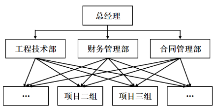

A. 直线型组织结构

B. 职能型组织结构

C. 直线职能型组织结构

D. 事业部组织结构

第 98 题 · 答案与解析

**参考答案（粉笔题库参考内容）**

B

**解析**

第一步：找出定义关键词。

直线型组织结构：“每一个部门只对其直接的下属部门下达工作指令”、“不能越级指挥”、“每一个部门也只有一个直接的上级部门”；

职能型组织结构：“每一个部门都可对其下属部门下达工作指令”、“每一个下属部门可能得到不同上级部门下达的多个工作指令”；

直线职能型组织结构：“在主管之下设置相应的职能部门，实行主管统一指挥与职能部门参谋指导相结合的管理方式”、“各部门既受上级的管理，又受同级职能管理部门的业务指导和监督”；

事业部组织结构：“由相对独立的事业部组成的组织结构”、“通常按照地区或项目来划分事业部”、“每个事业部拥有较大的自主权”。

第二步：逐一分析选项。

A项：结构图中项目二组和项目三组等存在多个上级部门下达指令，不符合“每一个部门也只有一个直接的上级部门”，不符合“直线型组织结构”定义，排除；

B项：结构图中的每一个部门都有上级部门，且项目二组和项目三组等存在多个上级部门下达工作指令，符合“每一个部门都可对其下属部门下达工作指令”、“每一个下属部门可能得到不同上级部门下达的多个工作指令”，符合“职能型组织结构”定义，当选；

C项：结构图中的每个部门都不存在同级职能管理部门的业务指导和监督，不符合“各部门既受上级的管理，又受同级职能管理部门的业务指导和监督”，不符合“直线职能型组织结构”定义，排除；

D项：结构图中工程技术部、财务管理部、合同管理部以及项目二组、项目三组等都需要按照上级下达的指令工作，不符合“每个事业部拥有较大的自主权”，不符合“事业部组织结构”定义，排除。

故正确答案为B。

**考点**：特殊问法

**来源**：2026年国家公务员录用考试《行测》题（副省级网友回忆版）第98题

### 第 99 题

《中国共产党纪律处分条例》规定，主动交代本人应当受到党纪处分的问题，可以从轻或者减轻处分。这里所称的主动交代主要包括两种情况：一是涉嫌违纪的党员在组织谈话函询、初步核实前向有关组织交代自己的问题。二是在谈话函询、初步核实和立案审查期间交代组织未掌握的问题。

假定下列人员均受该条例约束，根据上述定义，下列属于主动交代的是：

A. 甲在参加违纪违法典型案例警示教育大会后，主动找到单位领导反映同事的违纪问题

B. 乙在组织对其进行廉政谈话时，组织举证一项他才承认一项，对未涉及的情况闭口不谈

C. 丙在纪委对其个人财产有关事项进行函询时，将其利用职权为自己和他人谋利的情况如实交代

D. 丁在纪委对其立案审查期间，面对确凿的证据，交代了之前没有交代的收受大额礼金的问题

第 99 题 · 答案与解析

**参考答案（粉笔题库参考内容）**

C

**解析**

第一步：找出定义关键词。

“主动交代本人应当受到党纪处分的问题”、“涉嫌违纪的党员在组织谈话函询、初步核实前向有关组织交代自己的问题”、“在谈话函询、初步核实和立案审查期间交代组织未掌握的问题”。

第二步：逐一分析选项。

A项：甲主动找到单位领导反映同事的违纪问题，并非交代本人的违纪问题，不符合“主动交代本人应当受到党纪处分的问题”，不符合定义，排除；

B项：乙在组织对其进行廉政谈话时，组织举证一项他才承认一项，不符合“主动交代本人应当受到党纪处分的问题”，不符合定义，排除；

C项：丙在纪委对其个人财产有关事项进行函询时，如实交代了自己利用职权谋利的问题，符合“在谈话函询、初步核实和立案审查期间交代组织未掌握的问题”，符合定义，当选；

D项：丁在纪委立案审查期间，面对确凿证据才交代了之前未交代的收受大额礼金的问题，不符合“主动交代本人应当受到党纪处分的问题”、“在谈话函询、初步核实和立案审查期间交代组织未掌握的问题”，不符合定义，排除。

故正确答案为C。

**考点**：单定义-其他句式

**来源**：2026年国家公务员录用考试《行测》题（副省级网友回忆版）第99题

### 第 100 题

心理护理是指在护理过程中，护士发现了影响患者治疗及康复的心理问题后，运用心理学的理论作指导，通过自身的语言、态度和行为等，或通过改善环境（包括人文环境及物理环境）去影响或调整患者的心理状态和行为，进而帮助患者康复的护理方法。

根据上述定义，下列没有体现心理护理的是：

A. 护士协助医生让青少年患者进行心理量表的测试，进而评估患者心理问题的类型

B. 护士发现患儿害怕用药后，在更换伤口敷料时动作轻柔、耐心细致，使患儿不再抵触换药

C. 护士建议家属及时安抚患者的消极情绪并多加陪伴，以增强患者战胜疾病的信心

D. 针对患者手术前的紧张情绪，护士教会患者放松的技巧，帮助患者正确对待手术

第 100 题 · 答案与解析

**参考答案（粉笔题库参考内容）**

A

**解析**

第一步：找出定义关键词。

“在护理过程中，护士发现了影响患者治疗及康复的心理问题后”、“通过自身的语言、态度和行为等，或通过改善环境（包括人文环境及物理环境）去影响或调整患者的心理状态和行为”、“帮助患者康复”。

第二步：逐一分析选项。

A项：护士协助医生让青少年患者进行心理量表测试，评估心理问题类型，是心理问题的评估和发现过程，不符合“通过自身的语言、态度和行为等，或通过改善环境（包括人文环境及物理环境）去影响或调整患者的心理状态和行为”、“帮助患者康复”，不符合定义，当选；

B项：护士发现患儿害怕用药，符合“在护理过程中，护士发现了影响患者治疗及康复的心理问题后”，在更换伤口敷料时动作轻柔、耐心细致，使患儿不再抵触换药，符合“通过自身的语言、态度和行为等，或通过改善环境（包括人文环境及物理环境）去影响或调整患者的心理状态和行为”、“帮助患者康复”，符合定义，排除；

C项：护士建议家属及时安抚患者的消极情绪并多加陪伴，以增强患者战胜疾病的信心，符合“在护理过程中，护士发现了影响患者治疗及康复的心理问题后”、“通过自身的语言、态度和行为等，或通过改善环境（包括人文环境及物理环境）去影响或调整患者的心理状态和行为”、“帮助患者康复”，符合定义，排除；

D项：针对患者手术前的紧张情绪，护士教会患者放松的技巧，帮助患者正确对待手术，符合“在护理过程中，护士发现了影响患者治疗及康复的心理问题后”，“通过自身的语言、态度和行为等，或通过改善环境（包括人文环境及物理环境）去影响或调整患者的心理状态和行为”、“帮助患者康复”，符合定义，排除。

本题为选非题，故正确答案为A。

**考点**：方式目的

**来源**：2026年国家公务员录用考试《行测》题（副省级网友回忆版）第100题

### 第 101 题

与“军事演习：作战能力”在逻辑关系上最相近的是：

A. 正当防卫：人身危险

B. 定速巡航：车辆速度

C. 财政赤字：通货膨胀

D. 土壤改良：作物产量

第 101 题 · 答案与解析

**参考答案（粉笔题库参考内容）**

D

**解析**

第一步：判断题干词语间逻辑关系。

军事演习的目的是提升作战能力，二者为方式目的对应关系。

第二步：判断选项词语间逻辑关系。

A项：正当防卫的目的是防御人身危险，并非提升人身危险，与题干逻辑关系不一致，排除；

B项：定速巡航的目的是控制并维持车辆速度，并非提升车辆速度，与题干逻辑关系不一致，排除；

C项：财政赤字可能会导致通货膨胀，二者为因果对应关系，与题干逻辑关系不一致，排除；

D项：土壤改良的目的是提升作物产量，二者为方式目的对应关系，与题干逻辑关系一致，当选。

故正确答案为D。

**考点**：逻辑关系-对应关系

**来源**：2026年国家公务员录用考试《行测》题（副省级网友回忆版）第101题

### 第 102 题

与“口腔：唾液：淀粉酶”在逻辑关系上最相近的是：

A. 种子：孜然：调味品

B. 叶片：叶肉：叶绿体

C. 松树：松脂：树脂醇

D. 试剂：试纸：pH试纸

第 102 题 · 答案与解析

**参考答案（粉笔题库参考内容）**

C

**解析**

第一步：判断题干词语间逻辑关系。

唾液是口腔的分泌物，前两词是对应关系，淀粉酶是唾液的组成成分，后两词是组成关系。

第二步：判断选项词语间逻辑关系。

A项：孜然是一种常用的中草药，其种子可以制作为调味品，与题干逻辑关系不一致，排除；

B项：叶肉是叶片的组成部分，前两词是组成关系，与题干逻辑关系不一致，排除；

C项：松脂是松树的分泌物，前两词是对应关系，树脂醇是松脂的组成成分，后两词是组成关系，与题干逻辑关系一致，当选；

D项：试纸是一种浸渍化学试剂的纸质检测工具，试剂和试纸是配套使用的对应关系，与题干逻辑关系不一致，排除。

故正确答案为C。

**考点**：逻辑关系-包容关系、逻辑关系-对应关系

**来源**：2026年国家公务员录用考试《行测》题（副省级网友回忆版）第102题

### 第 103 题

与“减数：被减数：差”在逻辑关系上最相近的是：

A. 粮食产量：播种面积：粮食单产

B. 溶质质量：溶液质量：溶剂质量

C. 可售天数：库存总量：日均销量

D. 间隔天数：结束日期：开始日期

第 103 题 · 答案与解析

**参考答案（粉笔题库参考内容）**

B

**解析**

第一步：判断题干词语间逻辑关系。

被减数-减数=差，三者为减法运算的对应关系。

第二步：判断选项词语间逻辑关系。

A项：粮食单产×播种面积=粮食产量，三者为乘法运算的对应关系，与题干逻辑关系不一致，排除；

B项：溶液质量-溶质质量=溶剂质量，三者为减法运算的对应关系，与题干逻辑关系一致，当选；

C项：库存总量÷日均销量=可售天数，三者为除法运算的对应关系，与题干逻辑关系不一致，排除；

D项：当结束日期和开始日期在同一月份时，结束日期-间隔天数-1=开始日期；当结束日期和开始日期不在同一月份时，计算间隔天数不能直接相减，三者不是减法运算的对应关系，与题干逻辑关系不一致，排除。

故正确答案为B。

**考点**：逻辑关系-对应关系

**来源**：2026年国家公务员录用考试《行测》题（副省级网友回忆版）第103题

### 第 104 题

颅内疾病 对于 （ ） 相当于 （ ） 对于 岩石断裂

依次填入括号中最恰当的是：

A. 颅内感染；岩石熔融

B. 机体疾病；地壳应力

C. 核磁共振；地下采样

D. 视野缺失；冰川运动

第 104 题 · 答案与解析

**参考答案（粉笔题库参考内容）**

D

**解析**

逐一代入选项。

A项：颅内感染是颅内疾病的一种，二者为种属关系；岩石熔融和岩石断裂是两种不同的地质现象，二者为并列关系，前后逻辑关系不一致，排除；

B项：颅内疾病是机体疾病的一种，二者为种属关系；地壳应力是导致岩石断裂的原因，二者为因果关系，前后逻辑关系不一致，排除；

C项：核磁共振是用来诊断颅内疾病的方法，二者为诊断方法与疾病的对应关系；地下采样可以判断岩石是否有断裂，但顺序反了，前后逻辑关系不一致，排除；

D项：颅内疾病会导致视野缺失，二者为因果对应关系；冰川运动会导致岩石断裂，二者为因果对应关系，前后逻辑关系一致，当选。

故正确答案为D。

**考点**：逻辑关系-对应关系

**来源**：2026年国家公务员录用考试《行测》题（副省级网友回忆版）第104题

### 第 105 题

如果用一个圆来表示词语所指称的对象的集合，那么以下哪项中画横线词语之间的关系符合下图？

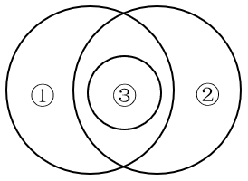

A. 船舶按用途分为军用船舶（①）和民用船舶两大类，潜艇、航空母舰（③）、驱逐舰等都属于军用船舶；按推进动力分为机动船和非机动船（②）

B. 水杉（③）是我国的特有树种，属于落叶树（①），是一种高大的乔木（②），是世界上珍稀的“活化石”植物

C. 图书按照读者群可分为少儿读物（③）和成人读物等；按照载体可分为纸质书和电子书（②）等；按照学科可分为历史书、文学书和哲学书（①）等

D. 大熊猫属于哺乳动物（①），是中国特有动物（②），被列为中国国家一级保护野生动物（③）

第 105 题 · 答案与解析

**参考答案（粉笔题库参考内容）**

B

**解析**

第一步：判断题干词语间逻辑关系。

根据题干图形可知，①和②是交叉关系；③属于①，③和①是种属关系；③属于②，③和②是种属关系。

第二步：判断选项词语间逻辑关系。

A项：航空母舰（③）是指军队专用的机动船只，与非机动船（②）不是种属关系，与题干逻辑关系不一致，排除；

B项：落叶树（①）和乔木（②）是交叉关系；水杉（③）属于落叶树（①），③和①是种属关系；水杉（③）属于乔木（②），③和②是种属关系，与题干逻辑关系一致，当选；

C项：少儿读物（③）和电子书（②）是交叉关系，不是种属关系，与题干逻辑关系不一致，排除；

D项：中国国家一级保护野生动物（③）和哺乳动物（①）是交叉关系，不是种属关系，与题干逻辑关系不一致，排除。

故正确答案为B。

**考点**：逻辑关系-交叉关系、逻辑关系-包容关系

**来源**：2026年国家公务员录用考试《行测》题（副省级网友回忆版）第105题

### 第 106 题

研究发现，受人喜爱、知名度高的物种更易成为科研人员研究的对象。有观点认为，每一物种都有研究的意义和价值，科研人员不应对研究对象差别对待，但反对者却认为，科学研究进行重点突破比“一视同仁”更有意义，因为把有限的科研资源用在合适的地方，才能更好地平衡投入与回报。

以下哪项如果为真，没有支持反对者的观点？

A. 关系人类基本需求的粮食作物，家禽家畜等产能的不断增长，得益于当初人们对其进行选择性的专门研究

B. 对那些生长周期短、基因组简单且分布广泛的模式生物进行重点研究更易揭示生命科学的普通规律

C. 由于文化、知名度等原因，对某些物种的保护性研究对唤醒人们的生态保护意识具有特殊的号召力和吸引力

D. 网络上搜索到关于树袋熊的相关论文有5000多篇，而更为濒危的昆士兰毛吻袋熊的论文则不到1000篇

第 106 题 · 答案与解析

**参考答案（粉笔题库参考内容）**

D

**解析**

第一步：找出论点和论据。

论点：科学研究进行重点突破比“一视同仁”更有意义。

论据：把有限的科研资源用在合适的地方，才能更好地平衡投入与回报。

本题论据说的是“把有限的科研资源用在合适地方才能更好地平衡投入与回报”，论点说的是“科学研究进行重点突破更有意义”，从论据可以合理推出论点，因此论据和论点话题一致，加强优先考虑补充论据，且本题为选非题，将可以加强的选项排除即可。

第二步：逐一分析选项。

A项：该项指出人类需求的粮食作物、家禽家畜等产能的增长得益于对其进行的专门研究，举例说明科学研究进行重点突破比“一视同仁”确实更有意义，补充论据，可以加强，排除；

B项：该项指出对生长周期短、基因组简单且分布广泛的模式生物进行重点研究更易揭示生命科学的普通规律，解释了为什么科学研究进行重点突破比“一视同仁”更有意义，补充论据，可以加强，排除；

C项：该项指出因文化、知名度等原因，对某些物种的保护性研究对唤醒人们的生态保护意识具有特殊的号召力和吸引力，解释了为什么科学研究进行重点突破比“一视同仁”更有意义，补充论据，可以加强，排除；

D项：该项指出濒危昆士兰毛吻袋熊的相关论文相比于树袋熊的相关论文更少，未提及科学研究是否要进行重点突破，与论点说的科学研究进行重点突破更有意义无关，话题不一致，无法加强，当选。

本题为选非题，故正确答案为D。

**考点**：加强选非题

**来源**：2026年国家公务员录用考试《行测》题（副省级网友回忆版）第106题

### 第 107 题

部分研究认为，白垩纪陆地生态系统的变革是由植物、昆虫、脊椎动物与地质过程等多个要素相互作用推动的，形成了一个高度协同演化的系统结构。鉴于这一机制在当时造就了复杂而稳定的生态格局，有学者提出，现代陆地生态系统的高度复杂性，正是这种古老协同机制延续和演化的结果。

以下哪项如果为真，最能削弱上述学者的观点？

A. 在地质记录中，白垩纪末期的生态危机主要影响海洋系统，而陆地系统显示出相对稳定的演替趋势

B. 对白垩纪地层的系统分析表明，植物、昆虫、脊椎动物与地质过程的演化几乎是在同一时期进行的

C. 现代陆地生态系统的复杂性主要受群落内部随机扰动、自组织演化和外源干扰的共同影响，与白垩纪显著不同

D. 被子植物的全球扩张早于部分动物类群多样化，其当时对生态结构的主导作用可能被高估

第 107 题 · 答案与解析

**参考答案（粉笔题库参考内容）**

C

**解析**

第一步：找出论点和论据。

论点：现代陆地生态系统的高度复杂性，正是这种古老协同机制延续和演化的结果。

论据：白垩纪陆地生态系统的变革是由植物、昆虫、脊椎动物与地质过程等多个要素相互作用推动的，形成了一个高度协同演化的系统结构。鉴于这一机制在当时造就了复杂而稳定的生态格局。

从论据“白垩纪”高度协同演化的系统结构造就了复杂而稳定的生态格局，推出“现代”也是同样的情况，在这种“时期不同”的文段结构下，可以考拆桥，即“白垩纪的情况≠现代”。

第二步：逐一分析选项。

A项：指出白垩纪末期的生态危机对海洋系统和陆地系统的不同影响，与论点讨论的“白垩纪时期陆地生态系统高度协同演化的机制影响了现代陆地生态系统”无关，无法削弱，排除；

B项：指出白垩纪时期植物、昆虫、脊椎动物与地质过程的演化几乎是在同一时期进行的，说明白垩纪时期陆地生态系统高度协同演化，与论点讨论的“白垩纪时期陆地生态系统高度协同演化的机制影响了现代陆地生态系统”无关，无法削弱，排除；

C项：指出现代陆地生态系统的复杂性与白垩纪显著不同，说明不能根据白垩纪的情况推出现代，拆桥项，可以削弱，当选；

D项：指出被子植物的全球扩张对生态结构的主导作用可能被高估，与论点讨论的“白垩纪时期陆地生态系统高度协同演化的机制影响了现代陆地生态系统”无关，无法削弱，排除。

故正确答案为C。

**考点**：拆桥

**来源**：2026年国家公务员录用考试《行测》题（副省级网友回忆版）第107题

### 第 108 题

近年来，盲盒等“非确定性产品”的市场规模迅速扩张，有分析人士指出，非确定性产品的热销说明有相当一部分消费者受到感受性消费动机的驱动，不同于实用性消费动机对商品实用价值的看重，感受性消费动机更看重商品带来的主观体验。

以下哪项如果为真，不能支持上述分析人士的观点？

A. 盲盒等产品通常设计精美，能够给消费者带来愉悦的审美体验

B. 限量款盲盒产品吸引许多消费者以投资为目的购买并加价转手

C. 许多盲盒产品设计有隐藏款，消费者开出时会感受到惊喜、满足

D. 非确定性产品制造的信息缺口能够激发部分消费者强烈的好奇心

第 108 题 · 答案与解析

**参考答案（粉笔题库参考内容）**

B

**解析**

第一步：找出论点和论据。

论点：非确定性产品的热销说明有相当一部分消费者受到感受性消费动机的驱动，不同于实用性消费动机对商品实用价值的看重，感受性消费动机更看重商品带来的主观体验。

论据：无。

本题只有论点，没有论据，加强优先考虑补充论据。本题为选非题，找出可以加强的选项排除即可。

第二步：逐一分析选项。

A项：选项指出盲盒能够给消费者带来愉悦的审美体验，说明盲盒等“非确定性产品”能提供主观审美体验，即有消费者受到感受性消费动机的驱动而购买盲盒，补充论据，可以加强，排除；

B项：选项指出限量款盲盒吸引许多消费者以投资为目的购买并加价转手，说明消费者购买限量款盲盒的动机是获利，而不是受到感受性消费动机的驱动，无法加强，当选；

C项：选项指出消费者开出隐藏款盲盒时会感受到惊喜、满足，说明盲盒等“非确定性产品”能提供惊喜等主观情绪体验，即有消费者受到感受性消费动机的驱动而购买盲盒，补充论据，可以加强，排除；

D项：选项指出非确定性产品制造的信息缺口能够激发部分消费者的好奇心，说明非确定性产品能激发好奇心等主观心理感受，即有消费者受到感受性消费动机的驱动而购买盲盒，补充论据，可以加强，排除。

本题为选非题，故正确答案为B。

**考点**：加强选非题

**来源**：2026年国家公务员录用考试《行测》题（副省级网友回忆版）第108题

### 第 109 题

在过去几十年，某大型沿海河口的河岸和沼泽边缘不断被侵蚀且侵蚀速度逐渐加快，这使得河口的湿地退化，生态环境变得脆弱。同时，人们发现该河口中沼泽蟹的数量持续增加，这加剧了沼泽边缘的退缩。因此，可以适度引入海獭来减缓沼泽边缘的侵蚀。

以下除哪项外，均能支持上述论证？

A. 沼泽蟹会在泥沙中挖掘洞穴，这是导致沼泽边缘不断退缩的主要原因

B. 该地区原有的海獭曾因人类活动而消失，重新引入不易引发生态失衡

C. 近年来，受海平面上升和潮汐冲刷的影响，许多河口都出现了湿地退化

D. 海獭是沼泽蟹的天敌，包括沼泽蟹在内的无脊椎动物是海獭的主要食物

第 109 题 · 答案与解析

**参考答案（粉笔题库参考内容）**

C

**解析**

第一步：找出论点和论据。

论点：可以适度引入海獭来减缓沼泽边缘的侵蚀。

论据：某大型沿海河口的河岸和沼泽边缘不断被侵蚀且侵蚀速度逐渐加快，这使得河口的湿地退化，生态环境变得脆弱。同时，人们发现该河口中沼泽蟹的数量持续增加，这加剧了沼泽边缘的退缩。

本题论点说的是引入海獭来减缓沼泽边缘的侵蚀，而论据说的是河岸和沼泽边缘不断被侵蚀且侵蚀速度逐渐加快，同时沼泽蟹数量增加，加剧了沼泽边缘退缩，论点和论据话题不一致，加强优先考虑搭桥，且本题为选非题，将可以加强的选项排除即可。

第二步：逐一分析选项。

A项：选项指出了沼泽蟹导致沼泽边缘不断退缩的主要原因，补充论据，可以加强，排除；

B项：选项指出该地区重新引入海獭不易引发生态失衡，说明引入海獭的措施可行，补充论据，可以加强，排除；

C项：选项指出河口出现湿地退化的其他原因，与论点讨论的引入海獭是否能减缓沼泽边缘的侵蚀无关，无关项，无法加强，当选；

D项：选项指出海獭是沼泽蟹的天敌，说明引入海獭可以控制沼泽蟹的数量，建立了“沼泽蟹”与“海獭”之间的联系，搭桥项，可以加强，排除。

本题为选非题，故正确答案为C。

**考点**：加强选非题

**来源**：2026年国家公务员录用考试《行测》题（副省级网友回忆版）第109题

### 第 110 题

某学术会议共有甲、乙、丙、丁、戊、己、庚7名代表参加，在专题讨论环节，受时间限制，对于代表发言的安排，有如下考虑：

（1）甲、丁至多安排其中一人发言；

（2）如果丙、戊至少安排其一，则安排甲而不安排己发言；

（3）如果乙、庚至少安排其一，则安排丁而不安排甲发言。

专题讨论最终安排了4名代表发言，上述考虑均被满足。下列说法正确的是：

A. 安排了乙、庚发言

B. 安排了丙、丁发言

C. 安排了己、戊发言

D. 安排了甲、乙发言

第 110 题 · 答案与解析

**参考答案（粉笔题库参考内容）**

A

**解析**

第一步：分析题干条件。

（1）-甲 或 -丁；

（2）丙 或 戊→甲 且 -己；

（3）乙 或 庚→丁 且 -甲；

（4）甲、乙、丙、丁、戊、己、庚7名代表选4名发言。

第二步：根据题干条件进行推理。

本题没有确定信息，且题干条件中“甲”提及次数最多，可优先从甲入手进行假设。

假设安排甲发言，根据条件（1）和或关系中的否一推一可知，没有安排丁发言。再根据条件（3）和否后必否前可知，没有安排乙和庚发言，结合条件（4）可知，应安排甲、丙、戊、己发言，此时与条件（2）矛盾，故假设不成立，可推出没有安排甲发言。根据条件（2）和否后必否前可知，没有安排丙和戊发言，因此应安排乙、丁、己、庚发言，只有A项符合。

故正确答案为A。

**考点**：假设

**来源**：2026年国家公务员录用考试《行测》题（副省级网友回忆版）第110题

### 第 111 题

“三医”是医疗、医保、医药的简称，只有提高卫生事业发展水平，且相关部门密切合作、同向发力，才能促进“三医”协同发展和治理。只有深化医改领导体制和工作推进机制，才能促进“三医”协同发展和治理。深化医改领导体制和工作推进机制，必须强化区域医疗卫生规划和医疗机构设置规划的刚性约束。只有深化医改领导体制和工作推进机制，才能更好满足人民群众对美好生活的新期待，进而提高人民群众的获得感、幸福感和安全感。

由此可以推出：

A. 只要提高卫生事业发展水平，就能使相关部门密切合作、同向发力

B. 只有强化区域医疗卫生规划和医疗机构设置规划的刚性约束，才能提高人民群众的获得感、幸福感和安全感

C. 要深化医改领导体制和工作推进机制，就必须促进“三医”协同发展和治理

D. 如果不能更好满足人民群众对美好生活的新期待，就不能促进“三医”协同发展和治理

第 111 题 · 答案与解析

**参考答案（粉笔题库参考内容）**

B

**解析**

第一步：翻译题干。

（1）促进“三医”协同发展和治理→提高卫生事业发展水平 且 相关部门密切合作、同向发力；

（2）促进“三医”协同发展和治理→深化医改领导体制和工作推进机制；

（3）深化医改领导体制和工作推进机制→强化区域医疗卫生规划和医疗机构设置规划的刚性约束；

（4）提高人民群众的获得感、幸福感和安全感→更好满足人民群众对美好生活的新期待→深化医改领导体制和工作推进机制；

（2）和（3）可串联为：

（5）促进“三医”协同发展和治理→深化医改领导体制和工作推进机制→强化区域医疗卫生规划和医疗机构设置规划的刚性约束；

（3）和（4）可串联为：

（6）提高人民群众的获得感、幸福感和安全感→更好满足人民群众对美好生活的新期待→深化医改领导体制和工作推进机制→强化区域医疗卫生规划和医疗机构设置规划的刚性约束。

第二步：逐一分析选项。

A项：翻译为：提高卫生事业发展水平→相关部门密切合作、同向发力，均是条件（1）的后半部分，二者为且关系，无法推出，排除；

B项：翻译为：提高人民群众的获得感、幸福感和安全感→强化区域医疗卫生规划和医疗机构设置规划的刚性约束，是对条件（6）的肯前，肯前必肯后，可以推出，当选；

C项：翻译为：深化医改领导体制和工作推进机制→促进“三医”协同发展和治理，是对条件（2）的肯后，肯后无必然结论，无法推出，排除；

D项：翻译为：-更好满足人民群众对美好生活的新期待→-促进“三医”协同发展和治理，是对条件（4）的否前，否前无必然结论，无法推出，排除。

故正确答案为B。

**考点**：常规翻译

**来源**：2026年国家公务员录用考试《行测》题（副省级网友回忆版）第111题

### 第 112 题

抓挠是对皮肤瘙痒感觉的一种反应。一般来说，抓挠会激活皮肤中表达TRPV1的痛觉神经元，促进其释放P物质，激活肥大细胞，增强炎症反应，而最近的研究发现，皮肤瘙痒的小鼠抓挠皮肤后，相比未抓挠的皮肤，抓挠处的皮肤更少受到细菌感染。因此研究人员认为，抓挠皮肤并非毫无益处，这一行为可以增强该部位皮肤对细菌的防御能力。

以下哪项如果为真，最能支持上述研究人员的观点？

A. 抓挠激活肥大细胞后，肥大细胞可在局部召集免疫细胞，进而抵抗病原菌的侵害

B. 近期一项研究发现，抓挠仅增加了皮肤的损伤程度，而并未加剧皮肤的炎症反应

C. 抓挠产生的痛感强度低于大脑疼痛阈值时，大脑会分泌血清素，让人产生愉悦感

D. 抓挠耳廓或耳垂能够刺激外耳皮肤中的迷走神经小分支，有助于增强神经活跃度

第 112 题 · 答案与解析

**参考答案（粉笔题库参考内容）**

A

**解析**

第一步：找出论点和论据。

论点：抓挠皮肤并非毫无益处，这一行为可以增强该部位皮肤对细菌的防御能力。

论据：皮肤瘙痒的小鼠抓挠皮肤后，相比未抓挠的皮肤、抓挠处的皮肤更少受到细菌感染。

本题论点和论据都在说抓挠皮肤可以增强皮肤对细菌的防御能力，话题一致，加强优先考虑补充论据。

第二步：逐一分析选项。

A项：选项指出抓挠激活肥大细胞后，肥大细胞可在局部召集免疫细胞，进而抵抗病原菌的侵害，解释了为什么抓挠皮肤可以增强皮肤对细菌的防御能力，补充论据，可以加强，当选；

B项：选项指出抓挠仅增加了皮肤的损伤程度，并未加剧皮肤的炎症反应，而论点说的是抓挠可以增强皮肤对细菌的防御能力，话题不一致，无关项，无法加强，排除；

C项：选项指出抓挠产生的痛感较低时，会让人产生愉悦感，而论点说的是抓挠可以增强皮肤对细菌的防御能力，话题不一致，无关项，无法加强，排除；

D项：选项指出抓挠耳廓或耳垂有助于增强神经活跃度，而论点说的是抓挠可以增强皮肤对细菌的防御能力，话题不一致，无关项，无法加强，排除。

故正确答案为A。

**考点**：补充论据

**来源**：2026年国家公务员录用考试《行测》题（副省级网友回忆版）第112题

### 第 113 题

数据显示，当前我国的宠物数量已超过1.2亿只，养宠家庭规模破亿。在整体上升的趋势中，猫狗的数量增长并不同步，宠物猫的增速远高于宠物狗，尤其是在大城市，宠物猫的数量上升得更快。部分人士认为，随着城市化进程的加快，城市居民的居住空间越来越有限，养狗可能会面临空间不足的问题，而猫体型小巧，对空间的要求不高。因此居住空间受限是城市中的人们更倾向于养宠物猫的主要原因。

以下除哪项外，均能削弱上述观点？

A. 狗易吠叫且更具人身危险性，容易引发邻里矛盾，有些居民担心养狗会带来麻烦

B. 猫不需每天遛，也不需花费大量时间陪伴，这对于上班族来说更具吸引力

C. 人们饲养宠物猫后，增加了与其他猫主人之间的交流，拓展了社交圈

D. 相比宠物狗，猫体型较小且食量也较少，食物和日常用品的开支较低

第 113 题 · 答案与解析

**参考答案（粉笔题库参考内容）**

C

**解析**

第一步：找出论点和论据。

论点：居住空间受限是城市中的人们更倾向于养宠物猫的主要原因。

论据：随着城市化进程的加快，城市居民的居住空间越来越有限，养狗可能会面临空间不足的问题，而猫体型小巧，对空间的要求不高。

本题论点和论据讨论的都是居住空间受限与人们倾向于养宠物猫的关系，论点论据话题一致，本题为削弱选非题，排除能够削弱的选项即可。

第二步：逐一分析选项。

A项：该项通过比较指出养狗更容易产生噪音问题以及安全隐患问题，说明人们更倾向于养猫存在其他原因，他因削弱，排除；

B项：该项通过比较强调养猫具有陪伴时间需求较少的优势，说明人们更倾向于养猫存在其他原因，他因削弱，排除；

C项：该项说明养猫具有可以拓展社交圈的优点，但是该项并未在养猫与养狗之间作比较，即不明确养狗是否具有此优点，不能削弱，当选；

D项：该项通过养猫与养狗作比较，指出宠物猫体型小、食量小且养猫开支较少等优点，说明人们更倾向于养猫存在其他原因，他因削弱，排除。

本题为选非题，故正确答案为C。

**考点**：削弱选非题

**来源**：2026年国家公务员录用考试《行测》题（副省级网友回忆版）第113题

### 第 114 题

一项针对中学生的研究发现：直接使用通用AI工具可短暂提高学生数学测试成绩，但最终削弱了学生的数学学习能力。研究持续一学期，学生被分为三组，分别在课堂练习阶段使用不同工具：①组使用标准课本和笔记；②组使用通用AI工具，可以直接查询答案；③组使用特别设计的AI工具，指导而不直接给出答案。随堂考核发现，②组和③组学生比①组学生的成绩高出48％和127％。但期末考试时，②组比①组成绩低了17%；而③组和①组无明显差异。

以下除哪项外，均能削弱上述结论？

A. 研究中未对学生做AI工具使用培训，研究结果不能说明正确使用AI工具的效果

B. 学生的数学基础水平、学习动机、课后自主练习等变量都会影响考试成绩

C. 研究仅针对数学学科，不能说明AI工具辅助教学对其他学科的影响

D. 研究持续时间不够，不足以说明长期使用AI工具可能带来的效果

第 114 题 · 答案与解析

**参考答案（粉笔题库参考内容）**

C

**解析**

第一步：找出论点和论据。

论点：直接使用通用AI工具可短暂提高学生数学测试成绩，但最终削弱了学生的数学学习能力。

论据：研究持续一学期，学生被分为三组，分别在课堂练习阶段使用不同工具：①组使用标准课本和笔记；②组使用通用AI工具，可以直接查询答案；③组使用特别设计的AI工具，指导而不直接给出答案。随堂考核发现，②组和③组学生比①组学生的成绩高出48％和127％。但期末考试时，②组比①组成绩低了17%；而③组和①组无明显差异。

本题论点和论据都在讨论使用AI工具对数学学习能力的影响，二者话题一致，且本题为削弱选非题，排除能削弱的选项即可。

第二步：逐一分析选项。

A项：该项指出研究结果不能说明正确使用AI工具的效果，说明实验过程存在漏洞，质疑了实验结果，削弱论据，可以削弱，排除；

B项：该项指出学生的数学基础水平、学习动机、课后自主练习等变量都会影响考试成绩，说明存在其他会影响学生成绩的因素，他因削弱，可以削弱，排除；

C项：该项指出本研究无法说明AI工具辅助教学对其他学科的影响，即使用AI工具对学生学习能力的影响范围有限，但不清楚使用AI工具是否会削弱学生的数学学习能力，无法削弱，当选；

D项：该项指出研究持续时间不够，不足以说明长期使用AI工具可能带来的效果，说明实验过程存在漏洞，质疑了实验结果，削弱论据，可以削弱，排除。

本题为选非题，故正确答案为C。

**考点**：削弱选非题

**来源**：2026年国家公务员录用考试《行测》题（副省级网友回忆版）第114题

### 第 115 题

R市最近出现较强降雨。因为冷空气与暖湿气流交汇时会产生强降雨，可见R市最近出现了冷空气与暖湿气流的交汇。

以下哪项与上述论证方式最为相似？

A. 某草场今年牧草稀疏，因为牧草稀疏时绵羊无法摄入足够的营养，进而影响生长发育，所以该草场今年绵羊的生长发育会受到影响

B. 某地图书馆春节期间图书借阅量减少，因为旅游人数增加不会导致图书借阅量减少，可见该地图书馆图书借阅量减少与旅游人数增加无关

C. 由于地质松软会导致建设隧道时工期延长，某区域建设隧道时工期延长，所以该区域的地质松软

D. 因为小质量恒星坍缩后大多会变成白矮星，科学家发现某个小质量恒星正在发生坍缩，所以这个小质量恒星会变成白矮星

第 115 题 · 答案与解析

**参考答案（粉笔题库参考内容）**

C

**解析**

第一步：分析题干论证方式。

指出两个现象（强降雨、冷空气与暖湿气流的交汇）之间存在因果关系，根据结果（强降雨）已发生，得到原因（冷空气与暖湿气流的交汇）已发生的结论。

第二步：逐一分析选项。

A项：指出两个现象（牧草稀疏、影响绵羊的生长发育）之间存在因果关系，根据原因（牧草稀疏）已发生，得到结果（影响绵羊的生长发育）会发生的结论，与题干论证方式不一致，排除；

B项：指出两个现象（旅游人数、图书借阅量）之间不存在因果关系，根据结果（图书借阅量）已发生，得到不是该原因（旅游人数）导致的结论，与题干论证方式不一致，排除；

C项：指出两个现象（地质松软、工期延长）之间存在因果关系，根据结果（工期延长）已发生，得到原因（地质松软）已发生的结论，与题干论证方式一致，当选；

D项：指出两个现象（小质量恒星坍缩、变成白矮星）之间存在因果关系，根据原因（小质量恒星坍缩）已发生，得到结果（变成白矮星）会发生的结论，与题干论证方式不一致，排除。

故正确答案为C。

**考点**：论证结构

**来源**：2026年国家公务员录用考试《行测》题（副省级网友回忆版）第115题

## 材料 3

| 期货交易所 | 成交量 | 成交量 | 成交量 | 成交量 | 成交额 | 成交额 | 成交额 | 成交额 |
| --- | ---: | ---: | ---: | ---: | ---: | ---: | ---: | ---: |
| 期货交易所 | 数量 | 数量 | 增速 | 增速 | 金额 | 金额 | 增速 | 增速 |
| 期货交易所 | 一季度 | 3 月 | 一季度 | 3 月 | 一季度 | 3 月 | 一季度 | 3 月 |
| 上海期货交易所 | 493.5 | 193.3 | 27.8 | 12.9 | 48.2 | 19.4 | 54.4 | 31.9 |
| 上海国际能源交易中心 | 39.0 | 15.0 | 16.0 | 31.3 | 7.7 | 2.8 | −10.6 | −5.0 |
| 郑州商品交易所 | 633.2 | 253.4 | 28.9 | 28.7 | 21.1 | 7.8 | 28.5 | 20.1 |
| 中国金融期货交易所 | 72.7 | 26.2 | 17.7 | 33.2 | 60.6 | 21.9 | 39.1 | 44.7 |
| 大连商品交易所 | 573.1 | 234.7 | 12.7 | 11.0 | 22.6 | 9.3 | 1.9 | 0.4 |
| 广州期货交易所 | 38.2 | 11.9 | 33.6 | −24.5 | 1.8 | 0.5 | −15.7 | −58.8 |

### 第 116 题

2025年一季度全国期货市场成交额约为多少万亿元？

A. 153

B. 162

C. 175

D. 184

第 116 题 · 答案与解析

**参考答案（粉笔题库参考内容）**

B

**解析**

定位统计表可得：2025年一季度表中所列6个期货交易所市场成交额分别为48.2万亿元、7.7万亿元、21.1万亿元、60.6万亿元、22.6万亿元、1.8万亿元。则所求为48.2 + 7.7 + 21.1 + 60.6 + 22.6 + 1.8≈48+8+21+61+23+2=163万亿元，与B项最接近。

故正确答案为B。

**考点**：统计表、简单加减计算

**来源**：2026年国家公务员录用考试《行测》题（副省级网友回忆版）第116题

### 第 117 题

2025年1~2月，上海期货交易所成交额同比增速在以下哪个范围内？

A. 不到45%

B. 超过85%

C. 45%~65%之间

D. 65%~85%之间

第 117 题 · 答案与解析

**参考答案（粉笔题库参考内容）**

D

**解析**

根据题干“2025年1~2月······同比增速在以下哪个范围内”，结合选项是百分数，且材料给出2025年一季度与3月的相关数据，可判定本题为混合增长率问题。定位统计表可得：2025年一季度，上海期货交易所成交额为48.2万亿元、同比增速为54.4%；2025年3月，上海期货交易所成交额为19.4万亿元、同比增速为31.9%。根据混合增长率结论“混合后居中不正中”，可得r(1−2月) ＞ 54.4% ＞ 31.9%，排除A项。2025年1~2月上海期货交易所成交额=48.2-19.4=28.8万亿元，根据混合增长率口诀：增速差与基期量成反比（一般用现期量代替基期量计算），可得(r_(1-2月) − 54.4%)/(54.4% − 31.9%)≈ 19.4/28.8 ≈ 0.7，解得r(1-2月) ≈ 70%，在D项范围内。

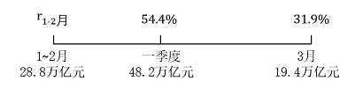

故正确答案为D。

**考点**：统计表、混合增长率

**来源**：2026年国家公务员录用考试《行测》题（副省级网友回忆版）第117题

### 第 118 题

全国2025年3月成交量超过一季度月均成交量的期货交易所有几个？

A. 5

B. 4

C. 3

D. 2

第 118 题 · 答案与解析

**参考答案（粉笔题库参考内容）**

A

**解析**

根据题干“全国2025年3月······超过一季度月均······”，结合材料时间为2025年3月和一季度，可判定本题为现期平均数问题。定位表格材料可得2025年3月和一季度各期货交易所成交量。3月成交量超过一季度月均成交量，即3月＞ 一季度/3，整理为3月×3>一季度，即可满足条件。分别验证如下：

上海期货交易所，193.3×3>190×3=570>493.5百万手，满足；

上海国际能源交易中心，15.0×3=45>39.0百万手，满足；

郑州商品交易所，253.4×3>250×3=750>633.2百万手，满足；

中国金融期货交易所，26.2×3>25×3=75>72.7百万手，满足；

大连商品交易所，234.7×3>200×3=600>573.1百万手，满足；

广州期货交易所，11.9×3<12×3=36<38.2百万手，不满足。

综上，2025年3月成交量超过一季度月均成交量的期货交易所有上海期货交易所、上海国际能源交易中心、郑州商品交易所、中国金融期货交易所、大连商品交易所，共5个。

故正确答案为A。

**考点**：统计表、现期平均数

**来源**：2026年国家公务员录用考试《行测》题（副省级网友回忆版）第118题

### 第 119 题

2024年一季度，郑州商品交易所成交量比大连商品交易所：

A. 多不到0.5亿手

B. 少不到0.5亿手

C. 多0.5亿手以上

D. 少0.5亿手以上

第 119 题 · 答案与解析

**参考答案（粉笔题库参考内容）**

B

**解析**

根据题干“2024年一季度······比······”，结合材料时间为2025年一季度，且选项为“多/少+单位”，可判定本题为基期和差问题。定位统计表可得：2025年一季度，郑州商品交易所成交量为633.2百万手，同比增速为28.9%；大连商品交易所成交量为573.1百万手，同比增速为12.7%。根据公式：基期量=现期量/(1+增长率)，则题目所求= 633.2/(1+28.9%) − 573.1/(1+12.7%)≈633.2/1.3−573.1/1.1≈ 487 − 521 = −34百万手=-0.34亿手，即少0.34亿手，在B项范围内。

故正确答案为B。

**考点**：基期和差、统计表

**来源**：2026年国家公务员录用考试《行测》题（副省级网友回忆版）第119题

### 第 120 题

全国期货交易所中，2025年3月平均每手成交额同比增幅和同比降幅最大的分别是：

A. 中国金融期货交易所，广州期货交易所

B. 中国金融期货交易所，上海国际能源交易中心

C. 上海期货交易所，广州期货交易所

D. 上海期货交易所，上海国际能源交易中心

第 120 题 · 答案与解析

**参考答案（粉笔题库参考内容）**

C

**解析**

根据题干“2025年3月平均······同比增幅和同比降幅最大的分别是”，可判定本题为平均数的增长率问题。定位统计表可知2025年3月全国各期货交易所的成交数量同比增速（b）及成交金额同比增速（a），根据公式：平均数的增长率= (a-b)/(1+b)，计算比较选项各期货交易所相关增幅与降幅即可。

中国金融期货交易所同比增幅：(44.7%−33.2%)/(1+33.2%)=11.5%/1.332；上海期货交易所同比增幅：(31.9%−12.9%)/(1+12.9%)=19%/1.129，后者较前者分子大分母小，增幅更大，排除A、B两项；

广州期货交易所同比降幅：abs((−58.8% − (−24.5%))/(1 + (−24.5%)))=34.3%/0.755＞34.3%；上海国际能源交易中心同比降幅：abs[(-5.0%-31.3%)/(1+31.3%)]= 36.3%/1.313 ＜ 30%，前者降幅大于后者，可排除D项。

故正确答案为C。

**考点**：统计表、平均数的增长率

**来源**：2026年国家公务员录用考试《行测》题（副省级网友回忆版）第120题

## 材料 4

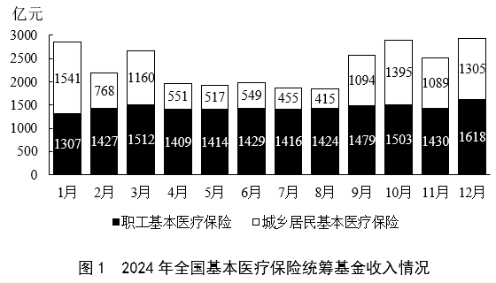

### 第 121 题

2024年，全国基本医疗保险统筹基金支出金额超过收入金额的月份有几个？

A. 4

B. 5

C. 6

D. 7

第 121 题 · 答案与解析

**参考答案（粉笔题库参考内容）**

B

**解析**

根据题干“2024年，全国基本医疗保险······支出金额超过收入金额的月份有几个”，结合材料全国基本医疗保险=职工基本医疗保险+城乡居民基本医疗保险，定位统计图1和图2可知2024年各月职工基本医疗保险和城乡居民基本医疗保险情况。故各月基金支出和基金收入情况如下：

1月：全国基金支出=749+908=1600^+亿元；全国基金收入=1541+1307=2800^+亿元。基金支出＜基金收入，不符合；

2月：全国基金支出= 688 + 787 = 1400^+亿元；全国基金收入= 768+1427 = 2100^+亿元。基金支出＜基金收入，不符合；

3月：全国基金支出= 888 + 968 = 1800^+亿元；全国基金收入=1160+1512=2600^+亿元。基金支出＜基金收入，不符合；

4月：全国基金支出= 979 + 1202 = 2100^+亿元；全国基金收入= 551 + 1409 = 1900^+亿元。基金支出＞基金收入，符合；

5月：全国基金支出= 981 + 1177 = 2100^+亿元；全国基金收入=517+1414=1900^+亿元。基金支出＞基金收入，符合；

6月：全国基金支出= 1087 + 1321 = 2400^+亿元；全国基金收入= 549 + 1429 = 1900^+亿元。基金支出＞基金收入，符合；

7月：全国基金支出= 920 + 1174 = 2000^+亿元；全国基金收入= 455 + 1416 = 1800^+亿元。基金支出＞基金收入，符合；

8月：全国基金支出=804+1082=1886亿元；全国基金收入=415+1424=1839亿元。基金支出＞基金收入，符合；

9月：全国基金支出= 810+1054 = 1800^+亿元；全国基金收入= 1094 + 1479 = 2500^+亿元。基金支出＜基金收入，不符合；

10月：全国基金支出= 560 + 1026 = 1500^+亿元；全国基金收入= 1395 + 1503 = 2800^+亿元。基金支出＜基金收入，不符合；

11月：全国基金支出= 775 + 1052 = 1800^+亿元；全国基金收入=1089+1430=2500^+亿元。基金支出＜基金收入，不符合；

12月：全国基金支出=1378+1453=2800+亿元；全国基金收入=1305+1618=2900^+亿元。基金支出＜基金收入，不符合。

综上，2024年全国基本医疗保险统筹基金支出金额超过收入金额的月份有4月、5月、6月、7月、8月，共5个。

故正确答案为B。

**考点**：统计图、简单加减计算

**来源**：2026年国家公务员录用考试《行测》题（副省级网友回忆版）第121题

### 第 122 题

2024年，全国基本医疗保险统筹基金累计收入第一次超过1.5万亿元是在几月？

A. 5月

B. 6月

C. 7月

D. 8月

第 122 题 · 答案与解析

**参考答案（粉笔题库参考内容）**

C

**解析**

定位图1可知2024年全国基本医疗保险统筹基金每月收入情况。则2024年1-5月累计收入为1541+1307+768+1427+1160+1512+551+1409+517+1414≈ 1540+1310+770+1430+1160+1510+550+1410+520+1410= 11610亿元；1-6月累计收入约为11610 + 549 + 1429≈ 11610 + 550 + 1430=13590亿元；1-7月累计收入约为13590+455+1416≈13590+460+1420= 15470亿元=1.5+万亿元，第一次超过1.5万亿元。

故正确答案为C。

**考点**：统计图、简单加减计算

**来源**：2026年国家公务员录用考试《行测》题（副省级网友回忆版）第122题

### 第 123 题

2024年，全国城乡居民基本医疗保险统筹基金收入最高的季度是：

A. 一季度

B. 二季度

C. 三季度

D. 四季度

第 123 题 · 答案与解析

**参考答案（粉笔题库参考内容）**

D

**解析**

定位统计图1可得2024年各月全国城乡居民基本医疗保险统筹基金收入，则2024年各季度全国城乡居民基本医疗保险统筹基金收入分别为：

一季度，1541 + 768 + 1160 ≈ 1540 + 770 + 1160 = 3470亿元；

二季度，551+517+549≈550+520+550=1620亿元；

三季度，455 + 415 + 1094 ≈ 460 + 420 + 1090 = 1970亿元；

四季度，1395+1089+1305≈1400+1090+1310=3800亿元。

综上，2024年全国城乡居民基本医疗保险统筹基金收入最高的季度是四季度。

故正确答案为D。

**考点**：统计图、简单加减计算

**来源**：2026年国家公务员录用考试《行测》题（副省级网友回忆版）第123题

### 第 124 题

2024年，职工基本医疗保险统筹基金支出占全国基本医疗保险统筹基金支出比重最大的月份，当月职工基本医疗保险支出比上月：

A. 增加了5%以上

B. 减少了5%以上

C. 增加了不到5%

D. 减少了不到5%

第 124 题 · 答案与解析

**参考答案（粉笔题库参考内容）**

D

**解析**

根据题干“2024年······比上月”，结合选项为增加/减少+百分数，可判定本题为一般增长率问题。定位统计图2可知2024年1-12月全国职工及城乡居民基本医疗保险统筹基金支出。根据公式：比重=部分/整体，及全国基本医疗保险统筹基金支出=职工基本医疗保险统筹基金支出+城乡居民基本医疗保险统筹基金支出。代入数据可知各月职工基本医疗保险统筹基金支出占全国基本医疗保险统筹基金支出比重分别为：1月，908/(908 + 749) ≈ 908/1700 = 50%^+；2月，787/(787+688) ≈ 787/1500 = 50%^+；3月，968/(968 + 888) ≈ 968/1900 = 50%^+；4月，1202/(1202 + 979) ≈ 1202/2200 = (50%)^+；5月，1177/(1177 + 981) ≈ 1177/2200 = 50%^+；6月，=1321/(1321+1087)≈1321/2400=50%^+；7月，1174/(1174+920) ≈ 1174/2100 = 50%^+；8月，1082/(1082+804) ≈ 1082/1900 = 50%^+，9月，1054/(1054+810)≈1054/1900=50%^+；10月，1026/(1026 + 560) ≈ 1026/1600 = 60%^+；11月，1052/(1052 + 775) ≈ 1052/1800 = 50%^+；12月，1453/(1453 + 1378) ≈ 1453/2800 = 50%^+。比较可知，比重最大的月份为10月。根据公式：增长率= (现期量 − 基期量)/基期量，则10月职工基本医疗保险支出环比增长率为(1026-1054)/1054≈−28/1100≈−2.5%，即比上月减少了不到5%。

故正确答案为D。

**考点**：一般增长率、统计图

**来源**：2026年国家公务员录用考试《行测》题（副省级网友回忆版）第124题

### 第 125 题

以下柱状图反映了2024年9～12月，全国基本医疗保险统筹基金哪一指标的环比增量变化情况（横轴位置表示增量为0）？

A. 职工基本医疗保险统筹基金收入

B. 职工基本医疗保险统筹基金支出

C. 城乡居民基本医疗保险统筹基金收入

D. 城乡居民基本医疗保险统筹基金支出

第 125 题 · 答案与解析

**参考答案（粉笔题库参考内容）**

C

**解析**

根据题干“······环比增量变化情况······”，可判定本题为增长量比较问题。定位统计图可得2024年8-12月全国基本医疗保险统筹基金的收支情况。根据公式：增长量=现期量-基期量，可得选项中各指标环比增量如下：

A项，职工基本医疗保险统筹基金收入2024年9月环比增量=1479-1424=55亿元，10月环比增量=1503-1479=24亿元，11月环比增量=1430-1503=-73亿元，由于|11月环比增量|>|9月环比增量|，而柱状图（横轴位置代表增量为0）中第三个月柱体长度<第一个月柱体长度，不符合柱状图变化趋势，排除；

B项，职工基本医疗保险统筹基金支出2024年9月环比增量=1054-1082<0，而柱状图中第一个月的环比增量>0，不符合柱状图变化趋势，排除；

C项，城乡居民基本医疗保险统筹基金收入2024年9月环比增量=1094-415=679亿元，10月环比增量=1395-1094=301亿元，11月环比增量=1089-1395=-306亿元，12月环比增量=1305-1089=216亿元，符合柱状图变化趋势，当选；

D项，城乡居民基本医疗保险统筹基金支出2024年9月环比增量=810-804=6亿元，10月环比增量=560-810=-250亿元，而柱状图中第二个月的环比增量>0，不符合柱状图变化趋势，排除。

故正确答案为C。

**考点**：增长量比较、统计图

**来源**：2026年国家公务员录用考试《行测》题（副省级网友回忆版）第125题

## 材料 5

绿证是对可再生能源绿色电力颁发的具有独特标识代码的电子证书，1个绿证单位对应1000千瓦时可再生能源电量。2024年全国核发绿证47.34亿个，其中可交易绿证31.58亿个。截至2024年12月底全国累计核发绿证49.55亿个，其中可交易绿证33.79亿个。

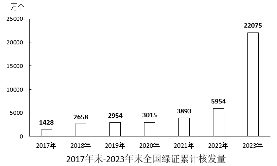

| | | | | | | | |
| --- | ---: | --- | ---: | --- | ---: | --- | ---: |
| 北京 | 377 | 上海 | 1570 | 湖北 | 21445 | 云南 | 74104 |
| 天津 | 1759 | 江苏 | 18307 | 湖南 | 10580 | 西藏 | 488 |
| 河北 | 20417 | 浙江 | 5636 | 广东 | 14836 | 陕西 | 6174 |
| 山西 | 13589 | 安徽 | 9854 | 广西 | 11260 | 甘肃 | 20773 |
| 内蒙古 | 39461 | 福建 | 13424 | 海南 | 1469 | 青海 | 21553 |
| 辽宁 | 10706 | 江西 | 7397 | 重庆 | 5677 | 宁夏 | 11906 |
| 吉林 | 7633 | 山东 | 19786 | 四川 | 37239 | 新疆 | 27483 |
| 黑龙江 | 10387 | 河南 | 14533 | 贵州 | 13590 |  |  |

2024年，全国集中式项目核发绿证46.77亿个。按项目类型划分，风电19.07亿个，常规水电15.78亿个，太阳能发电8.03亿个，生物质发电3.81亿个，风光一体化项目755万个，地热能发电52万个，海洋能发电1.1万个。2024年全国分布式项目核发绿证5695万个，同比增长27.8倍。其中，分散式风电核发绿证3364万个，分布式光伏核发绿证2331万个。

### 第 126 题

2024年，全国核发的不可交易绿证对应约多少万亿千瓦时可再生能源电量？

A. 1.6

B. 3.2

C. 7.9

D. 15.8

第 126 题 · 答案与解析

**参考答案（粉笔题库参考内容）**

A

**解析**

定位文字材料第一段可得：2024年全国核发绿证47.34亿个，其中可交易绿证31.58亿个。故2024年全国核发的不可交易绿证47.34-31.58=15.76亿个，结合文字材料第一段中的“1个绿证单位对应1000千瓦时可再生能源电量”，则题干所求为(15.76 × 1000)/10000 = 1.576万亿千瓦时，与A项最接近。

故正确答案为A。

**考点**：综合资料、简单加减计算

**来源**：2026年国家公务员录用考试《行测》题（副省级网友回忆版）第126题

### 第 127 题

2023年，全国核发绿证数量约是2022年的多少倍？

A. 3.7

B. 5.1

C. 6.3

D. 7.8

第 127 题 · 答案与解析

**参考答案（粉笔题库参考内容）**

D

**解析**

根据题干“2023年······约是2022年的多少倍”，结合材料给出2022年、2023年全国绿证累计核发量，可判定本题为现期倍数问题。定位统计图可得，2021-2023年末全国绿证累计核发量分别为3893万个、5954万个、22075万个。则2023年全国核发绿证数量=22075-5954=16121万个，2022年全国核发绿证数量=5954-3893=2061万个。则所求倍数=16121/2061≈8倍，与D项最接近。

故正确答案为D。

**考点**：现期倍数、综合资料

**来源**：2026年国家公务员录用考试《行测》题（副省级网友回忆版）第127题

### 第 128 题

2024年绿证核发量最多的5个省级行政区，绿证核发量约占全国总量的：

A. 38%

B. 42%

C. 46%

D. 50%

第 128 题 · 答案与解析

**参考答案（粉笔题库参考内容）**

B

**解析**

根据题干“2024年······约占全国总量的”，结合材料时间为2024年，可判定本题为现期比重问题。定位文字材料第一段可得：2024年全国核发绿证47.34亿个；定位统计表可得：2024年绿证核发量最多的5个省级行政区是云南（74104万个）、内蒙古（39461万个）、四川（37239万个）、新疆（27483万个）、青海（21553万个）。根据公式：比重=部分/整体，可得题干所求为(74104+39461+37239+27483+21553)万/47.34亿≈ (7.4 + 3.9 + 3.7 + 2.7 + 2.2)/47 = 19.9/47 ≈ 42%。

故正确答案为B。

**考点**：现期比重、综合资料

**来源**：2026年国家公务员录用考试《行测》题（副省级网友回忆版）第128题

### 第 129 题

2024年，全国集中式风电项目核发绿证数量占当年集中式项目核发绿证数量的比重比太阳能发电项目的占比高约多少个百分点？

A. 16

B. 20

C. 24

D. 28

第 129 题 · 答案与解析

**参考答案（粉笔题库参考内容）**

C

**解析**

根据题干“2024年，······占······的比重比······的占比高约多少个百分点”，结合材料时间为2024年，可判定本题为现期比重问题。定位文字材料第二段可得：2024年，全国集中式项目核发绿证46.77亿个。按项目类型划分，风电19.07亿个、太阳能发电8.03亿个。根据公式：比重=部分/整体，则题干所求为19.07/46.77 − 8.03/46.77 ≈ 11.04/47 ≈ 23%，即高约23个百分点，与C项最接近。

故正确答案为C。

**考点**：现期比重、综合资料

**来源**：2026年国家公务员录用考试《行测》题（副省级网友回忆版）第129题

### 第 130 题

能够从上述资料中推出的是：

A. 2019年，全国绿证核发量多于2018年

B. 截至2023年底，全国累计核发绿证中，可交易绿证的占比不到1%

C. 2024年，全国常规水电核发绿证不到集中式项目核发绿证总数量的三分之一

D. 2024年，湖北、湖南核发绿证之和占全国比重比广东、广西之和高1个百分点以上

第 130 题 · 答案与解析

**参考答案（粉笔题库参考内容）**

D

**解析**

A项：定位统计图可知，2017年末-2019年末全国绿证累计核发量分别为1428万个、2658万个、2954万个。则2019年全国绿证核发量为2954-2658=296万个，2018年全国绿证核发量为2658-1428=1230万个，2019年全国绿证核发量少于2018年，错误；

B项：定位文字材料第一段可知，2024年全国核发绿证47.34亿个，其中可交易绿证31.58亿个。截至2024年12月底全国累计核发绿证49.55亿个，其中可交易绿证33.79亿个。则截至2023年底，全国累计核发绿证49.55-47.34=2.21亿个，可交易绿证33.79-31.58=2.21亿个。根据公式：比重=部分/整体，则截至2023年底全国累计核发绿证中，可交易绿证的占比为2.21/2.21 ＞ 1%，错误；

C项：定位文字材料第二段可知，2024年，全国集中式项目核发绿证46.77亿个，常规水电15.78亿个。根据公式：比重=部分/整体，则2024年全国常规水电核发绿证数量占集中式项目核发绿证总数量的比重为15.78/46.77 ＞ 1/3，即超过三分之一，错误；

D项：定位文字材料第一段可知，2024年全国核发绿证47.34亿个；定位统计表可知，2024年湖北、湖南、广东、广西分别核发绿证21445万个、10580万个、14836万个、11260万个。根据公式：比重=部分/整体，则2024年湖北、湖南核发绿证之和占全国比重比广东、广西之和高(21445万+10580万)/47.34亿−(14836万+11260万)/47.34亿= (32025万 − 26096万)/47.34亿 ≈ 0.5929亿/47亿 ＞ 1%，即高1个百分点以上，正确。

故正确答案为D。

**考点**：综合分析、综合资料

**来源**：2026年国家公务员录用考试《行测》题（副省级网友回忆版）第130题

## 材料 6

2024年，我国对联合国定义的45个最不发达国家（以下简称最不发达国家）进出口14230.2亿元人民币，占同期我国外贸进出口总值的3.2%。其中出口8664.6亿元，同比（下同）增长4.3%；进口5565.5亿元，增长12.8%。

2024年，我国对最不发达国家出口机电产品3942.2亿元，增长13.5%。其中出口船舶690.8亿元，增长65.9%，主要出口至全球第一大船旗国利比里亚。出口金额654.3亿元，增长67%；出口工程机械、火车分别为165.3亿元、91.6亿元，分别增长28.9%、39.5%；出口劳动密集型产品2481亿元，增长3.7%，其中纺织品1623.5亿元，增长15.3%。

2024年，我国自最不发达国家进口铜材、原油、金属矿砂分别为1469.6亿元、1364.2亿元、1221亿元。最不发达国家成为我国钢材、铝矿、锡矿、钨矿、钛矿第一大进口来源地，分别占我国同类商品进口总值的38.2%，73.1%，65.4%，57.7%，58.1%。

2024年12月1日起，我国给予所有已建交的最不发达国家100%税目产品零关税待遇。12月，我国自最不发达国家进口512.7亿元，增长18.1%，其中自刚果民主共和国、几内亚、老挝、赞比亚分别进口156.3亿元，54.7亿元，35.6亿元，33.9亿元，分别增长84.6%，40.3%，25.7%、127.27%。

### 第 131 题

2024年，我国外贸进出口总值在以下哪个范围内？

A. 不到44万亿元

B. 44万亿元~45万亿元之间

C. 45万亿元~46万亿元之间

D. 超过46万亿元

第 131 题 · 答案与解析

**参考答案（粉笔题库参考内容）**

B

**解析**

根据题干“2024年······外贸进出口总值······”，结合材料给出2024年我国对联合国定义的45个最不发达国家进出口总值及其占同期我国外贸进出口总值的比重，可判定本题为现期比重问题。定位文字材料第一段可得：2024年，我国对联合国定义的45个最不发达国家进出口14230.2亿元人民币，占同期我国外贸进出口总值的3.2%。根据公式：整体=部分/比重，可得所求= (14230.2 × 10^-4)/3.2%= 142.302/3.2 ≈ 44.5万亿元，在B项范围内。

故正确答案为B。

**考点**：现期比重、文字资料

**来源**：2026年国家公务员录用考试《行测》题（副省级网友回忆版）第131题

### 第 132 题

2024年，我国对最不发达国家进出口总值同比增速约为：

A. 9.5%

B. 8.5%

C. 7.5%

D. 10.5%

第 132 题 · 答案与解析

**参考答案（粉笔题库参考内容）**

C

**解析**

根据题干“2024年······同比增速约为”，结合材料给出2024年我国对最不发达国家进口、出口总值及同比增速，且进口总值+出口总值=进出口总值，可判定本题为混合增长率问题。定位文字材料第一段可得：2024年，我国对最不发达国家出口8664.6亿元，同比（下同）增长4.3%；进口5565.5亿元，增长12.8%。根据混合增长率口诀“混合居中不正中，偏向基期量大的一方（一般用现期量代替基期量）”可知，4.3% ＜ r进出口 ＜ (12.8%+4.3%)/2 = 8.55%，排除A、D两项。根据线段法“距离与量成反比（一般用现期量代替基期量）”可知，(12.8% − r_进出口)/(r_进出口 − 4.3%) = 8664.6/5565.5，解得r进出口 ≈ 7.6%，与C项最接近。

故正确答案为C。

**考点**：文字资料、混合增长率

**来源**：2026年国家公务员录用考试《行测》题（副省级网友回忆版）第132题

### 第 133 题

下列饼状图，最能准确反映2024年我国自最不发达国家进口值中，铜材（黑色），原油（横线），金属矿砂（白色）和其他（竖线）进口值占比关系的是：

A. 

B. 

C. 

D. 

第 133 题 · 答案与解析

**参考答案（粉笔题库参考内容）**

B

**解析**

根据题干“下列饼状图，最能准确反映2024年······占比关系的是”，结合材料时间为2024年，可判定本题为现期比重问题。定位文字材料第一段可得：2024年，我国······进口5565.5亿元；定位文字材料第三段可得：2024年，我国自最不发达国家进口铜材、原油、金属矿砂分别为1469.6亿元、1364.2亿元、1221亿元。观察发现，铜材进口值>原油进口值，排除A、C项。根据公式：比重=部分/整体，则2024年铜材进口值占进口值的比重= 1469.6/5565.5 ＞ 1400/5600 = 1/4，排除D项。

故正确答案为B。

**考点**：现期比重、文字资料

**来源**：2026年国家公务员录用考试《行测》题（副省级网友回忆版）第133题

### 第 134 题

2023年1~11月，我国对最不发达国家月均进口值约为多少亿元？

A. 395

B. 409

C. 468

D. 502

第 134 题 · 答案与解析

**参考答案（粉笔题库参考内容）**

B

**解析**

根据题干“2023年1~11月······月均进口值约为多少亿元”，结合材料时间为2024年，可判定本题为基期平均数问题。定位文字材料第一段可得：2024年，我国对最不发达国家进口5565.5亿元，增长12.8%；定位文字材料第四段可得：2024年12月，我国自最不发达国家进口512.7亿元，增长18.1%。根据公式：基期量= 现期量/(1 + r)，可得2023年1-11月我国对最不发达国家进口值为5565.5/(1+12.8%)−512.7/(1+18.1%)≈ 5565.5/1.13 − 512.7/1.18≈4925−434=4491亿元，则2023年1~11月我国对最不发达国家月均进口值为4491/11≈408亿元，与B项最接近。

故正确答案为B。

**考点**：基期平均数、文字资料

**来源**：2026年国家公务员录用考试《行测》题（副省级网友回忆版）第134题

### 第 135 题

关于2024年我国进出口情况，能根据上述资料推出的是：

A. 铜材进口总值不到3000亿元

B. 我国对最不发达国家火车出口值同比增量高于对其工程机械出口值同比增量

C. 劳动密集型产品出口值占我国最不发达国家出口总值的比重高于上年水平

D. 12月自刚果民主共和国、几内亚、老挝、赞比亚的进口总值超过当月我国自最不发达国家进口总值的一半

第 135 题 · 答案与解析

**参考答案（粉笔题库参考内容）**

D

**解析**

A项：定位文字材料第三段可得：2024年，我国自最不发达国家进口铜材1469.6亿元。但材料未给出我国进口铜材的具体值，无法计算，错误；

B项：定位文字材料第二段可得：2024年，我国对最不发达国家出口工程机械、火车分别为165.3亿元、91.6亿元，分别增长28.9%、39.5%。根据公式：增长量=现期量/(1+r)×r，可得2024年我国对最不发达国家出口工程机械同比增量=165.3/(1+28.9%)×28.9%≈165.3/(1+1/3.5)×1/3.5=165.3/4.5≈37亿元，对最不发达国家出口火车同比增量= 91.6/(1+39.5%) × 39.5% ≈ 91.6/(1+1/2.5) × 1/2.5 = 91.6/3.5 ≈ 26亿元，则2024年我国对最不发达国家火车出口值同比增量（26亿元）低于对其工程机械出口值同比增量（37亿元），错误；

C项：定位文字材料第一段可得：2024年，我国对最不发达国家出口总值为8664.6亿元，同比增长4.3%（b）；定位文字材料第二段可得：2024年，我国对最不发达国家出口劳动密集型产品2481亿元，增长3.7%（a）。根据两期比重结论：a>b，比重上升。由于a（3.7%）<b（4.3%），故比重低于上年水平，错误；

D项：定位文字材料最后一段可得：2024年12月，我国自最不发达国家进口512.7亿元，其中自刚果民主共和国、几内亚、老挝、赞比亚分别进口156.3亿元，54.7亿元，35.6亿元，33.9亿元。根据公式：比重=部分/整体，可得所求=(156.3+54.7+35.6+33.9)/512.7=280.5/512.7＞50%，即占比超过一半，正确。

故正确答案为D。

**考点**：综合分析、文字资料

**来源**：2026年国家公务员录用考试《行测》题（副省级网友回忆版）第135题

