# 2026年国家公务员录用考试《行测》题（地市级网友回忆版）

> 候选采集稿。参考答案及解析来自粉笔页面，不代表官方答案或真实高分答卷；来源使用许可与原卷对应关系仍需人工核实。

## 题型与作答说明

政治理论

（20题）

根据题目要求，在四个选项中选出一个最恰当的答案。

常识判断

（15题）

根据题目要求，在四个选项中选出一个最恰当的答案。

言语理解与表达

（30题）

本部分包括表达与理解两方面的内容。请根据题目要求，在四个选项中选出一个最恰当的答案。

数量关系

（10题）

在这部分试题中，每道题呈现一段表述数字关系的文字，要求你迅速、准确地计算出答案。

判断推理

（35题）

本部分包括图形推理、定义判断、类比推理与逻辑判断四种类型的试题，在四个选项中选出一个最恰当的答案。

资料分析

（20题）

所给出的图、表、文字或综合性资料均有若干个问题要你回答。你应根据资料提供的信息进行分析、比较、计算和判断处理。

## 给定材料

### 材料 dom-material-49bd64f09381c3b1

为倡导团结合作精神，某单位举办了若干项目的双打比赛。该单位后勤部由王、吴、韩和宋4人组成网球、乒乓球和羽毛球3支双打队伍参赛，每支队伍由其中2人组成，4人均至少参加了其中的一支队伍。已知：

（1）王和韩没有参加同一个项目；

（2）若韩参加羽毛球项目，则宋参加网球项目；

（3）若王参加乒乓球项目，则吴参加网球项目，若王不参加乒乓球项目，则吴也不参加网球项目。

### 材料 dom-material-c910f6ceb42c6fdc

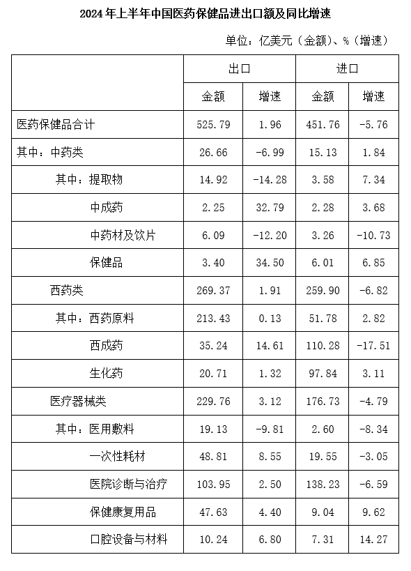

### 材料 dom-material-de8f8bf220986e52

绿证是对可再生能源绿色电力颁发的具有独特标识代码的电子证书，1个绿证单位对应1000千瓦时可再生能源电量。2024年全国核发绿证47.34亿个，其中可交易绿证31.58亿个。截至2024年12月底全国累计核发绿证49.55亿个，其中可交易绿证33.79亿个。

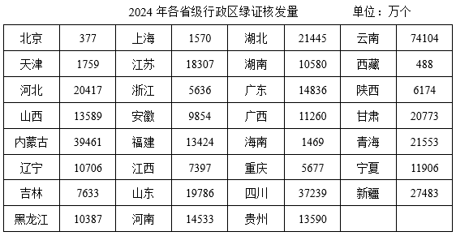

2024年，全国集中式项目核发绿证46.77亿个。按项目类型划分，风电19.07亿个，常规水电15.78亿个，太阳能发电8.03亿个，生物质发电3.81亿个，风光一体化项目755万个，地热能发电52万个，海洋能发电1.1万个。2024年全国分布式项目核发绿证5695万个，同比增长27.8倍。其中，分散式风电核发绿证3364万个，分布式光伏核发绿证2331万个。

### 材料 dom-material-3d692cafc345a992

科幻产业包括科幻阅读、科幻影视、科幻游戏、科幻衍生品、科幻文旅五大领域。2024年，我国科幻产业总营收1089.6亿元。

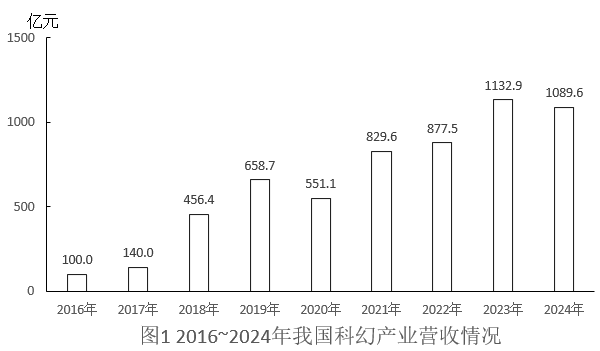

### 材料 dom-material-1deb3757c0f1675e

2024年，我国对联合国定义的45个最不发达国家（以下简称最不发达国家）进出口14230.2亿元人民币，占同期我国外贸进出口总值的3.2%。其中出口8664.6亿元，同比（下同）增长4.3%；进口5565.5亿元，增长12.8%。

2024年，我国对最不发达国家出口机电产品3942.2亿元，增长13.5%。其中出口船舶690.8亿元，增长65.9%，主要出口至全球第一大船旗国利比里亚。出口金额654.3亿元，增长67%；出口工程机械、火车分别为165.3亿元、91.6亿元，分别增长28.9%、39.5%；出口劳动密集型产品2481亿元，增长3.7%，其中纺织品1623.5亿元，增长15.3%。

2024年，我国自最不发达国家进口铜材、原油、金属矿砂分别为1469.6亿元、1364.2亿元、1221亿元。最不发达国家成为我国钢材、铝矿、锡矿、钨矿、钛矿第一大进口来源地，分别占我国同类商品进口总值的38.2%，73.1%，65.4%，57.7%，58.1%。

2024年12月1日起，我国给予所有已建交的最不发达国家100%税目产品零关税待遇。12月，我国自最不发达国家进口512.7亿元，增长18.1%，其中自刚果民主共和国、几内亚、老挝、赞比亚分别进口156.3亿元，54.7亿元，35.6亿元，33.9亿元，分别增长84.6%，40.3%，25.7%、127.27%。

## 题目

### 第 1 题

习近平总书记强调，必须坚持自信自立。中国人民和中华民族从近代以后的深重苦难走向伟大复兴的光明前景，从来就没有教科书，更没有现成答案。关于坚持自信自立，下列表述正确的有几项？

①走自己的路，是党的全部理论和实践立足点，更是党百年奋斗得出的历史结论

②推进中国式现代化，必须坚持把国家和民族发展放在自己力量的基点上

③中国式现代化既要物质财富极大丰富，也要精神财富极大丰富、在思想文化上自信自强

④独立自主是中华民族的优良传统，是中国共产党、中华人民共和国立党立国的重要原则

A. 1项

B. 2项

C. 3项

D. 4项

### 第 2 题

习近平总书记强调，科学制定和接续实施五年规划，是我们党治国理政一条重要经验，也是中国特色社会主义一个重要政治优势。关于五年规划编制工作，下列说法正确的是：

A. 我国五年规划（计划）编制工作起始于1949年，有力推动了经济社会发展、综合国力提升、人民生活改善

B. 中长期发展规划有助于充分发挥政府在资源配置中的决定性作用，彰显了政府对经济社会发展的宏观调控能力

C. 从第一个五年计划到当前的五年规划，一以贯之的主题是把我国建设成为社会主义现代化国家

D. 通过互联网就“十五五”规划编制向全社会征求意见和建议，在我国五年规划编制史上是第一次

### 第 3 题

建设文化强国，事关中国式现代化建设全局，事关中华民族复兴大业，事关提升国际竞争力，锚定2035年建成社会主义文化强国的战略目标，必须始终坚持文化建设着眼于人、落脚于人。下列有关说法正确的是：

①文化强国之“强”最终要体现在为人民提供文化服务和文化产品的能力上

②坚持以人民为中心，着眼满足人民群众多样化、多层次、多方面的精神文化需求

③文化创造核心在人，要建设一支规模宏大、结构合理、锐意创新的高水平文化人才队伍

④尊重人才成长规律，完善符合文化领域特点的人才选拔、培养、使用、激励机制，营造识才、重才、爱才的良好政策环境

A. ①②③

B. ②③④

C. ①②④

D. ①③④

### 第 4 题

中共中央、国务院印发《加快建设农业强国规划（2024-2035年）》，提出面对新形势新要求，必须把加快建设农业强国作为统领“三农”工作的战略总纲，摆上建设社会主义现代化强国的重要位置，下列与加快建设农业强国有关的说法正确的是：

A. 推进生态综合补偿，健全横向生态保护补偿机制，统筹推进生态环境损害赔偿

B. 建立健全长江流域信息共享系统，推进长江流域农业深度节水控水

C. 完善粮食产销奖补制度，中央预算内投资向粮食主销区倾斜

D. 推进农业科技推广体系，从经营性向公益性转变

### 第 5 题

全面推进依法治国是一个系统工程，必须坚持法治国家、法治政府、法治社会一体建设。下列相关表述不准确的是：

A. 法治社会是构筑法治国家、法治政府的基础

B. 建设法治政府对建设法治社会具有重要引领和带动作用

C. 法治政府、法治社会建设必须服从、服务于法治国家建设

D. 法治国家是依法治国的主体，是法治社会建设的先导和示范

### 第 6 题

2025年7月，习近平总书记在中央城市工作会议上发表重要讲话，明确做好城市工作的总体要求、重要原则、重点任务，为做好新时代新征程的城市工作提供了根本遵循。关于城市工作，下列说法正确的是：

A. 要把握“我国城镇化正从快速增长期转向稳定发展期”的历史方位

B. 城市工作重心应向更加注重建设投入转变

C. 着力通过外延扩张发展组团式的现代化城市群和都市圈

D. 城市政府应从城市事务管理的“掌舵人”转变为“划桨人”

### 第 7 题

经济工作千头万绪，必须统筹好有效市场和有为政府的关系、总供给和总需求的关系、培育新动能和更新旧动能的关系、做优增量和盘活存量的关系、提升质量和做大总量的关系。下列相关说法不准确的是：

A. 要加快推动作为经济增长和就业收入基本依托的传统产业改造升级

B. 要加快补上内需特别是消费短板，使内需成为拉动经济增长的主动力和稳定锚

C. 要坚持以量取胜、充分发挥规模效应，用好超大规模市场优势和丰富应用场景

D. 要用好各类增量资源和存量资源，通过盘活存量来带动增量

### 第 8 题

2025年7月30日，中共中央政治局召开会议，对扎实做好民生保障工作作了重要部署。下列相关表述不准确的是（ ）。

A. 巩固拓展脱贫攻坚成果，确保不发生规模性返贫致贫

B. 夯实“三农”基础，推动粮食和重要农产品价格保持在合理水平

C. 突出就业优先政策导向，促进高校毕业生、退役军人、农民工等重点群体就业

D. 始终把人民群众财产安全放在第一位，加强安全生产监管

### 第 9 题

做好新时代人口工作，要完善新时代人口发展战略，认识、适应、引领人口发展新常态，以人口高质量发展支撑中国式现代化。关于做好新时代人口工作，下列说法正确的是：

A. 要树立“大人口观”，推动人口与财政、货币、就业、产业、投资、消费、生态、区域等政策形成系统集成效应

B. 必须推动人口工作由稳定总量、畅通流动向调节数量、优化结构转变

C. 要更加重视“引导”和“激励”的办法，由社会治理向政府治理转变

D. 坚持人民主体地位，把人口高速增长同人民高品质生活紧密结合起来

### 第 10 题

《中共中央关于制定国民经济和社会发展第十五个五年规划的建议》提出，推进国家安全体系和能力现代化，建设更高水平平安中国。下列有关说法正确的是（ ）。

A. 锻造实战实用的国家安全能力，把捍卫国土安全摆在首位

B. 统筹推进房地产、地方政府债务、中小金融机构等风险有序化解

C. 健全国家安全体系，坚持以风险防控为先导、法治保障为落脚点

D. 完善公共安全体系，推动公共安全治理模式由事后处理向事中控制转型

### 第 11 题

习近平总书记高度重视战略思维，多次强调党员领导干部要加强战略思维，增强战略定力。下列体现战略思维的说法，正确的有几项？

①粮食多一点少一点是战略问题，粮食安全是战术问题

②统战工作的本质要求是大团结大联合，解决的是人心和力量问题

③要心怀“国之大者”，站在全局和战略的高度想问题、办事情，一切工作都要以贯彻落实党中央决策部署为前提

④自觉把党的对外工作放到党和国家工作大局中来认识，放到中国与世界关系的发展变化中来把握

A. 1项

B. 2项

C. 3项

D. 4项

### 第 12 题

习近平总书记指出，我们要建成的教育强国，是中国特色社会主义教育强国，应当具有强大的思政引领力、人才竞争力、科技支撑力、民生保障力、社会协同力、国际影响力，为以中国式现代化全面推进强国建设、民族复兴伟业提供有力支撑。关于建设教育强国，下列说法正确的是：

A. 要坚持教育均等化原则，把教育公平作为国家基本教育政策

B. 要完善人才培养与经济社会发展需要适配机制，顺应时代发展要求，适度增加学科专业数量

C. 要把引进全球顶尖科学家摆到更加突出位置，着力培育拔尖创新人才，推动实现高水平科技自立自强

D. 从教育大国到教育强国是一个系统性跃升和质变，必须以改革创新为动力

### 第 13 题

习近平主席在二十国集团领导人第十九次峰会上指出，要完善全球贸易治理，建设开放型世界经济。下列相关表述正确的是：

A. 要适应经济问题政治化的潮流，通过强化绿色低碳要求推行贸易保护政策

B. 要积极构建更具平等性、包容性和建设性的产业链供应链伙伴关系，呼吁各方加强合作

C. 要把安全置于国际经贸议程中心地位，持续推动贸易和投资自由化便利化

D. 要一以贯之保持世界贸易组织规则不变，提高多边贸易体制的权威性、有效性和相关性

### 第 14 题

中国式现代化要靠科技现代化作支撑，实现高质量发展要靠科技创新培育新动能。关于建成科技强国的举措，下列说法正确的是：

A. 要坚持有所为有所不为，突出经济发展需求，在重要领域实施科技战略部署

B. 要充分发挥人才在科技资源配置中的决定性作用，调动产学研各环节的积极性

C. 要充分发挥科技领军企业龙头作用，鼓励中小企业和民营企业科技创新，支持企业牵头或参与国家重大科技项目

D. 要降低基础研究组织化程度，强化自由探索，鼓励面向重大科学问题的协同攻关

### 第 15 题

习近平总书记强调，选人用人要加强党性鉴别，注重考察干部的境界格局和忠诚度廉洁度。下列与党性相关的说法正确的是：

A. 树立和践行正确政绩观，起决定性作用的是党性

B. 强党性，就是要自觉用马克思主义思想改造客观世界

C. 党性、党风、党纪是有机整体，党性是根本，党风是保障，党纪是表现

D. 作风问题本质上是党性问题，要把作风建设摆在党性修养的首位

### 第 16 题

坚持问题导向是习近平新时代中国特色社会主义思想的世界观和方法论的重要内容。关于坚持问题导向，下列说法不准确的是：

A. 坚持问题导向是马克思主义的鲜明特点

B. 坚持问题导向要抓住人民最关心最直接最现实的利益问题

C. 坚持问题导向体现了矛盾的普遍性和客观性

D. 坚持问题导向本质是变与不变、继承与发展的辩证统一

### 第 17 题

恩格斯深刻指出：“马克思的整个世界观不是教义，而是方法。它提供的不是现成的教条，而是进一步研究的出发点和供这种研究使用的方法。”下列有关马克思主义理论的说法不准确的是：

A. 马克思创立了辩证法，成为我们认识世界和改造世界的根本方法

B. 科学社会主义的原则不能丢，但科学社会主义也绝不是一成不变的教条

C. 当代中国的伟大社会变革不是简单套用马克思主义经典作家设想的模板

D. 《共产党宣言》发表至今，人类社会发生了翻天覆地的变化，但马克思主义所阐述的一般原理整个来说仍然是完全正确的

### 第 18 题

以实践为基础，从整体上把握人与世界的关系，是马克思主义世界观的重要内容。关于马克思主义实践观，下列说法正确的是：

A. 正确发挥主观能动性是实践的根本途径

B. 实践的过程就是对于结果的检验和评价

C. 实践是人类生存和发展最基本的活动

D. 实践是一种无目的的适应环境的本能活动

### 第 19 题

习近平总书记在对各省区市进行深入考察调研的过程中，结合各地实际情况，对推进高质量发展作出一系列重要部署。下列对应关系正确的是：

A. 江苏——要建设国家资源型经济转型综合配套改革试验区，重点抓好能源转型、产业升级和适度多元发展

B. 山东——要发挥海洋资源丰富的得天独厚优势，经略海洋、向海图强，打造世界级海洋港口群，打造现代海洋经济发展高地

C. 云南——要把握好挑大梁的着力点，在推动科技创新和产业创新融合上打头阵

D. 贵州——聚焦实现贸易、投资、跨境资金流动、人员进出、运输来往自由便利和数据安全有序流动

### 第 20 题

2025年是中国人民抗日战争暨世界反法西斯战争胜利80周年。中国人民对战争带来的苦难有着刻骨铭心的记忆，对和平有着孜孜不倦的追求。关于中国人民抗日战争，下列表述不准确的是：

A. 中国人民抗日战争的伟大胜利，是以爱国主义为核心的民族精神的伟大胜利

B. 中国人民抗日战争的伟大胜利，第一次确立了中国在世界上的大国地位，使中国人民赢得了世界爱好和平人民的尊敬

C. 中国人民抗日战争的伟大胜利，是近代以来中国抗击外敌入侵的第一次完全胜利

D. 中国人民抗日战争的伟大胜利，为中华民族由近代以来陷入深重危机走向伟大复兴确立了历史转折点

### 第 21 题

下列情形不符合《中华人民共和国监察法》及其实施条例规定的是：

A. 再派出的监察专员王某在开展监察工作过程中，受派出他的监察机构领导

B. 公务员张某在怀孕期间因涉嫌严重职务违法被监察机关调查，经监察机关依法审批，对其采取责令候查措施

C. 办理监察事项的监察人员黄某系监察对象刘某的丈夫，黄某应自行回避

D. 监察人员李某涉嫌职务犯罪，监察机关决定对其采取15日禁闭措施

### 第 22 题

关于《中华人民共和国民营经济促进法》，下列说法错误的是：

A. 是我国第一部专门关于民营经济发展的基础性法律

B. 规定司法行政部门建立涉企行政执法诉求沟通机制

C. 规定地方各级人民政府与民营经济组织订立的合同不得变更

D. 规定向民营经济组织开放国家重大科研基础设施

### 第 23 题

根据《政务数据共享条例》，下列说法错误的是：

A. 政务数据需求部门提交的申请材料不全的，政务数据提供部门不得直接予以拒绝

B. 政府部门通过共享获得政务数据后不得擅自将获得的政务数据提供给第三方

C. 可以提供给所有政府部门共享使用的政务数据属于无条件共享类政务数据

D. 政府部门应当新建政务数据共享交换系统开展跨层级政务数据共享相关工作

### 第 24 题

下列经济目标与政策工具匹配错误的是：

A. 扩大基础设施投资规模——提高专项债发行额度

B. 降低市场主体经营成本——延续小微企业增值税减免

C. 拓宽房企的融资渠道——增加保障性住房再贷款额度

D. 缓解基层“三保”支出压力——加大中央对地方转移支付

### 第 25 题

2025年3月，中共中央办公厅、国务院办公厅印发《逐步把永久基本农田建成高标准农田实施方案》，下列有关说法正确的是：

A. 西北区要重点加强水平梯田改造建设

B. 25度以上坡耕地、沿海内陆滩涂是开展建设的重点区域

C. 高标准农田建设标准中的“两通”是指通水通路

D. 黄淮海区应该把改善田块细碎化问题作为一个工作重点

### 第 26 题

2025年自然资源部发布《新发现矿种公告》，高纯石英矿正式成为我国第174号矿种。下列与之相关的说法错误的是：

A. 高纯石英矿在分类上属于金属矿

B. 天然水晶是石英的结晶体

C. 高纯石英可用于芯片制造中的光刻环节

D. 石英砂具有耐高温的特性

### 第 27 题

下列与海洋经济有关的说法错误的是：

A. 海水中氢离子和氢氧根离子浓度高，利用海水制氢效率高

B. 现代深远海养殖平台一般设置在有较大浪流的开放性水域

C. 潮汐发电的水轮机结构要适应海水落差小、流量大的特点

D. 液化天然气运输船的液舱通常采用超低温环境储存天然气

### 第 28 题

关于诗句中涉及的气象现象，下列说法错误的是：

A. “白雪却嫌春色晚，故穿庭树作飞花”与春季较强冷空气活动有关

B. “雷车动地电火明，急雨遂作盆盎倾”多与积雨云中的电位差有关

C. “檐花穿雾凇，窗纸战风棱”的景观形成过程中包含凝华现象

D. “鸡声茅店月，人迹板桥霜”的“霜”包含在降水统计范围内

### 第 29 题

下列关于河流入海口的描述与河流对应错误的是：

A. 浑浊的河水奔流而至，汇入清澈的渤海，形成一条清晰的分界线——黄河

B. “三龙吐珠，八门入海”，生动地描绘出了它的奇特形态——淮河

C. 在入海口的潮间带上，会看到一片耀眼的红色，又被称为“红海滩”——辽河

D. 在其与东海海潮的相互激荡下，造就了我国第三大岛崇明岛——长江

### 第 30 题

下列与自然界中的颜色有关的说法错误的是：

A. “橙色月亮”通常发生在大气层中水汽或颗粒物质较多时

B. 火烈鸟羽毛呈朱红色与摄入食物中的虾青素累积有关

C. 蓝闪蝶翅膀呈蓝色是由于其表面鳞片具有特殊的微结构

D. 蓝莓呈现靛蓝色是因为表面蜡质层中含高浓度花青素

### 第 31 题

某物流公司要优化长三角到乌鲁木齐的易腐货物运输路线，下列方案最可行的是：

A. 夏季采用陇海——兰新铁路运输利用沿线低温天气自然保鲜

B. 冬季选择长江——京杭大运河——黄河水运组合避开陆路交通拥堵

C. 春秋季采用铁路冷藏集装箱运输平衡运输成本与时效性

D. 全年优先使用连霍高速公路运输以追求最低的运输成本

### 第 32 题

某款创意时钟要用不同的符号替代表盘上的数字，下列设计不合适的是：

A. 用45度角的正弦“”替代“1”

B. 用3的阶乘“3！”替代“6”

C. 用重力加速度“g”替代“10”

D. 用二进制数“”替代“12”

### 第 33 题

关于化学平衡在人类活动中的应用，下列说法错误的是：

A. 处理硬水时，可通过加入适量石灰乳作为软化剂调节水的硬度

B. 血液中浓度增加时，血液中水电离出的氢氧根离子会增多

C. 适当降低水温增大的溶解度可维持冷却水管道中的盐类平衡

D. 向含有铜离子的废水中加入适量的碱可达到净化水质的环保目的

### 第 34 题

关于医学治疗手段及其原理，下列说法正确的是：

A. 体外冲击波碎石术利用次声波可以将肾结石击碎成小块，使其随尿液排出体外

B. 免疫疗法治疗癌症，能够通过激活自身免疫系统，利用T细胞直接吞噬癌细胞

C. 血液透析依据半透膜原理，将血液中的有害物质以及多余的水分清除出体外

D. 激光治疗近视，利用激光对视网膜进行切割，改变视网膜的曲率，从而矫正视力

### 第 35 题

下列技术与其在考古领域的应用，对应错误的是：

A. 光谱分析——揭示青铜器金属元素的含量和组成

B. 中子成像技术——推断殷商青铜器铸造工艺

C. 碳14测年技术——精确判定青铜器的铸造年代

D. 3D数字建模结合X射线断层扫描——分析青铜器内部结构

### 第 36 题

2024年，我国脱贫县农民人均可支配收入增幅高于全国平均水平，脱贫人口务工就业规模保持稳中有增。2025年是巩固拓展脱贫攻坚成果同乡村振兴有效衔接5年过渡期的最后一年，越是这个时候，越要扛稳责任，            ，做好监测帮扶工作。

填入画横线部分最恰当的一项是：

A. 步步为营

B. 行稳致远

C. 慎终如始

D. 绵绵用力

### 第 37 题

在太空实验室开展的脑电测试实验中，航天员戴的“小红帽”叫作脑电帽，里面嵌入了众多微小的触头，它们像一群            的小侦探，精准捕捉大脑每一个微妙的波动。这顶帽子赋予航天员神奇的能力——无须言语，无须动作，仅仅通过思维就能给电脑下指令，操控各种设备。

填入画横线部分最恰当的一项是：

A. 未卜先知

B. 明察秋毫

C. 洞若观火

D. 随机应变

### 第 38 题

党员干部生活作风的蜕变，往往是从吃喝等看似小事的地方开始的。“堤溃蚁孔，气泄针芒”，这句古训就是强调            的重要性。习近平同志曾在《之江新语》中写道：“小事小节是一面镜子，能够反映人品，反映作风。”党员干部要严格对照中央八项规定精神，深刻认识小与大的辩证关系，主动“照镜子”自查。

填入画横线部分最恰当的一项是：

A. 防微杜渐

B. 积微成著

C. 慎小谨微

D. 曲突徙薪

### 第 39 题

通用人工智能对重大情报的挖掘和精确预测，确实能够提高情报准确性，有利于减少误判；但有时也可能会使人类盲目自信，刺激其            。通用人工智能带来的进攻优势，导致最佳防御战略就是“            ”，这会打破进攻与防御的平衡，引发新型安全困境，反而增加了战争爆发的风险。

依次填入画横线部分最恰当的一项是：

A. 孤注一掷 避实击虚

B. 轻举妄动 以攻为守

C. 刚愎自用 攻其不备

D. 铤而走险 先发制人

### 第 40 题

新史料被发掘，有赖于史家具有证据意识。若是史家不认为某个史料可以作为证据，该史料可能会被            。比如甲骨文，起初甲骨被当作龙骨入药，不被史家关注。但晚清学者王懿荣意识到龙骨非同寻常，后经考证确认甲骨文是商代文字，之后史家以此为证据重构殷商历史，为中华文明起源这一重大问题提供了        支点。

依次填入画横线部分最恰当的一项是：

A. 视而不见 稳固

B. 弃如敝屣 崭新

C. 断章取义 可靠

D. 束之高阁 坚实

### 第 41 题

利用网络存在的安全漏洞入网窃取数据信息，这种方式相当隐蔽，往往会使数据的安全响应            ；而且网络中流转数据的规模十分巨大，来源异常复杂，攻击者一旦掌握网络漏洞，入侵网络后就可以在网上“            ”，窃取数据。因此，必须严密防范数据在共享过程中可能遭受的各种攻击和泄露。

依次填入画横线部分最恰当的一项是：

A. 防不胜防 按图索骥

B. 形同虚设 守株待兔

C. 名存实亡 偷天换日

D. 鞭长莫及 瓮中捉鳖

### 第 42 题

五彩滩是一处著名的雅丹地貌景观，位于新疆维吾尔自治区，中国唯一一条注入北冰洋的河流额尔齐斯河穿其而过。南岸有绿洲、沙漠，北岸则是            的泥岩、砂岩及砂砾组成的奇石怪岩，这两种            的地貌遥相辉映，“一河隔两岸，胜似两重天”。

依次填入画横线部分最恰当的一项是：

A. 鳞次栉比 大相径庭

B. 千姿百态 别具一格

C. 色彩斑斓 截然不同

D. 绚丽多姿 各有千秋

### 第 43 题

面对新的形势和要求，必须进一步全面深化改革，继续完善各方面制度机制，因而制度建设的任务更为繁重艰巨，加强顶层设计更为重要。如果不能全景式俯瞰和把握制度建设全局，采取总体构想和战略谋划，做到胸中有数，            地层层系统设计，难免顾此失彼、            ，无法取得制度建设的成效。

依次填入画横线部分最恰当的一项是：

A. 抽丝剥茧 捉襟见肘

B. 循序渐进 进退维谷

C. 由表及里 得不偿失

D. 自上而下 左支右绌

### 第 44 题

未来特战力量可通过智能辅助，直接干扰或控制敌方指挥控制系统，造成敌方思想混乱、心理受挫甚至出现幻觉；或者通过伴随无人平台实施网络作战，篡改指控系统指令和数据实现“            ”，致使敌方指挥失灵、协同失效、人员失能，            地失去战斗力，从而实现“不战而屈人之兵”。

依次填入画横线部分最恰当的一项是：

A. 移花接木 彻头彻尾

B. 釜底抽薪 无声无息

C. 暗度陈仓 潜移默化

D. 反客为主 浑然不觉

### 第 45 题

对于不符合著作权法、专利法、商标法等专门法保护条件的创新成果，反不正当竞争法为其提供了        保护。面对数字时代            的新型不正当竞争行为，反不正当竞争法通过一般条款的灵活解释和适用，能够及时规制尚未被其他专门法        的知识产权侵权行为，防止创新成果被不正当使用。

依次填入画横线部分最恰当的一项是：

A. 补充 层出不穷 覆盖

B. 特殊 屡见不鲜 界定

C. 升级 五花八门 收录

D. 额外 应运而生 明确

### 第 46 题

中生代寄生蠕虫的化石数量并不稀少，但由于其地质年代相较于寒武纪、奥陶纪等更年轻，常被认为难以        深层次的生物演化奥秘。其次，这些蠕虫往往体型微小，化石保存状况不佳。再者，它们形态单调、特征        ，使得分类鉴定难度极高。因此，中生代寄生蠕虫的相关研究仍然            。

依次填入画横线部分最恰当的一项是：

A. 阐释 相似 凤毛麟角

B. 蕴含 泛化 停滞不前

C. 探寻 统一 无从下手

D. 揭示 模糊 屈指可数

### 第 47 题

敢于正视问题的反面是回避矛盾、            ，个别表现在：发言提纲套用、借用、翻用，发言内容偏离主题、不及重点，            、似曾相识，剖析问题避重就轻、            ，相互批评官话、套话······凡此种种，致使民主生活会的批评和自我批评有形式而无实质内容和效果，必须防止和纠正。

依次填入画横线部分最恰当的一项是：

A. 敷衍了事 老生常谈 隔靴搔痒

B. 虚与委蛇 长篇大论 大而化之

C. 畏首畏尾 陈词滥调 浮光掠影

D. 闪烁其词 不痛不痒 张冠李戴

### 第 48 题

城镇化发展不宜            。城镇化率低且人口规模大的地区，应着重提升水平、挖掘潜力；城镇化率较高且人口持续集聚的地区，不妨促进大中小城市和小城镇        发展。在此过程中，要坚持系统观念，统筹城乡、双向发力。如此，才能在城乡一体、良性互动中，让城镇化成为一个顺势而为、            的发展过程。

依次填入画横线部分最恰当的一项是：

A. 一步到位 共同 自然而然

B. 一哄而上 均衡 顺理成章

C. 千篇一律 融合 大势所趋

D. 整齐划一 协调 水到渠成

### 第 49 题

领导干部领导水平的高低，很重要的一点就在于能否预见在先、            ，如果没有“草摇叶响知鹿过”的        、“窥一斑而知全豹”的预判，见事迟、反应慢，倾向性问题就可能不断叠加、        、升级，造成无法挽回的损失。因此，领导干部要做到早预警、早干预，避危于无形、止损于未发。

依次填入画横线部分最恰当的一项是：

A. 独具慧眼 警惕 延伸

B. 见微知著 谨慎 激化

C. 胸有成竹 细致 辐射

D. 未雨绸缪 敏锐 演变

### 第 50 题

进一步全面深化司法改革，必须聚焦改革的本质要求，严格依法依规推进改革，所有履职都要立足宪法法律赋权，        职能边界，不脱离法院职能，不超越法院职权，更不能            ，确保改革不偏离正确方向。积极发挥法治对改革的引导、推动、规范、        作用，确保重大改革依法有序、于法有据，增强改革的执行力、穿透力。

依次填入画横线部分最恰当的一项是：

A. 遵循 各自为政 监督

B. 划定 为所欲为 震慑

C. 厘清 画地为牢 约束

D. 恪守 越俎代庖 保障

### 第 51 题

何为担当作为？从字面上看，担当作为就是承担起应尽的责任和义务，发挥出应有的能力和能量，创造出应然的成绩和实效；从辩证法看，担当是作为的前提和基础，作为是担当的体现和成效，二者相辅相成。习近平总书记强调：“                    。”事业发展不可能一帆风顺，做事总有风险，因此才需要担当。有时候越怕事越容易出事，越想绕道走矛盾就越堵着道。只有敢于担当，豁得出去、敢闯敢干，矛盾和困难才可能得到解决。

填入画横线部分最恰当的一项是：

A. 担当作为就要真抓实干、埋头苦干，决不能坐而论道、光说不练

B. 党把干部放在各个岗位上是要大家担当干事，而不是做官享福

C. 担当和作为是一体的，不作为就是不担当，有作为就要有担当

D. 如果不担当、不作为，没有执行力、战斗力，那是要打败仗的

### 第 52 题

埋藏较浅的饱水松散砂土遭受地震等强烈振动时，颗粒间的位置迅速调整，相互间失去接触压力和摩擦力，有被振密的趋势。由于孔隙水压力急剧升高，颗粒快速聚集、挤出，随着水流不断翻滚，由固态砂土变成液态混合物，这个过程叫作“液化”。液态混合物会向压力低的方向运动，若地下有合适的通道或洞穴，则会涌向这些地方。当它们涌出地表，呈现喷砂冒水状态时，就被称为“砂涌”。它们在流动过程中会破坏沿途的地貌景观和建筑，严重时还会造成人畜伤亡。

这段文字所描述的自然现象可以概括为：

A. 潜藏在地下的“暗河”

B. 被摇成“液体”的砂土

C. 沙漠中的“隐形”杀手

D. 大地的“多米诺骨牌”效应

### 第 53 题

当前国际局势急剧变化，确保战略物资供应的安全与稳定已成为捍卫国家核心利益的战略制高点，世界多个国家立足战略物资供应链安全保障，已多轮更新《关键矿产清单》，展现了高度的敏锐性与响应速度。我国自《全国矿产资源规划（2016-2020年）》明确将稀土、晶质石墨等24种矿产纳入战略性矿产范畴以来，虽已奠定坚实基础，但在面对新兴战略物资尤其是对战略性新兴产业构成关键制约的矿物时，清单的更新步伐尚显滞后。以氢能电池产业为例，其核心材料如铂族金属等在全球战略价值日益凸显，却在我国当前的储备规划中未能获得应有的重视与优先地位。

这段文字意在说明：

A. 战略储备规划要与新能源发展需求相匹配

B. 铂族金属应纳入国家战略性矿产资源目录

C. 我国战略物资清单的更新力度亟待加强

D. 新形势对我国物资储备体系提出新要求

### 第 54 题

随着人工智能时代的到来，“未来人”和“远方的陌生人”问题逐渐进入人类的伦理视界。传统伦理学是“近的伦理学”，强调人与人之间的直接交往，行为双方是熟悉的、共同在场的，道德时空是近距离的。科技深度介入使人类的道德空间和行为性质发生改变，一些新的对象（如人工智能）逐渐进入我们为之负责和道德关切的领域。人工智能作为新科技，给人类的伦理世界和道德空间带来了深刻变革，它以虚拟化和拟人化的方式与人类建立了新的交往关系，伦理关系从“人与人”“人与动物”“人与自然”扩展到“人与人工智能”。

这段文字接下来最可能介绍：

A. 未来人工智能技术的发展趋势

B. 影响人类道德空间的技术因素

C. 人工智能时代人际交往模式的新变化

D. 人工智能带来的伦理挑战和道德困境

### 第 55 题

随着我国城镇化率逐步提高，城市已经成为人口集聚的主要空间。要实现智慧城市的发展目标，必须紧跟新一代数字技术发展趋势，找准数字技术融入市域社会治理的“小切口”，促进两者深度融合。可建设区、街、社（村）三层结构的数智化基层治理平台，覆盖社区治理全域组织工作场景，有效破解基层治理“小马拉大车”的突出问题。通过建设数智化基层治理平台，加快实现市域社会管理手段、管理模式、管理理念创新，推动城市治理和运行从数字化到智能化再到智慧化的转型升级。

最适合做这段文字标题的是：

A. 变“治理”为“智理”，提升城市智治水平

B. 从“数字”到“数智”，打造基层治理平台

C. 数字技术：提升基层治理的新手段

D. 基层治理：从末梢发力向智慧升级

### 第 56 题

在信息技术领域，晶体管和激光器是两大核心元件。晶体管的微型化推动电子芯片飞速发展，催生摩尔定律，即每隔约18个月，集成电路上可容纳的晶体管数量将翻一番，这一趋势推动最先进的晶体管尺寸达到纳米级别。相比晶体管，缩小激光器的难度要大得多，因为两者所依赖的微观粒子截然不同，前者依赖电子，后者依赖光子。在可见光和近红外波段，光子波长比晶体管中的电子波长高出3个数量级。受衍射极限制约，这些光子能被压缩到的最小模式体积比晶体管中的电子要大10亿倍。因此，构建纳米尺度激光器的核心挑战在于如何突破衍射极限，将光子的体积“压缩”到最小。

这段文字主要介绍：

A. 构建纳米尺度激光器的难点

B. 信息技术领域面临的核心挑战

C. 摩尔定律对于突破衍射极限的制约

D. 晶体管微型化对电子芯片发展的意义

### 第 57 题

如何培育好独角兽企业，是一个大课题。不同类型的独角兽企业，需求完全不同。比如，有的企业需要大量计算资源的支持，有的企业需要与高校相关科研力量加速对接，有的企业则需要共性技术平台支持。显然，粗放式的政策供给难以满足不同类型独角兽企业的复杂需求，                    ，助力企业加速成长。未来，随着机制的不断创新和完善，将能培育出更多优质的独角兽企业，为经济的高质量发展注入强劲动力。

填入画横线部分最恰当的一项是：

A. 有关部门应倾听独角兽企业的“声音”

B. 唯有精准施策方可解决不同的“烦恼”

C. 面向独角兽企业的“管家”应运而生

D. 机制创新无疑是解决问题的“又一村”

### 第 58 题

①在这种条件下点火并稳定燃烧，好比在12级狂风中点燃一根火柴

②在高超声速飞行器穿越云霄的征途中，动力推进技术就是打开高速大门的金钥匙

③当燃烧室内气流流速超过声速时，会形成复杂的激波系，激波前后气流状态会产生突变

④目前，超燃冲压发动机是这一领域的明星，它可以在大气中有效获取氧气，并且在高超声速条件下稳定燃烧

⑤想象一下，让一个重达数吨的飞行器在空气稀薄的高空中以数倍声速疾驰，需要多么强大的发动机提供足够的推力

⑥此时，常规的发动机技术完全不能适用，只有超燃冲压发动机才能在极短时间内将大量燃料转化为推力，并让飞行器加速稳定在高超声速

将以上6个句子重新排列，语序正确的一项是：

A. ②⑥③①④⑤

B. ②⑤④③①⑥

C. ⑤④①⑥③②

D. ⑤③②④⑥①

### 第 59 题

①非周期性意味着，由这种形状构成的整体图案，不能通过平移或旋转来恢复相同的图案

②在后续的研究中，数学家们逐渐缩小这一数字，直到20世纪70年代，罗杰·彭罗斯仅使用两种不同的菱形，就完成了非周期性铺砌

③“爱因斯坦”来源于德语，意思是“一块石头”，指的是单铺砌块

④在数学的铺砌领域，寻找“爱因斯坦”是许多数学家追求了半个多世纪的“圣杯”

⑤单铺砌块指的是一个可以填满无限平面，且不会自我重复的非周期性铺砌块

⑥早期的数学家需要多种形状来组成非周期铺砌块，比如首个可以覆盖无限平面的非周期铺砌是由2万多种形状组成的

将以上6个句子重新排列，语序正确的一项是：

A. ③⑤①④⑥②

B. ④③⑤⑥②①

C. ⑤④③②①⑥

D. ⑥①②⑤③④

### 第 60 题

早期宇宙中，一个典型的星系会从周围的星系间介质中吸积气体，并将这些气体转化为恒星。这一过程会增加星系的质量，从而提高气体吸积的效率，加速恒星形成。然而，星系并不是无限增长的，天文学家将这一过程称为“熄灭”。在近域宇宙中，大约有一半被观测到的星系已经不再形成恒星，也就是成为了息产星系，它们不再包含年轻明亮的蓝色恒星，只剩下更老、更小的红色恒星，因此，它们的外观呈现红色。

根据这段文字，下列说法正确的是：

A. 停止形成恒星的星系外观呈现红色

B. 近域宇宙中大多数星系是息产星系

C. 星系质量与恒星形成效率呈正相关

D. 息产星系中仍包含少量的蓝色恒星

### 第 61 题

民主真正落地，需基于明确、可操作的行动指南，行动指南要依托科学规范的程序文本来呈现，在这个意义上，科学民主的程序文本是民主得以从理念转化为现实不可或缺的载体，也是维护民主之实的基本保证。一方面，可借鉴他山之石，一定程度地吸纳其他国家较为成熟的，基于民主、公正、法治原则所建立起的议事规则；另一方面，须扎根实际，不能将程序简单视为政治制度的“飞来峰”，照抄照搬或简而化之，需要注重历史和现实、理论和实践、形式和内容有机统一，找到正确的方式方法。此外，还应构建长效化的程序完善机制，不断夯实程序之基。

最适合做这段文字标题的是：

A. 以程序保障之力强化实质民主之效

B. 以程序内容之基筑牢实质民主之实

C. 以程序运行之效提升实质民主之质

D. 以程序科学之道阐释实质民主之义

### 第 62 题

自然界的微生物虽然能分解高盐废水中的部分污染物，但它们就像“偏科生”，每个菌种通常只擅长处理一两种特定污染物。当面对高盐废水中油污、重金属、放射性物质等组成的“混合垃圾”时，这些天然微生物就显得“力不从心”。此外，因微生物降解所涉及的基因种类和数目较多，常规基因工程技术对菌株设计和改造的速度和深度非常有限。近年来，合成生物学技术飞速发展为降解菌株的构建提供了可能。科学家们能够通过合成生物技术给微生物设计“智能工具箱”，不仅                    ，还能让这些功能像积木一样精准搭配。

填入画横线部分最恰当的一项是：

A. 能通过调控基因构建新菌株

B. 能使微生物快速识别可分解污染物

C. 能给细菌安装多种污染物分解能力

D. 能克服传统菌株“遇盐失活”的瓶颈

### 第 63 题

对于县域而言，“错位”首先必须植根于自身“家底”。习近平总书记强调做好“土特产”文章，正是点明要善于发掘和利用这种基于本土禀赋的比较优势，形成“人无我有”的独特起点。同时，随着技术进步、市场变化，过去的优势可能减弱，新的机遇窗口不断开启。因此，“错位发展”更需秉持发展眼光和创新思维，不仅要立足当前“有什么”，更要前瞻性谋划“能发展什么”“应发展什么”，主动对接国家战略需求、区域发展格局、城市功能疏解、乡村全面振兴需要和市场前沿，将潜在优势有效转化为产业竞争力与市场效益。

这段文字意在说明：

A. 以产业促发展方能激活乡村振兴新动能

B. 县域产业发展应主动聚焦国家战略需求

C. 县域经济如何科学把握“错位发展”

D. 前瞻性谋划为什么要先摸清“家底”

### 第 64 题

半规管原本是感知头部运动的器官，目前尚不清楚它是如何捕捉气压变化的。当半规管感知气压降低，会将信息传递给前庭神经，再传递给下丘脑。下丘脑负责调整自主神经。自主神经是维持体内状态不变、使身体适应外界变化的神经，分为交感神经和副交感神经，前者负责将身体切换到“战斗模式”，后者负责切换到“放松模式”。当下丘脑因气压变化受到刺激时，自主神经的功能就会紊乱，导致精神状态不佳。交感神经过度活跃时，身体会处于紧张状态，产生焦虑感；交感神经不能正常工作时，人就会无精打采。

根据这段文字，下列说法正确的是：

A. 交感神经负责使人进入放松状态

B. 气压变化时人的前庭神经最先感知

C. 副交感神经过度活跃使人产生焦虑感

D. 气压变化通过下丘脑影响人的精神状态

### 第 65 题

。太阳系中的小行星数不胜数，它们是太阳系形成后遗留的残余碎片，仅在地球轨道周围就运行着数以千万计的小行星，它们与地球一样环绕太阳运行。当这些小行星与地球轨道发生交会时，如果其轨道能量与地球相近，它们就可能被地球引力捕获，成为地球的“迷你月亮”。根据科学家推断，地球周围随时都可能有“迷你月亮”在运行，只是目前人类观测能力有限，无法定位其具体位置。

填入画横线部分最恰当的一项是：

A. 小行星的轨道受多种因素扰动

B. 地球的天然卫星并非只有一个

C. 小行星被地球引力捕获并不罕见

D. 小行星撞击地球的概率无法确知

### 第 66 题

某企业采购了A、B、C三个品牌的电脑共54台，其中采购A品牌电脑的台数比B品牌电脑少35%。问采购的C品牌电脑比B品牌电脑：

A. 少1台

B. 少2台

C. 多1台

D. 多2台

### 第 67 题

某部门7人分两组到甲、乙两市进行调研。已知到甲市人数超过一半，老张和小王均到乙市，问共有多少种不同的分组方式？

A. 10

B. 8

C. 6

D. 5

### 第 68 题

小王从甲地匀速前往乙地，到达后立刻匀速返回。已知他去程的用时比返程多3小时，去程的速度是返程的40%，且往返的平均速度为40千米/小时，问甲、乙两地相距多少千米？

A. 70

B. 140

C. 210

D. 280

### 第 69 题

某种商品若按每件100元出售，每天售出m件；若降价10%，日销量将提高25%且单日利润与降价前相同。问该商品成本为多少元/件？

A. 50

B. 60

C. 70

D. 80

### 第 70 题

甲、乙两车间每天可加工2000个零件。若甲、乙车间效率分别提升10%和20%，则两车间每天可加工2260个零件。问效率提升前甲车间每天可加工多少个零件？

A. 1100

B. 1200

C. 1300

D. 1400

### 第 71 题

某单位从所有职工中随机选3人参加某个会议，张立和李磊2人中只有1人被选中的概率是2人均被选中概率的30倍。问该单位有职工多少人？

A. 15

B. 17

C. 29

D. 33

### 第 72 题

一块梯形场地如下图所示，已知OA=0.6OD，现在需要将这块场地拓展为一块长方形场地，问扩展后场地面积比原来至少增加：

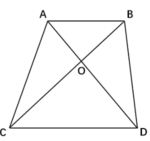

A. 20%

B. 25%

C. 40%

D. 50%

### 第 73 题

甲和乙办公室各有4名职工，乙办公室职工平均年龄为32岁。现从甲办公室调动1人到乙办公室，2个办公室职工平均年龄都增加了2岁。问调动后甲办公室职工的平均年龄为多少岁？

A. 50

B. 48

C. 46

D. 44

### 第 74 题

某社区干部每周一参加工作例会，每月10日、20日接访群众。已知8月与9月共有2次接访群众与工作例会在同一天，问当年9月1日是：

A. 周三

B. 周二

C. 周六

D. 周五

### 第 75 题

某新技术论坛在3个分会场安排4个领域的12场报告，安排如下表。小华希望在同一天听4个领域的报告各1场，问他有多少种不同的选择方式？

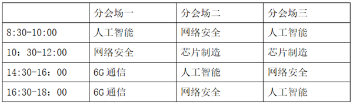

A. 6

B. 8

C. 10

D. 12

### 第 76 题

从所给的四个选项中，选择最合适的一个填入问号处，使之呈现一定的规律性：

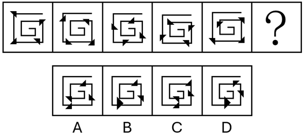

A. A

B. B

C. C

D. D

### 第 77 题

从所给的四个选项中，选择最合适的一个填入问号处，使之呈现一定的规律性：

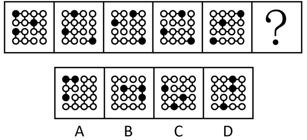

A. A

B. B

C. C

D. D

### 第 78 题

从所给的四个选项中，选择最合适的一个填入问号处，使之呈现一定的规律性：

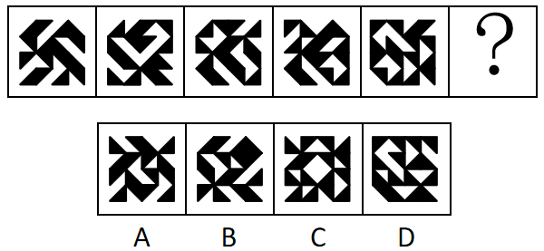

A. A

B. B

C. C

D. D

### 第 79 题

从所给的四个选项中，选择最合适的一个填入问号处，使之呈现一定的规律性：

A. A

B. B

C. C

D. D

### 第 80 题

左边为由15个白色正方体和3个黑色正方体组合而成的多面体俯视图和左视图，其正视图可能是：

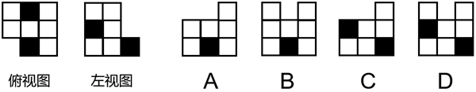

A. A

B. B

C. C

D. D

### 第 81 题

左边为给定的正方体纸盒的外表面展开图，由2个该正方体纸盒组合而成的长方体可能是：

A. A

B. B

C. C

D. D

### 第 82 题

左边为由12个白色正方体和3个灰色正方体组合而成的多面体前后两面直观图，问其可以由除哪项外的三个多面体组合而成？

A. A

B. B

C. C

D. D

### 第 83 题

把下面的六个图形分为两类，使每一类图形都有各自的共同特征或规律，分类正确的一项是：

A. ①②③，④⑤⑥

B. ①③④，②⑤⑥

C. ①③⑥，②④⑤

D. ①⑤⑥，②③④

### 第 84 题

把下面的六个图形分为两类，使每一类图形都有各自的共同特征或规律，分类正确的一项是：

A. ①②⑥，③④⑤

B. ①②④，③⑤⑥

C. ①⑤⑥，②③④

D. ①④⑥，②③⑤

### 第 85 题

把下面6个图形分为两类，使每一类图形都有各自的共同特征或规律，分类正确的一项是：

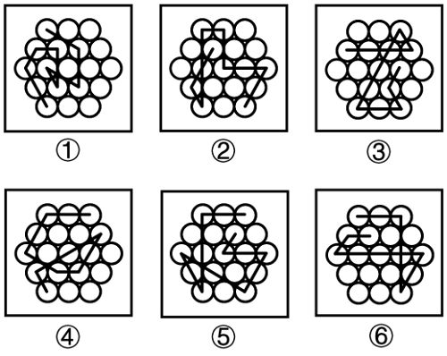

A. ①④⑤，②③⑥

B. ①③⑥，②④⑤

C. ①②⑥，③④⑤

D. ①②④，③⑤⑥

### 第 86 题

《中国共产党纪律处分条例》规定，主动交代本人应当受到党纪处分的问题，可以从轻或者减轻处分。这里所称的主动交代主要包括两种情况：一是涉嫌违纪的党员在组织谈话函询、初步核实前向有关组织交代自己的问题。二是在谈话函询、初步核实和立案审查期间交代组织未掌握的问题。

假定下列人员均受该条例约束，根据上述定义，下列属于主动交代的是：

A. 甲在参加违纪违法典型案例警示教育大会后，主动找到单位领导反映同事的违纪问题

B. 乙在组织对其进行廉政谈话时，组织举证一项他才承认一项，对未涉及的情况闭口不谈

C. 丙在纪委对其个人财产有关事项进行函询时，将其利用职权为自己和他人谋利的情况如实交代

D. 丁在纪委对其立案审查期间，面对确凿的证据，交代了之前没有交代的收受大额礼金的问题

### 第 87 题

波特五力模型是一种竞争分析工具，用于评估一个行业的竞争力和吸引力。该模型通过对同行业竞争对手的威胁、潜在进入者的威胁、替代品的威胁、上游供应商的议价能力和下游购买者的议价能力这五个方面的分析，帮助企业了解其所处行业的竞争环境，以制定相应的竞争策略。

根据上述定义，关于康复机器人行业，对下列问题的分析不能归入波特五力模型的是：

A. 康复机器人行业准入门槛高吗？需要强大的技术能力和创新能力吗？

B. 医院和康复中心患者规模如何？对于康复机器人的需求有多大？

C. 与传统物理治疗等康复治疗方法相比，康复机器人有竞争力吗？

D. 康复机器人企业内部各部门之间的协同合作程度高吗？

### 第 88 题

组织结构可以划分为以下几种类型：（1）直线型组织结构，即每一个部门只对其直接的下属部门下达工作指令，不能越级指挥，每一个部门也只有一个直接的上级部门；（2）职能型组织结构，即每一个部门都可对其下属部门下达工作指令，每一个下属部门可能得到不同上级部门下达的多个工作指令；（3）直线职能型组织结构，即在主管之下设置相应的职能部门，实行主管统一指挥与职能部门参谋指导相结合的管理方式，各部门既受上级的管理，又受同级职能管理部门的业务指导和监督；（4）事业部组织结构，即由相对独立的事业部组成的组织结构，通常按照地区或项目来划分事业部，每个事业部拥有较大的自主权。

根据上述定义，下列组织结构图代表的组织结构类型属于：

A. 直线型组织结构

B. 职能型组织结构

C. 直线职能型组织结构

D. 事业部组织结构

### 第 89 题

均变论认为，支配各种地质过程的法则在地质历史上没有发生过变化，现在起作用的各种自然营力在漫长的地质过程中具有普遍的均一性，即地质演变是一个渐变的过程，具有相同方式和相同的强度；地球上生物的种与种之间有过渡关系，生物进化过程是极其漫长的。灾变论认为，在整个地质发展的过程中，地球经常发生各种突如其来的、短暂的全球性灾难性变化，这些变化强烈地改变了地球的面貌；地球上生物的变化是反复多次灾变的结果。

根据上述定义，下列说法最能体现灾变论观点的是：

A. “我们找不到开始的痕迹，也看不到结束的迹象”

B. “地质记录是一部被鲜血和火焰写成的史诗”

C. “现在是通往过去的一把钥匙”

D. “自然界里没有飞跃”

### 第 90 题

商品动销率是指在售的商品品种数与库存商品总品种数的比率。商品库销比是指商品库存量与销售额的比率。商品滞销率是指滞销的商品品种数占库存商品总品种数的比率。商品损耗率是指在一定的保管条件下，某商品在储存保管期间，其自然损耗量与商品在库总量的比例。

根据上述定义，下列说法正确的是：

A. 若商品动销率超过100%，说明商品在售品种数高于库存商品总品种数

B. 商品损耗率高表明有库存积压风险，商品损耗率低表明销售态势良好

C. 库存商品数一定时，商品滞销率越高，说明滞销的商品越多

D. 当商品库存量越大，销售额越高时，商品库销比就会越大

### 第 91 题

根据动词对其后所接的宾语小句（作宾语的句子）真值的不同预设能力可以把现代汉语中的相关动词分为叙实动词、非叙实动词和反叙实动词。叙实动词的肯定式和否定式都预设其宾语小句为真；非叙实动词的肯定式和否定式都不预设其宾语小句为真，也不预设其宾语小句为假；反叙实动词的肯定式和否定式都预设其宾语小句为假。

根据上述定义，下列画线的动词属于非叙实动词的是：

A. 我听说他来过这里

B. 我庆幸听了你的建议

C. 我知道你帮助过我

D. 我幻想成为一只小鸟

### 第 92 题

自主动机是指人们出于兴趣或内在满足感而从事某种活动，外部动机是指人们为获得外部奖励或避免惩罚而从事某种活动，这些动机背后的心理需求又分为三种：（1）自主性需求，即人们希望自己能控制和选择自己的行为，而不是受到外部强制；（2）胜任性需求，即人们希望能在自己做的事上获得成就感和自我效能感；（3）归属感需求，即人们希望与他人建立有意义的联系，感受到归属和支持。

根据上述定义，下列说法错误的是：

A. 小张参加了一项感兴趣的社交活动，他认为这能帮助自己结交新朋友。这体现了自主动机和归属感需求

B. 小李参加公司的培训课程，虽然对课程内容不感兴趣，但他担心如果不参加就会被扣绩效。这体现了外部动机和自主性需求

C. 小王每天晨跑，很享受锻炼带来的满足感，也坚信这是促进健康的必要努力。这体现了自主动机和胜任性需求

D. 小陈和队友为实现团体奖牌零的突破一直在努力，在艰苦的训练中与队友相互鼓励。这体现了胜任性需求和归属感需求

### 第 93 题

动作预期是指运动员在比赛过程中，根据已有信息，对即将发生的动作结果进行预测的过程。在这一过程中，运动员主要依赖两类信息：运动学信息和情境先验信息。运动学信息包括对手的动作、器材的运动轨迹或队员之间的相对位置，情境先验信息则涉及比赛情境中事件发生的概率。

根据上述定义，下列不涉及上述任何一种信息的是：

A. 篮球队员甲在双方比分紧咬的情况下，基于对手今日比赛罚篮命中率不高，在对手投篮时选择直接犯规

B. 网球运动员乙知道对手在比赛前有一系列习惯性动作，包括整理球衣、球裤、头发等，暗自提醒自己不要被其干扰

C. 羽毛球双打运动员丙发现对方准备接发球的球员位置稍微靠前，可能来不及转身或后退接球，便发了个后场球

D. 乒乓球运动员丁发现对方发过来的球位置较低、速度较慢，极有可能擦网变线，便没有后退，向前伸拍做好接球准备

### 第 94 题

在制品控制是企业生产控制的基础工作，是企业对生产运作过程中各工序原材料、半成品等按照位置、数量、质量及车间之间的物料转运等进行的控制。

根据上述定义，下列没有直接体现在制品控制的是：

A. 服装厂梳理了运动裤制作流程并制定规范，确保衣料在不同流水线上流转有序

B. 食品厂设立质检员，定时对各个工序的食材抽样进行微生物检测，剔除不良品

C. 制药厂规定员工进入洁净区后，每两小时洗手一次，避免药品生产环境被污染

D. 家具厂对板材进行定期盘点，并合理摆放，确保板材库存合理且满足生产需要

### 第 95 题

预防性维修是指在机械设备没有发生故障或尚未造成损坏的前提下，通过对产品的系统性检查、设备测试或更换以防止设备发生故障，使其保持在正常状态所进行的全部活动。

根据上述定义，下列属于预防性维修的是：

A. 公路管理部门定期巡视道路两旁护栏并涂刷、除锈，发现护栏松动、断裂时进行修复

B. 某车间在正式制造某种设备前，测量将要安装在该设备中的关键零部件是否符合相应标准

C. 某数控车床突然发生摇动，无法切削物品，检查后发现电机出现故障，更换电机后车床可正常运行

D. 雨季来临前，供电公司对辖区内变压器、配电盘、电缆线路等电力设备设施隐患进行专项排查

### 第 96 题

与“经年：积岁”在逻辑关系上最相近的是：

A. 善本：版本

B. 秘方：偏方

C. 仲夏：夏季

D. 黎民：百姓

### 第 97 题

与“细胞凋亡：基因调控：细胞增殖”在逻辑关系上最相近的是：

A. 成本降低：税率调整：成本增加

B. 经济萧条：经济周期：经济复苏

C. 价格尺度：货币职能：流通手段

D. 人工智能：智能时代：具身智能

### 第 98 题

与“护士人数：护患比：患者人数”在逻辑关系上最相近的是：

A. 理赔总额：平均理赔金额：理赔次数

B. 签收率：实际签收数量：应签收数量

C. 流动资产：流动负债：流动比率

D. 旅客数：入住率：客房数

### 第 99 题

颅内疾病 对于 （ ） 相当于 （ ） 对于 岩石断裂

依次填入括号中最恰当的是：

A. 颅内感染；岩石熔融

B. 机体疾病；地壳应力

C. 核磁共振；地下采样

D. 视野缺失；冰川运动

### 第 100 题

如果用一个圆来表示词语所指称的对象的集合，那么以下哪项中画横线词语之间的关系符合下图？

A. 船舶按用途分为军用船舶（①）和民用船舶两大类，潜艇、航空母舰（③）、驱逐舰等都属于军用船舶；按推进动力分为机动船和非机动船（②）

B. 水杉（③）是我国的特有树种，属于落叶树（①），是一种高大的乔木（②），是世界上珍稀的“活化石”植物

C. 图书按照读者群可分为少儿读物（③）和成人读物等；按照载体可分为纸质书和电子书（②）等；按照学科可分为历史书、文学书和哲学书（①）等

D. 大熊猫属于哺乳动物（①），是中国特有动物（②），被列为中国国家一级保护野生动物（③）

### 第 101 题

科技行业越来越多地使用合成数据来满足AI模型数据训练的需要。合成数据是通过算法和统计模型人为创建的数据，在理论上可以无限供应。但合成数据存在一个关键问题：当AI模型过于依赖合成数据时，它们会产生更多“幻觉”，编造看似合理可信但实际上并不存在的信息。可见，合成数据的使用会影响AI的准确性。

以下哪项如果为真，最能支持上述结论？

A. 即使经过处理，合成数据仍然可能泄露敏感信息，从而引发隐私风险

B. 合成数据存在过于简单化的风险，无法完全模拟真实世界的复杂性

C. 合成数据会放大源数据本身的错误或偏差，导致“失之毫厘，差之千里”

D. 合成数据的多样性可能不如真实数据，限制了AI模型的泛化能力

### 第 102 题

部分研究认为，白垩纪陆地生态系统的变革是由植物、昆虫、脊椎动物与地质过程等多个要素相互作用推动的，形成了一个高度协同演化的系统结构。鉴于这一机制在当时造就了复杂而稳定的生态格局，有学者提出，现代陆地生态系统的高度复杂性，正是这种古老协同机制延续和演化的结果。

以下哪项如果为真，最能削弱上述学者的观点？

A. 在地质记录中，白垩纪末期的生态危机主要影响海洋系统，而陆地系统显示出相对稳定的演替趋势

B. 对白垩纪地层的系统分析表明，植物、昆虫、脊椎动物与地质过程的演化几乎是在同一时期进行的

C. 现代陆地生态系统的复杂性主要受群落内部随机扰动、自组织演化和外源干扰的共同影响，与白垩纪显著不同

D. 被子植物的全球扩张早于部分动物类群多样化，其当时对生态结构的主导作用可能被高估

### 第 103 题

完善城乡融合发展体制机制是破除我国城乡二元结构、拓展高质量发展空间的必要举措。只有完善农业农村优先发展的投入保障机制，并且优化城乡公共资源配置机制，才能完善城乡融合发展体制机制。只有加大中央预算内投资和地方政府专项债券支持力度，并且提高土地出让收入用于农业农村的比例，才能完善农业农村优先发展的投入保障机制。只有推进户籍制度改革，才能优化城乡公共资源配置机制。

由此可以推出的是（ ）。

A. 如果推进户籍制度改革，就能优化城乡公共资源配置机制

B. 只要完善农业农村优先发展的投入保障机制，就能完善城乡融合发展体制机制

C. 除非完善农业农村优先发展的投入保障机制，否则不能提高土地出让收入用于农业农村的比例

D. 加大中央预算内投资和地方政府专项债券支持力度是破除我国城乡二元结构、拓展高质量发展空间的必要前提

### 第 104 题

平台企业依赖金融资本投资，需要迎合金融市场的估值逻辑，通过轻资产运营、扩大市场规模和用户数据挖掘与开发等，来提升自身在金融市场上的估值。随着平台企业金融化程度的日益加深，平台劳动者的具体劳动和生产过程也在发生变化。研究者认为，平台企业金融化程度的加深使得平台劳动者的劳动权益保护问题日益突出。

以下哪项如果为真，最能支持上述研究者的观点？

A. 为扩大市场规模、争夺消费者注意力，平台企业在资金投入和服务提升方面容易陷入无序竞争

B. 为塑造轻资产企业形象、摆脱劳动密集型标签，平台企业采用弹性用工制，增加劳动者就业不稳定性

C. 越来越多的平台企业日益注重用户数据挖掘，以增加企业竞争力，为此更加注重员工培训

D. 部分平台企业以缴纳保证金、押金或其他名义向劳动者收取财物，限制劳动者在多平台就业

### 第 105 题

考古人员在某地发掘出一些似鸟动物化石，同位素测年显示这些动物生存于中侏罗世晚期（距今1.72亿～1.64亿年）。经考古推算，这些似鸟动物体型与现代鸟类大致接近，尾巴很短，最重要的是它们都具有愈合的尾综骨。考古人员据此认为，这些动物一定属于鸟类。

以下哪项最有可能是考古人员论证的前提？

A. 这些似鸟动物长有与现代鸟类相似的脚骨，可以在陆地上行走

B. 这些化石保存了诸如肩胛骨、乌喙骨、尾综骨等骨骼，形态清晰

C. 鸟类与爬行动物最显著的区别就是鸟类最后几枚尾椎愈合成为尾综骨

D. 尾综骨结构的出现对似鸟动物后肢和尾骨的独立运动及飞行能力的完善至关重要

### 第 106 题

对于3支双打队伍的组成情况，以下哪项是可能的？

关联材料：dom-material-49bd64f09381c3b1

A. 网球——王、宋；乒乓球——吴、宋；羽毛球——王、韩

B. 网球——吴、韩；乒乓球——吴、王；羽毛球——韩、宋

C. 网球——韩、宋；乒乓球——吴、王；羽毛球——王、宋

D. 网球——王、宋；乒乓球——吴、韩；羽毛球——王、吴

### 第 107 题

若宋和韩组队网球双打，则以下哪项一定正确？

关联材料：dom-material-49bd64f09381c3b1

A. 吴参加乒乓球项目

B. 王参加羽毛球项目

C. 宋参加乒乓球项目

D. 吴参加羽毛球项目

### 第 108 题

若吴参加3个项目，则以下哪项是可能的？

关联材料：dom-material-49bd64f09381c3b1

A. 宋参加网球项目

B. 王参加网球项目

C. 宋参加乒乓球项目

D. 王参加羽毛球项目

### 第 109 题

以下哪项中的两人可能同时组队网球和羽毛球双打？

关联材料：dom-material-49bd64f09381c3b1

A. 王和吴

B. 王和宋

C. 吴和宋

D. 韩和宋

### 第 110 题

若宋和韩组队乒乓球双打，则以下哪项是可能的？

关联材料：dom-material-49bd64f09381c3b1

A. 吴和韩组队网球双打

B. 吴和宋组队网球双打

C. 宋和韩组队羽毛球双打

D. 吴和宋组队羽毛球双打

### 第 111 题

2024年上半年，中国医药保健品进出口贸易顺差（出口额-进口额）比上年同期：

关联材料：dom-material-c910f6ceb42c6fdc

A. 下降了20%以上

B. 下降了不到20%

C. 上升了20%以上

D. 上升了不到20%

### 第 112 题

2024年上半年，中药提取物出口额占医药保健品出口总额的比重比上年同期：

关联材料：dom-material-c910f6ceb42c6fdc

A. 上升了3个百分点以上

B. 下降了3个百分点以上

C. 上升了不到3个百分点

D. 下降了不到3个百分点

### 第 113 题

表中所列医药保健品12个小类中，2024年上半年进出口总额同比上升的有几类？

关联材料：dom-material-c910f6ceb42c6fdc

A. 7

B. 6

C. 5

D. 4

### 第 114 题

将2024年上半年①医用敷料②一次性耗材③保健康复用品④口腔设备与材料进口额同比增量从高到低排序正确的是：

关联材料：dom-material-c910f6ceb42c6fdc

A. ③④①②

B. ③④②①

C. ④③①②

D. ④③②①

### 第 115 题

以下饼图中，最能准确反映2024年上半年中国西药类进出口总额中，西药原料（白色）、西成药（横线）和生化药（黑色）占比关系的是：

关联材料：dom-material-c910f6ceb42c6fdc

A. 

B. 

C. 

D. 

### 第 116 题

2024年，全国核发的不可交易绿证对应约多少万亿千瓦时可再生能源电量？

关联材料：dom-material-de8f8bf220986e52

A. 1.6

B. 3.2

C. 7.9

D. 15.8

### 第 117 题

2023年，全国核发绿证数量约是2022年的多少倍？

关联材料：dom-material-de8f8bf220986e52

A. 3.7

B. 5.1

C. 6.3

D. 7.8

### 第 118 题

2024年绿证核发量最多的5个省级行政区，绿证核发量约占全国总量的：

关联材料：dom-material-de8f8bf220986e52

A. 38%

B. 42%

C. 46%

D. 50%

### 第 119 题

2024年，全国集中式风电项目核发绿证数量占当年集中式项目核发绿证数量的比重比太阳能发电项目的占比高约多少个百分点？

关联材料：dom-material-de8f8bf220986e52

A. 16

B. 20

C. 24

D. 28

### 第 120 题

能够从上述资料中推出的是：

关联材料：dom-material-de8f8bf220986e52

A. 2019年，全国绿证核发量多于2018年

B. 截至2023年底，全国累计核发绿证中，可交易绿证的占比不到1%

C. 2024年，全国常规水电核发绿证不到集中式项目核发绿证总数量的三分之一

D. 2024年，湖北、湖南核发绿证之和占全国比重比广东、广西之和高1个百分点以上

### 第 121 题

2021~2024年，我国科幻产业累计营收额约是2017~2020年的多少倍？

关联材料：dom-material-3d692cafc345a992

A. 2.5

B. 2.2

C. 1.9

D. 1.6

### 第 122 题

如保持2024年同比增量不变，则2026-2030年，我国科幻游戏产业累计营收将在以下哪个范围内？

关联材料：dom-material-3d692cafc345a992

A. 不到4500亿元

B. 4500亿～4750亿元之间

C. 超过5000亿元

D. 4750亿～5000亿元之间

### 第 123 题

我国科幻产业五大领域中，2024年营收额同比增速快于2023年水平的有几个？

关联材料：dom-material-3d692cafc345a992

A. 4

B. 3

C. 2

D. 1

### 第 124 题

2022~2024年，科幻文旅营收额占科幻产业营收额的比重超过20%的年份仅包括：

关联材料：dom-material-3d692cafc345a992

A. 2023和2024年

B. 2023年

C. 2022和2024年

D. 2022年

### 第 125 题

以下柱状图反映了哪一时间段内，我国科幻产业营收额同比增量的变化情况（横轴位置表示增量为0）？

关联材料：dom-material-3d692cafc345a992

A. 2021~2024年

B. 2020~2023年

C. 2019~2022年

D. 2018~2021年

### 第 126 题

2024年，我国外贸进出口总值在以下哪个范围内？

关联材料：dom-material-1deb3757c0f1675e

A. 不到44万亿元

B. 44万亿元~45万亿元之间

C. 45万亿元~46万亿元之间

D. 超过46万亿元

### 第 127 题

2024年，我国对最不发达国家进出口总值同比增速约为：

关联材料：dom-material-1deb3757c0f1675e

A. 9.5%

B. 8.5%

C. 7.5%

D. 10.5%

### 第 128 题

下列饼状图，最能准确反映2024年我国自最不发达国家进口值中，铜材（黑色），原油（横线），金属矿砂（白色）和其他（竖线）进口值占比关系的是：

关联材料：dom-material-1deb3757c0f1675e

A. 

B. 

C. 

D. 

### 第 129 题

2023年1~11月，我国对最不发达国家月均进口值约为多少亿元？

关联材料：dom-material-1deb3757c0f1675e

A. 395

B. 409

C. 468

D. 502

### 第 130 题

关于2024年我国进出口情况，能根据上述资料推出的是：

关联材料：dom-material-1deb3757c0f1675e

A. 铜材进口总值不到3000亿元

B. 我国对最不发达国家火车出口值同比增量高于对其工程机械出口值同比增量

C. 劳动密集型产品出口值占我国最不发达国家出口总值的比重高于上年水平

D. 12月自刚果民主共和国、几内亚、老挝、赞比亚的进口总值超过当月我国自最不发达国家进口总值的一半

## 答案与解析

第 1 题

**参考答案（粉笔题库参考内容）**

D

**解析**

本题考查理论与政策。

①正确，2021年7月1日，习近平总书记在庆祝中国共产党成立100周年大会上的重要讲话中指出：“以史为鉴、开创未来，必须坚持和发展中国特色社会主义。走自己的路，是党的全部理论和实践立足点，更是党百年奋斗得出的历史结论······”

②正确，2023年2月7日，习近平总书记在新进中央委员会的委员、候补委员和省部级主要领导干部学习贯彻习近平新时代中国特色社会主义思想和党的二十大精神研讨班开班式上的讲话中指出：“推进中国式现代化，必须坚持独立自主、自立自强，坚持把国家和民族发展放在自己力量的基点上，坚持把我国发展进步的命运牢牢掌握在自己手中。”

③正确，2023年2月7日，习近平总书记在新进中央委员会的委员、候补委员和省部级主要领导干部学习贯彻习近平新时代中国特色社会主义思想和党的二十大精神研讨班上的讲话中指出：“中国式现代化既要物质财富极大丰富，也要精神财富极大丰富、在思想文化上自信自强。”

④正确，2013年12月26日，习近平总书记在纪念毛泽东同志诞辰120周年座谈会上的讲话中指出：“独立自主是中华民族的优良传统，是中国共产党、中华人民共和国立党立国的重要原则。在中国这样一个人口众多和经济文化落后的东方大国进行革命和建设的国情与使命，决定了我们只能走自己的路。”

故正确的有①②③④，共4项。

故正确答案为D。

第 2 题

**参考答案（粉笔题库参考内容）**

C

**解析**

本题考查理论与政策。

2025年6月16日出版的第12期《求是》杂志发表了习近平总书记的重要文章《用中长期规划指导经济社会发展是我们党治国理政的一种重要方式》。这是习近平总书记2015年10月至2025年4月期间有关重要论述的节录。

A、B两项错误，2020年8月24日，习近平总书记在经济社会领域专家座谈会上的讲话中指出：“用中长期规划指导经济社会发展，是我们党治国理政的一种重要方式。从1953年开始，我国已经编制实施了13个五年规划（计划），其中改革开放以来编制实施8个，有力推动了经济社会发展、综合国力提升、人民生活改善，创造了世所罕见的经济快速发展奇迹和社会长期稳定奇迹。实践证明，中长期发展规划既能充分发挥市场在资源配置中的决定性作用，又能更好发挥政府作用。”故A项“五年规划（计划）编制工作起始于1949年”表述有误，应为“1953年”；B项“政府在资源配置中的决定性作用”表述有误，应为“市场在资源配置中的决定性作用”。

C项正确，2020年10月29日，习近平总书记在党的十九届五中全会第二次全体会议上的讲话中指出：“从第一个五年计划到第十四个五年规划，一以贯之的主题是把我国建设成为社会主义现代化国家。”

D项错误，2020年9月25日，习近平总书记在对“十四五”规划编制工作网上意见征求活动的指示中指出：“通过互联网就‘十四五’规划编制向全社会征求意见和建议，在我国五年规划编制史上是第一次。这次活动效果很好，社会参与度很高，提出了许多建设性的意见和建议。”故第一次通过互联网向全社会征求意见和建议的并非“十五五”规划编制，而是“十四五”规划。

故正确答案为C。

第 3 题

**参考答案（粉笔题库参考内容）**

B

**解析**

本题考查理论与政策。

2025年4月16日，《求是》杂志发表习近平总书记重要文章《加快建设文化强国》（以下简称“文章”）。

①错误，②正确，文章指出：“第三，始终坚持文化建设着眼于人、落脚于人。文化强国之‘强’最终要体现在人民的思想境界、精神状态、文化修养上。要坚持以人民为中心，着眼满足人民群众多样化、多层次、多方面的精神文化需求，提升文化服务和文化产品供给能力，增强人民群众文化获得感、幸福感。要重视发挥文化养心志、育情操的作用，涵养全民族昂扬奋发的精神气质。”故①“为人民提供文化服务和文化产品的能力”表述错误，应为“人民的思想境界、精神状态、文化修养”。

③④正确，文章指出：“文化创造核心在人。要把育人才、建队伍作为重要而紧迫的战略任务，统筹各类人才培养，建设一支规模宏大、结构合理、锐意创新的高水平文化人才队伍。要尊重人才成长规律，建立健全科学权威、公开透明的文艺和学术评价体系，完善符合文化领域特点的人才选拔、培养、使用、激励机制，营造识才、重才、爱才的良好政策环境。”

故②③④正确。

故正确答案为B。

第 4 题

**参考答案（粉笔题库参考内容）**

A

**解析**

本题考查理论与政策。

2025年4月，中共中央、国务院印发了《加快建设农业强国规划（2024－2035年）》（以下简称《规划》）。

A项正确，B项错误，《规划》在“五、全链条推进农业产业体系升级，提升农业综合效益”中指出：“（十八）加快推进农业全面绿色转型······推进农业面源污染综合防治，发展生态循环农业。健全山水林田湖草沙一体化保护和系统治理机制。实施好长江十年禁渔和海洋伏季休渔，推进黄河流域农业深度节水控水。建立农业生态环境保护监测制度。推进生态综合补偿，健全横向生态保护补偿机制，统筹推进生态环境损害赔偿。”故B项“建立健全长江流域信息共享系统”无中生有，“长江流域”表述错误，应为“黄河流域”。

C项错误，《规划》在“二、全方位夯实粮食安全根基，把中国人的饭碗端得更牢更稳”中指出：“（三）健全粮食生产扶持政策······健全粮食主产区利益补偿机制，完善产粮大县奖补制度，中央预算内投资向粮食主产区倾斜，省级统筹的土地出让收入可按规定用于粮食主产区的高标准农田建设、现代种业提升等，统筹建立粮食产销区省际横向利益补偿机制。”故“完善粮食产销奖补制度，中央预算内投资向粮食主销区倾斜”表述错误，应为“完善产粮大县奖补制度，中央预算内投资向粮食主产区倾斜”。

D项错误，《规划》在“三、全领域推进农业科技装备创新，加快实现高水平农业科技自立自强”中指出：“（六）加快农业科技创新水平整体跃升······加强农业知识产权保护和侵权打击。健全公益性和经营性相结合的农业科技推广体系，加强基层农技推广队伍建设。”故“推进农业科技推广体系，从经营性向公益性转变”表述错误，应为“健全公益性和经营性相结合的农业科技推广体系”。

故正确答案为A。

第 5 题

**参考答案（粉笔题库参考内容）**

D

**解析**

本题考查理论与政策。

2020年4月21日，人民日报发表《坚持法治国家、法治政府、法治社会一体建设》（以下简称文章）。

A项正确，2020年11月16日，习总书记在中央全面依法治国工作会议上讲话中指出：“法治国家、法治政府、法治社会相辅相成，法治国家是法治建设的目标，法治政府是建设法治国家的重点，法治社会是构筑法治国家的基础。”

B项正确，文章指出，法治政府是法治国家建设的主体和重点，是法治社会建设的先导和示范······建设法治政府对建设法治社会具有重要引领和带动作用。故D项“法治国家是依法治国的主体”表述错误，应为“法治政府是法治国家建设的主体和重点”。

C项正确，文章指出，法治国家是法治政府、法治社会建设的目标，法治政府、法治社会建设必须服从、服务于法治国家建设。

D项错误，2020年11月16日，习总书记在中央全面依法治国工作会议上讲话中指出：“我多次强调，推进全面依法治国，法治政府建设是重点任务和主体工程，对法治国家、法治社会建设具有示范带动作用，要率先突破。”且文章中指出，法治政府是法治社会建设的先导和示范。故“法治国家”表述错误，应该为“法治政府”。

本题为选非题，故正确答案为D。

（备注：D选项：2014年10月通过的《中共中央关于全面推进依法治国若干重大问题的决定》中指出：“坚持人民主体地位。人民是依法治国的主体和力量源泉······”但题目主要是在考查法治政府、法治国家和法治社会的关系。）

第 6 题

**参考答案（粉笔题库参考内容）**

A

**解析**

本题考查理论与政策。

A项正确，B项错误，2025年7月14日至15日，中央城市工作会议在北京举行。会议指出，我国城镇化正从快速增长期转向稳定发展期，城市发展正从大规模增量扩张阶段转向存量提质增效为主的阶段。城市工作要深刻把握、主动适应形势变化······转变城市工作重心，更加注重治理投入；转变城市工作方法，更加注重统筹协调。故B项“城市工作重心应向更加注重建设投入转变”表述错误，应为“城市工作重心应向更加注重治理投入转变”。

C项错误，2025年7月14日至15日，中央城市工作会议在北京举行。会议部署城市工作7个方面的重点任务。一是着力优化现代化城市体系。着眼于提高城市对人口和经济社会发展的综合承载能力，发展组团式、网络化的现代化城市群和都市圈，分类推进以县城为重要载体的城镇化建设，继续推进农业转移人口市民化，促进大中小城市和小城镇协调发展，促进城乡融合发展。其次，会议指出，要以坚持城市内涵式发展为主线。故选项“着力通过外延扩张发展组团式的现代化城市群和都市圈”表述错误，应为“着力通过内涵式发展组团式、网络化的现代化城市群和都市圈”。

D项错误，2015年12月20日，习近平总书记在中央城市工作会议上指出：“要尊重市民对城市发展决策的知情权、参与权、监督权，鼓励企业和市民通过各种方式参与城市建设、管理。在共建共享过程中，城市政府应该从‘划桨人’转变为‘掌舵人’，同市场、企业、市民一起管理城市事务、承担社会责任。”

故正确答案为A。

第 7 题

**参考答案（粉笔题库参考内容）**

C

**解析**

本题考查理论与政策。

2025年2月28日，《求是》杂志发表习近平总书记重要文章《经济工作必须统筹好几对重要关系》。

A项正确，文章指出：“三是必须统筹好培育新动能和更新旧动能的关系，因地制宜发展新质生产力。要以科技创新为引领，大力培育壮大新兴产业和未来产业，占据国际竞争制高点，塑造经济发展新动能、新优势。同时，加快推动作为经济增长和就业收入基本依托的传统产业改造升级，使之焕发新的生机活力，推动新旧发展动能平稳接续转换。”

B项正确，文章指出：“二是必须统筹好总供给和总需求的关系，畅通国民经济循环。要坚持供需两侧协同发力、动态平衡，持续深化供给侧结构性改革，有进有退、有保有压，增强供给与需求的适配性、平衡性。扩大内需既关系经济稳定，也关系经济安全，不是权宜之计，而是战略之举。要加快补上内需特别是消费短板，使内需成为拉动经济增长的主动力和稳定锚。”

C项错误，文章指出：“五是必须统筹好提升质量和做大总量的关系，夯实中国式现代化的物质基础。我国拥有巨大的经济体量、市场容量和产业配套能力，是提升质量、做优做强的有利条件。我国人均国民收入尚未达到世界平均水平，发展不平衡不充分问题仍然突出。要坚持以质取胜和发挥规模效应相统一，用好超大规模市场优势和丰富应用场景，培育更多世界一流企业和领先技术，把质的有效提升和量的合理增长统一于高质量发展的全过程。”故“要坚持以量取胜、充分发挥规模效应”表述有误，应为“要坚持以质取胜和发挥规模效应相统一”。

D项正确，文章指出：“四是必须统筹好做优增量和盘活存量的关系，全面提高资源配置效率。经过长期发展，我国需要同时加强资产管理和负债管理，统筹用好各类增量资源和存量资源，善于通过盘活存量来带动增量。要持续推动产业园区‘腾笼换鸟’，用好置换存量隐性债务、盘活存量土地等政策，统筹做优增量和盘活存量、管好资产和调整负债，拓展新的发展空间。”

本题为选非题，故正确答案为C。

第 8 题

**参考答案（粉笔题库参考内容）**

D

**解析**

本题考查理论与政策。

2025年7月30日，中共中央政治局召开会议，决定召开二十届四中全会，分析研究当前经济形势和经济工作，中共中央总书记习近平主持会议。

A项正确，会议指出，要扎实推进乡村全面振兴，巩固拓展脱贫攻坚成果，确保农村人口不发生规模性返贫致贫。要加强耕地保护和质量提升，抓好农业生产，努力夺取全年粮食丰收。

B、C两项正确，D项错误，会议强调，要扎实做好民生保障工作。突出就业优先政策导向，促进高校毕业生、退役军人、农民工等重点群体就业。落实好惠民政策，健全分层分类社会救助体系。夯实“三农”基础，推动粮食和重要农产品价格保持在合理水平。巩固拓展脱贫攻坚成果，确保不发生规模性返贫致贫。始终把人民群众生命安全放在第一位，加强安全生产和食品安全监管，全力做好防汛应急抢险救灾，保障迎峰度夏期间能源电力供应。做好“十五五”规划编制工作。故D项“人民群众财产安全”表述有误，应为“人民群众生命安全”。

本题为选非题，故正确答案为D。

第 9 题

**参考答案（粉笔题库参考内容）**

A

**解析**

本题考查理论与政策。

2024年11月16日，《求是》杂志发表了习近平总书记题为《以人口高质量发展支撑中国式现代化》的重要文章，以下简称文章。

A项正确，文章中“（二）做好新时代人口工作的基本思路和重大原则”部分指出：“二是坚持以系统观念统筹谋划人口问题。要树立‘大人口观’，从中国式现代化全局出发，深入研判人口变化对经济社会发展的复杂影响，在制定经济社会政策时充分考虑人口变化因素，推动人口与财政、货币、就业、产业、投资、消费、生态、区域等政策形成系统集成效应。”

B项错误，文章中“（二）做好新时代人口工作的基本思路和重大原则”部分指出：“一是坚持以人口高质量发展促进经济社会高质量发展。我国已经进入推动高质量发展的关键时期，必须推动人口工作由调节数量为主向提升素质、稳定总量、优化结构、畅通流动转变，以人口高质量发展打造高素质人力资源，加快构建新发展格局，着力推动高质量发展。”故“推动人口工作由稳定总量、畅通流动向调节数量、优化结构转变”说法错误，应为“必须推动人口工作由调节数量为主向提升素质、稳定总量、优化结构、畅通流动转变”。

C项错误，文章中“（二）做好新时代人口工作的基本思路和重大原则”部分指出：“三是坚持以改革创新推动人口高质量发展。过去人口工作以‘管’为主，今后工作覆盖面更广了、颗粒度更细了，要更加重视‘引导’和‘激励’的办法，由主要依靠政府力量向政府和社会协同治理转变。”故“由社会治理向政府治理转变”说法错误，应为“由主要依靠政府力量向政府和社会协同治理转变”。

D项错误，文章中“（二）做好新时代人口工作的基本思路和重大原则”部分指出：“四是坚持促进人的全面发展和全体人民共同富裕。做好新时代人口工作，要顺应人民群众对美好生活的期待，坚持人民主体地位，把人口高质量发展同人民高品质生活紧密结合起来······”故“把人口高速增长同人民高品质生活紧密结合起来”说法错误，应为“把人口高质量发展同人民高品质生活紧密结合起来”。

故正确答案为A。

第 10 题

**参考答案（粉笔题库参考内容）**

B

**解析**

本题考查理论与政策。

2025年10月23日，中国共产党第二十届中央委员会第四次全体会议通过了《中共中央关于制定国民经济和社会发展第十五个五年规划的建议》，以下简称《建议》。

A项错误，《建议》中“十三、推进国家安全体系和能力现代化，建设更高水平平安中国”部分指出：“（50）加强重点领域国家安全能力建设。锻造实战实用的国家安全能力，突出保障事关国家长治久安、经济健康稳定、人民安居乐业的重大安全，把捍卫政治安全摆在首位。”故“把捍卫国土安全摆在首位”说法错误，应为“把捍卫政治安全摆在首位”。

B项正确，《建议》中“十三、推进国家安全体系和能力现代化，建设更高水平平安中国”部分指出：“（50）加强重点领域国家安全能力建设······提高防范化解重点领域风险能力，统筹推进房地产、地方政府债务、中小金融机构等风险有序化解，严防系统性风险。”

C项错误，《建议》中“十三、推进国家安全体系和能力现代化，建设更高水平平安中国”部分指出：“（49）健全国家安全体系······坚持以战略为先导、政策为抓手、法治为保障、风险防控为落脚点，完善国家安全法治体系、战略体系、政策体系、风险防控体系。”故“坚持以风险防控为先导、法治保障为落脚点”说法错误，应为“坚持以战略为先导、风险防控为落脚点”。

D项错误，《建议》中“十三、推进国家安全体系和能力现代化，建设更高水平平安中国”部分指出：“（51）提高公共安全治理水平。完善公共安全体系，推动公共安全治理模式向事前预防转型。”故“推动公共安全治理模式由事后处理向事中控制转型”说法错误，应为“推动公共安全治理模式向事前预防转型”。

故正确答案为B。

第 11 题

**参考答案（粉笔题库参考内容）**

C

**解析**

本题考查理论与政策。

①错误，《习近平谈治国理政》第四卷中的《牢牢把住粮食安全主动权》中指出：“‘五谷者，万民之命，国之重宝。’我反复强调，粮食多一点少一点是战术问题，粮食安全是战略问题。应对新冠肺炎疫情，粮食和重要农副产品供给充裕功不可没，充分印证了这一点。”故“粮食多一点少一点是战略问题，粮食安全是战术问题”表述错误，应为“粮食多一点少一点是战术问题，粮食安全是战略问题”。

②正确，2024年1月15日，《求是》杂志发表的习近平总书记重要文章《完整、准确、全面贯彻落实关于做好新时代党的统一战线工作的重要思想》中指出：“第二，必须解决好人心和力量问题。人心向背、力量对比是决定党和人民事业成败的关键，是最大的政治。统战工作的本质要求是大团结大联合，解决的就是人心和力量问题。这是党治国理政必须下大气力解决好的重大问题。”

③正确，2022年3月1日，习近平总书记在中央党校（国家行政学院）中青年干部培训班开班式上发表重要讲话强调：“要心怀‘国之大者’，站在全局和战略的高度想问题、办事情，一切工作都要以贯彻落实党中央决策部署为前提，不能为了局部利益损害全局利益、为了暂时利益损害根本利益和长远利益。”

④正确，2023年7月3日，《学习时报》发表《习近平总书记论战略思维》中指出：“习近平总书记视野开阔、胸襟博大······谈到外交工作，他指出：‘自觉把党的对外工作放到党和国家工作大局中来认识，放到中国与世界关系的发展变化中来把握，放到国家总体外交的战略部署中来谋划。’”

综上，②③④表述正确，共3项。

故正确答案为C。

第 12 题

**参考答案（粉笔题库参考内容）**

D

**解析**

本题考查理论与政策。

A项错误，2018年9月10日，习近平总书记在全国教育大会上的讲话中指出：“我们要坚持我国教育现代化的社会主义方向，坚持教育公益性原则，把教育公平作为国家基本教育政策，大力推进教育体制改革创新。”故“均等化”表述错误，应为“公益性”。

B项错误，2025年6月1日，《求是》杂志发表的习近平总书记重要文章《加快建设教育强国》指出：“三是培养人才和满足社会需要的关系······要完善人才培养与经济社会发展需要适配机制，顺应时代发展要求，动态调整学科专业，优化办学资源配置，完善学生实习实践制度，努力让每一位人才都能人尽其才、才尽其用、各得其所。”故“适度增加学科专业数量”表述错误，应为“动态调整学科专业”。

C项错误，2025年6月1日，《求是》杂志发表的习近平总书记重要文章《加快建设教育强国》指出：“一是支撑国家战略和满足民生需求的关系。要把培养国家重大战略急需人才摆到更加突出位置，着力造就拔尖创新人才，推动实现高水平科技自立自强。聚焦解决教育发展不平衡不充分问题，不断满足人民群众更高质量更加多样的教育需求。”故“要把引进全球顶尖科学家摆到更加突出位置”表述错误，应为“要把培养国家重大战略急需人才摆到更加突出位置”。

D项正确，2023年5月29日，中共中央政治局就建设教育强国进行第五次集体学习。习近平总书记强调，从教育大国到教育强国是一个系统性跃升和质变，必须以改革创新为动力。要坚持系统观念，统筹推进育人方式、办学模式、管理体制、保障机制改革，坚决破除一切制约教育高质量发展的思想观念束缚和体制机制弊端，全面提高教育治理体系和治理能力现代化水平。

故正确答案为D。

第 13 题

**参考答案（粉笔题库参考内容）**

B

**解析**

本题考查理论与政策。

当地时间2024年11月18日，国家主席习近平在巴西里约热内卢出席二十国集团领导人第十九次峰会第二阶段会议并发表题为《携手构建公正合理的全球治理体系》的讲话，以下简称讲话。

A项错误，习近平主席在讲话中指出：“第三，完善全球贸易治理，建设开放型世界经济······要避免经济问题政治化、人为割裂全球市场，避免以绿色低碳为名、行保护主义之实。”故“适应经济问题政治化的潮流”“推行贸易保护政策”表述错误。

B项正确，习近平主席在讲话中指出：“第三，完善全球贸易治理，建设开放型世界经济······两年前，中国同印度尼西亚等国共同发起《产业链供应链韧性与稳定国际合作倡议》，呼吁构建更具平等性、包容性和建设性的产业链供应链伙伴关系，我们愿同各方就此加强合作。”

C项错误，习近平主席在讲话中指出：“第三，完善全球贸易治理，建设开放型世界经济。要把发展置于国际经贸议程中心地位，持续推动贸易和投资自由化便利化，要继续推进世界贸易组织改革······”故“把安全置于国际经贸议程中心地位”表述错误，应为“把发展置于国际经贸议程中心地位”。

D项错误，习近平主席在讲话中指出：“第三，完善全球贸易治理，建设开放型世界经济······要积极推进世界贸易组织规则与时俱进，既要解决长期未决议题，又要积极探索制定面向未来的新规则，提高多边贸易体制的权威性、有效性和相关性。”故“一以贯之保持世界贸易组织规则不变”表述错误，应为“积极推进世界贸易组织规则与时俱进”。

故正确答案为B。

第 14 题

**参考答案（粉笔题库参考内容）**

C

**解析**

本题考查理论与政策。

2024年6月24日，习近平总书记在全国科技大会、国家科学技术奖励大会、两院院士大会上发表重要讲话（以下简称讲话）。

A项错误，习总书记在讲话中指出：“要保持战略定力，坚持有所为有所不为，突出国家战略需求，在若干重要领域实施科技战略部署，凝练实施一批新的重大科技项目，形成竞争优势，赢得战略主动。”故“突出经济发展需求”表述错误，应为“突出国家战略需求”。

B项错误，习总书记在讲话中指出：“要充分发挥市场在科技资源配置中的决定性作用，更好发挥政府各方面作用，调动产学研各环节的积极性，形成共促关键核心技术攻关的工作格局。”故“人才”表述错误，应为“市场”。

C项正确，习总书记在讲话中指出：“融合的关键是强化企业科技创新主体地位。要充分发挥科技领军企业龙头作用，鼓励中小企业和民营企业科技创新，支持企业牵头或参与国家重大科技项目。”

D项错误，习总书记在讲话中指出：“要提高基础研究组织化程度，完善竞争性支持和稳定支持相结合的投入机制，强化面向重大科学问题的协同攻关，同时鼓励自由探索，努力提出原创基础理论、掌握底层技术原理，筑牢科技创新根基和底座。”故“降低基础研究组织化程度”“强化自由探索”“鼓励面向重大科学问题的协同攻关”表述错误，应为“提高基础研究组织化程度”“鼓励自由探索”“强化面向重大科学问题的协同攻关”。

故正确答案为C。

第 15 题

**参考答案（粉笔题库参考内容）**

A

**解析**

本题考查理论与政策。

A项正确，2022年3月1日，习近平总书记在春季学期中央党校（国家行政学院）中青年干部培训班开班式上指出：“树立和践行正确政绩观，起决定性作用的是党性。”

B项错误，2023年4月3日，在学习贯彻习近平新时代中国特色社会主义思想主题教育工作会议上，习近平总书记对开展主题教育的总要求“学思想、强党性、重实践、建新功”作出深刻阐释，指出：“强党性，就是要自觉用新时代中国特色社会主义思想改造主观世界，深刻领会这一思想关于坚定理想信念、提升思想境界、加强党性锻炼等一系列要求，始终保持共产党人的政治本色。”因此“用马克思主义思想改造客观世界”表述错误，应为“用新时代中国特色社会主义思想改造主观世界”。

C项错误，2024年12月，习近平总书记在纪念乔石同志诞辰100周年座谈会上的讲话中指出，党性、党风、党纪是有机整体，党性是根本，党风是表现，党纪是保障。我们要始终坚持党的全面领导和党中央集中统一领导，坚定不移全面从严治党，深入推进党风廉政建设和反腐败斗争······故“党风是保障，党纪是表现”表述错误，应为“党风是表现，党纪是保障”。

D项错误，2018年1月5日，习近平总书记在新进中央委员会的委员、候补委员和省部级主要领导干部学习贯彻习近平新时代中国特色社会主义思想和党的十九大精神研讨班上的讲话指出：“作风问题本质上是党性问题。领导干部的作风直接关系党内风气和政治生态，关系民心向背，决定着党的群众基础。”2024年12月26日至27日，习近平总书记在主持召开中央政治局民主生活会时强调：“领导干部要把锤炼党性、提高思想觉悟作为终身课题，活到老、学到老、修养到老。要把政治修养摆在党性修养的首位，从党的创新理论中汲取党性滋养，把学习遵守贯彻党章党规党纪作为党性修养的重要内容。”因此“要把作风建设摆在党性修养的首位”表述错误，应为“要把政治修养摆在党性修养的首位”。

故正确答案为A。

第 16 题

**参考答案（粉笔题库参考内容）**

D

**解析**

本题考查马克思主义。

A项正确，在习近平新时代中国特色社会主义思想中，必须坚持问题导向并非一般性的要求，而是上升到了世界观和方法论的高度，具有深刻的哲学内涵。必须坚持问题导向是马克思主义的鲜明特点，是党的十八大以来党治国理政的突出特点，是推进马克思主义中国化时代化的现实着眼点。

B项正确，习近平总书记强调，要增强问题意识，聚焦人民群众急难愁盼问题等一系列重大问题。人民最关心最直接最现实的利益问题正是群众急难愁盼问题，坚持问题导向必然要求抓住这类问题，并以此为着力点制定政策、推进工作，切实解决群众诉求。

C项正确，问题是事物矛盾的表现形式，矛盾无处不在、无时不有（普遍性），矛盾是客观存在的（客观性）。坚持问题导向，就是承认矛盾、分析矛盾、解决矛盾，这直接体现了矛盾的普遍性和客观性。

D项错误，体现变与不变、继承与发展辩证统一的是“坚持守正创新”，而非“坚持问题导向”。守正意味着坚守马克思主义基本原理、党的根本宗旨等不变的原则，创新则是结合时代发展推出新理念新思路新办法，二者的结合正是这种辩证统一的体现。而坚持问题导向的本质是实事求是、一切从实际出发，核心是不断认识矛盾、解决矛盾以推动事物发展。

本题为选非题，故正确答案为D。

第 17 题

**参考答案（粉笔题库参考内容）**

A

**解析**

本题考查马克思主义。

A项错误，辩证法并非由马克思创立，而是历经多个时代、经多位哲学家逐步完善发展而来，是研究思维过程及矛盾运动的哲学方法。马克思和恩格斯的贡献在于批判继承了黑格尔辩证法的合理内核，摒弃其唯心主义外壳，结合唯物主义立场创立了唯物辩证法。唯物辩证法是我们认识世界和改造世界的根本方法。

B、C两项正确，2018年5月4日，习总书记在纪念马克思诞辰200周年大会上的讲话中指出：“对待科学的理论必须有科学的态度······科学社会主义基本原则不能丢，丢了就不是社会主义。同时，科学社会主义也绝不是一成不变的教条。我说过，当代中国的伟大社会变革，不是简单延续我国历史文化的母版，不是简单套用马克思主义经典作家设想的模板，不是其他国家社会主义实践的再版，也不是国外现代化发展的翻版。”

D项正确，2018年5月4日，习总书记在纪念马克思诞辰200周年大会上的讲话中指出：“从《共产党宣言》发表到今天，170年过去了，人类社会发生了翻天覆地的变化，但马克思主义所阐述的一般原理整个来说仍然是完全正确的。”

本题为选非题，故正确答案为A。

第 18 题

**参考答案（粉笔题库参考内容）**

C

**解析**

本题考查马克思主义。

A项错误，实践是正确发挥人的主观能动性的根本途径。正确的认识要变为现实的物质力量，只能通过物质的活动即实践才能达到。选项表述颠倒了“正确发挥主观能动性”和“实践”的地位。

B项错误，实践是人类能动地改造世界的社会性的物质活动，实践的过程即“改造客观世界”，而对实践结果的检验和评价，本质上是实践作为真理检验标准的体现——即通过实践结果判断认识是否符合客观实际。实践的过程不仅仅是对于结果的检验和评价。

C项正确，马克思主义认为，实践是人类能动地改造客观世界的物质活动，其中生产实践是人类生存和发展最基本的实践形式。人类通过生产实践获取物质生活资料，解决人与自然的矛盾，是其他一切社会活动的基础。没有生产实践提供的物质前提，人类的生存无从谈起，更无法开展其他高级社会活动，因此“实践是人类生存和发展最基本的活动”说法正确，符合马克思主义实践观的核心内涵。

D项错误，实践的本质特征之一是自觉能动性，即人类的实践活动是有目的、有意识的能动活动，是在一定认识指导下主动改造世界的行为。而“无目的的适应环境的本能活动”是动物的生存行为，不具备人类实践的目的性和能动性。

故正确答案为C。

第 19 题

**参考答案（粉笔题库参考内容）**

B

**解析**

本题考查理论与政策。

A项错误，2025年7月，习近平总书记在山西考察时指出，建设国家资源型经济转型综合配套改革试验区是党中央交给山西的一项战略任务，要进一步统一思想，保持定力，坚定有序推进转型发展。重点要抓好能源转型、产业升级和适度多元发展。故“江苏”错误，应为“山西”。

B项正确，2024年5月，习近平总书记在山东考察时指出，要发挥海洋资源丰富的得天独厚优势，经略海洋、向海图强，打造世界级海洋港口群，打造现代海洋经济发展高地。

C项错误，2025年3月5日，习近平总书记在参加十四届全国人大三次会议江苏代表团审议时发表的重要讲话中强调，江苏要把握好挑大梁的着力点，在推动科技创新和产业创新融合上打头阵，在推进深层次改革和高水平开放上勇争先，在落实国家重大发展战略上走在前，在促进全体人民共同富裕上作示范。故“云南”错误，应为“江苏”。

D项错误，2024年12月17日，习近平总书记在海南三亚听取海南省委和省政府工作汇报时发表的重要讲话中强调，聚焦实现贸易、投资、跨境资金流动、人员进出、运输来往自由便利和数据安全有序流动，对标国际高水平经贸规则，大力推进制度型开放，营造市场化、法治化、国际化一流营商环境。故“贵州”错误，应为“海南”。

故正确答案为B。

第 20 题

**参考答案（粉笔题库参考内容）**

B

**解析**

本题考查时政热点。

2025年9月1日出版的第17期《求是》杂志发表习近平总书记的重要文章《弘扬伟大抗战精神，向着中华民族伟大复兴的光辉彼岸奋勇前进》。

A项正确，文章指出，中国人民抗日战争胜利是以爱国主义为核心的民族精神的伟大胜利。爱国主义是我们民族精神的核心，是中国人民和中华民族同心同德、自强不息的精神纽带。

B项错误，C项正确，文章指出，中国人民抗日战争胜利，是近代以来中国抗击外敌入侵的第一次完全胜利。这一伟大胜利，彻底粉碎了日本军国主义殖民奴役中国的图谋，洗刷了近代以来中国抗击外来侵略屡战屡败的民族耻辱。这一伟大胜利，重新确立了中国在世界上的大国地位，使中国人民赢得了世界爱好和平人民的尊敬。这一伟大胜利，开辟了中华民族伟大复兴的光明前景，开启了古老中国凤凰涅槃、浴火重生的新征程。因此B项“第一次确立了中国在世界上的大国地位”表述错误，应为“重新确立了中国在世界上的大国地位”。

D项正确，文章指出，这（指中国人民抗日战争）是近代以来中国人民反抗外敌入侵持续时间最长、规模最大、牺牲最多的民族解放斗争，也是第一次取得完全胜利的民族解放斗争。这个伟大胜利，是中华民族从近代以来陷入深重危机走向伟大复兴的历史转折点、也是世界反法西斯战争胜利的重要组成部分，是中国人民的胜利、也是世界人民的胜利。

本题为选非题，故正确答案为B。

第 21 题

**参考答案（粉笔题库参考内容）**

D

**解析**

本题考查法律常识。

A项正确，根据《中华人民共和国监察法实施条例》第十四条第二款规定：“再派出监察机构、监察专员开展监察工作，受派出它的监察机构、监察专员领导。”因此，再派出的监察专员王某在开展监察工作过程中，受派出他的监察机构领导。

B项正确，根据《中华人民共和国监察法》第二十三条第一款第二项规定：“被调查人涉嫌严重职务违法或者职务犯罪，并有下列情形之一的，经监察机关依法审批，可以对其采取责令候查措施：（二）符合留置条件，但患有严重疾病、生活不能自理的，系怀孕或者正在哺乳自己婴儿的妇女，或者生活不能自理的人的唯一扶养人。”因此，被调查人张某处于怀孕期间，符合采取责令候查措施的情形。

C项正确，根据《中华人民共和国监察法》第六十七条第一项规定：“办理监察事项的监察人员有下列情形之一的，应当自行回避，监察对象、检举人及其他有关人员也有权要求其回避：（一）是监察对象或者检举人的近亲属的。”因此，监察人员黄某系监察对象刘某的丈夫，符合自行回避的情形。

D项错误，根据《中华人民共和国监察法》第六十四条第一款规定：“监察人员涉嫌严重职务违法或者职务犯罪，为防止造成更为严重的后果或者恶劣影响，监察机关经依法审批，可以对其采取禁闭措施。禁闭的期限不得超过七日。”因此，监察人员李某被采取15日禁闭措施，不符合“禁闭的期限不得超过七日”的规定。

本题为选非题，故正确答案为D。

第 22 题

**参考答案（粉笔题库参考内容）**

C

**解析**

本题考查法律常识。

A项正确，中华人民共和国司法部发布的《民营经济必将走向更加广阔的舞台——写在民营经济促进法施行之际》指出：“第一部专门关于民营经济发展的基础性法律；第一次将‘两个毫不动摇’写入法律；第一次明确民营经济的法律地位；第一次明确规定‘促进民营经济持续、健康、高质量发展，是国家长期坚持的重大方针政策’······民营经济促进法的制定和实施，在我国民营经济发展史上具有里程碑意义。”

B项正确，根据《中华人民共和国民营经济促进法》第五十三条第二款规定：“司法行政部门建立涉企行政执法诉求沟通机制，组织开展行政执法检查，加强对行政执法活动的监督，及时纠正不当行政执法行为。”

C项错误，根据《中华人民共和国民营经济促进法》第七十条规定：“地方各级人民政府及其有关部门应当履行依法向民营经济组织作出的政策承诺和与民营经济组织订立的合同，不得以行政区划调整、政府换届、机构或者职能调整以及相关人员更替等为由违约、毁约。因国家利益、社会公共利益需要改变政策承诺、合同约定的，应当依照法定权限和程序进行，并对民营经济组织因此受到的损失予以补偿。”因此，并非规定“合同不得变更”，而是强调政府不得随意违约毁约，同时明确了基于公共利益的合法变更情形及补偿。

D项正确，根据《中华人民共和国民营经济促进法》第二十八条规定：“支持民营经济组织参与国家科技攻关项目，支持有能力的民营经济组织牵头承担国家重大技术攻关任务，向民营经济组织开放国家重大科研基础设施，支持公共研究开发平台、共性技术平台开放共享，为民营经济组织技术创新平等提供服务，鼓励各类企业和高等学校、科研院所、职业学校与民营经济组织创新合作机制，开展技术交流和成果转移转化，推动产学研深度融合。”

本题为选非题，故正确答案为C。

第 23 题

**参考答案（粉笔题库参考内容）**

D

**解析**

本题考查法律常识。

A项正确，根据《政务数据共享条例》第二十一条第二款规定：“政务数据需求部门提交的申请材料不全的，政务数据提供部门应当一次性告知其需要补充的材料，不得直接予以拒绝。政务数据提供部门不同意共享的，应当说明理由。”

B项正确，根据《政务数据共享条例》第二十五条第一款规定：“政府部门通过共享获得政务数据的，不得擅自扩大使用范围以及用于或者变相用于其他目的，不得擅自将获得的政务数据提供给第三方。确需扩大使用范围、用于其他目的或者提供给第三方的，应当经政务数据提供部门同意。”

C项正确，根据《政务数据共享条例》第十四条第一项规定：“政务数据按照共享属性分为无条件共享、有条件共享和不予共享三类：（一）可以提供给所有政府部门共享使用的政务数据属于无条件共享类；”

D项错误，根据《政务数据共享条例》第三十一条规定：“政府部门已建设的政务数据平台应当纳入全国一体化政务大数据体系。除法律、行政法规另有规定外，原则上不得通过新建政务数据共享交换系统开展跨层级、跨地域、跨系统、跨部门、跨业务的政务数据共享工作。”故“应当”说法错误，应为“原则上不得通过”。

本题为选非题，故正确答案为D。

第 24 题

**参考答案（粉笔题库参考内容）**

C

**解析**

本题考查经济常识。

A项正确，专项债券是落实积极财政政策的重要抓手，能直接有效拉动投资。基础设施建设是专项债资金的主要投向领域，提高专项债发行额度有利于扩大基础设施投资规模，发挥强基础、补短板、惠民生、扩投资等积极作用。

B项正确，延续小微企业增值税减免能够显著减轻小微企业税收负担，从而减轻小微企业的经营压力，有利于稳定其经营状况。该政策直接降低小微企业税负，增强其经营信心，符合“降低市场主体经营成本”的经济目标。

C项错误，保障性住房再贷款是央行向商业银行发放的结构性货币政策工具。在化解保交楼风险过程中，由地方政府选定的市场化运营国有企业（非政府融资平台）作为收购主体，商业银行向其发放并购贷款用于收购已建成未售的存量商品房，商业银行再凭该笔合格贷款向央行申请保障性住房再贷款资金支持。该政策核心目的是通过市场化方式化解楼盘烂尾风险、保障购房人合法权益，资金不直接流向房地产开发企业，因此不能直接拓宽房企的融资渠道。

D项正确，为支持基层财政平稳运行，加强基层“三保”（保基本民生、保工资、保运转）保障，中央财政不断推动财力下沉。加大中央对地方转移支付，有利于增强地方财力并确保基层“三保”的稳固，以强化地方财力的支撑，助力地方更好地履行“三保”职责。

本题为选非题，故正确答案为C。

第 25 题

**参考答案（粉笔题库参考内容）**

C

**解析**

本题考查地理国情。

2025年3月，中共中央办公厅、国务院办公厅印发《逐步把永久基本农田建成高标准农田实施方案》（以下简称《方案》）。

A、D两项错误，《方案》在“二、建设安排”部分指出：“（四）建设分区。依据区域资源禀赋、耕作制度和行政区划等，将全国高标准农田建设分为7个区域······黄淮海区包括北京、天津、河北、山东、河南5省（直辖市），重点着力提高灌溉保证率，完善现代化耕作条件······东南区包括浙江、福建、广东、海南4省，重点在尊重农民意愿前提下逐步改善田块细碎化问题，增强农田防御暴雨能力。西南区包括广西、重庆、四川、贵州、云南5省（自治区、直辖市），重点加强水平梯田改造建设，完善田间道路，补齐工程性缺水短板。西北区包括山西、陕西、甘肃、宁夏、新疆（含新疆生产建设兵团）5省（自治区），以及内蒙古中西部8盟（市），重点加强田块整治，提高农业用水效率，破解‘卡脖子’旱问题······”故A项“西北区”表述错误，应为“西南区”；D项“黄淮海区”表述错误，应为“东南区”。

B项错误，《方案》在“二、建设安排”部分指出：“（三）建设布局。严格限制在生态脆弱区、沿海内陆滩涂等区域，禁止在25度以上坡耕地、严格管控类耕地、生态保护红线（红线内集中连片梯田或与保护对象共生的连片耕地除外）、退耕还林还草还湖还牧区域等开展高标准农田建设。”故25度以上坡耕地是禁止建设区域，沿海内陆滩涂是限制建设区域。

C项正确，《方案》在“二、建设安排”部分指出：“（一）建设标准。以‘一平’（田块平整）、‘两通’（通水通路）、‘三提升’（提升地力、产量、效益）为基本标准，合理确定不同区域、不同类型高标准农田建设标准和投入标准。”

故正确答案为C。

第 26 题

**参考答案（粉笔题库参考内容）**

A

**解析**

本题考查科技常识。

A项错误，我国矿产资源分为四大类：能源矿产、金属矿产、非金属矿产和水气矿产。高纯石英矿的主要成分是二氧化硅（），因其化学成分和物理特性，属于非金属矿物资源，其纯度需达到99.995%以上，用于半导体、光伏等高技术领域。

B项正确，天然水晶的化学成分是二氧化硅（），是一种无色透明的石英结晶体矿物。天然水晶多是在地底下、岩洞中，需要有丰富的地下水来源，地下水又多含有饱和的二氧化硅，同时此中的压力需在大气压力下的二倍至三倍左右，温度则需在间，再给予适当时间，水晶就会依着“六方晶系”的自然法则，而结晶成六方柱状的水晶。

C项正确，高纯石英是制造光刻机光学系统核心部件（如透镜、光掩模基板）的关键材料。这些部件需要极高的纯度、紫外透过率和热稳定性，以确保光刻的精度。因此，高纯石英在芯片光刻环节中不可或缺。

D项正确，石英砂及其制品（如高纯石英砂和熔融石英制品）具有耐高温的特性，熔点可达，远高于一般金属和材料。这一优良的热学性能是其能够广泛应用于半导体、光伏、光学及高温工业领域的重要原因。

本题为选非题，故正确答案为A。

第 27 题

**参考答案（粉笔题库参考内容）**

A

**解析**

本题考查科技常识。

A项错误，常温下纯水中氢离子和氢氧根离子浓度为mol/L，海水中的氢离子和氢氧根离子浓度实际并不高（时，浓度约为mol/L，浓度约为 mol/L），直接电解海水制氢效率并不高，且存在腐蚀、析氯等问题，通常需要淡化或特殊电解技术。

B项正确，深远海养殖是一项综合性系统工程，现代深远海养殖平台一般都是设置在水深超过15m且有较大浪流的开放性水域，在离岸较远（3海里外）的岛礁水域或养殖水体超过1万的海水养殖网箱平台。

C项正确，潮汐发电是一种利用海水周期性涨落能量进行水力发电的技术，通过在海湾或感潮河口筑坝形成水库，利用潮位差驱动水轮机发电。其原理与常规水电类似，但需适应低水头（落差小）、大流量的海水特性，具有清洁可再生、发电稳定等特点，可结合围垦、养殖等综合利用。

D项正确，液化天然气运输船（LNG船）是专用于海上天然气运输的船型。运输天然气对船的要求非常苛刻，不仅要做到极高标准的密封性，保存天然气的液货舱还要能承受液化天然气零下163摄氏度的低温考验。液货舱最核心的就是一种叫殷瓦钢的材料，它在零下163摄氏度天然气变成液态的时候，能保质保量地将其储存起来。

本题为选非题，故正确答案为A。

第 28 题

**参考答案（粉笔题库参考内容）**

D

**解析**

本题考查地理国情。

A项正确，“白雪却嫌春色晚，故穿庭树作飞花”出自唐代韩愈的《春雪》，意思是白雪也嫌春色来得太晚了，所以有意化作花儿在庭院树间穿飞。春季冷暖空气活动频繁，当较强冷空气南下与暖湿气流相遇，使气温降至以下时，会引发冻雨或降雪等天气现象。

B项正确，“雷车动地电火明，急雨遂作盆盎倾”出自南宋陆游的《七月十九日大风雨雷电》，意思是雷声打下来惊天动地电火闪烁，急雨就像有人在空中用盆和盎向下倾倒。雷电一般产生于对流发展旺盛的积雨云中。总体而言，积雨云的上部以正电荷为主，下部以负电荷为主，云的上、下部之间形成一个电位差。当电位差达到一定程度后，就会产生放电，即闪电现象。放电过程中，闪电通道内的电弧高温，可使周围空气极速膨胀，热消失后又冷却，使空气极速收缩，引起剧烈的有声振动，即雷声。

C项正确，“檐花穿雾凇，窗纸战风棱”出自明代杨慎的《寒夕》，大意是屋檐下结着雾凇，窗户纸在风中颤动。雾凇，俗称树挂，是指过冷却雾滴直接冻结在物体迎风面上，或空气中的饱和水汽直接凝华而形成的乳白色不透明的冰晶物。

D项错误，“鸡声茅店月，人迹板桥霜”出自唐代温庭筠的《商山早行》，意思是鸡声嘹亮，茅草店沐浴着晓月的余辉，足迹依稀，木板桥覆盖着早春的寒霜。霜指气温降至以下时地表水汽凝结形成的白色晶体。国家气象局地面观测规范明确规定，降水量仅指垂直降水（如雨、雪、冰雹），水平降水（如雾、霜、露）不计入降水量。

本题为选非题，故正确答案为D。

第 29 题

**参考答案（粉笔题库参考内容）**

B

**解析**

本题考查地理国情。

A项正确，黄河以含沙量大而闻名，黄河的河水呈黄色，比较浑浊，当其汇入相对清澈的渤海时，由于河水与海水的密度、盐度不同，会在一段时间内相互浸润而不混合，从而形成一条非常清晰黄蓝相间的分界线，这是黄河入海口的典型景观。

B项错误，“三龙吐珠，八门入海”描绘的是珠江入海口的形态，而非淮河。珠江下游水系发达，入海口区域水网密布，主要经由虎门、蕉门、洪奇门、横门、磨刀门、鸡啼门、虎跳门和崖门八个口门流入南海，形成了“八门入海”的奇特格局；“三龙”指珠江的西江、东江、北江三大干流。而淮河历史上因黄河夺淮入海，天然入海河道被淤塞，现主要通过淮河入海水道、苏北灌溉总渠、废黄河等多条人工及半天然河道入海，并无“八门入海”的特征。

C项正确，辽河入海口的潮间带上覆盖着大面积的碱蓬草，碱蓬草每年四月长出地面，在夏季为绿色，到了秋季则变为鲜艳的赤红色，从而形成了一望无际的“红海滩”。“红海滩”是辽宁盘锦地区的著名自然景观。

D项正确，长江水量巨大，携带着大量的泥沙在其入海口处沉积，同时，东海的海潮又对这些泥沙起到顶托和冲刷作用，在河流与海洋动力的长期相互作用下，泥沙不断淤积，最终形成了中国最大的冲积岛——崇明岛。

本题为选非题，故正确答案为B。

第 30 题

**参考答案（粉笔题库参考内容）**

D

**解析**

本题考查科技常识。

A项正确，“橙色月亮”的形成核心与大气层散射作用相关。当大气层中水汽、尘埃、颗粒物质等杂质较多时（如日出日落、雾霾天、火山喷发后），月光穿过大气层的路径变长，波长较短的蓝、紫光被大量散射，而波长较长的橙、红光穿透能力更强，最终到达人眼，使月亮呈现橙色。

B项正确，火烈鸟的羽毛颜色并非天生固定，而是后天通过食物累积形成。其主要食物（如虾、蟹、藻类）中富含类胡萝卜素（核心为虾青素），这类物质无法被火烈鸟自身合成，需通过消化吸收后沉积在羽毛组织中，随着累积量增加，羽毛逐渐从白色变为鲜艳的朱红色。这一机制是生物学中“食物色素累积影响生物体色”的典型案例。

C项正确，蓝闪蝶翅膀的蓝色源于“结构色”（物理色），系因其翅膀表面覆盖着微小的鳞片，这些鳞片具有特殊的纳米级微结构（如多层薄膜、光栅结构），能够通过反射、折射、干涉等物理作用，选择性地增强蓝光的反射的同时削弱其他色光的传播，最终呈现出明亮的蓝色。

D项错误，蓝莓呈现靛蓝色并不是因为表面蜡质层中含有高浓度花青素。实际上，蓝莓的靛蓝色主要来源于表皮蜡质层的微型结构，这些结构通过散射光线产生结构色，而花青素主要存在于果肉或表皮细胞中，贡献的是紫色或红色色调，不会直接导致蓝莓呈现靛蓝色。

本题为选非题，故正确答案为D。

第 31 题

**参考答案（粉笔题库参考内容）**

C

**解析**

本题考查地理国情。

A项错误，兰新铁路东起甘肃省兰州，跨红柳河进入新疆维吾尔自治区，在达坂城穿过天山至乌鲁木齐。兰新铁路东连陇海铁路，在兰州与包兰线交汇。陇海铁路是中国东西方向的主要铁路干线之一，起自江苏省北部的连云港，横贯江苏、安徽、河南、陕西、甘肃5省，至甘肃省省会兰州。此方案时间成本高，陇海线经过河南、陕西，兰新线穿越河西走廊、新疆戈壁，夏季高温，且长途运输车厢内极易积聚热量，不适合自然保鲜。故此方案不可行。

B项错误，黄河干流冬季平均气温低于，一般每年12月至次年3月为天然结冰期，船舶无法航行，且冬季黄河流域降水稀少、地表径流减少，进入枯水期后，下游河道水位显著下降，水位不足导致船舶搁浅风险极高。此方案耗时较长，且黄河水运无法直达乌鲁木齐，最终仍需衔接陆路，不能避开陆路交通拥堵。故此方案不可行。

C项正确，冷藏集装箱是指一种有良好隔热，且能维持一定低温要求，适用于各类易腐食品的运送、贮存的特殊集装箱。故不管春秋季沿线温度变化，都能保持货物所需的低温环境，避免变质。此方案的时间成本小于水运、经济成本小于公路运输，且可以保证货物不变质。故此方案可行。

D项错误，连云港—霍尔果斯高速公路，简称“连霍高速”，是中国境内连接江苏省连云港市和新疆维吾尔自治区伊犁哈萨克自治州的高速公路，全长4244公里，横贯我国中部。在长途、大批量货物运输中，公路运输的单位成本通常远高于铁路和水运。其次，公路运输受路况、天气影响大，时效不稳定，且货车冷藏需要持续供电，长途运输中若出现故障，货物容易变质，风险比铁路高。此方案的时间成本、经济成本都较高，且有货物腐坏变质等风险。故此方案不可行。

故正确答案为C。

第 32 题

**参考答案（粉笔题库参考内容）**

A

**解析**

本题考查科技常识。

A项错误，，与数字1的数值差异过大，不适合直接替代。若需用三角函数替代，可选择（值为1）。‌

B项正确，3的阶乘“3！”等于3×2×1=6，与数字6完全匹配，可替代‌。

C项正确，重力加速度，四舍五入后与10接近，可替代。

D项正确，二进制数“”转换为十进制为1×8+1×4+0×2+0×1=12，数值对应准确，可替代。

本题为选非题，故正确答案为A。

第 33 题

**参考答案（粉笔题库参考内容）**

B

**解析**

本题考查科技常识。

A项正确，硬水是指含有较多可溶性钙、镁化合物的水。石灰乳（主要成分为）可与水中的碳酸氢钙、碳酸氢镁反应生成碳酸钙、氢氧化镁沉淀，从而降低可溶性钙、镁离子浓度，达到降低水硬度的目的，是常用的硬水软化方法之一。

B项错误，血液中与水反应生成碳酸（），碳酸电离出，使血液中浓度升高。根据水的电离平衡（），浓度增大会抑制水的电离，导致水电离出的减少，而非增多。

C项正确，在水中的溶解度随温度降低而增大，适当降低水温可增加溶解量，抑制冷却水管道中碳酸钙等盐类的析出（避免结垢），从而维持盐类平衡，保护管道。

D项正确，向含铜离子（）的废水中加碱（如NaOH），可使与反应生成氢氧化铜（）沉淀，通过过滤等方式去除铜离子，达到净化水质、减少重金属污染的环保目的。

本题为选非题，故正确答案为B。

第 34 题

**参考答案（粉笔题库参考内容）**

C

**解析**

本题考查科技常识。

A项错误，体外冲击波碎石术利用的是超声波（频率高于20kHz）而非次声波。超声波频率高、波长短，在传播过程中具有方向性好、能量大、穿透能力强等特性，超声波通过高频机械振动产生的空化效应和机械应力击碎结石。次声波因频率低（<20Hz）、能量分散，无法精准聚焦于结石部位，临床上无法用于击碎结石。

B项错误，免疫疗法（如PD-1/PD-L1抑制剂）通过解除肿瘤微环境对T细胞的抑制，增强其识别和杀伤癌细胞的能力，但T细胞主要通过释放穿孔素、颗粒酶等直接杀死癌细胞，而非“吞噬”（吞噬是巨噬细胞的功能）。

C项正确，血液透析利用半透膜的选择透过性，使血液中的小分子代谢废物（如尿素、肌酐）和多余水分通过膜孔进入透析液，从而被清除出体外。而血细胞、蛋白质等大分子被保留。

D项错误，激光近视手术是通过切削角膜基质层改变角膜曲率从而矫正视力，而非视网膜。视网膜位于眼球后部，激光无法直接作用。

故正确答案为C。

第 35 题

**参考答案（粉笔题库参考内容）**

C

**解析**

本题考查科技常识。

A项正确，光谱分析是指根据物质的光谱来鉴别物质及确定它的化学组成和相对含量。光谱分析的核心在于不同元素的原子在激发后会发射或吸收特定波长的光谱，通过检测光谱的波长和强度，可精准识别物质中的元素种类及含量占比。在考古领域，青铜器的性能与其铜、锡、铅的合金比例直接相关，通过光谱分析，无需破坏文物即可快速测定其元素的含量和组成，还原古代冶金技术水平。

B项正确，中子成像技术是一种利用中子束穿透物体进行三维成像的技术，具有无损检测和穿透重金属等材料的独特优势。殷商青铜器多采用“范铸法”铸造，其内部往往残留范缝、浇道、芯撑等铸造痕迹，或存在芯土残留、铸造缺陷。中子成像技术能无创还原这些内部细节，帮助考古学家反向推导模具设计、浇铸流程等工艺特征。

C项错误，碳14测年技术即通过测定样品中碳14同位素的衰变量计算有机物的死亡年代。该方法基于碳14在大气中生成后参与碳循环的原理，生物体死亡后碳14含量按半衰期5730年递减，被广泛应用于木炭、骨骼、贝壳及古生物化石等含碳物质的年代测定。该技术的适用前提是检测对象必须为有机物，而青铜器是金属合金，本身不含碳14，无法直接通过该技术测年。

D项正确，X射线断层扫描（CT扫描）是一种成像技术，通过多角度发射X射线，可无创穿透青铜器，清晰呈现内部的破损、裂隙、隐藏铭文或残留芯土等结构；3D数字建模则能将CT扫描数据转化为直观的三维模型，方便考古学家进行多角度观察、测量和模拟复原。

本题为选非题，故正确答案为C。

第 36 题

**参考答案（粉笔题库参考内容）**

C

**解析**

根据横线前“2025年是巩固拓展脱贫攻坚成果同乡村振兴有效衔接5年过渡期的最后一年，越是这个时候，越要扛稳责任”及横线后“做好监测帮扶工作”可知，横线处所填词语意在表达在最后阶段要“扛稳”责任、“做好”工作，强调最后阶段应与初始阶段保持一致的工作态度。C项“慎终如始”指谨慎到最后，也像开始时一样，形容始终如一地谨慎从事，符合文意，当选。

A项，“步步为营”指军队前进一步就设下一道营垒，形容行动谨慎，做事考虑周密，强调做事注重规划与落实，与文意不符，排除；

B项，“行稳致远”指若想走得远，必须首先走得稳，强调兼顾当下的稳妥与长远的目标，而文段重在强调守住现有成果，并非强调长远发展，与文意不符，排除；

D项，“绵绵用力”指连续不断地，长久坚持做某事，强调的是持续努力，与文意不符，排除。

故正确答案为C。

【文段出处】求是网《持续巩固拓展脱贫攻坚成果》

第 37 题

**参考答案（粉笔题库参考内容）**

B

**解析**

横线处形容“小侦探”，且根据后文“精准捕捉大脑每一个微妙的波动”可知，横线处应体现脑电帽中的微小触头能够精准捕捉大脑中的细微信号之意。B项“明察秋毫”形容人很精明，对很小的事情也能察看得清清楚楚，符合文意，当选。A项“未卜先知”指没有占卜便能事先知道，强调“预见性”；C项“洞若观火”指观察事物如同看火一样清楚，形容对事情的本质和发展趋势看得非常透彻明了，强调“看透本质”；D项“随机应变”指跟着情况的变化，掌握时机，灵活应付，强调“灵活性”，三者均无法体现“精准捕捉大脑中的细微信号”之意，排除。

故正确答案为B。

【文段出处】今日头条《绕地飞行的太空实验——探秘中国国家太空实验室》

第 38 题

**参考答案（粉笔题库参考内容）**

A

**解析**

根据“党员干部生活作风的蜕变，往往是从吃喝等看似小事的地方开始的”及“堤溃蚁孔，气泄针芒”可知，横线处所填成语应体现要警惕小事酿成大祸之意。A项“防微杜渐”指在错误或坏事刚露出苗头时就加以制止，防止其发展扩大，符合文意，当选。

B项“积微成著”指微小的事物不断积累就会变得显著，侧重微小积累带来积极的显著效果，而文段强调的是防范小问题负面影响的扩大，与文意不符，排除；

C项“慎小谨微”指对琐碎的事情过分小心谨慎，以致流于畏缩，多含有贬义，而文段强调的是党员干部要警惕小事酿成大祸的正面要求，与文段感情色彩不符，排除；

D项“曲突徙薪”比喻事先采取措施，防止危险发生，侧重提前做准备规避隐患，但文段重点是警惕已经出现的苗头性问题，时态错误，排除。

故正确答案为A。

【文段出处】人民日报《持之以恒加固中央八项规定堤坝（思想纵横）》

第 39 题

**参考答案（粉笔题库参考内容）**

D

**解析**

第一空，根据“通用人工智能······可能会使人类盲目自信”可知，横线处所填成语应表达人类因盲目自信而导致的行为。A项“孤注一掷”比喻在危急时用尽所有力量作最后一次冒险，D项“铤而走险”指在无路可走的时候采取冒险行动，均符合文意，保留。B项“轻举妄动”指不经慎重考虑，轻率地采取行动，侧重草率行动，没有体现盲目自信，排除；C项“刚愎自用”指十分固执自信，不考虑别人的意见，侧重固执己见，多形容人的性格，无法与后文的“行为”构成对应，不符合文意，排除。

第二空，根据“通用人工智能带来的进攻优势”以及“这会打破进攻与防御的平衡，引发新型安全困境，反而增加了战争爆发的风险”可知，横线处所填成语应体现采取“进攻”手段，可能挑起战争之意。D项“先发制人”指争取主动，先动手来制服对方，符合文意，当选。A项“避实击虚”指避开敌人的主力，找敌人的弱点进攻，侧重攻击对方弱点，未体现主动挑起战争之意，不符合文意，排除。

故正确答案为D。

【文段出处】解放军报《AGI带来的战争思考》

第 40 题

**参考答案（粉笔题库参考内容）**

D

**解析**

第一空，根据“史家不认为某个史料可以作为证据”“比如甲骨文，起初甲骨被当作龙骨入药，不被史家关注”可知，横线处需体现史料因没有受到认可而不被当成证据来使用。D项“束之高阁”指扔在一边，不去用它或管它，符合文意，保留。A项“视而不见”指不理睬，看见了当作没看见，形容对眼前事物不重视、不关心，常表示主观上故意忽略眼前事物，但文段中的史料在未被发掘或认可前，可能根本不在史家的视野范围内，并非“看见却忽略”，因此与语境不符，排除；B项“弃如敝屣”比喻对自认为无价值的事物毫不惋惜地抛弃，置于此处程度过重，文段只是暂时不被用作证据，未必彻底抛弃，排除；C项“断章取义”指不管全篇文章或谈话的内容，而只根据自己的需要孤立地取其中一段或一句的意思，与文意无关，排除。

第二空，代入验证。搭配“支点”，且根据“后经考证确认甲骨文是商代文字，之后史家以此为证据重构殷商历史”可知，横线处需体现支点牢固可靠的特点。D项“坚实”指坚固结实，符合文意且与“支点”搭配恰当，当选。

故正确答案为D。

【文段出处】光明日报《证据意识与新史料的发掘》

第 41 题

**参考答案（粉笔题库参考内容）**

B

**解析**

第一空，搭配“安全响应”，根据“利用网络存在的安全漏洞入网窃取数据信息，这种方式相当隐蔽”可知，横线处应体现安全响应机制难以发挥作用之意。B项“形同虚设”形容事物空有形式而无实际效用，符合文意且与“安全响应”搭配恰当，保留。A项“防不胜防”指要防备的太多，防备不过来，“安全响应”是在安全事件发生后的反应，无法发出“防备”的动作，与“安全响应”搭配不当，排除；C项“名存实亡”指名义上还有，实际上已经不存在，文段并非表达安全响应实际上已经不存在之意，程度过重，排除；D项“鞭长莫及”比喻距离太远而无能为力，文段并未体现距离过远，与文意不符，排除。

第二步，代入验证。根据“攻击者一旦掌握网络漏洞，入侵网络后就可以在网上······窃取数据”可知，横线处应体现攻击者入侵后可轻松获取数据之意，且根据双引号可知，此处为形象表达。B项“守株待兔”比喻不主动努力，而存万一的侥幸心理，希望得到意外的收获，可以体现网络攻击者入侵后就如同等待猎物一样可轻松窃取数据，符合文意，且能够与文段内容构成形象表达，当选。

故正确答案为B。

【文段出处】中国军网《数据泛在共享面临挑战》

第 42 题

**参考答案（粉笔题库参考内容）**

C

**解析**

第一空，根据“五彩滩是一处著名的雅丹地貌景观”“北岸则是······泥岩、砂岩及砂砾组成的奇石怪岩”可知，横线处要体现出五彩滩的“多彩”特点，C项“色彩斑斓”指颜色绚丽多彩，D项“绚丽多姿”指色彩华丽灿烂、形态或风貌丰富多样，均符合文意，保留。A项“鳞次栉比”指像鱼鳞和梳子的齿一样，一个挨着一个地排列着，多形容房屋等密集，B项“千姿百态”形容姿态多种多样，各不相同，均与文意不符，排除。

第二空，根据“南岸有绿洲、沙漠，北岸则是······的泥岩、砂岩及砂砾组成的奇石怪岩”“一河隔两岸，胜似两重天”可知，横线处要体现出南北两岸风貌差距极大，C项“截然不同”形容两种事物没有一点共同之处，符合文意，当选。D项“各有千秋”指各有各的存在价值，各有所长，各有优点，与文意不符，且用法错误，可以表达为“两种地貌各有千秋”，排除。

故正确答案为C。

【文段出处】中国国家地理《布尔津五彩滩——“一河隔两岸，胜似两重天”》

第 43 题

**参考答案（粉笔题库参考内容）**

D

**解析**

本题可从第二空入手，根据横线前“、”可知，横线处与“顾此失彼”构成近义并列，需体现应付不了之意，A项“捉襟见肘”比喻顾此失彼，应付不过来，D项“左支右绌”指力量不足，应付了这一方面，那一方面又有了问题，均与文意相符，保留。B项“进退维谷”形容处于进退两难的困境，C项“得不偿失”指得到的抵不上失去的，均与文意无关，排除。

第一空，根据“加强顶层设计更为重要”“如果不能全景式俯瞰和把握制度建设全局，采取总体构想和战略谋划，做到胸中有数”“层层系统设计”可知，横线处需体现从全局逐步向下推进之意，D项“自上而下”意为从上到下，与文意相符，当选。A项“抽丝剥茧”形容对事物进行细致入微、层次分明的分析，强调由表及里逐步探究本质的思维方式，与文意无关，排除。

故正确答案为D。

【文段出处】中国社会科学报《制度建设：明晰思路、建构体系和优势转化》

第 44 题

**参考答案（粉笔题库参考内容）**

B

**解析**

第一空，根据“通过伴随无人平台实施网络作战，篡改指控系统指令和数据实现‘            ’”“致使敌方指挥失灵、协同失效、人员失能，            地失去战斗力，从而实现‘不战而屈人之兵’”可知，横线处应表达通过篡改指令和数据，彻底使敌方丧失战斗能力之意。B项“釜底抽薪”比喻从根本上解决问题，此处指从根本上使敌方指挥系统失效，符合文意，保留。A项“移花接木”比喻使用手段暗中更换，虽与“篡改”相关，但更侧重“替换”而非“根本性破坏”，与后文“致使敌方指挥失灵、协同失效、人员失能”这种彻底瓦解战斗力的语境相比，程度不足，排除；C项“暗度陈仓”强调用假象迷惑对方、暗中行动，文段未提及迷惑性假象，排除；D项“反客为主”指变被动为主动，与篡改指令的语义关联不强，排除。

第二空，代入验证。B项“无声无息”比喻没什么动静，与“不战而屈人之兵”相呼应，体现让敌人在毫无察觉中丧失战斗力，符合智能作战和网络攻击的特点，当选。

故正确答案为B。

【文段出处】解放军报《试析未来特种作战行动样式》

第 45 题

**参考答案（粉笔题库参考内容）**

A

**解析**

第一空，根据“反不正当竞争法通过······能够及时规制尚未被其他专门法······的知识产权侵权行为，防止创新成果被不正当使用”可知，反不正当竞争法可以对专门法保护不到的创新成果进行保护，故横线处应体现出反不正当竞争法能弥补其他专门法的不足之意。A项“补充”指原来不足或有损失时，增加一部分，D项“额外”指超出规定数量或范围，强调规定份额之外的，均符合文意，保留。B项“特殊”指不同于同类的事物或不同的情况，强调特殊性，与文意不符，排除；C项“升级”指从较低的等级或班级升到较高的等级或班级，强调等级升高，与文意不符，排除。

第二空，根据“面对数字时代······的新型不正当竞争行为”可知，横线处应体现数字时代不断出现各种不正当竞争行为之意。A项“层出不穷”指接连不断地出现，没有穷尽，符合文意，保留。D项“应运而生”指顺应某种时机、条件、需要等而产生，常用于积极语境中，与“不正当竞争行为”这一消极话题搭配不当，排除。

第三空，代入验证，根据“反不正当竞争法通过一般条款的灵活解释和适用，能够及时规制尚未被其他专门法······的知识产权侵权行为”可知，这些行为是专门法没涵盖、未涉及到的。A项“覆盖”指遮盖，符合文意，当选。

故正确答案为A。

【文段出处】《加强知识产权保护 繁荣发展数字文化产业》

第 46 题

**参考答案（粉笔题库参考内容）**

D

**解析**

第一空，根据横线前“由于其地质年代相较于寒武纪、奥陶纪等更年轻”可知，横线处所填词语应表达由于中生代寄生蠕虫的地质年代较年轻，难以通过其化石探明深层次的生物演化奥秘之意。A项“阐释”指通过说明、陈述对事物进行深入解释，C项“探寻”指探求，寻找，D项“揭示”指使人看见原来不容易看出的事物，均符合文意，保留。B项“蕴含”指包含，文段此处意在强调难以通过化石了解奥秘，而非化石本身难以“包含”奥秘，与文意不符，排除。

第二空，根据横线后“使得分类鉴定难度极高”可知，横线处所填词语应表达特征不清晰之意。A项“相似”指相像，特征相像也可能导致鉴定难，C项“统一”指整体的，一致的，无差别的，D项“模糊”指不分明，不清楚，均符合文意，保留。

第三空，根据前文“地质年代······更年轻”“化石保存状况不佳”“分类鉴定难”的多重原因可知，横线处所填成语应表达中生代寄生蠕虫的相关研究数量很少之意。D项“屈指可数”指数量少，符合文意，当选。A项“凤毛麟角”比喻珍贵稀有的人才或事物，文段并未体现研究很珍贵之意，且与“相关研究”搭配不当，排除；C项“无从下手”指事物头绪繁复导致无法找到处理途径，置于此处程度太重，排除。

故正确答案为D。

【文段出处】科学大院-《采到一块神秘的化石，7年后才知道是什么》

第 47 题

**参考答案（粉笔题库参考内容）**

A

**解析**

第一空，根据“、”以及“个别表现在：发言提纲套用、借用、翻用，发言内容偏离主题、不及重点······相互批评官话、套话”可知，横线处与“回避矛盾”形成并列关系，表达不负责、不直面问题之意。A项“敷衍了事”指办事马马虎虎，只求应付过去就算完事，D项“闪烁其词”指言语遮遮掩掩，吞吞吐吐，侧重于说话不明确，可体现回避矛盾不直说之意，均符合文意，保留。B项“虚与委蛇”指对人虚情假意，敷衍应酬，虽有敷衍之意，但侧重于对人的态度，而非做事的态度，与文意不符，排除；C项“畏首畏尾”形容胆子小，疑虑重重，侧重于胆小，与文意无关，排除。

第二空，根据“、”可知，横线处与“似曾相识”形成并列关系，体现发言内容没有新意之意。A项“老生常谈”比喻人们听惯了的没有新鲜意思的话，符合文意，保留。D项“不痛不痒”比喻言行没有切中要害，不解决实际问题，与文意不符，排除。

第三空，代入验证。根据“、”可知，横线处与“避重就轻”形成并列关系，体现剖析问题找不到关键之意。A项“隔靴搔痒”比喻说话、作文等不中肯，没有抓住问题的关键，符合文意，当选。

故正确答案为A。

【文段出处】中国纪检监察报《方圆谈｜“用好批评和自我批评的武器”⑤敢于正视 主动改正》

第 48 题

**参考答案（粉笔题库参考内容）**

D

**解析**

第一空，根据“城镇化率低且人口规模大的地区，应着重提升水平、挖掘潜力；城镇化率较高且人口持续集聚的地区······发展”可知，文段强调针对不同地区应采取不同的城镇化发展策略，故城镇化发展不宜相同，横线处所填成语需体现相同之意。C项“千篇一律”指事物只有一种形式，毫无变化，也比喻按一种格式机械地办事，D项“整齐划一”强调规格一致、步调统一，均符合文意，保留。A项“一步到位”指一次就达到预定的目标，与文意不符，排除；B项“一哄而上”形容盲目跟风行动，多用于新生事物、稀缺事物的语境，而城镇化并非新生或稀缺事物，排除。

第二空，根据“统筹城乡、双向发力”可知，大中小城市和小城镇应当互相配合，协同发展。D项“协调”指和谐一致，配合得当，与文意相符，且“协调发展”搭配恰当，为政府公文常用表述，保留。C项“融合”指几种不同的事物合成一体，文段并未提及大中小城市和小城镇要交融到一起，排除。

第三空，代入验证，根据“坚持系统观念，统筹城乡、双向发力”以及“城乡一体、良性互动”可知，城镇化这一目标在正确观念的指引下、正确做法的推进下将会实现，D项“水到渠成”比喻条件成熟则事情自然成功，符合文意，且与“顺势而为”形成逻辑衔接，当选。

故正确答案为D。

【文段出处】人民日报《新型城镇化 因“人”更精彩》

第 49 题

**参考答案（粉笔题库参考内容）**

D

**解析**

第一空，根据“、”可知，横线处与“预见在先”构成并列，语义相近，应体现提前预判、提前察觉之意。B项“见微知著”指见到事情的苗头，就能知道它的实质和发展趋势，D项“未雨绸缪”比喻事先做好准备工作，防范意外发生，均符合文意，保留。A项“独具慧眼”形容眼光敏锐，见解高超，与文意不符，排除；C项“胸有成竹”比喻做事之前已经有通盘的考虑，侧重强调有把握，与文意不符，排除。

第二空，根据“草摇叶响知鹿过”“窥一斑而知全豹”可知，横线处应体现对细微信号的敏感捕捉与精准洞察能力。D项“敏锐”指（感觉）灵敏，（眼光）尖锐，符合文意，保留。B项“谨慎”指对外界事物或自己的言行密切注意，以免发生不利或不幸的事情，与文意无关，排除。

第三空，代入验证，根据“、”以及“叠加”“升级”可知，横线处应体现倾向性问题严重程度逐步加深的递进关系。D项“演变”指发展变化，可与“叠加”“升级”构成递进关系，符合文意，当选。

故正确答案为D。

【文段出处】中国军网-解放军报《增强见事于细、见事于早的洞察力》

第 50 题

**参考答案（粉笔题库参考内容）**

D

**解析**

第一空，搭配“边界”，B项“划定”指经划分后固定或确定界限的行为，C项“厘清”指梳理清楚，D项“恪守”指严格遵守，均与“边界”搭配恰当，保留。A项“遵循”指遵照，常搭配“方法”“规则”等，与“边界”搭配不当，排除。

第二空，根据“更”可知，横线处与“超越法院职权”构成递进关系，应体现超越职权之意，且程度更重，D项“越俎代庖”比喻超出自己业务范围去处理别人所管的事，置于此处可体现越权并付诸行动之意，符合文意，保留。B项“为所欲为”指很随意地想干什么就干什么，C项“画地为牢”比喻只许在规定好的范围内活动，均不能与前文构成递进关系，排除。

第三空，代入验证，D项“保障”指保护（权利、生命、财产等）使不受侵害，与“作用”搭配恰当，当选。

故正确答案为D。

【文段出处】法制日报《进一步全面深化司法改革 加快推进中国式法治现代化》

第 51 题

**参考答案（粉笔题库参考内容）**

C

**解析**

横线出现在文段中间，需结合前后文进行分析。横线前引出“担当作为”的话题，从“字面”和“辩证法”两个角度论述“担当”与“作为”辩证统一的关系，横线后指出事业发展有风险需要担当，只有敢于担当才能解决矛盾。结合横线前后文内容可知，横线处既要承接前文“担当”与“作为”的辩证统一关系，又要能引出后文所论述的“需要担当”，C项“担当和作为是一体的，不作为就是不担当，有作为就要有担当”直接点明担当与作为的同一性，与前文“担当是作为的前提，作为是担当的体现”紧密呼应，且自然引出后文“才需要担当”的论述，衔接恰当，当选。

A项，强调“真抓实干、埋头苦干”，与前后文“辩证关系”和“风险矛盾”话题衔接不紧密，排除；

B项，强调干部要担当干事，未体现“作为”与“担当”的关系，无法承接前文，排除；

D项，强调不担当、不作为的后果，未体现出二者之间的关系，且后文与“打败仗”无关，排除。

故正确答案为C。

【文段出处】人民日报《让担当作为蔚然成风（思想纵横）》

第 52 题

**参考答案（粉笔题库参考内容）**

B

**解析**

文段开篇介绍埋藏较浅的饱水松散砂土在遭受地震等强烈振动时，颗粒间位置调整，由于孔隙水压力升高，固态砂土会变成液态混合物，即“液化”，接着说明液态混合物会向压力低的方向运动，涌出地表形成“砂涌”，最后阐述其在流动过程中的危害。故文段围绕的核心话题为“砂土”，重点介绍了砂土在特定条件下变成液态混合物及形成砂涌的现象，对应B项。

A项，“暗河”表述不明确，未提及文段主题词“砂土”，排除；

C项，“沙漠”无中生有，且未提及文段主题词“砂土”，排除；

D项，“多米诺骨牌”效应指系统中微小初始能量引发系列连锁变化，无中生有，且未提及文段主题词“砂土”，排除。

故正确答案为B。

【文段出处】知识就是力量2024年05期《砂土液化》

第 53 题

**参考答案（粉笔题库参考内容）**

C

**解析**

文段开篇指出确保战略物资供应安全与稳定的重要性，并通过多个国家的行动，说明更新《关键矿产清单》的价值。随后通过“但”构成转折，强调我国战略物资清单更新步伐滞后，并以氢能电池产业核心材料铂族金属为例证明。故文段重点强调我国战略物资清单的更新速度跟不上新兴战略物资的发展需求，应提高其更新速度，对应C项。

A项，文段重点强调的是我国战略物资清单更新滞后的问题，而非“战略储备规划与新能源发展需求”两者之间的关系，主题词错误，排除；

B项，“铂族金属”为举例论证中的内容，非重点，排除；

D项，“新形势对我国物资储备体系提出新要求”表述不明确，文段强调的是我国战略物资清单更新步伐滞后这一核心问题，排除。

故正确答案为C。

【文段出处】人民论坛网·国家治理网《建设富有韧性的国家战略物资储备体系》

第 54 题

**参考答案（粉笔题库参考内容）**

D

**解析**

文段开篇介绍在人工智能时代的大背景下，一些问题进入伦理视界，接着指出传统伦理学是近距离的、熟悉的直接交往，科技的深度介入使人工智能逐渐进入到我们为之负责和道德关切的领域。最后强调人工智能给人类的伦理世界和道德空间带来深刻变革，伦理关系从原来的“人与人”“人与动物”“人与自然”扩展到“人与人工智能”。故文段最后介绍的是人工智能给伦理世界和道德空间带来变革，接下来应继续围绕这一话题展开，对应D项。

A、C两项，均仅提及“人工智能”，未提及“伦理和道德”，偏离文段最后谈论的核心话题，衔接不当，排除；

B项，“技术因素”范围扩大，且未提及“伦理和道德”，偏离文段最后谈论的核心话题，衔接不当，排除。

故正确答案为D。

【文段出处】光明日报《构建负责任人工智能治理体系的伦理路》

第 55 题

**参考答案（粉笔题库参考内容）**

A

**解析**

文段开篇交代背景，即我国城镇化率提高，城市成为人口集聚的主要空间。随后指出要实现智慧城市发展目标，需紧跟新一代数字技术发展趋势，让数字技术与市域社会治理相融合。后文给出明确对策，即建设区、街、社（村）三层结构的数智化基层治理平台。尾句进一步强调，该平台可推动城市治理实现从数字化到智能化再到智慧化的转型升级。故文段重点在对策部分，强调通过建设数智化基层治理平台可以实现城市治理的智慧化转型升级，A项精准概括了文段从“治理手段创新”到“智慧化升级”的核心脉络，其中“智理”一词巧妙呼应“智慧治理”，形象贴切，契合主旨，当选。

B项，“打造基层治理平台”表述片面，文段的落脚点不仅仅是“打造平台”，而是通过这个平台实现城市治理的智慧化转型升级，排除；

C项，“数字技术”表述不明确，未体现“数智化平台”与“城市治理智慧化”之间的关系，排除；

D项，“基层治理”概念偷换，且未表明“数智化”，排除。

故正确答案为A。

【文段出处】光明日报《市域管理：变“治理”为“智理”》

第 56 题

**参考答案（粉笔题库参考内容）**

A

**解析**

文段开篇介绍信息技术领域的两大核心元件，即晶体管和激光器。随后说明晶体管的微型化推动最先进的晶体管尺寸达到纳米级别，接着通过对比指出，激光器缩小难度比晶体管更大，并分析其物理原因——光子波长数量级较高，受衍射极限限制，最小模式体积远大于电子，最后通过“因此”总结，强调构建纳米尺度激光器的核心挑战在于突破衍射极限、压缩光子体积。故文段重点在于分析构建纳米尺度激光器的难点，对应A项。

B项，“信息技术领域”范围过大，文段聚焦构建纳米尺度激光器问题，排除；

C项，“摩尔定律对于突破衍射极限的制约”文段并未提及，无中生有，排除；

D项，“晶体管微型化对电子芯片发展的意义”仅对应文段的引入铺垫部分，非重点，排除。

故正确答案为A。

【文段出处】光明日报《纳米激光器：“小”到极致的光》

第 57 题

**参考答案（粉笔题库参考内容）**

B

**解析**

本题为语句填空题，横线位于文段中间，需结合上下文内容进行分析。文段开头引出培育独角兽企业的话题，并说明不同类型企业需求不同的现状，接着通过举例进行具体说明，随后通过“显然”引出粗放式的政策供给难以满足不同类型独角兽企业的复杂需求这一问题，横线后阐述机制创新完善的积极意义，即改变粗放式政策，采用新对策后带来的积极影响。故横线处填入对策，应体现改变粗放式政策，针对不同类型独角兽企业的需求的具体做法，即面对不同企业需求精准施策，对应B项。

A项，“倾听‘声音’”表述不明确，文段重在强调做法的针对性，满足不同类型企业的需求，选项无法衔接前后文内容，排除；

C项，“管家”与前文话题衔接不当，排除；

D项，“机制创新”较为宏观，无法针对性解决粗放式政策带来的问题，横线处需体现解决问题的具体对策，相比于B项，表述不明确，排除。

故正确答案为B。

【文段出处】人民日报《精准施策助力成长（快评）》

第 58 题

**参考答案（粉笔题库参考内容）**

B

**解析**

观察选项，对比首句。②句引入“高超声速飞行器”这一话题并指出动力推进技术是高超声速飞行器的关键，⑤句指出飞行器在高空中高速疾驰的过程中，对发动机推力的严苛要求，根据行文逻辑，应先引出高超声速飞行器这一话题，强调动力推进技术的重要性之后，再以“想象一下”引导一个具体的场景对②句中的观点进行论证，故②句应在⑤句之前，排除C、D两项。

分析A、B两项，对比尾句。⑤句指出飞行器在高空中高速疾驰的过程中，对发动机推力的严苛要求，⑥句通过对比常规发动机与超燃冲压发动机，指出超燃冲压发动机在高超声速条件下的不可替代性，根据行文逻辑，应先提出对发动机推力的严苛要求，再总结超燃冲压发动机在高超声速条件下的不可替代性，故⑤句应在⑥句之前，排除A项。

故正确答案为B。

【文段出处】中国军网-解放军报《高超声速飞行器：穿越云霄的“极速传奇”》

第 59 题

**参考答案（粉笔题库参考内容）**

A

**解析**

对比选项，确定首句。③句引出“爱因斯坦”这一概念并解释其含义，④句指出寻找“爱因斯坦”是数学家的长期目标，⑤句对“单铺砌块”进行定义，⑥句讲述早期数学家的研究概况，均可作为首句，无法判断。

继续观察选项，对比尾句。①句解释“非周期性”的具体特征属于概念阐述，②句描述“在后续的研究中”对于非周期性铺砌问题的突破，④句论述寻找“爱因斯坦”是许多数学家追求的“圣杯”，⑥句论述“早期的数学家”在非周期铺砌块中需要很多形状，④句及⑥句均为早期研究阶段，从时间脉络与行文逻辑看，应先解释含义或提出早期的问题与困境，再阐述后续进展与成果，因此②句更适合作尾句，排除B、C、D三项。

故正确答案为A。

【文段出处】搜狐网《一个数学突破，进入了物理学领域》

第 60 题

**参考答案（粉笔题库参考内容）**

A

**解析**

A项，根据“······星系已经不再形成恒星······因此，它们的外观呈现红色”可知，表述正确，当选；

B项，根据“在近域宇宙中，大约有一半被观测到的星系已经不再形成恒星，也就是成为了息产星系”可知，文段论述的是“大约有一半”并非“大多数”，偷换概念，排除；

C项，根据“然而，星系并不是无限增长的”以及“大约有一半被观测到的星系已经不再形成恒星”可知，恒星并非一直处于形成阶段，故“呈正相关”表述不严谨，排除；

D项，根据“它们不再包含年轻明亮的蓝色恒星，只剩下更老、更小的红色恒星”可知，表述错误，排除。

故正确答案为A。

【文段出处】《星闻 | 火星首批“居民”会是它？》

第 61 题

**参考答案（粉笔题库参考内容）**

B

**解析**

文段开篇指出民主真正落地需要明确可操作的行动指南，而行动指南则需要依托科学规范的程序文本来呈现，引出“民主落地”和“程序文本”的话题，接着强调科学民主的程序文本对民主从理念转化为现实以及维护民主之实的重要作用。然后通过三方面进行具体的解释说明，一是借鉴他国成熟议事规则，二是扎根实际，注重历史与现实等有机统一找到正确方法，三是构建长效化程序完善机制。故文段重在强调要以科学规范的程序文本，即程序内容为基础来筑牢实质民主，对应B项。

A项，文段强调以“程序文本”为基础，“以程序保障之力”表述不明确，排除；

C项，文段重点围绕“程序文本”展开，未涉及“程序的运行”，无中生有，排除；

D项，文段强调以“程序文本”为基础，“以程序科学之道”表述不明确，且“民主之义”偏离重点，文段侧重讨论民主如何落到实处，排除。

故正确答案为B。

【文段出处】学习时报《坚持以程序民主赋能实质民主》

第 62 题

**参考答案（粉笔题库参考内容）**

C

**解析**

横线部分作为尾句中的一个分句，需注意和前后分句的衔接。横线前提到合成生物学技术为微生物设计“智能工具箱”，横线后指出“还能让这些功能像积木一样精准搭配”，说明横线处应体现“智能工具箱”可以赋予微生物多种功能，并且这些功能可以模块化组合。C项“给细菌安装多种污染物分解能力”直接对应“智能工具箱”的功能赋予，且“多种能力”与后文“让这些功能像积木一样精准搭配”衔接恰当，当选。

A项，仅强调“构建新菌株”，未体现多种能力，与后文“这些功能”衔接不当，排除；

B项，前文未提及天然微生物“识别污染物”的问题，文段强调的是处理能力不足而非识别效率低，与前文无法衔接，排除；

D项，文段的核心问题不是“遇盐失活”，且与后文“这些功能”衔接不当，排除。

故正确答案为C。

【文段出处】中国科技网《新型工程菌株，让工业污水处理有了新方法》

第 63 题

**参考答案（粉笔题库参考内容）**

C

**解析**

文段首先指出县域“错位”须根植于自身“家底”，依托本土禀赋的比较优势形成独特起点，接着通过并列关联词“同时”指出过去的优势可能减弱，新的机遇窗口不断开启，并通过“因此”指出“错位发展”要秉持发展眼光和创新思维，主动对接多重需求，将潜在优势转化为产业竞争力与市场效益。故文段重点论述县域如何实现科学推进“错位发展”，对应C项。

A项，“以产业促发展方能激活乡村振兴新动能”偏离文段核心话题，文段重点强调县域“错位发展”，排除；

B项，“主动聚焦国家战略需求”是“错位发展”中主动对接的一个方面，表述片面，排除；

D项，文段并未探讨“前瞻性谋划”与“摸清‘家底’”的因果关系，而是将“摸清‘家底’”作为“错位发展”的基础，“前瞻性谋划”作为“错位发展”的进阶要求，与文意不符，排除。

故正确答案为C。

【文段出处】人民日报《县域经济高质量发展的科学方法论 准确把握错位发展、串珠成链》

第 64 题

**参考答案（粉笔题库参考内容）**

D

**解析**

A项，根据文段“分为交感神经和副交感神经，前者负责将身体切换到‘战斗模式’，后者负责切换到‘放松模式’”可知，交感神经负责将身体切换到“战斗模式”而非放松状态，偷换概念，排除；

B项，根据文段“半规管原本是感知头部运动的器官，目前尚不清楚它是如何捕捉气压变化的。当半规管感知气压降低，会将信息传递给前庭神经”可知，气压变化的信息是通过半规管传递给前庭神经的，故最先感知气压变化的并非前庭神经，表述错误，排除；

C项，根据文段“交感神经过度活跃时，身体会处于紧张状态，产生焦虑感”可知，是“交感神经”过度活跃时，身体会产生焦虑感，而非“副交感神经”，偷换概念，排除；

D项，根据文段“当下丘脑因气压变化受到刺激时，自主神经的功能就会紊乱，导致精神状态不佳”可知，气压变化通过影响下丘脑，进而影响人的精神状态，表述正确，当选。

故正确答案为D。

【文段出处】《科学世界》杂志《心情“郁郁”竟然跟天气有关？》

第 65 题

**参考答案（粉笔题库参考内容）**

C

**解析**

横线出现在文段开头，需结合后文内容进行分析。横线后先指出太阳系中小行星数量众多，与地球一样环绕太阳运行，随后通过指代词“这些”总结前文，强调小行星与地球轨道交会时，可能被地球引力捕获，成为地球的“迷你月亮”。尾句围绕该结论进行补充说明，故文段围绕地球与小行星的话题展开，重点强调小行星可能被地球引力捕获，成为地球的“迷你月亮”，对应C项。

A项，“多种因素”文段并未提及，且缺少文段核心话题“地球”，排除；

B项，文段围绕地球与小行星的话题展开，“天然卫星”偏离文段核心话题，且根据常识可知，天然卫星指环绕一颗行星按闭合轨道周期性运行的天然天体，地球的“天然卫星”只有月球，选项表述错误，排除；

D项，“小行星撞击地球”文段并未提及，无中生有，排除。

故正确答案为C。

【文段出处】人民日报《“迷你月亮”来地球“串个门”（科技大观）》

第 66 题

**参考答案（粉笔题库参考内容）**

C

**解析**

根据题意可得，该企业采购A品牌电脑数量=采购B品牌电脑数量×（1-35%），化简可得，设该企业采购A品牌电脑13x台，采购B品牌电脑20x台，由于电脑数量必为正整数，且采购A、B品牌电脑数量之和13x+20x=33x<54台，取x=1，则该企业采购A品牌电脑13×1=13台，采购B品牌电脑20×1=20台，采购C品牌电脑54-13-20=21台，故采购的C品牌电脑比B品牌电脑多21-20=1台。

故正确答案为C。

第 67 题

**参考答案（粉笔题库参考内容）**

C

**解析**

根据题意可知，总人数为7人，老张和小王均到乙市，甲市人数超过一半且为整数，即甲市为4人或5人，分以下2种情况。

①甲市4人，乙市3人：因老张和小王均到乙市，故只需在余下7-2=5人中选出1人分到乙市，其余4人去甲市即可，情况数为种。

②甲市5人，乙市2人：老张、小王均到乙市，余下5人均到甲市，情况数为1种。

则共有5+1=6种不同的分组方式。

故正确答案为C。

第 68 题

**参考答案（粉笔题库参考内容）**

B

**解析**

由题意可知，，根据“路程一定，速度与时间成反比”，则，设去程时间为5x小时，则返程时间为2x小时，根据“去程的用时比返程多3小时”，可列式：5x-2x=3，解得x=1，故小时，小时，往返用时5+2=7小时，由“往返的平均速度为40千米/小时”，可得甲、乙两地往返距离2S=vt=40×7=280千米，则甲、乙两地距离S=280÷2=140千米。

故正确答案为B。

第 69 题

**参考答案（粉笔题库参考内容）**

A

**解析**

方法一：设该商品成本为x元/件。根据题意，每件售价100元，每天可售出m件；若降价10%，日销量可提高25%，则降价后每件售价为100×（1-10%）=90元，日销量为（1+25%）m=1.25m件。根据单日利润与降价前相同，可列式：，解得x=50，故该商品成本为50元/件。

方法二：降价前每件售价100元，降价10%后每件售价减少100×10%=10元。根据公式：利润=售价-成本，成本不变，则售价减少10元即利润减少10元。根据题意可知，单日利润与降价前相同，根据公式：总利润=单个利润×数量，已知总利润一定，单个利润与数量成反比，该商品降价前、后日销量之比为1：（1+25%）=4：5，则降价前、后单个利润之比为5：4，相差1份即为利润减少的10元，则降价前单个利润为元，故该商品成本为100-50=50元/件。

故正确答案为A。

第 70 题

**参考答案（粉笔题库参考内容）**

D

**解析**

方法一：设效率提升前甲车间每天可加工x个零件，则乙车间每天可加工（2000-x）个零件。根据题意，可列式：，解得x=1400。因此，效率提升前甲车间每天可加工1400个零件。

方法二：根据题意可知，甲、乙车间效率分别提升10%和20%，则两车间每天加工的零件数提升了。设效率提升前甲车间每天可加工x个零件，乙车间每天可加工y个零件。根据线段法：距离与量成反比，可列式：，则。因此，效率提升前甲车间每天可加工1400个零件。

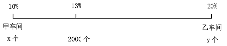

故正确答案为D。

第 71 题

**参考答案（粉笔题库参考内容）**

D

**解析**

根据公式：概率；根据题意可知：，即只有1人被选中的情况数=2人均被选中的情况数×30。

方法一：

设该单位有职工n人，根据题意可知：n＞3。张立和李磊中只有1人被选中，需先从2人中选择1人，再从剩余的职工中选择2人，满足条件的情况数为；张立和李磊2人均被选中，需要从剩余的职工中再选择1人，满足条件的情况数为。可列式：（n−2）×（n−3）=（n−2）×30，解得n=33人。

方法二：

根据题干信息代入排除。

代入A项：若该单位有职工15人，张立和李磊中只有1人被选中，满足条件的情况数为；张立和李磊均被选中，满足条件的情况数为。可验证：，错误；

代入B项：若该单位有职工17人，张立和李磊中只有1人被选中，满足条件的情况数为；张立和李磊均被选中，满足条件的情况数为。可验证：，错误；

代入C项：若该单位有职工29人，张立和李磊中只有1人被选中，满足条件的情况数为；张立和李磊均被选中，满足条件的情况数为。可验证：，错误；

排除A、B、C三项，选择D项。

验证D项：若该单位有职工33人，张立和李磊中只有1人被选中，满足条件的情况数为；张立和李磊均被选中，满足条件的情况数为。可验证：，正确。

故正确答案为D。

第 72 题

**参考答案（粉笔题库参考内容）**

B

**解析**

场地要扩展成长方形且面积增加最少，需以梯形的最长底边为长方形的长，梯形的高为长方形的宽，扩展后的场地EFCD如下图所示。在梯形ABCD中，，，赋值AB=3，CD=5，设梯形的高为h，则。扩展后的长方形场地面积最小为5h，扩展后场地面积比原来至少增加。

故正确答案为B。

第 73 题

**参考答案（粉笔题库参考内容）**

A

**解析**

设调动后甲办公室职工的平均年龄为x岁，则调动前甲办公室职工的平均年龄为（x-2）岁，根据甲办公室减少人员年龄等于乙办公室增加人员年龄，可列式：，解得x=50，即调动后甲办公室职工的平均年龄为50岁。

故正确答案为A。

第 74 题

**参考答案（粉笔题库参考内容）**

C

**解析**

根据题意可知，8月10日、20日，9月10日、20日，这4天中有2天既接访群众又参加工作例会，即这4天中仅有2天是周一。这4天中相邻2天间隔天数依次为10天、21天、10天，21天为7的倍数，则仅8月20日与9月10日的星期数相同，故8月20日与9月10日为周一，则9月3日为周一，9月1日为周六。

故正确答案为C。

第 75 题

**参考答案（粉笔题库参考内容）**

D

**解析**

首先，芯片制造仅在 10:30-12:00时间段有，分会场二、三选择一场，选择方式有种；其次，6G通信仅在14:30-16:00、16:30-18:00时间段有，选择方式有种。若6G通信选定在下午其中一个时间段，则下午另外一个时间段只能从人工智能和网络安全选择1种。分类讨论如下：

①若选择人工智能，则8:30-10:00时间段只能选择网络安全1种；

②若选择网络安全，则8:30-10:00时间段可在分会场一、分会场三中选择一场人工智能，选择方式有2种。

综上，选择方式有种。

故正确答案为D。

第 76 题

**参考答案（粉笔题库参考内容）**

A

**解析**

元素组成相同，优先考虑位置规律。观察发现，题干每幅图形中四个黑色三角形均沿着折线逆时针方向每次走一步，且每次自身顺时针旋转，如下图所示。

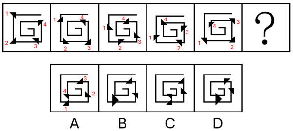

因此？处图形也应满足此规律，只有A项符合。

故正确答案为A。

第 77 题

**参考答案（粉笔题库参考内容）**

D

**解析**

元素组成不同，且无明显属性规律，考虑数量规律。观察发现，题干每幅图形均分为2个部分，且其中一个部分有1个黑球，另一个部分有2个黑球，只有D项符合规律。

故正确答案为D。

第 78 题

**参考答案（粉笔题库参考内容）**

D

**解析**

元素组成相同，但无明显位置规律和属性规律，考虑数量规律。观察发现，题干图形均由不同形状小黑块连接而成，且黑色块之间围成封闭面，考虑面数量。题干图形面数量依次为0、1、2、3、4，故？处图形面数量应为5，只有D项符合。

故正确答案为D。

第 79 题

**参考答案（粉笔题库参考内容）**

C

**解析**

元素组成相似，且有相同线条重复出现，优先考虑样式规律中的加减同异。九宫格优先看横行，观察发现，第一行中，图1和图2先求异，再逆时针旋转，即可得到图3；经验证，第二行满足此规律；第三行应用此规律，只有C项符合。

故正确答案为C。

第 80 题

**参考答案（粉笔题库参考内容）**

B

**解析**

本题考查三视图。题干中俯视图中间一列最下方为黑色正方形，左视图最右列只有最下方一个黑色正方形，则对应选项中正视图中间一列最下方为黑色正方形，排除C、D两项。

俯视图、左视图结合选项主视图可以确定立体图形，逐一分析A、B选项。

A项：结合题干两个视图和A项，可能的立体图形有以下5种情况（注意图④和图⑤两个箭头指向的正方体的下方为黑色正方体），如下图所示。此时在所有情况下，立体图形均只有12个白色正方体，而题干中所给为15个白色正方体，不符合题干要求，排除；

B项：结合题干两个视图和B项，可以确定立体图形（注意第二层左上角为黑色正方体），如下图所示。此时立体图形有15个白色正方体和3个黑色正方体，符合题干要求，当选。

故正确答案为B。

第 81 题

**参考答案（粉笔题库参考内容）**

A

**解析**

将原展开图标上序号如下图，逐一进行分析。

A项：选项中左侧正方体纸盒由面f和面i构成，右侧正方体纸盒由面f、面g和面k构成，选项与题干展开图一致，当选；

B项：选项中右侧正方体纸盒由面e、面h和面i构成，题干展开图中三个面的公共点与面i上黑块的顶点重合，而选项中三个面的公共点与面i上的黑块不相交，选项与题干展开图不一致，排除；

C项：选项中左侧正方形纸盒由面f和面h构成，题干展开图中面f和面h为相对面，不能同时出现，选项与题干展开图不一致，排除；

D项：选项中右侧正方形纸盒由面f、面h和面i构成，题干展开图中面f和面h为相对面，不能同时出现，选项与题干展开图不一致，排除。

故正确答案为A。

第 82 题

**参考答案（粉笔题库参考内容）**

C

**解析**

本题考查立体拼合。题干多面体可以由A、B、D三项中的立体图形拼合而成，具体拼合过程如下图所示：

本题为选非题，故正确答案为C。

第 83 题

**参考答案（粉笔题库参考内容）**

C

**解析**

本题为分组分类题目。元素组成相同，但无明显位置规律。观察发现，题干图形均出现两个黑块，在连接两个黑块的最短路径中，且图①③⑥中两个黑块均通过一条线连接，图②④⑤中两个黑块均通过一个面连接，即图①③⑥为一组，图②④⑤为一组。

故正确答案为C。

第 84 题

**参考答案（粉笔题库参考内容）**

B

**解析**

元素组成不同，且无明显属性规律，优先考虑数量规律。观察发现，题干每幅图中均存在一个黑色面和四个白色面，但根据面的数量无法分组分类，故考虑面的细化。再次观察发现，每幅图中均有1-2个白色面形状与黑色面形状相同，故考虑相同形状的面，图①②④中黑色面的形状与2个白色面形状一致，图③⑤⑥中黑色面的形状与1个白色面形状一致，故图①②④为一组，图③⑤⑥为一组。

故正确答案为B。

第 85 题

**参考答案（粉笔题库参考内容）**

A

**解析**

题干图形均由正六边形宫格及若干线条组成，且线条之间都存在一个十字交叉点，观察十字交叉点的位置，图①④⑤中十字交叉点位于白球外部，图②③⑥中十字交叉点位于白球内部，故图①④⑤为一组，图②③⑥为一组，只有A项符合。

故正确答案为A。

第 86 题

**参考答案（粉笔题库参考内容）**

C

**解析**

第一步：找出定义关键词。

“主动交代本人应当受到党纪处分的问题”、“涉嫌违纪的党员在组织谈话函询、初步核实前向有关组织交代自己的问题”、“在谈话函询、初步核实和立案审查期间交代组织未掌握的问题”。

第二步：逐一分析选项。

A项：甲主动找到单位领导反映同事的违纪问题，并非交代本人的违纪问题，不符合“主动交代本人应当受到党纪处分的问题”，不符合定义，排除；

B项：乙在组织对其进行廉政谈话时，组织举证一项他才承认一项，不符合“主动交代本人应当受到党纪处分的问题”，不符合定义，排除；

C项：丙在纪委对其个人财产有关事项进行函询时，如实交代了自己利用职权谋利的问题，符合“在谈话函询、初步核实和立案审查期间交代组织未掌握的问题”，符合定义，当选；

D项：丁在纪委立案审查期间，面对确凿证据才交代了之前未交代的收受大额礼金的问题，不符合“主动交代本人应当受到党纪处分的问题”、“在谈话函询、初步核实和立案审查期间交代组织未掌握的问题”，不符合定义，排除。

故正确答案为C。

第 87 题

**参考答案（粉笔题库参考内容）**

D

**解析**

第一步：找出定义关键词。

“同行业竞争对手的威胁”、“潜在进入者的威胁”、“替代品的威胁”、“上游供应商的议价能力”、“下游购买者的议价能力”、“帮助企业了解其所处行业的竞争环境，以制定相应的竞争策略”。

第二步：逐一分析选项。

A项：康复机器人行业准入门槛高吗？需要强大的技术能力和创新能力吗？问题中的“准入门槛”、“技术能力和创新能力”直接关系到潜在企业能否进入康复机器人行业，符合波特五力模型中的“潜在进入者的威胁”，符合定义，排除；

B项：医院和康复中心患者规模如何？对于康复机器人的需求有多大？问题中的“医院”和“康复中心”是康复机器人的“下游购买者”，“患者规模”与“需求程度”会直接影响购买者采购时的“议价能力”，符合波特五力模型中的“下游购买者的议价能力”，符合定义，排除；

C项：与传统物理治疗等康复治疗方法相比，康复机器人有竞争力吗？问题中的“传统物理治疗”是康复机器人的“替代方案”，是在分析“替代品”的竞争力对行业的威胁，符合波特五力模型中的“替代品的威胁”，符合定义，排除；

D项：康复机器人企业内部各部门之间的协同合作程度高吗？问题中的“企业内部各部门之间的协同合作程度”属于企业“内部管理”的范畴，不符合波特五力模型中的任何一个，不符合定义，当选。

本题为选非题，故正确答案为D。

第 88 题

**参考答案（粉笔题库参考内容）**

B

**解析**

第一步：找出定义关键词。

直线型组织结构：“每一个部门只对其直接的下属部门下达工作指令”、“不能越级指挥”、“每一个部门也只有一个直接的上级部门”；

职能型组织结构：“每一个部门都可对其下属部门下达工作指令”、“每一个下属部门可能得到不同上级部门下达的多个工作指令”；

直线职能型组织结构：“在主管之下设置相应的职能部门，实行主管统一指挥与职能部门参谋指导相结合的管理方式”、“各部门既受上级的管理，又受同级职能管理部门的业务指导和监督”；

事业部组织结构：“由相对独立的事业部组成的组织结构”、“通常按照地区或项目来划分事业部”、“每个事业部拥有较大的自主权”。

第二步：逐一分析选项。

A项：结构图中项目二组和项目三组等存在多个上级部门下达指令，不符合“每一个部门也只有一个直接的上级部门”，不符合“直线型组织结构”定义，排除；

B项：结构图中的每一个部门都有上级部门，且项目二组和项目三组等存在多个上级部门下达工作指令，符合“每一个部门都可对其下属部门下达工作指令”、“每一个下属部门可能得到不同上级部门下达的多个工作指令”，符合“职能型组织结构”定义，当选；

C项：结构图中的每个部门都不存在同级职能管理部门的业务指导和监督，不符合“各部门既受上级的管理，又受同级职能管理部门的业务指导和监督”，不符合“直线职能型组织结构”定义，排除；

D项：结构图中工程技术部、财务管理部、合同管理部以及项目二组、项目三组等都需要按照上级下达的指令工作，不符合“每个事业部拥有较大的自主权”，不符合“事业部组织结构”定义，排除。

故正确答案为B。

第 89 题

**参考答案（粉笔题库参考内容）**

B

**解析**

第一步：找出定义关键词。

均变论：“支配各种地质过程的法则在地质历史上没有发生过变化”、“现在起作用的各种自然营力在漫长的地质过程中具有普遍的均一性”、“地球上生物的种与种之间有过渡关系，生物进化过程是极其漫长的”。

灾变论：“地球经常发生各种突如其来的、短暂的全球性灾难性变化，这些变化强烈地改变了地球的面貌”、“地球上生物的变化是反复多次灾变的结果”。

第二步：逐一分析选项。

A项：“我们找不到开始的痕迹，也看不到结束的迹象”，体现了“支配各种地质过程的法则在地质历史上没有发生过变化”、“地球上生物的种与种之间有过渡关系，生物进化过程是极其漫长的”，符合“均变论”定义，不符合“灾变论”定义，排除；

B项：“地质记录是一部被鲜血和火焰写成的史诗”，“鲜血和火焰”隐喻的是灾难，体现了“地球经常发生各种突如其来的、短暂的全球性灾难性变化，这些变化强烈地改变了地球的面貌”，符合“灾变论”定义，当选；

C项：“现在是通往过去的一把钥匙”，体现了“支配各种地质过程的法则在地质历史上没有发生过变化”、“现在起作用的各种自然营力在漫长的地质过程中具有普遍的均一性”、“地球上生物的种与种之间有过渡关系，生物进化过程是极其漫长的”，符合“均变论”定义，不符合“灾变论”定义，排除；

D项：“自然界里没有飞跃”，体现了“地球上生物的种与种之间有过渡关系，生物进化过程是极其漫长的”，符合“均变论”定义，不符合“灾变论”定义，排除。

故正确答案为B。

第 90 题

**参考答案（粉笔题库参考内容）**

A

**解析**

第一步：找出定义关键词。

商品动销率：“在售的商品品种数与库存商品总品种数的比率”；

商品库销比：“商品库存量与销售额的比率”；

商品滞销率：“滞销的商品品种数占库存商品总品种数的比率”；

商品损耗率：“一定的保管条件下，某商品在储存保管期间”、“自然损耗量与商品在库总量的比例”。

第二步：逐一分析选项。

A项：根据商品动销率，若商品动销率超过100%，说明商品在售品种数高于库存商品总品种数，说法正确，当选；

B项：根据商品损耗率，若商品损耗率高，表明商品自然损耗量相对升高或者商品在库总量相对降低，无法必然得到库存积压情况或销售态势情况，说法错误，排除；

C项：根据商品滞销率，若库存商品数一定时，商品滞销率越高，说明滞销的“商品品种数”越多，而不是滞销的“商品”越多（可能仅指商品数量），说法错误，排除；

D项：根据商品库销比，当商品库存量越大，销售额越高时，因无法确定比值的大小关系，所以无法得知商品库销比一定会越大，说法错误，排除。

故正确答案为A。

第 91 题

**参考答案（粉笔题库参考内容）**

A

**解析**

第一步：找出定义关键词。

叙实动词：“肯定式和否定式都预设其宾语小句为真”；

非叙实动词：“肯定式和否定式都不预设其宾语小句为真，也不预设其宾语小句为假”；

反叙实动词：“肯定式和否定式都预设其宾语小句为假”。

第二步：逐一分析选项。

A项：“我听说他来过这里”中的“听说”只是陈述信息的来源，没有预设“来过这里”为真或为假，符合“肯定式和否定式都不预设其宾语小句为真，也不预设其宾语小句为假”，符合“非叙实动词”定义，当选；

B项：“我庆幸听了你的建议”中的“庆幸”意味着听了建议是已经发生的事实，是预设其为真，符合“肯定式和否定式都预设其宾语小句为真”，符合“叙实动词”定义，不符合“非叙实动词”定义，排除；

C项：“我知道你帮助过我”中的“知道”意味着帮助过我是真实存在的事实，是预设其为真，符合“肯定式和否定式都预设其宾语小句为真”，符合“叙实动词”定义，不符合“非叙实动词”定义，排除；

D项：“我幻想成为一只小鸟”中的“幻想”是不可能发生的事，是预设其为假，符合“肯定式和否定式都预设其宾语小句为假”，符合“反叙实动词”定义，不符合“非叙实动词”定义，排除。

故正确答案为A。

第 92 题

**参考答案（粉笔题库参考内容）**

B

**解析**

第一步：找出定义关键词。

自主动机：“出于兴趣或内在满足感”、“从事某种活动”；

外部动机：“为获得外部奖励或避免惩罚”、“从事某种活动”；

自主性需求：“希望自己能控制和选择自己的行为，而不是受到外部强制”；

胜任性需求：“希望能在自己做的事上获得成就感和自我效能感”；

归属感需求：“希望与他人建立有意义的联系，感受到归属和支持”。

第二步：逐一分析选项。

A项：小张参加了一项感兴趣的社交活动，符合“出于兴趣或内在满足感”、“从事某种活动”，体现了自主动机；他认为这能帮助自己结交新朋友，符合“希望与他人建立有意义的联系，感受到归属和支持”，体现了归属感需求，说法正确，排除；

B项：小李担心不参加被扣绩效，符合“为获得外部奖励或避免惩罚”、“从事某种活动”，体现了外部动机；但小李担心如果不参加就会被扣绩效，说明其受到外部约束，不符合“希望自己能控制和选择自己的行为，而不是受到外部强制”，没有体现自主性需求，说法错误，当选；

C项：小王每天晨跑，很享受锻炼带来的满足感，符合“出于兴趣或内在满足感”、“从事某种活动”，体现了自主动机；他坚信这是促进健康的必要努力，符合“希望能在自己做的事上获得成就感和自我效能感”，体现了胜任性需求，说法正确，排除；

D项：小陈和队友为实现团体奖牌零的突破而努力，追求的是成就感，符合“希望能在自己做的事上获得成就感和自我效能感”，体现了胜任性需求；他与队友相互鼓励，符合“希望与他人建立有意义的联系，感受到归属和支持”，体现了归属感需求，说法正确，排除。

本题为选非题，故正确答案为B。

第 93 题

**参考答案（粉笔题库参考内容）**

B

**解析**

第一步：找出定义关键词。

动作预期：“运动员”、“在比赛过程中”、“根据已有信息，对即将发生的动作结果进行预测”；

运动学信息：“对手的动作”、“器材的运动轨迹”、“队员之间的相对位置”；

情境先验信息：“比赛情境中事件发生的概率”。

第二步：逐一分析选项。

A项：篮球队员甲，符合“运动员”，根据对手今日比赛罚篮命中率不高，在对手投篮时选择直接犯规，即预测犯规后对手会罚篮不中，符合“在比赛过程中”、“根据已有信息，对即将发生的动作结果进行预测”、“比赛情境中事件发生的概率”，符合“情境先验信息”定义，排除；

B项：网球运动员乙知道对手在比赛前有一系列习惯性动作，不符合“在比赛过程中”，且乙是暗自提醒自己不要被干扰，未利用这些信息进行预测，不符合“对即将发生的动作结果进行预测”，不符合“动作预期”定义，进而也不符合“运动学信息”定义和“情境先验信息”定义，当选；

C项：羽毛球双打运动员丙，符合“运动员”，根据对方准备接发球的球员位置稍微靠前，预测对方来不及转身或后退接球，符合“在比赛过程中”、“根据已有信息，对即将发生的动作结果进行预测”、“比赛情境中事件发生的概率”，符合“情境先验信息”定义，排除；

D项：乒乓球运动员丁，符合“运动员”，根据对方发过来的球位置较低、速度较慢，预测球会擦网变线，符合“在比赛过程中”、“根据已有信息，对即将发生的动作结果进行预测”、“器材的运动轨迹”、“比赛情境中事件发生的概率”，符合“运动学信息”定义，也符合“情境先验信息”定义，排除。

本题为选非题，故正确答案为B。

第 94 题

**参考答案（粉笔题库参考内容）**

C

**解析**

第一步：找出定义关键词。

“企业对生产运作过程中各工序原材料、半成品”、“按照位置、数量、质量及车间之间的物料转运等进行的控制”。

第二步：逐一分析选项。

A项：服装厂确保衣料在不同流水线上流转有序，其中衣料属于生产运作过程中的原材料，符合“企业对生产运作过程中各工序原材料、半成品”，在流水线上流转属于在车间内的物料转运，符合“按照位置、数量、质量及车间之间的物料转运等进行的控制”，符合定义，排除；

B项：食品厂设立质检员，定时对各个工序的食材抽样进行衍生物检测，剔除不良品，其中对各个工序的食材抽样属于在生产运作过程中的原材料、半成品，符合“企业对生产运作过程中各工序原材料、半成品”，质检员抽样检测是对产品质量的把控，符合“按照位置、数量、质量及车间之间的物料转运等进行的控制”，符合定义，排除；

C项：制药厂规定员工进入洁净区后需每两小时洗手一次，这是对员工进行要求，并非对原材料、半成品进行把控，不符合“企业对生产运作过程中各工序原材料、半成品”进行控制，不符合定义，当选；

D项：家具厂对板材进行定期盘点，并合理摆放，体现了企业对在生产过程中的板材进行数量把控，符合“企业对生产运作过程中各工序原材料、半成品”、“按照位置、数量、质量及车间之间的物料转运等进行的控制”，符合定义，排除。

本题为选非题，故正确答案为C。

第 95 题

**参考答案（粉笔题库参考内容）**

D

**解析**

第一步：找出定义关键词。

“机械设备没有发生故障或尚未造成损坏”、“对产品的系统性检查、设备测试或更换以防止设备发生故障”。

第二步：逐一分析选项。

A项：道路两旁护栏不是机械设备，且发现护栏松动、断裂时进行修复，是护栏出现问题之后的维修，不符合“机械设备没有发生故障或尚未造成损坏”，不符合定义，排除；

B项：正式制造某种设备前的测量，是生产环节的质量检查，不是对已有设备的维护，不符合“机械设备没有发生故障或尚未造成损坏”、“对产品的系统性检查、设备测试或更换以防止设备发生故障”，不符合定义，排除；

C项：某数控车床突然发生摇动，检查后发现电机出现故障，更换电机后车床可正常运行，说明是电机出现问题之后的维修，不符合“机械设备没有发生故障或尚未造成损坏”，不符合定义，排除；

D项：对辖区内变压器、配电盘、电缆线路等电力设备设施隐患进行专项排查，符合“机械设备没有发生故障或尚未造成损坏”、“对产品的系统性检查、设备测试或更换以防止设备发生故障”，符合定义，当选。

故正确答案为D。

第 96 题

**参考答案（粉笔题库参考内容）**

D

**解析**

第一步：判断题干词语间逻辑关系。

“经年”指经过一年或若干年，“积岁”指累积多年，二者均可指经过多年，为近义关系。

第二步：判断选项词语间逻辑关系。

A项：“善本”指古代书籍中文字讹误较少、学术或艺术价值上比一般本子优异的刻本或写本，“版本”指同一部书因编辑、传抄、刻版、排版或装订形式等的不同而产生的不同的本子，“善本”是“版本”的一种类型，二者不是近义关系，与题干逻辑关系不一致，排除；

B项：“秘方”指不公开的有显著医疗效果的药方，“偏方”指民间流传不见于古典医学著作的中药方，前者从是否公开角度划分，后者从是否正规角度划分，二者为交叉关系，与题干逻辑关系不一致，排除；

C项：“仲夏”指夏季的第二个月，是“夏季”的一部分，二者为组成关系，与题干逻辑关系不一致，排除；

D项：“黎民”指平民、民众，“百姓”指军人和官员以外的人，二者均可指普通民众，为近义关系，与题干逻辑关系一致，当选。

故正确答案为D。

第 97 题

**参考答案（粉笔题库参考内容）**

A

**解析**

第一步：判断题干词语间逻辑关系。

基因调控是控制细胞凋亡和细胞增殖的机制，细胞凋亡和细胞增殖是两种相反的细胞过程，第一个词和第三个词为并列关系，均与第二个词构成影响因素的对应。

第二步：判断选项词语间逻辑关系。

A项：税率调整是影响成本降低和成本增加的机制，成本降低和成本增加是两种相反的结果，第一个词和第三个词为并列关系，均与第二个词构成影响因素的对应，与题干逻辑关系一致，当选；

B项：经济萧条和经济复苏是经济周期中的不同阶段，是经济周期的组成部分，第一个词和第三个词为并列关系，均与第二个词构成组成关系，与题干逻辑关系不一致，排除；

C项：价格尺度和流通手段均属于货币职能，第一个词和第三个词为并列关系，均与第二个词构成种属关系，与题干逻辑关系不一致，排除；

D项：具身智能就是具身化的人工智能，具身智能属于人工智能，智能时代是所处的背景，第一个词和第三个词为种属关系，均与第二个词构成所处背景的对应关系，与题干逻辑关系不一致，排除。

故正确答案为A。

第 98 题

**参考答案（粉笔题库参考内容）**

A

**解析**

第一步：判断题干词语间逻辑关系。

护患比=护士人数/患者人数，三者满足公式关系。

第二步：判断选项词语间逻辑关系。

A项：平均理赔金额=理赔总额/理赔次数，与题干逻辑关系一致，当选；

B项：签收率=实际签收数量/应签收数量，但词语顺序与题干不一致，排除；

C项：流动比率=流动资产/流动负债，但词语顺序与题干不一致，排除；

D项：入住率=入住客房数/客房数，而入住客房数旅客数，每间客房入住的旅客数可能不同，与题干逻辑关系不一致，排除。

故正确答案为A。

第 99 题

**参考答案（粉笔题库参考内容）**

D

**解析**

逐一代入选项。

A项：颅内感染是颅内疾病的一种，二者为种属关系；岩石熔融和岩石断裂是两种不同的地质现象，二者为并列关系，前后逻辑关系不一致，排除；

B项：颅内疾病是机体疾病的一种，二者为种属关系；地壳应力是导致岩石断裂的原因，二者为因果关系，前后逻辑关系不一致，排除；

C项：核磁共振是用来诊断颅内疾病的方法，二者为诊断方法与疾病的对应关系；地下采样可以判断岩石是否有断裂，但顺序反了，前后逻辑关系不一致，排除；

D项：颅内疾病会导致视野缺失，二者为因果对应关系；冰川运动会导致岩石断裂，二者为因果对应关系，前后逻辑关系一致，当选。

故正确答案为D。

第 100 题

**参考答案（粉笔题库参考内容）**

B

**解析**

第一步：判断题干词语间逻辑关系。

根据题干图形可知，①和②是交叉关系；③属于①，③和①是种属关系；③属于②，③和②是种属关系。

第二步：判断选项词语间逻辑关系。

A项：航空母舰（③）是指军队专用的机动船只，与非机动船（②）不是种属关系，与题干逻辑关系不一致，排除；

B项：落叶树（①）和乔木（②）是交叉关系；水杉（③）属于落叶树（①），③和①是种属关系；水杉（③）属于乔木（②），③和②是种属关系，与题干逻辑关系一致，当选；

C项：少儿读物（③）和电子书（②）是交叉关系，不是种属关系，与题干逻辑关系不一致，排除；

D项：中国国家一级保护野生动物（③）和哺乳动物（①）是交叉关系，不是种属关系，与题干逻辑关系不一致，排除。

故正确答案为B。

第 101 题

**参考答案（粉笔题库参考内容）**

C

**解析**

第一步：找出论点和论据。

论点：合成数据的使用会影响AI的准确性。

论据：当AI模型过于依赖合成数据时，它们会产生更多“幻觉”，编造看似合理可信但实际上并不存在的信息。

本题论点和论据都在讨论“合成数据”与“AI准确性”之间的关系，二者话题一致，加强优先考虑补充论据。

第二步：逐一分析选项。

A项：该项指出合成数据可能泄露敏感信息，引发“隐私风险”，而论点讨论的是合成数据对“AI准确性”的影响，二者话题不一致，无法加强，排除；

B项：该项指出合成数据存在过于简单化的风险，无法完全模拟真实世界的复杂性，并不明确“无法模拟复杂性”是否会影响“AI的准确性”，为不明确项，无法加强，排除；

C项：该项指出合成数据会放大源数据的错误或偏差，导致“失之毫厘，差之千里”，说明合成数据会放大错误，最终导致AI输出不准确，解释了为何“合成数据”会影响“AI准确性”，补充论据，可以加强，当选；

D项：该项指出合成数据“多样性不足，限制泛化能力”，并不明确“数据多样性不足”、“限制AI模型的泛化能力”是否会影响“AI的准确性”，为不明确项，无法加强，排除。

故正确答案为C。

第 102 题

**参考答案（粉笔题库参考内容）**

C

**解析**

第一步：找出论点和论据。

论点：现代陆地生态系统的高度复杂性，正是这种古老协同机制延续和演化的结果。

论据：白垩纪陆地生态系统的变革是由植物、昆虫、脊椎动物与地质过程等多个要素相互作用推动的，形成了一个高度协同演化的系统结构。鉴于这一机制在当时造就了复杂而稳定的生态格局。

从论据“白垩纪”高度协同演化的系统结构造就了复杂而稳定的生态格局，推出“现代”也是同样的情况，在这种“时期不同”的文段结构下，可以考拆桥，即“白垩纪的情况现代”。

第二步：逐一分析选项。

A项：指出白垩纪末期的生态危机对海洋系统和陆地系统的不同影响，与论点讨论的“白垩纪时期陆地生态系统高度协同演化的机制影响了现代陆地生态系统”无关，无法削弱，排除；

B项：指出白垩纪时期植物、昆虫、脊椎动物与地质过程的演化几乎是在同一时期进行的，说明白垩纪时期陆地生态系统高度协同演化，与论点讨论的“白垩纪时期陆地生态系统高度协同演化的机制影响了现代陆地生态系统”无关，无法削弱，排除；

C项：指出现代陆地生态系统的复杂性与白垩纪显著不同，说明不能根据白垩纪的情况推出现代，拆桥项，可以削弱，当选；

D项：指出被子植物的全球扩张对生态结构的主导作用可能被高估，与论点讨论的“白垩纪时期陆地生态系统高度协同演化的机制影响了现代陆地生态系统”无关，无法削弱，排除。

故正确答案为C。

第 103 题

**参考答案（粉笔题库参考内容）**

D

**解析**

第一步：翻译题干。

①破除我国城乡二元结构、拓展高质量发展空间完善城乡融合发展体制机制；

②完善城乡融合发展体制机制完善农业农村优先发展的投入保障机制 且 优化城乡公共资源配置机制；

③完善农业农村优先发展的投入保障机制加大中央预算内投资和地方政府专项债券支持力度 且 提高土地出让收入用于农业农村的比例；

④优化城乡公共资源配置机制推进户籍制度改革。

①②③可串联得到：⑤破除我国城乡二元结构、拓展高质量发展空间完善城乡融合发展体制机制完善农业农村优先发展的投入保障机制加大中央预算内投资和地方政府专项债券支持力度 且 提高土地出让收入用于农业农村的比例；

①②④可串联得到：⑥破除我国城乡二元结构、拓展高质量发展空间完善城乡融合发展体制机制优化城乡公共资源配置机制推进户籍制度改革。

第二步：逐一分析选项。

A项：该项翻译为“推进户籍制度改革优化城乡公共资源配置机制”，是对④的肯后，肯后得不到确定性的结论，无法推出，排除；

B项：该项翻译为“完善农业农村优先发展的投入保障机制完善城乡融合发展体制机制”，是肯定②箭头后“且关系”中的一部分，肯后得不到确定性的结论，不能推出，排除；

C项：该项翻译为“提高土地出让收入用于农业农村的比例完善农业农村优先发展的投入保障机制”，是肯定③箭头后“且关系”中的一部分，肯后得不到确定性的结论，不能推出，排除；

D项：该项翻译为“破除我国城乡二元结构、拓展高质量发展空间加大中央预算内投资和地方政府专项债券支持力度”，是对⑤的肯前，肯前必肯后，可以推出，当选。

故正确答案为D。

第 104 题

**参考答案（粉笔题库参考内容）**

B

**解析**

第一步：找出论点和论据。

论点：平台企业金融化程度的加深使得平台劳动者的劳动权益保护问题日益突出。

论据：无。

本题只有论点，没有论据，加强优先考虑补充论据。

第二步：逐一分析选项。

A项：选项指出为扩大市场规模、争夺消费者注意力，平台企业容易陷入无序竞争，与论点讨论的平台企业金融化程度加深是否会导致平台劳动者的劳动权益保护问题日益突出无关，无关项，无法加强，排除；

B项：选项指出为塑造轻资产企业形象、摆脱劳动密集型标签，说明平台企业金融化程度在加深，平台企业采用弹性用工制，增加劳动者就业不稳定性，说明平台劳动者的具体劳动和生产过程发生了变化，且增加了平台劳动者的劳动权益保护问题，补充论据，可以加强，当选；

C项：选项指出平台企业越来越注重员工培训，与论点讨论的平台企业金融化程度加深是否会导致平台劳动者的劳动权益保护问题无关，无关项，无法加强，排除；

D项：选项指出部分平台企业以缴纳保证金、押金或其他名义向劳动者收取财物，限制劳动者在多平台就业，但是不明确这些平台是否存在企业金融化程度的加深，不明确选项，无法加强，排除。

故正确答案为B。

第 105 题

**参考答案（粉笔题库参考内容）**

C

**解析**

第一步：找出论点和论据。

论点：这些动物一定属于鸟类。

论据：这些似鸟动物体型与现代鸟类大致接近，尾巴很短，最重要的是它们都具有愈合的尾综骨。

本题论点讨论的是这些似鸟动物属于鸟类，论据讨论的是这些似鸟动物有愈合的尾综骨，二者话题不一致，加强优先考虑搭桥，即在“鸟类”和“愈合的尾综骨”之间建立联系。

第二步：逐一分析选项。

A项：该项指出这些似鸟动物与现代鸟类具有相似的脚骨，但是不明确脚骨是否能够判断这些似鸟动物为鸟类，属于不明确选项，无法加强，排除；

B项：该项强调这些化石保存的尾综骨等形态清晰，说明这些动物确实具有尾综骨，可以加强论据，但不是论证成立的前提，排除；

C项：该项指出鸟类与爬行动物的显著区别是鸟类最后几枚尾椎愈合成为尾综骨，建立了“鸟类”和“愈合的尾综骨”之间的联系，为搭桥项，是论证成立的前提，当选；

D项：该项强调尾综骨结构对似鸟动物独立运动以及飞行能力的重要性，但不能判断其是否属于鸟类，属于不明确选项，无法加强，排除。

故正确答案为C。

第 106 题

**参考答案（粉笔题库参考内容）**

D

**解析**

第一步：分析题干条件。

（1）王、韩没有参加同一个项目；

（2）韩羽毛球宋网球；

（3）王乒乓球吴网球，-王乒乓球吴网球；

（4）每支队伍由其中2人组成，4人均至少参加了其中的一支队伍。

第二步：根据题干条件进行推理。

本题题干信息确定，选项信息充分，优先考虑排除法。

由条件（1）可知，王、韩没有参加同一个项目，排除A项；

由条件（2）可知，韩参加羽毛球，则宋参加网球，排除B项；

由条件（3）可知，王参加乒乓球，则吴参加网球，排除C项。

经验证，D项满足题干所有条件，当选。

故正确答案为D。

第 107 题

**参考答案（粉笔题库参考内容）**

B

**解析**

第一步：分析题干条件。

（1）王、韩没有参加同一个项目；

（2）韩羽毛球宋网球；

（3）王乒乓球吴网球，-王乒乓球吴网球；

（4）每支队伍由其中2人组成，4人均至少参加了其中的一支队伍；

（5）宋和韩组队网球。

第二步：根据题干条件进行推理。

根据条件（1）和（5）可知，王不参加网球；根据条件（4）和（5）可知，宋和韩组队网球，队伍已满2人，所以吴不参加网球，结合条件（3）可知，王不参加乒乓球；再结合条件（4）4人均至少参加了其中的一支队伍可知，王参加羽毛球。

故正确答案为B。

第 108 题

**参考答案（粉笔题库参考内容）**

A

**解析**

第一步：分析题干条件。

（1）王、韩没有参加同一个项目；

（2）韩羽毛球宋网球；

（3）王乒乓球吴网球，-王乒乓球吴网球；

（4）每支队伍由其中2人组成，4人均至少参加了其中的一支队伍；

（5）吴参加了3个项目。

第二步：根据题干条件进行推理。

根据条件（4）和（5）可知，吴参加了网球、乒乓球和羽毛球3个项目，王、韩和宋每人均只参加1个项目，结合条件（3）“-王乒乓球吴网球”可知，王参加乒乓球项目，此时，韩和宋只需要分别参加羽毛球和网球中的1个项目即可。综上所述，选项中只有A项可能正确。

故正确答案为A。

第 109 题

**参考答案（粉笔题库参考内容）**

B

**解析**

第一步：分析题干条件。

（1）王、韩没有参加同一个项目；

（2）韩羽毛球宋网球；

（3）王乒乓球吴网球，-王乒乓球吴网球；

（4）每支队伍由其中2人组成，4人均至少参加了其中的一支队伍。

第二步：根据题干条件进行推理。

题干问法为“可能”，优先使用代入法。

代入A项：王和吴同时组队网球和羽毛球双打，根据条件（4）可知，韩和宋组队乒乓球双打，此时与条件（3）的后一个推出关系矛盾，不满足题干条件，不可能为真，排除；

代入B项：王和宋同时组队网球和羽毛球双打，根据条件（4）可知，吴和韩组队乒乓球双打，此时满足题干所有条件，可能为真，当选；

代入C项：吴和宋同时组队网球和羽毛球双打，根据条件（4）可知，王和韩组队乒乓球双打，此时与条件（1）矛盾，不满足题干条件，不可能为真，排除；

代入D项：韩和宋同时组队网球和羽毛球双打，王和吴组队乒乓球双打，此时与条件（3）的前一个推出关系矛盾，不满足题干条件，不可能为真，排除；

故正确答案为B。

第 110 题

**参考答案（粉笔题库参考内容）**

D

**解析**

第一步：分析题干条件。

（1）王、韩没有参加同一个项目；

（2）韩羽毛球宋网球；

（3）王乒乓球吴网球，-王乒乓球吴网球；

（4）每支队伍由其中2人组成，4人均至少参加了其中的一支队伍；

（5）宋和韩组队乒乓球双打。

第二步：根据题干条件进行推理。

根据条件（4）与（5），可知乒乓球队人已满，则王与吴均不能参加乒乓球项目，结合条件（3），肯前必肯后，可得吴不参加网球项目，排除A、B两项；

根据吴不参加乒乓球项目，也不参加网球项目，结合条件（4），4人均至少参加了其中的一支队伍，可得吴必须参加羽毛球项目，那么宋和韩不可能同时参加羽毛球项目，排除C项。

故正确答案为D。

第 111 题

**参考答案（粉笔题库参考内容）**

C

**解析**

根据题干“2024年上半年······顺差（出口额-进口额）比上年同期”，结合选项为百分数，且出口额=进口额+顺差，可判定本题为混合增长率问题。定位统计表可得：2024年上半年，中国医药保健品进、出口额分别为451.76亿美元、525.79亿美元，同比增长率分别为-5.76%、1.96%。根据混合增长率口诀“混合后居中但不正中”可得，进口额增长率（-5.76%）＜出口额增长率（1.96%）＜顺差增长率，排除A、B两项。

2024年上半年中国医药保健品进出口贸易顺差亿美元，根据线段法：距离与量成反比（一般用现期量代替基期量计算），可得：，解得：，在C项范围内。

故正确答案为C。

第 112 题

**参考答案（粉笔题库参考内容）**

D

**解析**

根据题干“2024年上半年······占······的比重比上年同期”，结合选项为上升了/下降了+百分点，可判定本题为两期比重问题。定位统计表可得：2024年上半年中国医药保健品出口总额为525.79亿美元（B），同比增长1.96%（b）；中药提取物出口额为14.92亿美元（A），同比增长-14.28%（a）。根据公式：两期比重差，则题干所求为，即约下降了0.53个百分点。在D项范围内。

故正确答案为D。

第 113 题

**参考答案（粉笔题库参考内容）**

A

**解析**

根据题干“······2024年上半年······同比上升的有几类”，结合材料给出2024年上半年各小类医药保健品进口额、出口额及分别的同比增速，可判定本题为混合增长率问题。定位统计表可得2024年上半年，医药保健品12个小类进口额、出口额及分别的同比增速。根据混合增长率口诀“混合居中不正中，偏向基期较大的（一般用现期代替）”，观察可知中成药、保健品、西药原料、生化药、保健康复用品、口腔设备与材料这6类的进、出口额同比增速均大于0，则进出口总额同比增速也大于0，则同比上升，均满足；中药材及饮片、医用敷料进、出口额同比增速均小于0，则进出口总额同比增速也小于0，则同比下降，均不满足；其余类别进、出口额同比增速一正一负，其中提取物：现期量出口额14.92亿美元>进口额3.58亿美元，则，即r<0，则同比下降，不满足；西成药：现期量进口额110.28亿美元>出口额35.24亿美元，则，即r<0，则同比下降，不满足；一次性耗材：现期量出口额48.81亿美元>进口额19.55亿美元，则，即r>0，则同比上升，满足；医院诊断与治疗：现期量进口额138.23亿美元>出口额103.95亿美元，则，即r<0，则同比下降，不满足。

综上可知，2024年上半年进出口总额同比上升的有中成药、保健品、西药原料、生化药、一次性耗材、保健康复用品、口腔设备与材料，共7类。

故正确答案为A。

第 114 题

**参考答案（粉笔题库参考内容）**

C

**解析**

根据题干“······2024年上半年······同比增量从高到低排序······”，可判定本题为增长量比较问题。定位表格可得：2024年上半年，医用敷料、一次性耗材、保健康复用品、口腔设备与材料的进口额分别为2.60亿美元、19.55亿美元、9.04亿美元、7.31亿美元，同比增速分别为-8.34%、-3.05%、9.62%、14.27%。根据公式：增长量，则以上四类医疗器械进口额的同比增量分别为：①医用敷料：亿美元；②一次性耗材：亿美元；③保健康复用品：亿美元；④口腔设备与材料：亿美元。比较可知，同比增量从高到低排序正确的是：④③①②。

故正确答案为C。

第 115 题

**参考答案（粉笔题库参考内容）**

D

**解析**

根据题干“······最能准确反映2024年上半年······占比关系的是”，结合材料时间为2024年上半年，可判定本题为现期比重问题。定位统计表可知：2024年上半年，西药原料出口额为213.43亿美元、进口额为51.78亿美元；西成药出口额为35.24亿美元、进口额为110.28亿美元；生化药出口额为20.71亿美元、进口额为97.84亿美元。则2024年上半年，西药原料（白色）进出口额=213.43+51.78=265.21亿美元，西成药（横线）进出口额=35.24+110.28=145.52亿美元，生化药（黑色）进出口额=20.71+97.84=118.55亿美元。可知西药原料（白色）进出口额最大，排除C项；西药原料（白色）与西成药（横线）倍数关系为，排除A项；西成药（横线）与生化药（黑色）倍数关系为，排除B项。

故正确答案为D。

第 116 题

**参考答案（粉笔题库参考内容）**

A

**解析**

定位文字材料第一段可得：2024年全国核发绿证47.34亿个，其中可交易绿证31.58亿个。故2024年全国核发的不可交易绿证47.34-31.58=15.76亿个，结合文字材料第一段中的“1个绿证单位对应1000千瓦时可再生能源电量”，则题干所求为万亿千瓦时，与A项最接近。

故正确答案为A。

第 117 题

**参考答案（粉笔题库参考内容）**

D

**解析**

根据题干“2023年······约是2022年的多少倍”，结合材料给出2022年、2023年全国绿证累计核发量，可判定本题为现期倍数问题。定位统计图可得，2021-2023年末全国绿证累计核发量分别为3893万个、5954万个、22075万个。则2023年全国核发绿证数量=22075-5954=16121万个，2022年全国核发绿证数量=5954-3893=2061万个。则所求倍数倍，与D项最接近。

故正确答案为D。

第 118 题

**参考答案（粉笔题库参考内容）**

B

**解析**

根据题干“2024年······约占全国总量的”，结合材料时间为2024年，可判定本题为现期比重问题。定位文字材料第一段可得：2024年全国核发绿证47.34亿个；定位统计表可得：2024年绿证核发量最多的5个省级行政区是云南（74104万个）、内蒙古（39461万个）、四川（37239万个）、新疆（27483万个）、青海（21553万个）。根据公式：比重，可得题干所求为。

故正确答案为B。

第 119 题

**参考答案（粉笔题库参考内容）**

C

**解析**

根据题干“2024年，······占······的比重比······的占比高约多少个百分点”，结合材料时间为2024年，可判定本题为现期比重问题。定位文字材料第二段可得：2024年，全国集中式项目核发绿证46.77亿个。按项目类型划分，风电19.07亿个、太阳能发电8.03亿个。根据公式：比重，则题干所求为，即高约23个百分点，与C项最接近。

故正确答案为C。

第 120 题

**参考答案（粉笔题库参考内容）**

D

**解析**

A项：定位统计图可知，2017年末-2019年末全国绿证累计核发量分别为1428万个、2658万个、2954万个。则2019年全国绿证核发量为2954-2658=296万个，2018年全国绿证核发量为2658-1428=1230万个，2019年全国绿证核发量少于2018年，错误；

B项：定位文字材料第一段可知，2024年全国核发绿证47.34亿个，其中可交易绿证31.58亿个。截至2024年12月底全国累计核发绿证49.55亿个，其中可交易绿证33.79亿个。则截至2023年底，全国累计核发绿证49.55-47.34=2.21亿个，可交易绿证33.79-31.58=2.21亿个。根据公式：比重，则截至2023年底全国累计核发绿证中，可交易绿证的占比为，错误；

C项：定位文字材料第二段可知，2024年，全国集中式项目核发绿证46.77亿个，常规水电15.78亿个。根据公式：比重，则2024年全国常规水电核发绿证数量占集中式项目核发绿证总数量的比重为，即超过三分之一，错误；

D项：定位文字材料第一段可知，2024年全国核发绿证47.34亿个；定位统计表可知，2024年湖北、湖南、广东、广西分别核发绿证21445万个、10580万个、14836万个、11260万个。根据公式：比重，则2024年湖北、湖南核发绿证之和占全国比重比广东、广西之和高，即高1个百分点以上，正确。

故正确答案为D。

第 121 题

**参考答案（粉笔题库参考内容）**

B

**解析**

根据题干“2021~2024年······约是2017~2020年的多少倍”，结合材料已给出2017~2024年的相关数据，可判定本题为现期倍数问题。定位统计图1可得2017~2024年我国科幻产业营收额，则所求倍数倍。

故正确答案为B。

第 122 题

**参考答案（粉笔题库参考内容）**

D

**解析**

根据题干“如保持2024年同比增量不变，则2026-2030年······将在以下哪个范围内”，结合材料时间为2022-2024年，可判定本题为现期计算问题。定位统计图2可得：2023年、2024年我国科幻游戏产业营收分别为：651.9亿元、718.1亿元。根据公式：增长量=现期量-基期量，则2024年我国科幻游戏产业营收同比增量=718.1-651.9=66.2亿元。根据公式：现期量=基期量+n×增长量（n为年份差），则2026年营收=718.1+66.2×2=850.5亿元。可知2026-2030年累计营收构成首项为850.5、公差为66.2、项数为5的等差数列，根据等差数列求和公式：（n为项数），则2026-2030年，我国科幻游戏产业累计营收亿元，在D项范围内。

故正确答案为D。

第 123 题

**参考答案（粉笔题库参考内容）**

C

**解析**

根据题干“······2024年······同比增速快于2023年水平······”，可判定本题为一般增长率比较问题。定位统计图2可得：2024年我国科幻产业五大领域营收额分别为：35.1亿元、67.1亿元、718.1亿元、25.3亿元、244.0亿元；2023年我国科幻产业五大领域营收额分别为：31.7亿元、115.9亿元、651.9亿元、22.8亿元、310.6亿元；2022年我国科幻产业五大领域营收额分别为：30.4亿元、83.5亿元、565.0亿元、48.3亿元、150.3亿元，根据公式：增长率可得：

2024年我国科幻产业五大领域营收额的同比增速分别如下：

科幻阅读：；

科幻影视：；

科幻游戏：；

科幻衍生品：；

科幻文旅：。

2023年我国科幻产业五大领域营收额的同比增速分别如下：

科幻阅读：；

科幻影视：；

科幻游戏：；

科幻衍生品：；

科幻文旅：。

综上可知，我国科幻产业五大领域中，2024年营收额同比增速快于2023年水平的有科幻阅读、科幻衍生品两个领域。

故正确答案为C。

第 124 题

**参考答案（粉笔题库参考内容）**

A

**解析**

根据题干“2022~2024年······占······的比重超过20%的年份仅包括”，结合材料时间为2022~2024年，可判定本题为现期比重问题。定位图1可得：2022~2024年我国科幻产业营收额分别为877.5亿元、1132.9亿元、1089.6亿元；定位图2可得：2022~2024年我国科幻文旅营收额分别为150.3亿元、310.6亿元、244.0亿元。根据公式：比重，则2022~2024年，科幻文旅营收额占科幻产业营收额的比重分别为：

2022年：；

2023年：；

2024年：。

综上所述，2022~2024年，科幻文旅营收额占科幻产业营收额的比重超过20%的年份仅包括2023和2024年。

故正确答案为A。

第 125 题

**参考答案（粉笔题库参考内容）**

D

**解析**

根据题干“······我国科幻产业营收额同比增量的变化情况······”，可判定本题为增长量比较问题。定位图1可知2017~2024年我国科幻产业各年度营收额，根据公式：增长量=现期量-基期量，则选项中各年份增长量分别为：

A项：2021年，829.6-551.1=278.5亿元；2022年，877.5-829.6=47.9亿元；2023年，1132.9-877.5=255.4亿元，题干图中第三年增长量为负，排除。

B项：2020年，551.1-658.7=-107.6亿元，题干图中第一年增长量为正，排除。

C项：2019年，658.7-456.4=202.3亿元；2020年，551.1-658.7=-107.6亿元，题干图中第二年增长量为正，排除。

D项：2018年，456.4-140.0=316.4亿元；2019年，658.7-456.4=202.3亿元；2020年，551.1-658.7=-107.6亿元；2021年，829.6-551.1=278.5亿元，符合题干图形的变化情况，当选。

故正确答案为D。

第 126 题

**参考答案（粉笔题库参考内容）**

B

**解析**

根据题干“2024年······外贸进出口总值······”，结合材料给出2024年我国对联合国定义的45个最不发达国家进出口总值及其占同期我国外贸进出口总值的比重，可判定本题为现期比重问题。定位文字材料第一段可得：2024年，我国对联合国定义的45个最不发达国家进出口14230.2亿元人民币，占同期我国外贸进出口总值的3.2%。根据公式：整体，可得所求万亿元，在B项范围内。

故正确答案为B。

第 127 题

**参考答案（粉笔题库参考内容）**

C

**解析**

根据题干“2024年······同比增速约为”，结合材料给出2024年我国对最不发达国家进口、出口总值及同比增速，且进口总值+出口总值=进出口总值，可判定本题为混合增长率问题。定位文字材料第一段可得：2024年，我国对最不发达国家出口8664.6亿元，同比（下同）增长4.3%；进口5565.5亿元，增长12.8%。根据混合增长率口诀“混合居中不正中，偏向基期量大的一方（一般用现期量代替基期量）”可知，，排除A、D两项。根据线段法“距离与量成反比（一般用现期量代替基期量）”可知，，解得，与C项最接近。

故正确答案为C。

第 128 题

**参考答案（粉笔题库参考内容）**

B

**解析**

根据题干“下列饼状图，最能准确反映2024年······占比关系的是”，结合材料时间为2024年，可判定本题为现期比重问题。定位文字材料第一段可得：2024年，我国······进口5565.5亿元；定位文字材料第三段可得：2024年，我国自最不发达国家进口铜材、原油、金属矿砂分别为1469.6亿元、1364.2亿元、1221亿元。观察发现，铜材进口值>原油进口值，排除A、C项。根据公式：比重，则2024年铜材进口值占进口值的比重，排除D项。

故正确答案为B。

第 129 题

**参考答案（粉笔题库参考内容）**

B

**解析**

根据题干“2023年1~11月······月均进口值约为多少亿元”，结合材料时间为2024年，可判定本题为基期平均数问题。定位文字材料第一段可得：2024年，我国对最不发达国家进口5565.5亿元，增长12.8%；定位文字材料第四段可得：2024年12月，我国自最不发达国家进口512.7亿元，增长18.1%。根据公式：基期量，可得2023年1-11月我国对最不发达国家进口值为亿元，则2023年1~11月我国对最不发达国家月均进口值为亿元，与B项最接近。

故正确答案为B。

第 130 题

**参考答案（粉笔题库参考内容）**

D

**解析**

A项：定位文字材料第三段可得：2024年，我国自最不发达国家进口铜材1469.6亿元。但材料未给出我国进口铜材的具体值，无法计算，错误；

B项：定位文字材料第二段可得：2024年，我国对最不发达国家出口工程机械、火车分别为165.3亿元、91.6亿元，分别增长28.9%、39.5%。根据公式：增长量，可得2024年我国对最不发达国家出口工程机械同比增量亿元，对最不发达国家出口火车同比增量亿元，则2024年我国对最不发达国家火车出口值同比增量（26亿元）低于对其工程机械出口值同比增量（37亿元），错误；

C项：定位文字材料第一段可得：2024年，我国对最不发达国家出口总值为8664.6亿元，同比增长4.3%（b）；定位文字材料第二段可得：2024年，我国对最不发达国家出口劳动密集型产品2481亿元，增长3.7%（a）。根据两期比重结论：a>b，比重上升。由于a（3.7%）<b（4.3%），故比重低于上年水平，错误；

D项：定位文字材料最后一段可得：2024年12月，我国自最不发达国家进口512.7亿元，其中自刚果民主共和国、几内亚、老挝、赞比亚分别进口156.3亿元，54.7亿元，35.6亿元，33.9亿元。根据公式：比重，可得所求，即占比超过一半，正确。

故正确答案为D。

## 未自动迁移的旧版答案

旧版完整内容保留在本地候选目录中的 legacy-original.md。因题目身份未唯一确认，这些答案没有按旧题号附加到新题目。

