# 2008年上海市公务员录用考试《行测》题

<!-- gwy:overview:start -->
> **上海 · 2008 · 行测 · 统考** ｜ 140 题 · 图片 45 处 · 答案随题折叠

| 题型模块 | 题量 | 题号 |
| --- | ---: | ---: |
| 数量关系 | 25 | 1–25 |
| 言语理解与表达能力 | 25 | 26–50 |
| 判断推理能力 | 30 | 51–80 |
| 常识应用能力 | 60 | 81–140 |
| **合计** | **140** | |

导航：[题型与作答说明](#题型与作答说明) · [题目](#题目) · [材料 1](#材料-1)
<!-- gwy:overview:end -->

> 候选采集稿。参考答案及解析来自粉笔页面，不代表官方答案或真实高分答卷；来源使用许可与原卷对应关系仍需人工核实。

## 题型与作答说明

数量关系

（25题）

数理能力部分包括数字推理、数学应用与文字分析三种类型的题目。

言语理解与表达能力

（25题）

本部分包括逻辑填空、语句表达与阅读理解三种类型的题目。

判断推理能力

（30题）

本部分包括机械推理、定义判断、图形推理与分析推理四种类型的题目。

常识应用能力

（60题）

本部分包括基础知识题和综合分析题。本部分为不定项选择题，每小题的四个选项中，至少有一项符合题意。不选、多选、少选或错选，该题均不得分。

## 题目

### 第 1 题

√2，³√3，⁴√5，⁵√8，（ ）

A. ⁴√12

B. √11

C. ⁷√12

D. ³√12

第 1 题 · 答案与解析

**参考答案（粉笔题库参考内容）**

A

**解析**

根号外面的开方次为自然数列2，3，4，5，6；

根号里面是二级等差数列：

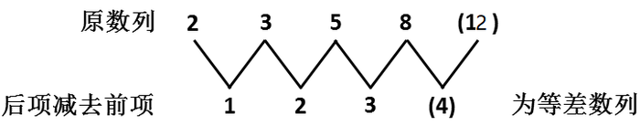

故正确答案为A。

**来源**：2008年上海市公务员录用考试《行测》题第1题

### 第 2 题

3，4，5 2/3，（ ），11 2/5

A. 6 3/4

B. 7 2/3

C. 8

D. 10 1/2

第 2 题 · 答案与解析

**参考答案（粉笔题库参考内容）**

C

**解析**

原数列变形：3/1、8/2、17/3、( )、57/5

观察分母，应为等差数列，故未知项分母为4；

分子构成新数列：3、8、17、(    )、57，有如下关系：

、、、( )、；

加式左项构成幂次数列，底数成等差数列；

加式右项构成幂次数列，指数成等差数列；

故未知项分子应为，故未知项为32/4=8。

故正确答案为C。

**来源**：2008年上海市公务员录用考试《行测》题第2题

### 第 3 题

在等比数列中，已知首项为9/8，末项为1/3，公比为2/3，则项数为：

A. 3

B. 4

C. 5

D. 6

第 3 题 · 答案与解析

**参考答案（粉笔题库参考内容）**

B

**解析**

由等比数列通项公式，即，则n=4。

故正确答案为B。

**来源**：2008年上海市公务员录用考试《行测》题第3题

### 第 4 题

2 1/2，1 2/5，9/10，（ ），1/2

A. 13/2

B. 11/17

C. 9/22

D. 7/27

第 4 题 · 答案与解析

**参考答案（粉笔题库参考内容）**

B

**解析**

将原数列化成：5/2、7/5、9/10、( )、13/26

其中分子列为5、7、9、(11）、13；

分母可化为下面形式：

原数列：2、5、10、(    ）、26

平方数列：1^2、2^2、3^2、4^2、5^2

修正项：1、1、1、1、1

因此原数列括号项为：。

故正确答案为B。

**来源**：2008年上海市公务员录用考试《行测》题第4题

### 第 5 题

红花映绿叶×夏＝叶绿映花红，“红花映绿叶、夏”分别为数字：

A. 4、1、9、6、8、3

B. 2、1、9、7、3、4

C. 2、1、9、7、8、4

D. 1、2、9、8、7、3

第 5 题 · 答案与解析

**参考答案（粉笔题库参考内容）**

C

**解析**

本题属于定义新运算问题。

首先“叶X夏”的尾数为红，四项均符合，另外“红X夏”+“花X夏”结果的十位数字=叶。

故正确答案为C。

**来源**：2008年上海市公务员录用考试《行测》题第5题

### 第 6 题

汽车牌照一般有固定格式，如：沪A12345。沪代表一个省或自治区直辖市的简称，A代表26个字母中的其中一个。12345代表10个数字中的5个。问：假如一个省或自治区或直辖市只能用一个简称。按上述构成，可以形成多少个不同的牌照：

A. 24373440

B. 25159680

C. 80600000

D. 83200000

第 6 题 · 答案与解析

**参考答案（粉笔题库参考内容）**

D

**解析**

我国有23个省，4个直辖市，5个自治区。

按位置讨论：共有：。

故正确答案为D。

**考点**：基础排列组合

**来源**：2008年上海市公务员录用考试《行测》题第6题

### 第 7 题

某考试均为判断题，共10题，每题10分，满分为100分。考生答题时认为正确则画为“O”，认为不正确则画“X”。以下是考生的答题情况以及甲、乙、丙的实际得分，则丁的得分为：

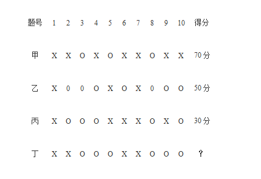

A. 20分

B. 40分

C. 60分

D. 80分

第 7 题 · 答案与解析

**参考答案（粉笔题库参考内容）**

C

**解析**

首先观察甲和丙，得分相差40分，而他们的答案不一样的也恰好有4题，那么也就是说，丙和甲不一样的题（即2，4，5，10）甲都做对了。

而（2，4，5，10）这四道题恰好乙也全做错了，乙一共做错了5道题，也就说剩下的题目（1，3，6，7，8，9）中，乙还做错一道题。

再观察四人判断一致的题目，因为丙一共只做对3道题，所以四个人选择一样的题目（1，3，7，8）中必有一道题四个人全做错了。

乙剩下的（1，3，6，7，8，9）中，(1，3，7，8）必有一道错题，那么，也就是说乙6，9题做对了。

现在答案除了1，3，7，8，都确定了，即（2，4，5，10）与甲一致，(6，9）与乙一致，在这6道题中丁做对了3道，剩下的（1，3，7，8）中有一道错题，所以（1，3，7，8）中丁做对了3道。

综上所述，丁得分60分。

故正确答案为C。

**来源**：2008年上海市公务员录用考试《行测》题第7题

### 第 8 题

一次面试，试卷共有6道题。50个面试者回答后，答对的共有202人次。已知每人至少答对2题，答对2题的5人，答对4题的9人。答对3题和5题的人数同样多。则答对6题的人有几个：

A. 5

B. 6

C. 7

D. 8

第 8 题 · 答案与解析

**参考答案（粉笔题库参考内容）**

B

**解析**

假定答对5道题的有a人，答对6道题的有b人，根据题意可得：；5+9+2a+b=50，解得a=15，b=6。

故正确答案为B。

**考点**：和差倍比问题

**来源**：2008年上海市公务员录用考试《行测》题第8题

### 第 9 题

已知A股票上涨了0.16元,相当于该股票原价的16%。B股票上涨了1.68元，也相当于原价的16％。则两种股票原价相差：

A. 8元

B. 9.5元

C. 10元

D. 10.5元

第 9 题 · 答案与解析

**参考答案（粉笔题库参考内容）**

B

**解析**

由题意可知：A股票原价=0.16/16%元，B股票原价=1.68/16%元，则两种股票原价相差元。

故正确答案为B。

**考点**：和差倍比问题

**来源**：2008年上海市公务员录用考试《行测》题第9题

### 第 10 题

1898年4月1日，星期五，分别把三个钟调整到相同的时间：12点。第二天中午发现A钟时间完全准确，B钟正好快了1分钟，C钟正好慢了1分钟。现在假设三个钟都没有被调，它们保持着各自的速度继续走而且没有停。那么到（    ），三只时钟的时针分针会再次都指向12点。

A. 1900年3月20日正午12点

B. 1900年3月21日正午12点

C. 1900年3月22日正午12点

D. 1900年3月23日正午12点

第 10 题 · 答案与解析

**参考答案（粉笔题库参考内容）**

C

**解析**

B钟1天时间快了1分钟，C钟1天时间慢了1分钟，若他们的时针分针都再次指向12点，那么，B钟总共快了12小时，同时C钟慢了12小时。那么需要的时间为60×12＝720天，由此，此题变成1898年4月1日的720天后是几月几日的问题。由于1899年跟1900年都为平年，所以两年即730天后为1900年4月1日，往前数10天为3月22日。

故正确答案为C。

**考点**：周期相遇问题

**来源**：2008年上海市公务员录用考试《行测》题第10题

## 材料 1

初步核算，2007年前三季度国内生产总值166，043亿元，同比增长11.5%，比上年同期加快0.7个百分点。其中，一季度增长11.1%，二季度增长11.9%。分产业看：第一产业增加值18，207亿元，增长4.3%，回落0.6个百分点；第二产业增加值83，478亿元，增长13.5%，加快0.2个百分点；第三产业增加值64，358亿元，增长11.0%，加快1.5个百分点。

### 第 11 题

2006年前三季度的国内生产总值大约是多少亿元：

A. 192000

B. 121977

C. 149000

D. 135150

第 11 题 · 答案与解析

**参考答案（粉笔题库参考内容）**

C

**解析**

由题意列出式子：166043÷(1+11.5%)，采用直除法：166÷11≈15，与C项最接近。

故正确答案为C。

**考点**：基期计算、文字资料

**来源**：2008年上海市公务员录用考试《行测》题第11题

### 第 12 题

2007年前三季度，第三产业的增加值约占前三季度国内生产总值的：

A. 11%

B. 39%

C. 45%

D. 50%

第 12 题 · 答案与解析

**参考答案（粉笔题库参考内容）**

B

**解析**

由题意列出式子：64358÷166043×100%，由于四个选项首项都不一致，用直除法首位为3，对应B项。

故正确答案为B。

**考点**：文字资料、现期比重

**来源**：2008年上海市公务员录用考试《行测》题第12题

### 第 13 题

以下说法正确的是：

A. 2007年第三季度国内生产总值增长率为11.5%

B. 2007年前三季度第一产业增加值的增长率高于2006年前三季度

C. 2006年全年第一产业增加值的增长率为4.9%

D. 2006年前三季度第三产业增加值的增长率为9.5%

第 13 题 · 答案与解析

**参考答案（粉笔题库参考内容）**

D

**解析**

A项错误，材料中给出的是2007年前三季度而非第三季度国内生产总值的增长率，犯了偷换概念的错误；

B项错误，根据“第一产业增加值18,207亿元，增长4.3%，回落0.6个百分点”，说明2006年前三季度第一产业增加值的增长率是高于前者的；

C项错误，根据题中信息只能算出2006年前三季度（而非全年）第一产业增加值的增长率为4.9%；

D项正确，由11%－1.5%＝9.5%可得。

故正确答案为D。

**考点**：文字资料、综合分析

**来源**：2008年上海市公务员录用考试《行测》题第13题

## 材料 2

为了响应国家关于“创建创新型国家”的号召。上海市政府着眼于实际情况，对上海的科技创新体系建设深入推进。2006年内颁布了《上海中长期科学和技术发展规划纲要》，出台与之相关的367条配套政策及实施细则。全年用于研究与试验发展（R&D）经费支出257.9亿元，相当于全市生产总值的比例为2.5%（见下图）。

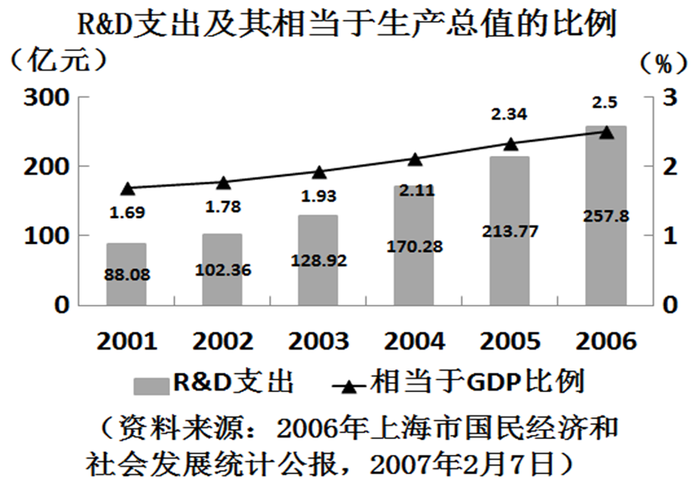

        全年共取得科技成功1953项。其中，属于国际领先的有250项，达到国际水平的有675项。科技创新成效不断显现。全年受理专利申请量3.6万件，比上年增长10.1%，其中发明专利1.21万件，增长15.4%。全年专利授权量1.66万件，比上年增长31.7%，其中发明专利2644件，增长32.4%。53个重大科技攻关项目完成专利申请789件，其中发明专利609件。全年新认定高新技术成果转化项目786项。其中，电子信息、生物医药、新材料等重点领域的项目占84.1%；拥有自主知识产权的项目占98.5%；达到国际领先水平的项目占87.2%。至年末，全市共认定高新技术成果转化项目4327项，其中80%的项目已实现产业化，累计新增值2.864亿元。

        企业自主创新能力不断提高。至2006年末，全市共有32家国家级企业技术中心和167家市级企业技术中心。其中年内新认定3个国家级企业技术中心，技术交易活跃。全年共签订各类技术交易合同2.82万项，比上年下降6.9%，合同金额344.43亿元，增值48.6%。

### 第 14 题

如果按照2006年专利授权量的增长比率计算，2007年，上海的专利授权量达到多少万件：

A. 3.19

B. 2.19

C. 1.98

D. 2.46

第 14 题 · 答案与解析

**参考答案（粉笔题库参考内容）**

B

**解析**

由题意：1.66×(1+31.7%)，采用估算法1.66×1.3≈2.16。

故正确答案为B。

**考点**：现期计算、综合资料

**来源**：2008年上海市公务员录用考试《行测》题第14题

### 第 15 题

上海2001年的科研经费支出是88.08亿元，那么，2006年的科研经费支出是2001年的多少倍：

A. 2.93

B. 2.71

C. 2.96

D. 2.88

第 15 题 · 答案与解析

**参考答案（粉笔题库参考内容）**

A

**解析**

由题意：观察图表，有：。

故正确答案为A。

**考点**：现期倍数、综合资料

**来源**：2008年上海市公务员录用考试《行测》题第15题

### 第 16 题

从上面的图中可以看到，2001年至2006年的研究与试验经费在逐年增长。那么，从2002年至2006年研究与试验经费的年平均增长率最接近：

A. 22%

B. 24%

C. 26%

D. 28%

第 16 题 · 答案与解析

**参考答案（粉笔题库参考内容）**

C

**解析**

由年均增长率公式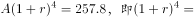。取值计算若r=25%为四分之一，略小于2.5，结合选项故r取26%最合适。

故正确答案为C。

**考点**：年均增长率、综合资料

**来源**：2008年上海市公务员录用考试《行测》题第16题

### 第 17 题

2006年上海市的GDP总产值是多少亿元：

A. 10312

B. 12836.1

C. 9248

D. 无法确定

第 17 题 · 答案与解析

**参考答案（粉笔题库参考内容）**

A

**解析**

由题意：257.8÷2.5%，即257.8×40≈10000，前两位为10。

故正确答案为A。

**考点**：现期比重、综合资料

**来源**：2008年上海市公务员录用考试《行测》题第17题

## 材料 3

根据以下有关消费方面的图表，完成各题。

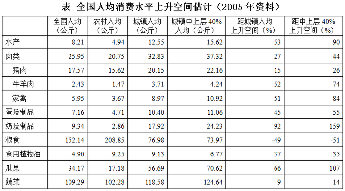

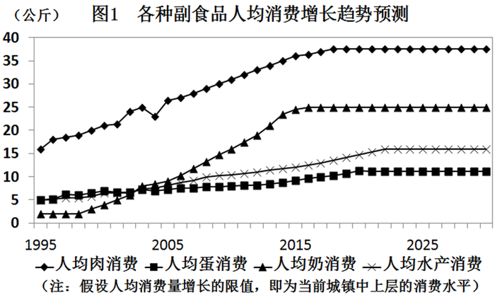

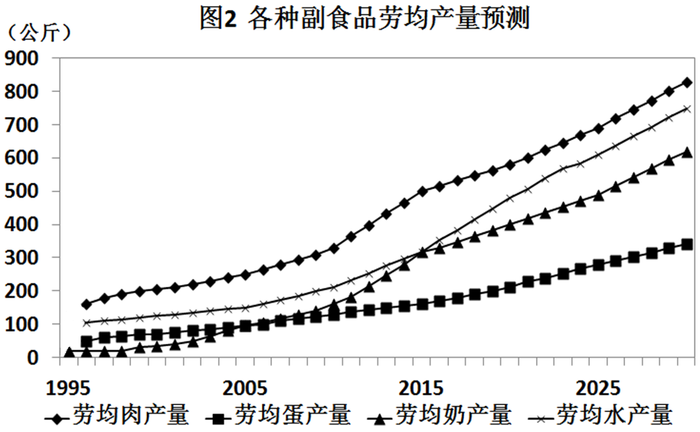

### 第 18 题

中国大陆的人均营养水平与日本、中国台湾地区及韩国接近，即每日3000卡路里左右。但从上面食品消费的资料可以看出，最为确切的说法应是：

A. 中国大陆的肉、蛋消费水平还有较大上升空间

B. 中国大陆的肉、蛋、水产消费水平还有较大上升空间

C. 中国大陆的肉、蛋、水产、水果消费水平还有较大上升空间

D. 中国大陆的肉、蛋、水产、水果、奶制品消费水平还有较大上升空间

第 18 题 · 答案与解析

**参考答案（粉笔题库参考内容）**

D

**解析**

本题肉类跟蛋类在四个选项中都出现，因此不予以考虑。

有表格可以看出：水产距城镇人均上升空间53%，距中上层40%上升空间90%；水果距城镇人均上升空间66%，距中上层40%上升空间107%，奶制品距城镇人均上升空间92%，距中上层40%上升空间159%，上升空间都较大。

故正确答案为D。

**考点**：直接找数、统计图

**来源**：2008年上海市公务员录用考试《行测》题第18题

### 第 19 题

根据国家统计局的数字，全国的实际蔬菜消费量只占总产量的26%，这表明，我国蔬菜今后的发展方向主要应该注重各种有效方法，但（    ）除外。

A. 产量或播种面积的适度控制

B. 改进品种和档次

C. 加工和运销

D. 产量或播种面积的扩大

第 19 题 · 答案与解析

**参考答案（粉笔题库参考内容）**

D

**解析**

由题意知：现在的矛盾不是产量少，而是消费量不足。故D项的扩大产量和播种面积错误。

故正确答案为D。

**考点**：直接找数、统计图

**来源**：2008年上海市公务员录用考试《行测》题第19题

### 第 20 题

从1995—2005年的10年间，人均水产和肉类（猪、牛、羊、禽）消费以每年约5%的速度增长，人均蛋消费的增长速度为3.4%，奶制品的增长速度为18%。预计（    ）以后，这些副食品的人均消费量将达到今天城镇中上层的消费水平。

A. 3年

B. 7年

C. 10年

D. 15年

第 20 题 · 答案与解析

**参考答案（粉笔题库参考内容）**

D

**解析**

全国人均水产消费水平距城镇中上层90%，设x年后全国水平达到城镇中上层水平，有，，解得x≥18，D项最接近。

故正确答案为D。

**考点**：现期计算、综合资料

**来源**：2008年上海市公务员录用考试《行测》题第20题

### 第 21 题

假定人均产量与人均消费同步增长，那么下列说法中最确切的是：

A. 在未来一定时期内，劳均产量的增长速度一定低于人均消费增长的速度

B. 在未来一定时期内，人均产量的增长速度可能高于劳均消费增长的速度

C. 在未来一定时期内，人均产量的增长速度可能低于劳均消费增长的速度

D. 在未来一定时期内，劳均产量的增长速度一定高于人均消费增长的速度

第 21 题 · 答案与解析

**参考答案（粉笔题库参考内容）**

C

**解析**

观察后两个曲线图可知：人均消费曲线的趋势是先增长后趋于平稳，而劳均消费曲线的趋势是保持增长。那么，可以得出：在一定时期内，人均消费增长速度可能高于劳均消费增长速度。

故正确答案为C。

**考点**：综合分析、综合资料

**来源**：2008年上海市公务员录用考试《行测》题第21题

## 材料 4

以下数据是对于世界部分国家在1990年、2000年和2004年的婴儿出生死亡率进行的统计结果，根据图表内容回答22—25题。

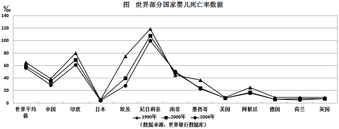

### 第 22 题

1990年，婴儿死亡率最高的国家其数值大约是世界平均水平的多少倍：

A. 3

B. 1.5

C. 2.5

D. 2

第 22 题 · 答案与解析

**参考答案（粉笔题库参考内容）**

D

**解析**

由图表可知：1990年世界平均水平约为65‰，而死亡率最高的尼日利亚约为120‰，故约为2倍。

故正确答案为D。

**考点**：现期倍数、统计图

**来源**：2008年上海市公务员录用考试《行测》题第22题

### 第 23 题

2000年，埃及的婴儿死亡率在所列的12个国家中由高到低，居第几位：

A. 3

B. 4

C. 5

D. 9

第 23 题 · 答案与解析

**参考答案（粉笔题库参考内容）**

B

**解析**

观察图表可知，2000年婴儿死亡率高于埃及的国家有印度、尼日利亚和南非，因此埃及排在第4位。

故正确答案为B。

**考点**：排序类、统计图

**来源**：2008年上海市公务员录用考试《行测》题第23题

### 第 24 题

各大洲中，婴儿死亡率相对变动较小的一个大洲是：

A. 亚洲

B. 美洲

C. 欧洲

D. 非洲

第 24 题 · 答案与解析

**参考答案（粉笔题库参考内容）**

C

**解析**

由图可知：在3个统计年份内，欧洲三国德国、荷兰、英国婴儿死亡率的曲线基本持平，与其他国家相比变动最小。

故正确答案为C。

**考点**：直接找数、统计图

**来源**：2008年上海市公务员录用考试《行测》题第24题

### 第 25 题

下列说法中不正确的一项是：

A. 中国在1990年、2000年和2004年的婴儿死亡率均低于世界平均婴儿死亡率

B. 南非在1990年、2000年和2004年的婴儿死亡率变化是非洲三国中最小的

C. 2000年，美国、墨西哥和阿根廷的婴儿死亡率均比亚洲国家要低

D. 从图上看，总体上婴儿死亡率有逐年下降的趋势

第 25 题 · 答案与解析

**参考答案（粉笔题库参考内容）**

C

**解析**

A项正确，根据曲线可知中国婴儿死亡率在统计的三年中均在世界平均值以下；

B项正确，根据曲线可以看出南非在1990年、2000年和2004年婴儿死亡率变化不大，在非洲三国中是最小的；

C项错误，2000年美国、墨西哥和阿根廷的婴儿死亡率均比亚洲的日本高；

D项正确，表示婴儿死亡率曲线中的点均是逐年下降的。

本题为选非题，故正确答案为C。

**考点**：统计图、综合分析

**来源**：2008年上海市公务员录用考试《行测》题第25题

### 第 26 题

下面各句在横线处必须加“的”字的组是：

（1）为实施西部大开发战略，加快当地经济＿＿＿＿发展，国家将在西部新建十大工程。

（2）天文学家在太阳系外共发现28颗行星，他们＿＿＿＿存在是通过间接渠道推断出来的。

（3）风险投资注入可以使你＿＿＿＿钱袋立即充盈，有实力去市场拼抢厮杀谋求发展。

（4）他有“兵坛黑马”之称，具备快、灵、狠的特点，是欧亚高手取胜＿＿＿＿最大障碍。

A. （1）（2）

B. （2）（4）

C. （3）（4）

D. （1）（3）

第 26 题 · 答案与解析

**参考答案（粉笔题库参考内容）**

C

**解析**

此题考查结构助词“的”的运用。

“的”字之前为定语，之后为中心词语。当定语和中心词语为领属关系、修饰关系、限制关系以及定语为谓语动词或动宾结构时，“的”字不可省略。当定语和中心词语为主谓结构，“的”字可以省略。

（3）中，“你”与“钱袋”构成领属关系，“的”字不可省；（4）中，“取胜”为动宾结构，“的”字不可省。

（1）中“经济”与“发展”，（2）中“他们”与“存在”都为主谓结构，通常可以省略“的”。

故正确答案为C。

**考点**：词的辨析-搭配对象

**来源**：2008年上海市公务员录用考试《行测》题第26题

### 第 27 题

“春雨断桥＿＿＿＿无渡，小舟撑出绿阴来。”

上句在横线处选填最恰当的字是：

A. 愁

B. 恰

C. 叹

D. 人

第 27 题 · 答案与解析

**参考答案（粉笔题库参考内容）**

D

**解析**

诗句出自北宋诗人徐俯的《春游湖》，意为“由于春雨之故湖中水位上涨，没过了小桥，导致游人无法渡过此处，恰好此时有一叶小舟从绿荫处撑来，游人得以继续游湖赏景”。“无渡”所指的主体是“人”，即人无法渡过，对应D项。

A、B、C三项都为动词，不能成为“无渡”的对象。

故正确答案为D。

**考点**：实词填空、词的辨析-词义侧重

**来源**：2008年上海市公务员录用考试《行测》题第27题

### 第 28 题

下列依次填入各句横线处的成语，最正确的一组是：

（1）黄老师的教学语言诙谐幽默，妙趣横生，常常逗得大家＿＿＿＿＿＿。

（2）安全检查工作非常重要，要＿＿＿＿＿＿，不应麻痹大意，一旦出了事故，后悔也就来不及了。

A. 破涕为笑 防患未然

B. 破涕为笑 防微杜渐

C. 捧腹大笑 防微杜渐

D. 捧腹大笑 防患未然

第 28 题 · 答案与解析

**参考答案（粉笔题库参考内容）**

D

**解析**

句（1），根据“诙谐幽默，妙趣横生”可知，横线处词语有逗得大家“大笑”的意思，“捧腹大笑”是指人捂着肚子大笑，形容人笑得欢畅的样子，符合语境，保留C、D两项。“破涕为笑”是指止住眼泪，露出笑容，形容转悲为喜。句（1）中学生并没有哭泣，排除A、B两项。

句（2）强调要防范安全事故的发生，D项“防患未然”是指在事故或灾害发生之前就加以防备，符合语境，当选。C项“防微杜渐”是指当坏事、坏思想、坏作风刚刚冒头的时候，就加以制止，不让它发展下去，不符合语境，排除。

故正确答案为D。

**考点**：成语填空、词的辨析-词义侧重

**来源**：2008年上海市公务员录用考试《行测》题第28题

### 第 29 题

下列依次填入横线处的词语，恰当的一组是：

要坚持权为民所＿＿＿＿，情为民所＿＿＿＿，利为民所＿＿＿＿，＿＿＿＿倾听群众呼声，＿＿＿＿反映群众愿望，＿＿＿＿关心群众疾苦，多为群众办好事、办实事。

A. 用，系，谋，真诚，真实，真情

B. 谋，系，用，真诚，真实，真情

C. 用，系，谋，真心，真诚，真实

D. 用，系，谋，真实，真心，真诚

第 29 题 · 答案与解析

**参考答案（粉笔题库参考内容）**

A

**解析**

本题考查实词对象搭配的辨析和填空。

材料出自胡锦涛在中央党校省部级干部进修班发表的重要讲话。

权力“来之于民，用之于民”，即应该做到“权为民所用”，由此排除B项。

反映群众愿望应该力求真实，不能扭曲群众心愿，因此A项的词语搭配更为恰当。

故正确答案为A。

**考点**：实词填空、词的辨析-搭配对象

**来源**：2008年上海市公务员录用考试《行测》题第29题

### 第 30 题

下列依次填入横线处的词语，恰当的一组是：

（1）进入这个单位后，他勤奋工作，每次都保质保量地完成任务，很快就得到了领导及同事的＿＿＿＿。

（2）由于父亲是美国人，母亲是韩国人，比起其他同年龄的中学生来说，她很难自我＿＿＿＿。

A. 认同，认可

B. 赞同，认识

C. 认可，认同

D. 赞同，认同

第 30 题 · 答案与解析

**参考答案（粉笔题库参考内容）**

C

**解析**

本题考查近义实词词义侧重的辨析和填空。

“认可”是指承认、许可；“赞同”是指对观点或看法的赞赏、同意；“认同”为心理学名词，指体认与模仿他人或团体之态度行为，使其成为个人人格一个部分的心理历程。

（1）中他凭借自己的努力，让领导和同事承认了自己的工作能力和成绩，横线处应填入“认可”；

（2）中说的是文化差异下的一种心理状态，应选择“认同”。

故正确答案为C。

**考点**：实词填空、词的辨析-词义侧重

**来源**：2008年上海市公务员录用考试《行测》题第30题

### 第 31 题

下列依次填入横线处的词语，恰当的一组是：

吾平生未尝以吾志语汝，是吾不是处；＿＿＿＿语之，＿＿＿＿恐汝日日为吾担忧。吾牺牲百死而不辞，而使汝担忧，的的非吾所忍。吾爱汝至，＿＿＿＿为汝谋者惟恐未尽。汝幸而偶我，又何不幸而生今日之中国！吾幸而得汝，又何不幸而生今日之中国！＿＿＿＿不忍独善其身。嗟夫！巾短情长，所未尽者，尚有万千，汝可以模拟得之。

A. 然，惟，故而，遂

B. 然，又，所以，卒

C. 然，惟，所以，卒

D. 既，又，故而，遂

第 31 题 · 答案与解析

**参考答案（粉笔题库参考内容）**

B

**解析**

第一句话的意思为“我平素不曾把我的志向告诉你，这是我的不对的地方；＿＿＿＿告诉你，＿＿＿＿怕你天天为我担忧。”根据文意，横线前后的句子应该是转折关系。“然”意为“然而”，表示转折；“既”表示顺承关系。因此第一个横线处应选择“然”。

文中第二句话的意思是“我为国牺牲，死一百次也不推辞，可是让你担忧，的确不是我能忍受的。”“惟恐”意为“只怕，就怕”，“又”表示程度加深，使作者不愿让妻子担心自己的心情表达得更为强烈。第二个横线处填“又”更为恰当。

“故而”与“所以”同义，表示因果关系。“遂”译为“于是、就”，“卒”为副词，译为“终究”，填入横线处使文意更加通畅。

故正确答案为B。

【文段出处】林觉民：《与妻书》

**考点**：关联关系-转折关系、对应关系-前后呼应

**来源**：2008年上海市公务员录用考试《行测》题第31题

### 第 32 题

下列依次填入横线处的词语，恰当的一组是：

（1）桥砖是深褐色，表明它的历史的长久；都是＿＿＿＿＿＿，令人叹息于古昔工程的坚美。

（2）我们下船后，借着新生的晚凉和河上的微风，暑气已渐渐消散；到了此地，＿＿＿＿＿＿，身子顿然清了——习习的清风荏苒在面上，手上，衣上，这便又感到了一缕新凉了。

（3）可是一般人还忘其所以地要气派，自以为美，几乎不知天多高地多厚。这真是所谓“＿＿＿＿＿＿”了。

（4）但是要老资格的茶客才能这样有分寸；偶尔上一回茶馆的本地人外地人，却总忍不住＿＿＿＿＿＿，到了儿捧着肚子走出。

A. 完好无缺，豁然开朗，不可一世，狼吞虎咽

B. 完美无缺，如临仙境，自高自大，大吃大嚼

C. 完好无缺，豁然开朗，夜郎自大，狼吞虎咽

D. 完美无缺，柳暗花明，妄自尊大，大吃大嚼

第 32 题 · 答案与解析

**参考答案（粉笔题库参考内容）**

C

**解析**

“完好无缺”是指事物完完整整，没有缺损；“完美无缺”形容事物尽善尽美，没有任何缺点。（1）中提到古昔工程的坚美，意指桥砖保存得完整，因此横线处应该填入“完好无缺”。

“豁然开朗”形容从幽暗狭窄变为宽阔明亮，比喻顿时通达领悟；“如临仙境”比喻景色极美的地方；“柳暗花明”可形容春天繁花似锦的景色，也可指由逆境转化为充满希望的顺境。（2）中提到习习凉风带来新凉，让人“身子顿然清了”，因此横线处填入“豁然开朗”更合文意。

“不可一世”形容目空一切，狂妄自大到极点；“自高自大”形容自我感觉良好，自命不凡；“夜郎自大”比喻人无知而且又狂妄自大；“妄自尊大”指虽无真才实学,却自命不凡，盲目骄傲自大。（3）中提到一般人忘其所以地要气派，自以为美，不仅无知而且狂妄，因此横线处应该填入“夜郎自大”。

“大吃大嚼”比喻不管不顾地狂吃，“狼吞虎咽”形容吃东西不细嚼,又急又猛。（4）中用“有分寸的老茶客”与“偶尔去茶馆的人”做对比，说明后者的吃相狼狈，并不雅观。因此横线处填入“狼吞虎咽”更合文意。

故正确答案为C。

**考点**：成语填空、词的辨析-词义侧重

**来源**：2008年上海市公务员录用考试《行测》题第32题

### 第 33 题

下列依次填入横线处的词语，恰当的一组是：

我几乎说不出秋比冬为什么更好，也许因为那枝头的几片黄叶，或是那篱畔的几朵残花。在那些上边，是比冬天更显示了生命。不然，是在那些上面，更使我忆起了生命吧。一片黄叶，一片残英，那在联系着过去与将来吧。他们将更使人＿＿＿＿，更使人＿＿＿＿，更使人＿＿＿＿及＿＿＿＿关于生活的事吧。

A. 凝视，深思，遐想，希冀

B. 凝望，沉思，遐想，期冀

C. 凝望，深思，怀想，期冀

D. 凝视，沉思，怀想，希冀

第 33 题 · 答案与解析

**参考答案（粉笔题库参考内容）**

D

**解析**

此题考查近义实词的辨析和语境的最佳填空。

选项中所给出的四个词语具有层层递进的逻辑关系——先“凝视”，然后慢慢进入“沉思”的状态，“沉思”可能是对过去的“怀想”，最后变为对将来的“希冀”。

“凝视”是指不眨眼睛地看着某物，表示非常认真；“凝望”指注目远望，适用于看遥远的物体。此处“我”看的是枝头的黄叶，并不是遥远的东西，因此第一个横线处应该填入“凝视”。

“深思”是进一步的思考，从中得出道理来；而使人陷入某种状态，用“沉思”更为恰当。

“遐想”是指超越现实做高远的想象，而根据“那在联系着过去与将来”这句话，此处所想的是“过去”，因此选择“怀想”。

“期冀”是针对较大、较重要及较长远的事件，“希冀”则是针对较小、比较不重要的事件。第四个横线后提到“生活的事”，用“希冀”更为合适。

故正确答案为D。

**考点**：实词填空、词的辨析-词义侧重

**来源**：2008年上海市公务员录用考试《行测》题第33题

### 第 34 题

下列依次填入横线处的词语，恰当的一组是：

大乡绅的仆人可以指挥警察区区长，可以＿＿＿＿招摇过市——这都是民国五六年的事，并非前清君主专制时代。自己当时＿＿＿＿，看了一肚子气；可是＿＿＿＿，也只好让那口气憋着罢了。

A. 大模大样，血气方刚，人微言轻

B. 威风凛凛，血气方刚，人穷志短

C. 像模像样，年轻气盛，人微言轻

D. 昂首阔步，年轻气盛，人穷志短

第 34 题 · 答案与解析

**参考答案（粉笔题库参考内容）**

A

**解析**

阅读可知，第一个横线与招摇过市构成并列关系，感情色彩需要保持一致，因此横线处应填入贬义词。“大模大样”是指故意摆出一副架势，满不在乎的样子。“威风凛凛”形容权势显赫，令人生畏。“像模像样”表示正式、隆重，体面好看。“大模大样”最符合文意。

“血气方刚”在此处形容年轻人那种激进的进步热情；“年轻气盛”是指年纪小，不懂得为人处世，喜欢争强好胜。文中的“我”是看不惯仆人的那种丑态，而不是要争强好胜，横线处填入“血气方刚”更为恰当。

作者让那口气憋着，并不是因为人穷就没有志向了，而是因为自己的地位低，言论主张不被人重视，即“人微言轻”。

故正确答案为A。

【文段出处】朱自清：《说扬州》

**考点**：对应关系-前后呼应、成语填空

**来源**：2008年上海市公务员录用考试《行测》题第34题

### 第 35 题

下列依次填入横线处的关联词，恰当的一组是：

我们从心理学研究中心认识到，人的思维＿＿＿＿决定于外界客体的作用，＿＿＿＿外界客体并不直接决定思维，＿＿＿＿通过大脑对感性材料进行“去粗取精、去伪存真、由此及彼、由表及里”的加工，间接地决定着思维。

A. 虽然，然而，而是

B. 即使，但是，如果

C. 由于，然而，即使

D. 虽然，但是，而是

第 35 题 · 答案与解析

**参考答案（粉笔题库参考内容）**

D

**解析**

“虽然”后面的句子表示的是已经发生的事，“即使”则是假设那些还未发生的事情。“物质决定意识”，人的思维受到外界客体的制约，这并非假设。因此，第一个横线处应该填入“虽然”。

“虽然”与“但是”属于固定搭配的转折关系连词，所以第二个横线选择“但是”。

根据文意可知，第三个横线后的内容是对前面“直接决定思维”的否定，而不是假设其他情形，因此横线处应填表示转折关系的“而是”。

故正确答案为D。

**考点**：关联关系-转折关系

**来源**：2008年上海市公务员录用考试《行测》题第35题

### 第 36 题

下列各句中没有错别字的一句是：

A. 天津杨柳青镇是年画的发祥地，每年春节前后，海内外游客都纷至踏来，感受腊月新春的民俗风情

B. 每当谁做了有益于公众的事，社会就理所当然地给谁以肯定和称诵，谁也就会因此赢得巨大的荣誉

C. 经过一年的调查取证，检查机关终于查清了这家公司的总经理循私舞弊而导致公司倒闭的事实

D. 感知明快的人，善于洞察前景，知微见著；感知迟钝的人，往往过于拘泥和死板，只看到过去而看不到将来

第 36 题 · 答案与解析

**参考答案（粉笔题库参考内容）**

D

**解析**

A中“纷至踏来”应为“纷至沓来”；

B中“称诵”应写作“称颂”；

C中“检查机关”应为“检察机关”，“循私舞弊”应为“徇私舞弊”；

D中没有错别字。

故正确答案为D。

**来源**：2008年上海市公务员录用考试《行测》题第36题

### 第 37 题

下列句子中多义词“松懈”的含义与其他三句不同的一句是：

A. 自以为对革命有功，摆老资格，大事做不来，小事又不做，工作随便，学习松懈

B. 它是一种腐蚀剂，使团结涣散，关系松懈，工作消极，意见分歧

C. 为了搞好总复习，许多同学废寝忘食，毫不松懈

D. 刚才出力摇船犹如赛龙船似的那股劲儿，现在在每个人的身体里松懈下来了

第 37 题 · 答案与解析

**参考答案（粉笔题库参考内容）**

B

**解析**

此题考查词义辨析的语句表达。

“松懈”一词具有以下含义：①放松，不紧张；②人与人之间关系不密切。

A、C、D三项中的“松懈”应按意项①解释；

B中应按意项②解释。

故正确答案为B。

**来源**：2008年上海市公务员录用考试《行测》题第37题

### 第 38 题

嗟夫！予尝求古仁人之心，或异二者之为，何哉？不以物喜，不以己悲；居庙堂之高<u>则</u>忧其民，处江湖之远<u>则</u>忧其君。

下列句子中的“则”与上文中划线处的“则”意义、用法相同的一句是：

A. 此则岳阳楼之大观也

B. 复之以掌，虚若无物；手裁举，则又超忽而跃

C. 公使阳处父追之，及诸河，则在舟中矣

D. 居则具一日之积，行则备一夕之卫

第 38 题 · 答案与解析

**参考答案（粉笔题库参考内容）**

D

**解析**

此题考查词义辨析。

题干中的“则”为连词，表因果关系，相当于“那么、就”。这种用法都是两个或两个以上的“则”连用，每个“则”字都用在意思相对、结构相似的一个分句里，表示分句之间是并列关系（不是表示两个词之间）。

因此，结合选项应该选择D。

D项中的“则”与题干中的用法相同；

A项中的“则”为副词，相当于“就是”；

B、C项中“则”表示转折，相当于“却”。

故正确答案为D。

**来源**：2008年上海市公务员录用考试《行测》题第38题

### 第 39 题

下列各句中没有歧义或语病的一句是：

A. 在这件事情上，他们谁也没有干涉我的权利

B. 运动会开幕式后，上演了名为《太阳•冰雪•亚细亚》的大型文艺表演

C. 这种将企业各方面的权利义务用合同、章程等方式加以明确，对于职工行使民主管理权利无疑是一种保障

D. 本市的电话业近年有了长足的进步，但仍需发展

第 39 题 · 答案与解析

**参考答案（粉笔题库参考内容）**

D

**解析**

A项断句位置不同引起歧义，可以理解为“他们谁也没有权利来干涉我”或者“他们谁也没有干涉我行使自己的权利”；

B项成分残缺，“上演了”前面缺少主语；

C项成分残缺，缺少定语中心语，应该在“明确”后面加上“的做法”；

D项没有语病。

故正确答案为D。

**来源**：2008年上海市公务员录用考试《行测》题第39题

### 第 40 题

下列各句中句意明确的一项是（    ）。

A. 内容正确是衡量作品质量优劣的一个重要标准

B. 中国邮电电信总局与美国CDC公司签订了全国无线电寻呼（BP机）联网工程

C. 国务院决定免征关税和进口增值税的目的和意义，在于进一步扩大利用外资，鼓励引进国外的先进技术和设备，促进产业结构的调整，使其更趋完善

D. 今天下午，张董事长、王总经理和其他公司领导一起参加了市里举办的开发区招商引资项目洽谈会

第 40 题 · 答案与解析

**参考答案（粉笔题库参考内容）**

C

**解析**

A选项，歧义的原因是一面对两面，“内容正确”是作品质量优秀的标准而不是优劣的标准，所以文段可以改为“内容是否正确是衡量作品质量优劣的一个重要标准”。

B选项，歧义的原因是搭配不当，不能“签订工程”，可在“工程”后面加上“的相关协议”。

C选项，无歧义。

D选项，“其他”修饰不定，在这里可以修饰“公司”，也可以修饰“领导”，应改为“公司其他领导”。

故正确答案为C。

**来源**：2008年上海市公务员录用考试《行测》题第40题

### 第 41 题

唐代诗人王翰《凉州词》：“葡萄美酒夜光杯，欲饮琵琶马上催。醉卧沙场君莫笑，古来征战几人回。”

下列对此诗句的分析有误的是：

A. 前两句借葡萄美酒、夜光杯、马上琵琶三个带有西域特点的事物，点明并烘托了边塞征战的气氛。

B. 第三句写将士们已将生死置之度外，死且不怕，酒又何惧。

C. 第四句暗示战争十分残酷，将士生死未卜，只有借酒来麻醉自己。

D. 从全诗看，这是一首描写将士利用战斗间隙举行庆功祝捷场面的诗，豪情激励，充满甘洒热血、不怕牺牲的报国壮志。

第 41 题 · 答案与解析

**参考答案（粉笔题库参考内容）**

C

**解析**

根据提问方式可知本题为细节判断题。

后两句是在酣醉时的劝酒词。意思为“醉就醉吧，醉卧在沙场上又怎么样呢？请不要笑，从古至今出征的人有几个是活着回来的？”这两句话一方面反映了战争的残酷，另一方面反映了作者粗犷豪迈的感情。“借酒来麻醉自己”显然和诗的主旨不符。

故正确答案为C。

**考点**：细节判断题

**来源**：2008年上海市公务员录用考试《行测》题第41题

### 第 42 题

《中国人民银行法》规定：“中国人民银行在国务院领导下，制定和实施货币政策，对金融业实施监督管理。”这表明中国人民银行：

A. 既是金融企业，又是银行的银行

B. 既是国家机关，又是金融企业

C. 既是国家机关，又是我国金融体系的领导力量

D. 既是我国金融体系的领导力量，又肩负商业银行的职能

第 42 题 · 答案与解析

**参考答案（粉笔题库参考内容）**

C

**解析**

根据选项设置可知，本题为中心理解题，考查应试者的概括能力。

中国人民银行有制定货币政策的权力，说明中国人民银行是国家机关。中国人民银行对金融业实施监督管理，表明中国人民银行又是我国金融体系的领导力量。

因此，C项当选。

题干中并没有信息显示中国人民银行是金融企业或肩负商业银行的职能，因此A、B、D三项均表述不当，排除。

故正确答案为C。

**考点**：关联词-并列

**来源**：2008年上海市公务员录用考试《行测》题第42题

### 第 43 题

研究发现，一种名为CPEB的蛋白质与维持长期记忆有关，位于中枢神经系统突触上，这是大脑中连接神经的枢纽。记忆就被存储在这一约有1万亿个神经细胞和突触的复杂网络中。随着经历和知识的不断增多，新的枢纽形成，老的则不断加强。CPEB合成的蛋白质会随着记忆的形成加强突触，使突触可以长期保存这些记忆。

从上文可见，人的大脑能储存记忆的关键部位是：

A. 大脑中的连接神经

B. 1万亿个神经细胞

C. 突触

D. CPEB合成的蛋白质

第 43 题 · 答案与解析

**参考答案（粉笔题库参考内容）**

C

**解析**

此题为细节判断题。

原文说“记忆就被存储在这一约有1万亿个神经细胞和突触的复杂网络中。”“CPEB合成的蛋白质会随着记忆的形成加强突触，使突触可以长期保存这些记忆。”可见人的大脑能储存记忆的关键部位是“突触”。

故正确答案为C。

**考点**：细节判断题

**来源**：2008年上海市公务员录用考试《行测》题第43题

### 第 44 题

美国和日本科学家近日通过分析采集来的三维地震数据，揭示了太平洋底南海海槽下的地壳结构。这一发现有助于科学家深入了解为什么地震在海底有些地方会引发大规模海啸，而在其他地方却不会。

这句话的主要意思是：

A. 美国和日本科学家采集了三维地震数据

B. 美国和日本科学家通过分析地震数据，揭示了太平洋底南海海槽下的地壳结构

C. 美国和日本科学家研究发现了太平洋南海海槽下的地壳结构，使得科学家更清楚大规模海啸的规律

D. 美国和日本科学家研究发现了太平洋南海海槽下的地壳结构，有助于科学家推测什么地方会引发大规模海啸

第 44 题 · 答案与解析

**参考答案（粉笔题库参考内容）**

C

**解析**

文段开篇指出科学家通过分析数据揭示了太平洋底南海海槽下的地壳结构，接下来强调这一发现有助于深入了解地震在海底不同区域引发海啸的差异规律。分析可知，文段中“这一发现有助于科学家深入了解”表明前后两句话暗含着因果关系，即因为科学家发现了太平洋底南海海槽下的地壳结构，所以能够深入了解海啸发生的规律。因此，结合选项，C项当选。

A、B两项，只涉及了文段中的第一句话，均未体现“科学家深入了解为什么地震在海底有些地方会引发大规模海啸，而在其他地方却不会”这一结论，排除；

D项，文段中是说这一发现有助于科学家深入了解地震在海底引发海啸的原因，而不是“推测什么地方会引发海啸”，排除。

故正确答案为C。

**考点**：关联词-因果

**来源**：2008年上海市公务员录用考试《行测》题第44题

### 第 45 题

1967年，Banuch Blumberg博士发现了乙肝病毒（HBV DNA），并因此获得1976年诺贝尔生理学和医学奖。自病毒发现伊始，人类就开始了与乙肝病毒的拉锯战。1986年，首个干扰素问世，打响了乙肝抗病毒治疗的第一枪；1999年，首个抗击乙肝病毒的核苷类治疗药物拉米夫定上市；2005年，阿德福韦上市；2006年，恩替卡韦上市······至今人类已经拥有了多个抗击乙肝病毒的治疗武器。

乙肝病毒在复制过程中，其变异率比其他DNA病毒高10倍左右。减少病毒发生耐药变异，关键是快速强效地降低乙肝病人体内的病毒载量，同时还需要考虑病毒对药物耐药所需的基因变异位点的数目。研究表明，在高病毒载量e抗原阳性的慢性乙肝患者中，与阿德福韦相比，恩替卡韦的降病毒能力更快更强。拉米夫定、阿德福韦或替比夫定只需要1个乙肝病毒DNA位点变异就可对它们产生耐药；而恩替卡韦则需要乙肝病毒DNA上同时有3个位点发生变异，这就好比提高了病毒耐药的门槛，从而降低了病毒对药物耐药的发生率。

下列选项与上文所述内容不相符的是：

A. 乙肝耐药变异发生率与乙肝病毒载量的高低成正比

B. 乙肝耐药变异发生率与乙肝病毒产生耐药所需基因变异位点的数目成反比

C. 初治时应选择强效降病毒、高耐药的药物效果好

D. 初治时应选择强效降病毒、低耐药的药物效果好

第 45 题 · 答案与解析

**参考答案（粉笔题库参考内容）**

C

**解析**

本题为细节判断题。

C、D两项中的“高耐药”“低耐药”指的是病毒对药物耐药的发生率。根据题干，治疗乙肝的几种药物中，恩替卡韦的病毒耐药性最低，而且降病毒能力更快更强。因此，初治时选择强效降病毒、低耐药的药物效果好，即D项与原文相符，排除。C项不符，当选。

由“减少病毒发生耐药变异，关键是快速强效地降低······”这句话可知A项与原文相符，排除；

根据“拉米夫定、阿德福韦或替比夫定只需要1个乙肝病毒······恩替卡韦则需要乙肝病毒DNA上同时有3个位点发生变异”可知，B项符合题干内容，排除。

本题为选非题，故正确答案为C。

**考点**：细节判断题

**来源**：2008年上海市公务员录用考试《行测》题第45题

### 第 46 题

化肥污染通过食物严重影响人们的健康，因而被视为是农药的一种污染，尤其是大棚内栽种的蔬菜受到化肥污染较严重。中国农业科学院依据联合国粮农组织和世界卫生组织对食品硝酸盐（氮肥的分解物）摄入量的规定，提出了蔬菜卫生的评价标准：蔬菜中硝酸盐含量低于432mg/kg，允许生食；432～785mg/kg，不宜生食；785～1440mg/kg，生食和盐溃均不宜；1440～3100mg/kg，不允许熟食。

上海市近期一项对蔬菜的检测发现，大棚内叶类蔬菜硝酸盐超标率达51.5％，茄果类超标率达15.6％；而大田叶类蔬菜硝酸盐超标率为20.5％，茄果类则未检出。造成大棚内蔬菜硝酸盐含量积累高的主要因素有几方面，但都与化肥的过量和不当施加有关系：大棚内蔬菜生产周期长，化肥投入水平比大田蔬菜高出50％以上；大棚封闭的环境条件，由于得不到雨水冲洗，土壤中硝酸盐容易积累含量升高；大棚内光照强度比大田弱，使蔬菜作物叶片中硝酸盐还原酶活力下降，导致硝酸盐积累加大等等。

下列选项中，哪个对减少化肥对大棚蔬菜的污染作用不大：

A. 氮肥深施并盖土

B. 控制氮肥用量并早施肥

C. 少用或不用化肥

D. 加强外部光照

第 46 题 · 答案与解析

**参考答案（粉笔题库参考内容）**

A

**解析**

此题考查细节判断。

根据原文，化肥对大棚蔬菜的污染有以下几个因素：化肥施加过量；得不到雨水冲刷；光照强度弱。

A项，“氮肥深施并盖土”实际上并没有减少化肥的用量，对减少化肥对大棚蔬菜的污染作用不大，当选；

B、C两项，实际上都是在控制化肥的用量，可以减少化肥对大棚蔬菜的污染，均排除；

D项，加强外部光照，也可以减少污染，排除。

故正确答案为A。

**考点**：细节判断题

**来源**：2008年上海市公务员录用考试《行测》题第46题

## 材料 5

（一）展露微笑会让人留下美好印象。但是你知道吗，惊恐的表情才最引人注目。美国科学家近日通过比较大脑处理各种面部表情的速度，得出结论认为，惊恐的表情能够最快地被人类意识到。相关论文发表在《情绪》（Emotion）上。

（二）此次研究由美国范德比尔特大学的心理学家David Zald领导。他和研究小组利用视觉闪光抑制（visual flash suppression）技术（该技术能够减慢大脑对面部表情的反应速度），和一个能让双眼同时观看不同图像的阅读器，向参与实验者的一只眼睛展示静态的面部表情图像，向另一只眼睛展示一串快速翻动的随机图像，并让参与者报告他们第一眼意识到静态面部表情的时间。

（三）<u>结果发现，相比较中性或快乐的表情，参与者意识到惊恐表情的速度要快得多。而且，Zald表示，这种现象在实验中具有很大的普遍性。</u>

（四）研究人员认为，惊恐是对人类很重要的信息，它会提醒人们注意潜在的危险。所以惊恐图像在视觉处理过程中走了“捷径”，更快地被人类所意识到。

（五）<u>同时，此次研究也显示了大脑对微笑的“漠不关心”。Zald说：“快乐的表情被察觉速度甚至比中性表情还要慢。”这表明，对于没有什么危险的信号，大脑相应的关注也较少。</u>

（六）Zald表示，面部表情对于人们传递社会交往信息至关重要。有些人，比如孤独症儿童，无法正确地判断别人的情感表情，结果就会导致严重的社交困难。

### 第 47 题

从文章中我们能作出推断的是，大脑对惊恐表情反应更快的原因是：

A. 展露微笑会让人留下美好印象

B. 惊恐是对人类很重要的信息，它会提醒人们注意潜在的危险

C. 对于没有什么危险的信号，大脑相应的关注也较少

D. 文中未给出确切答案

第 47 题 · 答案与解析

**参考答案（粉笔题库参考内容）**

B

**解析**

此题考查细节判断的原因分析。

原文第四段中已经给了明确的答案：“惊恐是对人类很重要的信息，它会提醒人们注意潜在的危险。所以惊恐图像在视觉处理过程中走了‘捷径’，更快地被人类所意识到。”

故正确答案为B。

**来源**：2008年上海市公务员录用考试《行测》题第47题

### 第 48 题

对于第三段划线部分理解正确的一项是：

A. 我们在现实生活中，对于惊恐表情的反应比中性或快乐的表情速度更快

B. 研究表明大多数人大脑都对于惊恐表情的加工处理更快速，跟我们的预测不符

C. 研究结论表明了我们对于惊恐表情较中性或快乐的表情更为敏感

D. 大脑对微笑“漠不关心”

第 48 题 · 答案与解析

**参考答案（粉笔题库参考内容）**

C

**解析**

此题属于语句理解题。

根据原文“这种现象<u>在实验中</u>具有很大的普遍性”可知A项“在现实生活中”表达不准确，排除；文章并未涉及我们的预测是否和试验的结论相符，所以B项表达得不够准确，排除；D项的内容从第三段无法推出，排除。

因此，对于第三段划线部分理解正确的一项是C项。

故正确答案为C。

**来源**：2008年上海市公务员录用考试《行测》题第48题

### 第 49 题

对于第五段划线部分研究的结论理解错误的一项是：

A. 惊恐信号比微笑信号对于我们更重要

B. 对于危险的信号我们的大脑给予相应的关注更多些

C. 大脑对于微笑并不是真的“视而不见”

D. 整体上说，大脑对于表情的反应顺序分别是惊恐表情、中性表情和快乐表情

第 49 题 · 答案与解析

**参考答案（粉笔题库参考内容）**

A

**解析**

A项，原文只是说大脑对不同信号察觉的速度是不同的，并没有比较信号的重要性，该项表述错误。

B项，原文指出“对于没有什么危险的信号，大脑相应的关注也较少”，所以对于危险的信号我们的大脑给予相应的关注更多些，该项表述正确。

C项，原文所说“大脑对微笑‘漠不关心’”，是指“快乐的表情被察觉速度甚至比中性表情还要慢。”强调人们对于快乐的表情察觉速度慢，并不是“视而不见”，该项表述正确。

D项，原文指出，惊恐信号能够最快地被人类意识到；快乐的表情被察觉速度甚至比中性表情还要慢。所以，可以得到“大脑对于表情的反应顺序分别是惊恐表情、中性表情和快乐表情”这一结论，该项表述正确。

本题为选非题，故正确答案为A。

**来源**：2008年上海市公务员录用考试《行测》题第49题

### 第 50 题

从文章中我们可以做出的推论，错误的一项是：

A. 视觉闪光抑制技术之所以能够减慢大脑对面部表情的反应速度，是因为其可以干扰面部表情信息传导至大脑

B. 虽然文章没有言明，但我们可以推断出大脑对于表情的识别速度的差异可能有社会方面的原因

C. 人们可能对于危险信号更为敏感

D. 我们用仪器测出了眼睛对于表情反应的时间，对惊恐的意识更快一些

第 50 题 · 答案与解析

**参考答案（粉笔题库参考内容）**

A

**解析**

此题考查细节判断。

文章第二段提到视觉闪光抑制技术能够减慢大脑对面部表情的反应速度，但并未解释其原理，所以A项内容无法从文章中推论出来。

B项可从第六段中推断出来；C可从第五段推断得出；D项通过前两段文字可以推出。

本题为选非题，故正确答案为A。

**来源**：2008年上海市公务员录用考试《行测》题第50题

### 第 51 题

普通的子弹射出后都绕自身的轴作高速旋转，为使子弹旋转，在枪膛内壁刻有螺旋形的槽。让子弹高速旋转，其目的主要是：

A. 旋转运动能使子弹更具穿透力，增大杀伤力

B. 旋转运动有助于减少空气阻力，使子弹飞行距离更长

C. 旋转运动能使子弹飞行速度更快

D. 旋转运动能使子弹沿弹道飞行更稳定

第 51 题 · 答案与解析

**参考答案（粉笔题库参考内容）**

D

**解析**

根据陀螺原理，在物体绕自身轴高速旋转时，如果不受外力作用，该自转轴有保持其在惯性空间中稳定指向的特性。当子弹高速旋转时可看做一个陀螺，可以保持自转轴指向稳定，即沿弹道方向飞行。

故正确答案为D。

**来源**：2008年上海市公务员录用考试《行测》题第51题

### 第 52 题

下面四个齿轮中，哪个每分钟转的次数最多：

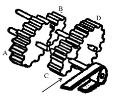

A. A

B. B

C. C

D. D

第 52 题 · 答案与解析

**参考答案（粉笔题库参考内容）**

C

**解析**

两个齿轮同轴，则这两个齿轮的转速相同。两个相互咬合的齿轮中，齿轮直径大的转速小，即转速与齿轮直径成反比关系。因此，四个齿轮的转速关系为A&lt;B=D&lt;C。

故正确答案为C。

**来源**：2008年上海市公务员录用考试《行测》题第52题

### 第 53 题

下列四种情形中，轮子X与轮子Y的旋转方向一致的是：

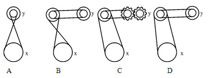

A. A

B. B

C. C

D. D

第 53 题 · 答案与解析

**参考答案（粉笔题库参考内容）**

D

**解析**

传送带连接两个齿轮，传送带交叉时齿轮旋转方向相反；不交叉时旋转方向相同。两个相互咬合的齿轮，其旋转方向相反。

故正确答案为D。

**来源**：2008年上海市公务员录用考试《行测》题第53题

### 第 54 题

下列四种情形中，不可能发生的现象是：

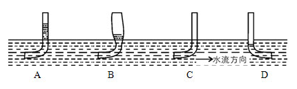

A. A

B. B

C. C

D. D

第 54 题 · 答案与解析

**参考答案（粉笔题库参考内容）**

C

**解析**

由于水是流动的，那么会持续的给浸在水中的管口一个冲量，再加上大气的压力，故露出水面的水管一定得有一段水柱才能保持平衡状态，因此C项是不可能发生的。而D项中管口与水流方向一致，那么水的流动会使水下管口附近的压力变小，故水柱会低于水面。

故正确答案为C。

**来源**：2008年上海市公务员录用考试《行测》题第54题

### 第 55 题

下面四个水坝中，能承受水压最大的是：

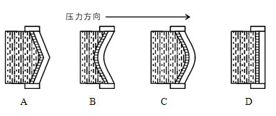

A. A

B. B

C. C

D. D

第 55 题 · 答案与解析

**参考答案（粉笔题库参考内容）**

B

**解析**

力施加到拱形的物体上时，力会被均匀地分散开来，因此会比直线型和凹形的更坚固。因此，在材料相同时，拱形的物体所能承受的压力最大。

故正确答案为B。

**来源**：2008年上海市公务员录用考试《行测》题第55题

### 第 56 题

2002年诺贝尔经济学奖获得者、心理学家卡尼曼（Kahneman）在其著名的“前景理论”中提出：（a）大多数人在面临获得的时候是风险规避的；（b）大多数人在面临损失的时候是风险偏爱的；（c）人们对损失比对获得更敏感。

下面不符合前景理论的是：

A. A是肯定赢1000元；B有50％的可能性赢2000元，50％的可能性什么也得不到，大部分人会选择A

B. 采用X方案，可以救200人；采用Y方案，有三分之一的可能救600人，三分之二的可能一个人也救不了，人们更愿意选择X方案

C. 如果你有几个好的消息要发布，应该把它们合在一起发布

D. 在基金年收益率达到3％之前，基金管理公司只收取0.5％的管理费，用于维持其成本；在年收益率处于3％～4.5％的阶段，基金管理人额外收取超过3％收益部分的50％作为业绩报酬

第 56 题 · 答案与解析

**参考答案（粉笔题库参考内容）**

C

**解析**

第一步：找出定义关键词。

关键词强调“获得”时“风险规避”，“损失”时“风险偏爱”。

第二步：逐一判断选项。

A项中赢1000或2000都属于获得，而赢1000没有风险，赢2000存在50%的风险，大部分人选择赢1000，属于风险规避，符合定义，排除；

B项中使人获救属于获得，而Y方案中存在三分之二的风险，大部分人选择X属于风险规避，符合定义，排除；

C项中与风险无关，属于无关项，当选；

D项中管理费对购买基金人来说是损失，收益百分比越高，管理费会额外增加，但购买者更偏爱收益率高，属于风险偏爱，符合定义，排除。

故正确答案为C。

**考点**：单定义-其他句式

**来源**：2008年上海市公务员录用考试《行测》题第56题

### 第 57 题

长尾理论是网络时代兴起的一种新理论，由美国人克里斯安德森提出。长尾理论认为，由于成本和效率的因素，过去人们只能关注重要的人或重要的事，如果用正态分布曲线来描绘这些人或事，人们只能关注曲线的“头部”，而将处于曲线“尾部”、需要更多的精力和成本才能关注到的大多数人或事忽略。

以下情况采用长尾理论观点重视“尾部”的是：

A. 尽管现在“大热门”的经济力量已经不如当年，但我们仍然对其重点关注

B. 商家认为听众对非热门音乐有着无限的需求，市场无比巨大，应加以关注

C. 厂商们把精力放在那些有80％客户去购买的20％的主流商品上，着力维护购买其80％商品的20％的主流客户

D. 在销售产品时，厂商关注的是少数几个“VIP”客户，“无暇”顾及在人数上居于大多数的普通消费者

第 57 题 · 答案与解析

**参考答案（粉笔题库参考内容）**

B

**解析**

第一步：抓住定义中的关键词。

根据定义，“尾部”是指不重要的人或事，“头部”是重要的人或事。

第二部：逐一判断选项。

A项中的“大热门”、C项中的主流商品和主流客户、D项中厂商关注的“VIP客户”都属于重要的人或物，不符合定义，排除；

B项中非热门音乐是不重要的，属于“尾部”，符合定义，当选。

故正确答案为B。

**考点**：单定义-其他句式

**来源**：2008年上海市公务员录用考试《行测》题第57题

### 第 58 题

虐待罪，是指对共同生活的家庭成员，经常以打骂、冻饿、禁闭、强迫过度劳动、有病不给治疗或者其他方法进行摧残、折磨的行为。根据定义，下列不构成虐待罪的是：

A. 王某的儿子得了病，但是王某却以治疗不会有效果为由任其发展至病危

B. 李某常使用体罚来教育调皮的儿子，还常常关他禁闭

C. 张某经常用言语侮辱妻子，有时还会殴打妻子

D. 超市老板经常对员工搜身，并常常无故要求加班

第 58 题 · 答案与解析

**参考答案（粉笔题库参考内容）**

D

**解析**

第一步：判断题干中的关键词。

客体：共同生活的家庭成员。

方式：经常以打骂、冻饿、禁闭、强迫过度劳动、有病不给治疗或者其他方法进行摧残、折磨。

第二步，逐一分析选项。

A项，客体为王某的儿子，属于“共同生活的家庭成员”，“以治疗不会有效果为由任其发展至病危”属于虐待罪定义中的“有病不给治疗”，符合定义关键词，排除。

B项，客体为李某的儿子，属于“共同生活的家庭成员”，“常使用体罚来教育调皮的儿子，还常常关他禁闭”属于虐待罪定义中的经常以禁闭的方式进行摧残、折磨，符合定义关键词，排除。

C项，客体为张某的妻子，属于“共同生活的家庭成员”，“经常用言语侮辱并殴打妻子”属于虐待罪定义中的经常以打骂的方式进行摧残、折磨，符合定义关键词，排除。

D项，客体为员工，不符合虐待罪“共同生活的家庭成员”这一客体要素，搜身及加班亦不属于虐待罪的实施方式，不符合定义关键词，当选。

本题为选非题，故正确答案为D。

**考点**：主客体

**来源**：2008年上海市公务员录用考试《行测》题第58题

### 第 59 题

马太效应，是指好的愈好，坏的愈坏，多的愈多，少的愈少的一种现象。

以下选项中不属于马太效应的是：

A. 在股市楼市狂潮中，最赚的总是庄家，最赔的总是散户

B. 落后地区的人才会流向发达地区，落后地区的资源会廉价流向发达地区，落后地区的制度又通常不如发达地区合理，于是循环往复，地区差异会越来越大

C. 任何人都可能只买了一张彩票却中了大奖

D. 占有人才越多的地方，对人才越有吸引力；反过来，被认可的人才越稀缺

第 59 题 · 答案与解析

**参考答案（粉笔题库参考内容）**

C

**解析**

第一步：抓住定义中的关键词。

关键词强调“好的愈好”、“坏的愈坏”、“多的愈多”、“少的愈少”。

第二步：逐一判断选项。

A项中庄家比散户更有经济实力，但庄家赚散户赔，属于好的愈好，坏的愈坏，符合定义；

B项中落后地区恶性循环，属于坏的愈坏，符合定义；

C项中是风险概率问题，与定义无关；

D项中人才和吸引力组成良性循环，属于好的愈好，符合定义。

故正确答案为C。

**考点**：单定义-其他句式

**来源**：2008年上海市公务员录用考试《行测》题第59题

### 第 60 题

反诉，是指在已经提起的诉讼中，被告针对与原诉有联系的行为，提起独立诉讼请求的行为。

以下选项中属于反诉的是：

A. 原告起诉被告借钱不还，被告起诉原告非法搭建

B. 原告起诉离婚，被告请示法院确认婚姻关系本来就是无效的

C. 原告起诉，要求被告按买卖合同交货，被告起诉供货商未能按时交货

D. 原告起诉被告居住的房屋所有权是他的，被告请示法院让原告偿还欠款

第 60 题 · 答案与解析

**参考答案（粉笔题库参考内容）**

B

**解析**

第一步：抓住定义中的关键词。

关键词强调“已经提起的诉讼”、“被告······提起独立诉讼请求”、“针对与原诉有联系的行为”。

第二步：逐一判断选项。

A、D项被告起诉的行为不是与原诉有联系的行为，而是原诉行为本身；

C项被告起诉的是第三方，与原诉无关，因此均不符合定义。

故正确答案为B。

**考点**：主客体

**来源**：2008年上海市公务员录用考试《行测》题第60题

### 第 61 题

以下选项中，符合所给图形的变化规律的是：

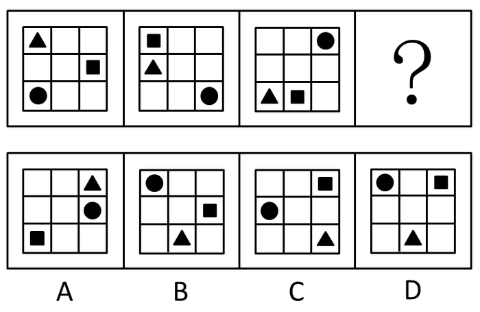

A. A

B. B

C. C

D. D

第 61 题 · 答案与解析

**参考答案（粉笔题库参考内容）**

D

**解析**

元素组成相同，考查位置规律。

图中的各小图形围绕九宫格中心逆时针平移。三角形每次平移一格，圆形每次平移两格，方形每次平移三格。

故正确答案为D。

**考点**：位置规律-平移

**来源**：2008年上海市公务员录用考试《行测》题第61题

### 第 62 题

以下选项中，符合所给图形的变化规律的是：

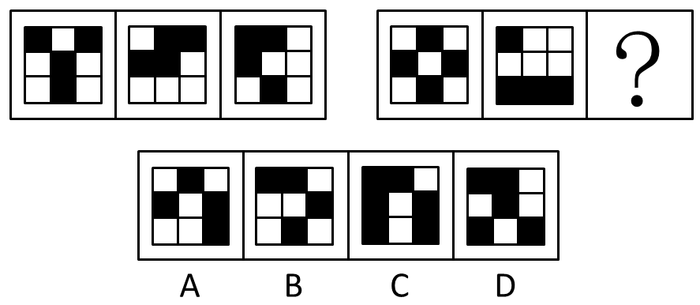

A. A

B. B

C. C

D. D

第 62 题 · 答案与解析

**参考答案（粉笔题库参考内容）**

C

**解析**

元素组成相似，元素黑白叠加。每个组图中的前两图黑白叠加形成第三个图形，且本题规则为：黑＋白＝黑，白＋黑＝黑，黑＋黑＝白，白＋白＝白。

故正确答案为C。

**考点**：样式规律-黑白运算

**来源**：2008年上海市公务员录用考试《行测》题第62题

### 第 63 题

左面的图形折叠后，形成右面的哪个图形：

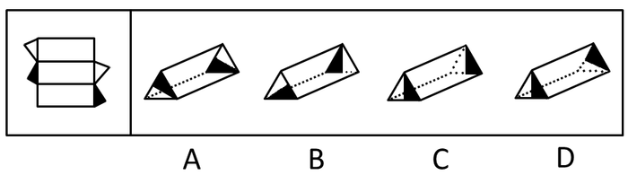

A. A

B. B

C. C

D. D

第 63 题 · 答案与解析

**参考答案（粉笔题库参考内容）**

B

**解析**

排除法：把选项的图形展开和题干图形对比，首先排除C、D两项，因为C、D两项展开后会出现一个长方形连接两个黑色三角形的情况。其次排除A项，因为折叠后两个底面上的黑白三角形的公共底边不可能同时为同一矩形的边。

故正确答案为B。

**来源**：2008年上海市公务员录用考试《行测》题第63题

### 第 64 题

以下选项中，符合所给图形的变化规律的是：

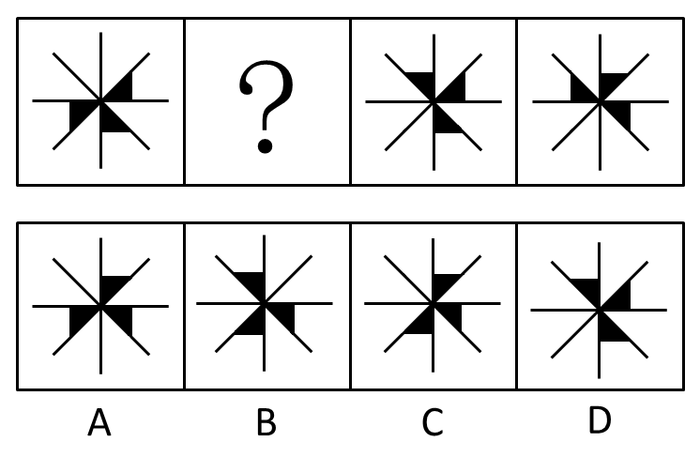

A. A

B. B

C. C

D. D

第 64 题 · 答案与解析

**参考答案（粉笔题库参考内容）**

C

**解析**

元素组成相同，考查位置规律。从第二个图形开始，每个图形中的三角形的位置都由从前一个逆时针旋转45°得到。

故正确答案为C。

**考点**：位置规律-旋转

**来源**：2008年上海市公务员录用考试《行测》题第64题

### 第 65 题

左面的图形与右面四个图形中的哪个图形刚好构成一个三角形：

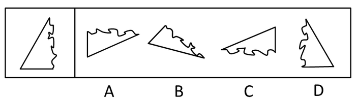

A. A

B. B

C. C

D. D

第 65 题 · 答案与解析

**参考答案（粉笔题库参考内容）**

B

**解析**

只观察底部就可得到答案。题干底部是凸出来的部分，答案中就应该是凹下去。

故正确答案为B。

**来源**：2008年上海市公务员录用考试《行测》题第65题

### 第 66 题

以下选项中，符合所给图形的变化规律的是：

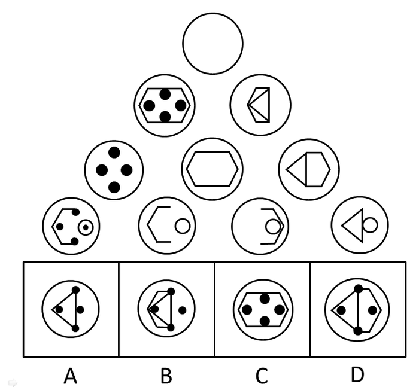

A. A

B. B

C. C

D. D

第 66 题 · 答案与解析

**参考答案（粉笔题库参考内容）**

D

**解析**

元素组成相似，元素叠加运算。从下往上，每一行中相邻的两个图形相加去同存异即得到上面的图形。

故正确答案为D。

**考点**：样式规律-加减同异

**来源**：2008年上海市公务员录用考试《行测》题第66题

### 第 67 题

右侧分割图片中，哪个能最好地拼成左侧给定的图形：

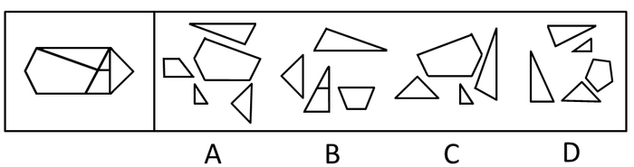

A. A

B. B

C. C

D. D

第 67 题 · 答案与解析

**参考答案（粉笔题库参考内容）**

A

**解析**

仅需将选项中的形状组合即可。

B项的等腰梯形、C项的等边三角形错误，D项没有直角梯形，排除。

故正确答案为A。

**来源**：2008年上海市公务员录用考试《行测》题第67题

### 第 68 题

下图中，下部为同一边界、不同尺寸的同坡屋顶不同形式的水平投影。与上部屋顶相匹配的投影图形是：

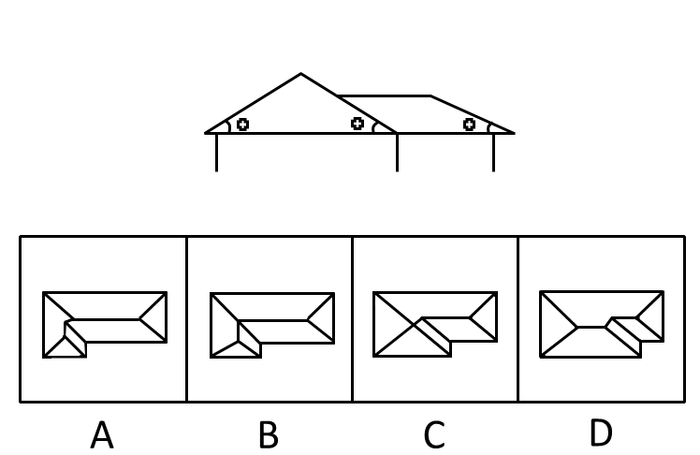

A. A

B. B

C. C

D. D

第 68 题 · 答案与解析

**参考答案（粉笔题库参考内容）**

C

**解析**

只需观察最底下的两条横边的长度的比例即可。

A、B、D三项均与题干不符。

故正确答案为C。

**考点**：空间类-三视图

**来源**：2008年上海市公务员录用考试《行测》题第68题

### 第 69 题

从所给的四个选项中，选择最合适的一个填入问号处，使之呈现一定的规律性：

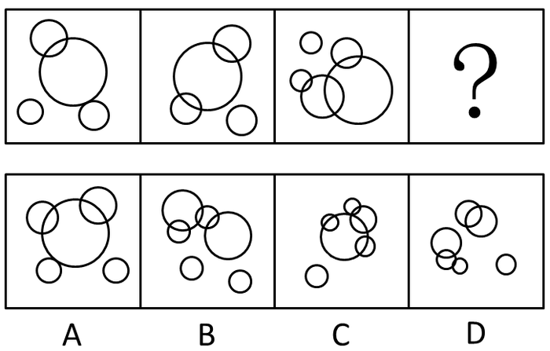

A. A

B. B

C. C

D. D

第 69 题 · 答案与解析

**参考答案（粉笔题库参考内容）**

C

**解析**

题干每一幅图均由几个大小不同的圆圈组合而成，考虑圆圈图形之间的关系。发现每个图形中，互为相交的圆的个数分别为2，3，4，因此需要填一个互为相交的圆的个数为5的图形，只有C项满足。

故正确答案为C。

**考点**：数量规律-素、特殊规律-图形间关系

**来源**：2008年上海市公务员录用考试《行测》题第69题

### 第 70 题

从所给的四个选项中，选择最合适的一个填入问号处，使之呈现一定的规律性：

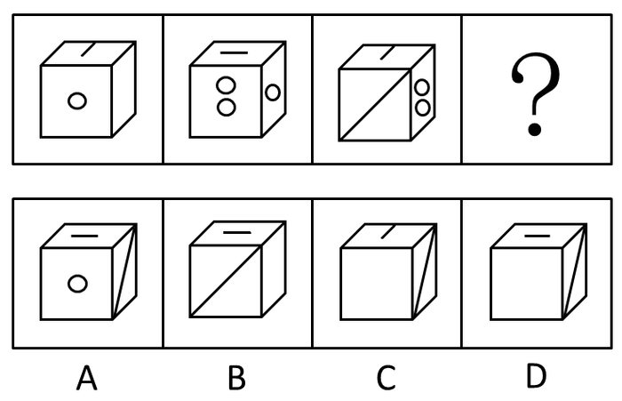

A. A

B. B

C. C

D. D

第 70 题 · 答案与解析

**参考答案（粉笔题库参考内容）**

D

**解析**

考查立体图形位置规律。从第二个图形起，每个图形中的立方体都是由前一个绕竖轴旋转90°得到。

故正确答案为D。

**考点**：位置规律-旋转

**来源**：2008年上海市公务员录用考试《行测》题第70题

### 第 71 题

《婚姻法》规定：凡是男女双方自愿离婚的，准予离婚。而在某婚姻案件中，只有一方是自愿离婚的。所以，法院的判决结果应为：

A. 不能判决离婚

B. 不一定能判决离婚

C. 经双方协商一致后再判决

D. 应判决离婚

第 71 题 · 答案与解析

**参考答案（粉笔题库参考内容）**

B

**解析**

第一步：翻译题干。

双方自愿离婚⇒准予离婚。

事实信息：在某婚姻案件中，－双方自愿离婚。

第二步：从事实信息开始推导，结合选项得出答案。

事实信息是“－双方自愿离婚”，根据逆否规则，否定前件无法得出绝对表达的结论，只能推出可能性结论，A、D两项都为绝对表达的结论，无法推出，排除；

B项是可能性表达，当选；

C项双方协商与题干无关，属于无关项，排除。

故正确答案为B。

**考点**：常规翻译

**来源**：2008年上海市公务员录用考试《行测》题第71题

### 第 72 题

中医是很多中国人的骄傲，但最近有专家发起的一个“取消中医”的签名运动，认为中医文化上，不主动寻求进步，不属于理性而科学的医学，滥用自然资源，整个中医不仁不义，欺骗患者。从这种现象可以推出：

A. 中医功效不容置疑，取消中医只是哗众取宠

B. 人们对中国传统文化和传统医学不理解、没有信心

C. 虽然中医功效无可置疑，但该言论一定程度上也反映出中医目前面临的一些困境

D. 此种言论纯粹是个人偏见，不值得一提

第 72 题 · 答案与解析

**参考答案（粉笔题库参考内容）**

B

**解析**

第一步：抓住题干主要信息。

第一点说明中医是很多中国人的骄傲，第二点说明最近有专家认为中医文化不科学，滥用自然资源，不仁不义。

第二步：分析题干信息，并结合选项得出答案。

A项：中医功效“不容质疑”，取消中医只是哗众取宠，说法过于绝对，题干并未涉及中医功效，无法推出，排除；

B项：人们对中国传统文化和传统医学不理解、没有信心，从第一步中第一点和第二点间的对比可以发现，是中医文化没有得到专家的理解，并不是中医不科学，可以推出，当选；

C项：中医功效“无可质疑”，说法过于绝对，题干并未涉及中医功效，无法推出，排除；

D项：此种言论纯粹是个人偏见，不值得一提，从题干中并不能体现出这是个人偏见，无法推出，排除。

故正确答案为B。

**考点**：日常结论

**来源**：2008年上海市公务员录用考试《行测》题第72题

### 第 73 题

伦敦经济学院教授理查德·莱亚德说：“我们的生活存在悖论。多数人希望收入越来越高，并为此不懈努力。但是尽管西方社会越来越富足，人们却没有感到越来越幸福。”经济增长并不一定让人们更幸福，大众追求物质财富往好处说是徒劳的，可能性更大的结果是让人更加不幸福。根据理查德·莱亚德的观点，下列说法正确的是：

A. 幸福和人们的收入没有关系

B. 收入越高的人就越不幸福

C. 要幸福的人就不应该有高收入

D. 幸福不只是通过收入来衡量

第 73 题 · 答案与解析

**参考答案（粉笔题库参考内容）**

D

**解析**

由题干“经济增长并不一定让人们更幸福”，可知收入和幸福存在不确定性，得知A、B、C三项的结论过于绝对。

故正确答案为D。

**考点**：日常结论

**来源**：2008年上海市公务员录用考试《行测》题第73题

### 第 74 题

假设某国政府开始对出售的每一罐食用油征税两分钱，然而税务记录显示，尽管人口数量保持稳定且税法执行有力，食用油的税收在税法生效的头两年中却呈现下降趋势。

下列各项中，如果（    ）正确，最有助于解释食用油税收额下降。

A. 很少家庭在加税后开始生产他们自己的食用油

B. 商人在税法实施后开始用比以前更大的罐子出售食用油

C. 在食用油税实行后的两年，政府开始在许多其他商品上征税

D. 食用油传统上被用作结婚礼物，税法实施后，用食用油做礼物增多了

第 74 题 · 答案与解析

**参考答案（粉笔题库参考内容）**

B

**解析**

第一步：找出题干矛盾。

食用油加税后，尽管人口数量保持稳定且税法执行有力，但食用油的税收头两年却呈现下降趋势。

第二步：逐一分析选项。

A项：“很少家庭”自己生产不会显著影响出售食用油的罐数，无法说明食用油税收为什么下降，不能解释题干矛盾，排除；

B项：用“更大的罐子”，在需求量稳定的情况下会导致罐数减少，因此税收下降，可以解释题干矛盾，当选；

C项：其他商品征税与食用油的税收下降无关，无法说明食用油税收为什么下降，不能解释题干矛盾，排除；

D项：用食用油做礼物的增多了，卖出的罐数也会上涨，食用油税收会上升而非下降，不能解释题干矛盾，排除。

故正确答案为B。

**考点**：原因解释

**来源**：2008年上海市公务员录用考试《行测》题第74题

### 第 75 题

人应对自己的正常行为负责，这种负责甚至包括因行为触犯法律而受制裁。但是，人不应该对自己不可控制的行为负责。

以下能从上述断定中推出的是：

①人的有些正常行为会导致触犯法律

②人对自己的正常行为有控制力

③不可控制的行为不可能触犯法律

A. 只有①

B. 只有②

C. 只有③

D. 只有①和②

第 75 题 · 答案与解析

**参考答案（粉笔题库参考内容）**

D

**解析**

第一步：翻译题干。利用充分必要条件。

（1）正常行为⇒负责，（2）触犯法律的正常行为⇒负责，（3）不可控制的行为⇒－负责。

第二步：逐一翻译选项并判断正确答案。

①有些正常行为⇒触犯法律，可由（2）推出；

②正常行为⇒－不可控制的行为，根据逆否规则，从（3）可推出（4）“负责⇒－不可控制的行为”，将（1）和（4）两个推导关系连接起来，可知“正常行为⇒－不可控制的行为”，②可推出；

③不可控制的行为⇒－触犯法律，从上个推导知（4）“负责⇒－不可控制的行为”，将（2）、（4）两个推导关系连接起来，可知“触犯法律的正常行为⇒－不可控制的行为”，根据逆否规则，“不可控制的行为⇒－触犯法律的正常行为”，即不可控制的行为不是触犯法律的正常行为，③只说不可能触犯法律，没有说明正常行为，故③错。

故正确答案为D。

**考点**：常规翻译

**来源**：2008年上海市公务员录用考试《行测》题第75题

### 第 76 题

市内一家珠宝店在大年初一营业后，竟然在夜间打烊后失窃了大量珠宝。店方紧急报案，警方发现作案的手法干脆利落，因而怀疑在三名店员中有人监守自盗，于是对他们进行逐一讯问。

店员甲：我昨天下班后，吃过晚饭，见时间尚早，就一个人去看了场电影，大概在12点才回家睡觉的。

店员乙：我下班后和太太一起逛了商场，还下了馆子，又到郊区小山顶上去欣赏月光，12点左右回的家。

店员丙：昨晚我和几个好朋友一起聚餐喝酒，大伙都喝醉了，差不多是到了凌晨才回家的，朋友们可以为我作证。

从上述材料中可以推出：

A. 甲是说谎者

B. 乙是说谎者

C. 丙是说谎者

D. 没有人说谎

第 76 题 · 答案与解析

**参考答案（粉笔题库参考内容）**

B

**解析**

第一步：抓住题干主要信息。

事实信息为一家珠宝店在大年初一营业，在夜间打烊后失窃大量珠宝。店员甲的理由是去看电影，店员乙的理由是看月光，店员丙的理由是聚餐喝酒。

第二步：分析题干信息并结合选项得出答案。

农历初一这天，月亮运行到太阳和地球之间，与太阳同时升起，同时降落，所以大年初一是见不到月亮的。显然店员乙是说谎者。

故正确答案为B。

**考点**：日常结论

**来源**：2008年上海市公务员录用考试《行测》题第76题

### 第 77 题

A、B、C、D四个球队进行循环赛（每队与其他队各比赛一场），比赛结果：B队输一场，C队比B队少赢一场，B队比D队少赢一场。那么，A队的名次为：

A. 第一名

B. 第二名

C. 第三名

D. 第四名

第 77 题 · 答案与解析

**参考答案（粉笔题库参考内容）**

D

**解析**

第一步：分析题干。

四队循环赛，则每个队均与其他队比赛3场，共计6场比赛，四队共计有6胜6负。

第二步：根据题干信息推理。

①B队输一场→B队2胜1负

②C队比B队少赢一场→C队1胜2负

③B队比D队少赢一场→D队3场全胜

B、C、D三队共计6胜3负，则A队3场全负，其名次应该为第四名。

故正确答案为D。

**考点**：从确定信息开始推

**来源**：2008年上海市公务员录用考试《行测》题第77题

### 第 78 题

某机关精简机构，计划减员25％，撤销三个机构，这三个机构的人数正好占全机关的25％。计划实施后，上述三个机构被撤销，全机关实际减员15％。此过程中，机关内部成员有所调动，但全机关只有减员，没有增员。

如果上述断定为真，以下肯定为真的是：

①上述计划实施后，有的机构调入新成员。

②上述计划实施后，没有一个机构所调入的新的成员的总数，超过机关原总人数的10％。

③上述计划实施后，被撤销机构中的留任人员，不超过机关原总人数的10％。

A. 只有①

B. 只有②

C. 只有③

D. 只有①和③

第 78 题 · 答案与解析

**参考答案（粉笔题库参考内容）**

A

**解析**

第一步：抓住题干主要信息。

第一句计划减员25%，撤销的三个机构的人数正好占全机关的25％；第二句三个机构被撤销，全机关实际减员15％；第三句机关内部成员有所调动，但全机关只有减员，没有增员。

第二步：分析题干信息，并结合选项得出答案。

①一定为真。由题干“被撤消的三个机构的人数占全机关的25％，实际减员15％”可知，被撤消的三个机构中，至少有占全机关人数10％的成员调入被保留机构。

②不一定为真。因为题干所说的人员调动，不一定局限于被撤消机构的人员调入被保留机构，也可能包括被保留机构人员的互相调动。

③不一定为真。因为完全有可能被撤消的三个机构的人员全部留任，而被保留机构的成员被减员。

综上，只有①一定为真。

故正确答案为A。

**考点**：日常结论

**来源**：2008年上海市公务员录用考试《行测》题第78题

### 第 79 题

在白、黄、蓝、黑四种由浅至深排列的涂料中，一种涂料只能被自身或比它颜色更深的涂料所覆盖。若上述断定为真， 则以下（    ）正确地概括了能被蓝色覆盖的颜色。

①这种颜色不是蓝色②这种颜色不是黑色③这种颜色不如蓝色深

A. 只有①

B. 只有②

C. 只有③

D. 只有①和②

第 79 题 · 答案与解析

**参考答案（粉笔题库参考内容）**

B

**解析**

第一步：翻译题干。

一种涂料被覆盖，说明覆盖它的涂料为它本身或者比它颜色更深的涂料。

第二句：根据题干中的事实逐一判断选项的正误。

能被蓝色覆盖，可推出被覆盖的颜色是蓝色或者比蓝色浅。因此①、③不正确，②正确。

故正确答案为B。

**考点**：日常结论

**来源**：2008年上海市公务员录用考试《行测》题第79题

### 第 80 题

有A、B、C、D、E五枚邮票，其价值大小不同。

已知：（1）A是B的两倍价值（2）B是C的四倍半价值（3）C是D的一半价值（4）D是E的一半价值

那么，这五枚邮票由大到小的价值顺序是：

A. A、E、B、D、C

B. A、B、E、C、D

C. A、B、E、D、C

D. A、E、D、B、C

第 80 题 · 答案与解析

**参考答案（粉笔题库参考内容）**

C

**解析**

第一步：翻译题干。

A＝2B，B＝4.5C，C＝0.5D，D＝0.5E。

第二步：将四个等式相连接。

A＝2B＝9C＝4.5D＝2.25E。

由反比例关系可知，A>B>E>D>C。

故正确答案为C。

**考点**：组合排列-单题-其他

**来源**：2008年上海市公务员录用考试《行测》题第80题

### 第 81 题

党的十七大报告提出，要建设社会主义核心价值体系，增强社会主义意识形态的吸引力和凝聚力。社会主义核心价值体系是：

A. 社会主义意识形态的根本要求

B. 社会主义意识形态的本质体现

C. 实践社会主义荣辱观的主要体现

D. 巩固全党全国各族人民团结奋斗的思想基础

第 81 题 · 答案与解析

**参考答案（粉笔题库参考内容）**

B

**解析**

社会主义核心价值体系是社会主义意识形态的本质体现，在所有社会主义价值目标中处于统摄和支配的地位，其基本内容包括马克思主义指导思想、中国特色社会主义共同理想、以爱国主义为核心的民族精神和以改革创新为核心的时代精神、社会主义荣辱观。

故正确答案为B。

**来源**：2008年上海市公务员录用考试《行测》题第81题

### 第 82 题

党的十七大报告指出，社会主义社会是全面发展、全面进步的社会。中国特色社会主义事业的总体布局是由（    ）构成的。

A. 政治建设、法制建设、精神建设和社会建设

B. 经济建设、法治建设、文化建设和体制建设

C. 经济建设、政治建设、文化建设和社会建设

D. 政治建设、经济建设、精神建设和体制建设

第 82 题 · 答案与解析

**参考答案（粉笔题库参考内容）**

C

**解析**

十七大报告指出，社会主义社会是全面发展、全面进步的社会。中国特色社会主义事业的总体布局是由经济建设、政治建设、文化建设和社会建设构成的。在中国特色社会主义建设中，经济建设是物质基础，政治建设是引航舵手，文化建设是精神动力，社会建设是环境保障。这四大建设相互联系，缺一不可。

故正确答案为C。

**来源**：2008年上海市公务员录用考试《行测》题第82题

### 第 83 题

2010年，中国上海将举办世界博览会。这是上海实现科学发展的重要契机，也是上海今后一个时期发展的重要推动力。（    ）是上海世博会追求的目标，也是中国政府对国际社会的一项庄严承诺。

A. 成功、精彩、难忘

B. 和谐、创新、精彩

C. 城市、让生活更美好

D. 绿色、科技、合作

第 83 题 · 答案与解析

**参考答案（粉笔题库参考内容）**

A

**解析**

“成功、精彩、难忘”是上海世博会追求的目标。“城市、让生活更美好”是上海世博会的主题。

故正确答案为A。

**来源**：2008年上海市公务员录用考试《行测》题第83题

### 第 84 题

《中共中央关于构建社会主义和谐社会若干重大问题的决定》指出，构建社会主义和谐社会，必须坚持民主法治。加强社会主义民主政治建设，发展社会主义民主，实施依法治国基本方略，建设社会主义法治国家，（    ）。

A. 树立社会主义法治理念，增强全社会法律意识

B. 坚持科学执政、民主执政、依法执政

C. 推进国家经济、政治、文化、社会生活法制化、规范化

D. 逐步形成社会公平保障体系，促进社会公平正义

第 84 题 · 答案与解析

**参考答案（粉笔题库参考内容）**

ACD

**解析**

2006年10月党的十六届六中全会通过的《中共中央关于构建社会主义和谐社会若干重大问题的决定》指出：“加强社会主义民主政治建设，发展社会主义民主，实施依法治国基本方略，建设社会主义法治国家，树立社会主义法治理念，增强全社会法律意识，推进国家经济、政治、文化、社会生活法制化、规范化，逐步形成社会公平保障体系，促进社会公平正义。”

故正确答案为A、C、D。

**来源**：2008年上海市公务员录用考试《行测》题第84题

### 第 85 题

财政政策，是指政府根据既定目标，通过财政收支的变动以影响宏观经济水平的经济政策，当通货膨胀出现的时候，紧缩性财政政策能够发挥一定的作用。以下属于紧缩性财政政策的主要手段的是：

A. 提高政府转移支付水平，增加社会福利费用

B. 增加税收，以降低企业的投资能力和个人的投资热情，并抑制总需求的膨胀

C. 发行公债以减少流通中的货币供应量

D. 削减政府预算，限制公共事业投资，以此来减少政府支出

第 85 题 · 答案与解析

**参考答案（粉笔题库参考内容）**

BCD

**解析**

紧缩性财政政策，是指当总支出过多，价格水平持续上涨时，减少政府支出，增加政府收入，从而抑制总支出。

当财政向银行透支，引发财政赤字型通货膨胀时，需采取紧缩性财政政策来抑制，其主要手段有：第一，削减政府预算，限制公共事业投资。这一措施的目的在于减少政府支出，减少财政赤字。第二，降低政府转移支付水平，减少社会福利费用。第三，增加税收。增税以后，企业与个人收入减少，从而投资减少，政府赤字亦减少，最终控制总需求的膨胀。第四，发行公债。国家向企业与个人发行公债，既可减少财政赤字，又可减轻市场压力。通过上述措施，可以直接从限制支出，减少需求等方面来减轻通货膨胀压力弥补通货膨胀缺口。A项增加社会福利不属于紧缩。

故正确答案为B、C、D。

**考点**：宏观经济与调控政策

**来源**：2008年上海市公务员录用考试《行测》题第85题

### 第 86 题

政府职能，是指公共行政管理机关在经济、社会发展中所应承担的职责和所应发挥的作用。下列属于我国政府社会管理职能的是：

A. 保护和治理生态环境

B. 加强社会治安综合治理

C. 加大军事装备的研发与生产投入

D. 调节收入分配

第 86 题 · 答案与解析

**参考答案（粉笔题库参考内容）**

AD

**解析**

政府的社会管理职能是指除政治、经济、文化职能以外的政府必须承担的其他职能，主要是政府民生相关职能。主要包括：调节收入分配、建立社会保障体系、保护和治理生态环境。加强社会治安综合治理、加大军事装备的研发和生产投入属于政府的政治职能。

故正确答案为AD。

**来源**：2008年上海市公务员录用考试《行测》题第86题

### 第 87 题

长期以来，人们并不重视对公共政策执行和评估的研究，认为公共政策的根本问题就是对政策制定系统加以改进，现代政策执行研究更重视政策的执行过程和效果。公共政策的评估起点是：

A. 确定政策评估工作组织者

B. 拟定政策评估工作程序

C. 建立政策评估标准

D. 进行各项考核并汇总数据

第 87 题 · 答案与解析

**参考答案（粉笔题库参考内容）**

C

**解析**

公共政策评估，是指依据一定的标准和程序，对政策的效益、效率及价值进行判断的一种政治行为，目的在于取得有关这些方面的信息，作为决定政策、政策改进和制定新政策的依据。公共政策评估的顺利开展首先要设立评估标准。政策评估标准是指依据政策目标设立的可供比较的指标或准则，是开展公共政策评估的依据、前提和逻辑起点。

故正确答案为C。

**来源**：2008年上海市公务员录用考试《行测》题第87题

### 第 88 题

行政复议是监督行政的一种制度化、规范化的＿＿＿＿，也是国家行政机关系统内部为依法行政而进行自我约束的重要机制。

A. 行政裁决行为

B. 行政救济行为

C. 行政监督行为

D. 行政审查行为

第 88 题 · 答案与解析

**参考答案（粉笔题库参考内容）**

C

**解析**

行政复议，是指法定的行政机关根据行政相对人的请求，按照法定程序依法对引起争议的具体行政行为进行复查并作出裁决的活动。行政复议是监督行政的一种重要形式，是上级行政机关对下级行政机关的行政行为活动进行监督的一种制度化、规范化的表现，是行政机关系统内部为依法行政而进行自我纠正错误的重要法律制度。

故正确答案为C。

**考点**：行政法

**来源**：2008年上海市公务员录用考试《行测》题第88题

### 第 89 题

中共十七大报告在谈到深化收入分配制度改革、增加城乡居民收入时，首次提出了“创造条件让更多群众拥有财产性收入”，这更是给各类投资者吃了“定心丸”。人们不仅可以靠工资增加财富，还可以通过财富保值增值，拥有更多的财富。下列选项中，不属于“财产性收入”的是：

A. 老刘所在的企业以股份形式向每个员工支付劳动报酬，年终获得了分红

B. 张阿姨购买的基金获得了分红收益

C. 小李自主创办企业，并获得的经营收益

D. 老李因其在技术革新中做出的突出成绩，年终获得了公司一万元奖励

第 89 题 · 答案与解析

**参考答案（粉笔题库参考内容）**

CD

**解析**

“财产性收入”一般是指家庭拥有的动产（如银行存款、有价证券等）、不动产（如房屋、土地等）所获得的收入。它包括出让财产使用权所获得的利息、租金、专利收入等；财产营运所获得的红利收入、财产增值收益等。

C项错误，小李获得的是经营收益；

D项错误，老李获得一万元奖金并不是“财产”带来的收入。

本题为选非题，故正确答案为C、D。

**考点**：市场经济、微观经济

**来源**：2008年上海市公务员录用考试《行测》题第89题

### 第 90 题

党的十七大报告在论述科学发展观时，强调要“更好地实施科教兴国战略、人才强国战略、可持续发展战略，着力把握发展规律、创新发展理念、转变发展方式、破解发展难题，提高发展质量和效益，实现又好又快发展，为发展中国特色社会主义打下坚实基础。”可持续发展战略的核心内容就是：

A. 要保持人口资源、环境、经济、社会的协调发展

B. 要保持社会的和谐稳定、国民经济持续增长

C. 在经济不断增长的同时，要保证人民生活水平的同步增长

D. 充分发挥市场在资源配置中的基础作用，增强经济的活力和效率

第 90 题 · 答案与解析

**参考答案（粉笔题库参考内容）**

A

**解析**

所谓可持续发展战略，是指实现可持续发展的行动计划和纲领，是多个领域实现可持续发展的总称。它要使各方面的发展目标，尤其是社会、经济与生态、环境的目标相协调。可持续发展战略的核心内容就是要保持人口资源、环境、经济、社会的协调发展。

故正确答案为A。

**来源**：2008年上海市公务员录用考试《行测》题第90题

### 第 91 题

我国在对抗全球变暖运动中一贯采取积极务实的姿态。2007年5月30日，国务院常务会议审议并决定颁布：

A. 《中国应对全球变暖国家方案》

B. 《中国应对温室效应国家方案》

C. 《中国应对环境污染国家方案》

D. 《中国应对气候变化国家方案》

第 91 题 · 答案与解析

**参考答案（粉笔题库参考内容）**

D

**解析**

2007年5月30日，国务院总理温家宝主持召开国务院常务会议，审议并决定颁布《中国应对气候变化国家方案》。《国家方案》回顾了我国气候变化的状况和应对气候变化的不懈努力，分析了气候变化对我国的影响与挑战，提出了应对气候变化的指导思想、原则、目标以及相关政策和措施，阐明了我国对气候变化若干问题的基本立场及国际合作需求。我国的《国家方案》是发展中国家颁布的第一部应对气候变化国家方案。

故正确答案为D。

**考点**：其他

**来源**：2008年上海市公务员录用考试《行测》题第91题

### 第 92 题

行政复议机关依法对具体行政行为的＿＿＿＿进行审查。

A. 合法性

B. 合理性

C. 执法依据

D. 申请人要求复议的内容

第 92 题 · 答案与解析

**参考答案（粉笔题库参考内容）**

AB

**解析**

行政复议是指公民、法人或者其他组织不服行政主体作出的具体行政行为，认为行政主体的具体行政行为侵犯了其合法权益，依法向法定的行政复议机关提出复议申请，行政复议机关依法对该具体行政行为进行合法性、适当性审查，并作出行政复议决定的行政行为，是公民、法人或其他组织通过行政救济途径解决行政争议的一种方法。

故正确答案为A、B。

**考点**：行政法

**来源**：2008年上海市公务员录用考试《行测》题第92题

### 第 93 题

公务员服从和执行上级的决定和命令是公务员必须遵守的一项重要义务，是保证国家正常运行的基本要求。其正确含义是：

A. 尽管对上级决定有保留意见，但如上级要求立即执行，公务员应执行该决定

B. 公务员执行的是上级依法作出的决定和命令

C. 公务员执行明显违法的决定或命令，执行的后果应当由上级负责

D. 该决定和命令应在上级的权限范围之内

第 93 题 · 答案与解析

**参考答案（粉笔题库参考内容）**

ABD

**解析**

A项正确，上级不改变该决定或者命令，或者要求立即执行的，公务员应当执行该决定或者命令，执行的后果由上级负责，公务员不承担责任。

B、D项正确，上级作出的决定和命令应当是依法作出的而且是应当是在权限内作出，对于上级根据权限依法作出的决定公务员应当服从和执行。

C项错误，公务员执行公务时认为上级的决定或者命令有错误的，可以向上级提出改正或者撤销该决定或者命令的意见。但是，公务员执行明显违法的决定或者命令的，应当依法承担相应的责任。

故正确答案为ABD。

**考点**：行政法

**来源**：2008年上海市公务员录用考试《行测》题第93题

### 第 94 题

依法行政的首要问题和根本问题是：

A. 行政与法律的关系问题

B. 立法与守法的关系问题

C. 立法与执法的关系问题

D. 人民与政府的关系问题

第 94 题 · 答案与解析

**参考答案（粉笔题库参考内容）**

D

**解析**

依法行政的首要问题和根本问题，就是人民与政府的关系问题。坚持全心全意为人民服务的根本宗旨，坚持对人民负责，对人民制定的法律负责，是依法行政的本质涵义。现代政府是公共管理和公共服务的提供者，其权力来源于人民，并受人民监督。公民权利是国家权力之本，是行政权力之源。政府责任是行政权力的核心，是政府属性的本质。在人民与政府的关系上，我们应当明确：不是人民为了政府而存在，而是政府为了人民而存在，人民政府应当始终是最广大人民根本利益的忠实代表者和维护者。

故正确答案为D。

**考点**：行政法

**来源**：2008年上海市公务员录用考试《行测》题第94题

### 第 95 题

公共产品，是指具有消费或使用上的非竞争性和受益上的非排他性的产品。下列选项中，属于纯粹公共产品的是：

A. 自来水

B. 环境保护

C. 高等教育

D. 基础设施

第 95 题 · 答案与解析

**参考答案（粉笔题库参考内容）**

B

**解析**

公共产品的基本特征：

一是非竞争性。一部分人对某一产品的消费不会影响另一些人对该产品的消费，一些人从这一产品中受益不会影响其他人从这一产品中受益，受益对象之间不存在利益冲突。例如国防保护了所有公民，其费用以及每一公民从中获得的好处不会因为多生一个小孩或出国一个人而发生变化。

二是非排他性。是指产品在消费过程中所产生的利益不能为某个人或某些人所专有，要将一些人排斥在消费过程之外，不让他们享受这一产品的利益是不可能的。例如，消除空气中的污染是一项能为人们带来好处的服务，它使所有人能够生活在新鲜的空气中，要让某些人不能享受到新鲜空气的好处是不可能的。

故正确答案为B。

**考点**：宏观经济与调控政策

**来源**：2008年上海市公务员录用考试《行测》题第95题

### 第 96 题

下列各项中，属于行政行为的是：

A. 派出所传唤公民乙

B. 税务局向房地产公司购买公用房

C. 公安局委托印刷厂印制文件

D. 消防局向某企业发出火灾隐患整改通知书

第 96 题 · 答案与解析

**参考答案（粉笔题库参考内容）**

AD

**解析**

行政行为是行政主体依职权作出的、影响行政相对人合法权益的行为。行政行为必须是行政主体行使管理权力的行为。行政机关所进行的一般民事活动、处理机关事务的活动、一般的宣传教育活动等，均不属于行政行为。

B项错误，购买公用房属于民事行为；

C项错误，委托印制文件属于民事行为。

故正确答案为A、D。

**考点**：行政法

**来源**：2008年上海市公务员录用考试《行测》题第96题

### 第 97 题

下列各项中，属于行政职权的是：

A. 行政审判权

B. 行政复议权

C. 行政指导权

D. 行政处罚权

第 97 题 · 答案与解析

**参考答案（粉笔题库参考内容）**

BCD

**解析**

行政职权是指国家行政权的转化形式，是依法定位到具体行政主体身上的国家行政权，是各行政主体实施国家行政管理活动的资格及其权能。主要包括：（1）行政立法权；（2）行政许可权；（3）行政确认权；（4）行政检查权；（5）行政奖励权；（6）行政物质帮助权；（7）行政处罚权；（8）行政强制执行权；（9）行政合同的签订权；（10）行政复议权；（11）其他行政职权，包括行政指导权、行政裁决权等。

A项错误，行政审判权是法律赋予法院审理与裁判行政案件的权力，属于国家司法权，不属于行政职权。

故正确答案为B、C、D。

**考点**：行政法

**来源**：2008年上海市公务员录用考试《行测》题第97题

### 第 98 题

下列各项中，属于行政给付的是：

A. 支付保险金

B. 支付行政赔偿金

C. 支付下岗职工最低生活保障金

D. 支付行政合同违约金

第 98 题 · 答案与解析

**参考答案（粉笔题库参考内容）**

AC

**解析**

行政给付又称行政物质帮助，它是指行政机关对公民在年老、疾病或丧失劳动能力等情况或其他特殊情况下，依照有关法律、法规、规章或政策等规定，赋予其一定的物质权益（如金钱或实物）或与物质有关的权益的具体行政行为。

行政给付的主要形式：（1）抚恤金。（2）特定人员离退休金。（3）社会救济、福利金。（4）自然灾害救济金及救济物资。（5）社会养老保险金等。

故正确答案为A、C。

**考点**：行政法

**来源**：2008年上海市公务员录用考试《行测》题第98题

### 第 99 题

《公务员法》对公务员的范围重新做了界定，根据规定公务员必须具备的三个条件中属于公务员最本质的特征是：

A. 依法履行公职

B. 纳入国家行政编制

C. 由国家财政负担工资福利

D. 公务员的职务行为受法律保护

第 99 题 · 答案与解析

**参考答案（粉笔题库参考内容）**

A

**解析**

《公务员法》第2条规定：“本法所称公务员，是指依法履行公职、纳入国家行政编制、由国家财政负担工资福利的工作人员。”

按照上述规定，是否属于公务员，必须符合三个条件：

（1）是依法履行公职。即依法从事公务活动的人员，他不是为自己工作，也不是为某个私人的企业或者组织工作或者服务。

（2）是纳入国家行政编制。公务员必须是纳入国家行政编制序列、履行公职的人员。

（3）是由国家财政负担工资福利。也就是由国家为他们提供工资、退休和福利等保障。公务员属于国家财政供养的人员，但并不是财政供养的人员都是公务员。

其中依法履行公职是公务员最本质的特征。

故正确答案为A。

**考点**：行政法

**来源**：2008年上海市公务员录用考试《行测》题第99题

### 第 100 题

对行政行为的效力从法律层面作出科学有效界定的最基本要求是考察实施：

A. 该行政行为是否合法

B. 该行政行为的主体是否具备行政主体的地位

C. 该行政行为是否侵犯相对人权益

D. 该行政行为是否得到授权

第 100 题 · 答案与解析

**参考答案（粉笔题库参考内容）**

B

**解析**

行政行为的效力是指行政行为所具有的一种法律保护，表现为一种特定的法律约束力和强制力。对行政行为的效力从法律层面作出科学有效界定的基本要求是考察实施该行政行为的主体是否具备行政主体的地位。

故正确答案为B。

**考点**：行政法

**来源**：2008年上海市公务员录用考试《行测》题第100题

### 第 101 题

人类迄今为止认识到，世界万物的千变万化，可归结为几种基本力的相互作用规律。这几种力包括：

A. 引力

B. 强力

C. 弱力

D. 电磁力

第 101 题 · 答案与解析

**参考答案（粉笔题库参考内容）**

ABCD

**解析**

基本力即自然界的4种基本力，包括万有引力、电磁相互作用力、弱相互作用力、强相互作用力。

这四种力的来源是不一样的。引力源于物体质量的相互吸引，两个有质量的物体间就存在引力，物体的质量越大，引力就越大。电磁力是由粒子的电荷产生的，一个粒子可以带正电荷，或者带负电荷，同性电荷相斥，异性电荷相吸。如果一个粒子不带电荷，则不受电磁力的影响，不会感受到排斥力和吸引力。强力主要是把夸克结合在一起的力，所以也叫核力。像电磁力一样，也起源于电荷。不过只是夸克间的电荷，物理学家称之为“颜色电荷”。弱力的作用是改变粒子而不对粒子产生推和拉的效应，像核聚变和核裂变这两个过程都是受弱力支配的。

故正确答案为A、B、C、D。

**考点**：物理常识

**来源**：2008年上海市公务员录用考试《行测》题第101题

### 第 102 题

海拔表示地面某个地点高出海平面的垂直距离。海面潮起潮落，可以说没有一刻风平浪静的时候。而且每月每日涨潮与落潮的海面高度也是有明显差别的。因此只能用一个确定的平均海水面作为海拔的起算面。我国以＿＿＿＿海域的平均海水面为基准来确定海拔起算面。

A. 东海

B. 南海

C. 黄海

D. 渤海

第 102 题 · 答案与解析

**参考答案（粉笔题库参考内容）**

C

**解析**

中国1987年规定将青岛验潮站1952年1月1日~1979年12月31日所测定的黄海平均海水面作为全国高程的起算面。并推测得青岛观象山上国家水准原点高程为72.260m。根据该高程起算面建立起来的高程系统，称为1985国家高程基准。我国各地面点的海拔，均指由黄海平均海平面起算的高度。

故正确答案为C。

**考点**：其他

**来源**：2008年上海市公务员录用考试《行测》题第102题

### 第 103 题

“众芳摇落独暄妍，占尽风情向小园。疏影横斜水清浅，暗香浮动月黄昏。霜禽欲下先偷眼，粉蝶如知合断魂。幸有微吟可相狎，不须檀板共金樽。”这首诗描写的花是：

A. 牡丹

B. 玫瑰

C. 桂花

D. 梅花

第 103 题 · 答案与解析

**参考答案（粉笔题库参考内容）**

D

**解析**

本诗出自北宋诗人林逋的七律《山园小梅》，描绘了黄昏月光下山园小池边的梅花的神态意象。从诗中的“众芳摇落”也应该推断出描写的是梅花。

故正确答案为D。

**考点**：文学常识

**来源**：2008年上海市公务员录用考试《行测》题第103题

### 第 104 题

元曲是中华民族灿烂文化宝库中的一朵奇葩，它在思想内容和艺术成就上都体现了独有的特色，和唐诗宋词鼎足并举。以下关于元曲的说法正确的有：

A. 元曲原本来自所谓的“蕃曲”、“胡乐”，首先在民间流传，被称为“街市小令”或“村坊小调”

B. 元曲中描写爱情的作品比历代诗词来得泼辣、大胆

C. 元曲有杂剧、散曲之分

D. 与律诗绝句和宋词相比，元曲的灵活性较差

第 104 题 · 答案与解析

**参考答案（粉笔题库参考内容）**

ABC

**解析**

A项正确，元曲原本来自所谓的“蕃曲”、“胡乐”，首先在民间流传，被称为“街市小令”或“村坊小调”。随着元灭宋入主中原，它先后在大都（今北京）和临安（今杭州）为中心的南北广袤地区流传开来。

B、C项正确，一般来说，元杂剧和散曲合称为元曲，两者都采用北曲为演唱形式。散曲是元代文学主体。不过，元杂剧的成就和影响远远超过散曲，因此也有人以“元曲”单指杂剧，元曲也即“元代戏曲”。

D项错误，元曲虽有定格，但并不死板，允许在定格中加衬字，部分曲牌还可增句，押韵上允许平仄通押，与律诗绝句和宋词相比，有较大的灵活性。

故正确答案为A、B、C。

**考点**：文化常识

**来源**：2008年上海市公务员录用考试《行测》题第104题

### 第 105 题

高分子材料以高分子化合物为基础，其结构决定其性能，对结构的控制和改进，可获得不同特性的高分子材料。高分子材料独特的结构和易改性、易加工特点，使其具有其他材料不可比拟、不可取代的优异性能，从而广泛用于科学技术、国防建设和国民经济各个领域，并已成为现代社会生活中衣食住行用各个方面不可缺少的材料。下列属于现代高分子材料的是：

A. 工程塑料

B. 钛合金

C. 化学纤维

D. 普通陶瓷

第 105 题 · 答案与解析

**参考答案（粉笔题库参考内容）**

AC

**解析**

高分子材料——基本成分为聚合物，或以其含有的聚合物的性质为其主要性能特征的材料。高分子材料是由相对分子质量较高的化合物构成的材料，通常分子量大于10000，包括橡胶、塑料、纤维、涂料、胶粘剂和高分子基复合材料。高分子是生命存在的形式，所有的生命体都可以看作是高分子的集合体。

故正确答案为A、C。

**考点**：化学常识

**来源**：2008年上海市公务员录用考试《行测》题第105题

### 第 106 题

四书五经是四书和五经的合称，是中国儒家的经典书籍。下面属于儒家经典的四书的是：

A. 《论语》

B. 《春秋》

C. 《大学》

D. 《尚书》

第 106 题 · 答案与解析

**参考答案（粉笔题库参考内容）**

AC

**解析**

四书五经是四书和五经的合称，是中国儒家经典的书籍。四书指的是《论语》、《孟子》、《大学》和《中庸》；五经指的是《诗经》、《尚书》、《礼记》、《周易》、《春秋》，简称为“诗、书、礼、易、春秋”。在之前，还有一本《乐经》，合称“诗、书、礼、乐、易、春秋”，这六本书也被称做“六经”，其中的《乐经》后来亡佚了，就只剩下了五经。

故正确答案为A、C。

**考点**：文学常识

**来源**：2008年上海市公务员录用考试《行测》题第106题

### 第 107 题

在20世纪30年代资本主义经济危机爆发的背景下，西方经济学发生了一次新的国家干预主义占主导地位的：

A. 边际效用学派革命

B. 瑞典学派革命

C. 萨缪尔森革命

D. 凯恩斯革命

第 107 题 · 答案与解析

**参考答案（粉笔题库参考内容）**

D

**解析**

国家干预主义是西方国家公共管理职能发展的一个阶段，主要是指反对自由放任，主张扩大政府机能，限制私人经济，由国家对社会经济活动进行干预和控制，并直接从事大量经济活动的那样一种经济思想和政策。国家干预主义最初集中表现为欧洲封建社会晚期的重商主义，在当代则集中表现为凯恩斯主义。凯恩斯主张国家采用扩张性的经济政策，通过增加需求促进经济增长。即扩大政府开支，实行财政赤字、刺激经济、维持繁荣。二战以后，这一趋势发展成为新古典主义综合学派。

故正确答案为D。

**考点**：市场经济

**来源**：2008年上海市公务员录用考试《行测》题第107题

### 第 108 题

人的视觉器官有感觉外界物体的光和颜色的功能。在可见光谱内，不同波长的辐射使人感觉到不同的颜色和强度。红色光在日常生活中被广泛应用，并往往代表警示意义，如红色交通灯、建筑物高度警示灯等。这里运用了红色光在可见光谱范围内的特征是：

A. 波长最短

B. 波长最长

C. 空气对其散射作用强

D. 空气对其散射作用弱

第 108 题 · 答案与解析

**参考答案（粉笔题库参考内容）**

BD

**解析**

波长越短的光，越容易被散射，在可见光谱中红色光波最长，处于可见长波的极限附近，红色光散射最少。它容易引起注意、兴奋、激动、紧张，但眼睛不适应红色光的刺激，可它善于分辨红色光波的细微变化。红色光由于波长最长，穿透空气时形成的折射角度最小，在空气中轴射的直线距较远，在视网膜上成像的位置最深，给视觉以逼近的扩张感，被称为前进色。

故正确答案为B、D。

**考点**：生活常识

**来源**：2008年上海市公务员录用考试《行测》题第108题

### 第 109 题

上海市社区服务“三个中心”建设进入全面推进实施的新阶段。上海市2007年6月22日召开电视电话会议，对全面推进实施社区服务“三个中心”建设工作进行部署动员。加强社区“三个中心”建设，是上海贯彻落实科学发展观、加快构建社会主义和谐社会的一个具体举措，也是为群众做好事、办实事、解难事的一项民心工程。这里的“三个中心”是指社区事务受理服务中心和（    ）。

A. 社区卫生服务中心

B. 社区文化活动中心

C. 社区法律援助中心

D. 社区居民服务中心

第 109 题 · 答案与解析

**参考答案（粉笔题库参考内容）**

AB

**解析**

上海社区管理模式可以归纳为“两级政府、三级管理、四级网络”，“条块结合，以块为主”的管理模式。在街道形成“一个功能、三个中心”的格局。一个功能是指社会综合管理功能；三个中心包括社区事务受理服务中心、社区卫生服务中心和社区文化活动中心。

故正确答案为A、B。

**考点**：其他建设

**来源**：2008年上海市公务员录用考试《行测》题第109题

### 第 110 题

北京时间2007年10月24日18时05分，中国在西昌卫星发射中心用“长征三号甲”运载火箭将“嫦娥一号”卫星成功送入太空。“嫦娥一号”是中国自主研制的第一颗月球探测卫星，它的发射成功，标志着中国实施绕月探测工程迈出了重要一步。“嫦娥一号”月球探测卫星将要完成的4项科学任务，包括绘制立体的月球地图、探测月球上元素的分布、监测远至40万公里范围内的空间环境和（    ）。

A. 研究月球的起源

B. 月球表面环境测量

C. 评估月球上土壤的厚度和氦-3的资源量

D. 开展月球次表层的成分和结构研究

第 110 题 · 答案与解析

**参考答案（粉笔题库参考内容）**

C

**解析**

探月的第一项任务是绘制立体的月球地图。第二项任务是探测月球上元素的分布。第三项任务是评估月球上土壤的厚度和氦-3的资源量。第四项任务是监测远至40万km范围内的空间环境、记录原始太阳风数据、研究太阳活动对地月空间环境的影响。

故正确答案为C。

**考点**：科技理论与成就

**来源**：2008年上海市公务员录用考试《行测》题第110题

### 第 111 题

2007年8月13日，国家统计局发布信息：7月份我国CPI比去年同月上涨5.6％，涨幅已经超过2003至2004年期间5.3％的高点，并创出1997年2月份以来的新高。这一现象已引起各界人士的高度关注。这里的CPI是指：

A. 社会消费品零售指数

B. 居民消费价格指数

C. 工农业产品价格指数

D. 城镇居民生活指数

第 111 题 · 答案与解析

**参考答案（粉笔题库参考内容）**

B

**解析**

CPI（Consumer Price Index 居民消费价格指数）指在反映一定时期内居民所消费商品及服务项目的价格水平变动趋势和变动程度。居民消费价格水平的变动率在一定程度上反映了通货膨胀（或紧缩）的程度。通俗地讲，CPI就是市场上的货物价格增长百分比。

故正确答案为B。

**考点**：市场经济

**来源**：2008年上海市公务员录用考试《行测》题第111题

### 第 112 题

根据现代系统论的基本原理，系统的结构对系统功能具有决定性意义，一个系统能否发挥其整体功能，取决于该系统的结构是否合理。公共政策体系的功能主要体现在：

A. 自我维持功能

B. 相互配合功能

C. 综合治理功能

D. 功能最大化

第 112 题 · 答案与解析

**参考答案（粉笔题库参考内容）**

ACD

**解析**

公共政策体系是指政策元素之间以及不同政策单元之间相互联系并与政策环境相互作用的有机整体。特定的公共政策系统是一个复杂的网络，由纵向结构的分层系统和横向结构的分类系统组成。且政策系统存在于特定的政策环境之中，与环境之间进行着物质、信息和能量的交换，以维持自己的生存和发展。

故正确答案为A、C、D。

**来源**：2008年上海市公务员录用考试《行测》题第112题

### 第 113 题

行政道德是内化到行政人员心中的自觉意识，这些意识包括：忠于职守、公仆意识、依法行政、无私奉献和（    ）。

A. 敢于负责

B. 忠诚老实

C. 廉洁勤政

D. 光明磊落

第 113 题 · 答案与解析

**参考答案（粉笔题库参考内容）**

C

**解析**

行政道德是指国家公务员在行使公共权力、管理公共事务的活动中，处理自身与工作对象之间、上下级之间、同事之间以及公私、得失等关系时，所应当遵循的原则和规范。

行政道德内容包括：忠于国家，维护自由、民主制度；不参加政党竞选活动，不公开发表与政府不同的政见；忠实执行法律，服从领导，保守国家和职务秘密；公正地履行职责，为公共利益服务，不利用职权谋取私利；忠于职守，勤勉服务，谨恤克制，不做有损名誉的事等。

故正确答案为C。

**来源**：2008年上海市公务员录用考试《行测》题第113题

### 第 114 题

氟利昂（Freon）是一系列氯氟化合物的商品名称。自然界中没有氟利昂，它是人工合成的有机化合物，由氯、氟、碳等原子组合而成，是无色、无味、无毒的惰性气体，在20世纪被广泛应用于工业生产，为经济发展和生活改善作出了很大贡献。20世纪后期，氟利昂对大气臭氧层的破坏作用被广泛重视，在生产领域逐渐被其他物质所代替，如“无氟冰箱”的推广。氟利昂中对臭氧造成损害的主要元素是：

A. 氟

B. 氯

C. 碳

D. 硫

第 114 题 · 答案与解析

**参考答案（粉笔题库参考内容）**

B

**解析**

在平流层内，强烈的紫外线照射使氟利昂分子发生解离，释放出高活性原子态的氯，氯原子是自由基。氯原子自由基就是破坏臭氧层的主要物质。

故正确答案为B。

本题相关知识点：氟利昂由于化学性质稳定，具有不燃、低毒、介电常数低、临界温度高、易液化等特性，因而广泛用作冷冻设备和空气调节装置的制冷剂。

**考点**：化学常识

**来源**：2008年上海市公务员录用考试《行测》题第114题

### 第 115 题

下列说法中，不符合行政单位的印章使用要求的是：

A. 印章启用前需选定启用时间，然后发出启用通知

B. 盖印的一般位置在正文右上方

C. 若有同志外出公干需要，可随身携带空白的加盖骑缝章的单位制式文稿纸若干

D. 可在印章上制作特殊标记，作为印章防伪手段

第 115 题 · 答案与解析

**参考答案（粉笔题库参考内容）**

BC

**解析**

B项错误，单一机关发文，落款处不署发文机关名称，只标注成文日期，成文日期距版心右边缘4字；加盖的印章上弧边缘应距正文一行之内，以防止空白过大被私加内容、变造公文；印章下弧要压成文日期，即所谓“骑年压月”，以防出现空白印章。这样一来，印章的上、下、右侧都有了限制；

C项错误，用印的原则要求首先填写用印申请单，经领导人批准后方可用印，盖印前必须检查有无机关或单位领导人批准用印的签字。单位制式文稿纸提前盖骑缝章不符合规范。

本题为选非题，故正确答案为B、C。

**来源**：2008年上海市公务员录用考试《行测》题第115题

### 第 116 题

下列关于行政指导的说法中，正确的是：

A. 行政指导是消极行政的一种表现形式

B. 行政指导是直接产生法律后果的行为

C. 行政指导是柔性的、不具有法律强制力的行为

D. 行政主体如果采取行政指导，则不需要承担法律责任

第 116 题 · 答案与解析

**参考答案（粉笔题库参考内容）**

C

**解析**

A项错误，消极行政就是严格遵循形式法律的行政，而积极行政则是兼顾了实质法律的精神和原则的行为。行政指导属于“积极行政”的范畴，而区别于“消极”的传统行政。

B项错误，行政指导行为不具有强制力，行政相对方可自主决定接受或配合与否，因而不直接产生行政法律后果。

C项正确，行政指导是指行政机关在职责范围内实施的指导、劝告、建议、说明、提醒、警示等柔性管理行为。它具有非强制性、示范引导性、广泛适用性、柔软灵活性、方法多样性、选择接受性、沟通协调性等诸多特点和方法。它与行政合同、行政奖励、行政资助等非强制手段一道，构成柔性管理行为体系。在经济与社会管理领域发挥着积极作用。

D项错误，非强制性的行政指导行为不代表可以随心所欲地进行，行政机关应对其违法与不当的行政指导行为，或失职而不积极提供行政指导行为承担法律责任。

故正确答案为C。

**来源**：2008年上海市公务员录用考试《行测》题第116题

### 第 117 题

科学技术促进社会经济发展，主要表现为：

A. 科学技术渗透到生产力各个要素中

B. 科技进步影响生产要素的组合

C. 科学技术影响着社会基础结构的状况

D. 科学技术促进社会公平

第 117 题 · 答案与解析

**参考答案（粉笔题库参考内容）**

ABC

**解析**

科学技术促进社会经济发展，主要表现为三个方面：第一，科学技术渗透到生产力的各个要素中，物化为直接的现实的生产力。也就是说，科学技术的进步促进了生产力诸要素的变革，从而导致社会生产力的内涵性增长。第二，科技进步影响了生产要素的组合，造成生产过程重新整合，导致社会生产体系的结构性调整或不断创新。第三，科学技术还影响着社会基础结构的状况，科技进步不断促进经济运行环境的改善，导致经济系统运行状态的改进。

故正确答案为A、B、C。

**考点**：科技理论与成就

**来源**：2008年上海市公务员录用考试《行测》题第117题

### 第 118 题

某市人民政府作出有关规范该市食品产业生产秩序的决定，这一行为属于：

A. 行政立法行为

B. 抽象行政行为

C. 具体行政行为

D. 行政许可行为

第 118 题 · 答案与解析

**参考答案（粉笔题库参考内容）**

AB

**解析**

A项正确，行政立法行为是指行政主体依法定职权和程序制定带有普遍约束力的规范性文件的行为。它所形成的法律关系是以行政机关为一方，以不确定的行政相对方为另一方。

B项正确，抽象行政行为是指行政主体制定发布普遍性行为规则的行为。它包括行政机关制定行政法规、规章以及制定发布针对不特定对象、具有反复适用性和普遍约束力的决定、命令的行政行为。

C项错误，具体行政行为是指国家行政机关、法律法规授权的组织、行政机关委托的组织以及这些组织中的工作人员，在行政管理活动中行使行政职权。针对特定的公民、法人或者其他组织，就特定的具体事项，作出的有关该公民、法人或者其他组织权利义务的单方行为。具体行政行为可以分为：（1）行政处罚。（2）行政检查。（3）行政许可。（4）行政强制执行。

D项错误，行政许可行为是指在法律一般禁止的情况下，行政主体根据行政相对人的申请，通过颁发许可证或执照等形式，依法赋予特定的行政相对人从事某种活动或者实施某种行为的权利或资格的行政行为。

故正确答案为A、B。

**考点**：行政法

**来源**：2008年上海市公务员录用考试《行测》题第118题

### 第 119 题

行政执法中，（    ）赋予当事人充分的权利并提供权利受侵犯时的救济渠道，从而有效地保护人权。

A. 公平正义

B. 实体正义

C. 程序正义

D. 法治

第 119 题 · 答案与解析

**参考答案（粉笔题库参考内容）**

C

**解析**

程序公正具有以下几个方面的目的和价值：一是程序公正首先应当保障实体公正的实现。实体公正是一种结果的公正，而任何结果都是经过一定的过程得以实现的。二是程序公正赋予当事人充分的权利并提供权利被侵犯时的救济渠道，有效地保障人权。

故正确答案为C。

**考点**：行政法

**来源**：2008年上海市公务员录用考试《行测》题第119题

### 第 120 题

行政公文的整理与归档，是将办理完毕的、具有一定查考利用价值的文件材料，按照它们在形成过程的联系和一定规律组成案卷，作为档案保管的基本单位归档。在行政实践中，行政公文整理工作的组织，主要应抓好：

A. 落实整理归档工作的组织领导

B. 公文整理的分工

C. 正确选择公文整理环节

D. 确定整理人

第 120 题 · 答案与解析

**参考答案（粉笔题库参考内容）**

ABCD

**解析**

公文整理也称归档文件整理。是将文件以“件”为单位进行装订、分类、排列、编号、编目、装盒，使之有序化的过程。

组织实施公文整理有如下内容：建立文书部门公文整理制度；选择公文整理地点和人员；确定公文整理范围；确定文件保管期限；公文整理分工。

故正确答案为A、B、C、D。

**来源**：2008年上海市公务员录用考试《行测》题第120题

### 第 121 题

以下关于行政效能的说法中，不正确的是：

A. 它是公共管理生命力的体现

B. 它是衡量公共行政管理水平和效果的主要标志

C. 它是公共管理活动的出发点和归宿

D. 它决定了公共管理活动的根本性质

第 121 题 · 答案与解析

**参考答案（粉笔题库参考内容）**

AD

**解析**

行政效能是指行政管理活动中，以满足最广大人民的根本利益为目的，严格依法行政，体现着政策水平、战略眼光、卓绝的见识和运筹能力。效率高、效果佳，能够促进良好的经济效益、社会效益和生态效益同步协调发展的行政行为。能力、效率、效果、效益是行政效能的四要素。

本题为选非题，故正确答案为A、D。

**来源**：2008年上海市公务员录用考试《行测》题第121题

### 第 122 题

现代组织理论研究和实践表明，行政组织管理幅度的科学性和合理性，不是一成不变的，也没有僵化的模式，一般取决于（    ）等因素。

A. 整个组织系统中的层次数

B. 组织的领导者的才能

C. 工作的难易程度

D. 组织成员的素质

第 122 题 · 答案与解析

**参考答案（粉笔题库参考内容）**

ABCD

**解析**

所谓管理幅度，又称管理宽度，是指在一个组织结构中，管理人员所能直接管理或控制的部属数目。对企业来说，确定管理幅度需考虑以下影响因素：1.计划制定的完善程度。2.工作任务的复杂程度。3.企业员工的经验和知识水平。4.完成工作任务需要的协调程度。5.企业信息沟通渠道的状况。

故正确答案为A、B、C、D。

**来源**：2008年上海市公务员录用考试《行测》题第122题

### 第 123 题

某局办公室小张，去机场接上级主管部门的A司长及B处长，在下列四个乘车座次的示意图中，“①”代表A司长；“②”代表B处长；“③”代表小张。那么，符合公务礼仪的乘车座次的是：

A. 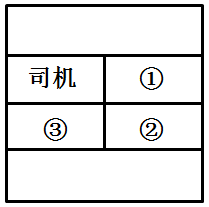

B. 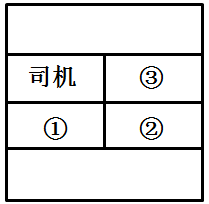

C. 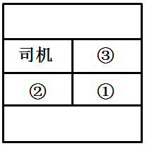

D. 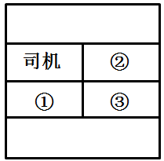

第 123 题 · 答案与解析

**参考答案（粉笔题库参考内容）**

C

**解析**

小轿车1号座位在司机的右后边，2号座位在司机的正后边，3号座位在司机的旁边。本题小张是工作人员，所以应坐在副驾驶座上。司长官职最高，故应坐在司机的右后边。处长坐在司机的后边。

故正确答案为C。

**考点**：生活常识

**来源**：2008年上海市公务员录用考试《行测》题第123题

### 第 124 题

行政行为在空间上的表现形式和在时间上的跨度，包括行政行为的方式、步骤、次序、时限等不可分割的内容是：

A. 行政程序

B. 行政诉讼

C. 行政复议

D. 行政处罚

第 124 题 · 答案与解析

**参考答案（粉笔题库参考内容）**

A

**解析**

行政程序是指行政主体行使行政权力，作出行政行为所应遵循的方式、步骤、顺序和期间的总和。

故正确答案为A。

本题相关知识点：

行政诉讼是一种诉讼程序法，主要是确定诉讼参加人的法律地位和相互关系的法律规范。

行政复议是指公民、法人或者其他组织不服行政主体作出的具体行政行为，认为行政主体的具体行政行为侵犯了其合法权益，依法向法定的行政复议机关提出复议申请，行政复议机关依法对该具体行政行为进行合法性、适当性审查，并作出行政复议决定的行政行为。

行政处罚是指行政机关或其他行政主体依法定职权和程序对违反行政法规尚未构成犯罪的相对人给予行政制裁的具体行政行为。

**来源**：2008年上海市公务员录用考试《行测》题第124题

### 第 125 题

近年来，随着现代化工农业生产的迅猛发展，沿海地区人口的增多，大量工农业废水和生活污水排入海洋，赤潮现象在我国沿海地区频频发生，引起了相关部门的高度重视。近海海面形成赤潮的主要原因是：

A. 水生动物数量减少

B. 海水温度过低

C. 海水盐度过低

D. 海水富营养化

第 125 题 · 答案与解析

**参考答案（粉笔题库参考内容）**

D

**解析**

赤潮是一种有害的生态异常现象。它是海洋中的某些浮游藻类，在一定的环境条件下爆发性繁殖或聚集，从而引起海水变色的现象。由于形成赤潮的生物不同，赤潮可以呈现出不同的颜色，除了最常见的红色之外，还有粉色、茶色、土黄色、黄褐色、绿色、白色等。赤潮发生的原因比较复杂。一般认为，海水富营养化是赤潮发生的主要原因。由于城市工业废水、生活污水的排放，以及海水养殖过程中产生的废物，使营养物质（如各种有机物和无机营养盐等）在水体中富集，造成海水富营养化，为赤潮生物的大量繁殖创造了营养环境。

故正确答案为D。

**考点**：其他

**来源**：2008年上海市公务员录用考试《行测》题第125题

### 第 126 题

以下说法中，不属于行政法的特点的是：

A. 各国通常有统一的行政法典

B. 行政法规范的数量在各部门法中占领先地位

C. 行政法的内容广泛

D. 行政法规范具有相对的易变性

第 126 题 · 答案与解析

**参考答案（粉笔题库参考内容）**

ABC

**解析**

行政法有下列五个特点：①行政法没有统一、完整的法典，与刑法、民法不同，各国都没有统一的行政法典。②行政法规范是以多种多样的法律形式表现出来的，是由多种不同效力等级的行为规范组成的统一体。③行政法规范的数量多，内容广泛。④行政法规范具有明显的易变性。⑤行政程序性规范是行政法特有的一类行为规范，与行政实体性规范通常交织在一起，其存于同一个法律文件之中。

故正确答案为A、B、C。

**考点**：行政法

**来源**：2008年上海市公务员录用考试《行测》题第126题

### 第 127 题

地球的核心部分称为地核，地核中主要的元素成分是：

A. 硅

B. 锰和铜

C. 铁和镍

D. 碳和铝

第 127 题 · 答案与解析

**参考答案（粉笔题库参考内容）**

C

**解析**

地核可分为“外地核”和“内地核”两层。处在地表以下2900~4980公里的部分叫外地核，是液体状态。4980~5120公里深处，是一个过渡带，从5120公里直到地心则为内地核，是固体状态。地核的成分主要是铁，另外还有一些镍和碳元素。内地核的半径约1300公里，因为地核离开地面太深，很少有“讯息”传来，所以我们至今对它了解得很少。

故正确答案为C。

**考点**：化学常识

**来源**：2008年上海市公务员录用考试《行测》题第127题

### 第 128 题

保密工作，是指知晓秘密和掌管秘密的人保守和保护秘密的工作。以下属于保密工作管理制度的有机组成部分的是：

A. 专项保密制度

B. 员工保密培训制度

C. 突击检查制度

D. 责任追究制度

第 128 题 · 答案与解析

**参考答案（粉笔题库参考内容）**

ABCD

**解析**

综合《中华人民共和国保守国家秘密法》《中华人民共和国保守国家秘密法实施办法》等法规对于保密内容的界定，保密工作管理包含题干A、B、C、D四项的表述。

故正确答案为A、B、C、D。

**考点**：其他法律法规

**来源**：2008年上海市公务员录用考试《行测》题第128题

## 材料 6

胡锦涛总书记于2007年6月25在中央党校省部级干部进修班发表重要讲话中指出，解放思想，是党的思想路线的本质要求，是我们应对前进道路上各种新情况新问题、不断开创事业新局面的一大法宝。必须坚定不移地加以坚持。改革开放，是解放和发展社会生产力、不断创新充满活力的体制机制的必然要求，是发展中国特色社会主义的强大动力，必须坚定不移地加以推进。科学发展、社会和谐，是发展中国特色社会主义的基本要求，是实现经济社会又好又快发展的内在需要，必须坚定不移地加以落实。全面建设小康社会，是我们党和国家到2020年的奋斗目标，是全国各族人民根本利益所在，必须坚定不移地为之奋斗。做到这四个坚定不移，对保持党和国家事业顺利发展的大局至关重要。

### 第 129 题

胡锦涛总书记提出的“四个坚定不移”有着内在的联系，包含了思想法宝、发展动力、基本要求、内在需要和奋斗目标，同时，这四个方面也是层层递进的关系。即，要想应对前进道路上各种新情况新问题、不断开创事业新局面，必须进一步解放思想：

A. 只有坚持改革开放，才能更好地加强党的执政能力建设与党的先进性建设

B. 只有大胆解放思想，才能不断推进改革开放，进一步解放和发展社会生产力

C. 只有坚持改革开放，才能更好地落实科学发展和社会和谐的要求

D. 只有贯彻落实科学发展观、建设好和谐社会，我们才能实现全面建设小康社会的目标

第 129 题 · 答案与解析

**参考答案（粉笔题库参考内容）**

BCD

**解析**

“四个坚定不移”有着内在的联系，包含了思想法宝、发展动力、基本要求、内在需要和奋斗目标，同时，这四个方面也是层层递进的关系。即，要想应对前进道路上各种新情况新问题、不断开创事业新局面，必须进一步解放思想。只有大胆解放思想，才能不断推进改革开放，进一步解放和发展社会生产力。只有坚持改革开放，才能更好地落实科学发展和社会和谐的要求。只有贯彻落实科学发展观、建设好和谐社会，我们才能实现全面建设小康社会的目标。

故正确答案为B、C、D。

**来源**：2008年上海市公务员录用考试《行测》题第129题

### 第 130 题

胡锦涛总书记指出：改革开放，是解放和发展社会生产力、不断创新充满活力的体制机制的必然要求，是发展中国特色社会主义的强大动力，必须坚定不移地加以推进。事实雄辩地证明，改革开放是发展中国特色社会主义、实现中华民族伟大复兴的必由之路。改革开放以来我们取得一切成绩和进步的根本原因，归结起来就是：

A. 遵循了人类社会发展的历史规律

B. 弘扬了社会主义先进文化

C. 开辟了中国特色社会主义道路

D. 形成了中国特色社会主义理论体系

第 130 题 · 答案与解析

**参考答案（粉笔题库参考内容）**

CD

**解析**

2007年10月15日，胡锦涛在十七大报告中强调，改革开放以来我们取得一切成绩和进步的根本原因，归结起来就是：开辟了中国特色社会主义道路，形成了中国特色社会主义理论体系。高举中国特色社会主义伟大旗帜，最根本的就是要坚持这条道路和这个理论体系。

故正确答案为C、D。

**来源**：2008年上海市公务员录用考试《行测》题第130题

### 第 131 题

深入理解和准确把握科学发展和社会和谐是发展中国特色社会主义的基本要求，是实现经济社会又好又快发展的内在需要。既是“基本要求”，又是“内在需要”，两句话相互联系，又各有侧重。下列关于这两句话的说法中，正确的有：

A. 前一句是从体现中国特色社会主义本质属性的角度，强调没有科学发展和社会和谐，就不可能坚持和发展中国特色社会主义

B. 前一句是从体现中国特色社会主义本质属性的角度，强调没有科学发展和社会和谐，就不可能实现全面建设小康社会的目标

C. 后一句是从转变增长方式的角度，强调实现经济社会又好又快发展，必须是科学发展、和谐发展

D. 后一句是从转变发展方式的角度，强调实现经济社会又好又快发展，必须是科学发展、和谐发展

第 131 题 · 答案与解析

**参考答案（粉笔题库参考内容）**

AD

**解析**

坚持科学发展和社会和谐，是发展中国特色社会主义的基本要求，是实现经济社会又好又快发展的内在需要。既是“基本要求”，又是“内在需要”，两句话相互联系，又各有侧重。前一句是从体现中国特色社会主义本质属性的角度，强调没有科学发展和社会和谐，就不可能坚持和发展中国特色社会主义；后一句是从转变发展方式的角度，强调实现经济社会又好又快发展，必须是科学发展、和谐发展。也就是说，只有坚持科学发展才能促进社会和谐，而实现科学发展也离不开社会和谐作保障。越是坚持以人为本、全面协调可持续的科学发展，社会才会变得越和谐。而民主法治、公平正义、诚信友爱、安定有序、充满活力、人与自然和谐相处的和谐社会建设，则又会为实现科学发展提供良好的环境和新的动力。

故正确答案为A、D。

**来源**：2008年上海市公务员录用考试《行测》题第131题

### 第 132 题

胡锦涛总书记指出，全面建设小康社会，是我们党和国家到2020年的奋斗目标，是全国各族人民根本利益所在，必须坚定不移地为之奋斗。在党的十七大报告中进一步提出，我们必须适应国内外形势的新变化，顺应各族人民过上更好生活的新期待，把握经济社会发展趋势和规律，坚持中国特色社会主义经济建设、政治建设、文化建设、社会建设的基本目标和基本政策构成的基本纲领，在十六大确立的全面建设小康社会目标的基础上对我国发展提出新的更高要求，实现：

A. 人均国民生产总值到2020年比2000年翻两番

B. 人均国内生产总值到2020年比2000年翻两番

C. 国民生产总值到2020年比2000年翻两番

D. 国内生产总值到2020年比2000年翻两番

第 132 题 · 答案与解析

**参考答案（粉笔题库参考内容）**

B

**解析**

十七大重大战略目标：十七大报告在十六大确立的全面建设小康社会目标的基础上对我国发展提出新的更高要求，就是增强经济协调性，努力实现经济又快又好发展，实现人均国内生产总值到2020年比2000年翻两番。

故正确答案为B。

**来源**：2008年上海市公务员录用考试《行测》题第132题

## 材料 7

2006年6月，时某打算成立一家装饰公司，向市某会计事务所申请验资。该会计事务所在未实际验资的情况下，便出具了一份该拟成立公司“拥有资金人民币300万”的虚假验资证明。同年7月，时某凭这份虚假验资证明到工商行政管理部门申请设立XX装潢有限公司并获得了营业执照。同年年底，群众向市工商局举报时某上述违法行为，工商局立案。经过调查取证，认定时某在申请成立公司过程中有虚报注册资本行为，工商局遂依法撤销该公司的工商登记，并吊销了其营业执照。本案中的注册会计师和会计事务所也被有关行政管理机关给予相应的行政处罚。

### 第 133 题

下列选项中，说法正确的是：

A. 工商局的工商登记行为是一种行政许可行为

B. 婚姻登记是一种行政审批行为

C. 公司登记的前置条件可以由地方性法规设定

D. 工商登记属于资格许可行为

第 133 题 · 答案与解析

**参考答案（粉笔题库参考内容）**

AD

**解析**

行政许可行为是指在法律一般禁止的情况下，行政主体根据行政相对人的申请，通过颁发许可证或执照等形式，依法赋予特定的行政相对人从事某种活动或者实施某种行为的权利或资格的行政行为。行政确认是指行政机关和法定授权的组织依照法定权限和程序对有关法律事实进行甄别，通过确定、证明等方式决定管理相对人某种法律地位的行政行为。行政确认有稳定法律关系，减少各种纠纷，保障社会安定秩序，保护公民、法人或其他组织合法权益的重要作用，因而适用于广泛的范围。行政确认主要形式有：确定、认可、证明、登记、批准、鉴证、行政鉴定。

A、D项正确，工商登记是一种民事主体的资格登记，是对市场主体的法人资格和经营资格的确认行为，亦是行政许可行为；

B项错误，婚姻登记行为是行政机关代表国家对当事人婚姻关系的确认，即婚姻登记是一种行政确认行为；

C项错误，根据《行政许可法》规定，企业登记前置可由法律、行政法规和国务院决定规定，地方性法规、部门规定、地方性政府规定，以及所有规范性文件均无权设定企业登记前置许可项目。

故正确答案为A、D。

**考点**：行政法

**来源**：2008年上海市公务员录用考试《行测》题第133题

### 第 134 题

相对人通过违法手段取得行政许可的，必须承担相应的法律责任。对此，下列表述正确的是：

A. 这种责任主要是行政责任和刑事责任

B. 这种责任主要是行政责任和民事责任

C. 相对人通过欺骗、胁迫、贿赂手段取得行政许可的，应当予以撤销

D. 被许可人通过欺骗、胁迫、贿赂等不正当手段取得行政许可的，行政机关应当依法给予行政处罚

第 134 题 · 答案与解析

**参考答案（粉笔题库参考内容）**

ACD

**解析**

《行政许可法》中关于撤销部分规定：被许可人以欺骗、贿赂等不正当手段取得行政许可的，应当予以撤销。

《行政许可法》第79条规定，“被许可人以欺骗、贿赂等不正当手段取得行政许可的，行政机关应当依法给予行政处罚；取得的行政许可属于直接关系公共安全、人身健康、生命财产安全事项的，申请人在三年内不得再次申请该行政许可，构成犯罪的，依法追究刑事责任。”

故正确答案为A、C、D。

**考点**：行政法

**来源**：2008年上海市公务员录用考试《行测》题第134题

### 第 135 题

关于行政许可，下列说法正确的是：

A. 行政许可是一种双方行政行为

B. 行政许可是一种授益性行政行为

C. 行政许可是一种要式行政行为

D. 只有法律、行政法规才可设定行政许可

第 135 题 · 答案与解析

**参考答案（粉笔题库参考内容）**

BC

**解析**

A项错误，依行政行为成立时参与意思表示的当事人数目为标准，可将行政行为分为单方行政行为与双方行政行为。单方行政行为，是指行政主体通过自己单方意思表示，无须征得相对方同意即可成立的行政行为，如行政处罚行为等。双方行政行为，是指行政主体为实现公务目的，与相对方协商达成一致而成立的行政行为，如行政合同行为等。这种行为的基本特征在于行政行为必须征得相对方同意方能成立，即相对方的最后同意是双方行政行为有效成立的必备条件。但这并不意味着行政许可是一种双方行政行为，行政许可机关是否为行政相对人颁发行政许可证书，并非是由行政相对人的意志所决定的，而是由行政许可机关依照法律规定的标准和条件作出的单方面的决定。故行政许可属于单方行政行为。

B项正确，行政行为以其对行政相对人利益的不同影响为标准，分为授益行政行为与不利行政行为。行政许可不是对行政相对人课以义务或处以惩罚的行为，而是赋予行政相对人某种权利或资格的行为。故行政许可是授益性行政行为。

C项正确，以有无法定形式要求为标准，分为要式行政行为与非要式行政行为。要式行政行为指法律规定必须以某种方式或形式进行的行政行为，非要式行政行为是指法律未规定一定具体方式，而允许行政机关自行选择的行政行为。故行政许可属于要式行政行为。

D项错误，《行政许可法》第十四条规定，法律可以设定行政许可。尚未制定法律的，行政法规可以设定行政许可。必要时，国务院可以采用发布决定的方式设定行政许可。实施后，除临时性行政许可事项外，国务院应当及时提请全国人民代表大会及其常务委员会制定法律，或者自行制定行政法规。故国务院发布决定设定行政许可只限在必要的时候，除临时性行政许可事项之外，国务院应当提请国家立法机关制定法律或者自行制定行政法规。

故正确答案为B、C。

**考点**：行政法

**来源**：2008年上海市公务员录用考试《行测》题第135题

### 第 136 题

关于本案，下列说法错误的是：

A. 时某既可以提起行政诉讼，也可以申请行政复议

B. 行政机关在作出行政处罚决定前，应当告知时某有要求听证的权利

C. 行政机关应当根据听证笔录作出行政处罚决定

D. 本案中，受处罚的注册会计师和会计事务所不再承担其他法律责任

第 136 题 · 答案与解析

**参考答案（粉笔题库参考内容）**

D

**解析**

A项说法正确，《行政处罚法》第35条规定“当事人对当场作出的行政处罚决定不服的，可以依法申请行政复议或者提起行政诉讼”。

B项说法正确，根据《行政处罚法》第42条的规定，行政机关作出责令停产停业、吊销许可证或者执照、较大数额罚款等行政处罚决定之前，应当告知当事人有要求举行听证的权利。当事人要求听证的，行政机关应当组织听证。当事人不承担行政机关组织听证的费用。

C项说法正确，根据《行政处罚法》第35条的规定，听证结束后，行政机关应依照听证笔录，作出行政处罚决定。

D项说法错误，受处罚的注册会计师和会计事务所构成犯罪的，应依法追究其刑事责任。

本题为选非题，故正确答案为D。

**考点**：行政法

**来源**：2008年上海市公务员录用考试《行测》题第136题

## 材料 8

××省人民政府文件

\[2005\]×府发6号

××省人民政府转发省劳动保障局等部门

《关于安宁市完善城镇社会保障体系试点情况报告》的决定

各市(区)人民政府、省各有关委办局、党委有关部门：

        省人民政府拟同意劳动保障局等部门《关于安宁市完善城镇社会保障体系试点情况的报告》，现转发给你们，请你们认真讨论和贯彻执行。

        建立和完善社会保障体系，是健全社会主义市场经济体制的客观要求，关系改革发展稳定大局。近年来，由于少数一些地方没有做好这方面的工作，引起不少群众的牢骚、埋怨和不满，有个别的困难群众还到北京去上访，招致上级领导对我们省一级政府的严厉批评。所以各地区和有关部门要从全面实践“三个代表”重要思想的高度，充分认识到做好这项工作的重要意义，加强领导，狠抓落实，要认真学习借鉴安宁市试点经验，结合本地实际，积极稳妥地开展工作。省劳动保障局等部门要继续加强领导，总结经验，及时研究新情况、新问题，不断推进我省社会保障体系建设。

        附件《关于安宁市完善城镇社会保障体系试点情况报告》

××省人民政府

二00五年二月五日

        主题词：省政府社会保障情况报告

        抄报：省委、省人大、省政协

### 第 137 题

该公文的发文字号主要错误在于：

A. 年份号位置前置

B. 使用年份号时的标点符号应为六角号

C. 机关简称写“xx府发字”

D. 顺序号应为“第6号”

第 137 题 · 答案与解析

**参考答案（粉笔题库参考内容）**

AB

**解析**

A项正确，年份前置错误，发文字号应为“X府发〔2005〕6号”。

B项正确，括号错用，应该用六角括号“〔    〕”，不能使用圆括号“(    )”、方括号“\[    \] ”和尖括号“&lt;    >”。

C、D两项错误，不得在发文字号中随意添加不必要的字，最常见的是“第”、“0”、“字”。

故正确答案为AB。

**来源**：2008年上海市公务员录用考试《行测》题第137题

### 第 138 题

该公文标题存在主要问题有：

A. 文种错用

B. 不应加书名号

C. 转发应改为批转

D. 发文机关应为省人民政府办公厅

第 138 题 · 答案与解析

**参考答案（粉笔题库参考内容）**

AC

**解析**

A项正确，应为通知，而非决定。

B项错误，标题中除法规、规章和管理规章名称加书名号外，一般不用标点符号。党的机关公文则要加书名号。

C项正确，制作和来文渠道是上级机关、不相隶属机关和下级有自主行文权的机关。“批转”的原文制作和来文渠道是下属职能部门。

故正确答案为A、C。

**来源**：2008年上海市公务员录用考试《行测》题第138题

### 第 139 题

该公文中关于主送单位存在的主要问题有：

A. 主送单位不应该顶格

B. “各市（区）”人民政府、省各有关委办、“局”的标点符号应用逗号

C. 多头主送

D. 主送单位还应加上“县、乡（镇）人民政府”

第 139 题 · 答案与解析

**参考答案（粉笔题库参考内容）**

D

**解析**

A项错误，对主送机关一般写在正文之前、标题之下，顶格写；

B项错误，如主送对象稍多时，应按其性质、级别和有关规定或惯例依次排列，中间用顿号分隔，最后用冒号；

C项错误，D项正确，发出的指示、通知、通报等称为普发公文，可以主送几个机关。凡其下属机关都是主送机关，向上级报告、请示的公文，一般只写一个主送机关，不能多头主送。

故正确答案为D。

**来源**：2008年上海市公务员录用考试《行测》题第139题

### 第 140 题

该公文正文和文尾的不规范之处有：

A. 主题词结构错误

B. “省劳动保障局等部门要继续加强领导”中的“领导”应为指导

C. 附件的位置不对

D. 抄报应为抄送

第 140 题 · 答案与解析

**参考答案（粉笔题库参考内容）**

BCD

**解析**

A项错误，主题词应位于抄送机关上方，居左顶格标识，故本公文主题词结构正确；

B项正确，选项所说的修改方式为正确的修改方式；

C项正确，公文如有附件，在正文下一行空2字标识附件，后标全角冒号和名称；

D项正确，抄报是把文件在主要报送主管部门的同时向其他相关上级部门报知此事，以便于今后的工作，抄送是指把文件送与相关平级、下级部门，知会此事，便于信息共通，利于以前工作的结果沟通，当前工作进展协调和今后工作的步调一致等。

故正确答案为B、C、D。

**来源**：2008年上海市公务员录用考试《行测》题第140题

