# 2009年上海市公务员录用考试《行测》题

<!-- gwy:overview:start -->
> **上海 · 2009 · 行测 · 统考** ｜ 140 题 · 图片 82 处 · 答案随题折叠

| 题型模块 | 题量 | 题号 |
| --- | ---: | ---: |
| 数量关系 | 25 | 1–25 |
| 言语理解与表达能力 | 25 | 26–50 |
| 判断推理能力 | 30 | 51–80 |
| 常识应用能力 | 60 | 81–140 |
| **合计** | **140** | |

导航：[题型与作答说明](#题型与作答说明) · [题目](#题目) · [材料 1](#材料-1)
<!-- gwy:overview:end -->

> 候选采集稿。参考答案及解析来自粉笔页面，不代表官方答案或真实高分答卷；来源使用许可与原卷对应关系仍需人工核实。

## 题型与作答说明

数量关系

（25题）

数理能力部分包括三种类型的题目。1~5题为数字推理，6~10题为数学应用，11~25题为资料分析。

言语理解与表达能力

（25题）

根据题目要求，在四个选项中选出一个正确答案。

判断推理能力

（30题）

判断推理能力部分包括机械推理、定义判断、图形推理与逻辑判断四种类型的题目，均为单项选择题。

常识应用能力

（60题）

常识应用能力部分包括基础知识题和综合分析题，本部分为不定项选择题。每小题给出的四个选项中，至少有一项符合题意，请将正确选项全部选出，并在答题卡上将相应的字母涂黑。不选、多选、少选或错选，该题均不得分。

## 题目

### 第 1 题

8，6，2，－6，（  ）

A. －8

B. －10

C. －20

D. －22

第 1 题 · 答案与解析

**参考答案（粉笔题库参考内容）**

D

**解析**

观察数列，无明显特征，优先考虑多级数列。后项减前项得到新数列：-2，-4，-8，是公比为2的等比数列，后一项为-16，故所求项为：-6+(-16)=-22。

故正确答案为D。

**来源**：2009年上海市公务员录用考试《行测》题第1题

### 第 2 题

√2，3，，，()

A. 

B. 

C. 

D. 

第 2 题 · 答案与解析

**参考答案（粉笔题库参考内容）**

C

**解析**

原数列：

改写成：

根号内的数字：

立方数列：

因此原数列下一项应为。

故正确答案为C。

**来源**：2009年上海市公务员录用考试《行测》题第2题

### 第 3 题

()，1/4，，

A. \-1

B. 

C. 1/2

D. 1

第 3 题 · 答案与解析

**参考答案（粉笔题库参考内容）**

C

**解析**

观察数列形式可以发现，每项分子为公差为2的等差数列，每项分母为公比为2的等比数列，且奇数项乘-1，因此原数列未知项应为。

故正确答案为C。

**来源**：2009年上海市公务员录用考试《行测》题第3题

### 第 4 题

0，6，6，20，（  ），42

A. 20

B. 21

C. 26

D. 28

第 4 题 · 答案与解析

**参考答案（粉笔题库参考内容）**

A

**解析**

底数依次递增，修正值与底数一致，且正负交替出现，因此未知项为20。

故正确答案为A。

**来源**：2009年上海市公务员录用考试《行测》题第4题

### 第 5 题

2，10，30，68，（  ），222

A. 130

B. 150

C. 180

D. 200

第 5 题 · 答案与解析

**参考答案（粉笔题库参考内容）**

A

**解析**

原数列为立方数列修正性质：

原数列：

立方列加修正项：

因此原数列未知项应为

故正确答案为A。

**来源**：2009年上海市公务员录用考试《行测》题第5题

### 第 6 题

近年来，我国卫生事业快速发展，卫生人力总量增加。2007年卫生技术人员达到468.0万人，与2003年相比，增加了37.4万人。那么从2003年至2007年卫生技术人员年平均增长：

A. 2.1％

B. 2.2％

C. 2.5％

D. 8.7％

第 6 题 · 答案与解析

**参考答案（粉笔题库参考内容）**

A

**解析**

解析1：

设2003年到2007年平均增长率为x，根据题意有，得。将各项代入估算，A项最接近。

解析2：

求年平均增长率可以运用一个公式，

混合增长率这题简单计算可得8.6%，年均增长率必然小于该值的四分之一，所以选A项。

故正确答案为A。

**考点**：和差倍比问题

**来源**：2009年上海市公务员录用考试《行测》题第6题

### 第 7 题

目前某单位女职工和男职工的人数之比为1:30。如果女职工的人数增加5人，男职工的人数增加50人，则两者之比变为1:25。则目前女职工的人数是多少人？

A. 8

B. 10

C. 15

D. 25

第 7 题 · 答案与解析

**参考答案（粉笔题库参考内容）**

C

**解析**

设目前女职工人数为x，男职工人数为30x，根据题意有(x+5):(30x+50)=1:25，解得x=15。

故正确答案为C。

**考点**：和差倍比问题

**来源**：2009年上海市公务员录用考试《行测》题第7题

### 第 8 题

小李买了一套房子，向银行借得个人住房贷款本金15万元，还款期限20年，采用等额本金还款法，截止上个还款期已经归还5万元本金，本月需归还本金和利息共1300元，则当前的月利率是：

A. 6.45‰

B. 6.75‰

C. 7.08‰

D. 7.35‰

第 8 题 · 答案与解析

**参考答案（粉笔题库参考内容）**

B

**解析**

设当前月利率为x，根据等额本金还款法计算，小李每月应还，小李截止上个月已归还本金5万元，还剩下本金10万元，100000x+625=1300，解得x=6.75‰。

故正确答案为B。

**考点**：经济利润问题

**来源**：2017年上海市行政执法类考试《行测》试题（网友回忆版）第58题

### 第 9 题

交叉汇率也称套算汇率，是指两种货币通过第三种货币为中介而推算出来的汇率。假定人民币/日元为14.001～14.040，澳元/人民币为4.352～4.467。则澳元/日元为：

A. 0.3100～0.3190

B. 0.3108～0.3182

C. 60.93～62.72

D. 61.10～62.54

第 9 题 · 答案与解析

**参考答案（粉笔题库参考内容）**

C

**解析**

根据，则澳元/日元汇率最小值应为，汇率最大值应为，即澳元/日元为60.93～62.72。

故正确答案为C。

**考点**：和差倍比问题

**来源**：2009年上海市公务员录用考试《行测》题第9题

### 第 10 题

两辆完全相同的汽车沿水平公路一前一后匀速行驶，A车在前，B车在后，速度均为V。若A车突然以恒定的加速度刹车，在它刚停住时，B车以A车刹车时的加速度开始刹车。已知A车在刹车过程中所行驶的路程为S，若要保证两车在上述过程中不相撞，则两车在匀速行驶时保持的距离至少应为：

A. S

B. 2S

C. 3S

D. 4S

第 10 题 · 答案与解析

**参考答案（粉笔题库参考内容）**

B

**解析**

如图所示，两条直线分别表示A、B车的行驶路线，根据题意可知A、B两车刹车过程行驶的距离相等，均为S，因此两车匀速行驶的车距为A车刹车过程中B车行驶过的距离。在这段时间内A车的平均速度为，B车的速度为v，因此A车刹车过程中B行驶的距离为2S。

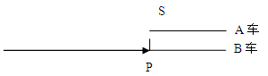

故正确答案为B。

**考点**：普通行程

**来源**：2009年上海市公务员录用考试《行测》题第10题

## 材料 1

根据以下有关2007年上海市外贸进出口发展情况的材料，回答下列各题。

        2007年上海外贸进出口协调快速增长。全年外贸进出口总额2829.73亿美元，比上年增长24.4%。其中，进口总额1390.45亿美元，增长22.1%；出口总额1439.28亿美元，增长26.7%。全年私营企业完成出口162.73亿美元，比上年增长40.8%；外商及港澳台投资企业出口978.15亿美元，增长28.8%；国有企业出口285.98亿美元，增长15%；集体企业出口12.39亿美元，增长3.1%。

### 第 11 题

2007年上海市国有企业出口额大约占全年外贸进出口总额的：

A. 20%

B. 15%

C. 10%

D. 5%

第 11 题 · 答案与解析

**参考答案（粉笔题库参考内容）**

C

**解析**

2007年国有企业出口额为285.98亿美元，进出口总额为2829.73亿美元，。

故正确答案为C。

**考点**：文字资料、现期比重

**来源**：2009年上海市公务员录用考试《行测》题第11题

### 第 12 题

下列关于2007年上海市外贸进出口情况的说法中，正确的是：

A. 2007年上海市出口总额的增长速度比进口总额增长速度快3.5个百分点

B. 外商及港澳台投资企业的出口额最高，出口额的增长速度最快

C. 私营企业的出口额虽不高，但出口额的增速处于领先地位

D. 2007年，上海市进口总额占外贸进出口总额的比重大约为51％

第 12 题 · 答案与解析

**参考答案（粉笔题库参考内容）**

C

**解析**

出口总额增长速度比进口总额增长速度快26.7%-22.1%=4.6%，即4.6个百分点，因此A项错误；

私营企业出口额比上年增长40.8%，增速最快，因此B项错误，C项正确；

进口总额1390.45亿美元，占进口总额比重为，因此D项错误。

故正确答案为C。

**考点**：文字资料、综合分析

**来源**：2009年上海市公务员录用考试《行测》题第12题

## 材料 2

以下数据是有关2007年上海市六个重点发展工业行业的统计结果，根据图表内容回答下列各题。

        2007年，上海市电子信息产品制造业、汽车制造业、石油化工及精细化工制造业、精品钢材制造业、成套设备制造业、生物医药制造业等六个重点发展工业行业完成工业总产值14377.29亿元，比上年增长19%。

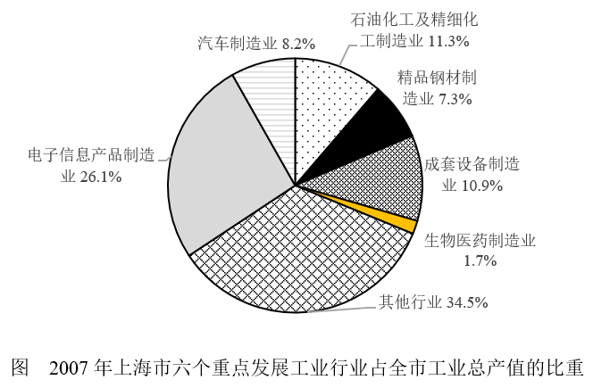

### 第 13 题

2006年，六个重点发展工业行业大约完成工业总产值（  ）亿元。

A. 11645.60

B. 12081.76

C. 17069.70

D. 17749.74

第 13 题 · 答案与解析

**参考答案（粉笔题库参考内容）**

B

**解析**

2007年六个重点发展工业行业完成工业总产值14377.29亿元，比上年增长19%，因此2006年此数据为14377.29÷(1＋19%)≈14400÷1.2＝12000。

故正确答案为B。

**考点**：基期计算、综合资料

**来源**：2009年上海市公务员录用考试《行测》题第13题

### 第 14 题

2007年，石油化工及精细化工制造业、精品钢材制造业、成套设备制造业的产值总和约为（  ）亿元。

A. 4018

B. 4187

C. 4241

D. 4325

第 14 题 · 答案与解析

**参考答案（粉笔题库参考内容）**

C

**解析**

根据题干“2007年，石油化工及精细化工制造业、精品钢材制造业、成套设备制造业的产值总和······”，结合材料给出各个行业的占比情况，可判定本题为现期比重问题。定位文字材料，“六个重点发展工业行业完成工业总产值14377.29亿元”； 定位图形材料，石油化工及精细化工制造业、精品钢材制造业、成套设备制造业的产值占比分别为11.3%、7.3%、10.9%，六个重点行业外其他行业占比为34.5%。根据公式：总体量，则全市工业总产值。则2007年石油化工及精细化工制造业、精品钢材制造业、成套设备制造业的产值总和亿元。

故本题没有正确答案。

备注：如果按照亿元，但很显然这样做是错的。

**考点**：现期比重、综合资料

**来源**：2009年上海市公务员录用考试《行测》题第14题

### 第 15 题

2007年，电子信息产品制造业的产值比成套设备制造业的产值大约多（  ）亿元。

A. 2098

B. 2185

C. 2241

D. 2309

第 15 题 · 答案与解析

**参考答案（粉笔题库参考内容）**

B

**解析**

由题干“2007年，电子信息······比成套设备······多······亿元”，结合图形材料数据，可判定本题为现期比重问题。定位文字材料，“六个重点发展工业行业完成工业总产值14377.29亿元”；定位图形材料电子信息产品制造业产值与成套设备制造业产值占全市工业总产值的比重分别为26.1%和10.9%；其他行业占比为34.5%。根据，可计算出全市工业总产值。根据部分量=总体量×比重，可计算出2007年，电子信息产品制造业的产值比成套设备制造业的产值大约多亿元。

本题没有正确答案。

备注：如果按照亿元。但很显然这样做是错的。

**考点**：现期比重、综合资料

**来源**：2009年上海市公务员录用考试《行测》题第15题

### 第 16 题

2007年，在六个重点发展工业行业中，完成工业产值从多到少的排列顺序是（  ）。

A. 电子信息产品制造业、汽车制造业、石油化工及精细化工制造业、精品钢材制造业、成套设备制造业、生物医药制造业

B. 电子信息产品制造业、石油化工及精细化工制造业、成套设备制造业、汽车制造业、精品钢材制造业、生物医药制造业

C. 电子信息产品制造业、成套设备制造业、石油化工及精细化工制造业、汽车制造业、精品钢材制造业、生物医药制造业

D. 电子信息产品制造业、石油化工及精细化工制造业、成套设备制造业、精品钢材制造业、汽车制造业、生物医药制造业

第 16 题 · 答案与解析

**参考答案（粉笔题库参考内容）**

B

**解析**

根据六个行业产值占工业总产值的百分比大小排列，可知顺序：为电子信息产品制造业26.1%、石油化工及精细化工制造业11.3%、成套设备制造业10.9%、汽车制造业8.2%、精品钢材制造业7.3%、生物医药制造业1.7%。

故正确答案为B。

**考点**：排序类、综合资料

**来源**：2009年上海市公务员录用考试《行测》题第16题

## 材料 3

下图为2008年上半年上海市分国别入境旅游外国人数的统计结果，根据图表内容回答下列各题。

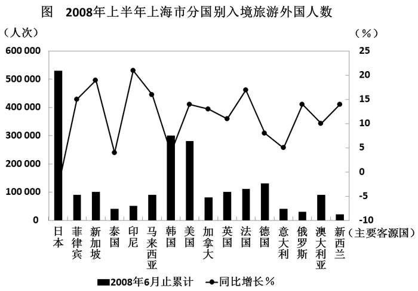

### 第 17 题

2008年上半年，上海市入境旅游的日本游客约为美国游客的：

A. 4倍

B. 3倍

C. 2倍

D. 0.5倍

第 17 题 · 答案与解析

**参考答案（粉笔题库参考内容）**

C

**解析**

根据统计图可知，日本游客约为520000人，美国游客约为280000人，日本游客约是美国游客的。

故正确答案为C。

**考点**：现期倍数、统计图

**来源**：2009年上海市公务员录用考试《行测》题第17题

### 第 18 题

2008年上半年，上海市入境旅游的前十大客源国按先后顺序排列正确的是：

A. 新西兰、印尼、泰国、俄罗斯、意大利、加拿大、澳大利亚、马来西亚、菲律宾、新加坡

B. 日本、韩国、美国、德国、法国、英国、新加坡、菲律宾、马来西亚、澳大利亚

C. 日本、美国、韩国、德国、法国、英国、新加坡、菲律宾、马来西亚、印尼

D. 日本、韩国、美国、德国、新加坡、菲律宾、法国、英国、马来西亚、澳大利亚

第 18 题 · 答案与解析

**参考答案（粉笔题库参考内容）**

B

**解析**

根据统计图中柱形的长度容易判断排序，可排除A、D项，又澳大利亚高于印尼，可确定B项正确。

故正确答案为B。

**考点**：排序类、统计图

**来源**：2009年上海市公务员录用考试《行测》题第18题

### 第 19 题

在前十大客源国中，上海市入境游客增幅最大的是：

A. 新加坡

B. 印尼

C. 法国

D. 马来西亚

第 19 题 · 答案与解析

**参考答案（粉笔题库参考内容）**

A

**解析**

根据上题结果，印尼不是前十大客源国，观察统计图可知剩余三个国家入境游客增幅最大的为新加坡，同比增长约为20%。

故正确答案为A。

**考点**：直接找数、统计图

**来源**：2009年上海市公务员录用考试《行测》题第19题

### 第 20 题

下列关于2008年上半年上海市旅游市场的描述中，不正确的是：

A. 亚洲市场是上海市入境旅游的第一大客源市场

B. 日本虽然是上海市入境旅游的最大客源国，但其增幅最小，呈现负增长

C. 上海市入境旅游的欧洲游客中增幅最大的是俄罗斯

D. 韩日市场为上海市入境旅游的发展起到了支撑性作用

第 20 题 · 答案与解析

**参考答案（粉笔题库参考内容）**

C

**解析**

A项正确，从图表中可以看出上海入境旅游游客最多的国家为日本和韩国，占较大比例，可知第一大客源市场为亚洲市场；

B项正确，日本是上海市入境旅游的最大客源国，但同比增长率为负值；

C项错误，欧洲游客中增幅最大的是法国，约为18%；

D项正确，韩国是上海市入境旅游的第二大客源国。

本题为选非题，故正确答案为C。

**考点**：统计图、综合分析

**来源**：2009年上海市公务员录用考试《行测》题第20题

## 材料 4

以下数据是关于2003～2007年年末我国电话用户数的统计结果，根据图表内容回答下列各题。

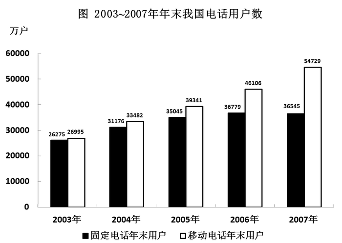

### 第 21 题

与2003年相比，2007年移动电话年末用户数的增长幅度约为：

A. 98%

B. 103%

C. 105%

D. 108%

第 21 题 · 答案与解析

**参考答案（粉笔题库参考内容）**

B

**解析**

2007年和2003年移动电话年末用户数分别为54729万户和26995万户，增幅为，B项最接近。

故正确答案为B。

**考点**：一般增长率、统计图

**来源**：2009年上海市公务员录用考试《行测》题第21题

### 第 22 题

下列说法中，不正确的一项是：

A. 2003～2007年，移动电话年末用户数始终呈上升趋势

B. 2003～2007年，固定电话年末用户数始终呈上升趋势

C. 2005～2006年，移动电话年末用户数的增长率要大于固定电话年末用户数的增长率

D. 2003年，移动电话年末用户数与固定电话年末用户数非常接近

第 22 题 · 答案与解析

**参考答案（粉笔题库参考内容）**

B

**解析**

A项正确，2003年~2007年每年移动电话年末用户数始终比上年高，呈上升趋势；

B项错误，2007年固定电话年末用户数与2006年相比有所下降；

C项正确，移动电话与固定电话的用户数增长率分别为和；

D项正确，表示移动电话和固定电话的柱形长度基本相同。

本题为选非题，故正确答案为B。

**考点**：统计图、综合分析

**来源**：2009年上海市公务员录用考试《行测》题第22题

## 材料 5

以下数据是对于上海市2008年1～8月三大价格指数运行的统计结果，根据图表内容回答23～25题。

**图 上海市2008年1～8月三大价格指数运行情况（以去年同月为100%）**

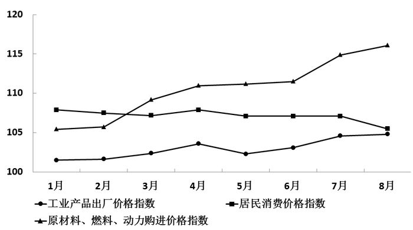

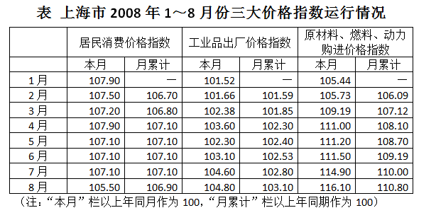

### 第 23 题

2008年1～8月居民消费价格指数的涨幅比1～5月：

A. 高出了0.3个百分点

B. 高出了0.8个百分点

C. 下降了0.2个百分点

D. 下降了1.6个百分点

第 23 题 · 答案与解析

**参考答案（粉笔题库参考内容）**

C

**解析**

月累计指数为107.1，月累计指数为106.9，106.9-107.1=-0.2，即下降了0.2个百分点。

故正确答案为C。

**考点**：简单加减计算、综合资料

**来源**：2009年上海市公务员录用考试《行测》题第23题

### 第 24 题

从2008年1～8月整体情况来看，工业品出厂价格指数与原材料、燃料、动力购进价格指数这两大价格水平涨幅落差高达多少个百分点：

A. 3.9

B. 7.7

C. 9.2

D. 11.3

第 24 题 · 答案与解析

**参考答案（粉笔题库参考内容）**

B

**解析**

月工业品出厂价格指数与原材料、燃料、动力购进价格指数月累计分别为103.1和110.8，110.8-103.1=7.7。

故正确答案为B。

**考点**：简单加减计算、综合资料

**来源**：2009年上海市公务员录用考试《行测》题第24题

### 第 25 题

根据图表判断，下列有关2008年1～8月三大价格指数运行情况的说法中，错误的是：

A. 与去年同期相比，居民消费价格指数月累计涨幅一直在6.7～7.1区间内运行

B. 工业品出厂价格指数基本保持上涨趋势，并逐渐逼近居民消费价格指数

C. 工业品出厂价格指数和原材料、燃料、动力购进价格指数总体上呈加快上涨态势

D. 原材料、燃料、动力购进价格指数始终高于居民消费价格指数

第 25 题 · 答案与解析

**参考答案（粉笔题库参考内容）**

D

**解析**

居民消费价格指数月累计一直在之间运行，即涨幅在之间，故A项正确；

根据曲线图可以看出工业品出厂价格指数基本保持上涨趋势，逐渐接近居民消费价格指数，工业品出厂价格指数和原材料、燃料、动力购进价格指数总体呈加快上涨趋势，故B、C两项正确；

1月和2月原材料、燃料、动力购进价格指数低于居民消费价格指数，故D项错误。

本题为选非题，故正确答案为D。

**考点**：综合分析、综合资料

**来源**：2009年上海市公务员录用考试《行测》题第25题

### 第 26 题

王大妈听到小李说他父母的不是，嘴上虽然没说什么，心里却 ＿＿＿ 。

填入画横线部分最恰当的一项是：

A. 不可名状

B. 不以为意

C. 不以为然

D. 不置可否

第 26 题 · 答案与解析

**参考答案（粉笔题库参考内容）**

C

**解析**

此题考查成语的语境搭配。

根据关键字“却”可知王大妈心里是不同意小李的说法的。“不以为然”是指不认为是正确的，表示不同意或者否定。符合语境搭配，所以C项是正确的。

“不可名状”是指无法用言语表达出来；“不以为意”是指不在意别人的说法或对事物的发展不在意，不放在心上；“不置可否”指不说行，也不说不行，不表明态度。均不符合语境搭配。

故正确答案为C。

**考点**：关联关系-转折关系、成语填空

**来源**：2009年上海市公务员录用考试《行测》题第26题

### 第 27 题

在下列句子横线处填入的词语，最为适当的一项是：

(1)这家医药公司 ＿＿＿ 世界医药行业之首，是因为有多项产品连续获得国际金奖。

(2)现代科学技术的发展可谓一日千里， ＿＿＿ 过去的幻想在今天均有可能得以实现。

(3)方天名因德语能力和交往能力很强，被学校 ＿＿＿ 到德籍留学生管理中心工作。

A. 跻身，以致，委派

B. 跃居，以致，委任

C. 跃居，以至，委派

D. 跻身，以至，委任

第 27 题 · 答案与解析

**参考答案（粉笔题库参考内容）**

C

**解析**

此题考查近义实词的语境搭配和不同侧重点。

先看句子（1），“跻身”是指使自己（的地位）上升到某种行列、位置等；“跃居”指跳跃式地上升到某个位子。修饰首位、榜首一般与“跃居”搭配。排除A、D两项。

再看句子（3），“委任”指任命某人担任某职务；“委派”指派遣某人做某事。（3）中表达的意思是派遣方天名到德籍留学生管理中心工作，所以应该与“委派”搭配。因此C项正确。

再看句子（2），“以至”指事物扩展、延伸或事物发展到一定程度产生的效果，表范围、数量、程度、时间等延伸和发展，一般指从小到大，从少到多，从浅到深；“以致”接事态发展所形成的结果，表示由于前面所说的原因而造成某种结果，多指不良结果或者不希望出现的结局。（2）中空白处表示科学技术发展到一定程度的效果，与“以至”搭配，所以印证了C项。

故正确答案为C。

**考点**：实词填空、词的辨析-搭配对象、词的辨析-词义侧重

**来源**：2009年上海市公务员录用考试《行测》题第27题

### 第 28 题

在下文横线处填入的词语，最为恰当的一项是：

查韦斯在国内被认为是个“勇敢的改革者”。他认为新自由主义发展模式不适合拉美发展中国家，因此，他试图建立一种以人为中心、结合市场机制和国家调节作用、充分利用国内优势、实行合理开放的发展道路，＿＿＿＿“不现实”的共产主义，＿＿＿＿“野蛮”的资本主义，＿＿＿＿一条有拉美和委内瑞拉特色的“第三条道路”，＿＿＿＿在全球化浪潮中，“＿＿＿＿要适当加入，＿＿＿＿要确保自己的民族特性”。

A. 既是，也是，而不是，更不是，既，又

B. 既不是，也不是，而是，而且，既，又

C. 既不是，也不是，而是，而且，虽然，但是

D. 既是，也是，而不是，更不是，虽然，但是

第 28 题 · 答案与解析

**参考答案（粉笔题库参考内容）**

B

**解析**

此题考查关联词的运用和语境搭配。

“‘不现实’的共产主义”、“‘野蛮’的资本主义”和前面描述的查韦斯试图建立的“发展道路”是不同的，所以第一、二个空应填表示否定的，并且是并列关系的关联词，所以应该选择“既不是······也不是······”，故排除A、D两项。

第三空白处是对前面的转折，所以用“而是”来修饰。

根据题意的顺承关系，第四空白处应当是对前面整体内容的一种递进关系，而不是转折关系，所以用“而且”修饰。

据题意，最后两个空白处表示递进关系，所以应该是“既······又······”而非表示转折关系的“虽然······但是”。所以B项对而C项错。

故正确答案为B。

**来源**：2009年上海市公务员录用考试《行测》题第28题

### 第 29 题

在下文横线处填入的词语，最为恰当的一项是：

即使是一个最简单、最平常的句子，由于语境不同，也会表达不同的意思。比如“你怎么啦”这句话，在不同的语境中，可以表示＿＿＿＿，也可以表示＿＿＿＿，也可以表示＿＿＿＿，还可以表示＿＿＿＿。离开语境，是不能真正理解语言的意义的。

A. 怀疑，焦急，紧张，激动

B. 担心，沮丧，害羞，失望

C. 不解，惊奇，关切，责备

D. 询问，痛苦，惊惶，喜悦

第 29 题 · 答案与解析

**参考答案（粉笔题库参考内容）**

C

**解析**

你怎么啦？你表现得好像发了财——表不解

你怎么啦？这么心神不安——表关切

你怎么啦？！怎么还不去洗碗——表责备

你怎么啦，居然一直站在这里——表惊讶

经过不同的语境构建，发现“你怎么啦”这句话可以把C项的意思完全表达出来，所以C项正确。

通过语境添加来辨析，可以发现A项中“怀疑”、B项中“沮丧”、D项中“痛苦”都不能被表达出来。

故正确答案为C。

**考点**：实词填空、对应关系-前后呼应

**来源**：2009年上海市公务员录用考试《行测》题第29题

### 第 30 题

在下文横线处填入的词语，最为恰当的一项是：

问之以是非而观其志，＿＿之以辞辩而观其变，咨之以计谋而观其＿＿，告之以祸难而观其＿＿，醉之以酒而观其＿＿，临之以利而观其＿＿，期之以事而观其＿＿。

A. 穷，勇，性，廉，信，识

B. 穷，识，勇，性，廉，信

C. 穷，勇，信，性，识，廉

D. 穷，性，识，勇，信，廉

第 30 题 · 答案与解析

**参考答案（粉笔题库参考内容）**

B

**解析**

据提问和选项可知此题为实词填空题。

材料出自诸葛亮《识人》一文，说的是诸葛亮的识人“七观”。

第一句是说向对方提出大是大非的问题，从而看出他的志向、志趣有何特点，是通过“问之以是非”来“观其志”，此后六句都是同一格式。

突破口在第二个空。第三句，通过“咨之以计谋”来“观其 ＿＿＿ ”。“咨之以计谋”是说向对方提出方方面面的问题，让他思考相应的计策。由此可知考察的是对方的谋略是否深远，见识是否独特。

所以第二个空应为“识”。“勇”是勇气，“性”是性情，都不符合第三句的语境。所以B项对。用排除法可知A、C、D三项都不对。

其他几句话的解释如下：

“穷之以辞辩而观其变”是指用无懈可击的言辞把他逼到理屈词穷的地步，让他只有招架之功而无还嘴之力，看其反应能力。

“告之以祸难而观其勇”是指通过棘手的事情来考察对方的勇气。

“醉之以酒而观其性”是指通过一起饮酒来观察对方酒后的言论及性情。

“临之以利而观其廉”是指给予机会，甚至是把重要岗位交付予某人，然后考察他是否清正廉明。

“期之以事而观其信”是指与对方商定某事，看他能否说到做到，是否讲信用。

故正确答案为B。

**考点**：实词填空、对应关系-前后呼应

**来源**：2009年上海市公务员录用考试《行测》题第30题

### 第 31 题

下列句子中，表述正确的一项是：

A. 开展这项活动旨在提高全社会保护环境的风气

B. 熊熊大火中，一位遇难者向人们呼救

C. 家乡是我生身立命之地，乡亲们待我恩重情深

D. 高速公路上，南来北往的汽车滔滔不绝

第 31 题 · 答案与解析

**参考答案（粉笔题库参考内容）**

C

**解析**

此题考查病句的辨析。

C项的语言连贯，表述正确。

A项中“提高”不能与“风气”搭配，应表述为：提高全社会保护环境的意识；B项说法错误，遇难者是已经失去生命的人，无法向人们呼救；D项中“滔滔不绝”形容像流水那样毫不间断，指话很多，说起来没个完，不能用来修饰南来北往的车辆。

故正确答案为C。

**来源**：2009年上海市公务员录用考试《行测》题第31题

### 第 32 题

下列各句中，语气最委婉的一句是：

A. 仅关注孩子的学习成绩而忽视他们的能力素质，这恐怕不能不引起我们认真思考了。

B. 仅关注孩子的学习成绩而忽视他们的能力素质，这无疑应该引起我们认真思考。

C. 仅关注孩子的学习成绩而忽视他们的能力素质，这难道不应该引起我们认真思考吗?

D. 仅关注孩子的学习成绩而忽视他们的能力素质，这是不是应该引起我们认真思考呢?

第 32 题 · 答案与解析

**参考答案（粉笔题库参考内容）**

D

**解析**

此题考查语气分析。

A项用“恐怕不能不”双重否定的句式表明问题的严重性，强化了语气。

B项用“无疑”表明了语气的肯定性，证明问题的迫切性。

C项用“难道不......”的反问句的形式提出，加强对前面问题的肯定。

D项中“是不是”，是用一种探究的方式来提出问题，相对比较委婉。

故正确答案为D。

**来源**：2009年上海市公务员录用考试《行测》题第32题

### 第 33 题

下列各句中，没有语病且句意明确的一句是：

A. 自2007年3月始，经过集中创作、专家评审、社会征集、定向邀约4个阶段，历时11个月，奥运会吉祥物的征集工作最后顺利完成。

B. 世界各国对伊朗核问题之所以十分关注，不但是因为它牵涉到核扩散、地区安全问题，还在于这个问题处理得好不好，也会冲击世界石油的供给，引发能源危机。

C. 上海市一些房产中介表达了同样的担心，他们认为购房者务必要认真考虑房子的地段和价格，不可盲目跟风。

D. 当冰雪皑皑之际，唯独梅花昂然绽放于枝头，对生命充满希望和自信，教人精神为之一振。

第 33 题 · 答案与解析

**参考答案（粉笔题库参考内容）**

C

**解析**

此题考查病句辨析。

C项语义通顺，表达正确。

A项中吉祥物的征集顺序是错误的，应为“社会征集、定向邀约、集中创作、专家评审”；B项中“问题处理得好不好”对应“会冲击世界石油供给，引发能源危机”属于“两面”对“一面”，所以B项错；D项句式杂糅，是“当冰雪皑皑之际，唯独梅花昂然绽放于枝头，对生命充满希望和自信”和“梅花在冰雪皑皑之际昂然绽放的态度教人精神一振”的杂糅。

故正确答案为C。

**来源**：2009年上海市公务员录用考试《行测》题第33题

### 第 34 题

下列各句中，括号中的词语使用恰当的一句是：

A. 常言道：（七月流火）。今天上海市的气温上升至入夏以来的最高点，窜到38.5度。

B. 李书记的老婆建议在自家门上树一块牌子，写明“李书记家”，李书记不满地说：“真是（头发长见识短）”。

C. 有些国家用传统现实主义的思维方式来看待能源问题，对一些发展中国家增加能源需求（品头论足），鼓噪“能源威胁论”，觉得似乎只有他们自己才有资格消费地球上的能源。

D. 环境学的业内人士试图采用向河里放鱼的方法治理河水污染，原因在于这里的渔业资源已到了（竭泽而渔）的地步。

第 34 题 · 答案与解析

**参考答案（粉笔题库参考内容）**

B

**解析**

此题考查熟语运用辨析。

B项“头发长见识短”形容女人目光短浅，用在句中合适，语句通顺。

A项“七月流火”并不是指炎热的天气，而是指天气逐渐转凉，所以A项中的成语使用不当；C项“品头论足”是指无聊的人随意议论妇女的容貌体态，现亦比喻在小节上一味挑剔，题干中描述的是国家之间对待能源紧张的态度，用“品头论足”搭配不当，故C项错误；D项“竭泽而渔”比喻取之不留余地，只图眼前利益，不作长远打算，此处指渔业资源枯竭，故D项用“竭泽而渔”不合语境。

故正确答案为B。

**来源**：2009年上海市公务员录用考试《行测》题第34题

### 第 35 题

党的十七大报告清醒地认识到，＿＿＿＿＿＿ ，从而正式宣告了全面改善民生时代的到来。

将①～⑤段文字填入上文横线处，排列顺序衔接最恰当、语意表达最准确的一组是：

①并在客观认识现存民生问题的基础上，突出地强调了社会公平、正义、共享的发展理念

②收入分配差距拉大趋势还未根本扭转

③将全面改善民生、实现国民共享发展成果作为国家发展的重要目标指向

④我国现阶段在劳动就业、社会保障、收入分配、教育卫生、居民住房、安全生产等民生方面确实存在着较多问题

⑤城乡贫困人口和低收入人口还有相当数量

A. ④⑤②③①

B. ②⑤④①③

C. ②⑤④③①

D. ④②⑤①③

第 35 题 · 答案与解析

**参考答案（粉笔题库参考内容）**

D

**解析**

由前文“清醒地认识到”可知，下面紧跟的应该是种种问题。根据正常的逻辑关系，应先表述总的方面的问题，然后再具体描述细微方面的问题。

观察发现，④为宏观层次的现实问题，应把④放在首位，所以排除B、C两项；进一步分析可知，②为中观层次的现实问题，⑤为微观层次的现实问题，所以②应排在⑤之前，对应D项。

故正确答案为D。

**考点**：确定顺序、语句排序题、语句填空题混合题型

**来源**：2009年上海市公务员录用考试《行测》题第35题

### 第 36 题

一般博物学家常以外部环境如气候、食物等作为唯一可能引起变异的原因。就某一狭隘的意义上来说，<u>这</u>可以算是正确的，<u>这</u>点以后当再讨论到，但是如果把啄木鸟的构造，它的足、尾、嘴、舌如此巧妙地适应于捉取树皮里面的昆虫，仅仅归因于外界的条件是不合理的。

对文中加横线的两个“这”理解正确的一项是：

A. 两个“这”指代一样，都指变异的原因。

B. 两个“这”指代一样，都指一般博物学家的看法。

C. 两个“这”指代不一样，第一个“这”指代变异的原因，第二个“这”指代“以外部环境如气候、食物等作为唯一可能引起变异的原因”。

D. 两个“这”指代不一样，第一个“这”指代一般博物学家对变异原因的看法，第二个“这”指代“就某一狭隘的意义上来说，这可以算是正确的”。

第 36 题 · 答案与解析

**参考答案（粉笔题库参考内容）**

D

**解析**

据提问可知此题为词句理解题。

根据就近原则把代词还原，我们可以看到，第一个“这”明显是指代一般博物学家对变异原因的看法。

第二个“这”指代的是“就某一狭隘意义来说，博物学家对变异原因看法的观点是正确的”。所以第二个“这”与第一个“这”指代的意思是不一样的，D项的表达是正确的。

A、B、C三项表述错误。

故正确答案为D。

**考点**：代词

**来源**：2009年上海市公务员录用考试《行测》题第36题

### 第 37 题

在报道冲突的背景情况时，平衡（不偏不倚）的立场特别重要。一定不能蓄意地操纵事实以有利于一方的观点，每一方的观点都应该被公正地报道。然而，这种平衡的概念并不意味着尽量以一种公正的方式去隐藏或掩饰某种不公正是正当的。如果所有的媒介都接受这种对平衡报道的不正当解释，那么公众将会得到一种重要印象，就是冲突的每一方都有基于其自身的平等的衡量公正的标准，这是和我们的生活经验与常识相矛盾的。

下列最能够表达上述论证的主要观点的是：

A. 平衡的报道向公众提供一个事件的背景，其中冲突的所有各方都有平等地为自己辩护的权利。

B. 我们的生活经验表明，确实存在由于不公正而引起冲突的事例，其中一方明显是错误的。

C. 平衡的报道是无法实现的理想，因为对平衡的判断必然是主观的。

D. 平衡的报道要求无偏见地揭露所发生的不公正现象，就像公正地报道冲突各方的观点一样。

第 37 题 · 答案与解析

**参考答案（粉笔题库参考内容）**

D

**解析**

据提问“主要观点”可知此题是中心理解题。

材料先提出报道冲突的时候平衡的立场很重要，并解释了“平衡的立场”是什么。然后通过转折词“然而”转入材料的重要部分，即“平衡并不是用公正的方式隐藏或掩饰某种不公正”，而是毫无偏见地揭露所发生的不公平现象。

D项的表述符合文意。

A项是材料主要反驳的观点；B项属于主观臆断；C项“无法实现”与文意相悖。

故正确答案为D。

**考点**：关联词-转折

**来源**：2009年上海市公务员录用考试《行测》题第37题

### 第 38 题

只要你想象得到，你就能做到；只要你能梦见，你就能实现。

这句格言告诉我们：

A. 因为我们不敢想，所以我们总不能成功，因为没有梦，所以无法实现梦想

B. 有时候人与人之间的差别在于意识和胆识

C. 要想成功，就需要加强我们的想象

D. 只要想成功，我们即使不努力也能成功

第 38 题 · 答案与解析

**参考答案（粉笔题库参考内容）**

A

**解析**

据提问“格言告诉我们”可知此题为中心理解题。

这句格言是说我们要成功，就要先树立理想；要实现梦想，就要先有梦想。

“只要······就······”表达的是充分条件关系，只要想象到了，就一定能做到；只要有梦想，就一定能实现。因为没有想象到，所以才不能做到；因为没有梦想，所以才无法实现梦想。A项准确表达了这一点。

B项属于无中生有；C、D两项表达明显错误。

故正确答案为A。

**来源**：2009年上海市公务员录用考试《行测》题第38题

### 第 39 题

广告所推销的不仅仅是商品，与之相伴随的还有商品所被赋予的某种身份、情感和品格，商品在这些象征意义上，成为了“有意义的形象”。 这个句子的意思是（    ）。

A. 广告和商品都无意义

B. 广告并不赋予商品以意义

C. 商品本身就具有物质和意义的双重性

D. 商品在广告的推销下，被赋予了某种象征意义

第 39 题 · 答案与解析

**参考答案（粉笔题库参考内容）**

D

**解析**

通过分析文段信息可知，文段重在说明在广告的推销下，商品有了某些象征意义，有了价值。

A项说的“广告和商品都无意义”和文段肯定的“广告对商品赋予意义”的观点相反，排除。

B项也和文段观点相反，排除。

商品的意义是经过广告赋予的，不是商品本身具有的，C项没有凸显广告的作用，排除。

D项是对文段中心意思的总结，应选。

故正确答案为D。

**考点**：关联词-因果

**来源**：2009年上海市公务员录用考试《行测》题第39题

### 第 40 题

1983年沃伦和马歇尔发现人的胃内有幽螺菌（HP），并分离培养成功，为常见的胃病病因和诊治做出了划时代的贡献。世界上约1/3人口感染HP，我国感染率较高，儿童50％以上，成人约70％以上。HP主要通过口口传播，也可经中介物如餐具、牙具或患者排泄物污染他人的手或食物从而导致感染。防止儿童感染HP，在防止青少年胃病，促进儿童健康成长和社会公共卫生等方面都有重大意义。

根据以上论述，以下除  ＿＿＿ 以外，均可有效防止儿童感染HP。

A. 改变大人口嚼食物喂养幼儿的习惯

B. 注意补充维生素

C. 大人小孩分床睡

D. 提倡分食或使用公筷公勺

第 40 题 · 答案与解析

**参考答案（粉笔题库参考内容）**

B

**解析**

据提问可知此题属于细节判断题。

B项并不是文中提到的有效防止儿童感染HP的方式，当选。

通过材料中“HP主要通过口口传播”可知A项正确；通过“HP也可经中介物污染他人”可知C、D两项正确。

故正确答案为B。

**考点**：细节判断题

**来源**：2009年上海市公务员录用考试《行测》题第40题

### 第 41 题

英格兰有一童谣《起风了，小猫饿死了》：起风了，风把窗帘掀起来了。窗帘拍倒了花瓶，花瓶的水洒到地板上了。地板湿了，老婆婆滑倒了。她撞坏了椅子，木匠来修椅子了。木匠砍倒了一棵树，大树把面包师的房子砸坏了。面包师搬家了，老鼠没东西吃了。老鼠不来了——小猫饿死了。

下列选项中，对这首童谣的意思理解最确切的一项是：

A. 揭示了万事万物之间的因果关系

B. 说明世界上万事万物都有直接的联系

C. 夸张地描述人类社会的“多米诺现象”

D. 提醒人们要注意身边的任何一件事物的变化

第 41 题 · 答案与解析

**参考答案（粉笔题库参考内容）**

C

**解析**

据提问“对童谣的理解”可知此题为中心理解题。

“多米诺现象”，指的是不论在社会心理、社会舆论、自然科学领域、金融市场、政坛、群团管理还是在商业领域产生的一倒百倒的递增性的连锁反应。

本题题干描述的是由“起风了”而引起的一连串的连锁反应，属于多米诺现象。而且歌谣中描述的内容明显具有夸张的成分，所以C项是对文段全面概括的理解。

A项是迷惑项。因果关系中的原因和结果必须同时具有必然的联系，即二者的关系属于引起和被引起的关系，而材料中“起风了”和”风把窗帘掀起来”，“木匠砍到了树”和“树把面包师的房子砸倒了”之间并不存在必然的因果关系，所以A项理解并不正确；B项“直接联系”表述错误；D项不是材料主要意思。

故正确答案为C。

**考点**：关联词-并列

**来源**：2009年上海市公务员录用考试《行测》题第41题

### 第 42 题

张先生：“由于许多对农业和医学有用的化学制品都取自稀有的、濒临灭绝的植物，因此，很可能许多已经绝种了的植物本来可以提供给我们有益于人类的物质。所以，如果我们想要确保在将来也能使用从植物中提炼的化学制品，就必须更加努力地去保护自然资源。”李先生：“但是，有生命的东西并非我们的资源，你所说的是一种出于自私的保护措施。我们应尽力保护活的物种，因为它们应当生存，而不是因为它们对我们有用。”

下列指明了张先生和李先生的分歧点的是：

A. 通过开发人以外的物种以使人类获益——这是否为保存自然物种提供了一个良好的理由

B. 保护植物物种所需费用是否超过了人工合成的化学制品的成本——这些化学制品原本可以从那些物种中提取

C. 人类是否应当阻止生命物种的灭绝

D. 人以外的所有物种作为自然资源是否具有同等价值

第 42 题 · 答案与解析

**参考答案（粉笔题库参考内容）**

A

**解析**

据提问可知此题属于细节判断题。

通过理解材料可知，张先生的观点是：为了可以继续提炼有利于人类的化学制品→保护自然资源。

李先生的观点是：物种应当生存→保护自然资源。

张先生和李先生的观点都认为应该保护自然资源，但是保护的理由不同。

A项表述正确。

B项“费用”材料中并没有提到；张李两位先生都表示人类应当保护生物，阻止生物物种灭绝，所以C项明显错误；D项“同等价值”在材料中没有提到。

故正确答案为A。

**考点**：细节判断题

**来源**：2009年上海市公务员录用考试《行测》题第42题

### 第 43 题

最近有一个调查表明一半以上申请离婚的夫妇都把金钱列为他们婚姻的主要问题。小张从该调查材料中得出了一个结论：“财政问题是造成高离婚率的主要原因和重要因素。”但是，尽管表面上金钱是离婚的原因，实际上夫妇经常把其他种种婚姻上的挫折归咎于金钱。因此该调查材料不能确定金钱问题是婚姻的主要问题。

下列准确地表达了上述文字的主要观点的是：

A. 小张所依据的调查材料是不可靠的

B. 财政问题不是造成离婚率升高的主要因素

C. 小张过于简单地得出了结论

D. 通过非物质方面的调解来解决婚姻问题可以降低离婚率

第 43 题 · 答案与解析

**参考答案（粉笔题库参考内容）**

C

**解析**

据提问和选项可知此题为中心理解题。

通过转折词“但是”可知“但是”后的内容是对“但是”前的否定，即“调查材料不能确定金钱问题是婚姻的主要问题”。所以可知小张对调查材料的分析不够深入，结论过于草率。

C项表述正确。

A项是迷惑项，因为考生容易陷入逻辑推理的思维误区，忽略了这只是一道言语理解题。文中提到“尽管表面上······”由此可知，小张的结论不成立并不是因为材料存在问题，而是因为小张自己的分析存在问题；B项表述太过绝对；D项材料中没有提到。

故正确答案为C。

**考点**：关联词-因果

**来源**：2009年上海市公务员录用考试《行测》题第43题

### 第 44 题

自从新文学运动以来，散文一直是文坛的主力，虽然不如诗与小说那么勇于实验而变化多端，却也不像这两种文体那么历经欧美风雨而迷惑于各种主义、各种门派。

这段文字的主要意思是：

A. 散文的发展比较稳健，受外国影响较小

B. 新文学运动以后，诗与小说受欧美影响很大

C. 诗与小说不断变化，而且勇于进行新的探索

D. 新文学运动以后，散文一直占据着文坛的主导地位

第 44 题 · 答案与解析

**参考答案（粉笔题库参考内容）**

A

**解析**

据提问“主要意思”可知此题为中心理解题。

材料的主体是“散文”，主要讲的是散文不同于诗与小说的特点，一是没有诗与小说的变化多端，散文发展很稳健。二是不像诗与小说一样受欧美的影响大。

A项最能完整表达材料的意思。

B项不是题干的主要内容，题干侧重的是“散文”；C项在材料中没有提到；D项内容与题干不符。

故正确答案为A。

**考点**：主题词、关联词-并列

**来源**：2009年上海市公务员录用考试《行测》题第44题

## 材料 6

阅读下面的文章，完成各题。

        风是人们司空见惯的一种自然现象。人类对风的认识，更多的集中在它的破坏力上，至于说到对风的利用，只好用屈指可数来形容了。

        1978年的夏天，在加利福尼亚的海滩上，绿色和平国际的前总干事斯蒂文·索耶和他的朋友立起了一只实验用的风力发电机，居然使风能成为世界上发展最快的能源之一。在过去的20多年里，风电平均每年以约30%的速度增长。截至2004年底，世界风力发电装机容量总和为4604.8万千瓦。其中德国名列榜首，总装机容量1650万千瓦；美国第二，总装机容量68万千瓦。风力发电在世界能源格局中已占有一席之地。

        目前，风电这个词在很多国家是能源领域具有“超前意识”的代名词。尽管在电力专家眼里尚无任何一种能源利用方式是纯粹环保的，比如说，石油和煤炭等化石燃料污染空气，核电站的核废料存在安全隐患，水力发电影响渔业，风力发电则会影响到鸟类的生存等等。但在环保主义者眼中，风能发电堪称是近乎完美的能源利用方式了，它不存在任何污染，可以大量减少全球温室气体的排放。根据欧洲风能协会2005年6月30日发布的《风力12》报告，到2020年，全球风电装机总容量预计可以达到1250百万千瓦，风力发电可占到全世界用电总量的20％。这个数字意味着全球温室气体二氧化碳的年排放量将减少110亿吨。从这个角度讲，风电的俗称“绿电”，确也名副其实。

        如果说“绿电”的概念还只是停留在环保的层面，对风能的另一个特点--取之不尽、用之不竭，却是可以提高到战略高度来认识的。同油、气、煤炭等传统能源相比，风能资源丰富且不受储量的限制，特别是在当今油价飞涨、全球性能源危机凸显的时代，这一特点更显出其独特的优势。也正是因为如此，欧美和日本等一些发达国家，中国、印度等一些发展中国家，把风能的开发利用已经提升到国家能源战略的重要地位。据透露，欧盟的风电产业政策已经出台，英国、西班牙等欧洲国家的风电产业配套政策甚至已经做到了2050年。

        在风电发展的20多年里，价格偏高一直使它饱受反对者的抨击。另外，风电还存在着性能、市场不稳定等因素。目前，风力发电在各国电力来源中所占比例很低，即使在比例最高的丹麦，也不过占到20%，德国大约是6%，美国只有1%。至于中国，风电装机容量仅占全国电力装机容量的0.14%，至今也没有跨过产业化这道坎儿。

        任何一种新生事物都有一个成长的过程。风力发电在世界范围内仍处于起步阶段，无论是技术还是市场都还不够成熟，它的产业化、特别是在发展中国家的推广和应用，的确还有一段很长的路要走。对于这样一种有利于可持续发展、有利于环保、有利于能源战略安全的能源方式，除了政府的鼓励引导、专家和业界的努力，目前更需要人们的耐心和信心。

### 第 45 题

对风能发电优势表述不准确的一项是：

A. 风能发电既不污染空气，又无安全隐患

B. 从环保的角度看，风能发电是完美的能源利用方式

C. 风能发电可以大量减少全球温室气体的排放

D. 风能不受储量限制，因此，有些国家从国家能源战略的高度，对风能加以开发利用

第 45 题 · 答案与解析

**参考答案（粉笔题库参考内容）**

B

**解析**

据提问可知此题属于细节判断题。

通过材料中“在环保主义者眼中，风能发电堪称是近乎完美的能源利用方式”可知，风能发电近乎完美，但并非最完美，上文也提到，风力发电会影响到鸟类的生存。

所以B项表述是不准确的，当选。

根据原文“它不存在任何污染，可以大量减少全球温室气体的排放”可知A、C两项表述是正确的；通过原文“风能资源丰富且不受储量的限制······也正是因为如此，欧美和日本等一些发达国家，中国、印度等一些发展中国家，把风能的开发利用已经提升到国家能源战略的重要地位”可知D项表述正确。

本题易错选A项，考生可能会受到原文中“风力发电则会影响到鸟类的生存”这句话的影响，认为风力发电会威胁到鸟类，因此A项中说它“又无安全隐患”是不正确的。实际上，风力发电无安全隐患是针对人类而言的，因此A项说法是正确的。

故正确答案为B。

**来源**：2009年上海市公务员录用考试《行测》题第45题

### 第 46 题

下列对造成“风力发电在各国电力来源中所占比例很低”的原因的概括，不恰当的一项是：

A. 各国还没能将风力发电产业化

B. 风力发电因价格偏高而受到反对者的抨击

C. 风力发电在世界范围内还处于起步阶段，技术与市场还不够成熟

D. 各国人民对风力发电还缺乏耐心和信心

第 46 题 · 答案与解析

**参考答案（粉笔题库参考内容）**

A

**解析**

此题考查细节判断。

定位原文，引文出现在材料倒数第二自然段。后两个自然段表述的都是“风力发电所占比例很低”的原因。

A项是风能发电的现状而非原因，同“所占比例很低”一样，是一种现象。

通过原文“在风电发展的20多年里，价格偏高一直使它饱受反对者的抨击”可知B项正确；通过原文“风力发电在世界范围内仍处于起步阶段，无论是技术还是市场都还不够成熟”可知C项正确；通过原文“目前更需要人们的耐心和信心”可知D项正确。

本题为选非题，故正确答案为A。

**来源**：2009年上海市公务员录用考试《行测》题第46题

### 第 47 题

下列说法符合文意的一项是：

A. 世界风力发电增长速度最快的是丹麦

B. 风能发电是目前唯一一种有利于可持续发展、有利于环保、有利于能源战略安全的能源方式

C. 欧盟出台风电产业政策，是他们千方百计寻找新的替代能源的结果

D. 当风力发电占到全世界发电量12％时，全球温室气体二氧化碳的排放量将减少110亿吨

第 47 题 · 答案与解析

**参考答案（粉笔题库参考内容）**

C

**解析**

此题考查细节判断。

通过材料我们可以看到，正是因为风能比传统能源具有独特优势，欧盟才出台了关于风电的产业政策，所以C项的说法符合题意。

材料只是说风力发电在各国电力来源中所占的比例很低，就是所占比例很高的丹麦也只是占到20%，而不是说世界风力发电增长速度最快的是丹麦，故A项错误；B项中认为风力发电是目前唯一一种方式的说法错误；材料指出风力发电占到全世界用电总量的20%时，全球温室气体的二氧化碳年排放量将减少110亿吨，故D项错误。

故正确答案为C。

**来源**：2009年上海市公务员录用考试《行测》题第47题

## 材料 7

阅读下面的文章，完成各题。

        在对贵州瓮安多细胞动物胚胎化石的外部形态和内部结构进行研究分析后，科学家证实早在5.8亿年前地球上就出现了两侧对称动物，为达尔文的进化论提供了新的证据。

        达尔文创立了进化论，但受到强烈质疑，其重要论据之一就是：为什么三叶虫等复杂的生命在寒武纪突然出现，而在此之前却没有化石记录?进化论似乎等待着两个不同命运的判决：要么前寒武纪根本不存在化石，进化论错了；要么如达尔文猜想的那样，前寒武纪不是没有化石，而是没有找到或没有保存下来。

        于是化石成为检验达尔文理论的试金石，古生物学家为在比寒武纪更加古老的地层中寻找化石付出了巨大努力。直到20世纪50年代，加拿大21亿年前微体植物化石和澳大利亚5.6亿年前伊迪卡拉化石群的发现，给进化论带来了一个重大突破，困惑达尔文的问题似乎已经解决了。但事实并不是这样。因为伊迪卡拉化石群是否属于多细胞动物仍有许多值得质疑之处，即便可能是多细胞动物，它们也属于非常特化了的生物类型，与寒武纪生物之间找不到重要的演化关系。

        贵州省瓮安5.8亿年前的多细胞动物化石比伊迪卡拉化石群还要早2000万年，比寒武纪还要早4000万年。胚胎化石大多很小，只有0.2～0.6毫米。研究胚胎化石主要采用两种常规技术：一是通过醋酸把胚胎从岩石里分离出来，然后用扫描电子显微镜对其外部进行观察。二是把含化石的岩石加工成薄片，用投射显微镜寻找其中含有的化石，但薄片中的化石已遭破坏，而且所提供的化石结构有方向随机性的缺点。因此胚胎化石内部结构和卵裂球排列方式一直是一个难以解决的技术瓶颈。如何使体积如此小的胚胎化石清晰成像，科学家想到给瓮安化石照"X光"。因为用X光拍照可以避免通常的把化石分层切片观察的方式，不会对化石造成破坏。但不能使用通常的X光机达到研究目的，因为它的成像分辨能力最好也只有毫米的量级，拍不到胚胎的内部结构。另外，拍出来的图像反差也不好。而同步辐射正好具有足够强度的短波长X光和优良的成像分辨能力。于是他们把同步辐射相衬成像方法应用到瓮安化石的研究中，在不损坏化石的情况下，把亚毫米大小的胚胎内部结构拍得一清二楚，并且给出了高精度的三维成像，解决了古生物学的一大难题。

### 第 48 题

下列对“达尔文的猜想”的解说，不正确的一项是：

A. “达尔文的猜想”认为前寒武纪化石应该存在，只是没有找到或者没有保存下来

B. “达尔文的猜想”是关于为什么寒武纪突然出现三叶虫等许多复杂的生命的猜想

C. “达尔文的猜想”涉及到生物进化过程中的一个极其重要的、目前尚缺失的环节

D. 证实“达尔文的猜想”的正确性，是对达尔文进化论科学性的有力的证明

第 48 题 · 答案与解析

**参考答案（粉笔题库参考内容）**

B

**解析**

此题考查细节判断。

定位原文，“达尔文的猜想”出现在第二自然段。应在此段寻找答案。

“达尔文的猜想”不是关于为什么寒武纪突然出现三叶虫等许多复杂的生命的猜想，而是关于前寒武纪化石应该存在的猜想，故B项不正确。

根据原文“要么如达尔文猜想的那样，前寒武纪不是没有化石，而是没有找到或没有保存下来”可知A项内容符合题意；根据“进化论等待着两个不同命运的判决”说明C项表述正确；通过理解第二自然段的意思，可知达尔文猜想的正确性，是对达尔文进化论的有力证明，D项也正确。

本题为选非题，故正确答案为B。

**来源**：2009年上海市公务员录用考试《行测》题第48题

### 第 49 题

瓮安多细胞动物化石能够证实“达尔文的猜想”的原因是：

A. 瓮安多细胞动物化石比伊迪卡拉化石群要早2000万年

B. 瓮安多细胞动物化石是非常特化了的生物类型的化石

C. 瓮安多细胞动物化石是5.8亿年前的动物胚胎的化石

D. 瓮安多细胞动物化石是前寒武纪多细胞动物的化石

第 49 题 · 答案与解析

**参考答案（粉笔题库参考内容）**

D

**解析**

此题考查细节判断。

由第一自然段可知，“达尔文猜想”得到证实，是因为发现了5.8亿年前的多细胞动物化石，故D项符合。

A、B两项只是在描述瓮安多细胞动物化石，并不是证实“达尔文猜想”的原因；C项只点明了时间，并未交待另一重要特征，即多细胞的特点，因此不构成证实“达尔文猜想”的原因。

故正确答案为D。

**来源**：2009年上海市公务员录用考试《行测》题第49题

### 第 50 题

下列理解不符合原文意思的一项是：

A. 科学家在加拿大21亿年前微体植物化石与寒武纪生物之间找到了重要的演化关系，所以它的发现给进化论带来了一个重大突破。

B. 研究胚胎化石的常规技术不能观察到胚胎化石内部结构和卵裂球排列方式，X光拍照成像分辨能力低、反差不好，也不能解决难题。

C. 同步辐射相衬成像方法，成像分辨能力高，可以拍摄清楚胚胎内部结构；三维成像具有高精度，可以显示出胚胎卵裂球排列方式。

D. 瓮安动物化石研究成功是古生物学和同步辐射技术结合的范例，它说明学科交叉、各个领域之间的合作是必然选择，也将大有作为。

第 50 题 · 答案与解析

**参考答案（粉笔题库参考内容）**

A

**解析**

据提问可知此题属于细节判断题。

由第三自然段最后一句话，“······找不到重要的演化关系”可知A项不正确，当选。

根据第四自然段可以直接得出B、C两项表述正确；瓮安动物化石的研究成功是通过古生物学和同步辐射技术结合，因此可以引申得出各学科的交叉合作在以后将很有作为，所以D项正确。

本题为选非题，故正确答案为A。

**来源**：2009年上海市公务员录用考试《行测》题第50题

### 第 51 题

雨滴从静止开始下落，遇到水平方向吹来的风（不计空气阻力），下列说法正确的是：

A. 若风速越大，雨滴下落的时间将越长

B. 若风速越大，雨滴下落的时间将越短

C. 若风速越大，雨滴着地时速度将越大

D. 若风速越大，雨滴着地时速度将越小

第 51 题 · 答案与解析

**参考答案（粉笔题库参考内容）**

C

**解析**

物体下落过程可分解为竖直方向上的自由落体运动和水平方向上的与风速相同的匀速直线运动。因此落地时间只与下落高度有关，与风速大小无关，A、B两项错误。

着地时的速度可分解为竖直速度与水平速度。当下落高度一定时，竖直速度大小一定；因此风速越大水平速度越大，即着地速度越大。因此C项正确。

故正确答案为C。

**来源**：2009年上海市公务员录用考试《行测》题第51题

### 第 52 题

如图所示，一根轻弹簧下端固定，竖立在水平面上。其正上方A位置有一只小球。小球从静止开始下落，在B位置接触弹簧的上端，在C位置小球所受弹力大小等于重力，在D位置小球速度减小到零。下列对于小球下降阶段的说法中，正确的是：

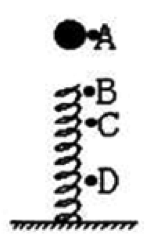

A. 在B位置小球动能最大

B. 在C位置小球动能最小

C. 从A→D位置小球重力势能的减少小于弹簧弹性势能的增加

D. 从A→C位置小球重力势能的减少大于小球动能的增加

第 52 题 · 答案与解析

**参考答案（粉笔题库参考内容）**

D

**解析**

小球接触弹簧后做简谐振动，且振动的平衡位置是受力为零的位置，即C点。由简谐振动的性质可知，做简谐运动的物体在平衡位置时动能最大，因此A、B两项错误。

由于小球在A、D位置时动能均为零，因此由能量守恒定律可知，A→D过程中所有的重力势能的减少等于弹簧的弹性势能的增加，因此C项错误。

由于A点动能为零，C点动能最大，由能量守恒定律，A点的重力势能的减少等于弹簧的弹性势能和小球的动能的增加的总和。

故正确答案为D。

**来源**：2009年上海市公务员录用考试《行测》题第52题

### 第 53 题

一般手机都有来电振动提醒功能，其原理是用一个微型电动机带动转轴上的叶片转动，当叶片转动时，电动机也就跟着振动起来，从而又带动手机振动。在下列所示的几种形状的叶片中，能够实现上述振动功能的是：

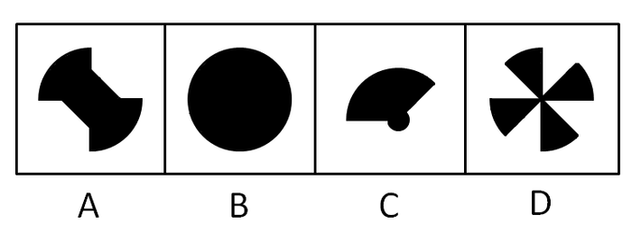

A. A

B. B

C. C

D. D

第 53 题 · 答案与解析

**参考答案（粉笔题库参考内容）**

C

**解析**

当叶片为对称图形时，各部分在高速旋转时产生的离心力可相互抵消，因此旋转平稳；相反，当叶片形状不对称时，各部分产生的离心力不能相互抵消，因此会产生旋转不平稳的情况，即振动。

A、B、D三项中形状均为对称图形。

故正确答案为C。

**来源**：2009年上海市公务员录用考试《行测》题第53题

### 第 54 题

如下图所示，完全相同的两根弹簧，下面挂两个质量相同、形状不同的实心铁块，其中甲是立方体，乙是球体。现将两个铁块完全浸没在某盐水溶液中，该溶液的密度随深度增加而均匀增加。待两铁块静止后，甲、乙两铁块受到的弹簧的拉力相比：

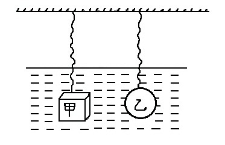

A. 一样大

B. 甲比较大

C. 乙比较大

D. 无法确定

第 54 题 · 答案与解析

**参考答案（粉笔题库参考内容）**

B

**解析**

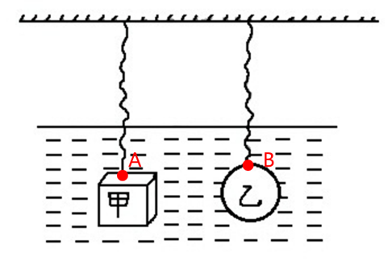

甲、乙两铁块均处于静止状态，则受力平衡，对两铁块分别进行受力分析，两铁块均受到重力、浮力和弹簧的拉力，且重力=浮力+弹簧的拉力，因为两铁块均为实心铁块，所以两铁块密度相同，因为两铁块重力相同，所以两铁块质量相同，根据体积，可知两铁块体积相同。

假设两铁块受到的弹簧的拉力相同，因为两弹簧完全相同，所以两弹簧的形变量相同，图中所示A点和B点深度相同，即两铁块上表面深度相同。因为体积相同的立方体和球，立方体的棱长小于球的直径，所以甲铁块的棱长小于乙铁块的直径，即乙铁块的重心位置比甲铁块的重心位置更深。因为本题中溶液的密度随深度增加而均匀增加，所以乙铁块位于溶液平均密度更大的液体中，两铁块体积相同，则两铁块相同，由浮力公式：可知，乙铁块受到的浮力大于甲铁块受到的浮力，又因为两铁块受到的重力相同，弹簧的拉力也相同，所以不能满足两铁球受到的重力均等于浮力与弹簧的拉力之和，因此当两铁块上表面处于同一深度时，两铁块不可能均平衡。若两铁块均为平衡状态，则乙铁块的上表面应该高于甲铁块的上表面，即甲铁块受到的弹簧的拉力更大。

故正确答案为B。

**来源**：2009年上海市公务员录用考试《行测》题第54题

### 第 55 题

一台用非铁磁性物质制成的天平（包括天平盘），可认为它不受磁力影响。左盘中央放一铁块A：其上方不远处有一固定在支架上的电磁铁B（支架也放在左盘上）。未通电时，天平平衡；给B通电后，在铁块A被吸起离开天平盘但未碰到B的上升过程中，天平的状态为：

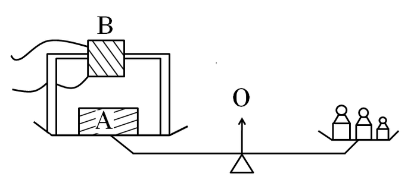

A. 右盘下降

B. 仍保持平衡

C. 左盘下降

D. 无法判断

第 55 题 · 答案与解析

**参考答案（粉笔题库参考内容）**

C

**解析**

因为在通电之前天平平衡，且天平两边均只受到托盘上物体的重力，因此砝码重力＝A重力＋B重力。

当通电后，由于B与左盘固定，A与左盘分离，因此左盘只受到B的重力和A、B间的吸引力。又由于此过程中A加速上升，因此A、B间的吸引力＞A的重力。因此左盘受力＝A、B间引力＋B重力＞A重力＋B重力＝砝码重力。因此左盘下降。

故正确答案为C。

**来源**：2009年上海市公务员录用考试《行测》题第55题

### 第 56 题

审美境界：指从人生境界中升华出来的超越了自然境界、功利境界和道德境界的愉悦情怀和情景。

根据上述定义，下列选项中，不属于审美境界的是：

A. 欣赏名画《蒙娜丽莎》感觉优雅

B. 读“采菊东篱下，悠然见南山”产生逍遥感

C. 听二胡演奏曲《二泉映月》使人宁静

D. 看《炒股指南》从而对股票产生兴趣

第 56 题 · 答案与解析

**参考答案（粉笔题库参考内容）**

D

**解析**

第一步：抓住定义中的关键词。

定义中强调“超越了自然境界、功利境界和道德境界”等。

第二步：逐一判断选项。

D项中对股票的兴趣是出于功利，属于功利境界，不符合定义。其余三项均符合定义。

故正确答案为D。

**考点**：单定义-其他句式

**来源**：2009年上海市公务员录用考试《行测》题第56题

### 第 57 题

行政纠纷：指国家行政机关之间或国家行政机关同企事业单位、社会团体以及公民之间由于行政管理而引起的纠纷，包括行政争议和行政案件两种形式。

下列选项中，不属于行政纠纷的是：

A. 原告是一家经卫生行政主管部门依法批准开办的卫生室，由于不服卫生局就其无证推销保健产品作出的处罚，因而状告卫生局

B. 原告因工伤未能获得保险赔偿，将工厂告上法院

C. 原告为个体工商户，因在旅游景点设摊被该地工商管理局征收摊点费，原告认为此项收费为乱收费，遂状告该工商管理局

D. 原告对消防局火灾事故责任认定不服，申请重新认定

第 57 题 · 答案与解析

**参考答案（粉笔题库参考内容）**

B

**解析**

第一步：抓住定义中的关键词。

定义中强调“国家行政机关”等。

第二步：逐一判断选项。

B项中为企事业单位和个人之间的纠纷，不涉及国家行政机关，不符合定义；

A项中的卫生局、C项中的工商管理局、D项中的消防局均为国家行政机关，符合定义。

本题为选非题，故正确答案为B。

**考点**：拆词

**来源**：2009年上海市公务员录用考试《行测》题第57题

### 第 58 题

学习迁移：指一种学习对另一种学习的影响，即已获得的知识经验、知识结构、动作技能、学习态度、策略和方法等与新知识、新技能之间所发生的影响。

下列选项中，没有体现学习迁移能力的是：

A. 利用几何方法证明黄赤交角。

B. 当我们遇到疑难问题感到无所适从时，联想以前发生的类似场景，从经验中寻找解决问题的方法。

C. 小张喜欢某个足球明星，刚开始只喜欢他的球技，但慢慢开始关注他生活的全部。

D. 篮球运动员在学习推铅球时，一开始总是习惯于沿弧线抛球，而难以适应沿直线推出铅球的出手动作。

第 58 题 · 答案与解析

**参考答案（粉笔题库参考内容）**

C

**解析**

第一步：抓住定义中的关键词。

定义中强调“一种学习对另一种学习的影响”。

第二步：逐一判断选项。

A项中是几何学习对地理学习的影响，符合定义；

B项为经验学习对目前疑难问题解决的影响，符合定义；

C项只是提到喜欢程度，与学习无关，不符合定义；

D项为篮球学习对铅球学习的影响，符合定义。

本题为选非题，故正确答案为C。

**考点**：主客体

**来源**：2009年上海市公务员录用考试《行测》题第58题

### 第 59 题

应激性：指一切生物体对外界各种刺激所作出的反应，它是一种动态反应，并在比较短的时间内完成。

根据上述定义，下列不属于应激性的是：

A. 黄鼬遇到敌害，就会释放出臭气

B. 人在看到文字、图像时所产生的各种反应

C. 北极熊的毛是白色的，与其所生活的环境颜色一致

D. 蝉一般在24℃以下不鸣叫，而在24℃以上且光照达到一定程度时才鸣叫

第 59 题 · 答案与解析

**参考答案（粉笔题库参考内容）**

C

**解析**

第一步：抓住定义中的关键词。

定义中强调“生物体”、“外界刺激”、“动态反应”等。

第二步：逐一判断选项。

A、B、D三项均是生物体对外界刺激做出的动态反应，符合定义；

C项中北极熊毛的颜色是静态的，不符合定义中动态反应这一概念。

本题为选非题，故正确答案为C。

**考点**：单定义-其他句式

**来源**：2009年上海市公务员录用考试《行测》题第59题

### 第 60 题

工作倦怠：指工作本身对个人的能力、精力以及资源过度要求而导致工作者感到情绪枯竭、精疲力尽的现象。

根据这一定义，下列不属于教师工作倦怠的是：

A. 小王老师感到难以完成学校下达的额外教学任务

B. 现在很多学生非常调皮，一些年轻的老师疲于应付

C. 因为最近经常加班，小李老师这几天上课总提不起精神

D. 小张老师因为和丈夫关系紧张，最近上班总是愁眉苦脸的

第 60 题 · 答案与解析

**参考答案（粉笔题库参考内容）**

D

**解析**

第一步：抓住定义中的关键词。

定义中强调“工作本身对个人”、“要求过度”等。

第二步：逐一判断选项。

A、B、C三项均是工作对个人要求过度而引起的疲惫，符合定义。

D项中导致愁眉苦脸的原因是夫妻关系紧张，与工作对个人的要求无关，不符合定义。

本题为选非题，故正确答案为D。

**考点**：原因结果

**来源**：2009年上海市公务员录用考试《行测》题第60题

### 第 61 题

所给图形的右下角有一个缺口，下列选项中，最适合填补该缺口的是：

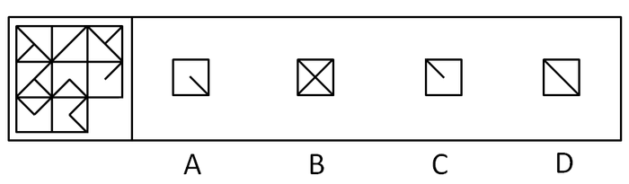

A. A

B. B

C. C

D. D

第 61 题 · 答案与解析

**参考答案（粉笔题库参考内容）**

D

**解析**

元素组成相似，元素叠加。

每一行中前两个图形相加去同存异得到第三个图形。

故正确答案为D。

**考点**：样式规律-加减同异

**来源**：2009年上海市公务员录用考试《行测》题第61题

### 第 62 题

下列选项中，符合所给图形的变化规律的是：

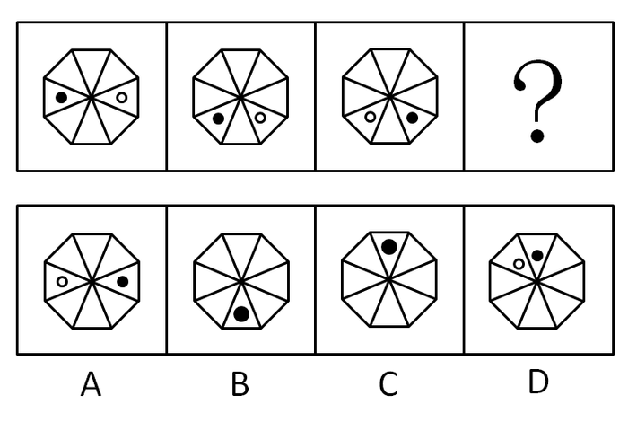

A. A

B. B

C. C

D. D

第 62 题 · 答案与解析

**参考答案（粉笔题库参考内容）**

C

**解析**

元素组成相同，优先考虑位置规律。

观察发现，黑圆分别逆时针平移了1格、2格、3格即得到下一个图形；白圆分别顺时针平移了1格、2格、3格即得到下一个图形。

故正确答案为C。

**考点**：位置规律-平移

**来源**：2009年上海市公务员录用考试《行测》题第62题

### 第 63 题

下列选项中，符合所给图形的变化规律的是：

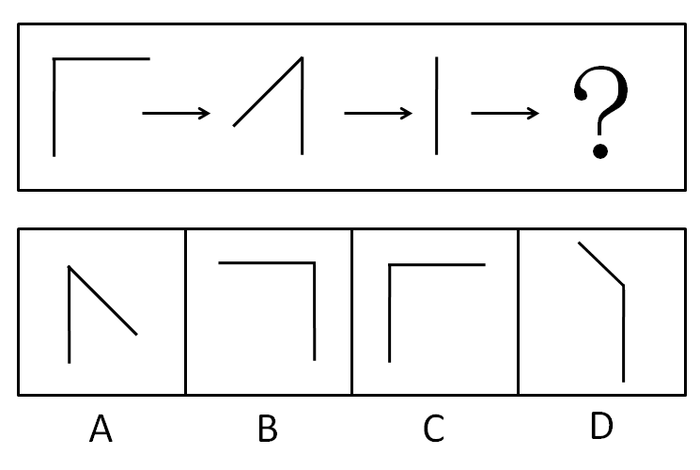

A. A

B. B

C. C

D. D

第 63 题 · 答案与解析

**参考答案（粉笔题库参考内容）**

A

**解析**

元素组成相同，考查位置规律。

每个图形中角的竖直方向上的边的位置不变，另一边顺时针旋转135°即得到下一个图形。

故正确答案为A。

**考点**：位置规律-旋转

**来源**：2009年上海市公务员录用考试《行测》题第63题

### 第 64 题

下列选项中，（  ）折叠后可以与所给图形结合在一起，成为一个整体。

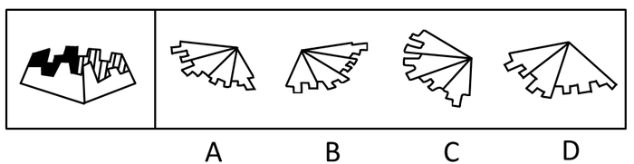

A. A

B. B

C. C

D. D

第 64 题 · 答案与解析

**参考答案（粉笔题库参考内容）**

B

**解析**

由题干可知，与有着等长锯齿的面相邻的两个面，一个是有着相邻长短锯齿的面；另一个是有着不相邻的长短锯齿的面。因此A、C、D三项均可排除。

故正确答案为B。

**来源**：2009年上海市公务员录用考试《行测》题第64题

### 第 65 题

下图左为一展开的平面图形，下图右给出的6个立方体中，不能由该平面图形折叠而成的有：

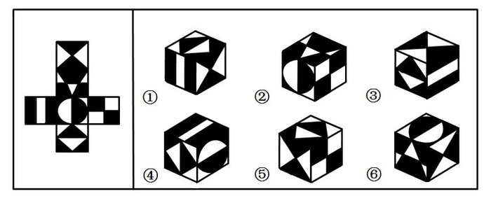

A. 2、3、5

B. 1、4、5

C. 1、4、6

D. 2、3、6

第 65 题 · 答案与解析

**参考答案（粉笔题库参考内容）**

D

**解析**

②图中右侧面的四个小正方形黑白色颠倒；③图上方面上的黑色三角形不可能与右侧面的黑色矩形相邻；⑥图中上方的面与右侧面应该为相对的两个面，不可能同时出现在一个平面图中。

故正确答案为D。

**考点**：空间类-空间重构-六面体

**来源**：2009年上海市公务员录用考试《行测》题第65题

### 第 66 题

下列选项中，符合所给图形变化规律的是：

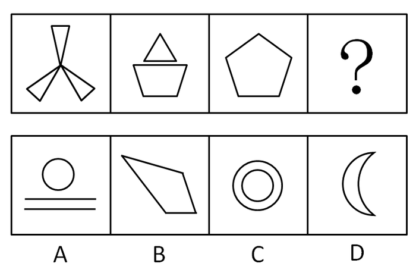

A. A

B. B

C. C

D. D

第 66 题 · 答案与解析

**参考答案（粉笔题库参考内容）**

A

**解析**

元素组成凌乱，考查数量规律——数线。每个图形中线条（包括直线和曲线）的个数成等差数列，依次为9，7，5，3。A、B、C、D四个选项的线条数分别为3、4、2、2。

故正确答案为A。

**考点**：数量规律-复合

**来源**：2009年上海市公务员录用考试《行测》题第66题

### 第 67 题

下列所给的图形左侧是一个完整的立方体,中间和右侧再加上下列哪个选项就可以构成左侧完整的立方体?

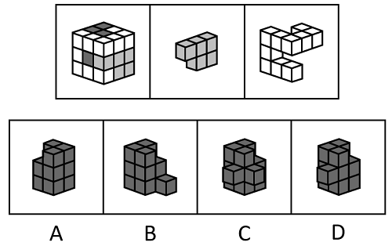

A. A

B. B

C. C

D. D

第 67 题 · 答案与解析

**参考答案（粉笔题库参考内容）**

D

**解析**

拼接图形，观察图形凹凸部分，题干中第二个图对应到第一个图中可看出来就是第一个图中灰色图形部分，第三个图对应到第一个图中即为白色部分，因此需要找到的缺少的部分正好是第一个图中黑色的部分。观察第一个图可知在立方体左侧中间明显有一块黑色部分，因此选项中左侧应该有一块凸起的部分，排除A、B两项。C、D两项的区别在于右侧是否有凸起部分，观察题干第一个图可知右侧中间不存在凸起的部分，排除C项。

故正确答案为D。

**考点**：空间类-立体拼合

**来源**：2009年上海市公务员录用考试《行测》题第67题

### 第 68 题

小明用下图甲的胶滚沿着从左到右的方向将图案滚涂到墙上，右边所给的四个图案中符合胶滚滚涂图案的是：

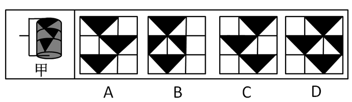

A. A

B. B

C. C

D. D

第 68 题 · 答案与解析

**参考答案（粉笔题库参考内容）**

C

**解析**

由于甲上的图案是从左往右滚动，因此中间的三角形应该首先印到墙上，因此排除A、B两项。又由于中间只有一个三角形，因此D项错误。

故正确答案为C。

**来源**：2009年上海市公务员录用考试《行测》题第68题

### 第 69 题

下面各图都是正方体的表面展开图，若将它们折成正方体，则其中有两个正方体各面图案完全一样，它们是：

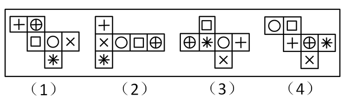

A. （3）和（4）

B. （1）和（3）

C. （2）和（3）

D. （2）和（4）

第 69 题 · 答案与解析

**参考答案（粉笔题库参考内容）**

A

**解析**

（1）中圆应与十字相对，而（2）、（3）、（4）中圆与十字的一面相接，因此排除（1）。以圆为底面，（3）与（4）的四个侧面顺时针依次为叉、星、方块、十字；而（2）的四个侧面逆时针依次为叉、星、方块、十字。综上（3）与（4）应该相同。

故正确答案为A。

**考点**：空间类-空间重构-六面体

**来源**：2009年上海市公务员录用考试《行测》题第69题

### 第 70 题

下列选项中，符合所给图形变化规律的是：

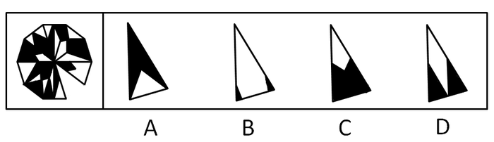

A. A

B. B

C. C

D. D

第 70 题 · 答案与解析

**参考答案（粉笔题库参考内容）**

D

**解析**

图形的内部结构的考查，相对的两个三角形中，划分的图形相同，且对应部分的黑白颜色相反。

故正确答案为D。

**考点**：特殊规律-图形间关系

**来源**：2009年上海市公务员录用考试《行测》题第70题

### 第 71 题

根据下列各种事实综合分析，预测最可能发生的结果是：

①电脑的普及②电脑管理社会③电脑技术者的伦理观念降低④电脑管理情报的泄露⑤电脑专业人才的增加⑥企业整体业务管理的信息化

A. 电脑犯罪率增加

B. 个人隐私受侵害

C. 电脑过敏症增加

D. 从事管理工作的失业者增加

第 71 题 · 答案与解析

**参考答案（粉笔题库参考内容）**

A

**解析**

第一步：抓住题干主要信息。

根据题意主要是讲电脑普及之后，在管理方面产生的问题。

第二步：分析题干信息，并结合选项得出答案。

从③④可以得出A项符合题意。

B项中个人隐私，C项中电脑过敏症，D项中从事管理工作的失业者，题干信息均未涉及，因此都无法推出。

故正确答案为A。

**考点**：日常结论

**来源**：2009年上海市公务员录用考试《行测》题第71题

### 第 72 题

公寓楼共有三层，每层仅一套公寓。最先搬进来的沃伦夫妇住进了顶层，莫顿夫妇和刘易斯夫妇则分别住进了下面两层。莫顿夫妇感到非常满意，他们没有什么怨言。事实上，整幢楼里唯一有意见的是帕西，他希望住在他楼上的那对夫妇不要过早地洗澡，因为这影响他的睡眠。此外，三对房客的关系一直很融洽，罗杰每天早上下楼路过吉姆的门前时，总要进去一会儿，然后两个人一起去上班。到了上午11点，凯瑟琳总要上楼去和刘易斯夫人一起喝茶。丢三落四的诺玛觉得非常方便，因为每当她忘了从商店买回什么东西，她总可以下楼向多丽丝家借。

根据以上条件，三对夫妇的姓名应该是：

A. 帕西·沃伦和诺玛·沃伦夫妇、罗杰·刘易斯和多丽丝·刘易斯夫妇、吉姆·莫顿和凯瑟琳·莫顿夫妇

B. 罗杰·沃伦和凯瑟琳·沃伦夫妇、帕西·刘易斯和多丽丝·刘易斯夫妇、吉姆·莫顿和诺玛·莫顿夫妇

C. 罗杰·沃伦和多丽丝·沃伦夫妇、吉姆·刘易斯和凯瑟琳·刘易斯夫妇、帕西·莫顿和诺玛·莫顿夫妇

D. 罗杰·沃伦和诺玛·沃伦夫妇、帕西·刘易斯和多丽丝·刘易斯夫妇、吉姆·莫顿和凯瑟琳·莫顿夫妇

第 72 题 · 答案与解析

**参考答案（粉笔题库参考内容）**

D

**解析**

本题选项是每个选项均给出所有排列组合情况，故可用排除法。

第一步：找突破口。

从题干“沃伦夫妇住到顶层，莫顿夫妇很满意，整栋楼里唯一有意见的是帕西”可以得出，帕西属于刘易斯夫妇中，故排除A、C两项。

第二步：分析题干其余信息得出答案。

由于“凯瑟琳总要上楼去和刘易斯夫人一起喝茶”，故凯瑟琳不属于沃伦夫妇和刘易斯夫妇，则凯瑟琳是莫顿夫人，故排除B项。

故正确答案为D。

**考点**：排除法

**来源**：2009年上海市公务员录用考试《行测》题第72题

### 第 73 题

在A市，司机的汽车事故保险是按平均水平支付的，而不是按每个司机每年行驶的路程收费，在此机制下，保险公司能实现一定的盈利。所以，行驶里程少于平均水平的人在一定程度上补贴了行驶里程多于平均水平的人。

以下说法中哪项成立，则上述说法成立？

A. 无论何时，有新的司机购买保险时，向所有司机收取的按平均水平计算的事故保险费也会相应上升

B. 如果根据每年的行驶里程对司机进行分类，保险公司的利润会显著上升

C. 那些得到保险公司高额赔偿的司机所支付的保险费用等于或低于其他司机支付的保险费用

D. 对保险公司而言，为行驶里程少于平均里程的人所支付的成本小于为行驶里程多于平均里程的人所支付的成本

第 73 题 · 答案与解析

**参考答案（粉笔题库参考内容）**

D

**解析**

第一步：找出论点和论据。

论点：行驶里程少于平均水平的人在一定程度上补贴了行驶里程多于平均水平的人。

论据：司机的汽车事故保险是按平均水平支付的，而不是按每个司机每年行驶的路程收费，在此机制下，保险公司能实现一定的盈利。

论点说行驶里程少于平均水平的人在保险上补贴了行驶里程多于平均水平的人，论据说保险按平均水平支付，论点论据话题一致，问法为前提假设，加强考虑必要条件。

第二步：逐一分析选项。

A项：不能确定新的司机的行驶里程比平均水平大还是小，不明确项，无法加强，排除；

B项：利用行驶里程对司机分类来提升保险公司利润，而论点说的是平均里程与保险补贴的关系，话题不一致，无法加强，排除；

C项：获得赔偿的司机支付的保险费用等于或低于其他司机的，而论点说的是平均里程与保险补贴的关系，话题不一致，无法加强，排除；

D项：如果为行驶里程少于平均水平的人支付的成本大于等于为行驶里程多于平均水平的人支付的成本，那么前者在保险上对后者的补贴关系就完全不能成立，是论点成立的必要条件，可以加强，当选。

故正确答案为D。

**考点**：必要条件

**来源**：2009年上海市公务员录用考试《行测》题第73题

### 第 74 题

在接受测谎器测验时，只要服用少量某种常用镇静剂，就可使人在说谎时不被察觉。因为由测谎器测出的心理压力反应可以通过药物抑制，而不会产生显著的副作用。由此推之，这种药物对降低日常生活中的心理压力也会很有效。

此段话的假设前提是：

A. 镇静剂对于治疗心理压力有效

B. 对于心理压力反应的抑制增加了主观的心理压力

C. 由测谎器测出的心理压力与日常生活的心理压力相似

D. 在测谎器测验中说谎的人经常显示出心理压力的迹象

第 74 题 · 答案与解析

**参考答案（粉笔题库参考内容）**

C

**解析**

第一步：找到论点和论据。

本题论点是镇静剂对降低日常生活中的心理压力也会很有效，论据是由测谎器测出的心理压力反应可以通过药物抑制，而不会产生显著的副作用。

第二步：判断加强方式。

论点强调日常生活中的心理压力，论据强调测谎器测出的心理压力，所以论点与论据间不存在明显因果关系，所以需加强论证，在论点和论据间搭桥。

第三步：逐一判断选项的作用。

C项即在测谎器测出的心理压力与日常生活的心理压力间搭桥，可以加强；

A、B、D三项均与日常生活中的心理压力无直接关系，属无关选项。

故正确答案为C。

**考点**：搭桥

**来源**：2009年上海市公务员录用考试《行测》题第74题

### 第 75 题

有一个岛上住着两种人，一种是说真话的人，一种是说假话的人。一天，一个人去岛上旅游，遇到甲、乙、丙三个岛上居民，便问起他们谁是说真话的人，谁是说假话的人，甲说：“乙和丙都是说假话的人。”乙说：“我是说真话的人。”丙说：“乙是说假话的人。”

这三个人中有几个是说假话的人？

A. 0

B. 1

C. 2

D. 3

第 75 题 · 答案与解析

**参考答案（粉笔题库参考内容）**

C

**解析**

第一步：找到突破口。

由于乙和丙所说的话是矛盾关系，因此必有一真一假。

第二步：分析题干中剩余信息得出答案。

无论假设乙是真或假，甲都为假，乙丙必一真一假，所以甲说的一定是假话。因此说假话的人有两个。

故正确答案为C。

**考点**：只有一真/一假

**来源**：2009年上海市公务员录用考试《行测》题第75题

### 第 76 题

有6位经济分析师张、王、李、赵、孙、刘，坐在环绕圆桌连续等距排放的6张椅子上分析一种经济现象。每张椅子只坐1人，6张椅子的顺序编号依次为1、2、3、4、5、6。其中：（1）刘和赵相邻；（2）王和赵相邻或者王和李相邻；（3）张和李不相邻；（4）如果孙和刘相邻，则孙和李不相邻。

如果王和李相邻且孙和李不相邻，那么谁和谁也一定是相邻的？

A. 张和孙

B. 王和赵

C. 王和孙

D. 李和刘

第 76 题 · 答案与解析

**参考答案（粉笔题库参考内容）**

A

**解析**

由王和李相邻且孙和李不相邻，再结合条件（3）张和李不相邻，可知李只能与刘或赵相邻，又根据条件（1）刘和赵相邻，可知李、刘、赵三者是相邻的，那么剩余的张和孙一定是相邻的。

故正确答案为A。

**考点**：从确定信息开始推

**来源**：2009年上海市公务员录用考试《行测》题第76题

### 第 77 题

有6位经济分析师张、王、李、赵、孙、刘，坐在环绕圆桌连续等距排放的6张椅子上分析一种经济现象。每张椅子只坐1人，6张椅子的顺序编号依次为1、2、3、4、5、6。其中：（1）刘和赵相邻；（2）王和赵相邻或者王和李相邻；（3）张和李不相邻；（4）如果孙和刘相邻，则孙和李不相邻。

如果赵和李相邻，那么张可能与哪两者相邻？

A. 王和李

B. 王和刘

C. 赵和刘

D. 刘和孙

第 77 题 · 答案与解析

**参考答案（粉笔题库参考内容）**

D

**解析**

第一步：找到突破口。

由于（1）赵和刘相邻，赵和李相邻，因此分析（2）中的王和赵相邻不可能出现，故王和李相邻。因此已知圆桌上的顺序为：刘，赵，李，王。

第二步：根据题干剩余信息得出答案。

未排序的只有孙和张，因此只有两种圆桌情况：孙，刘，赵，李，王，张；张，刘，赵，李，王，孙。

故正确答案为D。

**考点**：从确定信息开始推

**来源**：2009年上海市公务员录用考试《行测》题第77题

### 第 78 题

有一个大家庭，父母共养有7个子女，从大到小分别是ABCDEFG，这7个孩子的情况是这样的：（1）A有3个妹妹；（2）B有1个哥哥；（3）C是老三，她有2个妹妹；（4）E有2个弟弟。

从以上情况可以得出，这7个孩子的性别分别是：

A. A男，B女，C女，D女，E男，F男，G男

B. A男，B男，C女，D女，E男，F女，G男

C. A男，B男，C女，D女，E女，F男，G男

D. A男，B女，C男，D女，E女，F男，G男

第 78 题 · 答案与解析

**参考答案（粉笔题库参考内容）**

C

**解析**

根据已知条件推导。

由（2）可知A为男性，由（4）可知F和G都为男性，由（3）中“她”可知C为女性，又因为她有两个妹妹，则D和E都为女性。再由（1）可知B为男性。

故正确答案为C。

**考点**：排除法

**来源**：2009年上海市公务员录用考试《行测》题第78题

### 第 79 题

技术革命究竟会不会加重失业，这是长期以来困扰人们的一个问题，从一些统计数字中人们发现了有趣的现象，尽管美国过去多年来在计算机技术和其他方面投入巨资，但它目前的失业率（约为5.5%）并不比20世纪60年代初期的失业率高，而在西欧失业率则为11%，那里对计算机的投资一直少于美国。

从上述文字中可以合乎逻辑地推出：

A. 信息技术的发展前景十分广阔

B. 信息技术需要更快地发展

C. 信息技术不会导致失业

D. 信息技术的发展不会加重失业

第 79 题 · 答案与解析

**参考答案（粉笔题库参考内容）**

D

**解析**

第一步：抓住题干主要信息。

第一点说明技术革命究竟会不会加重失业是长期以来困扰人们的一个问题，第二点说明美国过去多年来在计算机技术和其他方面投入巨资，但它目前的失业率（约为5.5%）并不比20世纪60年代初期的失业率高，第三点说明在西欧失业率则为11%，那里对计算机的投资一直少于美国。

第二步：分析题干信息，并结合选项得出答案。

A项：信息技术的发展前景广阔，发展前景题干并未涉及，因此A项中说法无法推出；

B项：信息技术需要更快地发展，需要更快发展题干并未涉及，因此B项中说法无法推出；

C项：信息技术不会导致失业，说法过于绝对，导致失业题干并未涉及，因此C项中说法无法推出；

D项：由第一步中第一点可知题干信息围绕技术革命和加重失业，再从第二点和第三点的对比可以得出，信息技术的发展不会加重失业，因此D项中说法可以推出。

故正确答案为D。

**考点**：日常结论

**来源**：2009年上海市公务员录用考试《行测》题第79题

### 第 80 题

在作为公共健康政策的工具方面，流行疾病的研究比研究毒素对动物的影响有一个有利之处：在流行病学中绝不需要在不同种类的生物间做推论。

下列选项中，可由上文推论得出的是：

A. 在流行病学中，生物间的推论只是辅助工具

B. 流行病学是一种精确的科学

C. 在流行病学中，人类可直接作为研究的主体

D. 动物体的毒素研究得出结论的速度比流行病学慢

第 80 题 · 答案与解析

**参考答案（粉笔题库参考内容）**

C

**解析**

第一步：抓住题干主要信息。

第一点说明流行疾病的研究比研究毒素对动物的影响有一个有利之处，第二点说明在流行病学中绝不需要在不同种类的生物间做推论。

第二步：分析题干信息，并结合选项得出答案。

A项：在流行病学中，生物间的推论只是辅助工具，由第一步中第二点可知流行病学不需要在不同种类的生物间做推论，因此A项中说法无法推出；

B项：流行病学是一种精确的科学，流行病学是否精确题干并未涉及，因此B项中说法无法推出；

C项：由第一步中第二点可知在流行病学中绝不需要在不同种类的生物间做推论，从而说明在流行病学中，人类可直接作为研究的主体，因此C项中说法可以推出；

D项：毒素研究的速度与流行病学研究的速度，题干均未涉及，因此D项中说法无法推出。

故正确答案为C。

**考点**：日常结论

**来源**：2009年上海市公务员录用考试《行测》题第80题

### 第 81 题

科学发展观，是马克思主义关于发展的世界观和方法论的集中体现，是同马克思列宁主义、毛泽东思想、邓小平理论和"三个代表"重要思想既一脉相承又与时俱进的科学理论，是我国经济社会发展的重要指导方针，是发展中国特色社会主义必须坚持和贯彻的重大战略思想。

科学发展观的核心是：

A. 发展

B. 全面、协调、可持续

C. 以人为本

D. 改革创新

第 81 题 · 答案与解析

**参考答案（粉笔题库参考内容）**

C

**解析**

中国共产党第十八次全国代表大会通过的党章修正案规定：中国共产党以马克思列宁主义、毛泽东思想、邓小平理论、“三个代表”重要思想和科学发展观作为自己的行动指南。

科学发展观第一要义是发展，核心是以人为本，基本要求是全面协调可持续，根本方法是统筹兼顾。

故正确答案为C。

**来源**：2009年上海市公务员录用考试《行测》题第81题

### 第 82 题

2008年3月18日，新一届政府总理温家宝和四位副总理第一次在中外媒体的关注中集体亮相。温总理在答记者问时指出，如果说真理是思想体系的首要价值，那么：

A. 维护稳定就是社会主义国家制度的首要价值

B. 公平正义就是社会主义国家制度的首要价值

C. 发展经济就是社会主义国家制度的首要价值

D. 为民服务就是社会主义国家制度的首要价值

第 82 题 · 答案与解析

**参考答案（粉笔题库参考内容）**

B

**解析**

2008年3月18日，国务院总理温家宝指出“如果说真理是思想体系的首要价值，那么公平正义就是社会主义国家制度的首要价值。”

故正确答案为B。

本题相关知识点：这句话反映的是党中央对公平与效率关系的认识过程，改革开放之初的提法是“效率优先，兼顾公平”；十六大报告强调“初次分配注重效率”，“再分配注重公平”；到2004年十六届四中全会首次提出“社会公平”概念；2006年则强调“在经济发展的基础上，更加注重社会公平”；2007年之后中央把公平问题的地位和意义提高到前所未有的高度，强调“要让正义成为社会主义制度的首要价值”。

**考点**：重要会议讲话

**来源**：2009年上海市公务员录用考试《行测》题第82题

### 第 83 题

政治是经济的集中表现，其基本涵义是：

A. 解决政治问题是解决经济问题的前提

B. 政治活动的最终目的是为了实现统治阶级的根本经济利益

C. 经济关系是随着政治关系的变化而变化的

D. 一切政治活动都是围绕着经济问题而展开的

第 83 题 · 答案与解析

**参考答案（粉笔题库参考内容）**

B

**解析**

“政治是经济的集中表现”是列宁提出政治本质的著名论断。政治必然体现经济发展的客观要求，反映经济活动中各个阶级、阶层和社会集团的经济利益，离开经济利益的政治活动是不存在的。

故正确答案为B。

**考点**：哲学-其他

**来源**：2009年上海市公务员录用考试《行测》题第83题

### 第 84 题

2007年12月12日，中共中央、国务院和中央军委在人民大会堂举行大会，隆重庆祝我国首次月球探测工程圆满成功。我国首次月球探测工程的成功，标志着我国已经进入世界具有（  ）能力的国家行列。

A. 深空行走

B. 近地探测

C. 深空探测

D. 近地行走

第 84 题 · 答案与解析

**参考答案（粉笔题库参考内容）**

C

**解析**

在中国首次月球探测工程圆满成功大会上，胡锦涛主席指出，我国首次月球探测工程的成功，标志着我国已经进入世界具有深空探测能力的国家行列。

故正确答案为C。

本题相关知识点：人造地球卫星发射、载人航天和深空探测，是人类航天活动的三大领域，世界主要航天国家和组织都已经在这三大领域全面发展并取得了重要研究成果，而月球探测是深空探测的首选目标。

**考点**：科技理论与成就

**来源**：2009年上海市公务员录用考试《行测》题第84题

### 第 85 题

2008年12月8日召开的中央经济工作会议指出，经过改革开放30年的持续快速发展，我国形成了强大经济实力和综合国力，充分证明了中国特色社会主义道路的正确性。会议全面深刻分析了当前国际国内经济形势，明确提出了2009年经济工作的总体要求和重点任务，具体部署了2009年经济工作，提出把（  ）作为明年经济工作的首要任务。

A. 加快发展方式转变和结构调整，提高可持续发展能力

B. 深化重点领域和关键环节改革

C. 实施积极的财政政策和适度宽松的货币政策

D. 保持经济平稳较快发展

第 85 题 · 答案与解析

**参考答案（粉笔题库参考内容）**

D

**解析**

2008年中央经济工作会议提出，2009年经济工作必须把保持经济平稳较快发展作为2009年经济工作的首要任务。

故正确答案为D。

本题相关知识点：2011年中央经济工作会议提出，2012年保持宏观政策的连续性和稳定性，继续实施积极的财政政策和稳健的货币政策，并提出了“稳中求进”的工作总基调。

经济工作主要任务的第一项是“继续加强和改善宏观调控，促进经济平稳较快发展。统筹处理速度、结构、物价三者关系”。

**考点**：宏观经济与调控政策

**来源**：2009年上海市公务员录用考试《行测》题第85题

### 第 86 题

2008年5月6日至10日，国家主席胡锦涛对日本进行国事访问，这一“暖春之旅”中诞生的中日第四份政治文件全称为：

A. 《中日联合声明》

B. 《中日和平友好条约》

C. 《中日联合宣言》

D. 《中日关于全面推进战略互惠关系的联合声明》

第 86 题 · 答案与解析

**参考答案（粉笔题库参考内容）**

D

**解析**

中国国家主席胡锦涛2008年5月6日至10日对日本进行了国事访问，双方发表了《中日关于全面推进战略互惠关系的联合声明》。这份文件根据中日关系的新形势发展，确定了两国关系长远发展的指导原则，“战略互惠”成为两国关系的定位。

此前中日两国于1972年、1978年和1998年签署了《中日联合声明》、《中日和平友好条约》和《中日联合宣言》，成为指导中日关系发展的三个重要政治文件。

故正确答案为D。

**考点**：中国历史

**来源**：2009年上海市公务员录用考试《行测》题第86题

### 第 87 题

台湾自古即属于中国，大量的史书和文献记载了中国人民早期开发台湾的情景，距今1700多年以前，三国时期吴人沈莹的（  ）就对此有所著述。

A. 《东番记》

B. 《诸番记》

C. 《岛夷志略》

D. 《临海水土志》

第 87 题 · 答案与解析

**参考答案（粉笔题库参考内容）**

D

**解析**

沈莹（三国时代吴国丹阳太守）在其所著的《临海水土志》（约完成于公元268年至280年之间），提到“夷州”，这是世界上记述台湾最早的文字。

故正确答案为D。

本题其他知识点：

南宋乾道7年（1171年），泉州知州汪大猷曾遣军民屯住澎湖。宋理宗宝庆元年（1225年）赵汝适著《诸番志》记载：“泉（州）有海岛，曰澎湖，隶晋江县。”

元代在澎湖设立巡检司，并课税。汪大渊《岛夷志略》（1349年写成）记载，澎湖“地隶晋江县，至元年间，立巡检司”，“职巡逻，专捕获”，兼办“盐课”。

《东番记》著作于1603年，为中国明朝儒生陈第所作，记述台湾西部沿岸的原住民生活习俗与地理风光，为最早描绘台湾平埔族生活的著作。

**考点**：中国历史

**来源**：2009年上海市公务员录用考试《行测》题第87题

### 第 88 题

党的第十七届中央委员会第三次全体会议对当前和今后一个时期推进农村改革作出部署，强调要：

A. 大力推进改革创新，加强农村制度建设

B. 改善农村医疗条件，提高农民健康水平

C. 积极发展现代农业，提高农业综合生产能力

D. 加快发展农村公共事业，促进农村社会全面进步

第 88 题 · 答案与解析

**参考答案（粉笔题库参考内容）**

ACD

**解析**

党的第十七届中央委员会第三次全体会议对当前和今后一个时期推进农村改革发展作出了部署，强调要大力推进改革创新，加强农村制度建设；积极发展现代农业，提高农业综合生产能力；加快发展农村公共事业，促进农村社会全面进步。

故正确答案为A、C、D。

本题相关知识点：

十八大报告明确了深化农村改革的路径，提出“推进城乡发展一体化是解决‘三农’问题的根本途径”，而支撑城乡一体化目标实现的是三大改革（土地制度改革、社保制度改革、户籍制度改革）。

**考点**：宏观经济与调控政策

**来源**：2009年上海市公务员录用考试《行测》题第88题

### 第 89 题

当前一场震惊世界的金融风暴正席卷而来，全球正面临着金融危机的冲击，波及范围之广、冲击力度之强、连锁效应之快都是前所未有的。全球金融危机不断加剧并蔓延。已经逐渐波及到世界实体经济的发展，全球正面临着经济衰退的严重威胁，给世界各国经济发展和人民生活带来严重影响，引起了世界各国政府和人民的忧虑。

2008年金融危机的起因是：

A. 生产过剩与需求不足

B. 全球股市暴跌

C. 美国雷曼兄弟公司的倒闭

D. 美国次贷危机

第 89 题 · 答案与解析

**参考答案（粉笔题库参考内容）**

D

**解析**

从2007年开始在美国爆发的次级抵押贷款危机(简称次贷危机)是由于美国次级抵押贷款市场动荡引起的一系列带有严重危机色彩的事件。该危机通过金融市场之间的相互联系而将风险不断扩散，并进而蔓延到全球整个金融体系，最终酿成金融危机。

故正确答案为D。

本题相关知识点：所谓次级抵押贷款，指的就是贷款机构向信用程度较差和收入不高的借款人提供的贷款。

由于次级抵押贷款人的信用状况比较差，很容易发生违约现象。在信贷环境宽松或房价上涨的情况下，放贷机构即使由于贷款人违约无法收回贷款，也可以通过再融资，或者出售抵押的房产收回贷款并获得收益。但是，在信贷环境改变，特别是房价下降的情况下，再融资或者出售抵押的房产不仅难以实现，而且即使出售价格下跌的抵押房产也难以收回全部贷款。当较大规模地集中发生这类事件时，次贷危机就会发生。

**考点**：市场经济

**来源**：2009年上海市公务员录用考试《行测》题第89题

### 第 90 题

实现“四个率先”，是中央对上海的要求，是上海加快建设"四个中心"的必经之途。加快推进"四个率先"，是全面落实科学发展观，建设"四个中心"和现代化国际大都市的根本保证，是各项工作的总纲，我们必须把握这一主线，使上海的经济社会发展再上一个新台阶，这里提到的"四个率先"是指：

A. 率先转变经济增长方式、率先推进体制改革、率先提高自主创新能力、率先推进社会事业发展

B. 率先转变经济增长方式、率先提高自主创新能力、率先推进改革开放、率先构建社会主义和谐社会

C. 率先推进改革开放、率先改变经济运行环境、率先推进社会事业发展、率先实现小康目标

D. 率先推进改革开放、率先提高国际竞争力、率先实现区域经济协调发展、率先构建社会主义和谐社会

第 90 题 · 答案与解析

**参考答案（粉笔题库参考内容）**

B

**解析**

2006年胡锦涛总书记在参加十届全国人大四次会议上海代表团的审议时，对上海提出了要求和期望，具体内容即“四个率先”。2007年上海市九次党代会提出上海要努力率先转变经济增长方式、率先提高自主创新能力、率先推进改革开放、率先构建社会主义和谐社会，开创上海国际经济、金融、贸易、航运和社会主义现代化大都市（四个中心）的新局面。

故正确答案为B。

**考点**：宏观经济与调控政策

**来源**：2009年上海市公务员录用考试《行测》题第90题

### 第 91 题

2008年5月12日汶川大地震使部分群众失去了家庭，成为孤儿、孤老、孤残人员，即"三孤"人员。为做好"三孤"人员的救助安置工作，国务院于5月19日决定，3个月内，为每人每月提供600元基本生活费，这部分公共支出属于：

A. 公共消费支出

B. 公共投资支出

C. 公共转移性支出

D. 公共预防性支出

第 91 题 · 答案与解析

**参考答案（粉笔题库参考内容）**

C

**解析**

公共财政中，公共支出按是否有直接补偿为标准，分为消耗性支出与转移性支出。按支出目的，分为预防性支出和创造性支出。

转移性支出指政府按照一定方式，把一部分财政资金无偿地，单方面转移给居民和其他收益者的支出，主要有补助支出、捐赠支出和债务利息支出，它体现的是政府的非市场型再分配活动。根据其货币的、无偿的、单方转移的特点判断政府给“三孤人员”的生活费即属此类。

故正确答案为C。

本题相关知识点：

消耗性支出直接表现为政府购买物品或服务的活动，又可划分为消费支出和投资支出。

投资支出指在政府财政支出项目中具有投资性质的支出，修建公共设施，经营公用事业，主持公共工程等；

消费支出是指财政为满足公共需要用于公共消费性商品和劳务的支出，包括行政管理费、国防经费、文教、科学、卫生事业等。

预防性支出指的是用于维持社会秩序和保卫国家安全，一般为国防、警察、法庭的支出。

**考点**：宏观经济与调控政策

**来源**：2009年上海市公务员录用考试《行测》题第91题

### 第 92 题

公共行政伦理是国家行政机关及其行政人员，在行使公共权力、管理公共事务、提供公共服务的过程中，所必须遵循的：

A. 行政规范

B. 行为规范

C. 道德规范

D. 能力规范

第 92 题 · 答案与解析

**参考答案（粉笔题库参考内容）**

C

**解析**

行政伦理旨在分析行政人员在政策执行过程中，所应有的价值、行为行政伦理。

行政伦理面向从消极的有所不为而无害于人（如不贪污，不怠忽职守）到积极的有所为而有益于人（如为国效命，为民谋利的各种服务），并使行政符合公平正义原则，以及行政机关及人员在公务上的道德共识及道德自律。

故正确答案为C。

**来源**：2009年上海市公务员录用考试《行测》题第92题

### 第 93 题

2008年3月，第十一届全国人民代表大会第一次会议通过了国务院机构改革方案，根据新的国务院机构改革方案，国务院将新组建人力资源和社会保障部、（  ）等部门。

A. 工业和信息化部

B. 交通运输部

C. 环境保护部

D. 住房和城乡建设部

第 93 题 · 答案与解析

**参考答案（粉笔题库参考内容）**

ABCD

**解析**

2008年“两会”通过国务院机构改革方案，国务院将新组建工业和信息化部、交通运输部、人力资源和社会保障部、环境保护部、住房和城乡建设部。

故正确答案为A、B、C、D。

本题相关知识点：1982年以来，国务院机构改革已进行过5次。这次国务院改革涉及调整变动的机构共15个，正部级机构减少4个。改革后，除国务院办公厅外，国务院组成部门设置27个。

**来源**：2009年上海市公务员录用考试《行测》题第93题

### 第 94 题

行政生态学理论主要是分析社会环境因素与公共行政之间的相互影响，认为处于不同发展阶段的社会有其相对应的行政管理模式。

下列关于这种理论的说法中，正确的是：

A. 传统农业社会的社会结构缺乏高度的分工和专业化，与之相适应的行政系统是一种"衍射型"行政模式

B. 工业社会的社会结构具有高度的分工和专业化，与之相适应的行政系统是一种"衍射型"行政模式

C. 工业社会的社会结构具有高度的分工和合作性，与之相适应的行政系统是一种"融合型"行政模式

D. 传统农业社会的社会结构具有混沌未开的性质，与之相适应的行政系统是一种"融合型"行政模式

第 94 题 · 答案与解析

**参考答案（粉笔题库参考内容）**

BD

**解析**

行政生态学是“自然以及人类文化环境与公共政策运行之间的相互影响情形”的科学，该学科认为行政和它的行政生态环境互相影响。该理论集大成者——美国著名行政学家弗雷德•W•里格斯提出了与三种社会形态相适应的三种行政类型。

与农业社会相适应的融合型行政模式：传统农业社会的社会结构是混沌未开的，与之相适应，其行政行为与诸如立法、司法、军事、宗教乃至于社会经济活动等其他社会行为是混杂在一起的，根本就没有出现过专业化的行政机构。

与现代工业社会相适应的衍射型行政模式：工业社会各种环境因素的结构与功能实现了高度的分工与专业化，相应地，其行政系统也在结构与功能上形成了专业化分工体系。行政系统由有着高度分工的不同行政机构所组成，它们各自执行不同的专业化职能，分工明确，各司其职，以科学性与效率为追求目标。

与过渡转型期社会相适应的棱镜型行政模式：该社会的行政行为已出现专业化分工趋势，但又未能有效实现完全真正的专业化分工；专业化的行政机构已设立，但不能正常运作，功能有限，许多职能的发挥还需要由其他社会机构，甚至是宗族、同乡会等传统机构来完成；正式建立起来的行政制度由于各种传统势力的影响而起不到应有的规范及约束作用，往往成为摆设，形同虚设。

综上，农业社会的结构表现为融合型，工业社会的结构表现为衍射型。

故正确答案为B、D。

**来源**：2009年上海市公务员录用考试《行测》题第94题

### 第 95 题

人们在写信时常常在信的结尾写上“此致”、“敬礼”，“此致”在这里表示的意思是：

A. 此时

B. 奉上

C. 到此为止

D. 在此

第 95 题 · 答案与解析

**参考答案（粉笔题库参考内容）**

C

**解析**

书信中的“此致敬礼”，“此致”指的是前面的内容讲完了，而并不是针对后面的“敬礼”而言。

“此”指的是前文内容，例如：写回信时，末尾用“此复”；下通知时，末尾用“此通知”；发布命令时，末尾用“此令”。这些都是煞尾语。“致”字即“尽”或“与”讲，含有无保留地给与或呈献之意。“致××书”，即“与××书”；“致词”，即“献词”。

“此致”两字连用，意思就是“上面的话说完了”，这是从文言文中因袭下来的。

故正确答案为C。

本题相关知识点：“此致”可以有两种正确的位置来进行书写：一是紧接着主体正文之后，不另起段，不加标点；二是在正文之下另起一行空两格书写。“敬礼”写在“此致”的下一行，顶格书写。后应该加上一个惊叹号，以表示祝颂的诚意和强度。

**来源**：2009年上海市公务员录用考试《行测》题第95题

### 第 96 题

公共产品的提供和消费往往伴随着免费搭车现象。

下列成语故事中，存在免费搭车行为的是：

A. 滥竽充数

B. 刻舟求剑

C. 掩耳盗铃

D. 守株待兔

第 96 题 · 答案与解析

**参考答案（粉笔题库参考内容）**

A

**解析**

在财政学上，免费搭车是指不承担任何成本而消费或使用公共物品的行为，有这种行为的人或具有让别人付钱而自己享受公共物品收益动机的人被称为免费搭车者。

南郭先生“滥竽充数”的行为与动机，其根本原因在于团体利益同分，责任与成本却由团体的每个成员承担，这样便会出现搭便车的投机心理与行为。

故正确答案为A。

**考点**：市场经济、微观经济

**来源**：2009年上海市公务员录用考试《行测》题第96题

### 第 97 题

西藏自古以来就是中国不可分割的一部分。自十三世纪中叶西藏地区正式归入元朝版图后，中国虽然经历了几代王朝的兴替，多次更换中央政权，但西藏一直处于中央政府的管辖之下。

元朝设立的管理西藏事务的中央机构是：

A. 理藩院

B. 宣政院

C. 噶厦

D. 乌思藏都指挥使司

第 97 题 · 答案与解析

**参考答案（粉笔题库参考内容）**

B

**解析**

宣政院是元朝掌管全国佛教事宜和藏族地区军政事务的中央机关，由帝师兼领。忽必烈始置总制院，后改为宣政院。从此，西藏地区正式成为我国中央政府直接管辖的一个地方行政区域。

故正确答案为B。

本题相关知识点：理藩院是清朝统治蒙古、回部及西藏等少数民族的最高权力机构。清于崇德元年（1636）设蒙古衙门；三年六月，改称理藩院，咸丰年间兼办对俄外交事务。

噶厦，官署名，藏语音译，即西藏原地方政府。由噶伦4人组成，是1751年经清代乾隆皇帝在废除西藏郡王制之后批准建立的，1959年西藏叛乱事件发生后解散。

乌思藏都指挥使司，简称“乌思藏都司”，是中国明朝对今西藏自治区除昌都地区以外的大部分地区以及锡金、不丹的最高军政管辖机构。

**考点**：中国历史

**来源**：2009年上海市公务员录用考试《行测》题第97题

### 第 98 题

西方许多企业和政府组织结构形式已经开始向扁平化方向发展。所谓组织扁平化，就是指通过减少行政管理层次，裁减冗余人员，从而建立一种扁平化组织结构。

扁平化结构具有的优势有：

A. 行政幅度增宽，行政层次减少，组织成员积极性提高

B. 行政幅度减少，行政层次减少，组织成员积极性提高

C. 行政权力分散，行政管理控制增强

D. 管理成本降低，工作效率大大提高

第 98 题 · 答案与解析

**参考答案（粉笔题库参考内容）**

AD

**解析**

现代企业组织结构理论在上世纪九十年代强调简化组织结构，减少管理层次，使组织结构扁平化。

组织扁平化通过破除公司自上而下的垂直高耸的结构，减少管理层次，增加管理幅度，裁减冗员来建立一种紧凑的横向组织，达到使组织变得灵活，敏捷，富有柔性、创造性的目的。

扁平化结构的优势，一是行政幅度增宽，行政层次减少，组织成员的积极性提高；二是组织内信息畅通；三是管理成本降低，工作效率大大提高。但扁平化组织结构也可能造成权力分散，行政控制减弱的弊端。

故正确答案为A、D。

**来源**：2009年上海市公务员录用考试《行测》题第98题

### 第 99 题

2008年10月8日，2008年诺贝尔化学奖揭晓，华裔科学家钱永健为三位获奖科学家之一。2008年诺贝尔化学奖所表彰的科学研究成果是：

A. 对生物大分子进行确认和结构分析、质谱分析。

B. 真核转录的分子基础研究。

C. 以X射线衍射技术研究核酸蛋白复合体。

D. 绿色荧光蛋白的研究。

第 99 题 · 答案与解析

**参考答案（粉笔题库参考内容）**

D

**解析**

2008年诺贝尔化学奖的得主是下村修、马丁•沙尔菲和钱永健。下村修的主要研究成果是从一种水母中发现荧光蛋白，被誉为生物发光研究第一人；马丁•沙尔菲的主要研究成果是展示了绿色荧光蛋白作为发光的遗传标签的作用；钱永健的主要贡献在于利用水母发出绿光的化学物来追查实验室内进行的生物反应。

故正确答案为D。

本题相关知识点：2012年，两位美国科学家罗伯特•莱夫科维茨（Robert J. Lefkowitz）和布莱恩•克比尔卡（Brian K. Kobilka）因“G蛋白偶联受体研究”获得2012年诺贝尔化学奖。

每个人的身体就是一个数十亿细胞相互作用的精确校准系统。每个细胞都含有微小的受体，可让细胞感知周围环境以适应新状态。罗伯特•莱夫科维茨和布莱恩•克比尔卡因为突破性地揭示G蛋白偶联受体这一重要受体家族的内在工作机制而获得2012年诺贝尔化学奖。

**考点**：生物常识

**来源**：2009年上海市公务员录用考试《行测》题第99题

### 第 100 题

行政诉讼受案范围，是指人民法院受理行政案件的权限范围，即按法律规定，人民法院对何种行政案件有权受理，何种不能受理。根据我国《行政诉讼法》的规定，人民法院不予受理的情形是：

A. 认为行政机关侵犯法律规定的经营自主权

B. 行政机关的奖惩决定

C. 不具有强制力的行政指导行为

D. 行政机关拒绝履行保护人身权、财产权等法定职责

第 100 题 · 答案与解析

**参考答案（粉笔题库参考内容）**

BC

**解析**

中国《行政诉讼法》第二条、第十一条、第十二条规定了行政诉讼受案范围，形成了以列举式与概括式相结合为基础，排除条款为补充的行政诉讼受案体系。

第二条    公民、法人或者其他组织认为行政机关和行政机关工作人员的具体行政行为侵犯其合法权益，有权依照本法向人民法院提起诉讼。

第十一条　人民法院受理公民、法人和其他组织对下列具体行政行为不服提起的诉讼：（一）对拘留、罚款、吊销许可证和执照、责令停产停业、没收财物等行政处罚不服的；（二）对限制人身自由或者对财产的查封、扣押、冻结等行政强制措施不服的；（三）认为行 政机关侵犯法律规定的经营自主权的；（四）认为符合法定条件申请行政机关颁发许可证和执照，行政机关拒绝颁发或者不予答复的；（五）申请行政机关履行保护人身权、财产权的法定职责，行政机关拒绝履行或者不予答复的；（六）认为行政机关没有依法发给抚恤金的；（七）认为行政机关违法要求履行义务的；（八）认为行政机关侵犯其他人身权、财产权的。除前款规定外，人民法院受理法律、法规规定可以提起诉讼的其他行政案件。

第十二条　人民法院不受理公民、法人或者其他组织对下列事项提起的诉讼：（一）国防、外交等国家行为；（二）行政法规、规章或者行政机关制定、发布的具有普遍约束力的决定、命令；（三）行政机关对行政机关工作人员的奖 惩、任免等决定；（四）法律规定由行政机关最终裁决的具体行政行为。

综上，A、D两项属于《行政诉讼法》第11条规定的受案范围；C项内容不属于人民法院行政诉讼的受案范围；B项的内容是人民法院不予受理的案件。

故正确答案为B、C。

**考点**：行政法

**来源**：2009年上海市公务员录用考试《行测》题第100题

### 第 101 题

公共政策的效果是指政策执行后对客体及环境所产生的影响，评估公共政策时，必须分析不同层面的政策效果。

一般而言，政策效果主要包括：

A. 直接效果

B. 附带效果

C. 意外效果

D. 表面效果

第 101 题 · 答案与解析

**参考答案（粉笔题库参考内容）**

AB

**解析**

公共政策效果是指政策执行后对客体及环境所产生的影响，这种影响主要是指公共政策所产生的直接效果和附带效果。

故正确答案为A、B。

**来源**：2009年上海市公务员录用考试《行测》题第101题

### 第 102 题

传统火车速度的增加受到车轮与轨道之间摩擦力的限制，磁悬浮列车则是依靠机车磁场和轨道磁场之间产生的推斥力或吸引力而悬浮在轨道之上1～10厘米前进，具有速度快、损耗小、运行费用低等特点，在中短途轨道运输中具有很强的发展潜力。

目前国外成熟的磁悬浮列车技术主要有：

A. 永磁磁悬浮

B. 常导体磁悬浮

C. 槽轨磁悬浮

D. 超导体磁悬浮

第 102 题 · 答案与解析

**参考答案（粉笔题库参考内容）**

BD

**解析**

目前世界上有三种类型的磁悬浮：一是以德国为代表的常导电式磁悬浮；二是以日本为代表的超导电动磁悬浮，这两种磁悬浮都需要用电力来产生磁悬浮动力；而第三种，就是中国的永磁悬浮，它利用特殊的永磁材料，不需要任何其他动力支持。

常导磁悬浮列车由车上常导电流产生电磁吸引力，吸引轨道下方的导磁体，使列车浮起。常导型技术比较简单，由于产生的电磁吸引力相对较小，列车悬浮高度只有8到10毫米。

故正确答案为B、D。

**考点**：物理常识

**来源**：2009年上海市公务员录用考试《行测》题第102题

### 第 103 题

二十四节气是我国劳动人民创造的辉煌文化，它能反映天气气候和物候变化，指导农事活动，影响着千家万户的衣食住行。

下列选项中属于节气的是：

A. 清明

B. 重阳

C. 谷雨

D. 端午

第 103 题 · 答案与解析

**参考答案（粉笔题库参考内容）**

AC

**解析**

A、C两项属于二十四节气，B、D两项是我国的节日。

故正确答案为A、C。

**本题相关知识点：**

二十四节气能反映季节的变化，指导农事活动，是根据太阳在黄道（即地球绕太阳公转的轨道）上的位置来划分的。二十四节气反映了季节、气候现象、气候变化三种。

反映季节的是立春、春分、立夏、夏至、立秋、秋分、立冬、冬至，又称八位；

反映物候现象的是惊蛰、清明、小满、芒种；

反映气候变化的有雨水、谷雨、小暑、大暑、处暑、白露、寒露、霜降、小雪、大雪、小寒、大寒。

节日与节气不同，它是一个民族的传统文化载体，又称节令。每一个节日的背后有的是历史典故，有的是人文掌故，有时节日恰好与节气重合为一天，则是两个名。

**考点**：文化常识

**来源**：2009年上海市公务员录用考试《行测》题第103题

### 第 104 题

个人所得税是调整征税机关与自然人（居民个人、非居民个人）之间在个人所得税的征纳与管理过程中所发生的社会关系的法律规范的总称。个人所得税法，就是有关个人的所得税的法律规定。

下列不属于个人所得税征税范围的是：

A. 经营所得

B. 个人股票买卖所得

C. 保险赔款

D. 劳务报酬所得

第 104 题 · 答案与解析

**参考答案（粉笔题库参考内容）**

C

**解析**

A、B、D三项属于征收范围，《个人所得税法》第二条规定：下列各项个人所得，应当缴纳个人所得税：（一）工资、薪金所得；（二）劳务报酬所得；（三）稿酬所得；（四）特许权使用费所得；（五）经营所得；（六）利息、股息、红利所得；（七）财产租赁所得；（八）财产转让所得；（九）偶然所得。C项不属于征收范围，《个人所得税法》第四条规定：下列各项个人所得，免征个人所得税：（五）保险赔款。

本题为选非题，故正确答案为C。

**考点**：劳动法和经济法

**来源**：2009年上海市公务员录用考试《行测》题第104题

### 第 105 题

律诗讲究平仄，并有一定的交错规则。毛泽东《长征》诗第五句“金沙水拍云崖暖”的平仄为“平平仄仄平平仄”，第六句“大渡桥横铁索寒”的平仄为：

A. 平平仄仄平平仄

B. 平平仄仄仄平平

C. 仄仄平平仄仄平

D. 仄仄平平平仄仄

第 105 题 · 答案与解析

**参考答案（粉笔题库参考内容）**

C

**解析**

平声和仄声，泛指诗文的韵律。平仄是四声二元化的尝试。普通话四声声调表为：阴平（第一声）、阳平（第二声）、上声（第三声）、去声（第四声），例如：妈、麻、马、骂。

简单说，在普通话四声中，第一声、第二声是平声；第三声、第四声是仄声。

故正确答案为C。

**考点**：文学常识

**来源**：2009年上海市公务员录用考试《行测》题第105题

### 第 106 题

2008年5月12日14时28分，我国四川汶川县发生了震级为8.0级的特大地震，涉及10个省区市，灾区总面积约50万平方公里，使受灾地区人民生命财产和经济社会发展蒙受了巨大损失。四川汶川特大地震是新中国成立以来破坏性最强、涉及范围最广、救灾难度最大的一次地震。

下列关于地震的说法，正确的是：

A. 破坏性地震一般是浅源地震

B. 震级是衡量地震时地面遭受地震影响和破坏的程度

C. 地壳内发生地震的地方被称为震中

D. 地震发生时离震中越近，震级越高，破坏力也越大

第 106 题 · 答案与解析

**参考答案（粉笔题库参考内容）**

AD

**解析**

A选项正确，地震可按照震源深度分为浅源地震、中源地震和深源地震。震源深度在0~70公里范围内的地震，叫做浅源地震。浅源地震大多分布于岛弧外缘，深海沟内侧和大陆弧状山脉的沿海部分。破坏性地震一般为浅源地震；

B选项错误，震级代表地震本身的强弱，只同震源发出的地震波能量有关；

C选项错误，震中具有一定范围，称为震中区，震中区是地震破坏最强的地区；

D选项正确，一般破坏最厉害的地方是震中，地震发生时离震中越近，震级越高，破坏力也就越大。

故正确答案为A、D。

**考点**：自然地理

**来源**：2009年上海市公务员录用考试《行测》题第106题

### 第 107 题

日常生活中，火无处不在。火的存在改变了人们的生活和行为方式，但稍有不慎引发火灾，对人们的生命和财产也会造成极大的危害。一旦火灾降临，身处火海，在浓烟毒气和烈焰包围中应如何更好地逃生？

下列做法正确的是：

A. 立即打开门，快速离开房间，迅速跑出楼房

B. 经过充满烟雾的路线时，用毛巾、口罩蒙住口鼻，匍匐撤离

C. 通过逃生楼梯、通道、电梯、安全出口等迅速撤离

D. 利用建筑物的阳台、窗台、屋顶等攀到周围的安全地点

第 107 题 · 答案与解析

**参考答案（粉笔题库参考内容）**

B

**解析**

发生火灾时，切忌立刻打开门，应先摸摸门板，如果门或门闩是烫的，说明外面已充满高温火焰和热气，已很难通过楼道逃生。

撤离起火区时，应用湿毛巾捂住鼻口呼吸。一时找不到湿毛巾的，可用衣服或其他棉制品浸湿代替，利用阳台、窗口逃生。

利用绳索或撕开床单结成绳索滑向下层的阳台，然后从下层的阳台、窗口进入室内逃生。

如果站立行走，就会很快地被物品燃烧时所释放出的一氧化碳或其他有毒气体熏倒、中毒，继而失去逃生的可能，因此火灾发生时应当匍匐前行。

发生火灾后，不要乘坐电梯，更不能攀爬到窗台、屋顶等地方。故A、C、D三项做法均是错误的。

故正确答案为B。

**考点**：生活常识、生物常识

**来源**：2009年上海市公务员录用考试《行测》题第107题

### 第 108 题

我国公务员的职位分类制度是：

A. 以“人”为中心的管理制度

B. 人、事相间的管理制度

C. 以“事”为中心的管理制度

D. 以“品味”为基础的管理制度

第 108 题 · 答案与解析

**参考答案（粉笔题库参考内容）**

C

**解析**

公务员职位类别按照公务员职位的性质、特点和治理需要，划分为综合治理类、专业技能类和行政执法类等类别。

职位分类是以“事”为中心的分类，即“因事择人”；职位分类所依据的根本要素是职位的工作性质、难易程度、责任大小及所需资格条件；职位分类本身不是目的，而只是人事治理的一种科学方法。

故正确答案为C。

**来源**：2009年上海市公务员录用考试《行测》题第108题

### 第 109 题

2008年9月爆发了三鹿婴幼儿奶粉受污染事件，其原因是奶粉中含有三聚氰胺。三聚氰胺属于化工原料，是不允许添加到食品中的。三鹿奶粉事件再次引起了人们对食品安全问题的高度关注。

添加三聚氰胺到牛奶中，会：

A. 提高牛奶的蛋白质含量

B. 增加牛奶的钙含量

C. 增加牛奶的氢含量

D. 导致婴幼儿产生肾结石病症

第 109 题 · 答案与解析

**参考答案（粉笔题库参考内容）**

D

**解析**

三聚氰胺本不该出现在奶制品中，它既不是食品添加剂，也不是生产助剂，它是一种地地道道的化工原料。三聚氰胺是一种三嗪类含氮杂环的有机化合物、重要的氮杂环有机化工原料。

三聚氰胺添加到奶制品当中主要是让检测时蛋白质含量虚高，以表面检测结果达到或者超过国家规定的奶制品蛋白质达标含量。其实际的蛋白质含量根本就达不到国家规定的标准。含有三聚氰胺的牛奶会导致婴幼儿产生肾结石。

故正确答案为D。

**考点**：化学常识

**来源**：2009年上海市公务员录用考试《行测》题第109题

### 第 110 题

在热带洋面上生成发展的低气压系统称为热带气旋。强烈的热带气旋伴有狂风暴雨、掀起巨浪、引发风暴潮。随着它的移动和登陆，给所经洋面上的船只和陆地上的农田、房屋等造成极大的破坏。国际上以热带气旋中心附近的最大风力来确定强度并进行分类，出现在西北太平洋和南海的12级以上的热带气旋统称为：

A. 强热带风暴

B. 热带低压

C. 台风

D. 飓风

第 110 题 · 答案与解析

**参考答案（粉笔题库参考内容）**

C

**解析**

台风是生成于西北太平洋和南海上剧烈发展的气旋性涡旋。

当热带气旋附近最大平均风力小于8级时称为热带低压。

当热带气旋中心附近平均最大风力达8~9级时称为热带风暴。

当热带气旋中心附近平均最大风力达10~11级时称为强热带风暴。

而热带气旋中心附近平均最大风力在12级及12级以上时称为台风。

故正确答案为C。

**考点**：自然地理

**来源**：2009年上海市公务员录用考试《行测》题第110题

### 第 111 题

对国家机关的舆论监督，实质上是：

A. 行政监督

B. 专门监督

C. 群众监督

D. 人大监督

第 111 题 · 答案与解析

**参考答案（粉笔题库参考内容）**

C

**解析**

我国宪法规定：“人民依照法律规定，通过各种途径和形式，管理国家事务，管理经济和文化事业，管理社会事务”，具体方式涉及言论、出版、批评、建议、申述、控告、检举等。其中言论、出版等作为舆论监督的重要方式，可帮助公众了解政府事务、社会事务和一切涉及公共利益的事务。

群众监督主要指公民或社会组织对于权力机构及其工作人员的监督，有时也指一般群众对于领导干部的监督。

故对国家机关的舆论监督，实质上是指群众监督。

故正确答案为C。

**考点**：政治建设

**来源**：2009年上海市公务员录用考试《行测》题第111题

### 第 112 题

不同的行政公文按照不同标准，可以有不同的分类方法与用法，反映出不同的行文目的和要求。

根据行文关系划分，下列适用于下行文的文种是：

A. 议案

B. 决定

C. 通知

D. 报告

第 112 题 · 答案与解析

**参考答案（粉笔题库参考内容）**

BC

**解析**

《国家行政机关公文处理办法》规定的主要文种包括：命令（令）、议案、决定、指示、公告、通告、通知、通报、报告、请示、批复、函、会议纪要共十三种。

从行文关系上分，公文可分为（1）上行文；（2）平行文；（3）下行文。

下行文包括：（1）命令；（2）指示；（3）批示；（4）批复；（5）通报。

上行文包括：（1）请示；（2）报告。

A项错误，“议案” 适用于各级人民政府按照法律程序向同级人民代表大会或人民代表大会常务委员会提请审议事项；

D项错误，报告属于上行文。

故正确答案为B、C。

**来源**：2009年上海市公务员录用考试《行测》题第112题

### 第 113 题

行政主体资格的法律要件，是指对即将成为行政主体的组织在法律上所设定的条件。它也可以视为行政法律规范对行政主体的具体规定。一般说来，行政主体资格的法律要件有三项：享有行政职权、能以己之名义开展行政活动和：

A. 独立承担政治责任

B. 独立承担行政责任

C. 独立承担法律责任

D. 独立承担社会责任

第 113 题 · 答案与解析

**参考答案（粉笔题库参考内容）**

C

**解析**

行政主体是指享有行政职权，以自己的名义行使行政职权并独立承担责任的组织。

构成要件包括：

第一、享有一定的行政执法权。

第二、有权以自己的名义实施行政执法行为。

第三、承担由行政执法行为所产生的法律后果。

故正确答案为C。

**考点**：行政法

**来源**：2009年上海市公务员录用考试《行测》题第113题

### 第 114 题

人们常用”太阳从西边出来“比喻不可能发生的事情，但这种现象在太阳系中的（  ）上却是客观存在的事实。

A. 水星

B. 金星

C. 火星

D. 木星

第 114 题 · 答案与解析

**参考答案（粉笔题库参考内容）**

B

**解析**

在地球上看，太阳是从东边升起的，在太阳系的其他行星除金星外太阳也都是从东边升起的，因为它们与地球一样是自西向东自转及公转的。

金星是一颗“反向慢跑”的行星，它的自转方向与公转方向相反，即自东向西自转，这在太阳系九大行星中独一无二，所以，“太阳从西边出来”对金星来说，是绝对的真理。

故正确答案为B。

本题相关知识点：金星的自转速度非常缓慢，赤道上的自转速度只有每秒1.8米，比人的步行速度快不了多少。自转一周需要243天，比它围绕太阳公转的时间还要长18.3天。

**考点**：自然地理

**来源**：2009年上海市公务员录用考试《行测》题第114题

### 第 115 题

各级机关的行政管理工作中，调查研究是重要的工作方法。

下列有关调查研究的说法中，成立的是：

A. 各级机关的绝大多数调查研究工作均由办公厅（室）完成

B. 调查研究是贯彻、执行党和国家方针政策的必要步骤

C. 广泛深入是调查研究的基本原则

D. 调查是研究的前提和基础，研究是调查的后续和深化

第 115 题 · 答案与解析

**参考答案（粉笔题库参考内容）**

BD

**解析**

调查研究的基本原则一般是客观性原则、科学性原则、系统性原则。广泛深入是调查研究的基本方法，故C项错误。调查研究根据工作需要，一般由各个机关的工作部门自己进行，并不是绝大部分调查研究均由办公厅完成，故A项说法不正确。

故正确答案为B、D。

**来源**：2009年上海市公务员录用考试《行测》题第115题

### 第 116 题

“我自横刀向天笑，去留肝胆两昆仑”是近代著名人士谁的豪言？

A. 林则徐

B. 康有为

C. 苏曼殊

D. 谭嗣同

第 116 题 · 答案与解析

**参考答案（粉笔题库参考内容）**

D

**解析**

“望门投止思张俭，忍死须臾待杜根。我自横刀向天笑，去留肝胆两昆仑”来自清末百日维新著名人物谭嗣同《狱中题壁》。 与谭嗣同同期在戊戌变法中被害的维新人士还有林旭、杨深秀、刘光第、杨锐、康广仁，六人并称“戊戌六君子”。

故正确答案为D。

**考点**：文学常识

**来源**：2009年上海市公务员录用考试《行测》题第116题

### 第 117 题

信贷是银行对经济生活进行宏观调控的重要手段。一个国家如果信贷规模过大，可能造成的风险是：

A. 投资或消费过热

B. 流通领域中的货币量的增加

C. 企业或居民还贷困难

D. 加剧社会总需求和总供给的矛盾

第 117 题 · 答案与解析

**参考答案（粉笔题库参考内容）**

ABCD

**解析**

信贷规模又称“贷款规模”，是中央银行为实现一定时期货币政策目标而事先确定的控制银行贷款的指标。

如果国家的信贷规模过大，就会造成流通中的货币量增加。如果货币量增加的话，就会产生盲目投资和消费，加剧社会总需求和总供给的矛盾，同时会引发企业或居民还贷困难。

故正确答案为A、B、C、D。

**考点**：市场经济、微观经济

**来源**：2009年上海市公务员录用考试《行测》题第117题

### 第 118 题

公民、法人或者其他组织对行政机关所给予的行政处罚，享有：

A. 陈述权

B. 申辩权

C. 控告权

D. 抗辩权

第 118 题 · 答案与解析

**参考答案（粉笔题库参考内容）**

AB

**解析**

A、B两项正确，根据《行政处罚法》第四十五条第一款的规定，当事人有权进行陈述和申辩。行政机关必须充分听取当事人的意见，对当事人提出的事实、理由和证据，应当进行复核；当事人提出的事实、理由或者证据成立的，行政机关应当采纳。

C项错误，抗辩权是指专门对抗请求权的权利，亦即权利人行使其请求权时，义务人享有的拒绝其请求的权利。

D项错误，控告权是公民向有关国家机关控告国家机关或国家工作人员的违法失职行为的权利。

故正确答案为A、B。

**考点**：行政法

**来源**：2009年上海市公务员录用考试《行测》题第118题

### 第 119 题

行政机关向违反有关行政法规的厂家收取排污费的行为属于：

A. 行政处罚

B. 行政征购

C. 行政征收

D. 行政征用

第 119 题 · 答案与解析

**参考答案（粉笔题库参考内容）**

C

**解析**

本题考查法律常识。

行政处罚是具有相关职权的行政单位对行为人违反相关规定的行为进行的处罚行为，此时行为人有过错。

行政征收是指行政机关或者法定授权的组织根据法律、法规的规定，向公民、法人或者其他组织无偿收取一定财物的行政行为。行政征收须以公民、法人或者其他组织负有行政法上的缴纳义务为前提，其实质是国家以强制方式无偿取得管理相对人一定财产所有权。行政征收的主要内容有税收征收、资源费征收、建设资金征收、排污费征收及其他法定征收。

故正确答案为C。

**考点**：行政法

**来源**：2009年上海市公务员录用考试《行测》题第119题

### 第 120 题

法律规范生效的时间，如无明文规定时，其生效时间应是：

A. 法律通过之日

B. 法律公布之日

C. 法律批准之日

D. 法律签署之日

第 120 题 · 答案与解析

**参考答案（粉笔题库参考内容）**

B

**解析**

法律规范的时间效力是指法律规范在什么时间范围内具有保护力和约束力。要根据该法律的性质和实际需要来决定。在我国，通常有四种情况：（1）从法律公布之日起生效。（2）法律公布后间隔一段时间才生效。（3）比照相关法律以确定本法的生效时间。（4）法律公布后经过试行，再由制定机关修改补充，正式公布施行。

故正确答案为B。

**考点**：法理学

**来源**：2009年上海市公务员录用考试《行测》题第120题

### 第 121 题

以下行政处罚方式中， 属于限制人身自由的是：

A. 收容教育

B. 强制戒毒

C. 拘役

D. 行政拘留

第 121 题 · 答案与解析

**参考答案（粉笔题库参考内容）**

D

**解析**

根据《中华人民共和国行政处罚法》第九条的规定，行政处罚的种类：（一）警告、通报批评；（二）罚款、没收违法所得、没收非法财物；（三）暂扣许可证件、降低资质等级、吊销许可证件；（四）限制开展生产经营活动、责令停产停业、责令关闭、限制从业；（五）行政拘留；（六）法律、行政法规规定的其他行政处罚。

分类如下：

一、人身自由罚：包括行政拘留。

二、行为罚：主要形式有暂扣许可证件、降低资质等级、吊销许可证件、限制开展生产经营活动、责令停产停业、责令关闭、限制从业。

三、财产罚：主要形式有罚款、没收违法所得、没收非法财物。

四、声誉罚：主要形式有警告、通报批评。

因此在四个选项中，只有D项是限制人身自由的行政处罚方式。

故正确答案为D。

**考点**：行政法

**来源**：2009年上海市公务员录用考试《行测》题第121题

### 第 122 题

坚持“公民在法律面前一律平等”这一原则，要求：

A. 任何公民都平等地享有宪法、法律规定的权利和平等地承担宪法、法律规定的义务

B. 任何公民的合法权益都受到法律保护

C. 任何公民的违法犯罪行为都要受到制裁

D. 任何公民都要坚持权利和义务的统一

第 122 题 · 答案与解析

**参考答案（粉笔题库参考内容）**

ABC

**解析**

公民在法律面前一律平等，是宪法规定的基本原则。包括以下内容：（1）任何公民享有宪法和法律规定的权利，同时必须履行宪法和法律规定的义务。也就是说，公民的权利和义务是一致的，不允许一部分人只享有权利，不履行义务；也不允许一部分人只履行义务而不享有权利。国家平等保护公民的法定权利，同时平等地要求公民履行法定义务。（2）任何公民都要受到法律的约束。不允许有超越宪法和法律的任何特权，任何人违反了法律都要受到追究。（3）所有公民在法律实施上一律平等，即遵守法律和适用法律上一律平等。

D项的内容属于权利和义务的统一原则。

故正确答案为A、B、C。

**考点**：宪法

**来源**：2009年上海市公务员录用考试《行测》题第122题

### 第 123 题

根据违法行为的性质、情节以及社会危害的后果、实施制裁的机关、方法的不同，法律制裁可分为：

A. 司法制裁

B. 民事制裁

C. 行政制裁

D. 违宪制裁

第 123 题 · 答案与解析

**参考答案（粉笔题库参考内容）**

ACD

**解析**

法律制裁是由特定的国家机关对违法者（或违约者）依其所应承担的法律责任而实施的强制惩罚措施。根据违法行为和法律责任的性质不同，法律制裁可以分为司法制裁（包括民事制裁、刑事制裁）和行政制裁、违宪制裁。

故正确答案为A、C、D。

**考点**：法理学

**来源**：2009年上海市公务员录用考试《行测》题第123题

### 第 124 题

根据我国《公务员法》对公务员范围的界定，公务员最本质的特征是：

A. 依法处理公务

B. 依法履行公职

C. 由国家财政负担工资福利

D. 纳入国家行政编制

第 124 题 · 答案与解析

**参考答案（粉笔题库参考内容）**

B

**解析**

《公务员法》第2条规定，“本法所称公务员，是指依法履行公职、纳入国家行政编制、由国家财政负担工资福利的工作人员。” 依法履行公职，即依法从事公务活动的人员，他不是为自己工作，也不是为某个私人的企业或者组织工作或者服务。

故正确答案为B。

**考点**：行政法

**来源**：2009年上海市公务员录用考试《行测》题第124题

### 第 125 题

社会建设与人民幸福安康息息相关。保障和改善民生，推动和谐社会建设，是党的十七大报告中的一项重要内容。

下列选项中，不属于社会建设范畴的是：

A. 国家实施免费义务教育，在中等职业学校和高校建立贫困生资助体系

B. 建立健全城市廉租住房制度，为城市低收入家庭提供住房保障

C. 扩大养老、医疗、失业等社会保险的覆盖范围，逐步完善当前我国的社会保障体系

D. 加快行政管理体制改革，转变政府职能，建设服务型政府

第 125 题 · 答案与解析

**参考答案（粉笔题库参考内容）**

D

**解析**

社会建设主要包括教育事业、科技事业、文化事业、医疗卫生、体育事业、劳动就业、社会保障、社区建设、旅游事业、人口与计划生育等方面。主要分为发展社会事业、优化社会结构、完善社会服务功能、促进社会组织发展四大类。D项加快行政管理体制改革不属这一范畴。

故正确答案为D。

**来源**：2009年上海市公务员录用考试《行测》题第125题

### 第 126 题

公务员的任用，坚持的原则是：

A. 监督约束与激励保障并重原则

B. 任人唯贤、德才兼备原则

C. 公平、平等、竞争、择优原则

D. 注重工作实绩原则

第 126 题 · 答案与解析

**参考答案（粉笔题库参考内容）**

B

**解析**

《中华人民共和国公务员法》第7条，公务员的任用，坚持任人唯贤、德才兼备的原则，注重工作实绩。

故正确答案为B。

**考点**：行政法

**来源**：2009年上海市公务员录用考试《行测》题第126题

## 材料 8

党的十七大报告指出：中国特色社会主义道路，就是在中国共产党领导下，立足基本国情，以经济建设为中心，坚持四项基本原则，坚持改革开放，解放和发展社会生产力，巩固和完善社会主义制度，建设社会主义市场经济、社会主义民主政治、社会主义先进文化、社会主义和谐社会，建设富强、民主、文明、和谐的社会主义现代化国家。中国特色社会主义道路之所以完全正确、之所以能够引领中国发展进步，关键在于我们既坚持了科学社会主义的基本原则，又根据我国实际和时代特征赋予其鲜明的中国特色。在当代中国，坚持中国特色社会主义道路，就是真正坚持社会主义。

### 第 127 题

中国特色社会主义道路的内涵，体现了（  ）的原理。

A. 生产力决定生产关系

B. 生产关系又决定生产力

C. 上层建筑决定经济基础

D. 政治对社会发展的重大作用

第 127 题 · 答案与解析

**参考答案（粉笔题库参考内容）**

A

**解析**

生产力与生产关系之间的矛盾是一种普遍矛盾，它是适应于任何社会的，生产力决定生产关系，生产关系反过来对生产力具有反作用。生产资料公有制、计划经济、按劳分配是社会主义的生产关系的表现形式。中国特色的社会主义的生产力和生产关系是在中国走社会主义道路的社会主义初级阶段的生产力和生产关系的特殊矛盾。

故正确答案为A。

**来源**：2009年上海市公务员录用考试《行测》题第127题

### 第 128 题

中国特色社会主义道路之所以科学，因为它符合（  ）的原理。

A. 矛盾的普遍性和特殊性关系

B. 辩证法精髓

C. 质变与量变规律

D. 历史唯物论

第 128 题 · 答案与解析

**参考答案（粉笔题库参考内容）**

A

**解析**

共性和个性、普遍性和特殊性相结合的道理是事物矛盾问题的精髓，是把马克思主义的普遍真理与中国具体实际相结合、建设有中国特色社会主义的理论基础。

故正确答案为A。

本题相关知识点：

矛盾的普遍性是指矛盾存在于一切事物的发展过程中，每一事物的发展过程中存在着自始至终的矛盾运动。承认矛盾普遍性是坚持辩证法的前提，矛盾分析方法是认识事物的根本方法。

矛盾的特殊性是指具体事物在其运动中的矛盾及每一矛盾的各个方面都有其特点，也就是构成每一事物(过程)的诸多矛盾以及构成每一矛盾的不同方面各有不同的性质、地位和作用以及不同的解决矛盾的具体形式。

**来源**：2009年上海市公务员录用考试《行测》题第128题

### 第 129 题

中国特色社会主义道路之所以能够引导中国发展进步，是因为它：

A. 尊重现实，一切从实际出发

B. 把独立自主与保持社会稳定两者结合起来

C. 指导我们不断解放思想，与时俱进地去探索和实践

D. 标志着我们已完成了对社会主义建设的理论创建

第 129 题 · 答案与解析

**参考答案（粉笔题库参考内容）**

A

**解析**

马克思主义哲学是建设中国特色社会主义的世界观基础。一切从实际出发、实事求是是马克思主义哲学的精髓，也是建设中国特色社会主义的根本指导原则。建设中国特色社会主义，就是马克思主义基本原理同中国现代化建设相结合的产物，是社会主义基本原则同中国国情的统一。

故正确答案为A。

**来源**：2009年上海市公务员录用考试《行测》题第129题

### 第 130 题

中国特色社会主义伟大旗帜，是当代中国发展进步的旗帜，是全党全国各族人民团结奋斗的旗帜。解放思想是发展中国特色社会主义的一大法宝，（  ），全面建设小康社会是党和国家到二零二零年的奋斗目标，是全国各族人民的根本利益所在。

A. 实事求是是发展中国特色社会主义的科学认识

B. 改革开放是发展中国特色社会主义的强大动力

C. 统筹兼顾是发展中国特色社会主义的基本要素

D. 科学发展、社会和谐是发展中国特色社会主义的基本要求

第 130 题 · 答案与解析

**参考答案（粉笔题库参考内容）**

BD

**解析**

中共“十七大”报告中提出“继续解放思想，坚持改革开放，推动科学发展，促进社会和谐”，其中如何正确理解与把握解放思想、改革开放与科学发展、社会和谐的关系十分重要，它直接关系着我们能否顺利实现全面建设小康社会的奋斗目标。

故正确答案为B、D。

本题相关知识点：四个“坚定不移”——

解放思想，是党的思想路线的本质要求，是我们应对前进道路上各种新情况新问题、不断开创事业新局面的一大法宝，必须坚定不移地加以坚持。

改革开放，是解放和发展社会生产力、不断创新充满活力的体制机制的必然要求，是发展中国特色社会主义的强大动力，必须坚定不移地加以推进。

科学发展，社会和谐，是发展中国特色社会主义的基本要求，是实现经济社会又好又快发展的内在需要，必须坚定不移地加以落实。

全面建设小康社会，是我们党和国家到2020年的奋斗目标，是全国各族人民根本利益所在，必须坚定不移地为之奋斗。做到这四个坚定不移，对保持党和国家事业顺利发展的大局至关重要。

**来源**：2009年上海市公务员录用考试《行测》题第130题

## 材料 9

2008年1月初，突然覆盖中国南方十多个省区的冰雪灾害天气，造成商品供应的困难，不少商品价格上涨。1月27日，在遭受严重冰雪灾害的广西全州县、资源县、灌阳县，猪肉价格每公斤比以前几天平均上涨了1至3元；鸡肉、鸭肉价格比前几天有所上涨。越是灾情严重的地方，肉蛋蔬菜的价格越是昂贵。

        在北京、上海、武汉、长沙等城市，由于冰雪灾害造成交通不便，许多商品价格有所上涨。今年一月上旬，全国36个大中城市豆油、猪肉、牛肉和羊肉零售价格同比分别上涨。

        根据国家发改委的统一部署，截至2008年1月25日，已有24个省、自治区、直辖市公布了列入临时价格干预的商品和企业目录，相继启动临时价格干预措施。措施的共同特点是：确立提价申报和调价备案机制，品种范围主要是粮食、食用油、猪牛羊肉、牛奶、鸡蛋、液化石油气等重要商品。

        上述城市均对企业一次性调高价格的幅度、连续调高价格的事件进行了严格限制。北京市提出，有关企业一次调高价格达到4％以上、10日内累计调高价格达到6％以上、30日内累计调高价格达10％以上的，需在价格调整24小时内向政府主管部门书面报告调价情况。

        分析人士担忧，价格的临时干预会扭曲市场，对市场产生比较大的副作用。但中央政府和各级政府反复强调，临时价格干预并没有突破市场规则，而是在市场规则允许的情况下，力图将政府的作用发挥到最合理程度。

        目前，中国约96％的商品均为市场定价，只有4％的商品为政府定价，列入临时价格干预范围的是极少数价格上涨较多且与居民基本生产生活关系密切的重要商品。要求生产经营企业实行提价申报，以及批发、零售企业实行调价备案，并不会改变企业自主定价的性质，不是冻结价格，也不会影响企业的正常经营。

### 第 131 题

通过案例可以看出，"市场失灵"是市场机制自身所固有的现象。一般来说，市场失灵主要表现在:

A. 市场经济的垄断

B. 市场经济的内部性

C. 市场波动与经济的不稳定性

D. 市场条件下收入的不平等

第 131 题 · 答案与解析

**参考答案（粉笔题库参考内容）**

A

**解析**

市场失灵主要表现在以下方面：

（1）收入与财富分配不公。

（2）外部负效应问题。外部负效应是指某一主体在生产和消费活动的过程中，对其他主体造成的损害。外部负效应实际上是生产和消费过程中的成本外部化，但生产或消费单位为追求更多利润或利差，会放任外部负效应的产生与蔓延。

（3）竞争失败和市场垄断的形成。竞争是市场经济中的动力机制。

（4）失业问题。

（5）区域经济不协调问题。市场机制的作用只会扩大地区之间的不平衡现象，一些经济条件优越、发展起点较高的地区，发展也越有利。

（6）公共产品供给不足。

（7）公共资源的过度使用。

故正确答案为A。

**考点**：宏观经济与调控政策

**来源**：2009年上海市公务员录用考试《行测》题第131题

### 第 132 题

通过案例可以发现，政府发挥着为社会和市场提供必要的法律和制度的作用，也就是政府可以实施管制和适度的宏观调控。

下列关于政府和市场关系的表述中，正确的是：

A. 应当充分发挥市场在资源配置中的基础作用

B. 政府调控经济能够优化资源配置

C. 市场经济意味着企业可以不受政府制约地自由行动

D. 市场的局限性和市场失灵使得政府管制和宏观调控成为必要

第 132 题 · 答案与解析

**参考答案（粉笔题库参考内容）**

ABD

**解析**

在完善社会主义市场经济体制方面，要深化对社会主义市场经济规律的认识，从制度上更好地发挥市场在资源配置中的基础性作用。但优化资源配置，不仅需要完备的市场体系和自由的企业制度，还需要一套完备的宏观调控政策体系。市场本身具有局限性，当市场失灵的时候，政府的宏观调控就成为必要。

故正确答案为A、B、D。

**考点**：宏观经济与调控政策

**来源**：2009年上海市公务员录用考试《行测》题第132题

### 第 133 题

本案例中，中央政府和各级政府反复强调，临时价格干预并没有突破市场规则，而是在市场规则允许的情况下，力图将政府的作用发挥到最合理程度。这反映了政府管制应当适度。过度管制的弊病主要有：

A. 被管制企业内部低效率或非效率

B. 降低管制成本及关联费用

C. 管制部门自由裁决权过度，以致"寻租行为"泛滥

D. "管理时滞"与瞬间万变的市场环境不相适应

第 133 题 · 答案与解析

**参考答案（粉笔题库参考内容）**

ACD

**解析**

此题考查过度管制的弊病，而B项为政府管制的有益之处。

故正确答案为A、C、D。

**考点**：宏观经济与调控政策

**来源**：2009年上海市公务员录用考试《行测》题第133题

## 材料 10

某工商局在一次执法检查中发现本辖区内的甲公司未按时接受年度检验，遂依据《公司登记管理条例》第68条规定，对该公司罚款2万元，并限其在2个月内接受年度检验。此后，该公司前去申请年检。但是，依据该市工商局的内部规定，迟后年检的，在提交年检文件时，必须提交该公司迟后年检的情况说明，并保证次年按时年检，否则不予年检。甲公司未提交上述文件，年检申请被拒绝。甲公司在此后2个月没有再次申请年检。某工商局遂对其作出吊销营业执照的处罚决定，作出决定前没有告知甲公司有要求举行听证的权利。

### 第 134 题

下列说法正确的是：

A. 本案中的年检是一种一般许可

B. 本案中的年检是一种特殊许可

C. 年检不属于行政许可

D. 年检行为无需法律作出规定

第 134 题 · 答案与解析

**参考答案（粉笔题库参考内容）**

C

**解析**

《行政许可法》第12条规定，下列事项可以设定行政许可：

（一）直接涉及国家安全、公共安全、经济宏观调控、生态环境保护以及直接关系人身健康、生命财产安全等特定活动，需要按照法定条件予以批准的事项；

（二）有限自然资源开发利用、公共资源配置以及直接关系公共利益的特定行业的市场准入等，需要赋予特定权利的事项；

（三）提供公众服务并且直接关系公共利益的职业、行业，需要确定具备特殊信誉、特殊条件或者特殊技能等资格、资质的事项；

（四）直接关系公共安全、人身健康、生命财产安全的重要设备、设施、产品、物品，需要按照技术标准、技术规范，通过检验、检测、检疫等方式进行审定的事项；

（五）企业或者其他组织的设立等，需要确定主体资格的事项；

（六）法律、行政法规规定可以设定行政许可的其他事项。

本题中年检不属于行政许可的范围。

故正确答案为C。

**考点**：行政法

**来源**：2009年上海市公务员录用考试《行测》题第134题

### 第 135 题

按照我国法律规定，行政许可必须遵循：

A. 许可法定原则

B. 许可公开、公平、公正原则

C. 许可效率原则

D. 听取意见原则

第 135 题 · 答案与解析

**参考答案（粉笔题库参考内容）**

ABCD

**解析**

行政许可应遵循的原则有：

第一，法定原则。设定和实施行政许可，应当依照法定的权限、范围、条件和程序。

第二，公开、公平、公正原则。设定和实施行政许可，有关行政许可的规定应当公布；未经公布的，不得作为实施行政许可的依据。行政许可的实施和结果，除涉及国家秘密、商业秘密或者个人隐私的外，应当公开。符合法定条件、标准的，申请人有依法取得行政许可的平等权利，行政机关不得歧视。

第三，便民和效率原则。效率原则，指行政许可机关实施许可行为应当按照法定程序在规定时间内积极审查办理，不能久拖不决，注意保证行政效率。 所谓便民就是要使公民、法人和其他组织在行使申请行政许可权时便利，即使他们节省费用、时间、精力。

第四，救济原则。公民、法人或其他组织对行政机关实施行政许可，享有陈述权、申辩权；有权依法申请行政复议或者提起行政诉讼；其合法权益因行政机关违法实施行政许可受到损害的，有权依法要求赔偿。

第五，信赖保护原则。公民、法人或者其他组织依法取得的行政许可受法律保护，行政机关不得擅自改变已经生效的行政许可。行政许可所依据的法律、法规、规章修改或者废止，或者准予行政许可所依据的客观情况发生重大变化的，为了公共利益的需要，行政机关可以依法变更或者撤回已经生效的行政许可。由此给公民、法人或者其他组织造成财产损失的，行政机关应当依法给予补偿。

故正确答案为A、B、C、D。

**考点**：行政法

**来源**：2009年上海市公务员录用考试《行测》题第135题

### 第 136 题

听证程序适用于下列（  ）行政处罚案件。

A. 责令停产停业

B. 吊销许可证

C. 吊销执照

D. 50元以上罚款

第 136 题 · 答案与解析

**参考答案（粉笔题库参考内容）**

ABC

**解析**

根据《行政处罚法》第六十三条规定：“行政机关拟作出下列行政处罚决定，应当告知当事人有要求听证的权利，当事人要求听证的，行政机关应当组织听证：（一）较大数额罚款；（二）没收较大数额违法所得、没收较大价值非法财物；（三）降低资质等级、吊销许可证件；（四）责令停产停业、责令关闭、限制从业；（五）其他较重的行政处罚；（六）法律、法规、规章规定的其他情形。当事人不承担行政机关组织听证的费用。”

故正确答案为ABC。

**考点**：行政法

**来源**：2009年上海市公务员录用考试《行测》题第136题

### 第 137 题

在行政诉讼中，对下列具体行政行为不服提起的诉讼，人民法院可以受理的是：

A. 企业对吊销营业执照不服

B. 企业认为某工商局的文件不合法

C. 某国家机关处长对撤销其职务不服

D. 企业对法律规定由行政机关最终裁决的具体行为不服

第 137 题 · 答案与解析

**参考答案（粉笔题库参考内容）**

A

**解析**

B项是抽象行政行为，C项是行政机关的内部决定，均不属于行政诉讼的受案范围，人民法院不予受理。依据《行政诉讼法》第12条规定，对于法律规定由行政机关最终裁决的具体行政行为提起行政诉讼的，人民法院不予受理。故D项也应排除。

故正确答案为A。

**考点**：行政法

**来源**：2009年上海市公务员录用考试《行测》题第137题

## 材料 11

某区团委就在全区范围内开展青少年读书活动的情况，写了《关于在全区开展青少年读书活动的报告》，报告回顾了读书活动的情况，举出典型案例和数据说明了读书活动的效果，报告最后还写到：“开展青少年读书活动的一个重要方面，是推荐合适的书目，为此，我们打算在前一个阶段的基础上，根据当前形势和青少年的思想动态、兴趣、爱好，着重推荐80种图书（书目见附件），使读书活动更切合青少年的需要，取得更好的效果。当否，请批示。”

        该报告草拟完毕后，团区委办公室经审核并将文件编号，再交由团区委办公室签发，为示郑重，该办公室主任亲自分送各主送单位。

### 第 138 题

该报告的主送单位为：

A. 市委

B. 团市委

C. 区委

D. 区政府

第 138 题 · 答案与解析

**参考答案（粉笔题库参考内容）**

BC

**解析**

报告适用于向上级机关汇报工作、反映情况、提出意见或者建议，答复上级机关的询问。团章规定，团的地方组织受同级党的委员会领导，同时受团的上级组织领导。题干中的区团委应接受区委和团市委的业务指导。

故正确答案为B、C。

**来源**：2009年上海市公务员录用考试《行测》题第138题

### 第 139 题

报告中“开展······取得更好的效果”这一段应删去，因为：

A. 报告中谈有关推荐书目的问题，太过具体

B. 有关推荐书目的问题不宜用附件向上级报告

C. 这一段所涉及的事项不可在报告中提出

D. 有关推荐书目的事项应同图书出版发行部联系

第 139 题 · 答案与解析

**参考答案（粉笔题库参考内容）**

C

**解析**

该段所涉及的事项属于请示的内容，不应在报告这种公文中提出。

故正确答案为C。

**来源**：2009年上海市公务员录用考试《行测》题第139题

### 第 140 题

在该公文处理中，不必要或不正确的是：

A. 团区委办公室做了核稿

B. 团区委办公室在审核时将文件编号

C. 由团区委办公室签发

D. 由团区委办公室主任亲自分送各主送单位

第 140 题 · 答案与解析

**参考答案（粉笔题库参考内容）**

CD

**解析**

公文签发指机关领导对审核的文稿进行最后审定并签署印发。主体应是机关领导而不应是团区委办公室。公文的送发不必由办公室主任亲自执行。

本题为选非题，故正确答案为C、D。

**来源**：2009年上海市公务员录用考试《行测》题第140题

