# 2011年上海市公务员录用考试《行测》题（A类）

<!-- gwy:overview:start -->
> **上海 · 2011 · 行测 · A类** ｜ 140 题 · 图片 44 处 · 答案随题折叠

| 题型模块 | 题量 | 题号 |
| --- | ---: | ---: |
| 言语理解与表达 | 25 | 1–25 |
| 判断推理能力 | 30 | 26–55 |
| 数理能力 | 25 | 56–80 |
| 常识应用能力 | 40 | 81–120 |
| 综合分析能力 | 20 | 121–140 |
| **合计** | **140** | |

导航：[题型与作答说明](#题型与作答说明) · [题目](#题目) · [材料 1](#材料-1)
<!-- gwy:overview:end -->

> 候选采集稿。参考答案及解析来自粉笔页面，不代表官方答案或真实高分答卷；来源使用许可与原卷对应关系仍需人工核实。

## 题型与作答说明

言语理解与表达

（25题）

言语理解与表达能力部分包括逻辑填空、片段阅读与文章阅读三种类型题目，均为单项选择题。

判断推理能力

（30题）

判断推理能力部分包括科学推理、定义判断、图形推理与逻辑判断四种类型的题目，均为单项选择题。

数理能力

（25题）

数理能力部分包括数学运算与资料分析两种类型的题目，均为单项选择题。

常识应用能力

（40题）

本部分均为不定项选择题，每小题给出的4个选项中，至少有1个选项符合题意。多选、少选或错选，均不得分。

综合分析能力

（20题）

本部分均为不定项选择题，每小题给出的4个选项中，至少有1个选项符合题意。多选、少选或错选，均不得分。

## 题目

### 第 1 题

世事的变化如＿＿＿＿＿＿，社会的发展越来越快，故乡的面貌＿＿＿＿＿＿，但更新中也有无法弥补的遗憾。

填入横线处最恰当的一项是：

A. 沧海桑田 变化多端

B. 白云苍狗 日新月异

C. 日出日落 如隔三秋

D. 云谲波诡 天翻地覆

第 1 题 · 答案与解析

**参考答案（粉笔题库参考内容）**

B

**解析**

此题是成语填空题。

第二空，“世事的变化”要从后文才能得出，所以此题从第二空开始选择。从“但更新中也有无法弥补的遗憾”可知，第二空应选跟“更新”相关的成语，由此B项的“日新月异”为每天都在更新，每月都有变化的意思，与“更新”有关，故正确。

第一空，“白云苍狗”比喻事物变化不定，可以体现世事的变化不定。因此，结合选项应该选择B项。沧海桑田：比喻世事变化很大。日出日落：形容天天如此，没有变化。云谲波诡：原形容房屋构造就像云彩、波浪一样千姿百态，后多形容事物变幻莫测。变化多端：形容变化极多，也指变化很大。如隔三秋：形容思念的心情非常迫切。天翻地覆：形容变化巨大，也形容闹得很凶。

故正确答案为B。

**考点**：对应关系-前后呼应、成语填空

**来源**：2011年上海市公务员录用考试《行测》题（A类）第1题

### 第 2 题

海豚群很快地前前后后＿＿＿＿，好像在排队似的＿＿＿＿队伍，然后，随着一个不详的信号，它们全都转尾向大海＿＿＿＿。海豚有大的头脑和多皱的大脑皮层，与人脑并无两样。一般认为，海豚头脑的主要作用在于制造音讯。在海底视力受限，声音是很好的＿＿＿＿方式，而海豚具有不同的传声法。

填入横线处最恰当的一项是：

A. 游动 调整 挺进 传递

B. 游玩 调动 进发 传达

C. 游动 调整 进发 传达

D. 游玩 调动 挺进 传递

第 2 题 · 答案与解析

**参考答案（粉笔题库参考内容）**

C

**解析**

此题是实词填空题。

第二空，由“好像在排队似的······”可知队伍是“调整”的，而非“调动”。

第一空，既然是在调整队伍，海豚群肯定不是“游玩”，而是“游动”。

第三空，挺进：迅速地向某一目标前进。进发：向某个方向前进。文中说“随着一个不详的信号，它们全都转尾向大海······”，并没有提到某个特定的前进目标，只是客观地描述海豚游向大海，此处填“进发”更合适。

第四空，“传达”侧重于表达，“传递”是由一方交给另一方，由于海底视力受限，海豚用声音相互交流、表达，所以最后一空用“传达”合适。

故正确答案为C。

**考点**：实词填空、对应关系-前后呼应、词的辨析-词义侧重

**来源**：2011年上海市公务员录用考试《行测》题（A类）第2题

### 第 3 题

依次填入下列横线处的词语，最恰当的一组是：

①你有什么困难，我＿＿＿＿要听听。

②你这样客气，＿＿＿＿显得见外了。

③我本想帮帮她，谁知＿＿＿＿让她难为情了。

④说起老赵，我＿＿＿＿想起一件事来。

A. 反倒 倒 倒 反倒

B. 倒 反倒 反倒 倒

C. 反倒 反倒 倒 倒

D. 倒 倒 反倒 反倒

第 3 题 · 答案与解析

**参考答案（粉笔题库参考内容）**

B

**解析**

此题考查虚词辨析填空。

“倒”用作副词，意义较广，通常表示出乎意料。“反倒”表示反而。

①中用“倒”，表示对于“你”所说的困难，我感到出乎意料，排除A、C两项；

②中用“反倒”，表示转折，排除D项；

③中用“反倒”，同样是表示转折，与事情正常的发展态势正相反；

④中用“倒”，表示出乎意料的、突然的。

故正确答案为B。

**来源**：2011年上海市公务员录用考试《行测》题（A类）第3题

### 第 4 题

人都说西湖的神韵在于＿＿＿＿：三面春山如睡，中间盈着一汪湛湛碧水，真有“流出桃花波太软”的娴静；人又说西湖的神韵在于＿＿＿＿，依依可人的苏堤白堤上，烟柳画桥，风帘翠幕，这份景致只有天宫仙境可比；人又说西湖的神韵在于＿＿＿＿，她云山逶迤，亭台隐现，真有泼墨山水欲露还藏的意趣；人又说西湖的神韵在于她的＿＿＿＿，她那四时八节之景，一山一水一草一木，俱有灵秀之气，冬赏腊梅春折柳，而三秋桂子、十里荷花的美景，更让人流连沉醉。

填入横线处最恰当的一项是：

A. 清幽 绮丽 奇俏 多彩

B. 清丽 清幽 多彩 奇俏

C. 奇俏 多彩 清丽 清幽

D. 多彩 奇俏 清幽 清丽

第 4 题 · 答案与解析

**参考答案（粉笔题库参考内容）**

A

**解析**

第一空，横线后冒号提示后文为对横线处的解释说明，根据“春山如睡……娴静”可知，横线处意在表达西湖神韵在于其安静雅致。A项“清幽”指风景秀丽而幽静，B项“清丽”意为清雅秀丽，均符合文意，保留。C项“奇俏”指奇特而好看，文段并未体现“奇特”，D项“多彩”指色彩多样或品类多样，文段此处未突出表述色彩的多样，均排除。

第二空，根据“这份景致只有天宫仙境可比”可知，横线处意在强调风景脱俗。A项“绮丽”多用来形容风景鲜艳美丽，符合文意，保留。B项“清幽”指风景秀丽而幽静，侧重幽静，文段此处并非强调安静的氛围，与文意不符，排除。

第三空，代入验证，根据“云山逶迤，亭台隐现，真有泼墨山水欲露还藏的意趣”可知，横线处意在形容西湖景色有意趣。A项“奇俏”符合文意。

第四空，代入验证，根据“四时八节之景”可知，横线处意在强调西湖景色的多样。A项“多彩”符合文意，当选。

故正确答案为A。

**考点**：实词填空、对应关系-解释说明

**来源**：2011年上海市公务员录用考试《行测》题（A类）第4题

### 第 5 题

诚然，我们的民族经历了难以计数的＿＿＿＿＿＿＿，可是中华民族顽强不屈的精气神和自信力从来都没有＿＿＿＿过，它犹如一座巍峨壮丽永不倒的万里长城，屹立在中华儿女的心里，并＿＿＿＿不绝，纵然历经千年的风雨沧桑。

填入横线处最恰当的一项是：

A. 内外交困 熄灭 横亘

B. 走投无路 消灭 耸立

C. 山穷水尽 绝灭 伸展

D. 内忧外患 泯灭 绵延

第 5 题 · 答案与解析

**参考答案（粉笔题库参考内容）**

D

**解析**

此题考查成语和实词的混搭。

第一空，首先根据成语的词性来判断，根据上文可知“经历了难以计数的······”，只能选名词性成语，所以排除B、C两项。

第二空，“熄灭”指火的熄灭，不能用来形容精气神和自信力。“泯灭”指行迹、印象的消失，符合语境。

第三空，考虑词语搭配，“绵延不绝”搭配恰当，且没有“横亘不绝”的说法，故排除A项。

故正确答案为D。

**考点**：混搭填空、词的辨析-搭配对象、词的辨析-词义侧重

**来源**：2011年上海市公务员录用考试《行测》题（A类）第5题

### 第 6 题

下列各句中，表达最为得体的一句是：

A. 我们的新产品得到了消费者的充分肯定，由此可见这次尝试是成功的

B. 承蒙新老客户的支持和爱戴，产品的销量逐年增加

C. 为了促进销售，购买本公司产品的消费者人人有赏

D. 下午，我将莅临贵单位考察合作事宜

第 6 题 · 答案与解析

**参考答案（粉笔题库参考内容）**

A

**解析**

此题考查病句辨析。

B项“爱戴”用词不当，“爱戴”指敬爱并拥护，一般用于指人，不能指产品，应改为“厚爱”；C项“人人有赏”用词不当，地位高的人给地位低的人财物称为“赏”或“赏赐”，这里明显不存在地位高低的等级区别，应改为“人人有奖”；D项“莅临”是下级对上级光临时使用的敬语，不能用于自己。

故正确答案为A。

**来源**：2011年上海市公务员录用考试《行测》题（A类）第6题

### 第 7 题

以下句子中，括号中成语使用有误的一句是：

A. 这场规模浩大的革命运动受到了反动政府的强烈镇压，终于（偃旗息鼓）了

B. 虽然盗窃集团的余党销声匿迹了，可是不知道什么时候又会（东山再起）

C. 趁敌军立足未稳，我军（一鼓作气）拿下了敌人三个阵地

D. 我军旌旗展处，势如破竹，以（摧枯拉朽）之势进逼关中

第 7 题 · 答案与解析

**参考答案（粉笔题库参考内容）**

B

**解析**

此题考查成语辨析。

因此，结合选项应该选择B项，B项中“东山再起”比喻失势后重新恢复地位，是褒义词，此处用来形容盗窃集团的重新恢复，显然不适合。

A、C、D三项使用恰当，没有错误。

本题为选非题，故正确答案为B。

**来源**：2011年上海市公务员录用考试《行测》题（A类）第7题

### 第 8 题

下列句子中，没有语病的一句是：

A. 应聘教师一旦录用，签订合同有效期为八年

B. 近几年来，本单位享受国家级专家津贴的人员名单上，人数不断有所增加

C. 即使日本军国主义者一再篡改南京大屠杀的历史记载，但是永远不能掩盖事实真相

D. 股市的内幕交易严重违反了公开、公正、公平的三公原则，为我国法律所禁止

第 8 题 · 答案与解析

**参考答案（粉笔题库参考内容）**

D

**解析**

此题考查病句辨析。

A项后半句主语缺失，“签订合同”不能作主语，应改为“签订的合同”，或后一句改为：“将签订有效期为八年的合同”，排除；B项搭配不当，享受国家级专家津贴的是人员，而不是名单，应把“名单上”三个字去掉，排除；C项关联词搭配不当，“即使”不能和“但是”搭配，应把“但是”改为“也”，或者把“即使”改为“虽然”，排除；D项没有语病，当选。

本题为选非题，故正确答案为D。

**来源**：2011年上海市公务员录用考试《行测》题（A类）第8题

### 第 9 题

下列句子中，表述得最连贯通顺的一句是：

A. 这条新闻报道了农家女以优异成绩考取大学，因家庭贫困，又遭水灾，无力筹措5000元的费用，呼吁社会支援的事件

B. 在麦收娘为她的从小没有爹的苦孩子的一个迟到的婚礼流泪的时候，幸福的鞭炮声响起来了

C. 我们的学生刚到韩国的时候，因为更容易了解该国的风土人情，便决定到对口交流的同学家轮流用餐

D. 我国经济快速发展后，机动车激增导致地面交通拥堵，建设地铁是缓解地面交通压力的有效方式

第 9 题 · 答案与解析

**参考答案（粉笔题库参考内容）**

B

**解析**

此题考查病句辨析。

A项“呼吁社会支援”的主体是“这条新闻”，而不是“农家女”，排除；C项“到对口交流的同学家轮流用餐”是为了更容易了解风土人情，应将“因为”改成“为了”，排除；D项中，后两个分句太独立，前后没有连接关系，不够连贯，排除；B项表述连贯通顺，当选。

故正确答案为B。

**来源**：2011年上海市公务员录用考试《行测》题（A类）第9题

### 第 10 题

下列句子中，有歧义的一句是：

A. 如果买家逾期未确认收货或未申请退款，系统将自动付款给卖家

B. 请顾客与店主取得联系，并待店主确认订单后汇款

C. 如果买家在规定期限内没有执行“确认收货”操作，系统将默认交易成功

D. 网站提醒买家最好在收到货物后对卖家的服务进行评价，因为买卖双方的评价都很重要

第 10 题 · 答案与解析

**参考答案（粉笔题库参考内容）**

A

**解析**

此题考查歧义辨析。

因此，结合选项应该选择A项，A项歧义是“逾期未确认收货，逾期未申请退款”，还是“逾期未确认收货，未申请退款”。

B、C、D三项不存在歧义。

故正确答案为A。

**来源**：2011年上海市公务员录用考试《行测》题（A类）第10题

### 第 11 题

当光辐射增至一定量时，就会对环境及人体健康产生不良影响，这就是“光污染”。在家里，过于光亮的釉面墙砖、墙上装饰的明晃晃的镜面，闪烁的电视屏幕，以及白天大街上熠熠闪光的大楼玻璃幕墙，夜晚如彩虹般闪烁的霓虹灯、商场招牌、灯光广告，都是光污染。曾有一份调查报告显示：全球约有2/3的人生活在光污染中，而且人为光造成的污染逐年增加，如日本每年增加12%。

上述文字主要是说明：

A. 光辐射都是光污染

B. 光污染发生在夜晚

C. 光污染发生在公共场所

D. 光污染目前很严重

第 11 题 · 答案与解析

**参考答案（粉笔题库参考内容）**

D

**解析**

本题为中心理解题。

本段最后一句指出“曾有一份调查报告显示：全球约有2/3的人生活在光污染中，而且人为光造成的污染逐年增加”。因此，D项正确。

本文段第一句解释了光污染是光辐射增至一定量时产生的，因此A项错误；第二句中“白天大街上熠熠闪光的大楼玻璃幕墙”说明白天也会有光污染，B项错误；第二句中“在家里，过于光亮的釉面墙砖、墙上装饰的明晃晃的镜面”说明在家里也有光污染，C项错误。

故正确答案为D。

**考点**：分述句特征-数据资料

**来源**：2011年上海市公务员录用考试《行测》题（A类）第11题

### 第 12 题

在距离北极点约1000公里的挪威斯瓦尔巴群岛的一处山洞中，约1亿粒世界各地的农作物种子被保存在零下18摄氏度的地窖中，旨在为植物学家提供种子基因，防止植物因天灾人祸灭绝。在这里的条件下，小麦、大麦等重要农作物的种子可保存长达1000年，而生存能力最强的高粱种子，大约能存放1.95万年。该种子库堪称全球最安全的基因储存库，其安全性堪比美国国家黄金储藏室，甚至可以抵御地震和核武器。

从上文可知，挪威保护地窖的建立主要是为了：

A. 保护环境

B. 预防战争，特别是核战争

C. 保护生物多样性

D. 保护农业生产

第 12 题 · 答案与解析

**参考答案（粉笔题库参考内容）**

D

**解析**

本题为中心理解题。

本段主要介绍了挪威种子地窖储藏了大量农作物的种子。挪威地窖保存的都是农作物的种子，因此是为了保护农业生产。因此，D项正确。

B项中，能够预防核战争是该地窖的一个特性，但并不是其建立的目的，排除；本段的主旨句是“旨在为植物学家提供种子基因，防止植物因天灾人祸灭绝”，因此目的是保护农作物种子，A项保护环境过于宏观，排除；种子属于植物，只是生物的一部分，C项保护生物多样性将范围扩大了，排除。

故正确答案为D。

**考点**：主题词

**来源**：2011年上海市公务员录用考试《行测》题（A类）第12题

### 第 13 题

我国将着手研究基础养老金全国统筹方案，以避免异地参保者因无法拿到养老金而选择退保问题的出现；将继续推进城镇医保、失业保险和工伤保险实现地市级统筹，有条件的地区实行省级统筹或省级调剂制度。

以上这段话主要说明了：

A. 我国将进一步保障弱势群体的经济利益

B. 我国将推进职工保险事业的进一步发展

C. 我国将研究养老金保险的全国统筹方案

D. 我国将推进各类国民基本保险的统筹分配

第 13 题 · 答案与解析

**参考答案（粉笔题库参考内容）**

D

**解析**

本题为中心理解题。

本段介绍了基础养老金、城镇医保、失业保险和工伤保险的统筹规划。D项概括全面。因此，D项正确。

A项偷换概念，推进基本保险的统筹分配不等于“保障弱势群体的经济利益”；B项不够明确；C项只提到“养老保险”，不够全面。

故正确答案为D。

**考点**：关联词-并列

**来源**：2011年上海市公务员录用考试《行测》题（A类）第13题

### 第 14 题

从2010年10月1日起，所有经出厂检验合格的轿车产品，办理注册登记前，都无须再进行机动车安全技术检验。经工业和信息化部批准、具备生产一致性保证能力的企业生产的其他小型、微型载客汽车和两轮摩托车，也无须进行机动车安全技术检验。这一政策的实施，既可简化办理机动车登记的程序，又可减少办理登记前检验车辆的费用。目前，通过正常渠道购买的轿车都是经出厂检验合格的产品，所以新政策实施后，所有轿车办理注册登记前均不需要再进行安全技术检验。

下列选项中，对上文理解错误的是：

A. 今后通过正常渠道购买的轿车都可以永久免检

B. 免检政策可以简化机动车登记程序，减少费用

C. 此次免检的对象包括轿车，小型、微型载客汽车和两轮摩托车

D. 新政策实施后，通过正常渠道购买的轿车在办理注册登记前都不需要再进行安全技术检验

第 14 题 · 答案与解析

**参考答案（粉笔题库参考内容）**

A

**解析**

此题考查细节判断。

因此，结合选项应该选择A项，A项提法过于绝对，文段最后一句说，“新政策实施后，所有轿车办理注册登记前均不需要再进行安全技术检验”，不进行安检的时间只是限定在“办理注册登记前”，并不是永久。

B、C、D三项描述正确。

本题为选非题，故正确答案为A。

**考点**：细节判断题

**来源**：2011年上海市公务员录用考试《行测》题（A类）第14题

### 第 15 题

在古代的人体骨骼，甚至是骨骼化石中，特别是在牙齿化石中抽取出脱氧核糖核酸，进行基因排列方式的研究，可以确定研究对象的遗传关系。20世纪80年代晚期，美国的古人类学家就根据这种研究，提出了亚洲古猿并非是人类的直系祖先，东非发现的阿法种南猿才是人类直系祖先的论断，震动了人类学界和考古学界。这样，一百多年来一直困扰着考古学家的如何确定各考古文化与古代族群关系的难题，就可以通过一系列遗传基因的测定工作而逐渐得到解决，这必将引起一系列的重新检讨和新的理论思考。

以上这段话主要说明了：

A. 新的科学技术解决了考古学无法解决的难题

B. 新的考古技术改变了人类学的研究成果

C. 新的理论观点改变了考古学的研究面貌

D. 新的理论思考解决了考古学的一系列难题

第 15 题 · 答案与解析

**参考答案（粉笔题库参考内容）**

A

**解析**

此题考查表面主旨。

本段说明科学技术在考古学中的应用，即可以解决一些考古学研究无法解决的难题，A项概括正确。

B、C、D三项中考古技术、理论观点和理论思考均非文段论述重点，故排除。

故正确答案为A。

**考点**：主题词

**来源**：2011年上海市公务员录用考试《行测》题（A类）第15题

### 第 16 题

只有敢于进行舆论监督的媒体才更有公信力和影响力。在互联网、手机等新技术条件下，一个地理位置上极为偏僻的地方发生的一件事，只要其本身具有足够的社会关注度，要不了多久，地球人都会知道。在这种情况下，主流媒体如果对一些不正常的现象、问题不揭露，对一些事件背后的隐性矛盾不分析，公众就不太会信任你，最终还会离开你。不断失去读者，主流媒体就会逐渐边缘化。而这，将直接导致党和政府的主张、意图、决策等不能有效地传递。

下列选项中，最恰当地概括了上文意思的一项是：

A. 新技术条件下，媒体的监督责任更加重大

B. 不进行舆论监督的媒体会失去生命力

C. 主流媒体必须取得大众的信任

D. 主流媒体的舆论监督和政策宣传必须两者并重

第 16 题 · 答案与解析

**参考答案（粉笔题库参考内容）**

B

**解析**

本题为中心理解题。

第一步：找出论点和论据。整个文段为“提出观点+反面论证”的总—分结构，首句论述舆论监督对于媒体的重要性，后三句进一步从反面详细阐述“新技术条件下不进行舆论监督—失去公信力—受众流失—边缘化—不能有效传递信息（即失去影响力）”。可见首句是文段中心句，不进行舆论监督的媒体会失去公信力和影响力，也就是失去生命力，对应B项。

第二步：逐一分析选项。文段侧重的是媒体进行舆论监督对媒体自身生存的影响，而非论述舆论监督是媒体的社会责任，A项中的“媒体的监督责任更加重大”在原文中并未提及，排除；C项表述不够明确，没有扣住“舆论监督”这一中心，排除；D项，文段中有关“党和政府的主张、意图、决策等”的有效传递是对主流媒体公信力和影响力的举例说明，并不是文段讨论的核心内容，排除。

故正确答案为B。

**考点**：分述句特征-其他

**来源**：2011年上海市公务员录用考试《行测》题（A类）第16题

### 第 17 题

一个有教养的人，对历史有恰如其分的了解，知道生而为人，我们走过了怎样曲折的道路。当然，教养并不能使每个人都像历史学家那样博古通今，但是教养却能使一个有思考爱好的人，知晓我们是从哪里来，要到哪里去。教养通过历史，使我们不单活在此时此刻，也活在从前和以后，如同生活在一条奔腾的大河里，知道泉眼和海洋的方向。

根据上文，一个有教养的人应该：

A. 成为历史学家

B. 博古通今

C. 通过历史理解生活

D. 了解人类的起源和发展

第 17 题 · 答案与解析

**参考答案（粉笔题库参考内容）**

C

**解析**

此题考查细节判断。

本文第一句话“一个有教养的人，对历史有恰如其分的了解，知道生而为人，我们走过了怎样曲折的道路。”说明一个有教养的人要学会理解历史，通过历史来理解自己的道路与生活，故C项正确。

本段第二句写到“教养并不能使每个人都像历史学家那样博古通今”，由此排除A、B两项；D项“了解人类的起源和发展”过于片面，文中说到“知晓我们是从哪里来，要到哪里去”是一个宽泛的提法，并不局限于人类的起源和发展，排除D项。

故正确答案为C。

**考点**：细节判断题

**来源**：2011年上海市公务员录用考试《行测》题（A类）第17题

### 第 18 题

首先，如果一个国家经济水平不够的话，高速铁路不但修建起来很困难，而且在今后的运营管理及维护中，控制成本、实现盈利也将存在难度。这也是高速铁路在德国、日本、法国等发达国家起步比较早、发展比较好的一个原因。其次，高速铁路的研发体现出一个国家整个产业链的研发水平。而且，伴随着高速铁路的建设，将带来整个高速铁路产业链的整体发展，从而形成集设计、施工、制造、运营管理于一体的成套先进技术。

这段话主要说明了：

A. 高速铁路是社会经济发展到一定阶段的产物，体现了国家的整体实力

B. 高速铁路首先在发达国家发展起来，这是经济发展的必然性

C. 高速铁路的建设将带来社会产业链的整体发展，形成成套先进技术

D. 高速铁路的修建很困难，其维护和运营也很困难

第 18 题 · 答案与解析

**参考答案（粉笔题库参考内容）**

A

**解析**

文段首先介绍了高速铁路的发展需要以国家经济水平的发展为依托，后文指出高速铁路的发展既能体现国家整个产业链的研发水平，也能带动产业链的发展。并列文段应全面概括，对应A项。

B项“首先在发达国家发展起来”、D项“修建很困难，其维护和运营也很困难”仅对应文段“其次”之前的内容；C项“带来社会产业链的整体发展，形成成套先进技术”仅对应“其次”之后的内容。B、C、D三项均表述片面，排除。

故正确答案为A。

**考点**：关联词-并列

**来源**：2011年上海市公务员录用考试《行测》题（A类）第18题

## 材料 1

（一）我们想把思想作成条理系统，也很不容易。写的时候，有时觉得千头万绪，纷如乱麻，不知怎样才能理出一个纲领来；有时思潮汹涌，争先恐后地要一齐倾泻纸上，不知先写哪一句为是；有时思想主旨，又似断了络索的井底银瓶，再也钓它不起；有时找不到中心点，像人入太空，失去了重量，轻飘飘地没法落脚。苦思良久，好容易思想上了轨道了，又好容易能顺利写下去了，又好容易一篇文章脱稿了。自己再来读读：这一句话意又过于晦涩，应涂去另找显豁些的。那一句又重复了，爽性给删了去。这一段文字应该放在后面或中间，才不致显得头重脚轻，那么来移置一下吧。那一段文字好像是孤立的，与全篇不能连贯，还要加上几句，或点缀一下，文章的脉络才得贯通，删改了又删改，琢磨了又琢磨，虽不能臻于“毫发无遗憾”之境，大体上总算可以见人了，这才誊清以为定本。

（二）写过以后，自觉平日游积脑中的思想，借笔墨的疏导，竟变成了一股活泼的泉源，<u>未成形的思想，居然取得五官百骸，变成了一个有生命的婴儿</u>。其轻松愉快，必有不可胜言者。

### 第 19 题

第一段中画线部分的内容描述的是写作中的（    ）的过程。

A. 确立主题

B. 谋篇布局

C. 语言表达

D. 确定详略

第 19 题 · 答案与解析

**参考答案（粉笔题库参考内容）**

B

**解析**

此题考查细节判断。

对画线部分内容的分析应该抓住其中的一些关键词句，如“纲领”“先写哪一句”“思想主旨”“中心点”等，这些关键词所描述的显然是写作中要规划的几个内容，也是“谋篇布局”的情形。因此，B项正确。

A、C、D三项均只强调了某一个方面，不够全面，排除。

故正确答案为B。

**来源**：2011年上海市公务员录用考试《行测》题（A类）第19题

### 第 20 题

根据这篇短文的内容，第二段画线部分“未成形的思想，居然取得五官百骸，变成了一个有生命的婴儿”的寓意为：

A. 思想有了活力

B. 思想有了条理

C. 思想有了形体

D. 思想得到倾诉

第 20 题 · 答案与解析

**参考答案（粉笔题库参考内容）**

B

**解析**

此题考查隐含主旨。

由画线句前面的“疏导”可知，作者此处论述的是通过写作将平日游积脑中的思想变成“条理系统”，即让思想有了条理。

故正确答案为B。

**来源**：2011年上海市公务员录用考试《行测》题（A类）第20题

### 第 21 题

上述这篇短文所讨论的主要议题是：

A. 如何写好文章

B. 如何修改文章

C. 写作可以整理思想

D. 写作的艰辛和快乐

第 21 题 · 答案与解析

**参考答案（粉笔题库参考内容）**

D

**解析**

此题属于表面主旨题。

把上述短文分为两部分来看，第一部分“把思想作成条理系统，也很不容易”，表明写作过程中，要经历写作的痛苦，对于思想主旨把握的痛苦，对于文章结构的痛苦，时常需要删减、修改已写的内容，才能使脉络贯通。第二部分写完文章以后，忽觉内心思想得以疏导，“其轻松愉快，必有不可胜言者”，表达的是写作后的愉快。

因此，结合选项应该选择D项。

A、B、C三项概括不全。

故正确答案为D。

**来源**：2011年上海市公务员录用考试《行测》题（A类）第21题

## 材料 2

按照规划，2020年我国新能源（包括可再生能源）在总能耗中的比例是15%，石油、煤炭等不可再生的传统能源比例仍达85%。在此背景下，“节能提效”被提到了我国发展低碳经济的首选位置上。

        低碳经济是以低能耗、低污染、低排放为基础的一个经济模式，包含能源的高效利用和清洁能源的开发。其中，新能源的发展前景被市场看好。但目前来看，新能源尚无法替代传统的化石能源，化石燃料仍将在我国能源构成中居主导地位，新能源还只是作为化石能源的补充角色而存在。此外，从节能减排的投资效果看，目前提高能效对“低碳”的贡献也远甚于新能源。来自国务院发展研究中心的一份研究报告显示，能效项目“万元投资”形成的节能能力为5吨标准煤/年左右，而风能和太阳能项目投资形成的节能能力不足1吨标准煤/年。能效项目投资有明显的优势。

        从全世界的情况分析，节能在今后实现低碳经济过程中总的贡献率将达到60%～70%，然后才是依靠能源结构的调整，以及到没有其他办法的时候采用造价昂贵的碳封存技术。业内人士指出，当前我国发展低碳经济，应把大力开展节能放在首位，从节能和减排的一致性方面强调低排放发展；其次，把大力开发传统能源中相对低碳的能源如天然气、核能和水电等作为近期调整能源结构、减少排放的主要发展方向。

        不过，目前我国地方政府所走的“低碳”路径与此并不一致。据不完全统计，目前在中国已有近20个省市提出要打造新能源基地，上百个城市提出把新能源作为经济发展的增长点。不少地方认为，发展低碳经济就是发展新能源。但是，低碳经济不能等同于新能源产业，新能源产业只是低碳经济中的一部分。并且，大规模地、盲目地上马新能源项目，更有可能造成资源浪费。

### 第 22 题

根据上述材料，我国发展低碳经济的措施不包括：

A. 大力发展新能源

B. 不断提高能效

C. 努力减少排放

D. 尽快开采化石燃料

第 22 题 · 答案与解析

**参考答案（粉笔题库参考内容）**

D

**解析**

此题属于细节判断题。

第二段首句对低碳经济下了定义：“是以低能耗、低污染、低排放为基础的一个经济模式，包含能源的高效利用和清洁能源的开发”，发展新能源、提高能效和减少排放都符合低碳经济的定义。而尽快开采化石燃料是开采传统能源的措施，不是发展低碳经济的措施。

本题为选非题，故正确答案为D。

**来源**：2011年上海市公务员录用考试《行测》题（A类）第22题

### 第 23 题

下列关于新能源的说法中，错误的是：

A. 新能源发展前景看好，但目前无法取代传统能源

B. 从全世界来看，目前新能源对低碳经济的贡献率低于能效项目

C. 在中国，发展新能源是发展低碳经济的最有效的途径

D. 目前大规模地开发新能源项目，有可能造成资源浪费

第 23 题 · 答案与解析

**参考答案（粉笔题库参考内容）**

C

**解析**

此题属于细节判断题。

文章第三段提到，“当前我国发展低碳经济，应把大力开展节能放在首位”，最后一段也说到“大规模地、盲目地上马新能源项目，更有可能造成资源浪费”，所以C项“发展新能源是发展低碳经济最有效的途径”，存在明显错误。

A、B、D三项的说法正确。

本题为选非题，故正确答案为C。

**来源**：2011年上海市公务员录用考试《行测》题（A类）第23题

### 第 24 题

下列关于节能的说法中，正确的是：

A. 只有通过发展新能源才能实现节能

B. 节能主要是指传统能源的高效利用

C. 节能项目的投资回报比新能源开发项目要低

D. 目前节能和发展低碳经济之间依然存在矛盾

第 24 题 · 答案与解析

**参考答案（粉笔题库参考内容）**

B

**解析**

此题属于细节判断题。

文章第二段第一句提到“低碳经济是以低能耗、低污染、低排放为基础的一个经济模式，包含能源的高效利用和清洁能源的开发。”故B项中“节能主要是指传统能源的高效利用”正确。

A项说法错误，除了发展新能源，提高传统能源的能效更能实现节能；C项错误，通过文章第二段可知，节能项目的投资回报比新能源开发项目要高；D项错误，节能和发展低碳经济并不构成矛盾，节能正是发展低碳经济的组成部分。

故正确答案为B。

**来源**：2011年上海市公务员录用考试《行测》题（A类）第24题

### 第 25 题

目前，不能把发展新能源作为我国发展低碳经济首选措施的原因有很多，但是不包括：

A. 发展新能源的技术要求比节能减排要高

B. 未来传统能源在总能耗中的比例依然很高

C. 节能减排比能源结构调整对实现低碳经济的贡献率要高

D. 节能减排的投资效率比开发新能源要高

第 25 题 · 答案与解析

**参考答案（粉笔题库参考内容）**

A

**解析**

此题属于细节判断题。

结合选项应该选择A，A项为技术问题，文中并未涉及。

文章第一段指出，按照规划，2020年我国新能源在总能耗中比例为15%，传统能源比例为85%，所以B项说法正确；第三段首句提到节能在实现低碳经济过程中的贡献率达到60%～70%，C项说法正确；第二段末句通过研究报告显示出节能减排的投资效率比开发新能源的投资效率要高，D项说法正确。

本题为选非题，故正确答案为A。

**来源**：2011年上海市公务员录用考试《行测》题（A类）第25题

### 第 26 题

蹦极是勇敢者的运动。运动员从高处向下跳，落至最低点后被腿上绷紧的橡筋向上拉，然后在空中上上下下运动数次最后停止。若不计空气阻力，运动员从高处跳下到最低点的过程中，速度最大的时刻在：

A. 橡筋刚开始拉直时

B. 橡筋拉力与人体重量相等时

C. 橡筋拉伸至最长时

D. 橡筋拉伸至最大长度的一半时

第 26 题 · 答案与解析

**参考答案（粉笔题库参考内容）**

B

**解析**

当人体的竖直方向加速度大于0 m/s^2时，则会一直加速，当加速度，也就是人受到的合力为0时，速度最大。人在空中只受到重力和橡筋的弹性拉力，所以当拉力与人体重量相等时，速度最大。

故正确答案为B。

**来源**：2011年上海市公务员录用考试《行测》题（A类）第26题

### 第 27 题

如下图所示是一辆运动着的车，底部C点在车顶A点的正下方。若A处有一滴水掉下，水滴落在C点的正前方B点处，则车子正在作：

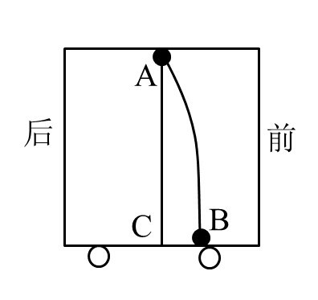

A. 向前的匀速直线运动

B. 向后的匀速直线运动

C. 向前的加速直线运动

D. 向前的减速直线运动

第 27 题 · 答案与解析

**参考答案（粉笔题库参考内容）**

D

**解析**

由于空气的阻力可忽略不计，当车子作匀速直线运动时，水滴也会由于惯性而随之运动，此时会落到正下方的C点。车子作向前的减速直线运动时，水滴由于惯性保持了比车减速后更快的运动速度，故会落到A点正下方的前方。

故正确答案为D。

**来源**：2011年上海市公务员录用考试《行测》题（A类）第27题

### 第 28 题

铁棒在磁场中会被磁化，成为一根条形磁铁；磁场消失铁棒又恢复原状，没有磁性。将铁棒放在螺线管左端的管口，不计一切摩擦，先后闭合、断开电键K，则铁棒的运动情况是：

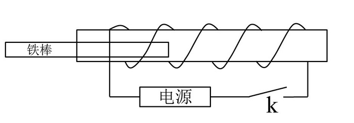

A. 闭合电键时铁棒被吸入螺线管内，断开电键铁棒不动

B. 闭合电键时铁棒被吸入螺线管内，断开电键铁棒被推回原处

C. 闭合电键时铁棒被吸入螺线管内，断开电键铁棒被推到右端

D. 闭合电键时铁棒被推出螺线管，断开电键铁棒被吸入螺线管内

第 28 题 · 答案与解析

**参考答案（粉笔题库参考内容）**

A

**解析**

闭合电键时，螺线管产生磁场，铁棒被吸引，并被吸入螺线管内。当铁棒吸入螺线管正中间时，受力达到平衡，因此铁棒会在螺线管内部往复运动直至在中间停止，平衡时若断开电键，则铁棒不动。

故正确答案为A。

**来源**：2011年上海市公务员录用考试《行测》题（A类）第28题

### 第 29 题

凸透镜有会聚光线的作用，凹透镜有发散光线的作用。要使一束平行的细光束通过透镜变为一束平行的粗光束，可以采用的方法是：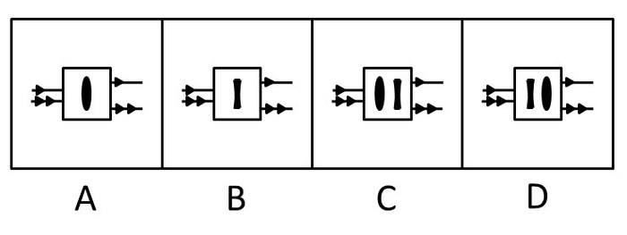

A. A

B. B

C. C

D. D

第 29 题 · 答案与解析

**参考答案（粉笔题库参考内容）**

D

**解析**

凹透镜对光线有发散作用，凸透镜对光线有会聚作用。要使一束平行的细光束通过透镜变为一束平行的粗光束，应让凹透镜在凸透镜的左侧，并且凹透镜与凸透镜的焦点重合。这是因为平行光线从左向右先进入凹透镜出射光线变为发散光，其反向延长线交于凹透镜同侧的焦点F1（左）。将凸透镜放在凹透镜右侧，使凸透镜的焦点F2和F1重合。从凹透镜射出的发散光束进入凸透镜，这束光线好像是从自己左边的焦点射出的光线，经凸透镜折射后变为平行光束。

故正确答案为D。

**来源**：2011年上海市公务员录用考试《行测》题（A类）第29题

### 第 30 题

从周边环境与居住舒适度的角度出发，下图所示的城市规划模式中，最合理的是：

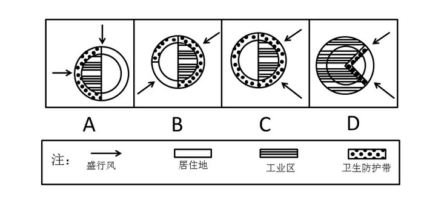

A. A

B. B

C. C

D. D

第 30 题 · 答案与解析

**参考答案（粉笔题库参考内容）**

D

**解析**

A、B、C三个选项中，无论哪一种都有盛行风从工业区吹向生活区，且卫生防护带都没有将工业区与生活区隔开，规划不合理；

D项中，盛行风是从生活区吹向工业区的，且有卫生防护带隔离，符合合理的城市规划模式。

故正确答案为D。

**来源**：2011年上海市公务员录用考试《行测》题（A类）第30题

### 第 31 题

二次创作指使用了已存在著作物的文字、图像、影片、音乐或其他艺术作品进行再次创作。二次创作并不是把别人的作品剽窃成自己的，而是明显地以某作品作为基调来改编、仿作或加以发展。

根据上述定义，下面属于二次创作的是：

A. 把已经发表的文章结集出版

B. 为某部经典小说写续篇

C. 把别人的文章改动一些文字后重新发表

D. 把老照片翻拍成数字版本加以保存

第 31 题 · 答案与解析

**参考答案（粉笔题库参考内容）**

B

**解析**

第一步：抓住定义中的关键词。

该定义中的关键词为“再次创作”，“以某作品作为基调来改编、仿作或加以发展”。

第二步：逐一判断选项。

A项结集只是整合作品，没有进行再次创作，不符合定义；

B项为某部经典小说写续篇，是在原小说的基础上再次创作，加以发展，符合定义；

C项只是字面上的改动，没有加以改编、仿作或加以发展，不符合定义；

D项只是技术上的更新，同样不属于再次创作。

故正确答案为B。

**考点**：方式目的

**来源**：2011年上海市公务员录用考试《行测》题（A类）第31题

### 第 32 题

城市群指在特定的区域范围内聚集相当数量的不同性质、类型和等级规模的城市，以一个或两个特大城市为中心，依托一定的自然环境和交通条件，城市之间的内在联系不断加强，共同构成一个相对完整的城市“集合体”。

根据上述定义，下面属于城市群的是：

A. 浙江省

B. 华东六省一市

C. 长三角经济区

D. 港澳台地区

第 32 题 · 答案与解析

**参考答案（粉笔题库参考内容）**

C

**解析**

第一步：抓住定义中的关键词。

该定义中强调“聚集相当数量的不同性质、类型和等级规模的城市”、“以一个或两个特大城市为中心”、“内在联系”、“构成一个相对完整的城市‘集合体’”。

第二步：逐一判断选项。

A项，浙江省是一个单独的省份，不是城市的集合体，不符合定义；

B项，华东六省一市只是地理区域上的集合体，并没有构成一个相对完整的城市“集合体”，不符合定义；

C项，长三角经济区是以上海为中心，连同江苏省8个城市和浙江省7个城市，构成一个内在联系紧密的经济区域，符合定义；

D项，港澳台地区是香港特别行政区、澳门特别行政区和台湾省的统称，只是政治上的称谓，三者相对独立，没有以哪个为中心，也没有突出不断加强的“内在联系”，不符合定义。

故正确答案为C。

**考点**：单定义-其他句式

**来源**：2011年上海市公务员录用考试《行测》题（A类）第32题

### 第 33 题

蒸发散热指体液的水分在皮肤和粘膜（主要是呼吸道粘膜）表面由液态转化为气态，同时带走大量热量的一种散热方式。

根据上述定义，下面属于蒸发散热的是：

A. 发高烧时用酒精擦拭身体

B. 天热游泳避暑

C. 夏天用冰块降温

D. 酷暑天大汗淋漓

第 33 题 · 答案与解析

**参考答案（粉笔题库参考内容）**

D

**解析**

第一步：找出定义关键词。

“体液的水分”、“在皮肤和粘膜（主要是呼吸道粘膜）表面由液态转化为气态”、“带走大量热量”。

第二步：逐一分析选项。

A项：用酒精擦拭身体后，是通过酒精挥发带走皮肤表面的热量，不是体液水分由液态转化为气态带走热量，不符合定义，排除；

B项：通过接触其他低温的物体来降温，不是体液的蒸发，不符合定义，排除；

C项：通过接触其他低温的物体来降温，不是体液的蒸发，不符合定义，排除；

D项：酷暑出汗由于酷暑温度过高，人体皮肤汗腺分泌体液进行排汗，汗水在皮肤表面由液态转化为气态时，能带走皮肤表面的热量，起到散热降温的作用，符合定义，当选。

故正确答案为D。

**考点**：单定义-其他句式

**来源**：2011年上海市公务员录用考试《行测》题（A类）第33题

### 第 34 题

文化集丛指功能上互相整合的一组文化特质，它存在于一定的时空之中并作为一个文化单位发挥功用。文化集丛通常是以某一个文化特质为中心，结合一些在功能上有连带关系的特质而组成的，其中每个特质都围绕中心特质而对整体发挥功用。

根据上述定义，下面属于文化集丛的是：

A. 以中华文化为中心，包括日本文化、朝鲜文化、越南文化等在内的东亚文化

B. 以唐代服饰为中心，包括汉代服饰、宋代服饰、明代服饰等在内的服饰文化

C. 以茶为中心，包括采茶、制茶、饮茶等一系列文化活动在内的茶文化

D. 以汉文化为中心，包括各少数民族文化在内的中华文化

第 34 题 · 答案与解析

**参考答案（粉笔题库参考内容）**

C

**解析**

第一步：找出定义关键词。

“功能上互相整合”、“作为一个文化单位发挥功用”、“以某一个文化特质为中心”、“结合一些在功能上有连带关系的特质”、“围绕中心特质对整体发挥功用”。

第二步：逐一分析选项。

A项：“东亚文化”只是对东南亚地区各国家的文化的统称，没有作为一个文化单位发挥功用，各个文化是相互独立的，没有实现功能上的相互整合，不符合定义，排除；

B项：服饰文化体现的是纵向发展的过程，并没有在一定的时空中作为一个文化单位发挥功用，不符合定义，排除；

C项：采茶、制茶、饮茶等文化活动，均是以茶这一文化特质为中心的，符合“以某一个文化特质为中心”，而且这些文化活动功能各不相同，符合“结合一些在功能上有连带关系的特质”，这些文化都能对茶文化发挥功用，符合“围绕中心特质对整体发挥功用”，符合定义，当选；

D项：汉文化与少数民族文化是按照民族类型整合，不符合“功能上互相整合”，且汉文化和少数民族文化属于相互促进相互影响的关系，并不是围绕汉文化而对整体发挥功用，不符合定义，排除。

故正确答案为C。

**考点**：单定义-其他句式

**来源**：2011年上海市公务员录用考试《行测》题（A类）第34题

### 第 35 题

补偿性工资差距指不同工作的非货币特性所引起的工资差别。

根据上述定义，下列选项中，与补偿性工资无关的是：

A. 某市电力系统抄表工的年收入高于该市人均工资，高工资用于补偿员工在工作过程中消耗的体力与脑力劳动

B. 煤矿工人得到的工资高于其他有相似受教育水平的工人，高工资是用来补偿采煤的枯燥和危险性，及煤矿工人所面临的长期健康问题

C. 教授的工资低于受教育时间大致相同的律师和医生，低工资可以由工作所带来的学术与个人满足而得到补偿

D. 工厂中的夜班工人的工资高于白班工人，高工资用于补偿他们不得不在夜里工作而在白天睡觉对身体带来的不利影响

第 35 题 · 答案与解析

**参考答案（粉笔题库参考内容）**

C

**解析**

第一步：抓住定义中的关键词。

提问句问的是“补偿性工资”，从题干给出的是“补偿性工资差距”的定义可知，补偿性工资指的是不同工作的非货币特性带来的工资。该定义中强调“非货币特性”。

第二步：逐一判断选项。

A项中的高工资补偿的是抄表工在工作中付出更多的体力和脑力；

B项补偿的是矿工采煤的枯燥和危险性，以及对身体的伤害；

D项补偿的是夜班工人夜间工作白天睡觉对身体的不利影响；

C项中“由工作所带来的学术与个人满足而得到补偿”与工资无关，明显不符合定义。

A、B、D三项都是对不同工作中的非货币特性可能带来的不利影响做出的补偿，符合定义。

本题为选非题，故正确答案为C。

**考点**：原因结果

**来源**：2011年上海市公务员录用考试《行测》题（A类）第35题

### 第 36 题

下列选项中，符合所给图形的变化规律的是：

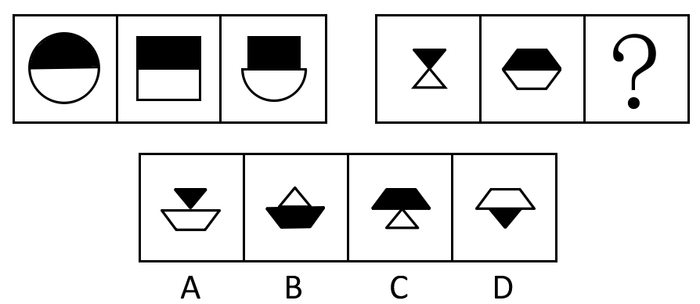

A. A

B. B

C. C

D. D

第 36 题 · 答案与解析

**参考答案（粉笔题库参考内容）**

C

**解析**

元素组成相似，考查元素叠加。左侧三个图形中，第三个图形的下半部分和第一个图形的下半部分相同，上半部分和第二个图形的上半部分相同。依此规律，右侧三个图形中，第三个图形的下半部分应该和第一个图形的下半部分相同，即不加阴影的白色三角形，上半部分和第二个图形的上半部分相同，即加黑色阴影的梯形。C项图形符合这一规律。

故正确答案为C。

**考点**：样式规律-加减同异

**来源**：2011年上海市公务员录用考试《行测》题（A类）第36题

### 第 37 题

下列选项中，符合所给图形的变化规律的是：

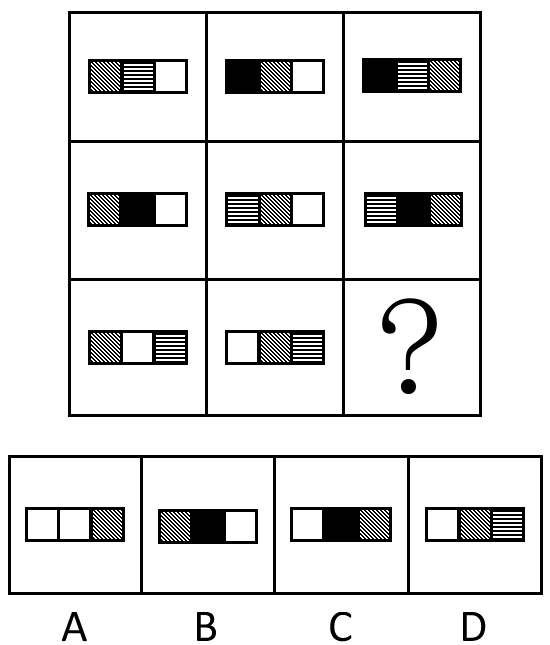

A. A

B. B

C. C

D. D

第 37 题 · 答案与解析

**参考答案（粉笔题库参考内容）**

A

**解析**

元素组成相似，位置不同，考查位置。九宫格图中，以行为单位，第一行和第二行中，第三个图形的左边部分与第二个图形的左边部分相同，中间部分与第一个图形的中间部分相同，右边部分与第一个图形的左边部分、第二个图形的中间部分相同。依此规律，从第三行的两个已知图形中可推知，未知图形的左边部分应该是白色方块，中间部分也为白色方块，右边部分为带斜线的方块，即选项A的图形。

故正确答案为A。

**考点**：样式规律-遍历

**来源**：2011年上海市公务员录用考试《行测》题（A类）第37题

### 第 38 题

下列选项中，符合所给图形的变化规律的是：

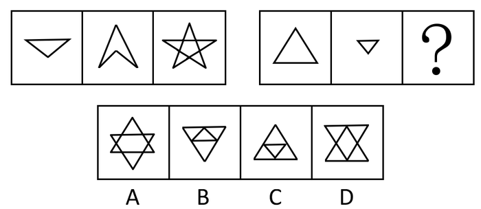

A. A

B. B

C. C

D. D

第 38 题 · 答案与解析

**参考答案（粉笔题库参考内容）**

C

**解析**

元素组成相似，考查元素叠加。第一组图形中，前两个图形保持大小、方向、位置不变，叠加得出第三个图形。依此规律，第二组图形中的未知图形是由前两个图形同样保持大小、方向、位置不变，叠加得出的。四个选项中，只有C项的图形符合这一规律。

故正确答案为C。

**考点**：样式规律-加减同异

**来源**：2011年上海市公务员录用考试《行测》题（A类）第38题

### 第 39 题

下图右侧的4个图形中，除了（  ），都是左侧立体物体的投影图。

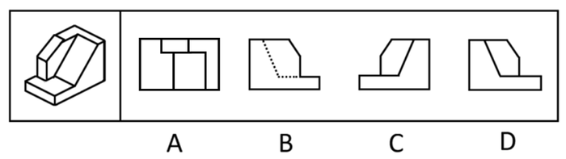

A. A

B. B

C. C

D. D

第 39 题 · 答案与解析

**参考答案（粉笔题库参考内容）**

D

**解析**

本题考查三视图。

A项是左侧立体物体的俯视图；C项是左侧立体物体的侧视图；B、D两项的外形一致，区别在于图形内一个为虚线、一个为实线，两者中有一项是错的。从有凸起的一侧绘制立体物体的侧视图，凹处的线条是看不到的，因此只能用虚线表示，不能用实线绘制，因此B项的图形正确，D项图形错误。

本题为选非题，故正确答案为D。

**考点**：空间类-三视图

**来源**：2011年上海市公务员录用考试《行测》题（A类）第39题

### 第 40 题

下列选项中，符合所给图形的变化规律的是：

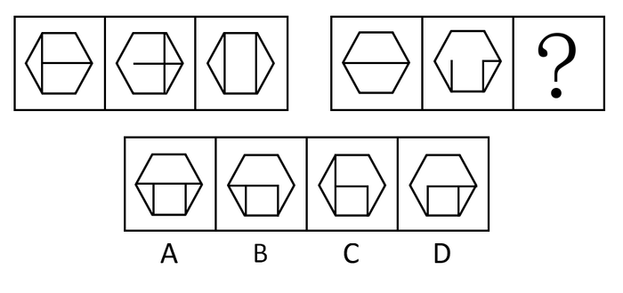

A. A

B. B

C. C

D. D

第 40 题 · 答案与解析

**参考答案（粉笔题库参考内容）**

B

**解析**

元素组成相似，优先考虑样式规律，且相同线条重复出现，故考虑样式规律中的加减同异。第一组图形中图1和图2的内部线条求异得到图3，第二组遵循相同的规律，故问号处图形应由图1和图2内部线条求异得到，对应B项。

故正确答案为B。

**考点**：样式规律-加减同异

**来源**：2011年上海市公务员录用考试《行测》题（A类）第40题

### 第 41 题

根据①与②之间的关系，③与下列（  ）图具有同样的逻辑关系。

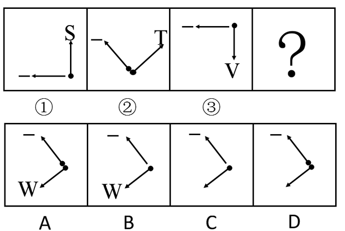

A. A

B. B

C. C

D. D

第 41 题 · 答案与解析

**参考答案（粉笔题库参考内容）**

A

**解析**

元素组成相似，位置不同，考查位置规律和数量规律。先分析图形①与②之间的关系。先看指针方向，图形②的指针方向是图形①的两个指针都顺时针旋转45度后形成的；再看字母，图形①、②中的字母分别为S、T，在字母表里是相邻字母；再看黑点，图形①只有一个黑点，图形②有两个黑点。根据这三个规律，可知A项图形符合条件，两个指针方向都是图形③顺时针旋转45度形成的，字母W在字母表里和字母V相邻，A项图形中有两个黑点。

故正确答案为A。

**考点**：数量规律-复合

**来源**：2011年上海市公务员录用考试《行测》题（A类）第41题

### 第 42 题

下列选项中，符合所给图形的变化规律的是：

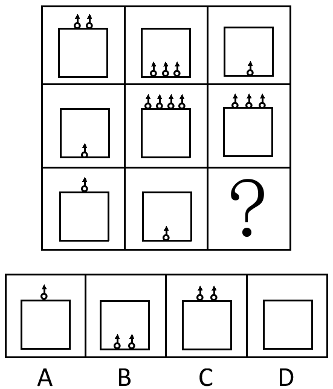

A. A

B. B

C. C

D. D

第 42 题 · 答案与解析

**参考答案（粉笔题库参考内容）**

D

**解析**

元素组成相似，数量不同，考查数数。九宫格图中，以行为单位，第一行和第二行中，第三个图形中的箭头数量，分别是前两个图形的箭头数作差得出的， 即3减去2等于1，4减去1等于3。依此规律，第三行中，第三个图形的箭头数量应该是1减去1得出的数量，即0个。可知D项的图形符合。

故正确答案为D。

**考点**：数量规律-素

**来源**：2011年上海市公务员录用考试《行测》题（A类）第42题

### 第 43 题

将左图折叠成一个立方体，得到的图形是：

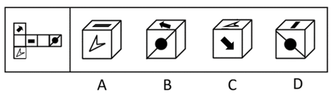

A. A

B. B

C. C

D. D

第 43 题 · 答案与解析

**参考答案（粉笔题库参考内容）**

B

**解析**

本题考查折纸盒。

A项图形错在折叠后箭头的方向应该指向右下方；根据相对面不能相邻的规则，带有箭头的两面不能相邻，带有方块和带有圆形的两面不能相邻，排除C、D两项。

故正确答案为B。

**考点**：空间类-空间重构-六面体

**来源**：2011年上海市公务员录用考试《行测》题（A类）第43题

### 第 44 题

下列选项中，符合所给图形的变化规律的是：

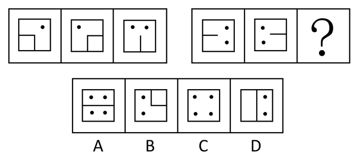

A. A

B. B

C. C

D. D

第 44 题 · 答案与解析

**参考答案（粉笔题库参考内容）**

C

**解析**

组成元素相似，考查元素的叠加。本题目需要注意细节部分，点和线段分开来看。点是相加，线段为求同。第一组图中，前两个图形叠加后，保留小黑点，图形内部直线去异存同，得到第三个图形。依此规律，第二组图中，前两个图形叠加后，保留小黑点，图形内部直线去异存同，得到的图形为C项所示。

故正确答案为C。

**考点**：样式规律-加减同异

**来源**：2011年上海市公务员录用考试《行测》题（A类）第44题

### 第 45 题

将左侧的基本图形绕Z轴顺时针旋转90度后，得到的图形是：

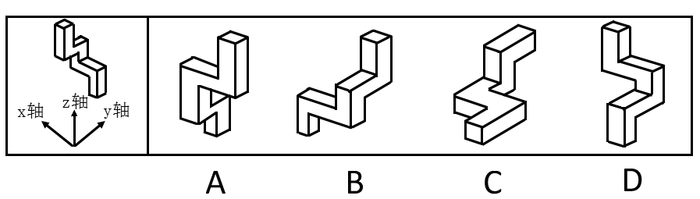

A. A

B. B

C. C

D. D

第 45 题 · 答案与解析

**参考答案（粉笔题库参考内容）**

D

**解析**

本题考查立体图形的位置变换——旋转。Z轴为中间的轴，是与平面垂直的竖轴，将基本图形绕中间的轴顺时针旋转90度后，得到的应该是D项的图形。

故正确答案为D。

**考点**：位置规律-旋转

**来源**：2011年上海市公务员录用考试《行测》题（A类）第45题

### 第 46 题

短跑决赛中，前三名甲、乙、丙是A、B、C队的选手。已知：

①A队选手的成绩比B队选手的成绩好

②C队选手的成绩比乙差

③C队选手的成绩比丙好

根据上述条件，下列选项中，（  ）项肯定为真。

A. 甲、乙、丙依次为C队、B队和A队选手

B. C队选手是冠军，A队选手是亚军，B队选手是季军

C. 甲、乙、丙依次为C队、A队和B队选手

D. A队选手是冠军，B队选手是亚军，C队选手是季军

第 46 题 · 答案与解析

**参考答案（粉笔题库参考内容）**

C

**解析**

第一步：找突破口。

本题突破口为信息量最大对象，即C队选手。由“C队选手的成绩比乙差”知，C队选手不是乙，由“C对选手的成绩比丙好”知，C队选手不是丙，因此C队选手是甲。

第二步：抄信息于表中，即将题干和第一步的所有信息放在一个表中。

选手：               C队选手

                    ＜                  ＜

成绩： 丙             甲               乙

第三步：填空，即填上每个集合的空格。

选手：（B队选手）    C队选手     （A队选手）

                    ＜               ＜

成绩：  丙            甲             乙

由此可知，甲、乙、丙依次为C队、A队、B队选手，冠、亚、季军依次为A队选手、C队选手、B队选手。

故正确答案为C。

**考点**：从最大信息开始推

**来源**：2011年上海市公务员录用考试《行测》题（A类）第46题

### 第 47 题

喜欢一个人，是一种感觉；不喜欢一个人，却是事实。事实容易解释，感觉却难以言喻。

从这段话可以推知：

A. 喜欢或不喜欢一个人都是说不清道不明的

B. 喜欢或不喜欢一个人都属于非理性的感觉

C. 不喜欢一个人是不需要任何理由的

D. 喜欢一个人是说不清楚缘由的

第 47 题 · 答案与解析

**参考答案（粉笔题库参考内容）**

D

**解析**

第一步：抓住题干主要信息。

题干说的是喜欢或不喜欢一个人分别意味着什么。喜欢一个人是一种感觉，感觉难以言喻；不喜欢一个人是事实，事实容易解释。

第二步：分析题干信息，结合选项得出答案。

A、B两项错在把喜欢或不喜欢一个人混为一谈，故排除；

C、D两项由题干信息可知，喜欢一个人是难以言喻的，也就是说不清楚缘由的，而不喜欢一个人是容易解释的，也就是有理由的，因此C项错误，D项正确。

故正确答案为D。

**考点**：日常结论

**来源**：2011年上海市公务员录用考试《行测》题（A类）第47题

### 第 48 题

售货员：“显像管是任何一台电视机的核心元件。P品牌电视机与T品牌电视机使用的是相同质量的显像管。但P品牌电视机的售价较低，所以当你购买P品牌电视机而非T品牌电视机时，就等于付了更低的价钱却买了相同图像质量的电视机。”

下列哪项如果正确，将最有力地支持售货员做出的结论：

A. 电视机的图像质量仅仅由其显像管的质量决定

B. P品牌电视机和T品牌电视机是在同一个工厂组装的

C. 售货员销售P品牌电视机赚的钱少于销售T品牌电视机赚的钱

D. 每天P品牌电视机比T品牌电视机销售得多

第 48 题 · 答案与解析

**参考答案（粉笔题库参考内容）**

A

**解析**

第一步：找出论点和论据。

论点：P品牌电视机的售价较低，所以当你购买P品牌电视机而非T品牌电视机时，就等于付了更低的价钱却买了相同图像质量的电视机。

论据：P品牌电视机与T品牌电视机使用的是相同质量的显像管而P品牌电视机的售价较低。

第二步：判断加强方式。

论点强调相同图像质量的电视机，论据强调相同质量的显像管，论点和论据的对象不同，须加强论证，在相同图像质量的电视机和相同质量的显像管之间建立联系。

第三步：逐一判断选项。

A项正确，当电视机的图像质量仅仅由其显像管的质量决定时，相同质量的显像管能保证电视机拥有相同图像质量，有力地支持论点；

B项，电视机的图像质量是由技术决定的，组装工厂只负责组装，跟图像质量没有直接关系，无法支持结论；

C、D两项分别说的是售货员的销售利润和电视的销售量，无法直接说明图像质量的问题。

故正确答案为A。

**考点**：搭桥

**来源**：2011年上海市公务员录用考试《行测》题（A类）第48题

### 第 49 题

虽然世界市场上供应的一部分象牙来自被非法捕杀的野生大象，但还有一部分是来自几乎所有国家都认为合法的渠道，如自然死亡的大象。因此，当人们在批发市场上尽力限制自己只购买这种合法的象牙时，世界上仅存的少量野生大象便不会受到威胁。

以上的论证依据了这样的假设，即：

A. 试图将购买限于合法象牙的批发商能够可靠地区分合法象牙与非法象牙

B. 在不久的将来，对于合法象牙产品的需求会持续增长

C. 目前世界上合法象牙的批发来源远远少于非法象牙的批发来源

D. 象牙的批发商总是意识不到世界象牙供应减少的原因

第 49 题 · 答案与解析

**参考答案（粉笔题库参考内容）**

A

**解析**

第一步：找出论点和论据。

论点：世界上仅存的少量野生大象便不会受到威胁。

论据：人们在批发市场上尽力限制自己只购买这种合法的象牙。

第二步：判断加强方式。

本题论点和论据间存在因果关系，所以需加强论点。

第三步：逐一判断选项的作用。

A项，批发商能够区分合法象牙与非法象牙，就能保证人们买到的“合法的象牙”确实是来自合法渠道，这样一来非法象牙就会失去市场，从而保护野生大象免于非法捕杀，加强了论点；

B项只是一种预测，无法作为前提假设；

C项说明购买合法象牙的难度大，削弱论点；

D项没有说明象牙合法与非法的问题，属于无关选项。

故正确答案为A。

**考点**：必要条件

**来源**：2011年上海市公务员录用考试《行测》题（A类）第49题

### 第 50 题

已知有6个球，3个是木球，3个是皮球。其中，5个球沾有红色颜料，4个球沾有蓝色颜料。

则下列说法中，有可能正确的一项是：

A. 两个皮球沾有蓝色颜料但都没有沾红色颜料

B. 三个沾有红色颜料的木球都没有沾蓝色颜料

C. 两个木球沾有红色颜料但都没有沾蓝色颜料

D. 三个沾有蓝色颜料的木球中只有一个沾有红色颜料

第 50 题 · 答案与解析

**参考答案（粉笔题库参考内容）**

C

**解析**

第一步：整理题干信息。

由6个球中，5个球沾有红色颜料，4个球沾有蓝色颜料可知，有1个球没有沾有红色颜料，2个球没有沾有蓝色颜料。

第二步：逐一判断选项。

A项，由题干整理出来的信息可知，有两个皮球没沾红色颜料，错误；

B项，有三个球没有沾蓝色颜料，错误；

C项，两个木球没沾蓝色颜料，只要剩下的球都沾有蓝色颜料，这个判断就可能正确；

D项，三个沾有蓝色颜料的木球只有一个沾有红色颜料，也就是有两个没沾红色颜料，与题干信息不符，错误。

故正确答案为C。

**考点**：代入法

**来源**：2011年上海市公务员录用考试《行测》题（A类）第50题

### 第 51 题

现在燃烧化石燃料释放到大气中的大量二氧化碳实际上不会导致温室效应——即全球平均温度的上升。因为如果二氧化碳的供应量上升，植物就会更大量地消耗该气体，所以它们会长得更高大，繁殖得更茂盛，那么大气中二氧化碳的浓度终将保持稳定。

下面哪项如果正确，将最严重地削弱这一结论，即目前释放到大气中的大量二氧化碳不会引起温室效应：

A. 当大气中二氧化碳的浓度上升时，海水就会更多地吸收二氧化碳

B. 植物腐烂时会产生甲烷，这是另一种能显著地引起温室效应的气体

C. 从工业革命开始时起，大气中二氧化碳浓度的上升引起了农业生产率的提高

D. 二氧化碳含量在地球的历史中多次上升或下降的事实说明有一些能逆转温室效应的生物作用

第 51 题 · 答案与解析

**参考答案（粉笔题库参考内容）**

B

**解析**

第一步：找出论点和论据。

论点：目前释放到大气中的大量二氧化碳不会引起温室效应。

论据：因为如果二氧化碳的供应量上升，植物就会更大量地消耗该气体，所以它们会长得更高大，繁殖得更茂盛，那么大气中二氧化碳的浓度终将保持稳定。

第二步：判断削弱方式。

本题论点和论据存在因果关系，所以需要削弱论点。

第三步：逐一判断选项。

A项加强论点，海水吸收二氧化碳能够降低大气中二氧化碳的浓度；

B项削弱论点，植物消耗二氧化碳长得更茂盛，但植物都会有腐烂的时候，腐烂时产生的甲烷会引起温室效应，说明虽然二氧化碳的浓度保持稳定了，但是能引起温室效应气体的浓度并没有改变；

C项跟温室效应无关；

D项说的是二氧化碳的历史数据，不能直接否定“目前释放到大气中的大量二氧化碳不会引起温室效应”的问题。

故正确答案为B。

**考点**：削弱论点

**来源**：2011年上海市公务员录用考试《行测》题（A类）第51题

### 第 52 题

某科学家用四种原料制造一种新药，他可以在稳定性化学成分A、B、C、D和不稳定性化学成分W、X、Y、Z中选择。为了防止发生剧烈反应，必须在配方中使用两种稳定性成分，同时下列一些成分由于互相之间有剧烈反应而不能合在一起使用：

①B不能和W合用

②C不能和Y合用

③Y不能和Z合用

假如因B可能产生较大的副作用而决定不用，且配方中必须含有Z，则下面哪个组合是可能的配方：

A. A+W+X+Z

B. A+X+Y+Z

C. A+W+Y+Z

D. A+C+W+Z

第 52 题 · 答案与解析

**参考答案（粉笔题库参考内容）**

D

**解析**

第一步：整理题干信息。

已知信息：

稳定性成分：A、B、C、D；不稳定性成分：W、X、Y、Z；B不能和W合用；C不能和Y合用；Y不能和Z合用。

配方要求：

配方必须使用两种稳定性的成分；B决定不用；配方中必须含有Z。

第二步：结合题干信息判断正确选项。

由“Y不能和Z合用”和“配方中必须含有Z”可知，配方中不用Y，排除B、C两项；

由“稳定性成分：A、B、C、D”和“配方必须使用两种稳定性的成分”可知，配方中至少含A、B、C、D四种成分中的任两种，A项错误；

D项，“A＋C＋W＋Z”符合题干要求，当选。

故正确答案为D。

**考点**：排除法

**来源**：2011年上海市公务员录用考试《行测》题（A类）第52题

### 第 53 题

A公司从那些由于经常乘坐B航空公司的飞机而得到B航空公司奖励票券的人们那里买来了一些免费旅行票券，将这些票券以低于从B航空公司购买机票的价格向人们出售。这种票券的市场交易导致了B航空公司的收入损失。

为抑制这种免费旅行票券的买卖行为，对B航空公司来说最好的做法是限定：

A. 票券的使用者只能是那些被奖励了票券的人

B. 某一年里一个人被奖励的票券的数量

C. 旅行者使用票券旅行的路线的数量

D. 票券发行后可以被使用的时间

第 53 题 · 答案与解析

**参考答案（粉笔题库参考内容）**

A

**解析**

第一步：抓住题干主要信息。

第一句：A公司从获得B航空公司奖励票券的人们那里购买免费旅行票券，并以低于从B航空公司购买机票的价格出售；第二句：A公司的票券交易使B航空公司受到损失。

第二步：分析题干信息，结合选项得出答案。

由题干可知，是A公司的票券交易使B航空公司受到损失，只要限定旅游票券只供被奖励的人使用，票券买卖就失去意义，这样就能保证B航空公司的利益，即A项的做法是正确的；

B、C、D三项只是对奖励票券加以限制，不影响其他人使用奖励票券，所以无法抑制票券买卖交易。

故正确答案为A。

**考点**：日常结论

**来源**：2011年上海市公务员录用考试《行测》题（A类）第53题

### 第 54 题

蛋白质药品，如胰岛素，仍然必须通过繁琐的皮下注射程序来予以实施。如果蛋白质药品被口服，它们就会被消化而不能到达目标细胞。但是，有些非蛋白质药品含有不会被消化系统分解的化学键。

以上的论述最强烈地支持了这样的论断，即一项成功实现下面哪个目标的研究可使蛋白质药品的使用者受益：

A. 把消化系统里面消化蛋白质的物质永久清除掉

B. 确定每一种非蛋白质药品到达其目标细胞所需的时间

C. 将胰岛素包上一种能被目标细胞分解、但其化学键不会被消化的混合物

D. 以系统的方法来确定正常消化系统中存在着哪些酶和细菌

第 54 题 · 答案与解析

**参考答案（粉笔题库参考内容）**

C

**解析**

第一步：抓住题干主要信息。

第一句说蛋白质药品仍需通过皮下注射程序来实施，但注射程序繁琐；第二句说蛋白质药品被口服，会被消化而达不到治疗目的；第三句话说有些非蛋白质药品含有不被消化系统分解的化学键。

第二步：分析题干信息，结合选项得出答案。

A项的做法显然不合常理；

B项与题意不符，题目问的是使蛋白质药品的使用者受益，研究的对象应该跟蛋白质药品有关；

C项从题干可知，能使蛋白质药品使用者受益的是能够口服蛋白质药品，但口服蛋白质药品得先解决蛋白质药品会被消化无法到达目标细胞的问题，已知非蛋白质药品有不被消化的化学键，因此只要研究出一种被目标细胞分解、但其化学键不会被消化的混合物，包在蛋白质药品上，就能使药品安全到达目标细胞；

D项，确定消化系统中包含的酶和细菌也无法保证蛋白质药品能够到达目标细胞。

A、B、D三项均无法解决蛋白质药品口服被消化的问题，只有进行C项的研究才能做到。

故正确答案为C。

**来源**：2011年上海市公务员录用考试《行测》题（A类）第54题

### 第 55 题

某市宣传部举办为期一周的专题讲座，讲座时间是周一到周六，一共有四个专题，分别是：宏观政策、社情调查、网络办公以及文化传播。已知一天只能安排一个专题讲座，再加上要考虑教师的时间安排，此次讲座在总体上必须满足以下条件：

（1）每个专题至少进行一次；

（2）每个专题不能连续进行两次；

（3）宏观政策专题不能放在周二进行；

（4）文化传播专题或者放在周三或者放在周五，也可能这两天都是文化传播专题；

（5）社情调查专题放在周二时，文化传播专题就不放在周五。

根据这样的要求，从周一到周六的讲座专题可以排列为：

A. 宏观政策、社情调查、文化传播、网络办公、宏观政策、宏观政策

B. 宏观政策、网络办公、社情调查、文化传播、网络办公、社情调查

C. 宏观政策、社情调查、文化传播、网络办公、文化传播、宏观政策

D. 网络办公、社情调查、文化传播、宏观政策、网络办公、宏观政策

第 55 题 · 答案与解析

**参考答案（粉笔题库参考内容）**

D

**解析**

本题四个选项均是完整排列，因此可以使用排除法解答，逐一判断选项是否满足题干所提的条件。

A项中“宏观政策”连续安排在周五、周六，不满足条件（2），排除；

B项中周三安排的是“社情调查”，周五安排的是“网络办公”，不满足条件（4），排除；

C项周二安排的是“社情调查”，周五安排的是“文化传播”，不满足条件（5），排除；

D项满足题干所提的所有条件。

故正确答案为D。

**考点**：排除法

**来源**：2011年上海市公务员录用考试《行测》题（A类）第55题

### 第 56 题

甲、乙两厂生产同一种玩具，甲厂生产的玩具数量每个月保持不变，乙厂生产的玩具数量每个月增加一倍。已知今年1月份甲、乙两厂生产的玩具的总数是98件，2月份甲、乙两厂生产的玩具的总数是106件，那么乙厂今年生产的玩具数量总和第一次超过甲厂生产的玩具数量总和是在几月份：

A. 7

B. 8

C. 9

D. 10

第 56 题 · 答案与解析

**参考答案（粉笔题库参考内容）**

A

**解析**

比较甲乙两厂在1月份、2月份的差异可知1月份乙厂的生产数量为106-98=8件，故1月份甲厂生产90件。设在第N月份首次超过，而到第N月甲厂的总和为90N，乙厂数量为，因此，代入选项验证可知N=7时不等式就成立。

故正确答案为A。

**考点**：数列问题

**来源**：2011年上海市公务员录用考试《行测》题（A类）第56题

### 第 57 题

某航运公司年初用120万元购进一艘运输船。投入运输后，每一年的总收入为72万元，需要支出的各种费用为40万元。若该船运输满15年要报废，报废时旧船卖出可收回20万元，则这15年的平均盈利额约为多少万元：

A. 19.4

B. 24.1

C. 25.3

D. 33.3

第 57 题 · 答案与解析

**参考答案（粉笔题库参考内容）**

C

**解析**

平均盈利额为万元。

故正确答案为C。

**考点**：经济利润问题

**来源**：2011年上海市公务员录用考试《行测》题（A类）第57题

### 第 58 题

某旅行社对学生团体旅游提出如下优惠方案：每人享受八二折（即原价的82%）优惠，且如果人数多于5人，则有1人可全部免费，但不得分成多个旅游团。现有一个9名学生的旅游团参加该旅行社组织的旅游团组，则人均费用大约优惠了百分之多少：

A. 25.1

B. 26.2

C. 27.1

D. 28.6

第 58 题 · 答案与解析

**参考答案（粉笔题库参考内容）**

C

**解析**

假定原价每人100元，9人旅游团实际付费为8×82＝656元，因此优惠为。

故正确答案为C。

**考点**：经济利润问题

**来源**：2011年上海市公务员录用考试《行测》题（A类）第58题

### 第 59 题

某超市用2500元购进一批鸡蛋，销售过程中损耗鸡蛋10千克。已知超市每千克鸡蛋的售价比进价高1元，全部售完后共赚440元，则共购进这批鸡蛋多少千克：

A. 460

B. 500

C. 590

D. 610

第 59 题 · 答案与解析

**参考答案（粉笔题库参考内容）**

B

**解析**

假定每千克鸡蛋的进价为x，而全部售完共赚440元，每千克只赚一元钱，因此实际售出鸡蛋千克数为440＋10x千克，加上损耗的10千克，共计450＋10x千克。由题意：(450＋10x)x＝2500，解得x＝5。因此共购进鸡蛋为2500÷5＝500千克。

故正确答案为B。

**考点**：经济利润问题

**来源**：2011年上海市公务员录用考试《行测》题（A类）第59题

### 第 60 题

一水果贩将桔子堆成长方形垛（下图表示长方形垛的垒法），若最底层长边有10个桔子，短边有5个桔子，则此长方形垛最多可以放多少个桔子：

A. 110

B. 120

C. 130

D. 140

第 60 题 · 答案与解析

**参考答案（粉笔题库参考内容）**

C

**解析**

容易得到第一层有10×5＝50个；第二层比第一层各边长均少1，有9×4＝36个；类似地，第三层有8×3＝24个，第四层有7×2＝14个，第五层有6×1＝6个。共计有桔子50＋36＋24＋14＋6＝130个。

故正确答案为C。

**来源**：2011年上海市公务员录用考试《行测》题（A类）第60题

### 第 61 题

某人共收集邮票若干张，其中1/4是2007年以前的国内外发行的邮票，1/8是2008年国内发行的，1/19是2009年国内发行的，此外尚有不足100张的国外邮票。

则该人共有多少张邮票：

A. 87

B. 127

C. 152

D. 239

第 61 题 · 答案与解析

**参考答案（粉笔题库参考内容）**

C

**解析**

由题意可知总数能够被4、8和19整除，仅C项符合。

故正确答案为C。

**考点**：和差倍比问题

**来源**：2011年上海市公务员录用考试《行测》题（A类）第61题

### 第 62 题

小雨和弟弟进行百米赛跑，小雨比弟弟跑得快，如果两人同时起跑，小雨肯定赢。现在小雨让弟弟先跑若干米，图中t_1、b_2分别表示两人的路程与小雨追赶弟弟的时间的关系，由图中信息可知，下列结论中正确的是：

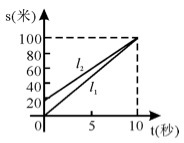

A. 小雨先到达终点

B. 弟弟先跑了10米

C. 弟弟的速度是10米/秒

D. 弟弟的速度是8米/秒

第 62 题 · 答案与解析

**参考答案（粉笔题库参考内容）**

D

**解析**

A选项错误，从图中可以看出，小雨和弟弟同时到达100米处；

B选项错误，弟弟先跑的距离是20米；

C选项错误，D选项正确，由b_2可知弟弟的速度为80÷10＝8米/秒。

故正确答案为D。

**考点**：行程问题-其他

**来源**：2011年上海市公务员录用考试《行测》题（A类）第62题

### 第 63 题

我国农历中以天干、地支的搭配来纪年，其中十天干为甲、乙、丙、丁、戊、己、庚、辛、壬、癸；十二地支为子、丑、寅、卯、辰、巳、午、未、申、酉、戌、亥。搭配的方式是：在天干中和地支中依次各取一字搭配来纪年，例如1920年是庚申年，下一年的天干为辛，地支为酉，故1921年，也就是中国共产党成立的这年，是辛酉年。

那么，中国共产党成立后的下一个辛酉年是公元多少年：

A. 1981

B. 1991

C. 2000

D. 2001

第 63 题 · 答案与解析

**参考答案（粉笔题库参考内容）**

A

**解析**

10和12的最小公倍数为60，因此天干地支搭配循环周期为60年。故下一个辛酉年是1981年。

故正确答案为A。

**考点**：星期日期问题

**来源**：2011年上海市公务员录用考试《行测》题（A类）第63题

### 第 64 题

A城市每立方米水的水费是B城市的1.25倍，同样交水费20元，在B城市比在A城市可多用2立方米水，那么A城市每立方米水的水费是多少元：

A. 2

B. 2.5

C. 3

D. 3.5

第 64 题 · 答案与解析

**参考答案（粉笔题库参考内容）**

B

**解析**

比例转化。花费同样水费时，价格之比等于用水量的反比，也即同样水费，B城市用水量是A城市的1.25倍，即B城用水量与A城用水量之比为5:4，而题中指出交20元水费B城市多用2立方米，因此20元水费可供A城市用水8立方米，由此A城市水费的价格为20÷8＝2.5元/立方米。

故正确答案为B。

**考点**：经济利润问题

**来源**：2011年上海市公务员录用考试《行测》题（A类）第64题

### 第 65 题

某商场为招揽顾客，推出转盘抽奖活动。如下图所示，两个数字转盘上的指针都可以转动，且可以保证指针转到盘面上的任一数字的机会都是相等的。顾客只要同时转动两个转盘，当盘面停下后，指针所指的数相乘为奇数即可以获得商场提供的奖品，则顾客获奖的概率是：

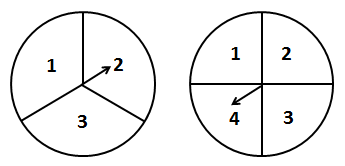

A. 1/4

B. 1/3

C. 1/2

D. 2/3

第 65 题 · 答案与解析

**参考答案（粉笔题库参考内容）**

B

**解析**

要想相乘结果为奇数，则必须每个转盘上的数字都为奇数。第一个转盘得到奇数的概率为2/3，第二个转盘得到奇数的概率为1/2，因此获奖概率为两者相乘，即为1/3。

故正确答案为B。

**考点**：给情况求概率

**来源**：2011年上海市公务员录用考试《行测》题（A类）第65题

## 材料 3

国家能源局发布的数字显示，2009年全社会用电量为36432亿千瓦时，同比增长5.96%。增速比上年提高0.47个百分点。下图为2009年全国各个行业和城乡居民生活用电量的分布图。

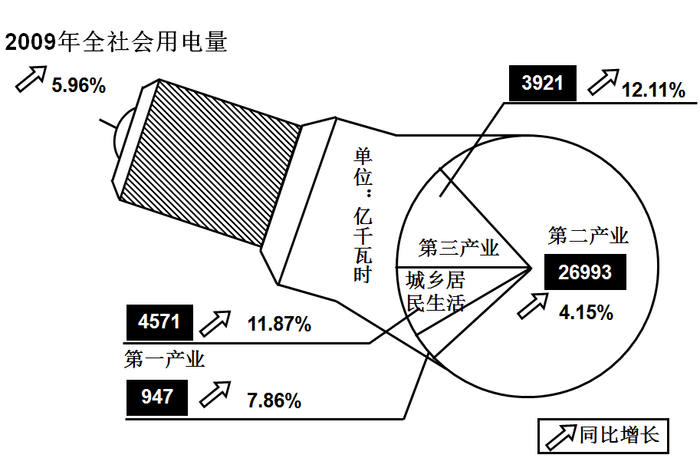

### 第 66 题

2008年全社会用电量同比增长约为：

A. 5.5%

B. 6.4%

C. 11.4%

D. 11.6%

第 66 题 · 答案与解析

**参考答案（粉笔题库参考内容）**

A

**解析**

2009年全社会用电量同比增长为5.96%，增速比上年提高0.47个百分点，所以2008年的增速为。

故正确答案为A。

**考点**：一般增长率

**来源**：2011年上海市公务员录用考试《行测》题（A类）第66题

### 第 67 题

2009年，城乡居民生活用电量在全社会用电量中所占的比重约为：

A. 11.9%

B. 12.5%

C. 13.3%

D. 14.3%

第 67 题 · 答案与解析

**参考答案（粉笔题库参考内容）**

B

**解析**

2009年全社会用电量为36432亿千瓦时，城乡居民生活用电量为4571亿千瓦时，城乡居民生活用电量在全社会用电量中所占的比重为。

故正确答案为B。

**考点**：现期比重

**来源**：2011年上海市公务员录用考试《行测》题（A类）第67题

### 第 68 题

在2009年电力消费中，用电量最多的行业所用的电量约是用电量最少的行业的多少倍：

A. 1.3

B. 5.9

C. 6.8

D. 28.5

第 68 题 · 答案与解析

**参考答案（粉笔题库参考内容）**

D

**解析**

用电量最多的行业是第二产业，用电量为26993亿千瓦时；用电量最少的行业为第一产业，用电量为947亿千瓦时。则用电量最多的行业所用的电量是用电量最少的行业的。与D项最接近。

故正确答案为D。

**考点**：现期倍数

**来源**：2011年上海市公务员录用考试《行测》题（A类）第68题

### 第 69 题

下列关于2008年、2009年用电量的相关表述中，不正确的是：

A. 2008年全社会累计用电量约为34382.8亿千瓦时

B. 在2009年各行业用电量中，第三产业用电量所占比重约为10.8%

C. 2009年，第一产业的用电量虽然最少，但其年增长速度却是用电量最大行业增幅的1.9倍左右

D. 2008年，第二产业的用电量约占全社会用电量的75%

第 69 题 · 答案与解析

**参考答案（粉笔题库参考内容）**

B

**解析**

A选项正确，2008年全社会总用电量为，此处全社会累计用电量与全社会总用电量相等；

B选项错误，2009年各行业用电量为36432-4571，第三产业用电量所占比重为，与10.8%数值相差较大；

C选项正确，第一产业增幅为7.86%，用电量最大的第二行业增幅为4.16%，；

D选项正确，2008年第二行业的用电量为，由A项可知2008年全社会总用电量为34382.8亿千瓦时，则所占比重为。

本题为选非题，故正确答案为B。

**考点**：综合分析

**来源**：2011年上海市公务员录用考试《行测》题（A类）第69题

## 材料 4

2007年4月18日，中国铁路成功实施了第六次大面积提速。全面掌握了时速200公里及以上线路的设计、施工、养护维修等成套技术，在既有线大量开行时速200~250公里动车组，同时开行5000 ~ 6500吨重载货物列车和双层集装箱列车，既有线提速技术达到世界先进水平。通过六次大面积提速，中国既有铁路时速120公里及以上线路延展里程达到2.2万公里，其中时速160公里及以上线路1.6万公里，时速200公里及以上线路6227公里，时速250公里线路1019公里，开行时速200—250公里动车组后，主要中心城市间的旅行时间比第一次大面积提速前压缩一半以上。

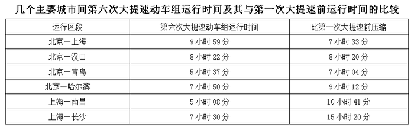

### 第 70 题

上述运行区段中，在第一次大提速前，列车运行时间最为接近的两个区段是：

A. “北京—上海”和“北京—汉口”

B. “北京—汉口”和“北京—哈尔滨”

C. “上海—南昌”和“北京—汉口”

D. “北京—上海”和“北京—哈尔滨”

第 70 题 · 答案与解析

**参考答案（粉笔题库参考内容）**

B

**解析**

第一次大提速前：

“北京—上海”列车运行时间为9小时59分＋7小时33分＝17小时32分；

“北京—汉口”列车运行时间为8小时22分＋8小时20分＝16小时42分；

“北京—哈尔滨”列车运行时间为7小时50分＋9小时12分＝17小时02分；

“上海—南昌”列车运行时间为5小时08分＋10小时41分＝15小时49分。

则列车运行时间最为接近的两个区段是“北京—汉口”和“北京—哈尔滨”。

故正确答案为B。

**考点**：简单加减计算

**来源**：2011年上海市公务员录用考试《行测》题（A类）第70题

### 第 71 题

根据材料，在我国既有铁路时速120公里及以上线路延展里程中，铁路时速200公里及以上线路所占的比重约为：

A. 23.6%

B. 28.3%

C. 32.9%

D. 72.7%

第 71 题 · 答案与解析

**参考答案（粉笔题库参考内容）**

B

**解析**

我国既有铁路时速120公里及以上线路延展里程为22000公里，时速200公里及以上线路为6227公里，则所占比重为。与B项最接近。

故正确答案为B。

**考点**：现期比重

**来源**：2011年上海市公务员录用考试《行测》题（A类）第71题

### 第 72 题

第六次大提速后，上海到南昌之间的列车运行时间大约比第一次大提速前压缩了：

A. 32.5%

B. 52%

C. 67.5%

D. 200%

第 72 题 · 答案与解析

**参考答案（粉笔题库参考内容）**

C

**解析**

上海─南昌提速后时间为5小时08分=308分，压缩了10小时41分=641分；故可得，直除首位为6。

故正确答案为C。

**考点**：一般增长率

**来源**：2011年上海市公务员录用考试《行测》题（A类）第72题

## 材料 5

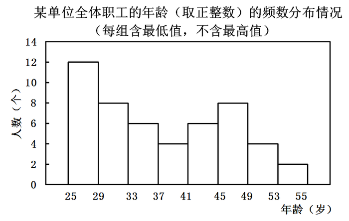

### 第 73 题

该单位共有职工多少名：

A. 25

B. 45

C. 50

D. 55

第 73 题 · 答案与解析

**参考答案（粉笔题库参考内容）**

C

**解析**

由图表可知，该单位共有职工12＋8＋6＋4＋6＋8＋4＋2＝50人。

故正确答案为C。

**考点**：简单加减计算

**来源**：2011年上海市公务员录用考试《行测》题（A类）第73题

### 第 74 题

该单位小于37岁的职工人数占职工总人数的：

A. 40%

B. 48%

C. 52%

D. 60%

第 74 题 · 答案与解析

**参考答案（粉笔题库参考内容）**

C

**解析**

由图表可知，小于37岁的职工为12＋8＋6＝26人。由73题可知该单位共有职工50人，因此该单位小于37岁的职工人数占职工总人数的26÷50＝52%。

故正确答案为C。

**考点**：现期比重

**来源**：2011年上海市公务员录用考试《行测》题（A类）第74题

### 第 75 题

该单位职工人数最多的年龄段与人数最少的年龄段的人数之和占总人数的：

A. 12%

B. 20%

C. 24%

D. 28%

第 75 题 · 答案与解析

**参考答案（粉笔题库参考内容）**

D

**解析**

由图表可知，单位职工人数最多的年龄段为25~29岁，共12人。单位职工人人数最少的年龄段为53~55岁，共2人。两年龄段人数之和为14人，由73题可知该单位共有职工50人，则两年龄段人数占总人数的比重为14÷50＝28%。

故正确答案为D。

**考点**：现期比重

**来源**：2011年上海市公务员录用考试《行测》题（A类）第75题

### 第 76 题

如果45岁的职工有3名，那么年龄在45岁以上的职工有多少名：

A. 11

B. 14

C. 17

D. 19

第 76 题 · 答案与解析

**参考答案（粉笔题库参考内容）**

A

**解析**

由图表可知，年龄在45~55岁的职工为8＋4＋2＝14人。45岁职工有3人，则45岁以上职工为14－3＝11人。

故正确答案为A。

**考点**：简单加减计算、统计图

**来源**：2011年上海市公务员录用考试《行测》题（A类）第76题

## 材料 6

根据国家知识产权局公布的数据，2010年1—6月，我国向美国专利商标局提交发明专利申请3063件，同比增长31.7%；向欧洲专利局提交的发明专利申请为1010件，同比增长32.0%；向日本特许厅提交发明专利申请506件，同比增长16.9%。而同期美、欧、日三局受理的发明专利申请量增长分别为4.2%、1.3%和－3.0%。

        2010年1—6月，来华的发明专利申请中，美国为12803件，同比增长15.6%；欧洲为14263件，同比增长11.3%；日本为16587件， 同比增长4.0%。

### 第 77 题

2010年上半年，美、欧、日来华的发明专利申请量中，美国所占的比重约为：

A. 29.3%

B. 32.7%

C. 38.0%

D. 50.5%

第 77 题 · 答案与解析

**参考答案（粉笔题库参考内容）**

A

**解析**

2010年上半年，美国来华的发明专利申请量为12803件，美、欧、日来华的发明专利申请量为(12803+14263+16587)件，则美国所占的比重为，A项最接近。

故正确答案为A。

**考点**：现期比重

**来源**：2011年上海市公务员录用考试《行测》题（A类）第77题

### 第 78 题

2010年上半年，美、欧、日来华的发明专利申请总量，是同期我国向其提交总量的几倍左右：

A. 4

B. 9.5

C. 14

D. 33

第 78 题 · 答案与解析

**参考答案（粉笔题库参考内容）**

B

**解析**

美、欧、日来华的发明专利申请量为(12803+14263+16587)件，同期我国向其提交总量为(3063+1010+506)件，则美、欧、日来华的发明专利申请总量是同期我国向其提交总量的。

故正确答案为B。

**考点**：现期倍数

**来源**：2011年上海市公务员录用考试《行测》题（A类）第78题

### 第 79 题

2010年上半年我国向美、欧、日三局申请发明专利的总量为多少，同比增长速度约为多少：

A. 4579 15%

B. 4579 30%

C. 3524 15%

D. 3524 30%

第 79 题 · 答案与解析

**参考答案（粉笔题库参考内容）**

B

**解析**

我国向美、欧、日三局申请发明专利的总量为3063＋1010＋506＝4579件，排除C、D两项。我国向美国、欧洲、日本提交量同比增长率依次为31.7%、32.0%、16.9%，都大于15%，所以同比增长速度也一定大于15%，排除A项。

故正确答案为B。

**考点**：文字资料、混合增长率

**来源**：2011年上海市公务员录用考试《行测》题（A类）第79题

### 第 80 题

下列关于我国知识产权的描述中，不正确的是：

A. 2010年上半年，美国专利商标局受理的发明专利申请量的增长速度是欧洲专利局的3倍多

B. 目前我国创新主体的创新能力和知识产权的国际竞争力与发达国家差距较大

C. 目前，在向发达国家申请发明专利的过程中，我国向日本的申请量相对最少，其增长速度也相对最慢

D. 2010年上半年，欧洲来华的发明专利申请数量是我国向其提交数量的33倍

第 80 题 · 答案与解析

**参考答案（粉笔题库参考内容）**

D

**解析**

A项正确，美、欧受理的发明专利申请量增长分别为4.2%、1.3%，故可得4.2%÷1.3%＞3.9÷1.3＝3，即超过了3倍；

B项正确，由资料可知，中国提交的发明专利申请量远低于发达国家；

C项正确，2010年1─6月，我国向美国专利商标局提交发明专利申请3063件，同比增长31.7%；向欧洲专利局提交的发明专利申请为1010件，同比增长32.0%；向日本特许厅提交发明专利申请506件，同比增长16.9%。由上可知，日本两个数值都为最低；

D项错误，2010年上半年，我国向欧洲专利局提交的发明专利申请为1010件，来华的发明专利申请中，欧洲为14263件，故可得14263÷1010≈14000÷1000＝14倍，并非33倍。

本题为选非题，故正确答案为D。

**考点**：综合分析

**来源**：2011年上海市公务员录用考试《行测》题（A类）第80题

### 第 81 题

中共十七届五中全会提出，着力保障和改善民生，必须逐步完善符合国情、比较完整、覆盖城乡、可持续的基本公共服务体系，（  ）。

A. 加强政府自身建设

B. 提高政府保障能力

C. 加快转变经济发展方式

D. 推进基本公共服务均等化

第 81 题 · 答案与解析

**参考答案（粉笔题库参考内容）**

BD

**解析**

本题考查新思想。

中共十七届五中全会提出，着力保障和改善民生，必须逐步完善符合国情、比较完整、覆盖城乡、可持续的基本公共服务体系，提高政府保障能力，推进基本公共服务均等化。

故正确答案为B、D。

**考点**：中国地理、社会建设

**来源**：2011年上海市公务员录用考试《行测》题（A类）第81题

### 第 82 题

2010年10月4日，国务院总理温家宝出席了在布鲁塞尔举行的第八届亚欧首脑会议。亚欧首脑会议是亚洲和欧洲之间级别最高、规模最大的政府间论坛。

本届会议主题为：

A. 改善全球金融：促进可持续发展

B. 改善经济治理：推动世界经济增长

C. 改善民生：提高公民福利和尊严

D. 促进世界文化交流互鉴，维护亚欧地区和平与稳定

第 82 题 · 答案与解析

**参考答案（粉笔题库参考内容）**

C

**解析**

2010年10月4日，第八届亚欧首脑会议在布鲁塞尔召开，会议以“改善民生：提高公民福利和尊严”为主题，讨论全球金融和经济治理、可持续发展、亚欧社会文化交往、亚欧会议未来发展以及国际形势和地区热点等问题。

故正确答案为C。

**考点**：时事政治-其他

**来源**：2011年上海市公务员录用考试《行测》题（A类）第82题

### 第 83 题

当前，建立健全基本公共服务体系，合理调整国民收入分配关系，要努力提高“两个比重”，即：

A. 努力提高劳动报酬在初次分配中的比重

B. 努力提高劳动报酬在再次分配中的比重

C. 努力提高居民收入在国民生产总值分配中的比重

D. 努力提高居民收入在国民收入分配中的比重

第 83 题 · 答案与解析

**参考答案（粉笔题库参考内容）**

AD

**解析**

中共十七届五中全会提出，合理调整收入分配关系，努力提高居民收入在国民收入分配中的比重、劳动报酬在初次分配中的比重。

故正确答案为A、D。

**考点**：重要会议讲话

**来源**：2011年上海市公务员录用考试《行测》题（A类）第83题

### 第 84 题

在处理人与人的关系方面，中国文化中有两个“贵”的理念：孔子提出了“和为贵”；孟子提出了“民为贵”。

对这两者之间的关系理解正确的是：

A. 两者是有区别的，前者强调了社会和谐的重要性，后者强调必须把人的需要放在首位

B. 两者是根本对立的，它们分别割裂了人与社会的关系，具有片面性

C. 它们是对立统一的，社会稳定是人类的共同理想，即使在社会矛盾冲突的情况下，只要真正把民众需要放在首位，兼顾多方面的利益，社会就能稳定发展

D. 它们已成为今天中国人坚持以人为本、科学发展的哲学基础

第 84 题 · 答案与解析

**参考答案（粉笔题库参考内容）**

ACD

**解析**

“和为贵”与“民为贵”的思想是对立统一的，而不是根本对立的。“和为贵”要以“民为贵”为思想基础，只有保障“民为贵”，才能实现社会和谐；而社会和谐，又是“民为贵”的条件，和谐社会能够促进人民利益更好实现。所以二者既相互联系，又相互区别。这两个理念已成为今天中国人坚持以人为本、科学发展的哲学基础。

故正确答案为A、C、D。

**考点**：文化常识

**来源**：2011年上海市公务员录用考试《行测》题（A类）第84题

### 第 85 题

2010年3月闭幕的十一届全国人大三次会议表决通过了修改《选举法》的决定。

下列选项中，属于本次《选举法》修改后新增内容的是：

A. 恢复间接选举中的预选

B. 恢复直接选举中的预选

C. 规定城乡按相同人口比例选举人大代表

D. 规定直接选举中选区的大小，按每一选区选一至三名代表划分

第 85 题 · 答案与解析

**参考答案（粉笔题库参考内容）**

C

**解析**

A项是1995年修改《选举法》时增加的内容；

B项是2004年修改《选举法》时增加的内容；

C项是2010年《选举法》修改的内容，规定“城乡按相同人口比例选举人大代表”；

D项是1995年修改《选举法》时新增的内容。A、B、D三项都不是本次新增的内容。

故正确答案为C。

**考点**：宪法

**来源**：2011年上海市公务员录用考试《行测》题（A类）第85题

### 第 86 题

2010年9月8日召开的国务院常务会议审议并原则通过《国务院关于加快培育和发展战略性新兴产业的决定》，确定现阶段选择一些产业，在重点领域集中力量，加快推进。

这些产业包括：

A. 节能环保

B. 生物医药

C. 新一代信息技术

D. 新能源汽车

第 86 题 · 答案与解析

**参考答案（粉笔题库参考内容）**

ABCD

**解析**

本题考查新思想。

2010年9月8日审议并通过的《国务院关于加快培育和发展战略性新兴产业的决定》中规定，现阶段重点培育和发展的产业包括：节能环保、新一代信息技术、生物、高端装备制造、新能源、新材料、新能源汽车等产业。

故正确答案为A、B、C、D。

**考点**：中国地理、经济建设

**来源**：2011年上海市公务员录用考试《行测》题（A类）第86题

### 第 87 题

2010年11月8日，国务院发布《关于加强法治政府建设的意见》，明确提出了（  ），要求政府对重大决策事项应在会前交由法制机构进行合法性审查，未经合法性审查或者经审查不合法的，不能提交会议讨论、作出决策。

A. 加强行政决策程序建设

B. 完善行政决策风险评估机制

C. 加强和改进制度建设

D. 强化行政监督和问责

第 87 题 · 答案与解析

**参考答案（粉笔题库参考内容）**

ABCD

**解析**

2010年11月8日发布的《关于加强法治政府建设的意见》明确提出了九点意见，分别是：

（1）加强法治政府建设的重要性、紧迫性和总体要求；

（2）提高行政机关工作人员特别是领导干部依法行政的意识和能力；

（3）加强和改进制度建设；

（4）坚持依法科学民主决策；

（5）严格规范公正文明执法；

（6）全面推进政务公开；

（7）强化行政监督和问责；

（8）依法化解社会矛盾纠纷；

（9）加强组织领导和督促检查。

其中A、B两项是（4）的具体要求。

故正确答案为A、B、C、D。

**来源**：2011年上海市公务员录用考试《行测》题（A类）第87题

### 第 88 题

崇高的理想是人生的奋斗目标，我们通常说的有理想，主要是指社会共同理想。我国现阶段各族人民的共同理想是：

A. 坚持中国特色社会主义道路，实现国家的独立和民族解放

B. 把我国建设成为富强民主文明和谐的社会主义现代化国家

C. 追求自己的美好物质生活和精神生活

D. 指引人生的方向道路，创造有价值的人生

第 88 题 · 答案与解析

**参考答案（粉笔题库参考内容）**

B

**解析**

A项错误，新中国成立后，我国就实现了国家独立和民族解放，A项不是现阶段的共同理想；

B项正确，我国现阶段各族人民的共同理想是把我国建设成为富强民主文明和谐的社会主义现代化国家；

C、D两项错误，都是针对个人理想而言的，不是现阶段的共同理想。

故正确答案为B。

**考点**：时事政治-其他

**来源**：2011年上海市公务员录用考试《行测》题（A类）第88题

### 第 89 题

某村原是一个远近闻名的贫困村，上级多次给钱给物，但面貌总是变化不大。后来，在上级的帮助下，该村建立起坚强有力的党支部，党支部一班人带领全村干部和群众连续苦干几年，村子面貌大变。村民们感慨地说，给钱给物，不如建设一个好党支部。

这一事实说明：

A. 保持和发展党的先进性是当前全党工作的中心任务

B. 组织建设搞好了，党的建设也就搞好了

C. 发展农村经济必须加强党的领导

D. 贫困地区基层党组织的主要任务是带领群众脱贫致富

第 89 题 · 答案与解析

**参考答案（粉笔题库参考内容）**

CD

**解析**

A项错误，党的工作的中心任务应是经济建设；

B项错误，组织建设对加强和改善党的领导非常重要，但二者不存在“充分条件”的关系；

C项正确，题干强调的是在贫困农村地区建设一个好党支部的重要性，说到了贫困地区党的领导的选项都应入选。这个村子之前并没有强有力的党支部的领导，虽然上级多次给钱给物但并未使该村搞好经济，而现在由于有了强有力的党支部的领导，才使该村的经济得到发展；

D项正确，贫困地区最急需解决的问题就是经济致富的问题，因此基层党组织的主要任务是带领群众脱贫致富。

故正确答案为C、D。

**来源**：2011年上海市公务员录用考试《行测》题（A类）第89题

### 第 90 题

按照国家对上海发展的战略定位，到2020年上海要基本建成国际经济、金融、贸易、航运中心和社会主义现代化国际大都市。上海作为资源缺乏的城市，为了实现这一战略目标，已经把发展的第一资源确定为：

A. 资金

B. 土地

C. 高新技术

D. 人才和智力

第 90 题 · 答案与解析

**参考答案（粉笔题库参考内容）**

D

**解析**

处在发展转型关键时期的上海，必须把人才和智力作为上海发展的第一资源，把实现经济发展方式转变、增强城市核心竞争力建立在上海的人才优势和教育优势这个基础之上，坚持优先发展教育事业，为上海实现创新驱动、转型发展提供强有力的支撑和强大的动力。

故正确答案为D。

**考点**：中国地理

**来源**：2011年上海市公务员录用考试《行测》题（A类）第90题

### 第 91 题

2010年5月，国务院正式批准实施《长江三角洲地区区域规划》，该规划：

A. 明确了长三角地区发展的战略定位，即亚太地区重要的国际门户、全球重要的现代服务业和先进制造业中心、具有较强国际竞争力的世界级城市群

B. 鼓励人口向沿江、沿湾、沿海以及主要交通沿线、资源环境承载压力不大的重点城镇集聚和转移

C. 提出到2030年，力争长三角地区率先基本实现现代化

D. 鼓励适度提高人口增长速度，同时控制大城市人口规模

第 91 题 · 答案与解析

**参考答案（粉笔题库参考内容）**

ABD

**解析**

A项正确，C项错误，2010年5月24日，国务院正式批准实施的《长江三角洲地区区域规划》，明确了长江三角洲地区发展的战略定位，即亚太地区重要的国际门户、全球重要的现代服务业和先进制造业中心、具有较强国际竞争力的世界级城市群；到2015年，长三角地区率先实现全面建设小康社会的目标；到2020年，力争率先基本实现现代化。

B、D两项正确，《长江三角洲地区区域规划》还提出优化城镇人口布局，引导和鼓励人口向沿江、沿湾、沿海以及主要交通沿线、资源环境承载能力强的重点城镇转移，适度提高人口增长速度，同时控制大城市人口规模。

故正确答案为A、B、D。

**考点**：中国地理

**来源**：2011年上海市公务员录用考试《行测》题（A类）第91题

### 第 92 题

当行政行为违法时，下列选项中，除（  ）外，都拥有撤销权。

A. 人民法院

B. 人民检察院

C. 国务院

D. 作出行政行为的机关

第 92 题 · 答案与解析

**参考答案（粉笔题库参考内容）**

B

**解析**

根据《行政诉讼法》第54条的规定：人民法院经过审理，根据不同情况，分别作出以下判决：

（一）具体行政行为证据确凿，适用法律、法规正确。符合法定程序的，判决维持。

（二）具体行政行为有下列情形之一的，判决撤销或者部分撤销，并可以判决被告重新作出具体行政行为：（1）主要证据不足的；（2）适用法律、法规错误的；（3）违反法定程序的；（4）超越职权的；（5）滥用职权的。

A项正确，人民法院有撤销权；

C项正确，国务院也有撤销权，国务院作为最高行政机关，有权撤销下级行政机关作出的具体行政行为；

D项正确，作出行政行为的机关也有撤销权，虽然我国法律对行政机关自身是否享有撤销权并未作出明确规定，但一般认为，撤销权是行政权的一部分，故作出行政行为的机关也享有撤销权。

本题为选非题，故正确答案为B。

**考点**：行政法

**来源**：2011年上海市公务员录用考试《行测》题（A类）第92题

### 第 93 题

公民、法人或者其他组织依法取得的行政许可受法律保护，行政机关不得擅自改变已经生效的行政许可，这体现了行政活动的：

A. 信赖保护原则

B. 责任原则

C. 服务性原则

D. 以人为本原则

第 93 题 · 答案与解析

**参考答案（粉笔题库参考内容）**

A

**解析**

信赖保护原则，是指行政相对人对行政权力的正当合理信赖应当予以保护，行政机关不得擅自改变或撤销已经生效的行政行为，依法确须改变或撤销的，由此给相对人造成财产损失或致使相对人的合法权益受到损害的，应当依法给予行政补偿。题干所说的内容体现了这一原则。

故正确答案为A。

**来源**：2011年上海市公务员录用考试《行测》题（A类）第93题

### 第 94 题

“十二五”面临的是一场更加广泛而深刻的变革，将撬动一场深刻的利益关系调整，是中国改革的再次出发。下列选项中，属于“十二五”期间改革主线的是：

A. 以经济发展方式转变为主线的经济体制改革

B. 以公共需求变化为主线的社会体制改革

C. 以提升国家文化软实力为主线的文化体制改革

D. 以政府转型为主线的行政体制改革

第 94 题 · 答案与解析

**参考答案（粉笔题库参考内容）**

ABD

**解析**

“十二五”改革有“三条主线”：以经济发展方式转变为主线的经济体制改革；以公共需求变化为主线的社会体制改革；以政府转型为主线的行政体制改革。

故正确答案为A、B、D。

**考点**：重要文件

**来源**：2011年上海市公务员录用考试《行测》题（A类）第94题

### 第 95 题

近年来，由于互联网的发展，网络监督越来越直接、有力，政府机关及其工作人员的活动越来越透明。

这说明，我国公民：

A. 管理国家大事的方式越来越直接

B. 参与民主决策的形式趋于多样化

C. 参与民主监督的渠道越来越多

D. 可以通过政治参与制约国家机关及其工作人员的权力

第 95 题 · 答案与解析

**参考答案（粉笔题库参考内容）**

CD

**解析**

A项错误，“管理国家大事”属于表述错误，公民并不能直接管理国家大事；

B项错误，题干中体现的是公民通过越来越直接的网络监督制约了国家机关及其工作人员的权力，并未体现民主决策；

C、D两项正确。

故正确答案为C、D。

**考点**：宪法

**来源**：2011年上海市公务员录用考试《行测》题（A类）第95题

### 第 96 题

北京某著名中药店有一副对联：“品味虽贵，必不敢减物力；炮制虽繁，必不敢省人工。”正是靠这份承诺，该药店经历300年风雨而不倒，从一家普通的家庭药铺发展为国药第一品牌。

上述材料说明：

A. 市场经济是法制经济

B. 市场经济是创业经济

C. 市场经济是诚信经济

D. 市场交易中应遵循互利原则

第 96 题 · 答案与解析

**参考答案（粉笔题库参考内容）**

C

**解析**

这副对联体现了诚信经营的重要性，这家药店靠着“这份承诺”发展成为国药第一品牌，说明了市场经济是诚信经济。

A、B、D三项在本题中没有体现。

故正确答案为C。

**考点**：市场经济、微观经济

**来源**：2011年上海市公务员录用考试《行测》题（A类）第96题

### 第 97 题

电子文件是文件的一种类型，是以代码形式记录于磁带、磁盘、光盘等载体，依赖计算机系统存取并可在通信网络上传输的文件，其处理的首要特点是：

A. 系统依赖性

B. 非人工识读性

C. 结构非对称性

D. 存储高密度性

第 97 题 · 答案与解析

**参考答案（粉笔题库参考内容）**

A

**解析**

电子文件对系统的依赖性特别是它对特定系统（电子文件产生时运行的软、硬件系统）的依赖性是电子文件的首要特点，也是电子文件管理中的难题。

故正确答案为A。

**考点**：科技理论与成就

**来源**：2011年上海市公务员录用考试《行测》题（A类）第97题

### 第 98 题

根据我国《公务员法》的规定，服从和执行上级的决定和命令是公务员必须履行的重要义务之一。下列选项中，除了（    ）外，都是公务员“服从和执行上级的决定和命令”这句话含义的正确理解。

A. 虽然对决定持有保留意见，但是如果上级要求立即执行，则公务员应当执行该决定

B. 如果公务员执行的决定或命令明显违法，则执行后果应当由上级负责

C. 如果上级的决定和命令是依法作出的，则公务员应当予以执行

D. 上级作出的决定和命令应当在其权限范围之内

第 98 题 · 答案与解析

**参考答案（粉笔题库参考内容）**

B

**解析**

B项表述错误，《公务员法》第六十条规定：“公务员执行公务时，认为上级的决定或者命令有错误的，可以向上级提出改正或者撤销该决定或者命令的意见；上级不改变该决定或者命令，或者要求立即执行的，公务员应当执行该决定或者命令，执行的后果由上级负责，公务员不承担责任；但是，公务员执行明显违法的决定或者命令的，应当依法承担相应的责任。”

本题为选非题，故正确答案为B。

**考点**：行政法

**来源**：2011年上海市公务员录用考试《行测》题（A类）第98题

### 第 99 题

“整体性治理”作为公共管理的一种新范式，把重点放在确定一个真正以公民为基础的、以服务为基础的、以需要为基础的组织基础。整体性理论着眼于政府内部机构和部门的整体性运作，主张管理从：

A. 分散走向集中

B. 分权走向集权

C. 部门走向整体

D. 破碎走向整合

第 99 题 · 答案与解析

**参考答案（粉笔题库参考内容）**

ACD

**解析**

根据定义，整体性治理着眼于政府内部机构和部门的整体性运作，主张管理从分散走向集中，从部门走向整体，从破碎走向整合。

故正确答案为A、C、D。

**来源**：2011年上海市公务员录用考试《行测》题（A类）第99题

### 第 100 题

某行政机构为了更加全面地考核组织成员的工作绩效，拟从与被考核者发生工作关系的多方主体获得被考核者的绩效信息，以此对被考核者进行全方位、多维度的绩效评估。

此行政机构运用的绩效评估方法是：

A. 业绩评定表法

B. 关键绩效指标法

C. 360度绩效评估法

D. 目标管理法

第 100 题 · 答案与解析

**参考答案（粉笔题库参考内容）**

C

**解析**

360度考核法又称为全方位考核法，最早被英特尔公司提出并加以实施运用。该方法是指通过员工自己、上司、同事、下属、顾客等不同主体来了解其工作绩效，通过评论知晓各方面的意见，清楚自己的长处和短处，来达到提高自己的目的。根据题干中的“以此对被考核者进行全方位、多维度的绩效评估”可知，此行政机构运用的是该评估法。

故正确答案为C。

**本题相关知识点：**

业绩评定表法又称“等级量度法”，是最古老也是采用最广泛的一种考核法，它根据所限定的因素来对员工进行考核，考核者通常均使用一种事先印制的表格从事考核。采用这种方法，考核者通过一个等级表，对业绩进行判断并评出等级。

企业关键绩效指标(KPI：Key Performance Indicator)是通过对组织内部流程的输入端、输出端的关键参数进行设置、取样、计算、分析，衡量流程绩效的一种目标式量化管理指标，是把企业的战略目标分解为可操作的工作目标的工具，是企业绩效管理的基础。

目标管理即让企业的管理人员和员工亲自参加工作目标的制订，在工作中实行“自我控制”，并努力完成工作目标的一种管理制度。

**来源**：2011年上海市公务员录用考试《行测》题（A类）第100题

### 第 101 题

计算机安全是当前安全保密工作的重点之一。下列选项中，（  ）属于对计算机安全保密认识的误区，如果不加以纠正，就有可能导致泄密事件的发生。

A. 文件删除后就不可恢复

B. 在内网上以文件共享方式传递文件是安全的

C. 计算机病毒是造成计算机系统安全问题的主要原因

D. 防火墙安装得越多，越有安全保障

第 101 题 · 答案与解析

**参考答案（粉笔题库参考内容）**

ABD

**解析**

A项错误，文件删除后，可以通过软件加以恢复；

B项错误，在内网上共享文件也存在安全问题；

C项正确；

D项错误，防火墙安装过多，有可能会引起相互间的屏蔽，给病毒漏网的机会，且防火墙只能屏蔽外网信息，对内网间的病毒无法屏蔽。

故正确答案为A、B、D。

**考点**：科技理论与成就

**来源**：2011年上海市公务员录用考试《行测》题（A类）第101题

### 第 102 题

目前，中国实行的是以市场供求为基础的，单一的、有管理的浮动汇率制度，这既符合中国实际情况，又体现了对国际社会的高度负责。我国坚决反对美国少数政客出于国内政治需要，利用汇率问题打压其他国家，强迫别国货币升值。

从根本上说这是因为：

A. 汇率政策是国家主权，中国不会屈服于外部压力

B. 汇率问题是市场问题，外汇行市的变动主要决定于国家的国际收支平衡状况

C. 汇率问题是经济问题，它只能通过平等协商，互利合作逐步解决

D. 汇率问题是政治问题，它只能通过立法途径来解决

第 102 题 · 答案与解析

**参考答案（粉笔题库参考内容）**

BC

**解析**

汇率问题是市场问题、经济问题，不应政治化。汇率政策只能通过平等协商、互利合作逐步加以解决，动辄指责、打压、制裁都无济于事。从长期看，中国人民币汇率政策将坚持主动性、渐进性和可控性原则，要综合考虑中国宏观经济运行、社会发展和国际收支状况，考虑中国银行系统和其他有关方面改革的进程，还要考虑周边国家和地区以及世界经济金融的因素，不可能一蹴而就，也不可能屈服于外部的压力。

故正确答案为B、C。

**考点**：国际经济及组织

**来源**：2011年上海市公务员录用考试《行测》题（A类）第102题

### 第 103 题

2011年1月11日，中国研制的第四代隐形战斗机歼-20在成都首次公开试飞，这是中国空军史上透明度最高的一次新型战斗机首飞。隐形战斗机是指雷达一般探测不到的战斗机，其原理是：

A. 通过装备高性能机载雷达干扰雷达波

B. 通过特殊结构设计使得雷达波出现漫反射

C. 将机身涂成全黑色，使地面雷达看不到

D. 通过特殊涂料吸收雷达波

第 103 题 · 答案与解析

**参考答案（粉笔题库参考内容）**

BD

**解析**

隐形战斗机是通过特殊结构设计（部分隐形战斗机的外形是直角直棱的结构）使得雷达波出现漫反射和通过特殊涂料吸收雷达波。由于雷达波向不同的方向反射，只有很少的一部分被雷达接收到，这样反射面积在雷达天线检测下只有零点几个平方米。当雷达波的量不能达到雷达探测物体所必须接收到的量的时候，就不会显示出物体。隐形战斗机主要就是利用这个原理来实现隐形的。当然，飞机上也会涂上吸波材料来吸收雷达波。 所以隐形战机被形象地喻为“空中幽灵”，它们行踪诡秘，能有效地躲避雷达跟踪。

故正确答案为B、D。

**考点**：科技理论与成就

**来源**：2011年上海市公务员录用考试《行测》题（A类）第103题

### 第 104 题

“一案三制”是中国公共危机管理的核心框架。其中，“一案”是指国家突发公共事件应急预案体系，“三制”指的是公共危机管理的：

A. 决策机制

B. 运行机制

C. 体制

D. 法制

第 104 题 · 答案与解析

**参考答案（粉笔题库参考内容）**

BCD

**解析**

“三制”是指建立健全应急的体制、运行机制和法制。

故正确答案为B、C、D。

**来源**：2011年上海市公务员录用考试《行测》题（A类）第104题

### 第 105 题

具有中国特色的社会主义国家公务员制度，其特征主要表现在：

A. 党管干部

B. 政治中立

C. 功绩至上

D. 两官分途

第 105 题 · 答案与解析

**参考答案（粉笔题库参考内容）**

A

**解析**

本题考查新思想。

中国是一个社会主义国家，与西方资本主义国家有着质的不同。公务员制度作为国家政治制度的一个组成部分，必然取决和服务于国家的根本社会制度。因此，中国的公务员制度与西方文官制度相比，有着质的区别，这些区别体现在：

一、不搞“政治中立”；

二、坚持党管干部；

三、不搞“两官分途”；

四、坚持服务于民的宗旨。

B、C、D三项都是西方公务员的管理特征。

故正确答案为A。

**考点**：中国地理、政治建设

**来源**：2011年上海市公务员录用考试《行测》题（A类）第105题

### 第 106 题

2010年12月10日至12日，中央经济工作会议在北京举行。会议明确提出了2011年经济工作的总体要求、重要原则和主要任务。

下列说法中，符合中央经济工作会议精神的有：

A. 完善基本公共服务，创新社会管理机制是2011年经济工作的主要任务之一

B. 2011年经济工作以科学发展为主线

C. 2011年宏观经济政策的基本取向要积极稳健、审慎灵活

D. 2011年要着力保障和改善民生，加快推进收入分配制度改革

第 106 题 · 答案与解析

**参考答案（粉笔题库参考内容）**

ACD

**解析**

本题考查2010年中央经济工作会议精神的内容。此次会议提出2011年宏观经济政策的基本取向要积极稳健、审慎灵活，要着力保障和改善民生，加快推进收入分配制度改革，完善基本公共服务，创新社会管理机制是2011年经济工作的主要任务之一。

B项的正确表述应为“坚持以科学发展为主题，以加快转变经济发展方式为主线”。

故正确答案为A、C、D。

**考点**：重要会议讲话

**来源**：2011年上海市公务员录用考试《行测》题（A类）第106题

### 第 107 题

按照调查目的的不同，可以将调查分为不同的类型。其中，（  ）是为领导部门了解本地区、本系统、本单位的基本情况，掌握全面系统的数据资料而进行的调查。

A. 定性调查

B. 基础调查

C. 深度调查

D. 专项调查

第 107 题 · 答案与解析

**参考答案（粉笔题库参考内容）**

B

**解析**

定性调查是指从定性的角度进行的调查。深度调查是在完成了基础的调查后，进行的深化的调查。专项调查是具有目的性的、专项性的调查。根据题目，了解本地区、本系统、本单位的基本情况，掌握全面系统的数据资料的调查是基础性的调查。

故正确答案为B。

**来源**：2011年上海市公务员录用考试《行测》题（A类）第107题

### 第 108 题

行政公文发文处理是行政机关日常必须做好的基础性工作，也是办公部门处理行政公文不可或缺的工作内容，发文处理的首要任务是对行政公文进行：

A. 管理

B. 办理

C. 传递

D. 撰制

第 108 题 · 答案与解析

**参考答案（粉笔题库参考内容）**

D

**解析**

公文的撰制是发文处理的首要任务。

故正确答案为D。

**来源**：2011年上海市公务员录用考试《行测》题（A类）第108题

### 第 109 题

在2010年上海世博会中国馆内，一幅“会动的”《清明上河图》让众多参观者流连忘返、叹为观止。《清明上河图》属国家级文物，以下关于该图的说法中，错误的是：

A. 该图描绘了北宋初期京城汴梁的繁华景象

B. 该图是北宋画家张择端所作

C. 该图的第一位“藏家”是宋太祖赵匡胤

D. 该图运用了“散点透视”的构图法

第 109 题 · 答案与解析

**参考答案（粉笔题库参考内容）**

AC

**解析**

A项错误，该图描绘的是北宋末期汴梁的景象，而非北宋初期；

C项错误，该图的第一位“收藏家”是宋徽宗赵佶，而非宋太祖赵匡胤。

故正确答案为A、C。

**本题相关知识点：**

《清明上河图》描绘了北宋时期都城东京，（今河南开封）的状况，主要是汴京以及汴河两岸的自然风光和繁荣景象。作者以长卷形式，采用散点透视的构图法，将繁杂的景物纳入统一而富于变化的图画中。

**考点**：文化常识

**来源**：2011年上海市公务员录用考试《行测》题（A类）第109题

### 第 110 题

在火灾扑救中，需要根据起火物质性质的不同，采取不同的扑救办法。比如，下列选项中，（  ）引起的火灾，如果用水来扑救，不仅灭不了火，反而会加速火势的蔓延，造成严重后果，给人们的生命、财产安全带来损害。

A. 金属钾

B. 汽油

C. 浓硫酸

D. 熔化的钢水

第 110 题 · 答案与解析

**参考答案（粉笔题库参考内容）**

ABCD

**解析**

A项正确，金属钾与水作用后会生成氢气和放出大量热， 容易引起爆炸；

B项正确，汽油是轻于水且不溶于水的易燃液体，若用水扑救则汽油会浮在水面上继续燃烧；

C项正确，浓硫酸与水反应会放出大量的热，灼伤人体；

D项正确，熔化的钢水不能用水扑救。 因钢水温度约在 1600℃，水蒸气在 1000℃以上时能分解出氢和氧，有引起爆炸的危险。

故正确答案为A、B、C、D。

**考点**：生活常识

**来源**：2011年上海市公务员录用考试《行测》题（A类）第110题

### 第 111 题

冬虫夏草是我国一味名贵中药，它实际上是一种：

A. 草本植物留在地下的貌似昆虫幼虫的根茎

B. 被某种真菌感染死亡后的昆虫幼虫

C. 侵入昆虫幼虫致其死亡后的真菌

D. 侵入昆虫幼虫的某种真菌菌丝体及宿主的混合体

第 111 题 · 答案与解析

**参考答案（粉笔题库参考内容）**

D

**解析**

冬虫夏草，是麦角菌科真菌冬虫夏草菌寄生在蝙蝠蛾科昆虫幼虫上的子座及幼虫尸体的复合体。

故正确答案为D。

**考点**：生活常识

**来源**：2011年上海市公务员录用考试《行测》题（A类）第111题

### 第 112 题

2010年11月16日，联合国教科文组织保护非物质文化遗产政府间委员会第五次会议在肯尼亚首都内罗毕举行。在这次会议上，中国申报的（  ）被成功列入人类非物质文化遗产代表作名录。

A. 川剧

B. 京剧

C. 中医药

D. 中医针灸

第 112 题 · 答案与解析

**参考答案（粉笔题库参考内容）**

BD

**解析**

2010年11月16日在肯尼亚首都内罗毕举行的联合国教科文组织保护非物质文化遗产政府间委员会第五次会议审议通过中国申报项目中医针灸和京剧,将其列入人类非物质文化遗产代表作名录。

故正确答案为B、D。

**本题相关知识点：**

京剧（Beijing Opera），为中国“国粹”、国剧，已有200年历史，享誉海内外。起源于中国古老戏剧秦腔、徽剧、昆曲及汉剧。它形成于北京，时间是在1840年前后，盛行于20世纪三四十年代。现在它仍是具有世界级影响的大剧种。

中医针灸是针法和灸法的合称。针法是把毫针按一定穴位刺入患者体内，运用捻转与提插等针刺手法来治疗疾病。灸法是把燃烧着的艾绒按一定穴位熏灼皮肤，利用热的刺激来治疗疾病。2010年11月16日中医针灸申请世界非物质文化遗产成功。

**考点**：中国地理

**来源**：2011年上海市公务员录用考试《行测》题（A类）第112题

### 第 113 题

医生告诉一对夫妇，由于他们具有相同的病态基因，如果他们生育一个孩子，这个孩子患遗传性疾病的机率为1/4。

这意味着：

A. 如果他们生育3个孩子，那么这3个孩子都不会得遗传病

B. 如果他们的第1个孩子有遗传病，那么后面3个孩子都不会得遗传病

C. 如果他们前3个孩子都很健康，那么第4个孩子肯定得遗传病

D. 他们的孩子都有可能得遗传病

第 113 题 · 答案与解析

**参考答案（粉笔题库参考内容）**

D

**解析**

医生的意思是孩子患遗传性疾病的概率是相同的，即都是1/4，因此每个孩子都有患遗传病的可能。

故正确答案为D。

**考点**：生物常识

**来源**：2011年上海市公务员录用考试《行测》题（A类）第113题

### 第 114 题

某区公安分局就户籍管理有关事项向位于本行政辖区内的某大学发文，应使用的公文文种是：

A. 通知

B. 请示

C. 指示

D. 函

第 114 题 · 答案与解析

**参考答案（粉笔题库参考内容）**

D

**解析**

A项错误，通知是适用于转发上级机关、下级机关和不相隶属机关的公文，批转下级机关的公文，传达要求下级机关办理和需要有关单位周知或者执行的事项，任免人员的一种公文；

B项错误，请示是下级机关向上级机关请求对某项工作、问题作出指示，对某项政策界限给予明确，对某事予以审核批准时使用的一种请求性公文，是应用写作实践中的一种常用文体。请示可分为解决某种问题的请示和请求批准某种事项的请示；

C项错误，指示是领导机关对下级机关布置工作，阐明工作活动要点及要求、步骤和方法时所使用的一种具有指导原则的下行公文。指示具有较强的指导性、政策性，可以使某项重要事项、工作能顺利进行，起着决定性作用；

D项正确，公安分局和某大学不存在隶属关系，应该用函。函是不相隶属机关之间相互商洽工作、询问和答复问题，或者向有关主管部门请求批准事项时所使用的公文。

故正确答案为D。

**来源**：2011年上海市公务员录用考试《行测》题（A类）第114题

### 第 115 题

太阳能具有储量丰富、清洁无污染等优点，是世界各国重点开发的新能源之一。下列关于太阳能的说法中，不正确的有：

A. 广义上的太阳能是地球上许多能量的来源，如风能、化学能、水的势能等等；狭义的太阳能则限于太阳辐射所产生的光能和热能

B. 太阳能的能量密度高，但受季节、气候、地理环境影响大

C. 太阳能具有很强的稳定性和规律性

D. 目前成熟的太阳能转换技术包括光电转换和光热电转换

第 115 题 · 答案与解析

**参考答案（粉笔题库参考内容）**

BC

**解析**

本题考查科技常识。

太阳能的能量密度低，且受昼夜、季节、地理纬度和天气等因素影响，到达某一地面的太阳辐照度是间断和不稳定的。

B、C两项属于错误的说法。

本题为选非题，故正确答案为BC。

**考点**：物理常识、自然地理

**来源**：2011年上海市公务员录用考试《行测》题（A类）第115题

### 第 116 题

下列关于欧洲联盟的表述中，正确的是：

A. 由欧洲共同体发展而来

B. 它是一个经济合作组织

C. 最初由五个国家组成

D. 它是一个政治军事组织

第 116 题 · 答案与解析

**参考答案（粉笔题库参考内容）**

AB

**解析**

欧洲联盟由欧洲共同体演变而来，最初是法国、联邦德国、意大利、荷兰、比利时和卢森堡六个国家，是一个政治、经济组织，但不是军事组织。

故正确答案为A、B。

**来源**：2011年上海市公务员录用考试《行测》题（A类）第116题

### 第 117 题

下列各句中，加横线的词语所指地域与现在所指都不相同的一组是：

①<u>山东</u>豪俊遂并起而亡秦族矣

②春来江水绿如蓝，能不忆<u>江南</u>

③彼所将<u>中国</u>人不过十五六万

④<u>扬州</u>城下进退不由，殆例送死

⑤将军战<u>河南</u>，臣战<u>河北</u>

A. ①②③

B. ②③④

C. ②④⑤

D. ①③⑤

第 117 题 · 答案与解析

**参考答案（粉笔题库参考内容）**

D

**解析**

①中“山东”指崤山以东，今指山东省；③中“中国”指中原，今指中华人民共和国；⑤中“河南”“河北”是指黄河以南和黄河以北，属于泛指，而在今天则特指河南省和河北省。

故正确答案为D。

**考点**：文化常识

**来源**：2011年上海市公务员录用考试《行测》题（A类）第117题

### 第 118 题

中国绕月探测卫星“嫦娥一号”完成了多项科学研究，取得了多项科研成果，其中之一是探得某重要能源的储量有100万吨，足够人类使用1万年。

这一能源指的是：

A. 铀

B. 钚

C. 氦

D. 氚

第 118 题 · 答案与解析

**参考答案（粉笔题库参考内容）**

C

**解析**

中国绕月探测卫星“嫦娥一号”完成了多项科学研究，取得了多项科研成果，其中之一是探得氦的储量有100万吨，足够人类使用1万年。

故正确答案为C。

**考点**：科技理论与成就

**来源**：2011年上海市公务员录用考试《行测》题（A类）第118题

### 第 119 题

稀土作为一种重要的战略资源，是很多高精尖产业所必不可少的原料。中国有不少战略资源（如铁矿等）贫乏，但稀土资源却非常丰富。

下列关于稀土的说法，正确的有：

A. 稀土元素可以提高植物的叶绿素含量，增强光合作用

B. 稀土是用途广泛的一类非金属元素

C. 稀土在世界上的储量非常稀有

D. 稀土不仅可以添加至有色合金中，也可以添加至非金属材料中

第 119 题 · 答案与解析

**参考答案（粉笔题库参考内容）**

AD

**解析**

本题考查科技常识。

A、D两项正确，稀土元素可以提高植物的叶绿素含量，增强光合作用；在工业方面，稀土不仅可以添加至有色合金中，也可以添加至非金属材料中。

B、C两项错误，稀土是一种重要金属，中国稀土资源丰富，其他国家也有稀土资源，并非非常稀有。

故正确答案为AD。

**考点**：中国地理、物理常识

**来源**：2011年上海市公务员录用考试《行测》题（A类）第119题

### 第 120 题

以下图表中的两个食物链网络，箭头从被吃的食物指向食物的获取者。叶状虫在食物链网络A和B中处于不同的位置，假若它同时在这两个位置上消失（死亡），那么下列说法中，正确的是：

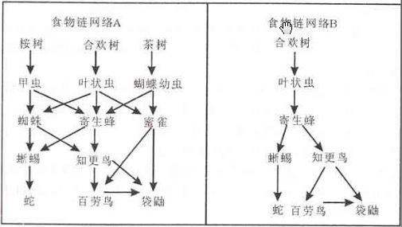

A. 食物链网络A的后果更严重，因为在A中寄生蜂只有一个食物来源

B. 食物链网络A的后果更严重，因为在A中寄生蜂有几个食物来源

C. 食物链网络B的后果更严重，因为在B中寄生蜂只有一个食物来源

D. 食物链网络B的后果更严重，因为在B中寄生蜂有几个食物来源

第 120 题 · 答案与解析

**参考答案（粉笔题库参考内容）**

C

**解析**

本题考查科技常识。

在食物链网络A中，叶状虫虽然是三种动物的食物源，但并非是唯一的食物源，即使缺少也不会使食物链断绝。食物链网络B中，叶状虫是寄生蜂的唯一食物源，而寄生蜂则是其他两种动物唯一的食物源，所以网络B缺少叶状虫的影响更大，后果更严重。

故正确答案为C。

**考点**：生物常识、自然地理

**来源**：2011年上海市公务员录用考试《行测》题（A类）第120题

## 材料 7

为进一步深化落实2010年以来国务院关于加强房地产市场调控的各项政策措施，巩固调控成果，10月7日，上海市政府批转了市住房保障房屋管理局等五部门《关于进一步加强本市房地产市场调控加快推进住房保障工作的若干意见》。《意见》共十二条，主要内容包括：一是严格执行差别化信贷政策，抑制不合理住房需求；二是在一定时期内限定居民家庭购房套数；三是发挥税收在房地产市场调控中的作用；四是动迁安置房提前上市交易；五是提高商品住房预售门槛；六是着力推进住房保障工作；七是进一步规范房地产开发经营行为；八是本市将继续增加居住用地供应总量。上海楼市新政的鲜明特点在于不是头痛医头式的“散打”，而是出了一套组合拳：从供应和需求入手，加大双向调节力度，目标是坚决遏制地价、房价上涨势头，最终既要改善居民居住条件，又要促进房地产市场平稳健康发展。

### 第 121 题

住房问题是事关当前经济社会发展的重大问题。面对各种观点，上海市委、市政府明确提出，上海将继续坚持完善住房保障体系与房地产市场体系建设，多渠道解决广大人民群众最为关注的住房问题，坚持：

A. 以居住为主的原则

B. 以市民消费为主的原则

C. 以保障性住房为主的原则

D. 以普通商品住房为主的原则

第 121 题 · 答案与解析

**参考答案（粉笔题库参考内容）**

ABD

**解析**

上海坚持以居住为主、以市民消费为主、以普通商品住房为主的“三个为主”原则，多渠道解决广大人民群众最为关注的住房问题。

故正确答案为A、B、D。

**考点**：宏观经济与调控政策

**来源**：2011年上海市公务员录用考试《行测》题（A类）第121题

### 第 122 题

这次上海房地产宏观调控政策的出台表明，在宏观调控时要：

A. 遵循产业发展的一般规律

B. 满足群众的合理需求

C. 引导产业结构和产业政策的合理化

D. 针对复杂情况综合使用多种调控手段，形成体系

第 122 题 · 答案与解析

**参考答案（粉笔题库参考内容）**

BCD

**解析**

材料全文是在说上海市为进一步深化落实2010年以来国务院关于加强房地产市场调控的各项政策措施的具体内容，既满足了群众的合理需求，也引导了产业的合理化，同时针对复杂的情况进行了多种调控手段。但材料中未体现遵循产业发展的一般规律，故不选A项。

故正确答案为B、C、D。

**考点**：宏观经济与调控政策

**来源**：2011年上海市公务员录用考试《行测》题（A类）第122题

### 第 123 题

通过这次上海出台的房地产调控政策可以看出，社会主义市场经济的宏观调控：

A. 是间接调控

B. 必须配合使用经济手段、法律手段和行政手段等各种手段，综合发挥作用，才能取得比较好的效果

C. 主体是国家，国家通过政府从宏观上进行调控，宏观调控的客体是市场经济运行过程中的企业及其经营行为

D. 能够引导国民经济又快又好发展，推动社会全面进步

第 123 题 · 答案与解析

**参考答案（粉笔题库参考内容）**

ABD

**解析**

宏观调控是宏观而不是微观，是间接而不是直接，并不直接对企业及其经营行为进行限制，故C项错误。

故正确答案为A、B、D。

**考点**：宏观经济与调控政策

**来源**：2011年上海市公务员录用考试《行测》题（A类）第123题

## 材料 8

黄某是某区政府机要室的机要员。2009年10月16日上午11点，他接到通知准备接收密码电报。可是当他操作密码机接收系统时，猛然发现密码机上的密匙卡不翼而飞。他立即向机要室负责人报告。负责人把机要室所有人都发动起来寻找密匙卡，但整个机要室翻了个底朝天，也没有看到密匙卡的影子。机要室赶紧以最快的速度将情况汇报至上级部门，并采取了一系列措施，包括拉网式搜查，对机要室所有人员和前两日进入机要室的其他人员逐一询问排查。在排查中获知，该月15日值班的机要员赵某为了打发时间，曾邀请自己的3位朋友进入机要室打牌聊天，而且赵某与黄某交接班时，没有履行规定的手续，既没有登记，也没有查看任何设备。

### 第 124 题

涉密人员是指在涉密岗位工作的人员。以下关于涉密人员的说法，正确的有：

A. 按照涉密程度，可以将涉密人员分为绝密级涉密人员、机密级涉密人员和秘密级涉密人员，实行分类管理

B. 任用、聘用涉密人员应当按照有关规定进行审查

C. 只要离开涉密工作岗位，涉密人员就可以自由择业

D. 涉密人员的合法权益受法律保护

第 124 题 · 答案与解析

**参考答案（粉笔题库参考内容）**

BD

**解析**

按照涉密程度涉密人员可分为核心涉密人员、重要涉密人员和一般涉密人员，A项错误。涉密人员离开工作岗位，要实行脱密期管理，未经审查批准，不得擅自出境；不得到境外驻华机构、组织或者外资企业工作；不得为境外组织人员或者外资企业提供劳务、咨询或者服务，C项错误。B、D两项正确。

故正确答案为B、D。

**来源**：2011年上海市公务员录用考试《行测》题（A类）第124题

### 第 125 题

下列关于国家秘密的表述，正确的有：

A. 所有在一定时间只限一定范围的人员知悉的事项均属于国家秘密

B. 国家秘密是关系国家安全和利益的事项

C. 科学技术中的秘密事项不属于国家秘密

D. 国民经济和社会发展中的秘密事项均属于国家秘密

第 125 题 · 答案与解析

**参考答案（粉笔题库参考内容）**

BD

**解析**

国家秘密指关系国家的安全和利益，依照法定程序确定，在一定时间内只限一定范围的人员知情的事项。A项表述太绝对不全面，排除。科学技术中的秘密事项属于国家秘密，C项错误。

故正确答案为B、D。

**考点**：中国地理

**来源**：2011年上海市公务员录用考试《行测》题（A类）第125题

### 第 126 题

本案例中，黄某与赵某的错误之处在于：

A. 在私人交往和通信中涉及国家秘密

B. 擅自扩大国家秘密的知悉范围

C. 没有严格遵守保密规章制度

D. 非法复制、记录、存储国家秘密

第 126 题 · 答案与解析

**参考答案（粉笔题库参考内容）**

BC

**解析**

赵某私自邀请自己的朋友到机要室打牌聊天，是擅自扩大国家秘密的知悉范围；赵某与黄某交接班时，没有履行规定的手续，属于没有严格遵守保密规章制度。A项材料没有涉及，因为从文中并不知道黄某在和朋友聊天时，是否谈到了涉及国家秘密的话题。D项材料中并没有提及。

故正确答案为B、C。

**考点**：刑法

**来源**：2011年上海市公务员录用考试《行测》题（A类）第126题

## 材料 9

作为流动人口导入区，某市面临常住人口不断增多但城市生活垃圾处理能力有限的问题。因而决定在未来三年内新建一座大型城市生活垃圾处理场。经过全面考察，初步设计了A、B、C三个选址方案。A方案的优点是远离居民住宅区，但位于上风口；B方案的优点是位于下风口，但距离居民住宅区较近；C方案的优点是远离居民住宅区，但距离城市供水水源点较近。

        为了实现决策科学化、民主化，该市决定将三个选址方案交由全市人民表决。表决的基本规则是，每一位常住市民对三个方案分别打分，分值从1到3，即被投票者列为第一位的方案得到3分，被投票者列第二位的方案得到2分，被投票者列为最后一位的方案得1分。把所有投票者对每个方案打的分数分别加起来，得最高分的方案为优胜方案。

### 第 127 题

结合该案例，公共决策体制的主要构成要素包括：

A. 决策权力

B. 决策程序与规则

C. 决策方式

D. 决策对象

第 127 题 · 答案与解析

**参考答案（粉笔题库参考内容）**

ABC

**解析**

公共决策体制的构成要素包括决策权力、决策程序、决策规则和方式。

故正确答案为A、B、C。

**来源**：2011年上海市公务员录用考试《行测》题（A类）第127题

### 第 128 题

下列说法中，有助于方案优化的有：

A. 由于公众意见非常分散，因而政府主管部门应该主导决策结果

B. 由于B方案距离居民区较近，因而应该适当加大这一部分居民的投票权重

C. 由于垃圾处理场的选址具有专业性，因而应该听取相关专家的意见

D. 由于垃圾处理场的选址具有法定性，因而应该先排除不符合法律法规规定的方案

第 128 题 · 答案与解析

**参考答案（粉笔题库参考内容）**

CD

**解析**

优化方案，首先要将不合法的方案排除，D项正确。由于垃圾处理场的选址具有专业性，公民对其专业性并不了解，所以应该咨询专家的意见，将方案设计得更具专业性、科学性。公众的意见分散，政府部门应该给予合理的引导，而不应该主导决策结果，A项错误。B方案虽然距离居民区很近，但还是应以公众的意见为主，不应该主观地加大投票权重，B项错误。

故正确答案为C、D。

**来源**：2011年上海市公务员录用考试《行测》题（A类）第128题

## 材料 10

中央实施西部大开发战略十年间，西藏处在社会发展史上最好的时期，经济连续十年保持10%以上的增速，2009年西藏GDP首次突破400亿元。原西藏自治区主席向巴平措接受新华社记者专访时说，西部大开发战略实施的十年是西藏变化最大的十年，也是西藏受益最大的十年。

       2010年1月8日，中共中央政治局召开会议，研究新形势下推进西藏跨越式发展和长治久安工作。会议强调，做好西藏工作事关全面建设小康社会全局，事关国家安全，事关中华民族根本利益和长远利益。必须以邓小平理论和“三个代表”重要思想为指导，深入贯彻落实科学发展观，确保西藏经济社会跨越式发展。

### 第 129 题

“西部大开发战略实施的十年是西藏变化最大的十年，也是西藏受益最大的十年。”这体现了：

A. 改革开放为西藏发展注入了新的活力

B. 实施西部大开发战略是加快地区发展的有效途径

C. 坚持以科学发展观统领经济社会发展全局

D. 我国已经实现了各民族平等、团结和共同繁荣

第 129 题 · 答案与解析

**参考答案（粉笔题库参考内容）**

BC

**解析**

西部大开发对西藏的发展有着至关重要的作用，文中并没有谈到改革开放对于西藏发展的重要性，故A项错误，B项正确。西部大开发战略是科学发展观的一个重要举措，科学发展观对于经济社会发展起到了统领作用，C项正确。民族平等已经实现，但民族团结和共同繁荣还没有完全实现，故D项错误。

故正确答案为B、C。

**考点**：社会建设

**来源**：2011年上海市公务员录用考试《行测》题（A类）第129题

### 第 130 题

我们党反复强调要进一步发展东部地区同中西部地区多种形式的联合和合作，更加重视和积极帮助少数民族地区发展经济，逐步缩小地区间发展差距。

这反映了：

A. 我国中西部地区的生产力发展水平已经达到较高的水平

B. 要充分利用不同地区资源优势，合理优化配置资源

C. 坚持中国共产党的领导是实现社会主义现代化的根本保证

D. 必须要加快少数民族地区的经济发展，促进各民族的共同繁荣

第 130 题 · 答案与解析

**参考答案（粉笔题库参考内容）**

BCD

**解析**

虽然中西部地区每年的经济保持较大增长，但是其发展水平还有待提高，并没有达到较高的水平，故A项错误。B、C、D三项均符合材料说法。

故正确答案为B、C、D。

**考点**：经济建设

**来源**：2011年上海市公务员录用考试《行测》题（A类）第130题

### 第 131 题

“西部大开发战略”体现了我国处理民族关系的基本原则是：

A. 实行民族区域自治

B. 民族平等、民族团结和各民族共同繁荣

C. 保证少数民族当家作主的权利

D. 重视加快少数民族地区的经济建设和社会发展

第 131 题 · 答案与解析

**参考答案（粉笔题库参考内容）**

B

**解析**

西部大开发战略体现了我国处理民族关系的基本原则是民族平等、民族团结和各民族共同繁荣，其余三项均不是我国处理民族关系的基本原则。

故正确答案为B。

**考点**：政治建设

**来源**：2011年上海市公务员录用考试《行测》题（A类）第131题

### 第 132 题

中央召开会议研究新形势下推进西藏跨越式发展和长治久安工作，这说明国家十分重视少数民族地区经济和社会的发展。

少数民族地区经济和社会的发展有利于：

A. 增强综合国力

B. 构建和谐社会

C. 加强民族团结

D. 巩固国家政权

第 132 题 · 答案与解析

**参考答案（粉笔题库参考内容）**

ABCD

**解析**

中共中央政治局召开会议强调，做好西藏工作事关全面建设小康社会全局，事关国家安全，事关中华民族根本利益和长远利益。所以少数民族地区经济和社会的发展将有利于增强综合国力、构建和谐社会、加强民族团结、巩固国家政权。

故正确答案为A、B、C、D。

**考点**：经济建设

**来源**：2011年上海市公务员录用考试《行测》题（A类）第132题

## 材料 11

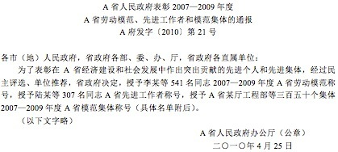

### 第 133 题

下列关于该公文标题的表述，正确的是：

A. 多项排列的字数应由少至多

B. 介词“关于”不能省略

C. “关于”应加在标题最前列

D. 文种使用有误

第 133 题 · 答案与解析

**参考答案（粉笔题库参考内容）**

B

**解析**

介词“关于”不能省略，且应位于“A省人民政府”之后，故C项错误。文种使用无误，表扬好人好事或批评错误和歪风邪气都适用于通报，故D项错误。分行组合的长标题在排列时应力求对称、美观，可排成宝塔形、倒宝塔形等，但要注意转行时不宜将词和专用名称拆开排列，故A项不选。

故正确答案为B。

**来源**：2011年上海市公务员录用考试《行测》题（A类）第133题

### 第 134 题

关于发文字号一行，下列说法正确的是：

A. 文号应为“A府发〔2010〕第21号”

B. 文号应为“A府发〔2010〕021号”

C. 此行右边应列“签发人：×××”

D. 此文种不需要列出“签发人：×××”

第 134 题 · 答案与解析

**参考答案（粉笔题库参考内容）**

D

**解析**

A、B两项错误，根据《党政机关公文格式》（GB/T 9704-2012）第7.2.5条规定：“发文字号。编排在发文机关标志下空二行位置，居中排布。年份、发文顺序号用阿拉伯数字标注；年份应标全称，用六角括号‘〔〕’括入；发文顺序号不加‘第’字，不编虚位（即1不编为01），在阿拉伯数字后加‘号’字。”

C项错误，D项正确，通报无需列出签发人。

故正确答案为D。

**来源**：2011年上海市公务员录用考试《行测》题（A类）第134题

### 第 135 题

关于主送机关一行，下列说法正确的是：

A. 三组单位应分列三行

B. 省政府部门中无“部”

C. 三组单位的排列次序妥当

D. 应补列省委机关各部

第 135 题 · 答案与解析

**参考答案（粉笔题库参考内容）**

BC

**解析**

“部”级部门隶属于国家，省政府与“部”同级别，故省政府部门中无“部”，B项正确。三组单位按照由大到小顺序排列正确，无需分列排列，A项错误，C项正确。

故正确答案为B、C。

**来源**：2011年上海市公务员录用考试《行测》题（A类）第135题

### 第 136 题

关于公文正文首段，下列说法正确的是：

A. “经过”一词改为“经”

B. 模范、先进产生程序有误，正确的程序是“单位推荐，民主评选”

C. “陆某等307名同志”后加“2007~2009年度”

D. “三百五十个集体”正确的写法是“350个集体”

第 136 题 · 答案与解析

**参考答案（粉笔题库参考内容）**

ABCD

**解析**

公文的写作要求严谨规范。A项中“经过”一次表示已经过去的事情，而“经”是通过的意思，修改正确。B项中先要通过单位的推荐，才能开始民主评选，先后顺序有误，修改正确。C项中要文字表述更加准确，故加上获得奖项的年度时间，修改正确。D项中前后文要表述一致，数字均用阿拉伯数字表示，所以要严谨表述，修改正确。故四项均修改正确。

故正确答案为A、B、C、D。

**来源**：2011年上海市公务员录用考试《行测》题（A类）第136题

### 第 137 题

关于公文落款，下列说法正确的是：

A. 发文机关应为“A省人民政府（印章）”

B. 发文机关应为“中共A省省委，A省人民政府（印章）”

C. 成文日期应为“二〇一〇年四月二十五日”

D. 成文日期应为“2010年4月25日”

第 137 题 · 答案与解析

**参考答案（粉笔题库参考内容）**

AD

**解析**

这篇公文为A省人民政府发文，故落款也应为A省人民政府，A项正确。成文日期应用阿拉伯数字将年、月、日标全，年份应标全称，月、日不编虚位，D项正确。

故正确答案为A、D。

**来源**：2011年上海市公务员录用考试《行测》题（A类）第137题

## 材料 12

以下是一份城管工作日记：2009年5月1日，A小区居民投诉，说小区里的绿地被人私自破坏，并种上了青菜。我们派了4名队员前往该小区实地查看，情况属实。原本草皮覆盖的小区坡地，被人为地划出了一块长约4米、宽约2米的青菜种植区，我们做好了现场勘查笔录。经多方访查，我们得知这是该小区一名老人所为，老人承认是自己做的，但称并不知道这是违法行为，我们现场出示了城市绿化管理条例，老人当即认错并承诺尽快把青菜处理掉。按照条例，破坏绿化的个人或组织，应处以罚款100元到2000元，但是考虑到老人生活困难，经报局领导同意，免除了对他的行政处罚。

### 第 138 题

关于城管执法，下列说法正确的有：

A. 《行政处罚法》规定，国务院或者经国务院授权的省、自治区、直辖市人民政府可以决定一个行政机关行使有关该行政机关的行政处罚权

B. 城管执法有利于改变多头执法、交叉执法等现象

C. 城管执法机关可以在法定授权范围内实施行政处罚

D. 限制人身自由的行政处罚可以由公安机关委托城管执行

第 138 题 · 答案与解析

**参考答案（粉笔题库参考内容）**

AC

**解析**

通过材料表述，城管的执法不利于改变多头执法、交叉执法的现象，故B项错误。限制人身自由的行政处罚只能由公安机关执行，不能委托城管执行，D项错误。A、C两项正确。

故正确答案为A、C。

**考点**：行政法

**来源**：2011年上海市公务员录用考试《行测》题（A类）第138题

### 第 139 题

本案如果进行处罚，涉及行政裁量问题，对此，《国务院关于加强市县政府依法行政的决定》作出的相关规定有：

A. 组织行政执法机关对有裁量幅度的行政处罚、行政许可相关条款进行梳理

B. 自由裁量权能细化的要细化，不能细化的要逐步取消

C. 对行政裁量权予以细化，能够量化的予以量化

D. 将细化、量化的行政裁量标准予以公布、执行

第 139 题 · 答案与解析

**参考答案（粉笔题库参考内容）**

ACD

**解析**

《国务院关于加强市县政府依法行政的决定》指出：市县政府及其部门要严格执行法律、法规、规章，依法行使权力、履行职责。要完善行政执法程序，根据有关法律、法规、规章的规定，对行政执法环节、步骤进行具体规范，切实做到流程清楚、要求具体、期限明确。要抓紧组织行政执法机关对法律、法规、规章规定的有裁量幅度的行政处罚、行政许可条款进行梳理，根据当地经济社会发展实际，对行政裁量权予以细化，能够量化的予以量化，并将细化、量化的行政裁量标准予以公布、执行。要建立监督检查记录制度，完善行政处罚、行政许可、行政强制、行政征收或者征用等行政执法案卷的评查制度。市县政府及其部门每年要组织一次行政执法案卷评查，促进行政执法机关规范执法。B项中“自由裁量权能细化的要细化，不能细化的要逐步取消”，《决定》中没有提到不能细化的要逐步取消，错误。A、C、D三项均表述正确。

故正确答案为A、C、D。

**考点**：行政法

**来源**：2011年上海市公务员录用考试《行测》题（A类）第139题

### 第 140 题

本案中，城管最终免除了对老人的行政处罚。关于不予处罚情节，下列表述正确的是：

A. 年龄已满十四周岁不满十六周岁的

B. 有重大立功表现的

C. 违法行为轻微并及时纠正，没有造成危害后果的

D. 主动取消违法行为后果的

第 140 题 · 答案与解析

**参考答案（粉笔题库参考内容）**

C

**解析**

只有不满14周岁的才能免于处罚，A项错误。重大立功也不能免于行政处罚，B项错误。主动取消违法行为后果的，也不能免于处罚，D项错误。

故正确答案为C。

**考点**：行政法

**来源**：2011年上海市公务员录用考试《行测》题（A类）第140题

