# 2012年上海市公务员录用考试《行测》题（A类）

<!-- gwy:overview:start -->
> **上海 · 2012 · 行测 · A类** ｜ 140 题 · 图片 123 处 · 答案随题折叠

| 题型模块 | 题量 | 题号 |
| --- | ---: | ---: |
| 言语理解与表达能力 | 25 | 1–25 |
| 判断推理能力 | 30 | 26–55 |
| 数理能力 | 25 | 56–80 |
| 常识应用能力 | 40 | 81–120 |
| 综合分析能力 | 20 | 121–140 |
| **合计** | **140** | |

导航：[题型与作答说明](#题型与作答说明) · [题目](#题目) · [材料 1](#材料-1)
<!-- gwy:overview:end -->

> 候选采集稿。参考答案及解析来自粉笔页面，不代表官方答案或真实高分答卷；来源使用许可与原卷对应关系仍需人工核实。

## 题型与作答说明

言语理解与表达能力

（25题）

言语理解与表达能力部分包括逻辑填空、片段阅读与文章阅读三种类型题目，均为单项选择题。

判断推理能力

（30题）

判断推理能力部分包括科学推理、定义判断、图形推理与逻辑判断四种类型的题目，均为单项选择题。

数理能力

（25题）

数理能力部分包括数学运算与资料分析两种类型的题目，均为单项选择题。

常识应用能力

（40题）

本部分均为不定项选择题，每小题给出的4个选项中，至少有1个选项符合题意。多选、少选或错选，均不得分。

综合分析能力

（20题）

本部分均为不定项选择题，每小题给出的4个选项中，至少有1个选项符合题意。多选、少选或错选，均不得分。

## 题目

### 第 1 题

最好的和最宝贵的书，读了以后，会把你带入一个崭新的境界：这样的书会在我们心里唤起＿＿＿＿＿意识、＿＿＿＿＿渴望、＿＿＿＿＿感情；这样的书会从沉睡中把我们唤醒，使我们摆脱困惑的泥潭，引我们走上开拓生活之路的人生。

依次填入画横线部分最恰当的一项是：

A. 强烈的 崇高的 纯洁的

B. 强烈的 纯洁的 崇高的

C. 纯洁的 崇高的 强烈的

D. 崇高的 强烈的 纯洁的

第 1 题 · 答案与解析

**参考答案（粉笔题库参考内容）**

D

**解析**

从第二空入手，搭配“渴望”，“渴望”指迫切的盼望，侧重愿望的急切程度，为中性词，不涉及高尚与否、纯粹与否的语义倾向。对应D项“强烈的”，指力量很大、程度鲜明，能够精准体现“渴望”的迫切感，符合文意，保留。A、C项“崇高的”指伟大高尚，侧重精神层面的高尚性；B项“纯洁的”指纯粹清白、没有私心，侧重品性的无瑕，这两个词均为褒义词，且语义侧重与“渴望”的核心属性不匹配，排除。

第一空，代入验证，搭配“意识”，“崇高的”与“意识”搭配恰当，可体现好书唤起的高尚正向认知，符合语境，保留。

第三空，代入验证，搭配“感情”，“纯洁的”与“感情”搭配精准，能够体现好书对人情感的净化作用，契合文意，当选。

故正确答案为D。

**考点**：关联关系-并列关系、实词填空、词的辨析-搭配对象

**来源**：2012年上海市公务员录用考试《行测》题（A类）第1题

### 第 2 题

能够欺骗你的，往往＿＿＿＿＿那些经不起理性检验的谎言和假象，＿＿＿＿＿那些被人刻意选择和过滤之后再告诉你的部分真相。

A. 不是 就是

B. 不是 而是

C. 不但是 而且是

D. 与其是 不如是

第 2 题 · 答案与解析

**参考答案（粉笔题库参考内容）**

B

**解析**

本题考查关联词的辨析与填空。

题干中，那些经不起理性检验的谎言和假象是不能欺骗人的，那些被人刻意选择和过滤之后再告诉你的部分真相却很有欺骗性。由此可知，空格所在的两个分句之间应该是取舍关系。B项“不是······而是······”与D项“与其是······不如是······”都是取舍关系的搭配，但“与其是”不能与“往往”搭配，影响句子表达，因此排除D项。

因此，结合选项应该选择B，B项选词符合题干要求，填入句中，与题意相符。

A项为选择关系关联词，C项表示递进关系，均与题意不合，予以排除。

故正确答案为B。

**来源**：2012年上海市公务员录用考试《行测》题（A类）第2题

### 第 3 题

人类赖以生存的地球，是一个“＿＿＿＿＿”的星球。它有着一道道的“防线”。尽管这些“防线”是天然的，但都像人为安排的那样＿＿＿＿＿。靠着这些铜墙铁壁般的天然＿＿＿＿＿，地球才能抵挡多样的天外袭击，＿＿＿＿＿着地球上的生命。

A. 设防 巧妙 屏障 保护

B. 防卫 巧妙 屏障 保证

C. 防卫 奇妙 障碍 保证

D. 设防 奇妙 障碍 保护

第 3 题 · 答案与解析

**参考答案（粉笔题库参考内容）**

A

**解析**

本题考查实词语境最佳选择。

此题可由第三空切入。由“地球才能抵挡多样的天外袭击”可知，第三个空格应填入一个有“保护”之意的词语。“障碍”指阻挡前进的东西，而“屏障”指某物像屏风那样遮挡、护卫一个需要保护的东西。因此，“屏障”符合题干要求，排除C、D项。

第四空，与“生命”搭配的应该是“保护”，而非“保证”，因此排除B项；再看A项前两个空格的选词，“设防”指设置防卫力量，“巧妙”指精巧高妙，填入空格内，可形成极佳的语意呼应。

故正确答案为A。

**考点**：实词填空、对应关系-前后呼应、词的辨析-词义侧重

**来源**：2012年上海市公务员录用考试《行测》题（A类）第3题

### 第 4 题

依次填入下列各句横线处的成语，与句意最贴切的一组是：

①《漫步华尔街》热销30余年仍经久不衰，很大程度上是因为本书构思新颖、＿＿＿＿＿、创见频出而又资料翔实，它为投资者在险象环生的华尔街上引路导航。

②“晴天水潋滟，雨天山空蒙”的杭州西湖，无论雨雪晴阴早霞晚辉，还是春花秋月夏荷冬雪，都独具风韵，若想去“不雨山长涧，无云山自阴”的十里梅坞品茶，更见山有美貌，坞有灵水，以茶生文，以文茗茶，＿＿＿＿＿。

③人们选择和布置这么一个场面来作为迎春的高潮，真是＿＿＿＿＿。

④大家都很熟识的黄山谷的书法，在宋代要算是＿＿＿＿＿的了。

A. 不落窠臼 匠心独运 独树一帜 别具一格

B. 独树一帜 匠心独运 不落窠臼 别具一格

C. 独树一帜 别具一格 不落窠臼 匠心独运

D. 不落窠臼 别具一格 匠心独运 独树一帜

第 4 题 · 答案与解析

**参考答案（粉笔题库参考内容）**

D

**解析**

本题考查近义成语的用法。

“不落窠臼”比喻有独创风格，不落俗套；“匠心独运”指独创性地运用精巧的心思；“独树一帜”比喻独特新奇，自成一家；“别具一格”指另有一种独特的风格。

本题的突破口在第二、三空。阅读可知，②句强调的是景物“独具风韵”，“匠心独运”用在此处显然不妥，应选择“别具一格”。由此可排除A、B项。③句说的是人们迎春的构思非常独特精巧，可用“匠心独运”来形容。

再看第一空，据题干可知，空格处的成语和“构思新颖”并列，“不落窠臼”强调不落俗套，用在此处，可形成极佳的语意呼应。④句中，空格处的成语是要形容黄山谷的书法风格，“独树一帜”满足题干要求。

故正确答案为D。

**考点**：关联关系-并列关系、对应关系-解释说明、成语填空

**来源**：2012年上海市公务员录用考试《行测》题（A类）第4题

### 第 5 题

在生活中出现摩擦、不快和委屈是常有的事，我们不能以针尖对麦芒，因为怨恨就像是一只气球，越吹越大，最后膨胀到无法控制的地步。要消除怨恨，我们应该不念旧恶，不计新怨， ＿＿＿ 。

A. 退一步海阔天空

B. 得饶人处且饶人

C. 偷得浮生半日闲

D. 直挂云帆济沧海

第 5 题 · 答案与解析

**参考答案（粉笔题库参考内容）**

B

**解析**

本题考查语句填空。

材料强调的是对待“摩擦、不快和委屈”等事的态度。“退一步海阔天空”是说以宽容的态度对人对事，强调退让；“得饶人处且饶人”指要宽容、体谅别人，尽量宽恕别人，强调胸襟。

因此，结合选项应该选择B。

C项“偷得浮生半日闲”是说难得有个休息的机会；D项“直挂云帆济沧海”是说挂起直入云霄的风帆，乘风破浪纵横驰骋于沧海之中，常用来抒发自己意气风发的感情；C、D项显然与题干语意不合，因此排除。

故正确答案为B。

**考点**：横线在结尾

**来源**：2012年上海市公务员录用考试《行测》题（B类）第2题

### 第 6 题

下面几个句子按顺序排列，语意最连贯的一项是：

①奖牌背面镶嵌玉璧

②即站立的胜利女神和希腊潘纳辛纳科竞技场全景

③奖牌正面使用国际奥委会统一规定的图案

④奖牌的挂钩由中国传统玉双龙蒲纹璜演变而成

⑤玉璧正中的金属图形上镌刻着北京奥运会的会徽

A. ③②①⑤④

B. ④③②①⑤

C. ③②④①⑤

D. ①⑤③②④

第 6 题 · 答案与解析

**参考答案（粉笔题库参考内容）**

A

**解析**

观察选项，判断首句，③句介绍奖牌正面的图案，①句介绍奖牌背面，④句介绍奖牌挂钩，按照一般介绍物品的逻辑顺序，应先介绍正面，再介绍背面或者细节配件，故③句适合作为首句，排除 B、D 两项。

继续观察对比A、C项，可比较②句后接④句还是①句，①句描述“奖牌背面镶嵌玉壁”，开启对背面的说明，④句单独说明“奖牌的挂钩由中国传统玉双龙蒲纹璜演变而成”，属于对奖牌附属部件的补充信息，通常置于正面与背面介绍之后。排除C项，A项当选。

故正确答案为 A。

**考点**：确定顺序

**来源**：2012年上海市公务员录用考试《行测》题（B类）第10题

### 第 7 题

下列四句话中，有语病的是：

A. 日常饮食中有很多食物看似平常，其实对孕妇具有非常好的保健作用

B. 随着救灾精神的发扬，越来越激发我思考一个问题：“咱当兵人应当承担怎样的社会责任?”

C. 如今在美国，宇航员仍然是最受人尊敬的职业之一，很多年轻人希望从事这一职业

D. 中国环境保护部决定开展一项针对铅蓄电池行业的环保专项行动，以全面彻查环境违法问题

第 7 题 · 答案与解析

**参考答案（粉笔题库参考内容）**

B

**解析**

本题属于病句辨析题。

B项的句子缺少主语，可通过去掉句首介词来达到改正的目的，应删去“随着”，当选。

其他句子没有语病。

故正确答案为B。

**来源**：2012年上海市公务员录用考试《行测》题（B类）第8题

### 第 8 题

下列句子中，括号中的成语使用不恰当的一句是：

A. 2011中国达人秀，有太多光芒四射的草根明星。他们（翻手为云，覆手为雨），在现实与梦想中以绝伦的才艺和旺盛的生命力给人们惊叹与折服

B. 在这次全国性京剧大赛中，有不少青年演员已开始（崭露头角），我们欣喜地发现京剧表演艺术之美必然会代代相传

C. 许多应试者都有一种考场经验和体会，那就是在临考前必须保持平和而放松的状态，那种连续开夜车疲劳驾驶的迎考方法常常会（事倍功半）

D. 十年的辛酸竟是为了赔一串假项链——《项链》出人意料的结尾，让读者不禁扼腕叹服大师的（独具匠心）

第 8 题 · 答案与解析

**参考答案（粉笔题库参考内容）**

A

**解析**

本题考查辨析成语使用对错的能力。

A项中“翻手为云，覆手为雨”形容人反复无常或惯于玩弄权术，用在此处与句意不符。

因此，结合选项应该选择A项。

“崭露头角”指初显露优异的才能，多指青少年；“事倍功半”形容做事的方法费力大，收效却很小；“独具匠心”形容巧妙而独特的构思，常指文学艺术方面与众不同的构思。B、C、D三项成语使用无误，符合语意。

本题为选非题，故正确答案为A。

**来源**：2012年上海市公务员录用考试《行测》题（A类）第8题

### 第 9 题

下列句子中，“起来”的用法与其他三句不同的是：

A. 他早上爬起来喝了两杯牛奶

B. 羚羊一听到动静就跑起来了

C. 夏天六点钟，太阳升起来了

D. 鲤鱼用力跳起来越过了堤坝

第 9 题 · 答案与解析

**参考答案（粉笔题库参考内容）**

B

**解析**

B项的“起来”表示动作的开始；A、C、D三项的“起来”是趋势补语，有“由低到高”的意思。

鉴别方法是删掉“起来”前面的字，A、C、D三项表意仍然完整，而B项如果删掉“起来”前面的“跑”字，表达的意思就改变了。

故正确答案为B。

**来源**：2012年上海市公务员录用考试《行测》题（B类）第7题

### 第 10 题

牙科医师经过化验发现，使用了3周的牙刷，细菌数量高达百万，等于超过9杯抹布水的细菌量，以及29个一元硬币的细菌量，是马桶水细菌含量的80倍！

这段话的风格最有可能出自：

A. 散文

B. 科普文

C. 杂文

D. 议论文

第 10 题 · 答案与解析

**参考答案（粉笔题库参考内容）**

B

**解析**

本题考查辨析体裁的能力。

阅读可知，题干的表达方式为说明，而“说明文”就是以说明为主要表达方式来解说事物、阐明事理而给人知识的文章体裁。“科普文”属于说明文，因此B项正确。因此，结合选项应该选择B项。

“散文”是与诗歌、小说、戏剧并称的一种文学体裁，指不讲究韵律的散体文章；“杂文”是散文的一种，它是直接而迅速地反映社会事变或社会倾向的一种文艺性论文；“议论文”是对某个问题或某件事进行分析、评论，表明自己的观点、立场、态度、看法和主张的一种文体。A、C、D三项显然不是题干的体裁，均排除。

故正确答案为B。

**来源**：2012年上海市公务员录用考试《行测》题（A类）第10题

### 第 11 题

硅藻是南极浮游植物中最主要的成分，其繁衍能力极强。它的大量生长为海域内几十亿吨磷虾的生长提供了充足的条件。磷虾用途甚广，它将是人类大有希望的蛋白质来源之一，也是南极生态中的一个关键性的生物，没有它就没有那么多的鲸类、企鹅和海豹等。于是，有人认为把磷虾作为南极生物的象征比起企鹅来说更为合适。

这段文字论述的中心是：

A. 把磷虾作为南极生物的象征最恰当

B. 磷虾的广泛用途和重要作用

C. 没有硅藻就没有磷虾、鲸类、企鹅和海豹

D. 硅藻的繁衍能力极强，是人类大有希望的蛋白质来源

第 11 题 · 答案与解析

**参考答案（粉笔题库参考内容）**

A

**解析**

本题为中心理解题。

材料第一句交代了磷虾的生长条件，第三句论述磷虾的用途和它对其他生物的影响，最后一句指出磷虾适合成为南极生物的象征。由此可知，题干整体上属于“铺垫解释原因—提出观点”的分—总结构，其语意重点是最后的观点，即把磷虾作为南极生物的象征比起企鹅来说更为合适。

因此，结合选项应该选择A。

B项只是对材料第三句话（即铺垫部分）的概括，并非材料主旨，排除；硅藻的大量生长为磷虾的生长提供了充足条件，并不能说明没有硅藻就没有磷虾，C项说法过于绝对，排除；D项说法不合文段，人类大有希望的蛋白质来源之一是磷虾，而非硅藻，排除。

故正确答案为A。

**考点**：关联词-因果

**来源**：2012年上海市公务员录用考试《行测》题（A类）第11题

### 第 12 题

我们有走向国际舞台的好导演，也有社会责任感较强的作家，但是世俗社会的艺术趣味并不如艺术家那般乐观，或者说饮食众生们对生活的诗意关怀还不够。这样的情形是否提示我们不妨多阅读点儿古典的东西，从本民族的优秀文化中汲取人文营养，即使对于那些专攻外语和计算机技术的人也还是有意义的。想一想，人们除了吃喝拉撒的本能以外还是应该有些别的奇妙的东西，而这些人们可以从经典的诗歌、散文、优美的诗情画意中获得。

这段文字论述的核心观点是：

A. 人们应当多阅读点儿古典的东西，从本民族的优秀文化中汲取人文营养

B. 经典的诗歌散文、优美的诗情画意可以带给人们别的奇妙的东西

C. 不读诗和散文的人恐怕得不到奇妙的东西

D. 阅读诗和散文、品味诗情画意、能关注生存状态的人气质与众不同

第 12 题 · 答案与解析

**参考答案（粉笔题库参考内容）**

A

**解析**

文段首先通过转折关联词“但”指出世俗社会的艺术趣味并不如艺术家那般乐观，或者说饮食众生们对生活的诗意关怀还不够，即提出问题，然后指出我们不妨应多阅读点儿古典的东西，从本民族的优秀文化中汲取人文营养，即提出对策，接着尾句进行解释说明，故文段的重点是对策，对应A项。

B项，“奇妙的东西”对应解释说明的内容，非重点，且非对策表述，偏离文段中心，排除；

C项，“得不到奇妙的东西”为问题表述，非重点，排除；

D项，“气质与众不同”无中生有，文段并未提及，排除。

故正确答案为A。

**考点**：关联词-对策

**来源**：2012年上海市公务员录用考试《行测》题（A类）第12题

### 第 13 题

《古学汇刊》第一集记绛云楼买宋版《汉书》、《后汉书》的故事，据说初时缺《后汉书》两本，遍嘱书贾，大索天下，一直没有消息。一天傍晚，某书贾泊舟乌镇，买面作食，面店主人从败簏中取出旧书两本，将为包裹，微睨之，宋版《后汉书》也。书贾大喜，只是首页已缺，问之主人，知道刚为邻翁裹面以去，结果又把这一页也追了回来。

这段文字的内容可以概括为：

A. 踏破铁鞋无觅处，得来全不费工夫

B. 有心栽花花不发，无心插柳柳成荫

C. 山重水复疑无路，柳暗花明又一村

D. 书到用时方恨少，事非经过不知难

第 13 题 · 答案与解析

**参考答案（粉笔题库参考内容）**

A

**解析**

本题为中心理解题。

“踏破铁鞋无觅处，得来全不费工夫”比喻急需的东西费了很大的力气找不到，却在无意中得到了。用这句话来描述文段中书贾为绛云楼尽心力寻书不成，却从面店主人处无意中获得这件事很符合文意。

因此，结合选项应该选择A。

“有心栽花花不发，无心插柳柳成荫”比喻想做一件事情，花了很大的精力，做了很多努力，但是结果并没能如愿，而不经意的事情，反而很顺利地得到好结果，说的是要顺其自然；

“山重水复疑无路，柳暗花明又一村”说的是事情总会有转机，在困境中也要挺过去；

“书到用时方恨少，事非经过不知难”强调实践的重要性。这三项用来概括文段都不如A合适，故排除。

故正确答案为A。

**来源**：2012年上海市公务员录用考试《行测》题（B类）第18题

### 第 14 题

知识沟假设认为随着大众传媒向社会传播的信息日益增多，处于不同社会经济地位的人获得媒介知识的速度是不同的，社会经济地位较高的人将比社会经济地位较低的人以更快的速度获取这类信息，因此这两类人之间的知识差距将呈扩大而非缩小之势。

对这段文字的理解，不正确的是：

A. 知识沟和代沟一样是一种比喻的说法

B. 在现代知识沟扩张的速度会越来越快

C. 知识沟由社会经济地位的差距决定

D. 获得知识越快速的人知识沟就越深

第 14 题 · 答案与解析

**参考答案（粉笔题库参考内容）**

D

**解析**

本题属于细节判断题。

文段介绍了知识沟的现象。知识沟是社会地位高、低的人两者之间的比较，D项用在一类人身上属于偷换概念，表述错误。

知识沟形容社会地位高、低的人两者之间的比较，和代沟一样是比喻的手法，A项表述正确；

由“两类人之间的知识差距将呈扩大而非缩小之势”一句可推出B项；

C项也可在文段找到依据。

本题为选非题，故正确答案为D。

**考点**：细节判断题

**来源**：2012年上海市公务员录用考试《行测》题（B类）第11题

### 第 15 题

网络经济的特征是：信息产业将在世界范围内大大发展，以此为基础的各种服务行业将成为越来越多的国家的主导产业；世界经济全球化的进程大大加速，国际投资、国际贸易以及跨国生产进一步发展；跨国公司和跨国经营将在世界经济中占主导地位，其内部流通将在越来越大的程度上取代通常的国际投资和国际贸易，等等。这种趋势必将在更大程度上冲击国家经济主权和经济安全，从而使各国特别是发展中国家面临新的挑战。

根据这段文字的内容，下列关于“网络经济的特征”的说法中，错误的是：

A. 信息产业将在世界范围内大大发展

B. 世界经济全球化的进程大大加速

C. 跨国公司将在世界经济中占主导地位

D. 发展中国家的主权必将遭受更大冲击

第 15 题 · 答案与解析

**参考答案（粉笔题库参考内容）**

D

**解析**

本题考查细节判断。

D项说法有误，材料中说的是“必将在更大程度上冲击国家经济主权和经济安全”，D项中的“国家主权”将范围扩大了，与题意不合。

因此，结合选项应该选择D项。

A、B、C三项分别对应前三句。

本题为选非题，故正确答案为D。

**考点**：细节判断题

**来源**：2012年上海市公务员录用考试《行测》题（A类）第15题

### 第 16 题

哲学是属于理智方面的事，文学是属于情感方面的事。我们研究哲学时，必须先将头脑放冷静了，然后才能寻究其中的道理。至读文学时，则宜带着兴奋的心灵，欣赏其一切。若读“哲理诗”，理智与感情并用，同时冷热，很觉不痛快。

这段文字的主要论题是：

A. 哲学与文学的差别

B. 研究哲学的方法

C. 欣赏文学的方法

D. 哲理诗的缺点

第 16 题 · 答案与解析

**参考答案（粉笔题库参考内容）**

D

**解析**

本题为中心理解题。

文段先是讨论哲学和文学的差别，然后因此引出读“哲理诗”和这两者的区别，即需“理智与感情并用，很觉不痛快”，也就是缺点。

因此，结合选项应该选择D。

文段说到A、B、C的内容都是为了引出哲理诗的缺点做铺垫，故都不选。

故正确答案为D。

**考点**：分述句特征-引入铺垫

**来源**：2012年上海市公务员录用考试《行测》题（B类）第14题

### 第 17 题

人的天赋、知识、智慧和能力等等总是有区别的，所以不是每个人都能像比尔·盖茨一样伟大，但是只要我们不断努力，找准自己的定位，永不放弃，我们即使不能像太阳那样金光闪闪，我们也可能像月亮一样发出光芒。

对这段文字的概括最正确的是：

A. 天生我才必有用

B. 是金子总会发光

C. 人生贵在坚持

D. 成功源自勤奋

第 17 题 · 答案与解析

**参考答案（粉笔题库参考内容）**

A

**解析**

本题为中心理解题。

由转折关系词“但是”可以判断出，整则材料的语意重点是其后的内容，即只要我们不断努力，找准自己的定位，我们也能够实现自己的价值。A项“天生我才必有用”是说老天既然生下我，我就必然是有用处的，比喻每个人都有自己的人生价值。

因此，结合选项应该选择A项。

B项“是金子总会发光”比喻有才华的人不会总被埋没，总有一天被发现；C、D两项分别强调的是坚持和勤奋。B、C、D三项均未抓住材料的语意重点，因此排除。

故正确答案为A。

**考点**：关联词-转折

**来源**：2012年上海市公务员录用考试《行测》题（B类）第15题

### 第 18 题

老鼠是人人喊打的坏蛋，不过它可是草原生态系统中不可缺少的角色。如果鼠类数量过多，大量啃食草根，那就会使食物减少，鼠类死亡率增加，生殖力下降。同时，鼠类过多还会使它们的天敌——鹰、黄鼠狼等得以发展，反过来抑制鼠类的增加。等到鼠类减少到一定程度，草原生态系统才会恢复到原来的状态。

根据这段文字的内容，下列说法错误的是：

A. 老鼠是草原生态系统中不可缺少的角色

B. 鼠类数量过多会间接导致其生殖力下降

C. 鼠类过多会使鹰和黄鼠狼等得以发展

D. 鼠类越少越易恢复草原生态系统原状

第 18 题 · 答案与解析

**参考答案（粉笔题库参考内容）**

D

**解析**

A项，根据文段“不过它可是草原生态系统中不可缺少的角色”可知，老鼠是草原生态系统不可或缺的角色，表述正确，排除；

B项，根据文段“如果鼠类数量过多，大量啃食草根，那就会使食物减少，鼠类死亡率增加，生殖力下降”可知，鼠类数量过多会通过导致食物减少间接造成生殖力下降，表述正确，排除；

C项，根据文段“鼠类过多还会使它们的天敌——鹰、黄鼠狼等得以发展”可知，鼠类过多会促进鹰和黄鼠狼等天敌的发展，表述正确，排除；

D项，根据文段“等到鼠类减少到一定程度，草原生态系统才会恢复到原来的状态”可知，并非鼠类越少越易恢复，而是需要减少到“一定程度”，表述过于绝对，且文段开头指出“不过它可是草原生态系统中不可缺少的角色”，故“越少越易恢复草原生态系统原状”与文意相悖，当选。

本题为选非题，故正确答案为D。

**考点**：细节判断题

**来源**：2012年上海市公务员录用考试《行测》题（B类）第16题

## 材料 1

在历法王国里，谁也没有我伟大，我就是历法之魁，通行全世界的公历。我的全名叫格里高利历，人们却喜欢叫我的小名：阳历，因为我是根据地球绕太阳公转一周的时间制定的。

        我的父亲是儒略历，他也不愧为一代天骄。公元前古罗马人的历法一年有365天，可每两年就需增加22或23天，因此日期常常变换，老百姓经常弄不清日期。公元前46年，罗马统帅儒略·恺撒决定让我父亲掌管历法。父亲行使的权力主要有：一年分为12个月，单月31天，双月30天，唯有2月是29天。因为在罗马，2月是行刑期，人们认为2月是个不吉祥之月，不能过得太长，所以从 2月中减去一天，这样也符合当时测得地球公转1周的时间。

        父亲上任不久，儒略·恺撒死了，他的侄子奥古斯都当上了罗马帝国的第一任皇帝。他征服埃及和结束国内战争是在8月，为了炫耀自己，奥古斯都给父亲动了个小手术：用自己的名字“August”作为8月的名称。他还嫌8月是小月，就从2月中抽出一天，加在8月上。又打乱8月后面大小月的顺序，因而，大月变小月，小月变大月。他的手术很成功，一直到现在还是1、3、5、7、8、10、12为大月，2、4、6、9、11为小月。

        父亲掌管历法一千多年，虽然工作认真、负责，但是由于过于年迈迂腐，跟不上科学技术的发展，到1582年，所显示的日期和实际的日期已经相差了10天。这样，罗马教皇格里高利十三世提出，让我接父亲的班。我上班后立即决定把这年的 10月5日改为10月 15日，纠正了父亲的误差。为了使自己更完善，我还规定每400年中取消3个闰日。这样平均年长为365.2425日，比太阳年的实际长度365.24219日仅差26秒，从此，我就登上了历法至尊的宝座。

        我的优点很多，一上任就被当时的天主教国家，如罗马、意大利、法国、西班牙等国重用。中国一直到1912年才把我引进。

### 第 19 题

这文字主要说明的是：

A. 世界历法的发展过程

B. 公历和公历的来历

C. 什么是儒略历和公历、奥古斯都改订后的儒略历和格里高利历

D. 公历的优点

第 19 题 · 答案与解析

**参考答案（粉笔题库参考内容）**

B

**解析**

本题考查表面主旨。

阅读可知，文章运用了拟人的手法。通过第1段可知“我”指的是公历，第2、3段介绍的公历的“父亲”即儒略历，接下来指出因为儒略历跟不上科技的发展，公历登上“历法至尊的宝座”，被很多国家采用。综上可知，文章主要介绍的是公历和公历的来历。

因此，结合选项应该选择B。

A项错误，“世界历法”范围太广，文章所讲的公历只是世界历法中的一种，排除；

C项中奥古斯都改订后的儒略历和格里高利历只是文章细节，并非文章主要说明的内容，排除；

D项表述片面，文章只是在最后一段提到公历有很多优点，不能作为文章主旨，排除。

故正确答案为B。

**来源**：2012年上海市公务员录用考试《行测》题（A类）第19题

### 第 20 题

下列关于历法特征的表述，不正确的一项是：

A. 儒略历一年分12个月，单月31天，双月30天，2月29天

B. 奥古斯都改订后的儒略历规定1、3、5、7、8、10、12月为大月， 2、4、6、9、11为小月， 2月28天

C. 公历在奥古斯都改订后的儒略历的基础上加10天

D. 公历在奥古斯都改订后的儒略历的基础上规定每400年中取消三个闰日，年平均长度为365.2425日

第 20 题 · 答案与解析

**参考答案（粉笔题库参考内容）**

C

**解析**

本题考查细节判断。

C项说法错误，文章第4段说的是“把这年的10月5日改为10月15日”，而不是“加10天”。

因此，结合选项应该选择C。

由第2段中“父亲行使的权力主要有：一年分为12个月，单月31天，双月30天，唯有2月是29天”可知A项正确；B项正确，由第3段最后三句话可以推断得出；根据第4段中“为了使自己更完善，我还规定每400年中取消3个闰日。这样平均年长为365.2425日”可知D项正确。综上所述，排除A、B、D三项。

本题为选非题，故正确答案为C。

**来源**：2012年上海市公务员录用考试《行测》题（A类）第20题

### 第 21 题

下列对本文的写法分析，不准确的是：

A. 用拟人手法，以自述形式介绍有关历法知识，生动亲切，构思奇特

B. 按罗马历法发展的时间顺序组织材料，条理清楚

C. 使用大量确凿的数据，保证了说明的准确性、科学性

D. 拟人说明与非拟人说明相结合是本文的特点

第 21 题 · 答案与解析

**参考答案（粉笔题库参考内容）**

D

**解析**

本题考查细节判断。

D项说法错误，文章通篇运用的都是拟人手法，并没有非拟人的说明。因此，结合选项应该选择D。

阅读可知，文章采用拟人手法，将“公历”比作一个人，通过介绍自己的父亲引出自己的由来，其间引用了大量确凿的数据来保证论述的科学性。由此可知，A、B、C三项说法均正确无误，均排除。

本题为选非题，故正确答案为D。

**来源**：2012年上海市公务员录用考试《行测》题（A类）第21题

## 材料 2

阅读下面的文章，回答各题。

（一）辩证唯物主义的认识论，把实践作为认识过程的基础，这是它同以前的认识论相区别的一个根本标志。因此，要全面关注孩子的素质，首先必须关注他们的活动的发展和变化。

（二）辩证唯物主义认为，人的心理既不是由什么先天的遗传、先验的精神或图式决定的，也不是由环境、由外界事物机械地决定的。人的心理，包括儿童的心理，并不是什么先天的东西预定的运动，也不是对外界事物的直观的、机械的反映，而是在人的积极活动中，在主体和客体相互作用中的一种能动的反映。人的心理，包括儿童的心理，都是在活动中形成的，也是在活动中表现的，并且随着活动形态（游戏、学习、劳动）的不断发展而向前发展。这才是正确理解人，包括儿童心理发展的正确的钥匙。

（三）人的实践活动主要是认识世界和改造世界的活动。但从个体来说，实践活动有一个形成和发展过程。儿童出生不久，就产生了完整的有目的动作；继而便出现了专门接受人类经验的学习活动；最后，出现了改造自然、改造社会的劳动生产和社会生活这一典型形态的实践活动。在这一过程中，儿童从学会适应社会生活，逐步发展到学会改造社会。这样，他就成为一个独立的社会成员。

### 第 22 题

根据全文内容，第一段中说“要全面关注孩子的素质，首先必须关注他们的活动的发展和变化”，其原因在于：

A. 孩子的素质只有在实践活动中才得以形成

B. 孩子的素质只有在实践活动中才得以发现

C. 孩子的素质只有在实践活动中才得以认识

D. 孩子的素质只有在实践活动中才得以检验

第 22 题 · 答案与解析

**参考答案（粉笔题库参考内容）**

C

**解析**

本题属于细节判断题。

回到原文找到该句子，由第一段“因此”一词，可知其原因为第一个句子。第一个句子主要谈论的是实践与认识的关系。

故正确答案为C。

**来源**：2012年上海市公务员录用考试《行测》题（B类）第23题

### 第 23 题

根据第二段的内容，下列说法中正确的是：

A. 人的心理不是由任何事物决定的

B. 人的心理不是任何事物的反映

C. 人的心理是在活动中形成和发展的

D. 人的心理是主体对外界事物的客观反映

第 23 题 · 答案与解析

**参考答案（粉笔题库参考内容）**

C

**解析**

本题属于细节判断题。

根据第二段“人的心理，包括儿童的心理，都是在活动中形成的，也是在活动中表现的”。因此，结合选项应该选择C项。

A项是对原文“人的心理既不是由什么先天的遗传、先验的精神或图式决定的，也不是由环境、由外界事物机械地决定的”一句的误读，可排除；

B项是对原文“人的心理，包括儿童的心理，并不是什么先天的东西预定的运动，也不是对外界事物的直观的、机械的反映”的误读，也可排除；

由“在人的积极活动中，在主体和客体相互作用中的一种能动的反映”可知，D项表述错误，排除。

故正确答案为C。

**来源**：2012年上海市公务员录用考试《行测》题（B类）第24题

### 第 24 题

根据第三段的内容，作者认为儿童“成为一个独立的社会成员”的标志是：

A. 适应社会生活

B. 接受人类经验

C. 参加劳动生产

D. 学会改造社会

第 24 题 · 答案与解析

**参考答案（粉笔题库参考内容）**

D

**解析**

本题属于细节判断题。

根据文段的最后两句话“在这一过程中，儿童从学会适应社会生活，逐步发展到学会改造社会。这样，他就成为一个独立的社会成员”可知，学会改造社会才能成为一个独立的社会成员。

故正确答案为D。

**来源**：2012年上海市公务员录用考试《行测》题（B类）第25题

### 第 25 题

这篇短文所讨论的主要问题是：

A. 辩证唯物主义的认识论

B. 实践活动与儿童心理发展

C. 人的心理的形成过程

D. 实践活动的重要性

第 25 题 · 答案与解析

**参考答案（粉笔题库参考内容）**

B

**解析**

本题属于表面主旨题。

通读全文可知，文段运用辩证唯物主义解读了儿童的心理发展。

因此，结合选项应该选择B项。

A、C、D三项都没有提到“儿童心理发展”这一关键词，故不选。

故正确答案为B。

**来源**：2012年上海市公务员录用考试《行测》题（B类）第22题

### 第 26 题

如图所示，三个相连的容器A、B、C，容量都是25升。每个容器里都有5升水。如果有45升水慢慢倒入容器A，待稳定后，容器C里会有多少升水：

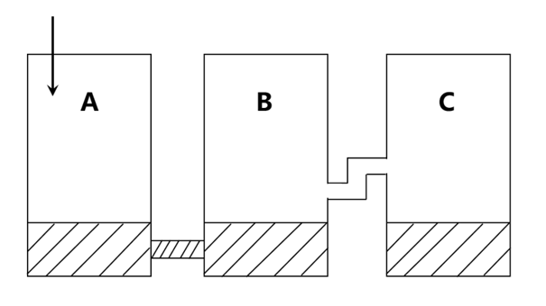

A. 20

B. 15

C. 10

D. 5

第 26 题 · 答案与解析

**参考答案（粉笔题库参考内容）**

A

**解析**

本题考查连通器原理。连通器是液面以下相互连通的两个或几个容器。盛有相同液体，液面上压力相等的连通器，其液面高度相等。

通过分析，原来每个容器各有5升水，共15升，又倒入45升，最终三个容器共有水45＋15＝60（升）。观察发现四个选项中，只有D中是5升。假设D正确，那意味着没有水从第二个容器流入最后一个容器，因此第一个和第二个容器共有水60－5＝55（升），而每个容器容量是25升，前两个容器最多是25＋25＝50（升），装不下55升，因此D项错误，排除。所以一定有水流入最后一个容器，共60升，最后液面高度相等，每个容器60÷3＝20（升），因此最后一个容器有20升水。

故正确答案为A。

**来源**：2012年上海市公务员录用考试《行测》题（A类）第26题

### 第 27 题

将四个相同的灯泡和两个相同的电池以导线连接，其电路如图。若通过各灯泡的电流分别为、、和，假设电池供应的电压稳定，并联电路a、b间的电压维持在定值，则下列电流关系正确的是：

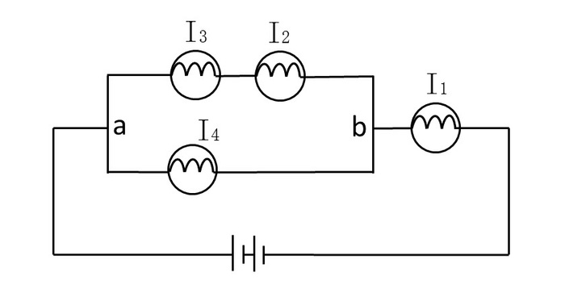

A. 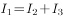

B. 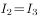

C. 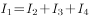

D. 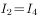

第 27 题 · 答案与解析

**参考答案（粉笔题库参考内容）**

B

**解析**

本题考查串联、并联电路的电流特点。串联电路中各处电流相等，并联电路中干路电流等于各支路电流之和。

通过分析，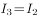（串联），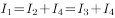。从而容易判断只有B项中电流关系符合。

故正确答案为B。

**来源**：2012年上海市公务员录用考试《行测》题（A类）第27题

### 第 28 题

如图所示，有一容器，内装互不相溶的两种液体。现将质量及体积皆相同的三个铝块，分别以细绳悬吊于弹簧秤下，使静止于液体中。若弹簧秤的读数分别为W1、W2和W3，则下列关系正确的是（细绳之重量及粗细不计）：

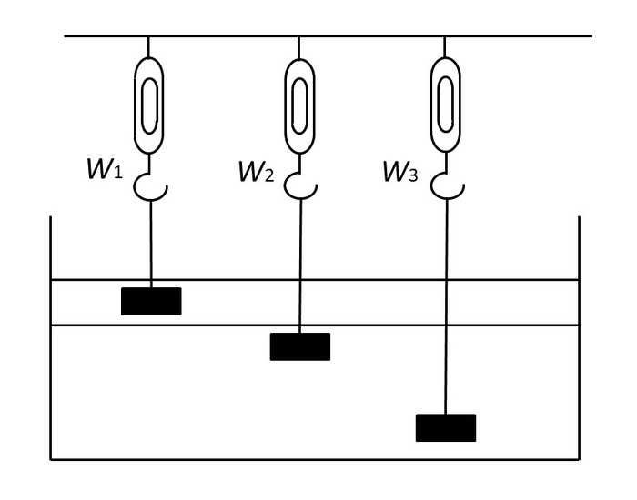

A. 

B. 

C. 

D. 

第 28 题 · 答案与解析

**参考答案（粉笔题库参考内容）**

B

**解析**

本题考查受力分析。对铝块进行受力分析：竖直向下的是自身的重力，竖直向上的是弹簧的拉力和液体的浮力。最终静止于液体中，说明重力＝浮力＋弹簧的拉力。

通过分析，三个铝块质量相同，因此重力相同；，铝块完全浸入液体中，上边的液体密度小则铝块所受浮力小。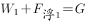，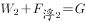，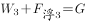，又知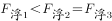，所以。

故正确答案为B。

**来源**：2012年上海市公务员录用考试《行测》题（A类）第28题

### 第 29 题

用一块凸透镜对着阳光，在透镜后面放一张白色纸屏，由于凸透镜对光线有会聚作用，纸屏上出现三个明暗不同的区域，如图所示。因阳光会聚中央区域最亮，其次是周围阳光直射的地方，两者之间有一个最暗的区域，那里既没有直射的阳光也没有折射的阳光。现将凸透镜换一块对光线有发散作用的凹透镜，那么明暗区域可能变成图中的：

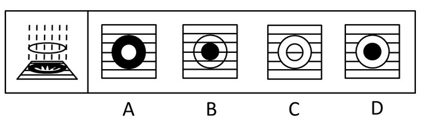

A. A

B. B

C. C

D. D

第 29 题 · 答案与解析

**参考答案（粉笔题库参考内容）**

D

**解析**

凹透镜发散光线，周围形成的是亮的光线，中间区域光线是最暗的，最外边是阳光直射的光线。通过分析，只有D选项中明暗区域符合。

故正确答案为D。

**来源**：2012年上海市公务员录用考试《行测》题（A类）第29题

### 第 30 题

截面为方形的实心钢梁若受到压力发生形变，钢梁的上部呈压缩形变，越在上面的部分形变越大；钢梁的下部呈拉伸形变，越在下面的部分形变越大，钢梁的正中间无形变。形变越大的地方产生的恢复力越大，抗弯曲（抗形变）的贡献也越大。为了将钢梁的重量减轻一半，现有四种方案，其截面图如下所示，减重后的钢梁抗弯性都要下降，但抗弯性相对较强的方案是：

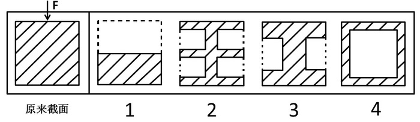

A. 1和2

B. 1和3

C. 2和3

D. 3和4

第 30 题 · 答案与解析

**参考答案（粉笔题库参考内容）**

D

**解析**

本题考查工程力学中的应力。应力是受力物体截面上内力的集度，即单位面积上的内力。

题目中说应力主要在上面和下面，中间小。所以把中间的去掉不影响应力的产生，同时减少了重力，如生活中的空心砖。钢梁的厚度越大，相对产生的应力就越大，所以中间空两端厚的应力相对大，因此3和4符合。

故正确答案为D。

**来源**：2012年上海市公务员录用考试《行测》题（A类）第30题

### 第 31 题

硬新闻是关系到国计民生以及人们切身利益的新闻，包括党和国家的重大方针、政策的制定和改变、市场行情、疾病流行、天气变化、重大灾难事故等。硬新闻为人们的政治、经济、工作、日常生活的决策提供依据。

根据上述定义，下面不属于硬新闻的是：

A. 中国价值5600余万元救灾物资经上海口岸援助泰国

B. 北大硕士生回农村老家建设“立人”图书馆促教改

C. 上海今明两年各增18万新生儿，创十年来生育最高峰

D. “神八”追梦，中国实施首次空间对接

第 31 题 · 答案与解析

**参考答案（粉笔题库参考内容）**

B

**解析**

第一步：抓住定义中的关键词。

关键词强调关系到“国计民生”以及“人们切身利益”的新闻。

第二步：逐一判断选项。

A项中的“中国价值5600余万元救灾物资”体现了国家的经济政策，关系到“国计”，C项中的“创十年来生育最高峰”关系到“民生”，D项中“神八”追梦关系到“国计”，三者均属于硬新闻。B项中的“回农村老家建设‘立人’图书馆促教改”为个人为地方所做的行为，不关系“国计民生”，不属于硬新闻。

本题为选非题，故正确答案为B。

**考点**：单定义-其他句式

**来源**：2012年上海市公务员录用考试《行测》题（B类）第35题

### 第 32 题

麦加利地震烈度是一个量度地震对某一特定地点所受到的影响的量度单位，由地震时地面建筑物受破坏的程度、地形地貌改变、人的感觉等宏观现象来判定。麦加利地震烈度从感觉不到至全部损毁分为1至12度，5度或以上才会造成破坏，烈度会因观测地点的不同而异。

根据上述定义，下面说法错误的是：

A. 与震源越近的地区麦加利地震烈度肯定越大

B. 麦加利地震烈度并非地震之绝对强度

C. 麦加利地震烈度与地震区域的各种条件有关

D. 麦加利地震烈度是表示地震破坏程度的标度

第 32 题 · 答案与解析

**参考答案（粉笔题库参考内容）**

A

**解析**

第一步：抓住定义中的关键词。

关键词强调“某一特定地点所受到的影响”。

第二步：逐一判断选项。

A项表述错误，麦加利地震烈度是根据该地区所受到的影响，如地震时地面建筑物受破坏的程度、地形地貌改变、人的感觉等宏观现象来判定，而不是根据与震源的远近判定。根据关键词可知B、D项正确，麦加利地震烈度并非地震之绝对强度，而是表示地震破坏程度的标度。“烈度会因观测地点的不同而异”可知“麦加利地震烈度与地震区域的各种条件有关”，C项正确。

本题为选非题，故正确答案为A。

**考点**：单定义-其他句式

**来源**：2012年上海市公务员录用考试《行测》题（A类）第32题

### 第 33 题

所谓“同质化竞争”是指同一商品大类中不同品牌的商品在性能、外观甚至营销手段上相互模仿，以至逐渐趋同的现象。同质化竞争不利于消费者识别商品特点，若是知名品牌，尚有竞争力，若是一般品牌，免不了要进行残酷的价格战，市场前景不容乐观。

根据上述定义，下面属于同质化竞争的是：

A. 出版社跟风出版穿越小说

B. 农村兴起绿色有机种植业

C. 利用网络做宣传风行一时

D. 保健品行业虚假广告成风

第 33 题 · 答案与解析

**参考答案（粉笔题库参考内容）**

A

**解析**

第一步：抓住定义中的关键词。

关键词强调主体为“同一商品大类中不同品牌的商品”、手段为“在性能、外观甚至营销手段上相互模仿”。

第二步：逐一判断选项。

B项没有涉及不同品牌的商品；C项只体现出了使用“同一营销手段”，但主体不明确，未必是“同一商品大类中不同品牌的商品”；D项主体是“虚假广告”，而不是“保健品行业”，也不符合“同质化竞争”主体要求。A项中主体为“不同的出版社”，共同营销手段为“跟风出版穿越小说”，为“同质化竞争”。

故正确答案为A。

**考点**：原因结果

**来源**：2012年上海市公务员录用考试《行测》题（A类）第33题

### 第 34 题

“木马”程序是目前比较流行的病毒文件，与一般的病毒不同，它不会自我繁殖，也并不“刻意”地去感染其他文件，它通过将自身伪装成正常文件吸引用户下载执行，为施种木马者打开被种者电脑的门户，使施种者可以任意毁坏、窃取被种者电脑中的文件，甚至远程操控被种者的电脑。

根据上述定义，“木马”程序造成的最主要危害是：

A. 破坏系统文件

B. 降低运行速度

C. 窃取用户隐私

D. 伪装正常文件

第 34 题 · 答案与解析

**参考答案（粉笔题库参考内容）**

C

**解析**

第一步：抓住定义中的关键词。

“危害”关键词为“可以任意毁坏、窃取被种者电脑中的文件”、“甚至远程操控被种者的电脑”。

第二步：逐一判断选项。

A、B、D三项未抓住“危害”的关键词，A、B两项在定义中未涉及，D项“伪装正常文件”是木马的运行方式，不是危害，均排除。

C项“窃取用户隐私”与关键词意思相同，当选。

故正确答案为C。

**考点**：方式目的

**来源**：2012年上海市公务员录用考试《行测》题（B类）第34题

### 第 35 题

“图腾”一词来源于印第安语“totem”，意思为“它的亲属”、“它的标记”。在原始人信仰中，认为本氏族人都源于某种特定的物种，即与某种动物或自然物具有亲缘关系。于是，图腾信仰便与祖先崇拜发生了关系。“totem”的第二个意思是“标志”。图腾标志在原始社会中起着重要的作用，它是最早的社会组织标志和象征，具有团结群体、密切血缘关系、维系社会组织和互相区别的职能。

根据上述定义，下面不属于图腾现象的是：

A. 蒙古族以“苍天”为永恒最高神，“成吉思汗”的含义就是“赖苍天之力而为汗者”

B. 侗族传说中，其始祖母与一条大花蛇交配，滋生繁衍而形成侗族

C. 古代朝鲜族每一村落村口都立一鸟杆，作为本氏族的象征

D. 鄂伦春族称公熊为“雅亚”，意为祖父，称母熊为“太帖”，意为祖母

第 35 题 · 答案与解析

**参考答案（粉笔题库参考内容）**

A

**解析**

第一步：抓住定义中的关键词。

图腾在定义中有两个意思，关键词分为“本氏族人都源于某种特定的物种”和“标志”。

第二步：逐一判断选项。

A项中蒙古族以“苍天”为永恒最高神，属于宗教信仰；

B项体现了侗族来源于“大花蛇”；

C项指出古代朝鲜族以“每一村落村口都立一鸟杆”为本族的标志；

D项中的鄂伦春族认为与公熊、母熊有血缘关系，三者都属于“图腾现象”。

本题为选非题，故正确答案为A。

**考点**：单定义-其他句式

**来源**：2012年上海市公务员录用考试《行测》题（B类）第32题

### 第 36 题

根据（1）和（2）的变化规律，（3）与图（  ）对应。

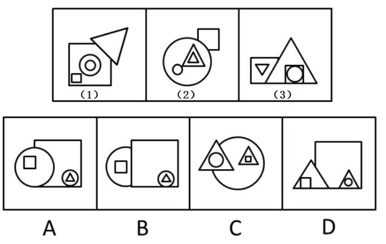

A. A

B. B

C. C

D. D

第 36 题 · 答案与解析

**参考答案（粉笔题库参考内容）**

A

**解析**

观察可知在（2）中，（1）中的正方形都变为圆形，圆形均变为三角形，三角形变为正方形，但是组成结构不变；且在（1）（2）中发生了上下位置的关系，即在第一图层的图形在（2）被覆盖在下面。所选图形也应该以（3）为基础按此规律变化。

故正确答案为A。

**来源**：2012年上海市公务员录用考试《行测》题（A类）第36题

### 第 37 题

根据（1）和（2）的变化规律，（3）与图（  ）对应。

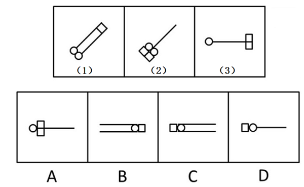

A. A

B. B

C. C

D. D

第 37 题 · 答案与解析

**参考答案（粉笔题库参考内容）**

C

**解析**

元素组成基本相同，题干图形均由圆形、正方形、线条构成，优先考虑位置规律。观察发现，图1至图2，正方形由右上方平移到完全相反的左下方；图3至图4应用规律，正方形应由最右侧平移到完全相反的最左侧，排除A、B两项。继续观察发现，图1至图2，线条减少1条、正方形增多1个，小元素的总数量不变；图3至图4应用规律，正方形减少1个，那么线条应增多1条，只有C项符合。

故正确答案为C。

**考点**：数量规律-复合

**来源**：2012年上海市公务员录用考试《行测》题（A类）第37题

### 第 38 题

将下列右边的折叠图（  ）展开后，可以得到左边的图。

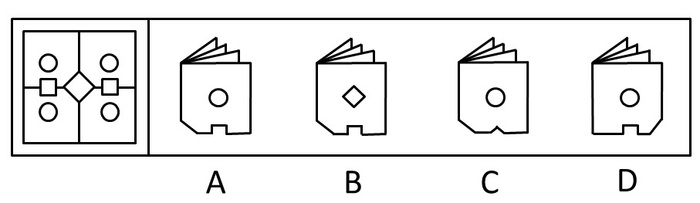

A. A

B. B

C. C

D. D

第 38 题 · 答案与解析

**参考答案（粉笔题库参考内容）**

A

**解析**

两次对折之后得到的图形应为题干图形的四分之一，再看图形的摆放角度，可知应为右上角图形，A项符合。

故正确答案为A。

**来源**：2012年上海市公务员录用考试《行测》题（B类）第42题

### 第 39 题

根据上图的变化规律，得到的图形是：

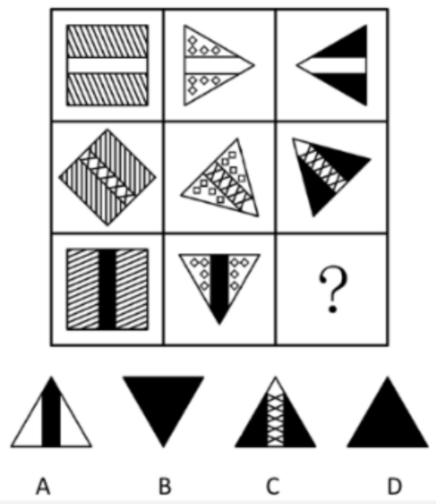

A. A

B. B

C. C

D. D

第 39 题 · 答案与解析

**参考答案（粉笔题库参考内容）**

D

**解析**

元素组成相似，元素周遍。列为单位，每一列中的图形整体颜色保持一致，只是中线阴影不同，但每一行的中线颜色是相同的，每一列图形都依次顺时针旋转45度。故未知三角形整体颜色为黑色，中线阴影也为黑色，且将第三列第二行图形顺时针旋转45度，即可得到D项。

故正确答案为D。

**考点**：位置规律-旋转、样式规律-遍历

**来源**：2012年上海市公务员录用考试《行测》题（B类）第43题

### 第 40 题

左图折叠后，得到的立方体有：

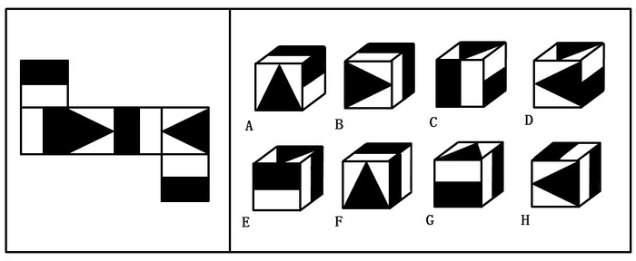

A. ACG

B. BDH

C. ABH

D. EGH

第 40 题 · 答案与解析

**参考答案（粉笔题库参考内容）**

C

**解析**

本题属于空间重构类，从选项分析，通常思维，能够由左边折成的立方体应该只有三个，但是要注意题干说的是“得到的立方体有”，而不是“得到的立方体只有”，所以能够由左边折叠成的立方体大于等于3个，做题只能通过找错误的图形来排除选项，逐一分析右边立方体，H出现的次数最多，先分析H：

H项：找到图形和题干对应的面后，判断各个面位置对应关系是否正确，没有发现问题，所以正确，无法排除任何选项；

A项：A、B、G都出现了两次，逐一判断，找到图形和题干对应的面后，判断各个面位置对应关系是否正确，没有发现问题，所以正确，无法排除任何选项；

B项：找到图形和题干对应的面后，判断各个面位置对应关系是否正确，没有发现问题，所以正确，至此我们发现A、B、H都对了，可以得到选项C正确。

剩余图形分析：

G项：找到图形和题干对应的面后，判断各个面位置对应关系是否正确，没有发现问题，所以正确；

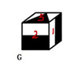

C项：两个三角面尖角对应的棱都不是黑白交界线，所以错误；

D项：两个三角面是相对面，不能同时出现，所以错误；

E项：找到图形和题干对应的面后，判断各个面位置对应关系是否正确，图中1、3面的公共点和题干当中对比，1应该是白长方形与之对应，所以错误；

F项：找到图形和题干对应的面后，判断各个面位置对应关系是否正确，图中1、4面的公共边和题干当中对比，1应该是整个黑长方形与之对应，所以错误。

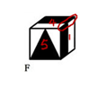

故正确答案为C。

**考点**：空间类-空间重构-六面体

**来源**：2012年上海市公务员录用考试《行测》题（B类）第44题

### 第 41 题

右图各选项中，（  ）不是左面立体图的投影图。

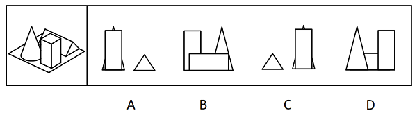

A. A

B. B

C. C

D. D

第 41 题 · 答案与解析

**参考答案（粉笔题库参考内容）**

C

**解析**

C项如果三角在左侧，那么整个图形为从左侧看的投影图，圆锥应该在长方体的前面，C图错误。A、B、D的投影图均正确，分别为从右、后、前三个方位看的投影图。

故正确答案为C。

**考点**：空间类-三视图

**来源**：2012年上海市公务员录用考试《行测》题（A类）第41题

### 第 42 题

根据左图的变化规律，得到的图形是：

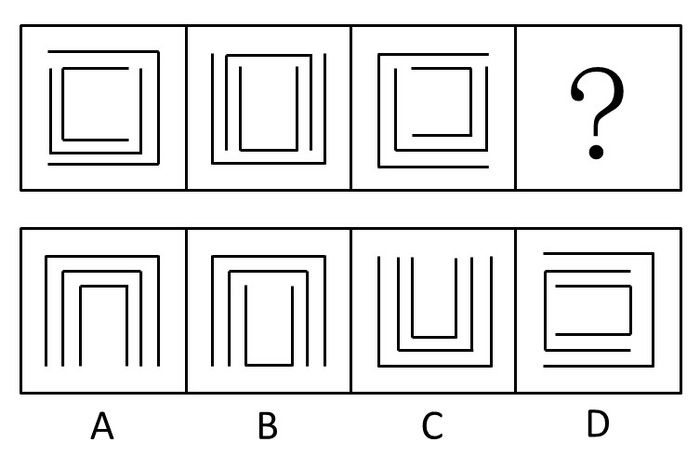

A. A

B. B

C. C

D. D

第 42 题 · 答案与解析

**参考答案（粉笔题库参考内容）**

A

**解析**

元素组成相同，看位置。从左到右外圈依次顺时针旋转90度，次外圈依次旋转180度，内圈依次逆时针旋转90度，故未知图形外圈开口向下，次外圈开口向下，内圈开口向下，A项符合。

故正确答案为A。

**考点**：位置规律-旋转

**来源**：2012年上海市公务员录用考试《行测》题（A类）第42题

### 第 43 题

从所给四个选项中，选择最合适的一个填入问号处，使之呈现一定的规律性：

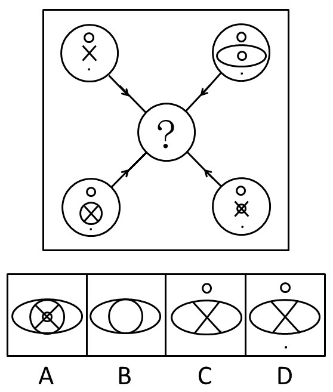

A. A

B. B

C. C

D. D

第 43 题 · 答案与解析

**参考答案（粉笔题库参考内容）**

A

**解析**

元素组成相似，优先考虑样式规律。相同元素线条重复出现，优先考虑加减同异。观察选项和箭头方向可知，“？”处图形由四个外圈运算得到。每个外圈内图形均可分为上中下三部分，上下两部分求异（即上面的圆圈和下面的黑点应该去掉），中间部分叠加保留，对应A项。

故正确答案为A。

**考点**：样式规律-加减同异

**来源**：2012年上海市公务员录用考试《行测》题（A类）第43题

### 第 44 题

下图为两个等圆柱体垂直相交的立体图，沿箭头方向的视图是：

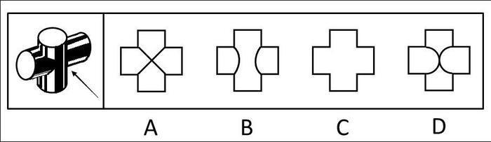

A. A

B. B

C. C

D. D

第 44 题 · 答案与解析

**参考答案（粉笔题库参考内容）**

A

**解析**

三视图考查，对角线即为两个圆柱相交椭圆弧线的侧视图线。

故正确答案为A。

**考点**：空间类-三视图

**来源**：2012年上海市公务员录用考试《行测》题（B类）第40题

### 第 45 题

下图中塔尖所缺的是（  ）图形。

A. A

B. B

C. C

D. D

第 45 题 · 答案与解析

**参考答案（粉笔题库参考内容）**

D

**解析**

元素组成相似，且相同线条重复出现，优先考虑样式规律中的加减同异。本题为金字塔类题目，要自下向上找规律，即下层相邻的两图形之间进行运算得到上面的图形，如下图箭头指向所示：

观察发现，第四行相邻两个图形的内部线条求异得到第三行图形，第三行相邻两个图形的内部线条求异得到第二行图形，则问号处图形应由第二行两个图形内部线条进行求异得到，只有D项符合。

故正确答案为D。

**考点**：样式规律-加减同异

**来源**：2012年上海市公务员录用考试《行测》题（B类）第37题

### 第 46 题

A和B同时同地出发，当B走到途中凉亭时，A落后B1公里，B说：“前次我和C一起走，当C走到此凉亭时，我已经超过凉亭1公里了”。

如果A和C一起走，则：

A. A和C同时到达凉亭

B. A先到达凉亭

C. C先到达凉亭

D. 无法判断

第 46 题 · 答案与解析

**参考答案（粉笔题库参考内容）**

C

**解析**

第一步：抓住题干主要信息。

第一点说明当B走到途中凉亭时，A落后B1公里，第二点说明当C走到此凉亭时，B已经超过凉亭1公里。

第二步：分析题干信息，并结合选项得出答案。

由题干信息可知，B的速度比A、C快。假设A、B、C三人一起出发，当B到途中凉亭时，A落后B1公里；接着B又走了1公里，C到了凉亭；而A的速度比B慢，所以走的路程必定小于1公里，即没有到达凉亭，因此C比A先到达凉亭。

故正确答案为C。

**考点**：日常结论

**来源**：2012年上海市公务员录用考试《行测》题（A类）第46题

### 第 47 题

有A、B、O、AB四种血型，血型相同的人之间可以互相输血，只有O型血的人可以输给任何血型的人，但只能接受O型血，而不能接受其他三种血型的血，只有AB型血的人可以接受任何一种血型的血，但是只能输给AB血型的人，其他三种血型的人都不能接受AB型的血，已知赵是A型血，钱不能接受赵的血，也不能输血给赵，孙能接受赵的血，但不能输血给赵，李不能接受赵的血，却能输血给赵。

根据上述条件，判断出钱、孙、李三人血型分别是：

A. 钱A、孙B、李O

B. 钱B、孙O、李AB

C. 钱AB、孙O、李B

D. 钱B、孙AB、李O

第 47 题 · 答案与解析

**参考答案（粉笔题库参考内容）**

D

**解析**

根据题意，得出以下结论，其中上排为输血者，左列为接受者。

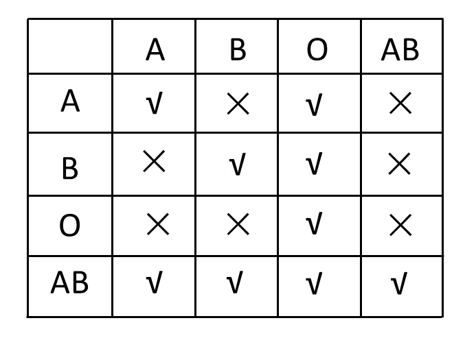

已知赵是A型血，钱不能接受赵的血，即B或O；也不能输血给赵，即B或AB，所以钱为B型血。

孙能接受赵的血，即A或AB；但不能输血给赵，即B或AB，所以孙为AB型血。

李不能接受赵的血，即B或O；却能输血给赵，即A或O，所以李为O型血。

故正确答案为D。

**考点**：从确定信息开始推

**来源**：2012年上海市公务员录用考试《行测》题（A类）第47题

### 第 48 题

现在大多数用后即可废弃的塑料罐上都贴上了用以说明塑料的类型或质量的号码（从1到9）。具有最低编号的塑料品最容易被回收工厂回收，具有最高编号的塑料很少被回收。因此，消费者可以通过拒绝购买那些包装在最高编号的塑料制品内的产品，使不能回收的废物长期来看显著减少。

下面（    ）项，如果正确，最能严重地削弱上面的结论。

A. 目前，收集、分类和回收被抛弃的塑料废品的费用要比用原材料制造的新的塑料产品的高

B. 许多消费者没有注意到印在塑料容器上的号码

C. 塑料容器经回收后，编号几乎总是在上升，因为回收处理会使塑料产品的质量下降

D. 那些将所有废弃的塑料容器收集起来以备将来回收的社区，只有在明显没有回收商来回收它们的情况下，才将有较高编号的塑料倾倒进垃圾堆里

第 48 题 · 答案与解析

**参考答案（粉笔题库参考内容）**

C

**解析**

第一步：找到论点和论据。

论点：消费者可以通过拒绝购买那些包装在最高编号的塑料制品内的产品，使不能回收的废物长期来看显著减少。

论据：现在大多数用后即可废弃的塑料罐上都贴上了用以说明塑料的类型或质量的号码（从1到9），具有最低编号的塑料品最容易被回收工厂回收，具有最高编号的塑料很少被回收。

第二步：逐一分析选项。

A项，收集、分类和回收塑料废品的费用比制造的新的塑料产品的高，与通过编号来减少不能回收的废物无直接关系，属无关选项，排除；

B项，消费者没有注意到印在塑料容器上的号码，与消费者是否可以通过拒绝购买那些包装在最高编号塑料制品内产品的方式使不能回收的废物显著减少无关，属无关选项，排除；

C项，塑料容器经回收后，编号几乎总是在上升，说明即使人们只买低编号的塑料包装的产品，这些低编号的塑料也会逐渐变成很少被回收的高编号的塑料，这样高编号的塑料会越来越多，因此不能通过拒绝购买那些包装在最高编号的塑料制品内的产品，使不能回收的废物长期来看显著减少，可以削弱，当选；

D项，将废弃的塑料容器收集起来以备将来回收的社区，与通过编号来减少不能回收的废物无直接关系，属无关选项，排除。

故正确答案为C。

**考点**：削弱论点

**来源**：2012年上海市公务员录用考试《行测》题（A类）第48题

### 第 49 题

在某班计算机成绩公布之后，甲同学说：咱们班有的同学通过了，乙同学说：有的同学没有通过，丙同学说：张明没有通过，可事实上三位同学中，有两位同学说的都不符合实际。

以下哪项是这个班计算机考试成绩真实情况：

A. 至少有一个同学没有通过考试

B. 除张明，还有别的同学考试通过

C. 这个班没有一个同学没有通过考试

D. 这个班中只有一个同学没有通过考试

第 49 题 · 答案与解析

**参考答案（粉笔题库参考内容）**

C

**解析**

第一步：找关系。

甲同学：有的同学通过了；

乙同学：有的同学没通过；

丙同学：张明没通过。

甲同学和乙同学的话出现了两个“有的”，必有一真；再根据“有两位同学说的都不符合实际”可知，真话只有一句，则丙同学的话为假。

第二步：看其余

根据丙同学的话为假可知，张明通过了，可以推出甲同学的话一定是真的，那么乙同学的话一定是假的，由此可知，所有同学都通过了，只有C项符合。

故正确答案为C。

**考点**：只有一真/一假

**来源**：2012年上海市公务员录用考试《行测》题（A类）第49题

### 第 50 题

经常参加拳击运动的人通常比不参加的人身体更加健康，因此，参加运动有助于增进健康。

以下哪项如果为真，最能构成对上述结论的质疑：

A. 只有身体健康的人才能参加拳击运动

B. 拳击运动能够训练人的反应能力，增加人的敏锐度

C. 每年都有少数人在拳击运动中因意外事故而受伤

D. 男子比女子更喜爱拳击运动

第 50 题 · 答案与解析

**参考答案（粉笔题库参考内容）**

A

**解析**

第一步：找到论点和论据。

本题论点是参加运动有助于增进健康，论据是经常参加拳击运动的人通常比不参加的人身体更加健康。

第二步：逐一判断选项。

A项：只有身体健康的人才能参加拳击运动，说明了题干结论是因果倒置，直接对论点进行削弱，当选；

B项：拳击运动增加人的敏锐度，与运动有助于健康无直接关系，属无关选项，排除；

C项：少数人在运动中受伤，与运动有助于健康无直接关系，属无关选项，排除；

D项：男子比女子更喜爱拳击运动，与运动有助于健康无直接关系，属无关选项，排除。

故正确答案为A。

**考点**：因果倒置

**来源**：2012年上海市公务员录用考试《行测》题（A类）第50题

### 第 51 题

某班有三个小组，赵、钱、孙三人分属不同的小组。这次语文考试成绩公布，情况如下：赵和三人中的第3小组那位不一样，孙比三人中第1小组的那位的成绩低，三人中第3小组的那位比钱分数高。

若赵、钱、孙三人按语文成绩由高到低排列，正确的是：

A. 赵、钱、孙

B. 赵、孙、钱

C. 钱、赵、孙

D. 孙、赵、钱

第 51 题 · 答案与解析

**参考答案（粉笔题库参考内容）**

B

**解析**

第一步：找突破口。

本题突破口是信息量最大对象，即第3小组那位。由“赵和三人中的第3小组那位不一样”可知，赵不是第3小组那位，由“第3小组的那位比钱分数高”可知，钱不是第3小组那位，因此第3小组那位是孙。

第二步：抄信息于表中，即将题干和第一步的所有信息放在一个表中。

人：       钱                          孙

成绩：                   ＜                                 ＜

小组：                            第3小组                           第1小组

第三步：填空，即填上每一个集合的空格。

人：       钱                          孙                               （赵）

成绩：                   ＜                                 ＜

小组：（第2小组）        第3小组                           第1小组

通过分析，三人按语文成绩由高到低排列为赵、孙、钱。

故正确答案为B。

**考点**：从最大信息开始推

**来源**：2012年上海市公务员录用考试《行测》题（B类）第52题

### 第 52 题

娴熟的技术或者足够的时间（超过一个月）是完成一件工艺品的必要条件。小周只花了25天就完成了一件工艺品，说明小周掌握娴熟的技术。

以下哪项推理方式和题干最类似？

A. 一件产品要在市场上销售得好，质量上乘和足够的宣传广告缺一不可。有一款电扇，专家鉴定都说质量上乘，但销售不佳，说明它的宣传广告还不足

B. 工资不高又不善理财，家庭经济必然拮据。小赵工资不高，但每月经济均显宽裕，说明小赵善于理财

C. 或者今年业绩超常，或者满30年公司工龄，均可获今年的特殊津贴。黄先生得到了今年的特殊津贴，但他只在公司供职10年，说明黄先生今年业绩超常

D. 一个罪犯实施犯罪，必须既有作案动机，又有作案时间。在某案中李先生有作案动机，但无作案时间，说明李先生不是该案的作案者

第 52 题 · 答案与解析

**参考答案（粉笔题库参考内容）**

B

**解析**

第一步：翻译题干。

完成一件工艺品娴熟的技术或者足够的时间（超过一个月），小周：完成一件工艺品 且 -足够的时间（超过一个月），结论：小周：娴熟的技术。

第二步：逐一翻译选项。

A项，销售得好质量上乘 且 足够的宣传广告，一款电扇：-销售得好 且 质量上乘；结论：一款电扇，-足够的宣传广告；

B项，-工资高 且 -善理财经济宽裕，利用逆否规则得到：经济宽裕工资高或者善理财，小赵：-工资高 且 经济宽裕；结论：小赵，善理财；

C项，今年业绩超常或者满30年公司工龄获得今年的特殊津贴，黄先生：获得今年的特殊津贴 且 -满30年公司工龄；结论：黄先生，今年业绩超常；

D项，实施犯罪作案动机 且 作案时间，李先生：作案动机 且 -作案时间；结论：李先生，-实施犯罪。

综上，将选项与题干对比可以看出，B项与题干一致。

故正确答案为B。

**考点**：推理形式

**来源**：2012年上海市公务员录用考试《行测》题（B类）第48题

### 第 53 题

论证：在作经济决定时，人们倾向于少考虑或不考虑环境因素，例如作空气与水的清洁度、濒危物种的灭绝等的成本收益分析。环境经济学家认为，要人们多考虑环境因素，就要赋予环境因素一定的经济价值。但是，经济价值本身就来自人们作出经济决定时所作的成本收益分析。结论：环境经济学的基本研究目标与其研究方法存在着矛盾。

假设以上论证是正确的，则论证对结论的支持力度是：

A. 强烈的，赋予环境因素以一定的经济价值是不可能的，除非人们在作出经济决定时考虑环境因素

B. 强烈的，除非经济决策对受环境因素影响的事物不会造成任何事实上的影响

C. 充其量是微弱的，因为上述段落没有证明经济决策者大体上都不会考虑环境因素

D. 充其量是微弱的，因为上述论述假设污染和其他对环境因素的影响很少源自经济决策

第 53 题 · 答案与解析

**参考答案（粉笔题库参考内容）**

B

**解析**

第一步：抓住题干主要信息。

第一点：论证为在作经济决定时，人们倾向于少考虑或不考虑环境因素，要人们多考虑环境因素，就要赋予环境因素一定的经济价值，但是，经济价值本身就来自人们作出经济决定时所作的成本收益分析；

第二点：结论为环境经济学的基本研究目标与其研究方法存在着矛盾。

第二步：分析题干信息，并结合选项得出答案。

环境经济学的基本研究目标是要人们多考虑环境因素，研究方法是赋予环境因素一定的经济价值。而题干中的论证说明这一研究方法无法实现研究目标，因为经济价值本身就来自人们作出经济决定时所作的成本收益分析。因此，环境经济学的基本研究目标与其研究方法之间存在着矛盾。题干中的论证对结论有强烈的支持力度，除非经济决策对受环境因素影响的事物不会造成任何事实上的影响。也就是说，只要经济决策对受环境因素影响的事物造成影响，题干中的论证对结论就有强烈的支持力度。

通过分析，只有B项中说法符合。

故正确答案为B。

**来源**：2012年上海市公务员录用考试《行测》题（B类）第54题

### 第 54 题

老师把双手伸进围棋匣子，然后双手握拳各执一子，让同学猜哪只手里有黑子。假设老师说了四句话，其中三句是真的，一句是假的。

（1）右手肯定不是黑子。

（2）或者左手是黑子，或者右手是黑子。

（3）如果左手是黑子，则右手就不是黑子。

（4）左手、右手都是黑子。

则哪句是假话：

A. （1）

B. （2）

C. （3）

D. （4）

第 54 题 · 答案与解析

**参考答案（粉笔题库参考内容）**

D

**解析**

第一步：找突破口。

本题突破口为（3）和（4）之间的矛盾关系，两句话必有一真和一假。

第二步：看其他的话。

本题只有一句为假，故（1）和（2）两句话均为真话。由（1）和（2）两句话可知，左手是黑子，右手不是黑子。

第三步：判断突破口中两句话的真假。

由左手是黑子，右手不是黑子可知，（4）句为假。

故正确答案为D。

备注：本题需特别注意矛盾关系：A⇒B与A∧－B的矛盾，望考生加深理解。

**考点**：只有一真/一假

**来源**：2012年上海市公务员录用考试《行测》题（B类）第53题

### 第 55 题

检测系统X和检测系统Y尽管依据的原理不同，但都能检测出所有的产品缺陷，而它们也都会错误地淘汰3%无瑕疵产品。由于错误淘汰的成本很高，所以通过同时安装两套系统，并且只淘汰两套系统都认为有瑕疵的产品就可以省钱。

以上论述，需要建立在下面哪项假设上：

A. 接受一个次品所造成的损失比淘汰一个无瑕疵产品所造成的损失大

B. 不论采用哪一系统，第二次检测只需要对第一次没被淘汰的产品进行检验

C. 在同等价格范围的产品中，系统X和系统Y是市场上最少出错的检测系统

D. 系统X错误淘汰的3%无瑕疵的产品与系统Y错误淘汰的3%无瑕疵产品不完全相同

第 55 题 · 答案与解析

**参考答案（粉笔题库参考内容）**

D

**解析**

第一步：找到论点和论据。

本题论点是通过同时安装两套系统，并且只淘汰两套系统都认为有瑕疵的产品就可以省钱。

论据是检测系统X和检测系统Y尽管依据的原理不同，但都能检测出所有的产品缺陷，而它们也都会错误地淘汰3%无瑕疵产品。

第二步：判断加强方式。

论点强调两套系统同时作用，论据强调每套系统单独作用，论点与论据间存在明显因果关系，且提问方式为前提，加强优先考虑补充必要条件。

第三步：逐一判断选项的作用。

A项：接受和淘汰一个次品所造成的损失与两套系统同时作用省钱无直接关系，属无关选项，排除；

B项：第二次检测只需要对第一次没被淘汰的产品进行检验，并没有涉及两套系统同时作用，只是两次检测，属无关选项，排除；

C项：系统X和系统Y是最少出错的，与两套系统同时作用省钱无直接关系，属无关选项，排除；

D项：两个系统淘汰产品不完全相同，说明同时作用比单独作用检查更全面，更准确，如果淘汰产品完全相同，就没有同时使用的必要，是论点成立的前提条件，当选。

故正确答案为D。

**考点**：必要条件

**来源**：2012年上海市公务员录用考试《行测》题（A类）第55题

### 第 56 题

孙某共用24000元买进甲、乙股票若干，在甲股票升值15％、乙股票下跌10％时全部抛出，共赚到1350元，则孙某最初购买甲、乙两支股票的投资比例是：

A. 5:3

B. 8:5

C. 8:3

D. 3:5

第 56 题 · 答案与解析

**参考答案（粉笔题库参考内容）**

A

**解析**

设甲股票买了x元，乙股票买了y元，则有x+y=24000，0.15x-0.1y=1350，解得x=15000，y=9000。x:y=15000:9000=5:3。

故正确答案为A。

**考点**：经济利润问题

**来源**：2012年上海市公务员录用考试《行测》题（B类）第65题

### 第 57 题

某车间三个班组共同承担一批加工任务，每个班组要加工100套产品。因为加工速度有差异，一班组完成任务时二班组还差5套产品没完成，三班组还差10套产品没完成。假设三个班组加工速度都不变，那么二班组完成任务时，三班组还剩几套产品未完成：

A. 5

B. 

C. 

D. 

第 57 题 · 答案与解析

**参考答案（粉笔题库参考内容）**

D

**解析**

由题意，当一班组完成任务时，二班组加工了100－5＝95套，三班组加工了100－10＝90套，则二、三班组的加工速度比为95∶90。当二班组完成任务时，三班组已完成，剩余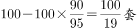。

故正确答案为D。

**考点**：给具体单位型

**来源**：2012年上海市公务员录用考试《行测》题（A类）第57题

### 第 58 题

某单位举行“庆祝建党90周年”知识抢答赛，总共50道抢答题。比赛规定：答对1题得3分，答错1题扣1分，不抢答得0分。小军在比赛中抢答了20道题，要使最后得分不少于50分，则小军至少要答对几道题：

A. 16

B. 17

C. 18

D. 19

第 58 题 · 答案与解析

**参考答案（粉笔题库参考内容）**

C

**解析**

解法1：

假设小军答对n道题，则答错了20－n道题，由题意有：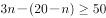，解不等方程得。则n的最小整数值为18。

解法2：

若小军20道题全部答对，则可以得20×3＝60分；每答错一道题将少得3＋1＝4分。现要求总分不少于50分，即失分不多于10分；因10÷4＝2余2，所以答错题数目不可以超过2道题，即答对题数不少于20－2＝18道。

解法3：

将A和B选项值代入，最后得分都小于50，排除这两个选项；将C选项代入，最后得分为3×18－1×2＝52，满足条件。

故正确答案为C。

**考点**：和差倍比问题

**来源**：2012年上海市公务员录用考试《行测》题（A类）第58题

### 第 59 题

某工厂有学徒工、熟练工、技师共80名，每天完成480件产品的任务。已知每天学徒工完成2件，熟练工完成6件，技师完成7件，且学徒工和熟练工完成的量相等，则该厂技师人数是熟练工人数的几倍：

A. 6

B. 8

C. 10

D. 12

第 59 题 · 答案与解析

**参考答案（粉笔题库参考内容）**

D

**解析**

设学徒工、熟练工、技师分别有a、b、c名，由题意可得如下方程：a+b+c=80，2a+6b+7c=480，2a=6b，解得a=15，b=5，c=60，则技师人数是熟练工人数的60÷5＝12倍。

故正确答案为D。

**考点**：和差倍比问题

**来源**：2012年上海市公务员录用考试《行测》题（A类）第59题

### 第 60 题

一艘船从A地行驶到B地需要5天，而该船从B地行驶到A地则需要7天。假设船速、水流速度不变，并具备漂流条件，那么船从A地漂流到B地需要几天：

A. 40

B. 35

C. 12

D. 2

第 60 题 · 答案与解析

**参考答案（粉笔题库参考内容）**

B

**解析**

设AB两地距离为1，则顺水速度为，逆水速度为。由公式可知，水速为。

故船从A地漂流到B地需要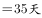。

故正确答案为B。

注：顺水漂流模型相关公式：

  。

**考点**：流水行船

**来源**：2012年上海市公务员录用考试《行测》题（A类）第60题

### 第 61 题

某班有50位同学参加期末考试，结果英文不及格的有15人，数学不及格的有19人，英文和数学都及格的有21人。那么英文和数学都不及格的有几人：

A. 4

B. 5

C. 13

D. 17

第 61 题 · 答案与解析

**参考答案（粉笔题库参考内容）**

B

**解析**

由已知，英文和数学至少有一门课程不及格的人数为50－21人。设英文和数学都不及格的有n人，由两集合容斥原理公式有：50－21＝15＋19－n，解得：n＝5。

故正确答案为B。

注：两集合容斥原理公式为A∪B＝A＋B－A∩B。

**考点**：两集合

**来源**：2012年上海市公务员录用考试《行测》题（A类）第61题

### 第 62 题

某市出租车收费标准是：5千米内起步费10.8元，以后每增加1千米增收1.2元，不足1千米按1千米计费。现老方乘出租车从A地到B地共支出24元，如果从A地到B地先步行460米，然后再乘出租车也是24元，那么从AB的中点C到B地需车费多少元：（不计等候时间所需费用）

A. 12

B. 13.2

C. 14.4

D. 15.6

第 62 题 · 答案与解析

**参考答案（粉笔题库参考内容）**

C

**解析**

设AB两地相距S千米。共花钱24元，则超过5千米的部分为24-10.8=13.2元，超过5千米后最多走了，因此。先步行460米后花费相同，说明先走460米后乘出租路程超过15千米，则，C到B的距离。因不足1千米按1千米计费，故应看成8千米，共花费。

故正确答案为C。

**考点**：分段计算问题

**来源**：2012年上海市公务员录用考试《行测》题（B类）第58题

### 第 63 题

某市旱季水源不足，自来水公司计划在下周七天内选择两天停止供水，若要求停水的两天不相连，则自来水公司共有几种停水方案：

A. 21

B. 19

C. 15

D. 6

第 63 题 · 答案与解析

**参考答案（粉笔题库参考内容）**

C

**解析**

七天选择两天停水的方案数为，停水两天相连的方案数为6；

故符合要求的方案数为21-6=15。

故正确答案为C。

**考点**：基础排列组合

**来源**：2012年上海市公务员录用考试《行测》题（A类）第63题

### 第 64 题

某农场有一批大米需运往市中心的超市销售，现只租到一辆货运卡车，第一次运走了总数的五分之一还多60袋，第二次运走了总数的四分之一少60袋，最后还剩220袋没有运走，则这批大米一共有多少袋：

A. 400

B. 450

C. 500

D. 640

第 64 题 · 答案与解析

**参考答案（粉笔题库参考内容）**

A

**解析**

解法1：

设这批大米共有n袋，由题意有：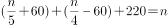，解得：n＝400。

解法2：

总袋数应为4的倍数，排除B项，其余三项用代入法判断正确答案；将A选项数值直接代入：“多60袋”与“少60袋”相互抵消，400的为80，400的为100，加上剩下的220袋正好是400袋，满足题意。

故正确答案为A。

**考点**：和差倍比问题

**来源**：2012年上海市公务员录用考试《行测》题（A类）第64题

### 第 65 题

某单位每四年举行一次工会主席选举，每位工会主席每届任期四年，那么在18年期间该单位最多可能有多少位工会主席：

A. 5

B. 6

C. 7

D. 8

第 65 题 · 答案与解析

**参考答案（粉笔题库参考内容）**

B

**解析**

要使工会主席尽可能的多，考虑极端情况：第一年为第一位工会主席的第四年任职，第十八年为最后一位工会主席的第一年任职，中间十六年共有四位工会主席。于是共有1﹢4﹢1＝6位工会主席。

故正确答案为B。

**考点**：非典型最值问题

**来源**：2012年上海市公务员录用考试《行测》题（A类）第65题

## 材料 3

根据下列资料，回答下列各题。

        2010年某市实现社会消费品零售总额719.48亿元。其中批发和零售业实现零售额651.38亿元，同比增长18.2%；住宿和餐饮业实现零售额68.1亿元，同比增长24%。按新的城乡标准划分，城镇市场实现零售额673.3亿元，增长20.2%。限额以上批发和零售额企业实现零售额169.5亿元，其中同比增长最多的是汽车类增长42.9%。其次为金银珠宝类增长30.4%。全市“家电下乡”活动累计销售家电36万台，实现销售额8亿元；“以旧换新”活动回收五类旧家电共40.6万台（部），销售新家电41万台（部），销售额达14.6亿元。

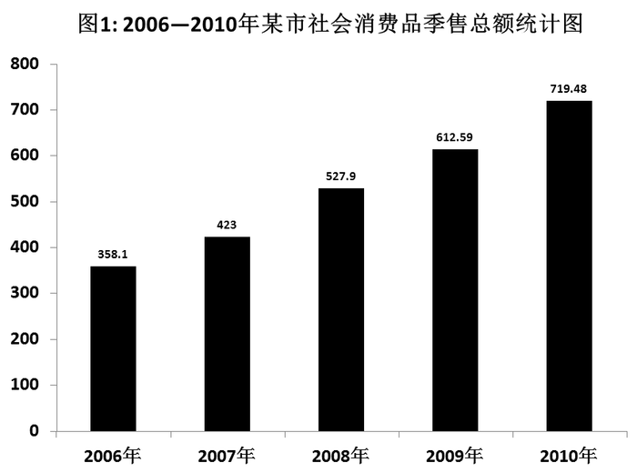

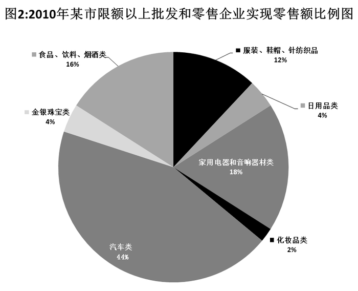

### 第 66 题

2009年该市实现社会消费品零售总额中，住宿和餐饮业实现零售额所占比重约为：

A. 8.97%

B. 9.47%

C. 11.12%

D. 14.63%

第 66 题 · 答案与解析

**参考答案（粉笔题库参考内容）**

A

**解析**

根据题干“2009年，······所占比重”，结合材料数据为2010年，可判定本题为基期比重问题。定位文字材料第一段，2010年住宿和餐饮业实现零售额68.1亿元，同比增长24%；柱状图1中，2009年社会消费品零售总额612.59亿元。可计算出，2009年该市实现社会消费品零售总额中，住宿和餐饮业实现零售额所占比重约为，直除首位商8，只有A项满足。

故正确答案为A。

**考点**：基期比重、综合资料

**来源**：2012年上海市公务员录用考试《行测》题（A类）第66题

### 第 67 题

按新的城乡标准划分，2010年该市城镇市场实现社会消费品零售总额约是乡村市场的多少倍：

A. 4倍

B. 14.6倍

C. 15.6倍

D. 29倍

第 67 题 · 答案与解析

**参考答案（粉笔题库参考内容）**

B

**解析**

根据题干“2010年，······是······多少倍”，可判定本题为现期倍数问题。定位文字材料，2010年该市实现社会消费品零售总额为719.48亿元，城镇市场实现零售总额为673.3亿元，则乡村市场为719.48-673.3=46.18亿元，故所求倍数为，略小于，只有B项满足。

故正确答案为B。

**考点**：现期倍数、综合资料

**来源**：2012年上海市公务员录用考试《行测》题（A类）第67题

### 第 68 题

2010年该市实现社会消费品零售总额中，汽车、化妆品以及金银珠宝类高档消费品所占比重约为：

A. 50%

B. 17.27%

C. 16.20%

D. 11.78%

第 68 题 · 答案与解析

**参考答案（粉笔题库参考内容）**

D

**解析**

根据题干“2010年，······所占比重”，可判定本题为现期比重问题。定位饼状图2，在限额以上批发和零售企业实现零售额中，汽车类占44%，化妆品类占2%，金银珠宝类占4%；定位文字材料，限额以上批发和零售额企业实现零售额为169.5亿元，该市实现社会消费品零售总额为719.48亿元；故这三类商品零售额占该市零售总额的比重为，与D项最接近。

故正确答案为D。

**考点**：现期比重、综合资料

**来源**：2012年上海市公务员录用考试《行测》题（A类）第68题

### 第 69 题

下列选项中，关于该市2010年各类社会消费品零售额的表述，正确的是：

A. 从2006年到2010年，该市社会消费品零售总额翻了两番

B. 在2010年该市限额以上批发和零售企业实现零售额中，金银珠宝类所实现的零售额及其同比增长速度均仅次于汽车类

C. 2010年该市住宿和餐饮业发展迅速，同比增长率超过批发和零售业5.8个百分点，对该市社会消费品零售额的贡献最大

D. 2010年该市“家电下乡”活动实现销售额占乡村实现零售额的比重为17.3%

第 69 题 · 答案与解析

**参考答案（粉笔题库参考内容）**

D

**解析**

A项：定位柱状图1，2010年该市社会消费品零售总额为719.48亿元，2006年零售总额为358.1亿元，则2010年该市社会消费品零售总额是2006年的倍，即翻了一番，错误；

B项：定位饼状图2，观察发现金银珠宝类的零售额并非仅次于汽车类，错误；

C项：定位文字材料，2010年该市住宿和餐饮业同比增长率为24%，批发和零售业同比增长率为18.2%，则住宿和餐饮业超过批发和零售业24-18.2=5.8个百分点；住宿和餐饮业的零售额为68.1亿元，则亿元，批发和零售业的零售额651.38亿元，则亿元。因增长量越大，增长贡献越大，所以住宿和餐饮业并非对该市社会消费品零售额的贡献最大，错误；

D项：定位文字材料，全市“家电下乡”实现销售额8亿元，社会消费品零售总额为719.48亿元，其中城镇市场实现零售额673.3亿元，则乡村市场为719.48-673.3=46.18亿元。那么“家电下乡”销售额占乡村零售额的比重为，正确。

故正确答案为D。

**考点**：综合分析、综合资料

**来源**：2012年上海市公务员录用考试《行测》题（A类）第69题

## 材料 4

根据下列材料，回答下列各题。

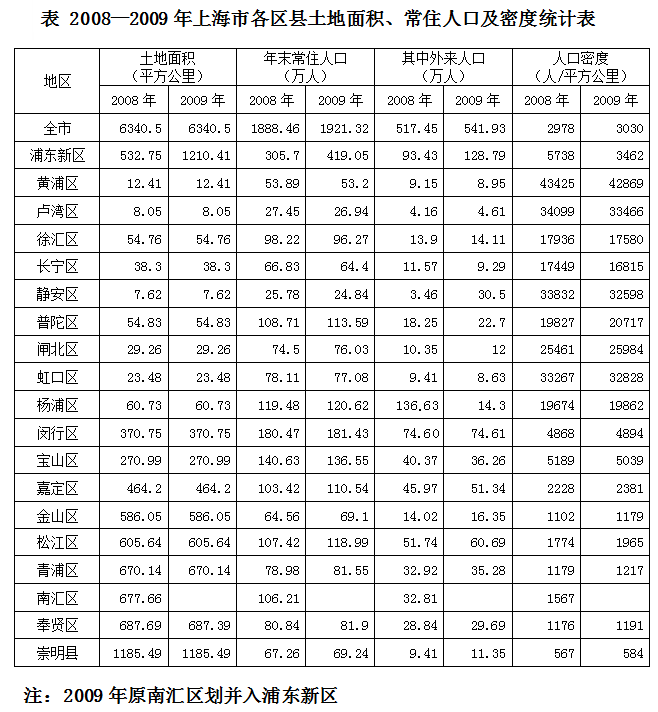

### 第 70 题

2009年上海市各区、县中，人口密度的最大值约是人口密度最小值的多少倍：

A. 12

B. 37

C. 73

D. 76

第 70 题 · 答案与解析

**参考答案（粉笔题库参考内容）**

C

**解析**

根据题干“2009年，······是······的多少倍”，可判定本题为现期倍数问题。定位表格最后一列，人口密度最大和最小的分别为42869人/平方公里和584人/平方公里，则所求倍数为，与C项最接近。

故正确答案为C。

**考点**：现期倍数、统计表

**来源**：2012年上海市公务员录用考试《行测》题（A类）第70题

### 第 71 题

2009年末，上海市常住人口比上年约增长了：

A. 2.8%

B. 2.31%

C. 1.74%

D. 1.21%

第 71 题 · 答案与解析

**参考答案（粉笔题库参考内容）**

C

**解析**

根据题干“······增长了”，结合选项为百分数，可判定本题为一般增长率计算问题。定位表格，2008年末常住人口为1888.46万人，2009年末常住人口为1921.32万人。则，与C项最接近。

故正确答案为C。

**考点**：一般增长率、统计表

**来源**：2012年上海市公务员录用考试《行测》题（A类）第71题

### 第 72 题

下列选项中，2008年到2009年常住人口增加最多的是：

A. 松江区

B. 嘉定区

C. 金山区

D. 普陀区

第 72 题 · 答案与解析

**参考答案（粉笔题库参考内容）**

A

**解析**

根据题干“······增加最多的是”，可判定本题为增长量比较问题。定位表格，2008年到2009年各区常住人口增加量分别为

松江区增加118.99－107.42＞10万人；

嘉定区增加110.54－103.42＜10万人；

金山区增加69.1－64.56＜10万人；

普陀区增加113.59－108.71＜10万人。

根据计算结果可得常住人口增加最多的是松江区。

故正确答案为A。

**考点**：增长量比较、统计表

**来源**：2012年上海市公务员录用考试《行测》题（A类）第72题

### 第 73 题

根据上述表中数据，下列说法错误的是：

A. 上海市各区、县中，面积最小的是静安区

B. 2009年末上海市常住人口数量最接近的是青浦区和奉贤区

C. 2009年末普陀区常住人口比上年增长了4.5%

D. 2009年末浦东新区常住人口数量比2008年末浦东新区和南汇区常住人口数量之和略有增加

第 73 题 · 答案与解析

**参考答案（粉笔题库参考内容）**

B

**解析**

A项：定位表格土地面积一栏，上海市各区、县中面积最小的是静安区，正确；

B项：定位表格年末常住人口一栏，2009年末上海市常住人口数中，青浦区与奉贤区相差81.9－81.55＝0.35万人，而金山区与崇明县相差69.24﹣69.1＝0.14万人，0.35＞0.14，错误；

C项：定位表格年末常住人口一栏，普陀区2009年的人口为113.59万人，2008年的人口为108.71万人，则，正确；

D项：定位表格年末常住人口一栏，2009年浦东新区常住人口数量为419.05万，2008年浦东新区和南汇区常住人口之和为305.7﹢106.21＝411.91万，增加了419.05－411.91＝7.14万，略有增加，正确。

本题为选非题，故正确答案为B。

**考点**：统计表、综合分析

**来源**：2012年上海市公务员录用考试《行测》题（A类）第73题

## 材料 5

根据B市住户抽样调查显示，1985年户籍居民人均可支配收入为1915元，到1994年，户籍居民人均可支配收入首次突破万元大关，达10503元，九年间年均增长20.8%。随后又经过了六年时间，至2000年，户籍居民人均可支配收入为20906元，六年间年均增长12.2%。至2004年户籍居民人均可支配收入达到27596元，比1985年增长13.4倍，年均增长15.1%，扣除价格因素，实际年均增长7.0%。2009年该市户籍居民人均可支配收入达到29245元，比2005年增长了36.1%。

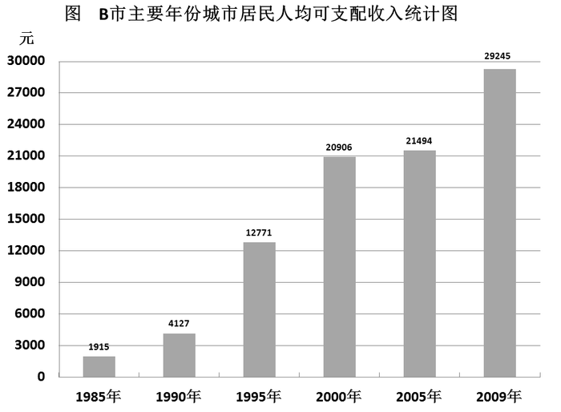

### 第 74 题

2009年户籍居民人均可支配收入比1985年约增长了多少倍：

A. 12.4

B. 13.4

C. 14.3

D. 15.3

第 74 题 · 答案与解析

**参考答案（粉笔题库参考内容）**

C

**解析**

根据题干“······增长了多少倍”，可判定本题为一般增长率计算问题。定位柱形图，2009年和1985年户籍居民人均可支配收入分别为29245、1915元。则2009年户籍居民人均可支配收入同比增长率为，与C项最接近。

故正确答案为C。

**考点**：一般增长率、综合资料

**来源**：2012年上海市公务员录用考试《行测》题（A类）第74题

### 第 75 题

与五年前相比，2009年户籍居民人均可支配收入约增长了：

A. 36.1%

B. 20.8%

C. 15.1%

D. 6.0%

第 75 题 · 答案与解析

**参考答案（粉笔题库参考内容）**

D

**解析**

根据题干“与五年前相比，2009年······增长了······”，结合选项为百分数，可判定本题为一般增长率计算问题。定位文字材料，2004年和2009年户籍居民人均可支配收入分别为27596元、29245元，则2009年户籍居民人均可支配收入与五年前相比，，与D项最接近。

故正确答案为D。

**考点**：一般增长率、综合资料

**来源**：2012年上海市公务员录用考试《行测》题（A类）第75题

### 第 76 题

1985年到2005年，户籍居民人均可支配收入年均增速最快的五年是：

A. 1985—1990年

B. 1990—1995年

C. 1995—2000年

D. 2000—2005年

第 76 题 · 答案与解析

**参考答案（粉笔题库参考内容）**

B

**解析**

根据题干“······年均增速最快的”，可判定本题为年均增长率的比较问题。根据年均增长率的公式：初期值末期值，因选项年份差n值相同，故仅比较值的大小即可。定位柱形图，各选项末期与初期的比值分别为：

A项：；

B项：；

C项：；

D项：。

对比可得，年均增速最快的五年是1990—1995年。

故正确答案为B。

**考点**：年均增长率、综合资料

**来源**：2012年上海市公务员录用考试《行测》题（A类）第76题

### 第 77 题

根据所给资料，下列说法不正确的是：

A. B市户籍居民人均可支配收入经过5年的时间从1万元增长到了2万元

B. 近年来，价格因素对居民人均收入的增长起到了一定的抑制作用

C. 2005年户籍居民人均可支配收入比5年前增长了588元

D. 户籍居民人均可支配收入自2000年以后增速有所减缓

第 77 题 · 答案与解析

**参考答案（粉笔题库参考内容）**

A

**解析**

A项：定位文字材料，B市户籍居民人均可支配收入1994年首次突破1万元，2000年超过2万，经过了6年时间，错误；

B项：定位文字材料，从“······年均增长15.1%，扣除价格因素，实际年均增长7.0%”可知，价格因素确实对居民人均收入的增长起到了一定的抑制作用，正确；

C项：定位柱形图，2005年和2000年户籍居民人均可支配收入分别为21494元、20906元，增长了21494－20906＝588元，正确；

D项：定位柱形图，根据公式，，

2000年以前，增长率分别为，，；

2000年以后增长率分别为，。

明显看出，2000年以前的增长率较大，2000年以后增速有所减缓，正确。

本题为选非题，故正确答案为A。

**考点**：综合分析、综合资料

**来源**：2012年上海市公务员录用考试《行测》题（A类）第77题

## 材料 6

“初中生骑电动车上学”的现象越来越受到社会的关注，某校利用“十一”假期，随机抽查了本校若干名学生和部分家长对“初中生骑电动车上学”现象的看法，统计整理结果如下：

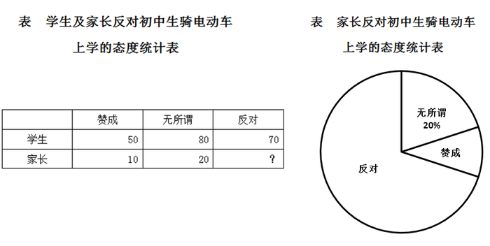

### 第 78 题

这次抽查的家长中，持“反对”态度的比例为：

A. 70%

B. 80%

C. 50%

D. 10%

第 78 题 · 答案与解析

**参考答案（粉笔题库参考内容）**

A

**解析**

根据题干“······家长中，持‘反对’态度的比例为”，可判定本题为现期比重问题。定位表格和饼状图，这次调查中，有20位家长持“无所谓”的态度，占接受调查家长总人数的20%，则人。因此持“反对”态度的家长有100-10-20=70人，则家长中持反对态度的比例为。

故正确答案为A。

**考点**：现期比重、综合资料

**来源**：2012年上海市公务员录用考试《行测》题（A类）第78题

### 第 79 题

这次抽查的学生和家长的总人数为：

A. 100

B. 200

C. 300

D. 400

第 79 题 · 答案与解析

**参考答案（粉笔题库参考内容）**

C

**解析**

定位表格和饼状图，这次调查中，有20位家长持“无所谓”的态度，占抽查的家长总人数的20%，根据公式，，则抽查的家长总人数为人。抽查的学生人数为50＋80＋70＝200人。则这次抽查的学生和家长的总人数为100＋200＝300人。

故正确答案为C。

**考点**：简单加减计算、综合资料

**来源**：2012年上海市公务员录用考试《行测》题（A类）第79题

### 第 80 题

从这次接受调查的学生中，随机抽查一个学生恰好持“无所谓”态度的概率是：

A. 

B. 

C. 

D. 

第 80 题 · 答案与解析

**参考答案（粉笔题库参考内容）**

D

**解析**

根据题干“接受调查的学生中，持无所谓态度的概率”，可判定本题为现期比重问题。定位表格，这次抽查的学生中，持“无所谓”态度的学生人数为80人，学生总人数为50+80+70=200人，则随机抽查一个学生恰好持“无所谓”态度的概率。

故正确答案为D。

**考点**：现期比重、综合资料

**来源**：2012年上海市公务员录用考试《行测》题（A类）第80题

### 第 81 题

2011年10月18日党的十七届六中全会通过了《中共中央关于深化文化体制改革、推动社会主义文化大发展大繁荣若干重大问题的决定》，《决定》要求，必须“全面贯彻‘二为’方向和‘双百’方针，为人民提供更好更多的精神食粮”。这里的“二为”是指：

A. 为人民服务

B. 为社会主义现代化建设服务

C. 为社会主义服务

D. 为改革开放服务

第 81 题 · 答案与解析

**参考答案（粉笔题库参考内容）**

AC

**解析**

2011年10月18日党的十七届六中全会通过了《中共中央关于深化文化体制改革、推动社会主义文化大发展大繁荣若干重大问题的决定》，全会要求必须全面贯彻为人民服务、为社会主义服务的方向和百花齐放、百家争鸣的方针，立足发展先进文化、建设和谐文化，激发文化创作生产活力，提高文化产品质量，发挥文化引领风尚、教育人民、服务社会、推动发展的作用。由此可知“二为”指的是为人民服务以及为社会主义服务。

故正确答案为AC。

**来源**：2012年上海市公务员录用考试《行测》题（B类）第81题

### 第 82 题

中共上海九届市委十三次全会提出，上海“十二五”要坚持创新驱动、转型发展的道路。会议指出，创新是实现“十二五”规划的着力点，创新的关键在于制度创新。“创新驱动”、“创新的关键”体现的原理是：

A. 树立创新意识要以两种根本对立的世界观和方法论为指导

B. 创新是民族进步的灵魂，是国家兴旺发达的不竭动力

C. 分析内因和外因在事物发展中的作用，是正确解决矛盾的关键

D. 分析和解决问题时，首先要抓住主要矛盾和矛盾的主要方面

第 82 题 · 答案与解析

**参考答案（粉笔题库参考内容）**

BD

**解析**

A项错误，直接排除；

B、D两项正确，根据题干可知，创新的关键在于制度创新，体现的是矛盾的原理，抓主要矛盾主要是指在事物的发展过程中怎样集中力量找出问题的关键，抓住重点，解决矛盾，推动事物的发展；

C项错误，不符合题意，同时题干中没有体现内因和外因这个问题。

故正确答案为BD。

**考点**：唯物辩证法

**来源**：2012年上海市公务员录用考试《行测》题（B类）第82题

### 第 83 题

社会主义市场经济的发展离不开国家宏观调控。2011年，我国十一届全国人大四次会议政府工作报告明确指出，目前宏观调控的首要任务是：

A. 继续促进经济的较快增长

B. 创造更多就业岗位和机会

C. 稳定物价总水平

D. 在国内经济稳定发展的基础上实现国际收支平衡

第 83 题 · 答案与解析

**参考答案（粉笔题库参考内容）**

C

**解析**

2011年3月5日，国务院总理温家宝在十一届全国人大四次会议上作政府工作报告时指出，要把稳定物价总水平作为宏观调控的首要任务，充分发挥我国主要工业品总体供大于求、粮食库存充裕、外汇储备较多等有利条件，努力消除输入性、结构性通胀因素的不利影响，消化要素成本上涨压力，正确引导市场预期，坚决抑制价格上涨势头。

故正确答案为C。

**考点**：宏观经济与调控政策

**来源**：2012年上海市公务员录用考试《行测》题（A类）第83题

### 第 84 题

社会管理是人类社会必不可少的一项管理活动。在我们这样一个有13亿人口、经济社会快速发展的国家，社会管理任务更为艰巨繁重。加强和创新社会管理的根本目的是（  ），为党和国家事业发展营造良好社会环境。

A. 维护社会秩序

B. 协调社会关系

C. 保障人民安居乐业

D. 促进社会和谐

第 84 题 · 答案与解析

**参考答案（粉笔题库参考内容）**

ACD

**解析**

我们加强和创新社会管理，根本目的是维护社会秩序、促进社会和谐、保障人民安居乐业，为党和国家事业发展营造良好社会环境。

故正确答案为ACD。

**来源**：2012年上海市公务员录用考试《行测》题（B类）第84题

### 第 85 题

中国人民银行决定，自2011年6月20日起，上调存款类金融机构人民币存款准备金率0.5个百分点，这也是本轮调控以来的第12次，今年以来第6次调升。上述举措的直接作用是：

A. 抑制过高的物价水平

B. 调节国民收入的分配

C. 增加国家的财政收入

D. 调控流通中的货币量

第 85 题 · 答案与解析

**参考答案（粉笔题库参考内容）**

AD

**解析**

调节人民币存款准备金率是央行采取的货币政策，通过上调人民币存款准备金率，一方面控制了货币量，另一方面可以抑制通货膨胀，抑制物价水平。

A、D两项正确，为该举措的直接作用；

B、C两项错误，属于财政政策的作用，调节国民收入分配、增加国家的财政收入往往通过财政政策来调节，一般通过税收和政府支出来调节，不符合题干举措的作用。

故正确答案为AD。

**考点**：宏观经济与调控政策

**来源**：2012年上海市公务员录用考试《行测》题（B类）第90题

### 第 86 题

“十二五”规划与此前的规划比较，一个突出亮点就是过去的规划更多的是追求“国强”，而“十二五”规划则更多强调“民富”。以下举措体现这一亮点的有：

A. 坚持GDP8%的增长率，从而保持经济的高增长

B. 提高居民收入占国民收入的比重

C. 合理调整收入分配关系

D. 适度调低税率，并提高个人所得税起征点

第 86 题 · 答案与解析

**参考答案（粉笔题库参考内容）**

BCD

**解析**

题干强调的是“十二五”规划中所体现的“民富”措施。

A项错误，追求的是“国强”问题，而不是“民富”；

B、C、D三项都是国家通过一些手段增加人民收入，体现的是“民富”问题。

故正确答案为BCD。

**考点**：宏观经济与调控政策

**来源**：2012年上海市公务员录用考试《行测》题（B类）第85题

### 第 87 题

2011年12月12日至14日，中央经济工作会议在北京举行。会议提出了对明年经济工作的总体要求，确定了2012年经济社会发展的工作总基调是：

A. 继续实施稳健的财政政策

B. 稳中求进

C. 创新驱动

D. 加强和改善宏观调控

第 87 题 · 答案与解析

**参考答案（粉笔题库参考内容）**

B

**解析**

2011年12月12日至14日，中央经济工作会议在北京举行，会议指出，推动明年经济社会发展，要突出把握好稳中求进的工作总基调：稳，就是要保持宏观经济政策基本稳定，保持经济平稳较快发展，保持物价总水平基本稳定，保持社会大局稳定；进，就是要继续抓住和用好我国发展的重要战略机遇期，在转变经济发展方式上取得新进展，在深化改革开放上取得新突破，在改善民生上取得新成效。

故正确答案为B。

**考点**：宏观经济与调控政策

**来源**：2012年上海市公务员录用考试《行测》题（B类）第88题

### 第 88 题

因为担心海盐受污染及“服用碘盐预防核辐射”等传言的影响，我国一些地方出现了“抢盐潮”。2011年3月16日，上海市召开专题会议，研究食盐市场供应工作。会议要求必须加强市场监管，严格执法，严厉打击囤积居奇、哄抬物价等违法行为。上述材料说明在市场经济的法律保障中，需要用法律规范：

A. 各类法律服务中介机构

B. 市场主体行为

C. 非理性消费行为

D. 政府主导的食品定价机制

第 88 题 · 答案与解析

**参考答案（粉笔题库参考内容）**

B

**解析**

根据题干中的上海市针对食盐市场供应工作要求加强市场监管，严格执法，严厉打击囤积居奇、哄抬物价等违法行为，可知主要是用法律规范市场主体行为。

故正确答案为B。

**考点**：劳动法和经济法

**来源**：2012年上海市公务员录用考试《行测》题（B类）第83题

### 第 89 题

国以民为本，民以食为天。粮食安全问题事关国计民生和社会稳定，确保粮食安全是我国农业政策的两大基本目标之一。

下列关于粮食安全问题的表述，正确的有：

A. 一国的粮食安全取决于其在国际市场上对粮价及购买数量的操控能力

B. 粮食安全的关键在于确保国家粮库有充足的储备

C. 坚持走中国特色农业现代化道路，加快发展现代农业的首要目标是保障国家粮食安全

D. 我国始终坚持实行最严格的耕地保护制度，确保18亿亩耕地红线，这一红线是中国粮食安全的警戒线

第 89 题 · 答案与解析

**参考答案（粉笔题库参考内容）**

CD

**解析**

A选项错误，我国的粮食安全主要定位于：立足自给，有效调控粮食生产、流通和消费，确保今后相当一段时期我国粮食产销平衡处于可控、可调的范围内，持续、稳定地实现粮食平衡目标，在兼顾粮食生产者和消费者利益的基础上，不断满足经济社会发展对粮食持续增长的需求；

B选项错误，过于片面，偏向于为粮食安全的保障；

C、D选项正确，都是为确保粮食安全的措施，一国的粮食安全取决于获得粮食的能力，包括粮食自给能力和进口能力。

故正确答案为CD。

**考点**：宏观经济与调控政策

**来源**：2012年上海市公务员录用考试《行测》题（A类）第89题

### 第 90 题

我国是一个统一的多民族的国家，在少数民族聚居的地方建立起来的民族区域自治地方机关有权依照当地民族的特点，制定自治条例，自主管理本地方的财政、经济、文化教育事业。下列关于民族区域自治地方机关的表述，正确的是：

A. 有保持或改革自己风俗习惯的自由

B. 必须以宪法作为根本大法和行动准则

C. 必须接受上一级政权机关的领导

D. 是指政府机关

第 90 题 · 答案与解析

**参考答案（粉笔题库参考内容）**

ABC

**解析**

D项错误，民族自治地方分为自治区、自治州、自治县。民族自治地方的自治机关，是自治区、自治州、自治县的人大和人民政府。自治区、自治州、自治县的人民代表大会和人民政府既是民族自治地方的自治机关，又是国家的一级地方政权机关。因此，民族自治地方的自治机关的组织原则与其他地方国家机关一样，实行民主集中制的原则。民族自治地方的人民政府对本级人大和上一级国家行政机关负责并报告工作。在本级人大闭会期间，对本级人大常委会负责并报告工作。各民族自治地方的人民政府都要服从国务院的统一领导。

故正确答案为ABC。

**来源**：2012年上海市公务员录用考试《行测》题（B类）第91题

### 第 91 题

新能源、新材料、信息产业、新医药、生物育种、节能环保、电动汽车——七大战略性新兴产业被表述为“战略性新兴产业”。“战略性新兴产业”除了具有良好的经济技术效益，还具有的特点是：

A. 资源消耗低

B. 环境污染少

C. 投入少，见效快

D. 带动相关产业的兴起

第 91 题 · 答案与解析

**参考答案（粉笔题库参考内容）**

ABD

**解析**

C项错误，不属于“战略性新兴产业”的特点。“战略性新兴产业”是以重大技术突破和重大发展需求为基础，对经济社会全局和长远发展具有重大引领带动作用，知识技术密集、物质资源消耗少、成长潜力大、综合效益好的产业。

故正确答案为ABD。

**考点**：宏观经济与调控政策

**来源**：2012年上海市公务员录用考试《行测》题（B类）第92题

### 第 92 题

公共管理是以政府为核心的各类公共组织为保障和促进公共利益而提供公共产品和公共服务、管理公共事务的所有活动。公共管理的主体不仅包括国家行政机关，而且包括：

A. 立法、司法等整个国家政权机关

B. 法定的公权机关

C. 非营利性质的社会公共组织

D. 各类事业单位

第 92 题 · 答案与解析

**参考答案（粉笔题库参考内容）**

ABCD

**解析**

公共管理的主体比公共行政的主体更广，从主体上看不仅包括国家行政机关，而且包括立法、司法等整个国家政权机关；不仅包括法定的公权机关，而且包括非营利性质的社会公共组织。

故正确答案为ABCD。

**来源**：2012年上海市公务员录用考试《行测》题（B类）第99题

### 第 93 题

下列选项中，（  ）是各级人民政府信息的集中保管地，可设置政府信息查阅场所，配备相应的设施、设备，以方便公民、法人或者其他组织获取政府信息。

A. 政府网站

B. 公共图书馆

C. 大学图书馆

D. 国家档案馆

第 93 题 · 答案与解析

**参考答案（粉笔题库参考内容）**

BD

**解析**

《中华人民共和国政府信息公开条例》第十六条规定：“各级人民政府应当在国家档案馆、公共图书馆设置政府信息查阅场所，并配备相应的设施、设备，为公民、法人或者其他组织获取政府信息提供便利。行政机关可以根据需要设立公共查阅室、资料索取点、信息公告栏、电子信息屏等场所、设施，公开政府信息。行政机关应当及时向国家档案馆、公共图书馆提供主动公开的政府信息。”

故正确答案为BD。

**考点**：其他法律法规

**来源**：2012年上海市公务员录用考试《行测》题（A类）第93题

### 第 94 题

在督查工作中，协助领导搞好预案和各项准备工作，收集各类情况、搞好综合分析研究，提出落实的措施，为修正和完善决策提出意见和建议，这种督查工作方法称为：

A. 协调督查

B. 协作督查

C. 协办督查

D. 协助督查

第 94 题 · 答案与解析

**参考答案（粉笔题库参考内容）**

D

**解析**

协助督查指根据中心工作及时提出督查建议，协助领导搞好预案和各项准备工作，监督中要安排好各项活动，协助领导收集各类情况；督查结束后要协助领导搞好综合分析，研究落实的措施，为修正和完善决策提出意见和建议，符合题干阐述。

故正确答案为D。

本题相关知识点：

督查，即督促检查。它是为确保决策的实施而进行的一系列监督、催促、检查活动。督查的方式有以下几种：

1.协助督查：根据中心工作及时提出督查建议，协助领导搞好预案和各项准备工作；监督中要安排好各项活动，协助领导收集各类情况；督查结束后要协助领导搞好综合分析，研究落实的措施，为修正和完善决策提出意见和建议。

2.催报督查：根据文件要求和领导批示，拟定督查预案，提出办理时限，确定办理要求，填写督办通知单，报请有关领导批准后，送承办单位办理。

3.调研督查：根据决策实施进展情况，选择一些有代表性的单位，开展调查研究，写出专题报告，提出相关建议，促进决策落实。

4.协调督查：根据领导授权，协调和推动本级机关和下级机关开展督查。

5.巡视督查：由领导授权组织巡视督查工作组对重大决策和重要工作部署及落实情况进行督查。

6.通报督查：采用情况通报的办法推动落实。

7.催办督查：督查部门不定期地对决策承办单位催促办理。

8.监测督查：通过督查部门在基础设立监测点，监督决策落实情况。

9.新闻督查：通过政策宣传，营造舆论气氛，推动决策落实。

**来源**：2012年上海市公务员录用考试《行测》题（A类）第94题

### 第 95 题

《国务院关于加强市县政府依法行政的决定》明确提出，要在市县两级政府推行重大行政决策听证制度，并对制度建设提出了明确要求。下列选项中，符合要求的是：

A. 涉及重大公共利益和群众切身利益的决策事项，都要进行听证

B. 规范听证程序，科学合理地遴选听证代表，听证代表确定后，应当将名单向社会公布

C. 对听证意见采纳情况及其理由要以书面形式告知听证代表

D. 听证举行30日前，应当告知听证代表拟做出行政决策的内容、理由、依据和背景资料

第 95 题 · 答案与解析

**参考答案（粉笔题库参考内容）**

ABC

**解析**

《国务院关于加强市县政府依法行政的决定》听证制度的要求包括：要扩大听证范围，法律、法规、规章规定应当听证以及涉及重大公共利益和群众切身利益的决策事项，都要进行听证；此外，还要规范听证程序，科学合理地遴选听证代表，听证代表确定后，应该将名单向社会公布；对听证中提出的合理意见和建议要吸收采纳，意见采纳情况及理由要以书面形式告知听证代表，并以适当形式向社会公布；听证举行10日前，应当告知听证代表拟做出行政决策的内容、理由、依据和背景资料。

故正确答案为ABC。

**考点**：其他法律法规

**来源**：2012年上海市公务员录用考试《行测》题（B类）第93题

### 第 96 题

根据《国务院关于开展新型农村社会养老保险试点的指导意见》，上海新型农村社会养老保险将于2011年底实现全覆盖。新农保的资金来源由个人缴费、集体补助和政府补贴三部分构成；支付部分由个人账户养老金和国家财政支付的基础养老金两部分组成。这表明：

A. 养老不仅是家庭的责任，也是社会和政府的责任

B. 我国实现了农村和城市社会保障的完全统一

C. 中国特色的社会保障体系是资金来源多样化的保障制度

D. 我国的养老保险制度实行社会统筹与个人账户相结合

第 96 题 · 答案与解析

**参考答案（粉笔题库参考内容）**

ACD

**解析**

根据题干可知，政府通过新农保更好的承担起养老的责任，其中新农保的资金来自个人缴费、集体补助和政府补贴三部分，由此可知，新农保资金来源多样化；另外，支付部分由个人账户养老金和国家财政支付的基础养老金两部分组合。

B选项错误，尽管新农保给广大农民养老问题带来改善，但是农村和城市的社会保障制度还是存在一定差别。

故正确答案为ACD。

**来源**：2012年上海市公务员录用考试《行测》题（A类）第96题

### 第 97 题

行政执法与行政权不可分离，这是由行政权的特点所决定的。下列不属于行政执法特点的是：

A. 自由裁量

B. 主体特定

C. 不可放弃

D. 不告不理

第 97 题 · 答案与解析

**参考答案（粉笔题库参考内容）**

D

**解析**

行政执法具有以下特征：执法主体的法定性和国家代表性、执法具有主动性和单方意志性、执法具有极大的自由裁量性。

D项错误，不告不理是民事司法的特点，不属于行政执法的特点。

本题为选非题，故正确答案为D。

**考点**：行政法

**来源**：2012年上海市公务员录用考试《行测》题（B类）第86题

### 第 98 题

行政管理体制改革和制度创新首要的、核心的问题，是公共行政职能的：

A. 机构设置和人员配备

B. 科学定位和主体界定

C. 主体界定和机构设置

D. 科学定位和合理配置

第 98 题 · 答案与解析

**参考答案（粉笔题库参考内容）**

C

**解析**

公共行政体制，就是执行公共意志、行使公共权力、制定公共政策、管理公共事务、生产公共产品、提供公共服务，满足社会公共需求的行政组织体系和管理制度。深化行政管理体制改革的核心和重点应是加强政府管理体制和管理机制创新，构建社会主义公共行政体制。因为社会主义市场经济是多元主体公平竞争的经济，它要求政府必须从那些不该管的事务中退出来，集中人力、物力、财力和精力，管好公民、企事业单位、社会团体和社会民间组织管不了、管不好和不该管的事务，即社会公共事务，为经济社会发展创造良好环境，而不能随意干预和侵犯其他主体的合法权益，因此，公共职能需要主体界定。另外，为了城市化的加速推进、公民社会的形成、公民文化的变革，都要求建立健全公共行政机构，即机构设置。

故正确答案为C。

**来源**：2012年上海市公务员录用考试《行测》题（A类）第98题

### 第 99 题

2010年，某新闻媒体披露，我国一些餐馆把“地沟油”作为餐饮用油，严重危害民众健康，于是各地相关部门根据媒体提供线索，开始进行查处封堵“地沟油”产业链的行动，地下作坊和违法企业被处罚或取缔。各地新闻媒体对行政部门的执法行动进行跟踪报道，这在一定程度上促进了政府打击行动的力度和深度，新闻媒体的报道是一种：

A. 社会组织监督

B. 社会舆论监督

C. 公民监督

D. 公共监督

第 99 题 · 答案与解析

**参考答案（粉笔题库参考内容）**

B

**解析**

社会监督主要包括：

1、各政党的监督；

2、社会组织的监督，主要是指人民政协、社会团体对法律实施的监督；

3、社会舆论的监督，主要是指新闻媒体拥有运用舆论的独特力量，帮助公众了解政府事务、社会事务和一切涉及公共利益的事务，并促使其沿着法制和社会生活公共准则的方向运作的一种社会行为的权利；

4、人民群众的监督。

题干中提到新闻媒体对“地沟油”事件进行曝光是社会舆论监督。

故正确答案为B。

**来源**：2012年上海市公务员录用考试《行测》题（A类）第99题

### 第 100 题

除了刑事处罚以外，行政处分是保障公务纪律、维护国家公共管理秩序和限制剥夺公务员权利的最重要手段。下列选项中，属于行政处分的是：

A. 拘留

B. 罚款

C. 撤职

D. 记过

第 100 题 · 答案与解析

**参考答案（粉笔题库参考内容）**

CD

**解析**

行政处分的种类包括警告、记过、记大过、降级、撤职、开除六类，罚款和拘留属于行政处罚的种类。

故正确答案为CD。

**考点**：行政法

**来源**：2012年上海市公务员录用考试《行测》题（B类）第100题

### 第 101 题

行政合同是一种重要的行政管理手段。使用行政合同能减低行政机关对个人进行单方命令的行政安排，减少因双方利益和目的的差异而带来的对立性，有利于化解矛盾，创造和谐社会。行政机关签订的下列文书中，属于行政合同的是：

A. 计划生育合同

B. 国家科研合同

C. 行政补偿合同

D. 全民所有制工业企业承包合同

第 101 题 · 答案与解析

**参考答案（粉笔题库参考内容）**

ABCD

**解析**

根据题干可知行政合同的含义及目的。在行政合同之中，行政主体并非以民事法人的身份而是行政主体的身份与行政相对人订立关于民事权利义务的协议，以合同的方式来达到维护与增进公共利益的目的，在其间行政主体享有行政优益权。行政合同的种类：

1.国有土地使用权出让合同；

2.全民所有制工业企业承包合同；

3.公用征收补偿合同；

4.国家科研合同；

5.农村土地承包合同；

6.国家订购合同；

7.公共工程承包合同；

8.计划生育合同。

故正确答案为ABCD。

**考点**：行政法

**来源**：2012年上海市公务员录用考试《行测》题（B类）第101题

### 第 102 题

社会公共权威在一定的条件下，针对一定的对象，为达到一定的目标而制定的行动方案或行为准则称为：

A. 公共诉求

B. 公共利益

C. 公共权力

D. 公共政策

第 102 题 · 答案与解析

**参考答案（粉笔题库参考内容）**

D

**解析**

公共政策是指社会公共权威在一定的条件下，针对一定的对象，为达到一定的目标而制定的行动方案或行为准则。其表达形式包括法律法规、行政规定或命令、国家领导人口头或书面的指示、政府规划等。

故正确答案为D。

**来源**：2012年上海市公务员录用考试《行测》题（B类）第98题

### 第 103 题

在电子文件内容鉴定的方法中，对电子文件采取逐件地审阅，而不仅是单纯地查看文件的标题、名称和密级等，也不是根据案卷目录和案卷标题来判定其价值，这种方法称之为：

A. 间接鉴定

B. 职能鉴定

C. 直接鉴定

D. 可读鉴定

第 103 题 · 答案与解析

**参考答案（粉笔题库参考内容）**

C

**解析**

直接鉴定法是通过直接审阅电子文件的内容来判断其价值，它要求鉴定人员逐件逐张地审查文件，而不是根据案卷目录和案卷标题来判定其价值。

故正确答案为C。

**来源**：2012年上海市公务员录用考试《行测》题（A类）第103题

### 第 104 题

据国家统计局公布，第六次人口普查登记人口为13.39亿人，比2000年第五次普查时增加7390万人，比当时的年平均增长率下降了0.5个百分点。它表明我国人口的增长正处于：

A. 低生育水平阶段

B. 继续高增长水平阶段

C. 人口总量逐年下降的阶段

D. 现行生育政策需要立即调整的阶段

第 104 题 · 答案与解析

**参考答案（粉笔题库参考内容）**

A

**解析**

A项正确，根据题干中第六次人口普查与第五次人口普查的人口数以及平均增长率可知我国人口进入低生育水平阶段；

B、C、D项错误，三个选项都无法从题干中找到依据。

故正确答案为A。

**考点**：中国地理

**来源**：2012年上海市公务员录用考试《行测》题（B类）第103题

### 第 105 题

继天宫一号和神舟八号相继发射成功后，2011年11月3日凌晨，神舟八号飞船与天宫一号顺利实现第一次交会对接，我国在突破和掌握空间交会对接技术上迈出了重要一步。下列关于天宫一号和神舟八号的表述，错误的是：

A. 天宫一号是中国自主研制的第一个空间站

B. 天宫一号与神舟八号交会对接成功，顺利实现了我国载人航天工程“三步走”的第三步目标

C. 中国成为世界上第三个完全独立掌握交会对接技术的国家

D. 空间交会对接与载人天地往返、出舱活动并称为载人航天三大基本技术

第 105 题 · 答案与解析

**参考答案（粉笔题库参考内容）**

AB

**解析**

A选项错误，天宫一号是中国第一个目标飞行器，于2011年9月29日21时16分3秒在酒泉卫星发射中心发射，天宫一号并非空间站，而是迷你空间实验室，重在试验交会对接技术，为我国将来建设空间站做重要的技术准备；

B选项错误，天宫一号的发射标志着中国迈入中国航天“三步走”战略的第二步；

C选项正确，按照计划，神舟九号、神舟十号飞船将在接下来的时间里依次与天宫一号完成无人或有人交会对接任务，并建立中国首个空间实验室。中国也由此成为世界上第三个自主掌握空间交会对接技术的国家；

D选项正确，天宫一号与神舟八号交会对接任务的圆满完成，标志着我国空间交会对接技术取得了重大突破，使我国掌握了载人航天的三大基本技术，即载人天地往返、航天员出舱活动以及空间交会对接。

本题为选非题，故正确答案为AB。

**考点**：科技理论与成就

**来源**：2012年上海市公务员录用考试《行测》题（A类）第105题

### 第 106 题

在秋冬时节，我国大部分地区常会出现大雾，阻碍水、陆、空交通正常运行，引发交通事故，危害人体健康。雾的成因不同，可分为辐射雾、平流雾、平流辐射雾。下列关于雾的说法正确的是：

A. 雾其实是空气中的小水珠附在空气中的灰尘上形成的

B. 辐射雾是由冷空气中的水汽遇到温暖的地表后凝结而成的

C. 雾的出现预示着坏天气的到来

D. 雾通常产生于晴朗微风的夜晚或清晨

第 106 题 · 答案与解析

**参考答案（粉笔题库参考内容）**

AD

**解析**

A选项正确，雾形成的条件：一是冷却，二是加湿，增加水汽含量。如果空气中所含的水汽多于一定温度条件下的饱和水汽量，多余的水汽就会凝结出来，当足够多的水分子与空气中微小的灰尘颗粒结合在一起，同时水分子本身也会相互粘结，就变成小水滴或冰晶；

B选项错误，在日落后地面的热气辐射至天空里，冷却后的地面冷凝了附近的空气。而潮湿的空气便会因此降至露点以下，并形成无数悬浮于空气里的小水点，这便是辐射雾；

C选项错误，根据雾的形成条件主要是冷却和加湿可知，雾与坏天气没有必然关系；

D选项正确，空气中的水汽超过饱和量，凝结成水滴，这主要是气温降低造成的，故雾通常出现在晴朗微风的夜晚或清晨是正确的。

故正确答案为AD。

**考点**：生活常识

**来源**：2012年上海市公务员录用考试《行测》题（A类）第106题

### 第 107 题

云计算是一种新的信息服务形式，其关键在于网页所连接的后台服务器：分布于世界各地的成千上万台服务器被网络汇聚成了一片拥有巨大处理能力的“云”。云计算的优点是：

A. 节能

B. 灵活定制

C. 安全

D. 高效

第 107 题 · 答案与解析

**参考答案（粉笔题库参考内容）**

ABCD

**解析**

云计算是基于互联网的服务的增加、使用和交付模式，通常涉及通过互联网来提供动态易扩展且经常是虚拟化的资源。云计算提供了最可靠、最安全的数据存储中心，用户不用再担心数据丢失、病毒入侵等麻烦；云计算对用户端的设备要求极低，使用方便；云计算可以轻松实现不同设备间的数据与应用共享，高效节能；云计算为我们使用网络提供了几乎无限多的可能。

故正确答案为ABCD。

**考点**：科技理论与成就

**来源**：2012年上海市公务员录用考试《行测》题（B类）第108题

### 第 108 题

皮肤破损出血、颈髓损伤、锐器插入体内、严重挤压伤等是灾害发生时的常见损伤类型，掌握科学的自救方法对于延续生命、等待救援很重要。下列自救措施中，不恰当的是：

A. 锐器插入体内后，应快速将锐器拔出，简单处理伤口后立即送往医院救治

B. 对颈后锐痛、活动时疼痛加剧等症状，立即用颈托，一时无颈托，可临时用敷料、硬板纸或塑料板做成颈圈固定颈部

C. 伤口发生喷射状出血时，应立即用厚消毒纱布（或毛巾）包扎好伤口

D. 被重物挤压引起肢体肿胀或青紫时，应尽快在患处用热毛巾湿敷消肿

第 108 题 · 答案与解析

**参考答案（粉笔题库参考内容）**

ACD

**解析**

A选项错误，锐器插入体内切勿拔出。锐器插入体内后，肯定刺破了局部血管、神经和肌肉，这时锐器正好嵌在创口内，起到了临时“止血”作用，不能将锐器拔出，否则有可能大出血；

B选项正确，颈后锐痛、活动时疼痛加剧等症状，提示伤员颈髓受伤，急救关键是立即用颈托，一时无颈托，可临时用敷料、硬板纸或塑料板做成颈圈固定其颈部，千万不能让头颈左右前后摆动；

C选项错误，喷射状出血，说明动脉破裂，应用钳夹血管止血。在没有工具的情况下，可在出血伤口上端找到搏动的动脉血管，用手指或手掌将血管压迫在所在部位的骨头上止血，而不是用毛巾止血；

D选项错误，伤员被重物挤压引起肢体肿胀或青紫时，切勿在患处按摩、热敷、结扎，以免局部产生的肌红蛋白和毒素吸收到血液而引起肾功能衰竭，正确的做法是在患处用冷毛巾或冰块湿敷降温。

本题为选非题，故正确答案为ACD。

**考点**：生活常识

**来源**：2012年上海市公务员录用考试《行测》题（B类）第107题

### 第 109 题

再生水是城市的第二水源，对再生水的合理利用既能减少水环境污染，又可以缓解水资源紧缺的矛盾，是贯彻可持续发展的重要措施。下列选项中，可以使用再生水的是：

A. 灌溉

B. 冷却设备补充用水

C. 牲畜饮用

D. 城市喷泉

第 109 题 · 答案与解析

**参考答案（粉笔题库参考内容）**

ABCD

**解析**

再生水是指污水经适当处理后，达到一定的水质指标，满足某种使用要求，可以进行有益使用的水。再生水的用途很多，可以用于农田灌溉、园林绿化（公园、校园、高速公路绿带、高尔夫球场、公墓、绿带和住宅区等）、工业（冷却水、锅炉水工艺用水）、大型建筑冲洗以及游乐与环境（改善湖泊、池塘、沼泽地，增大河水流量和鱼类养殖等），还有消防、空调和水冲厕等市政杂用。再生水还可以用于农、林、牧业用水，可作为粮食作物、经济作物的灌溉、种植与育苗、林木、观赏植物的灌溉、家畜和家禽用水。

故正确答案为ABCD。

**考点**：生活常识

**来源**：2012年上海市公务员录用考试《行测》题（B类）第115题

### 第 110 题

“暮云收尽溢清寒，银汉无声转玉盘。此生此夜不长好，明月明年何处看。”这是苏轼的一首绝句，歌咏的节令是：

A. 重阳

B. 中秋

C. 七夕

D. 清明

第 110 题 · 答案与解析

**参考答案（粉笔题库参考内容）**

B

**解析**

根据题干中的“玉盘”“明月”可知这首诗描写了作者与弟弟苏辙久别重逢，中秋共同赏月的乐事。写法上从月色的美好写到“人月圆”的愉快，同时也抒发了相聚后不久又得分开的哀伤与感慨。

故正确答案为B。

**考点**：文学常识

**来源**：2012年上海市公务员录用考试《行测》题（A类）第110题

### 第 111 题

为提升我国深空测定轨能力，服务于嫦娥探月工程等国家重大战略，上海将于2015年建成65米射电天文望远镜。关于射电天文望远镜，下列说法正确的是：

A. 射电天文望远镜像雷达一样，向目标天体发射无线电波，观测所获得的天体反射信息

B. 射电天文望远镜的天线面积越大，灵敏度越高

C. 射电天文望远镜的镜筒、目镜和物镜比普通的光学望远镜更大更精密

D. 射电天文望远镜的显著优点是不受大气层的干扰

第 111 题 · 答案与解析

**参考答案（粉笔题库参考内容）**

B

**解析**

A选项错误，射电望远镜和雷达的工作方式不同，雷达是先发射无线电波再接收物体反射的回波，射电望远镜只是被动地接收天体发射的无线电波；

B选项正确，增大天线接收面积可以提高射电望远镜的灵敏度；

C选项错误，射电望远镜与光学望远镜不同，它既没有高高竖起的望远镜镜筒，也没有物镜、目镜，它由天线和接收系统两大部分组成；

D选项错误，射电望远镜所使用的波段范围的无线电辐射，能不受大气层显著影响而能达到地面，但不可能完全不受干扰。

故正确答案为B。

**考点**：科技理论与成就

**来源**：2012年上海市公务员录用考试《行测》题（B类）第110题

### 第 112 题

DDT是一种会累积在生物体内，无法排出生物体的毒性物质，现有甲乙丙丁四种生物，甲是绿色植物，乙是草食性动物，丙是肉食性动物，丁是细菌和霉菌，四类生物构成食物链关系，则体内所含的DDT量最多的生物是：

A. 甲

B. 乙

C. 丙

D. 丁

第 112 题 · 答案与解析

**参考答案（粉笔题库参考内容）**

C

**解析**

生态系统中能量沿食物链的流动遵循着十分之一定律，逐级递减。但这种情况只适用于那些能被生物消化和分解的糖、蛋白质等成份。而DDT是一种会累积在生物体内，无法排出生物体的毒性物质，在沿食物链转移的过程中，浓度越来越高，形成一个倒金字塔形。食物链越长，环节越靠后，毒物经过前边若干生物的富集浓度也就越高，这个环节的生物受害也就越严重。由此可知丙肉食性动物是体内含DDT最多的生物。

故正确答案为C。

**考点**：生物常识

**来源**：2012年上海市公务员录用考试《行测》题（A类）第112题

### 第 113 题

为了尽快清除因大雪造成的道路积雪，常用的办法是撒“融雪盐”，其原理是：

A. “融雪盐”与少量水发生化学反应，产生的热量使周围的冰雪融化

B. “融雪盐”产生“保暖层”，使冰雪吸收足够的“地热”而融化

C. 使雪形成“含融雪盐的雪”，“含融雪盐的雪”熔点低于当地温度，使雪融化

D. “融雪盐”有利于冰雪对阳光的吸收，从而加快冰雪的融化

第 113 题 · 答案与解析

**参考答案（粉笔题库参考内容）**

C

**解析**

融雪剂的主要成分是氯盐，主要原理是当融雪剂溶于水（雪）后，其冰点在零度下，盐水的凝固点比水的凝固点低，因此在雪水中溶解了盐之后就难以再形成冰块。此外，融雪剂溶于水后，水中离子浓度上升，使水的液相蒸气压下降，但冰的固相蒸气压不变。为达到冰水混和物固液蒸气压相等的状态，冰便融化了。

故正确答案为C。

**考点**：生活常识

**来源**：2012年上海市公务员录用考试《行测》题（A类）第113题

### 第 114 题

《中共中央关于制定国民经济和社会发展第十二个五年规划的建议》要求，“十二五”期间，我国将全面提高信息化水平，实现“三网融合”。这里的“三网”是指：

A. 有线网、无线网、物联网

B. 数字信号网、光纤信号网、模拟信号网

C. 互联网、局域网、通信网

D. 电信网、广播电视网、互联网

第 114 题 · 答案与解析

**参考答案（粉笔题库参考内容）**

D

**解析**

“三网融合”是指广播电视网、有线电视网和计算机通信网的相互渗透、互相兼容，并逐步整合成为全世界统一的信息通信网络。

故正确答案为D。

**考点**：生活常识

**来源**：2012年上海市公务员录用考试《行测》题（B类）第111题

### 第 115 题

第14届国际泳联世界锦标赛于2011年7月在上海举行，世界泳坛顶尖高手会战东方体育中心。为了防止发生意外，运动员在游泳前往往需要做一些热身运动。下列选项中，关于热身运动的表述正确的是：

A. 下水前活动关节和肌肉，可以防止入水过冷而抽筋

B. 游泳前冷水沐浴，可以帮助身体更好地适应水温

C. 游泳前温水沐浴，可以带走身上的部分热量，使体温接近水池的温度

D. 入水后，采用踩水的方式活动关节和肌肉，能防止肌肉拉伤

第 115 题 · 答案与解析

**参考答案（粉笔题库参考内容）**

AC

**解析**

根据题干可知运动员在7月份参加比赛，池水温度应该比较高，温水与其相近，故应用温水淋浴，另外应该在下水前活动关节和肌肉，防止入水后抽筋。

故正确答案为AC。

**考点**：生活常识

**来源**：2012年上海市公务员录用考试《行测》题（A类）第115题

### 第 116 题

中国目前正在对一艘旧的航空母舰平台进行改造，用于科研实验和训练。下列关于航空母舰的表述中，不正确的是：

A. 按担负的任务分类，航空母舰可分为攻击航母、反潜航母、护航航母和多用途航母

B. 航空母舰在战术使用上较为灵活，既可单舰行动，又可作为海上编队的核心舰只

C. 对航空母舰而言，舰载机既是最好的进攻武器，又是最好的防御武器

D. 航空母舰可以受巨大的风浪，甚至在有台风的海况下也能安全航行，其战斗力受气象条件影响小

第 116 题 · 答案与解析

**参考答案（粉笔题库参考内容）**

BD

**解析**

A选项正确，航空母舰是一种以舰载机为主要作战武器的大型水面舰艇。按担负的任务分类，航空母舰可分为攻击航母、反潜航母、护航航母和多用途航母；

B选项错误，航母的目标大很容易被发现，整个航母编队少则有七、八艘各型舰艇，多则十余艘，其电子元件越来越多，很容易被对方各种探测设施发现。被发现后，航母编队就要面对敌人多方向、多批次的频繁袭扰和攻击，疲于应付；

C选项正确，航空母舰的主要武器装备是它装载的各种舰载机，直接把敌人消灭在距离航母数百千米之外的领域，舰载机是航空母舰最好的进攻和防御武器；

D选项错误，航母的战斗力受气象变化的影响较大，尽管航空母舰本身可以经受较强的风浪，在12级风浪的海况下也能够航行，但航母上的舰载机易受到海浪和气象条件的影响，风、浪和能见度等都会限制飞机起降。

本题为选非题，故正确答案为BD。

**考点**：生活常识

**来源**：2012年上海市公务员录用考试《行测》题（A类）第116题

### 第 117 题

南沙群岛自古以来就是中国领土，中国人早在（  ）时期首次发现该群岛，1621年刊印的《郑和航海图》将其列入中国版图。

A. 西汉

B. 东汉

C. 南北朝

D. 三国

第 117 题 · 答案与解析

**参考答案（粉笔题库参考内容）**

A

**解析**

从秦代开始，我国政府正式对西沙群岛行使管辖权。汉代，南沙群岛已归我国管辖。公元前111年，西汉武帝平定南粤之乱后，在海南岛设儋耳、朱崖两郡，辖南海诸岛，并派水师巡视西沙。

故正确答案为A。

**考点**：中国历史

**来源**：2012年上海市公务员录用考试《行测》题（B类）第117题

### 第 118 题

根据我国保密法规定，下列关于国家秘密的表述，不正确的是：

A. 国家秘密的密级由国家保密行政管理部门确定

B. 国家秘密的保密期限不超过20年

C. 国家秘密不能确定保密期限的，按最长的保密期确定

D. 国家秘密的知悉范围，应当根据工作需要限定在最小范围

第 118 题 · 答案与解析

**参考答案（粉笔题库参考内容）**

ABC

**解析**

A选项错误，国家秘密及其密级的具体范围，由国家保密行政管理部门分别会同外交、公安、国家安全和其他中央有关机关规定；

B、C选项错误，国家秘密的保密期限，除另有规定外，绝密级不超过三十年，机密级不超过二十年，秘密级不超过十年；国家秘密的保密期限，应当根据事项的性质和特点，按照维护国家安全和利益的需要，限定在必要的期限内；不能确定期限的，应当确定解密的条件。

D选项正确，国家秘密的知悉范围，应当根据工作需要限定在最小范围。

本题为选非题，故正确答案为ABC。

**考点**：其他法律法规

**来源**：2012年上海市公务员录用考试《行测》题（B类）第119题

### 第 119 题

土壤的酸性太强会带来害虫和疾病，阻碍植物生长，并析出有毒金属。目前，造成我国土壤酸化的主要原因是：

A. 空气中浓度增大

B. 滥施化肥

C. 酸雨

D. 大面积种植单一作物，生物多样性遭到破坏

第 119 题 · 答案与解析

**参考答案（粉笔题库参考内容）**

BC

**解析**

A选项错误，空气中二氧化碳浓度增大可能形成酸雨，但是不足以使土壤酸化；

B选项正确，氮肥施用过量是导致农田土壤酸化的主要原因；

C选项正确，当酸雨输入超过土壤缓冲能力时，土壤就会呈现酸化，使土壤的物理化学性质发生变化；

D选项错误，生物多样性遭破坏并不会造成土壤酸化。

故正确答案为BC。

**考点**：生活常识

**来源**：2012年上海市公务员录用考试《行测》题（B类）第120题

### 第 120 题

一百年前爆发的辛亥革命，结束了中国长达两千年之久的君主专制制度，是近代中国比较完全意义上的资产阶级民主革命，它在政治上、思想上给中国人民带来了不可低估的解放作用。下列关于辛亥革命的表述中，正确的是：

A. 辛亥革命是一场深刻的思想启蒙运动，它使民主共和观念深入人心

B. 在辛亥革命中，平民阶层对革命的参与改变了其生存条件，从而构建了新的社会结构

C. 辛亥革命推翻了清朝的专制统治，完成了反帝反封建的革命任务

D. 辛亥革命在亚洲打响了民主的第一枪，对近代亚洲各国被压迫民族的解放运动，产生了比较广泛的影响

第 120 题 · 答案与解析

**参考答案（粉笔题库参考内容）**

AD

**解析**

辛亥革命作为民主革命，成功推翻了清朝的统治，结束了中国两千多年来的封建帝制，开启了民主共和新纪元。从思想史的角度看，辛亥革命也是一场深刻的思想启蒙运动，它使民主共和观念深入人心。但是辛亥革命没有改变中国半殖民地半封建社会的性质，没有完成反帝反封建的革命任务：第一，辛亥革命没有彻底的反帝纲领；第二，辛亥革命没有彻底的反对封建土地所有制的纲领；第三，革命的胜利果实被袁世凯窃取。辛亥革命对近代亚洲各国被压迫民族的解放运动，产生了比较广泛的影响，特别是对越南、印度尼西亚等国的反对殖民主义的斗争起了推动作用，在亚洲的历史上也是一次伟大的转折。列宁把辛亥革命视为“亚洲的觉醒”，辛亥革命在亚洲打响了民主的第一枪。

故正确答案为AD。

**考点**：中国历史

**来源**：2012年上海市公务员录用考试《行测》题（B类）第116题

## 材料 7

文化遗产，是一个国家和民族历史文化成就的重要标志，是人类共同的文化财富。我国自1985年签署《保护世界文化遗产和自然遗产公约》以来，在申报和保护文化遗产方面作出了积极的努力。目前，我国列入《世界遗产名录》的景观地已达40多处，2010年11月，联合国教科文组织又将我国申报的中医针灸和京剧列入《人类非物质文化遗产代表作名录》。

        国家文物局局长在做客《人民日报》“文化讲坛”时说，有尊严的文化遗产才具有顽强的生命力，要把尊严还给文化遗产。世界遗产申报之后要加强管理，要在一个新高度、新准则的前提下进行保护。

### 第 121 题

文化遗产被称为“历史的记忆”，这是因为：

A. 任何两个事物之间都存在内在联系

B. 任何事物都处于“前后相继”的相互联系之中

C. 任何事物都包含既对立又统一的两个方面

D. 任何事物的联系都是永恒的、有条件的

第 121 题 · 答案与解析

**参考答案（粉笔题库参考内容）**

B

**解析**

根据题干可知文化遗产，是一个国家和民族历史文化成就的重要标志，国家和民族在发展的过程是有前后顺序并且相互关联的，因此历史遗产被称为“历史的记忆”正是反映了事物“前后相继”的相互联系，故B选项正确。A选项本身观点错误，虽然事物具有普遍联系性，但是任何两个事物之间都存在内在联系的说法是错误的，故排除。C选项虽然本身正确但与题干无关，也排除。联系是有条件的但不是永恒的，当条件发生变化的时候，事物之间的联系也会相应发生变化，故排除D选项。

故正确答案为B。

**考点**：唯物辩证法

**来源**：2012年上海市公务员录用考试《行测》题（A类）第121题

### 第 122 题

在世界上有着广泛影响力的中医针灸和京剧被联合国教科文组织列入《人类非物质文化遗产代表作名录》说明：

A. 每个国家和民族都有自己独特的文化

B. 不同民族的文化不可能有共性和普遍规律

C. 每个民族的文化都值得我们借鉴和吸收

D. 文化既是民族的又是世界的

第 122 题 · 答案与解析

**参考答案（粉笔题库参考内容）**

AD

**解析**

中医针灸和京剧是中国特有的，说明每个国家和民族都有自己独特的文化，故A选项正确；中医针灸和京剧被联合国教科文组织列入《人类非物质文化遗产代表作名录》说明文化既是民族的也是世界的，故D选项正确；B选项本身错误，因为每个民族的文化都有共性，民族文化之间也有普遍规律存在，故排除B选项；C选项与题干无关，故排除。

故正确答案为AD。

**考点**：文化建设

**来源**：2012年上海市公务员录用考试《行测》题（A类）第122题

### 第 123 题

要重视文化遗产的保护，是因为：

A. 这是发展本民族文化、繁荣世界文化的必然要求

B. 这对于研究人类文明的演进具有重要意义

C. 只有把尊严还给文化遗产才能使不同民族的优秀文化遗产免遭破坏

D. 保护文化遗产有利于实现人类文明趋同

第 123 题 · 答案与解析

**参考答案（粉笔题库参考内容）**

AB

**解析**

根据题干第一句“文化遗产，是一个国家和民族历史文化成就的重要标志，是人类共同的文化财富”可知，重视文化遗产对于本民族、世界文化、以及人类文明演进都有重大意义，故A、B选项正确。根据题干中“有尊严的文化遗产才具有顽强的生命力，要把尊严还给文化遗产”可知尊严是文化遗产的前提，但是将尊严还给文化遗产不一定能保证文化遗产免遭破坏，故C选项错误。D选项说法也是错误的，保护文化遗产是为了各民族文化发展以及世界文化的繁荣，而不是人类文明趋同，故D选项错误。

故正确答案为AB。

**考点**：文化建设

**来源**：2012年上海市公务员录用考试《行测》题（A类）第123题

### 第 124 题

曾候选2009年“十大考古发现”的某省古运河畔千年粮仓，对于大运河申遗和大运河文化遗产保护具有特别意义。2010年，这处遗址竟成建筑工地，该千年粮仓遭遇“强拆”。

针对文化遗产遭严重破坏的现象，政府应当：

A. 履行好组织社会主义文化建设的职能，重视文化遗产保护

B. 保障公众对文化遗产安全的知情权、参与权、监督权

C. 对于不同的文化遗产要具体问题具体分析，用不同的方法加以保护

D. 严格执法，依法打击破坏文化遗产的违法犯罪行为

第 124 题 · 答案与解析

**参考答案（粉笔题库参考内容）**

ABCD

**解析**

针对文化遗产遭严重破坏的现象，政府应当根据相应的法律法规，严格执法，严厉打击破坏文化遗产的违法犯罪行为；保护文化遗产时要具体问题具体分析，对不同的文化遗产用不同的方法加以保护；政府应该履行好组织社会主义文化建设的职能，重视文化遗产保护，同时保障公众对文化遗产安全的知情权、参与权和监督权。A、B、C、D四个选项中的措施都是正确的。

故正答案为ABCD。

**来源**：2012年上海市公务员录用考试《行测》题（A类）第124题

## 材料 8

阅读下列材料，回答下列各题。

        “互联网政治”是指民众通过网络参政议政、政府通过网络与民众互动的现象。随着互联网的快速发展，我国公民通过网络参政议政的热情高涨，中国政府网站也经历了从无到有，迅速发展的历程。自从1998年中国第一个严格意义上的政府网站——青岛政务信息公众网建成开通，到现在国务院部委和直属机构基本上都建立了正式网站，行业信息网、省级、地方级以下政府站点也陆续建成、开通。2008年6月20日，胡锦涛总书记通过人民网与网友在线亲切交谈时指出，互联网是“做事情、做决策，了解民情、汇聚民智的一个重要渠道”，这开启了网络问政的元年。2009年及2010年两会前夕，温总理两次亲临中国政府网、新华网与网民在线互动、畅所欲言。从中央政府到地方政府，对网络参政议政都给予了包容、理性、乐观的态度，并积极倡导。国务院新闻办公开表示，言论发达是中国互联网的一个鲜明特色，互联网的发展，大大拓展了人们的言论空间。

### 第 125 题

各级政府网站已经成为中国公民：

A. 直接参加民主决策的崭新平台

B. 参政议政的一条重要渠道

C. 对政府进行民主监督的新形式

D. 直接管理国家事务的新途径

第 125 题 · 答案与解析

**参考答案（粉笔题库参考内容）**

BC

**解析**

根据题干可知我国公民通过各级政府网站参政议政热情高涨，对政府工作进行监督；政府可以通过互联网了解民情，汇聚民智，根据这些来做决策、做事情，但是公民不能通过互联网直接做决策、直接管理国家，故排除A、D两项。

故正确答案为BC。

**来源**：2012年上海市公务员录用考试《行测》题（B类）第126题

### 第 126 题

网民把政府网站称为“24小时不下班的政府”。这里的“政府”所包含的涵义是：

A. 为群众提供便捷的政务服务

B. 可以解决公民遇到的所有问题

C. 是我们国家的最高权力机关，可以解决实质问题

D. 是国家权力机关的重要组成部分

第 126 题 · 答案与解析

**参考答案（粉笔题库参考内容）**

A

**解析**

题干中“24小时不下班的政府”体现的是一种快捷便民的政府服务，故A选项正确。B选项过于绝对，政府网站不一定能解决公民遇到的所有问题，故排除B项。我国的最高权力机关不是政府网站，而是全国人民代表大会，故排除C项。我国的国家权力机关是各级人民代表大会，故排除D项。

故正确答案为A。

**来源**：2012年上海市公务员录用考试《行测》题（B类）第127题

## 材料 9

“互联网政治”是指民众通过网络参政议政、政府通过网络与民众互动的现象。随着互联网的快速发展，我国公民通过网络参政议政的热情高涨，中国政府网站也经历了从无到有，迅速发展的历程。自从1998年中国第一个严格意义上的政府网站——青岛政务信息公众网建成开通，到现在国务院部委和直属机构基本上都建立了正式网站，行业信息网、省级、地方级以下政府站点也陆续建成、开通。2008年6月20日，胡锦涛总书记通过人民网与网友在线亲切交谈时指出，互联网是“做事情、做决策，了解民情、汇聚民智的一个重要渠道”，这开启了网络问政的元年。2009年及2010年两会前夕，温总理两次亲临中国政府网、新华网与网民在线互动、畅所欲言。从中央政府到地方政府，对网络参政议政都给予了包容、理性、乐观的态度，并积极倡导。国务院新闻办公开表示，言论发达是中国互联网的一个鲜明特色，互联网的发展，大大拓展了人们的言论空间。

### 第 127 题

越来越多的政府各级领导利用网络跟网民在线交流，倾听网民们的意见。这种与网民的在线交流体现了：

A. 公民的基本政治权利落到了实处

B. 政府关注社情民意，倾听群众心声

C. 公民通过网上交流直接参与民主决策

D. 政府努力建设忧民所忧、乐民所乐的服务型政府

第 127 题 · 答案与解析

**参考答案（粉笔题库参考内容）**

BD

**解析**

根据题干阐述可知主体词为“政府”，本题应从政府的立场进行理解，而不是公民的角度，故排除A、C两项。B选项体现政府关注社情民意，倾听群众心声；D选项体现了政府努力建设服务型政府，都符合题干要求。

故正确答案为BD。

**来源**：2012年上海市公务员录用考试《行测》题（A类）第127题

### 第 128 题

连续几年来，新华网发展论坛每年两会期间都推出“向总理提问”的网上互动话题，温家宝总理也连续两年在记者招待会上给予了热情的回应。共和国的决策者从网民的意见中汲取智慧和力量，共和国的总理与普通群众在互联网上直接交流互动。

这充分体现了：

A. 我国基层民主建设的发展和完善

B. 公民在法律面前人人平等

C. 扩大了我国公民有序的政治参与渠道

D. “中国式民主”正在随着电子政务技术手段的广泛运用快速推进

第 128 题 · 答案与解析

**参考答案（粉笔题库参考内容）**

CD

**解析**

公民通过互联网参政议政，政府通过互联网与公民互动，汇聚民智，扩大了公民参政的途径，故C项正确。随着电子政务技术手段的广泛运用，“中国式民主”正在快速推进，故D项正确。我国基层民主建设主要包括村民自治和城市居民自治，互联网参政议政不属于基层民主建设范畴，排除A项。题干没有提到法律相关概念，B选项与题干无关，排除。

故正确答案为CD。

**来源**：2012年上海市公务员录用考试《行测》题（B类）第124题

### 第 129 题

随着互联网的快速发展，以网络为媒介的“政府—民间”互动模式已成为我国政治文明的重要因素。

“政府—民间”互动模式的意义在于：

A. 方便了公民直接管理国家事务

B. 有利于保障人民的知情权、表达权、监督权

C. 保障了人民群众对政府的质询权

D. 有利于政府了解民意和汇集民意

第 129 题 · 答案与解析

**参考答案（粉笔题库参考内容）**

BD

**解析**

我国实行公民间接管理国家的政策，主要是通过直接和间接选举的方式选举人民代表，组成人民代表大会代表人民行使管理国家和社会事务的权利，公民不能直接管理国家事务，故排除A项。根据题干可知“政府—民间”互动模式有利于保障人民的知情权、表达权、监督权，同时也有利于政府了解民意和汇集民意，故B、D两项正确。质询是人大代表的一项重要权利，可以发挥重要的监督工作，程度上要比询问严厉得多，公民无法行使质询权，故排除C项。

故正确答案为BD。

**来源**：2012年上海市公务员录用考试《行测》题（B类）第125题

## 材料 10

2011年7月1日，庆祝中国共产党成立90周年大会在北京隆重召开。胡锦涛总书记在大会上发表了重要讲话。指出90年来，我们党团结带领人民在中国这片古老的土地上，书写了人类发展史上惊天地、泣鬼神的壮丽史诗，集中体现为完成和推进了三件大事。第一件大事，我们党紧紧依靠人民完成了新民主主义革命，实现了民族独立、人民解放。第二件大事，我们党紧紧依靠人民完成了社会主义革命，确立了社会主义基本制度。第三件大事，我们党紧紧依靠人民进行了改革开放新的伟大革命，开创、坚持、发展了中国特色社会主义。在胡总书记的“七一”重要讲话中，同以上列举的三件大事具有同等重要的理论和实践意义的概括，是对于我们党90年奋斗、创造、积累过程中形成的三大发展成就的概括，也就是开辟了中国特色社会主义道路、形成了中国特色社会主义理论体系、确立了中国特色社会主义制度。这三大发展成就的重要论述是对中国特色社会主义整体面貌的科学概括，也是对中国特色社会主义科学内涵和基本内容的新阐释、新拓展。

        胡锦涛总书记在讲话中尖锐地指出了在世情、国情、党情发生深刻变化的新形势下党所面临的“四个考验”、“四个危险”和“一个更为紧迫的任务”。提出要在新的历史条件下坚持以科学理论指导党的建设，以改革创新精神研究和解决党的建设面临的重大理论和实际问题，着眼于全面建设小康社会、加快推进社会主义现代化，全面认识和自觉运用马克思主义执政党建设规律、全面推进党的建设新的伟大工程，不断提高党的建设科学化水平。

### 第 130 题

面对风云变幻的国际形势，面对艰巨繁重的国内改革发展稳定任务，我们党要团结带领人民继续前进，开创工作新局面，赢得事业新胜利，最根本的就是要：

A. 高举中国特色社会主义伟大旗帜

B. 坚持和拓展中国特色社会主义道路

C. 坚持和丰富中国特色社会主义理论体系

D. 坚持和完善中国特色社会主义制度

第 130 题 · 答案与解析

**参考答案（粉笔题库参考内容）**

ABCD

**解析**

我们党要团结带领人民继续前进，开创工作新局面，赢得事业新胜利，最根本的就是要高举中国特色社会主义伟大旗帜，坚持和拓展中国特色社会主义道路，坚持和丰富中国特色社会主义理论体系，坚持和完善中国特色社会主义制度。

故正确答案为ABCD。

**考点**：政治建设

**来源**：2012年上海市公务员录用考试《行测》题（B类）第130题

### 第 131 题

关于我们党90年奋斗、创造、积累过程中形成的三大发展成就的概括，其中，（  ）这一崭新的理论概括，首次出现于胡锦涛总书记的“七一”重要讲话。

A. 开辟了中国特色社会主义道路

B. 形成了中国特色社会主义理论体系

C. 确立了中国特色社会主义制度

D. 高举了中国特色社会主义伟大旗帜

第 131 题 · 答案与解析

**参考答案（粉笔题库参考内容）**

C

**解析**

我们党90年奋斗、创造、积累过程中形成的三大发展成就的概括，也就是开辟了中国特色社会主义道路，形成了中国特色社会主义理论体系，确立了中国特色社会主义制度。其中“七一”讲话增加了一项非常重要的内容，即中国特色社会主义制度，并且还首次对这一制度的内涵作了科学、权威的表述。

故正确答案为C。

**考点**：政治建设

**来源**：2012年上海市公务员录用考试《行测》题（B类）第129题

### 第 132 题

当前，党在世情、国情、党情发生深刻变化的新形势下面临的“四个考验”是：

A. 执政考验、社会稳定考验、市场经济考验、外部环境考验

B. 执政考验、改革开放考验、市场经济考验、外部环境考验

C. 执政考验、改革攻坚考验、市场经济考验、内外环境考验

D. 执政考验、改革开放考验、发展方式考验、内外环境考验

第 132 题 · 答案与解析

**参考答案（粉笔题库参考内容）**

B

**解析**

胡锦涛同志在中共成立90周年的重要时刻指出在世情、国情、党情发生深刻变化的新形势下，我们党面临的四大考验是：执政考验、改革开放考验、市场经济考验、外部环境考验。面临的四大危险是：精神懈怠的危险、能力不足的危险、脱离群众的危险、消极腐败的危险。

故正确答案为B。

**来源**：2012年上海市公务员录用考试《行测》题（A类）第132题

## 材料 11

关于切实做好我市所有柴油公交车冒黑烟问题治理工作的通告

市运管处、维修办、各公交企业：

为加强公交车尾气排放污染的整治力度，杜绝柴油公交车严重冒黑烟现象，经5月16日局长专题会议研究决定，从6月1日开始对我市所有柴油公交车冒黑烟问题进行集中整治。现将有关事项通知如下：

1\. 各企业要高度重视公交车辆尾气排放治理工作，对所属公交线路柴油公交车要逐辆进行整治。存在冒黑烟的公交车，一律不得上线营运。

2\. 市运管处要会同市维修办组织力量，加强路面巡查，发现严重冒黑烟的柴油公交车，一律责令下线整改。整改不合格一律不准上线营运。

3\. …… 特此通知。

××市交通运输管理局（印章）

二○一一年五月十七日

### 第 133 题

公文标题不规范之处是：

A. 缺少发文机关名称

B. 事由概括不够精确

C. 文种选用不当

D. 没有分行书写

第 133 题 · 答案与解析

**参考答案（粉笔题库参考内容）**

BC

**解析**

A选项缺少发文机关名称是比较常见的，因为如果有的时候标题太长，那么可以省略发文机关，故A选项不属于不规范之处。根据题干可知标题不够精确，没有指出是公交车冒黑烟问题，故B选项事由概括不够精确是正确的。根据题干可知该公文是交通运输管理局发给下属单位的，是需要下级机关周知和执行的事项，应该使用通知，而不是通告，故C选项不规范。公文标题太长时，应当考虑分行，但该标题没必要分行，故D选项不属于不规范之处。

本题为选非题，故正确答案为BC。

**来源**：2012年上海市公务员录用考试《行测》题（A类）第133题

### 第 134 题

关于公文主送机关的修改，下列正确的是：

A. “维修办”前加“市”

B. “各公交企业”前加“全市”

C. 向左移，顶格书写

D. “各公交企业”前顿号改成逗号

第 134 题 · 答案与解析

**参考答案（粉笔题库参考内容）**

C

**解析**

根据公文写作的要求，公文主送机关应该靠左顶格书写。

故正确答案为C。

**来源**：2012年上海市公务员录用考试《行测》题（A类）第134题

### 第 135 题

公交正文不规范之处是：

A. 没有说明整治柴油公交车冒黑烟现象的意义

B. 结构层次序数书写有误

C. 第一、第二条内容颠倒

D. “特此通知”顶格书写不对

第 135 题 · 答案与解析

**参考答案（粉笔题库参考内容）**

BD

**解析**

根据公文写作要求，题干中的“1.······2.······3.······”应该为“一、······二、······三、······”，故B选项正确；“特此通知”应另起一行空两格书写，故D选项正确。

故正确答案为BD。

**来源**：2012年上海市公务员录用考试《行测》题（A类）第135题

### 第 136 题

公文正式印发时，在眉首部分必须添加的格式内容有：

A. 发文机关标识

B. 发文字号

C. 公文份数序号

D. 签发人

第 136 题 · 答案与解析

**参考答案（粉笔题库参考内容）**

AB

**解析**

根据公文写作要求可知，完整的公文的眉首部分包括发文份数序号、紧急程度、秘密等级、发文机关标识、发文字号、签发人等部分，发文份数序号只有在绝密和机密公文中才有，签发人只有在上行文中才有。

故正确答案为AB。

**来源**：2012年上海市公务员录用考试《行测》题（A类）第136题

## 材料 12

一个偶然的机会，杜某在某市交管部门发现自己竟然从某年7月20日到次年5月23日在驾车运货时，在同一路口被电子眼拍到闯禁行105次，长达5页的交通违法行为记录显示，在近一年的时间里，他105次被电子眼拍到在该路口违规驶入，而这条路是从东到西的单行线。这个路口距离他的菜摊仅有几百米。电子眼的下面有一块很大的交通标志牌，上面的图案是一辆小汽车和一道杠，和“国标”略有差别的是，这道杠被压在小汽车轮子下。杜某以为这是允许小汽车通行的标志。

        杜某的累计罚款达到1.05万元。尽管这笔罚款对他来说意味着一年的菜白卖了，但经过向有关部门咨询得知自己的确违反有关规定，杜某在知道自己违章后的一周之内还是将1.05万元的罚款交到了交管部门。

        一时间杜某成为焦点人物，全中国司机中的名人，“交通违章之王”。经媒体发掘后发现，原来像杜某这样被多次在该路口因同一原因被电子眼拍下来的司机还不止他一个。最后，他采纳了一位律师的建议。6月13日，他将市交管部门告上了法院，理由是该路口的交通标志根本不是国家标准规定的禁令标志，以及交管部门没有履行法定的“书面告知”义务，导致他多次重复在一个路口违规。

### 第 137 题

根据行政行为合法有效的要件，本案的主要问题在于：

A. 主体是否适格

B. 对象是否适格

C. 内容是否合法

D. 程序是否合法

第 137 题 · 答案与解析

**参考答案（粉笔题库参考内容）**

CD

**解析**

行政行为合法要件包括：主体合法、权限合法、内容合法适当、形式与程序合法。发生行政行为时，必须同时具备如上四个要件，行政行为方能合法有效。题干中禁令标志属于无效标志，而在本案中该禁令标志是行政处罚的内容要素之一，由此可知内容不合法；开具《处罚通知书》的行为属于行政处罚的过程行为，而交管部门在实施行政处罚过程中违反了法定程序，由此可知程序不合法。

故正确答案为CD。

**考点**：行政法

**来源**：2012年上海市公务员录用考试《行测》题（B类）第138题

### 第 138 题

本案处理过程中，行政执法机关可以适用：

A. 行政复议法

B. 行政许可法

C. 行政处罚法

D. 道路交通安全法

第 138 题 · 答案与解析

**参考答案（粉笔题库参考内容）**

CD

**解析**

题干中的行为属于违反道路交通安全而受到行政处罚的行为，适用《行政处罚法》和《道路交通安全法》。

故正确答案为CD。

**考点**：行政法

**来源**：2012年上海市公务员录用考试《行测》题（B类）第139题

### 第 139 题

行政处罚的原则是指由行政处罚法规定的，体现行政处罚的基本特点、宗旨和精神实质，并对其起指导作用的行为准则。处罚法定原则是指行政处罚必须严格依法进行，是依法行政在行政处罚活动中的具体表现，主要包括处罚设定权法定（  ）。

A. 受处罚行为法定、处罚主体法定

B. 受处罚行为法定、处罚客体法定

C. 处罚种类、内容和处罚程序法定

D. 处罚取证、事实和处罚决定法定

第 139 题 · 答案与解析

**参考答案（粉笔题库参考内容）**

AC

**解析**

处罚法定原则包括：行政处罚设定权合法、行政处罚的依据合法、行政处罚的主体合法以及行政处罚的程序合法。

故正确答案为AC。

**考点**：行政法

**来源**：2012年上海市公务员录用考试《行测》题（B类）第140题

### 第 140 题

行政处罚的决定程序是整个行政处罚程序的关键环节，是保障正确实施行政处罚的前提条件。它分为：

A. 简易程序

B. 复杂程序

C. 一般程序

D. 特殊程序

第 140 题 · 答案与解析

**参考答案（粉笔题库参考内容）**

AC

**解析**

《行政处罚法》对行政处罚程序规定了简易程序和一般程序两种程序。对一些违法事实确凿并有法定依据应当给予罚款或者警告的行政处罚的，一般适用简易程序；对适用简易程序有异议而无法当场作出行政处罚决定的，或者依照法律规定不适用简易程序的行政处罚，均应适用一般程序。这样规定既能较好地体现公平和效率兼顾的原则，同时也可以有效地保障当事人的合法权益，既符合国际上通行的做法，也比较符合我国的实际情况。

故正确答案为AC。

**考点**：行政法

**来源**：2012年上海市公务员录用考试《行测》题（B类）第137题

