# 2012年上海市公务员录用考试《行测》题（B类）

<!-- gwy:overview:start -->
> **上海 · 2012 · 行测 · B类** ｜ 140 题 · 图片 105 处 · 答案随题折叠

| 题型模块 | 题量 | 题号 |
| --- | ---: | ---: |
| 言语理解与表达能力 | 25 | 1–25 |
| 判断推理能力 | 30 | 26–55 |
| 数理能力 | 25 | 56–80 |
| 常识应用能力 | 40 | 81–120 |
| 综合分析能力 | 20 | 121–140 |
| **合计** | **140** | |

导航：[题型与作答说明](#题型与作答说明) · [题目](#题目) · [材料 1](#材料-1)
<!-- gwy:overview:end -->

> 候选采集稿。参考答案及解析来自粉笔页面，不代表官方答案或真实高分答卷；来源使用许可与原卷对应关系仍需人工核实。

## 题型与作答说明

言语理解与表达能力

（25题）

言语理解与表达能力部分包括逻辑填空、片段阅读与文章阅读三种类型题目，均为单项选择题。

判断推理能力

（30题）

判断推理能力部分包括科学推理、定义判断、图形推理与逻辑判断四种类型的题目，均为单项选择题。

数理能力

（25题）

数理能力部分包括数学运算与资料分析两种类型的题目，均为单项选择题。

常识应用能力

（40题）

本部分均为不定项选择题，每小题给出的4个选项中，至少有1个选项符合题意。多选、少选或错选，均不得分。

综合分析能力

（20题）

本部分均为不定项选择题，每小题给出的4个选项中，至少有1个选项符合题意。多选、少选或错选，均不得分。

## 题目

### 第 1 题

依次填入下列各句横线处的成语，与句意最贴切的一组是：

①《漫步华尔街》热销30余年仍经久不衰，很大程度上是因为本书构思新颖、 ＿＿＿ 、创见频出而又资料翔实，它为投资者在险象环生的华尔街上引路导航。

②“晴天水潋滟，雨天山空蒙”的杭州西湖，无论雨雪晴阴早霞晚辉，还是春花秋月夏荷冬雪，都独具风韵，若想去“不雨山长涧，无云山自阴”的十里梅坞品茶，更见山有美貌，坞有灵水，以茶生文，以文茗茶， ＿＿＿ 。

③人们选择和布置这么一个场面来作为迎春的高潮，真是 ＿＿＿ 。

④大家都很熟识的黄山谷的书法，在宋代要算是 ＿＿＿ 的了。

A. 不落窠臼，匠心独运，独树一帜，别具一格

B. 独树一帜，匠心独运，不落窠臼，别具一格

C. 独树一帜，别具一格，不落窠臼，匠心独运

D. 不落窠臼，别具一格，匠心独运，独树一帜

第 1 题 · 答案与解析

**参考答案（粉笔题库参考内容）**

D

**解析**

本题考查成语填空。

“不落窠臼”比喻有独创风格，不落俗套。“匠心独运”常用来修饰文学艺术方面创造性的构思。“独树一帜”比喻独特新奇，自成一家。“别具一格”指另有一种独特的风格。

本题的突破口在第②③句，句②强调西湖的风景“独具风韵”，谈论的是景和物，不能用“匠心独运”，选择“别具一格”；句③谈论的是作为迎春高潮的场面，用“匠心独运”符合语境。

因此，结合选项应该选择D。

句①强调“新颖”，“不落窠臼”符合文意；句④形容书法风格，“独树一帜”符合语境。

故正确答案为D。

**考点**：对应关系-解释说明、成语填空

**来源**：2012年上海市公务员录用考试《行测》题（B类）第1题

### 第 2 题

在生活中出现摩擦、不快和委屈是常有的事，我们不能以针尖对麦芒，因为怨恨就像是一只气球，越吹越大，最后膨胀到无法控制的地步。要消除怨恨，我们应该不念旧恶，不计新怨， ＿＿＿ 。

A. 退一步海阔天空

B. 得饶人处且饶人

C. 偷得浮生半日闲

D. 直挂云帆济沧海

第 2 题 · 答案与解析

**参考答案（粉笔题库参考内容）**

B

**解析**

本题考查语句填空。

材料强调的是对待“摩擦、不快和委屈”等事的态度。“退一步海阔天空”是说以宽容的态度对人对事，强调退让；“得饶人处且饶人”指要宽容、体谅别人，尽量宽恕别人，强调胸襟。

因此，结合选项应该选择B。

C项“偷得浮生半日闲”是说难得有个休息的机会；D项“直挂云帆济沧海”是说挂起直入云霄的风帆，乘风破浪纵横驰骋于沧海之中，常用来抒发自己意气风发的感情；C、D项显然与题干语意不合，因此排除。

故正确答案为B。

**考点**：横线在结尾

**来源**：2012年上海市公务员录用考试《行测》题（B类）第2题

### 第 3 题

无恒 ＿＿＿ 而有恒 ＿＿＿ 者，惟士为能。若民，则无恒 ＿＿＿ ，因无恒 ＿＿＿ 。苟无恒心，放辟邪侈，无不为已。及陷于罪，然后从而刑之，是罔民也。

A. 产、心、产、心

B. 心、产、心、产

C. 心、产、产、心

D. 产、心、心、产

第 3 题 · 答案与解析

**参考答案（粉笔题库参考内容）**

A

**解析**

本题考查实词填空。

文段出自孟子的《梁惠王章句上》，孟子这段话讲述的是没有稳定的资产作为生活保证，却又保持良好的道德品质，恐怕只有贤达之人才能做到。一般的民众，假如没有稳定的资产收入，便会心神动摇。一旦心神动摇，便会放纵、骄奢、奸诈、欺骗，无所不为。等到这些人犯了罪，然后国家再用刑罚惩罚他们，等于国家用罗网故意引导民众而捕之。

由文段第三句话中“苟无恒心”可知，第四空谈论的是“心”，故排除B、D两项；没有稳定的资产作为生活保证，却又保持良好的道德品质，恐怕只有贤达之人才能做到，因此第一空应填入“产”，排除C项。

故正确答案为A。

**考点**：实词填空、对应关系-前后呼应

**来源**：2012年上海市公务员录用考试《行测》题（B类）第3题

### 第 4 题

依次填入下列各句横线处的词语，恰当的一组是：

①表达 ＿＿＿ 清晰，无拖泥带水语无伦次，是一个人具有良好文化素养的体现。

②在诸多的证明材料中，只有这份证明才是 ＿＿＿ 明了的。

③由于社会上各种信息的冲击和生活透明度的增高，小孩子处在懵懂中求独立的个性发展中，人们常会听到教育者和家长 ＿＿＿ 孩子“太难教育了！”

④周末，我常常忙里偷闲去小河边的槐树下看书，那里远离喧嚣，环境十分 ＿＿＿ 。

A. 简捷，简洁，报怨，优雅

B. 简捷，简洁，抱怨，幽雅

C. 简洁，简捷，抱怨，幽雅

D. 简洁，简捷，报怨，优雅

第 4 题 · 答案与解析

**参考答案（粉笔题库参考内容）**

B

**解析**

本题从第二空入手。横线处搭配“证明材料”，A、B两项“简洁”指（说话、行文）简明扼要，没有多余的话，与“证明材料”搭配恰当，且“简洁明了”为常见搭配，保留。C、D两项“简捷”指简便、简单直截，与“证明材料”搭配不当，排除。

第三空，根据“小孩子处在懵懂中求独立的个性发展”“孩子“太难教育了！”可知，横线处应该体现教育者和家长的不满，B项“抱怨”表示埋怨的意思，符合文意，保留。A项“报怨”指报复仇怨，与文意不符，排除。

第一空，代入验证。根据“无拖泥带水语无伦次”可知，横线处词语应该体现表达方式直截了当，B项“简捷”指简便、简单直截，符合文意，保留。

第四空，代入验证。搭配“环境”，根据“那里远离喧闹”可知，横线处词语应该体现环境幽静之意，B项“幽雅”形容幽静而雅致，符合文意，当选。

故正确答案为B。

**考点**：实词填空、对应关系-前后呼应、词的辨析-搭配对象

**来源**：2012年上海市公务员录用考试《行测》题（B类）第4题

### 第 5 题

依次填入下列横线处的关联词语，最恰当的一组是：

这几位科学家，是我国发展科学振兴经济的宝贵财富。他们所具备的世界级的科学知识，不是任何人都能轻易掌握的，＿＿＿他们对祖国与民族的忠诚矢志不渝，他们完全不计较个人的名利，＿＿＿祖国和人民需要，＿＿＿是分内还是分外，那种兢兢业业刻苦钻研的高贵品质，＿＿＿是每一位共产党员和爱国志士所能够而且应该学习的。

A. 而且，只要，无论，却

B. 但是，只要，不管，却

C. 而且，只有，不管，都

D. 但是，只有，无论，都

第 5 题 · 答案与解析

**参考答案（粉笔题库参考内容）**

B

**解析**

本题为关联词辨析题。

第一空，根据后文“那种兢兢业业刻苦钻研的高贵品质······是每一位共产党员和爱国志士所能够而且应该学习的”可知，他们所具备的知识很难学习，他们的品质却值得学习，前后语义相反，形成转折，排除A、C两项。第二空，“他们完全不计较······分内还是分外”条件句，应用“只要”来引导，排除D项。第三空，代入验证，文段通过转折词“却”重点强调科学家身上的优秀品质值得共产党员和爱国志士学习，B项“不管”符合文段语境，当选。

故正确答案为B。

**考点**：关联关系-转折关系、对应关系-前后呼应

**来源**：2012年上海市公务员录用考试《行测》题（B类）第5题

### 第 6 题

为增强体质，专家建议多喝牛奶；最新研究发现牛奶中某些激素会增加前列腺癌的发病率，专家建议多吃西红柿；为消除西红柿残留农药的危害，专家建议口服阿托品；阿托品有生物碱中毒的可能，专家建议用扁豆缓解；为稀释及中和扁豆的毒性，专家建议多喝牛奶······

根据这段话的风格，这段话最有可能出自：

A. 散文

B. 科普文

C. 杂文

D. 说明文

第 6 题 · 答案与解析

**参考答案（粉笔题库参考内容）**

C

**解析**

本题考查文体的辨析选择。

文段运用排比的修辞手法讽刺了一些人盲目听从专家建议的做法，杂文的特点即充满幽默、讽刺。

故正确答案为C。

**来源**：2012年上海市公务员录用考试《行测》题（B类）第6题

### 第 7 题

下列句子中，“起来”的用法与其他三句不同的是：

A. 他早上爬起来喝了两杯牛奶

B. 羚羊一听到动静就跑起来了

C. 夏天六点钟，太阳升起来了

D. 鲤鱼用力跳起来越过了堤坝

第 7 题 · 答案与解析

**参考答案（粉笔题库参考内容）**

B

**解析**

B项的“起来”表示动作的开始；A、C、D三项的“起来”是趋势补语，有“由低到高”的意思。

鉴别方法是删掉“起来”前面的字，A、C、D三项表意仍然完整，而B项如果删掉“起来”前面的“跑”字，表达的意思就改变了。

故正确答案为B。

**来源**：2012年上海市公务员录用考试《行测》题（B类）第7题

### 第 8 题

下列四句话中，有语病的是：

A. 日常饮食中有很多食物看似平常，其实对孕妇具有非常好的保健作用

B. 随着救灾精神的发扬，越来越激发我思考一个问题：“咱当兵人应当承担怎样的社会责任?”

C. 如今在美国，宇航员仍然是最受人尊敬的职业之一，很多年轻人希望从事这一职业

D. 中国环境保护部决定开展一项针对铅蓄电池行业的环保专项行动，以全面彻查环境违法问题

第 8 题 · 答案与解析

**参考答案（粉笔题库参考内容）**

B

**解析**

本题属于病句辨析题。

B项的句子缺少主语，可通过去掉句首介词来达到改正的目的，应删去“随着”，当选。

其他句子没有语病。

故正确答案为B。

**来源**：2012年上海市公务员录用考试《行测》题（B类）第8题

### 第 9 题

下列句子括号中的成语使用恰当的是：

A. 为了适应高考的答题要求，许多语文教师不得不把得分点放在首位，从而越教越细，把好好的一篇美文肢解得七零八落，这样长久下去，学习者将会是（目无全牛）

B. 小王在年度计算机组装、调试、维修的技术比赛中，总是名列第二，真可谓是公司里（首屈一指）的人才

C. 两次创业的惨重失败都没使他丧失信心，又经过两年的调整与精心准备，他终于（功败垂成），卷土重来，向世人宣告了他的成功

D. 德艺双馨的艺术家并不愿他们的学生只是鹦鹉学舌，（亦步亦趋），一味地模仿，而更多的是期望后辈“长江后浪推前浪”，将艺术传承并发扬光大

第 9 题 · 答案与解析

**参考答案（粉笔题库参考内容）**

D

**解析**

A项“目无全牛”形容技艺已达到十分纯熟的地步，而非指对整体把握缺失，该项成语使用不恰当，排除；

B项“首屈一指”表示位居第一，与句中 “总是名列第二” 矛盾，该项成语使用不恰当，排除；

C项“功败垂成”指快要成功的时候遭到失败，与句中“向世人宣告了他的成功”矛盾，该项成语使用不恰当，排除；

D项“亦步亦趋”比喻自己没有主张，或为了讨好，每件事都效仿或依从别人，跟着人家行事，置于此处符合语境，使用恰当，当选。

故正确答案为D。

**来源**：2012年上海市公务员录用考试《行测》题（B类）第9题

### 第 10 题

下面几个句子按顺序排列，语意最连贯的一项是：

①奖牌背面镶嵌玉璧

②即站立的胜利女神和希腊潘纳辛纳科竞技场全景

③奖牌正面使用国际奥委会统一规定的图案

④奖牌的挂钩由中国传统玉双龙蒲纹璜演变而成

⑤玉璧正中的金属图形上镌刻着北京奥运会的会徽

A. ③②①⑤④

B. ④③②①⑤

C. ③②④①⑤

D. ①⑤③②④

第 10 题 · 答案与解析

**参考答案（粉笔题库参考内容）**

A

**解析**

观察选项，判断首句，③句介绍奖牌正面的图案，①句介绍奖牌背面，④句介绍奖牌挂钩，按照一般介绍物品的逻辑顺序，应先介绍正面，再介绍背面或者细节配件，故③句适合作为首句，排除 B、D 两项。

继续观察对比A、C项，可比较②句后接④句还是①句，①句描述“奖牌背面镶嵌玉壁”，开启对背面的说明，④句单独说明“奖牌的挂钩由中国传统玉双龙蒲纹璜演变而成”，属于对奖牌附属部件的补充信息，通常置于正面与背面介绍之后。排除C项，A项当选。

故正确答案为 A。

**考点**：确定顺序

**来源**：2012年上海市公务员录用考试《行测》题（B类）第10题

### 第 11 题

知识沟假设认为随着大众传媒向社会传播的信息日益增多，处于不同社会经济地位的人获得媒介知识的速度是不同的，社会经济地位较高的人将比社会经济地位较低的人以更快的速度获取这类信息，因此这两类人之间的知识差距将呈扩大而非缩小之势。

对这段文字的理解，不正确的是：

A. 知识沟和代沟一样是一种比喻的说法

B. 在现代知识沟扩张的速度会越来越快

C. 知识沟由社会经济地位的差距决定

D. 获得知识越快速的人知识沟就越深

第 11 题 · 答案与解析

**参考答案（粉笔题库参考内容）**

D

**解析**

本题属于细节判断题。

文段介绍了知识沟的现象。知识沟是社会地位高、低的人两者之间的比较，D项用在一类人身上属于偷换概念，表述错误。

知识沟形容社会地位高、低的人两者之间的比较，和代沟一样是比喻的手法，A项表述正确；

由“两类人之间的知识差距将呈扩大而非缩小之势”一句可推出B项；

C项也可在文段找到依据。

本题为选非题，故正确答案为D。

**考点**：细节判断题

**来源**：2012年上海市公务员录用考试《行测》题（B类）第11题

### 第 12 题

未来国际油价和大宗商品价格还会上涨，欧美市场资产价格的泡沫还会继续膨胀，但短期调整或上涨速率放慢的趋势是可以预见的。

对这段文字中“未来”的理解，正确的是：

A. 指马上、立刻

B. 指不久的将来

C. 指长期趋势

D. 指很久以后

第 12 题 · 答案与解析

**参考答案（粉笔题库参考内容）**

C

**解析**

本题属于词句理解题。

文段中的“未来”一词与“但”之后的“短期”相呼应，应理解为“长期趋势”。

因此，结合选项应该选择C。

同时可据此排除A、B、D三项。

故正确答案为C。

**考点**：实词

**来源**：2012年上海市公务员录用考试《行测》题（B类）第12题

### 第 13 题

过去，人们一直认为感冒是因为天气变化及穿衣保温不当引起的，直至近几十年来电子显微镜的出现，医学家才看清楚引起感冒的是比细菌还要小得多的病毒。迄今为止，医学家已发现能引发感冒的病毒有200多种，其中主要有五类病毒：鼻病毒、冠冕病毒、腺病毒、柯萨奇病毒、埃可病毒。约有30％的感冒是由鼻病毒引起，鼻病毒的形状是正20面体，直径约30毫微米。此病毒在春、夏、秋三季最活跃。若手指沾了这种病毒而用手指挖鼻子，或经鼻子吸入这种病毒，它们就会在鼻黏膜细胞立足繁殖，抵抗力低者就会发病。有15%—20％的感冒是冠冕病毒类中的4种冠冕病毒引起的，在电子显微镜下可见冠冕病毒形如日冕，因而得名。冬季患感冒，多由此类病毒引起。腺病毒因最初是由腺体中分离出来，故而得名，冬末和初春的感冒多因此病毒作祟。柯萨奇病毒因最初是在美国柯萨奇市分离出来而得名。埃可病毒的名字是英文“人体肠细胞病变的孤儿病毒”一词的缩写。这两类病毒是“夏天型”，能使感染者发高烧和剧咳。

这段文字主要说明了：

A. 引发感冒的主要病毒有五类

B. 引发感冒的病毒有200多种

C. 感冒病因有两种说法

D. 引发感冒的病毒

第 13 题 · 答案与解析

**参考答案（粉笔题库参考内容）**

A

**解析**

本题为中心理解题。

文段为“总-分”结构，首句引出主题，第二句介绍200多种病毒中主要有五类病毒。之后的文段依次对五类病毒分别进行了介绍，可知文段的主要内容是介绍可以引发感冒的主要五类病毒。

因此，结合选项应该选择A项。

B项是对文段第二句的节选，从文段可以看出介绍内容是以“五类”为层次而非以“200多种”为层次，排除；

C项的内容是对文段铺垫部分的转述，并非文段主要说明的内容，排除；

D项范围过大，不及A项准确，排除。

故正确答案为A。

**来源**：2012年上海市公务员录用考试《行测》题（B类）第13题

### 第 14 题

哲学是属于理智方面的事，文学是属于情感方面的事。我们研究哲学时，必须先将头脑放冷静了，然后才能寻究其中的道理。至读文学时，则宜带着兴奋的心灵，欣赏其一切。若读“哲理诗”，理智与感情并用，同时冷热，很觉不痛快。

这段文字的主要论题是：

A. 哲学与文学的差别

B. 研究哲学的方法

C. 欣赏文学的方法

D. 哲理诗的缺点

第 14 题 · 答案与解析

**参考答案（粉笔题库参考内容）**

D

**解析**

本题为中心理解题。

文段先是讨论哲学和文学的差别，然后因此引出读“哲理诗”和这两者的区别，即需“理智与感情并用，很觉不痛快”，也就是缺点。

因此，结合选项应该选择D。

文段说到A、B、C的内容都是为了引出哲理诗的缺点做铺垫，故都不选。

故正确答案为D。

**考点**：分述句特征-引入铺垫

**来源**：2012年上海市公务员录用考试《行测》题（B类）第14题

### 第 15 题

人的天赋、知识、智慧和能力等等总是有区别的，所以不是每个人都能像比尔·盖茨一样伟大，但是只要我们不断努力，找准自己的定位，永不放弃，我们即使不能像太阳那样金光闪闪，我们也可能像月亮一样发出光芒。

对这段文字的概括最正确的是：

A. 天生我才必有用

B. 是金子总会发光

C. 人生贵在坚持

D. 成功源自勤奋

第 15 题 · 答案与解析

**参考答案（粉笔题库参考内容）**

A

**解析**

本题为中心理解题。

由转折关系词“但是”可以判断出，整则材料的语意重点是其后的内容，即只要我们不断努力，找准自己的定位，我们也能够实现自己的价值。A项“天生我才必有用”是说老天既然生下我，我就必然是有用处的，比喻每个人都有自己的人生价值。

因此，结合选项应该选择A项。

B项“是金子总会发光”比喻有才华的人不会总被埋没，总有一天被发现；C、D两项分别强调的是坚持和勤奋。B、C、D三项均未抓住材料的语意重点，因此排除。

故正确答案为A。

**考点**：关联词-转折

**来源**：2012年上海市公务员录用考试《行测》题（B类）第15题

### 第 16 题

老鼠是人人喊打的坏蛋，不过它可是草原生态系统中不可缺少的角色。如果鼠类数量过多，大量啃食草根，那就会使食物减少，鼠类死亡率增加，生殖力下降。同时，鼠类过多还会使它们的天敌——鹰、黄鼠狼等得以发展，反过来抑制鼠类的增加。等到鼠类减少到一定程度，草原生态系统才会恢复到原来的状态。

根据这段文字的内容，下列说法错误的是：

A. 老鼠是草原生态系统中不可缺少的角色

B. 鼠类数量过多会间接导致其生殖力下降

C. 鼠类过多会使鹰和黄鼠狼等得以发展

D. 鼠类越少越易恢复草原生态系统原状

第 16 题 · 答案与解析

**参考答案（粉笔题库参考内容）**

D

**解析**

A项，根据文段“不过它可是草原生态系统中不可缺少的角色”可知，老鼠是草原生态系统不可或缺的角色，表述正确，排除；

B项，根据文段“如果鼠类数量过多，大量啃食草根，那就会使食物减少，鼠类死亡率增加，生殖力下降”可知，鼠类数量过多会通过导致食物减少间接造成生殖力下降，表述正确，排除；

C项，根据文段“鼠类过多还会使它们的天敌——鹰、黄鼠狼等得以发展”可知，鼠类过多会促进鹰和黄鼠狼等天敌的发展，表述正确，排除；

D项，根据文段“等到鼠类减少到一定程度，草原生态系统才会恢复到原来的状态”可知，并非鼠类越少越易恢复，而是需要减少到“一定程度”，表述过于绝对，且文段开头指出“不过它可是草原生态系统中不可缺少的角色”，故“越少越易恢复草原生态系统原状”与文意相悖，当选。

本题为选非题，故正确答案为D。

**考点**：细节判断题

**来源**：2012年上海市公务员录用考试《行测》题（B类）第16题

### 第 17 题

随着电子计算机向微型化和多功能化发展，它的体积大大缩小，成本大大降低，性能明显提高。计算机技术日益紧密地与通信技术和传感技术结合起来，逐渐形成了不同规模的各种信息网络，这些信息网络，是信息社会必不可少的社会基础设施。信息网络的形成，是世界高技术发展，特别是电脑和通信发展日益结合的结果。

这段文字的主要意思是：

A. 电子计算机向微型化和多功能化方向发展

B. 计算机技术与通信技术结合形成信息网络

C. 信息网络是信息社会必不可少的基础设施

D. 计算机技术与通信技术日益紧密地结合起来

第 17 题 · 答案与解析

**参考答案（粉笔题库参考内容）**

B

**解析**

本题为中心理解题。

文段为“分-总”结构，首句介绍计算机（即电脑）的发展：“微型化”“多功能化”，第二句介绍计算机技术与通信技术、传感技术的结合逐渐形成信息网络，最后强调信息网络的形成是电脑和通信发展日益结合的结果。

因此，结合选项应该选择B。

A项只涵盖了文段第一句的内容，没有提到信息网络，排除；

C项是文段第二句中对“信息网络”的一个补充描述，以其作为文段主旨显然不够全面，排除；

D项只描述了文段第二句的过程，没有指出结合的结果，没有提到信息网络，排除。

故正确答案为B。

**来源**：2012年上海市公务员录用考试《行测》题（B类）第17题

### 第 18 题

《古学汇刊》第一集记绛云楼买宋版《汉书》、《后汉书》的故事，据说初时缺《后汉书》两本，遍嘱书贾，大索天下，一直没有消息。一天傍晚，某书贾泊舟乌镇，买面作食，面店主人从败簏中取出旧书两本，将为包裹，微睨之，宋版《后汉书》也。书贾大喜，只是首页已缺，问之主人，知道刚为邻翁裹面以去，结果又把这一页也追了回来。

这段文字的内容可以概括为：

A. 踏破铁鞋无觅处，得来全不费工夫

B. 有心栽花花不发，无心插柳柳成荫

C. 山重水复疑无路，柳暗花明又一村

D. 书到用时方恨少，事非经过不知难

第 18 题 · 答案与解析

**参考答案（粉笔题库参考内容）**

A

**解析**

本题为中心理解题。

“踏破铁鞋无觅处，得来全不费工夫”比喻急需的东西费了很大的力气找不到，却在无意中得到了。用这句话来描述文段中书贾为绛云楼尽心力寻书不成，却从面店主人处无意中获得这件事很符合文意。

因此，结合选项应该选择A。

“有心栽花花不发，无心插柳柳成荫”比喻想做一件事情，花了很大的精力，做了很多努力，但是结果并没能如愿，而不经意的事情，反而很顺利地得到好结果，说的是要顺其自然；

“山重水复疑无路，柳暗花明又一村”说的是事情总会有转机，在困境中也要挺过去；

“书到用时方恨少，事非经过不知难”强调实践的重要性。这三项用来概括文段都不如A合适，故排除。

故正确答案为A。

**来源**：2012年上海市公务员录用考试《行测》题（B类）第18题

## 材料 1

阅读下面的文章，回答以下几题。

        从遗传学角度来讲，应该说“基因决定”这一说法没有错，因为猪有猪的基因组，人有人的基因组，确实是什么样的基因决定了什么样的性状、什么样的物种。完全否定基因决定论有失偏颇，这是遗传学的一个基本原理。但是遗传学中还有一个非常重要的原则，就是基因型与环境的互相作用决定了表型，这是遗传学中最基本的原理之一。毛泽东在《矛盾论》中讲到，温度可以使鸡蛋变成小鸡，但不能使石头变成小鸡。基因是根据，是内因，温度和各种环境因子是条件，使它的可能性转化为现实性，谈基因时不能忘记环境。举一个日常生活中的例子：在一个还未成熟的苹果上贴一个“喜”字，等到收获时，可以看到这个苹果其他地方都是红颜色，而贴了字的地方是绿色的。苹果形成红色的色素是基因决定的，但这一变化要有一个反应过程，可能要经过一个绿颜色的阶段，经阳光照射后才成为红色。而那个贴了字的部位由于照不到阳光，尽管它有变成红颜色的基因，但这一基因却不起作用，所以成了绿色。从这个意义上讲，基因只有在它所要求的环境之中才能起到决定作用，才决定了人是人，猪是猪。

        随着研究的深入，人们认识到，所谓的环境不仅仅是指外界的空气、阳光或者各种接触到的物理化学因子等，而且已经深入到细胞里面的各种各样的小分子即“内环境”对基因的作用，如蛋白质的作用、其他无机离子的作用以及基因相互间的关系。从这个意义上来讲，单独一个基因可能决定不了什么，但如果在合适的环境下它就能决定某种东西。

### 第 19 题

这段文字重点说明了：

A. 基因决定论

B. 环境决定论

C. 不可忽视内环境的作用

D. 不可忽视环境的作用

第 19 题 · 答案与解析

**参考答案（粉笔题库参考内容）**

D

**解析**

本题属于表面主旨题。

通读文章可知，文段谈论的是环境对基因发挥作用的影响。

因此，结合选项应该选择D项。

文章侧重强调基因通过环境起作用，片面地只说两者中的一个都不合适，故可排除A、B两项；

文段第二段说到内环境是为了进一步论述环境的重要性，故不选C项。

故正确答案为D。

**来源**：2012年上海市公务员录用考试《行测》题（B类）第19题

### 第 20 题

下列表述，与原文意思不符的是：

A. 基因决定了物种及其性状

B. 内环境对基因起决定性作用

C. 谈基因时不能忘记环境

D. 基因型与环境的互相作用决定了表型

第 20 题 · 答案与解析

**参考答案（粉笔题库参考内容）**

B

**解析**

本题属于细节判断题。

由“是什么样的基因决定了什么样的性状、什么样的物种”可知A项正确，排除；

B项是对原文的误读。原文认为，“温度和各种环境因子是条件”，而非起决定性作用，当选；

C项是原文的复述，也正确，排除；

由“遗传学中还有一个非常重要的原则，就是基因型与环境的互相作用决定了表型”可推出D项，排除。

本题为选非题，故正确答案为B。

**来源**：2012年上海市公务员录用考试《行测》题（B类）第20题

### 第 21 题

对本文说明方法分析不正确的是：

A. 文中写道“鸡蛋变小鸡”，说明方法是引资料

B. 文中写苹果上的“喜”字，说明方法是举例子

C. 文中运用了下定义的说明方法

D. 文中说鸡蛋能变成小鸡但石头不能变小鸡，是作比较的说明方法

第 21 题 · 答案与解析

**参考答案（粉笔题库参考内容）**

D

**解析**

本题属于细节判断。

作比较是将两种类别相同或不同的事物、现象加以比较来说明事物特征的说明方法。可以是同类相比，如太平洋的面积比北冰洋的面积大十四倍，也可以是异类相比。本文并非将鸡蛋与石头相比，D项是错误的说法。

因此，结合选项应该选择D项。

A项“鸡蛋变小鸡”引用了毛泽东的《矛盾论》，属于引资料；

B项苹果上的“喜”字是在举生活中的例子；

C项“所谓的环境不仅仅是指外界的空气、阳光或者各种接触到的物理化学因子等，而且已经深入到细胞里面的各种各样的小分子即‘内环境’对基因的作用，如蛋白质的作用、其他无机离子的作用以及基因相互间的关系”属于下定义的说明方法。

本题为选非题，故正确答案为D。

**来源**：2012年上海市公务员录用考试《行测》题（B类）第21题

## 材料 2

阅读下面的文章，回答各题。

（一）辩证唯物主义的认识论，把实践作为认识过程的基础，这是它同以前的认识论相区别的一个根本标志。因此，要全面关注孩子的素质，首先必须关注他们的活动的发展和变化。

（二）辩证唯物主义认为，人的心理既不是由什么先天的遗传、先验的精神或图式决定的，也不是由环境、由外界事物机械地决定的。人的心理，包括儿童的心理，并不是什么先天的东西预定的运动，也不是对外界事物的直观的、机械的反映，而是在人的积极活动中，在主体和客体相互作用中的一种能动的反映。人的心理，包括儿童的心理，都是在活动中形成的，也是在活动中表现的，并且随着活动形态（游戏、学习、劳动）的不断发展而向前发展。这才是正确理解人，包括儿童心理发展的正确的钥匙。

（三）人的实践活动主要是认识世界和改造世界的活动。但从个体来说，实践活动有一个形成和发展过程。儿童出生不久，就产生了完整的有目的动作；继而便出现了专门接受人类经验的学习活动；最后，出现了改造自然、改造社会的劳动生产和社会生活这一典型形态的实践活动。在这一过程中，儿童从学会适应社会生活，逐步发展到学会改造社会。这样，他就成为一个独立的社会成员。

### 第 22 题

这篇短文所讨论的主要问题是：

A. 辩证唯物主义的认识论

B. 实践活动与儿童心理发展

C. 人的心理的形成过程

D. 实践活动的重要性

第 22 题 · 答案与解析

**参考答案（粉笔题库参考内容）**

B

**解析**

本题属于表面主旨题。

通读全文可知，文段运用辩证唯物主义解读了儿童的心理发展。

因此，结合选项应该选择B项。

A、C、D三项都没有提到“儿童心理发展”这一关键词，故不选。

故正确答案为B。

**来源**：2012年上海市公务员录用考试《行测》题（B类）第22题

### 第 23 题

根据全文内容，第一段中说“要全面关注孩子的素质，首先必须关注他们的活动的发展和变化”，其原因在于：

A. 孩子的素质只有在实践活动中才得以形成

B. 孩子的素质只有在实践活动中才得以发现

C. 孩子的素质只有在实践活动中才得以认识

D. 孩子的素质只有在实践活动中才得以检验

第 23 题 · 答案与解析

**参考答案（粉笔题库参考内容）**

C

**解析**

本题属于细节判断题。

回到原文找到该句子，由第一段“因此”一词，可知其原因为第一个句子。第一个句子主要谈论的是实践与认识的关系。

故正确答案为C。

**来源**：2012年上海市公务员录用考试《行测》题（B类）第23题

### 第 24 题

根据第二段的内容，下列说法中正确的是：

A. 人的心理不是由任何事物决定的

B. 人的心理不是任何事物的反映

C. 人的心理是在活动中形成和发展的

D. 人的心理是主体对外界事物的客观反映

第 24 题 · 答案与解析

**参考答案（粉笔题库参考内容）**

C

**解析**

本题属于细节判断题。

根据第二段“人的心理，包括儿童的心理，都是在活动中形成的，也是在活动中表现的”。因此，结合选项应该选择C项。

A项是对原文“人的心理既不是由什么先天的遗传、先验的精神或图式决定的，也不是由环境、由外界事物机械地决定的”一句的误读，可排除；

B项是对原文“人的心理，包括儿童的心理，并不是什么先天的东西预定的运动，也不是对外界事物的直观的、机械的反映”的误读，也可排除；

由“在人的积极活动中，在主体和客体相互作用中的一种能动的反映”可知，D项表述错误，排除。

故正确答案为C。

**来源**：2012年上海市公务员录用考试《行测》题（B类）第24题

### 第 25 题

根据第三段的内容，作者认为儿童“成为一个独立的社会成员”的标志是：

A. 适应社会生活

B. 接受人类经验

C. 参加劳动生产

D. 学会改造社会

第 25 题 · 答案与解析

**参考答案（粉笔题库参考内容）**

D

**解析**

本题属于细节判断题。

根据文段的最后两句话“在这一过程中，儿童从学会适应社会生活，逐步发展到学会改造社会。这样，他就成为一个独立的社会成员”可知，学会改造社会才能成为一个独立的社会成员。

故正确答案为D。

**来源**：2012年上海市公务员录用考试《行测》题（B类）第25题

### 第 26 题

用一块凸透镜对着阳光，在透镜后面放一张白色纸屏，由于凸透镜对光线有会聚作用，纸屏上出现三个明暗不同的区域，如图所示。因阳光会聚中央区域最亮，其次是周围阳光直射的地方，两者之间有一个最暗的区域，那里既没有直射的阳光也没有折射的阳光。现将凸透镜换成一块对光线有发散作用的凹透镜，那么明暗区域可能变成图中的：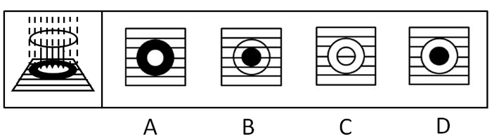

A. A

B. B

C. C

D. D

第 26 题 · 答案与解析

**参考答案（粉笔题库参考内容）**

D

**解析**

凹透镜发散光线，周围形成的是亮的光线，中间是区域光线最暗的，最外边是阳光直射的光线。

通过分析，只有D中明暗区域符合。

故正确答案为D。

**来源**：2012年上海市公务员录用考试《行测》题（B类）第26题

### 第 27 题

物体作圆周运动需要一个指向圆心的力称为向心力，向心力只能改变物体的速度方向而不能改变速度大小。水从水箱经水管冲入排污沟，有三种设计方案，甲方案在转弯处用圆弧形弯管，乙方案在转弯处采用直管，丙方案是用直管从水箱直接连到排污沟，如图所示。如不计水管摩擦，且水箱内的水面距出水口高度相同，则冲入排污沟的水流速度：

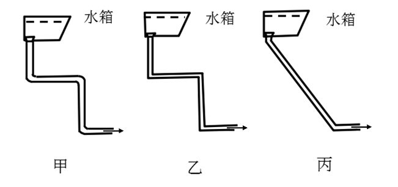

A. 甲最大

B. 乙最大

C. 丙最大

D. 三者速度一样大

第 27 题 · 答案与解析

**参考答案（粉笔题库参考内容）**

A

**解析**

水从水箱进入排污管的过程中竖直方向只受重力的作用，由于不计摩擦力，所以水平方向不受摩擦力的作用，水平方向做匀速运动。对于甲的向心力只改变速度的方向不改变速度的大小，而乙、丙中由于不存在圆周运动，因此转弯处管壁会对水流造成阻碍。三种情况下竖直方向距离相同，因此在重力作用下的末速度甲最大。

故正确答案为A。

**来源**：2012年上海市公务员录用考试《行测》题（B类）第27题

### 第 28 题

截面为方形的实心钢梁若受到压力发生形变，钢梁的上部呈压缩形变，越在上面的部分形变越大；钢梁的下部呈拉伸形变，越在下面的部分形变越大，钢梁的正中间无形变。形变越大的地方产生的恢复力越大，抗弯曲（抗形变）的贡献也越大。为了将钢梁的重量减轻一半，现有四种方案，其截面图如下所示，减重后的钢梁抗弯性都要下降，但抗弯性相对较强的方案是：

A. 1和2

B. 1和3

C. 2和3

D. 3和4

第 28 题 · 答案与解析

**参考答案（粉笔题库参考内容）**

D

**解析**

本题考查工程力学中的应力。应力是受力物体截面上内力的集度，即单位面积上的内力。

题目中说应力主要在上面和下面，中间小。所以把中间的去掉不影响应力的产生，同时减少了重力，如生活中的空心砖。钢梁的厚度越大，相对产生的应力就越大，所以中间空两端厚的应力相对大，因此3和4符合。

故正确答案为D。

**来源**：2012年上海市公务员录用考试《行测》题（B类）第28题

### 第 29 题

下图中的电路，所有的开关都是打开的，若欲得到XY之间的总电阻值为6 Ω，则正确的开关状态是：

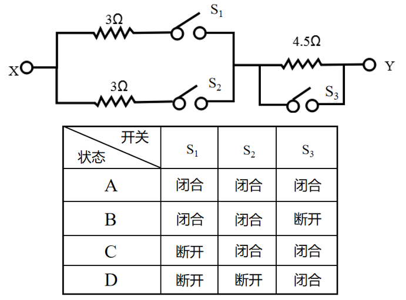

A. 状态A

B. 状态B

C. 状态C

D. 状态D

第 29 题 · 答案与解析

**参考答案（粉笔题库参考内容）**

B

**解析**

本题考查电路分析。左边两个电阻并联后与右边的电阻串联，对于串联电路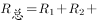······+R_n，对于并联电路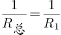+1/R_2+······+1/R_n。要使XY之间的总电阻为6 Ω，根据上述公式，左边并联电路总电阻为1.5 Ω，右边为4.5Ω，和刚好为6 Ω，因此要求S_1和S_2闭合，S_3断开。

故正确答案为B。

**来源**：2012年上海市公务员录用考试《行测》题（B类）第29题

### 第 30 题

如图所示，有一容器，内装互不相溶的两种液体。现将质量及体积皆相同的三个铝块，分别以细绳悬吊于弹簧秤下，使静止于液体中。若弹簧秤的读数分别为W_1、W_2和W_3，则下列关系正确的是：（细绳之重量及粗细不计）

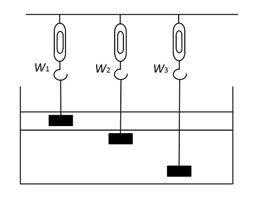

A. W_1=W_2=W_3

B. 

C. W1＞W2＞W3

D. W1＜W2=W3

第 30 题 · 答案与解析

**参考答案（粉笔题库参考内容）**

B

**解析**

本题考查受力分析。对铝块进行受力分析：竖直向下自身的重力，向上弹簧的拉力和浮力。最终静止于液体中，说明重力＝浮力＋弹簧的拉力。

通过分析，三个铝块质量相同，因此重力相同；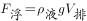，铝块完全浸入液体中，上边的液体密度小则铝块所受浮力小。，，，又知，所以。

故正确答案为B。

**来源**：2012年上海市公务员录用考试《行测》题（B类）第30题

### 第 31 题

人力资产是指企业在一定时期内拥有或控制的、能以货币计量的、为企业带来未来经济利益的劳动力资源。它是对劳动力资源的投资资本化而形成的，即人力资产是企业招聘、挑选、录用、培训以及开发所花费的成本按照资产衡量标准确认的企业资产。

根据上述定义，下面不属于人力资产的是：

A. 优秀的管理人才

B. 创新的研发团队

C. 勤勉的生产工人

D. 高效的人事制度

第 31 题 · 答案与解析

**参考答案（粉笔题库参考内容）**

D

**解析**

第一步：抓住定义中的关键词。

关键词强调“人力资产是劳动力资源”。

第二步：逐一判断选项。

A中的“管理人才”、B中的“研发团队”、C项中的“生产工人”都是劳动力资源。

D项是制度，不属于人力资产。

本题为选非题，故正确答案为D。

**考点**：单定义-其他句式

**来源**：2012年上海市公务员录用考试《行测》题（B类）第31题

### 第 32 题

“图腾”一词来源于印第安语“totem”，意思为“它的亲属”、“它的标记”。在原始人信仰中，认为本氏族人都源于某种特定的物种，即与某种动物或自然物具有亲缘关系。于是，图腾信仰便与祖先崇拜发生了关系。“totem”的第二个意思是“标志”。图腾标志在原始社会中起着重要的作用，它是最早的社会组织标志和象征，具有团结群体、密切血缘关系、维系社会组织和互相区别的职能。

根据上述定义，下面不属于图腾现象的是：

A. 蒙古族以“苍天”为永恒最高神，“成吉思汗”的含义就是“赖苍天之力而为汗者”

B. 侗族传说中，其始祖母与一条大花蛇交配，滋生繁衍而形成侗族

C. 古代朝鲜族每一村落村口都立一鸟杆，作为本氏族的象征

D. 鄂伦春族称公熊为“雅亚”，意为祖父，称母熊为“太帖”，意为祖母

第 32 题 · 答案与解析

**参考答案（粉笔题库参考内容）**

A

**解析**

第一步：抓住定义中的关键词。

图腾在定义中有两个意思，关键词分为“本氏族人都源于某种特定的物种”和“标志”。

第二步：逐一判断选项。

A项中蒙古族以“苍天”为永恒最高神，属于宗教信仰；

B项体现了侗族来源于“大花蛇”；

C项指出古代朝鲜族以“每一村落村口都立一鸟杆”为本族的标志；

D项中的鄂伦春族认为与公熊、母熊有血缘关系，三者都属于“图腾现象”。

本题为选非题，故正确答案为A。

**考点**：单定义-其他句式

**来源**：2012年上海市公务员录用考试《行测》题（B类）第32题

### 第 33 题

影子价格是用线性规则方法计算出来的反映资源最优使用效果的价格。用微积分描述资源的影子价格，即当资源增加一个数量而得到目标函数新的最大值时，目标函数最大值的增量与资源的增量的比值，就是目标函数对约束条件（即资源）的一阶偏导数。用线性规划方法求解资源最优利用时，即在解决如何使有限资源的总产出最大的过程中，得出相应的极小值，其解就是对偶解，极小值作为对资源的经济评价，表现为影子价格。

根据上述定义，影子价格是：

A. 一个数学概念

B. 一个哲学概念

C. 一个管理学概念

D. 一个统计学概念

第 33 题 · 答案与解析

**参考答案（粉笔题库参考内容）**

C

**解析**

第一步：抓住定义中的关键词。

关键词强调“资源最优使用效果的价格”。

第二步：逐一判断选项。

由关键词可知，影子价格是反映资源利用的概念，这属于管理学范畴，所以答案选C。

A、B、D三个学科均不研究“资源最优使用效果”。

故正确答案为C。

**考点**：单定义-其他句式

**来源**：2012年上海市公务员录用考试《行测》题（B类）第33题

### 第 34 题

“木马”程序是目前比较流行的病毒文件，与一般的病毒不同，它不会自我繁殖，也并不“刻意”地去感染其他文件，它通过将自身伪装成正常文件吸引用户下载执行，为施种木马者打开被种者电脑的门户，使施种者可以任意毁坏、窃取被种者电脑中的文件，甚至远程操控被种者的电脑。

根据上述定义，“木马”程序造成的最主要危害是：

A. 破坏系统文件

B. 降低运行速度

C. 窃取用户隐私

D. 伪装正常文件

第 34 题 · 答案与解析

**参考答案（粉笔题库参考内容）**

C

**解析**

第一步：抓住定义中的关键词。

“危害”关键词为“可以任意毁坏、窃取被种者电脑中的文件”、“甚至远程操控被种者的电脑”。

第二步：逐一判断选项。

A、B、D三项未抓住“危害”的关键词，A、B两项在定义中未涉及，D项“伪装正常文件”是木马的运行方式，不是危害，均排除。

C项“窃取用户隐私”与关键词意思相同，当选。

故正确答案为C。

**考点**：方式目的

**来源**：2012年上海市公务员录用考试《行测》题（B类）第34题

### 第 35 题

硬新闻是关系到国计民生以及人们切身利益的新闻，包括党和国家的重大方针、政策的制定和改变、市场行情、疾病流行、天气变化、重大灾难事故等。硬新闻为人们的政治、经济、工作、日常生活的决策提供依据。

根据上述定义，下面不属于硬新闻的是：

A. 中国价值5600余万元救灾物资经上海口岸援助泰国

B. 北大硕士生回农村老家建设“立人”图书馆促教改

C. 上海今明两年各增18万新生儿，创十年来生育最高峰

D. “神八”追梦，中国实施首次空间对接

第 35 题 · 答案与解析

**参考答案（粉笔题库参考内容）**

B

**解析**

第一步：抓住定义中的关键词。

关键词强调关系到“国计民生”以及“人们切身利益”的新闻。

第二步：逐一判断选项。

A项中的“中国价值5600余万元救灾物资”体现了国家的经济政策，关系到“国计”，C项中的“创十年来生育最高峰”关系到“民生”，D项中“神八”追梦关系到“国计”，三者均属于硬新闻。B项中的“回农村老家建设‘立人’图书馆促教改”为个人为地方所做的行为，不关系“国计民生”，不属于硬新闻。

本题为选非题，故正确答案为B。

**考点**：单定义-其他句式

**来源**：2012年上海市公务员录用考试《行测》题（B类）第35题

### 第 36 题

下列选项中，符合所给一组图形的变化规律的是：

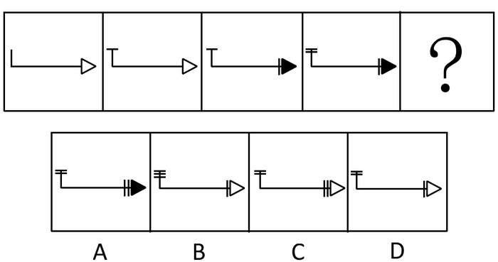

A. A

B. B

C. C

D. D

第 36 题 · 答案与解析

**参考答案（粉笔题库参考内容）**

C

**解析**

从第一幅图形到第二幅图形，是竖线上方加了一条小横线，且三角形的颜色不变；

从第二幅图形到第三图形，是三角形旁边加了一条竖线，且三角形的颜色变了；

从第三幅图形到第四幅图形，是竖线上方加了一条横线，且三角形的颜色不变。

所以变化规律为横线竖线轮流加，且加竖线的时候三角形的颜色发生变化。

未知图形应该是第四幅图三角形旁边加一条竖线且颜色变化，即为C项。

故正确答案为C。

**考点**：数量规律-复合

**来源**：2012年上海市公务员录用考试《行测》题（B类）第36题

### 第 37 题

下图中塔尖所缺的是（  ）图形。

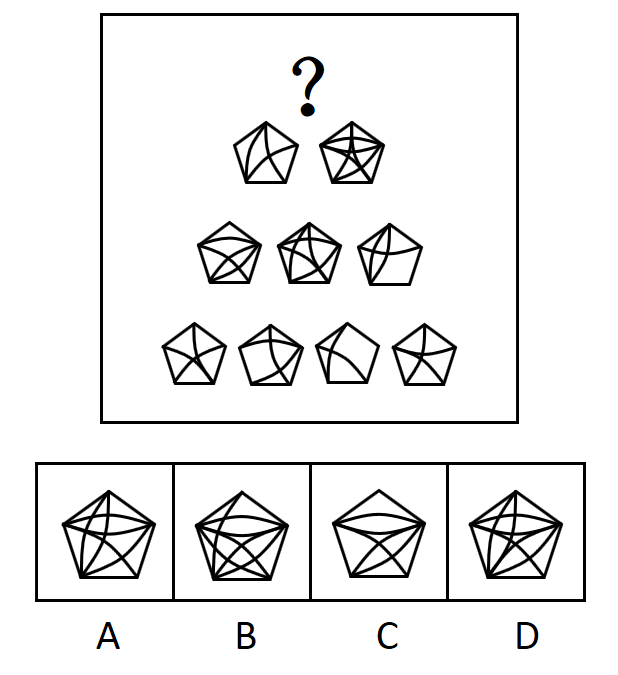

A. A

B. B

C. C

D. D

第 37 题 · 答案与解析

**参考答案（粉笔题库参考内容）**

D

**解析**

元素组成相似，且相同线条重复出现，优先考虑样式规律中的加减同异。本题为金字塔类题目，要自下向上找规律，即下层相邻的两图形之间进行运算得到上面的图形，如下图箭头指向所示：

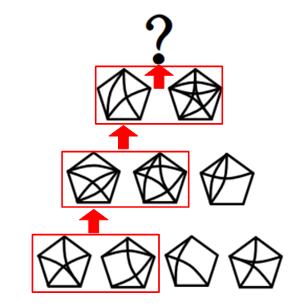

观察发现，第四行相邻两个图形的内部线条求异得到第三行图形，第三行相邻两个图形的内部线条求异得到第二行图形，则问号处图形应由第二行两个图形内部线条进行求异得到，只有D项符合。

故正确答案为D。

**考点**：样式规律-加减同异

**来源**：2012年上海市公务员录用考试《行测》题（B类）第37题

### 第 38 题

根据左图的变化规律，得到的图形是：

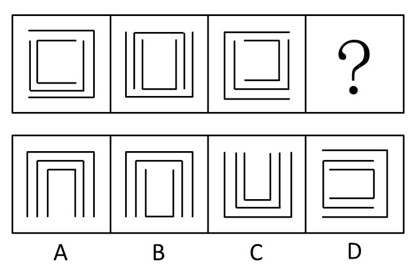

A. A

B. B

C. C

D. D

第 38 题 · 答案与解析

**参考答案（粉笔题库参考内容）**

A

**解析**

元素组成相同，看位置。从左到右外圈依次顺时针旋转90度，次外圈依次旋转180度，内圈依次逆时针旋转90度，故未知图形外圈开口向下，次外圈开口向下，内圈开口向下，A项符合。

故正确答案为A。

**考点**：位置规律-旋转

**来源**：2012年上海市公务员录用考试《行测》题（B类）第38题

### 第 39 题

根据（1）和（2）的变化规律，（3）与图（  ）对应。

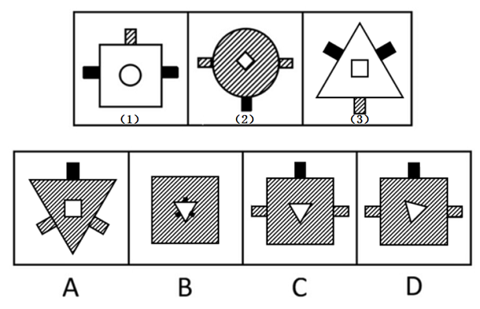

A. A

B. B

C. C

D. D

第 39 题 · 答案与解析

**参考答案（粉笔题库参考内容）**

D

**解析**

元素组成相似，优先考虑样式规律。观察发现，从图（1）到图（2），圆形与正方形的位置进行了内外互换，外部小矩形的位置进行了上下互换，排除A、B两项。继续观察发现，从图（1）到图（2），圆形内部添加了阴影线条，同时正方形旋转了45°，且外部小矩形的内部图案由黑色和阴影线条互变，因此从图（3）到图（4）应满足上述规律，只有D项符合。

故正确答案为D。

**考点**：样式规律-遍历

**来源**：2012年上海市公务员录用考试《行测》题（B类）第39题

### 第 40 题

下图为两个等圆柱体垂直相交的立体图，沿箭头方向的视图是：

A. A

B. B

C. C

D. D

第 40 题 · 答案与解析

**参考答案（粉笔题库参考内容）**

A

**解析**

三视图考查，对角线即为两个圆柱相交椭圆弧线的侧视图线。

故正确答案为A。

**考点**：空间类-三视图

**来源**：2012年上海市公务员录用考试《行测》题（B类）第40题

### 第 41 题

下图中，空缺处最适合填入的图形是：

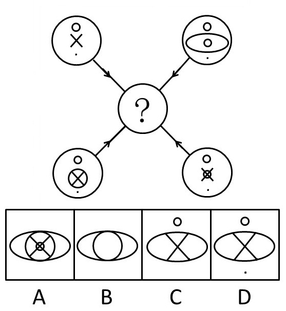

A. A

B. B

C. C

D. D

第 41 题 · 答案与解析

**参考答案（粉笔题库参考内容）**

A

**解析**

元素组成相似，优先考虑样式规律。相同元素线条重复出现，优先考虑加减同异。观察选项和箭头方向可知，“？”处图形由四个外圈运算得到。每个外圈内图形均可分为上中下三部分，上下两部分求异（即上面的圆圈和下面的黑点应该去掉），中间部分叠加保留，对应A项。

故正确答案为A。

**考点**：样式规律-加减同异

**来源**：2012年上海市公务员录用考试《行测》题（B类）第41题

### 第 42 题

将下列右边的折叠图（  ）展开后，可以得到左边的图。

A. A

B. B

C. C

D. D

第 42 题 · 答案与解析

**参考答案（粉笔题库参考内容）**

A

**解析**

两次对折之后得到的图形应为题干图形的四分之一，再看图形的摆放角度，可知应为右上角图形，A项符合。

故正确答案为A。

**来源**：2012年上海市公务员录用考试《行测》题（B类）第42题

### 第 43 题

根据上图的变化规律，得到的图形是：

A. A

B. B

C. C

D. D

第 43 题 · 答案与解析

**参考答案（粉笔题库参考内容）**

D

**解析**

元素组成相似，元素周遍。列为单位，每一列中的图形整体颜色保持一致，只是中线阴影不同，但每一行的中线颜色是相同的，每一列图形都依次顺时针旋转45度。故未知三角形整体颜色为黑色，中线阴影也为黑色，且将第三列第二行图形顺时针旋转45度，即可得到D项。

故正确答案为D。

**考点**：位置规律-旋转、样式规律-遍历

**来源**：2012年上海市公务员录用考试《行测》题（B类）第43题

### 第 44 题

左图折叠后，得到的立方体有：

A. ACG

B. BDH

C. ABH

D. EGH

第 44 题 · 答案与解析

**参考答案（粉笔题库参考内容）**

C

**解析**

本题属于空间重构类，从选项分析，通常思维，能够由左边折成的立方体应该只有三个，但是要注意题干说的是“得到的立方体有”，而不是“得到的立方体只有”，所以能够由左边折叠成的立方体大于等于3个，做题只能通过找错误的图形来排除选项，逐一分析右边立方体，H出现的次数最多，先分析H：

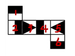

H项：找到图形和题干对应的面后，判断各个面位置对应关系是否正确，没有发现问题，所以正确，无法排除任何选项；

A项：A、B、G都出现了两次，逐一判断，找到图形和题干对应的面后，判断各个面位置对应关系是否正确，没有发现问题，所以正确，无法排除任何选项；

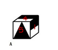

B项：找到图形和题干对应的面后，判断各个面位置对应关系是否正确，没有发现问题，所以正确，至此我们发现A、B、H都对了，可以得到选项C正确。

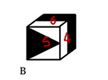

剩余图形分析：

G项：找到图形和题干对应的面后，判断各个面位置对应关系是否正确，没有发现问题，所以正确；

C项：两个三角面尖角对应的棱都不是黑白交界线，所以错误；

D项：两个三角面是相对面，不能同时出现，所以错误；

E项：找到图形和题干对应的面后，判断各个面位置对应关系是否正确，图中1、3面的公共点和题干当中对比，1应该是白长方形与之对应，所以错误；

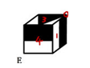

F项：找到图形和题干对应的面后，判断各个面位置对应关系是否正确，图中1、4面的公共边和题干当中对比，1应该是整个黑长方形与之对应，所以错误。

故正确答案为C。

**考点**：空间类-空间重构-六面体

**来源**：2012年上海市公务员录用考试《行测》题（B类）第44题

### 第 45 题

把（1）、（2）、（3）图形组合时，形成的图形是：

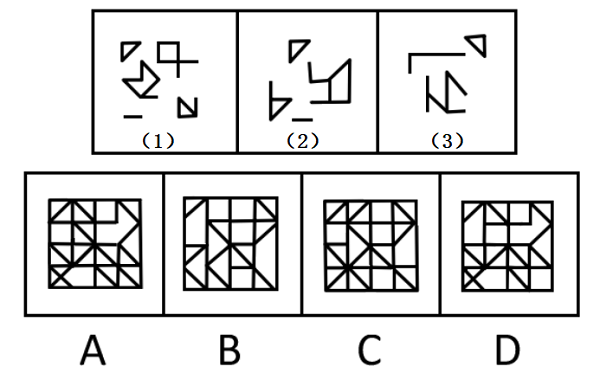

A. A

B. B

C. C

D. D

第 45 题 · 答案与解析

**参考答案（粉笔题库参考内容）**

C

**解析**

本题考查平面拼合。所形成的图形为前三个图形叠加而成，由图（1）和图（2）可知图形左上角有两个可以横向连接在一起的同方向的小三角，只有C项符合。

故正确答案为C。

**来源**：2012年上海市公务员录用考试《行测》题（B类）第45题

### 第 46 题

在有更新纪灵长动物（有人认为其是人类的祖先）遗骨的洞穴中发现了很多动物遗骨。从各种骨头出现的频率看，许多动物是死在别处后，只有身体的某些部分被带回了洞穴中。所以，能带回这么多猎物，更新纪灵长动物一定擅长捕猎。

下面哪项，如果正确，最严重地削弱了上文结论？

A. 包括更新纪灵长动物遗骨在内的所有骨头上的印迹都是那个时代的一种大型肉食动物的牙印

B. 洞穴中的遗骨不包括与更新纪灵长动物同时期的一种大象类动物的骨头

C. 在发现聚集了动物遗骨的洞穴中没有用火的证据

D. 更新纪灵长动物有时在洞穴之间搬来搬去以寻找庇护，它们一生不只呆在一个洞穴中

第 46 题 · 答案与解析

**参考答案（粉笔题库参考内容）**

A

**解析**

第一步：找出论点和论据。

论点：能带回这么多猎物，更新纪灵长动物一定擅长捕猎。

论据：在有更新纪灵长动物（有人认为其是人类的祖先）遗骨的洞穴中发现了很多动物遗骨。从各种骨头出现的频率看，许多动物是死在别处后，只有身体的某些部分被带回了洞穴中。

第二步：判断削弱方式。

论点强调更新纪灵长动物捕猎，论据强调发现很多动物遗骨，所以论点与论据间不存在明显因果关系，需削弱论证，在论点和论据间不搭桥。

第三步：逐一判断选项的作用。

A项，包括更新纪灵长动物遗骨在内的所有骨头上的印迹都是那个时代的一种大型肉食动物的牙印，这说明那些其他动物的遗骨并不是更新纪灵长动物捕猎来的，即在“更新纪灵长动物捕猎”和“动物遗骨”间不搭桥，削弱论证，为正确选项，当选；

B项，洞穴中的遗骨不包括一种大象类动物的骨头，与更新纪灵长动物捕猎无直接关系，属无关选项 ，排除；

C项，没有用火的证据与更新纪灵长动物捕猎无直接关系，属无关选项 ，排除；

D项，更新纪灵长动物在洞穴之间搬来搬去与更新纪灵长动物捕猎无直接关系，属无关选项 ，排除。

故正确答案为A。

**考点**：拆桥

**来源**：2012年上海市公务员录用考试《行测》题（B类）第46题

### 第 47 题

甲、乙两人同时从图书馆走向教室，甲一半路程步行，一半路程跑步；乙一半时间步行，一半时间跑步，若两人步行、跑步的速度均相同，则：

A. 甲先到教室

B. 乙先到教室

C. 甲和乙同时到教室

D. 无法判断

第 47 题 · 答案与解析

**参考答案（粉笔题库参考内容）**

B

**解析**

第一步：抓住题干主要信息。

第一点说明甲一半路程步行，一半路程跑步，第二点说明乙一半时间步行，一半时间跑步，第三点说明两人步行、跑步的速度均相同。

第二步：分析题干信息，并结合选项得出答案。

跑步比走路快，乙用一半的时间跑步，则跑步经过的路程占总路程的一半以上。图书馆到教室的总路程是一定的，甲一半的路程跑步，而乙一半以上的路程在跑步，因此乙用的时间较短，先到教室。

故正确答案为B。

**考点**：日常结论

**来源**：2012年上海市公务员录用考试《行测》题（B类）第47题

### 第 48 题

娴熟的技术或者足够的时间（超过一个月）是完成一件工艺品的必要条件。小周只花了25天就完成了一件工艺品，说明小周掌握娴熟的技术。

以下哪项推理方式和题干最类似？

A. 一件产品要在市场上销售得好，质量上乘和足够的宣传广告缺一不可。有一款电扇，专家鉴定都说质量上乘，但销售不佳，说明它的宣传广告还不足

B. 工资不高又不善理财，家庭经济必然拮据。小赵工资不高，但每月经济均显宽裕，说明小赵善于理财

C. 或者今年业绩超常，或者满30年公司工龄，均可获今年的特殊津贴。黄先生得到了今年的特殊津贴，但他只在公司供职10年，说明黄先生今年业绩超常

D. 一个罪犯实施犯罪，必须既有作案动机，又有作案时间。在某案中李先生有作案动机，但无作案时间，说明李先生不是该案的作案者

第 48 题 · 答案与解析

**参考答案（粉笔题库参考内容）**

B

**解析**

第一步：翻译题干。

完成一件工艺品→娴熟的技术或者足够的时间（超过一个月），小周：完成一件工艺品 且 -足够的时间（超过一个月），结论：小周：娴熟的技术。

第二步：逐一翻译选项。

A项，销售得好→质量上乘 且 足够的宣传广告，一款电扇：-销售得好 且 质量上乘；结论：一款电扇，-足够的宣传广告；

B项，-工资高 且 -善理财→—经济宽裕，利用逆否规则得到：经济宽裕→工资高或者善理财，小赵：-工资高 且 经济宽裕；结论：小赵，善理财；

C项，今年业绩超常或者满30年公司工龄→获得今年的特殊津贴，黄先生：获得今年的特殊津贴 且 -满30年公司工龄；结论：黄先生，今年业绩超常；

D项，实施犯罪→作案动机 且 作案时间，李先生：作案动机 且 -作案时间；结论：李先生，-实施犯罪。

综上，将选项与题干对比可以看出，B项与题干一致。

故正确答案为B。

**考点**：推理形式

**来源**：2012年上海市公务员录用考试《行测》题（B类）第48题

### 第 49 题

某个会议的与会人员的情况如下：

（1）3人是由基层提升上来的，

（2）4人是北方人，

（3）2人是黑龙江人，

（4）5人具有博士学位，

（5）黑龙江人没有博士学位，

（6）上述情况包含了与会的所有人员。

那么，与会人员的人数是：

A. 最少5人，最多12人

B. 最少7人，最多12人

C. 最少5人，最多14人

D. 最少7人，最多14人

第 49 题 · 答案与解析

**参考答案（粉笔题库参考内容）**

B

**解析**

第一步：抓住题干关键信息。

北方人包含黑龙江人，因此（2）和（3）是必定重合的；（5）限制了（3）和（4）不能重合。

第二步：分析题干信息，并结合选项得出答案。

理论上人数最多的情况为（1）（2）（3）和（4）互不重合，但是（2）和（3）是必定重合的，因此人数最多是3＋4＋5＝12人；

理论上人数最少的情况为（1）（2）（3）和（4）完全重合，但是（5）限制了（3）和（4）不能重合，所以人数最少为2＋5＝7人。

综上，与会人员的人数是最少7人，最多12人。

故正确答案为B。

**考点**：框架题

**来源**：2012年上海市公务员录用考试《行测》题（B类）第49题

### 第 50 题

教师让四名学生每人去拿一只桌球，不论什么颜色。学生拿了球后，教师发现唯一的一只白球被拿走了，问谁拿了白球。

甲说：我没有拿白球。乙说：是丁拿的白球。

丙说：是乙拿的白球。丁说：白球不是我拿的。

如果四人中只有一人说的是真话，那么拿了白球的是（    ）。

A. 甲

B. 乙

C. 丙

D. 丁

第 50 题 · 答案与解析

**参考答案（粉笔题库参考内容）**

A

**解析**

第一步：找突破口。

本题突破口为乙和丁之间的矛盾关系，两人的话必有一真和一假。

第二步：看其他的话。

本题只有一句为真，故甲和丙的话均为假话。由甲和丙所说的话均为假可知，是甲拿的白球。

A项，根据上述分析，甲拿了白球，该项正确。

B项，根据上述分析，甲拿了白球而非乙，该项错误。

C项，根据上述分析，甲拿了白球而非丙，该项错误。

D项，根据上述分析，甲拿了白球而非丁，该项错误。

第三步：再次标注答案。

故正确答案为A。

**考点**：只有一真/一假

**来源**：2012年上海市公务员录用考试《行测》题（B类）第50题

### 第 51 题

现在大多数用后即可废弃的塑料罐上都贴上了用以说明塑料的类型或质量的号码（从1到9）。具有最低编号的塑料品最容易被回收工厂回收，具有最高编号的塑料很少被回收。因此，消费者可以通过拒绝购买那些包装在最高编号的塑料制品内的产品，使不能回收的废物长期来看显著减少。

下面哪项，如果正确，最能严重地削弱上面的结论：

A. 目前，收集、分类和回收被抛弃的塑料废品的费用要比用原材料制造的新的塑料产品的高

B. 许多消费者没有注意到印在塑料容器上的号码

C. 塑料容器经回收后，编号几乎总是在上升，因为回收处理会使塑料产品的质量下降

D. 那些将所有废弃的塑料容器收集起来以备将来回收的社区，只有在明显没有回收商来回收它们的情况下，才将有较高编号的塑料倾倒进垃圾堆里

第 51 题 · 答案与解析

**参考答案（粉笔题库参考内容）**

C

**解析**

第一步：找到论点和论据。

论点：消费者可以通过拒绝购买那些包装在最高编号的塑料制品内的产品，使不能回收的废物长期来看显著减少。

论据：现在大多数用后即可废弃的塑料罐上都贴上了用以说明塑料的类型或质量的号码(从1到9)，具有最低编号的塑料品最容易被回收工厂回收，具有最高编号的塑料很少被回收。

第二步：逐一分析选项。

A项，收集、分类和回收塑料废品的费用比制造的新的塑料产品的高，与通过编号来减少不能回收的废物无直接关系，属无关选项；

B项，消费者没有注意到印在塑料容器上的号码，与消费者是否可以通过拒绝购买那些包装在最高编号塑料制品内产品的方式使不能回收的废物显著减少无关，属无关选项；

C项，塑料容器经回收后，编号几乎总是在上升，说明即使人们只买低编号的塑料包装的产品，这些低编号的塑料也会逐渐变成很少被回收的高编号的塑料，这样高编号的塑料会越来越多，因此不能通过拒绝购买那些包装在最高编号的塑料制品内的产品，使不能回收的废物长期来看显著减少，可以削弱；

D项，将废弃的塑料容器收集起来以备将来回收的社区，与通过编号来减少不能回收的废物无直接关系，属无关选项。

故正确答案为C。

**考点**：削弱论点

**来源**：2012年上海市公务员录用考试《行测》题（B类）第51题

### 第 52 题

某班有三个小组，赵、钱、孙三人分属不同的小组。这次语文考试成绩公布，情况如下：赵和三人中的第3小组那位不一样，孙比三人中第1小组的那位的成绩低，三人中第3小组的那位比钱分数高。

若赵、钱、孙三人按语文成绩由高到低排列，正确的是：

A. 赵、钱、孙

B. 赵、孙、钱

C. 钱、赵、孙

D. 孙、赵、钱

第 52 题 · 答案与解析

**参考答案（粉笔题库参考内容）**

B

**解析**

第一步：找突破口。

本题突破口是信息量最大对象，即第3小组那位。由“赵和三人中的第3小组那位不一样”可知，赵不是第3小组那位，由“第3小组的那位比钱分数高”可知，钱不是第3小组那位，因此第3小组那位是孙。

第二步：抄信息于表中，即将题干和第一步的所有信息放在一个表中。

人：       钱                          孙

成绩：                   ＜                                 ＜

小组：                            第3小组                           第1小组

第三步：填空，即填上每一个集合的空格。

人：       钱                          孙                               （赵）

成绩：                   ＜                                 ＜

小组：（第2小组）        第3小组                           第1小组

通过分析，三人按语文成绩由高到低排列为赵、孙、钱。

故正确答案为B。

**考点**：从最大信息开始推

**来源**：2012年上海市公务员录用考试《行测》题（B类）第52题

### 第 53 题

老师把双手伸进围棋匣子，然后双手握拳各执一子，让同学猜哪只手里有黑子。假设老师说了四句话，其中三句是真的，一句是假的。

（1）右手肯定不是黑子。

（2）或者左手是黑子，或者右手是黑子。

（3）如果左手是黑子，则右手就不是黑子。

（4）左手、右手都是黑子。

则哪句是假话：

A. （1）

B. （2）

C. （3）

D. （4）

第 53 题 · 答案与解析

**参考答案（粉笔题库参考内容）**

D

**解析**

第一步：找突破口。

本题突破口为（3）和（4）之间的矛盾关系，两句话必有一真和一假。

第二步：看其他的话。

本题只有一句为假，故（1）和（2）两句话均为真话。由（1）和（2）两句话可知，左手是黑子，右手不是黑子。

第三步：判断突破口中两句话的真假。

由左手是黑子，右手不是黑子可知，（4）句为假。

故正确答案为D。

备注：本题需特别注意矛盾关系：A⇒B与A∧－B的矛盾，望考生加深理解。

**考点**：只有一真/一假

**来源**：2012年上海市公务员录用考试《行测》题（B类）第53题

### 第 54 题

论证：在作经济决定时，人们倾向于少考虑或不考虑环境因素，例如作空气与水的清洁度、濒危物种的灭绝等的成本收益分析。环境经济学家认为，要人们多考虑环境因素，就要赋予环境因素一定的经济价值。但是，经济价值本身就来自人们作出经济决定时所作的成本收益分析。结论：环境经济学的基本研究目标与其研究方法存在着矛盾。

假设以上论证是正确的，则论证对结论的支持力度是：

A. 强烈的，赋予环境因素以一定的经济价值是不可能的，除非人们在作出经济决定时考虑环境因素

B. 强烈的，除非经济决策对受环境因素影响的事物不会造成任何事实上的影响

C. 充其量是微弱的，因为上述段落没有证明经济决策者大体上都不会考虑环境因素

D. 充其量是微弱的，因为上述论述假设污染和其他对环境因素的影响很少源自经济决策

第 54 题 · 答案与解析

**参考答案（粉笔题库参考内容）**

B

**解析**

第一步：抓住题干主要信息。

第一点：论证为在作经济决定时，人们倾向于少考虑或不考虑环境因素，要人们多考虑环境因素，就要赋予环境因素一定的经济价值，但是，经济价值本身就来自人们作出经济决定时所作的成本收益分析；

第二点：结论为环境经济学的基本研究目标与其研究方法存在着矛盾。

第二步：分析题干信息，并结合选项得出答案。

环境经济学的基本研究目标是要人们多考虑环境因素，研究方法是赋予环境因素一定的经济价值。而题干中的论证说明这一研究方法无法实现研究目标，因为经济价值本身就来自人们作出经济决定时所作的成本收益分析。因此，环境经济学的基本研究目标与其研究方法之间存在着矛盾。题干中的论证对结论有强烈的支持力度，除非经济决策对受环境因素影响的事物不会造成任何事实上的影响。也就是说，只要经济决策对受环境因素影响的事物造成影响，题干中的论证对结论就有强烈的支持力度。

通过分析，只有B项中说法符合。

故正确答案为B。

**来源**：2012年上海市公务员录用考试《行测》题（B类）第54题

### 第 55 题

检测系统X和检测系统Y尽管依据的原理不同，但都能检测出所有的产品缺陷，而它们也都会错误地淘汰3%无瑕疵产品。由于错误淘汰的成本很高，所以通过同时安装两套系统，并且只淘汰两套系统都认为有瑕疵的产品就可以省钱。

以上论述，需要建立在下面（    ）项假设上。

A. 接受一个次品所造成的损失比淘汰一个无瑕疵产品所造成的损失大

B. 不论采用哪一系统，第二次检测只需要对第一次没被淘汰的产品进行检验

C. 在同等价格范围的产品中，系统X和系统Y是市场上最少出错的检测系统

D. 系统X错误淘汰的3%无瑕疵的产品与系统Y错误淘汰的3%无瑕疵产品不完全相同

第 55 题 · 答案与解析

**参考答案（粉笔题库参考内容）**

D

**解析**

第一步：找到论点和论据。

本题论点是通过同时安装两套系统，并且只淘汰两套系统都认为有瑕疵的产品就可以省钱。

论据是检测系统X和检测系统Y尽管依据的原理不同，但都能检测出所有的产品缺陷，而它们也都会错误地淘汰3%无瑕疵产品。

第二步：判断加强方式。

论点强调两套系统同时作用，论据强调每套系统单独作用，论点与论据间存在明显因果关系，且提问方式为前提，加强优先考虑补充必要条件。

第三步：逐一判断选项的作用。

A项：接受和淘汰一个次品所造成的损失与两套系统同时作用省钱无直接关系，属无关选项，排除；

B项：第二次检测只需要对第一次没被淘汰的产品进行检验，并没有涉及两套系统同时作用，只是两次检测，属无关选项，排除；

C项：系统X和系统Y是最少出错的，与两套系统同时作用省钱无直接关系，属无关选项，排除；

D项：两个系统淘汰产品不完全相同，说明同时作用比单独作用检查更全面，更准确，如果淘汰产品完全相同，就没有同时使用的必要，是论点成立的前提条件，当选。

故正确答案为D。

**考点**：必要条件

**来源**：2012年上海市公务员录用考试《行测》题（B类）第55题

### 第 56 题

某工厂有学徒工、熟练工、技师共80名，每天完成480件产品的任务。已知每天学徒工完成2件，熟练工完成6件，技师完成7件，且学徒工和熟练工完成的量相等，则该厂技师人数是熟练工人数的多少倍：

A. 6

B. 8

C. 10

D. 12

第 56 题 · 答案与解析

**参考答案（粉笔题库参考内容）**

D

**解析**

学徒工和熟练工的效率比为2:6＝1:3，学徒工和熟练工完成的量相等，则学徒工和熟练工的人数比为3:1。

设熟练工为A名，学徒工为3A名，技师为B名，则有A+3A+B=80，，解得A=5，B=60。因此技师人数是熟练工的倍。

故正确答案为D。

**考点**：给具体单位型

**来源**：2012年上海市公务员录用考试《行测》题（B类）第56题

### 第 57 题

某科研单位欲拿出一定的经费奖励获奖的科研人员，第一名可得到全部奖金的一半多1万元，第二名可得到剩余的一半多1万元，以此类推都得到剩余奖金的一半多1万元，若到第七名恰好将奖金分完，则该单位需要拿出奖金多少万元：

A. 156

B. 254

C. 256

D. 512

第 57 题 · 答案与解析

**参考答案（粉笔题库参考内容）**

B

**解析**

解析1：

倒推问题，第七名拿之前还剩奖金为2万元，由此倒推第六名至第一名拿之前的奖金数分别为6、14、30、62、126、254万元。

解析2：

设该单位拿出奖金为x万元，第一名得到，第二名得到，第三名得到，…，由此可知，七名科研人员得到的奖金数是首项是2，公比为2，项数是7的等比数列。由第七名恰好分完，可知第七名得到奖金2万元。由等比数列求和公式可知，该单位拿出奖金为。

故正确答案为B。

等比数列求和公式：（a_1为首项，q为公比，n为项数）。

**考点**：数列问题

**来源**：2012年上海市公务员录用考试《行测》题（B类）第57题

### 第 58 题

某市出租车收费标准是：5千米内起步费10.8元，以后每增加1千米增收1.2元，不足1千米按1千米计费。现老方乘出租车从A地到B地共支出24元，如果从A地到B地先步行460米，然后再乘出租车也是24元，那么从AB的中点C到B地需车费多少元：（不计等候时间所需费用）

A. 12

B. 13.2

C. 14.4

D. 15.6

第 58 题 · 答案与解析

**参考答案（粉笔题库参考内容）**

C

**解析**

设AB两地相距S千米。共花钱24元，则超过5千米的部分为24-10.8=13.2元，超过5千米后最多走了，因此。先步行460米后花费相同，说明先走460米后乘出租路程超过15千米，则，C到B的距离。因不足1千米按1千米计费，故应看成8千米，共花费。

故正确答案为C。

**考点**：分段计算问题

**来源**：2012年上海市公务员录用考试《行测》题（B类）第58题

### 第 59 题

大兴安岭的香菇远销日韩等地，香菇上市时刘经理到当地按市场价格10元/千克收购了2000千克香菇存入冷库。预测香菇的市场价每天每千克将上涨0.5元，而冷库存放香菇每天需要支出各种费用合计340元，且香菇在冷库中最多保存110天，同时平均每天有6千克的香菇腐烂不能出售。若刘经理要获得22500元利润，则应将这批香菇存放多少天后出售：

A. 50

B. 75

C. 100

D. 150

第 59 题 · 答案与解析

**参考答案（粉笔题库参考内容）**

A

**解析**

设这批香菇存放A天后出售。由利润=总收入-总成本，可列方程，解得A=50或150。香菇在冷库中最多保存110天，故这批香菇只能存放50天后出售。

故正确答案为A。

**考点**：经济利润问题

**来源**：2012年上海市公务员录用考试《行测》题（B类）第59题

### 第 60 题

某单位举行“庆祝建党90周年”知识抢答赛，总共50道抢答题。比赛规定：答对1题得3分，答错1题扣1分，不抢答得0分。小军在比赛中抢答了20道题，要使最后得分不少于50分，则小军至少要答对多少道题：

A. 16

B. 17

C. 18

D. 19

第 60 题 · 答案与解析

**参考答案（粉笔题库参考内容）**

C

**解析**

设答对x题，答错(20-x)题，则有，解得x≥17.5。x取最小整数值为18。

故正确答案为C。

**考点**：和差倍比问题

**来源**：2012年上海市公务员录用考试《行测》题（B类）第60题

### 第 61 题

某单位有老陶和小刘等5名工作人员，需安排在星期一至星期五的中午值班，每人一次，若老陶星期一外出开会不能排，小刘有其他的事不能排在星期五，则不同的排法共有多少种：

A. 36

B. 48

C. 78

D. 96

第 61 题 · 答案与解析

**参考答案（粉笔题库参考内容）**

C

**解析**

若老陶不安排在周一，则有种情况；其中，小刘排在周五有种情况，则共有96-18=78种情况。

故正确答案为C。

**考点**：基础排列组合

**来源**：2012年上海市公务员录用考试《行测》题（B类）第61题

### 第 62 题

有一行人和一骑车人都从A向B地前进，行人和骑车人的速度分别是3.6千米/小时、10.8千米/小时，此时道路旁有列火车也由A地向B地疾驶，火车用22秒超越行人，用26秒超越骑车人，这列火车车身长度为多少米：

A. 232

B. 286

C. 308

D. 1029.6

第 62 题 · 答案与解析

**参考答案（粉笔题库参考内容）**

B

**解析**

3.6千米/小时=1米/秒，10.8千米/小时=3米/秒。火车运动方向与行人、骑车人相同，可归为追及问题。此题中追及距离即为火车长度。设火车速度为v米/秒，长度为L米。根据追及问题公式，则有，，解得L=286。

故正确答案为B。

追及问题：。

**考点**：相遇追及

**来源**：2012年上海市公务员录用考试《行测》题（B类）第62题

### 第 63 题

某车间三个班组共同承担—批加工任务，每个班组要加工100套产品。因为加工速度有差异，一班组完成任务时二班组还差5套产品没完成，三班组还差10套产品没完成。假设三个班组加工速度都不变，那么二班组完成任务时，三班组还剩多少套产品未完成：

A. 5

B. 80/19

C. 90/19

D. 100/19

第 63 题 · 答案与解析

**参考答案（粉笔题库参考内容）**

D

**解析**

相同的时间内，一、二、三班组分别完成了100、95、90套产品，则二班组与三班组工作效率比为95:90。设当二班组完成任务（即加工了100套）时，三班组加工了x套产品，则有95:90=100:x，解得。三班组还剩套产品未完成。

故正确答案为D。

**考点**：给具体单位型

**来源**：2012年上海市公务员录用考试《行测》题（B类）第63题

### 第 64 题

一艘船从A地行驶到B地需要5天，而该船从B地行驶到A地则需要7天。假设船速、水流速度不变，并具备漂流条件，那么船从A地漂流到B地需要多少天：

A. 40

B. 35

C. 12

D. 2

第 64 题 · 答案与解析

**参考答案（粉笔题库参考内容）**

B

**解析**

设A、B两地距离为35，则A到B的顺水速度为船速＋水速＝7，B到A的逆水速度为船速-水速＝5，两式相减得2水速＝2，则水速为1。漂流时间为35÷1＝35天。

故正确答案为B。

**考点**：流水行船

**来源**：2012年上海市公务员录用考试《行测》题（B类）第64题

### 第 65 题

孙某共用24000元买进甲、乙股票若干，在甲股票升值15％、乙股票下跌10％时全部抛出，共赚到1350元，则孙某最初购买甲、乙两支股票的投资比例是：

A. 5:3

B. 8:5

C. 8:3

D. 3:5

第 65 题 · 答案与解析

**参考答案（粉笔题库参考内容）**

A

**解析**

设甲股票买了x元，乙股票买了y元，则有x+y=24000，0.15x-0.1y=1350，解得x=15000，y=9000。x:y=15000:9000=5:3。

故正确答案为A。

**考点**：经济利润问题

**来源**：2012年上海市公务员录用考试《行测》题（B类）第65题

## 材料 3

根据B市住户抽样调查显示，1985年户籍居民人均可支配收入为1915元，到1994年，户籍居民人均可支配收入首次突破万元大关，达10503元，九年间年均增长20.8%。随后又经过了六年时间，至2000年，户籍居民人均可支配收入为20906元，六年间年均增长12.2%。至2004年户籍居民人均可支配收入达到27596元，比1985年增长13.4倍，年均增长15.1%，扣除价格因素，实际年均增长7.0%。2009年该市户籍居民人均可支配收入达到29245元，比2005年增长了36.1%。

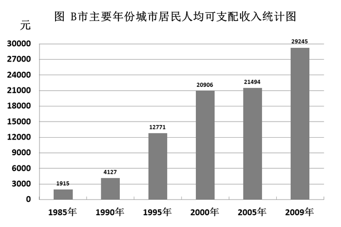

### 第 66 题

1985年到2005年，户籍居民人均可支配收入年均增速最快的五年是：

A. 1985—1990年

B. 1990—1995年

C. 1995—2000年

D. 2000—2005年

第 66 题 · 答案与解析

**参考答案（粉笔题库参考内容）**

B

**解析**

根据题干“······年均增速最快的”，可判定本题为年均增长率的比较问题。根据年均增长率的公式：初期值末期值，因选项年份差n值相同，故仅比较末期值/初期值的大小即可。定位柱形图，各选项末期与初期的比值分别为：

A项：4127/1915≈2+；

B项：12771/4127≈3^+；

C项：20906/12771≈1^+；

D项：21494/20906≈1^+。

对比可得，年均增速最快的五年是1990—1995年。

故正确答案为B。

**考点**：年均增长率、综合资料

**来源**：2012年上海市公务员录用考试《行测》题（B类）第66题

### 第 67 题

2005年至2009年，户籍居民人均可支配收入年均约增长：

A. 7.2%

B. 8.0%

C. 8.7%

D. 9.0%

第 67 题 · 答案与解析

**参考答案（粉笔题库参考内容）**

B

**解析**

根据题干“2005年至2009年，······年均约增长······”，结合选项都是百分数，可判定本题为年均增长率问题。定位文字材料，2009年该市户籍居民人均可支配收入达到29245元，比2005年增长了36.1%。根据年均增长率的公式为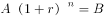，代入数据可得：。

代入选项A，若r=7.2%，则；

代入选项B，若r=8%，则；

代入选项C，若r=8.7%，则；

代入选项D，若r=9%，则。

与1.361最为接近的是B项。

故正确答案为B。

**考点**：年均增长率、综合资料

**来源**：2012年上海市公务员录用考试《行测》题（B类）第67题

### 第 68 题

2009年户籍居民人均可支配收入比1985年约增长了多少倍：

A. 12.4

B. 13.4

C. 14.3

D. 15.3

第 68 题 · 答案与解析

**参考答案（粉笔题库参考内容）**

C

**解析**

根据题干“······增长了多少倍”，可判定本题为一般增长率计算问题。定位柱形图，2009年和1985年户籍居民人均可支配收入分别为29245元、1915元。则2009年户籍居民人均可支配收入同比增长率，与C项最接近。

故正确答案为C。

**考点**：一般增长率、综合资料

**来源**：2012年上海市公务员录用考试《行测》题（B类）第68题

### 第 69 题

与五年前相比，2009年户籍居民人均可支配收入约增长了：

A. 36.1%

B. 20.8%

C. 15.1%

D. 6.0%

第 69 题 · 答案与解析

**参考答案（粉笔题库参考内容）**

D

**解析**

根据题干“与五年前相比，2009年······增长了”，结合选项为百分数，可判定本题为一般增长率计算问题。定位文字材料，2004年和2009年户籍居民人均可支配收入分别为27596元、29245元，则2009年户籍居民人均可支配收入与五年前相比：，与D项最接近。

故正确答案为D。

**考点**：一般增长率、综合资料

**来源**：2012年上海市公务员录用考试《行测》题（B类）第69题

### 第 70 题

根据所给资料，下列说法不正确的是：

A. B市户籍居民人均可支配收入经过5年的时间从1万元增长到了2万元

B. 近年来，价格因素对居民人均收入的增长起到了一定的抑制作用

C. 2005年户籍居民人均可支配收入比5年前增长了588元

D. 户籍居民人均可支配收入自2000年以后增速有所减缓

第 70 题 · 答案与解析

**参考答案（粉笔题库参考内容）**

A

**解析**

A项：定位文字材料，B市户籍居民人均可支配收入1994年首次突破1万元，2000年超过2万元，经过了6年时间，错误；

B项：定位文字材料，从“······年均增长15.1%，扣除价格因素，实际年均增长7.0%”可知，价格因素确实对居民人均收入的增长起到了一定的抑制作用，正确；

C项：定位柱形图，2005年和2000年户籍居民人均可支配收入分别为21494、20906元，增长了21494－20906＝588元，正确；

D项：定位柱形图，根据公式，

2000年以前，增长率分别为，，，

2000年以后增长率分别为，，明显看出，2000年以前的增长率较大，2000年以后增速有所减缓，正确。

本题为选非题，故正确答案为A。

**考点**：综合分析、综合资料

**来源**：2012年上海市公务员录用考试《行测》题（B类）第70题

## 材料 4

上海市统计局2011年5月3日公布了本市快速汇总的第六次全国人口普查主要数据，全市常住人口为2301.91万人，其中外省市来沪常住人口为897.70万人。

        与2000年第五次人口普查相比，本市十年来常住人口共增加628.14万人，增长37.53%；年平均增长率为3.24%。外省市来沪常住人口增加551.21万人，增长159.08%；平均每年增加55.12万人，年平均增长率为9.99%。全市常住人口中，男性人口占51.50%，女性人口占48.50%。常住人口性别比（以女性为100，男性对女性的比例）由2000年第五次人口普查的105.68上升为106.18。汉族人口占98.80%，比2000年第五次人口普查减少0.58个百分点；少数民族人口占1.20%,比2000年第五次人口普查提高0.58个百分点。全市常住人口中共有家庭户825.12万户，平均每个家庭户的人口为2.49人，比2000年第五次人口普查的2.79人减少0.3人。

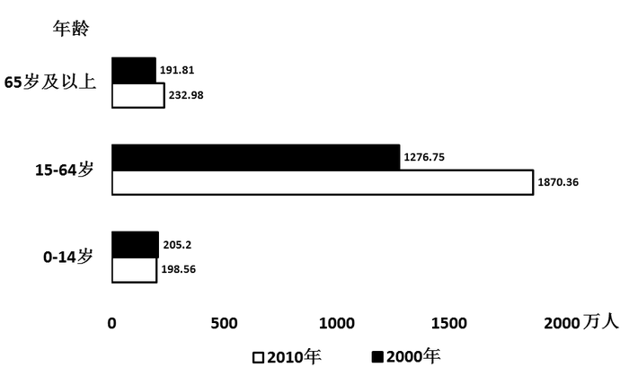

### 第 71 题

根据资料，下列说法错误的是：

A. 与上次人口普查相比，14岁以下与65岁以上人口比重同步降低，但前者降低速度明显慢于后者

B. 比较近两次人口普查的数据，可以看到本市常住人口的构成中，15-64岁人口的增长量最大

C. 从第五次人口普查之后，到2010年底本市常住人口平均每年增加近63万人

D. 本市常住人口开始呈现出倒金字塔的趋势，65岁以上的老人已经超过0-14岁人口

第 71 题 · 答案与解析

**参考答案（粉笔题库参考内容）**

A

**解析**

A项： 定位文字材料，第六次人口普查，全市常住人口为2301.91万人，与2000年第五次人口普查相比，十年来常住人口共增加628.14万人，则2000年第五次人口普查，全市常住人口为2301.91-628.14=1673.77万人。定位图表，2000年14岁以下及65岁以上的人数分别为205.2万人和191.81万人，则2000年14岁以下比重为，65岁以上比重为；同理2010年14岁以下及65岁以上的人数分别为198.56万人和232.98万人，则2010年14岁以下比重为，65岁以上比重为。可知比重均同比下降，但前者下降的速度明显快于后者，错误；

B项：定位柱形图，同比增量即为每一年龄段中两条柱子的长度差。观察发现，15-64岁人口的增长量最大，正确；

C项：定位文字材料，本市十年来常住人口共增加628.14万人，故每年增加，近63万人，正确；

D项：定位柱形图，观察发现，2010年上海市常住人口中65岁及以上人口为232.98万人，0-14岁人口为198.56万人，232.98＞198.56，老龄人口已经多于幼龄人口，且与上次普查相比，老龄人口有增多的趋势，幼龄人口有减少的趋势，上海市常住人口开始呈倒金字塔趋势，正确。

本题为选非题，故正确答案为A。

**考点**：综合分析、综合资料

**来源**：2012年上海市公务员录用考试《行测》题（B类）第71题

### 第 72 题

与第五次全国人口普查相比，第六次全国人口普查数据显示外省市来沪常住人口占全市常住人口的比重提高了近多少个百分点：

A. 88

B. 27.3

C. 24

D. 18.3

第 72 题 · 答案与解析

**参考答案（粉笔题库参考内容）**

D

**解析**

根据题干“与第五次全国人口普查相比，第六次······占······的比重提高了···个百分点”，可判定本题为两期比重问题。定位文字材料，第六次人口普查，全市常住人口为2301.91万人，外省市来沪常住人口为897.70万人，则第六次人口普查外来人口占常住人口的比重为897.70/2301.91；与第五次相比，本市常住人口共增加628.14万人，外省市来沪常住人口增加551.21万人，则第五次人口普查外来人口占常住人口的比重为。

故第六次比第五次提高了，即19个百分点，与D项最接近。

故正确答案为D。

**考点**：两期比重、综合资料

**来源**：2012年上海市公务员录用考试《行测》题（B类）第72题

### 第 73 题

下列叙述不正确的是：

A. 外省市来沪常住人口是本市常住人口增长迅速的主要因素

B. 从常住人口性别比来看，本市重男轻女现象较为严重

C. 第五次人口普查中，65岁及以上的老年人口约占11.46%

D. 第六次人口普查少数民族人口约为27.62万人

第 73 题 · 答案与解析

**参考答案（粉笔题库参考内容）**

B

**解析**

A项，定位文字材料，与第五次人口普查相比，常住人口共增加628.14万，而外省市来沪的增加了551.21万，外省来沪的增加人数占常住人口增加人数的比重超过1/2，所以是增长的主要因素，正确；

B项，定位文字材料，第五次人口普查时常住人口男性对女性的比例为105.68，2010年上升为106.18，男女人数之比近似于1，相差很小，故“重男轻女现象较为严重”的说法不对，错误；

C项，定位图表，第五次人口普查中，65岁及以上的老年人为191.81万人，定位文字材料，第六次普查时常住人口为2301.91万人，比第五次普查时增加628.14万人，则第五次普查时，总人口为(2301.81-628.14)万人，则65岁及以上的老年人口所占的比重为，正确；

D项，定位文字材料，第六次人口普查，总人口为2301.91万人，少数民族占1.2%，故万人，正确。

本题为选非题，故正确答案为B。

**考点**：综合分析、综合资料

**来源**：2012年上海市公务员录用考试《行测》题（B类）第73题

## 材料 5

在“人人劝阻室内吸烟”行动中，上海市所有机关、医院、学校全面禁烟，餐饮、宾馆和文化娱乐场所全面标注禁烟标志，餐饮单位逐步实行禁烟。为配合禁烟行动，某社区采用随机抽样调查方法开展了“你支持哪种戒烟方式”的问卷调查，征求市民的意见，并将调查结果整理后制成统计图如下。

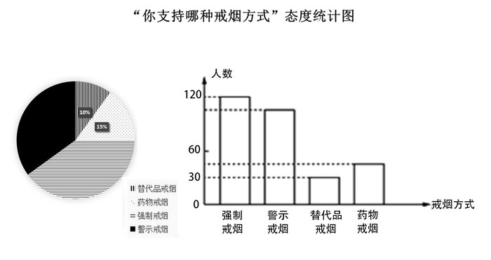

### 第 74 题

如果在该社区随机访问一位市民，那么该市民支持“强制戒烟”的概率是：

A. 0.5

B. 0.45

C. 0.4

D. 0.35

第 74 题 · 答案与解析

**参考答案（粉笔题库参考内容）**

C

**解析**

根据题干“······的概率”，可判定本题为现期比重问题。定位柱形图，支持替代品戒烟的人数为30人，定位饼状图，替代品戒烟占参与调查问卷总人数的比重为10%，则人。支持强制戒烟的人数为120人，则随机访问一名支持“强制戒烟”的市民的概率。

故正确答案为C。

**考点**：现期比重、综合资料

**来源**：2012年上海市公务员录用考试《行测》题（B类）第74题

### 第 75 题

假定该社区有1万人，则该地区大约有多少人支持“警示戒烟”这种方式：

A. 3500

B. 3800

C. 4000

D. 7500

第 75 题 · 答案与解析

**参考答案（粉笔题库参考内容）**

A

**解析**

根据统计图所给的比例，结合题干，可判定本题为现期比重问题。定位饼状图，由74题可知，支持“强制戒烟”的比例为40%，则支持“警示戒烟”的比例为100%-10%-15%-40%=35%。故1万人中，支持“警示戒烟”的人数人。

故正确答案为A。

**考点**：现期比重、综合资料

**来源**：2012年上海市公务员录用考试《行测》题（B类）第75题

### 第 76 题

本次问卷调查一共调查了多少人：

A. 450

B. 360

C. 300

D. 280

第 76 题 · 答案与解析

**参考答案（粉笔题库参考内容）**

C

**解析**

根据题干并结合统计图所给的比例，可判定本题为现期比重问题。定位柱形图，支持替代品戒烟的人数为30人，定位饼状图，替代品戒烟占参与调查问卷总人数的比重为10%，则参加调查问卷的总人数人。

故正确答案为C。

**考点**：现期比重、综合资料

**来源**：2012年上海市公务员录用考试《行测》题（B类）第76题

## 材料 6

2010年某市实现社会消费品零售总额719.48亿元。其中批发和零售业实现零售额651.38亿元，同比增长18.2%；住宿和餐饮业实现零售额68.1亿元，同比增长24%。按新的城乡标准划分，城镇市场实现零售额673.3亿元，增长20.2%。限额以上批发和零售企业实现零售额169.5亿元，其中同比增长最多的是汽车类增长42.9%，其次为金银珠宝类增长30.4%。全市“家电下乡”活动累计销量家电36万台，实现销售额8亿元；“以旧换新”活动回收五类旧家电共40.6万台（部），销售新家电41万台（部），销售额达14.6亿元。

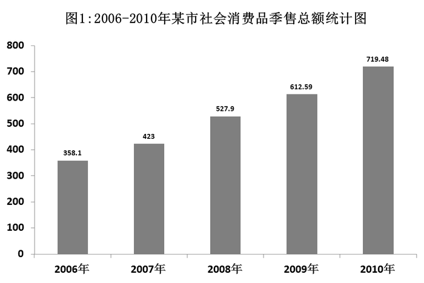

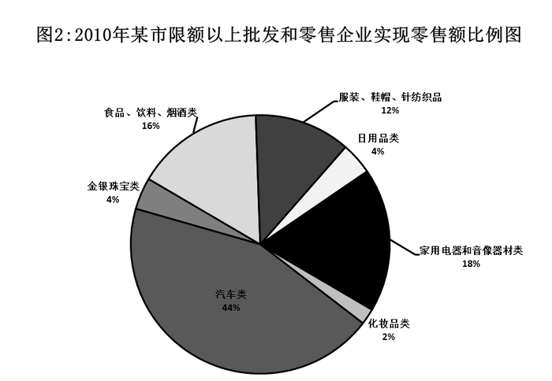

### 第 77 题

在2010年该市家用电器和音像器材类企业实现零售额中，“家电下乡”和“以旧换新”活动实现的零售额所占比重约为（  ）。

A. 3.47%

B. 13.33%

C. 26.22%

D. 74.07%

第 77 题 · 答案与解析

**参考答案（粉笔题库参考内容）**

D

**解析**

根据题干“2010年，···占···比重约为”，可判定本题为现期比重问题。定位文字材料，“家电下乡”和“以旧换新”活动实现的零售额分别为8亿元、14.6亿元，限额以上批发和零售企业零售额169.5亿元。根据饼状图，2010年该市家用电器和音像器材类占限额以上批发和零售企业实现零售额的比例为18%，则家用电器和音像器材的零售额=，故所占比重=，仅D项符合。

故正确答案为D。

**考点**：现期比重、综合资料

**来源**：2012年上海市公务员录用考试《行测》题（B类）第77题

### 第 78 题

2009年该市实现社会消费品零售总额中，住宿和餐饮业实现零售额所占比重约为：

A. 8.97%

B. 9.47%

C. 11.12%

D. 14.63%

第 78 题 · 答案与解析

**参考答案（粉笔题库参考内容）**

A

**解析**

根据题干“2009年，······占······的比重”，结合材料数据为2010年，可判定本题为基期比重问题。定位文字材料，2010年住宿和餐饮业实现零售额68.1亿元，同比增长24%，柱状图中，2009年社会消费品零售总额612.59亿元。可计算出，2009年该市实现社会消费品零售总额中，住宿和餐饮业实现零售额所占比重约为，直除首位商8，只有A项满足。

故正确答案为A。

**考点**：基期比重、综合资料

**来源**：2012年上海市公务员录用考试《行测》题（B类）第78题

### 第 79 题

2010年该市实现社会消费品零售总额中，汽车、化妆品以及金银珠宝类高档消费品所占比重约为：

A. 50%

B. 17.27%

C. 16.20%

D. 11.78%

第 79 题 · 答案与解析

**参考答案（粉笔题库参考内容）**

D

**解析**

根据题干“2010年，······占······的比重”，可判定本题为现期比重问题。定位饼状图2，在限额以上批发和零售企业实现零售额中，汽车类占44%，化妆品类占2%，金银珠宝类占4%。定位文字材料，限额以上批发和零售额企业实现零售额为169.5亿元，该市实现社会消费品零售总额为719.48亿元。故这三类商品零售额占该市零售总额的比重为，与D项最接近。

故正确答案为D。

**考点**：现期比重、综合资料

**来源**：2012年上海市公务员录用考试《行测》题（B类）第79题

### 第 80 题

下列选项中，关于该市2010年各类社会消费品零售额的表述，正确的是：

A. 从2006年到2010年，该市社会消费品零售总额翻了两番

B. 在2010年该市限额以上批发和零售企业实现零售额中，金银珠宝类所实现的零售额及其同比增长速度均仅次于汽车类

C. 2010年该市住宿和餐饮业发展迅速，同比增长率超过批发和零售业5.8个百分点，对该市社会消费品零售额的贡献最大

D. 2010年该市“家电下乡”活动实现销售额占乡村实现零售额的比重为17.3%

第 80 题 · 答案与解析

**参考答案（粉笔题库参考内容）**

D

**解析**

A项：定位柱状图1，2010年该市社会消费品零售总额为719.48亿元，2006年零售总额为358.1亿元，则2010年该市社会消费品零售总额是2006年的倍，即翻了一番，错误；

B项：定位饼状图2，观察发现金银珠宝类的零售额并非仅次于汽车类，错误；

C项：定位文字材料，2010年该市住宿和餐饮业同比增长率为24%，批发和零售业同比增长率为18.2%，则住宿和餐饮业超过批发和零售业24-18.2=5.8个百分点；住宿和餐饮业的零售额为68.1亿元，则亿元，批发和零售业的零售额651.38亿元，则。因增长量越大，增长贡献越大，所以住宿和餐饮业并非对该市社会消费品零售额的贡献最大，错误；

D项：定位文字材料，全市“家电下乡”实现销售额8亿元，社会消费品零售总额为719.48亿元，其中城镇市场实现零售额673.3亿元，则乡村市场为719.48-673.3=46.18亿元。那么“家电下乡”销售额占乡村零售额的比重为，正确。

故正确答案为D。

**考点**：综合分析、综合资料

**来源**：2012年上海市公务员录用考试《行测》题（B类）第80题

### 第 81 题

2011年10月18日党的十七届六中全会通过了《中共中央关于深化文化体制改革、推动社会主义文化大发展大繁荣若干重大问题的决定》，《决定》要求，必须“全面贯彻‘二为’方向和‘双百’方针，为人民提供更好更多的精神食粮”。这里的“二为”是指：

A. 为人民服务

B. 为社会主义现代化建设服务

C. 为社会主义服务

D. 为改革开放服务

第 81 题 · 答案与解析

**参考答案（粉笔题库参考内容）**

AC

**解析**

2011年10月18日党的十七届六中全会通过了《中共中央关于深化文化体制改革、推动社会主义文化大发展大繁荣若干重大问题的决定》，全会要求必须全面贯彻为人民服务、为社会主义服务的方向和百花齐放、百家争鸣的方针，立足发展先进文化、建设和谐文化，激发文化创作生产活力，提高文化产品质量，发挥文化引领风尚、教育人民、服务社会、推动发展的作用。由此可知“二为”指的是为人民服务以及为社会主义服务。

故正确答案为AC。

**来源**：2012年上海市公务员录用考试《行测》题（B类）第81题

### 第 82 题

中共上海九届市委十三次全会提出，上海“十二五”要坚持创新驱动、转型发展的道路。会议指出，创新是实现“十二五”规划的着力点，创新的关键在于制度创新。“创新驱动”、“创新的关键”体现的原理是：

A. 树立创新意识要以两种根本对立的世界观和方法论为指导

B. 创新是民族进步的灵魂，是国家兴旺发达的不竭动力

C. 分析内因和外因在事物发展中的作用，是正确解决矛盾的关键

D. 分析和解决问题时，首先要抓住主要矛盾和矛盾的主要方面

第 82 题 · 答案与解析

**参考答案（粉笔题库参考内容）**

BD

**解析**

A项错误，直接排除；

B、D两项正确，根据题干可知，创新的关键在于制度创新，体现的是矛盾的原理，抓主要矛盾主要是指在事物的发展过程中怎样集中力量找出问题的关键，抓住重点，解决矛盾，推动事物的发展；

C项错误，不符合题意，同时题干中没有体现内因和外因这个问题。

故正确答案为BD。

**考点**：唯物辩证法

**来源**：2012年上海市公务员录用考试《行测》题（B类）第82题

### 第 83 题

因为担心海盐受污染及“服用碘盐预防核辐射”等传言的影响，我国一些地方出现了“抢盐潮”。2011年3月16日，上海市召开专题会议，研究食盐市场供应工作。会议要求必须加强市场监管，严格执法，严厉打击囤积居奇、哄抬物价等违法行为。上述材料说明在市场经济的法律保障中，需要用法律规范：

A. 各类法律服务中介机构

B. 市场主体行为

C. 非理性消费行为

D. 政府主导的食品定价机制

第 83 题 · 答案与解析

**参考答案（粉笔题库参考内容）**

B

**解析**

根据题干中的上海市针对食盐市场供应工作要求加强市场监管，严格执法，严厉打击囤积居奇、哄抬物价等违法行为，可知主要是用法律规范市场主体行为。

故正确答案为B。

**考点**：劳动法和经济法

**来源**：2012年上海市公务员录用考试《行测》题（B类）第83题

### 第 84 题

社会管理是人类社会必不可少的一项管理活动。在我们这样一个有13亿人口、经济社会快速发展的国家，社会管理任务更为艰巨繁重。加强和创新社会管理的根本目的是（  ），为党和国家事业发展营造良好社会环境。

A. 维护社会秩序

B. 协调社会关系

C. 保障人民安居乐业

D. 促进社会和谐

第 84 题 · 答案与解析

**参考答案（粉笔题库参考内容）**

ACD

**解析**

我们加强和创新社会管理，根本目的是维护社会秩序、促进社会和谐、保障人民安居乐业，为党和国家事业发展营造良好社会环境。

故正确答案为ACD。

**来源**：2012年上海市公务员录用考试《行测》题（B类）第84题

### 第 85 题

“十二五”规划与此前的规划比较，一个突出亮点就是过去的规划更多的是追求“国强”，而“十二五”规划则更多强调“民富”。以下举措体现这一亮点的有：

A. 坚持GDP8%的增长率，从而保持经济的高增长

B. 提高居民收入占国民收入的比重

C. 合理调整收入分配关系

D. 适度调低税率，并提高个人所得税起征点

第 85 题 · 答案与解析

**参考答案（粉笔题库参考内容）**

BCD

**解析**

题干强调的是“十二五”规划中所体现的“民富”措施。

A项错误，追求的是“国强”问题，而不是“民富”；

B、C、D三项都是国家通过一些手段增加人民收入，体现的是“民富”问题。

故正确答案为BCD。

**考点**：宏观经济与调控政策

**来源**：2012年上海市公务员录用考试《行测》题（B类）第85题

### 第 86 题

行政执法与行政权不可分离，这是由行政权的特点所决定的。下列不属于行政执法特点的是：

A. 自由裁量

B. 主体特定

C. 不可放弃

D. 不告不理

第 86 题 · 答案与解析

**参考答案（粉笔题库参考内容）**

D

**解析**

行政执法具有以下特征：执法主体的法定性和国家代表性、执法具有主动性和单方意志性、执法具有极大的自由裁量性。

D项错误，不告不理是民事司法的特点，不属于行政执法的特点。

本题为选非题，故正确答案为D。

**考点**：行政法

**来源**：2012年上海市公务员录用考试《行测》题（B类）第86题

### 第 87 题

下列国家机关中，负责对行政机关政府信息公开的实施情况进行监督检查的是：

A. 审计机关

B. 政府信息公开工作主管部门

C. 司法机关

D. 监察机关

第 87 题 · 答案与解析

**参考答案（粉笔题库参考内容）**

B

**解析**

A、C、D三项错误，B项正确，根据《政府信息公开条例》第四十七条第一款规定：“政府信息公开工作主管部门应当加强对政府信息公开工作的日常指导和监督检查，对行政机关未按照要求开展政府信息公开工作的，予以督促整改或者通报批评；需要对负有责任的领导人员和直接责任人员追究责任的，依法向有权机关提出处理建议。”

故正确答案为B。

**考点**：行政法

**来源**：2012年上海市公务员录用考试《行测》题（B类）第87题

### 第 88 题

2011年12月12日至14日，中央经济工作会议在北京举行。会议提出了对明年经济工作的总体要求，确定了2012年经济社会发展的工作总基调是：

A. 继续实施稳健的财政政策

B. 稳中求进

C. 创新驱动

D. 加强和改善宏观调控

第 88 题 · 答案与解析

**参考答案（粉笔题库参考内容）**

B

**解析**

2011年12月12日至14日，中央经济工作会议在北京举行，会议指出，推动明年经济社会发展，要突出把握好稳中求进的工作总基调：稳，就是要保持宏观经济政策基本稳定，保持经济平稳较快发展，保持物价总水平基本稳定，保持社会大局稳定；进，就是要继续抓住和用好我国发展的重要战略机遇期，在转变经济发展方式上取得新进展，在深化改革开放上取得新突破，在改善民生上取得新成效。

故正确答案为B。

**考点**：宏观经济与调控政策

**来源**：2012年上海市公务员录用考试《行测》题（B类）第88题

### 第 89 题

国以民为本，民以食为天。粮食安全问题事关国计民生和社会稳定，确保粮食安全是我国农业政策的两大基本目标之一。下列关于粮食安全问题的表述，正确的有：

A. 一国的粮食安全取决于其在国际市场上对粮价及购买数量的操控能力

B. 粮食安全的关键在于确保国家粮库有充足的储备

C. 坚持走中国特色农业现代化道路，加快发展现代农业的首要目标是保障国家粮食安全

D. 我国始终坚持实行最严格的耕地保护制度，确保18亿亩耕地红线，这一红线是中国粮食安全的警戒线

第 89 题 · 答案与解析

**参考答案（粉笔题库参考内容）**

CD

**解析**

A项错误，我国的粮食安全主要定位于：立足自给，有效调控粮食生产、流通和消费，确保今后相当一段时期我国粮食产销平衡处于可控、可调的范围内，持续、稳定地实现粮食平衡目标，在兼顾粮食生产者和消费者利益的基础上，不断满足经济社会发展对粮食持续增长的需求；

B项错误，过于片面，偏向于为粮食安全的保障；

C、D两项正确，都是为确保粮食安全的措施，一国的粮食安全取决于获得粮食的能力，包括粮食自给能力和进口能力。

故正确答案为CD。

**考点**：宏观经济与调控政策

**来源**：2012年上海市公务员录用考试《行测》题（B类）第89题

### 第 90 题

中国人民银行决定，自2011年6月20日起，上调存款类金融机构人民币存款准备金率0.5个百分点，这也是本轮调控以来的第12次，今年以来第6次调升。上述举措的直接作用是：

A. 抑制过高的物价水平

B. 调节国民收入的分配

C. 增加国家的财政收入

D. 调控流通中的货币量

第 90 题 · 答案与解析

**参考答案（粉笔题库参考内容）**

AD

**解析**

调节人民币存款准备金率是央行采取的货币政策，通过上调人民币存款准备金率，一方面控制了货币量，另一方面可以抑制通货膨胀，抑制物价水平。

A、D两项正确，为该举措的直接作用；

B、C两项错误，属于财政政策的作用，调节国民收入分配、增加国家的财政收入往往通过财政政策来调节，一般通过税收和政府支出来调节，不符合题干举措的作用。

故正确答案为AD。

**考点**：宏观经济与调控政策

**来源**：2012年上海市公务员录用考试《行测》题（B类）第90题

### 第 91 题

我国是一个统一的多民族的国家，在少数民族聚居的地方建立起来的民族区域自治地方机关有权依照当地民族的特点，制定自治条例，自主管理本地方的财政、经济、文化教育事业。下列关于民族区域自治地方机关的表述，正确的是：

A. 有保持或改革自己风俗习惯的自由

B. 必须以宪法作为根本大法和行动准则

C. 必须接受上一级政权机关的领导

D. 是指政府机关

第 91 题 · 答案与解析

**参考答案（粉笔题库参考内容）**

ABC

**解析**

D项错误，民族自治地方分为自治区、自治州、自治县。民族自治地方的自治机关，是自治区、自治州、自治县的人大和人民政府。自治区、自治州、自治县的人民代表大会和人民政府既是民族自治地方的自治机关，又是国家的一级地方政权机关。因此，民族自治地方的自治机关的组织原则与其他地方国家机关一样，实行民主集中制的原则。民族自治地方的人民政府对本级人大和上一级国家行政机关负责并报告工作。在本级人大闭会期间，对本级人大常委会负责并报告工作。各民族自治地方的人民政府都要服从国务院的统一领导。

故正确答案为ABC。

**来源**：2012年上海市公务员录用考试《行测》题（B类）第91题

### 第 92 题

新能源、新材料、信息产业、新医药、生物育种、节能环保、电动汽车——七大战略性新兴产业被表述为“战略性新兴产业”。“战略性新兴产业”除了具有良好的经济技术效益，还具有的特点是：

A. 资源消耗低

B. 环境污染少

C. 投入少，见效快

D. 带动相关产业的兴起

第 92 题 · 答案与解析

**参考答案（粉笔题库参考内容）**

ABD

**解析**

C项错误，不属于“战略性新兴产业”的特点。“战略性新兴产业”是以重大技术突破和重大发展需求为基础，对经济社会全局和长远发展具有重大引领带动作用，知识技术密集、物质资源消耗少、成长潜力大、综合效益好的产业。

故正确答案为ABD。

**考点**：宏观经济与调控政策

**来源**：2012年上海市公务员录用考试《行测》题（B类）第92题

### 第 93 题

《国务院关于加强市县政府依法行政的决定》明确提出，要在市县两级政府推行重大行政决策听证制度，并对制度建设提出了明确要求。下列选项中，符合要求的是：

A. 涉及重大公共利益和群众切身利益的决策事项，都要进行听证

B. 规范听证程序，科学合理地遴选听证代表，听证代表确定后，应当将名单向社会公布

C. 对听证意见采纳情况及其理由要以书面形式告知听证代表

D. 听证举行30日前，应当告知听证代表拟做出行政决策的内容、理由、依据和背景资料

第 93 题 · 答案与解析

**参考答案（粉笔题库参考内容）**

ABC

**解析**

《国务院关于加强市县政府依法行政的决定》听证制度的要求包括：要扩大听证范围，法律、法规、规章规定应当听证以及涉及重大公共利益和群众切身利益的决策事项，都要进行听证；此外，还要规范听证程序，科学合理地遴选听证代表，听证代表确定后，应该将名单向社会公布；对听证中提出的合理意见和建议要吸收采纳，意见采纳情况及理由要以书面形式告知听证代表，并以适当形式向社会公布；听证举行10日前，应当告知听证代表拟做出行政决策的内容、理由、依据和背景资料。

故正确答案为ABC。

**考点**：其他法律法规

**来源**：2012年上海市公务员录用考试《行测》题（B类）第93题

### 第 94 题

马克思、恩格斯以唯物史观为指导，形成了以人的全面发展为核心的社会主义价值观，在马克思主义哲学、政治经济学和科学社会主义理论中，都贯穿着人类解放和全面发展的价值理念。在政治经济学研究中，马克思揭示了人的全面发展的终极性。他考察了以往人与社会的发展，提出了人的发展三个阶段的“三形态”学说，这三个阶段是指：

A. “人的依赖”、“物的依赖”和“自由个性”

B. “生产力的依赖”、“财富的依赖”和“自由发展”

C. “人的依赖”、“财富的依赖”和“自由个性”

D. “生产力的依赖”、“物的依赖”和“自由发展”

第 94 题 · 答案与解析

**参考答案（粉笔题库参考内容）**

A

**解析**

人类社会发展的三大社会形态，即：人的依赖，是最初的社会形态，在这种形态下，人的生产能力只是在狭窄的范围内和孤立的地点上发展着；物的依赖，是以物的依赖性为基础的人的独立性，是第二大形态，在这种形态下，才形成普遍的社会物质交换，全面的关系，多方面的需求以及全面的能力的体系；建立在个人全面发展和他们共同的社会生产能力成为他们的社会财富这一基础上的自由个性，是第三个大形态。

故正确答案为A。

**考点**：政治经济学-其他

**来源**：2012年上海市公务员录用考试《行测》题（B类）第94题

### 第 95 题

在经济理论界，有一种观点认为劳动生产率与工资水平是正相关关系，虽然支付高工资会增加企业成本，但可以通过提高员工的劳动积极性、队伍素质，降低离职率等使企业得到更大的效率。这主要是强调了：

A. 必须坚持按劳分配和按生产要素分配相结合

B. 让劳动者分享发展成果也符合企业的长远利益

C. 不断扩大消费是促进社会生产的有效途径

D. 必须正确处理国家、企业和劳动者三者之间的关系

第 95 题 · 答案与解析

**参考答案（粉笔题库参考内容）**

B

**解析**

题干描述了增加工资调动员工的积极性可以实现劳动生产率的提高，强调的是劳动者与企业之间的关系，强调了提高员工工资反而能实现劳动者与企业的双赢。

故正确答案为B。

**考点**：市场经济

**来源**：2012年上海市公务员录用考试《行测》题（B类）第95题

### 第 96 题

社保基金由社会保障基金和社会保险基金构成，它是中央政府集中的社会保障战略储备，主要用于弥补今后人口老龄化高峰时期的社会保障需要和其他社会保障需要。下列选项中，属于社保基金来源的是：

A. 中央财政预算拨款

B. 彩票公益金

C. 个人投资

D. 国有股减持

第 96 题 · 答案与解析

**参考答案（粉笔题库参考内容）**

ABD

**解析**

全国社保基金的主要来源有中央财政预算拨款、中央财政拨入彩票公益金、国有股减持或转持划入资金或股权资产、经国务院批准的以其他方式筹集的资金、投资收益等。

C项错误，个人投资不是社保基金的来源。

故正确答案为ABD。

**考点**：宏观经济与调控政策

**来源**：2012年上海市公务员录用考试《行测》题（B类）第96题

### 第 97 题

根据性质及由此决定的供给和消费方式的不同，经济物品大体上可分为两大类：私人产品和公共产品。其中，公共产品可分为三种：一是比较公共产品或纯粹公共产品，二是混合公共产品或准公共产品，三是由政府出面提供的部分带有规模经济效益的产品。下列选项中属于准公共产品的是：

A. 环境保护

B. 高等教育

C. 基础设施

D. 邮政和电信

第 97 题 · 答案与解析

**参考答案（粉笔题库参考内容）**

BCD

**解析**

根据题干可知：纯粹公共产品是指那些为整个社会共同消费的产品，严格地讲，它是在消费过程中具有非竞争性和非排他性的产品，是任何一个人对该产品的消费都不减少别人对它进行同样消费的物品与劳务。准公共产品亦称为“混合产品”，这类产品通常只具备上述两个特性的一个，而另一个则表现为不充分，邮政和电信、高等教育、基础设施等属于准公共产品。环境保护不存在排他性，不是为某个人而是为所有人享有的公共产品，属于纯粹公共产品。

故正确答案为BCD。

**考点**：宏观经济与调控政策

**来源**：2012年上海市公务员录用考试《行测》题（B类）第97题

### 第 98 题

社会公共权威在一定的条件下，针对一定的对象，为达到一定的目标而制定的行动方案或行为准则称为：

A. 公共诉求

B. 公共利益

C. 公共权力

D. 公共政策

第 98 题 · 答案与解析

**参考答案（粉笔题库参考内容）**

D

**解析**

公共政策是指社会公共权威在一定的条件下，针对一定的对象，为达到一定的目标而制定的行动方案或行为准则。其表达形式包括法律法规、行政规定或命令、国家领导人口头或书面的指示、政府规划等。

故正确答案为D。

**来源**：2012年上海市公务员录用考试《行测》题（B类）第98题

### 第 99 题

公共管理是以政府为核心的各类公共组织为保障和促进公共利益而提供公共产品和公共服务、管理公共事务的所有活动。公共管理的主体不仅包括国家行政机关，而且包括：

A. 立法、司法等整个国家政权机关

B. 法定的公权机关

C. 非营利性质的社会公共组织

D. 各类事业单位

第 99 题 · 答案与解析

**参考答案（粉笔题库参考内容）**

ABCD

**解析**

公共管理的主体比公共行政的主体更广，从主体上看不仅包括国家行政机关，而且包括立法、司法等整个国家政权机关；不仅包括法定的公权机关，而且包括非营利性质的社会公共组织。

故正确答案为ABCD。

**来源**：2012年上海市公务员录用考试《行测》题（B类）第99题

### 第 100 题

除了刑事处罚以外，行政处分是保障公务纪律、维护国家公共管理秩序和限制剥夺公务员权利的最重要手段。下列选项中，属于行政处分的是：

A. 拘留

B. 罚款

C. 撤职

D. 记过

第 100 题 · 答案与解析

**参考答案（粉笔题库参考内容）**

CD

**解析**

行政处分的种类包括警告、记过、记大过、降级、撤职、开除六类，罚款和拘留属于行政处罚的种类。

故正确答案为CD。

**考点**：行政法

**来源**：2012年上海市公务员录用考试《行测》题（B类）第100题

### 第 101 题

行政合同是一种重要的行政管理手段。使用行政合同能减低行政机关对个人进行单方命令的行政安排，减少因双方利益和目的的差异而带来的对立性，有利于化解矛盾，创造和谐社会。行政机关签订的下列文书中，属于行政合同的是：

A. 计划生育合同

B. 国家科研合同

C. 行政补偿合同

D. 全民所有制工业企业承包合同

第 101 题 · 答案与解析

**参考答案（粉笔题库参考内容）**

ABCD

**解析**

根据题干可知行政合同的含义及目的。在行政合同之中，行政主体并非以民事法人的身份而是行政主体的身份与行政相对人订立关于民事权利义务的协议，以合同的方式来达到维护与增进公共利益的目的，在其间行政主体享有行政优益权。行政合同的种类：

1.国有土地使用权出让合同；

2.全民所有制工业企业承包合同；

3.公用征收补偿合同；

4.国家科研合同；

5.农村土地承包合同；

6.国家订购合同；

7.公共工程承包合同；

8.计划生育合同。

故正确答案为ABCD。

**考点**：行政法

**来源**：2012年上海市公务员录用考试《行测》题（B类）第101题

### 第 102 题

继天宫一号和神舟八号相继顺利发射成功后，2011年11月3日凌晨，神舟八号飞船与天宫一号顺利实现第一次交会对接，我国在突破和掌握空间交会对接技术上迈出了重要一步。下列关于天宫一号和神舟八号的表述，错误的是：

A. 天宫一号是中国自主研制的第一个空间站

B. 天宫一号与神舟八号交会对接成功，顺利实现了我国载人航天工程“三步走”的第三步目标

C. 中国成为世界上第三个完全独立掌握交会对接技术的国家

D. 空间交会对接与载人天地往返、出舱活动并称为载人航天三大基本技术

第 102 题 · 答案与解析

**参考答案（粉笔题库参考内容）**

AB

**解析**

天宫一号是中国第一个目标飞行器，于2011年9月29日21时16分3秒在酒泉卫星发射中心发射，由实验舱和资源舱构成。它的发射标志着中国迈入中国航天“三步走”战略的第二步。2011年11月3日凌晨顺利实现与神舟八号飞船的对接任务。按照计划，神舟九号、神舟十号飞船将在接下来的时间里依次与天宫一号完成无人或有人空间交会对接任务，并建立中国首个空间实验室。中国也由此成为世界上第三个自主掌握空间交会对接技术的国家。天宫一号与神舟八号交会对接任务的圆满完成，标志着我国空间交会对接技术取得了重大突破，使我国掌握了载人航天的三大基本技术，即载人天地往返、航天员出舱活动以及空间交会对接。

本题为选非题，故正确答案为AB。

**考点**：科技理论与成就

**来源**：2012年上海市公务员录用考试《行测》题（B类）第102题

### 第 103 题

据国家统计局公布，第六次人口普查登记人口为13.39亿人，比2000年第五次普查时增加7390万人，比当时的年平均增长率下降了0.5个百分点。它表明我国人口的增长正处于：

A. 低生育水平阶段

B. 继续高增长水平阶段

C. 人口总量逐年下降的阶段

D. 现行生育政策需要立即调整的阶段

第 103 题 · 答案与解析

**参考答案（粉笔题库参考内容）**

A

**解析**

A项正确，根据题干中第六次人口普查与第五次人口普查的人口数以及平均增长率可知我国人口进入低生育水平阶段；

B、C、D项错误，三个选项都无法从题干中找到依据。

故正确答案为A。

**考点**：中国地理

**来源**：2012年上海市公务员录用考试《行测》题（B类）第103题

### 第 104 题

印章在现实生活中是—种重要的证信工具，可以用来证明身份、信义和关系等，在行政机关用来从事某项特定的职能而专门使用的印章是指：

A. 公章

B. 私章

C. 钢印

D. 专用章

第 104 题 · 答案与解析

**参考答案（粉笔题库参考内容）**

D

**解析**

A项错误，公章是国家机关、团体、企事业单位用自己法定主体行为名称制作的签名印章；

B项错误，私章是个人的印章的简称；

C项错误，钢印是用钢板刻制的上下阴阳两块印模组成的印鉴，通常盖在专用的文书或照片上，无颜色，只有凸起的文字、数字和图记；

D项正确，专用章指行政机关用来从事某项特定的职能而专门使用的印章。

故正确答案为D。

**来源**：2012年上海市公务员录用考试《行测》题（B类）第104题

### 第 105 题

为保证汽车行驶安全，一种新型双门电动公交车安装了如下控制装置：只要有一扇门没有关紧，汽车就不能启动。如果规定：车门关紧时为“1”，未关紧时为“0”；当输出信号为“1”时，汽车可以正常启动行驶；当输出信号为“0”时，汽车不能启动。能正确表示该控制原理的逻辑门是：

A. 与门

B. 或门

C. 非门

D. 与非门

第 105 题 · 答案与解析

**参考答案（粉笔题库参考内容）**

A

**解析**

与门、或门、非门以及与非门的原则如下：

与门：同真为真，一假则假；

或门：同假才假，一真即真；

非门：非真即假，非假即真；

与非门：同假才假，一真即假。

题干中指出两个车门同时关紧才可以启动，仅一个车门关紧，汽车不能启动，由此可知二者同真才为真。

故正确答案为A。

**考点**：生活常识

**来源**：2012年上海市公务员录用考试《行测》题（B类）第105题

### 第 106 题

受到日本大地震影响，福岛核电站损毁严重，泄漏出大量的放射性物质，其中碘131的危害颇受人们关注。

下列关于碘131的表述中，不正确的是：

A. 有医疗作用，可用于甲状腺功能检查及甲状腺疾病治疗

B. 放射性强，碘131带有强能量射线，可以导致人体DNA发生断裂，并产生一系列的细胞后续反应

C. 存在时间久，碘131半衰期长达8年

D. 传播远，碘131可附着在空气中的尘埃上，向远处扩散

第 106 题 · 答案与解析

**参考答案（粉笔题库参考内容）**

C

**解析**

A项正确，碘131发射的β射线可杀伤一部分甲状腺细胞，使甲状腺缩小，导致甲状腺合成的甲状腺激素减少，使甲亢表现消失；

B项正确，碘131有看不见摸不着的强能量射线，这些射线可以穿过人体组织，穿透过程中遇到阻碍就会与阻碍物质之间形成碰撞并且释放能量。高能量对被碰物质就会造成伤害，对人体细胞而言，最直接的伤害就是导致人体的DNA发生断裂，随后产生一系列的后续反应，如细胞表达异常，细胞变性或者坏死，或长时间细胞异化后形成恶性肿瘤；

C选项错误，碘131是元素碘的一种放射性同位素，为人工放射性核素，半衰期为8.3天；

D项正确，释放出来的碘131以气溶胶形式存在，可以在大气中漂浮并随大气到处“扩散”。

本题为选非题，故正确答案为C。

**考点**：生活常识

**来源**：2012年上海市公务员录用考试《行测》题（B类）第106题

### 第 107 题

皮肤破损出血、颈髓损伤、锐器插入体内、严重挤压伤等是灾害发生时的常见损伤类型，掌握科学的自救方法对于延续生命、等待救援很重要。下列自救措施中，不恰当的是：

A. 锐器插入体内后，应快速将锐器拔出，简单处理伤口后立即送往医院救治

B. 对颈后锐痛、活动时疼痛加剧等症状，立即用颈托，一时无颈托，可临时用敷料、硬板纸或塑料板做成颈圈固定颈部

C. 伤口发生喷射状出血时，应立即用厚消毒纱布（或毛巾）包扎好伤口

D. 被重物挤压引起肢体肿胀或青紫时，应尽快在患处用热毛巾湿敷消肿

第 107 题 · 答案与解析

**参考答案（粉笔题库参考内容）**

ACD

**解析**

A选项错误，锐器插入体内切勿拔出。锐器插入体内后，肯定刺破了局部血管、神经和肌肉，这时锐器正好嵌在创口内，起到了临时“止血”作用，不能将锐器拔出，否则有可能大出血；

B选项正确，颈后锐痛、活动时疼痛加剧等症状，提示伤员颈髓受伤，急救关键是立即用颈托，一时无颈托，可临时用敷料、硬板纸或塑料板做成颈圈固定其颈部，千万不能让头颈左右前后摆动；

C选项错误，喷射状出血，说明动脉破裂，应用钳夹血管止血。在没有工具的情况下，可在出血伤口上端找到搏动的动脉血管，用手指或手掌将血管压迫在所在部位的骨头上止血，而不是用毛巾止血；

D选项错误，伤员被重物挤压引起肢体肿胀或青紫时，切勿在患处按摩、热敷、结扎，以免局部产生的肌红蛋白和毒素吸收到血液而引起肾功能衰竭，正确的做法是在患处用冷毛巾或冰块湿敷降温。

本题为选非题，故正确答案为ACD。

**考点**：生活常识

**来源**：2012年上海市公务员录用考试《行测》题（B类）第107题

### 第 108 题

云计算是一种新的信息服务形式，其关键在于网页所连接的后台服务器：分布于世界各地的成千上万台服务器被网络汇聚成了一片拥有巨大处理能力的“云”。云计算的优点是：

A. 节能

B. 灵活定制

C. 安全

D. 高效

第 108 题 · 答案与解析

**参考答案（粉笔题库参考内容）**

ABCD

**解析**

云计算是基于互联网的服务的增加、使用和交付模式，通常涉及通过互联网来提供动态易扩展且经常是虚拟化的资源。云计算提供了最可靠、最安全的数据存储中心，用户不用再担心数据丢失、病毒入侵等麻烦；云计算对用户端的设备要求极低，使用方便；云计算可以轻松实现不同设备间的数据与应用共享，高效节能；云计算为我们使用网络提供了几乎无限多的可能。

故正确答案为ABCD。

**考点**：科技理论与成就

**来源**：2012年上海市公务员录用考试《行测》题（B类）第108题

### 第 109 题

下列有关文学常识的表述，正确的是：

A. 我国“五四”新文化运动主将鲁迅先生的小说集《呐喊》、《彷徨》、神话集《故事新编》、散文集《野草》、散文诗集《朝花夕拾》等，被译成多国文字，在世界各地拥有广大的读者

B. 《左传》是我国第一部叙事详备的编年体史书，保存了春秋战国时的大量史料，记载了许多历史故事，文字优美，文学性强

C. 世界名著《人间喜剧》、《死魂灵》、《战争与和平》、《悲惨世界》的作者依次是巴尔扎克、果戈理、托尔斯泰、莫泊桑

D. 我国古代的诗歌有古体诗和近体诗的分别。近体诗有绝句和律诗两种，绝句分五言绝句和七言绝句，律诗有五言律诗和七言律诗

第 109 题 · 答案与解析

**参考答案（粉笔题库参考内容）**

D

**解析**

A选项错误，其中的《故事新编》是历史小说而非神话，《朝花夕拾》是散文集，《野草》是散文诗集；

B选项错误，关于《左传》的描述不正确，它记载的是春秋时候的史实，而不是“战国”时期的事情；

C选项错误，《悲惨世界》的作者应该是雨果，而不是莫泊桑；

D选项正确，采取的是层层分类的办法。

故正确答案为D。

**考点**：文学常识

**来源**：2012年上海市公务员录用考试《行测》题（B类）第109题

### 第 110 题

为提升我国深空测定轨能力，服务于嫦娥探月工程等国家重大战略，上海将于2015年建成65米射电天文望远镜。关于射电天文望远镜，下列说法正确的是：

A. 射电天文望远镜像雷达一样，向目标天体发射无线电波，观测所获得的天体反射信息

B. 射电天文望远镜的天线面积越大，灵敏度越高

C. 射电天文望远镜的镜筒、目镜和物镜比普通的光学望远镜更大更精密

D. 射电天文望远镜的显著优点是不受大气层的干扰

第 110 题 · 答案与解析

**参考答案（粉笔题库参考内容）**

B

**解析**

A选项错误，射电望远镜和雷达的工作方式不同，雷达是先发射无线电波再接收物体反射的回波，射电望远镜只是被动地接收天体发射的无线电波；

B选项正确，增大天线接收面积可以提高射电望远镜的灵敏度；

C选项错误，射电望远镜与光学望远镜不同，它既没有高高竖起的望远镜镜筒，也没有物镜、目镜，它由天线和接收系统两大部分组成；

D选项错误，射电望远镜所使用的波段范围的无线电辐射，能不受大气层显著影响而能达到地面，但不可能完全不受干扰。

故正确答案为B。

**考点**：科技理论与成就

**来源**：2012年上海市公务员录用考试《行测》题（B类）第110题

### 第 111 题

《中共中央关于制定国民经济和社会发展第十二个五年规划的建议》要求，“十二五”期间，我国将全面提高信息化水平，实现“三网融合”。这里的“三网”是指：

A. 有线网、无线网、物联网

B. 数字信号网、光纤信号网、模拟信号网

C. 互联网、局域网、通信网

D. 电信网、广播电视网、互联网

第 111 题 · 答案与解析

**参考答案（粉笔题库参考内容）**

D

**解析**

“三网融合”是指广播电视网、有线电视网和计算机通信网的相互渗透、互相兼容，并逐步整合成为全世界统一的信息通信网络。

故正确答案为D。

**考点**：生活常识

**来源**：2012年上海市公务员录用考试《行测》题（B类）第111题

### 第 112 题

最近，被命名为NDM-1的超级细菌在世界范围内引起人们的高度关注。下列关于NDM-1超级细菌的表述，正确的是：

A. 这种超级细菌具有超强的抗生素耐药性

B. NDM-1是一种耐药基因，能在细菌之间传递，一旦细菌获得这种基因，就可能变为超级耐药细菌

C. 携带NDM-1基因的细菌能产生一种酶，它可以水解和破坏大多数抗生素，使之失效

D. 甲流、SARS和禽流感不能用抗生素治疗，原因就在于它们都携带了这一基因

第 112 题 · 答案与解析

**参考答案（粉笔题库参考内容）**

ABC

**解析**

超级细菌NDM-1可以使病菌变得无比强大，抵御几乎所有抗生素。它是一种耐药基因，其能在细菌之间传递，一旦细菌获得这一基因，就能合成一种酶，让绝大多数抗生素失效。

D选项错误，甲流、非典等是都由病毒引起的，而抗生素是治疗细菌感染的药物，抗生素对其无效，并不是因为其携带了DNM-1基因。

故正确答案为ABC。

**考点**：生物常识

**来源**：2012年上海市公务员录用考试《行测》题（B类）第112题

### 第 113 题

“东风夜放花千树，更吹落、星如雨。宝马雕车香满路。凤箫声动，玉壶光转，一夜鱼龙舞。蛾儿雪柳黄金缕，笑语盈盈暗香去。众里寻他千百度，蓦然回首，那人却在，灯火阑珊处。”这首古词描述了我国民间一个传统节令的景象，这个传统节令是：

A. 中秋

B. 清明

C. 元宵

D. 七夕

第 113 题 · 答案与解析

**参考答案（粉笔题库参考内容）**

C

**解析**

题干出自辛弃疾的《青玉案·元夕》，词中的“花千树”指的是花灯之多如千树花开。“星如雨”是指焰火纷纷，乱落如雨。元夕就是阴历正月十五日为元宵节，此词极力渲染元宵节观灯的盛况。

故正确答案为C。

**考点**：文化常识

**来源**：2012年上海市公务员录用考试《行测》题（B类）第113题

### 第 114 题

2011年7月26日，中国载人深潜海试现场传来捷报，创造了中国载人深潜新的历史。下列选项中，关于此次试验表述正确的是：

A. 完成了既定目标，最大下潜深度超过5000米

B. 深潜是由“神龙”号载人潜水器实现的

C. 这次载人深潜海试的成功，标志着中国可以到达全球超过70％的海底

D. 我国是第二个掌握大深度载人深潜技术的国家

第 114 题 · 答案与解析

**参考答案（粉笔题库参考内容）**

AC

**解析**

2011年7月26日，我国第一台自行设计、自主集成研制的“蛟龙”号载人潜水器首次下潜至5038.5米，顺利完成本次5000米级海试主要任务，因此，A项正确，B项错误；

自从2010年，“蛟龙”号成功下潜到3759米之后，我国成为继美、法、俄、日之后，第五个掌握3500米以上深度载人深潜技术的国家，因此，C项正确，D项错误。

故正确答案为AC。

**考点**：科技理论与成就

**来源**：2012年上海市公务员录用考试《行测》题（B类）第114题

### 第 115 题

再生水是城市的第二水源，对再生水的合理利用既能减少水环境污染，又可以缓解水资源紧缺的矛盾，是贯彻可持续发展的重要措施。下列选项中，可以使用再生水的是：

A. 灌溉

B. 冷却设备补充用水

C. 牲畜饮用

D. 城市喷泉

第 115 题 · 答案与解析

**参考答案（粉笔题库参考内容）**

ABCD

**解析**

再生水是指污水经适当处理后，达到一定的水质指标，满足某种使用要求，可以进行有益使用的水。再生水的用途很多，可以用于农田灌溉、园林绿化（公园、校园、高速公路绿带、高尔夫球场、公墓、绿带和住宅区等）、工业（冷却水、锅炉水工艺用水）、大型建筑冲洗以及游乐与环境（改善湖泊、池塘、沼泽地，增大河水流量和鱼类养殖等），还有消防、空调和水冲厕等市政杂用。再生水还可以用于农、林、牧业用水，可作为粮食作物、经济作物的灌溉、种植与育苗、林木、观赏植物的灌溉、家畜和家禽用水。

故正确答案为ABCD。

**考点**：生活常识

**来源**：2012年上海市公务员录用考试《行测》题（B类）第115题

### 第 116 题

一百年前爆发的辛亥革命，结束了中国长达两千年之久的君主专制制度，是近代中国比较完全意义上的资产阶级民主革命，它在政治上、思想上给中国人民带来了不可低估的解放作用。下列关于辛亥革命的表述中，正确的是：

A. 辛亥革命是一场深刻的思想启蒙运动，它使民主共和观念深入人心

B. 在辛亥革命中，平民阶层对革命的参与改变了其生存条件，从而构建了新的社会结构

C. 辛亥革命推翻了清朝的专制统治，完成了反帝反封建的革命任务

D. 辛亥革命在亚洲打响了民主的第一枪，对近代亚洲各国被压迫民族的解放运动，产生了比较广泛的影响

第 116 题 · 答案与解析

**参考答案（粉笔题库参考内容）**

AD

**解析**

辛亥革命作为民主革命，成功推翻了清朝的统治，结束了中国两千多年来的封建帝制，开启了民主共和新纪元。从思想史的角度看，辛亥革命也是一场深刻的思想启蒙运动，它使民主共和观念深入人心。但是辛亥革命没有改变中国半殖民地半封建社会的性质，没有完成反帝反封建的革命任务：第一，辛亥革命没有彻底的反帝纲领；第二，辛亥革命没有彻底的反对封建土地所有制的纲领；第三，革命的胜利果实被袁世凯窃取。辛亥革命对近代亚洲各国被压迫民族的解放运动，产生了比较广泛的影响，特别是对越南、印度尼西亚等国的反对殖民主义的斗争起了推动作用，在亚洲的历史上也是一次伟大的转折。列宁把辛亥革命视为“亚洲的觉醒”，辛亥革命在亚洲打响了民主的第一枪。

故正确答案为AD。

**考点**：中国历史

**来源**：2012年上海市公务员录用考试《行测》题（B类）第116题

### 第 117 题

南沙群岛自古以来就是中国领土，中国人早在（  ）时期首次发现该群岛，1621年刊印的《郑和航海图》将其列入中国版图。

A. 西汉

B. 东汉

C. 南北朝

D. 三国

第 117 题 · 答案与解析

**参考答案（粉笔题库参考内容）**

A

**解析**

从秦代开始，我国政府正式对西沙群岛行使管辖权。汉代，南沙群岛已归我国管辖。公元前111年，西汉武帝平定南粤之乱后，在海南岛设儋耳、朱崖两郡，辖南海诸岛，并派水师巡视西沙。

故正确答案为A。

**考点**：中国历史

**来源**：2012年上海市公务员录用考试《行测》题（B类）第117题

### 第 118 题

在未来信息化战争中，构筑电磁空间安全防御体系成为各国军队建设的重要内容，夺取电磁空间信息优势成为赢得未来战争主动权的先决条件。

下列选项中，不属于电磁战的范畴的是：

A. 雷达间对抗

B. 无线电信号的窃听和侦收

C. 使用电磁炮攻击敌方目标

D. 网络加密与解密技术

第 118 题 · 答案与解析

**参考答案（粉笔题库参考内容）**

C

**解析**

电磁空间是指电磁波所充斥的空间和电磁能量所作用的物理空间。当前信息时代的突出特征就是将电磁作为记录和传递信息的主要载体，对电磁的利用无处不在。电磁空间的信息争夺是情报站、电子战、网络战的基本内容，信息战在很大程度上就是电磁战。典型的电磁空间包括有线电台、无线电台、卫星、移动通信和雷达、遥感等。

C选项错误，电磁炮只是利用电磁发射技术制成的一种先进的动能杀伤武器，不属于电磁战的范围。

本题为选非题，故正确答案为C。

**考点**：科技理论与成就

**来源**：2012年上海市公务员录用考试《行测》题（B类）第118题

### 第 119 题

根据我国保密法规定，下列关于国家秘密的表述，不正确的是：

A. 国家秘密的密级由国家保密行政管理部门确定

B. 国家秘密的保密期限不超过20年

C. 国家秘密不能确定保密期限的，按最长的保密期确定

D. 国家秘密的知悉范围，应当根据工作需要限定在最小范围

第 119 题 · 答案与解析

**参考答案（粉笔题库参考内容）**

ABC

**解析**

A选项错误，国家秘密及其密级的具体范围，由国家保密行政管理部门分别会同外交、公安、国家安全和其他中央有关机关规定；

B、C选项错误，国家秘密的保密期限，除另有规定外，绝密级不超过三十年，机密级不超过二十年，秘密级不超过十年；国家秘密的保密期限，应当根据事项的性质和特点，按照维护国家安全和利益的需要，限定在必要的期限内；不能确定期限的，应当确定解密的条件。

D选项正确，国家秘密的知悉范围，应当根据工作需要限定在最小范围。

本题为选非题，故正确答案为ABC。

**考点**：其他法律法规

**来源**：2012年上海市公务员录用考试《行测》题（B类）第119题

### 第 120 题

土壤的酸性太强会带来害虫和疾病，阻碍植物生长，并析出有毒金属。目前，造成我国土壤酸化的主要原因是：

A. 空气中CO_2浓度增大

B. 滥施化肥

C. 酸雨

D. 大面积种植单一作物，生物多样性遭到破坏

第 120 题 · 答案与解析

**参考答案（粉笔题库参考内容）**

BC

**解析**

A选项错误，空气中二氧化碳浓度增大可能形成酸雨，但是不足以使土壤酸化；

B选项正确，氮肥施用过量是导致农田土壤酸化的主要原因；

C选项正确，当酸雨输入超过土壤缓冲能力时，土壤就会呈现酸化，使土壤的物理化学性质发生变化；

D选项错误，生物多样性遭破坏并不会造成土壤酸化。

故正确答案为BC。

**考点**：生活常识

**来源**：2012年上海市公务员录用考试《行测》题（B类）第120题

## 材料 7

阅读下列材料，回答下列各题。

        20年前，如果有人说舞蹈、音乐、体育是经济的组成部分，还似乎不被理解。但今天，以电影、电视、世界杯足球赛、奥林匹克运动会为代表的文化产业已毫无疑问成为我国经济的重要组成部分，文化产业被称为21世纪的黄金产业。在世界经济危机的寒冬之中，中国文化产业逆势上扬，呈现出勃勃生机。近年来我国文化产业平均增幅高达17％，高于GDP增长速度。文化产业不仅成为经济领域的新亮点，更为实现全年我国经济增长目标作出了重要贡献。

### 第 121 题

近年来，我国文化产业发展迅速，但与美国、日本等文化产业强国相比，我国的文化产业整体上仍然处于发展初期，创新设计业、动漫产业、网络游戏业等数字内容产业仍处于起步状态；产业技术的开发能力还很薄弱，在国际分工中仍然处于产业链的中低端。从政府角度考虑，应该：

A. 进行文化体制改革，适应全球文化产业的发展

B. 建立完善有利于文化产业发展的法律法规

C. 提倡技术创新，提高自主研发的能力

D. 限制与文化产业强国的文化交流

第 121 题 · 答案与解析

**参考答案（粉笔题库参考内容）**

ABC

**解析**

由于我国的文化产业整体上仍然处于发展初期，为更好地促进我国文化产业的发展，政府应该改革文化体制，使我国文化产业更适合全球文化产业发展，同时制定相应法律法规，规范文化产业的发展。根据题干可知我国的创新设计业、动漫产业、网络游戏业等数字内容产业仍处于起步状态，产业技术的开发能力还很薄弱，因此政府应该提倡技术创新，提高自主研发的能力，同时还要积极向国外文化产业强国学习，吸取经验。除D选项错误，其他选项都是正确的。

故正确答案为ABC。

**考点**：文化建设

**来源**：2012年上海市公务员录用考试《行测》题（B类）第121题

### 第 122 题

在国际贸易中，文化产品的贸易占有重要地位，文化产品走到哪里就能把价值观念和商业利益带到哪里。这说明：

A. 各国进行文化产品贸易的直接目的是进行文化传播

B. 文化产品贸易具有文化传播的功能

C. 要维护本民族文化的独特性就要限制文化产品贸易

D. 衡量文化产品的价值在于其创造的经济价值

第 122 题 · 答案与解析

**参考答案（粉笔题库参考内容）**

B

**解析**

根据题干中“文化产品走到哪里就能把价值观念和商业利益带到哪里”可知，文化产品贸易具有文化传播的功能，故B选项正确。各国进行文化产品贸易的直接目的指盈利，而不是传播文化，故A选项错误；C、D两项本身就是错误的，要维护本民族文化的独特性应该在与外国文化交流的同时坚持本民族文化的特色，而不是限制文化产品贸易；衡量文化产业的价值是多方面的，经济价值只是其中之一，更多的是对于人类文明演进的作用。

故正确答案为B。

**考点**：文化建设

**来源**：2012年上海市公务员录用考试《行测》题（B类）第122题

### 第 123 题

发展文化产业的作用在于：

A. 使其成为我国经济的重要支柱

B. 提供就业岗位，缓解就业压力

C. 取代第三产业中的其他行业

D. 优化产业结构，促进经济发展

第 123 题 · 答案与解析

**参考答案（粉笔题库参考内容）**

ABD

**解析**

根据题干中“近年来我国文化产业平均增幅高达17％，高于GDP增长速度······更为实现全年我国经济增长目标作出了重要贡献”可知，文化产业通过发展可以成为我国经济的重要支柱，同时可以提供就业岗位，缓解就业压力，同时优化产业结构，促进经济发展。第三产业指不生产物质产品的行业，即服务业。文化产业只是服务业的一部分，发展文化产业不能取代服务业的发展，排除C项。

故正确答案为ABD。

**考点**：文化建设

**来源**：2012年上海市公务员录用考试《行测》题（B类）第123题

## 材料 8

“互联网政治”是指民众通过网络参政议政、政府通过网络与民众互动的现象。随着互联网的快速发展，我国公民通过网络参政议政的热情高涨，中国政府网站也经历了从无到有，迅速发展的历程。自从1998年中国第一个严格意义上的政府网站——青岛政务信息公众网建成开通，到现在国务院部委和直属机构基本上都建立了正式网站，行业信息网、省级、地方级以下政府站点也陆续建成、开通。2008年6月20日，胡锦涛总书记通过人民网与网友在线亲切交谈时指出，互联网是“做事情、做决策，了解民情、汇聚民智的一个重要渠道”，这开启了网络问政的元年。2009年及2010年两会前夕，温总理两次亲临中国政府网、新华网与网民在线互动、畅所欲言。从中央政府到地方政府，对网络参政议政都给予了包容、理性、乐观的态度，并积极倡导。国务院新闻办公开表示，言论发达是中国互联网的一个鲜明特色，互联网的发展，大大拓展了人们的言论空间。

### 第 124 题

连续几年来，新华网发展论坛每年两会期间都推出“向总理提问”的网上互动话题，温家宝总理也连续两年在记者招待会上给予了热情的回应。共和国的决策者从网民的意见中汲取智慧和力量，共和国的总理与普通群众在互联网上直接交流互动。

这充分体现了：

A. 我国基层民主建设的发展和完善

B. 公民在法律面前人人平等

C. 扩大了我国公民有序的政治参与渠道

D. “中国式民主”正在随着电子政务技术手段的广泛运用快速推进

第 124 题 · 答案与解析

**参考答案（粉笔题库参考内容）**

CD

**解析**

公民通过互联网参政议政，政府通过互联网与公民互动，汇聚民智，扩大了公民参政的途径，故C项正确。随着电子政务技术手段的广泛运用，“中国式民主”正在快速推进，故D项正确。我国基层民主建设主要包括村民自治和城市居民自治，互联网参政议政不属于基层民主建设范畴，排除A项。题干没有提到法律相关概念，B选项与题干无关，排除。

故正确答案为CD。

**来源**：2012年上海市公务员录用考试《行测》题（B类）第124题

### 第 125 题

随着互联网的快速发展，以网络为媒介的“政府—民间”互动模式已成为我国政治文明的重要因素。

“政府—民间”互动模式的意义在于：

A. 方便了公民直接管理国家事务

B. 有利于保障人民的知情权、表达权、监督权

C. 保障了人民群众对政府的质询权

D. 有利于政府了解民意和汇集民意

第 125 题 · 答案与解析

**参考答案（粉笔题库参考内容）**

BD

**解析**

我国实行公民间接管理国家的政策，主要是通过直接和间接选举的方式选举人民代表，组成人民代表大会代表人民行使管理国家和社会事务的权利，公民不能直接管理国家事务，故排除A项。根据题干可知“政府—民间”互动模式有利于保障人民的知情权、表达权、监督权，同时也有利于政府了解民意和汇集民意，故B、D两项正确。质询是人大代表的一项重要权利，可以发挥重要的监督工作，程度上要比询问严厉得多，公民无法行使质询权，故排除C项。

故正确答案为BD。

**来源**：2012年上海市公务员录用考试《行测》题（B类）第125题

## 材料 9

阅读下列材料，回答下列各题。

        “互联网政治”是指民众通过网络参政议政、政府通过网络与民众互动的现象。随着互联网的快速发展，我国公民通过网络参政议政的热情高涨，中国政府网站也经历了从无到有，迅速发展的历程。自从1998年中国第一个严格意义上的政府网站——青岛政务信息公众网建成开通，到现在国务院部委和直属机构基本上都建立了正式网站，行业信息网、省级、地方级以下政府站点也陆续建成、开通。2008年6月20日，胡锦涛总书记通过人民网与网友在线亲切交谈时指出，互联网是“做事情、做决策，了解民情、汇聚民智的一个重要渠道”，这开启了网络问政的元年。2009年及2010年两会前夕，温总理两次亲临中国政府网、新华网与网民在线互动、畅所欲言。从中央政府到地方政府，对网络参政议政都给予了包容、理性、乐观的态度，并积极倡导。国务院新闻办公开表示，言论发达是中国互联网的一个鲜明特色，互联网的发展，大大拓展了人们的言论空间。

### 第 126 题

各级政府网站已经成为中国公民：

A. 直接参加民主决策的崭新平台

B. 参政议政的一条重要渠道

C. 对政府进行民主监督的新形式

D. 直接管理国家事务的新途径

第 126 题 · 答案与解析

**参考答案（粉笔题库参考内容）**

BC

**解析**

根据题干可知我国公民通过各级政府网站参政议政热情高涨，对政府工作进行监督；政府可以通过互联网了解民情，汇聚民智，根据这些来做决策、做事情，但是公民不能通过互联网直接做决策、直接管理国家，故排除A、D两项。

故正确答案为BC。

**来源**：2012年上海市公务员录用考试《行测》题（B类）第126题

### 第 127 题

网民把政府网站称为“24小时不下班的政府”。这里的“政府”所包含的涵义是：

A. 为群众提供便捷的政务服务

B. 可以解决公民遇到的所有问题

C. 是我们国家的最高权力机关，可以解决实质问题

D. 是国家权力机关的重要组成部分

第 127 题 · 答案与解析

**参考答案（粉笔题库参考内容）**

A

**解析**

题干中“24小时不下班的政府”体现的是一种快捷便民的政府服务，故A选项正确。B选项过于绝对，政府网站不一定能解决公民遇到的所有问题，故排除B项。我国的最高权力机关不是政府网站，而是全国人民代表大会，故排除C项。我国的国家权力机关是各级人民代表大会，故排除D项。

故正确答案为A。

**来源**：2012年上海市公务员录用考试《行测》题（B类）第127题

### 第 128 题

越来越多的政府各级领导利用网络跟网民在线交流，倾听网民们的意见。这种与网民的在线交流体现了：

A. 公民的基本政治权利落到了实处

B. 政府关注社情民意，倾听群众心声

C. 公民通过网上交流直接参与民主决策

D. 政府努力建设忧民所忧、乐民所乐的服务型政府

第 128 题 · 答案与解析

**参考答案（粉笔题库参考内容）**

BD

**解析**

根据题干阐述可知主体词为“政府”，本题应从政府的立场进行理解，而不是公民的角度，故排除A、C两项。B选项体现政府关注社情民意，倾听群众心声；D选项体现了政府努力建设服务型政府，都符合题干要求。

故正确答案为BD。

**考点**：其他建设

**来源**：2012年上海市公务员录用考试《行测》题（B类）第128题

## 材料 10

2011年7月1日，庆祝中国共产党成立90周年大会在北京隆重召开。胡锦涛总书记在大会上发表了重要讲话。指出90年来，我们党团结带领人民在中国这片古老的土地上，书写了人类发展史上惊天地、泣鬼神的壮丽史诗，集中体现为完成和推进了三件大事。第一件大事，我们党紧紧依靠人民完成了新民主主义革命，实现了民族独立、人民解放。第二件大事，我们党紧紧依靠人民完成了社会主义革命，确立了社会主义基本制度。第三件大事，我们党紧紧依靠人民进行了改革开放新的伟大革命，开创、坚持、发展了中国特色社会主义。在胡总书记的“七一”重要讲话中，同以上列举的三件大事具有同等重要的理论和实践意义的概括，是对于我们党90年奋斗、创造、积累过程中形成的三大发展成就的概括，也就是开辟了中国特色社会主义道路、形成了中国特色社会主义理论体系、确立了中国特色社会主义制度。这三大发展成就的重要论述是对中国特色社会主义整体面貌的科学概括，也是对中国特色社会主义科学内涵和基本内容的新阐释、新拓展。

        胡锦涛总书记在讲话中尖锐地指出了在世情、国情、党情发生深刻变化的新形势下党所面临的“四个考验”、“四个危险”和“一个更为紧迫的任务”。提出要在新的历史条件下坚持以科学理论指导党的建设，以改革创新精神研究和解决党的建设面临的重大理论和实际问题，着眼于全面建设小康社会、加快推进社会主义现代化，全面认识和自觉运用马克思主义执政党建设规律、全面推进党的建设新的伟大工程，不断提高党的建设科学化水平。

### 第 129 题

关于我们党90年奋斗、创造、积累过程中形成的三大发展成就的概括，其中，（  ）这一崭新的理论概括，首次出现于胡锦涛总书记的“七一”重要讲话。

A. 开辟了中国特色社会主义道路

B. 形成了中国特色社会主义理论体系

C. 确立了中国特色社会主义制度

D. 高举了中国特色社会主义伟大旗帜

第 129 题 · 答案与解析

**参考答案（粉笔题库参考内容）**

C

**解析**

我们党90年奋斗、创造、积累过程中形成的三大发展成就的概括，也就是开辟了中国特色社会主义道路，形成了中国特色社会主义理论体系，确立了中国特色社会主义制度。其中“七一”讲话增加了一项非常重要的内容，即中国特色社会主义制度，并且还首次对这一制度的内涵作了科学、权威的表述。

故正确答案为C。

**考点**：政治建设

**来源**：2012年上海市公务员录用考试《行测》题（B类）第129题

### 第 130 题

面对风云变幻的国际形势，面对艰巨繁重的国内改革发展稳定任务，我们党要团结带领人民继续前进，开创工作新局面，赢得事业新胜利，最根本的就是要：

A. 高举中国特色社会主义伟大旗帜

B. 坚持和拓展中国特色社会主义道路

C. 坚持和丰富中国特色社会主义理论体系

D. 坚持和完善中国特色社会主义制度

第 130 题 · 答案与解析

**参考答案（粉笔题库参考内容）**

ABCD

**解析**

我们党要团结带领人民继续前进，开创工作新局面，赢得事业新胜利，最根本的就是要高举中国特色社会主义伟大旗帜，坚持和拓展中国特色社会主义道路，坚持和丰富中国特色社会主义理论体系，坚持和完善中国特色社会主义制度。

故正确答案为ABCD。

**考点**：政治建设

**来源**：2012年上海市公务员录用考试《行测》题（B类）第130题

## 材料 11

阅读下列材料，回答下列各题。

        2011年7月1日，庆祝中国共产党成立90周年大会在北京隆重召开。胡锦涛总书记在大会上发表了重要讲话、指出90年来，我们党团结带领人民在中国这片古老的土地上，书写了人类发展史上惊天地、泣鬼神的壮丽史诗，集中体现为完成和推进了三件大事。第一件大事，我们党紧紧依靠人民完成了新民主主义革命，实现了民族独立、人民解放。第二件大事，我们党紧紧依靠人民完成了社会主义革命，确立了社会主义基本制度。第三件大事，我们党紧紧依靠人民进行了改革开放新的伟大革命，开创、坚持、发展了中国特色社会主义。在胡总书记的“七一”重要讲话中，同以上列举的三件大事具有同等重要的理论和实践意义的概括，是对于我们党90年奋斗、创造、积累过程中形成的三大发展成就的概括，也就是开辟了中国特色社会主义道路、形成了中国特色社会主义理论体系、确立了中国特色社会主义制度。这三大发展成就的重要论述是对中国特色社会主义整体面貌的科学概括，也是对中国特色社会主义科学内涵和基本内容的新阐释、新拓展。

        胡锦涛总书记在讲话中尖锐地指出了在世情、国情、党情发生深刻变化的新形势下党所面临的“四个考验”、“四个危险”和“一个更为紧迫的任务”。提出要在新的历史条件下坚持以科学理论指导党的建设，以改革创新精神研究和解决党的建设面临的重大理论和实际问题，着眼于全面建设小康社会、加快推进社会主义现代化，全面认识和自觉运用马克思主义执政党建设规律、全面推进党的建设新的伟大工程，不断提高党的建设科学化水平。

### 第 131 题

上述材料中，提到党在世情、国情、党情发生深刻变化的新形势下面临着“四个危险”，这“四个危险”是指：

A. 思想放松、能力不足、脱离群众、消极腐败

B. 精神懈怠、能力不足、脱离群众、消极腐败

C. 精神懈怠、能力欠缺、脱离社会、消极腐败

D. 思想放松、能力欠缺、脱离群众、消极腐败

第 131 题 · 答案与解析

**参考答案（粉笔题库参考内容）**

B

**解析**

胡锦涛同志在中共成立90周年的重要时刻指出在世情、国情、党情发生深刻变化的新形势下，我们党面临的“四个考验是”：“执政考验、改革开放考验、市场经济考验、外部环境考验。”面临的“四个危险”是：“精神懈怠的危险、能力不足的危险、脱离群众的危险、消极腐败的危险。”

故正确答案为B。

**考点**：政治建设

**来源**：2012年上海市公务员录用考试《行测》题（B类）第131题

## 材料 12

阅读下列材料，回答下列各题。

**××市食品药品监督管理局**

**×食药监餐饮〔2011〕19号**

**××市食品药品监督管理局关于开展餐饮服务环节**

**打击食品非法添加和滥用食品添加剂专项整治督导检查的通知**

各区食品药品监管局、市食品药品监督稽查支队：

为切实加强严厉打击食品非法添加和滥用食品添加剂专项整治工作，切实落实各项整治工作任务，我局决定开展监督检查。现将督导检查方案印发给你们，请认真贯彻执行。

××市食品药品监督管理局（公章）

二〇一一年五月十七日

主题词：餐饮添加剂检查方案通知

抄送：省食品药品监管局，市政府六处，市食安办。

××市食品药品监督管理局2011年5月17日印发

### 第 132 题

对上面公文标题进行修改最为恰当的是：

A. ××市食品药品监督管理局开展餐饮服务环节打击食品非法添加和滥用食品添加剂专项整治督导检查的通知

B. ××市食品药品监督管理局关于开展餐饮服务环节打击食品非法添加和滥用食品添加剂专项整治督导检查工作的通知

C. ××市食品药品监督管理局关于开展打击食品非法添加和滥用食品添加剂专项整治督导检查的通知

D. ××市食品药品监督管理局关于印发打击食品非法添加和滥用食品添加剂专项整治督导检查方案的通知

第 132 题 · 答案与解析

**参考答案（粉笔题库参考内容）**

D

**解析**

根据题干中“现将督导检查方案印发给你们，请认真贯彻执行”可知这个通知是关于印发的，而非直接的“专项整治督导检查”内容方面的，应将标题改为“××市食品药品监督管理局关于印发打击食品非法添加和滥用食品添加剂专项整治督导检查方案的通知”。

故正确答案为D。

**来源**：2012年上海市公务员录用考试《行测》题（B类）第132题

### 第 133 题

上面公文眉首部分的不规范之处是：

A. 发文机关标识错误

B. 发文字号位置不对

C. 发文字号中机关代字错误

D. 缺少签发人

第 133 题 · 答案与解析

**参考答案（粉笔题库参考内容）**

ABC

**解析**

根据题干可知，发文机关标识由“发文机关代字”和“文件”二字组成，A选项中缺少了“文件”，故A不规范。发文字号应在红色反线之上，故B不规范。发文字号中机关代字错误，应该去掉“餐饮”二字，故C不规范。签发人用于上行文中，通知一般不用签发人，故D选项是正确的。

本题为选非题，故正确答案为ABC。

**来源**：2012年上海市公务员录用考试《行测》题（B类）第133题

### 第 134 题

下列关于公文版记部分，表述正确的是：

A. 主题词上方不应加反线

B. 在最后一个抄送机关后不能标句号

C. 印发机关标识不完整

D. 印发时间不能用阿拉伯数码标识

第 134 题 · 答案与解析

**参考答案（粉笔题库参考内容）**

AC

**解析**

根据公文版记要求可知，主题词上方不应加反线是正确的，故A正确；在最后一个抄送机关后应用句号，中间的应用逗号，故排除B；题干中印发机关标识不完整，应改为××市食品药品监督管理局办公室，故C正确；印发时间要用阿拉伯数码标识，故排除D。

故正确答案为AC。

**来源**：2012年上海市公务员录用考试《行测》题（B类）第134题

### 第 135 题

上面公文主送机关不规范之处是：

A. 左侧空2字不对，应顶格

B. 两个主送机关名称之间用顿号不对

C. 两个主送机关名称并列书写不对

D. 不能同时送“市食品药品监督稽查支队”

第 135 题 · 答案与解析

**参考答案（粉笔题库参考内容）**

AB

**解析**

根据公文主送机关要求可知主送机关应前后并列顶格写，后加冒号，故A不规范。题干中两个主送机关之间用逗号，是并列关系且不同类，由此可知B不规范。

本题为选非题，故正确答案为AB。

**来源**：2012年上海市公务员录用考试《行测》题（B类）第135题

### 第 136 题

上面公文正文不规范之处是：

A. 用词重复、不够简练

B. 缺少督导检查的具体时间

C. 缺少督导检查的内容、范围

D. 缺少附件说明

第 136 题 · 答案与解析

**参考答案（粉笔题库参考内容）**

AD

**解析**

题干用词重复，“为切实加强严厉打击食品非法添加和滥用食品添加剂专项整治工作”与“切实落实各项整治工作任务”重复，可去掉正文第二句“切实落实各项整治工作任务”。此文是印发性的，具体方案容量过大，需要附件说明。故A、D是公文正文不规范之处。B、C两项的内容，需要在附件里面说明，而不是正文里。

本题为选非题，故正确答案为AD。

**来源**：2012年上海市公务员录用考试《行测》题（B类）第136题

## 材料 13

一个偶然的机会，杜某在某市交管部门发现自己竟然从某年7月20日到次年5月23日在驾车运货时，在同一路口被电子眼拍到闯禁行105次，长达5页的交通违法行为记录显示，在近一年的时间里，他105次被电子眼拍到在该路口违规驶入，而这条路是从东到西的单行线。这个路口距离他的菜摊仅有几百米。电子眼的下面有一块很大的交通标志牌，上面的图案是一辆小汽车和一道杠，和“国标”略有差别的是，这道杠被压在小汽车轮子下。杜某以为这是允许小汽车通行的标志。

        杜某的累计罚款达到1.05万元。尽管这笔罚款对他来说意味着一年的菜白卖了，但经过向有关部门咨询得知自己的确违反有关规定，杜某在知道自己违章后的一周之内还是将1.05万元的罚款交到了交管部门。

        一时间杜某成为焦点人物，全中国司机中的名人，“交通违章之王”。经媒体发掘后发现，原来像杜某这样被多次在该路口因同一原因被电子眼拍下来的司机还不止他一个。最后，他采纳了一位律师的建议。6月13日，他将市交管部门告上了法院，理由是该路口的交通标志根本不是国家标准规定的禁令标志，以及交管部门没有履行法定的“书面告知”义务，导致他多次重复在一个路口违规。

### 第 137 题

行政处罚的决定程序是整个行政处罚程序的关键环节，是保障正确实施行政处罚的前提条件。它分为：

A. 简易程序

B. 复杂程序

C. 一般程序

D. 特殊程序

第 137 题 · 答案与解析

**参考答案（粉笔题库参考内容）**

AC

**解析**

《行政处罚法》对行政处罚程序规定了简易程序和一般程序两种程序。对一些违法事实确凿并有法定依据应当给予罚款或者警告的行政处罚的，一般适用简易程序；对适用简易程序有异议而无法当场作出行政处罚决定的，或者依照法律规定不适用简易程序的行政处罚，均应适用一般程序。这样规定既能较好地体现公平和效率兼顾的原则，同时也可以有效地保障当事人的合法权益，既符合国际上通行的做法，也比较符合我国的实际情况。

故正确答案为AC。

**考点**：行政法

**来源**：2012年上海市公务员录用考试《行测》题（B类）第137题

### 第 138 题

根据行政行为合法有效的要件，本案的主要问题在于：

A. 主体是否适格

B. 对象是否适格

C. 内容是否合法

D. 程序是否合法

第 138 题 · 答案与解析

**参考答案（粉笔题库参考内容）**

CD

**解析**

行政行为合法要件包括：主体合法、权限合法、内容合法适当、形式与程序合法。发生行政行为时，必须同时具备如上四个要件，行政行为方能合法有效。题干中禁令标志属于无效标志，而在本案中该禁令标志是行政处罚的内容要素之一，由此可知内容不合法；开具《处罚通知书》的行为属于行政处罚的过程行为，而交管部门在实施行政处罚过程中违反了法定程序，由此可知程序不合法。

故正确答案为CD。

**考点**：行政法

**来源**：2012年上海市公务员录用考试《行测》题（B类）第138题

### 第 139 题

本案处理过程中，行政执法机关可以适用：

A. 行政复议法

B. 行政许可法

C. 行政处罚法

D. 道路交通安全法

第 139 题 · 答案与解析

**参考答案（粉笔题库参考内容）**

CD

**解析**

题干中的行为属于违反道路交通安全而受到行政处罚的行为，适用《行政处罚法》和《道路交通安全法》。

故正确答案为CD。

**考点**：行政法

**来源**：2012年上海市公务员录用考试《行测》题（B类）第139题

### 第 140 题

行政处罚的原则是指由行政处罚法规定的，体现行政处罚的基本特点、宗旨和精神实质，并对其起指导作用的行为准则。处罚法定原则是指行政处罚必须严格依法进行，是依法行政在行政处罚活动中的具体表现，主要包括处罚设定权法定（  ）。

A. 受处罚行为法定、处罚主体法定

B. 受处罚行为法定、处罚客体法定

C. 处罚种类、内容和处罚程序法定

D. 处罚取证、事实和处罚决定法定

第 140 题 · 答案与解析

**参考答案（粉笔题库参考内容）**

AC

**解析**

处罚法定原则包括：行政处罚设定权合法、行政处罚的依据合法、行政处罚的主体合法以及行政处罚的程序合法。

故正确答案为AC。

**考点**：行政法

**来源**：2012年上海市公务员录用考试《行测》题（B类）第140题

