# 2013年上海市公务员录用考试《行测》题（A类）

<!-- gwy:overview:start -->
> **上海 · 2013 · 行测 · A类** ｜ 140 题 · 图片 86 处 · 答案随题折叠

| 题型模块 | 题量 | 题号 |
| --- | ---: | ---: |
| 言语理解与表达能力 | 25 | 1–25 |
| 判断推理能力 | 30 | 26–55 |
| 数理能力 | 25 | 56–80 |
| 常识应用能力 | 40 | 81–120 |
| 综合分析能力 | 20 | 121–140 |
| **合计** | **140** | |

导航：[题型与作答说明](#题型与作答说明) · [题目](#题目) · [材料 1](#材料-1)
<!-- gwy:overview:end -->

> 候选采集稿。参考答案及解析来自粉笔页面，不代表官方答案或真实高分答卷；来源使用许可与原卷对应关系仍需人工核实。

## 题型与作答说明

言语理解与表达能力

（25题）

言语理解与表达能力部分包括逻辑填空、片段阅读与文章阅读三种类型题目，均为单项选择题。

判断推理能力

（30题）

判断推理能力部分包括科学推理、定义判断、图形推理与逻辑判断四种类型的题目，均为单项选择题。

数理能力

（25题）

数理能力部分包括数字推理与数学运算两种类型的题目，均为单项选择题。

常识应用能力

（40题）

本部分均为不定项选择题，每小题给出的4个选项中，至少有1个选项符合题意。

综合分析能力

（20题）

本部分均为不定项选择题，每小题给出的4个选项中，至少有1个选项符合题意。

## 题目

### 第 1 题

科学的理论决不是教条，不该成为你思想的＿＿＿＿＿，相反它鼓励你让思想冲破世俗的＿＿＿＿＿，再插上翅膀去自由飞翔，领略那从未见过的思想王国的风光。

A. 牢房 囚禁

B. 禁地 樊笼

C. 镣铐 束缚

D. 桎梏 牢笼

第 1 题 · 答案与解析

**参考答案（粉笔题库参考内容）**

D

**解析**

本题考查近义实词的语义轻重辨析和最佳语境选择。

第一空，用“牢房”来形容“思想”显然不合语境；“禁地”指禁止一般人去的领域或地域，用于此处也不合语境；“镣铐”比喻受到的束缚、禁锢；“桎梏”比喻束缚人或事物的东西，意思相近，但“镣铐”的语义更重，这里用来形容“思想”，用“桎梏”更合适。

第二空，“樊笼”比喻受束缚而不自由的境地；“牢笼”比喻束缚人的事物；“囚禁”指把人关进监狱里；“束缚”指使受约束限制，使停留在狭窄的范围内。相比而言，“囚禁”语义过重，“囚禁世俗”不相搭配。冲破世俗的“牢笼”，符合语境。

故正确答案为D。

**考点**：实词填空、对应关系-前后呼应、词的辨析-搭配对象、词的辨析-程度轻重

**来源**：2013年上海市公务员录用考试《行测》题（A类）第1题

### 第 2 题

人生的奥妙就在于与人相处，和聪明的人在一起，你才会更加睿智；和优秀的人在一起，你才会\_\_\_\_\_\_\_\_。

A. 一鸣惊人

B. 脱颖而出

C. 出人头地

D. 出类拔萃

第 2 题 · 答案与解析

**参考答案（粉笔题库参考内容）**

D

**解析**

本题考查成语的辨析填空。

A项，“一鸣惊人”比喻平时默默无闻却突然做出了惊人的成绩，没有体现更优秀这一含义。

B项，“脱颖而出”比喻人的才能全部显示出来，也没有体现更优秀这一含义。

C项，“出人头地”指超出一般人、高人一等，语意过重，不如“出类拔萃”符合语境。

D项，“出类拔萃”形容超出同类。文段后两句话构成并列关系，可知横线处想表达的意思是和优秀的人在一起，才会更优秀。“出类拔萃”符合原文语境。

故正确答案为D。

**考点**：对应关系-前后呼应、成语填空、词的辨析-程度轻重、词的辨析-词义侧重

**来源**：2013年上海市公务员录用考试《行测》题（A类）第2题

### 第 3 题

爱迪生的成功和后期的某些失误，在科技文化发展史上具有一定的典型性，很值得后人＿＿＿＿＿，历史证明，在科技文化的发展中，理论家和发明家都非常重要，科学理论只有通过发明家才能＿＿＿＿＿为生产力，但又必须看到，发明若没有科学理论作为后盾，则必然是“短视”的，在爱迪生这样的时代是这样，在半个多世纪之后的今天依旧是这样，或者可以说＿＿＿＿＿是这样。

依次填入画横线部分最恰当的一项是：

A. 学习 转化 不仅

B. 学习 演化 更加

C. 借鉴 演变 不仅

D. 借鉴 转化 更加

第 3 题 · 答案与解析

**参考答案（粉笔题库参考内容）**

D

**解析**

本题考查实词选择的能力。

先看第一空，由材料可知，空格内容所指为“爱迪生的成功和后期的某些失误”，失误不可用来学习，只能来借鉴，故排除A、B项。

再看第三空，第三空所在分句与前一分句构成递进关系，“更加”符合句意，且“不仅”不符语法规则，故排除C项。

验证D项，第二空“转化为生产力”为固定搭配，“演变”强调同一个对象的发展变化。

故正确答案为D。

**考点**：实词填空、对应关系-前后呼应、词的辨析-搭配对象、词的辨析-程度轻重

**来源**：2013年上海市公务员录用考试《行测》题（B类）第4题

### 第 4 题

记得有一位诗人说过这样的话：诗人要作诗，就如植物要开花。因为它非开不可的缘故。＿＿＿＿＿你摘去吃了，＿＿＿＿＿中了毒，也是你自己的错。

依次填入画横线部分最恰当的一项是：

A. 如果 即使

B. 既然 而是

C. 所以 即使

D. 如果 而且

第 4 题 · 答案与解析

**参考答案（粉笔题库参考内容）**

A

**解析**

本题考查选择关联词填空的能力。

先看第二空，由后一分句的“也······”，可知与之最相搭配的是“即使”，故排除B、D两项。

再看第一空，横线前的“因为······”是对前文结果的解释，并不与后文构成因果关系，故C项的“所以”不能用，排除。“如果······即使······也”构成的假设关系符合句意，A项当选。

故正确答案为A。

**来源**：2013年上海市公务员录用考试《行测》题（B类）第2题

### 第 5 题

下面画横线处应该依次填入的词语，最恰当的一项是：

①由于自然气候的变迁、无序的放垦、环境的污染和一些人为的因素，鄂尔多斯的生态环境遭受到严重破坏，这个曾经水草丰美、“风吹草低见牛羊”的富庶之地，其羊绒的品质近年来也在＿＿＿＿。

②一年一度的端阳节，各地的民间习俗同多于异，如悬挂菖蒲艾草、佩香囊、赛龙舟、涂雄黄饮雄黄酒、吃咸蛋吃粽子、尝时令鲜果等，据说这些传统活动可以＿＿＿＿百病。

A. 蜕化 祛除

B. 退化 祛除

C. 退化 驱除

D. 蜕化 驱除

第 5 题 · 答案与解析

**参考答案（粉笔题库参考内容）**

B

**解析**

本题考查近义实词的对象搭配。

第一空，“退化”泛指事物由优变劣，由好变坏；“蜕化”指蝉、蛇类等脱皮，比喻变质、变坏，腐化堕落，常用以形容人品质的变化。此处形容“鄂尔多斯的羊绒品质”，选择“退化”搭配更合适，排除A、D两项。

第二空，“祛除”和“驱除”都有除掉、除去的意思，但“祛除”常用于疾病、疑惧、邪祟等，可知此处用“祛除百病”更合适，B项当选。

故正确答案为B。

**考点**：实词填空、词的辨析-搭配对象、词的辨析-词义侧重

**来源**：2013年上海市公务员录用考试《行测》题（B类）第5题

### 第 6 题

下列语句使用了类比表达方式的是：

A. 我们都是近视眼，模糊了离我们最近的幸福

B. 真正的发现之旅不在于找寻新的天地，而在于拥有新的眼光

C. 多余的财富只能买来多余的东西，灵魂的必需品一件也不需要用钱来买

D. 在宇宙的秩序中，人类有独特的地位，在人生的秩序中，童年也有独特的地位

第 6 题 · 答案与解析

**参考答案（粉笔题库参考内容）**

D

**解析**

本题考查辨析修辞手法的能力。

类比修辞是基于两种不同事物间的类似，借助语体的特征，通过联想来对本体加以修饰描摹的一种文学修辞手法。

因此，结合选项应该选择D，“在宇宙的秩序中”和“在人生的秩序中”、“人类有独特的地位”和“童年也有独特的地位”分别构成类比。

A项用“近视眼”比喻“看不清离我们最近的幸福”；B项用“不在于……而在于”构成取舍关系，前后没有形成类比；C项前一分句表肯定，后一分句表否定，也不构成类比。

故正确答案为D。

**来源**：2013年上海市公务员录用考试《行测》题（A类）第6题

### 第 7 题

下列各句中，成语使用正确的是：

A. 苏某离婚后心情很坏，无心打理美容院，生意每况愈下

B. 图书馆在校园里举足轻重的地位在期末来临时更是淋漓尽致

C. 学生们认为在高中时期能接受一对一的科研指导，机会难能可贵

D. 这种来自中国的古老疗法正受到越来越多的英国民众的欢迎，贵族名流也趋之若鹜

第 7 题 · 答案与解析

**参考答案（粉笔题库参考内容）**

A

**解析**

A项“每况愈下”指境况一天天变差，用来形容生意日渐萧条，置于此处符合语境，使用恰当，当选。

B项“淋漓尽致”形容文章或讲话等表达得详尽细致、充分彻底，不能用来修饰地位，该项成语使用不恰当，排除；

C项“难能可贵”多用于形容难得的行为、品质，不可搭配“机会”，该项成语使用不恰当，排除；

D项“趋之若鹜”带有贬义，比喻争相追逐不好的事物，和疗法受欢迎的积极语境冲突，该项成语使用不恰当，排除。

故正确答案为A。

**来源**：2013年上海市公务员录用考试《行测》题（B类）第6题

### 第 8 题

下列语句中有歧义的是：

A. 在众多国家强烈反对的情况下，欧盟委员会已然宣布从2012年1月1日开始征收国际航空碳排放费

B. 毛泽东、何叔衡是秘密前往上海的，谢觉哉是何叔衡的同乡兼好友，也不知他去上海干什么

C. 希腊选举结果出炉，新民主党获得胜利，但没有绝对优势

D. 高端市场上逐渐丧失话语权的诺基亚，试图通过低价手机来挽回颓势

第 8 题 · 答案与解析

**参考答案（粉笔题库参考内容）**

B

**解析**

B项，“他”指代不清，造成句子有两种理解。第一种，当“他”指的是何叔衡时，可理解为作为何叔衡同乡好友的谢觉哉，也不知道何叔衡去上海干什么；第二种，当“他”指的是“谢觉哉”时，可理解为谢觉哉也去了上海，但是不清楚他去上海干什么，存在歧义，当选。

A、C、D三项，均无歧义，排除。

故正确答案为B。

**来源**：2013年上海市公务员录用考试《行测》题（A类）第8题

### 第 9 题

下列语句中，语序与其它三句不同的是：

A. 她一手提着竹篮，内中一个破碗，空的；一手拄着一支比她更长的竹竿，下端开了裂

B. 小草偷偷从地里钻出来，嫩嫩的，绿绿的

C. 起来，不愿做奴隶的人们！

D. 他们应该有新的生活，为我们生活所未经历过的

第 9 题 · 答案与解析

**参考答案（粉笔题库参考内容）**

C

**解析**

本题考查语句多元。

只有C选项的语序为谓语在前，主语在后。

因此，结合选项应该选择C。

A、B、D选项的语序均为主语在前，谓语在后。

故正确答案为C。

**来源**：2013年上海市公务员录用考试《行测》题（B类）第7题

### 第 10 题

下列语句表达上有错误的是：

A. 当今中国仍然是一个发展中国家，发展中不平衡、不协调、不持续的问题依然突出

B. “巨无霸”广州恒大什么时候才会输?这个今年中超联赛的最大悬念,终于成为伪命题和过去式

C. 中医是我国各族人民在几千年生活实践和疾病做斗争中逐渐形成并不断丰富发展的医学科学

D. 字迹是每个人所写的字所特有的形式特点。不同的人必然会形成不同的笔迹，它甚至能反映不同书写者的性格特征

第 10 题 · 答案与解析

**参考答案（粉笔题库参考内容）**

C

**解析**

C项，介词残缺造成句子结构混乱，“和疾病做斗争”应改为“和与疾病作斗争”，同“在几千年生活实践”构成并列关系。

A、B、D三项，均表述正确，没有语病，排除。

本题为选非题，故正确答案为C。

**来源**：2013年上海市公务员录用考试《行测》题（A类）第10题

### 第 11 题

虽然在刊物上时有应用辨证方法治疗癌症有效的报道，但大多数是在以西医疗法为主导的前提取得的，还有少数尽管是单靠中医而治愈的，但重复使用该法却不能取得更多的相同病例同样有效的验证，因而也都不具有普遍性意义。

这段话主要讨论的是：

A. 中医辨证治疗癌症有一定效果

B. 中医治疗癌症的效果还得不到有效证实

C. 中医也能治疗癌症

D. 治疗癌症时中医和西医各有所长

第 11 题 · 答案与解析

**参考答案（粉笔题库参考内容）**

B

**解析**

本题为中心理解题。

阅读可知，材料是分—总结构，“因而也都不具有普遍性意义”是本段文字的结论，材料的中心意思是中医辨证治疗癌症的方法没有在大范围内得到有效验证，不具有普遍性意义。

因此，结合选项应该选择B。

A、C两项强调的是中医疗法有效果，没抓住重点；D项强调中医和西医各有所长，也没抓住重点。

故正确答案为B。

**考点**：关联词-因果

**来源**：2013年上海市公务员录用考试《行测》题（B类）第13题

### 第 12 题

第二次世界大战结束以后，世界经济生活中出现了一个引人注目的现象，那就是随着生产力的不断加强，越来越多的经济活动跨越国界，世界经济逐步融为一体。

这段话的主要意思是：

A. 第二次世界大战结束以后生产力快速发展

B. 第二次世界大战结束以后导致生产力快速发展

C. 第二次世界大战结束以后世界经济出现了新现象

D. 第二次世界大战结束以后世界经济逐步融为一体

第 12 题 · 答案与解析

**参考答案（粉笔题库参考内容）**

D

**解析**

本题为中心理解题。

材料讲的是二战后世界经济生活出现了新现象，即越来越多的活动跨越国界，世界经济逐步融为一体。材料的语意重点在后边，所以表面主旨应该是“世界经济逐步融为一体”。

因此，结合选项应该选择D。

A、B、C选项均未抓住主旨。

故正确答案为D。

**考点**：分述句特征-引入铺垫

**来源**：2013年上海市公务员录用考试《行测》题（B类）第14题

### 第 13 题

对欧洲中世纪宗教神学的残酷统治怀有深深的愤慨的人们，往往把中世纪说成是漫漫长夜和科学的空白时期，为后人描述了一段科学上惨淡苍白的历史。事实上，这样的描述也不为过。然而人类总是要进步，无论多么黑暗的时代，它能禁锢人的手足，却无法阻止人们的实践；它能砍下人的头颅，却无法取消人们的思考。

这段话显示在欧洲中世纪：

A. 科学发展一片空白

B. 人们完全无法思考

C. 科学仍然有所发展

D. 每天都是漫漫长夜

第 13 题 · 答案与解析

**参考答案（粉笔题库参考内容）**

C

**解析**

本题为中心理解题。

阅读可知，转折词“然而”引出语意重点，即“无论多么黑暗的时代，它能禁锢人的手足，却无法阻止人们的实践；它能砍下人的头颅，却无法取消人们的思考”，隐含主旨需进一步引申，即“科学仍然有所发展”。

因此，结合选项应该选择C项。

A、B、D选项均与主旨相悖。

故正确答案为C。

**考点**：关联词-转折

**来源**：2013年上海市公务员录用考试《行测》题（B类）第16题

### 第 14 题

人总是带着局限甚至偏见去看待世界、解释世界、改造世界。世界本来无所谓对错，错的只是人类自己的观念、行为。所以你的观念、行为正确了，你的世界也就正确了，你的不满、烦恼、怨恨、冲突就大大减少，幸福指数就大大增加。

这段话主要表达的意思是：

A. 要适当使用精神胜利法

B. 调试自己的内心是最重要的

C. 世界是可以由我们去改造的

D. 不存在纯粹客观的世界

第 14 题 · 答案与解析

**参考答案（粉笔题库参考内容）**

B

**解析**

文段首先指出人总是带着局限甚至偏见去看待世界、解释世界、改造世界，接着指出世界本来无所谓对错，错的是人类自己的行为、观念，后文通过“所以”引导结论，强调观念、行为正确，幸福指数就大大增加，故文段重点强调要调适自己的内心状态，对应B项。

A项，“精神胜利法”含有消极逃避现实的意味，而文段强调要积极调整自己的内心，排除；

C项，对应文段结论前的内容，非重点，排除；

D项，并未体现调试自己的内心，偏离文段核心话题，排除。

故正确答案为B。

**考点**：关联词-因果

**来源**：2013年上海市公务员录用考试《行测》题（A类）第14题

### 第 15 题

清洁能源是不排放污染物的能源，它包括核能和可再生能源。可再生能源是指原材料可以再生的能源，如水力发电、风力发电、太阳能、生物能沼气、海潮能这些能源。

根据这段话，下列说法错误的是：

A. 清洁能源都是可再生能源

B. 核能是不可再生能源

C. 清洁能源不会造成环境污染

D. 清洁能源包括风能、海潮能等新能源

第 15 题 · 答案与解析

**参考答案（粉笔题库参考内容）**

A

**解析**

本题考查细节判断。

阅读材料可知，清洁能源包括核能和可再生能源。

因此，结合选项应该选择A。

B、C、D选项均正确。

本题为选非题，故正确答案为A。

**考点**：细节判断题

**来源**：2013年上海市公务员录用考试《行测》题（A类）第15题

### 第 16 题

在知识社会里，有文化远不止于会阅读、写作与计算，如今，有文化还包括基本的计算机操作技能及对信息化社会的了解。每个社会成员对这个复杂的世界都必须有相当深的了解与广博的知识，而新的传播媒介提供了大量这样的知识。在知识社会中，我们要学会如何学习，因为迅速变化是知识的基本性质。因此，学会如何学习远比掌握现成的知识更重要。

这段话的主要意思是：

A. 在知识社会里，阅读、写作与计算等能力不再重要

B. 在知识社会里，每个社会成员都要掌握广博的知识

C. 在知识社会里，新的传播媒介提供了大量的知识

D. 在知识社会里，掌握学习方法比掌握知识更重要

第 16 题 · 答案与解析

**参考答案（粉笔题库参考内容）**

D

**解析**

本题为中心理解题。

阅读可知，总结关联词“因此”引出表面主旨，即学会如何学习远比掌握现成的知识更重要，与D选项语意一致。

因此，结合选项应该选择D。

A、B、C选项均未抓住主旨。

故正确答案为D。

**考点**：关联词-因果

**来源**：2013年上海市公务员录用考试《行测》题（A类）第16题

### 第 17 题

如果我是一株树啊，我要做一株高大粗壮的树，把我的顶际插入云端，把我的枝干伸向辽远。当太阳沉下去了，我用我的全心来迎接四面八方失巢的小鸟，要他们全部栖息在我的枝干间。

这段话，作者的感情和下列诗歌中相仿的是：

A. 谁言寸草心，报得三春晖

B. 我欲乘风归去，又恐琼楼玉宇，高处不胜寒

C. 安得广厦千万间，大庇天下寒士俱欢颜

D. 山不厌高，海不厌深，周公吐哺，天下归心

第 17 题 · 答案与解析

**参考答案（粉笔题库参考内容）**

C

**解析**

本题为中心理解题。

解答本题应首先推断出诗歌的隐含主旨，然后再在选项中找出与之相同的选项。通过材料中“我用我的全心来迎接四面八方失巢的小鸟，要他们全部栖息在我的枝干间”可知，材料传达出一种忧虑他人、勇于奉献的精神；C选项“安得广厦千万间，大庇天下寒士俱欢颜”出自杜甫的《茅屋为秋风所破歌》，意思是“如何能得到千万间宽敞高大的房子，普遍地庇覆天下间贫寒的读书人，让他们开颜欢笑”，体现了忧国忧民，为他人着想的崇高思想，与材料一致。

因此，结合选项应该选择C。

A选项比喻子女难以报答母亲的情爱于万一，后亦用以比喻一个人难以报答祖国的恩情；B选项表达了作者出世、入世的双重矛盾心理；D选项表达了作者招才纳贤的诚心。

故正确答案为C。

**来源**：2013年上海市公务员录用考试《行测》题（A类）第17题

### 第 18 题

科学上有两种时间计量系统：基于地球自转的天文测量而得出的“世界时”和以原子振荡周期确定的“原子时”。“世界时”由于地球自转的不稳定会带来时间的差异，“原子时”则是相对恒定不变的。这两种时间尺度速率上的差异，一般来说一至两年会差大约1秒时间。

从这段话中可知：

A. 世界时精度比原子时差

B. 世界时不能用于科学计量

C. 目前使用的是原子时

D. 原子时已取代世界时

第 18 题 · 答案与解析

**参考答案（粉笔题库参考内容）**

A

**解析**

A项，根据“‘世界时’由于地球自转的不稳定会带来时间的差异，‘原子时’则是相对恒定不变的”可知，该项表述正确，当选。

B、C、D三项，文段均未涉及，无中生有，排除。

故正确答案为A。

**考点**：细节判断题

**来源**：2013年上海市公务员录用考试《行测》题（A类）第18题

## 材料 1

有人做了一块象牙片，半寸方，看去也没有什么；用显微镜一照，却看见刻着一篇行书的《兰亭序》。我想：显微镜之所以制造，本为看那些极细微的自然物的；现在既用人工，何妨不刻在一块半尺方的象牙板上，一目了然，省却用显微镜的工夫呢？

        张三李四是同时人。张三记了古典来做古文；李四又记了古典，去读张三做的古文。我想：古典是古人的时事，要晓得那时的事，所以免不了翻着古典；现在两位既然同时，何妨老实说出，一目了然，省却你也记古典，我也记古典的工夫呢？

        内行的人说：什么话！这是本领，是学问！

        我想，幸而中国人中，有这一类本领学问的人还不多。倘若谁也弄这玄虚：农夫送来了一粒粉，用显微镜照了，却是一碗饭；水夫挑来用水湿过的土，想喝茶的又须挤出湿土里的水，那可真要支撑不住了。

### 第 19 题

本文的主题是：

A. 表扬精雕细刻

B. 批评滥用古典

C. 表扬勤学苦练

D. 批评弄虚作假

第 19 题 · 答案与解析

**参考答案（粉笔题库参考内容）**

D

**解析**

本题考查表面主旨。

阅读可知，此材料为分—总结构，首先举了三个例子，然后总结说明“倘若谁也弄这玄虚，那可真要支撑不住了”，即“不能弄虚作假”，所以本材料主旨为批评弄虚作假。

因此，结合选项应该选择D。

A、B、C选项均未抓住主旨，排除。

故正确答案为D。

**来源**：2013年上海市公务员录用考试《行测》题（A类）第19题

### 第 20 题

文章的第一段与第二段在逻辑上是：

A. 顺承关系

B. 递进关系

C. 类比关系

D. 对比关系

第 20 题 · 答案与解析

**参考答案（粉笔题库参考内容）**

C

**解析**

本题考查把握文章段落关系的能力。

第一段象牙片和第二段张三李四记古典的例子，揭示的都是同样的道理，都是为了批评那些故弄玄虚的人，是类比关系，所以C选项正确；它们之间不存在顺承、递进、对比的关系。

故正确答案为C。

**来源**：2013年上海市公务员录用考试《行测》题（A类）第20题

### 第 21 题

根据文意，在第三段中的内行的人说：什么话！这是本领，是学问！作者用的\_\_\_\_口气。

A. 严肃的

B. 肯定的

C. 驳斥的

D. 嘲讽的

第 21 题 · 答案与解析

**参考答案（粉笔题库参考内容）**

D

**解析**

本题考查语气推断考点的态度理解题。

由题干可知，内行人的话表达了对自己的肯定，下一段作者又写到“我想，幸而中国人中，有这一类本领学问的人还不多”，可见作者对内行人的话持否定态度，但是作者没有直接表达出来，而是通过对内行人的盲目的自我肯定加以暴露，达到了贬斥、否定和批判的目的，这正是嘲讽的表现手法。

故正确答案为D。

**来源**：2013年上海市公务员录用考试《行测》题（A类）第21题

## 材料 2

自然界中存在着许许多多我们往往用肉眼察觉不到的物质循环和能量流动，把生物群落（动物、植物、微生物）同其生存的非生命环境（大气、水、土壤），以及生物群落内部的不同种群连结到一起，形成一个相互联系、相互作用、相互制约的系统，这就是人们常说的生态系统。环境不同，生物有别，生态系统也不一样。海洋环境和海洋里的生物组成了海洋生态系统，森林环境和森林里的生物组成了森林生态系统。此外还有池塘、湖泊、河流、沼泽、草原、沙漠、高山、盆地乃至农田、城市等等，都可以构成类型各异、大小层次不等的生态系统。各种生态系统都有自己特殊的结构和功能。任何一个生态系统都不是“死”的，而是“活”的，物质和能量在不断地输入、输出，结构和功能在随着时间的推移而逐渐改变。但是，一个生态系统发展到一定阶段，它的物质和能量的输入、输出又是基本相等，结构和功能又是相对稳定的。

        （二）大家都知道微生物的繁殖速度极快。一个细菌如果每隔20分钟分裂一次，1变2，2变4，4变8，⋯⋯一昼夜繁殖72代，就可以获得47万亿亿个后代；36小时内传种接代108次，产出的全部菌体将能铺满地球1尺来厚！其实，为什么非要列举繁殖能力极强的细菌或者某些昆虫呢，用繁殖能力最差的长鼻子象也照样能说明问题。母象30岁左右才开始生育，一生仅产6胎，每胎仅产1仔，生育能力可谓差矣。但是，如果一切条件适宜，随便让它繁殖，后代个个成活，那么250年后，一对大象的后代就会有上千万头，比现在地球上所有活着的大象的总数还多得多！当然，实际上并没有发生这种情况。细菌也好，大象也好，地球上的一切生物几乎都有很强的繁殖能力，但由于受到许多因素的限制，使得它们的数量总是维持在一定的水平上。

        （三）是哪些因素限制着生物数量的增长？在一个生态系统里，既有植物、动物、微生物等生物因素，又有大气、水、土壤以及阳光、温度等非生物因素，这些因素相互作用，相互制约，就构成了生态系统的相对平衡。

### 第 22 题

根据第一段内容，对于“任何一个生态系统都不是‘死’的，而是‘活’的”这句话，下列阐释正确的是：

A. 任何一个生态系统都只能由生物构成

B. 任何一个生态系统都会永远存活下去

C. 任何一个生态系统都在不停地更新变化

D. 任何一个生态系统都只能存活于生态系统中

第 22 题 · 答案与解析

**参考答案（粉笔题库参考内容）**

C

**解析**

本题为细节判断题。

阅读可知，题干后面一句是对题干的解释，即“物质和能量在不断地输入、输出，结构和功能在随着时间的推移而逐渐改变”。

因此，结合选项应该选择C。

A、B、D选项均与文意不符。

故正确答案为C。

**来源**：2013年上海市公务员录用考试《行测》题（A类）第22题

### 第 23 题

根据第一段内容，关于“生态系统”，下列说法错误的是：

A. 生态系统由生物群落和非生命环境构成

B. 生态系统由物质循环和能量流动连接而成

C. 生态系统具有不同类型和等级

D. 各种生态系统的结构和功能基本相同

第 23 题 · 答案与解析

**参考答案（粉笔题库参考内容）**

D

**解析**

本题考查细节判断。

由材料第一段中“各种生态系统都有自己特殊的结构和功能”可知，D选项与文意不符。

因此，结合选项应该选择D。

A、B、C选项均符合文意。

本题为选非题，故正确答案为D。

**来源**：2013年上海市公务员录用考试《行测》题（A类）第23题

### 第 24 题

第二段中列举细菌和大象的繁殖情况，其目的在于：

A. 说明细菌对其他生物造成的危害

B. 证明生态平衡的存在及其重要性

C. 比较这两种生物在繁殖方面的差异

D. 说明地球已经无法承担生态的重负

第 24 题 · 答案与解析

**参考答案（粉笔题库参考内容）**

B

**解析**

本题考查细节判断。

根据材料第二段最后一句“细菌也好，大象也好，地球上的一切生物几乎都有很强的繁殖能力，但由于受到许多因素的限制，使得它们的数量总是维持在一定的水平上”和第三段“这些因素相互作用，相互制约，就构成了生态系统的相对平衡”可知，列举细菌和大象的例子是为了说明生态平衡的重要性。

因此，结合选项应该选择B。

A、D选项不符合文意；C选项没抓住重点。

故正确答案为B。

**来源**：2013年上海市公务员录用考试《行测》题（A类）第24题

### 第 25 题

如果给本文加一个标题，最为恰当的是：

A. 什么是生态平衡

B. 什么是生态系统

C. 生命繁殖的速度

D. 环境保护任重道远

第 25 题 · 答案与解析

**参考答案（粉笔题库参考内容）**

A

**解析**

本题考查标题选择。

文章先提出生态系统的概念，之后用细菌和大象的例子引出了生态平衡的话题，最后再说明什么是生态平衡，这些都是围绕生态平衡展开的，所以A选项恰当地概括了文章；

因此，结合选项应该选择A。

B、C、D均未抓住主体。

故正确答案为A。

**来源**：2013年上海市公务员录用考试《行测》题（A类）第25题

### 第 26 题

如图所示，在已接地的电路上，有甲、乙、丙三个可为通路或断路的接点。若人站在地上，而手碰触到金属外壳形成通路，则当此三个接点为下列哪种情况时，此人会有触电危险：

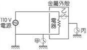

A. 接点甲断路，接点乙通路，接点丙断路

B. 接点甲通路，接点乙通路，接点丙通路

C. 接点甲断路，接点乙断路，接点丙通路

D. 接点甲通路，接点乙断路，接点丙断路

第 26 题 · 答案与解析

**参考答案（粉笔题库参考内容）**

A

**解析**

甲、丙为通路时，金属外壳被短路，排除B、C、D；A中甲丙断路，乙通路，金属外壳可为通路，有触电危险。

故正确答案为A。

**来源**：2013年上海市公务员录用考试《行测》题（A类）第26题

### 第 27 题

某人准备了两杯等量的水及一些块状冰糖与白糖粉末（两者成分均为蔗糖），做溶解速率与溶解度的实验。在25℃时，他将相同质量的冰糖与白糖粉末分别加入两个杯子中，并以相同的速率不断搅拌，最后两个杯子中均有未溶解的糖。则下列糖的质量百分比溶度与搅拌时间的关系图，正确的是：

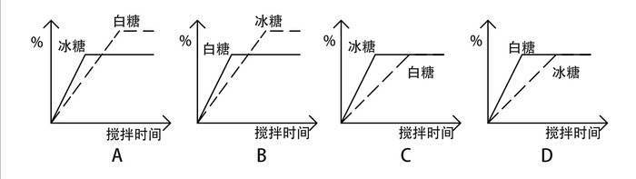

A. A

B. B

C. C

D. D

第 27 题 · 答案与解析

**参考答案（粉笔题库参考内容）**

D

**解析**

块状冰糖和白糖粉末成分相同，均为蔗糖，质量相同且水也为等量，故充分溶解后，二者浓度应相同，排除A、B；而白糖粉末溶解速度快于块状冰糖，即浓度变化更快，排除C。

故正确答案为D。

**来源**：2013年上海市公务员录用考试《行测》题（A类）第27题

### 第 28 题

两反射镜面I、II成5度角放置，光线入射镜面I的入射角为30度，然后在两个镜面中来回反射，则光线第一次从镜面I上面重新反射出来的出射角为：

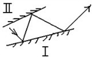

A. 30度

B. 40度

C. 50度

D. 60度

第 28 题 · 答案与解析

**参考答案（粉笔题库参考内容）**

B

**解析**

画图分析，根据入射角等于出射角，可推算出光线第一次从镜面I上面重新反射后出射角为40度。

故正确答案为B。

**来源**：2013年上海市公务员录用考试《行测》题（B类）第30题

### 第 29 题

如图所示，ABC三个实心正方体分别放在水平地面上，他们对水平地面的压强相等。若沿水平方向分别在ABC三个实心正方体上部切去厚度相等的部分，则三个正方体剩余部分对水平地面压强大小的关系是：

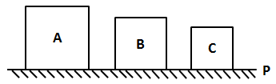

A. 

B. 

C. 

D. 无法判断

第 29 题 · 答案与解析

**参考答案（粉笔题库参考内容）**

B

**解析**

对于高为h，密度为ρ的正方体，对地面产生的压强应该是，设三个正方体边长分别为a、b、c，密度分别为ρ_A、ρ_B、pC，则有如下关系：P=ρ_Aga=ρ_Bgb=a＞b＞c，由于a>b>c，则ρ_A＜ρ_B＜pC；

减去相同的高度h'，则此时剩余部分对地面压强大小分别为、、，减少的压强关系为ρ_Agh'＜ρ_Bgh'＜pcgh'，可知剩余压强P_AP_BP_C。

故正确答案为B。

**来源**：2013年上海市公务员录用考试《行测》题（A类）第29题

### 第 30 题

下面是一扇防盗门的四种受力图，F1、F2为作用在上下两个铰链上的力，G为重力。防盗门的实际受力情况最接近为：

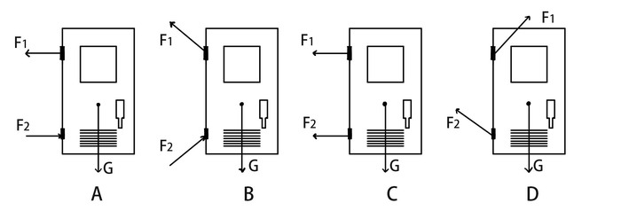

A. A

B. B

C. C

D. D

第 30 题 · 答案与解析

**参考答案（粉笔题库参考内容）**

B

**解析**

根据题意，防盗门受三个力F_1、F_2、G，这三个力必须达到平衡，门才会稳定，A、C两项防盗门在竖直方向上没有向上的力，受力不平衡，排除A、C。假设没有铰链，防盗门上侧会有一个向外倾倒的趋势，故上铰链对防盗门的力应该是向内侧的，排除D。

故正确答案为B。

**来源**：2013年上海市公务员录用考试《行测》题（A类）第30题

### 第 31 题

考古学是研究如何寻找和获取古代人类社会的实物遗存，以及如何依据这些遗存来研究人类社会历史的一门科学。换句话说，考古学是以科学发掘为基础，通过实物研究历史的科学。

根据上述定义，下列属于考古学的是：

A. 考据流传古书的作者

B. 鉴定拍卖古画的真伪

C. 估计展览文物的价值

D. 考证出土农具的年代

第 31 题 · 答案与解析

**参考答案（粉笔题库参考内容）**

D

**解析**

第一步：抓住定义中的关键词。

关键词强调通过实物遗存研究人类社会历史。

第二步：逐一判断选项。

A项考据古书的作者、B项鉴定古画的真伪和C项估计展览文物的价值，都不符合定义要点；

D项考证出土农具的年代，有助于研究人类社会历史，属于考古学。

故正确答案为D。

**考点**：方式目的

**来源**：2013年上海市公务员录用考试《行测》题（A类）第31题

### 第 32 题

动作思维亦称“直观动作思维”，其基本特点是思维与动作不可分，离开了动作就不能思维。动作思维的任务或课题是与当前直接感知到的对象相联系的，解决问题的思维方式不是依据表象与概念，而是依据当前的感知与实际操作。

根据上述定义，下列不属于动作思维的是：

A. 幼儿用手摆弄物体进行计算活动

B. 学生骑自行车回家

C. 大猩猩堆垒木箱去拿高处的事物

D. 建筑师在电脑上画设计图

第 32 题 · 答案与解析

**参考答案（粉笔题库参考内容）**

D

**解析**

第一步：抓住定义中的关键词。

关键词包括“思维与动作不可分”、“感知与实际操作”。

第二步：逐一判断选项。

A、B、C三项中的情况均符合关键词“思维与动作不可分”、“感知与实际操作”，因此都属于动作思维；

D项中建筑师设计图需要借助概念，而不能只靠感知和实际操作，不符合关键词“感知与实际操作”，因此不属于动作思维。

本题为选非题，故正确答案为D。

**考点**：方式目的

**来源**：2013年上海市公务员录用考试《行测》题（B类）第33题

### 第 33 题

地缘文化学是文化学研究中从局部地理、环境关系及其引起的社会、文化差异与因缘关联，探讨地理区域文化特征与发展规律的社会科学。根据上述定义，下列属于地缘文化学研究对象的是：

A. 徽商现象

B. 某地农业景观的开发过程

C. 城市房价暴涨现象

D. 某市大学生创业现象

第 33 题 · 答案与解析

**参考答案（粉笔题库参考内容）**

A

**解析**

第一步：抓住定义中的关键词。

关键词强调“地理区域文化特征”。

第二步：逐一判断选项。

A项中“徽商”指的是徽州的商人，“徽商现象”符合定义要点，属于地缘文化学的研究对象；

B、C项均未涉及文化，均不属于地缘文化学的研究对象；

D项大学生创业现象与地理无关，不属于地缘文化学的研究对象。

故正确答案为A。

**考点**：单定义-其他句式

**来源**：2013年上海市公务员录用考试《行测》题（B类）第35题

### 第 34 题

意见领袖是指在人际传播网络中经常为他人提供信息，同时对他人施加影响的活跃分子，他们在大众传播效果的形成过程中起着重要的中介或过渡的作用，由他们将信息扩散给受众，形成信息传递的两级传播。根据上述定义，下列说法正确的是：

A. 意见领袖社交范围较广

B. 意见领袖一般都是权威人物

C. 意见领袖是民主推荐产生的

D. 意见领袖独立地进行新闻采访

第 34 题 · 答案与解析

**参考答案（粉笔题库参考内容）**

A

**解析**

第一步：抓住定义中的关键词。

关键词强调“经常为他人提供信息，同时对他人施加影响的活跃分子”。

第二步：逐一判断选项。

A项“社交范围广”符合定义；

B项权威人物、C项民主推荐产生、D项独立地进行新闻采访，在定义中均未体现，不符合定义，予以排除。

故正确答案为A。

**考点**：单定义-其他句式

**来源**：2013年上海市公务员录用考试《行测》题（A类）第34题

### 第 35 题

天然孳息是指按照物质的自然生长规律而产生的果实与动物的出产物，与原物分离前是原物的一部分。天然孳息由所有权人所得；既有所有权人又有用益物权人的，由用益物权人取得。当事人另有约定的，按照约定。根据上述定义，下列属于天然孳息的是：

A. 小沈在地铁上捡到的手机

B. 陈大爷家老宅地下挖出的古董

C. 长风公园里的桃树结的桃子

D. 张阿姨送给邻居王大妈的猫崽

第 35 题 · 答案与解析

**参考答案（粉笔题库参考内容）**

C

**解析**

第一步：抓住定义中的关键词。

关键词强调“果实与动物的出产物”、“与原物分离前是原物的一部分”。

第二步：逐一判断选项。

A项中的手机，B项中的古董，不符合关键词“果实与动物的出产物”，因此不属于天然孳息；

D项中并没有涉及原物母猫，从而不符合关键词“与原物分离前是原物的一部分”，因此不属于天然孳息；

C项中的桃子符合“果实与动物的出产物”、“与原物分离前是原物的一部分”。

故正确答案为C。

**考点**：单定义-其他句式

**来源**：2013年上海市公务员录用考试《行测》题（B类）第34题

### 第 36 题

下列选项中，符合所给图形的变化规律的是：

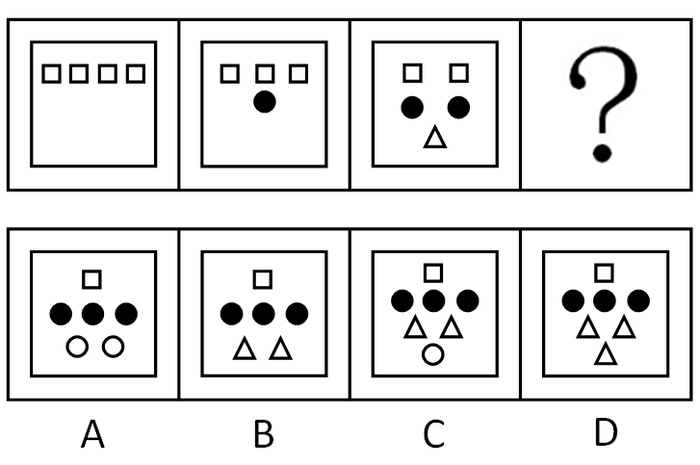

A. A

B. B

C. C

D. D

第 36 题 · 答案与解析

**参考答案（粉笔题库参考内容）**

C

**解析**

已知图形中从左到右，元素方框依次减少1个，未知图形应有1个；小黑点依次增加1个，未知图形应有3个；小三角依次增加1个，未知图形应有2个；元素层级依次增加一层，未知图形则应有4层，且4层都不一样。

故正确答案为C。

**考点**：数量规律-素

**来源**：2013年上海市公务员录用考试《行测》题（A类）第36题

### 第 37 题

下列选项中不能折成原图的是：

A. A

B. B

C. C

D. D

第 37 题 · 答案与解析

**参考答案（粉笔题库参考内容）**

C

**解析**

本题考查六面体的空间重构能力。如下图所示，可用画边法解题，以菱形面和圆形面的公共边（即下图绿线）为起点，分别对题干和选项进行顺时针画边。

A项：与题干对应面一致，排除；

B项：与题干对应面一致，排除；

C项：题干立体图第四条边对应的是加号面，选项第四条边对应的是白面，立体图和展开图不对应，当选；

D项：与题干对应面一致，排除。

本题为选非题，故正确答案为C。

**考点**：空间类-空间重构-六面体

**来源**：2013年上海市公务员录用考试《行测》题（B类）第36题

### 第 38 题

下列选项中，符合所给图形变化规律的是：

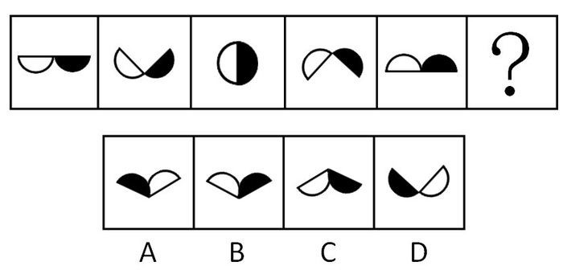

A. A

B. B

C. C

D. D

第 38 题 · 答案与解析

**参考答案（粉笔题库参考内容）**

B

**解析**

元素组成相同，优先考虑位置规律。题干图形明显分成白色半圆和黑色半圆，整体无规律考虑分开看。观察发现，白色半圆依次顺时针旋转45°，黑色半圆依次逆时针旋转45°，只有B项符合。

故正确答案为B。

**考点**：位置规律-旋转

**来源**：2013年上海市公务员录用考试《行测》题（A类）第38题

### 第 39 题

请从所给的四个选项中，选择最合适的一项填在问号处，使之呈现一定的规律性：

A. A

B. B

C. C

D. D

第 39 题 · 答案与解析

**参考答案（粉笔题库参考内容）**

C

**解析**

元素组成凌乱，且图形规整，考虑属性中的对称。题干中所给的图形只关于竖轴对称。A、D两项不仅是轴对称图形，还是中心对称图形；B项既不关于竖轴对称，也不关于横轴对称；C项只关于竖轴对称。

故正确答案为C。

**考点**：属性规律-对称性

**来源**：2013年上海市公务员录用考试《行测》题（B类）第39题

### 第 40 题

下列选项中，符合所给图形的变化规律的是：

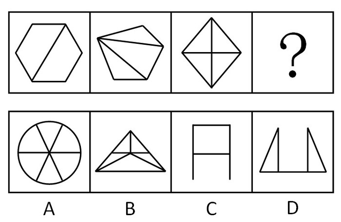

A. A

B. B

C. C

D. D

第 40 题 · 答案与解析

**参考答案（粉笔题库参考内容）**

B

**解析**

本题考查封闭空间数量。

已知图形的封闭空间数依次为2、3、4，可推知未知图形的封闭空间数应为5。选项封闭空间数量依次为6，5，1，2。

故正确答案为B。

**考点**：数量规律-面

**来源**：2013年上海市公务员录用考试《行测》题（A类）第40题

### 第 41 题

左边图形由四个部分组成，各部分通过平面上的变化可以组成新图，下列选项中，不是由这四个部分组成的是：

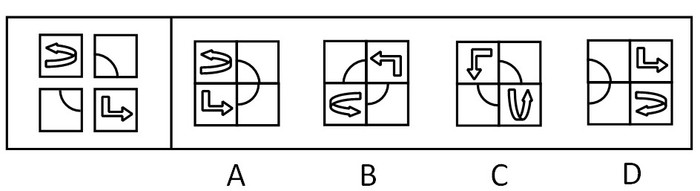

A. A

B. B

C. C

D. D

第 41 题 · 答案与解析

**参考答案（粉笔题库参考内容）**

D

**解析**

本题考查平面位置，用时针法。

题干中两个箭头都是指向逆时针方向，ABC三个选项箭头指向都是逆时针，而D选项中直线箭头指向逆时针，曲线箭头指向顺时针。

本题为选非题，故正确答案为D。

**来源**：2013年上海市公务员录用考试《行测》题（A类）第41题

### 第 42 题

符合下列所给图形变化规律的是：

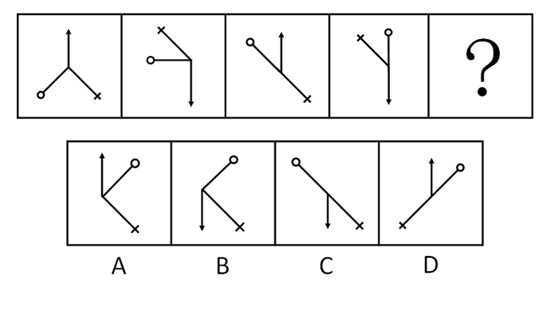

A. A

B. B

C. C

D. D

第 42 题 · 答案与解析

**参考答案（粉笔题库参考内容）**

A

**解析**

元素组成相同，看位置。

箭头周期性出现：上、下、上、下、上，从A、D两项中选。再看十字架的位置，也是周期性排列：东南、西北、东南、西北、东南。

故正确答案为A。

**考点**：位置规律-旋转

**来源**：2013年上海市公务员录用考试《行测》题（A类）第42题

### 第 43 题

下列选项中，符合所给图形变化规律的是：

A. A

B. B

C. C

D. D

第 43 题 · 答案与解析

**参考答案（粉笔题库参考内容）**

C

**解析**

观察图形，相同元素重复出现，考虑遍历规律。

前两行的图形方框内部都包含有三种元素，第三行图形方框内部也应当包含这三种元素，通过比较可知第三行所缺图形为C。

故正确答案为C。

**考点**：样式规律-遍历

**来源**：2013年上海市公务员录用考试《行测》题（B类）第38题

### 第 44 题

下列选项中，符合所给图形变化规律的是：

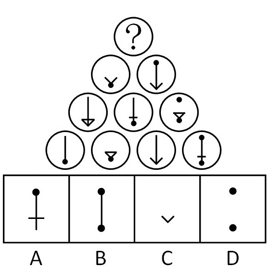

A. A

B. B

C. C

D. D

第 44 题 · 答案与解析

**参考答案（粉笔题库参考内容）**

B

**解析**

本题考查元素叠加。

图中相邻三个小圆组成的三角形，两个角的图形叠加去同存异后得到第三个角的图形，根据此规律可得出未知图形应为B项。

故正确答案为B。

**考点**：样式规律-加减同异

**来源**：2013年上海市公务员录用考试《行测》题（B类）第41题

### 第 45 题

下列选项中，符合所给图形的变化规律的是：

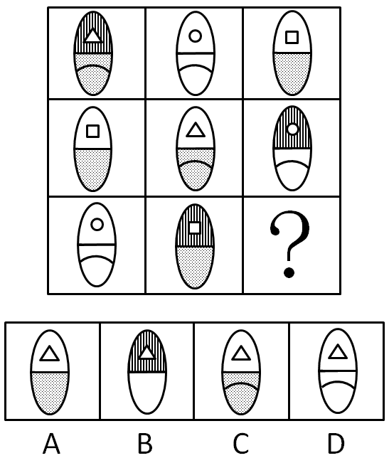

A. A

B. B

C. C

D. D

第 45 题 · 答案与解析

**参考答案（粉笔题库参考内容）**

C

**解析**

本题考查元素遍历。每行组成元素相同，只是位置不同，第三行图上半部分还缺一个白底，排除B项；下半部分还缺一个带曲线的灰底，排除A、D项。

故正确答案为C。

**考点**：样式规律-遍历

**来源**：2013年上海市公务员录用考试《行测》题（A类）第45题

### 第 46 题

甲是乙的必要条件，丙是乙的充分条件但不是乙的必要条件，那么：

A. 丙是甲的充分条件但不是甲的必要条件

B. 丙是甲的必要条件但不是甲的充分条件

C. 丙是甲的充分必要条件

D. 丙既非甲的充分条件，又非甲的必要条件

第 46 题 · 答案与解析

**参考答案（粉笔题库参考内容）**

A

**解析**

第一步：翻译题干。

①乙→甲；②丙→乙；将两个推导关系连接起来为：③丙→甲。

第二步：逐一翻译选项并判断正确选项。

A项，丙→甲，跟题干推导关系一致；

B、C、D三项均和题干逻辑不符。

故正确答案为A。

**考点**：常规翻译

**来源**：2013年上海市公务员录用考试《行测》题（B类）第50题

### 第 47 题

凡涉及国家军事，政治或经济秘密的论文都不属于公开的学位论文。如果上述断定为真，下列哪项也一定为真：

A. 不涉及国家军事、政治或者经济秘密的论文不可以公开

B. 不公开的学位论文都是有关国家军事、政治或经济秘密的论文

C. 有些涉及国家军事、政治或经济秘密的论文可以公开

D. 公开的学位论文都不是涉及国家军事、政治或经济秘密的论文

第 47 题 · 答案与解析

**参考答案（粉笔题库参考内容）**

D

**解析**

第一步：翻译题干。

涉及机密→不公开。

第二步：逐一翻译选项并判断正确选项。根据逆否规则。

A项，-涉及机密→不公开，“-涉及机密”是否定题干推导关系的前件，否前件无法推出任何绝对表达的结论，A错；

B项，不公开→涉及机密，“不公开”是肯定题干推导关系的后件，肯后件无法推出肯前件，B错；

C项，有些涉及机密→—不公开，“涉及机密”是肯定题干推导关系的前件，肯前件无法推出否后件，C错；

D项，-不公开→—涉及机密，“-不公开”是否定题干推导关系的后件，根据逆否规则，否后件可以推出否前件，D正确。

故正确答案为D。

**考点**：常规翻译

**来源**：2013年上海市公务员录用考试《行测》题（A类）第47题

### 第 48 题

自相矛盾是指在同一思维或辩论过程中，同一主体针对同一对象作出两个互相否定的断定。下列哪项断定包含自相矛盾：

A. 在刚开始读《聊斋志异》时，小李以为所有的鬼都是青面獠牙的，等到读完全书，他却说并非所有的鬼都是青面獠牙的

B. 方老师在介绍生物的分类时说：“眼虫既有动物的特征也有植物的特征”

C. 在介绍南极洲的动物情况时，王老师说：“南极海岸地带，鸟类的种类虽少，但鸟却很多”

D. 在张经理发言后，老陈说：“我基本上完全同意张经理的意见”

第 48 题 · 答案与解析

**参考答案（粉笔题库参考内容）**

D

**解析**

第一步：抓住定义中的关键词。

关键词包括“在同一思维或辩论过程中”、“同一主体针对同一对象”、“两个互相否定”。

第二步：逐一判断选项。

A中的“刚开始读”和“等到读完全书”不符合关键词“在同一思维或辩论过程中”；

B中的“既有动物的特征”和“有植物的特征”不符合关键词“两个互相否定”；

C中的“鸟类的种类少”和“鸟很多”不符合关键词“同一对象”，都不属于“自相矛盾”；

D中的“基本上完全同意”自相矛盾，“基本上同意”和“完全同意”是两个互相否定的断定，且都是发言后老陈针对张经理的意见的评论，符合定义。

故正确答案为D。

**考点**：大前提

**来源**：2013年上海市公务员录用考试《行测》题（A类）第48题

### 第 49 题

塞莱拉基因组公司的一个研究小组在《科学》杂志上报告说，将老鼠的染色体与人的染色体进行对比，发现二者在基因、基因内容和DNA序列等方面具有95%的相似度。因此，老鼠和人其实并没有太大的区别。上述结论依赖的一个假定是：

A. 已经绘制完成的动物基因图谱往往很不准确

B. 从智力和情感的角度看，老鼠和人之间存在着巨大的差异

C. 判断物质之间区别大小的主要标准是物种在基因上的相似度大小

D. 老鼠没什么智力，在与人进行比较时，可以忽略不计

第 49 题 · 答案与解析

**参考答案（粉笔题库参考内容）**

C

**解析**

第一步：分析论点和论据。

论点：老鼠和人其实没有太大的区别。

论据：将老鼠的染色体与人的染色体进行对比，发现二者在基因、基因内容和DNA序列等方面具有95%的相似度。

第二步：逐一分析选项。

A项：“动物基因图谱”与判断老鼠和人的区别没有关系，属于无关选项，排除；

B项：说明老鼠和人在智力和情感方面存在巨大差异，削弱了论点，排除；

C项：在物种的区别和基因方面的相似度之间搭桥，加强论证过程，使论点成立，当选；

D项：只是加强实验的科学性，支持论据，但不能说明论点和论据之间的关系，无法加强论点，排除。

故正确答案为C。

**考点**：搭桥

**来源**：2013年上海市公务员录用考试《行测》题（A类）第49题

### 第 50 题

长期以来A市人口一直保持负增长，有教育专家据此认为，由于学龄儿童人数日益减少，A市小学和初中的在校生人数将越来越少。下列哪项如果正确，将最有力地指出教育专家的推断是有缺陷的：

A. 由于种种原因，有个别非婚生育或非法生育二胎的现象没有得到有效统计

B. 随着外来务工人员的急剧增加，他们的子女将就近在A市读小学和初中

C. 由于撤点并校的实施以及教育资源分布不均，近年来A市不少小学和初中的就读人数大量增加

D. 在校人数的减少，将使小班化教学得到真正实现，从而有助于教育质量的提高

第 50 题 · 答案与解析

**参考答案（粉笔题库参考内容）**

B

**解析**

第一步：找到论点和论据。

本题论点是由于学龄儿童人数日益减少，A市小学和初中的在校生人数将越来越少，论据是长期以来A市人口一直保持负增长。

第二步：判断削弱方式。

论点强调学龄儿童人数日益减少，论据强调A市人口一直保持负增长，论点与论据间存在明显因果关系，需削弱论点。

第三步：逐一判断选项。

A中的“统计不全”削弱力度没有B项强；

B项“外来务工人员急剧增加，他们的子女将就近在A市读小学和初中”直接削弱论点；

C项“撤点并校”只是学校少了，A市的学生还是那么多，不能削弱论点；

D项“人数减少有助于教育质量提高”是加强项。

故正确答案为B。

**考点**：削弱论点

**来源**：2013年上海市公务员录用考试《行测》题（A类）第50题

### 第 51 题

人们一般都认为，科学家的思维都是凭借着严格的逻辑推理，而不是凭借形象思维。但研究表明，诺贝尔获奖者比一般科学家更多地利用形象思维手段，因此，形象思维手段有助于取得重大的科学突破。

上述结论是建立在下列哪项假设基础上的：

A. 有条理的、逐步的推理对于一般科学研究是必不可少的

B. 诺贝尔获奖者有能力凭借形象思维来进行创造性思维

C. 诺贝尔奖获得者比一般科学家更为聪明和勤奋

D. 诺贝尔获奖者取得了重大的科学突破

第 51 题 · 答案与解析

**参考答案（粉笔题库参考内容）**

D

**解析**

第一步：找出论点和论据。

论点：形象思维手段有助于取得重大的科学突破。

论据：诺贝尔获奖者比一般科学家更多地利用形象思维手段。

本题论点讨论的是“形象思维手段”和“重大科学突破”之间的关系，论据讨论的是“诺贝尔获奖者”和“形象思维手段”之间的关系，二者话题不一致，且提问方式为“假设”，加强优先考虑搭桥，即建立“诺贝尔获奖者”和“重大科学突破”之间的联系。

第二步：逐一分析选项。

A项：该项指出有条理的、逐步的推理对一般科学研究必不可少，而论点说的是形象思维手段有助于取得重大科学突破，话题不一致，无法加强，排除；

B项：该项指出诺贝尔获奖者有能力凭借形象思维进行创造性思维，而“有能力凭借形象思维来进行创造性思维”不代表能够“取得重大科学突破”，不明确项，无法加强，排除；

C项：该项指出诺贝尔奖获得者比一般科学家更聪明勤奋，而论点说的是形象思维手段有助于取得重大科学突破，话题不一致，无法加强，排除；

D项：该项指出诺贝尔获奖者取得了重大的科学突破，建立了“诺贝尔获奖者”和“重大科学突破”之间的联系，搭桥项，可以加强，当选。

故正确答案为D。

**考点**：搭桥

**来源**：2013年上海市公务员录用考试《行测》题（B类）第51题

### 第 52 题

有A、B、C、D外表一样、重量不同的四个小球，已知：A+B=C+D；A+D>B+C；A+C&lt;B。则这四个球由重到轻的排列顺序是：

A. D>B>A>C

B. B>C>D>A

C. D>B>C>A

D. B>A>D>C

第 52 题 · 答案与解析

**参考答案（粉笔题库参考内容）**

A

**解析**

第一步：抓住题干主要信息。

（1）A+B=C+D，（2）A+D>B+C，（3）A+C&lt;B。

第二步：分析题干信息，并结合选项得出答案。

由第一步中（1）A+B=C+D和（2）A+D>B+C可得D>B，A>C；

又知（3）A+C&lt;B，从而得到B>A>C。

综上，四个球由重到轻的排列顺序为D>B>A>C。

故正确答案为A。

**考点**：组合排列-单题-其他

**来源**：2013年上海市公务员录用考试《行测》题（A类）第52题

### 第 53 题

甲乙丙三人推销各自产品，这三样产品中，有一样是仿冒品，其余两样是真品。甲说：“我的产品是真品，乙的产品是仿冒品”；乙说：“我的产品是真品，丙的产品是仿冒品”；丙说：“乙的产品是真品，甲的是仿冒品”。已知甲、乙、丙三人中，有一位两句话都是真的，有一位一句是真话，一句是假话，还有一位两句都是假话。那么推销仿冒品的是：

A. 甲

B. 乙

C. 丙

D. 不能确定

第 53 题 · 答案与解析

**参考答案（粉笔题库参考内容）**

A

**解析**

第一步：分析题干条件。

（1）甲：甲是真品，乙是仿冒品；

（2）乙：乙是真品，丙是仿冒品；

（3）丙：乙是真品，甲是仿冒品；

（4）三样产品中，有一样是仿冒品，其余两样是真品；

（5）甲、乙、丙三人中，有一位两句话都是真的，有一位一句是真话、一句是假话，还有一位两句都是假话。

第二步：根据题干条件进行推理。

根据条件（1）（3）可得甲和丙说的话为矛盾关系，则两人的四句话的真假情况为两真两假。结合条件（5）可知，乙说的话定为一真一假。但此时无法确定乙的两句话的真假情况，可以考虑使用假设法。

假设乙的前半句“我的产品是真品”为假，后半句“丙的产品是仿冒品”为真，那么说明乙的产品为仿冒品，丙的产品也是仿冒品，这与条件（4）只有一样是仿冒品矛盾，故假设错误；

所以乙的前半句为真，后半句为假，也就是乙的产品是真品，丙的产品也是真品。结合条件（4）可知，有一人的产品是仿冒的，有两人的产品是真品，所以甲的产品是仿冒品。验证甲、丙说的话，甲两句都均为假，丙两句均为真，符合题干条件。

故正确答案为A。

**考点**：框架题

**来源**：2013年上海市公务员录用考试《行测》题（A类）第53题

### 第 54 题

某中学的教师都很有爱心。有些经常志愿献血的教师免费为学习困难的学生补课，凡是资助了贫困生的教师都和困难家庭结成了帮困对子，但所有免费为学习困难的学生补课的教师都没有人和困难家庭结成帮困对子。

根据以上前提，下列哪项一定为真：

A. 有些经常志愿献血的教师没有资助贫困生

B. 有些资助了贫困生的教师没有志愿献血

C. 有些资助了贫困生的教师经常献血

D. 有些经常志愿献血的教师跟困难家庭结成了帮困对子

第 54 题 · 答案与解析

**参考答案（粉笔题库参考内容）**

A

**解析**

第一步：翻译题干。

事实信息：有些经常志愿献血的教师免费为学习困难的学生补课；

①资助了贫困生的教师→和困难家庭结成了帮困对子；

②免费为困难学生补课的教师→—和困难家庭结成帮困对子。

根据逆否规则，从①可推出③：-和困难家庭结成帮困对子→—资助了贫困生的教师；根据传递规则，从②和③可推出④“免费为困难学生补课的教师→—资助了贫困生的教师”，即所有免费为学习困难的学生补课的教师都没有资助贫困生。

第二步：从事实信息开始推导。

从第一步可知所有免费为学习困难的学生补课的教师都没有资助贫困生，又知事实信息“有些经常志愿献血的教师免费为学习困难的学生补课”，可以推出有些经常志愿献血的教师没有资助贫困生，A项正确。B、C、D三项均无法从题干推出。

故正确答案为A。

**考点**：集合推理

**来源**：2013年上海市公务员录用考试《行测》题（B类）第49题

### 第 55 题

一旦消费者认识到通货膨胀已经开始，他们普遍都会增加消费。这种增加很容易通过消费者希望不再推迟购买那些肯定会涨价的商品这一现象得到解释，尽管消费者预料到价格持续上涨，工资也会随之上涨，但是在长期通货膨胀期间，消费者最终还是会推迟那些甚至是日常生活品的购买。

下列哪项如果正确，最能有助于解释上述描述的消费行为的明显不一致：

A. 消费者在通货膨胀时期存的钱比非通货膨胀时期存的钱多

B. 通过经济指标发出通货膨胀已经开始的信号和消费者意识到通货膨胀已经开始之间有一个滞后

C. 如果很大数量的消费者不能购买商品，那么价格最终会降下来，但工资不会受到影响

D. 因为工资的增长跟不上物价的上涨，所以消费者的购买力在长期通胀阶段有所下降

第 55 题 · 答案与解析

**参考答案（粉笔题库参考内容）**

D

**解析**

第一步：找出论点和论据。

论点：消费者一旦认识到通货膨胀开始，就不再推迟购买那些肯定会涨价的商品，但在长期通货膨胀期间，消费者最终还是会推迟购买消费品。没有论据。

第二步：判断加强方式。

本题只有论点，没有论据，所以需要加强论点。

第三步：逐一判断选项。

D项分析了在长期通货膨胀期间，消费者因为工资的增长跟不上物价的上涨，导致购买力下降，从而推迟购买消费品，解释了题干中的矛盾，加强了论点；

A项对比的是消费者在通货膨胀期间和非通货膨胀期间的存款量，跟长期通货膨胀期间消费者的消费行为无关，属于无关选项；

B项同样没有涉及长期通货膨胀期间消费者的行为表现，属于无关选项；

C项谈的是价格下降和工资的关系，跟消费者的消费行为无关，无法解释题干。

A、B、C都解释不了题干中的矛盾。

故正确答案为D。

**考点**：原因解释

**来源**：2013年上海市公务员录用考试《行测》题（B类）第52题

### 第 56 题

农民刘大伯在某处工作，约定一年的报酬是8600元现金和一头牛。他从1月干到8月底因故离开时获得报酬3800元现金和一头牛，则这头牛的价格是：

A. 4600元

B. 5800元

C. 6000元

D. 6500元

第 56 题 · 答案与解析

**参考答案（粉笔题库参考内容）**

B

**解析**

设这头牛的价格是x元，根据题意可得：，解得x=5800。

故正确答案为B。

**考点**：和差倍比问题

**来源**：2013年上海市公务员录用考试《行测》题（A类）第56题

### 第 57 题

A、B两架飞机同时从相距1755公里的两个机场起飞相向飞行，经过45分钟后相遇，如果A机的速度是B机的1.25倍，那么两飞机的速度差是每小时：

A. 250公里

B. 260公里

C. 270公里

D. 280公里

第 57 题 · 答案与解析

**参考答案（粉笔题库参考内容）**

B

**解析**

设B机每小时飞行x公里，则A机每小时飞行1.25x公里，根据题意可得：，解得x=1040，因此两飞机的速度差为：公里/小时。

故正确答案为B。

**考点**：相遇追及

**来源**：2013年上海市公务员录用考试《行测》题（A类）第57题

### 第 58 题

某公司针对A、B、C三种岗位招聘了35人，其中只能胜任B岗位的人数等于只能胜任C岗位人数的2倍，而只能胜任A岗位的人数比能兼职别的岗位的人多1人，在只能胜任一个岗位的人群中，有一半不能胜任A岗位，则招聘的35人中能兼职别的岗位的有：

A. 10人

B. 11人

C. 12人

D. 13人

第 58 题 · 答案与解析

**参考答案（粉笔题库参考内容）**

B

**解析**

根据题干中“在只能胜任一个岗位的人群中，有一半不能胜任A岗位”可知，只能胜任B岗位与只能胜任C岗位的人数之和等于只能胜任A岗位的人数。设只能胜任C岗位的人数为x人，能兼职别的岗位的有y人，则只能胜任B岗位的人数为2x人，只能胜任A岗位的人数为(y+1)人，根据题意可得：2x+x=y+1，(y+1)+2x+x+y=35，联立解得x=4，y=11，因此招聘的35人中能兼职别的岗位的有11人。

故正确答案为B。

**考点**：和差倍比问题

**来源**：2013年上海市公务员录用考试《行测》题（B类）第61题

### 第 59 题

下列图形均是由正方形与圆形所构成的，图形中阴影部分的面积最大的是：

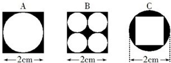

A. A最大

B. B最大

C. C最大

D. 都一样大

第 59 题 · 答案与解析

**参考答案（粉笔题库参考内容）**

C

**解析**

A图形中阴影部分的面积为：；

B图形中阴影部分的面积为：；

C图形中阴影部分的面积为：；

因为，所以，因此C图形中阴影部分的面积最大。

故正确答案为C。

**考点**：几何公式类-平面图形

**来源**：2013年上海市公务员录用考试《行测》题（A类）第59题

### 第 60 题

高速公路收费站对过往车辆的收费标准是：大型车30元/辆、中型车15元/辆、小型车10元/辆。某天，通过收费站的大型车与中型车的数量比是5：6，中型车与小型车的数量比是4：11，小型车的通行费总数比大型车的多270元，这天的收费总额是：

A. 7280元

B. 7290元

C. 7300元

D. 7350元

第 60 题 · 答案与解析

**参考答案（粉笔题库参考内容）**

B

**解析**

根据题干中“通过收费站的大型车与中型车的数量比是5:6，中型车与小型车的数量比是4:11”可得，通过收费站的大型车、中型车和小型车的数量比为10:12:33，设大型车、中型车和小型车的数量分别为10y、12y和33y辆，根据题意可得：，解得y=9，因此这天的收费总额为：元。

故正确答案为B。

备注：事实上当计算得到y=9时，可以得知这天的收费总额必能被9整除。通过分析选项发现，只有B项能够被9整除。

**考点**：经济利润问题

**来源**：2013年上海市公务员录用考试《行测》题（B类）第57题

### 第 61 题

从甲地到乙地每天有直达班车4班，从甲地到丙地每天有直达班车5班，从丙地到乙地每天有直达班车3班，则从甲地到乙地共有多少种不同的乘车法：

A. 12种

B. 19种

C. 32种

D. 60种

第 61 题 · 答案与解析

**参考答案（粉笔题库参考内容）**

B

**解析**

根据题意可知，从甲地到乙地共有两种方式。第一种方式是乘坐从甲地到乙地的直达班车，共有4种乘车法；第二种方式是先乘坐从甲地到丙地的直达班车，再乘坐从丙地到乙地的直达班车，共有：。因此从甲地到乙地共有乘车法：4+15=19种。

故正确答案为B。

**考点**：基础排列组合

**来源**：2013年上海市公务员录用考试《行测》题（A类）第61题

### 第 62 题

如图，是一个工厂内的道路平面图，每天下班后，保卫科长都要从p点处开始不要重复的沿道路检查一圈，他每分钟走70米。若中间不停留，则走一圈需要：

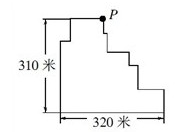

A. 24分钟

B. 19分钟

C. 18分钟

D. 15分钟

第 62 题 · 答案与解析

**参考答案（粉笔题库参考内容）**

C

**解析**

通过观察道路平面图发现，保卫科长走一圈实际是总共走了2个横向的320米和2个纵向的310米，从而走一圈共走：，因此走一圈的时间为：。

故正确答案为C。

**考点**：几何公式类-平面图形、普通行程

**来源**：2013年上海市公务员录用考试《行测》题（A类）第62题

### 第 63 题

某公司将公司全年的盈利，先扣除六分之一的税收，再扣除剩下的三分之一作为公司经费，然后剩下的四分之一作为公司的发展基金，最后剩下的以年终奖金的形式分给员工。已知员工总数为50名，且每人分到了1万元奖金，则这个公司全年的盈利总共是：

A. 90万元

B. 100万元

C. 110万元

D. 120万元

第 63 题 · 答案与解析

**参考答案（粉笔题库参考内容）**

D

**解析**

年终奖金占公司全年的盈利的比例为，因此公司全年的盈利总共为。

故正确答案为D。

**考点**：和差倍比问题

**来源**：2013年上海市公务员录用考试《行测》题（A类）第63题

### 第 64 题

十字路口的交通信号灯每分钟红灯亮30秒，绿灯亮25秒，黄灯亮5秒。当你抬头看信号灯时，是绿灯的概率为：

A. 1/12

B. 1/3

C. 5/12

D. 1/2

第 64 题 · 答案与解析

**参考答案（粉笔题库参考内容）**

C

**解析**

当抬头看信号灯时，是绿灯的概率为：。

故正确答案为C。

**考点**：给情况求概率

**来源**：2013年上海市公务员录用考试《行测》题（B类）第60题

### 第 65 题

某养鸡场计划购买甲、乙两种小鸡苗共2000只进行饲养，已知甲种小鸡苗每只2元，乙种小鸡苗每只3元。相关资料表明：甲、乙两种小鸡苗的成活率分别是94%和99%。若要使这批小鸡苗的成活率不低于96%，且买小鸡苗的总费用最小，则应选购甲、乙两种小鸡苗各有：

A. 500只、1500只

B. 800只、1200只

C. 1100只、900只

D. 1200只、800只

第 65 题 · 答案与解析

**参考答案（粉笔题库参考内容）**

D

**解析**

设购买甲种小鸡苗a只，则购买乙种小鸡苗为(2000-a）只。设购买这批小鸡苗总费用为b元，根据题意可得：，即b=-a+6000，为减函数；由题干中“这批小鸡苗的成活率不低于96%”可得：，解得a≤1200。因为函数“b=-a+6000”为减函数，因此当a=1200时，b取最小值。此时a=1200，2000-a=800，因此应选购甲、乙两种小鸡苗各有1200只、800只。

故正确答案为D。

**考点**：统筹规划问题

**来源**：2013年上海市公务员录用考试《行测》题（A类）第65题

## 材料 3

据统计，2012年第一季度，上海市签订外商直接投资合同共688项，比去年同期下降10.5%；签订外商直接投资合同金额52.75亿美元，增长11.9%；实际到位金额33.26亿美元，增长29.2%。

        另外，一季度，与上海市签订外商直接投资合同的国家（地区）共57个。其中，与中国香港签订合同金额达24.2亿美元，比去年同期增长11.4%，占全市合同金额的45.9%，居签约国家（地区）的首位；美国合同金额7.3亿美元，下降45.3%，居第二位；日本合同金额4.77亿美元，增长39.5%，居第三位。其他合同金额超亿美元的国家（地区）还有毛里求斯、新加坡、英属维尔京群岛和荷兰，其合同金额分别为3.24亿美元、2.91亿美元、2.22亿美元和1.14亿美元。

        作为聚集、整合和辐射优质生产要素的平台和载体，上海总部经济集聚区建设稳步发展。截至3月末，本市跨国公司地区总部达到370家，其中一季度新增17家；外资投资性公司达到248家，新增8家；外资研发中心达到341家，新增7家。

### 第 66 题

2011年第一季度，上海签订外商直接投资合同金额中，实际到位金额占比为：

A. 64.6%

B. 63.1%

C. 54.6%

D. 40.8%

第 66 题 · 答案与解析

**参考答案（粉笔题库参考内容）**

C

**解析**

根据题干“2011年第一季度，······占比为”，结合材料数据为2012年第一季度，可判定本题为基期比重问题。定位材料第一段，2012年第一季度，上海市签订外商直接投资合同金额52.75亿美元，增长11.9%，实际到位金额33.26亿美元，增长29.2%。则2011年第一季度，外商直接投资合同金额中，实际到位金额占比，C项最接近。

故正确答案为C。

**考点**：基期比重、文字资料

**来源**：2013年上海市公务员录用考试《行测》题（A类）第66题

### 第 67 题

2012年第一季度，与上海市签订外商直接投资合同的金额比重达5.5%以上的国家（地区）个数为：

A. 4个

B. 5个

C. 6个

D. 7个

第 67 题 · 答案与解析

**参考答案（粉笔题库参考内容）**

B

**解析**

根据题干“2012年第一季度，······的比重达5.5%以上······”，可判定本题为现期比重问题。定位材料第一段，上海市签订外商直接投资合同金额52.75亿美元，那么满足要求的国家（地区）的签订金额应= 。定位材料第二段，符合要求的有中国香港、美国、日本、毛里求斯和新加坡，总共5个国家（地区）。

故正确答案为B。

**考点**：文字资料、现期比重

**来源**：2013年上海市公务员录用考试《行测》题（A类）第67题

### 第 68 题

2012年第一季度，上海市跨国公司地区总部、外资投资性公司及外资研发中心等企业数量增加了：

A. 5.78%

B. 4.56%

C. 3.45%

D. 3.13%

第 68 题 · 答案与解析

**参考答案（粉笔题库参考内容）**

C

**解析**

根据题干“2012年第一季度，······增加了”，结合选项为百分数，可判定本题为一般增长率计算问题。定位材料最后一段，跨国公司总部370家，新增17家，外资投资性公司248家，新增8家，外资研发中心341家，新增7家。那么，一季度新增加企业数为17+8+7=32 ，故所求。

故正确答案为C。

**考点**：一般增长率、文字资料

**来源**：2013年上海市公务员录用考试《行测》题（A类）第68题

### 第 69 题

2012年第一季度，与上海签订外商直接投资合同金额不足1亿美元的国家（地区），其合同金额总占比为：

A. 大于15%

B. 不足10%

C. 不足15%

D. 不足12%

第 69 题 · 答案与解析

**参考答案（粉笔题库参考内容）**

C

**解析**

根据题干“2012年第一季度，······占比为”，可判定本题为现期比重问题。定位材料第一段，2012年第一季度，签订外商直接投资合同金额52.75亿美元，定位材料第二段，与上海签订外商直接投资合同金额超过1亿美元的国家（地区）的总金额分别为24.2、7.3、4.77、3.24、2.91、2.22、1.14亿美元，其中香港占全市合同金额的45.9%，则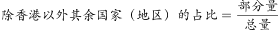，则超过1亿美元的占比约为45.9%+42%=87.9%，故不足1亿美元的国家，其合同金额占比约为1-87.9%=12.1%。

故正确答案为C。

**考点**：文字资料、现期比重

**来源**：2013年上海市公务员录用考试《行测》题（A类）第69题

## 材料 4

### 第 70 题

2012年1月某小区成交的二手房中，面积为60平方米左右的住宅占总销售套数的：

A. 25%

B. 35%

C. 37.5%

D. 40%

第 70 题 · 答案与解析

**参考答案（粉笔题库参考内容）**

C

**解析**

根据题干“2012年1月，······占······”，可判定本题为现期比重问题。定位表格第二列，面积为60平方米左右的住宅数为3，总销售套数为8，因此题干所求比重为。

故正确答案为C。

**考点**：现期比重、统计表

**来源**：2013年上海市公务员录用考试《行测》题（B类）第69题

### 第 71 题

如果该小区的成交价格从2012年1月起连续2个月出现每月3%的下跌，则至2012年3月，与77号704室相似的住宅的成交总价约为：

A. 91万元

B. 145万元

C. 155万元

D. 166万元

第 71 题 · 答案与解析

**参考答案（粉笔题库参考内容）**

D

**解析**

据题干“如果从2012年1月起，每月3%的下跌，则至2012年3月······”，可判定本题为现期计算问题。定位表格倒数第二行，2012年1月77号704室的成交总价为176万元，因此2012年3月，与77号704室相似的住宅的成交总价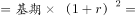万元，与D项最接近。

故正确答案为D。

**考点**：现期计算、统计表

**来源**：2013年上海市公务员录用考试《行测》题（B类）第70题

### 第 72 题

如果市场估价人员对该小区面积为90平方米左右的住宅的估价在元/平方米之间，则下列说法不正确的是：

A. 111号801室属于正常成交案例

B. 83号204室属于正常成交案例

C. 48号1002室属于正常成交案例

D. 只有两套面积为90平方米左右的住宅属于正常成交案例

第 72 题 · 答案与解析

**参考答案（粉笔题库参考内容）**

A

**解析**

定位表格第二列和最后一列，面积在90平方米左右的住宅共有3套，分别如下：

48号1002室，单价1.73万元，在题干所给范围内，属于正常成交案例；

83号204室，单价1.68万元，在题干所给范围内，属于正常成交案例；

111号801室，单价1.75万元，不在题干所给范围内，不属于正常成交案例。

本题为选非题，故正确答案为A。

**考点**：直接找数、统计表

**来源**：2013年上海市公务员录用考试《行测》题（B类）第71题

### 第 73 题

根据表中数据，下列说法正确的是：

A. 2012年1月某小区成交的二手房单价均高于16000元/平方米

B. 2012年1月某小区二手房成交面积已超过700平方米

C. 面积为90平方米左右的住宅单价普遍低于面积为60平方米左右的住宅单价

D. 面积为90平方米左右的住宅单价普遍高于面积为105平方米以上的住宅单价

第 73 题 · 答案与解析

**参考答案（粉笔题库参考内容）**

D

**解析**

A项：定位表格最后一列，16号1301室和77号704室的单价均低于1.6万元/平方米，错误；

B项：定位表格第二列，2012年1月某小区二手房成交面积为95.64+89.45+108.57+60＝690＜700，错误；

C项：定位表格第二列和最后一列，面积为90平方米左右的住宅单价分别为1.73万元、1.68万元和1.75万元，面积为60平方米左右的住宅单价分别为1.62万元、1.63万元和1.62万元，后者均低于前者，错误；

D项：定位表格第二列和最后一列，面积为90平方米左右的住宅单价分别为1.73万元、1.68万元和1.75万元，面积为105平方米以上的住宅单价均为1.42万元，后者明显低于前者，正确。

故正确答案为D。

**考点**：统计表、综合分析

**来源**：2013年上海市公务员录用考试《行测》题（B类）第72题

## 材料 5

某机构对某年464家成长型基金和400家价值型基金的收益进行研究，下列图表显示了两种类型的基金中，对应不同收益率的基金频率百分比。

图：成长型基金和价值型基金某年收益的百分比分布

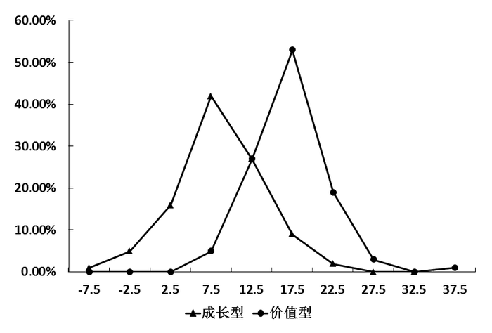

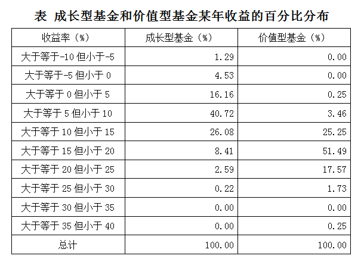

### 第 74 题

根据已给信息判断，下列说法不正确的是：

A. 至少有2个价值型基金出现了大于30%的收益

B. 有5.82%的成长型基金都出现了负收益，但没有一家价值型基金出现负收益

C. 收益率在的基金，价值型基金大约是成长型基金的5倍

D. 收益率在之间的成长型基金明显多于价值型基金

第 74 题 · 答案与解析

**参考答案（粉笔题库参考内容）**

A

**解析**

A项：定位文字材料，价值型基金的总数为400家，定位表格，价值型基金出现大于30%的收益的占比为0.25%，那么个数为：，错误；

B项：定位表格，成长型基金出现负收益所占比重为：1.29%+4.53 %=5.82 %，而价值型基金为0，正确；

C项：定位文字材料，成长型基金总数为464家，价值型基金总数为400家，定位表格，收益率在的基金，价值型基金比例为51.49%，则个数为，成长型基金比例为8.41%，则个数为，那么所求倍数为：，正确；

D项：定位文字材料，成长型基金总数为464家，价值型基金总数为400家，定位表格第四、五行可知，收益率在之间的成长型基金比例为16.16%、40.72%，则成长型基金数为：464×(16.16 %+40.72 %)，价值型基金比例为0.25%、3.46%，则价值型基金数为：，明显可以看出成长型基金多于价值型基金，正确。

本题为选非题，故正确答案为A。

**考点**：综合分析、综合资料

**来源**：2013年上海市公务员录用考试《行测》题（A类）第74题

### 第 75 题

根据已给信息判断，下列说法不正确的是（  ）。

A. 更多的价值型基金有着更高的收益率

B. 出现负收益的基金一定是成长型基金

C. 收益率大于等于20%的基金中，成长型基金的收益率一定低于价值型基金的收益率

D. 据该年数据对下一年做预测的话，则有理由预期价值型基金的平均收益率会高出成长型基金

第 75 题 · 答案与解析

**参考答案（粉笔题库参考内容）**

C

**解析**

A项：定位表格，51.49%的价值型基金收益率在之间，而40.72%的成长型基金收益率仅在之间，从而可知更多的价值型基金有着更高的收益率，正确；

B项：定位表格第二和第三行，只有成长型基金出现负收益，正确；

C项：定位表格倒数第三行，收益率在之间的成长型基金和价值型基金均为0，说明在该部分两者的收益率是相等的，错误；

D项：定位折线图，价值型基金的年收益率总体要高于成长型基金，按此规律发展，下一年价值型基金的平均收益率会高于成长型基金，正确。

本题为选非题，故正确答案为C。

**考点**：综合分析、综合资料

**来源**：2013年上海市公务员录用考试《行测》题（A类）第75题

## 材料 6

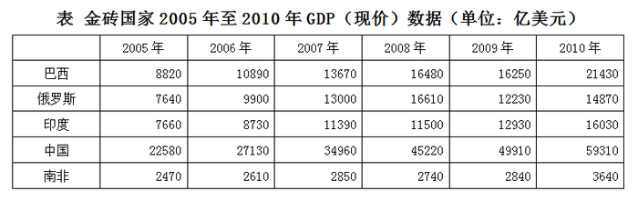

### 第 76 题

根据表中数据，2005年至2010年GDP增长额最大的国家是：

A. 中国

B. 印度

C. 俄罗斯

D. 巴西

第 76 题 · 答案与解析

**参考答案（粉笔题库参考内容）**

A

**解析**

根据题干“2005年至2010年，······增长额最大的是”，可判定本题为增长量比较问题。定位表格，根据增长量=现期量-基期量，2005年至2010年各国家的GDP增长额分别为：

中国：59310-22580>30000；

印度：16030-7660&lt;10000；

俄罗斯：14870-7640&lt;10000；

巴西：21430-8820&lt;20000。

综上对比可得，中国GDP增长额最大。

故正确答案为A。

**考点**：增长量比较、统计表

**来源**：2013年上海市公务员录用考试《行测》题（A类）第76题

### 第 77 题

以现价计算，2006年至2007年印度与俄罗斯的增长率分别为：

A. 28.86%，25.53%

B. 28.53%，31.62%

C. 23.55%，23.84%

D. 30.47%，31.31%

第 77 题 · 答案与解析

**参考答案（粉笔题库参考内容）**

D

**解析**

根据题干“······增长率为······”，可判定本题为一般增长率计算问题。定位表格， 则2006年至2007年印度的； 2006年至2007年俄罗斯的增长率为。

故正确答案为D。

**考点**：一般增长率、统计表

**来源**：2013年上海市公务员录用考试《行测》题（A类）第77题

### 第 78 题

下图表示2006、2008、2010三年金砖国家GDP情况，5个顶点1、2、3、4、5代表的国家依次是：

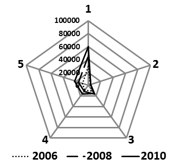

A. 中、南、俄、印、巴

B. 中、俄、南、巴、印

C. 巴、俄、印、中、南

D. 中、巴、南、俄、印

第 78 题 · 答案与解析

**参考答案（粉笔题库参考内容）**

A

**解析**

定位表格，2006、2008、2010三年，中国的GDP都为最高，南非都为最低，故1为中国，2为南非，只有A项符合顺序。

故正确答案为A。

**考点**：排序类、统计表

**来源**：2013年上海市公务员录用考试《行测》题（A类）第78题

### 第 79 题

以现价计算，2005-2010年期间下列国家中GDP从未出现下降的是：

A. 南非

B. 巴西

C. 俄罗斯

D. 中国

第 79 题 · 答案与解析

**参考答案（粉笔题库参考内容）**

D

**解析**

定位表格，南非2007年至2008年GDP出现下降，巴西2008年至2009年GDP出现下降，俄罗斯2008年至2009年GDP出现下降，只有中国的GDP是逐年递增的，从未下降过。

故正确答案为D。

**考点**：直接找数、统计表

**来源**：2013年上海市公务员录用考试《行测》题（A类）第79题

### 第 80 题

下图为2010年金砖国家GDP的比重构成图，环形部分2与5对应的国家是：

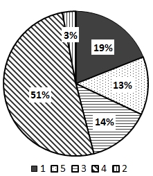

A. 俄罗斯、巴西

B. 南非、巴西

C. 南非、俄罗斯

D. 中国、俄罗斯

第 80 题 · 答案与解析

**参考答案（粉笔题库参考内容）**

C

**解析**

因为GDP总量相同，则各金砖国家GDP的比重大小即为各国GDP的大小。定位表格最后一列，各国GDP从大到小的顺序依次为中国、巴西、印度、俄罗斯和南非，题干中②和⑤对应的排名分别是第五和第四，对应南非和俄罗斯。

故正确答案为C。

**考点**：排序类、统计表

**来源**：2013年上海市公务员录用考试《行测》题（A类）第80题

### 第 81 题

2012年国务院政府工作报告指出，扩大内需特别是消费是我国经济长期平稳较快发展的根本立足点，是今年工作的重点。

下列措施中，有利于扩大居民需求的有：

A. 实施紧缩财政政策

B. 提高存贷款基准利率

C. 完善社会保障体系

D. 增加中低收入者收入

第 81 题 · 答案与解析

**参考答案（粉笔题库参考内容）**

CD

**解析**

A、B项错误，紧缩性财政政策是指通过增加财政收入或减少财政支出以抑制社会总需求增长的政策，所以其不利于扩大居民的消费需求。提高贷款基准利率不利于企业扩大生产，相对应的由于银行利率提高，居民消费趋于保守，不利于扩大消费，所以A、B都可以排除；

C、D项正确，完善社保可以减轻居民在保障方面的投入，可以扩大居民需求。增加中低收入者收入，也可以起到同样效果。

故正确答案为C、D。

**考点**：宏观经济与调控政策

**来源**：2013年上海市公务员录用考试《行测》题（B类）第83题

### 第 82 题

2012年3月，国务院批准国家发改委《关于2012年深化经济体制改革重点工作的意见》。《意见》指出，“要处理好深化体制改革与增长、控物价、调结构、促和谐的关系，着力完善促进经济发展方式转变的体制机制；处理好加强顶层设计与尊重群众首创精神的关系，充分发挥中央与地方两个积极性，抓住时机尽快在一些重点领域和关键环节取得突破。”这一要求主要体现的哲理是：

A. 要坚持两点论与重点论的统一

B. 要着力解决主要矛盾，抓住关键

C. 要重视量的积累，促进质变

D. 把握矛盾的主要方面，看清主流

第 82 题 · 答案与解析

**参考答案（粉笔题库参考内容）**

B

**解析**

B选项正确，题干主要对深化经济体制改革提出重点的工作意见，把握住了经济体制改革工作的关键，深化体制改革与其他方面发展的关系，完善体制机制，尤其通过“抓住时机尽快在一些重点领域和关键环节取得突破”可知此次改革工作抓住主要矛盾，着力解决主要矛盾；

A、C、D选项错误，没有抓住题干的重点进行分析。

故正确答案为B。

**考点**：唯物辩证法

**来源**：2013年上海市公务员录用考试《行测》题（A类）第82题

### 第 83 题

“国以民为本”，保障和改善民生是国家发展的最终目的。住房、医改、物价等问题引起了百姓的极大关注，解决这些问题的根本途径是：

A. 坚持改革开放

B. 深化行政体制改革

C. 坚持以经济建设为中心，大力发展生产力

D. 坚持民主集中制原则

第 83 题 · 答案与解析

**参考答案（粉笔题库参考内容）**

C

**解析**

2008年时任宣传部部长的刘云山在《求是》杂志上撰文称：“发展是解决我国所有问题的关键，住房、医改、物价这些问题都要靠发展来解决，就是要坚持以经济建设为中心，大力发展生产力。”

故正确答案为C。

**来源**：2013年上海市公务员录用考试《行测》题（B类）第82题

### 第 84 题

2013年是“十二五”规划实施的第二年，加快转变经济发展方式是这一规划的主线。为确保“转变方式”取得实质性进展，我们要坚持促进经济增长由：

A. 主要依靠按劳分配向依靠按劳分配、按生产要素分配和按个体劳动成果分配转变

B. 主要依靠国有企业推动向依靠国有企业、民营企业、外资企业协助推动转变

C. 主要依靠第二产业推动向依靠第一、第二、第三产业协同带动转变

D. 主要依靠投资、出口拉动向依靠消费、投资、出口协调拉动转变

第 84 题 · 答案与解析

**参考答案（粉笔题库参考内容）**

CD

**解析**

“十二五”规划指出我们要坚持把经济结构战略性调整作为加快转变经济发展方式的主攻方向。构建扩大内需长效机制，促进经济增长向依靠消费、投资、出口协调拉动转变。加强农业基础地位，提升制造业核心竞争力，发展战略性新兴产业，加快发展服务业，促进经济增长向依靠第一、第二、第三产业协同带动转变。统筹城乡发展，积极稳妥推进城镇化，加快推进社会主义新农村建设，促进区域良性互动、协调发展。

A、B两项错误，不是本阶段转变经济发展方式的重点。

故正确答案为C、D。

**考点**：宏观经济与调控政策

**来源**：2013年上海市公务员录用考试《行测》题（A类）第84题

### 第 85 题

修改后的《中华人民共和国刑事诉讼法》将于2013年1月1日起施行，下列选项中属于该法新增内容的是：

A. 尊重和保障人权

B. 保护公民的人身权利

C. 维护社会主义法制

D. 保护公民的民主权利

第 85 题 · 答案与解析

**参考答案（粉笔题库参考内容）**

A

**解析**

十一届全国人大五次会议3月14日表决通过关于修改刑事诉讼法的决定，与修改前相比，修改后的刑事诉讼法条款从225条增加到290条，分为“总则”“立案、侦查和提起公诉”“审判”“执行”“特别程序”以及“附则”。修改后的刑事诉讼法，将“尊重和保障人权”明确写入了总则。法律修改内容还涉及证据制度、强制措施、辩护制度、侦查措施、审判程序、执行程序等，并增加规定特别程序。由此可见该法新增内容为尊重和保障人权。

故正确答案为A。

**考点**：诉讼法

**来源**：2013年上海市公务员录用考试《行测》题（A类）第85题

### 第 86 题

加强和创新社会管理，这是党和政府深刻分析当前我国经济社会发展要求，从科学发展，和谐发展全局出发确定的重大战略任务。它以协调社会关系、化解社会矛盾、促进社会公正、保持社会稳定等为基本任务，涉及广大人民群众切身利益。为此，必须：

A. 创新体制机制，拓宽群众参与渠道，发挥社会各方面的协同作用

B. 坚持党的领导，发挥基层党组织的战斗堡垒作用和党员的先锋模范作用

C. 加强和完善思想建设，加强社会主义精神文明建设，增强社会诚信

D. 加快推进以保障和改善民生为重点的社会建设

第 86 题 · 答案与解析

**参考答案（粉笔题库参考内容）**

ABCD

**解析**

2011年2月，胡锦涛在省部级主要领导干部社会管理及其创新专题研讨班上强调，社会管理要坚持贯彻党的群众路线，坚持人民主体地位，发挥人民首创精神，紧紧依靠人民群众开创新形势下社会管理新局面。同时胡锦涛就当前社会管理要重点抓好的工作提出8点意见：

1.进一步加强和完善社会管理格局

2.进一步加强和完善党和政府主导的维护群众权益机制

3.进一步加强和完善流动人口和特殊人群管理和服务

4.进一步加强和完善基层社会管理和服务体系

5.进一步加强和完善公共安全体系

6.进一步加强和完善非公有制经济组织、社会组织管理

7.进一步加强和完善信息网络管理

8.进一步加强和完善思想道德建设

A选项正确，体现的是创新体制机制；

B选项正确，体现了坚持党的领导；

C选项正确，要求加强和完善思想建设；

D选项正确，加快推进社会建设，符合社会管理工作的举措。

故正确答案为ABCD。

**来源**：2013年上海市公务员录用考试《行测》题（A类）第86题

### 第 87 题

2012年4月16日新华社发布《中共中央国务院关于分类推进事业单位改革的指导意见》。《意见》明确了改革的总体目标和阶段性目标：到2020年，建立功能明确、治理完善、运行高效、监管有力的管理体制和运行机制，形成基本服务优先、（  ）的中国特色公益服务体系。

A. 供给水平适度

B. 透明高效

C. 布局结构合理

D. 服务公平公正

第 87 题 · 答案与解析

**参考答案（粉笔题库参考内容）**

ACD

**解析**

新华社授权发布《中共中央国务院关于分类推进事业单位改革的指导意见》，明确了改革的总体目标和阶段性目标。到2020年，建立起功能明确、治理完善、运行高效、监管有力的管理体制和运行机制，形成基本服务优先、供给水平适度、布局结构合理、服务公平公正的中国特色公益服务体系。

故正确答案为A、C、D。

**来源**：2013年上海市公务员录用考试《行测》题（A类）第87题

### 第 88 题

上海已经建立企业信用公示制度，将有严重违规、违法行为的企业输入“不良行为警示记录系统”，将重合同、守诚信的企业输入“良好行为记录系统”。这一制度的建立将直接有利于（　）。

A. 提高企业产品的市场占有率

B. 提高企业的劳动生产率

C. 提高企业的产品质量

D. 规范市场秩序、创造良好的市场交易环境

第 88 题 · 答案与解析

**参考答案（粉笔题库参考内容）**

D

**解析**

根据题干可知根据企业信用公示制度，上海市将公示经营信用良好的企业和经营信用不良的企业，直接有利于整顿和规范市场经济秩序，优化市场交易环境。

故正确答案为D。

**来源**：2013年上海市公务员录用考试《行测》题（A类）第88题

### 第 89 题

近几年，“用工荒”让农民工持续成为社会焦点。往年农民工主要集中在珠三角、长三角等沿海发达区域。随着中西部省份企业工资水平的提高，越来越多的农民工涌向这些地区，东部地区的“用工荒”有逐年扩大的趋势。下列对东部地区“用工荒”问题出现原因理解正确的有：

A. 工资增长缓慢，生活成本不断提高

B. 市场在资源配置中发挥基础性作用

C. 农民工逐步树立了正确的就业观

D. 中西部基础设施改善，区域增长更平衡

第 89 题 · 答案与解析

**参考答案（粉笔题库参考内容）**

ABD

**解析**

本题考查经济常识。

A选项正确，东部地区“用工荒”的直接原因是劳动者权益得不到保障，工资水平低，福利差；

B选项正确，随着沿海产业向内陆地区转移和推进，中西部的快速发展，劳动力也不再是单向地流动，市场在资源配置中发挥基础作用是正确的；

C选项错误，东部地区“用工荒”没有体现农民工的就业观念问题；

D选项正确。

故正确答案为A、B、D。

**考点**：中国地理、微观经济

**来源**：2013年上海市公务员录用考试《行测》题（A类）第89题

### 第 90 题

下列关于政府信息公开的叙述，正确的是：

A. 行政机关在公开政府信息前，应当依法对拟公开的政府信息进行审查

B. 行政机关对符合法律规定的公开基本要求的政府信息应当主动公开

C. 申请公开的政府信息中含有不应当公开的内容、不予公开，同时告知申请人并说明理由

D. 行政机关依申请提供政府信息，不得收取任何费用。

第 90 题 · 答案与解析

**参考答案（粉笔题库参考内容）**

ABC

**解析**

A选项正确，根据《中华人民共和国政府信息公开条例》第四条，政府信息公开工作机构的具体职责第四点对拟公开的政府信息进行保密审查；

B选项正确，根据第九条，行政机关对符合下列基本要求之一的政府信息应当主动公开：（一）涉及公民、法人或者其他组织切身利益的；（二）需要社会公众广泛知晓或者参与的；（三）反映本行政机关机构设置、职能、办事程序等情况的；（四）其他依照法律、法规和国家有关规定应当主动公开的；

C选项正确，根据第二十一条第二点，对申请公开的政府信息，属于不予公开范围的，应当告知申请人并说明理由；

D选项错误，根据第二十七条，行政机关依申请提供政府信息，除可以收取检索、复制、邮寄等成本费用外，不得收取其他费用。行政机关不得通过其他组织、个人以有偿服务方式提供政府信息。

故正确答案为A、B、C。

**考点**：其他法律法规

**来源**：2013年上海市公务员录用考试《行测》题（B类）第86题

### 第 91 题

我国行政强制法有关条款规定，行政强制的设定和实施应当适当，采取非强制手段可以达到行政管理目的的，不得设定和实施行政强制，这体现了行政强制的什么原则：

A. 信赖保护原则

B. 法定原则

C. 教育与强制相结合的原则

D. 比例原则

第 91 题 · 答案与解析

**参考答案（粉笔题库参考内容）**

CD

**解析**

行政强制有五大原则：行政强制法定原则、行政强制适当原则、教育与强制相结合原则、禁止谋利原则和权利救济原则。

题干体现了行政强制的适当原则，适当原则是行政法上的比例原则在《行政强制法》中的运用，不仅适用于行政强制的设定，还适用于行政强制的实施。适当原则强调行政强制应当作为行政执法的最后手段，采用非强制手段可以达到行政管理目的的，不得设定和实施行政强制。行政强制只是促使当事人履行法定义务的一种手段，不是目的。行政管理机关在执法过程中，如果能通过指导、鼓励、协商等手段实现管理目标，就不应采用强制手段。由此可见题干也体现了教育与强制相结合原则。

故正确答案为C、D。

**考点**：行政法

**来源**：2013年上海市公务员录用考试《行测》题（A类）第91题

### 第 92 题

凡是宪法、法律规定只能由法律规定的事项，不得以其他形式规定，或者只有在法律授权的情况下，才能由行政机关加以规定，这一原则被称为法律保留原则，关于这一原则，下列说法正确的是：

A. 这一概念中的“法律”是广义上的法律

B. 法律保留范围在一定程度上决定着立法权与行政权的界限

C. 我国司法制度属于法律绝对保留事项

D. 对非国有财产的征收属于法律相对保留事项

第 92 题 · 答案与解析

**参考答案（粉笔题库参考内容）**

BCD

**解析**

B项正确，法律保留的思想产生于19世纪初，最早提出该概念的是德国行政法学之父奥托·迈耶。根据迈耶的经典定义，法律保留是指在特定范围内对行政自行作用的排除。因此，法律保留本质上决定着立法权与行政权的界限，从而也决定着行政自主性的大小；

C项正确，《立法法》第9条规定，本法第八条规定的事项尚未制定法律的，全国人民代表大会及其常务委员会有权作出决定，授权国务院可以根据实际需要，对其中的部分事项先制定行政法规，但是有关犯罪和刑罚、对公民政治权利的剥夺和限制人身自由的强制措施和处罚、司法制度等事项外，这一条款规定了我国绝对保留的标准，即将一般保留中的更重要的事项仅由全国人大及其常委会来亲自制定法律，不得授权行政机关制定行政法规；

D项正确，《立法法》第8条规定，对于非国有财产的征收只能制定法律。这一规定可以视为除宪法特别保留外，对一般保留的标准的规定，属于法律的相对保留事项。

故正确答案为BCD。

**考点**：法理学

**来源**：2013年上海市公务员录用考试《行测》题（B类）第85题

### 第 93 题

关于保密工作的管理机关，下列说法中正确的是：

A. 国家安全部门主管全国的保密工作

B. 县级以上国家工作部门管理或指导本行政区域的保密工作

C. 国家机关和涉及国家秘密的单位管理本机关和本单位的保密工作

D. 中央国家机关在其职权范围内，管理或者指导本系统的保密工作

第 93 题 · 答案与解析

**参考答案（粉笔题库参考内容）**

CD

**解析**

A项错误，《保密法》第5条规定，国家保密行政管理部门主管全国的保密工作；

B项错误，《保密法》第5条规定，县级以上地方各级保密行政管理部门主管本行政区域的保密工作；

C、D项正确，《保密法》第6条规定，国家机关和涉及国家秘密的单位管理本机关和本单位的保密工作，中央国家机关在其职权范围内，管理或指导本系统保密工作。

故正确答案为C、D。

**考点**：其他法律法规

**来源**：2013年上海市公务员录用考试《行测》题（A类）第93题

### 第 94 题

电子商务的蓬勃发展使得物流和快递业在近几年飞速发展，形成了一个年均收益上百亿的新兴产业，为此，有人大代表提出议案，应该增设一个专门的行政部门以加强管理，行政组织设立的根本依据是：

A. 宪法规定

B. 民主呼吁

C. 政府职能需要

D. 经济与社会发展需要

第 94 题 · 答案与解析

**参考答案（粉笔题库参考内容）**

D

**解析**

行政组织的设立一般指国家行政机关或机构的设置及其合法性，包括依据、效力和规程等基本问题。国家行政组织是一种法定的组织形态，因此其设立必须有法律的依据，经过法定的程序，得到法律的认可，才能获得和行使合法的权力。行政组织设立的依据主要包括：宪法、法律、依据行政裁量权。题干阐述了电子商务飞速发展的情况，为此有人大代表提出议案增设主管行政部门，可见根本依据是经济与社会的发展。

故正确答案为D。

**来源**：2013年上海市公务员录用考试《行测》题（A类）第94题

### 第 95 题

根据“有权必有责，用权受监督”的要求，行政人员在依法行使国家行政权力的时候必须依法履行其行政职责，并为其违法失职行为承担必要的法律责任。下列属于行政人员民事法律责任的承担方式的是：

A. 恢复名誉

B. 停止侵害

C. 没收财产

D. 赔偿损失

第 95 题 · 答案与解析

**参考答案（粉笔题库参考内容）**

ABD

**解析**

我国《中华人民共和国民法典》第一百七十九条第一款规定：“承担民事责任的方式主要有：（一）停止侵害；（二）排除妨碍；（三）消除危险；（四）返还财产；（五）恢复原状；（六）修理、重作、更换；（七）继续履行；（八）赔偿损失；（九）支付违约金；（十）消除影响、恢复名誉；（十一）赔礼道歉。”

故正确答案为A、B、D。

**考点**：民法典

**来源**：2013年上海市公务员录用考试《行测》题（A类）第95题

### 第 96 题

某省开通电话专线，以方便群众对政府工作人员在行政工作中违法行为的举报，作为政府部门，接受组织内外的监督是政府应履行的职责。

下列属于行政监督方式的是：

A. 政府召开新闻发布会，向民众解释新的户籍管理政策

B. 某市民向电视台曝光某局长酒驾

C. 政府部门年度财政审计

D. 某市检察院对该市某局领导提起受贿公诉

第 96 题 · 答案与解析

**参考答案（粉笔题库参考内容）**

BCD

**解析**

C项正确，行政监督有广义和狭义之分，狭义的行政监督是指行政机关内部上下级之间、以及专设的行政监察、审计机关对行政机关及其公务人员的监督；

B、D项正确，广义的行政监督泛指执政党、国家权力机关、司法机关和人民群众等多种社会力量对国家行政机关及其公务人员的监督；据此排除A项。

故正确答案为B、C、D。

备注：此题已经过时，保留仅供参考。目前行政监察机关已经被合并到监察委员会，属于外部监督。

**来源**：2013年上海市公务员录用考试《行测》题（B类）第90题

### 第 97 题

公共行政机关的工作人员承担着一定的工作职责，行政道德作为一种隐性的工作职责，虽然没有量化的评判标准，但是对行政人员和行政组织来说是必不可少的，下列关于行政道德的说法。正确的是：

A. 道德责任就是具有道德内涵的行政责任

B. 行政人员的行政道德应该限定在行政管理活动期间

C. 行政道德客观上可以进行善恶评价

D. 行政道德的履行是强制性的

第 97 题 · 答案与解析

**参考答案（粉笔题库参考内容）**

ACD

**解析**

行政道德是社会生活中特殊的道德领域。行政道德评价则是政府行政组织、行政人员自身以及人民群众根据行政道德的原则和规范对行政主体的道德行为进行善恶价值判断和表明褒贬态度，行政道德则主要是因制度安排的要求而带有强制性特点。

故正确答案为A、C、D。

**来源**：2013年上海市公务员录用考试《行测》题（B类）第89题

### 第 98 题

“一案三制”是具有中国特色的公共危机管理体系，也是中国公共危机管理的核心框架，其中，“一案”是指国家突发公共事件应急预案，“三制”分别是公共危机管理体制，运行机制和法制。在《关于构建社会主义和谐社会若干重大问题的决定》中，对应急管理机制建设的要求是：

A. 分类管理，分级管理

B. 条块结合，属地为主

C. 统一指挥，反应灵敏

D. 协调有序，运转高效

第 98 题 · 答案与解析

**参考答案（粉笔题库参考内容）**

CD

**解析**

《关于构建社会主义和谐社会若干重大问题的决定》提出要完善应急管理体制机制，有效应对各种风险。建立健全分类管理、分级负责、条块结合、属地为主的应急管理体制，形成统一指挥、反应灵敏、协调有序、运转高效的应急管理机制，有效应对自然灾害、事故灾难、公共卫生事件、社会安全事件，提高危机管理和抗风险能力。

故正确答案为C、D。

**来源**：2013年上海市公务员录用考试《行测》题（A类）第98题

### 第 99 题

信访工作中处理一般来信的方法有多种，下列处理方法不当的是：

A. 反映一般性问题的来信，按分级归口的原则，转交下一级责任单位或有关部门处理

B. 一封来信提出几个问题或问题涉及几个单位的，按主要问题的责任单位转办。若几个问题都很重要，应将来信复印后分别转办

C. 对反映问题比较重要，且表述清楚或内容不易扩散的来信，经主管领导审核后批示，直接转送上级单位的主要领导

D. 没有办理意义的来信，例如精神病患者的来信，来信人和反映对象都没有姓名、单位和住址，且内容无从查处的来信，不处理

第 99 题 · 答案与解析

**参考答案（粉笔题库参考内容）**

C

**解析**

针对不同的一般来信有不同的处理办法，主要包括：

1.转办反映一般性问题的来信，按分级归口的原则，转交下一级责任单位或有关部门处理。一封来信提出几个问题或问题涉及几个单位的，按主要问题的责任单位转办。如几个问题都很重要，应将来信复印后分别转办。转办信由秘书部门负责汇总，标明件数，并在3日内转出。

2.函转

对来信内容和反映的问题比较重要的，将来信摘录，给主管领导审定后以信函的形式附原信转下级责任单位或有关部门处理，但不要求办理结果。

3.直送

对领导私人交往信件和知名人士来信，以及内容比较重要、文字简朴、书写清楚的来信，直接呈送领导。

4.批转

对反映问题比较重要，且表述清楚或内容不易扩散的来信，经主管领导审核后批示，直接转送下一级责任单位或有关部门的主要领导。

5.摘报

来信文字较长或表达条理不太清楚，但内容重要的来信，摘录整理来信要点，经主管领导审核后呈报主要领导。

6.自处

对于领导交办或需要直接处理的来信，办信人经主管领导同意后，直接协调解决问题并答复来信人。

7.不处

没有办理意义的来信。主要包括：精神病患者的来信；来信人和反映对象都没有姓名、单位和住址，且内容无从查处的来信；有关单位做过恰当处理并做出明确答复的来信；没有实质内容的来信，对于这些来信经主管领导审核后保存。

选项C的处理方法不当，对反映问题比较重要，且表述清楚或内容不易扩散的来信，经主管领导审核后批示，应该直接转送下一级责任单位或有关部门的主要领导。

本题为选非题，故正确答案为C。

**来源**：2013年上海市公务员录用考试《行测》题（A类）第99题

### 第 100 题

最近，国家海洋局宣布（  ）的全部岛屿附近的卫星遥感影像，已被纳入国家海域动态监视监测管理系统，此举标志着我国海域动态监管逐渐实现从近海到远海的覆盖，下一步，国家海域动态监视监测系统将不断加强对远海海域的遥感监测。

A. 黄岩岛

B. 钓鱼岛

C. 西沙群岛

D. 南沙群岛

第 100 题 · 答案与解析

**参考答案（粉笔题库参考内容）**

ABC

**解析**

国家海洋局宣布，黄岩岛、钓鱼岛及西沙群岛全部岛屿附近海域的卫星遥感影像，已被纳入国家海域动态监视监测管理系统，此举标志着我国海域动态监管逐渐实现从近海到远海的覆盖。

故正确答案为A、B、C。

**考点**：中国地理

**来源**：2013年上海市公务员录用考试《行测》题（A类）第100题

### 第 101 题

地理位置信息为移动互联网提供了基于位置的服务，室内定位系统将进一步提供丰富、细致、精确的室内位置信息服务，例如博物馆导览、商场内即时店铺推荐。下列选项中，可以实现室内定位的有：

A. 通过识别建筑物中设置的WiFi信号热点，用WiFi信号追踪位置

B. 部署蓝牙信号源，使用蓝牙信号进行定位

C. 利用手机基站的信号进行定位

D. 在家里上网进行行程规划

第 101 题 · 答案与解析

**参考答案（粉笔题库参考内容）**

ABC

**解析**

A选项正确，手机通过wifi上网时，因为wifi热点位置一般都是固定不变的，因此可以通过显示wifi热点的位置来判断你的位置；

B选项正确，两个蓝牙设备之间的距离与接收信号强度相关，可根据接收到信号的强弱来判断对方的位置；

C选项正确，基站定位一般应用于手机用户，手机基站定位服务又叫做移动位置服务，它是通过电信移动运营商的网络获取移动终端用户的位置信息（经纬度坐标）；

D选项错误，规划行程不能实现室内定位。

故正确答案为A、B、C。

**考点**：生活常识

**来源**：2013年上海市公务员录用考试《行测》题（A类）第101题

### 第 102 题

全民国防教育的基本任务是：普及国防知识、培训军事技能、培育国防后备人才，激发爱国热情，强化国防观念、增强民族自尊心、自信心、自豪感和凝聚力、向心力，提高公民履行国防义务的自觉性。国防教育须贯彻的基本方针有：

A. 全民参与

B. 长期坚持

C. 讲求实效

D. 维护和平

第 102 题 · 答案与解析

**参考答案（粉笔题库参考内容）**

ABC

**解析**

《国防教育法》明文规定：“国防教育贯彻全民参与、长期坚持、讲求实效的方针。”

故正确答案为A、B、C。

**考点**：其他法律法规

**来源**：2013年上海市公务员录用考试《行测》题（B类）第95题

### 第 103 题

与一维条形码相比，二维条形码具有数据容量更大，编码超越字母数字的限制，有抗损毁能力等方面的优势，目前已得到了广泛应用，下列关于二维码的表述，错误的是：

A. 图片、声音、文字、签字、指纹等均可通过二维码表示出来

B. 二维码没有加密措施，保密性不足

C. 二维码为网络浏览、下载、在线视频、网上购物和支付等提供方便入口

D. 目前二维码都是黑白二色，对年轻人吸引力有欠缺

第 103 题 · 答案与解析

**参考答案（粉笔题库参考内容）**

BD

**解析**

B项错误，二维码具有存储量大、保密性高、追踪性高、抗损性强、备援性大、成本便宜的特点；

C项正确，二维码是用某种特定的几何图形按一定规律在平面（二维方向）分布的黑白相间的图形记录数据符号信息的，在代码编制上巧妙地利用了构成计算机内部逻辑基础的“0”、“1”比特流概念，是用若干个与二进制相对应的几何形体来表示文字数值信息，通过图像输入设备或光电扫描设备自动识读以实现自动处理，对于下载浏览和查询都非常便捷；

D项错误，二维码的便捷使其在手机等新平台上运用广泛，尤其是年轻人群接触度高。

本题为选非题，故正确答案为B、D。

**考点**：科技理论与成就

**来源**：2013年上海市公务员录用考试《行测》题（A类）第103题

### 第 104 题

以转基因生物为直接食品或为原料加工生产的食品就是转基因食品。关于转基因食品，下列表述正确的是：

A. 转基因食品仅是指转基因农作物

B. 转基因食品包括转基因动物食品、转基因植物食品和转基因微生物食品

C. 转基因食品不存在潜在的安全风险

D. 市场上出现的转基因食品必须贴上“转基因食品”的标签

第 104 题 · 答案与解析

**参考答案（粉笔题库参考内容）**

D

**解析**

A、B选项错误，转基因食品包括植物性转基因食品、动物性转基因食品、转基因微生物食品以及转基因特殊食品。其中转基因特殊食品是指科学家利用生物遗传工程，将普通的蔬菜、水果、粮食等农作物，变成能预防疾病的神奇的“疫苗食品”；

C选项错误，目前研究表示转基因食品有可能对人体、环境等造成伤害；

D选项正确，我国《农业转基因生物标识管理办法》规定市场上出现的转基因食品必须贴上“转基因食品”的标签。

故正确答案为D。

**考点**：生活常识

**来源**：2013年上海市公务员录用考试《行测》题（A类）第104题

### 第 105 题

“智慧城市”充分利用新技术来为人类创造更美好的城市生活，支撑“智慧城市”建设的技术主要的是：

A. 智能制造技术

B. 新一代信息技术

C. 生物医药和仿生技术

D. 新能源和电子技术

第 105 题 · 答案与解析

**参考答案（粉笔题库参考内容）**

B

**解析**

智慧城市是新一代信息技术支撑、支持社会下一代创新环境下的城市形态。智慧城市基于物联网、云计算等新一代信息技术以及维基、社交网络、Fab Lab、Living Lab、综合集成法等工具和方法的应用，营造有利于创新涌现的生态，实现全面透彻的感知、宽带泛在的互联、智能融合的应用以及以用户创新、开放创新、大众创新、协同创新为特征的可持续创新。

故正确答案为B。

**考点**：生活常识

**来源**：2013年上海市公务员录用考试《行测》题（A类）第105题

### 第 106 题

跨越长江，连接沪苏的快速通道崇启大桥将从江苏启东到上海的车程缩短100公里，加快了长三角一体化进程，下列有关崇启大桥表述正确的是：

A. 崇启大桥全长2.4公里

B. 崇启大桥由于地处长江入海口，是所有跨越长江大桥中最靠近大海的

C. 崇启大桥被称为“长江入海第一桥”

D. 崇启大桥是上海国际航运中心洋山深水港区的重要配套工程

第 106 题 · 答案与解析

**参考答案（粉笔题库参考内容）**

BC

**解析**

A项错误，崇启大桥全长52公里；

D项错误，上海国际航运中心洋山深水港区的重要配套工程是东海大桥，而不是崇启大桥。

故正确答案为B、C。

**考点**：中国地理

**来源**：2013年上海市公务员录用考试《行测》题（A类）第106题

### 第 107 题

氢能汽车是新能源汽车产业的一个发展重点，它是指以氢为主要能源，利用氢燃轻电池和电动机取代传统的引擎，其燃烧物是水和少量氮氧化合物，对空气污染少，具有广阔的应用前景，目前，氢能汽车的技术日趋成熟，但还有（　）等问题有待进一步解决。

A. 氢的安全性

B. 氢的储存和运输

C. 电池运行时产生的辐射

D. 电池的经济性

第 107 题 · 答案与解析

**参考答案（粉笔题库参考内容）**

BD

**解析**

氢能汽车是以氢为主要能量的汽车。燃料电池和电动机可以取代一般引擎，但氢燃料电池代价高，氢的储存要减小体积必须液化，液化必须控制在零下253度。运输中很难保证，会损失能量，也不够经济。

本题为选非题，故正确答案为B、D。

**考点**：科技理论与成就

**来源**：2013年上海市公务员录用考试《行测》题（B类）第97题

### 第 108 题

在会议管理中，需要考虑会议的显性和隐形成本。下列选项中，属于会议隐形成本的是：

A. 与会人员

B. 场地费

C. 与会者的价值

D. 会议耗时

第 108 题 · 答案与解析

**参考答案（粉笔题库参考内容）**

D

**解析**

会议的隐形成本指不需要投入资金但是会无形损耗的价值。

A、B、C错误，此三项都是看得见摸得着的成本；

D项正确，只有时间是隐形的成本。

故正确答案为D。

**来源**：2013年上海市公务员录用考试《行测》题（A类）第108题

### 第 109 题

仿生学是研究生物系统的结构和性质，为工程技术提供新的设计思想及工作原理的科学。其中，（  ）等发明就是运用仿生学的研究成果。

A. 雷达

B. 尼龙搭扣

C. 广角镜头

D. 声纳

第 109 题 · 答案与解析

**参考答案（粉笔题库参考内容）**

ABD

**解析**

人们从蝙蝠获得灵感发明了雷达，从苍耳属植物获取灵感发明了尼龙搭扣，从海豚获得灵感发明了声纳，从苍蝇获得灵感发明了“蝇眼透镜”，“蝇眼透镜”是用几百或者几千块小透镜整齐排列组合而成的，用它作镜头可以制成“蝇眼照相机”，一次就能照出千百张相同的相片。广角镜头不是运用仿生学的研究成果。

故正确答案为A、B、D。

**考点**：生活常识

**来源**：2013年上海市公务员录用考试《行测》题（A类）第109题

### 第 110 题

南方某市为落实节能减排工作，出台政策规定，市、区两级财政将在年度预算中安排“阳光屋顶示范工程”配套补助资金，用于扶持该市已列入中央财政资金补助计划的太阳能光伏示范项目。这是公共财政的（　）功能。

A. 生产补助

B. 转移支付

C. 社会福利

D. 价格补贴

第 110 题 · 答案与解析

**参考答案（粉笔题库参考内容）**

B

**解析**

A项错误，太阳能光伏示范项目不属于生产项目，因此也不涉及生产补助的问题。

B项正确，财政转移支付是以各级政府之间所存在的财政能力差异为基础，以实现各地公共服务水平的均等化为主旨，而实行的一种财政资金转移或财政平衡制度。转移支付在结构上分为一般转移支付和专项转移支付。专项转移支付是指上级政府(在我国一般指中央、省、市级政府)为实现特定的宏观政策目标，以及对委托下级政府代理的一些事务进行补偿而设立的专项补助资金。资金接受者需按规定用途使用资金。题干中市、区两级财政安排年度预算对“阳光屋顶示范工程”进行专项补助，属于公共财政的转移支付中的专项转移支付。

C项错误，社会福利是指国家依法为所有公民普遍提供旨在保证一定生活水平和尽可能提高生活质量的资金和服务的社会保险制度。

D项错误，价格补贴是指国家或社会集团向某种商品的生产经营者或消费者无偿支付补贴金，以维持一定价格水平的措施。其实质是对这些生产经营者或消费者的经济利益损失所作的补偿。一般多用于农业、对外贸易和交通运输业。

故正确答案为B。

**考点**：宏观经济与调控政策

**来源**：2013年上海市公务员录用考试《行测》题（A类）第110题

### 第 111 题

如果发现有人在室内触电，首先要使触电者尽快脱离电源。然后根据具体情况进行相应的救治。脱离电源的正确方法有：

A. 用手拉开或用脚踢开触电者，使之脱离电源

B. 如距离闸刀较远，应迅速用绝缘良好的电工钳或有干燥木柄的利器（刀、斧、锹等）砍断电线

C. 如开关箱在附近，可立即拉下闸刀或拔掉插头、断开电源

D. 用干燥的木棒、竹竿、硬塑料管等物迅速将电线拔离触电者

第 111 题 · 答案与解析

**参考答案（粉笔题库参考内容）**

BCD

**解析**

A项错误，人体属于导体，不可直接接触触电者，所以该做法很危险，会使施救者同时触电；

B、C、D项正确，正确做法应当是关闭电源或者使用绝缘体让电源和人分离。

故正确答案为B、C、D。

**考点**：生活常识

**来源**：2013年上海市公务员录用考试《行测》题（A类）第111题

### 第 112 题

情绪ABC理论是有美国心理学家埃利斯创建的，就是把激发事件A（activating event的第一个英文字母），产生的信念B（belief的第一个英文字母）。情绪和行为后果C（consequence的第一个英文字母）组合而成，这个理论是指：

A. 激发事件A直接导致了人的情绪和行为结果C

B. 我们常有的一些合理信念会使自己产生情绪困扰

C. 事物的本身不影响人，人们只受对事物看法的影响

D. 情绪由外界控制，自己无能为力

第 112 题 · 答案与解析

**参考答案（粉笔题库参考内容）**

BCD

**解析**

A项错误，情绪ABC理论的创建者美国心理学家埃利斯认为：激发事件A （activating event的第一个英文字母）只是引发情绪和行为后果C（conesquence的第一个英文字母）的间接原因，而引起C的直接原因则是个体对激发事件A的认识和评价而产生的信念B（belief的第一个英文字母），而非直接导致C；

B项正确，正是由于我们常有的一些不合理的信念才使我们产生情绪困扰；

C项正确，此说法正好体现了该理论；

D项正确，是该理论常见不合理信念的表现。

故正确答案为B、C、D。

**考点**：生活常识

**来源**：2013年上海市公务员录用考试《行测》题（A类）第112题

### 第 113 题

2012年4月30日，我国在西昌卫星发射中心用“长征三号乙”运载火箭，成功发射了两颗北斗导航卫星。卫星顺利进入了预定转移轨道。这是我国北斗卫星导航系统首次采用一箭双星方式发射导航卫星，也是我国首次采用“一箭双星”方式发射两颗卫星：

A. 地球低轨道卫星

B. 地球中高轨道卫星

C. 地球静止轨道卫星

D. 太阳同步轨道卫星

第 113 题 · 答案与解析

**参考答案（粉笔题库参考内容）**

B

**解析**

2012年4月30日，西昌卫星发射中心用“长征三号乙”运载火箭，将两颗北斗导航卫星送入太空，是我国首次采用“一箭双星”方式发射两颗地球中高轨道卫星。

故正确答案为B。

**考点**：科技理论与成就

**来源**：2013年上海市公务员录用考试《行测》题（A类）第113题

### 第 114 题

据新华社电，我国第一艘航母“辽宁舰”交接入列后，海军官兵以科学求实的态度和顽强拼搏的精神，按计划迅速投入紧张的出海训练和科研试验任务中。其间，顺利进行了歼—15飞机起降飞行训练，目前歼—15飞机的起飞方式是：

A. 电磁弹射起飞

B. 蒸汽弹射起飞

C. 垂直起飞

D. 滑跃式起飞

第 114 题 · 答案与解析

**参考答案（粉笔题库参考内容）**

D

**解析**

歼-15是我国研制的首型舰载多用途战斗机，在航母上的起降方式，取决于航母本身。辽宁舰原是前苏联瓦良格号，后被我国引入翻新改建，保留了其传统的滑跃式甲板设计，舰载机通过短距离加速滑跑，滑橇甲板给舰载机提供上升角度，可以使得舰载机脱离航母，最终升空。

故正确答案为D。

**考点**：科技理论与成就

**来源**：2013年上海市公务员录用考试《行测》题（A类）第114题

### 第 115 题

碳纤维及其复合材料是快速发展而成长起来的新型材料，具有高比强度、耐高温、耐辐射、耐疲劳、热膨胀系数小等一系列优异性能，其应用前景广阔，可应用于（　）等方面。

A. 疫苗药物

B. 航空航天

C. 大型风力发电装备

D. 高速轨道设备

第 115 题 · 答案与解析

**参考答案（粉笔题库参考内容）**

BCD

**解析**

碳纤维复合材料技术在能源、资源、环境、制造、交通等国民经济支柱产业对高性能结构材料的迫切需求，相应技术可以通过适当的移植来满足汽车工业、航空航天、高速轨道交通、大型风力发电装备等所需。

故正确答案为B、C、D。

**考点**：科技理论与成就

**来源**：2013年上海市公务员录用考试《行测》题（A类）第115题

### 第 116 题

为了防止行政权力被滥用，必须对行政人员实施有效地行政监督，我国自秦朝起就有一系列检察制度、唐代的台院、（　）和察院联合称为御史台三院，拥有弹劾官吏、参与司法审讯及监督仓库出纳等职权。

A. 殿院

B. 督院

C. 谏院

D. 肃院

第 116 题 · 答案与解析

**参考答案（粉笔题库参考内容）**

A

**解析**

唐代中央监察机构不同于前代的是，在御史台之下设立三院，即台院、殿院和察院，三院分立，相互牵制配合，形成了一个完善而严密的中央监察机制。

故正确答案为A。

**考点**：中国历史

**来源**：2013年上海市公务员录用考试《行测》题（B类）第105题

### 第 117 题

食品添加剂是指用于改善食品品质、延长食品保质期、便于食品加工和增加食品营养成分的一类化学合成或天然物质。食品添加剂大大促进了食品工业的发展，下列关于四种食品添加剂的描述正确的是：

A. 亚硝酸钠：可以抑菌、保鲜和防腐，如过量食入可麻痹血管运动中枢，呼吸中枢及周围血管

B. 食用色素：常用于水果制品、饮料等，不能向人体提供营养物质，会危害人体健康，具有一定的毒性与致癌作用

C. 食盐：长期过量摄入、血液的容量将会增加，心脏搏动更费力，并引发高血压

D. 氢化植物油：作为一种提味剂，氢化植物油代替黄油和脂肪用于沙拉酱、人造黄油和焙烤食物的加工，它会导致老年痴呆症

第 117 题 · 答案与解析

**参考答案（粉笔题库参考内容）**

AC

**解析**

B错误，食用色素分为天然和人工合成两种，食用天然着色剂主要是指动植物组织提取的色素，多为植物色素，安全性高。人工合成色素原料主要以化工产品为主，有些甚至会危害人体健康。人工色素还不能完全代替所有的食用色素；

D错误，氢化植物油作为一种保鲜剂和提味剂，常代替黄油和脂肪用于沙拉酱、人造黄油和焙烤食物的加工，会导致肥胖和高胆固醇。

故正确答案为A、C。

**考点**：生活常识

**来源**：2013年上海市公务员录用考试《行测》题（B类）第104题

### 第 118 题

经国家质量检验检疫总局、国家标准化管理委员会批准，新修订的《汉语拼音正词法基本规则》已于2012年10月1日起实施。如何拼写汉语的人名、地名，如何拼写汉语的数次、量词、连接词、形容词等，都有了“法定”规范。下列选项中，不符合该规定的是（    ）。

A. Shànghǎi shì（上海市）

B. Hēilóngjiāng（黑龙江\[省\]）

C. Sāntányìnyuè（三潭印月）

D. WANGFUJING DAJIE（王府井大街）

第 118 题 · 答案与解析

**参考答案（粉笔题库参考内容）**

A

**解析**

A错误，上海市的拼音首字母不符合规则，应大写。

D正确，为强干扰项，王府井大街为专有名词，可以不标声调。

本题为选非题，故正确答案为A。

**考点**：文化常识

**来源**：2013年上海市公务员录用考试《行测》题（A类）第118题

### 第 119 题

下列关于便民服务热线电话号码的表述，正确的是：

A. 12320 天气预报

B. 12121 环保热线

C. 12345 市民服务热线

D. 12315 消费者服务热线

第 119 题 · 答案与解析

**参考答案（粉笔题库参考内容）**

CD

**解析**

A项错误，“12320”是全国公共卫生公益热线；

B项错误，“12121”为气象信息查询电话。

故正确答案为C、D。

**考点**：生活常识

**来源**：2013年上海市公务员录用考试《行测》题（A类）第119题

### 第 120 题

中国人早就知道应用天然磁石支撑指南针，并借它来辨别方向，宋朝学者沈括在他的《梦溪笔谈》中说“方家以磁石磨针锋，则能指南，然常微偏东，不全南也。”其原因是：

A. 地球磁极相对于地理南北极具有微小的偏角

B. 方家用“缕悬法”安装磁针时，受偏东的一个力牵制

C. 方家的针磨得太细，易受干扰

D. “犹柏之指西，莫可原其理”

第 120 题 · 答案与解析

**参考答案（粉笔题库参考内容）**

A

**解析**

磁石磨针锋，针磁化为一个小磁体，能够指南，说明受到了磁场作用，周围没有其他磁体，便只能是地球产生的磁场，说明地球是个巨大的磁体；“常微偏东，不全南（不是正南方向）”说明地球南北极和地磁南北极并不重合，存在地磁偏角。

故正确答案为A。

**考点**：生活常识

**来源**：2013年上海市公务员录用考试《行测》题（A类）第120题

## 材料 7

中共第十八次全国代表大会是在我国进入全面建成小康社会决定性阶段召开的十分重要的大会。十八大报告强调：道路关乎党的命脉，关乎国家前途、民族命运、人民幸福。在改革开放三十多年一以贯之的接力探索中，我们坚定不移高举中国特色社会主义伟大旗帜，既不走封闭僵化的老路，也不走改旗易帜的邪路。中国特色社会主义道路，中国特色社会主义理论体系，中国特色社会主义制度，是党和人民九十多年奋斗、创造、积累的根本成就，必须加倍珍惜、始终坚持、不断发展。建设中国特色社会主义，总依据是社会主义初级阶段，总布局是五位一体，总任务是实现社会主义现代化和中华民族伟大复兴。

        十八大报告提出，纵观国际国内大势，我国发展仍处于可以大有作为的重要战略机遇期。我们要准确判断重要战略机遇期内涵和条件的变化，全面把握机遇，沉着应对挑战，赢得主动，赢得优势，赢得未来，确保到2020年实现全面建成小康社会宏伟目标。全面建成小康社会，必须以更大的政治勇气和智慧，不失时机深化重要领域改革，坚决破除一切妨碍科学发展的思想观念和体制机制弊端，构建系统完备、科学规范、运行有效的制度体系，使各方面制度更加成熟更加定型。要加快完善社会主义市场经济体制，完善公有制为主体、多种所有制经济共同发展的基本经济制度，完善按劳分配为主体、多种分配方式并存的分配制度，完善宏观调控体系，更大程度更广范围发挥市场在资源配置中的基础性作用，完善开放型经济体系，推动经济更有效率、更加公平、更可持续发展。加快推进社会主义民主政治制度化、规范化、程序化，从各层次各领域扩大公民有序政治参与，实现国家各项工作法治化。加快完善文化管理体制和文化生产经营机制，基本建立现代文化市场体系，健全国有文化资产管理体制，健全基层公共服务和社会管理网络，建立确保社会既充满活力又和谐又有序的体制机制。加快建立生态文明制度，健全国土空间开发、资源节约、生态环境保护的体制机制，推动形成人与自然和谐发展的现代化建设新格局。

### 第 121 题

党的十八大报告提出的经济发展目标是，到2020年实现：

A. 人均国内生产总值和城乡居民收入比2010年翻一番

B. 人均国民生产总值和城乡居民收入比2010年翻一番

C. 国内生产总值和城乡居民人均收入比2010年翻一番

D. 国民生产总值和城乡居民人均收入比2010年翻一番

第 121 题 · 答案与解析

**参考答案（粉笔题库参考内容）**

C

**解析**

十八大报告提出为全面建成小康社会，到2020年实现国内生产总值和城乡居民收入翻番的量化指标，即国内生产总值和城乡居民人均收入比2010年翻一番。故正确答案为C。

**考点**：经济建设

**来源**：2013年上海市公务员录用考试《行测》题（A类）第121题

### 第 122 题

党的十八大报告提出，要在十六大、十七大确立的全面建设小康社会目标的基础上努力实现的新要求包括：

A. 人民民主不断扩大

B. 文化软实力显著增强

C. 人民生活水平全面提高

D. 经济快速可持续发展

第 122 题 · 答案与解析

**参考答案（粉笔题库参考内容）**

ABC

**解析**

胡锦涛在十八大报告中提出，根据我国经济社会发展实际，要在十六大、十七大确立的全面建设小康社会目标的基础上努力实现新的要求：经济持续健康发展，转变经济发展方式取得重大进展，在发展平衡性、协调性、可持续性明显增强的基础上，实现国内生产总值和城乡居民人均收入比二0一0年翻一番；人民民主不断扩大；文化软实力显著增强；人民生活水平全面提高；资源节约型、环境友好型社会建设取得重大进展。由此可知A、B、C三项正确，而D选项中经济快速发展不是十八大报告中提出的新要求，故排除D。故正确答案为A、B、C。

**考点**：重要文件

**来源**：2013年上海市公务员录用考试《行测》题（A类）第122题

### 第 123 题

中国特色社会主义理论体系包括：

A. 毛泽东思想

B. 邓小平理论

C. “三个代表”重要思想

D. 科学发展观

第 123 题 · 答案与解析

**参考答案（粉笔题库参考内容）**

BCD

**解析**

党的十八大报告指出：“中国特色社会主义理论体系，就是包括邓小平理论、‘三个代表’重要思想、科学发展观在内的科学理论体系，是对马克思列宁主义、毛泽东思想的坚持和发展”，“中国特色社会主义理论体系是行动指南”。这些重要论述深刻阐明了中国特色社会主义理论体系对于坚持和发展中国特色社会主义的重大意义。坚定不移沿着中国特色社会主义道路前进，为全面建成小康社会而奋斗，要求我们更好地坚持和丰富中国特色社会主义理论体系。故正确答案为B、C、D。

**考点**：新思想总论

**来源**：2013年上海市公务员录用考试《行测》题（A类）第123题

### 第 124 题

党的十八大报告将中国特色社会主义事业总体布局从“四位一体”扩展为“五位一体”，表明我党对于中国特色社会主义建设规律从理论到实践都达到新的水平。“五位一体”是指：

A. 经济建设、政治建设、文化建设、制度建设、生态文明建设

B. 经济建设、法制建设、文化建设、社会建设、生态文明建设

C. 经济建设、政治建设、文化建设、社会建设、生态文明建设

D. 经济建设、政治建设、思想建设、社会建设、生态文明建设

第 124 题 · 答案与解析

**参考答案（粉笔题库参考内容）**

C

**解析**

十八大报告将生态文明建设与经济建设、政治建设、文化建设、社会建设并列，“五位一体”地建设中国特色社会主义。故正确答案为C。

本题相关知识点：

党的十二届六中全会首次提出以经济建设为中心、坚定不移地进行经济体制改革，坚定不移地进行政治体制改革、坚定不移地加强精神文明建设的总体布局，这一“三位一体”总体布局从党的十三大一直延续到十六大。党的十六届六中全会提出构建社会主义和谐社会的重大任务，总体布局拓展为“四位一体”，增加了社会建设。党的十八大提出生态文明建设，总体布局又拓展为“五位一体”。

**考点**：新思想总论

**来源**：2013年上海市公务员录用考试《行测》题（A类）第124题

## 材料 8

“公共外交”是指一国政府通过文化交流、信息项目等形式，了解、获悉情况和影响国外公务，以提高本国国家形象和国际影响力，进而增进本国家利益的外交方式。公共外交的目的就是提升本国形象，影响外国公众对本国的态度，进而影响外国政府对本国的政策。中国要以“公共外交”建设为契机，创造良好的国际舆论环境，创新对外传播方法，增强国际话语权。目前，“公共外交”已经成为各国外交的新着力点。

        中国国家形象宣传片是为塑造和提升中国繁荣发展、民主进步、文明开放、和平和谐的国家形象而设立的重点项目，是在新时期探索对外传播新形势的一次有益尝试。中国国家形象宣传片包括一部30秒长度的电视宣传片和一部15分钟长度的短纪录片。2011年，中国国家形象宣传片的人物篇亮相于纽约时代广场，中国各领域杰出代表和普通百姓在片中逐一亮相，让美国观众看到一个更直接更立体的中国国家形象。

### 第 125 题

从政治角度看，良好的国家形象是：

A. 对外关系稳定发展的保证

B. 充分实现国家利益的条件

C. 制定国家外交政策的依据

D. 提升国家综合国力的因素

第 125 题 · 答案与解析

**参考答案（粉笔题库参考内容）**

ABD

**解析**

国家形象作为反映在媒介和人们心理中的对于一个国家及其民众的历史、现实，政治、经济、文化、生活方式以及价值观的综合印象，既包含着对于国家的认识，同时也包含着理性评价和感性态度，具有极大的影响力、凝聚力，是一个国家整体实力的体现。因此良好的国家形象有利于对外关系稳定发展，实现国家利益，提升综合国力，故A、B、D项符合题意。C选项本身是错误的，制定国家外交政策的依据是国家利益，而不是国家形象。

故正确答案为A、B、D。

**考点**：政治建设

**来源**：2013年上海市公务员录用考试《行测》题（B类）第112题

### 第 126 题

从文化角度看，国家形象宣传片之所以能起到塑造和提升中国形象的作用，其依据是：

A. 文化能够对人产生潜移默化的作用

B. 中华传统文化独树一帜，独领风骚

C. 现代信息技术具有文化传承的作用

D. 文化交流能够增进各国间的相互了解

第 126 题 · 答案与解析

**参考答案（粉笔题库参考内容）**

AD

**解析**

通过在纽约时代广场播放中国国家形象宣传片宣传当代中国形象，让外国观众看到一个更直接更立体的中国国家形象，这样不仅可以增进各国间的相互了解，而且可以改变外国公众对中国的印象，影响外国公众对中国的态度，从而提高本国国家形象和国际影响力。故A、D两项符合题意。B、C两项都没有从文化角度阐述，而只是阐述了中国传统文化的特点以及科技对文化的作用，故排除。

故正确答案为A、D。

**考点**：文化建设

**来源**：2013年上海市公务员录用考试《行测》题（B类）第113题

### 第 127 题

在国际关系中，各国的公共外交定义大同小异，但具体做法大相径庭。有些国家是把自己的价值观强加给他国，甚至干涉其它国家内政，而中国是向世界展示自己的文化传统、社会发展、内外政策，回答人们对中国提出的问题，这表明：

A. 相同的价值观是国际交往的基础

B. 立场影响人们的价值判断和价值选择

C. 主观能动性的发挥受客观制约

D. 认识的多样性取决于事物的复杂性

第 127 题 · 答案与解析

**参考答案（粉笔题库参考内容）**

BD

**解析**

题干指出各国的公共外交政策定义大同小异，但是具体做法大相径庭，说明由于人们立场的不同，具体的价值判断和价值选择也是不同的。公共外交具体做法的差异与国际关系的复杂性有关，也就是说认识的多样性取决于事物的复杂性，故B、D两项正确。题干主要阐述的是各国外交政策的差异，没有提到相同之处，故排除A；C选项中的观点文段也没有提到，故排除。

故正确答案为B、D。

**考点**：其他建设

**来源**：2013年上海市公务员录用考试《行测》题（B类）第115题

### 第 128 题

首部中国国家形象片在美国纽约时代广场的大屏幕上持续滚动播放，向世界展示多元和丰富的中国形象，这一举措旨在：

A. 践行我国主张构建和谐世界的外交理念

B. 巩固我国在处理国际事务中的主导作用

C. 扩大我国国际影响力，提升国家软实力

D. 消除中美间的矛盾，促进国际合作发展

第 128 题 · 答案与解析

**参考答案（粉笔题库参考内容）**

C

**解析**

国家形象被认为是国家“软实力”的重要组成部分之一，可以体现这个国家的综合实力和影响力，因此通过播放中国国家形象宣传片可以扩大我国国际影响力，提升国家软实力，故C选项正确。题干所给文段及提问都没有涉及我国关于“和谐世界”的外交理念，A选项与题干无关，故排除；B选项本身错误，虽然我国综合实力不断提升，但目前在国际事务中并没有占主导地位，故排除；由于中美两国利益不同，矛盾也是不可能通过播放一段中国国家形象片而消除，故排除D。

故正确答案为C。

**考点**：其他建设

**来源**：2013年上海市公务员录用考试《行测》题（B类）第114题

## 材料 9

20世纪80年代，为迎接新技术革命的挑战，许多国家纷纷投入大量的人力与物力，把发展高技术列为国家发展战略的重要组成部分，如1983年美国提出的“战略防御倡议”（即星球大战计划）、欧洲的“尤里卡”计划和日本的“今后10年科学技术振兴政策”等。

        面对形势，中国的科学家们开始对高科技发展的问题进行思索。1986年初，陈芳允找到王大珩、王淦昌、杨嘉墀等科学家，经过将近一个月的反复讨论、修改、形成了一份《关于跟踪研究外国战略性高技术发展的建议》。《建议》分析了形势，陈述了发展高技术的重要性、必要性和紧迫性。并且提出了对策设想。四位科学家决定将《建议》上交给最高领导人邓小平，他们还联名写了一封信。

        1986年3月3日，《建议》和信递交给邓小平。3月5日，邓小平批示：“这个建议十分重要……。此事宜速作决断，不可拖延。”批示引起中央领导层的重视。

        从1986年3月到8月，国务院科技领导小组组织了200多位各个领域的专家，分成12个小组，对计划进行了反复探讨和论证，最终形成了《国家高技术研究发展计划纲要》。《纲要》从世界高技术发展趋势和中国的需要与世界可能出发，坚持“有限目标，突出重点”的方针，确定了总体目标，共选择了7个领域的15个主题项目。

        1986年8月，国务院常务会议通过了《纲要》。呈送给邓小平后，他当即批示：“我建议，可以这样定下来，并立即组织实施。”10月，中共中央政治局扩大会议批准了《纲要》，中央政治局还决定拨款100个亿，推动这个计划的顺利实施。11月，国务院正式颁布了《纲要》。1987年2月，计划开始组织实施，成立了国家科委高技术计划联合办公室，国务院高技术计划协调指导小组等，负责决策指挥、协调管理、评估监督等工作。

        因科学家提出《建议》和邓小平批示的时间都是1986年3月，所以这个《国家高技术研究发展计划纲要》也被称为“863”计划。

### 第 129 题

从公共政策类型看，“863”计划属于：

A. 政策战略

B. 元政策

C. 基本政策

D. 科技政策

第 129 题 · 答案与解析

**参考答案（粉笔题库参考内容）**

C

**解析**

公共政策根据横向分类可以分为经济政策、政治政策、社会政策、科教文卫政策；根据纵向分类可以分为元政策、基本政策和具体政策。根据题干可以判断是根据纵向进行划分，其中元政策是“关于政策的政策”，是“用以指导和规范政府政策行为的一套理念和方法的总称”，其基本用途在于“如何正确地制定公共政策和有效地执行公共政策”；基本政策通常是高层次的、大型的、长远的、带有战略性的政策方案；凡是在元政策和基本政策的范畴以外的政策，都可归入具体政策。结合材料可知“863”计划应该是基本政策，故正确答案为C。

**来源**：2013年上海市公务员录用考试《行测》题（A类）第129题

### 第 130 题

“863计划”进入政府政策议程的过程说明：

A. 具有“上书”模式特点

B. 民主集中制

C. 高层领导人指示发挥了关键作用

D. 具有外部动员模式特点

第 130 题 · 答案与解析

**参考答案（粉笔题库参考内容）**

A

**解析**

根据议程提出者的身份与民众参与的程度，中国公共政策议程设置的模式大致可以分为以下六种：关门模式、动员模式、内参模式、借力模式、上书模式、外压模式。

关门模式是最传统的议程设置模式。在这种模式里，只有正式议程，没有公共议程；议程的提出者是决策者自身，他们在决定议事日程时没有、或者认为没必要争取大众的支持。

动员模式与关门模式一样，动员模式里的议程也是由决策者提出的；与关门模式不同的是，在动员模式里，定下一项议程后，决策者千方百计设法引起民众对该议程的兴趣、争取他们对该议程的支持，是一个先有正式议程、后有公共议程的过程。

内参模式的议程不是由决策者提出的，而是由接近权力核心的政府智囊们提出的。形形色色的智囊们通过各种正规和不正规的管道向决策者提出建议，希望自己的建议能被列入决策的正式议程。

上书模式是指给各级决策者写信，提出政策建议，不包括为个人或小群体利益申述之类的行为。上书模式与内参模式十分相似，都是有人向决策者提出建言，不同之处在于建言人的身份。在内参模式里，建言人是政府的智囊或智囊机构；在上书模式里，建言人不是专职的政府智囊。不过，建言人也未必是一介平民，他们往往是具有知识优势、社会地位的人。只有这种人才拥有某种"话语权"，才了解上书的管道，提出的建议才可能被重视。

外压模式与上书模式一样，在外压模式里，议程变化的动力来自政府架构之外。它与上书模式不同之处不在于"外"，而在于"压"。在上书模式里，议程的提出者希望通过给决策者摆事实、讲道理来影响议程设置；在外压模式里，议程的提出者虽然不排除摆事实、讲道理的方式，但他们更注重诉诸舆论、争取民意支持，目的是对决策者形成足够的压力，迫使他们改变旧议程、接受新议程。

根据材料可知“863计划”具有“上书”模式的特点，故正确答案为A。

**来源**：2013年上海市公务员录用考试《行测》题（A类）第130题

### 第 131 题

政策制定包括环节有：①目标确定；②合法化；③公共政策问题确定；④方案权衡；⑤备选方案等。“863计划”提示政策制定的一般过程是：

A. ①②③④⑤

B. ③①②⑤④

C. ①④③⑤②

D. ③①⑤④②

第 131 题 · 答案与解析

**参考答案（粉笔题库参考内容）**

D

**解析**

政策制定又被称为政策形成或政策规划，是公共政策过程的第一阶段。我们一般认为，政策过程包括政策问题界定、构建政策议程、政策方案规划、政策合法化等阶段。

1、政策问题的界定，其主要包括思考问题、勾勒问题边界、寻求事实依据、列举目的和目标、明确政策范围、显示潜在损益、重新审视问题表述等7方面。

2、构建政策议程，其主要途径主要有：政治领导人、公共组织（包括立法机构、司法机构、行政机构和其他履行公共管理职能的组织）、利益集团、大众传媒、公众突发事件、技术创新和变革、政治运动、原有的政策、专家学者、社会公众等9个途径。

3、政策方案规划，主要指决策者为处理政策问题而制定相应的解决方法、对策和措施的过程，具体涉及确定目标、拟定方案、预测方案后果、抉择方案的目的。

4、政策合法化，主要包括法制工作机构的审查、领导决策会议的讨论决定、行政首长签署发布政策，其过程主要包括提出政策议案、审议政策议案、表决和通过政策议案、公布政策。

结合材料可知第一步应该是③公共政策问题确定，接着进行①目标确定，然后通过商讨⑤备选方案，经过④方案权衡，得出最终方案，并最终将方案②合法化，故正确答案为D。

**来源**：2013年上海市公务员录用考试《行测》题（A类）第131题

### 第 132 题

“863计划”出台过程表明，在我国重大决策合法化的机关有：

A. 中央政治局扩大会议

B. 中央政治局会议

C. 国务院常务会议

D. 国务院科技领导小组

第 132 题 · 答案与解析

**参考答案（粉笔题库参考内容）**

B

**解析**

根据题干第5段中“10月，中共中央政治局扩大会议批准了《纲要》，中央政治局还决定拨款100个亿，推动这个计划的顺利实施。”可知在我国重大决策合法化需要经过中央政治局会议批准，故正确答案为B。

**来源**：2013年上海市公务员录用考试《行测》题（A类）第132题

## 材料 10

福建泉州市工商局近年来开始探索在日常管理实践中运用行政指导这一柔性管理方式，这一经验被称为“泉州经验”。简而言之，就是确立服务行政理论，突出“服务”二字，以指导、劝告、建议、疏通等非强制性手段弥补行政强制手段的不足，改变了工商不是收费就是处罚的负面形象，解决了许多困扰监管的老问题。比如，杜某曾因一时糊涂造成商标侵权，辖区工商部门指导他及时纠正了违法行为。在得知杜某想继续从事鞋业生产时，又指导其依法投资申办了公司营业执照。之后，针对该公司主要承接定牌加工业务的情况，工商部门指导其严把接单关，规范定牌加工经营活动，避免出现商标侵权。在公司步入经营正轨后，工商部门指导其注册了自己的商标，打造自己的品牌。经过这些递进性指导，该公司的年产值已近千万元。工商部门转变观念，引入行政指导机制是对积极行政、民主行政的积极探索。现在，“有困难找工商”已成为泉州企业的共识，“在监管中实现服务”的理念在泉州工商的实践中得到了很好的体现。

### 第 133 题

关于行政指导，下列表述正确的是：

A. 行政机关须在其职责范围内实施行政指导

B. 行政指导应基于国家的法律精神、原则、规则或政策

C. 在行政处罚中可以运用行政指导方式

D. 行政指导的实现有赖于一定的强制性

第 133 题 · 答案与解析

**参考答案（粉笔题库参考内容）**

ABC

**解析**

行政指导是行政机关在其职能、职责或管辖事务范围内，为适应复杂多样化的经济和社会管理需要，基于国家的法律精神、原则、规则或政策，适时灵活地采取指导、劝告、建议等非强制性方法，谋求相对人同意或协力，以有效地实现一定行政目的的行为。简言之，行政指导就是行政机关在其职责范围内为实现一定行政目的而采取的符合法律精神、原则、规则或政策的指导、劝告、建议等行为。 不直接产生法律效果。由此可知A、B、C三项正确，由于行政指导不具有强制性，故D选项错误。

故正确答案为A、B、C。

**来源**：2013年上海市公务员录用考试《行测》题（A类）第133题

### 第 134 题

行政指导的价值在于：

A. 弥补刚性法律的不足

B. 有利于改善执法难的状况

C. 有利于改善行政机关形象

D. 有利于降低执法人员工作难度

第 134 题 · 答案与解析

**参考答案（粉笔题库参考内容）**

ABCD

**解析**

行政指导的价值主要从行政指导的意义和作用中得出，首先分析一下行政指导的意义，具体包括：

1.行政指导可以防止行政机关和相对方之间的法律关系失衡。

2.行政指导可以促进社会主义民主的发展。

3.行政指导可以推动社会主义法制建设。

4.行政指导可以切合大众心理和社会需求，凸显部门的服务职能，符合落实执政为民理念、建设服务性政府的要求。

行政指导的作用具体包括：

1.对行政相对方不正当的行为进行规制。

2.对自然人、法人和其他社会组织之间发生的利害冲突进行调整。

3.对行政相对方进行辅助、服务、引导。行政机关单方面的意思表示，属于单方行为。

4.行政指导一般适用于有较大幅度弹性的管理领域。

5.行政指导适用法律优先的原则。

6.行政指导是一种外部行为。

由此可见A、B、C、D四个选项都体现了行政指导的价值，故正确答案为ABCD。

**来源**：2013年上海市公务员录用考试《行测》题（A类）第134题

### 第 135 题

行政指导具有的法律特征有：

A. 单方性

B. 非强制性

C. 效力先定性

D. 自愿性

第 135 题 · 答案与解析

**参考答案（粉笔题库参考内容）**

ABD

**解析**

行政指导的特征包括：

1.行政指导是非权力行政活动。不以国家权力为后盾。

2.行政指导是一种事实行为。不产生法律效果。

3.行政指导是行政机关单方面的意思表示，属于单方行为。

4.行政指导一般适用于有较大幅度弹性的管理领域。

5.行政指导适用法律优先的原则。

6.行政指导是一种外部行为。

A、B、D三项符合行政指导的特征，C选项效力先定性是指行政行为一经作出后，就事先假定其符合法律规定，在没有被国家有权机关宣布为违法无效之前，对行政机关本身和相对方以及其他国家机关都具有拘束力，任何个人或团体都必须遵守和服从。由以上行政指导的特点可知没有效力先定性，故排除C。

故正确答案为A、B、D。

**来源**：2013年上海市公务员录用考试《行测》题（A类）第135题

### 第 136 题

关于行政指导的行政诉讼问题，下列说法正确的是：

A. 现行法律没有将行政指导全部纳入行政诉讼受案范围

B. 行政机关任何行政指导行为均不属于行政诉讼受案范围

C. 不具有强制性的行政指导行为不属于行政诉讼受案范围

D. 行政指导不具有强制性故不应纳入行政诉讼范围

第 136 题 · 答案与解析

**参考答案（粉笔题库参考内容）**

BD

**解析**

根据《行政诉讼法》中不属于人民法院行政诉讼的受案范围第四点可知，《行政诉讼法》不受理不具有强制力的行政指导行为。由此可知B、D两项正确。A选项错误，因为《行政诉讼法》将所有的行政指导行为都列入不受理的范围；C选项错误，行政指导的特征之一是不具有强制性，故如具有强制性则不是行政指导行为，故C选项本身说法错误。故正确答案为B、D。

**来源**：2013年上海市公务员录用考试《行测》题（A类）第136题

## 材料 11

根据上级要求，S 市物价局按照《药品差比价规则》及该市有关规定，为减轻社会药品费用负担，规范医疗机构药品购销行为，决定对在该市行政区域内销售的相关药品最高零售价格作适当调整，S 市物价局办公室与市卫生局、工商局、税务局、医疗保险办公室联系后，用“X价费〔2012〕016号”为发文字号联合发出题为《关于调整在本市销售的免疫，抗肿癌和血液系统类等药品最高零售价格的决定》的公文。

### 第 137 题

根据上述情况，S市物价局应该与（  ）联合行文。

A. S市卫生局

B. S市工商局

C. S市税务局

D. S市医疗保险办公室

第 137 题 · 答案与解析

**参考答案（粉笔题库参考内容）**

D

**解析**

根据联合行文规则可知同级政府、同级政府各部门、上级政府各部门与下一级政府可以联合行文。题干材料是关于调整药品价格的通知，最相关的是S市医疗保险办公室，故正确答案为D。

**来源**：2013年上海市公务员录用考试《行测》题（A类）第137题

### 第 138 题

材料中所述发文字号写法不规范，正确的写法应该是：

A. X价费〔2012〕，16号

B. X价费〔2012〕第16号

C. X价费〔2012〕16号

D. X价费〔2012〕016号

第 138 题 · 答案与解析

**参考答案（粉笔题库参考内容）**

C

**解析**

根据《党政机关公文格式》第7.2.5条规定：发文字号编排在发文机关标志下空二行位置，居中排布。年份、发文顺序号用阿拉伯数字标注；年份应标全称，用六角括号“〔〕”括入；发文顺序号不加“第”字，不编虚位（即1不编为01），在阿拉伯数字后加“号”字。如国务院文件的发文字号可以为：国函〔2021〕30号。

故正确答案为C。

**来源**：2013年上海市公务员录用考试《行测》题（A类）第138题

### 第 139 题

材料中所述公文标题写法不规范，下列对标题进行修改的意见正确的是：

A. “关于”前要加上“S市物价局”

B. “关于”前要加上“S市物价局办公室”

C. 事由过长，“在本市销售的”可以去掉

D. 文种不应该用“决定”，应该用“通知”

第 139 题 · 答案与解析

**参考答案（粉笔题库参考内容）**

CD

**解析**

公文标题由发文机关名称、公文主题（事由）和文种组成，是对公文主要内容准确、简要的概括和提示。可以省略以下内容：公文机关名称、事由、机关名称和事由同时省略。材料中公文的标题为《关于调整在本市销售的免疫，抗肿癌和血液系统类等药品最高零售价格的决定》，根据省略规则可知公文机关名称和事由可以省略，故C选项正确；另外根据材料内容，可知此公文应选用通知，因为通知适用于传达要求下级机关办理和需要有关单位周知或者执行的事项。故D选项正确。A、B两项均错误，因为根据材料可知发文机关不止某市物价局，还有一个联合发文单位，故排除A、B。故正确答案为C、D。

**来源**：2013年上海市公务员录用考试《行测》题（A类）第139题

### 第 140 题

根据材料所述情况，此公文的主送机关最恰当的写法是：

A. 各区（县）物价局

B. 各有关单位

C. 各医药公司

D. 各医疗机构，各大药店

第 140 题 · 答案与解析

**参考答案（粉笔题库参考内容）**

B

**解析**

主送机关，是指公文的主要受理机关，即对公文负主办或答复责任的机关，应当使用全称或者规范化简称、统称。根据材料所述情况，此公文需要主送的机关比较多，包括各区（县）物价局、各医药公司、各医疗机构，各大药店，可以用“各有关机构”概括，故正确答案为B。

**来源**：2013年上海市公务员录用考试《行测》题（A类）第140题

