# 2013年上海市公务员录用考试《行测》题（B类）

<!-- gwy:overview:start -->
> **上海 · 2013 · 行测 · B类** ｜ 115 题 · 图片 140 处 · 答案随题折叠

| 题型模块 | 题量 | 题号 |
| --- | ---: | ---: |
| 言语理解与表达能力 | 25 | 1–25 |
| 判断推理能力 | 30 | 26–55 |
| 数理能力 | 25 | 56–80 |
| 常识应用能力 | 27 | 81–107 |
| 综合分析能力 | 8 | 108–115 |
| **合计** | **115** | |

导航：[题型与作答说明](#题型与作答说明) · [题目](#题目) · [材料 1](#材料-1)
<!-- gwy:overview:end -->

> 候选采集稿。参考答案及解析来自粉笔页面，不代表官方答案或真实高分答卷；来源使用许可与原卷对应关系仍需人工核实。

## 题型与作答说明

言语理解与表达能力

（25题）

言语理解与表达能力部分包括逻辑填空、片段阅读与文章阅读三种类型题目，均为单项选择题。

判断推理能力

（30题）

判断推理能力部分包括科学推理、定义判断、图形推理与逻辑判断四种类型的题目，均为单项选择题。

数理能力

（25题）

数理能力部分包括数字推理与数学运算两种类型的题目，均为单项选择题。

常识应用能力

（27题）

本部分均为不定项选择题，每小题给出的4个选项中，至少有1个选项符合题意。

综合分析能力

（8题）

本部分均为不定项选择题，每小题给出的4个选项中，至少有1个选项符合题意。

## 题目

### 第 1 题

商家将儿童节视为赚钱的良机，乃是出于逐利的本能，瞅准了家长的弱点，清楚他们为了孩子敢于“血拼”，这符合商业的竞争法则，＿＿＿＿＿。可是，家长却应擦亮眼睛，辨清节日消费陷阱，更不能将儿童节当做“血拼节”，为了所谓孩子的快乐就不惜千金。

填入画横线部分最恰当的一项是：

A. 顺理成章

B. 问心无愧

C. 无可厚非

D. 勉为其难

第 1 题 · 答案与解析

**参考答案（粉笔题库参考内容）**

C

**解析**

本题考查成语辨析的能力。

分析材料可知，第一句认为商家行为符合商业竞争法则，其本身并没有什么过错，作者是客观理解的态度。C项“无可厚非”指做的事情不能算错，不必过分地加以责备，符合语意，当选。

A项“顺理成章”指写文章、做事情顺着条理就能做好，比喻随着某种情况的发展而自然产生的结果，强调自然而然的发生，暗含“必然性”的意味，不符合语境，排除；B项“问心无愧”指心地光明坦白，毫无愧疚，不符合语境，排除；D项“勉为其难”指勉强接受，不符合语境，排除。

故正确答案为C。

**考点**：对应关系-前后呼应、成语填空

**来源**：2013年上海市公务员录用考试《行测》题（B类）第1题

### 第 2 题

记得有一位诗人说过这样的话：诗人要作诗，就如植物要开花。因为它非开不可的缘故。＿＿＿＿＿你摘去吃了，＿＿＿＿＿中了毒，也是你自己的错。

依次填入画横线部分最恰当的一项是：

A. 如果 即使

B. 既然 而是

C. 所以 即使

D. 如果 而且

第 2 题 · 答案与解析

**参考答案（粉笔题库参考内容）**

A

**解析**

本题考查选择关联词填空的能力。

先看第二空，由后一分句的“也······”，可知与之最相搭配的是“即使”，故排除B、D两项。

再看第一空，横线前的“因为······”是对前文结果的解释，并不与后文构成因果关系，故C项的“所以”不能用，排除。“如果······即使······也”构成的假设关系符合句意，A项当选。

故正确答案为A。

**来源**：2013年上海市公务员录用考试《行测》题（B类）第2题

### 第 3 题

中国古代史籍把黄帝和炎帝时期作为中国历史的＿＿＿＿，但是古代文献中对黄帝、炎帝乃至尧舜禹时期的记述均为后代文献的＿＿＿＿，一般认为都属古史传说的范畴，不能作为信史来＿＿＿＿中华文明五千年。

依次填入画横线部分最恰当的一项是：

A. 起源 追忆 验证

B. 发端 补记 考证

C. 肇始 追述 证明

D. 滥觞 补充 考据

第 3 题 · 答案与解析

**参考答案（粉笔题库参考内容）**

C

**解析**

本题可从第二空入手，根据文意可知，横线处应该表达“古代文献中对黄帝、炎帝乃至尧舜禹时期的记述是后代所补充记录的”，B项“补记”、C项“追述”、D项“补充”均可，保留。A项“追忆”指回忆往事，不符合文意，排除。

第三空，横线处表达信史对五千年的作用，C项“证明”指根据确实的材料判明真实性，符合文意，且与“信史”搭配恰当，保留；B项“考证”指用实物或资料论证说明，主语一般是人，如“科学家考证、史家考证”等，与“信史”搭配不当，排除；D项“考据”指对资料性文本的分析研究，通常搭配文献等资料，如“考据古书”，而文段考据的对象是“中华文明五千年”，而非资料性文本，排除。

第一空，代入验证，C项“肇始”指开端、发端，与“中国历史”搭配恰当，当选。

故正确答案为C。

**考点**：实词填空、对应关系-前后呼应、词的辨析-搭配对象

**来源**：2013年上海市公务员录用考试《行测》题（B类）第3题

### 第 4 题

爱迪生的成功和后期的某些失误，在科技文化发展史上具有一定的典型性，很值得后人＿＿＿＿＿，历史证明，在科技文化的发展中，理论家和发明家都非常重要，科学理论只有通过发明家才能＿＿＿＿＿为生产力，但又必须看到，发明若没有科学理论作为后盾，则必然是“短视”的，在爱迪生这样的时代是这样，在半个多世纪之后的今天依旧是这样，或者可以说＿＿＿＿＿是这样。

依次填入画横线部分最恰当的一项是：

A. 学习 转化 不仅

B. 学习 演化 更加

C. 借鉴 演变 不仅

D. 借鉴 转化 更加

第 4 题 · 答案与解析

**参考答案（粉笔题库参考内容）**

D

**解析**

本题考查实词选择的能力。

先看第一空，由材料可知，空格内容所指为“爱迪生的成功和后期的某些失误”，失误不可用来学习，只能来借鉴，故排除A、B项。

再看第三空，第三空所在分句与前一分句构成递进关系，“更加”符合句意，且“不仅”不符语法规则，故排除C项。

验证D项，第二空“转化为生产力”为固定搭配，“演变”强调同一个对象的发展变化。

故正确答案为D。

**考点**：实词填空、对应关系-前后呼应、词的辨析-搭配对象、词的辨析-程度轻重

**来源**：2013年上海市公务员录用考试《行测》题（B类）第4题

### 第 5 题

下面画横线处应该依次填入的词语，最恰当的一项是：

①由于自然气候的变迁、无序的放垦、环境的污染和一些人为的因素，鄂尔多斯的生态环境遭受到严重破坏，这个曾经水草丰美、“风吹草低见牛羊”的富庶之地，其羊绒的品质近年来也在＿＿＿＿。

②一年一度的端阳节，各地的民间习俗同多于异，如悬挂菖蒲艾草、佩香囊、赛龙舟、涂雄黄饮雄黄酒、吃咸蛋吃粽子、尝时令鲜果等，据说这些传统活动可以＿＿＿＿百病。

A. 蜕化 祛除

B. 退化 祛除

C. 退化 驱除

D. 蜕化 驱除

第 5 题 · 答案与解析

**参考答案（粉笔题库参考内容）**

B

**解析**

本题考查近义实词的对象搭配。

第一空，“退化”泛指事物由优变劣，由好变坏；“蜕化”指蝉、蛇类等脱皮，比喻变质、变坏，腐化堕落，常用以形容人品质的变化。此处形容“鄂尔多斯的羊绒品质”，选择“退化”搭配更合适，排除A、D两项。

第二空，“祛除”和“驱除”都有除掉、除去的意思，但“祛除”常用于疾病、疑惧、邪祟等，可知此处用“祛除百病”更合适，B项当选。

故正确答案为B。

**考点**：实词填空、词的辨析-搭配对象、词的辨析-词义侧重

**来源**：2013年上海市公务员录用考试《行测》题（B类）第5题

### 第 6 题

下列各句中，成语使用正确的是：

A. 苏某离婚后心情很坏，无心打理美容院，生意每况愈下

B. 图书馆在校园里举足轻重的地位在期末来临时更是淋漓尽致

C. 学生们认为在高中时期能接受一对一的科研指导，机会难能可贵

D. 这种来自中国的古老疗法正受到越来越多的英国民众的欢迎，贵族名流也趋之若鹜

第 6 题 · 答案与解析

**参考答案（粉笔题库参考内容）**

A

**解析**

A项“每况愈下”指境况一天天变差，用来形容生意日渐萧条，置于此处符合语境，使用恰当，当选。

B项“淋漓尽致”形容文章或讲话等表达得详尽细致、充分彻底，不能用来修饰地位，该项成语使用不恰当，排除；

C项“难能可贵”多用于形容难得的行为、品质，不可搭配“机会”，该项成语使用不恰当，排除；

D项“趋之若鹜”带有贬义，比喻争相追逐不好的事物，和疗法受欢迎的积极语境冲突，该项成语使用不恰当，排除。

故正确答案为A。

**来源**：2013年上海市公务员录用考试《行测》题（B类）第6题

### 第 7 题

下列语句中，语序与其它三句不同的是：

A. 她一手提着竹篮，内中一个破碗，空的；一手拄着一支比她更长的竹竿，下端开了裂

B. 小草偷偷从地里钻出来，嫩嫩的，绿绿的

C. 起来，不愿做奴隶的人们！

D. 他们应该有新的生活，为我们生活所未经历过的

第 7 题 · 答案与解析

**参考答案（粉笔题库参考内容）**

C

**解析**

本题考查语句多元。

只有C选项的语序为谓语在前，主语在后。

因此，结合选项应该选择C。

A、B、D选项的语序均为主语在前，谓语在后。

故正确答案为C。

**来源**：2013年上海市公务员录用考试《行测》题（B类）第7题

### 第 8 题

下列语句使用了类比表达方法的是：

A. 我们都是远视眼，模糊了离我们最近的幸福

B. 真正的发现之旅不在于找寻新的天地，而在于拥有新的眼光

C. 多余的财富只能买来多余的东西，灵魂的必需品一件也不需要用钱来买

D. 在宇宙的秩序中，人类有独特的地位；在人生的秩序中，童年也有独特的地位

第 8 题 · 答案与解析

**参考答案（粉笔题库参考内容）**

D

**解析**

A项，将“我们”比作“远视眼”，用了比喻的修辞方式而非类比，排除；

B项，强调的是认知方式的转变，不存在二者共性的比较，非类比，排除；

C项，是将“多余的财富”与“灵魂的必需品”进行比较，属于对比修辞，而非类比，排除；

D项，将人类“在宇宙的秩序中”的独特地位与童年“在人生的秩序中”的独特地位进行比较，为类比修辞，当选。

故正确答案为D。

**来源**：2013年上海市公务员录用考试《行测》题（B类）第8题

### 第 9 题

下列语句表达上有错误的是：

A. 年过六旬的陈大爷万万没有想到，熟知山林植物的他竟然会因为食用野生蘑菇而中毒

B. 白蚁是营巢群居的害虫，性喜隐蔽，繁殖力强，危害极大，因此必须开展防治白蚁的群众运动

C. 伊朗外交部28日说，伊朗将采取措施，报复那些为其民航客机在国外购买燃油和备件制造困难的“野蛮制裁”

D. 法律上对客观事实的认定需要严谨的证据链条证明，对缺乏证据支持的情况一般不予认定

第 9 题 · 答案与解析

**参考答案（粉笔题库参考内容）**

A

**解析**

A项，“他”可以指陈大爷自己，也可以指他人，应改为“自己竟然会因为食用野生蘑菇而中毒”，有歧义，当选；

B、C、D三项，均表意明确，没有语病，排除。

本题为选非题，故正确答案为A。

**来源**：2013年上海市公务员录用考试《行测》题（B类）第9题

### 第 10 题

以君之力，曾不能损魁父之丘，如太行王屋何？下列选项中的“以”与这句话中的意义用法相同的是：

A. 劳师以袭远，非所闻也

B. 樊哙侧其盾以撞，卫士仆地

C. 从是以后，不敢复言为河伯娶妇

D. 布衣之怒，亦免冠徒跣，以头抢地尔

第 10 题 · 答案与解析

**参考答案（粉笔题库参考内容）**

D

**解析**

本题考查词句理解和语法分析的能力。

材料中“以”做介词，意思是凭借、用、拿。

D项做介词，用的意思，与材料中的“以”用法相同。

A项“以”做连词，“而”的意思；B项“以”做连词，表动作的承接；C项“以”做动词，用在方位词前，表明时间、方位、方向或数量的界限。

故正确答案为D。

**来源**：2013年上海市公务员录用考试《行测》题（B类）第10题

### 第 11 题

观察，是对现象在自然条件下进行考察，是搜集科学事实获取感性知识的基本途径，也是发展和检验科学理论的基础。什么叫在“自然条件”下呢？这是指人对自然现象不加任何控制，比如考察自然界的动物，而不是动物园中的动物。但这种考察不是盲目的行为，而是把视觉积极调动起来“观”，让思维积极活动起来“察”，观其特点，察其同异，目的是发现其中具有普遍性的现象以及现象间的联系，最后为理论研究提供有关的事实基础。

这段文字的主要意思是解释：

A. “观察”的含义

B. “考察”的含义

C. “自然条件”的含义

D. “观察”与“考察”的区别

第 11 题 · 答案与解析

**参考答案（粉笔题库参考内容）**

A

**解析**

本题为中心理解题。

首句就对“观察”下定义，下文都是对这一定义进行进一步的解释。因而本段文字主要意思是“观察”的含义，不是“考察”“自然条件”的含义，重点也不是“观察”和“考察”的区别。

故正确答案为A。

**考点**：主题词

**来源**：2013年上海市公务员录用考试《行测》题（B类）第11题

### 第 12 题

所谓宽容乃是说已成势力对于新兴流派的态度，正如壮年人的听任青年的活动；其重要的根据，在于活动变化是生命的本质，无论流派怎么不同，但同样注重个性发展，现象上或是反抗，在全体上实是继续，所以应该宽容，听其自由发育。

关于“宽容”，这段话没有提及的内容是：

A. 宽容乃是已成势力对于新兴流派的态度

B. 宽容正如壮年人的听任青年的活动

C. 宽容的根据在于活动变化是生命的本质

D. 宽容始终是新兴流派对于已成势力的反抗

第 12 题 · 答案与解析

**参考答案（粉笔题库参考内容）**

D

**解析**

本题属于细节判断题。将各选项带回原文进行一一对应。

A项，对应原文“所谓宽容乃是说已成势力对于新兴流派的态度”，符合文意，排除；

B项，对应原文“正如壮年人的听任青年的活动”，符合文意，排除；

C项，对应原文“其重要的根据，在于活动变化是生命的本质”，符合文意，排除；

D项，“反抗”与原文强调的“宽容”相悖，不符合文意，当选。

本题为选非题，故正确答案为D。

【文段出处】《文艺上的宽容》

**考点**：细节判断题

**来源**：2013年上海市公务员录用考试《行测》题（B类）第12题

### 第 13 题

虽然在刊物上时有应用辨证方法治疗癌症有效的报道，但大多数是在以西医疗法为主导的前提取得的，还有少数尽管是单靠中医而治愈的，但重复使用该法却不能取得更多的相同病例同样有效的验证，因而也都不具有普遍性意义。

这段话主要讨论的是：

A. 中医辨证治疗癌症有一定效果

B. 中医治疗癌症的效果还得不到有效证实

C. 中医也能治疗癌症

D. 治疗癌症时中医和西医各有所长

第 13 题 · 答案与解析

**参考答案（粉笔题库参考内容）**

B

**解析**

本题为中心理解题。

阅读可知，材料是分—总结构，“因而也都不具有普遍性意义”是本段文字的结论，材料的中心意思是中医辨证治疗癌症的方法没有在大范围内得到有效验证，不具有普遍性意义。

因此，结合选项应该选择B。

A、C两项强调的是中医疗法有效果，没抓住重点；D项强调中医和西医各有所长，也没抓住重点。

故正确答案为B。

**考点**：关联词-因果

**来源**：2013年上海市公务员录用考试《行测》题（B类）第13题

### 第 14 题

第二次世界大战结束以后，世界经济生活中出现了一个引人注目的现象，那就是随着生产力的不断加强，越来越多的经济活动跨越国界，世界经济逐步融为一体。

这段话的主要意思是：

A. 第二次世界大战结束以后生产力快速发展

B. 第二次世界大战结束以后导致生产力快速发展

C. 第二次世界大战结束以后世界经济出现了新现象

D. 第二次世界大战结束以后世界经济逐步融为一体

第 14 题 · 答案与解析

**参考答案（粉笔题库参考内容）**

D

**解析**

本题为中心理解题。

材料讲的是二战后世界经济生活出现了新现象，即越来越多的活动跨越国界，世界经济逐步融为一体。材料的语意重点在后边，所以表面主旨应该是“世界经济逐步融为一体”。

因此，结合选项应该选择D。

A、B、C选项均未抓住主旨。

故正确答案为D。

**考点**：分述句特征-引入铺垫

**来源**：2013年上海市公务员录用考试《行测》题（B类）第14题

### 第 15 题

我们不论描写什么事物，要表现它，唯有一个名词；要赋予它运动，唯有一个动词；要得到它的性质，唯有一个形容词。我们必须持续不断地苦心思索，非发现这个唯一的名词、动词和形容词不可，仅仅发现与这些名词、动词和形容词相类似的词句是不行的，也不能因为思索困难，就用类似的词句敷衍了事。

这段话描写的作家的写作态度是：

A. 语不惊人死不休

B. 无一字无来历

C. 敬畏文字，推敲琢磨

D. 创作要追求真实

第 15 题 · 答案与解析

**参考答案（粉笔题库参考内容）**

C

**解析**

据提问知此题为态度理解题。

由“······非发现这个唯一的名词、动词和形容词不可······不能······敷衍了事”可知，作者强调的是写作中对文字的雕琢、锤炼，务必达到“唯一”的修饰效果，不能应付了事。

A项“语不惊人死不休”侧重的是“惊”，B项侧重文章有理有据，D项侧重创作真实性，均不准确。

故正确答案为C。

**考点**：关联词-对策

**来源**：2013年上海市公务员录用考试《行测》题（B类）第15题

### 第 16 题

对欧洲中世纪宗教神学的残酷统治怀有深深的愤慨的人们，往往把中世纪说成是漫漫长夜和科学的空白时期，为后人描述了一段科学上惨淡苍白的历史。事实上，这样的描述也不为过。然而人类总是要进步，无论多么黑暗的时代，它能禁锢人的手足，却无法阻止人们的实践；它能砍下人的头颅，却无法取消人们的思考。

这段话显示在欧洲中世纪：

A. 科学发展一片空白

B. 人们完全无法思考

C. 科学仍然有所发展

D. 每天都是漫漫长夜

第 16 题 · 答案与解析

**参考答案（粉笔题库参考内容）**

C

**解析**

本题为中心理解题。

阅读可知，转折词“然而”引出语意重点，即“无论多么黑暗的时代，它能禁锢人的手足，却无法阻止人们的实践；它能砍下人的头颅，却无法取消人们的思考”，隐含主旨需进一步引申，即“科学仍然有所发展”。

因此，结合选项应该选择C项。

A、B、D选项均与主旨相悖。

故正确答案为C。

**考点**：关联词-转折

**来源**：2013年上海市公务员录用考试《行测》题（B类）第16题

### 第 17 题

许多关于不借助外力能够漂浮起来的断言，几百年前就已经有了。但是，那些作出断言的人，只要不是在欺骗的条件下，从来就没有达到过十五英尺的高度。如果漂浮起来是可能的，那么，其科学意义，甚至更广泛地说，它对人类的意义将是极其巨大的。然而，那些不加批判的观察，或提出不诚实主张的人，会把人们引入歧途，并使我们偏离理解世界这一人类的主要目标。

这段话中，作者对于“关于人不借助外力能够漂浮起来的断言”的态度是：

A. 肯定

B. 否定

C. 欣赏

D. 赞美

第 17 题 · 答案与解析

**参考答案（粉笔题库参考内容）**

B

**解析**

文段开篇引出“人不借助外力能够漂浮”的断言，接着通过转折关联词“但是”指出在非欺骗的情况下，从未实现过十五英尺的高度，并指出如若能漂浮起来，那意义必将是重大的。最后通过转折关联词“然而”再次强调，这类不实的断言，会误导公众，使人们偏离追求理解世界的目标。故文段中作者对“关于人不借助外力能够漂浮起来的断言”持怀疑、批评、否定的立场，对应B项。

A项，“肯定”与文段作者持“怀疑、批评、否定”的观点相悖，排除；

C项“欣赏”、D项“赞美”均表达积极的感情色彩，文段未提及任何褒奖的倾向，与文意不符，排除。

故正确答案为B。

**来源**：2013年上海市公务员录用考试《行测》题（B类）第17题

### 第 18 题

如果藏书家重楼深锁，一味“以独得为可矜”，那他收藏得愈多，对学术界也便愈没有好处；《渑水燕潭录》记李公择读书庐山，居五老峰白石庵，有书万卷，“公择既去，思以遗后之学者，不欲独有其书，乃藏于僧舍。其后山中之人思之，日其居云：李氏藏书山房。而于瞻为之记。”这恐怕是藏书史上最值得称道的事情。

这段话中“最值得称道的事情”指的是：

A. 藏书数量巨大

B. 藏书品种独特

C. 藏书与人分享

D. 藏书保存完好

第 18 题 · 答案与解析

**参考答案（粉笔题库参考内容）**

C

**解析**

据提问知此题为词句理解题。

作者先说如果藏书家“重楼深锁”对学术界没有好处，再对比李公藏书山房，留给后之学者的例子，进一步说明藏书与人分享，而不独藏的高贵。故“最值得称道的事情”指的是藏书与人分享的高贵品格。

故正确答案为C。

**考点**：实词

**来源**：2013年上海市公务员录用考试《行测》题（B类）第18题

## 材料 1

（一）我曾运用复杂科学的方法分析制度问题，认为制度应当包括体制和机制两个方面。体制是指系统在某一时间点所处的状态和结构，机制则是指系统演化的过程和动因。由于系统是动态的，处于不停的演化之中，因此单靠权力分析、利益集团分析、规范分析等静态的结构分析方法来研究它是不够的。正如著名的制度经济学家诺斯一针见血指出的：“我们生活在一个经济变迁的动态世界中，但我们的理论却是静态的。”

         （二）制度可以经由强制性制度变迁（他组织作用）而产生，也可以通过诱制性制度变迁（自组织作用）而演化。按照复杂性科学的观点，对经济的运行而言，既定的制度规则能稳定交易主体的预期。在既定的制度框架下，交易主体之间都知道对方会按照什么规则来行动，因为大家都相信对方是理性的。如果确实如此，那这一制度就是适当而稳定的。如果在既定制度框架下，<u>交易主体难以发挥作用，难以将商业机会变为现实，那就说明这一制度需要加以改变</u>，正是通过这样一个制度环境与市场主体之间的相互影响和作用，造成自组织作用和他组织作用的结合，推动着经济的发展和演化。

### 第 19 题

根据第一段内容，关于“体制和机制”，下列说法错误的是：

A. 体制是不变的目标，机制是实现目标的途径

B. 体制是静态的，机制是动态的

C. 体制和机制相互依存

D. 体制和机制同属于制度

第 19 题 · 答案与解析

**参考答案（粉笔题库参考内容）**

A

**解析**

此题属于细节判断题。

由文章第一段“体制是指系统在某一时间点所处的状态和结构”可知，体制是一种暂时的稳定的状态，而非“不变的目标”。B、C、D三项都可从原文得知。

本题为选非题，故正确答案为A。

**来源**：2013年上海市公务员录用考试《行测》题（B类）第19题

### 第 20 题

根据第一段的内容，关于“我们生活在一个经济变迁的动态世界中，但我们的理论却是静态的”这句话，下列说法正确的是：

A. 经济是不断变化的，理论是始终不变的

B. 世界是不断变化的，理论是始终不变的

C. 理论研究与经济发展的实际情况相悖

D. 理论研究落后于经济发展的实际情况

第 20 题 · 答案与解析

**参考答案（粉笔题库参考内容）**

D

**解析**

此题考查语句理解能力。

作者引用诺斯的话是对“系统是动态的······因此单靠······静态的结构分析方法来研究它是不够的”的补充说明，意为使用静态的研究方法无法全面研究动态的经济状况，即理论研究落后于经济发展的实际情况。

A、B项偷换概念，静态的研究方法并不等于“理论是始终不变的”；C项“相悖”也不够准确。

故正确答案为D。

**来源**：2013年上海市公务员录用考试《行测》题（B类）第20题

### 第 21 题

关于第二段中划线部分的内容，下列说法没有被提到的是：

A. 适当的制度无需做改变

B. 适当的制度可以将商业机会变为现实

C. 不适当的制度需要加以改变

D. 适当的制度有利于交易主体发挥作用

第 21 题 · 答案与解析

**参考答案（粉笔题库参考内容）**

A

**解析**

此题为细节判断题。

分析划线部分可知，“无需改变”的说法无法从文中得出，故A项错误。

B、C、D三项正确。

本题为选非题，故正确答案为A。

**来源**：2013年上海市公务员录用考试《行测》题（B类）第21题

## 材料 2

（一）自然界中存在着许许多多我们往往用肉眼观察不到的物质循环和能量流动，把生物群落（动物、植物、微生物）同其生存的非生命环境（大气、水、土壤），以及生物群落内部的不同种群连结到一起，形成一个相互联系、相互作用、相互制约的系统，这就是人们常说的生态系统。别以为生态系统只有一个或一种，生态系统具有不同的类型和等级。大到整个生物圈，小到一滴水，都可以看成是一个生态系统。环境不同，生物有别，生态系统也不一样。海洋环境和海洋里的生物组成了海洋生态系统，森林环境和森林里的生物组成了森林生态系统。此外还有池塘、湖泊、河流、沼泽、草原、沙漠、高山、盆地乃至农田、城市等等，都可以构成类型各异、大小层次不等的生态系统，各种生态系统都有自己特殊的结构和功能，任何一个生态系统都不是“死”的，而是“活”的，物质和能量在不断地输入、输出，结构和功能在随着时间的推移而逐渐改变，但是，一个生态系统发展到一定阶段，它的物质和能量输入、输出又是基本相等，结构和功能又是相对稳定的。

        （二）大家都知道微生物的繁殖速度极快。一个细菌如果每隔20分钟分裂一次，1变2，2变4，4变8······一昼夜繁殖72代，就可以获得47万亿亿个后代；36小时内传种接代108次，产出的全部菌体将能铺满地球1尺来厚！其实，为什么非要列举繁殖能力极强的细菌或者某些昆虫呢？用繁殖能力最差的长鼻子象也照样能说明问题，母象30岁左右才开始生育，一生仅产6胎，每胎仅产1仔，生育能力可谓差矣。但是，如果一切条件适宜，随便让它繁殖，后代个个成活，那么250年后，一对大象的后代就会有上千万头，比现在地球上所有活着的大象的总数还多得多！当然，实际上并没有发生这种状况。细菌也好，大象也好，地球上的一切生物几乎都有很强的繁殖能力，但由于受到很多因素的限制，使得它们的数量总是维持在一定的水平上。

        （三）是哪些因素限制着生物数量的增长？在一个生态系统里，既有植物、动物、微生物等生物因素，又有大气、水、土壤以及阳光、温度等非生物因素，这些因素相互作用，相互制约，就构成了生态系统的相对平衡。

### 第 22 题

根据第一段的内容，关于“生态系统”，下列说法错误的是：

A. 生态系统由生物群落和非生命环境构成

B. 生态系统由物质循环和能量流动连结而成

C. 生态系统具有不同的类型和等级

D. 各种生态系统的结构和功能基本相同

第 22 题 · 答案与解析

**参考答案（粉笔题库参考内容）**

D

**解析**

此题为细节判断题。

据原文“各种生态系统都有自己特殊的结构和功能”可知D项明显错误。

A、B、C项都可从原文得知。

本题为选非题，故正确答案为D。

**来源**：2013年上海市公务员录用考试《行测》题（B类）第22题

### 第 23 题

根据第一段的内容，对于“任何一个生态系统都不是‘死’的，而是‘活’的”这句话，下列阐释正确的是：

A. 任何一个生态系统都只能由生物构成

B. 任何一个生态系统都会永远存活下来

C. 任何一个生态系统都在不停地更新变化

D. 任何一个生物都只能存活于生态系统中

第 23 题 · 答案与解析

**参考答案（粉笔题库参考内容）**

C

**解析**

据提问知此题为细节判断题。

A项由原文“池塘、湖泊······都可以构成······生态系统”得知其错误；文段中的“活”字是指生态系统“结构和功能······逐渐改变”，并非“永远存活下来”，故C项最准确，B项错误；D项主体是“生物”并非“生态系统”。

故正确答案为C。

**来源**：2013年上海市公务员录用考试《行测》题（B类）第23题

### 第 24 题

第二段中列举细菌和大象的繁殖情况，其目的在于：

A. 说明细菌对其他生物造成的危害

B. 证明生态平衡的存在及其重要性

C. 比较这两种生物在繁殖方面的差异

D. 说明地球已无法承担生态失衡的重负

第 24 题 · 答案与解析

**参考答案（粉笔题库参考内容）**

B

**解析**

此题为细节判断题。

文段通过“无论是繁殖能力最强的细菌，还是最弱的长鼻子象都没出现繁殖过量的情况”这个事实说明了生态平衡的存在和重要性，由第二段最后一句可推知，故正确答案为B。

原文“铺满地球1尺来厚”只是说明细菌的繁殖能力强，不能说细菌对其他生物造成了危害，故A项错误；C项只是摆事实，并不是作者的真正目的；D项无法从原文得知。

故正确答案为B。

**来源**：2013年上海市公务员录用考试《行测》题（B类）第24题

### 第 25 题

如果给本文加一个标题，最为恰当的是：

A. 什么是生态平衡

B. 什么是生态系统

C. 生命繁殖的速度

D. 环境保护任重道远

第 25 题 · 答案与解析

**参考答案（粉笔题库参考内容）**

A

**解析**

此题为标题选择题。

文章先提出生态系统的概念，其后用细菌和大象的例子引出生态平衡的话题，最后再说明什么是生态平衡。因此文章的论述中心为生态平衡。

故正确答案为A。

**来源**：2013年上海市公务员录用考试《行测》题（B类）第25题

### 第 26 题

下面是一扇防盗门的四种受力图，、为作用在上下两个铰链上的力，G为重力。防盗门的实际受力情况最接近：

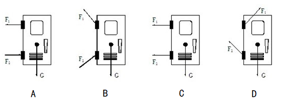

A. A

B. B

C. C

D. D

第 26 题 · 答案与解析

**参考答案（粉笔题库参考内容）**

B

**解析**

根据题意，防盗门受三个力、、G，这三个力必须达到平衡，门才会稳定，A、C两项防盗门在竖直方向上没有向上的力，受力不平衡，排除。假设没有铰链，防盗门上侧会有一个向外倾倒的趋势，故上铰链对防盗门的力应该是向内侧的，排除D项。

故正确答案为B。

**来源**：2013年上海市公务员录用考试《行测》题（B类）第26题

### 第 27 题

如图所示，在光滑桌面上有一轻质弹簧，它的两端连接质量不等的两个小球，用两手挤小球，使弹簧被压缩而静止在桌面上，然后同时放手，在弹簧恢复原长的任意时刻，两小球的：

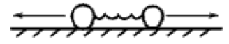

A. 动能相等

B. 动量大小相等

C. 速度大小相等

D. 加速度大小相等

第 27 题 · 答案与解析

**参考答案（粉笔题库参考内容）**

B

**解析**

系统不受外力或所受合外力为零时，系统的动量守恒。对于两个小球和弹簧组成的系统进行受力分析，在松手后，在弹簧恢复原长的任意时刻，在竖直方向上，系统受重力和支持力，且重力和支持力平衡；在水平方向上，系统不受外力作用，所以系统所受合外力始终等于零，系统的动量守恒。

记右边小球的质量为、左边小球的质量为，由于松手瞬间两球初始速度均为零，则系统的初始动量p=0；当系统开始运动后，记两个小球速度大小为、，规定向右为正方向，则系统的动量为，因为系统的动量守恒，即p=p，则，可知，即两个小球的动量大小相等，方向相反，B项正确；由题干知，，则，即两个小球的速度大小不相等，C项错误；根据动能公式，因为，且，所以，即两个小球的动能不相等，A项错误；根据牛顿第二定律F=ma，由于两小球的合外力均为弹簧弹力，大小相等，但两个小球的质量不相等，所以两个小球的加速度大小不相等，D项错误。

故正确答案为B。

**来源**：2013年上海市公务员录用考试《行测》题（B类）第27题

### 第 28 题

一台灯的插头在如图所示插座上，插座上有一个开关和一个指示灯（相当于电阻）的灯泡。若插座开关和指示灯用、表示，台灯开关和台灯用、表示，当断开或闭合、时，记录现象如下表。则符合事实的电路图是：

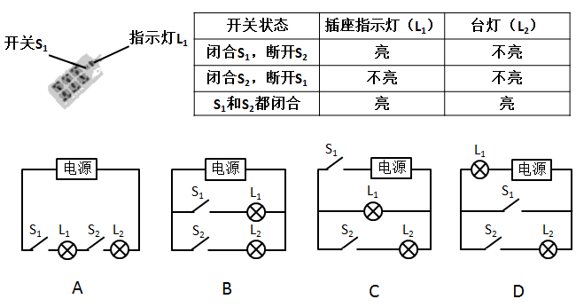

A. A

B. B

C. C

D. D

第 28 题 · 答案与解析

**参考答案（粉笔题库参考内容）**

C

**解析**

闭合，断开，A项中不亮，排除；闭合，断开，B、D两项中亮，排除；验证C项，和闭合，和都亮，符合条件。

故正确答案为C。

**来源**：2013年上海市公务员录用考试《行测》题（B类）第28题

### 第 29 题

某人准备了两杯等量的水及一些块状冰糖来与白糖粉末（两者成分均为蔗糖），做溶解速率与溶解度的实验。在25℃时，他将相同质量的冰糖与白糖粉末分别加入两个杯子中，并以相同的速度不断搅拌，最后两个杯子均有未溶解的糖。则下列糖的质量百分比浓度与搅拌时间的关系图，正确的是：

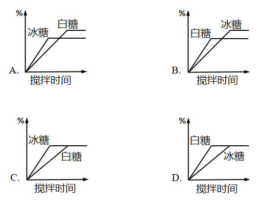

A. A

B. B

C. C

D. D

第 29 题 · 答案与解析

**参考答案（粉笔题库参考内容）**

D

**解析**

块状冰糖和白糖粉末成分相同，均为蔗糖，质量相同且水也为等量，故充分溶解后，二者浓度应相同，排除A、B；而白糖粉末溶解速度快于块状冰糖，即浓度变化更快，排除C。

故正确答案为D。

**来源**：2013年上海市公务员录用考试《行测》题（B类）第29题

### 第 30 题

两反射镜面I、II成5度角放置，光线入射镜面I的入射角为30度，然后在两个镜面中来回反射，则光线第一次从镜面I上面重新反射出来的出射角为：

A. 30度

B. 40度

C. 50度

D. 60度

第 30 题 · 答案与解析

**参考答案（粉笔题库参考内容）**

B

**解析**

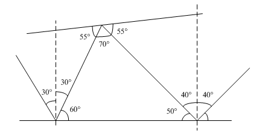

画图分析，根据入射角等于出射角，可推算出光线第一次从镜面I上面重新反射后出射角为40度。

故正确答案为B。

**来源**：2013年上海市公务员录用考试《行测》题（B类）第30题

### 第 31 题

圆桌会议是指一种平等、对话的协商会议形式，是在举行国际或国内政治谈判时，为避免席次争执，表示参加各方地位平等起见而采取的一种围圆桌而坐的会议形式。根据上述定义，下列说法不正确的是（    ）。

A. 圆桌会议主要用于解决国际政治争端

B. 圆桌会议是一种多边协商的会议方式

C. 圆桌会议象征着平等交流、意见开放

D. 圆桌会议与会者无主次尊卑之分

第 31 题 · 答案与解析

**参考答案（粉笔题库参考内容）**

A

**解析**

第一步：判断题干中的关键词。

关键词：平等、对话；国际或国内政治谈判；参加各方地位平等。

第二步：逐一分析选项。

A项，圆桌会议主要用于国际或国内政治谈判，而非仅仅是国际政治争端。该项错误。

B项，圆桌会议一般有多个参会方，是一种多边协商的会议方式。该项正确。

C项，圆桌会议围圆桌而坐，象征着平等交流、意见开放。该项正确。

D项，圆桌会议参加各方地位平等，与会者无主次尊卑之分。该项正确。

第三步：再次标注答案。

本题为选非题，故正确答案为A。

**考点**：单定义-其他句式

**来源**：2013年上海市公务员录用考试《行测》题（B类）第31题

### 第 32 题

关系资产是指企业与所有发生联系的外部组织之间建设的关系网络及其带来的资源和信息优势，主要表现为企业与顾客、雇员、供应商、中间商、股东及其他合作者的关系形成的资产，它反映这些成员与企业保持商业往来及合作的可能，根据上述定义，下列不属于关系资产的是：

A. 忠诚顾客重复购买产品提升质量

B. 物流合作企业降低运输成本

C. 庞大的顾客群使企业获得竞争优势

D. 良性竞争刺激企业技术改革

第 32 题 · 答案与解析

**参考答案（粉笔题库参考内容）**

D

**解析**

第一步：抓住定义中的关键词。

关键词包括“顾客、雇员、供应商、中间商、股东及其他合作者”、“与企业保持商业往来及合作”。

第二步：逐一判断选项。

A、C两项是企业和顾客的关系形成的资产，因此属于关系资产；

B项是企业与其他合作者的关系形成的资产，因此属于关系资产；

D项说的是企业和企业之间的竞争，而不是与企业外部组织的合作，不符合关键词“与企业保持商业往来及合作”，因此不属于关系资产。

故正确答案为D。

**考点**：单定义-其他句式

**来源**：2013年上海市公务员录用考试《行测》题（B类）第32题

### 第 33 题

动作思维亦称“直观动作思维”，其基本特点是思维与动作不可分，离开了动作就不能思维。动作思维的任务或课题是与当前直接感知到的对象相联系的，解决问题的思维方式不是依据表象与概念，而是依据当前的感知与实际操作。

根据上述定义，下列不属于动作思维的是：

A. 幼儿用手摆弄物体进行计算活动

B. 学生骑自行车回家

C. 大猩猩堆垒木箱去拿高处的事物

D. 建筑师在电脑上画设计图

第 33 题 · 答案与解析

**参考答案（粉笔题库参考内容）**

D

**解析**

第一步：抓住定义中的关键词。

关键词包括“思维与动作不可分”、“感知与实际操作”。

第二步：逐一判断选项。

A、B、C三项中的情况均符合关键词“思维与动作不可分”、“感知与实际操作”，因此都属于动作思维；

D项中建筑师设计图需要借助概念，而不能只靠感知和实际操作，不符合关键词“感知与实际操作”，因此不属于动作思维。

本题为选非题，故正确答案为D。

**考点**：方式目的

**来源**：2013年上海市公务员录用考试《行测》题（B类）第33题

### 第 34 题

天然孳息是指按照物质的自然生长规律而产生的果实与动物的出产物，与原物分离前是原物的一部分。天然孳息由所有权人所得；既有所有权人又有用益物权人的，由用益物权人取得。当事人另有约定的，按照约定。根据上述定义，下列属于天然孳息的是：

A. 小沈在地铁上捡到的手机

B. 陈大爷家老宅地下挖出的古董

C. 长风公园里的桃树结的桃子

D. 张阿姨送给邻居王大妈的猫崽

第 34 题 · 答案与解析

**参考答案（粉笔题库参考内容）**

C

**解析**

第一步：抓住定义中的关键词。

关键词强调“果实与动物的出产物”、“与原物分离前是原物的一部分”。

第二步：逐一判断选项。

A项中的手机，B项中的古董，不符合关键词“果实与动物的出产物”，因此不属于天然孳息；

D项中并没有涉及原物母猫，从而不符合关键词“与原物分离前是原物的一部分”，因此不属于天然孳息；

C项中的桃子符合“果实与动物的出产物”、“与原物分离前是原物的一部分”。

故正确答案为C。

**考点**：单定义-其他句式

**来源**：2013年上海市公务员录用考试《行测》题（B类）第34题

### 第 35 题

地缘文化学是文化学研究中从局部地理、环境关系及其引起的社会、文化差异与因缘关联，探讨地理区域文化特征与发展规律的社会科学。根据上述定义，下列属于地缘文化学研究对象的是：

A. 徽商现象

B. 某地农业景观的开发过程

C. 城市房价暴涨现象

D. 某市大学生创业现象

第 35 题 · 答案与解析

**参考答案（粉笔题库参考内容）**

A

**解析**

第一步：抓住定义中的关键词。

关键词强调“地理区域文化特征”。

第二步：逐一判断选项。

A项中“徽商”指的是徽州的商人，“徽商现象”符合定义要点，属于地缘文化学的研究对象；

B、C项均未涉及文化，均不属于地缘文化学的研究对象；

D项大学生创业现象与地理无关，不属于地缘文化学的研究对象。

故正确答案为A。

**考点**：单定义-其他句式

**来源**：2013年上海市公务员录用考试《行测》题（B类）第35题

### 第 36 题

下列选项中不能折成原图的是：

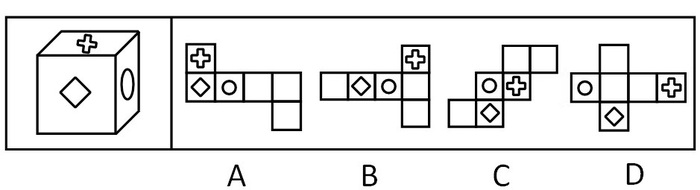

A. A

B. B

C. C

D. D

第 36 题 · 答案与解析

**参考答案（粉笔题库参考内容）**

C

**解析**

本题考查六面体的空间重构能力。如下图所示，可用画边法解题，以菱形面和圆形面的公共边（即下图绿线）为起点，分别对题干和选项进行顺时针画边。

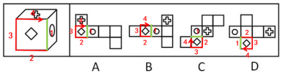

A项：与题干对应面一致，排除；

B项：与题干对应面一致，排除；

C项：题干立体图第四条边对应的是加号面，选项第四条边对应的是白面，立体图和展开图不对应，当选；

D项：与题干对应面一致，排除。

本题为选非题，故正确答案为C。

**考点**：空间类-空间重构-六面体

**来源**：2013年上海市公务员录用考试《行测》题（B类）第36题

### 第 37 题

下列选项中，符合所给图形的变化规律的是：

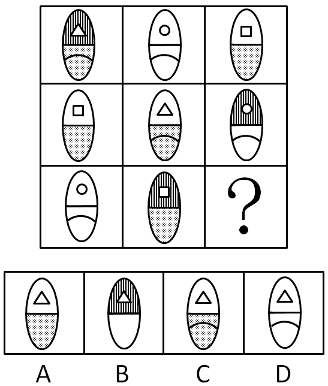

A. A

B. B

C. C

D. D

第 37 题 · 答案与解析

**参考答案（粉笔题库参考内容）**

C

**解析**

本题考查元素遍历。前两行的图形都包含有六种元素（每个图形水平分为上下两种元素），第三行图形也应当包含这六种元素，通过比较可知第三行所缺元素组成的图形为C项。

故正确答案为C。

**考点**：样式规律-遍历

**来源**：2013年上海市公务员录用考试《行测》题（B类）第37题

### 第 38 题

下列选项中，符合所给图形变化规律的是：

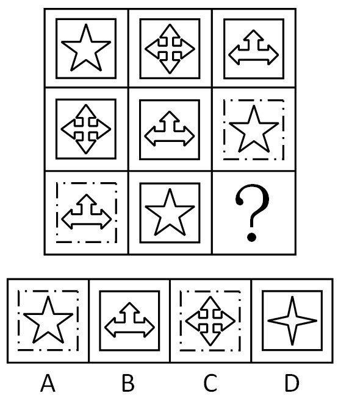

A. A

B. B

C. C

D. D

第 38 题 · 答案与解析

**参考答案（粉笔题库参考内容）**

C

**解析**

观察图形，相同元素重复出现，考虑遍历规律。

前两行的图形方框内部都包含有三种元素，第三行图形方框内部也应当包含这三种元素，通过比较可知第三行所缺图形为C。

故正确答案为C。

**考点**：样式规律-遍历

**来源**：2013年上海市公务员录用考试《行测》题（B类）第38题

### 第 39 题

请从所给的四个选项中，选择最合适的一项填在问号处，使之呈现一定的规律性：

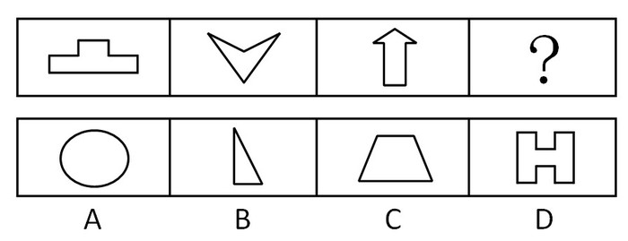

A. A

B. B

C. C

D. D

第 39 题 · 答案与解析

**参考答案（粉笔题库参考内容）**

C

**解析**

元素组成凌乱，且图形规整，考虑属性中的对称。题干中所给的图形只关于竖轴对称。A、D两项不仅是轴对称图形，还是中心对称图形；B项既不关于竖轴对称，也不关于横轴对称；C项只关于竖轴对称。

故正确答案为C。

**考点**：属性规律-对称性

**来源**：2013年上海市公务员录用考试《行测》题（B类）第39题

### 第 40 题

下列选项中，符合所给图形的变化规律的是：

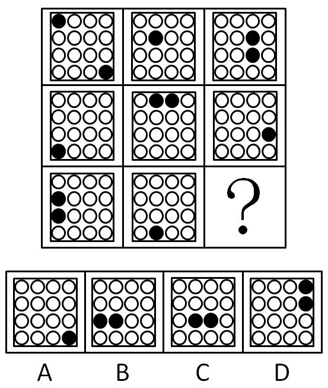

A. A

B. B

C. C

D. D

第 40 题 · 答案与解析

**参考答案（粉笔题库参考内容）**

D

**解析**

已知图形中，每幅图形的小黑圆的所在位置均不相同。

A项小黑圆与题干中第一行第一列图形中小黑圆的位置有重合，B项与题干中第三行第一列图形中小黑圆的位置有重合，C项与第一行第三列图形中小黑圆的位置有重合，所以A、B、C中均有小黑圆的位置与已知图形重合，故排除。

故正确答案为D。

**考点**：位置规律-平移

**来源**：2013年上海市公务员录用考试《行测》题（B类）第40题

### 第 41 题

下列选项中，符合所给图形变化规律的是：

A. A

B. B

C. C

D. D

第 41 题 · 答案与解析

**参考答案（粉笔题库参考内容）**

B

**解析**

本题考查元素叠加。

图中相邻三个小圆组成的三角形，两个角的图形叠加去同存异后得到第三个角的图形，根据此规律可得出未知图形应为B项。

故正确答案为B。

**考点**：样式规律-加减同异

**来源**：2013年上海市公务员录用考试《行测》题（B类）第41题

### 第 42 题

下列选项中，符合所给图形的变化规律的是：

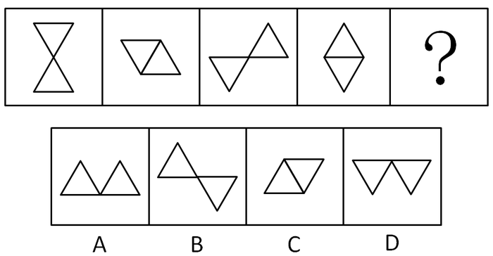

A. A

B. B

C. C

D. D

第 42 题 · 答案与解析

**参考答案（粉笔题库参考内容）**

B

**解析**

元素组成相同，看位置。已知图形中，第一个图形下方的三角形绕着上方的三角形做逆时针转动，边与边或顶点与顶点重合时形成新图形，由此可推出未知图形应为B。

故正确答案为B。

**考点**：位置规律-旋转

**来源**：2013年上海市公务员录用考试《行测》题（B类）第42题

### 第 43 题

下列选项中，符合所给图形的变化规律的是：

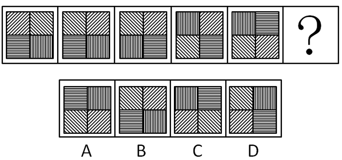

A. A

B. B

C. C

D. D

第 43 题 · 答案与解析

**参考答案（粉笔题库参考内容）**

A

**解析**

元素组成相同，看位置。元素位置对换规律，按照“左上右上、左下右下、左上左下、右上右下”的顺序循环。

故正确答案为A。

**考点**：位置规律-平移

**来源**：2013年上海市公务员录用考试《行测》题（B类）第43题

### 第 44 题

下列选项中，符合所给图形的变化规律的是：

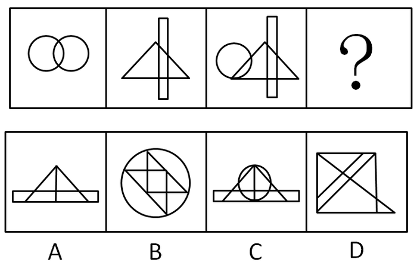

A. A

B. B

C. C

D. D

第 44 题 · 答案与解析

**参考答案（粉笔题库参考内容）**

B

**解析**

方法一：图形元素组成不同，且无明显属性规律，考虑数量规律。图形中“窟窿”明显，考虑数面。题干图形面数量依次为3、5、7、？，？处应该为9个面。A项为6个面，B项为9个面，C项为12个面，D项为7个面，只有B项符合。

方法二：图形元素组成不同，且无明显属性规律，考虑数量规律。图形中有圆相交、“日”字变形等，考虑笔画数。题干图形笔画数均为1，？处应为一笔画图形，只有B项符合。

故正确答案为B。

注：以上两种思路均可得到B项，比较而言，题干图形数面的特征更加明显，故粉笔倾向于本题考查面数量。

**考点**：数量规律-面

**来源**：2013年上海市公务员录用考试《行测》题（B类）第44题

### 第 45 题

左边图形由四个部分组成，各部分通过平面上的变化可以组成新图形，下列选项中，不是由这四个部分组成的是：

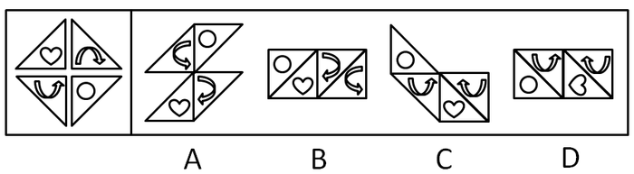

A. A

B. B

C. C

D. D

第 45 题 · 答案与解析

**参考答案（粉笔题库参考内容）**

C

**解析**

本题考查的是图形平面拼合。A、B、D的图形可通过平面移动左边图形四个部分得到，而C是通过立体翻转而得。

本题为选非题，故正确答案为C。

**来源**：2013年上海市公务员录用考试《行测》题（B类）第45题

### 第 46 题

要加强社会主义物质文明建设，就必须大力发展社会主义的生产力。只有进一步改革束缚生产力发展的生产关系，才能大力发展社会主义的生产力。而不树立走改革之路的坚定意识，就不可能去改革束缚生产力发展的生产关系。

下列哪项可以从题干中推出：

A. 要加强社会主义物质文明建设，必须树立走改革之路的坚定意识

B. 主张加强社会主义物质文明建设的人，不可能认同不走改革之路

C. 一旦树立了走改革之路的坚定意识，就能加强社会主义物质文明建设

D. 要发展社会主义的生产力，未必一定要走改革之路

第 46 题 · 答案与解析

**参考答案（粉笔题库参考内容）**

A

**解析**

第一步：翻译题干。

①加强物质文明建设→大力发展生产力；

②大力发展生产力→改革生产关系；

③-树立坚定意识→—改革生产关系。

根据逆否规则，从③可得到④：改革生产关系→树立坚定意识。

将①、②、④三个推导关系连起来即为：加强物质文明建设→大力发展生产力→改革生产关系→树立坚定意识。

第二步：逐一翻译选项并判断正确选项。利用逆否规则。

A项正确，加强物质文明建设→树立坚定意识，与题干的推导关系相符；

B项错误，只能推出“加强物质文明建设→树立走改革之路的坚定意识”，跟认不认同走改革之路无关；

C项错误，树立坚定意识→加强物质文明建设，“树立坚定意识”属于肯后件，无法推出绝对表达的结论；

D项错误，由题干可知“大力发展生产力→树立走改革之路的坚定意识”，也就是要发展生产力，就得走改革之路。

B、C、D三项均无法推出。

故正确答案为A。

**考点**：常规翻译

**来源**：2013年上海市公务员录用考试《行测》题（B类）第46题

### 第 47 题

诉诸权威是指论证中不加分析地摘引权威人士的言论，以之作为论证论点正确性的充分论据的逻辑谬误。

下列哪项表述包含了“诉诸权威”的错误？

A. 对于已成名的科学家，政府和社会总是不断地加给他们各种头衔、名誉和各种优厚待遇

B. 一位校长说：“男生和女生的逻辑就是不一样，某知名教授一直这么说”

C. 小王想报考中国古代文学方向的博士研究生，著名的中国古代文学专家张教授为他写了一份推荐信

D. 作为核物理领域的权威，全国人大代表王研究员接受了一次有关食品安全的访谈，在访谈中，他多次强调他有关食品安全的主张仅仅是个人意见

第 47 题 · 答案与解析

**参考答案（粉笔题库参考内容）**

B

**解析**

第一步：抓住题干中的主要信息。

题干强调诉诸权威是“不加分析地摘引权威人士的言论”，并以该言论“作为论证论点正确性的充分论据”。

第二步：结合选项得出答案。

A项说的是给成名科学家名誉和优厚待遇，C项说的是张教授为小王写推荐信，A、C两个选项都没有引用权威人士的言论，与“诉诸权威”无关；

B项引用某知名教授的话，没有对这话加以分析，犯了“诉诸权威”的错误；

D项是王研究员自己发表意见，不是引用他人的言论，同样与“诉诸权威”无关。

故正确答案为B。

**考点**：单定义-其他句式

**来源**：2013年上海市公务员录用考试《行测》题（B类）第47题

### 第 48 题

赛莱拉基因组公司的一个研究小组在《科学》杂志上报告说，将老鼠的染色体与人的染色体进行对比，发现二者在基因、基因内容和DNA序列等方面具有95%的相似度，因此，老鼠和人其实并没有太大的区别。

上述结论依赖的一个假定是：

A. 已绘制完成的动物基因图谱往往很不准确

B. 从智力和情感的角度看，老鼠和人之间存在着巨大的差异

C. 老鼠没有什么智力，在与人进行比较时，可以忽略不计

D. 判断物种之间区别大小的主要标准是物种在基因上的相似度大小

第 48 题 · 答案与解析

**参考答案（粉笔题库参考内容）**

D

**解析**

第一步：找出论点和论据。

论点：老鼠和人其实没有太大的区别。

论据：将老鼠的染色体与人的染色体进行对比，发现二者在基因、基因内容和DNA序列等方面具有95%的相似度。

第二步：判断加强方式。

论点强调老鼠和人没有太大区别，论据强调老鼠和人在基因方面高度相似，论点和论据的范围不同，需加强论证。

第三步：逐一判断选项。

A项“动物基因图谱”与判断老鼠和人的区别没有关系，属于无关选项；

B项说明老鼠和人在智力和情感方面存在巨大差异，削弱了论点；

C项只是加强实验的科学性，支持论据，但不能说明论点和论据之间的关系，无法加强论点；

D项在物种的区别和基因方面的相似度之间搭桥，加强论证过程，使论点成立，D项为正确答案。

故正确答案为D。

**考点**：搭桥

**来源**：2013年上海市公务员录用考试《行测》题（B类）第48题

### 第 49 题

某中学的教师都很有爱心。有些经常志愿献血的教师免费为学习困难的学生补课，凡是资助了贫困生的教师都和困难家庭结成了帮困对子，但所有免费为学习困难的学生补课的教师都没有人和困难家庭结成帮困对子。

根据以上前提，下列哪项一定为真：

A. 有些经常志愿献血的教师没有资助贫困生

B. 有些资助了贫困生的教师没有志愿献血

C. 有些资助了贫困生的教师经常献血

D. 有些经常志愿献血的教师跟困难家庭结成了帮困对子

第 49 题 · 答案与解析

**参考答案（粉笔题库参考内容）**

A

**解析**

第一步：翻译题干。

事实信息：有些经常志愿献血的教师免费为学习困难的学生补课；

①资助了贫困生的教师→和困难家庭结成了帮困对子；

②免费为困难学生补课的教师→—和困难家庭结成帮困对子。

根据逆否规则，从①可推出③：-和困难家庭结成帮困对子→—资助了贫困生的教师；根据传递规则，从②和③可推出④“免费为困难学生补课的教师→—资助了贫困生的教师”，即所有免费为学习困难的学生补课的教师都没有资助贫困生。

第二步：从事实信息开始推导。

从第一步可知所有免费为学习困难的学生补课的教师都没有资助贫困生，又知事实信息“有些经常志愿献血的教师免费为学习困难的学生补课”，可以推出有些经常志愿献血的教师没有资助贫困生，A项正确。B、C、D三项均无法从题干推出。

故正确答案为A。

**考点**：集合推理

**来源**：2013年上海市公务员录用考试《行测》题（B类）第49题

### 第 50 题

甲是乙的必要条件，丙是乙的充分条件但不是乙的必要条件，那么：

A. 丙是甲的充分条件但不是甲的必要条件

B. 丙是甲的必要条件但不是甲的充分条件

C. 丙是甲的充分必要条件

D. 丙既非甲的充分条件，又非甲的必要条件

第 50 题 · 答案与解析

**参考答案（粉笔题库参考内容）**

A

**解析**

第一步：翻译题干。

①乙→甲；②丙→乙；将两个推导关系连接起来为：③丙→甲。

第二步：逐一翻译选项并判断正确选项。

A项，丙→甲，跟题干推导关系一致；

B、C、D三项均和题干逻辑不符。

故正确答案为A。

**考点**：常规翻译

**来源**：2013年上海市公务员录用考试《行测》题（B类）第50题

### 第 51 题

人们一般都认为，科学家的思维都是凭借着严格的逻辑推理，而不是凭借形象思维。但研究表明，诺贝尔获奖者比一般科学家更多地利用形象思维手段，因此，形象思维手段有助于取得重大的科学突破。

上述结论是建立在下列哪项假设基础上的：

A. 有条理的、逐步的推理对于一般科学研究是必不可少的

B. 诺贝尔获奖者有能力凭借形象思维来进行创造性思维

C. 诺贝尔奖获得者比一般科学家更为聪明和勤奋

D. 诺贝尔获奖者取得了重大的科学突破

第 51 题 · 答案与解析

**参考答案（粉笔题库参考内容）**

D

**解析**

第一步：找出论点和论据。

论点：形象思维手段有助于取得重大的科学突破。

论据：诺贝尔获奖者比一般科学家更多地利用形象思维手段。

本题论点讨论的是“形象思维手段”和“重大科学突破”之间的关系，论据讨论的是“诺贝尔获奖者”和“形象思维手段”之间的关系，二者话题不一致，且提问方式为“假设”，加强优先考虑搭桥，即建立“诺贝尔获奖者”和“重大科学突破”之间的联系。

第二步：逐一分析选项。

A项：该项指出有条理的、逐步的推理对一般科学研究必不可少，而论点说的是形象思维手段有助于取得重大科学突破，话题不一致，无法加强，排除；

B项：该项指出诺贝尔获奖者有能力凭借形象思维进行创造性思维，而“有能力凭借形象思维来进行创造性思维”不代表能够“取得重大科学突破”，不明确项，无法加强，排除；

C项：该项指出诺贝尔奖获得者比一般科学家更聪明勤奋，而论点说的是形象思维手段有助于取得重大科学突破，话题不一致，无法加强，排除；

D项：该项指出诺贝尔获奖者取得了重大的科学突破，建立了“诺贝尔获奖者”和“重大科学突破”之间的联系，搭桥项，可以加强，当选。

故正确答案为D。

**考点**：搭桥

**来源**：2013年上海市公务员录用考试《行测》题（B类）第51题

### 第 52 题

一旦消费者认识到通货膨胀已经开始，他们普遍都会增加消费。这种增加很容易通过消费者希望不再推迟购买那些肯定会涨价的商品这一现象得到解释，尽管消费者预料到价格持续上涨，工资也会随之上涨，但是在长期通货膨胀期间，消费者最终还是会推迟那些甚至是日常生活品的购买。

下列哪项如果正确，最能有助于解释上述描述的消费行为的明显不一致：

A. 消费者在通货膨胀时期存的钱比非通货膨胀时期存的钱多

B. 通过经济指标发出通货膨胀已经开始的信号和消费者意识到通货膨胀已经开始之间有一个滞后

C. 如果很大数量的消费者不能购买商品，那么价格最终会降下来，但工资不会受到影响

D. 因为工资的增长跟不上物价的上涨，所以消费者的购买力在长期通胀阶段有所下降

第 52 题 · 答案与解析

**参考答案（粉笔题库参考内容）**

D

**解析**

第一步：找出论点和论据。

论点：消费者一旦认识到通货膨胀开始，就不再推迟购买那些肯定会涨价的商品，但在长期通货膨胀期间，消费者最终还是会推迟购买消费品。没有论据。

第二步：判断加强方式。

本题只有论点，没有论据，所以需要加强论点。

第三步：逐一判断选项。

D项分析了在长期通货膨胀期间，消费者因为工资的增长跟不上物价的上涨，导致购买力下降，从而推迟购买消费品，解释了题干中的矛盾，加强了论点；

A项对比的是消费者在通货膨胀期间和非通货膨胀期间的存款量，跟长期通货膨胀期间消费者的消费行为无关，属于无关选项；

B项同样没有涉及长期通货膨胀期间消费者的行为表现，属于无关选项；

C项谈的是价格下降和工资的关系，跟消费者的消费行为无关，无法解释题干。

A、B、C都解释不了题干中的矛盾。

故正确答案为D。

**考点**：原因解释

**来源**：2013年上海市公务员录用考试《行测》题（B类）第52题

### 第 53 题

高中毕业以后，人们很少再做数学题或谈论历史，但人们每天都要面临与家庭经济有关的决策。然而，当数学和历史是高中课程中的必修课时，家庭经济学仅仅是一门选修课，并且很少有学生选这门课。

下列哪项观点能最好地被以上的论述所支持：

A. 除非高中把更多的重心放在像家庭经济学这样的非专业学科上，从高中毕业的人们永远不会轻松地做出日常生活中面临的决策

B. 虽然家庭经济学对于面临日常生活中必须做出决策的人们是最有用的学科，但通常数学和历史也能帮助人们做出这些决策

C. 数学、历史和其他不是直接与一个人的日常生活有关的学科不应该成为高中课程表中的必修部分

D. 如果向高中学生传授与他们以后在日常生活中会面临的决策相关的学科是重要的，那么家庭经济学就应该成为高中课程表中重要的一部分

第 53 题 · 答案与解析

**参考答案（粉笔题库参考内容）**

D

**解析**

第一步：找出题干中的主要信息。

第一句：高中毕业后，人们很少再做数学题或谈论历史，但每天都会面临与家庭经济有关的决策。

第二句：高中时，数学和历史是必修课，而家庭经济学只是选修课。

第二步：分析题干信息，结合选项得出答案。

题干说明上高中时，人们没有意识到家庭经济学这门课程的重要性，对该学科不够重视，如果让高中生明白这门课程跟他们以后的生活有关，那么家庭经济学就该成为课程表中的一部分，即选项D的观点可从题干推出。

A项错误，题干只谈到家庭经济学与人们每天要面对的与家庭经济有关的决策密切相关，而非“日常生活中面临的决策”；

B项错误，题干没有体现数学和历史能够帮人们做出这些决策，无法从题干推出；

C项错误，题干只陈述数学和历史是高中必修课的事实，没有评价这些课程是否应该成为必修课，因此C项也错。

故正确答案为D。

**来源**：2013年上海市公务员录用考试《行测》题（B类）第53题

### 第 54 题

某次会议邀请某单位的张某、王某、李某、赵某、孙某、周某六个人参加。但由于工作安排的原因，六个人不能同时都去。其中：张某、赵某两人只能有一个人参加会议；李某、赵某两人也只能有一个人参加会议；张某、王某两人至少有一个人参加会议；张某、孙某、周某三人中有两人参加会议；王某和李某要么都参加会议，要么都不参加会议；如果赵某不参加会议，那么孙某也不参加会议。

根据这样的安排，最后没有参加会议的可能是：

A. 张某和王某

B. 王某和李某

C. 李某和赵某

D. 赵某和孙某

第 54 题 · 答案与解析

**参考答案（粉笔题库参考内容）**

D

**解析**

第一步：翻译题干。

（1）-（张 且 王 且 李 且 赵 且 孙 且 周）；（2）要么张，要么赵；

（3）要么李，要么赵；（4）张或王；（5）张、孙、周三人中有两人；

（6）要么（王 且 李），要么（-王 且 -李）；（7）-赵→—孙。

第二步：因为题干信息较多，且相互间联系不紧密，适合用假设代入法来解答。

假设A项为真，张和王都没有参加会议，这跟题干信息“张某、王某两人至少有一个人参加会议”矛盾，故A项错误；

假设B项为真，王和李都没有参加会议。暂无直接违背信息。代入（3），可以得出：-李→赵；代入（4），可以得出：-王→张；此时跟题干信息（2）“张某、赵某两人只能有一个人参加会议”矛盾，故B项错误；

假设C项为真，李和赵都没有参加会议，这跟（3）“李某、赵某两人也只能有一人参加会议”矛盾，故C项错误；

假设D项为真，赵和孙都没有参加会议，符合“如果赵某不参加会议，那么孙某也不参加会议”；再验证是否符合其他相关情况，赵不参加，张参加，符合（2）；赵不参加、李参加，符合（3）。

故正确答案为D。

**考点**：常规翻译

**来源**：2013年上海市公务员录用考试《行测》题（B类）第54题

### 第 55 题

甲、乙、丙三人推销各自的产品。这三种产品中，有一样是仿冒品，其余两样是真品。甲说：“我的产品是真品，乙的产品是仿冒品”；乙说：“我的产品是真品，丙的产品是仿冒品”；丙说：“乙的产品是真品，甲的产品是仿冒品”。已知甲、乙、丙三人中，有一位两句话都是真的，有一位一句话是真话、一句话是假话，还有一位两句话都是假话。

那么，推销仿冒品的是：

A. 甲

B. 乙

C. 丙

D. 不能确定

第 55 题 · 答案与解析

**参考答案（粉笔题库参考内容）**

A

**解析**

第一步：找突破口。

本题突破口为甲和丙之间的矛盾关系，两人的话必有两真两假。

第二步：从事实信息开始推导，得出结论。

已知甲、乙、丙三人中，有一人说的两句话都是真的，有一人说的一句话是真的、一句话是假的，还有一人两句话都是假的，可知乙的两句话有一真一假。

又知三种产品中有一个是仿冒品，两个是真品，假如乙的前半句“我的产品是真品”为假，后半句“丙的产品是仿冒品”为真，那么说明乙的产品为仿冒品，丙的产品也是仿冒品，这与事实信息只有一个仿冒品不相符；所以乙的前半句为真，后半句为假，也就是乙的产品是真品，丙的产品是真品。因为有一人的产品是仿冒的，有两人的产品是真品，所以甲的产品是仿冒品。验证甲、丙说的话，甲两句都均为假，丙两句均为真，与题意相符。

故正确答案为A。

**考点**：框架题

**来源**：2013年上海市公务员录用考试《行测》题（B类）第55题

### 第 56 题

某县筹备县庆，园林部门决定利用现有的3490盆甲种花卉和2950盆乙种花卉搭配A、B两种园艺造型共50个摆放在迎宾大道两侧。已知搭配一个A种造型需甲种花卉80盆，乙种花卉40盆；搭配一个B种造型需甲种花卉50盆，乙种花卉90盆，则搭配方案共有：

A. 3种

B. 4种

C. 5种

D. 6种

第 56 题 · 答案与解析

**参考答案（粉笔题库参考内容）**

A

**解析**

设搭配A类型x个，则搭配B类型(50-x)个，根据题意可得：，解得；，解得，从而有，即x有31、32和33三种可能，因此搭配方案共有3种。

故正确答案为A。

**考点**：和差倍比问题

**来源**：2013年上海市公务员录用考试《行测》题（B类）第56题

### 第 57 题

高速公路收费站对过往车辆的收费标准是：大型车30元/辆、中型车15元/辆、小型车10元/辆。某天，通过收费站的大型车与中型车的数量比是5：6，中型车与小型车的数量比是4：11，小型车的通行费总数比大型车的多270元，这天的收费总额是：

A. 7280元

B. 7290元

C. 7300元

D. 7350元

第 57 题 · 答案与解析

**参考答案（粉笔题库参考内容）**

B

**解析**

根据题干中“通过收费站的大型车与中型车的数量比是5:6，中型车与小型车的数量比是4:11”可得，通过收费站的大型车、中型车和小型车的数量比为10:12:33，设大型车、中型车和小型车的数量分别为10y、12y和33y辆，根据题意可得：，解得y=9，因此这天的收费总额为：元。

故正确答案为B。

备注：事实上当计算得到y=9时，可以得知这天的收费总额必能被9整除。通过分析选项发现，只有B项能够被9整除。

**考点**：经济利润问题

**来源**：2013年上海市公务员录用考试《行测》题（B类）第57题

### 第 58 题

甲和乙同住一幢楼，他们同时出发骑车去图书馆，又同时到达图书馆，但途中甲休息的时间是乙骑车时间的1/3，而乙休息的时间是甲骑车时间的1/4，甲和乙骑车的速度比是：

A. 

B. 

C. 

D. 

第 58 题 · 答案与解析

**参考答案（粉笔题库参考内容）**

B

**解析**

设甲骑车的时间为4x，休息的时间为y，则乙骑车的时间为3y，休息的时间为x。根据甲乙所用时间相等可得：4x＋y＝3y＋x，解得x:y=2:3。不妨设x=2，y=3，则甲骑车时间为8，乙骑车时间为9，从而甲和乙骑车的时间比为8:9，又知甲乙的路程相同，因此甲和乙骑车的速度比为9:8。

故正确答案为B。

**考点**：普通行程

**来源**：2013年上海市公务员录用考试《行测》题（B类）第58题

### 第 59 题

某大学音乐系学生在学校礼堂举行音乐会，第一场音乐会前三排位置的座位票价是每张10元，其他座位的票价是每张6元，全场的营业收入为2040元；第二场音乐会第四排位置的座位票价也被提升到每张10元，全场的营业收入为2120元。如果两场音乐会都满座，而且每一排的座位数量也都一样，那么该礼堂一共有多少个座位：

A. 300

B. 320

C. 480

D. 500

第 59 题 · 答案与解析

**参考答案（粉笔题库参考内容）**

A

**解析**

第二场比第一场收入多2120－2040＝80元，多出来的收入是因为调整了一排票价的缘故。这一排每个座位涨价10-6=4元，因此第二场提价的第四排共有座位80÷4＝20个，即每排有20个座位。该礼堂共有座位的排数为，因此总座位数为20×15＝300个。

故正确答案为A。

**考点**：和差倍比问题

**来源**：2013年上海市公务员录用考试《行测》题（B类）第59题

### 第 60 题

十字路口的交通信号灯每分钟红灯亮30秒，绿灯亮25秒，黄灯亮5秒。当你抬头看信号灯时，是绿灯的概率为：

A. 1/12

B. 1/3

C. 

D. 1/2

第 60 题 · 答案与解析

**参考答案（粉笔题库参考内容）**

C

**解析**

当抬头看信号灯时，是绿灯的概率为：。

故正确答案为C。

**考点**：给情况求概率

**来源**：2013年上海市公务员录用考试《行测》题（B类）第60题

### 第 61 题

某公司针对A、B、C三种岗位招聘了35人，其中只能胜任B岗位的人数等于只能胜任C岗位人数的2倍，而只能胜任A岗位的人数比能兼职别的岗位的人多1人，在只能胜任一个岗位的人群中，有一半不能胜任A岗位，则招聘的35人中能兼职别的岗位的有：

A. 10人

B. 11人

C. 12人

D. 13人

第 61 题 · 答案与解析

**参考答案（粉笔题库参考内容）**

B

**解析**

根据题干中“在只能胜任一个岗位的人群中，有一半不能胜任A岗位”可知，只能胜任B岗位与只能胜任C岗位的人数之和等于只能胜任A岗位的人数。设只能胜任C岗位的人数为x人，能兼职别的岗位的有y人，则只能胜任B岗位的人数为2x人，只能胜任A岗位的人数为(y+1)人，根据题意可得：2x+x=y+1，(y+1)+2x+x+y=35，联立解得x=4，y=11，因此招聘的35人中能兼职别的岗位的有11人。

故正确答案为B。

**考点**：和差倍比问题

**来源**：2013年上海市公务员录用考试《行测》题（B类）第61题

### 第 62 题

如图所示，A、B、C、D、E、F将圆六等分。圆内接一个正三角形。已知阴影部分的面积是100平方米，则圆面积为：

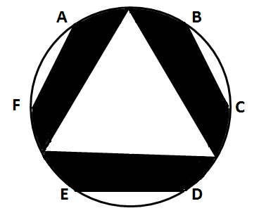

A. 180平方米

B. 200平方米

C. 220平方米

D. 240平方米

第 62 题 · 答案与解析

**参考答案（粉笔题库参考内容）**

B

**解析**

设圆的半径为r，圆心为O点，弧AB和弧CD的中点分别为G和H，连接OG、OH、OB、OC，扇形OGH的面积为，则扇形OBC的面积为。三角形OGH面积，三角形OBC的面积，则阴影部分的面积为：，化简得，因此圆的面积为200平方米。

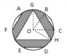

故正确答案为B。

**考点**：几何公式类-平面图形、几何结论类-三角形相关

**来源**：2013年上海市公务员录用考试《行测》题（B类）第62题

### 第 63 题

某养鸡场计划购买甲、乙两种小鸡苗共2000只进行饲养，已知甲种小鸡苗每只2元，乙种小鸡苗每只3元。相关资料表明：甲、乙两种小鸡苗的成活率分别为94%和99%。要使这批小鸡苗的成活率不低于96%，且买小鸡苗的总费用最小，则应选购甲、乙两种小鸡苗各有：

A. 500只、1500只

B. 800只、1200只

C. 1100只、900只

D. 1200只、800只

第 63 题 · 答案与解析

**参考答案（粉笔题库参考内容）**

D

**解析**

设购买甲种小鸡苗a只，则购买乙种小鸡苗为(2000-a)只。设购买这批小鸡苗总费用为b元，根据题意可得：b＝2a＋3(2000－a)＝－a＋6000，即b＝－a＋6000，也即b的值随着a变大而变小。由题干中“这批小鸡苗的成活率不低于96%”可得：，解得。因为函数b=-a+6000为减函数，因此当a＝1200时，b取最小值。此时a=1200，2000-a=800，因此应选购甲、乙两种小鸡苗各有1200只、800只。

故正确答案为D。

**考点**：统筹规划问题

**来源**：2013年上海市公务员录用考试《行测》题（B类）第63题

### 第 64 题

某商场出售甲乙两种不同价格的笔记本电脑，其中甲电脑连续两次提价10%，乙电脑连续两次降价10%，最后两种电脑均以9801元售出各一台，与价格不升不降比较，则商场盈亏情况是：

A. 不亏不赚

B. 少赚598元

C. 多赚980.1元

D. 多赚490.05元

第 64 题 · 答案与解析

**参考答案（粉笔题库参考内容）**

B

**解析**

由题干可知价格调整之前，乙电脑价格高于甲电脑，则乙电脑两次降价10%降的部分要大于甲电脑两次提价10%的部分，因此调整后两台电脑的总价格小于调价前的价格，从而商场少赚了。

故正确答案为B。

**考点**：经济利润问题

**来源**：2013年上海市公务员录用考试《行测》题（B类）第64题

### 第 65 题

一个圆柱形的容器内放有一个长方体铁块，现打开水龙头往容器中注水3分钟时，水恰好没过长方体铁块的顶面。又过了18分钟后，容器内被注满了水。已知容器的高是50厘米，长方体铁块的高是20厘米，那么长方体铁块的底面面积是圆柱形容器底面面积的：

A. 

B. 

C. 

D. 1/2

第 65 题 · 答案与解析

**参考答案（粉笔题库参考内容）**

B

**解析**

设长方形铁块的底面积为x，圆柱形容器底面积为y，由于注水速率不变，所以体积比等于注水时间比，从而有：20(y-x):(50-20)y=3:18，化简得到x:y=3:4。

故正确答案为B。

**考点**：几何公式类-立体图形

**来源**：2013年上海市公务员录用考试《行测》题（B类）第65题

## 材料 3

据统计，2012年第一季度，上海市签订外商直接投资合同项目688项，比去年同期下降10.5%；签订外商直接投资合同金额52.75亿美元，增长11.9%；实际到位金额33.26亿美元，增长29.2%。

        另外，一季度，与上海市签订外商直接投资合同的国家（地区）共57个。其中，与中国香港签订合同金额达24.2亿美元，比去年同期增长11.4%，占全市合同金额的45.9%，居签约各国家（地区）的首位；美国合同金额7.3亿美元，下降45.3%，居第二位；日本合同金额4.77亿美元，增长39.5%，居第三位；其他合同金额超亿美元的国家（地区）还有毛里求斯、新加坡、英属维尔京群岛和荷兰，其合同金额分别为3.24亿美元、2.91亿美元、2.22亿美元和1.14亿美元。

        作为聚集、整合和辐射优质生产要素的平台和载体，上海总部经济集聚区建设稳步发展。截至2012年3月末，上海市跨国公司地区总部达到370家，其中一季度新增17家；外资投资性公司达到248家，新增8家；外资研发中心达到341家，新增7家。

### 第 66 题

2012年第一季度，与上海签订外商直接投资合同金额不足1亿美元的国家（地区），其合同金额总占比为：

A. 大于15%

B. 不足10%

C. 不足15%

D. 不足12%

第 66 题 · 答案与解析

**参考答案（粉笔题库参考内容）**

C

**解析**

根据题干“2012年第一季度，······占比为”，可判定本题为现期比重问题。定位材料第一段，2012年第一季度，签订外商直接投资合同金额52.75亿美元，定位材料第二段，与上海签订外商直接投资合同金额超过1亿美元的国家（地区）的总金额分别为24.2、7.3、4.77、3.24、2.91、2.22、1.14亿美元，其中香港占全市合同金额的45.9%，则除香港以外其余国家（地区）的占比，则超过1亿美元的占比为45.9%+42%=87.9%,故不足1亿美元的国家，其合同金额占比为1-87.9%=12.1%。

故正确答案为C。

**考点**：文字资料、现期比重

**来源**：2013年上海市公务员录用考试《行测》题（B类）第66题

### 第 67 题

2012年第一季度，与上海市签订外商直接投资合同的金额比重达5.5%以上的国家（地区）个数为：

A. 4个

B. 5个

C. 6个

D. 7个

第 67 题 · 答案与解析

**参考答案（粉笔题库参考内容）**

B

**解析**

根据题干“2012年第一季度，······的比重达5.5%以上······”，可判定本题为现期比重问题。定位材料第一段，上海市签订外商直接投资合同金额52.75亿美元，那么满足要求的国家（地区）的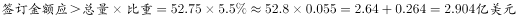  。定位材料第二段，符合要求的有中国香港、美国、日本、毛里求斯和新加坡，总共5个国家（地区）。

故正确答案为B。

**考点**：文字资料、现期比重

**来源**：2013年上海市公务员录用考试《行测》题（B类）第67题

### 第 68 题

2012年第一季度，上海市跨国公司地区总部、外资投资性公司及外资研发中心等企业数量增加了：

A. 5.78%

B. 4.56%

C. 3.45%

D. 3.13%

第 68 题 · 答案与解析

**参考答案（粉笔题库参考内容）**

C

**解析**

根据题干“2012年第一季度，······增加了”，结合选项为百分数，可判定本题为一般增长率计算问题。定位材料最后一段，跨国公司总部370家，新增17家，外资投资性公司248家，新增8家，外资研发中心341家，新增7家。那么，一季度新增加企业数为17＋8＋7＝32家，故。

故正确答案为C。

**考点**：一般增长率、文字资料

**来源**：2013年上海市公务员录用考试《行测》题（B类）第68题

## 材料 4

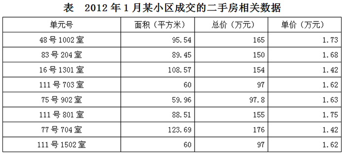

### 第 69 题

2012年1月某小区成交的二手房中，面积为60平方米左右的住宅占总销售套数的：

A. 25%

B. 35%

C. 37.5%

D. 40%

第 69 题 · 答案与解析

**参考答案（粉笔题库参考内容）**

C

**解析**

根据题干“2012年1月，······占······”，可判定本题为现期比重问题。定位表格第二列，面积为60平方米左右的住宅数为3，总销售套数为8，因此题干所求比重为。

故正确答案为C。

**考点**：现期比重、统计表

**来源**：2013年上海市公务员录用考试《行测》题（B类）第69题

### 第 70 题

如果该小区的成交价格从2012年1月起连续2个月出现每月3%的下跌，则至2012年3月，与77号704室相似的住宅的成交总价约为：

A. 91万元

B. 145万元

C. 155万元

D. 166万元

第 70 题 · 答案与解析

**参考答案（粉笔题库参考内容）**

D

**解析**

据题干“如果从2012年1月起，每月3%的下跌，则至2012年3月······”，可判定本题为现期计算问题。定位表格倒数第二行，2012年1月77号704室的成交总价为176万元，因此2012年3月，与77号704室相似的住宅的成交总价万元，与D项最接近。

故正确答案为D。

**考点**：现期计算、统计表

**来源**：2013年上海市公务员录用考试《行测》题（B类）第70题

### 第 71 题

如果市场估价人员对该小区面积为90平方米左右的住宅的估价在元/平方米之间，则下列说法不正确的是：

A. 111号801室属于正常成交案例

B. 83号204室属于正常成交案例

C. 48号1002室属于正常成交案例

D. 只有两套面积为90平方米左右的住宅属于正常成交案例

第 71 题 · 答案与解析

**参考答案（粉笔题库参考内容）**

A

**解析**

定位表格第二列和最后一列，面积在90平方米左右的住宅共有3套，分别如下：

48号1002室，单价1.73万元，在题干所给范围内，属于正常成交案例；

83号204室，单价1.68万元，在题干所给范围内，属于正常成交案例；

111号801室，单价1.75万元，不在题干所给范围内，不属于正常成交案例。

本题为选非题，故正确答案为A。

**考点**：直接找数、统计表

**来源**：2013年上海市公务员录用考试《行测》题（B类）第71题

### 第 72 题

根据表中数据，下列说法正确的是：

A. 2012年1月某小区成交的二手房单价均高于16000元/平方米

B. 2012年1月某小区二手房成交面积已超过700平方米

C. 面积为90平方米左右的住宅单价普遍低于面积为60平方米左右的住宅单价

D. 面积为90平方米左右的住宅单价普遍高于面积为105平方米以上的住宅单价

第 72 题 · 答案与解析

**参考答案（粉笔题库参考内容）**

D

**解析**

A项：定位表格最后一列，16号1301室和77号704室的单价均低于1.6万元/平方米，错误；

B项：定位表格第二列，2012年1月某小区二手房成交面积为95.64+89.45+108.57+60＝690＜700，错误；

C项：定位表格第二列和最后一列，面积为90平方米左右的住宅单价分别为1.73万元、1.68万元和1.75万元，面积为60平方米左右的住宅单价分别为1.62万元、1.63万元和1.62万元，后者均低于前者，错误；

D项：定位表格第二列和最后一列，面积为90平方米左右的住宅单价分别为1.73万元、1.68万元和1.75万元，面积为105平方米以上的住宅单价均为1.42万元，后者明显低于前者，正确。

故正确答案为D。

**考点**：统计表、综合分析

**来源**：2013年上海市公务员录用考试《行测》题（B类）第72题

## 材料 5

中国指数研究院数据信息中心检测显示2011年我国130个主要城市土地市场交易情况图如下所示：

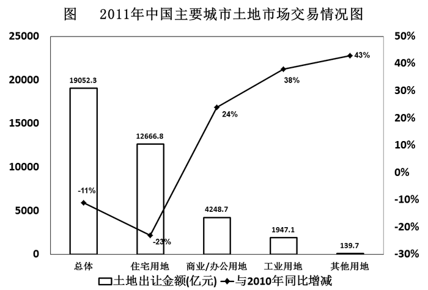

### 第 73 题

2011年土地出让金的各组成部分中，占比最高的是（  ）出让金。

A. 住宅用地

B. 商业/办公用地

C. 工业用地

D. 其他用地

第 73 题 · 答案与解析

**参考答案（粉笔题库参考内容）**

A

**解析**

定位柱形图，四个组成部分中，住宅用地的金额最高，因此其在总体中所占比重最高。

故正确答案为A。

**考点**：直接找数、统计图

**来源**：2013年上海市公务员录用考试《行测》题（B类）第73题

### 第 74 题

下列说法正确的是：

A. 与2010年相比，2011年各类土地出让金都有不同程度地减少

B. 与2010年相比，2011年工业用地土地出让金占比有所下降

C. 与2010年相比，2011年住宅用地土地出让金的减少量少于其他各类土地出让金的增加量之和

D. 2011年，130个城市土地出让金总体同比减少11%，住宅用地减少为主因

第 74 题 · 答案与解析

**参考答案（粉笔题库参考内容）**

D

**解析**

A项：定位折线图，四类土地出让金中只有住宅用地与2010年相比，同比增幅为-23%，有所下降，其他三类均为正数，没有下降，错误；

B项：定位折线图，2011年总体土地出让金额同比增幅为b=-11%，而工业用地的同比增幅为a=38%，根据两期比重结论，当a＞b时，比重上升，因此其占比与2010年相比应该是有所上升，错误；

C项：定位折线图，2011年四类土地用地中只有住宅用地的土地出让金为负增长，且总体土地出让金也为负增长，说明住宅用地土地出让金的减少量要大于其他各类土地出让金的增长量之和，错误；

D项：定位折线图，2011年四类土地用地中只有住宅用地的土地出让金为负增长，其他各类土地出让金均为正增长，且总体土地出让金也为负增长，可得住宅用地是减少的主因。也可根据对C项的分析可知，2011年造成130个城市土地出让金总体减少的主因是住宅用地土地出让金的减少，正确。

故正确答案为D。

**考点**：统计图、综合分析

**来源**：2013年上海市公务员录用考试《行测》题（B类）第74题

### 第 75 题

与2010年相比，2011年的土地出让金增加最多的是：

A. 住宅用地

B. 商业/办公用地

C. 工业用地

D. 其他用地

第 75 题 · 答案与解析

**参考答案（粉笔题库参考内容）**

B

**解析**

根据题干“与2010年相比，2011年······增加最多的是······”，可判定本题为增长量比较问题。定位图表，住宅用地为负增长，排除A项。其他三类数据如下：商业/办公用地4248.7亿元，同比增长24%；工业用地1947.1亿元，同比增长38%；其他用地139.7亿元，同比增长43%。则各类出让金额增长量分别如下：

其他用地：；

工业用地土地:；

商业办公用地：。

对比可得，商业办公用地增长量最大。

故正确答案为B。

**考点**：增长量比较、统计图

**来源**：2013年上海市公务员录用考试《行测》题（B类）第75题

## 材料 6

据抽样调查，上海市城市居民家庭人均可支配收入构成情况及部分城市城镇居民家庭人均可支配收入增长情况如下所示：

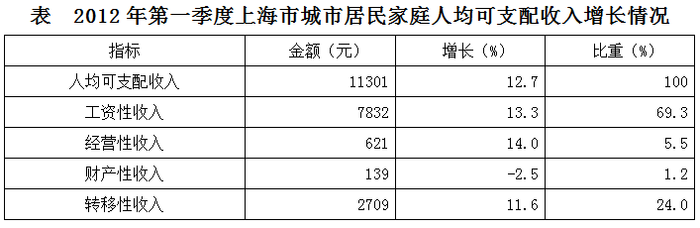

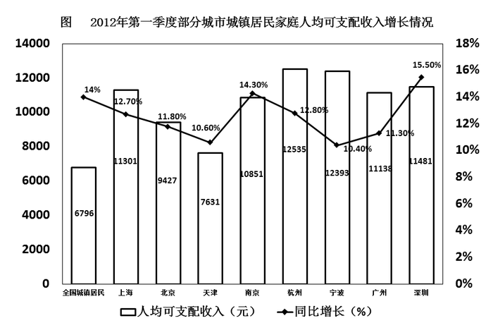

### 第 76 题

2012年第一季度上海城市居民家庭人均可支配收入增幅同比提高了0.4个百分点，则2010年第一季度上海城市居民家庭可支配收入为多少元：

A. 10028

B. 8929

C. 1273

D. 1233

第 76 题 · 答案与解析

**参考答案（粉笔题库参考内容）**

B

**解析**

根据题干“2010年······收入为多少元”，结合材料数据为2012年，可判定本题为间隔基期问题。定位表格，2012年第一季度上海城市居民家庭人均可支配收入为11301元，同比增长12.7%，根据题干2012年第一季度增幅同比提高0.4个百分点，则，2011年增长率，则间隔增长率。则2010年第一季度上海城市居民家庭可支配收入为，直除首位商8，只有B项满足。

故正确答案为B。

**考点**：综合资料、间隔基期

**来源**：2013年上海市公务员录用考试《行测》题（B类）第76题

### 第 77 题

关于2012年第一季度部分城镇居民家庭人均可支配收入的增长情况，下列说法正确的是：

A. 上海2011年第一季度城市居民家庭人均可支配收入不足10000元

B. 2012年第一季度与上年同期相比，杭州市城镇居民家庭人均可支配收入增长量最大

C. 2012年第一季度与上年同期相比，上海市城市居民家庭人均可支配收入增长量超过1500元

D. 2012年第一季度与上年同期相比，深圳市城镇居民家庭人均可支配收入增长量最大

第 77 题 · 答案与解析

**参考答案（粉笔题库参考内容）**

D

**解析**

A项：定位表格，上海2012年第一季度城市居民家庭人均可支配收入为11301元，同比增长12.7%，则上海2011年第一季度城市居民家庭人均可支配收入为：，错误；

C项：定位图表，2012年上海市城市居民家庭人均可支配收入为11301元，同比增长12.7%，则增长量为：，错误；

B项、D项：因A、C两项错误，故居民家庭人均可支配收入增长量最大的必然是杭州或者是深圳中一个。

杭州市居民家庭人均可支配收入增长量为：；

深圳市居民家庭人均可支配收入增长量为：。

因此深圳市居民家庭人均可支配收入增长量最大，B项错误、D项正确。

故正确答案为D。

**考点**：综合分析、综合资料

**来源**：2013年上海市公务员录用考试《行测》题（B类）第77题

### 第 78 题

2012年第一季度与上年同期相比，上述八个城市中城镇居民家庭人均可支配收入增长量低于全国城镇居民家庭人均可支配收入增长量的城市有：

A. 1个

B. 2个

C. 3个

D. 4个

第 78 题 · 答案与解析

**参考答案（粉笔题库参考内容）**

A

**解析**

根据题干“······增长量低于全国······的有”，可判定本题为增长量比较问题。定位柱状体和折线图，根据增长量比较结论，大大则大，只有天津市的人均可支配收入增长量有可能低于全国水平，其他地区明显高于全国水平。

全国城镇居民家庭人均可支配收入增长量为,

天津市城镇居民家庭人均可支配收入增长量为。

因此只有天津市城镇居民家庭人均可支配收入增长量低于全国水平，符合题意，而其他城市均高于全国水平。

故正确答案为A。

**考点**：增长量比较、综合资料

**来源**：2013年上海市公务员录用考试《行测》题（B类）第78题

### 第 79 题

2012年第一季度，在上海市城市居民家庭人均可支配收入增长中，转移性收入增长所占比重为：

A. 2.8%

B. 11.6%

C. 12.4%

D. 22.1%

第 79 题 · 答案与解析

**参考答案（粉笔题库参考内容）**

D

**解析**

根据题干“2012年第一季度······所占比重为”，可判定本题为现期比重问题。定位表格可知，2012年第一季度上海市城市居民家庭人均可支配收入为11301元，增长12.7%，则，转移性收入为2709元，增长11.6%，则，所求比重为，与D项最接近。

故正确答案为D。

**考点**：现期比重、综合资料

**来源**：2013年上海市公务员录用考试《行测》题（B类）第79题

### 第 80 题

2012年第一季度与上年同期相比，上海市城市居民家庭人均可支配收入中工资性收入的比重：

A. 降低了9.2个百分点

B. 提高了9.2个百分点

C. 降低了0.4个百分点

D. 提高了0.4个百分点

第 80 题 · 答案与解析

**参考答案（粉笔题库参考内容）**

D

**解析**

根据题干“2012年第一季度与上年同期相比······的比重”，结合选项降低或提高······百分点，可判定本题为两期比重计算问题。定位表格可知，上海市城市居民家庭人均可支配收入中工资性收入为7832元，同比增速a=13.3%，人均可支配收入为11301元，同比增速b=12.7%。根据两期比重公式，则题干所求，与D项最接近。

故正确答案为D。

**考点**：两期比重、综合资料

**来源**：2013年上海市公务员录用考试《行测》题（B类）第80题

### 第 81 题

我国新闻宣传战线近年来开展了“走基层、转作风、改文风”活动，在活动中涌现出了一大批生动鲜活、感人至深的精品佳作，一系列关系群众切身利益的突出问题得到了切实解决。这一活动的丰硕成果体现了：

A. 人民群众是社会实践的主体，是历史的创造者

B. 要坚持实践第一的观点，学会“从群众中来，到群众中去”的工作方法

C. 申请公开的政府信息中含有不应当公开的内容，不予公开，同时告知申请人并说明理由

D. 行政机关依申请提供政府信息，不得收取任何费用

第 81 题 · 答案与解析

**参考答案（粉笔题库参考内容）**

AB

**解析**

A、B项正确，我国新闻宣传战线近年来开展了“走基层、转作风、改文风”活动，在活动中涌现出了一大批佳作，这体现了人民群众是社会实践的主体，是历史的创造者，也体现了实践第一的观点和“从群众中来，到群众中去”的工作方法；

C、D项错误，无法从题干中体现出来。

故正确答案为A、B。

**考点**：唯物史观

**来源**：2013年上海市公务员录用考试《行测》题（B类）第81题

### 第 82 题

“国以民为本”，保障和改善民生是国家发展的最终目的。住房、医改、物价等问题引起了百姓的极大关注，解决这些问题的根本途径是：

A. 坚持改革开放

B. 深化行政体制改革

C. 坚持以经济建设为中心，大力发展生产力

D. 坚持民主集中制原则

第 82 题 · 答案与解析

**参考答案（粉笔题库参考内容）**

C

**解析**

2008年时任宣传部部长的刘云山在《求是》杂志上撰文称：“发展是解决我国所有问题的关键，住房、医改、物价这些问题都要靠发展来解决，就是要坚持以经济建设为中心，大力发展生产力。”

故正确答案为C。

**来源**：2013年上海市公务员录用考试《行测》题（B类）第82题

### 第 83 题

2012年国务院政府工作报告指出，扩大内需特别是消费是我国经济长期平稳较快发展的根本立足点，是今年工作的重点。

下列措施中，有利于扩大居民需求的有：

A. 实施紧缩财政政策

B. 提高存贷款基准利率

C. 完善社会保障体系

D. 增加中低收入者收入

第 83 题 · 答案与解析

**参考答案（粉笔题库参考内容）**

CD

**解析**

A、B项错误，紧缩性财政政策是指通过增加财政收入或减少财政支出以抑制社会总需求增长的政策，所以其不利于扩大居民的消费需求。提高贷款基准利率不利于企业扩大生产，相对应的由于银行利率提高，居民消费趋于保守，不利于扩大消费，所以A、B都可以排除；

C、D项正确，完善社保可以减轻居民在保障方面的投入，可以扩大居民需求。增加中低收入者收入，也可以起到同样效果。

故正确答案为C、D。

**考点**：宏观经济与调控政策

**来源**：2013年上海市公务员录用考试《行测》题（B类）第83题

### 第 84 题

修改后的《中华人民共和国刑事诉讼法》将于2013年１月１日起施行，下列选项中属于该法新增内容的是：

A. 尊重和保障人权

B. 保护公民的人身权利

C. 维护社会主义法制

D. 保护公民的民主权利

第 84 题 · 答案与解析

**参考答案（粉笔题库参考内容）**

A

**解析**

重新修订的《刑诉法》第2条规定，中华人民共和国刑事诉讼法的任务，是保证准确、及时地查明犯罪事实，正确应用法律，惩罚犯罪分子，保障无罪的人不受刑事追究，教育公民遵守法律，积极同犯罪行为作斗争，维护社会主义法制，尊重和保障人权，保护公民的人身权利、财产权利、民主权利和其他权利，保障社会主义建设事业的顺利进行。

B、C、D项错误，“尊重和保护人权”属于新增内容，B、C、D选项中的规定，均在修订前的刑诉法中有体现。

故正确答案为A。

**考点**：诉讼法

**来源**：2013年上海市公务员录用考试《行测》题（B类）第84题

### 第 85 题

凡是宪法、法律规定只能由法律规定的事项，不得以其他形式规定，或者只有在法律授权的情况下，才能由行政机关加以规定，这一原则被称为法律保留原则，关于这一原则，下列说法正确的是：

A. 这一概念中的“法律”是广义上的法律

B. 法律保留范围在一定程度上决定着立法权与行政权的界限

C. 我国司法制度属于法律绝对保留事项

D. 对非国有财产的征收属于法律相对保留事项

第 85 题 · 答案与解析

**参考答案（粉笔题库参考内容）**

BCD

**解析**

B项正确，法律保留的思想产生于19世纪初，最早提出该概念的是德国行政法学之父奥托·迈耶。根据迈耶的经典定义，法律保留是指在特定范围内对行政自行作用的排除。因此，法律保留本质上决定着立法权与行政权的界限，从而也决定着行政自主性的大小；

C项正确，《立法法》第9条规定，本法第八条规定的事项尚未制定法律的，全国人民代表大会及其常务委员会有权作出决定，授权国务院可以根据实际需要，对其中的部分事项先制定行政法规，但是有关犯罪和刑罚、对公民政治权利的剥夺和限制人身自由的强制措施和处罚、司法制度等事项外，这一条款规定了我国绝对保留的标准，即将一般保留中的更重要的事项仅由全国人大及其常委会来亲自制定法律，不得授权行政机关制定行政法规；

D项正确，《立法法》第8条规定，对于非国有财产的征收只能制定法律。这一规定可以视为除宪法特别保留外，对一般保留的标准的规定，属于法律的相对保留事项。

故正确答案为BCD。

**考点**：法理学

**来源**：2013年上海市公务员录用考试《行测》题（B类）第85题

### 第 86 题

下列关于政府信息公开的叙述，正确的是：

A. 行政机关在公开政府信息前，应当依法对拟公开的政府信息进行审查

B. 行政机关对符合法律规定的公开基本要求的政府信息应当主动公开

C. 申请公开的政府信息中含有不应当公开的内容、不予公开，同时告知申请人并说明理由

D. 行政机关依申请提供政府信息，不得收取任何费用。

第 86 题 · 答案与解析

**参考答案（粉笔题库参考内容）**

ABC

**解析**

A选项正确，根据《中华人民共和国政府信息公开条例》第四条，政府信息公开工作机构的具体职责第四点对拟公开的政府信息进行保密审查；

B选项正确，根据第九条，行政机关对符合下列基本要求之一的政府信息应当主动公开：（一）涉及公民、法人或者其他组织切身利益的；（二）需要社会公众广泛知晓或者参与的；（三）反映本行政机关机构设置、职能、办事程序等情况的；（四）其他依照法律、法规和国家有关规定应当主动公开的；

C选项正确，根据第二十一条第二点，对申请公开的政府信息，属于不予公开范围的，应当告知申请人并说明理由；

D选项错误，根据第二十七条，行政机关依申请提供政府信息，除可以收取检索、复制、邮寄等成本费用外，不得收取其他费用。行政机关不得通过其他组织、个人以有偿服务方式提供政府信息。

故正确答案为A、B、C。

**考点**：其他法律法规

**来源**：2013年上海市公务员录用考试《行测》题（B类）第86题

### 第 87 题

关于保密工作的管理机关，下列说法中正确的是：

A. 国家安全部门主管全国的保密工作

B. 县级以上国家安全部门管理或者指导本行政区域的保密工作

C. 国家机关和涉及国家秘密的单位管理本机关和本单位的保密工作

D. 中央国家机关在职权范围内，管理或者指导本系统的保密工作

第 87 题 · 答案与解析

**参考答案（粉笔题库参考内容）**

CD

**解析**

A、B选项错误，《保密法》第五条规定，国家保密行政管理部门主管全国的保密工作。县级以上地方各级保密行政管理部门主管本行政区域的保密工作；

C、D选项正确，《保密法》第六条规定，国家机关和涉及国家秘密的单位管理本机关和本单位的保密工作，中央国家机关在其职权范围内，管理或指导本系统保密工作。

故正确答案为C、D。

**考点**：其他法律法规

**来源**：2013年上海市公务员录用考试《行测》题（B类）第87题

### 第 88 题

根据“有权必有责，有权受监督”的要求，行政人员在依法行使国家行政权力的时候必须依法履行其行政职责，并为其违法失职行为承担必要的法律责任，下列属于行政人员民事法律责任的承担方式的是：

A. 恢复名誉

B. 停止侵害

C. 没收财产

D. 赔偿损失

第 88 题 · 答案与解析

**参考答案（粉笔题库参考内容）**

ABD

**解析**

我国《中华人民共和国民法典》第一百七十九条第一款规定：“承担民事责任的方式主要有：（一）停止侵害；（二）排除妨碍；（三）消除危险；（四）返还财产；（五）恢复原状；（六）修理、重作、更换；（七）继续履行；（八）赔偿损失；（九）支付违约金；（十）消除影响、恢复名誉；（十一）赔礼道歉。”

故正确答案为A、B、D。

**考点**：民法典

**来源**：2013年上海市公务员录用考试《行测》题（B类）第88题

### 第 89 题

公共行政机关的工作人员承担着一定的工作职责，行政道德作为一种隐性的工作职责，虽然没有量化的评判标准，但是对行政人员和行政组织来说是必不可少的，下列关于行政道德的说法。正确的是：

A. 道德责任就是具有道德内涵的行政责任

B. 行政人员的行政道德应该限定在行政管理活动期间

C. 行政道德客观上可以进行善恶评价

D. 行政道德的履行是强制性的

第 89 题 · 答案与解析

**参考答案（粉笔题库参考内容）**

ACD

**解析**

行政道德是社会生活中特殊的道德领域。行政道德评价则是政府行政组织、行政人员自身以及人民群众根据行政道德的原则和规范对行政主体的道德行为进行善恶价值判断和表明褒贬态度，行政道德则主要是因制度安排的要求而带有强制性特点。

故正确答案为A、C、D。

**来源**：2013年上海市公务员录用考试《行测》题（B类）第89题

### 第 90 题

某省开通电话专线，以方便群众对政府工作人员在行政工作中违法行为的举报，作为政府部门，接受组织内外的监督是政府应履行的职责。

下列属于行政监督方式的是：

A. 政府召开新闻发布会，向民众解释新的户籍管理政策

B. 某市民向电视台曝光某局长酒驾

C. 政府部门年度财政审计

D. 某市检察院对该市某局领导提起受贿公诉

第 90 题 · 答案与解析

**参考答案（粉笔题库参考内容）**

BCD

**解析**

C项正确，行政监督有广义和狭义之分，狭义的行政监督是指行政机关内部上下级之间、以及专设的行政监察、审计机关对行政机关及其公务人员的监督；

B、D项正确，广义的行政监督泛指执政党、国家权力机关、司法机关和人民群众等多种社会力量对国家行政机关及其公务人员的监督；据此排除A项。

故正确答案为B、C、D。

备注：此题已经过时，保留仅供参考。目前行政监察机关已经被合并到监察委员会，属于外部监督。

**来源**：2013年上海市公务员录用考试《行测》题（B类）第90题

### 第 91 题

与一维条形码相比，二维码具有数据容量更大、编码超越字母数字的限制、有抗损毁能力等方面的优势，目前已得到广泛应用。

下列关于二维码的表述，错误的是：

A. 图片、声音、文字、签字、指纹等均可通过二维码表示出来

B. 二维码没有加密措施，保密性不足

C. 二维码为网络浏览、下载、在线视频、网上购物和支付等提供方便入口

D. 目前二维码都是黑白二色，对年轻人吸引力有欠缺

第 91 题 · 答案与解析

**参考答案（粉笔题库参考内容）**

BD

**解析**

B项错误，二维码具有存储量大、保密性高、追踪性高、抗损性强、备援性大、成本便宜的特点；

C项正确，二维码是用某种特定的几何图形按一定规律在平面（二维方向）分布的黑白相间的图形记录数据符号信息的，在代码编制上巧妙地利用了构成计算机内部逻辑基础的“0”“1”比特流概念，是用若干个与二进制相对应的几何形体来表示文字数值信息，通过图像输入设备或光电扫描设备自动识读以实现自动处理，对于下载浏览和查询都非常便捷；

D项错误，二维码的便捷使其在手机等新平台上运用广泛，尤其是年轻人群接触度高。

本题为选非题，故正确答案为B、D。

**考点**：科技理论与成就

**来源**：2013年上海市公务员录用考试《行测》题（B类）第91题

### 第 92 题

绿色食品是指产自优良环境，按照规定的技术规范生产，实行全程质量控制，无污染、安全、优质并使用专用标志的食用农产品及加工品。

关于绿色食品，下列表述正确的是：

A. 绿色食品可由企业自行认定

B. 绿色食品需经专门机构认定，使用专用标志

C. 只需生产过程中不使用化学物质，就可以认定为绿色食品

D. 绿色食品实行“从土地到餐具”全程质量控制，而不是简单地对最终产品的有害成份含量和卫生指标进行测定

第 92 题 · 答案与解析

**参考答案（粉笔题库参考内容）**

BD

**解析**

A项错误，绿色食品的认定是专门机构，并非企业自身；

B项正确，绿色食品在中国是对具有无污染的安全、优质、营养类食品的总称。它是按特定的生产方式生产，并经过国家有关机构认定，准许使用绿色食品标识的无污染、无公害、安全、优质、营养型的食品；

C项错误，D项正确，绿色食品标准以“从土地到餐桌”全程质量控制理念为核心，包括重中之重的监管、包装、贮存等内容。

故正确答案为B、D。

**考点**：生活常识

**来源**：2013年上海市公务员录用考试《行测》题（B类）第92题

### 第 93 题

获得第82届奥斯卡金像奖的科幻电影《阿凡达》以精彩剧情，开创性的3D拍摄效果，风靡全球，成为近十年来最耀眼的电影之一。要拍摄这样一部画面质量高，感染力强的真人与虚拟角色共同表演的3D影片，不可或缺的技术有：

A. 海量存储技术

B. 动作捕捉技术

C. 智能制造技术

D. 三维合成技术

第 93 题 · 答案与解析

**参考答案（粉笔题库参考内容）**

BCD

**解析**

B项正确，动作捕捉技术的实质是要测量、跟踪、记录物体在三维空间中的运动轨迹，可以使动画更加直观、生动；

D项正确，三维技术是3D电影的基础，CGI电脑绘图是指用计算机影像，更精确地渲染影片中的三维特效；

C项正确，制作3D电影需要大量技术人员和仪器设备参与，后期制作对各项技术的综合合成同样至关重要。

故正确答案为B、C、D。

**考点**：科技理论与成就

**来源**：2013年上海市公务员录用考试《行测》题（B类）第93题

### 第 94 题

情绪ABC理论是由美国心理学家埃利斯创建的，就是把激发事件A（activating event的第一个英文字母），产生信念B（belief的第一个英文字母），情绪和行为后果C（conesquence的第一个英文字母）组合而成，这个理论是指：

A. 诱发事件A直接导致了人的情绪和行为结果C

B. 我们常有的一些合理信念会使自己产生情绪困扰

C. 事物的本身并不影响人，人们只受对事物看法的影响

D. 情绪由外界控制，自己无能为力

第 94 题 · 答案与解析

**参考答案（粉笔题库参考内容）**

BCD

**解析**

A项错误，情绪ABC理论的创建者美国心理学家埃利斯认为：激发事件A （activating event的第一个英文字母）只是引发情绪和行为后果C（conesquence的第一个英文字母）的间接原因，而引起C的直接原因则是个体对激发事件A的认识和评价而产生的信念B（belief的第一个英文字母），而非直接导致C；

B项正确，正是由于我们常有的一些不合理的信念才使我们产生情绪困扰；

C项正确，正好体现了该理论；

D项正确，是该理论常见不合理信念的表现。

故正确答案为B、C、D。

**考点**：生活常识

**来源**：2013年上海市公务员录用考试《行测》题（B类）第94题

### 第 95 题

全民国防教育的基本任务是：普及国防知识、培训军事技能、培育国防后备人才，激发爱国热情，强化国防观念、增强民族自尊心、自信心、自豪感和凝聚力、向心力，提高公民履行国防义务的自觉性。国防教育须贯彻的基本方针有：

A. 全民参与

B. 长期坚持

C. 讲求实效

D. 维护和平

第 95 题 · 答案与解析

**参考答案（粉笔题库参考内容）**

ABC

**解析**

《国防教育法》明文规定：“国防教育贯彻全民参与、长期坚持、讲求实效的方针。”

故正确答案为A、B、C。

**考点**：其他法律法规

**来源**：2013年上海市公务员录用考试《行测》题（B类）第95题

### 第 96 题

跨越长江，连接沪苏的快速通道崇启大桥将从江苏启东到上海的车程缩短100公里，加快了长三角一体化进程。

下列有关崇启大桥表述正确的是：

A. 崇启大桥全长2.4公里

B. 崇启大桥由于地处长江入海口，是所有跨越长江大桥中最靠近大海的

C. 崇启大桥被称为“长江入海第一桥”

D. 崇启大桥是上海国际航运中心洋山深水港区的重要配套工程

第 96 题 · 答案与解析

**参考答案（粉笔题库参考内容）**

BC

**解析**

A项错误，崇启大桥全长52公里；

D项错误，上海国际航运中心洋山深水港区的重要配套工程是东海大桥，而不是崇启大桥。

故正确答案为B、C。

**考点**：中国地理

**来源**：2013年上海市公务员录用考试《行测》题（B类）第96题

### 第 97 题

氢能汽车是新能源汽车产业的一个发展重点，它是指以氢为主要能源，利用氢燃轻电池和电动机取代传统的引擎，其燃烧物是水和少量氮氧化合物，对空气污染少，具有广阔的应用前景，目前，氢能汽车的技术日趋成熟，但还有（　）等问题有待进一步解决。

A. 氢的安全性

B. 氢的储存和运输

C. 电池运行时产生的辐射

D. 电池的经济性

第 97 题 · 答案与解析

**参考答案（粉笔题库参考内容）**

BD

**解析**

氢能汽车是以氢为主要能量的汽车。燃料电池和电动机可以取代一般引擎，但氢燃料电池代价高，氢的储存要减小体积必须液化，液化必须控制在零下253度。运输中很难保证，会损失能量，也不够经济。

本题为选非题，故正确答案为B、D。

**考点**：科技理论与成就

**来源**：2013年上海市公务员录用考试《行测》题（B类）第97题

### 第 98 题

如果发现有人在室内触电，首先要使触电者尽快脱离电源。然后根据具体情况进行相应的救治。脱离电源的正确方法有：

A. 用手拉开或用脚踢开触电者，使之脱离电源

B. 如距离闸刀较远，应迅速用绝缘良好的电工钳或有干燥木柄的利器（刀、斧、锹等）砍断电线

C. 如开关箱在附近，可立即拉下闸刀或拔掉插头、断开电源

D. 用干燥的木棒、竹竿、硬塑料管等物迅速将电线拨离触电者

第 98 题 · 答案与解析

**参考答案（粉笔题库参考内容）**

BCD

**解析**

A项错误，人体属于导体，不可直接接触触电者，所以A项很危险，会使施救者同时触电，因此排除A；

B、C、D正确，正确做法应当是关闭电源或者使用绝缘体让电源和人分离。

故正确答案为B、C、D。

**考点**：生活常识

**来源**：2013年上海市公务员录用考试《行测》题（B类）第98题

### 第 99 题

坐落在上海张江的“上海光源”是我国利用同步辐射光进行各种科学研究和技术开发的大科学装置和大科学平台。

下列关于上海光源的表述，不正确的是：

A. 我国首座第三代同步辐射光源

B. 光源能量位居世界第一

C. 世界性能最好的高能光源之一

D. 至少具有30年科学寿命

第 99 题 · 答案与解析

**参考答案（粉笔题库参考内容）**

BC

**解析**

上海光源是中国首座第三代同步辐射光源，英文全称（Shanghai Synchrotron Radiation Facility, SSRF），其能量居世界第四（仅次于日本Spring-8、美国APS、欧洲ESRF），性能超过现有的第三代同步辐射光源，是2012年世界上在建或设计中性能最好的中能光源之一；它也满足了我国多个学科领域对同步辐射应用的迫切需求，并至少有30年科学寿命。

本题为选非题，故正确答案为B、C。

**考点**：科技理论与成就

**来源**：2013年上海市公务员录用考试《行测》题（B类）第99题

### 第 100 题

2012年4月30日，我国在西昌卫星发射中心用“长征三号乙”运载火箭，成功发射了两颗北斗导航卫星。卫星顺利进入预定转移轨道。这是我国北斗卫星导航系统首次采用“一箭双星”方式发射导航卫星，也是我国首次采用“一箭双星”方式发射两颗：

A. 地球低轨道卫星

B. 地球中高轨道卫星

C. 地球静止轨道卫星

D. 太阳同步轨道卫星

第 100 题 · 答案与解析

**参考答案（粉笔题库参考内容）**

B

**解析**

2012年4月30日，西昌卫星发射中心用“长征三号乙”运载火箭，将两颗北斗导航卫星送入太空，是我国首次采用“一箭双星”方式发射两颗地球中高轨道卫星。

故正确答案为B。

**考点**：科技理论与成就

**来源**：2013年上海市公务员录用考试《行测》题（B类）第100题

### 第 101 题

中国人早就知道应用天然磁石制成指南针，并借它来辨别方向。宋朝学者沈括在他的《梦溪笔谈》中说：“方家以磁石磨针锋，则能指南，然常微偏东，不全南也。”其原因是：

A. 全球磁极相对于地理南北极具有微小的偏角

B. 方家用“缕悬法”安装磁针时，受偏东的一个力牵制

C. 方家的针磨得太细，易受干扰

D. “犹柏之指西，莫可原其理”

第 101 题 · 答案与解析

**参考答案（粉笔题库参考内容）**

A

**解析**

磁石磨针锋，针磁化为一个小磁体，能够指南，说明受到了磁场作用，周围没有其他磁体，便只能是地球产生的磁场，说明地球是个巨大的磁体；“常微偏东，不全南（不是正南方向）”说明地球南北极和地磁南北极并不重合，存在地磁偏角。

故正确答案为A。

“磁石之指南，犹柏之指西，莫可原其理。”是指磁石就是有磁性的石头，跟现在指南针一样。磁石指向南方，和柏树的树枝指向西方（柏树的树枝长的都是朝西的）一样，不能说明（解释）其中的道理。指这种现象是本身就这样的，不能解释，他就是朝南了朝西了。

**考点**：生活常识

**来源**：2013年上海市公务员录用考试《行测》题（B类）第101题

### 第 102 题

据新华社电，我国第一艘航母“辽宁舰”交接入列后，海军官兵以科学求实的态度和顽强拼搏的精神，按计划迅速投入紧张的出海训练和科研试验任务中，其间，顺利进行了歼-15飞机起降飞行训练。

目前，歼-15飞机的起飞方式是：

A. 电磁弹射起飞

B. 蒸汽弹射起飞

C. 垂直起飞

D. 滑跃式起飞

第 102 题 · 答案与解析

**参考答案（粉笔题库参考内容）**

D

**解析**

歼-15是我国研制的首型舰载多用途战斗机，在航母上的起降方式，取决于航母本身。辽宁舰原是前苏联瓦良格号，后被我国引入翻新改建，保留了其传统的滑跃式甲板设计，舰载机通过短距离加速滑跑，滑橇甲板给舰载机提供上升角度，可以使得舰载机脱离航母，最终升空。

故正确答案为D。

弹射起飞技术在航母技术较为发达的美国采用，早期采用蒸汽弹射方式，现在则采用了电磁弹射技术，这类航母的特点是前段甲板平直，不同于滑跃式航母有一定倾斜角的前端。垂直起飞则与飞机自身设计有关，歼-15并不属于此类，我国目前也没有此类技术的现役飞机。该技术在英国“鹞式”，前苏联“雅克”，包括美国新投入的F-35上采用。

**考点**：科技理论与成就

**来源**：2013年上海市公务员录用考试《行测》题（B类）第102题

### 第 103 题

碳纤维及其复合材料是快速发展而成长起来的新型材料，具有高强度、耐高温、耐辐射、耐疲劳、热膨胀系数小等一系列优异性能，其应用前景广阔，可应用于（  ）等方面：

A. 疫苗药物

B. 航空航天

C. 大型风力发电装备

D. 高速轨道设备

第 103 题 · 答案与解析

**参考答案（粉笔题库参考内容）**

BCD

**解析**

碳纤维复合材料技术能满足能源、资源、环境、制造、交通等国民经济支柱产业对高性能结构材料的迫切需求，相应技术可以通过适当的移植来满足汽车工业、航空航天、高速轨道交通、大型风力发电装备等所需。

故正确答案为B、C、D。

**考点**：科技理论与成就

**来源**：2013年上海市公务员录用考试《行测》题（B类）第103题

### 第 104 题

食品添加剂是指用于改善食品品质、延长食品保质期、便于食品加工和增加食品营养成分的一类化学合成或天然物质。食品添加剂大大促进了食品工业的发展，下列关于四种食品添加剂的描述正确的是：

A. 亚硝酸钠：可以抑菌、保鲜和防腐，如过量食入可麻痹血管运动中枢，呼吸中枢及周围血管

B. 食用色素：常用于水果制品、饮料等，不能向人体提供营养物质，会危害人体健康，具有一定的毒性与致癌作用

C. 食盐：长期过量摄入、血液的容量将会增加，心脏搏动更费力，并引发高血压

D. 氢化植物油：作为一种提味剂，氢化植物油代替黄油和脂肪用于沙拉酱、人造黄油和焙烤食物的加工，它会导致老年痴呆症

第 104 题 · 答案与解析

**参考答案（粉笔题库参考内容）**

AC

**解析**

B错误，食用色素分为天然和人工合成两种，食用天然着色剂主要是指动植物组织提取的色素，多为植物色素，安全性高。人工合成色素原料主要以化工产品为主，有些甚至会危害人体健康。人工色素还不能完全代替所有的食用色素；

D错误，氢化植物油作为一种保鲜剂和提味剂，常代替黄油和脂肪用于沙拉酱、人造黄油和焙烤食物的加工，会导致肥胖和高胆固醇。

故正确答案为A、C。

**考点**：生活常识

**来源**：2013年上海市公务员录用考试《行测》题（B类）第104题

### 第 105 题

为了防止行政权力被滥用，必须对行政人员实施有效地行政监督，我国自秦朝起就有一系列检察制度、唐代的台院、（　）和察院联合称为御史台三院，拥有弹劾官吏、参与司法审讯及监督仓库出纳等职权。

A. 殿院

B. 督院

C. 谏院

D. 肃院

第 105 题 · 答案与解析

**参考答案（粉笔题库参考内容）**

A

**解析**

唐代中央监察机构不同于前代的是，在御史台之下设立三院，即台院、殿院和察院，三院分立，相互牵制配合，形成了一个完善而严密的中央监察机制。

故正确答案为A。

**考点**：中国历史

**来源**：2013年上海市公务员录用考试《行测》题（B类）第105题

### 第 106 题

下列关于便民服务热线电话号码的表述，正确的是：

A. 12320天气预报

B. 12121环保热线

C. 12345市民服务热线

D. 12315消费者服务热线

第 106 题 · 答案与解析

**参考答案（粉笔题库参考内容）**

CD

**解析**

A、B项错误，“12320”是全国公共卫生公益热线，“12121”为气象信息查询电话；

C、D项正确。

故正确答案为C、D。

**考点**：生活常识

**来源**：2013年上海市公务员录用考试《行测》题（B类）第106题

### 第 107 题

经国家质量检验检疫总局、国家标准化管理委员会批准，新修订的《汉语拼音正词法基本规则》已于2012年10月1日起实施。如何拼写汉语的人名、地名，如何拼写汉语的数词、量词、连接词、形容词等，都有了“法定”规范。

下列选项中，不符合该规则的是：

A. Li Hua（李华）

B. Dong-fang Shuo（东方朔）

C. Zhang-Wang Shufang（张王淑芳）

D. Wang buzhang（王部长）

第 107 题 · 答案与解析

**参考答案（粉笔题库参考内容）**

B

**解析**

新版《汉语拼音正词法基本规则》明确规定，姓名必须姓在前，名在后，复姓连写，姓和名的首字母大写，双姓两字的首字母都大写，如Li Hua。但当人名与职务合写时，职务不大写，如Wang buzhang、Li xiansheng。

本题为选非题，故正确答案为B。

**考点**：文化常识

**来源**：2013年上海市公务员录用考试《行测》题（B类）第107题

## 材料 7

中共第十八次全国代表大会是在我国进入全面建成小康社会决定性阶段召开的十分重要的大会。十八大报告强调：道路关乎党的命脉，关乎国家前途、民族命运、人民幸福。在改革开放三十多年一以贯之的接力探索中，我们坚定不移高举中国特色社会主义伟大旗帜，既不走封闭僵化的老路，也不走改旗易帜的邪路。中国特色社会主义道路，中国特色社会主义理论体系，中国特色社会主义制度，是党和人民九十多年奋斗、创造、积累的根本成就，必须倍加珍惜、始终坚持、不断发展。建设中国特色社会主义，总依据是社会主义初级阶段，总布局是五位一体，总任务是实现社会主义现代化和中华民族伟大复兴。

        十八大报告提出，纵观国际国内大势，我国发展仍处于可以大有作为的重要战略机遇期。我们要准确判断重要战略机遇期内涵和条件的变化，全面把握机遇，沉着应对挑战，赢得主动，赢得优势，赢得未来，确保到二O二O年实现全面建成小康社会宏伟目标。全面建成小康社会，必须以更大的政治勇气和智慧，不失时机深化重要领域改革，坚决破除一切妨碍科学发展的思想观念和体制机制弊端，构建系统完备、科学规范、运行有效的制度体系，使各方面制度更加成熟更加定型。要加快完善社会主义市场经济体制，完善公有制为主体、多种所有制经济共同发展的基本经济制度，完善按劳分配为主体、多种分配方式并存的分配制度，完善宏观调控体系，更大程度更广范围发挥市场在资源配置中的基础性作用，完善开放型经济体系，推动经济更有效率、更加公平、更可持续发展。加快推进社会主义民主政治制度化、规范化、程序化，从各层次各领域扩大公民有序政治参与，实现国家各项工作法治化。加快完善文化管理体制和文化生产经营机制，基本建立现代文化市场体系，健全国有文化资产管理体制，健全基层公共服务和社会管理网络，建立确保社会既充满活力又和谐有序的体制机制。加快建立生态文明制度，健全国土空间开发、资源节约、生态环境保护的体制机制，推动形成人与自然和谐发展现代化建设新格局。

### 第 108 题

党的十八大报告提出的经济发展目标是，到二O二O年实现：

A. 人均国内生产总值和城乡居民收入比2010年翻一番

B. 人均国民生产总值和城乡居民收入比2010年翻一番

C. 国内生产总值和城乡居民人均收入比2010年翻一番

D. 国民生产总值和城乡居民人均收入比2010年翻一番

第 108 题 · 答案与解析

**参考答案（粉笔题库参考内容）**

C

**解析**

十八大报告提出，为全面建成小康社会，到2020年实现国内生产总值和城乡居民收入翻番的量化指标，即国内生产总值和城乡居民人均收入比2010年翻一番。

故正确答案为C。

**考点**：经济建设

**来源**：2013年上海市公务员录用考试《行测》题（B类）第108题

### 第 109 题

中国特色社会主义理论体系包括：

A. 毛泽东思想

B. 邓小平理论

C. “三个代表”重要思想

D. 科学发展观

第 109 题 · 答案与解析

**参考答案（粉笔题库参考内容）**

BCD

**解析**

党的十八大报告指出：“中国特色社会主义理论体系，就是包括邓小平理论、‘三个代表’重要思想、科学发展观在内的科学理论体系，是对马克思列宁主义、毛泽东思想的坚持和发展”，“中国特色社会主义理论体系是行动指南”。这些重要论述深刻阐明了中国特色社会主义理论体系对于坚持和发展中国特色社会主义的重大意义。坚定不移沿着中国特色社会主义道路前进，为全面建成小康社会而奋斗，要求我们更好地坚持和丰富中国特色社会主义理论体系。

故正确答案为B、C、D。

**考点**：新思想总论

**来源**：2013年上海市公务员录用考试《行测》题（B类）第109题

### 第 110 题

党的十八大报告提出，要在十六大、十七大确立的全面建设小康社会目标的基础上努力实现的新要求包括：

A. 人民民主不断扩大

B. 文化软实力显着增强

C. 人民生活水平全面提高

D. 经济快速持续发展

第 110 题 · 答案与解析

**参考答案（粉笔题库参考内容）**

ABC

**解析**

胡锦涛在十八大报告中提出，根据我国经济社会发展实际，要在十六大、十七大确立的全面建设小康社会目标的基础上努力实现新的要求：经济持续健康发展，转变经济发展方式取得重大进展，在发展平衡性、协调性、可持续性明显增强的基础上，实现国内生产总值和城乡居民人均收入比2010年翻一番；人民民主不断扩大；文化软实力显著增强；人民生活水平全面提高；资源节约型、环境友好型社会建设取得重大进展。由此可知，A、B、C三项正确，而D项中经济快速发展不是十八大报告中提出的新要求，排除。

故正确答案为A、B、C。

**考点**：重要文件

**来源**：2013年上海市公务员录用考试《行测》题（B类）第110题

### 第 111 题

党的十八大报告将中国特色社会主义事业总体布局从“四位一体”扩展为“五位一体”，表明我们党对中国特色社会主义建设规律从认识到实践都达到新的水平。“五位一体”是指：

A. 经济建设、政治建设、文化建设、制度建设、生态文明建设

B. 经济建设、法制建设、文化建设、社会建设、生态文明建设

C. 经济建设、政治建设、文化建设、社会建设、生态文明建设

D. 经济建设、政治建设、思想建设、社会建设、生态文明建设

第 111 题 · 答案与解析

**参考答案（粉笔题库参考内容）**

C

**解析**

十八大报告将生态文明建设与经济建设、政治建设、文化建设、社会建设并列，“五位一体”地建设中国特色社会主义。

故正确答案为C。

本题相关知识点：党的十二届六中全会首次提出以经济建设为中心、坚定不移地进行经济体制改革，坚定不移地进行政治体制改革、坚定不移地加强精神文明建设的总体布局，这一“三位一体”总体布局从党的十三大一直延续到十六大。党的十六届六中全会提出构建社会主义和谐社会的重大任务，总体布局拓展为“四位一体”，增加了社会建设。党的十八大提出生态文明建设，总体布局又拓展为“五位一体”。

**考点**：重要文件

**来源**：2013年上海市公务员录用考试《行测》题（B类）第111题

## 材料 8

“公共外交”是指一国政府通过文化交流、信息项目等形式，了解、获悉情况和影响国外公务，以提高本国国家形象和国际影响力，进而增进本国家利益的外交方式。公共外交的目的就是提升本国形象，影响外国公众对本国的态度，进而影响外国政府对本国的政策。中国要以“公共外交”建设为契机，创造良好的国际舆论环境，创新对外传播方法，增强国际话语权。目前，“公共外交”已经成为各国外交的新着力点。

        中国国家形象宣传片是为塑造和提升中国繁荣发展、民主进步、文明开放、和平和谐的国家形象而设立的重点项目，是在新时期探索对外传播新形势的一次有益尝试。中国国家形象宣传片包括一部30秒长度的电视宣传片和一部15分钟长度的短纪录片。2011年，中国国家形象宣传片的人物篇亮相于纽约时代广场，中国各领域杰出代表和普通百姓在片中逐一亮相，让美国观众看到一个更直接更立体的中国国家形象。

### 第 112 题

从政治角度看，良好的国家形象是：

A. 对外关系稳定发展的保证

B. 充分实现国家利益的条件

C. 制定国家外交政策的依据

D. 提升国家综合国力的因素

第 112 题 · 答案与解析

**参考答案（粉笔题库参考内容）**

ABD

**解析**

国家形象作为反映在媒介和人们心理中的对于一个国家及其民众的历史、现实，政治、经济、文化、生活方式以及价值观的综合印象，既包含着对于国家的认识，同时也包含着理性评价和感性态度，具有极大的影响力、凝聚力，是一个国家整体实力的体现。因此良好的国家形象有利于对外关系稳定发展，实现国家利益，提升综合国力，故A、B、D项符合题意。C选项本身是错误的，制定国家外交政策的依据是国家利益，而不是国家形象。

故正确答案为A、B、D。

**考点**：政治建设

**来源**：2013年上海市公务员录用考试《行测》题（B类）第112题

### 第 113 题

从文化角度看，国家形象宣传片之所以能起到塑造和提升中国形象的作用，其依据是：

A. 文化能够对人产生潜移默化的作用

B. 中华传统文化独树一帜，独领风骚

C. 现代信息技术具有文化传承的作用

D. 文化交流能够增进各国间的相互了解

第 113 题 · 答案与解析

**参考答案（粉笔题库参考内容）**

AD

**解析**

通过在纽约时代广场播放中国国家形象宣传片宣传当代中国形象，让外国观众看到一个更直接更立体的中国国家形象，这样不仅可以增进各国间的相互了解，而且可以改变外国公众对中国的印象，影响外国公众对中国的态度，从而提高本国国家形象和国际影响力。故A、D两项符合题意。B、C两项都没有从文化角度阐述，而只是阐述了中国传统文化的特点以及科技对文化的作用，故排除。

故正确答案为A、D。

**考点**：文化建设

**来源**：2013年上海市公务员录用考试《行测》题（B类）第113题

### 第 114 题

首部中国国家形象片在美国纽约时代广场的大屏幕上持续滚动播放，向世界展示多元和丰富的中国形象，这一举措旨在：

A. 践行我国主张构建和谐世界的外交理念

B. 巩固我国在处理国际事务中的主导作用

C. 扩大我国国际影响力，提升国家软实力

D. 消除中美间的矛盾，促进国际合作发展

第 114 题 · 答案与解析

**参考答案（粉笔题库参考内容）**

C

**解析**

国家形象被认为是国家“软实力”的重要组成部分之一，可以体现这个国家的综合实力和影响力，因此通过播放中国国家形象宣传片可以扩大我国国际影响力，提升国家软实力，故C选项正确。题干所给文段及提问都没有涉及我国关于“和谐世界”的外交理念，A选项与题干无关，故排除；B选项本身错误，虽然我国综合实力不断提升，但目前在国际事务中并没有占主导地位，故排除；由于中美两国利益不同，矛盾也是不可能通过播放一段中国国家形象片而消除，故排除D。

故正确答案为C。

**考点**：其他建设

**来源**：2013年上海市公务员录用考试《行测》题（B类）第114题

### 第 115 题

在国际关系中，各国的公共外交定义大同小异，但具体做法大相径庭。有些国家是把自己的价值观强加给他国，甚至干涉其它国家内政，而中国是向世界展示自己的文化传统、社会发展、内外政策，回答人们对中国提出的问题，这表明：

A. 相同的价值观是国际交往的基础

B. 立场影响人们的价值判断和价值选择

C. 主观能动性的发挥受客观制约

D. 认识的多样性取决于事物的复杂性

第 115 题 · 答案与解析

**参考答案（粉笔题库参考内容）**

BD

**解析**

题干指出各国的公共外交政策定义大同小异，但是具体做法大相径庭，说明由于人们立场的不同，具体的价值判断和价值选择也是不同的。公共外交具体做法的差异与国际关系的复杂性有关，也就是说认识的多样性取决于事物的复杂性，故B、D两项正确。题干主要阐述的是各国外交政策的差异，没有提到相同之处，故排除A；C选项中的观点文段也没有提到，故排除。

故正确答案为B、D。

**考点**：其他建设

**来源**：2013年上海市公务员录用考试《行测》题（B类）第115题

