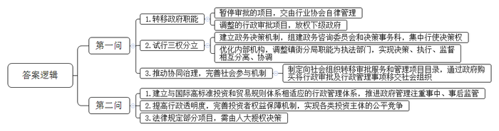
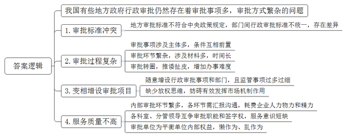
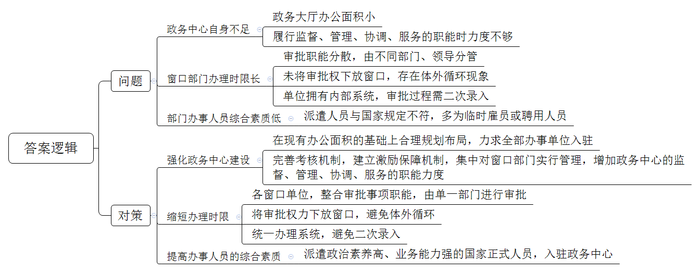
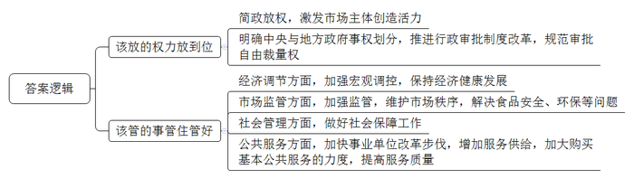
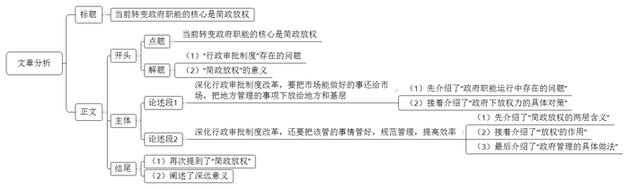

# 2014年上海市公考《申论》题 （A卷）

<!-- gwy:overview:start -->
> **上海 · 2014 · 申论 · A类** ｜ 5 题 · 图片 5 处 · 答案随题折叠

导航：[题目](#题目) · [材料 1](#材料-1)
<!-- gwy:overview:end -->

> 候选采集稿。参考答案及解析来自粉笔页面，不代表官方答案或真实高分答卷；来源使用许可与原卷对应关系仍需人工核实。

## 给定材料

### 材料 1

党的十八届三中全会通过的《中共中央关于全面深化改革若干重大问题的决定》提出，科学的宏观调控，有效的政府治理，是发挥社会主义市场经济体制优势的内在要求。必须切实转变政府职能，深化行政体制改革，创新行政管理方式，增强政府公信力和执行力，建设法治政府和服务型政府。全面正确履行政府职能。进一步简政放权，深化行政审批制度改革，最大限度减少中央政府对微观事务的管理，市场机制能有效调节的经济活动，一律取消审批；对保留的行政审批事项要规范管理，提高效率；直接面向基层、量大面广、由地方管理更方便有效的经济社会事项，一律下放地方和基层管理。

2013年11月1日《人民日报》刊载题为《行政体制改革政府华丽转身》的评论文章指出，党的十八大以来，一大批行政事业性收费减免，行政审批事项取消和下放，政企分开、政资分开、政事分开、政社分开深入推进，大部门制改革稳步开展，行政成本进一步降低，政府公信力和执行力不断提高……政府职能向着创造良好发展环境、提供优质公共服务、维护社会公平正义转变，我国行政体制改革不断深化。

“转变政府职能”，是当前形势下稳增长、控通胀、防风险，保持经济持续健康发展的迫切需要和重大举措，也是经济社会发展到这一阶段的客观要求。而行政审批制度改革（简政放权）则是转变政府职能的突破口，是释放改革红利、打造中国经济升级版的重要一招。

### 材料 2

行政体制改革，需要自上而下，上下联动，全国一盘棋。这既是社会的共识，也是政府及相关部门的行动。2013年9月27日，国务院批准《中国（上海）自由贸易试验区总体方案》，国务院明确，中国（上海）自由贸易试验区，是党中央、国务院在新形势下推进改革开放的重大举措，要使之成为推进改革和提高开放型经济水平的“试验田”，形成可复制、可推广的经验，发挥示范带动、服务全国的积极作用，促进各地区共同发展，方案同时明确了上海自贸区五大主要任务，其中首要任务是加快政府职能转变。积极探索建立与国际高标准投资和贸易规则体系相适应的行政管理体系，推进政府管理由注重事先审批转为注重事中、事后监管。提高行政透明度，完善投资者权益有效保障机制，实现各类投资主体的公平竞争。

广东省被列为我国行政审批制度改革试点地区。2012年5月，广东省政府向国务院呈报了关于深化行政审批制度改革先行试点的请示，请求国务院授权广东停止实施和调整部分行政审批事项。2012年8月22日，国务院第214次常务会议决定批准广东省在“十二五”期间进行先试先行。此后，监察部、国务院法制办会同有关部门研究，认定广东要求改革试点的行政审批中，有25个项目是由法律规定的，需要由全国人大常委会作出决定，授权国务院同意广东在本行政区域内停止实施和调整这些行政审批。2012年12月25日，关于授权国务院同意在广东省暂时调整部分法律规定的行政审批的决定草案，摆上了全国人大常委会组成人员的案头，提交审议。12月29日，全国人大常委会发布了《关于授权国务院在广东省暂时调整部分法律规定的行政审批的决定》。

广东省政府此次希望改革的行政审批分为两大类。一类是暂时停止审批的项目，共20项，其中15项停止审批后，将交由具备条件的行业协会实行自律管理，如城乡规划法规定的城乡规划编制单位乙级和丙级资质认定。职业病防治法规定的建设项目职业病危害预评价报告审核和职业卫生技术服务机构资质认可等；营业性射击场立项审批、中外合作经营企业委托经营管理合同审批、修理计量器许可等5项，将通过现有的其他监管措施、备案、检验程序等进行管理。另一类暂时调整的5项行政审批项目，均涉及审批权的下放，如法律规定由商务部实施的自动进口许可下放到广东省政府和设区的市政府；由广东省政府环保部门实施的机动车排气污染年度检测，下放到设区的市政府环保部门。

广东省佛山市顺德区自2011年8月启动了新一轮行政审批制度改革，在转变政府职能上取得了突破，共向社会转移了22项职能事项。2012年，顺德区政府拟转移的职能的重点在于经济和民生领域。13个区属政府部门拟向社会组织转移76项职能，为配合职能转变，在审批集中、精简后，部门的内部体制、运行机制、职能转移等方面需要做相应的改革。在顺德区环境运输和城市管理局，试行了三权分立制度。该局建立了政务决策机制，组建了高规格的政务咨询委员会，还同时新建决策事务科，以决策事务科为决策平台集中行使决策权。不仅如此，该局还重新优化内部机构；并调整镇街分局职能，定位为执法部门，形成决策、执行、监督既相互分离又相互协调的机制。

顺德区还全面推动协同治理，在完善社会参与机制上取得了突破。在行政审批制度改革中，“以社会化为导向，全面推动协同治理”是一项重要举措，顺德区在政府部门的职权职责范围内，依据法律、法规规定，在一定期限内，通过购买服务等方式将有关可由社会组织承担的行政审批及其他行政管理事项移交社会组织履行。各部门制定向社会组织转移审批服务项目与管理事项的目录，推动社会力量参与行政审批和服务。

### 材料 3

我国行政审批制度改革始于21世纪初，并取得了较大的成效。2001年以来，国务院部门已分六批先后取消和调整行政审批事项2497项，占原有总数的69.3%；31个省、区、市取消和调整了3.7万余项审批项目，占原有总数的68.2%。多头审批、多次审批、交叉审批、重复审批的情况基本改善，方便了群众办事，减轻了群众和企业负担。

2013年3月18日，新一届国务院第一次常务会议进一步确定了扎实推进改革、转变政府职能的9项任务。此后，取消一批行政事业性收费，取消一批行政审批事项，取消一批达标评比、评估和相关检查活动，频频成为公众热议的焦点。截至目前，国务院已取消或下放了能源、交通、通信、文化等领域334项行政审批事项，简政放权成为深化改革的“马前卒”和宏观调控的“当头炮”，成效不断显现。今年以来全国各类企业登记数比去年同期增长25%，其中民营个体企业增长37%，带动了民间投资以23%左右的速度增长，社会投资和创业热情迸发，经济出现稳中向好。加快改革与调整结构叠加的效果，超出人们预期。

北京的邢先生在公司负责企业注册，他告诉记者，过去，注册一个公司，光验资、执照、税务等费用就得花8000元。今年行政事业性收费减免后，只需花30元。“费用降低，节约了企业成本。”

10月31日，贵州一家制药公司向省工商局提交注册资本、经营范围变更的材料，当天就领取到了新的营业执照。在此之前，此类注册登记的行政审批时限为5至7个工作日。从今年8月开始，贵州省注册登记类中的绝大部分行政审批事项由过去的“一审一核”改为“审核合一”，只要申请材料符合要求，当场就可办结。

3天之内办好一个营业执照，这是在广东深圳打拼了十多年的个体户杨先生以前不敢想象的。前年，为了给自己的餐厅再开一家分店，他去工商部门来回跑了近半个月。如今，在广东省委，省政府部署启动商事登记改革试点工作后，3天办好一个营业执照成了一个现实。这源自于今年3月深圳、珠海正式实施的商事登记改革。改革后，以往复杂繁琐的注册登记程序只需一张表格、一项申请、一套材料和一批证照，整个申请、审核流程一个上午即可全部完成。

### 材料 4

行政审批制度改革是政府部门的一场“自我革命”，审批权是政府职能中的支柱性权力，必然是政府职能转变中的核心因素，但也因为如此，要简政放权谈何容易。有的地方搞数字游戏，把多项行政审批事项合并成一项，达到减少审批事项的目的；还有的改头换面，将行政审批改成“登记”“核查”等，换汤不换药。

李克强总理在2013年5月13日国务院机构职能转变动员电视电话会议上说，“前几天，我看到一个调查材料，企业新上一个项目，要经过27个部门、50多个环节，时间长达6-10个月，这显然会影响企业投资创业的积极性。要下决心进一步打开转变政府职能这扇大门，把该放的权力放到位，激发各类市场主体的发展活力和创造力。”

会议指出“转变政府职能，就是要解决好政府与市场、政府与社会的关系问题，通过简政放权，进一步发挥市场在资源配置中的基础性作用，激发市场主体的创造活力，增强经济发展的内生动力；就是要把政府工作重点转到创造良好发展环境、提供优质公共服务、维护社会公平正义上来。也就是说，即要把该放的权力放开放到位，又要把该管的事务管住管好，这不仅是当前形势下稳增长、控通胀、防风险的迫切需要，也是保持经济长期持续健康发展的重大举措，是我国经济社会发展到这一阶段的客观要求”。

### 材料 5

20世纪70年代末，美国开始了大规模的管制放松的改革。行政审批项目大幅度减少。行政审批程序进一步简化，在许多管制领域引入了市场机制。其效果非常显著。有人估计，美国完全取消了航空领域的管制，大量取消了铁路和电信的管制，加上有线电视、经纪业等领域的改革，管制放松改革的收益每年估计在358亿到462亿美元之间，而未实现的收益也有200多亿美元。20世纪90年代美国经济持续高速增长，这有很多方面原因，放松管制、改革行政审批制度，可以说是其中非常重要的因素。而为了应对经济社会形势的新变化，特别是面对日本经济日渐低迷的困境，日本政府也在20世纪90年代中期开始加强行政审批制度改革，如1996年日本政府出台的放宽限制的具体计划有1797项之多。

### 材料 6

就社会主义市场经济发展而言，我国政府精简行政审批事项的空间仍然存在，审批事项仍然偏多，审批方式仍然繁杂。目前中央层面仍有1000多项行政审批事项，地方政府层面还有1.7万余项。下一步，还应继续探索转变职能、简政放权的有效做法，进一步向市场放权，为企业松绑，用政府权力的“减法”，换取市场活力的“加法”，搞活微观经济基础，增强市场主体在经济转型升级中的动力和活力。

然而我国有些地方政府行政审批还存在一些问题，如为了促进当地风景旅游业的发展，某市2004年修订的《城市绿化管理条例》要求政府制定高于国家标准的城市绿化总体目标，并规定：一般工厂的绿地率不得低于20%；化工、印染等排放有毒有害物质的工厂绿地率不得低于30%。而为了加强工业项目建设用地管理，促进节约集约用地，国土资源部于2008年制定的《工业项目建设用地控制指标》则规定：工业企业内部一般不得安排绿地。但因生产工艺等特殊需求需要安排一定比例绿地的，绿地率不得超过20%。类似的例子不胜枚举，消防登高操作场地能否占用城市道路，消防部门的文件说能，城管部门的规定说不能；满足了卫生部门的医院洁净率指标，却通不过消防验收的材料耐火性标准等等。

此外，一些地方政府行政审批部门之间的审批事项，经常互为前置条件，互相推诿扯皮。例如，要获得发改委房地产项目立项审批，必须经规划局审批，出具《建设项目选址意见书》并提供用地规划条件；要经国土资源局审批，出具《建设用地规划预审意见》；要经环保局审批，出具《环保立项意见书》《环境影响报告书》；要经水利局审批，出具《水资源论证报告书》；要经消防支队审批，出具《消防安全评估审查意见》；要经地震局审批，出具《建设项目抗震设防要求审核报告》和《地震监测环境范围内建设项目审批报告》；要经人防办审批，出具《人民防空地下室设计审查批准文件》；要经国安局审批，出具《建设项目涉及国家安全事项审批意见书》；要经文物局审批，出具《大中型基本建设文物调查报告》等等。再加上一些审批事项必须有中介组织的认证、评估等，可以说审批环节繁杂、审批材料众多、审批时间冗长。根据被调查的某房地产开发项目粗略统计，从拿到土地到各种证件手续齐全，具备开工和预售条件，要经过20多个部门单位层层审批，加盖36枚269次公章。不少房地产开发项目申办审批手续，从拿地到开工，至少需要一年半以上的时间。

这样的例子似乎不胜枚举。某地一个学校为审批一个项目，连续跑了几个月，先后盖了130多个公章，事情仍然没有跑下来。某地企业的一个房地产项目，经历了7个审批阶段、101个审批环节，盖了81个公章，历时1年零8个月。某地一位65岁的老人，为了筹建一个花木市场，在10余个部门间来回“跑”审批，折腾了86趟，盖了100多个公章。某地一位农民想办一个养鸡场，前前后后盖了270多个公章，跑了两年多，等手续办下来，市场行情已经发生了变化。

还有更极端的情况，某企业在申请工商营业执照时，工商局以《建设项目环境保护管理条例》为依据要求提供环境影响评价文件，当企业向环保局申请环境影响评价时，按当地《企业投资项目备案办法》要求需提供项目备案文件，而当企业转而履行项目备案程序时，发改委又要求提供工商营业执照。企业仿佛掉入了一个环环相扣的迷宫里，找不到入口与出口。

某市物价局出台一个餐饮行业明码标价的实施办法，规定辖区内的所有饭店必须改用“新式菜谱”，标明菜名、规格、主料及主要辅料的重量、价格。饭店如果自印菜谱，必须到物价局审批。某市成立了一个“馒头办”，做馒头得经过他们的审批。某大学一法学教授参加过某市一个有关设置行政许可的会议，令他印象深刻：“该市的有关部门试图规定，设立某种商品的销售点，相互之间的距离不得小于50米，而且店面的外墙厚度不得小于25厘米！”该教授说，有关外墙厚度的规定，是想把报刊亭排除在经营者范围之外。尽管这个规定没有最终通过，他还是感到，在行政审批制度改革中，打破“25厘米”的壁垒，尚有一段路要走。

某市专门组织了一次调查。发现一些市直主管部门负责的各项审批，从办事员到副科长、到科长、到分管局长、再到部门一把手，需逐级逐个汇报，部门的内部审查环节繁多，一个审批事项多的七八个科室、少的三四个科室进行审查，每一个环节都要汇报沟通，耗费了申请办理审批事项的企业很大的人力、物力、精力。有的审批事项，需要一个部门审批完成后，才能交到下一个审批部门受理。特别是在一些有审批权的部门内，各科室、各分管领导都争审批职能、争签字权。某市国土资源局，为了平衡各科室、各分管领导的审批权，内部10个科室，都规定有行政审批职能，各科科长都有审批签字权，同时每名分管领导各分管1-2个科室，并负责签字审批。

### 材料 7

深化行政审批制度改革，最重要的是进一步办好政务服务中心。政务服务中心是在政府领导下由政府有关部门共同组成、行使行政审批和公共服务职能的机构。它除承担为社会和公众服务的任务外，把分散在政府各个部门的行政审批事项按照“应进必进”的原则集中在一起统一行使行政审批，实现了政府对行政审批的规范、有效和综合。近年来，各地政务服务中心建设取得了一定成效，但也存在着一些问题，如某市政务大厅现有办公面积仅380平方米，目前共进驻16个部门，办件量较少的一些部门均未能入驻，使得有些审批事项无法在政务大厅办理。同时，部分单位的审批事项属于不同科室负责，不同的分管领导分头审批，延长了办理时限。个别部门对政务大厅工作重视不够，没有将审批权真正下放到窗口，仅仅将窗口看作是“收发室”，致使审批环节多、审批周期长、办事效率低，有的还存在“体外循环”，即形式上窗口有审批权，实质上还要回原单位办理。按照《行政许可法》的相关规定，政务服务中心窗口人员应该是具有审批权限的国家正式公务人员。有些部门选派了政治素质高、业务能力强的骨干进驻大厅，但就总体而言，政务大厅36名窗口人员中，近一半仍为临时雇员或聘用人员。该市的政务服务中心为事业单位，而进驻中心的部门大多是行政部门，有的还是实行垂直管理的部门，这就使得中心在履行监督、管理、协调、服务的职能时力度不够。当遇到不同部门意见相左或设置障碍时，如果互不让步又没有上级出面协调，中心基本无力解决。窗口工作人员从事着比原单位更加繁重的工作，其日常考核评比结果直接影响到各局的年终考核。而目前该市政务服务中心的考核机制和现实需求还存在不小差距，政务服务中心又缺少对窗口部门奖励的政策支持，这就造成部分窗口人员工作积极性不高，工作效率低，人员流动频繁。部分窗口单位拥有自己系统内部的专门网络，在实际使用审批系统过程中必须进行二次录入，造成重复劳动，如公安局、工商局、税务局、质监局等拥有自己本部门内部审批系统，有的和国家各部委系统直接联网。在使用网上审批系统时需在本部门和政务大厅两套系统上分别录入业务办理信息，既降低了工作效率又增加了业务量和出错率。

### 材料 8

值得注意的是，目前，我国市场经济秩序还很不规范，经营不讲诚信、假冒伪劣屡禁不绝，侵犯知识产权等问题时有发生，寻租行为不少。这些现象得不到有效制止，对于诚实守信的经营者就是不公平，就会产生“劣币驱逐良币”的扭曲现象，从而伤害整个经济健康发展。这不仅会影响国内各种所有制企业的正常经营，也会影响国外投资者来华投资发展。民以食为天，食品安全问题涉及千家万户，关系人民群众身体健康和生命安全。“染色馒头”“掺假羊肉”“毒生姜”等事件接连发生，加重了群众对食品安全的担忧。这些虽然只是局部的、苗头性的问题，但影响恶劣，危害很大。还有环保问题，不仅是重大发展问题，也是重大民生问题。近年来，环保方面采取了不少措施，对建设项目实行了环境评价制度，但重事前审批、轻事中事后监管问题仍然严重，造成一些项目在建设过程中和投入运营后，又因环境问题引发很多社会矛盾。

总体上看，现在我们的产品供应是充足甚至有些方面是过剩的，而服务则存在短缺问题，质量也需要提高。增加服务供给，满足社会需求，必须把政府的作用与市场和社会的力量结合起来。要把政府的工作重点放到“保基本”上来，加快织就织好一张覆盖全民的社会保障“安全网”，特别是要“补短板”“兜底线”，为人民基本生活提供保障。同时，在非基本的公共服务领域，要更多更好发挥市场和社会的作用。要加快事业单位改革步伐，提供更多更有效的服务。大力引入社会资本，增加竞争，满足多样化需求。即使是基本公共服务，也要深化改革、利用市场机制、创新供给方式，更多地利用社会力量，加大购买基本公共服务的力度。

由于多种原因，像钢铁、水泥等行业上项目等需要审批，但多年来恰恰没有管住管好，以致造成产能严重过剩。相比之下，家电、服装等行业早已走上市场化轨道，不需政府审批，靠市场优胜劣汰，就没有严重的产能过剩问题。现在经常有这样的情况，一个项目，可以批给张三，也可以批给李四；可以早批，也可以晚批；可以多批，也可以少批。这种自由裁量的随意性，不利于建设公平竞争的市场环境，影响了市场主体对未来发展的预期，也容易滋生腐败。

此外，在当前错综复杂的经济环境下，既要处变不惊、按预期的发展目标搞好调控，又要未雨绸缪、充分考虑各种可能性，如经济下行压力继续加大怎么办，物价涨幅超出上限怎么办，农产品供给出现大的波动怎么办。

我国地域辽阔，地区之间经济社会发展不平衡，行政部门管得过多过细，既管不了也管不好，又不利于地方因地制宜主动开展工作。各级政府要按照各自的事权分级管理，尤其是涉及改善民生的具体事项，要尽可能实行就近管理。此外，长期以来，我国政府管理中存在着中央与地方各级政府“职责同构”的问题，中央政府与地方政府的事权划分规定不明确或规定得比较笼统，上下级行政机关之间的事权不清，导致中央与地方关系规范性、稳定性不够，权限不明，职能交叉，既影响了行政效率，也影响了政府职能的发挥。

### 材料 9

目前，新一轮简政放权、转变政府职能的大幕已经拉开。新一届政府用“简政放权”引导广大领导干部把心思和精力统一到“中国梦”上来，为实现“中国梦”积聚强大力量。

2013年全国“两会”以来，对于中国政府职能转变改革，国际媒体予以高度评价，认为政府放权对中国私营企业和国际投资者是重大利好，有利于遏制腐败，促进社会公平。

中国的政府职能转变改革，在世界的注目下坚定地起航了。正如李克强总理所说：市场能办的，多放给市场；社会可以做好的，就交给社会；政府管住、管好它应该管的事。这是发展的需要，是人民的愿望。我们要有壮士断腕的决心，言出必行，说到做到。

## 题目

### 第 1 题

**结合“给定资料**2**”，回答下列问题。（15分）**

**（1）分析广东省的行政审批制度改革在哪些方面体现了“简政放权”。**

**（2）简要回答国务院为什么要向全国人大常委会请求授权批准广东省暂时调整部分审批项目。**

关联材料：材料 1、材料 2、材料 3、材料 4、材料 5、材料 6、材料 7、材料 8、材料 9

作答要求：

要求：观点明确，语言精练、条理清楚，字数不超过300字。

第 1 题 · 答案与解析

**参考答案（粉笔题库参考内容）**

第一问

1.转移政府职能。暂停审批的项目，交由行业协会自律管理；调整的行政审批项目，放权下级政府。

2.试行三权分立。建立政务决策机制，组建政务咨询委员会和决策事务科，集中行使决策权；优化内部机构，调整镇街分局职能为执法部门，实现决策、执行、监督相互分离、协调。

3.推动协同治理，完善社会参与机制。制定向社会组织转移审批服务和管理项目目录，通过政府购买将行政审批及行政管理事项移交社会组织。

第二问

1.建立与国际高标准投资和贸易规则体系相适应的行政管理体系，推进政府管理注重事中、事后监管。

2.提高行政透明度，完善投资者权益保障机制，实现各类投资主体的公平竞争。

3.法律规定部分项目，需由人大授权决策。

**参****考答案说明：**本参考答案对两问分别进行作答：第一问从“转移政府职能”“试行三权分立”“推动协同治理，完善社会参与机制”三个方面展开，各条答案要点之间在内容上相互并列，没有交叉。第二问从“建立行政管理体系”“提高透明度”“法律规定”三个方面展开，各条答案要点之间在内容上相互并列，没有交叉。

**解析状态：unknown（来源未提供）**

### 第 2 题

**结合给定资料中的几个案例，分析我国有些地方政府行政审批所存在的问题。（15分）**

关联材料：材料 1、材料 2、材料 3、材料 4、材料 5、材料 6、材料 7、材料 8、材料 9

作答要求：

要求：分析思考条理清楚，观点明确，字数不超过300字。

第 2 题 · 答案与解析

**参考答案（粉笔题库参考内容）**

我国有些地方政府行政审批仍然存在着审批事项多，审批方式繁杂的问题。

1.审批标准冲突。地方审批标准不符合中央政策规定，部门间行政审批标准不统一，存在差异。

2.审批过程复杂。审批事项涉及主体多，条件互相前置；审批环节繁杂，涉及材料多，时间长；审批转圈，推诿扯皮，增加办事难度。

3.变相增设审批项目。随意增设行政审批事项和部门，且监管事项过多过细；缺少放权思维，妨碍有效发挥市场机制作用。

4.服务质量不高。内部审批环节繁多，各环节需汇报沟通，耗费企业人力物力和精力；各科室、分管领导互争审批职能和签字权，服务意识短缺；审批单位为平衡单位内部权益，懒作为、乱作为。

**参考答案说明：**本参考答案先介绍了总体问题，再介绍具体问题，具体问题内部从“审批标准冲突”“审批过程复杂”“变相增设审批项目”“服务质量不高”这四个方面展开，各条答案要点之间在内容上相互并列，没有交叉。

**解析状态：unknown（来源未提供）**

### 第 3 题

**结合给定资料，概括某市政务大厅存在的主要问题，并提出对策措施。（20分）**

关联材料：材料 7

作答要求：

要求：分析语言精练，层次要点清楚，对策有针对性。字数不超过350字。

第 3 题 · 答案与解析

**参考答案（粉笔题库参考内容）**

问题：

1.政务中心自身不足。政务大厅办公面积小；履行监督、管理、协调、服务的职能时力度不够。

2.窗口部门办理时限长。审批职能分散，由不同部门、领导分管；未将审批权下放窗口，存在体外循环现象；单位拥有内部系统，审批过程需二次录入。

3.部门办事人员综合素质低。派遣人员与国家规定不符，多为临时雇员或聘用人员。

对策：

1.强化政务中心建设。在现有办公面积的基础上合理规划布局，力求全部办事单位入驻；完善考核机制，建立激励保障机制，集中对窗口部门实行管理，增加政务中心的监督、管理、协调、服务的职能力度。

2.缩短办理时限。各窗口单位，整合审批事项职能，由单一部门进行审批；将审批权力下放窗口，避免体外循环；统一办理系统，避免二次录入。

3.提高办事人员的综合素质。派遣政治素养高、业务能力强的国家正式人员，入驻政务中心。

**参考答案说明**：本参考答案整体上分为“问题”和“对策”两个部分。其中，在“问题”部分，从“政务中心自身不足”“窗口部门办理时限长”和“部门办事人员综合素质低”三个方面进行了分条撰写；在“对策”部分，从“强化政务中心建设”“缩短办理时限”和“提高办事人员的综合素质”三个方面进行了分条撰写。各条答案要点之间在内容上相互并列，没有交叉。

**解析状态：unknown（来源未提供）**

### 第 4 题

**结合给定资料，谈谈政府在转变职能进程中应履行好哪些职责。（10分）**

关联材料：材料 1、材料 2、材料 3、材料 4、材料 5、材料 6、材料 7、材料 8、材料 9

作答要求：

要求：准确，简明，条理清楚。字数不超过200字。

第 4 题 · 答案与解析

**参考答案（粉笔题库参考内容）**

一、该放的权力放到位。1.简政放权，激发市场主体创造活力。2.明确中央与地方政府事权划分，推进行政审批制度改革，规范审批自由裁量权。

二、该管的事管住管好。1.经济调节方面，加强宏观调控，保持经济健康发展。2.市场监管方面，加强监管，维护市场秩序，解决食品安全、环保等问题。3.社会管理方面，做好社会保障工作。4.公共服务方面，加快事业单位改革步伐，增加服务供给，加大购买基本公共服务的力度，提高服务质量。

**参考答案说明：**本参考答案宏观上，从“该放的权力放到位”“该管的事管住管好”这两方面展开。微观上，“该放的权力放到位”具体从“简政放权”“行政审批制度改革”两个层面展开；“该管的事管住管好”具体从“经济调节”“市场监管”“社会管理”“公共服务”四个层面展开，各条答案要点之间在内容上相互并列，没有交叉。

**解析状态：unknown（来源未提供）**

### 第 5 题

**结合给定资料，围绕“当前转变政府职能的核心”写一篇文章。（40分）**

关联材料：材料 1、材料 2、材料 3、材料 4、材料 5、材料 6、材料 7、材料 8、材料 9

作答要求：

要求：

（1）参考给定资料，自选角度，自拟题目；

（2）观点明确、联系实际、分析具体、条理清楚、语言流畅；

（3）总字数800~1000字。

第 5 题 · 答案与解析

**参考答案（粉笔题库参考内容）**

**当前转变政府职能的核心是简政放权**

企业新上一个项目，要经过27个部门、50多个环节，时间长达6-10月，政府相关部门趋之若鹜，忙得不亦乐乎。而与此同时，食品安全等问题却“九龙治水”无人来管。一头热、一头冷反映了政府职能越位、缺位、错位的问题。解决这一问题需要政府转变职能，通过简政放权，进一步发挥市场在资源配置中的基础性作用，激发市场主体的创造活力。因此，当前转变政府职能的核心是简政放权。

**深化行政审批制度改革，要把市场能做好的事还给市场，把地方管理的事项下放给地方和基层。**当前政府职能运行中存在着管的多、管的滥的问题，从横向上看，有些本该可以由市场和社会解决的事情，政府揽在自己手中，直接影响到市场和社会作用的发挥。比如有些政府对于政府该管的，如宏观经济调控、食品安全、社会治安等问题不管，却大量操办项目、融资，甚至要冲在第一线替代企业去招商引资，出现了债台高筑等现象。花大量精力去管那些不该管、管不了、管不好的事，种了别人的地，荒了自己的田。从纵向看，许多本该由下级行使的权力集中在中央或者上级，下级的自主决定权得不到应有的保障，中央与地方政府存在“职责同构”的问题。面对这些问题，这就需要政府简政放权。一方面，要明确政府与市场的边界。把该放的权力放开放到位，市场能办的，多放给市场，社会可以做好，就交给社会，给市场、社会更大的发挥作用的空间。另一方面，要将权利下放到基层。在政府内部各层次之间，政府确需保留的审批事项，根据各级政府的调控能力和便利社会的角度科学确定由哪级政府实施，解决上下级行政机关之间事权不清的问题。

**深化行政审批制度改革，还要把该管的事情管好，规范管理，提高效率。**简政放权表面上看来是一个减法式的行动，但实际上还要做加法，既要把该放的权力放开放到位，又要把该管的事务管住管好。简政放权，取消和下放权力，是为了让政府从不该管的事情中解脱出来，把精力重点转移到该做的事情上来。简政放权后，政府要加强宏观调控和市场监管的职责。在宏观调控方面，政府要把重点放在制定经济社会发展的规划和战略上来，注重政策的协调，保持宏观经济稳定；在市场监管方面，要认真研究行政审批事项减少后，如何防止出现监管的真空，既要释放经济社会的活力，还要维护基本的市场秩序和社会秩序。

当前转变政府职能需要我们简政放权，只有回归本位，加快推动“全能政府”向“有限政府”转型，专心“掌舵”，少去“划桨”，主动为经济社会企业发展松绑，主动为企业发展营造更好的环境，才能立足本职，履行好政府职能。

**文章分析**

**当前转变政府职能的核心是简政放权**

【**标题的优点：**首先，范文的标题“当前转变政府职能的核心是简政放权”，点明了转变政府职能的核心具体指代什么，突出了“简政放权”这一主题。其次，形式上，文字简洁明快。】

（1）企业新上一个项目，要经过27个部门、50多个环节，时间长达6-10月，政府相关部门趋之若鹜，忙得不亦乐乎。而与此同时，食品安全等问题却“九龙治水”无人来管。一头热、一头冷反映了政府职能越位、缺位、错位的问题。解决这一问题需要政府转变职能，通过简政放权，（2）进一步发挥市场在资源配置中的基础性作用，激发市场主体的创造活力。因此，当前转变政府职能的核心是简政放权。

【**开头的优点：**内容方面：范文的开头是紧扣“当前转变政府职能的核心”这句话展开的。首先，开头点出主题，做到了主题明确。其次，对“简政放权（行政审批制度改革）”这一主题进行了分析阐述，指出了（1）“行政审批制度”存在的问题；（2）“简政放权”的意义。注意：以上两个方面的阐述在逻辑上有先后顺序：先写“简政放权存在的问题”，再写“简政放权的意义”。文字表达方面：使用了“而与此同时”“因此”等关联词，使语言表达有逻辑性。】

**深化行政审批制度改革，要把市场能做好的事还给市场，把地方管理的事项下放给地方和基层。**（1）当前政府职能运行中存在着管的多、管的滥的问题，从横向上看，有些本该可以由市场和社会解决的事情，政府揽在自己手中，直接影响到市场和社会作用的发挥。比如有些政府对于政府该管的，如宏观经济调控、食品安全、社会治安等问题不管，却大量操办项目、融资，甚至要冲在第一线替代企业去招商引资，出现了债台高筑等现象。花大量精力去管那些不该管、管不了、管不好的事，种了别人的地，荒了自己的田。从纵向看，许多本该由下级行使的权力集中在中央或者上级，下级的自主决定权得不到应有的保障，中央与地方政府存在“职责同构”的问题。面对这些问题，这就需要政府简政放权。（2）一方面，要明确政府与市场的边界。把该放的权力放开放到位，市场能办的，多放给市场，社会可以做好，就交给社会，给市场、社会更大的发挥作用的空间。另一方面，要将权利下放到基层。在政府内部各层次之间，政府确需保留的审批事项，根据各级政府的调控能力和便利社会的角度科学确定由哪级政府实施，解决上下级行政机关之间事权不清的问题。

【**论述段****1****的优点：**★观点句：范文的观点句是紧扣“简政放权（行政审批制度改革）”这一文章主题提出的。形式上，它在段首处直接写出，位置突出，容易发现。内容上，关键词突出，内容要点明确，可以明显看出它是从“放权”这一角度入手，指出了“政府要把一部分权力下放给市场和地方”。★论述内容：（1）介绍了“政府职能运行中存在的问题”；（2）介绍了“政府下放权力的具体对策”。注意：以上两个方面的内容都是紧扣“深化行政审批制度改革，要把市场能做好的事还给市场，把地方管理的事项下放给地方和基层”这个观点句进行分析论述的，论述的针对性强，内容层次丰富。最后，在论述方法和论据的选取上做到了讲道理、举例子相结合，做到了丰富多样。】

**深化行政审批制度改革，还要把该管的事情管好，规范管理，提高效率。**（1）简政放权表面上看来是一个减法式的行动，但实际上还要做加法，既要把该放的权力放开放到位，又要把该管的事务管住管好。（2）简政放权，取消和下放权力，是为了让政府从不该管的事情中解脱出来，（3）把精力重点转移到该做的事情上来。简政放权后，政府要加强宏观调控和市场监管的职责。在宏观调控方面，政府要把重点放在制定经济社会发展的规划和战略上来，注重政策的协调，保持宏观经济稳定；在市场监管方面，要认真研究行政审批事项减少后，如何防止出现监管的真空，既要释放经济社会的活力，还要维护基本的市场秩序和社会秩序。

【**论述段****2****的优点：**★观点句：范文的观点句是紧扣“简政放权（行政审批制度改革）”这一文章主题提出的。形式上，它在段首处直接写出，位置突出，容易发现。内容上，关键词突出，内容要点明确，可以明显看出它是从“管理”这一角度入手，指出了“政府要规范管理，提高效率”。★论述内容：（1）介绍了“简政放权的两层含义”；（2）介绍了“‘放权’的作用”；（3）介绍了“政府管理的具体做法”。注意：以上三个方面的内容都是紧扣“深化行政审批制度改革，还要把该管的事情管好，规范管理，提高效率”这个观点句进行分析论述的，论述的针对性强，内容层次丰富。最后，在论述方法和论据的选取上以讲道理为主，鞭辟入里，分析详细。】

【**论述段之间的关系**：★内容的内在逻辑：范文的论述段之间是依照“并列”的逻辑展开的。论述段1先写了“深化行政审批制度改革，要把市场能做好的事还给市场，把地方管理的事项下放给地方和基层”，论述段2再写了“深化行政审批制度改革，还要把该管的事情管好，规范管理，提高效率”。★段与段的外在衔接：论述段2的段首处的“深化行政审批制度改革，还要把该管的事情管好，规范管理，提高效率”，起到了承接论述段1、引出了论述段2的作用。】

（1）当前转变政府职能需要我们简政放权，只有回归本位，加快推动“全能政府”向“有限政府”转型，专心“掌舵”，少去“划桨”，主动为经济社会企业发展松绑，主动为企业发展营造更好的环境，（2）才能立足本职，履行好政府职能。

【**结尾的优点：**范文的结尾回扣了“简政放权”这一主题。（1）再次提到了“简政放权”；（2）阐述了深远意义。】

**解析状态：unknown（来源未提供）**

