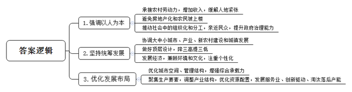
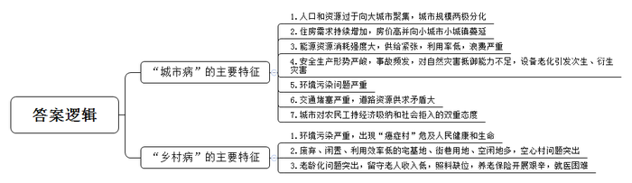
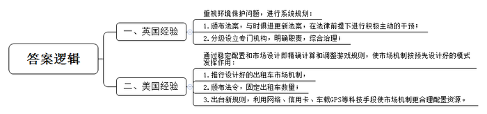
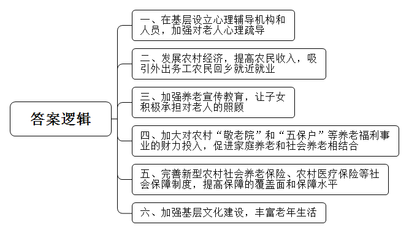
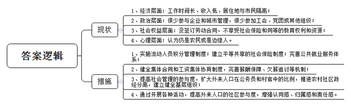
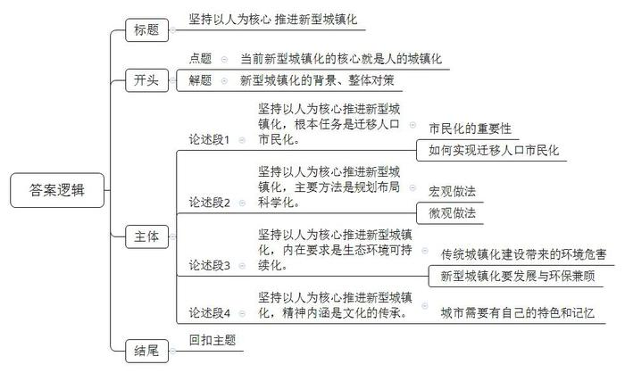

# 2014年上海市公考《申论》题（B卷）

<!-- gwy:overview:start -->
> **上海 · 2014 · 申论 · B类** ｜ 6 题 · 图片 6 处 · 答案随题折叠

导航：[题目](#题目) · [材料 1](#材料-1)
<!-- gwy:overview:end -->

> 候选采集稿。参考答案及解析来自粉笔页面，不代表官方答案或真实高分答卷；来源使用许可与原卷对应关系仍需人工核实。

## 给定材料

### 材料 1

党的十八届三中全会提出，“完善城镇化健康发展体制机制，坚持走中国特色新型城镇化道路，推进以人为核心的城镇化，推动大中小城市和小城镇协调发展、产业和城镇融合发展，促进城镇化和新农村建设协调推进。优化城市空间结构和管理结构格局，增强城市综合承载能力”。

城镇化是现代化的必由之路。推进城镇化是解决农业、农村，农民问题的重要途径，是推动区域协调发展的有力支持，是扩大内需和促进产业升级的重要抓手，对全面建成小康社会、加快推进社会主义现代化具有重大现实意义和深远历史意义。

在我们这样一个拥有13亿人口的发展中大国实现城镇化，在人类发展史上没有先例。城镇化目标明确、方向对头、走出一条新路，将有利于释放内需巨大潜力，有利于提高劳动生产率，有利于破解城乡二元结构，有利于促进社会公平和共同富裕，世界经济和生态环境也将从中受益。

### 材料 2

中国正处于城镇化快速发展阶段。数据显示，2011年中国的城镇化率为47%，预计到2020年将达到55%。经过几十年的努力，中国的城镇化有力地吸引了生产要素向城镇聚集，促进了产业结构的调整和资源的优化配置，成为解决就业、实现市场扩展、推进新型工业化的重要举措；城镇承接了大量的农村富余劳动力，在带动农民增收的同时，还在很大程度上缓解了农村人地紧张的突出矛盾；人口的集聚也推动了社会生活中的组织化和分工，城镇化使政府与民众的距离空前地拉近了，有效地促进了政府治理能力的提升。

但近年来，一些地方在快速提升城镇化率的同时，不但造成土地价格高企，社会成本高昂、债务风险高悬的“三高”现象，而且出现房地产入住率过低、入城农民待遇过低、被征农村土地补偿过低的“三低”现象。如何在城镇化推进中降“三高”提“三低”，既需要城镇化顶层设计，也要求地方政府真正做到以人为核心实现城镇化。2013年7月9日，国务院总理李克强在广西主持召开部分省区经济形势座谈会并作重要讲座时这样形容新一轮城镇化：“渗透以人为核心的新型城镇化，以发展服务业、创新驱动、淘汰落后产能为抓手、加大结构调整力度。”全国人大常委会认为：新型城镇化要避免“房地产化”和农民“被上楼”，新型城镇化必须强调人的城镇化。

### 材料 3

城镇化意味着城镇向周边扩张和农村人口向城镇聚集，也势必引发农村经济社会的变迁。但这并不代表城镇化就是不要乡村——这既不现实也不科学。我国是一个农业大国，农业、农村是全国的命脉所在，若没有的农业、农村、农民，城镇必将失去赖以生存和持续发展的基础。农村与城镇、农业与工业必须而且必将长期共存。“让居民望得见山、看得见水、记得住乡愁”。目前，中央城镇化工作会议提出的要求使用如此诗意的行文，成为一个亮点，给人留下深刻印象，也引发了媒体与网友的热议和关注。“乡愁是沿着泥瓦飘飘的炊烟，是十八弯向家门口的山路，是妈妈手里的糯米团，是后院那颗永不结果的龙眼树……工业化勿忘美丽中国，城镇化勿割断乡愁。要高楼大厦更要青山绿水，看得见过去才能摸得着未来，乡愁是真正营养”。希望在城镇化的同时呵护记忆：“离别故乡、落脚城市，是时代变迁中的个体记忆，也见证发展的日新月异。但千篇一律的建筑、钢筋水泥的丛林，注定只是缺乏传统延续的街区。让城市融入大自然，让居民见山望水，才能用美丽使乡愁有所凭依”。

2010年8月揭晓的中国城市国际形象调查结果显示，我国200多个地级市中有180多个提出要打造“国际大都市”，由此造成我国的城市体系中大城市多，中小城市少，尤其缺少小城镇，致使城乡脱节，城市对农村的辐射力受限。同时，为顺应建设“大城市”的需要而掀起大规模的“扩城”和“旧地改造运动”深刻的改变了城镇的面貌、功能与生态，很多大城市沉醉于修建“地标性建筑”，如摩天大楼、大广场、大草坪以及宽阔的景观大道等等，追求震撼人心的视觉效果，严重破坏了赖以生存的环境和生态。在很多城镇，看到的几乎是“同一张面孔”：即商业化的街区、时髦华丽的外表、现代化的建筑设施，以至于当下，如果我们在不知情的情况下置身某个城镇，真的很可能睁眼与闭眼同样迷茫——浑然不知自己身在何处，像是在A城，也像在B城，甚至C城、D城、E城——国家住房和城乡建设部有关领导2012年2月24日在深圳举行的国际城市创新发展大会上呼吁：在未来20至30年，中国仍将处于城镇化快速发展的阶段。如果不高度重视历史文化遗产保护，不立即纠正一些错误的做法，那么可能在20年，或者在30年之后中国将是一个没有历史的国度。

### 材料 4

在城镇化快速发展时期，大城市以其更大的聚集效益，吸引更多的人口和资源进入其中，使小城市规模难以扩大，从而造成难以解释的“两极分化”趋向。“十一五”期间，我国城市人口以特大城市为主，城市增加的人口主要分布在巨型城市和中等城市。以北京市为例，第六次全国人口普查结果显示，截止2010年11月1日零时，北京市共登记常住人口为1961.2万人，与2000年第五次全国人口普查相比，增加604.3万人，平均每年增长3.8%，相当于新添了一个特大型城市的人口。

随着大城市人口膨胀，我国“城市病”综合症候群已经显现，成为影响和制约科学发展的突出问题。上海市社会科学院城市与区域研究中心的一项研究结果指出：未来一段时期，将是我国各大城市“城市病”的集中爆发期，“城市病”将成为影响城市和谐稳定的关键隐患，加强城市治理刻不容缓。

### 材料 5

我国城市住房需求持续增加，高房价问题甚至已向小城市、小城镇蔓延。以河南省郑州市为例，从2004年下半年开始郑州市房价一路上升，虽然在国家宏观调控政策的干预下，房价上涨趋势得到一定程度的控制，但房价依然保持较高水平。2011年上半年，郑州市区商品房销售均价为每平方米7845元，其中，商品住房销售均价为每平方米6269元，与2010年同期相比上涨了1184元，同比涨幅23.28%。

能源资源是经济社会发展的必要物质条件，城市是消耗能源资源的最大主体。联合国一份报告指出，虽然城市面积只占全世界土地总面积的2%，却消耗着全球75%的资源。国际经验表明，城镇化快速发展阶段也是能源资源消耗强度最大的一个阶段。近年来，水荒、电荒、煤荒、油荒接踵不断，成为制约我国城市经济社会发展的“瓶颈”。我国城市还存在能源利用效率低、浪费严重、二次能源回收利用率低以及城市开发建设随意性大，城市土地利用集约化程度低等问题。

近年来，我国城市安全生产形势严峻，重特大事故时有发生，对人民群众生命财产造成重大损失。城市对自然灾害抵御能力的不足也令人担忧。寒潮袭来，便有不少城市水表冻裂、水管冻爆。到了夏天，又有许多城市遇雨即淹、逢雨必涝。许多城市地上、地下管线网络高负荷运转，部分设备设施老化，一旦发生事故极易造成次生、衍生灾害。

### 材料 6

随着我国城镇化快速推进，城市建设和生产、生活所产生的垃圾、污水、废气等对大气、土壤、地表水、地下水的污染问题非常突出。其中，机动车污染尤为严峻，酸雨状况也不容乐观。近期，各地雾霾情况增多。与雾霾天气相伴的是交通拥堵和打车难。这似乎成了一个恶性循环：空气不好，打车的人多；能见度低，造成交通拥堵，出租车司机不愿意上路，空车拒载成了家常便饭，更有上万辆出租车窝在路边“躲活儿”；这种情况促使人们想买车……结果车越来越多，排放物越来越多，雾霾天气也越来越多。

我国城市交通拥塞情况越来越严重，尤其是上下班高峰期，全国各大城市主干道往往车满为患，寸步难行。据北京市车管所统计，北京市机动车不仅保有量惊人，近几年增长速度异常迅猛。在2003年8月、2007年5月和2009年12月，北京汽车保有量相继突破200万、300万和400万辆大关。机动车数量的急剧增长，使得原本就“先天不足”的道路资源供求矛盾更加凸显。同时，随着机动车保有量的激增，停车位缺口也越发明显，停车越来越难。停车难加剧了乱停乱放，乱停乱放直接导致“稀缺”的道路资源进一步被占用，交通拥塞也越发严重。交通拥堵给市民工作、生活和出行等带来了诸多不便。

### 材料 7

联合国人居署和亚太经社理事会《亚洲城市状况2010-2011》调查报告称，还将有1.5亿中国人在未来10年间完成从农民到市民的空间转换、身份转换。这提示我们当前中国正处于城镇化引领经济增长的门槛节点，未来10年是中国发展方式发生根本性转变的时期。“在多年的城市化进程中，几亿农民走出土地，成为城市建设中不可或缺的主力军。这些人虽然走进城市，却并没有真正融入城市。”某大学商学院的教授表示，伴随着经济的发展与时代进步，这一矛盾越发明显。一方面，新一代农民工在思想意识上更加青睐于城市生活，另一方面，“候鸟式”的迁徙已经不再适应新的经济形势，大量的农民工选择了在城市扎根，将家庭带到城市。然而，城市对农民工持经济吸纳和社会拒入的双重态度，使得他们在城市中缺乏归属感和主人翁意识。截至2012年，农民工参加城镇职工养老、工伤、医疗、失业和生育等五项基本社会保障的比例仅为14.3%、24.0%、16.9%、8.4%和6.1%，参保率仍较低。农民工基本不能享受廉租房和经济适用房，也没有住房公积金制度保障。

### 材料 8

最早的城市病出现在200年前的第一个工业化国家——英国。由于缺乏系统规划，大量“农民工”聚集在贫民窟里，排放的污水使经过曼彻斯特的艾尔克河变成臭水沟。法国学者保尔·芒图注意到，“蒸汽机使无穷的烟云飞翔在这些黝黑的工业城市上空”，狄更斯更把浓浓的黄烟形容成为“伦敦特色”。当时英国政府的调查报告显示，严重的环境污染使居住在贫民窟的大批“农民工”体弱多病，养成了对烈酒和麻醉剂的嗜好，社会极不和谐。

英国的政治家们逐渐重视环境问题。1843年，议会讨论通过了控制蒸汽机和炉灶排放烟尘的法案。110年后的1953年，英国议会通过了更为全面的《大气清洁法》，禁止排放黑烟。英国历史学家克拉潘把英国城市病的根源看作是“市场失灵”的结果，那就是“城市为工业利益集团所支配，企业家生产与赚钱的内在驱动使得他们全然不顾生态环境的问题”，而相应的解决办法就是“政府从原来被动的自由放任转变为在法律的前提下进行积极主动的干预”。1831年英国成立了中央卫生委员会，1844年建立了城镇卫生协会，还在各地设立了卫生医官，不仅管理公共卫生，还承担城市供水排污、治理贫民窟、城市规划等各方面的职责。如今，伦敦已经彻底摘掉“雾都”的帽子，成为环保的领先者。

那么治理“城市病”是否一定要靠政府这只“看得见的手”的严厉管制呢？2012年10月，诺贝尔经济学奖授予了美国数学家埃尔文罗斯与罗伊德沙普利。他们提出有趣的理论“稳定配置和市场设计”，就是通过精确的数学计算，调整游戏规则，可以使市场机制按照预先设计好的模式发挥作用。这种经过“精算”后的市场机制同样也适用于城市治理。

1907年，纽约率先给65号汽油驱动的出租车安装了计价器，这是第一个“设计好的出租车市场机制”。到了20世纪30年代美国大萧条时期，由于出租车门槛低，失业人员一窝蜂涌向这个行业，导致恶性竞争。于是1937年纽约市颁布法令，将出租车数量控制在13566辆，并一直保持到现在。由于汽车数量固定，纽约出租车也像中国一样出现过“拒载”现象。而如今，又有两项新规则出台，使市场机制更能实现合理的资源配置。一是以互联网作为平台的“叫车公司”的出现。美国《大西洋月刊》报道了一家典型的名为“乌博”的叫车公司。它主要由统计学家和工程师组成，他们研发了移动叫车软件，从乘客处收集数据，开发出能预测需求的精确算法，不断满足乘客和司机供需双方的要求。在用车高峰时段提高价格，直到供需平衡为止，以保证客人任何时候都有租到车；而只要你愿意付费，出租车可拉你去任何你想去的地方出。二是信用卡的广泛使用。在美国，出租车可以直接使用信用卡支付。到达目的地后，如果乘客选择信用卡，司机在仪器上操作一下，刷卡机上就会显示并扣除路费。2004年，纽约出租车和轿车委员会决定，任何在纽约行驶的车辆必须安装车载GPS系统和信用卡系统。一开始，这一做法遭到出租车司机的强烈抵制，但经过多年实践后，特别是2008年金融危机后，司机们终于认识到，所谓“打车难”并不总是出租车司机的“卖方市场”。一旦经济萧条，没人愿意打车才是最糟糕的，而一个好的、公平的市场规则才能真正保证司机的稳定收益。

### 材料 9

2013年8月30日，李克强总理邀请两院院士和有关专家到中南海，听取城镇化研究报告并与大家座谈。座谈中，李克强总理强调：“推进新型城镇化，就是要以人为核心，以质量为关键，以改进为动力，使城镇真正成为人们的安居之处、乐业之地”。事实上，突出统筹城乡，保护农民利益，推进以人为核心的新型城镇化，是中国特色城镇化道路的必然选择。漠视统筹城乡发展，盲目追求高速城镇化，不仅造成日益严峻的“城市病”，也会带来日趋严重的“乡村病”。大城市近郊的一些农村成为藏污纳垢之地，污染严重，致使河流与农田污染事件频发，一些地方“癌症村”涌现，已经危机百姓健康甚至生命。“一方水土难养一方人”，背离了城镇化的本意。

### 材料 10

中科院地理科学与资源研究所某课题组首次利用高分遥感影像，完成对山东等地4.6万宗宅基地、6500余农户的调查。当前我国农村居民点用地规模约2.48亿亩，占建设用地总面积的一半以上，户均近1亩，人均220多平方米。废弃、闲置，低效利用的宅基地、街巷用地、空闲地等有巨大的整治潜力。测算表明，像山东禹城市村庄土地整治潜力在46%-54%，可净增耕地率13%-15%。经综合估算，在分批推进城镇化情况下，全国空心村土地综合整治潜力达1.14亿亩地，大约相当于5个北京城面积。有专家指出，在我国，宅基地使用权是一项特殊的用益物权，以保障农民居者有其屋。大量宅基地随老人去世或人口转移进城后长年废弃，致使“有名无益”。农村人走地不动、建新不折旧、不占白不占等情况，导致空心村问题突出。在统筹城乡发展方针下，亟须深化土地制度创新，探寻盘活存量之策。

### 材料 11

农村留守老人是随着我国城镇化进程逐步加快而产生的一批群体，这部分群体，因家中子女进入城镇经商、务工，晚年养老比较困难。《中国老龄事业发展报告（2013年）》显示，我国“空巢老人”占老年人口的比例已接近50%，2013年将突破1亿人。农村“空巢留守老人”规模庞大，全国70%以上的老龄人口分布在农村，农村老龄化问题尤为突出。而这些老龄化的人口大多是以农村留守老人的身份存在，由此产生了一系列亟待解决的问题。无子女老年人和失独老年人开始增多，他们当中许多人存在孤独、苦闷、抑郁甚至厌世等心理问题。

由于绝大多数留守老人丧失从事高强度工作的能力，农村留守老人从生产劳动上获得的收入有限。他们从种菜、养鸡等劳动强度低、收入少的劳动中获得日常生活费用。在劳作之余，还要照料留守在家孙辈的日常起居，监督孙辈们的学习，应对孩子成长过程中的突发事件。留守老人在经济上主要依靠自己劳动收入和子女供养维持生活，但外出务工子女对老人的经济支持一般都不多，留守老人的总体收入较少。他们中的很多人没有达到农村居民的人均水平，甚至有相当一部分留守老人的纯收入低于我国2011年确定的年收入2300元人民币的最新贫困线标准。

受中国传统文化的影响，我国农村普遍保留着家庭养老的习俗，家庭养老是我国农村中主要的养老形式。然而，随着农村剩余劳动力的转移，农村中绝大部分的青年人离开父母进城务工，常年在外不能回家，对留守在家的老人照料严重缺位。农村存在的“敬老院”和“五保户”的养老形式，由于财力的问题，所能容纳的养老人数有限。虽然，从2009年起，国家开展了新型农村社会养老保险，但是由于多方面因素的制约，新型农村社会养老保险覆盖面有限，保障水平低，致使农村社会养老保险的开展步履艰辛，效果不尽如人意。大部分农村留守老人平时靠电话和子女联系，闲暇时主要靠聊天、看电视、玩棋牌、蹲商店等方式打发时间。伴随着年龄的增长和身体的需要，留守老人对健康医疗的关注比其他方面更多一些。部分留守老人的身体情况欠佳却不能及时就医，造成“小病拖、大病扛”的问题。

### 材料 12

农民工是从传统农业社会流动到现代工业社会的一个群体。农民工社会融合的主要任务是“适应城市社会的生活方式，逐步提升自身的社会经济地位，完成一个从农业人到工业人、从农村人到城市人的转变”。“逐步提升自身的社会经济地位”即完成所谓的社会经济融合，是农民工社会融合中最关键、最重要的内容。而完成从农业人到工业人，从农村人到城市人的转变不但包括社会经济层面的转变，还包括政治融合，社会权益的融合以及在心理上逐渐认同城市社会成员身份的转变。

一项针对G市的农民工社会融入状况的调查结果显示，71.6%的农民工每天工作时间超过8小时，有的甚至达到12小时以上；52.1%的农民工月收入在1300-2000元之间，只是达到或略高于G市最低工资水平，却远远低于G市平均月工资4101元；近90%的农民工居住在城中村的出租屋或者民工宿舍，基本上和市民隔离开来。近70%的受访者没有参加过任何城市管理活动，包括政治选举；有63.5%没有机会参加职工大会对本单位的管理和发展问题表达自己的意见和建议；有71.6%没有加入过工会、党团组织或其它组织。在受访的农民工中，有56.7%没有与单位签订劳动合同，有46.3%没有参加任何形式的社会保险；在子女教育方面，农民工的孩子也不能享受到和城市孩子同等的教育权利和教育资源，大多被公办学校设立的种种高门槛拒之门外，受访者中只有24.1%的孩子进入了G市的公办学校读书。83%的农民工认为自己的身份仍是农民而不是城里人，或者认为自己就是一个处在城乡之间的“边缘人”。

### 材料 13

2012年，Z市外来常住人口与占总人口的52.9%，城市二元结构特征明显。为了实现农民工市民化、促进户籍人口与外来人口相互融合的目标，Z市作出了一些探索和努力。率先在全国实施流动人员积分管理制度，目前已有近3万名异地务工人员及其子女，通过积分转为城市户籍或入读公办中小学。建立户籍居民与异地务工人员平等共享的社会保险制度，在全省率先实现基本养老保险、住院和门诊基本医疗保险全覆盖。完善公共就业服务体系，为异地务工人员提供技能培训、创业孵化、职业介绍、就业推荐等“一条龙”服务。先后有100多万人次参加了在岗和岗前职业技能培训，健全集体合同和工资集体协商制度，完善薪酬保障、欠薪追讨等机制，2010年至2012年共为异地务工人员追讨欠薪超过1800万元。

Z市扩大了在优秀异地务工人员中竞争选拔公务员和村官的比例，增加其平等参与社会建设管理的机会。2010年以来，在优秀异地务工人员中选拔了41名基层公务员和事业单位职员。市委全会邀请了包括10多名外来人口代表在内的12类50名代表列席，努力促进“党心”和“民心”的同频共振；在2012年的市人大、政协换届中，从外来人口中选举产生了4名人大代表和8名政协委员。稳步推进农村社区政经分离，建立健全村（民）建设协调委员会等基层组织，引导全体常住人口共同参与社会服务管理。

Z市引导外来人口积极参与“慈善万里行”、全民植树、文明城市创建、志愿服务等活动。增进其对城市的认同感、归属感和责任感。支持外来人口文化活动。比如“三个乡镇工人业余艺术团”，成员都是镇内企业的异地务工人员，自2004年成立以来，开展免费演出超过400场，观看人数超过60万人次。从2011年9月起开展为期5年的全民修身养性行动，其中专门配套了新老Z市人融合行动，进一步破除本地人与外地人的身份和心理隔阂。连续多年开展“同是Z市建设者”和“技能人才”等评选表彰活动，累计表彰各类优秀异地务工人员1000多名。在这些探索的基础上，继续强化“新老Z市人，都是一家人”的理念，不断提高异地务工人员的社区参与度。

### 材料 14

2013年12月12日至13日，中央城镇化工作会议在北京举行，会议要求，要以人为本，推进以人为核心的城镇化，提高城镇人口素质和居民生活质量，把促进有能力在城镇稳定就业和生活的常住人口有序实现市民化作为首要任务。要优化布局，根据资源环境承载能力构建科学合理的城镇化宏观布局，把城市群作为主体形态，促进大中小城市和小城镇合理分工、功能互补、协同发展。要坚持生态文明，着力推进绿色发展、循环发展、低碳发展，尽可能减少对自然的干扰和损害，节约集约利用土地、水、能源等资源。要传承文化，发展有历史记忆、地域特色、民族特色的美丽城镇。

## 题目

### 第 1 题

**根据“给定资料**1**—**3**”说明新型城镇化的主要特点。（10分）**

关联材料：材料 1、材料 2、材料 3

作答要求：

要求：语言精炼，层次要点清楚，字数不超过200字。

第 1 题 · 答案与解析

**参考答案（粉笔题库参考内容）**

1.强调以人为本。承接农村劳动力，增加收入，缓解人地紧张；避免房地产化和农民被上楼；推动社会中的组织化和分工，亲近民众，提升政府治理能力。

2.坚持统筹发展。协调大中小城市、产业、新农村建设和城镇发展；做好顶层设计，降三高提三低；发展经济，兼顾环境和文化，注重个性化。

3.优化发展布局。优化城市空间、管理结构，增强综合承载力；聚集生产要素，调整产业结构，优化资源配置，发展服务业、创新驱动、淘汰落后产能。

**解析**

**参考答案说明****:**答案分别从“强调以人为本”“坚持统筹发展”“优化发展布局”三个方面进行了分条撰写。各条要点之间在内容上是并列关系，没有交叉。

**考点**：特点类

**来源**：2014年上海市公考《申论》题（B卷）

### 第 2 题

**简要概括****“****城市病****”****和****“****乡村病****”****的主要特征。（****15****分）**

关联材料：材料 1、材料 2、材料 3、材料 4、材料 5、材料 6、材料 7、材料 8、材料 9、材料 10、材料 11、材料 12、材料 13、材料 14

作答要求：

要求：表述准确到位，语言简明扼要，字数不超过300字。

第 2 题 · 答案与解析

**参考答案（粉笔题库参考内容）**

一、城市病特征：

1.人口和资源过于向大城市聚集，城市规模两极分化；

2.住房需求持续增加，房价高并向小城市小城镇蔓延；

3.能源资源消耗强度大，供给紧张，利用率低，浪费严重；

4.安全生产形势严峻，事故频发，对自然灾害抵御能力不足，设备老化引发次生、衍生灾害；

5.环境污染问题严重；

6.交通堵塞严重，道路资源供求矛盾大；

7.城市对农民工持经济吸纳和社会拒入的双重态度。

二、乡村病特征：

1.环境污染严重，出现“癌症村”危及人民健康和生命；

2.废弃、闲置、利用效率低的宅基地、街巷用地、空闲地多，空心村问题突出；

3.老龄化问题突出，留守老人收入低，照料缺位，养老保险开展艰辛，就医困难。

**解析**

**参考答案说明：**本参考答案从“城市病”“乡村病”两方面进行了分条撰写。各条要点之间在内容上相互并列，没有交叉关系。

**考点**：其他类

### 第 3 题

**结合给定资料，谈谈治理****“****城市病****”****的国外经验。（****10****分）**

关联材料：材料 1、材料 2、材料 3、材料 4、材料 5、材料 6、材料 7、材料 8、材料 9、材料 10、材料 11、材料 12、材料 13、材料 14

作答要求：

要求：概括准确，条理清晰，观点明确，言语精练，字数不超过200字。

第 3 题 · 答案与解析

**参考答案（粉笔题库参考内容）**

一、英国经验

重视环境保护问题，进行系统规划：

1、颁布法案，与时俱进更新法案，在法律前提下进行积极主动的干预；

2、分级设立专门机构，明确职责，综合治理。
二、美国经验

通过稳定配置和市场设计即精确计算和调整游戏规则，使市场机制按预先设计好的模式发挥作用：

1、推行设计好的出租车市场机制；

2、颁布法令，固定出租车数量；

3、出台新规则，利用网络、信用卡、车载GPS等科技手段使市场机制更合理配置资源。

**解析**

**参考答案说明：**答案从“英国经验”“美国经验”两个范畴进行了分条撰写。各条要点之间在内容上相互并列，没有交叉关系。

**考点**：提出对策类

### 第 4 题

**阅读给定资料，针对农村留守老人面临的困境提出对策。（10分）**

关联材料：材料 11

作答要求：

要求：观点明确，条理清楚，语言流畅，对策可行。字数不超过200字。

第 4 题 · 答案与解析

**参考答案（粉笔题库参考内容）**

一、在基层设立心理辅导机构和人员，加强对老人心理疏导；

二、发展农村经济，提高农民收入，吸引外出务工农民回乡就近就业；

三、加强养老宣传教育，让子女积极承担对老人的照顾；

四、加大对农村“敬老院”和“五保户”等养老福利事业的财力投入，促进家庭养老和社会养老相结合；

五、完善新型农村社会养老保险、农村医疗保险等社会保障制度，提高保障的覆盖面和保障水平；

六、加强基层文化建设，丰富老年生活。

**解析**

**参考答案说明****:**答案从“加强心理疏导”“发展农村经济”“养老宣传教育”“加大资金投入”“完善社会保障制度”“基层文化建设”等不同的话题进行了分条撰写。各条要点之间在内容上是并列关系，没有交叉。

**考点**：提出对策类

**来源**：2014年上海市公考《申论》题（B卷）

### 第 5 题

**结合给定资料，以G城市为例分析当前农民工社会融合的基本现状，并概括Z市为提升外来人口融合程度所采取的措施。（15分）**

关联材料：材料 12、材料 13

作答要求：

要求：条理清楚，层次分明，语言简洁流畅，字数不超过300字。

第 5 题 · 答案与解析

**参考答案（粉笔题库参考内容）**

现状：1、经济层面：工作时间长、收入低、居住地与市民隔离；2、政治层面：很少参与企业和城市管理，很少参加工会、党团或其他组织；3、社会权益层面：没签订劳动合同，不享受社会保险和同等的教育权利和资源；4、心理层面：认为仍是农民或是边缘人。

措施：1、实施流动人员积分管理制度；建立平等共享的社会保险制度；完善公共就业服务体系；2、健全集体合同和工资集体协商制度，完善薪酬保障、欠薪追讨等机制；3、提高社会管理的参与度，扩大外来人口在公务员和村官中的比例，推进农村社区政经分离，建立健全基层组织；4、通过开展各种活动，提高外来人口的社区参与度，增强认同感、归属感和责任感。

**解析**

**参考答案说明****:**答案分为“现状”和“措施”两部分，其中，“现状”从“经济”“政治”“社会权益”和“心理”四个层面进行了分条撰写；“措施”也是从“社会权益”“经济”“政治”和“心理”四个层面进行了分条撰写。各条要点之间在内容上是并列关系，没有交叉。

**考点**：概括措施类

**来源**：2014年上海市公考《申论》题（B卷）

### 第 6 题

**结合给定资料，围绕“当前新型城镇化的核心”写一篇文章。（40分）**

关联材料：材料 1、材料 2、材料 3、材料 4、材料 5、材料 6、材料 7、材料 8、材料 9、材料 10、材料 11、材料 12、材料 13、材料 14

作答要求：

要求：

（1）参考给定资料，自选角度，自拟题目；

（2）观点明确，联系实际，分析具体，条理清楚，语言流畅；

（3）总字数800—1000字。

第 6 题 · 答案与解析

**参考答案（粉笔题库参考内容）**

**坚持以人为核心** **推进新型城镇化**

“小康不小康，关键看老乡”。党的十八届三中全会提出，“坚持走中国特色新型城镇化道路，推进以人为核心的城镇化。”李克强总理在城镇化研究报告座谈会上强调“推进新型城镇化，就是要以人为核心，以质量为关键，以改革为动力，使城镇真正成为人们的安居之处、乐业之地。”可见，当前新型城镇化的核心就是人的城镇化。

**坚持以人为核心推进新型城镇化，根本任务是迁移人口市民化。**未来10年我国将有1.5亿人口完成从农民到市民的身份转化和空间转换，如果这些进城农民不能真正融入城市，“候鸟式”“摆钟式”迁徙终将影响社会稳定。实现迁移人口市民化，一方面要打破户籍藩篱，全面推进“诸险合一、同城合一、城乡合一”的教育、就业、医疗、养老和住房等保障制度建设；另一方面要建立全方位、多层次的迁移人口职业教育培训体系，实现稳定就业和职业升迁。

**坚持以人为核心推进新型城镇化，主要方法是规划布局科学化。**宏观层面上要着眼全局，科学布局，推动大中小城市、产业、新农村建设和城镇化协调发展。要构建科学合理的城市格局，充分发挥大中小城市和小城镇的互补作用，做到城市群布局与区域经济发展和产业布局紧密衔接，与资源环境承载能力相适应。微观层面上各地要在发展的同时保留特色和传统，因地制宜，不搞千篇一律的面子工程，不搞圈地占地的造城运动。

**坚持以人为核心推进新型城镇化，内在要求是生态环境可持续化。**我们传统城镇化过程中唯GDP至上，常以生态环境的破坏为代价换取GDP的增长，造成PM2.5居高不下、酸雨时有发生、雾霾日益严重等一系列环境污染问题凸显，危害人民群众的身体健康。新型城镇化的建设要坚持一手抓发展，一手抓环保，两手都要抓，两手都要硬，让人与自然和谐相处。

**坚持以人为核心推进新型城镇化，精神内涵是文化的传承。**美丽的城镇需要发展自己的地域特色、民族特色，需要有自己的历史记忆。就如菊儿胡同的发展注重传统与现代的结合，探索传统建筑改造之路；豫园旅游园把物质文化和非物质文化相结合，打造文化的综合体。文化的发展，文化的传承是一个地域、城市的灵魂，让城镇有自己的记忆，就要打造合理的文化载体。

新型城镇化新在人的城镇化，新型城镇化的核心价值是以人为本，新时期的城镇化不能以简单思维、传统思维对之，而必须以人为核心。一言以蔽之，新型城镇化就是追求人的自由全面发展的城市化。

**文章分析**

**坚持以人为核心** **推进新型城镇化**

【**标题的优点**：首先，范文的标题“坚持以人为核心 推进新型城镇化”突出了“新型城镇化核心”这一主题。其次，形式上，对仗工整，文字简洁明快。】

“小康不小康，关键看老乡”。（1）党的十八届三中全会提出，“坚持走中国特色新型城镇化道路，推进以人为核心的城镇化。”李克强总理在城镇化研究报告座谈会上强调“推进新型城镇化，就是要以人为核心，以质量为关键，以改革为动力，使城镇真正成为人们的安居之处、乐业之地。”可见，（2）当前新型城镇化的核心就是人的城镇化。坚持以人为核心推进新型城镇化，要做好迁徙人口市民化、规划布局科学化和生态环境可持续化三方面。

【**开头的优点：**★内容方面。范文的开头是紧扣题目给定的“当前新型城镇化的核心”这一主题展开的。指出了（1）要推进新型城镇化建设，（2）新型城镇化建设的核心是人的城镇化。★文字表达方面。使用了关联词“可见”，使语言表达有逻辑性。】

**坚持以人为核心推进新型城镇化，根本任务是迁移人口市民化**。（1）未来10年我国有1.5亿人口将完成从农民到市民的身份转化和空间转换，如果这些进城农民不能真正融入城市，“候鸟式”“摆钟式”迁徙终将影响社会稳定。（2）实现迁移人口市民化，一方面要打破户籍藩篱，全面推进“诸险合一、同城合一、城乡合一”的教育、就业、医疗、养老和住房等保障制度建设，；另一方面要建立全方位、多层次的迁移人口职业教育培训体系，实现稳定就业和职业升迁。

【**论述段****1的优点**：★观点句：范文的观点句是紧扣“当前新型城镇化的核心”这一文章主题提出的。形式上，它在段首处直接写出，位置突出，容易发现。内容上，内容要点明确，可以明显看出它是从“迁移人口”入手，指出了“迁移人口市民化”。★论述内容：（1）先介绍了“市民化的重要性”；（2）再介绍了“如何实现迁移人口市民化”。注意：以上两个方面的内容都是紧扣“坚持以人为核心推进新型城镇化，根本任务是迁移人口市民化”这个观点句进行分析论述的，论述的针对性强，内容层次丰富。在论述方法上采用了讲道理、举例子相结合，做到了丰富多样。】

**坚持以人为核心推进新型城镇化，主要方法是规划布局科学化。**（1）宏观层面上要着眼全局，科学布局，推动大中小城市、产业、新农村建设和城镇化协调发展。要构建科学合理的城市格局，充分发挥大中小城市和小城镇的互补作用，做到城市群布局与区域经济发展和产业布局紧密衔接，与资源环境承载能力相适应。（2）微观层面上各地要在发展的同时保留特色和传统，因地制宜，不搞千篇一律的面子工程，不搞圈地占地的造城运动。

【**论述段****2的优点**：★观点句：范文的观点句是紧扣“当前新型城镇化的核心”这一文章主题提出的。形式上，它在段首处直接写出，位置突出，容易发现。内容上，内容要点明确，可以明显看出它是从“规划布局”入手，指出了“规划布局科学化”。★论述内容：（1）先介绍了“宏观做法”；（2）再介绍了“微观做法”。注意：以上两个方面的内容都是紧扣“坚持以人为核心推进新型城镇化，主要方法是规划布局科学化”这个观点句进行分析论述的，论述的针对性强，内容层次丰富。在论述方法上采用了讲道理、举例子相结合，做到了丰富多样。】

**坚持以人为核心推进新型城镇化，内在要求是生态环境可持续化**。（1）我们传统城镇化过程中唯GDP至上，常以生态环境的破坏为代价换取GDP的增长，造成PM2.5居高不下、酸雨时有发生、雾霾日益严重等一系列环境污染问题凸显，危害人民群众的身体健康。（2）新型城镇化的建设要坚持一手抓发展，一手抓环保，两手都要抓，两手都要硬，让人与自然和谐相处。

【**论述段****3的优点**：★观点句：范文的观点句是紧扣“当前新型城镇化的核心”这一文章主题提出的。形式上，它在段首处直接写出，位置突出，容易发现。内容上，内容要点明确，可以明显看出它是从“生态环境”入手，指出了“生态环境可持续化”。★论述内容：（1）介绍了“传统城镇化建设带来的环境危害”；（2）再介绍了“新型城镇化要发展与环保兼顾”。注意：以上两个方面的内容是紧扣“坚持以人为核心推进新型城镇化，内在要求是生态环境可持续化”这个观点句进行分析论述的，论述的针对性强，内容层次丰富。】

**坚持以人为核心推进新型城镇化，精神内涵是文化的传承。**美丽的城镇需要发展自己的地域特色、民族特色，需要有自己的历史记忆。就如菊儿胡同的发展注重传统与现代的结合，探索传统建筑改造之路；豫园旅游园把物质文化和非物质文化相结合，打造文化的综合体。文化的发展，文化的传承是一个地域、城市的灵魂，让城镇有自己的记忆，就要打造合理的文化载体。

【**论述段****4****的优点**：★观点句：范文的观点句是紧扣“当前新型城镇化的核心”这一文章主题提出的。形式上，它在段首处直接写出，位置突出，容易发现。内容上，内容要点明确，可以明显看出它是从“文化”入手，指出了“生态环境可持续化”。★论述内容：主要介绍了“城市需要有自己的特色和记忆”。注意：以上内容是紧扣“坚持以人为核心推进新型城镇化，精神内涵是文化的传承”这个观点句进行分析论述的，论述的针对性强，内容层次丰富。】

【**论述段之间的关系：**★内容的内在逻辑：论述段之间是“并列”关系。范文论述段1先写了“迁移人口市民化”，论述段2写了“科学规划布局”，论述段3写了“生态环境可持续化”，论述段3写了“文化传承”。★段与段的外在衔接：4个论述段通过“根本任务”“主要方法”“内在要求”“精神内涵”进行衔接，让段与段之间的衔接看上去自然、流畅。】

新型城镇化新在人的城镇化，新型城镇化的核心价值是以人为本，新时期的城镇化不能以简单思维、传统思维对之，而必须以人为核心。一言以蔽之，新型城镇化就是追求人的自由全面发展的城市化。

【**结尾的优点**：范文的结尾回扣了“当前新型城镇化的核心”这个主题，再次强调了新型城镇化的深刻内涵。】

**解析状态：unknown（来源未提供）**

**考点**：文章写作题

**来源**：2014年上海市公考《申论》题（B卷）

