# 2014年上海市公务员录用考试《行测》题（A类）

<!-- gwy:overview:start -->
> **上海 · 2014 · 行测 · A类** ｜ 140 题 · 图片 29 处 · 答案随题折叠

| 题型模块 | 题量 | 题号 |
| --- | ---: | ---: |
| 言语理解与表达能力 | 25 | 1–25 |
| 判断推理能力 | 40 | 26–65 |
| 数理能力 | 25 | 66–90 |
| 常识应用能力 | 30 | 91–120 |
| 综合分析能力 | 20 | 121–140 |
| **合计** | **140** | |

导航：[题型与作答说明](#题型与作答说明) · [题目](#题目) · [材料 1](#材料-1)
<!-- gwy:overview:end -->

> 候选采集稿。参考答案及解析来自粉笔页面，不代表官方答案或真实高分答卷；来源使用许可与原卷对应关系仍需人工核实。

## 题型与作答说明

言语理解与表达能力

（25题）

言语理解与表达能力部分包括逻辑填空、片段阅读与文章阅读三种类型题目，均为单项选择题。

判断推理能力

（40题）

判断推理能力部分包括科学推理、定义判断、图形推理与逻辑判断四种类型的题目，均为单项选择题。

数理能力

（25题）

数理能力部分包括数字推理与数学运算两种类型的题目，均为单项选择题。

常识应用能力

（30题）

本部分均为不定项选择题，每小题给出的4个选项中，至少有1个选项符合题意。

综合分析能力

（20题）

本部分均为不定项选择题，每小题给出的4个选项中，至少有1个选项符合题意。

## 题目

### 第 1 题

如今社会上“厌读”的情绪严重。由于不读书，导致一些人走上邪路。读者厌读固然有读者自身的问题。我们作者是不是也该\_\_\_\_\_\_\_：为什么读者不爱读？是读者不赞成作者的观点吗？未必！既然赞成作者的观点就该同声相应，可读者为什么不来“应”呢？这就告诉我们：作者有个文风问题。再想一想：为什么别人的文章读者\_\_\_\_\_\_\_\_\_\_，奔走相告。而我们的文章读者却\_\_\_\_\_\_\_\_\_\_\_呢？这只能说明我们的文风的确有问题。
依次填入画横线部分最恰当的一项是：

A. 扪心自问 爱不释手 不足挂齿

B. 自我反省 奉为至宝 嗤之以鼻

C. 反躬自问 手不释卷 不屑一顾

D. 不耻下问 爱不忍释 鄙夷不屑

第 1 题 · 答案与解析

**参考答案（粉笔题库参考内容）**

C

**解析**

第一空根据“也”并列，以及冒号后面强调我们要自我反省，A项“扪心自问”表示自我反省，B项“自我反省”也可表达反省自己、C项“反躬自问”强调事后反过来问问自己，指检查自己的思想和言行，三项均可，保留，D项“不耻下问”强调谦虚好学，与文意无关，排除。

第二空搭配“别人的文章”，B项“奉为至宝”程度过重，排除。

第三空搭配“读者”，读者“不屑一顾”搭配恰当，表达读者不喜欢，不看重我们的文章，A项“不足挂齿”，可以搭配文章，不能搭配读者，排除。

故正确答案为C。

**考点**：对应关系-前后呼应、成语填空

**来源**：2014年上海市公务员录用考试《行测》题（A类）第1题

### 第 2 题

在中国人心目中，“圣人”是道德修养的楷模。中国人尤其是知识分子，往往以君子\_\_\_\_\_，却不以圣人\_\_\_\_\_\_。可见圣人的道德境界是一种崇高的理想，圣人也就只是人们心目中的崇拜偶像。\_\_\_\_\_\_，圣人的道德境界，也不是天生的，而是一点一滴积累起来的。荀子认为，圣人不仅是崇拜的偶像，普通人也能经过坚持不懈的实践，从日常生活中不断地积累德行，提高自己的道德修养，达到尽善尽美的境地，成为一个圣人。

依次填入划横线部分最恰当的一项是：

A. 自称 自居 因此

B. 自居 自夸 其次

C. 自封 标榜 所以

D. 自诩 自居 然而

第 2 题 · 答案与解析

**参考答案（粉笔题库参考内容）**

D

**解析**

本题可从第三空入手。根据横线前可以得知圣人的道德境界是崇高的，和普通人是有区别的，根据横线后可知圣人崇高的道德境界也是一点一滴积累起来的，换句话说普通人也能够成为圣人，前后语意不同，横线处要填入一个表示转折的词语，锁定D项“然而”。A项“因此”、C项“所以”均表示因果关系，B项“其次”表示次要，均与文意不符，排除。

验证第一空和第二空。

第一空，“自诩”指自夸，表示知识分子经常自夸为君子，符合文意。

第二空，“自居”指自以为具有某种身份，说明知识分子不认为自己达到圣人的境界，符合文意。

故正确答案为D。

拓展：

“自称”指自己称呼自己，如项羽自称西楚霸王

“自封”指自己给自己加头衔；子明，如自封专家

**考点**：关联关系-转折关系、对应关系-前后呼应、混搭填空、词的辨析-词义侧重

**来源**：2014年上海市公务员录用考试《行测》题（B类）第5题

### 第 3 题

我们的社会已经进入了一个特别需要讲道理、讲清道理的时代，没有以理服人的态度和论述，人们凭什么来接受你的结论；\_\_\_\_\_\_\_我不反对你的结论，\_\_\_\_\_\_\_\_\_我要求，迫切地要求，请说清这些结论的来龙去脉，其实哪怕论点相左，\_\_\_\_\_\_\_\_你的论题重要，论据扎实、论述充分，我们都会认真阅读，\_\_\_\_\_\_\_\_心悦诚服地接受，并用来修改自己既定的想法。

依次填入画横线部分最恰当的一项是：

A. 尽管 但是 所以 因此

B. 甚至 但是 只要 以至

C. 因此 但是 如果 以至

D. 因为 可是 只要 以致

第 3 题 · 答案与解析

**参考答案（粉笔题库参考内容）**

B

**解析**

第一空考查对文段结构的理解。第一句是文段的总括句，第二、三句是对总括句的分述；“尽管”表示让步假设关系，后跟“还是”“但是”“却”等呼应，表示意思的转折；“甚至”表示所提出的是突出的、进一步的事例，是对第二句的进一步说明。排除C、D选项。

第二空考查转折关联词。“但是”“可是”意思相近，都表示转折关系，强调转折之后的内容。根据此空无法确定选项。

第三空考查充分条件的关联词。“只要”表示具有充分的条件，常与“就”“也”“都”“便”相呼应，表明由这种条件产生的一种结果；“只有”表示必需的条件，常与“才”“方”呼应。根据“我们都会认真阅读”，确定此空为“只要”。排除A选项。

第四空考查近义词辨析。“以至”是连词，①表示时间、数量、程度、范围等的延伸；②用于下半句开头，表示上述情况所达到的深度或结果。“以致”也是连词，常用在下半句的开头，表示下文是上述情况造成的结果，多指不好的。

故正确答案为B。

**考点**：关联关系-转折关系、词的辨析-程度轻重

**来源**：2014年上海市公务员录用考试《行测》题（B类）第1题

### 第 4 题

天文学家们宣布，他们通过太空望远镜\_\_\_\_\_\_\_\_\_到了三颗与地球非常相似的行星，其环境似乎很适宜生命生存，而且，其中一颗的表面可能\_\_\_\_\_\_着大片海洋，因此它\_\_\_\_\_\_\_\_与地球一样，呈现出美丽而迷人的蓝色，这是迄今为止人类找到的最像地球的行星。虽然这是一个重要的科学发现，但却带有哲学意味。

依次填入划横线部分最恰当的一项是（  ）。

A. 观察 覆盖 也许

B. 观测 覆盖 也许

C. 观测 存在 一定

D. 观察 存在 可能

第 4 题 · 答案与解析

**参考答案（粉笔题库参考内容）**

B

**解析**

第一空，比较“观察”和“观测”。“观察”指仔细察看（事物或现象），是一种有目的，有计划，比较持久的知觉活动；“观测”常指对自然现象进行观察或测定，文段中提到的对象是行星，因此用“观测”更合适，据此可排除A、D项。

再看第三空，根据前文“似乎”“可能”，提示此处填入的词语应表示不确定的意思，C项“一定”不符合文意，故排除。

第二空，对B项进行验证。“表面覆盖”，符合语境。

故正确答案为B。

【文段出处】《地球即将告别“孤独”? 科学家发现最像地球的遥远行星》

**考点**：关联关系-因果关系、实词填空、对应关系-前后呼应、词的辨析-搭配对象、词的辨析-词义侧重

**来源**：2014年上海市公务员录用考试《行测》题（B类）第2题

### 第 5 题

古代的诗，原是平淡自然的，到汉魏以后，渐渐的从平淡自然转向工整\_\_\_\_\_\_\_\_或艰深\_\_\_\_\_\_\_\_的路上去。这也是进化中必经之阶段。过了这阶段，又渐渐地恢复到平淡自然的\_\_\_\_\_\_\_\_。我们若是用心在各家诗话中去找找，这种归真返朴的论调，真可以找到不少。

依次填入划横线部分最恰当的一项是：

A. 纤巧 枯涩 趋势

B. 纤巧 苦涩 走向

C. 精致 枯燥 趋势

D. 精致 高雅 走向

第 5 题 · 答案与解析

**参考答案（粉笔题库参考内容）**

A

**解析**

第一空，“纤巧”指细巧、小巧；“精致”指精巧细致，无法排除选项，均保留。

第二空，横线处描写诗歌的发展路径，对应“艰深”应体现诗歌描写晦涩难懂，A项“枯涩”指枯燥，不流畅，比如文字枯涩，符合文意；B项“苦涩”形容味道又苦又涩，文段和味道无关，排除；C项“枯燥”指单调，没有趣味，文段强调的并非诗歌无趣普通，而是语句描写过于艰涩难读，排除；D项“高雅”指高尚、不粗俗，与文意无关，排除。

验证第三空，A项“趋势”指①趋奉权势，②事物发展的动向，体现诗歌发展趋势，符合文意，当选。

故正确答案为A。

**考点**：关联关系-并列关系、实词填空、词的辨析-搭配对象

**来源**：2014年上海市公务员录用考试《行测》题（A类）第5题

### 第 6 题

下列语句中没有歧义的是：

A. 据比赛组委会统计，参加这次围棋比赛活动的有二十个社区的选手。

B. 氨基比林、安乃近、非那西丁副作用明显，大部分国家已禁用，但中国药品名录中未完全禁止，近来医学界部分人士对进口药品争议很大。

C. 11月3日下午2点25分左右，日本茨城县发生里氏5.0级地震。日本新闻网报道称，受此地震影响，茨城县和埼玉县部分地区的震级为4级，东京都、千叶县、神奈川县的震级为3级。

D. 这家电子科技公司成立于2003年，是一家致力于生产并销售鼠标、键盘、音箱、麦克风、手写板、耳机、手柄、线材等电脑周边产品的现代化企业。

第 6 题 · 答案与解析

**参考答案（粉笔题库参考内容）**

D

**解析**

A项，“有二十个社区的选手”有歧义，可理解为有“二十个社区”，或“二十个选手”，排除；

B项，“进口药品”指代不明，可理解为“进口的药品”或“进口药品这件事”，排除；

C项，“茨城县和埼玉县部分地区”有歧义，可理解为“茨城县部分地区和埼玉县部分地区”或“茨城县整片地区和埼玉县部分地区”，排除。

故正确答案为D。

**来源**：2014年上海市公务员录用考试《行测》题（A类）第6题

### 第 7 题

下列句子中，句子类型不同于其他三句的是：

A. 外部资源，尤其是世界一流教育资源，正越来越多地成为上海垒石造峰的“他山之石”。

B. 方案清晰具体了，就比较可行，如果模糊笼统，实施起来就会缺少可操作性。

C. 我国首个实验型深海移动工作站经过十年科技攻关，和“蛟龙号”载人深潜器一样，是我国探索深海科学奥秘的利器。

D. 改革的智慧，说到底，仍然是洞悉规律、把握规律。

第 7 题 · 答案与解析

**参考答案（粉笔题库参考内容）**

B

**解析**

A、C、D三项都是主语+补语+谓语+宾语结构的单句。

A项主语是“外部资源”，“尤其是世界一流教育资源”是补语，“成为”是谓语，宾语是“他山之石”。

C项主语是“我国首个实验型深海移动工作站经过十年科技攻关”，补语是“和‘蛟龙号’载人深潜器一样”，谓语是“是”，宾语是“利器”。

D项主语是“智慧”，补语是“说到底”，谓语是“是”，宾语是“洞悉规律、把握规律”。

故正确答案为B。

**来源**：2014年上海市公务员录用考试《行测》题（B类）第7题

### 第 8 题

下列相似意思，不同形式的表达，按语气由轻到重依次排列正确的是：

（1）机动车冒黑烟应该重罚！

（2）机动车冒黑烟难道不应该重罚吗？

（3）机动车冒黑烟不能不重罚！

（4）机动车冒黑烟不重罚是不对的！

（5）机动车冒黑烟应该重罚。

A. （4）（5）（2）（1）（3）

B. （4）（5）（1）（3）（2）

C. （5）（1）（4）（2）（3）

D. （5）（4）（1）（3）（2）

第 8 题 · 答案与解析

**参考答案（粉笔题库参考内容）**

C

**解析**

观察选项，对比首句。首句为（4）、（5）两句，（4）句为带有批评语气的双重否定句，（5）句为陈述句，对比可知，陈述句的语气轻于双重否定句，故（5）句应为首句，排除A、B两项，保留C、D两项。

继续观察C、D两项，判断（1）句与（4）句的先后顺序。（1）句仅说“应该重罚”，（4）句为带有批评语气的双重否定句，（1）句语气轻于（4）句，故（1）句应在（4）句之前，排除D项，C项当选。

故正确答案为C。

**来源**：2014年上海市公务员录用考试《行测》题（B类）第10题

### 第 9 题

下列文言句式特点与其他三项不同的是（  ）。

A. 古之人不余欺也

B. 三人行，必有我师焉

C. 六国破灭，非兵不利，战不善，弊在赂秦

D. 蚓无爪牙之利，筋骨之强，上食埃土，下饮黄泉，用心一也

第 9 题 · 答案与解析

**参考答案（粉笔题库参考内容）**

A

**解析**

A项“不余欺”的意思是“古人不欺骗我”，是“不欺余”的倒装句，当选。

B、C、D项是正常的陈述句，排除。

故正确答案为A。

**来源**：2014年上海市公务员录用考试《行测》题（A类）第9题

### 第 10 题

下列句子的语法结构与例句相同的是：

例句：中共中央总书记、国家主席、中央军委主席习近平视察国防科学技术大学时指出，要紧紧围绕强军目标来进行思想政治建设，使思想政治建设成为实现这一目标的强大推力和助力。

A. 农村改革是我国当前的重要组成部分，黑龙江松嫩平原和三江平原是国务院今年批准的国家首个现代农业综合配套改革试验区。

B. 上海市委书记在中国（上海）自由贸易实验区管理委员中心，接受了人民日报、新华社、解放日报、文汇报记者的集体采访。

C. 大家一致认为，通过参加培训，不仅提高了理论水平，了解了当今教育现状及发展方向，并且还使我们深深地体会到要彻底改变过去传统的教学观念。

D. 当下，各级政府应当旗帜鲜明地阐明医疗行为的客观规律，维护医生的人格尊严，维护医疗机构的正常秩序。

第 10 题 · 答案与解析

**参考答案（粉笔题库参考内容）**

B

**解析**

例句的结构为“主语+状语+谓语+宾语”。

A项有两套主谓宾结构，“农村改革是我国当前的重要组成部分”和“黑龙江松嫩平原和三江平原是国务院今年批准的国家首个现代农业综合配套改革试验区”，排除。

B项主语是“上海市委书记”，状语是“在中国（上海）自由贸易实验区管理委员中心”，谓语是“接受”，宾语是“集体采访”，当选。

C项虽然也有状语，但是和文段例句不同，文段例句的状语是直接修饰主语的，而C项其实是方式状语，更多的是修饰后面的宾语，排除。

D项是主谓宾+谓宾+谓宾，没有状语，排除。

故正确答案为B。

**来源**：2014年上海市公务员录用考试《行测》题（B类）第9题

### 第 11 题

设想用以下的方式来教授孩子关于花的结构：在黑板上画一株植物，标明其各个部分：雄蕊、雌蕊、茎柄等，解释每个名词术语。让孩子们都写在本子上，直到把它们都记住后，孩子们才能观察和接触真正的植物。没有人会容忍这种愚蠢的教授生物学的方法。但是几百年来，学习外语运用的恰恰是这种方法——至今，这种方法还未结束呢！

从上文看，作者认为不恰当的外语学习方法是（    ）。

A. 边学语法边说话

B. 先学语法再学说话

C. 先学说话再学语法

D. 只学语法不学说话

第 11 题 · 答案与解析

**参考答案（粉笔题库参考内容）**

B

**解析**

第一步：分析文段

文段先介绍教授花的结构的方式——“先记住花的各个部分的名词术语，然后再接触真正的花”，并指出“没人会容忍这种愚蠢的教授方法”，强调这种教授方式的不合理。后以此法类比学习外语的方法，可知作者想表达的学外语的方法是先学理论知识，后接触真正要学习的语言。结合选项，只有B项符合。

第二步：分析选项

A项、D项，均未体现学说话和学语言的先后顺序问题，故排除。

C项，此选项的表述是正确的学习外语的方法，与前文错误的教授花结构的方式构不成类比，不符合文段意思，故排除。

故正确答案为B。

**考点**：关联词-转折、特殊问法

**来源**：2014年上海市公务员录用考试《行测》题（A类）第11题

### 第 12 题

中央纪委监察部发出通知，要求党员领导干部在2013年元旦、春节期间，切实改进工作作风，加强廉洁自律。不仅整体要求，还规定了细节。比如：“严禁领导干部擅自驾驶公车”“严禁用公款搞相互走访、送礼、宴请等拜年活动”。但只靠规定力度有限，关键在于一切放在阳光下，让所有的公务支出、官员财产都置于纳税人的监督之下，才能达到真正的廉洁。

这段文字的关键词是：

A. 通知 廉洁

B. 规定 廉洁

C. 廉洁 节日

D. 廉洁 监督

第 12 题 · 答案与解析

**参考答案（粉笔题库参考内容）**

D

**解析**

阅读文段判断每句话的主要内容，本文段可以分为两部分，从“但”字划分，转折词前是对2013年双节期间改进工作作风，加强廉洁自律提出的各项规定，则前半部分的关键词为“廉洁”；文段的后半部分，提出问题为“只靠规定力度有限”即只依靠规定是远远不够的，而解决问题的对策是一切“都置于纳税人的监督之下”，解决问题的对策是重点，而对策即监督，则第二个关键词是“监督”。

故正确答案为D。

**考点**：主题词

**来源**：2014年上海市公务员录用考试《行测》题（B类）第12题

### 第 13 题

红杉树是地球上仅存的红木科树种之一，美国红杉树公园有一片高大挺拔的红杉，躯干通体绛红，冠上枝桠通天遮日，根部直径达到8米。据说世界上最大的红杉树在澳大利亚，不幸其主干毁于雷电，最终定格在75.2米。树木的生长也是竞争的过程，在成长中尽快长高、长大就能争取到更多的阳光，根部粗壮之后，从地下获得的水分也会增加。所以，＿＿＿＿＿＿＿＿＿＿＿＿。

填入划横线部分最恰当的一句是：

A. 大树的长成也需要天时、地利

B. 没有竞争就没有生存，也就没有发展

C. 万物生长靠太阳

D. 能生存下来的是最能够适应变化的那种

第 13 题 · 答案与解析

**参考答案（粉笔题库参考内容）**

B

**解析**

划线部分出现在句尾，说明此句意在对整个文段进行总结。

本文先是对红杉树在地球上存在的现状进行阐述，引出“树木的生长也是竞争的过程”，在竞争的作用下，树木才能生存、发展，即没有竞争就没有生存，也就没有发展。

故正确答案为B。

**考点**：横线在结尾

**来源**：2014年上海市公务员录用考试《行测》题（B类）第17题

### 第 14 题

词藻的妙用，在乎能显示印象，从片段里生出完整来。有些境界可用白描的手法，有些非词藻不为功，这个道理自然也有人领会的，依我个人的偏嗜，词中的温飞卿是很懂得用词藻的，六朝文之所以大胜唐宋四六文者，会用词藻至少是一个原因。词藻，文学的色泽，也是应某种需要而生，并非无聊的东涂西抹，专以炫人耳目为业的。俗滥是不善用之故，不是词藻本身的毛病。

根据这段文字，下面说法中错误的是：

A. 作者认为有些场合非用词藻不可

B. 作者认为温飞卿作词善用词藻

C. 作者认为六朝文远胜于唐宋文

D. 作者认为善用词藻不会俗滥

第 14 题 · 答案与解析

**参考答案（粉笔题库参考内容）**

C

**解析**

A项与文段“有些境界可用白描的手法，有些非词藻不为功”意思一致，即作者认为有些场合非用词藻不可，表述正确，排除；

B项，文中作者指明“依我个人的偏嗜，词中的温飞卿是很懂得用词藻的”，故作者认为温飞卿作词善用词藻，表述正确，排除；

C项，文中作者认为“六朝文之所以大胜唐宋四六文者，会用词藻至少是一个原因”，故六朝文远胜于“唐宋四六文”，而非“唐宋文”，概念偷换，表述错误，当选；

D项，在段尾指出“俗滥是不善用之故，不是词藻本身的毛病”，这说明作者认为善用词藻不会俗滥，表述正确，排除。

本题为选非题，故正确答案为C。

**考点**：细节判断题

**来源**：2014年上海市公务员录用考试《行测》题（B类）第15题

### 第 15 题

当初我说这些话时，原自犹豫未有决断，到现在我还是犹豫未有决断，不过当初疑其或是，现在疑其或非罢了。从前疑其或是，现在疑其或非，这自有所值有所悔，而我兹所痛切悔悟的实在当时不应该以未能自信的话来发表；或者发表，也要作疑词，不应该作决定语。以决定语来发表未能自信的见解，这全出于强撑门面之意，欺弄不学的人。

这段话的主要意思可以概括为：

A. 实迷途其未远，觉今是而昨非

B. 朝闻道，夕死可矣

C. 往者不可谏，来者犹可追

D. 亦余心之所善兮，虽九死其尤未悔

第 15 题 · 答案与解析

**参考答案（粉笔题库参考内容）**

A

**解析**

文段摘自梁漱溟的《东西文化及其哲学》，文段的主要意思是自己在疑惑不定的状态下做了决定，发表了见解。而今觉得自己这种做法欺弄了他人而痛悟。

A项指实在是误入迷途还不算太远，已经觉悟到现在是对的而之前是不对的，与文段表达意思一致，因此正确。

B项“朝闻道，夕死可矣”指早上听了圣人之道，即使晚上死了也了无遗憾，与文意无关。

C项“往者不可谏，来者犹可追”指过去的不能挽回弥补，未来的还是能赶得上的，要努力争取。后多用作鼓励之辞，与文意无关。

D项“亦余心之所善兮，虽九死其犹未悔。”指这些都是我内心之所珍爱，就是让我九死（或多死）还是不后悔。后来人们在表达坚持理想、为实现目标而奋斗时常引用这一名句表达心志，与文意无关。

故正确答案为A。

**考点**：关联词-因果

**来源**：2014年上海市公务员录用考试《行测》题（B类）第18题

### 第 16 题

为什么不逃跑的麋鹿反而容易在与狼的对决中生存下来？<u>这</u>其实是一种勇气和习惯的较量。麋鹿身体强壮，长着长角，在力量对比上讲，如果狭路相逢，麋鹿能与狼僵持好几个小时，再加上长角，它们同样能威胁到狼的生命。所以，在面对不逃跑的麋鹿时，狼是充满戒心的。此外，还有一个更重要的原因，追赶正在奔跑的动物，是狼在生存过程中形成的本能。<u>这</u>仿佛是一种诱惑，让它们难以抗拒。所以，奔跑的麋鹿永远是它们的目标。

对这段文字中的两个划线的“这”，理解正确的是：

A. 前一个“这”指“为什么不逃跑的麋鹿反而容易在与狼的对决中生存下来”，后一个“这”指“追赶正在奔跑的动物，是狼在生存过程中形成的本能”。

B. 前一个“这”指“逃跑的麋鹿反而容易在与狼的对决中生存下来”，后一个“这”指“狼在生存过程中形成的本能”。

C. 前一个“这”指“麋鹿与狼的对决”，后一个“这”指“奔跑的动物”。

D. 前一个“这”指“不逃跑的麋鹿”，后一个“这”指“奔跑的麋鹿”。

第 16 题 · 答案与解析

**参考答案（粉笔题库参考内容）**

C

**解析**

本题为词语指代题。

第一个“这”出现在第二句话，应该指代第一句话的内容，且根据后文“一种勇气和习惯的较量”可知，代词可以体现出二者的关系，对应C项“麋鹿与狼的对决”。第二个“这”出现在倒数第二句话，指代前文，且根据后文“仿佛是一种诱惑”可知，这应该是诱惑，产生吸引力的东西，对应C项“奔跑的动物”。

A项只是客观现实，并不是代词的具体所指对象，排除；B项第二个代词是一种诱惑，而非本能，排除；D项第一个代词指代二者的关系，而非单指麋鹿，排除。

故正确答案为C。

**考点**：代词

**来源**：2014年上海市公务员录用考试《行测》题（B类）第11题

### 第 17 题

知识产权是私权法律制度创新与变迁的结果，同时也是直接保护创新活动的基本法律制度。知识产权法从兴起到现在只有三四百年的时间，但经历从工业革命到信息革命的不同时期，其制度史本身就是一个法律制度创新与科技创新相互作用、相互促进的过程。纵观近现代世界经济与社会的发展，人们不难发现这样一个事实：凡是知识进步与经济繁荣的国家，无一不是知识产权制度健全与完善的国家。对于这些国家而言，知识产权既是发展战略的选择，也是综合国力的体现。

这段文字主要阐述的是：

A. 知识产权的作用

B. 知识产权法的历史

C. 凡是知识进步与经济繁荣的国家，无一不是知识产权制度健全与完善的国家

D. 创新发展与知识产权制度的关系

第 17 题 · 答案与解析

**参考答案（粉笔题库参考内容）**

A

**解析**

文段第一、二句根据“知识产权是”、“其制度史本身是”可知，文段前面是围绕知识产权的客观介绍，介绍其定义及内涵，然后从事实说明知识产权的重要性，即作用，所以文段重在强调知识产权的重要作用，对应A项。

B项“历史”对应文段“从兴起到现在只有三四百年的时间”，本身非重点，排除；C项重点是国家，而文段重点是知识产权，脱离文段核心，且C项也是为了体现知识产权的作用，本身非重点，排除。D项创新与知识产权的关系，文段确实有所提及，但是根据“其制度史本身就是”的句式可知，这里依然是在介绍知识产权本身是什么，而非二者的关系，排除。

故正确答案为A。

**考点**：分述句特征-引入铺垫

**来源**：2014年上海市公务员录用考试《行测》题（A类）第17题

### 第 18 题

一项好的制度执行不力形同虚设，执行之所以不力，主要是由于缺乏责任追究手段和公开监督力度。制度执行有力的典范则是此番党中央的八项规定，对中国式浪费真正起到了遏制作用。严格执行八项规定，不仅提振了党风和社会风气，客观上也在节约资源、遏制浪费方面发挥了正能量的作用。如果生态文明领域的制度执行也像八项规定那样严格，“美丽中国”的建设一定会取得更明显的效果。

这段文字的主旨是：

A. 分析制度执行不力的原因

B. 强调执行制度要严格有力

C. 宣传制度执行有力的典范

D. 强调建设“美丽中国”的关键是要有好的制度

第 18 题 · 答案与解析

**参考答案（粉笔题库参考内容）**

B

**解析**

第一步：读文段找到主旨句。

本文段第一句话提出问题“一项好的制度执行不力形同虚设”，并分析问题所在“执行之所以不力，主要是由于缺乏责任追究手段和公开监督力度”。文段第二句举例论证制度执行有力能产生好的效果，最后又提出“如果生态文明领域的制度执行也像八项规定那样严格，美丽中国的建设一定会取得更明显的效果”，进一步印证严格的制度执行是解决制度执行不力这一问题的对策。

第二步，选择与主旨含义相同的选项。

通常解决对策是文段的中心，B选项就是对这一对策的描述。

故正确答案为B。

**考点**：关联词-对策

**来源**：2014年上海市公务员录用考试《行测》题（A类）第18题

## 材料 1

阅读下面的文章，回答第19—21题。
        一个正常的搜索引擎，其核心功能自然是网页搜索。那搜索结果应该怎样排序才最好呢？实际上，在谷歌主导互联网搜索之前，人们为此伤透脑筋。很显然，搜索引擎应该把重要的网页放到搜索结果中比较靠前的地方。这个方案很容易想到，但是解决的方法却没有想象的那么简单。
        在谷歌诞生之前那段时间，流行的网页排名算法都很类似，它们都使用了一个非常简单的思想：越是重要的网页，访问量就会越大。许多大公司就通过统计网页的访问量来进行网页排名。但是这种排名算法有两个很显著的问题：一是只能够抽样统计，所以统计数据不一定准确，而且访问量的波动会比较大，想要得到准确的统计需要大量的时间和人力，还只能维持很短的有效时间；二是访问量并不一定能体现网页的“重要程度”——可能一些比较早接触互联网的网民还记得，那时有很多人推出了专门“刷访问量”的服务。有没有更好的方法，不统计访问量就能够为网页的重要度排序呢？
        就是在这种情况下，1996年初，谷歌公司的创始人，当时还是美国斯坦福大学研究生的佩奇和布林开始了对网页排序问题的研究。在1999年，一篇以佩奇为第一作者的论文发表了，论文中介绍了一种叫PageRank的算法，这种算法的主要思想是：越“重要”的网页，页面上的链接质量也越高，同时越容易被其它“重要”的网页链接，于是，算法完全利用网页之间互相链接的关系来计算网页的重要程度，将网页排序彻底变成一个数学问题，终于摆脱了访问量统计的框框。
        不过要强调的是，虽然PageRank是谷歌搜索结果排序的重要依据，谷歌也以此发家，但是它并不是全部依据——实际上，谷歌发展到现在，已同时用了数百种不同的算法来确定最终显示给用户的搜索结果顺序。

### 第 19 题

搜索引擎对网页排序的最基本思想是指：

A. 访问量越大排在越前面

B. 链接质量越高排在越前面

C. 和其他网页关系越密切排在越前面

D. 越重要排在越前面

第 19 题 · 答案与解析

**参考答案（粉笔题库参考内容）**

D

**解析**

第一段开篇点出了搜索引擎对网页排序的基本思想“搜索引擎应该把重要的网页放到搜索结果中比较靠前的地方。”即越重要排在越前面。

因此，结合选项应该选择D项。

A项“访问量越大排在越前面”，文中第二段明确指出这种排名算法有两个很显著的问题，访问量的波动会比较大，导致准确的统计需要大量的时间和人力，还只能维持很短的有效时间，且访问量并不一定能体现网页的“重要程度”，故不是网页排序的基本思想，排除；

B、C两项，在文段的第三段，对PageRank主要思想的陈述中，越“重要”的网页，页面上的链接质量也越高，同时越容易被其它“重要”的网页链接，文中只是说可能变成重要网页链接，并没说会排在前面，排除。

故正确答案为D。

**来源**：2014年上海市公务员录用考试《行测》题（A类）第19题

### 第 20 题

关于PageRank算法，下列说法错误的是：

A. PageRank算法提出了一种新的数学统计方法

B. PageRank算法使谷歌在搜索引擎的竞争中脱颖而出

C. PageRank算法改变了以网页访问量作为排序依据的传统想法

D. PageRank算法能够更准确、更省力地统计出网页的访问量

第 20 题 · 答案与解析

**参考答案（粉笔题库参考内容）**

D

**解析**

文章中对PageRank算法的描述在最后两段。

A项，文段中说明PageRank算法将网页排序彻底变成一个数学问题，即是一种新的数学统计方法，故A项正确，排除；

B项，最后一段中说“谷歌也以此发家”，这里的“此”为PageRank算法，亦可看出此算法的问世成为了谷歌在搜索引擎竞争中脱颖而出的原因，故B项正确，排除；

C项，倒数第二段最后指出“算法完全利用网页之间互相链接的关系来计算网页的重要程度”“终于摆脱了访问量统计的框框。”据此可以看出PageRank算法改变了以网页访问量作为排序依据的传统想法，故C项正确，排除；

D项，文段中并未提及，属于无中生有，当选。

本题为选非题，故正确答案为D。

**来源**：2014年上海市公务员录用考试《行测》题（A类）第20题

### 第 21 题

根据文意，“刷访问量”会导致：

A. 增加统计时间

B. 影响统计精度

C. 相应网站崩溃

D. 网页错误评价

第 21 题 · 答案与解析

**参考答案（粉笔题库参考内容）**

D

**解析**

回归文章的第二段列出了以访问量计算网页排名的两个很显著的问题中，就访问量的相关描述为“访问量并不一定能体现网页的‘重要程度’”即以访问量衡量网页的重要性程度是片面的，可能会导致对网页的错误评价。

故正确答案为D。

**来源**：2014年上海市公务员录用考试《行测》题（A类）第21题

## 材料 2

阅读下面的文章，回答第19-22题。

        你曾经在白天看过星星吗？当你蹲了太久又起身太快，或者刚好被球场上飞来的足球砸中脑袋，那你就一定看见过或经历过“眼冒金星”的感觉。这个现象有个学名，叫做“压眼闪光”。

        你也许发现了，看见“金星”跟看见别的东西不太一样：即使你闭上眼睛，冒出来的星星也不会消失不见，不过你可能不知道的是，盲人们虽然看不见，却同样会有“眼冒金星”的感觉。这是因为控制双眼闪光现象的是大脑的初级视皮层（俗称作V1区域）。这个区域即使在久经数十年后依然不会受到损伤。

        既然失去视觉的人不会丧失“看见金星”的能力，那能不能利用这一点帮助人恢复视觉呢？来自麻省理工学院的彼特·希勒博士带着这个念头，对压眼闪光开始了新的探索。

        对于人的压眼闪光现象已有过不少研究，可以肯定的是我们看到的“金星”大致是星星般散落分布的点或小圆形，比较暗，白色或彩色都有，但这些有限的了解距离找到视觉恢复方法的目标还差很远，探索过程中很多实验无法直接在人体实行，所以寻找适合的动物作为“替身”很有必要。

        恒河猴算是实验的常客了，在压眼闪光的研究中心，它也是非常理想的实验对象。它们的视觉系统与人类相近，且初级视皮层面积大，无沟回，便于定位和操作，想要推进人类视觉恢复的研究，就先要在恒河猴上进行较为透彻全面的了解，过去的一些研究已经把恒河猴的视野向“金星”出现的位置和初级视皮层对应神经元位置定位，刺激V1的什么位置产生的“金星”会出现在哪里，尽在科学家的掌握之中。

        但只知道位置还远远不够，想要利用“金星”成像，我们还需要知道一些重要信息，恒河猴看到的金星具有什么样的特点？这就是希勒此次研究的主题。

       假如猴子会说话，这个问题就好办多了，但鉴于我们和这灵长类的亲戚无法进行语言交流，想知道“金星”的具体特征就需要依靠精巧的实验了。

        希勒对猴子进行了特殊的训练，使它们在视野中出现两个点时，目光会移向更大、更亮的点，这个巧妙的训练方法，和猴子目光的移动方向，成为判断“金星”特征的利器。

        在这个实验中，猴子的视野会出现一个光点（对照点），接着对照点下方会出现另一个光点（实验点），如果猴子的注视方向没有变化，说明实验点比对照点更小或者更暗，如果猴子的目光下移，则说明实验点比对照点更大或者更亮。

        通过插入恒河猴V1区域的电极刺激，产生不同大小的“金星”，让它们判断大小。猴子先生在重复70多次实验后，“告诉”实验者们“金星”的大小约为9~26角分，（衡量视野中光斑半径的单位），并且改变电流大小对“金星”的大小影响不大。

        这组实验中，猴子的视野正中心会预设一个很小的光点（对照点）。而电极激发产生的光点（实验点）在对照点下方，在实验中视野的背景颜色会不停改变。当背景颜色与实验点颜色不同时，猴子可以看到实验点，于是会一直盯着实验点看。一旦视野背景颜色与实验点相同，实验点将消失，猴子的目光便会上移，看着中心的对照点，每当这时研究人员就会知道激发产生的光点的颜色就为当前的背景颜色。

        同样经过70多次实验后，研究者发现“金星”其实色彩多变，但总体而言，颜色比较暗淡，都是不饱和色，包括灰暗的粉色、蓝色、绿色、黄色等。不单调的色彩对于视觉恢复是个大好消息，假如技术研发成功，盲人们大有可能看到一个色彩还算丰富的世界。

        希勒的终极目标是实现摄像机影像向电刺激的转换，使用一台电脑，一端连接摄像机，一端连接用以刺激人脑V1区域的电极，将摄像机拍下的景象转换成刺激人脑的电信号，让产生的“金星”组成相应的图像，让盲人以一种独特的方式“看见”这个世界。

        他希望更好地了解人的大脑来帮助自己达成目标。但目前的研究进展还只是漫漫长路的第一步，倘若有一天这项技术得以实现，将会是一件多么美好的事——盲人眼中本不起眼的黯淡“星空”竟可以照亮他们的世界，让他们有机会看到真正的星空。

### 第 22 题

根据上文，用猴子来进行实验的原因不包括：

A. 很多实验无法在人体中进行

B. 猴子的视觉系统与人类相近

C. 猴子的初级视觉层与人类相同

D. 在猴子身上已经取得了很大研究成果

第 22 题 · 答案与解析

**参考答案（粉笔题库参考内容）**

C

**解析**

通读文段，发现第四段段尾指出“探索过程中很多实验无法直接在人体实行”引出动物“替身”这一概念，也说明A项正确，排除。

引出动物“替身”后，文段对为什么经常用猴子（恒河猴）做实验进行详细的阐述：“它们的视觉系统与人类相近”与B项相符，故B项正确，排除。

且第五段最后一句“尽在科学家的掌握之中”说明科学家已经在猴子这个实验常客身上取得了很大的研究成果，故D项正确，排除。

而文中只说明“初级视皮层面积大，无沟回，便于定位和操作”，并没有说与人类相同，与文意不符，故选C，当选。

本题为选非题，故正确答案为C。

**来源**：2014年上海市公务员录用考试《行测》题（B类）第19题

### 第 23 题

关于猴子眼中的“金星”下列说法错误的是：

A. 改变初级视皮层的刺激对“金星”的大小影响不大

B. 经过训练，猴子能准确地指出金星的大小和颜色

C. 金星颜色多变，但颜色暗淡

D. 猴子产生“金星”的原理与人类相同

第 23 题 · 答案与解析

**参考答案（粉笔题库参考内容）**

B

**解析**

实验原理是：实验点与对照点因大小、明暗、背景、颜色的不同引起猴子目光的不同变化，推断出“金星”的大小和颜色，而不是经过训练，猴子准确地指出金星的大小和颜色，所以B项是错误的。

本题为选非题，故正确答案为B。

**来源**：2014年上海市公务员录用考试《行测》题（B类）第20题

### 第 24 题

对于“压眼闪光”治疗盲人的研究速度，下列说法最合适的是：

A. 尚处于理论假设阶段

B. 已进入动物实验阶段

C. 已开始临床应用

D. 在动物身上已经实现，等待人体实验

第 24 题 · 答案与解析

**参考答案（粉笔题库参考内容）**

A

**解析**

文段倒数第三段最后一句“假如技术研发成功，盲人们大有可能看到一个色彩还算丰富的世界。”说明技术未研发成功。还由全文可知动物实验只不过是能够通过对其一脑区域的刺激发现“压眼闪光”为多种不饱和色，此技术尚未进入实验阶段。说明此项技术没有在动物身上实现，没有进入动物实验阶段，更没有进入临床应用，仅仅停留在理论假设阶段。

故正确答案为A。

**来源**：2014年上海市公务员录用考试《行测》题（B类）第21题

### 第 25 题

根据上文，用“压眼闪光”来治疗盲人的工作原理是：

A. 修复盲人的视网膜

B. 让初级视皮层代替视网膜

C. 让盲人直接看摄像机的图像

D. 让盲人感知到闪光显示的图像

第 25 题 · 答案与解析

**参考答案（粉笔题库参考内容）**

D

**解析**

第三段中提到“既然失去视觉的人不会丧失‘看见金星’的能力，那能不能利用这一点帮助人恢复视觉呢？”说明这项研发的基本原理是利用盲人没有丧失的“看见金星”的能力，使盲人拥有闪光成像的可能，利用闪光成像、显示图像，完成治疗盲人的过程。

故正确答案为D。

**来源**：2014年上海市公务员录用考试《行测》题（B类）第22题

### 第 26 题

同种物质内部相邻各部分之间的相互吸引力叫内聚力，两种不同物质接触部分的相互吸引力叫附着力。在内聚力小于附着力的情况下，就会产生“浸润现象”。根据以上信息，下列说法正确的是（    ）。

A. 雨衣不透水的原因是由于附着力大于内聚力

B. 经过防水剂处理的普通棉布可以大大提高水对棉布的附着力

C. 憎水玻璃是在普通玻璃上涂一层硅有机化合物药膜，可以大幅削弱水对玻璃的附着力

D. 下雨的时候，车前窗玻璃上的雨水会挡住司机的视线，说明水对玻璃的附着力小于内聚力

第 26 题 · 答案与解析

**参考答案（粉笔题库参考内容）**

C

**解析**

本题考查生活中常见的浸润现象。

A项，浸润的表现就是透水或被水吸附，与之相反的是防水。前者要求附着力大于内聚力，后者要求附着力小于内聚力。雨衣不透水不属于浸润现象，也就意味着雨衣的内聚力大于水的附着力。该项表述错误。

B项，经过防水剂处理的普通棉布大大降低了水对棉布的附着力，才能够增强其防水性。该项表述错误。

C项，憎水玻璃上涂着的硅有机化合物药膜增强了玻璃的防水性，使其与水接触时不会被水润湿，因此憎水玻璃上没有浸润现象，也就意味着水对玻璃的附着力被削弱。该项表述正确。

D项，雨水附着在玻璃上影响司机视线，是浸润现象的表现，因此水对玻璃的附着力大于玻璃的内聚力。该项表述错误。

故正确答案为C。

**来源**：2014年上海市公务员录用考试《行测》题（A类）第26题

### 第 27 题

如图所示，斜面上放着一只装水的容器。容器不动的时候，水面AB是水平的；当容器从光滑斜面CD上滑下去时（不考虑摩擦力），容器里水面的情况是：

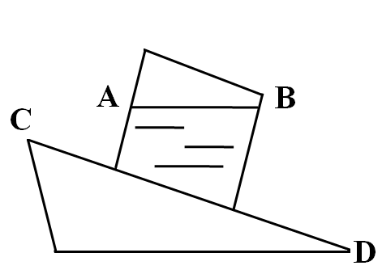

A. 仍保持原来水平状态

B. 水面B点比A点高

C. 容器中的水会来回晃动

D. 水面A点比B点高，且和斜面CD平行

第 27 题 · 答案与解析

**参考答案（粉笔题库参考内容）**

D

**解析**

容器滑下去时做沿斜面往下的加速运动，水因受容器壁的压力，将改变原来的运动状态，跟着容器沿斜面做加速运动，由于水的张力作用，水面与运动轨迹保持一致。

故正确答案为D。

**来源**：2014年上海市公务员录用考试《行测》题（A类）第27题

### 第 28 题

流体在流动过程中，流速大的地方，压强小，流速小的地方，压强大。当固体与流体有相对运动时，物体除受到一定阻力外，有时还可能受到与相对速度方向垂直的力。运动员在足球比赛中发角球时，可以发出“香蕉球”——球飞到球门前方时会拐弯进入球门，如图(俯视)所示，这是因为：

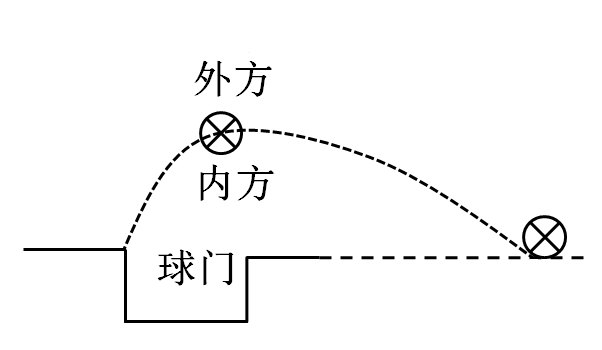

A. 球向前飞进时，绕重心顺时针方向旋转，球外方空气相对流速比球内方小

B. 球向前飞进时，绕重心顺时针方向旋转，球外方空气相对流速比球内方大

C. 球向前飞进时，绕重心逆时针方向旋转，球外方空气相对流速比球内方小

D. 球向前飞进时，绕重心逆时针方向旋转，球外方空气相对流速比球内方大

第 28 题 · 答案与解析

**参考答案（粉笔题库参考内容）**

C

**解析**

如上图所示，若使球在球门前向球门方向偏转，那么球需要受到偏向内方的力，这个力就是空气对球的压力。

根据气体压强，气体流速大的地方压强小，因为球受到偏向内方的压力，所以外方的压强更大，空气相对流速更小，B、D两项错误。

球和空气有摩擦，球的旋转会改变空气流速，下方空气流速因为球的旋转而变大，所以球就应该绕重心逆时针方向旋转，此时球上方的空气，也会因为球的转动而流速变小，C项正确，D项错误。

故正确答案为C。

**来源**：2014年上海市公务员录用考试《行测》题（B类）第34题

### 第 29 题

如图所示，平面镜OM与ON垂直放置，在它们的角平分线上P点处，放有一个玻璃球灯，左半部分为浅色，右半部分为深色，在P点左侧较远的地方放有一架照相机，不考虑照相机本身在镜中的成像情况，拍出的照片中有：

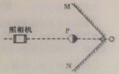

A. 无数个球

B. 4个球

C. 3个球

D. 2个球

第 29 题 · 答案与解析

**参考答案（粉笔题库参考内容）**

C

**解析**

平面镜成像特点：平面镜虚像，物像大小相等，物像到平面镜的距离相等，物像连线与镜面垂直。

如下图所示，根据平面镜成像特点在平面镜OM和ON中分别作出P的像A和B，A又在ON平面镜中成像，B又在OM平面镜中成像，两个像重合，物体在两个竖直放置的平面镜中间，我们在平面镜中能看到三个像。

照相机和物体P，像C在同一条直线上，照相过程中，像C被物体P阻挡，照相机不能照到像C，能照到物体P的白面，能照到A像、B像，并且A、B像是对称的。

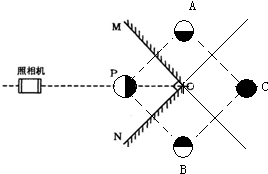

利用平面镜成像特点作物体P在平面镜OM中的像A，对于球的黑白两部分，要作黑白分界线直径的像来确定。同理作物体P在平面镜ON中的像B。

像A在平面镜ON中成像，像B在平面镜OM中成像重合得到像C。

照相机和物体P、像C在同一条直线上，照相机只能照到物体P的白面，所以照相机拍摄到的照片是，即有三个球。

故正确答案为C。

**来源**：2014年上海市公务员录用考试《行测》题（A类）第29题

### 第 30 题

下列各装置中，能构成原电池的是：

A. A

B. B

C. C

D. D

第 30 题 · 答案与解析

**参考答案（粉笔题库参考内容）**

A

**解析**

原电池的工作原理：原电池反应属于放热的氧化还原反应，但区别于一般的氧化还原反应，电子转移不是通过氧化剂和还原剂之间的有效碰撞完成的，而是还原剂在负极上失电子发生氧化反应，电子通过外电路输送到正极上，氧化剂在正极上得电子发生还原反应，从而完成还原剂和氧化剂之间电子的转移。两极之间溶液中离子的定向移动和外部导线中电子的定向移动构成了闭合回路，使两个电极反应不断进行，发生有序的电子转移过程，产生电流，实现化学能向电能的转化。

B、C两项使用的是同样的金属棒，故不会产生电势差，不会产生电流，排除；D选项没有形成闭合回路，也不会产生电流；A项为Cu-H2SO4-Zn原电池；正极：2H^++2e^−→H_2↑；负极：Zn - 2e^- → Zn^2+；总反应式：Zn+H2SO4=ZnSO4+H2↑，排除。

故正确答案为A。

**来源**：2014年上海市公务员录用考试《行测》题（B类）第30题

### 第 31 题

小李的奶奶瘫痪在床，行动不便，小李让保姆住在他奶奶房间的隔壁房间，并且在两个房间各装了一个电铃，使任何一方按下电铃都能让对方的电铃发声。

要实现这种功能，电铃应按如下哪种电路图所示安装：

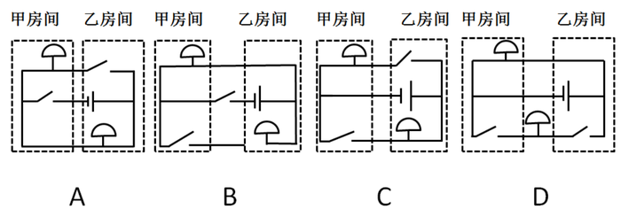

A. A

B. B

C. C

D. D

第 31 题 · 答案与解析

**参考答案（粉笔题库参考内容）**

C

**解析**

任何一方按开关都能使对方的电铃发声，说明两个用电器工作时互不影响，则该电路为并联电路，支路电铃由支路的开关控制。因为该电路为并联电路，且支路有各自的开关控制，故选项C正确。

A选项当乙房间闭合开关的时候，两个铃铛都不响，而甲房间闭合开关的时候，乙房间铃铛会响，排除；

B选项电路已经是断路，并且开关不在房间内，排除；

C选项正确，当选；

D选项甲房间的铃铛一直响，没有开关控制，排除。

故正确答案为C。

**来源**：2014年上海市公务员录用考试《行测》题（B类）第31题

### 第 32 题

汽车头灯灯碗用的是凹面镜，灯丝所发出的光经反射后成为一束平行光向前射出很远，这就产生远距离照明效果，即我们说的远光灯；灯丝所发出的光经反射后呈现发散状态，可以照到近处较大范围内的物体，这就是我们说的近光灯。如图所示为凹面镜示意图。ƒ代表焦距，则远光灯丝与近光灯丝分别位于：

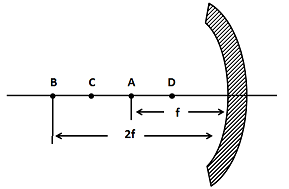

A. A处，D处

B. B处，A处

C. A处，C处

D. A处，B处

第 32 题 · 答案与解析

**参考答案（粉笔题库参考内容）**

C

**解析**

凹面镜对光线有会聚作用，从其焦点发出的光线，经反射后变成平行光射出，故远光灯丝应该位于焦点A处。D点发出的光线不会汇聚，不适合放置。B点和C点都可以会聚光线，但2倍焦距处，会聚光线照射的范围较小，不适合放置近光灯，故放置在C点更合理。

故正确答案为C。

**来源**：2014年上海市公务员录用考试《行测》题（B类）第32题

### 第 33 题

多米诺骨牌的游戏规则是将骨牌按一定的间距排成行，推倒第一张骨牌，其余发生连锁反应依次倒下。其中的物理原理是骨牌竖着时，重心较高，倒下时重心下降，将其重力势能转化为动能。

由此可推论下列说法正确的是：

A. 每块骨牌的重力势能转化为动能都是定值，所以每块骨牌倒下的速度是一样的

B. 由于空气阻力作用，骨牌的能量不断消耗，所以骨牌倒下的速度会变慢

C. 骨牌倒下时的能量增加与空气阻力导致的能量消耗差不多，所以骨牌能量基本不变，倒下的速度是一样的

D. 由于每块骨牌的动能都有一部分传递到下一块，骨牌的能量不断增加，所以骨牌倒下的速度会加快

第 33 题 · 答案与解析

**参考答案（粉笔题库参考内容）**

D

**解析**

骨牌竖着时，重心较高，倒下时重心下降。倒下过程中，将其重力势能转化为动能，它倒在第二张牌上，这个动能就转移到第二张牌上，第二张牌将第一张牌转移来的动能和自己倒下过程中由本身具有的重力势能转化来的动能之和，再传到第三张牌上。所以每张牌倒下的时候，具有的动能都比前一块牌大，因此它们的速度一个比一个快。也就是说，它们依次推倒的能量一个比一个大。

故正确答案为D。

**来源**：2014年上海市公务员录用考试《行测》题（B类）第28题

### 第 34 题

电磁感应现象是闭合电路中的一部分导体做切割磁感线运动，该电路中产生感应电流的现象。下列四幅图中，能说明电磁感应现象的是：

A. A

B. B

C. C

D. D

第 34 题 · 答案与解析

**参考答案（粉笔题库参考内容）**

B

**解析**

闭合电路的一部分导体在磁场中做切割磁感线运动时，导体中就会产生电流，该现象就称为电磁感应现象。

A项错误，该电路中有电源，即通电后，磁场中的金属棒会受力运动，是利用通电导线在磁场中受力的作用的原理工作的，故该选项错误；

B项正确，在该闭合电路中没有电源，当线圈转动时，其恰好切割磁感线运动，于是灯泡中就会有电流通过，这就是电磁感应现象，故该选项正确；

C项错误，该装置中有电流通过时，磁场中的线圈会转动，是利用通电导线在磁场中受力的作用的原理工作的，故该选项错误；

D项错误，该实验是著名的奥斯特实验，该实验说明了通电导线周围存在着磁场，故该选项错误。

故正确答案为B。

**来源**：2014年上海市公务员录用考试《行测》题（B类）第35题

### 第 35 题

伯努利原理告诉我们气体流速快的地方压强就小。如图所示，用手水平握住一只瓶子，在瓶口放一个小纸球（球的直径略小于瓶口），然后向瓶内吹气，结果会发现小纸球不仅吹不进瓶里反而朝脸上飞来。

对此，下列判断正确的是：

A. 如果吹的力越大，则小纸球反弹回来的速度也越大

B. 如果换用质量更大，截面积更小的小钢珠做实验效果会更好

C. 如果用一次性杯子（口大底小）来做实验，小纸球也不会被吹进去

D. 如果把瓶底去掉，仍旧不能把小纸球吹进瓶中

第 35 题 · 答案与解析

**参考答案（粉笔题库参考内容）**

A

**解析**

此实验是利用伯努利原理造成的外压强减小，内压强不变。压强差推动小纸球向外运动，吹的力量越大，则产生的压强差越大，小球飞出速度加快。要想试验成功需要保证小球质量小，横截面积与瓶口大小相当，否则会因惯性过大或受力面积减小导致压力减小而失败。

故正确答案为A。

**来源**：2014年上海市公务员录用考试《行测》题（A类）第35题

### 第 36 题

激情群体是指一种临时性的、高效率的，往往为某项富有挑战性的工作而临时组建的工作群体。

根据上述定义，下列属于激情群体的是：

A. 某画家发起、多位画家一起聚居的创意和设计社区

B. 某人因见义勇为而受伤的事迹感动了网友，数位网友发起募捐活动

C. 为尽快完成多品牌战略规划，某汽车公司集结了公司内数名专家组成项目组

D. 数十名自行车爱好者组成骑车团队，相约在某个周末从上海骑自行车去苏州

第 36 题 · 答案与解析

**参考答案（粉笔题库参考内容）**

C

**解析**

第一步：抓住定义中的关键词。

激情群体的定义要点：为某项富有挑战性的工作而临时组建的工作群体。

第二步：逐一判断选项。

A项不是临时性的；

B、D两项不具有挑战性；

C项符合定义。

故正确答案为C。

**考点**：单定义-其他句式

**来源**：2014年上海市公务员录用考试《行测》题（B类）第43题

### 第 37 题

知识鸿沟是指不论社会经济地位高或低，每个人所获取的知识都会随时间而增加，但社会经济地位高的人获取的知识量却比社会经济地位低的人所获取的多，久而久之，这两群人的知识差距会不断扩大，这就是知识鸿沟。下列说法正确的是：

A. 贫富分化越厉害的社会知识鸿沟现象越普遍

B. 社会经济地位高的人的知识状态趋向一致

C. 社会经济地位越高的人共同语言就越多

D. 知识与财富之间存在着正比关系

第 37 题 · 答案与解析

**参考答案（粉笔题库参考内容）**

A

**解析**

第一步：找出定义关键词。

“不论地位高低”“随着时间而增加”“社会经济地位高的人获得的知识量比地位低的人获得的知识量多”“差距扩大”。

第二步：逐一分析选项。

A项：符合定义，正确。

B、C两项：定义中只说明了社会经济地位高的人和社会经济地位低的人知识差距会不断扩大，并没有说明地位高，知识状态就会趋向一致，就会有共同语言，错误。

D项：知识和财富的关系在定义中没有体现，错误。

故正确答案为A。

**考点**：单定义-其他句式

**来源**：2014年上海市公务员录用考试《行测》题（A类）第37题

### 第 38 题

文化变迁是指由于族群社会内部的发展或由于不同族群之间的接触而引起的一个族群文化的改变。由于发明或借用而增添新的事物，由此导致旧事物丧失，是一种文化变迁；由于生态环境及社会生活变化，在没有替代物的情况下有些文化因素自动消失，也属于文化变迁。

根据上述定义，下列不属于文化变迁的是：

A. 拥有灿烂文化的庞贝古城在维苏威火山的大爆发中消失了

B. 古代玛雅人和玛雅文化一起在历史长河中消亡了

C. 随着英国的殖民与发展，英语成为许多亚洲国家的官方语言

D. 由于汽车的出现，伦敦的出租马车渐渐退出了历史舞台

第 38 题 · 答案与解析

**参考答案（粉笔题库参考内容）**

A

**解析**

第一步：抓住定义中的关键词。

文化变迁由于发展、与不同族群的接触、发明或借用新事物或没有替代物而引起的文化变化或消失。

满足下列条件之一，都可以称作文化变迁：①由于族群社会内部的发展，引起的族群文化的改变；②由于不同族群之间的接触，引起的族群文化的改变；③由于发明或借用而增添新的事物，由此导致旧事物丧失；④由于生态环境及社会生活变化，在没有替代物的情况下有些文化因素自动消失。

第二步：逐一分析选项。

A项不符合文化变迁的定义；

B选项符合定义条件④；

C选项符合定义条件②；

D选项符合定义条件③。

本题为选非题，故正确答案为A。

**考点**：原因结果

**来源**：2014年上海市公务员录用考试《行测》题（B类）第37题

### 第 39 题

共生是指两种生物共同生活在一起，相互依赖，彼此有利，徜若彼此分开，则双方或其中一方便无法生存。

根据上述定义，下列属于共生的是：

A. 双锯鱼喜欢在海葵的触手间游动，既得到海葵的保护，又能分享海葵吐出的食物

B. 白蚁在吃了木材后，其肠道中的多鞭毛虫能分泌纤维素水解酶，帮助白蚁将木质纤维消化分解

C. 文鸟将巢筑在蜂窝旁以获得蜜蜂的保护，蜜獾喜欢吃蜂蜜，便追随着文鸟生活

D. 赤眼蜂在玉米螟虫的卵内产卵，以其为营养源生长发育

第 39 题 · 答案与解析

**参考答案（粉笔题库参考内容）**

B

**解析**

第一步：抓住定义中的关键词。

共生定义的要点是：①两种生物共同生活在一起；②相互依赖，彼此有利；③彼此分开则双方或其中一方无法生存。

第二步：逐一判断选项。

A项中的双锯鱼和海葵和C项中的文鸟和蜜獾都不是离开彼此就无法生活，不符合要点③；

B项白蚁与多鞭毛虫相互依赖，彼此有利，彼此分开则双方无法生存，符合定义；

D项赤眼蜂对玉米螟虫不利，不符合要点②。

故正确答案为B。

**考点**：单定义-其他句式

**来源**：2014年上海市公务员录用考试《行测》题（B类）第44题

### 第 40 题

陈述性知识是有关“世界是什么”的知识，能够直接陈述，要求的心理过程主要是记忆。程序性知识是有关“怎么办”的知识，不能直接陈述，只能通过某种作业形式简单推测其存在。

根据上述定义，下列归类正确的是：

A. “修自行车”是陈述性知识，“音乐欣赏”需要程序性知识

B. “美国的首都是华盛顿”是陈述性知识，“加减运算”需要程序性知识

C. “水到100℃沸腾”是陈述性知识，“水的分子式是H_2O”是程序性知识

D. “骑马射箭”是陈述性知识，“红灯停，绿灯行”是程序性知识

第 40 题 · 答案与解析

**参考答案（粉笔题库参考内容）**

B

**解析**

第一步：找出定义关键词。

陈述性知识的关键词是：①有关“世界是什么”；②直接陈述；③心理过程主要是记忆。

程序性知识的关键词是：①有关“怎么办”；②不能直接陈述；③只能通过某种作业形式简单推测其存在。

第二步：逐一分析选项。

A项：“修自行车”侧重于“怎么办”，属于程序性知识，归类错误，排除；

B项：归类正确，当选；

C项：“水的分子式是H_2O” 侧重于“世界是什么”，属于陈述性知识，归类错误，排除；

D项：“骑马射箭”侧重于“怎么办”，属于程序性知识，归类错误；“红灯停，绿灯行” 侧重于“世界是什么”，属于陈述性知识，归类错误，排除。

故正确答案为B。

**考点**：特殊问法

**来源**：2014年上海市公务员录用考试《行测》题（B类）第39题

### 第 41 题

假期综合症是指出现于长假期或节日后的疲倦、失眠等症状，以至于焦虑、空虚或容易发怒，难以集中精神工作，这是人们在长期休闲后，身心无法承受工作压力所出现的心理不适。

根据上述定义，下列属于假期综合症的是：

A. 小李从印度归来之后，领略到新的人生价值，立即辞去了工作

B. 小王假期里吃坏了肚子，结果上班后不想吃午饭

C. 小张国庆节去爬黄山，假后上班总感觉腰酸腿疼

D. 小赵春节玩得很尽兴，上班后却总是心不在焉

第 41 题 · 答案与解析

**参考答案（粉笔题库参考内容）**

D

**解析**

第一步：找出定义关键词。

假期综合症是出现在“假期或节日之后”，表现为“疲倦、失眠等症状，以至于焦虑、空虚或容易发怒，难以集中精神工作”，“身心无法承受工作压力”。

第二步：逐一分析选项。

A项领略到新的人生价值、B项上班后不想吃中午饭、C项因为爬山导致的腰酸腿疼，均不是上述症状的表现，排除；

D项符合定义，当选。

故本题答案为D。

**考点**：原因结果

**来源**：2014年上海市公务员录用考试《行测》题（A类）第41题

### 第 42 题

信息传递是指信息从信息源出发，借助一定的物质载体，按照一定的方式，通过一定的渠道，最终为信息接收者获取的整个过程。

根据上述定义，下列不属于信息传递的是：

A. 作家将梦里出现的美好场景通过语言记录下来

B. 三十年代周璇美妙的歌声通过唱片流传至今

C. 在古代战事紧急的时候，人们通过烽火台传递重要军情

D. 聋哑人通过手势与他人交流

第 42 题 · 答案与解析

**参考答案（粉笔题库参考内容）**

A

**解析**

第一步：找出定义关键词。

信息传递是信息需要“从信息源出发”借助“物质载体”，最后为“信息接收者获取”，是一个完整的过程。

第二步：逐一分析选项。

A选项，“作家”作为“信息源”，“通过语言记录”作为“物质载体”，但最后并没有为“信息接收者获取”，即读者没有获取。故不属于信息传递，当选；

B选项，“三十年代周璇美妙的歌”作为“信息源”，“通过唱片”作为“物质载体”，“流传至今”说明为听众收听获取，是属于信息传递，排除；

C选项，“重要军情”作为“信息源”，“通过烽火台”作为“物质载体”，最后被士兵接收，即为“信息接收者获取”，属于信息传递，排除；

D选项，“聋哑人”作为“信息源”，“通过手势”作为“物质载体”，“与他人交流”即为“信息接收者获取”，属于信息传递，排除。

本题为选非题，故正确答案为A。

**考点**：方式目的

**来源**：2014年上海市公务员录用考试《行测》题（A类）第42题

### 第 43 题

返祖现象是指一种不太正常的生物“退化”现象，既有的生物体偶然出现了祖先的某些性状的遗传现象，因此返祖现象也可以作为生物进化的证据，具有很大的研究价值。

根据上述定义，下列不属于返祖现象的是：

A. 有的新生儿会出现长有短尾或者全身长毛的现象

B. 家养的鸭群中有时会出现一只能够短程飞行的鸭子

C. 孟加拉虎偶尔会产生白化品种，毛色纯白，被称为白虎

D. 双翅扣昆虫后翅已退化为平衡棒，但偶尔会出现有两对翅膀的个体

第 43 题 · 答案与解析

**参考答案（粉笔题库参考内容）**

C

**解析**

第一步：找出定义关键词。

返祖现象是“不太正常的”退化现象，“偶然出现了祖先的某些性状的遗传现象”。

第二步：逐一分析选项。

A项有婴儿短尾或全身长毛，是身体体现了猿类的特征，是返祖现象，排除；

B项能够短程飞行、D项有两对翅膀均是相应生物的祖先的性状，符合定义要点，排除；

C项孟加拉虎白化不是其祖先的性状。白化动物是一对隐性基因纯合子的产物，虹膜大多为红色，往往还同时携带着其他对其自身不利的因素，如怕光、眼球震颤、皮癌等，另外在自然界中也容易为天敌所发现而受到攻击，所以比正常个体难于存活，故不符合定义，当选。

本题为选非题，故正确答案为C。

**考点**：单定义-其他句式

**来源**：2014年上海市公务员录用考试《行测》题（A类）第43题

### 第 44 题

补偿贸易是指进口者购买外国技术设备以及某些原料的货款，约定在一定期限内用产品或劳务分期偿还的一种贸易方式。

根据上述定义，下列不属于补偿贸易的是：

A. 某国的甲摩托车厂引进一日本公司的技术，双方约定该厂先支付30%的费用，一年后使用厂里制造的摩托车偿还余款

B. 某国的甲公司向S国的乙公司购买番茄酱成套设备和技术服务，双方约定甲公司分三年以本国的竹制品偿还全部款项

C. 某国的甲电厂向他国乙煤炭企业购买五万吨焦炭，双方约定甲电厂一两年后向乙煤炭企业提供采掘设备来偿还全部款项

D. 某国的甲公司向一外资公司购买咨询服务，由于甲公司资金紧张，双方项目结束三个月后，甲公司再支付咨询项目全款

第 44 题 · 答案与解析

**参考答案（粉笔题库参考内容）**

D

**解析**

第一步：抓住定义中的关键词。

补偿贸易是“进口者”赊购产生的一个行为，并在一定期限内用“产品或劳务”分期偿还。

第二步：逐一判断选项。

A项甲公司引进日本公司的技术，一年后用产品偿还，符合定义；

B项购买技术和设备并用竹制品（产品）偿还，符合定义；

C项也同样是购买产品，然后用产品来偿还，符合定义；

D项在约定期间内支付的款项并不是产品或劳务，不符合定义。

本题为选非题，故正确答案为D。

**考点**：单定义-其他句式

**来源**：2014年上海市公务员录用考试《行测》题（B类）第42题

### 第 45 题

归谬法是指对一错误论题不直接否定，而是先假定其真，然后据此导出荒谬的结果，由结果的荒谬推出该论题的荒谬，从而直接地否定错误论题的论证手法。

根据上述定义，下列不属于归谬法的是：

A. 有个病人对住院处的护士说：“请把我安排在三等病房，我很穷。”“没有人能帮助您吗？”“没有，我只有一个姐姐，她是修女，也很穷。”护士听了生气地说： “修女富得很，因为她和上帝结婚。”“好，您就把我安排在一等病房吧，以后把账单寄给我姐夫就行了。”

B. 甲向乙解释：“我演奏的是高雅的流行乐曲。”乙反问一句：“流行的乐曲就是高雅的吗？”甲听了很是吃惊：“不高雅的东西怎么能够流行呢?”乙笑着说：“那么，流行感冒也是高雅的了？”

C. 某人坚决反对杀生，他劝告人们说：“你如果在世时杀了一头猪，来生就要变成一头猪；你在世时杀一头牛，来生就要变成一头牛。”这时一个听众说：“那不如去杀人吧。”

D. 有一次，一位英国女记者读了文学大师钱钟书的作品，对钱钟书很仰慕，非要见他，在电话中钱钟书对该女士说：“假如你吃了个鸡蛋，觉得味道不错，就够了，何必非要认识那只下蛋的母鸡呢？”

第 45 题 · 答案与解析

**参考答案（粉笔题库参考内容）**

D

**解析**

第一步：抓住定义中的关键词。

归谬法其实就是假定命题正确，然后推出错误的结论，从而否定命题的错误。

第二步：逐一判断选项。

A项“不可能收到账单的上帝姐夫”，B项“高雅的流行感冒”，C项“为了下辈子成为人而杀人”都是错误的结论，从而可以得出其命题也是错误的，均符合定义，排除；

D项不存在错误命题，不符合定义，当选。

本题为选非题，故正确答案为D。

**考点**：单定义-其他句式

**来源**：2014年上海市公务员录用考试《行测》题（B类）第41题

### 第 46 题

下列选项中，符合所给图形的变化规律的是：

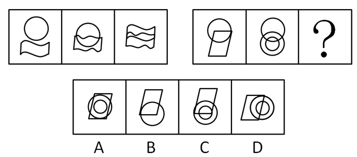

A. A

B. B

C. C

D. D

第 46 题 · 答案与解析

**参考答案（粉笔题库参考内容）**

C

**解析**

本题考查的是图形的元素。

第一个图形和第二个图形去同存异得到第三个图形，且位置关系为第一图在上，第二图在下，并叠加至中心处。

故正确答案为C。

**考点**：样式规律-加减同异

**来源**：2016年重庆市选调优秀大学生到基层工作考试《行测》题第61题

### 第 47 题

下列选项中，符合所给图形的变化规律的是：

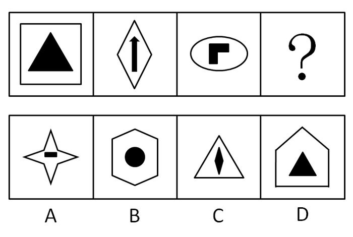

A. A

B. B

C. C

D. D

第 47 题 · 答案与解析

**参考答案（粉笔题库参考内容）**

C

**解析**

各图形构成不同，且均有里外两个元素构成。分别观察，均为轴对称图形。考虑对称轴的数量或位置规律。外面图形的对称轴数量分别为：4、2、2；里面图形的对称轴数量分别为：3、1、1。每幅图里外图形对称轴数量差均为1。

故正确答案为C。

**考点**：属性规律-对称性

**来源**：2014年上海市公务员录用考试《行测》题（A类）第47题

### 第 48 题

下列选项中，符合所给图形的变化规律的是：

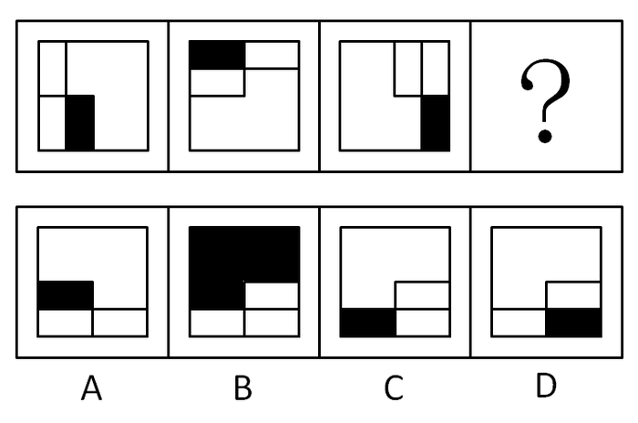

A. A

B. B

C. C

D. D

第 48 题 · 答案与解析

**参考答案（粉笔题库参考内容）**

B

**解析**

元素组成相同，黑色阴影本身与图形共同旋转。图形整体顺时针旋转90°，同时黑色填充部分于图形内部顺时针平移，得到B项图形。

故正确答案为B。

**考点**：位置规律-综合

**来源**：2014年上海市公务员录用考试《行测》题（B类）第54题

### 第 49 题

下列选项中，符合所给图形的变化规律的是：

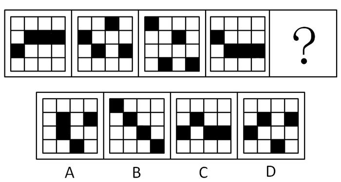

A. A

B. B

C. C

D. D

第 49 题 · 答案与解析

**参考答案（粉笔题库参考内容）**

D

**解析**

元素组成相同，优先考虑位置规律。如下图所示，标1和标3的两个黑块依次向上平移1格，到头时反弹走，继续依次向下平移1格，标2和标4的两个黑块依次向下平移1格，到头时反弹走，继续依次向上平移1格，只有D项符合。

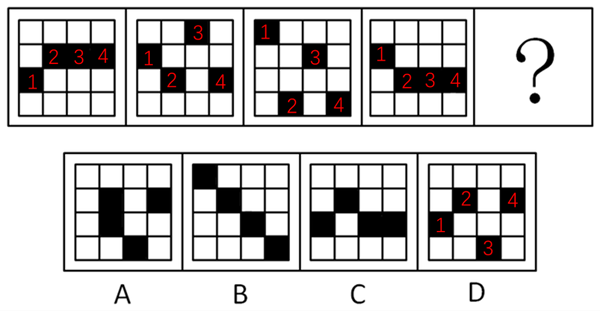

故正确答案为D。

**考点**：位置规律-平移

**来源**：2014年上海市公务员录用考试《行测》题（A类）第49题

### 第 50 题

下列选项中，符合所给图形的变化规律的是：

A. A

B. B

C. C

D. D

第 50 题 · 答案与解析

**参考答案（粉笔题库参考内容）**

D

**解析**

元素组成凌乱，本题考点为数正方形中的直线数。图形中不变的为正方形外框，可变元素为正方形外框内的直线数，分别为0、1、2、3，则问号处应选择含有正方形外框且框内包含4条直线的图形。

故正确答案为D。

**考点**：数量规律-线

**来源**：2014年上海市公务员录用考试《行测》题（B类）第49题

### 第 51 题

下列选项中，符合所给图形的变化规律的是：

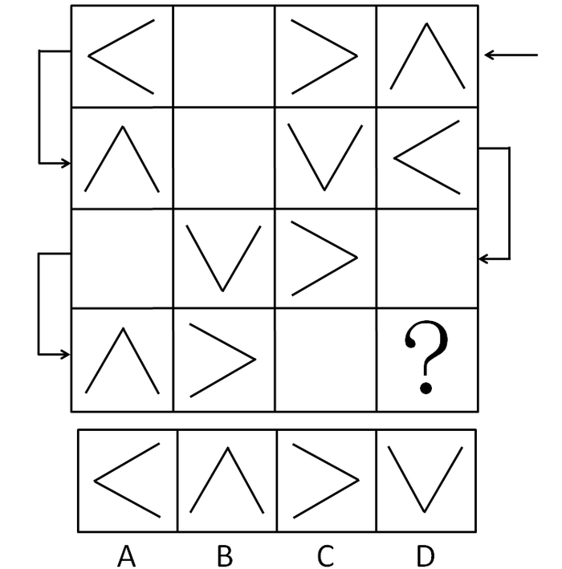

A. A

B. B

C. C

D. D

第 51 题 · 答案与解析

**参考答案（粉笔题库参考内容）**

A

**解析**

以行为单位，元素组成相同，本题考点为旋转和周遍。按图示从出发到结束，夹角依次顺时针旋转90◇，每隔两个图形呈现一个空白，可得最后一个图形为开口向右的夹角。

故正确答案为A。

注意：题目中元素很简单，需要注意的是箭头的推理路线。

**考点**：位置规律-旋转

**来源**：2014年上海市公务员录用考试《行测》题（B类）第52题

### 第 52 题

下列选项中，符合所给图形的变化规律的是：

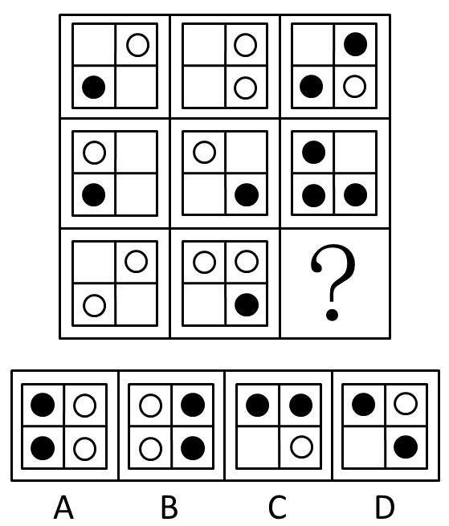

A. A

B. B

C. C

D. D

第 52 题 · 答案与解析

**参考答案（粉笔题库参考内容）**

B

**解析**

本题考查的是元素叠加中的黑白叠加。

每行前两个图形叠加得到第三个图形，规律为白圈+白圈=黑圈，空白+白圈=白圈，黑圈+空白=黑圈。

故正确答案为B。

**考点**：样式规律-黑白运算

**来源**：2014年上海市公务员录用考试《行测》题（A类）第52题

### 第 53 题

下列选项中，符合所给图形的变化规律的是：

A. A

B. B

C. C

D. D

第 53 题 · 答案与解析

**参考答案（粉笔题库参考内容）**

A

**解析**

元素组成相同，优先考虑位置规律。观察发现，相邻两行图形中，前一行第一、三、五位置上的小图形会移至下一行的最后三个位置，故问号处图形最后三个位置的图形应是第四行中第一、三、五位置上的小图形，只有A项符合。

故正确答案为A。

**考点**：位置规律-平移

**来源**：2014年上海市公务员录用考试《行测》题（B类）第48题

### 第 54 题

下列选项中，符合所给图形的变化规律的是：

A. A

B. B

C. C

D. D

第 54 题 · 答案与解析

**参考答案（粉笔题库参考内容）**

B

**解析**

元素组成相似，且相同线条重复出现，考虑加减同异。九宫格优先看横行，第一行中的图一顺时针旋转45°后，再与图二叠加得到图三；经验证，第二行满足此规律；第三行应用此规律，只有B项符合。

故正确答案为B。

**考点**：样式规律-加减同异

**来源**：2014年上海市公务员录用考试《行测》题（B类）第50题

### 第 55 题

下列选项中，除了（         ），都能够展开成为左边的平面图。

A. A

B. B

C. C

D. D

第 55 题 · 答案与解析

**参考答案（粉笔题库参考内容）**

B

**解析**

本题考查四面体的相邻面关系。

观察左边图形可知，没有两个黑色三角形有共同的边，由此可知B项不能由左边图形折叠而成。

本题为选非题，故正确答案为B。

**来源**：2014年上海市公务员录用考试《行测》题（B类）第55题

### 第 56 题

某神经内科医生对病人说：“市场上所出现的合成药S对失眠有较好的疗效，但由于对S的长期副作用不清楚，因此我不建议使用此药。”有病人反驳道：“你的言行不一，你开了很多有副作用的药给我，所以你拒绝使用S药的真正原因并不是药物的副作用。”

病人的观点是有缺陷的，因为：

A. 用过一段时间后，S药的副作用自然会表现出来

B. 已知的风险可用特定方法来降低，而未知的风险则不行

C. 医生有可能不相信S药的功效，而不是担心它的副作用

D. 合成药物与天然药物的副作用以及应对方法是不相同的

第 56 题 · 答案与解析

**参考答案（粉笔题库参考内容）**

B

**解析**

第一步：找出论点和论据。

病人的论点是：拒绝使用S药的真正原因并不是药物的副作用。

病人的论据是：病人认为医生言行不一，医生之前开了很多有副作用的药。

第二步：逐一判断选项的作用。

A项“副作用的时间论”与题干不符，医生认为S药的长期副作用不清楚，如果是一段时间后副作用会表现出来，则间接证明了病人的论点是正确的，排除；

B项说明医生之前开有副作用的药是因为已知的风险，可用特定方法来降低，而S药的副作用还不清楚，因此反驳了病人的观点，削弱论点，当选；

C选项直接加强了病人的论点，排除；

D选项的说法与题干无关，属于无关选项，排除。

故正确答案为B。

**考点**：削弱论点

**来源**：2014年上海市公务员录用考试《行测》题（B类）第60题

### 第 57 题

政府环保部门的官员若要在这次民间环保研讨会上发言，他就必须是民间环保组织的成员。但是，会议规定，作为一个民间环保组织的成员，不允许既是政府环保部门的官员又在这次民间环保研讨会上发言。

如果上述断定为真，以下哪项也为真：

A. 在这次研讨会上发言的人中，没有政府环保部门的官员

B. 只有民间环保组织的成员才能在这次研讨会上发言

C. 除了政府环保部门的官员，没有人在这次研讨会上发言

D. 在这次研讨会上发言的人中，没有民间环保组织的成员

第 57 题 · 答案与解析

**参考答案（粉笔题库参考内容）**

A

**解析**

第一步：翻译题干。

①政府环保部门的官员 且 在这次民间环保研讨会上发言→民间环保组织的成员；

②民间环保组织的成员→（政府环保部门的官员 且 在这次民间环保研讨会上发言）

①②合并可得出：政府环保部门的官员 且 在这次民间环保研讨会上发言→（政府环保部门的官员 且 在这次民间环保研讨会上发言），即A→A，则-A必为真。因此，-（政府环保部门的官员 且 在这次民间环保研讨会上发言）为真，进一步推导为“-政府环保部门的官员 或 -在这次民间环保研讨会上发言”为真。

第二步：逐一分析选项。

A项：发言→政府官员，根据或关系否一推一，可以推出，当选；

B项：“发言”→“民间环保组织的成员”，无法推出，排除；

C项：“发言”→“政府官员”，无法推出，排除；

D项：发言→环保组织成员，无法推出，排除。

故正确答案为A。

**考点**：常规翻译

**来源**：2014年上海市公务员录用考试《行测》题（B类）第63题

### 第 58 题

适合于实验用的小动物必须要繁殖快而且其基因要尽可能多的与人的相似；有些小动物虽然繁殖快但与人相似的基因很少；所以，有些繁殖快的小动物并不适合用于实验。

以下哪项的逻辑结构与题干的最为类似：

A. 按相关规定，要获得国家贫困生奖学金，申请者必须家庭贫困并且成绩优秀；有些这一奖学金的获得者家庭非常贫困，但成绩并不优秀；显然，评定国家贫困生奖学金的规定没有得到严格的执行

B. 一部电影要获得好的票房，必须既有可看性又有成功的市场发行；有些票房好的电影其实可看性并不强；所以，有些电影的票房之所以好主要靠的是成功的市场发行

C. 要修读《认知科学的哲学》这门课，必须已经修过《知识论》，并且对认知科学感兴趣；有些学生虽然对认知科学很感兴趣，但没有修过《知识论》；因此，有些对认知科学感兴趣的学生不能修读《认知科学的哲学》这门课

D. 一般来说，不是每周进行系统维护的电脑在使用一年后都要拿到专卖店去维修；有些电脑在用了很长时间后也不需要拿到专卖店去维修；因此，有些电脑每周都进行了系统维护

第 58 题 · 答案与解析

**参考答案（粉笔题库参考内容）**

C

**解析**

第一步：翻译题干。

题干翻译为：适用实验→繁殖快且基因与人相似多；有些小动物繁殖快且（-基因与人相似多）→有些小动物适用实验。题干的推理形式是：否定了且关系两个后件的其中一个，得到否定前件的结论。

第二步：逐一分析选项。

A项：获得国家贫困生奖学金→家庭贫困且成绩优秀；有些一奖学金获得者家庭贫困且（-成绩优秀）→规定没有严格执行。规定是否执行严格在选项表述前一句中没有提到，因此推理形式与题干不同，排除；

B项：好票房→可看性且成功的市场发行；有些好票房且（-可看性强）→成功的市场发行。最后得到的结论是第一句话中的且关系两个后件的其中一个，而不是得到否定前件的结论，因此推理形式与题干不同，排除；

C项：修读《认知科学的哲学》→修过《知识论》且对认知科学感兴趣；有些学生对认知科学感兴趣且（-修过《知识论》）→有些学生修读《认知科学的哲学》，与题干推理形式一致，当选；

D项：“不是每周进行系统维护的电脑在使用一年后都要拿到专卖店去维修”，即“有些每周进行系统维护的电脑在使用一年后不需要拿到专卖店去维修”，翻译后为：有些电脑每周进行系统维护且使用一年后→需要拿到专卖店修；有些电脑用了长时间且（-需要拿到专卖店修）→有些电脑每周都进行了系统维护，第一句话且关系是前件，不是后件，因此与题干推理形式不一致，排除。

故正确答案为C。

**考点**：推理形式

**来源**：2014年上海市公务员录用考试《行测》题（B类）第61题

### 第 59 题

考古学家前不久对某岛屿的S古城进行了考古挖掘，他们发现了一些残骸和典型的被地震摧毁的古建筑废墟。因此，考古学家猜测，公元300年时，这里发生了一场强烈的地震，摧毁了当时的建筑。

以下\_\_\_\_\_观点如果正确，能够最有力地支持考古学家的猜测：

A. 大多数关于S古城的现代历史都记载了公元300年那次地震

B. 在S古城发现了一些制作于公元260至350年间的，具有该岛风格的画像

C. 在那些建于公元300年前后的坟墓中发现的饮酒容器也出现在S古城附近的坟墓中

D. 在S古城，考古学家没有发现公元300年之后的铜币，却发现了大量铸造于公元300年之前的铜币

第 59 题 · 答案与解析

**参考答案（粉笔题库参考内容）**

D

**解析**

第一步：找出论点和论据。

论点：公元300年时，这里发生了一场强烈的地震，摧毁了当时的建筑。

论据：发现了一些残骸和典型的被地震摧毁的古建筑废墟。

第二步：逐一分析选项。

A项，大多数现代历史记载那次地震，不能有力地证明时间的准确性及考古的严谨性，属于新增论据，加强力度不够，排除；

B项，在S古城发现公元260年~350年的画像，不能代表摧毁性地震的确切发生时间，属无关选项，排除；

C项，只能证明公元300年前后，S城还存在，还有人下葬以及制作生活用品，不能说明是摧毁性的地震，属于削弱选项，排除；

D项，发现S城只有公元300年前的古币，没有公元300年后的，说明S城在公元300年时突然消失，加之本题的论据，发现一些残骸和典型的被地震摧毁的古建筑废墟，说明公元300年的强烈地震摧毁了整个城市，当选。

故正确答案为D。

**考点**：补充论据

**来源**：2014年上海市公务员录用考试《行测》题（A类）第59题

### 第 60 题

在使用了各种常规的广告和促销手段后，某电商的网络销售收入并没有如预期那样得到提高，为此管理层重金聘请专业人士进行市场分析。分析报告提出，开通了移动支付（通常指使用智能手机对所消费的商品或服务进行账务支付）功能的人群才是该电商真正潜在的顾客群。于是管理层决定与某大型商业银行合作，在新开通移动支付功能的人群中开展宣传和促销。但一个月后，效果并不理想，网络销售收入没有明显增长。

以下哪项如果为真，最能解释上述结果：

A. 由于交易的安全性受到质疑，最近开通移动支付功能的人有所减少

B. 由于移动支付是一项新兴业务，消费者对其态度比较谨慎

C. 一般来说，新开通移动支付功能的人需要经过一段时间后才有可能进行此类的网络购物

D. 网络购物在白领中较为普及，但他们更希望电商能够提供一些有特色的服务

第 60 题 · 答案与解析

**参考答案（粉笔题库参考内容）**

C

**解析**

第一步：找出论点和论据。

论点：在新开通移动支付功能的人群中开展宣传和促销，但一个月后，某电商的网络销售收入没有明显增长。

论据：无明显论据。

第二步：逐一分析选项。

A项：说明最近开通移动支付功能的人有所减少，开通的人减少并不代表使用的人一定减少，为无关项，排除；

B项：说明消费者对移动支付态度谨慎，但是开通移动支付功能的人是大量存在的，不能说明为什么没有更多的人参与到该电商的网购，排除；

C项：说明新开通支付功能的人需要一段时间才能进行网络购物，很好地解释了仅一个月的时间，某电商的网络销售收入没有明显增长，当选；

D项：提到的特色服务是无关内容，该电商是否提供特色服务题干并未提及，为无关项，排除。

故正确答案为C。

**考点**：原因解释

**来源**：2014年上海市公务员录用考试《行测》题（B类）第65题

### 第 61 题

人口平均预期寿命是反映一个国家和地区人民健康水平的重要指标。第六次全国人口普查显示，2010年我国人口平均预期寿命达74.83岁，而建国初期我国人口平均预期寿命只有35岁左右。因此，六十多年前人们认为的老年人现在看起来其实只是中年人。

以下哪项如果为真，最能削弱上述观点：

A. 建国以来，新生婴儿死亡数量的减少是人口平均预期寿命增加的最重要原因

B. 建国初期，国家正从战乱转向和平，全国形势仍不稳定，人口数量远低于现在

C. 建国初期，生活环境比较艰苦，人们的营养水平比现在差得多

D. 随着医学的发展，医疗水平比建国初期有很大提高

第 61 题 · 答案与解析

**参考答案（粉笔题库参考内容）**

A

**解析**

第一步：找出论点和论据。

论点：六十多年前人们认为的老年人现在看起来其实只是中年人。

论据：2010年我国人口平均预期寿命达74.83岁，而建国初期我国人口平均预期寿命只有35岁左右。而人口平均预期寿命是反映一个国家和地区人民健康水平的重要指标。

第二步：逐一判断选项的作用。

A项，说明新生婴儿死亡数量的减少是人口平均预期寿命增加的最重要原因，也就表示建国初期的人口平均预期寿命低是因为新生婴儿死亡数量多，有削弱作用，当选；

B项，阐述了人口数量，而不是人的寿命，与题干无关，排除；

C、D两项，均表明现在人的寿命比以前长的原因在于营养和医疗，与健康有直接关系，与题干观点一致，无法削弱，排除。

故正确答案为A。

**考点**：拆桥

**来源**：2014年上海市公务员录用考试《行测》题（B类）第59题

### 第 62 题

某超市员工将各品牌洗发液摆上货架，已知洗发液有E、F、G、H、I等五个品牌，在货架上从左向右排列，上架要求：①F紧挨H左边，②I与E相邻，③G在F的左边。

如果I在G的左边，则以下\_\_\_\_项必定为真。

A. E紧挨在G的左边

B. G紧挨在F的左边

C. I 紧挨在G的左边

D. E紧挨在F的左边

第 62 题 · 答案与解析

**参考答案（粉笔题库参考内容）**

B

**解析**

由题干条件，F和H、I和E可以看做两组捆绑的组合。因为I在G的左边，所以I和E都在G的左边；又因为G在F的左边、F在H 的左边，所以可能的排序是IEGFH或EIGFH，故G一定紧挨在F的左边。

故正确答案为B。

**考点**：组合排列-单题-其他

**来源**：2014年上海市公务员录用考试《行测》题（A类）第62题

### 第 63 题

由于近年来投身F1赛车比赛的选手数量的增长速度大大超过了F1赛事数量的增长，加之3D模拟比赛系统的应用越来越普及，最近5年每位F1赛车选手实际参加场地F1比赛的平均次数下降了20%，这种趋势如果继续下去的话，F1赛车选手的水平肯定会大幅下降。

以上论证基于以下哪项假设：

A. 许多F1赛车选手现在将他们的大部分时间花在3D模拟比赛系统上，以便保持状态能够参加场地比赛

B. F1赛车选手只有保证每年参加一定数量的场地比赛，水平才能得到保持或提高

C. 所有的赛车选手，包括F1赛车选手，平时的训练难度与强度比前几年下降了不少

D. 每一位F1赛车选手的场地比赛水平近年来都有所下降

第 63 题 · 答案与解析

**参考答案（粉笔题库参考内容）**

B

**解析**

第一步：找到论点论据。

论点：F1赛车选手的水平肯定会大幅下降。

论据：F1赛车选手实际参加场地F1比赛的平均次数下降了20%。

第二步： 逐一分析选项的作用。

A项，“以便保持状态能够参加场地比赛”，削弱了论点，排除；

B项，“F1赛车选手只有保证每年参加一定数量的场地比赛，水平才能得到保持或提高”，作为前提，加强论点，当选；

C项，“所有的赛车选手，平时的训练难度与强度比前几年下降了不少”也削弱了论点，排除；

D项，属于无关选项，排除。

故正确答案为B。

**考点**：搭桥

**来源**：2014年上海市公务员录用考试《行测》题（A类）第63题

### 第 64 题

景区内商家：这几个月的营业额明显减少，主要是由于景区门票大幅涨价造成的。景区管理部门：商家的营业额减少和景区门票涨价没有关系，经过我们的调查，商家营业额减少的主要原因，是他们没有采取薄利多销的营销策略。

以下哪项如果为真，最能削弱景区管理部门的解释：

A. 该景区的门票价格和别的景区相比并不算高

B. 景区管理部门在引导商家进行薄利多销方面做了一些工作，但是力度不够

C. 过高的景区门票价格导致游客数量锐减

D. 商家的营业额减少这一情况在别的景区也普遍存在

第 64 题 · 答案与解析

**参考答案（粉笔题库参考内容）**

C

**解析**

第一步：找到论点论据。

景区管理部门的论点：商家营业额的减少和景区门票涨价没有关系而是他们没有采取薄利多销的营销策略。

第二步：逐一分析选项的作用。

A、B、D三项均不能削弱；

C项直接说明“营业额的减少是因为游客数量锐减，而游客锐减的原因是过高的景区门票价格”，直接削弱了管理部门的观点。

故正确答案为C。

**考点**：削弱论点

**来源**：2014年上海市公务员录用考试《行测》题（A类）第64题

### 第 65 题

某天夜里，同宿舍的小赵、小钱、小孙、小李在谈论各自以及隔壁宿舍小周喜欢的电视频道。

小赵说：“我和小钱都喜欢看教育频道，小孙喜欢看艺术频道。”

小钱说：“我与小李都喜欢看财经频道，小孙喜欢看艺术频道。”

小孙说：“我与小赵都不喜欢看教育频道，小周喜欢看纪实频道。”

小李说：“小赵和小钱都喜欢看教育频道，我喜欢看新闻频道。”

若他们都只说对了两个人对电视频道的喜好，则小周喜欢的电视频道是：

A. 纪实频道

B. 教育频道

C. 新闻频道

D. 艺术频道

第 65 题 · 答案与解析

**参考答案（粉笔题库参考内容）**

A

**解析**

第一步，找突破口。

已知每个人只说对了两个人对电视频道的喜好，而小赵和小李的话中都提到了“小赵和小钱都喜欢看教育频道”，先假设这句话为真，根据小赵的话推出小孙不喜欢艺术，根据小李的话推出小李不喜欢看新闻；此时小钱的话中关于小钱和小孙两人的喜好都说错了，不符合要求；所以我们可以得出“小赵和小钱都喜欢看教育频道”这句话只有一个喜好猜对了；进一步推出小孙喜欢看艺术，小李喜欢看新闻。

第二步：逐一分析。

结合小钱的话，小李喜欢财经为假，推出小钱喜欢看财经；再根据“小赵和小钱都喜欢看教育频道”这句话只有一个喜好猜对了，推出小赵喜欢看教育；再看小孙说的话，此时小赵不喜欢看教育为假，所以小周一定看喜欢纪实。

故正确答案为A。

**考点**：假设

**来源**：2014年上海市公务员录用考试《行测》题（B类）第57题

### 第 66 题

研究表明，某消毒剂含有一种杀菌物质，如果按规定使用，使用后1小时环境中这种物质的含量最高（每升空气中含6毫克），随后逐步减少，使用后7小时环境中这种物质的含量降到每升空气中含3毫克。当每升空气中该物质的含量不少于4毫克时，有抑菌作用，那么使用这种消毒剂后发挥抑菌作用的时间能持续：（设环境中该物质的释放和稀释的过程是均匀的）

A. 4小时20分钟

B. 5小时

C. 5小时30分钟

D. 6小时

第 66 题 · 答案与解析

**参考答案（粉笔题库参考内容）**

A

**解析**

释放阶段，1小时从0毫克增长至6毫克，因此超过4毫克的时间占1/3，即20分钟；稀释阶段，6小时从6毫克降低至3毫克，因此超过4毫克的时间占2/3，即4小时。因此发挥抑菌作用的时间能持续4小时20分钟。

故正确答案为A。

**来源**：2014年上海市公务员录用考试《行测》题（B类）第74题

### 第 67 题

一艘海军的训练船上共有60人，其中有驾驶员、船员、见习驾驶员、见习船员、还有一些陆战队员。已知见习人员的总人数是驾驶员和船员总数的1/4，船员（含见习船员）总人数是驾驶员（含见习驾驶员）总数的7倍，则船上有多少个陆战队员：

A. 12

B. 15

C. 20

D. 25

第 67 题 · 答案与解析

**参考答案（粉笔题库参考内容）**

C

**解析**

根据“见习人员的总人数是驾驶员和船员总数的1/4”，可知：(见习驾驶员+见习船员)/(驾驶员+船员)=1/4，则这四种人的总数是1+4=5的倍数······①；同理，根据“船员总人数是驾驶员总数的7倍”， 可知：(船员+见习船员)/(驾驶员+见习驾驶员) = 7/1，则这四种人之和是7+1=8的倍数······②。

方法一：船上共有60人，则这四种人的总数=60人-陆战队员人数。代入选项：

A项：这四种人的总数=60-12=48人，不满足结论①，排除；

B项：这四种人的总数=60-15=45人，不满足结论②，排除；

C项：这四种人的总数=60-20=40人，满足题意，当选；

D项：这四种人的总数=60-25=35人，不满足结论②，排除。

方法二：结合结论①②可知，这四种人之和应为5和8的公倍数，即40的倍数。结合船上共有60人，则这四种人之和只能是40人，则陆战队员=60-40=20人。

故正确答案为C。

**考点**：和差倍比问题

**来源**：2014年上海市公务员录用考试《行测》题（B类）第73题

### 第 68 题

某工厂某种产品每月的产能为8000个，1月的销量为5000个，且预计每月销量环比增加10%，则当年该产品库存最高的月份是：

A. 4月

B. 5月

C. 6月

D. 7月

第 68 题 · 答案与解析

**参考答案（粉笔题库参考内容）**

B

**解析**

由题意可知，只要该月销量低于产能，库存就会继续增加。因此库存最高的月份为销量低于产能的最大月份。x个月后销量为5000(1+10%)^x，因此可知库存增加的月份满足5000(1+10%)^x ≤ 8000，解得x≤4。因此4个月后也即5月份库存达到最高。

故正确答案为B。

**考点**：数列问题、非典型最值问题

**来源**：2014年上海市公务员录用考试《行测》题（B类）第70题

### 第 69 题

某学校在400米跑道上举行万米长跑活动，为鼓励学生积极参与，制定了积分规则：每跑满半圈积1分，此外，跑满1圈加1分，跑满2圈加2分，跑满3圈加3分······以此类推。那么坚持跑满一万米的同学一共可以得到的积分是多少分：

A. 325

B. 349

C. 350

D. 375

第 69 题 · 答案与解析

**参考答案（粉笔题库参考内容）**

D

**解析**

跑完一万米共计10000÷400＝25圈，因此跑满半圈的累积积分为25×2＝50分。跑满整圈的积分为1 + 2 + ... + 25 =(1 + 25) ÷ 2 × 25 = 325分。合计375分。

故正确答案为D。

**考点**：数列问题

**来源**：2014年上海市公务员录用考试《行测》题（B类）第71题

### 第 70 题

一艘从广州开往大连的货轮，沿途依次在上海、青岛、天津停靠。出发时船上装满有240个集装箱，每次停靠都只装所停靠城市的集装箱，卸下其他城市的集装箱，每个城市的集装箱在沿途停靠的每个港口卸下数量相同，且每次离港时货轮都保持满载。则货轮到达大连时，船上有多少个天津的集装箱：

A. 20

B. 40

C. 60

D. 120

第 70 题 · 答案与解析

**参考答案（粉笔题库参考内容）**

D

**解析**

由题干可知，每个城市的集装箱在沿途停靠的每个港口卸下数量相同的集装箱，因此可知广州的240个集装箱在此后的每个城市均卸下60个，即在上海港口将卸下60个集装箱。而每次离港时货轮要保持满载，因此上海港口要装上60个集装箱。由此继续，可知完成过程如下表所示：

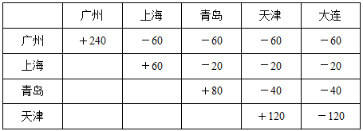

|  | 广州 | 上海 | 青岛 | 天津 | 大连 |
| --- | --- | --- | --- | --- | --- |
| 广州 | +240 | −60 | −60 | −60 | −60 |
| 上海 |  | +60 | −20 | −20 | −20 |
| 青岛 |  |  | +80 | −40 | −40 |
| 天津 |  |  |  | +120 | −120 |

因此在达到大连港口时，船上有120个天津的集装箱。

故正确答案为D。

**考点**：和差倍比问题

**来源**：2014年上海市公务员录用考试《行测》题（B类）第72题

### 第 71 题

甲每工作5天休息周六周日2天，法定节假日如非周六周日也要加班。已知甲某年休息了106天，那么他下一年12月的第一个休息日是：

A. 12月1日

B. 12月2日

C. 12月3日

D. 12月4日

第 71 题 · 答案与解析

**参考答案（粉笔题库参考内容）**

A

**解析**

一年或为365天或为366天，其中包含52个完整周。在这个完整周中共休息104天，而甲在该年休息了106天，多出的两天一定是周六日，说明该年共计366天且最后一天即12月31号为周日，因此下一年的12月31日为周一、则12月份第一个周一为12月3日，故下一年12月的第一个休息日为12月1日星期六。

故正确答案为A。

**考点**：周期余数问题、星期日期问题

**来源**：2014年上海市公务员录用考试《行测》题（B类）第66题

### 第 72 题

地铁10号线全线共有28站，如果地铁从一站到下一站平均要用2分钟，在每个站停靠时间为1分钟，那么地铁10号线从起点出发，到达终点站共用多少分钟：

A. 78

B. 79

C. 80

D. 81

第 72 题 · 答案与解析

**参考答案（粉笔题库参考内容）**

C

**解析**

地铁10号线共28站，中间有27个间隔，因此用时为27×2+26×1=80分钟。

故正确答案为C。

**来源**：2014年上海市公务员录用考试《行测》题（A类）第72题

### 第 73 题

某乒乓球俱乐部决定举办一场所有会员间的循环赛，经俱乐部委员会计算，所需比赛场数刚刚超过2000场，即使省略掉委员会委员们之间的比赛，场数仍有2001场，那么这个乒乓球俱乐部有多少委员：

A. 6

B. 7

C. 8

D. 9

第 73 题 · 答案与解析

**参考答案（粉笔题库参考内容）**

A

**解析**

假设该俱乐部共有会员x人，委员会委员y人，根据题意可得C_x^2 ＞ 2000，Cx^2 - Cy^2 = 2001。可知y越小，x的值越小，越符合比赛场数刚刚超过2000场。从小到大代入验证。将A项代入，若y=6，则可得Cx^2 = 2016，可以解得x=64，为整数解。因此该俱乐部有6个委员。其他选项代入，不符合题意。

故正确答案为A。

**来源**：2014年上海市公务员录用考试《行测》题（A类）第73题

### 第 74 题

为帮助果农解决销路，某企业年底买了一批水果，平均发给每部门若干筐之后还多了12筐，如果再买进8筐则每个部门可分得10筐，则这批水果共有多少筐：

A. 192

B. 198

C. 200

D. 212

第 74 题 · 答案与解析

**参考答案（粉笔题库参考内容）**

A

**解析**

根据再买进8筐则可每个部门分10筐，可知总数加8后能被10整除，由此可排除B、C两项。将A项代入，若总数为192筐，则部门数为(192+8)÷10=20个，可知总数减去12筐后能够实现平分。

故正确答案为A。

**考点**：和差倍比问题

**来源**：2014年上海市公务员录用考试《行测》题（A类）第74题

### 第 75 题

年初，甲、乙两种产品的价格比是3 ：5，年末，由于成本上涨，两种产品的价格都上涨了9元，价格比变成了2 ：3，则年初时乙的价格比甲高出多少元：

A. 9

B. 18

C. 27

D. 36

第 75 题 · 答案与解析

**参考答案（粉笔题库参考内容）**

B

**解析**

假设年初甲、乙两种产品的价格分别为3x元、5x元，则根据题意有(3x+9)/(5x+9)＝2/3，解得x＝9，因此年初甲的价格为27元，乙的价格为45元，乙比甲高出18元。

故正确答案为B。

**考点**：和差倍比问题

**来源**：2014年上海市公务员录用考试《行测》题（A类）第75题

## 材料 3

（一）根据下列资料，回答第76-79题。

        2013年1-7月份，某市规模以上工业增加值同比增长12.0%，增速比去年同期提高1.4个百分点。

        1-7月份，全市国有及国有控股企业完成增加值同比下降3.5%；民营企业完成增加值同比增长24.8%；外商控股企业完成增加值同比下降3.1%。三者增加值占全市规模以上工业增加值总量的比重为20:62:18。轻工业完成增加值同比增长17.4%；重工业完成增加值同比增长10.1%。轻重工业增加值占全市规模工业总量的比重为28:72，与去年同期持平。

        在37个行业中，向上拉动全市工业经济增长较大的行业有：化工行业完成增加值176.2亿元，同比增长81.3%；医药制造业完成增加值21.2亿元，同比增长24.7%；农副食品加工业完成增加值223.5亿元，同比增长19.6%；服装行业完成增加值56.7亿元，同比增长19.4%；专用设备制造业完成增加值118.4亿元，同比增长16.0%；通用设备制造业完成增加值272.9亿元，同比增长15.5%；汽车制造业完成增加值57.4亿元，同比增长9.3%。向下拉动工业经济增长较大的行业有：石油加工业完成增加值168.5亿元，同比下降1.5%；电子信息业完成增加值63.4亿元，同比下降12.2%；铁路船舶制造业完成增加值89.2亿元，同比下降26.9%。

         1-7月份，全市完成销售产值6258.1亿元，同比增长12.7%，其中，完成国内销售产值4995.2亿元，同比增长15.7%；完成出口交货值1262.9亿元。

         1-7月份，全市实现软件销售收入712亿元，同比增长25.8%，出口22亿美元，同比增长19.5%。实现利润50.8亿元，同比增长20.9%，实现税金51.2亿元，同比增长26.8%。

### 第 76 题

该市2013年1-7月份规模以上工业增加值约比2011年同期增长了：

A. 1.4%

B. 13.4%

C. 22.6%

D. 23.9%

第 76 题 · 答案与解析

**参考答案（粉笔题库参考内容）**

D

**解析**

根据题干“2013年1-7月······比2011年同期增长”，结合选项为百分数，可判定本题为间隔增长率问题。定位材料第一段，2013年1-7月份，某市规模以上工业增加值同比增长12%，增速比去年同期提高1.4个百分点，则2012年1-7月份的增速为12%-1.4%=10.6%。则所求间隔增长率 = r1 + r2 + r1 × r2= 12% + 10.6% + 12% × 10.6%≈ 22.6% + 12% × 10%=23.8%，与D项较为接近。

故正确答案为D。

**考点**：文字资料、间隔增长率

**来源**：2014年上海市公务员录用考试《行测》题（B类）第86题

### 第 77 题

下列统计图中，哪项最接近2012年1-7月份该市国有及国有控股企业、民营企业和外商控股企业完成增加值占全市规模以上工业增加值总量的比重构成：

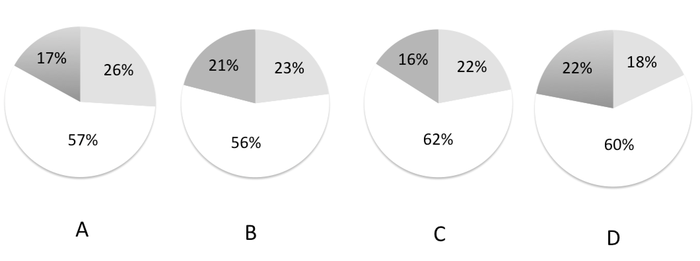

A. A

B. B

C. C

D. D

第 77 题 · 答案与解析

**参考答案（粉笔题库参考内容）**

B

**解析**

根据题干“2012年1-7月∙∙∙···占∙∙···∙的比重”，结合材料数据为2013年1-7月，可判定本题为基期比重问题。定位材料第一段，2013年1-7月份，某市规模以上工业增加值同比增长12%；定位材料第二段，2013年1\-7月份该市国有及国有控股企业、民营企业和外商控股企业的增加值占全市规模以上工业增加值总量的比重为20:62:18。由国有及国有控股企业着手，如果全市规模以上工业增加值为100，则国有及控股企业的工业增加值为20，同比下降3.5%，则其2012年增加值占规模以上的工业增加值的比重= A/B × (1+b)/(1+a)= 20/100×(1+12%)/(1-3.5%)= 20/100 × 1.12/0.965=0.224/0.965，略大于22.4%，只有B项满足。

故正确答案为B。

**考点**：基期比重、文字资料

**来源**：2014年上海市公务员录用考试《行测》题（B类）第89题

### 第 78 题

2013年1-7月份该市完成出口交货值比上年约增长了：

A. \-2.6%

B. 2.2%

C. 9.7%

D. 18.7%

第 78 题 · 答案与解析

**参考答案（粉笔题库参考内容）**

B

**解析**

根据材料可知，全市销售产值=国内销售产值+出口交货值。故已知全市销售产值与国内销售产值数据，求出口交货值同比增速，可判定本题为混合增长率计算问题。定位材料第四段，2013年1-7月份全市销售产值6258.1亿元，同比增长12.7%，国内销售产值4995.2亿元，同比增长15.7%，完成出口交货值1262.9亿元。根据混合增长率结论，居中但不中，偏向基期较大的。故可得出口交货值同比增速一定＜12.7%，且12.7%应更接近于15.7%，因此排除C、D两项。

根据线段法，距离与量成反比可得：4995.2/1262.9 ≈(12.7% − r出口)/(15.7% − 12.7%)，解得r出口 ≈ 12.7% − 12% = 0.7%，与B项接近。

故正确答案为B。

**考点**：文字资料、混合增长率

**来源**：2014年上海市公务员录用考试《行测》题（B类）第88题

### 第 79 题

以下对该市各行业按2012年1-7月份完成增加值从高到低排序正确的是：

A. 专用设备制造业、农副食品加工业、电子信息业

B. 铁路船舶制造业、医药制造业、通用设备制造业

C. 石油加工业、化工行业、汽车制造业

D. 服装行业、汽车制造业、电子信息业

第 79 题 · 答案与解析

**参考答案（粉笔题库参考内容）**

C

**解析**

根据题干“2012年1-7月······从高到低”，结合材料数据为2013年1-7月，可判定本题为基期比较问题。定位材料第三段，根据公式：基期 = 现期量/(1 + 增长率)，各选项2012年的值为：

A项：专用设备制造业所完成增加值为：118.4/1.16 ，农副食品加工业为： 223.5/1.196，电子信息业为：63.4/0.878 。农副产品加工业分子约为专用设备制造业的2倍，分母近似相等，估算可知，农副产品加工业明显大于专用设备制造业，错误；

B项：铁路船舶制造业：89.2/0.731，医药制造业为：21.2/1.247 ＜ 21 ，通用设备制造业为： 272.9/1.155 ＞ 200，通用设备制造业大于医药制造业，错误；

C项：石油加工业为：168.5/0.985＞168 ，化工行业为：176.2/1.813≈176/1.8≈98 ，汽车制造业为： 57.4/1.093＜57.4，正确；

D项：服装行业为：56.7/1.194 ≈ 47.5，汽车制造业为：57.4/1.093＜57.4 ，电子信息业为：63.4/0.878 ＞ 63.4 ，电子信息业大于汽车制造业，错误。

故正确答案为C。

**考点**：基期比较、文字资料

**来源**：2014年上海市公务员录用考试《行测》题（B类）第87题

## 材料 4

下表列出了某年12月份的机票价格情况。当时，济南到青岛的高铁价格为119元，青岛市普通标间的住宿费为180元/日。上海到青岛的飞行距离为540公里，上海到济南的飞行距离为710公里。

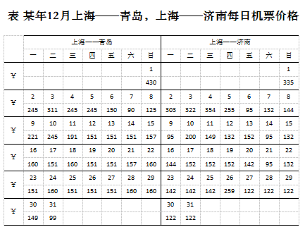

### 第 80 题

12月9日老王要从上海到青岛出差。假设所有出行方式均可当天到达，但如果提前到达则需要住宿，则老王选择\_\_\_\_\_的出行方式总花费最小。

A. 9日乘飞机到济南后转乘当天高铁到青岛

B. 8日乘飞机直飞青岛

C. 8日乘飞机到济南后转乘当天高铁到青岛

D. 9日乘飞机直飞青岛

第 80 题 · 答案与解析

**参考答案（粉笔题库参考内容）**

A

**解析**

定位文字材料和表格，

A项：共计花费应为：95+119=214元；

B项与C项：均需到达后住宿一晚，仅住宿费就为180元，再加上任何一种出行方式都会大于A项方案的花费；

D项：直飞青岛的花费为221元，故总花费最小的为A项方案。

故正确答案为A。

**考点**：简单加减计算、综合资料

**来源**：2014年上海市公务员录用考试《行测》题（A类）第80题

### 第 81 题

就平均而言，12月份上海到济南\_\_\_\_\_的机票价格最低。

A. 周一

B. 周五

C. 周六

D. 周日

第 81 题 · 答案与解析

**参考答案（粉笔题库参考内容）**

C

**解析**

解法一：

根据题干“就平均而言，······的最低”，可判定本题为现期平均数比较问题。定位图表，结合选项，12月份中，

周一机票的平均价格为：(303+95+144+142+122)/5= 806/5 = 161.2元；

周五机票的平均价格为：(95 + 152 + 142 + 122)/4= 511/4 = 127.75元；

周六机票的平均价格为：(132+95+95+122)/4= 444/4 = 111元；

每个周日的机票价格均高于122元，肯定不是最低。由此可知，周六的机票价格最低。

故正确答案为C。

解法二：

仔细观察图表可知，仅周六出现过两次“特价票”，即95元的机票，直接拉低了周六机票的平均价格，直接选择C项周六即可。

故正确答案为C。

**考点**：现期平均数、综合资料

**来源**：2014年上海市公务员录用考试《行测》题（A类）第81题

### 第 82 题

以12月1—7日上海到青岛的机票价格计算，平均每百公里的机票费用约为多少元：

A. 319

B. 262

C. 45.6

D. 37.5

第 82 题 · 答案与解析

**参考答案（粉笔题库参考内容）**

C

**解析**

根据题干“12月1—7日，······平均每······约为多少元”，可判定本题为现期平均数问题。定位文字材料，上海到青岛的飞行距离为540公里；定位图表，12月1—7日上海到青岛的机票价格总和为：430+245+311+245+245+150+90=1716元 ，则平均每天的机票价格约为1716/7≈245元。则每百公里的机票费用约为245/5.4 ≈ 45元，与C项最接近。

故正确答案为C。

**考点**：现期平均数、综合资料

**来源**：2014年上海市公务员录用考试《行测》题（A类）第82题

### 第 83 题

下列说法中，正确的是：

A. 12月份上海到青岛的飞机票比上海到济南的飞机票一定要便宜一些

B. 12月份从上海飞济南再转乘高铁到青岛一定比上海直飞青岛的花费多

C. 12月份从上海到青岛最贵的机票比从上海到济南最贵的机票便宜

D. 12月份上海到青岛每公里的机票费用要比上海到济南每公里的机票费用高一些

第 83 题 · 答案与解析

**参考答案（粉笔题库参考内容）**

D

**解析**

A项：定位图表，观察发现上海到青岛的机票有20天的价格都要比上海到济南的机票贵，并不一定比济南便宜，错误；

B项：定位图表，12月9日，上海直飞青岛的费用为221元，而当天上海先飞济南，再乘坐高铁前往青岛的费用为95+119=214元，221＞214，所以先飞济南再乘坐高铁并不一定高于直飞青岛的费用，错误；

C项：定位图表，12月份从上海到青岛最贵的机票为430元，上海到济南最贵的机票为354元，上海到济南最贵的机票价格低于上海到青岛最贵的机票，错误；

D项：定位文字材料，上海到青岛的飞行路程为540公里，上海到济南的路程为710公里，在机票价格相差不大的情况下，上海到青岛的每公里机票价格固然要高，因此“12月份上海到青岛每公里的机票费用要比上海到济南每公里的机票费用高一些”，正确。

故正确答案为D。

**考点**：综合分析、综合资料

**来源**：2014年上海市公务员录用考试《行测》题（A类）第83题

## 材料 5

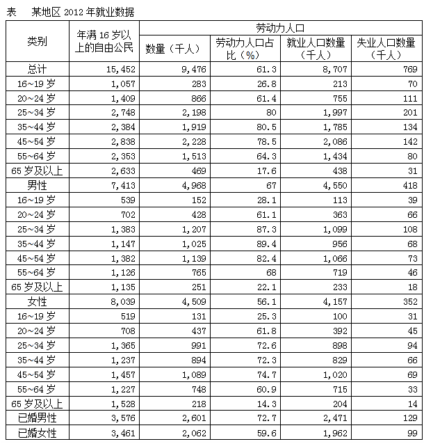

注：

就业人口占比=就业人口/年满16岁以上的自由公民数

劳动力人口占比=劳动力人口/年满16岁以上的自由公民数

失业率=失业人口/劳动力人口

### 第 84 题

男性失业人口在全部劳动力人口中所占比重比女性失业人口：

A. 约少0.6个百分点

B. 约少0.7个百分点

C. 约多0.6个百分点

D. 约多0.7个百分点

第 84 题 · 答案与解析

**参考答案（粉笔题库参考内容）**

D

**解析**

根据题干“······所占比重比······”，结合选项为“约多/少······个百分点”，可判定本题为现期比重问题。定位表格，男性失业人口数量为418千人，女性失业人口数量为352千人，全部劳动力人口为9476千人，则男性失业人口在全部劳动力人口中所占的比重比女性多418/9476 − 352/9476=66/9476≈0.7%，即约多0.7个百分点。

故正确答案为D。

**考点**：现期比重、统计表

**来源**：2014年上海市公务员录用考试《行测》题（B类）第82题

### 第 85 题

在下列年龄段的年满16岁以上的自由公民中，失业率超过10%的是：

A. 16~19岁

B. 25~34岁

C. 45~54岁

D. 65岁及以上

第 85 题 · 答案与解析

**参考答案（粉笔题库参考内容）**

A

**解析**

根据题干“失业率超过10%的是”，结合备注失业率=失业人口/劳动力人口 ，可判定本题为现期比重计算问题。

A项： 16~19岁群体的失业率为70/283≈1/4=25%＞10% ，满足题意，当选；B项：201/2198 ＜ 10%，排除；C项：142/2228 ＜ 10%，排除；D项： 31/469＜10%，排除。

故正确答案为A。

**考点**：现期比重、统计表

**来源**：2014年上海市公务员录用考试《行测》题（B类）第81题

### 第 86 题

关于各年龄段就业人数与失业人数的相关情况，下列说法正确的是：

A. 从失业、就业两方面看，各年龄段男性人数都多于女性人数

B. 失业率最高的为16~19岁的男性，其失业率为24.1%

C. 就业人口最多的年龄段为45~54岁

D. 失业率最低的为45~54岁的女性

第 86 题 · 答案与解析

**参考答案（粉笔题库参考内容）**

C

**解析**

A项：定位表格，就业人口方面，20~24岁男性就业人口数量为363，而20~24岁女性就业人口数量为392，女性人口数量大于男性，错误；

B项：定位表格，结合备注，16~19岁阶段的男性失业率= 39/152 ≈ 25.7%，错误；

C项：定位表格可知，就业人口最多的年龄段为45~54岁，正确；

D项：定位表格，结合备注，45~54岁的女性失业率为69/1089；而55~64岁的女性失业为33/748 = 66/1496，分子近似相等，分母越大，分数越小，则后者小于前者的失业率，错误。

故正确答案为C。

**考点**：统计表、综合分析

**来源**：2014年上海市公务员录用考试《行测》题（B类）第84题

### 第 87 题

根据资料，下列表述中正确的是：

A. 各年龄段的男性和女性相比，劳动力人口占比最大的年龄段是相同的

B. 已婚男性的就业人口占比、失业率、劳动力人口占比普遍高于已婚女性

C. 女性公民的人口、劳动力人口和就业人口都高于男性

D. 男性在各个年龄段的失业率都高于女性

第 87 题 · 答案与解析

**参考答案（粉笔题库参考内容）**

B

**解析**

A项：定位表格第四列，在男性中劳动力人口占比最大的年龄段为35~44岁，而在女性中劳动力人口占比最大的年龄段为45~54岁，错误；

B项：定位表格最后两行，结合备注，已婚男性的失业率为129/2601 ≈ 129/2600 ≈ 0.05，已婚女性的失业率为99/2062≈100/2100≈0.048，已婚女性较小。劳动力人口占比已婚男性为72.7，已婚女性为59.6，已婚女性较小。由备注公式可知，就业人口已婚男性占比为2471/3576 ≈ 2500/3600 ≈ 0.69，已婚女性占比为1962/3461≈2000/3500≈0.57，已婚女性较小，正确；

C项：定位表格，女性公民的劳动力人口数量为4509千人，而男性公民的劳动力人口数量为4968千人，男性劳动力人口数量大于女性，错误；

D项：定位表格，结合备注，男性25~34岁的失业率为108/1207 ＜ 108/1200 = 0.09，女性25~34岁的失业率为94/991＞94/1000=0.094，女性失业率较大，错误。

故正确答案为B。

**考点**：统计表、综合分析

**来源**：2014年上海市公务员录用考试《行测》题（B类）第85题

## 材料 6

据报道，2013年3月英国政府宣布，从10月份起，最低时薪将提高12便士（1英镑等于100便士）到6.31英镑（约合人民币59.5元），此政策受到低收入人群欢迎。美国也准备在现有的基础上将联邦最低工资提高24%，约1500万工人将因此受益。

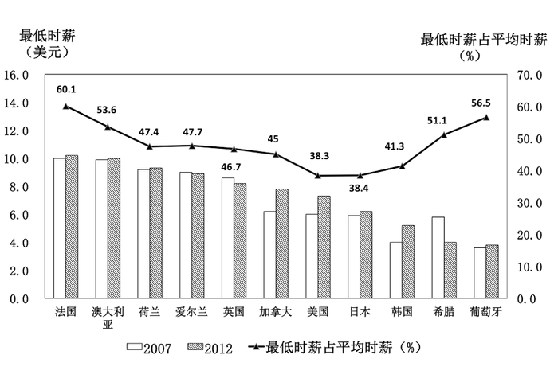

### 第 88 题

在图中所有的国家中，最低时薪占平均时薪超过50%的国家：

A. 以欧洲居多

B. 以亚洲居多

C. 以美洲居多

D. 以大洋居多

第 88 题 · 答案与解析

**参考答案（粉笔题库参考内容）**

A

**解析**

定位折线图，最低时薪占平均时薪超过50%的国家有：法国、澳大利亚、希腊、葡萄牙，其中法国、希腊、葡萄牙都在欧洲，以欧洲居多。

故正确答案为A。

**考点**：直接找数、综合资料

**来源**：2014年上海市公务员录用考试《行测》题（A类）第88题

### 第 89 题

结合图中数据，如果美国在现有基础上将最低时薪提高24%，则最低时薪将接近多少美元：

A. 6

B. 9

C. 11

D. 13

第 89 题 · 答案与解析

**参考答案（粉笔题库参考内容）**

B

**解析**

根据题干“······在现有基础上将最低时薪提高24%，则最低时薪将接近多少美元”，可判定本题为现期计算问题。定位柱状图，2012年美国最低时薪约为7美元／小时，提高后，其最低时薪约为7 × (1+24%) =7 + 7 × 24% =7+1.68=8.68，与B项最为接近。

故正确答案为B。

**考点**：现期计算、综合资料

**来源**：2014年上海市公务员录用考试《行测》题（A类）第89题

### 第 90 题

根据资料，下列说法正确的是：

A. 2012年最低时薪低于5美元的有4个国家

B. 2012年与2007年相比，图中国家的最低时薪均有所增加

C. 2013年3月英镑对人民币汇率约为9.55

D. 2013年10月份起，英国政府将最低时薪提高了约1.9%

第 90 题 · 答案与解析

**参考答案（粉笔题库参考内容）**

D

**解析**

A项：定位柱形图，2012年最低时薪低于5美元的有韩国、希腊、葡萄牙3个国家，错误；

B项：定位柱状图，2012年爱尔兰、英国、希腊的最低时薪相比2007年是下降了，错误；

C项：定位文字材料，2013年3月时，6.31英镑约合人民币为59.5元，故英镑对人民币的汇率约为：59.5/6.31 ≈ 59.5/6.3 ≈ 9.4，错误；

D项：定位文字材料，2013年10月起英国政府将最低时薪提高了12便士到6.31英镑，则增长率=增长量/(现期量−增长量)= 12便士/(6.31英镑-12便士)=0.12英镑/(6.31英镑−0.12英镑)= 0.12/6.19 ≈ 0.12/6.2≈ 0.019 = 1.9%，正确。

故正确答案为D。

**考点**：综合分析、综合资料

**来源**：2014年上海市公务员录用考试《行测》题（A类）第90题

### 第 91 题

既要确保效率，也要维护公平；既要鼓励竞争，也要保障底线；既要尊重差异，也要凝聚共识。面对“众口难调”的困扰，政府包办一切，简单命令式，完全行政化的管理是无所适从的。十八届三中全会提出，全面深化改革的总目标是完善和发展中国特色社会主义制度，推进：

A. 政府行政体系与行政能力制度化

B. 社会管理体系和管理能力多元化

C. 国家法律体系和法治建设现代化

D. 国家治理体系和治理能力现代化

第 91 题 · 答案与解析

**参考答案（粉笔题库参考内容）**

D

**解析**

党的十八届三中全会指出，全面深化改革的总目标是完善和发展中国特色社会主义制度，推进国家治理体系和治理能力现代化。这一总目标，深刻表明了改革的鲜明性质和根本任务。改革开放是决定当代中国命运的关键抉择，这面旗帜绝不能有丝毫动摇；改革开放是一场深刻革命，必须牢牢坚持沿着中国特色社会主义道路的正确方向推进。

故正确答案为D。

**考点**：政治建设

**来源**：2014年上海市公务员录用考试《行测》题（B类）第91题

### 第 92 题

2013年5月27日，中国共产党历史上的第一部党内“立法法”——《中国共产党党内法规制定条例》发布并实施。根据这一条例，涉及党的中央组织、中央纪律检查委员会产生、组成和职权的党内法规，以及涉及党的重大问题的党内法规，须经由\_\_\_\_\_\_\_审议批准。

A. 党的全国代表大会

B. 党的中央委员会全体会议

C. 党的中央政治局会议

D. 党的中央政治局常务委员会会议

第 92 题 · 答案与解析

**参考答案（粉笔题库参考内容）**

A

**解析**

《中国共产党党内法规制定条例》第四章第二十二条规定：党内法规的审议批准，按照下列职权进行：

（一）涉及党的中央组织、中央纪律检查委员会产生、组成和职权的党内法规，以及涉及党的重大问题的党内法规，由党的全国代表大会审议批准；

（二）涉及党的地方组织和基层组织产生、组成和职权的党内法规，涉及党员义务和权利方面基本制度的党内法规，以及涉及党的各方面工作基本制度的党内法规，由党的中央委员会全体会议、中央政治局会议或者中央政治局常务委员会会议审议批准；

（三）应当由中央发布的其他党内法规，根据情况由中央政治局常务委员会会议审议批准，或者按规定程序报送批准；

（四）中央纪律检查委员会、中央各部门发布的党内法规，由中央纪律检查委员会、中央各部门审议批准；

（五）省、自治区、直辖市党委发布的党内法规，由省、自治区、直辖市党委审议批准。

故正确答案为A。

**考点**：其他建设、重要文件

**来源**：2014年上海市公务员录用考试《行测》题（A类）第92题

### 第 93 题

某政府部门公共服务网络平台屡次出现各类故障，引起许多市民抱怨，某律师向该政府部门发函，申请公开该网站建设、设计及招投标过程中的全部信息。

对此，下列表述正确的是：

A. 该律师提交书面申请时应提供本人有效身份证明

B. 该律师可以就公开信息的形式提出要求

C. 该律师应说明申请信息用途

D. 该政府部门公开信息时，可向该律师收取检索成本费用

第 93 题 · 答案与解析

**参考答案（粉笔题库参考内容）**

BD

**解析**

A项错误，《政府公开信息条例》第二十五条规定：公民、法人或者其他组织向行政机关申请提供与其自身相关的税费缴纳、社会保障、医疗卫生、登记等政府信息的，应当出示有效身份证件或者证明文件。题中该律师所申请公开的为网站建设、设计及招投标过程中的全部信息。所以，律师不用提供身份信息；

B项正确，第二十四条规定：行政机关依法申请公开政府信息的，申请人可以选择邮寄、递送、传真、当面领取等方式获取政府信息，并可以选择纸质、光盘、磁盘等政府信息载体形式；

C项错误，《上海市政府信息公开规定》中第二十一条规定：公民、法人或者其他组织依照《政府信息公开条例》第十三条规定向行政机关申请公开政府信息的，应当提交载明下列内容的申请书：（一）申请人的姓名或者名称、联系方式；（二）明确的政府信息内容，包括能够据以指向特定政府信息的文件名称、文号或者其他特征描述；（三）获取政府信息的方式及其载体形式。公民、法人或者其他组织向行政机关申请公开政府信息的，行政机关可以询问申请人获取政府信息的用途。所以律师不用说明信息用途；

D项正确，行政机关依照申请向公民、法人或者其他组织提供政府信息的，可以收取实际发生的检索、复制、邮寄等成本费用，但不得收取其他费用。

故正确答案为B、D。

**考点**：行政法

**来源**：2014年上海市公务员录用考试《行测》题（B类）第97题

### 第 94 题

我国实行公务员交流制度，公务员可以在公务员队伍内部交流，也可以与国有企业事业单位、人民团体和群众团体中从事公务的人员交流。

下列有关公务员交流的表达正确的是：

A. 对担任机关内设机构领导职务和工作性质特殊的非领导职务的公务员，应当有计划地在本机关内转任

B. 交流的方式包括调任、转任、轮换和挂职锻炼

C. 公务员在挂职锻炼期间，应当变更与原机关的人事关系

D. 国有企业事业单位、人民团体和群众团体中从事公务的人员可以调入机关担任主任科员和副主任科员等非领导职务

第 94 题 · 答案与解析

**参考答案（粉笔题库参考内容）**

A

**解析**

本题考查法律常识。

A项正确，《公务员法》第七十一条规定：“公务员在不同职位之间转任应当具备拟任职位所要求的资格条件，在规定的编制限额和职数内进行。对省部级正职以下的领导成员应当有计划、有重点地实行跨地区、跨部门转任。对担任机关内设机构领导职务和其他工作性质特殊的公务员，应当有计划地在本机关内转任。上级机关应当注重从基层机关公开遴选公务员。”对担任机关内设机构领导职务和工作性质特殊的非领导职务的公务员，应当有计划地在本机关内转任；

B选项错误，根据2018年修改的《公务员法》第六十九条规定：“国家实行公务员交流制度。公务员可以在公务员和参照本法管理的工作人员队伍内部交流，也可以与国有企业和不参照本法管理的事业单位中从事公务的人员交流。交流的方式包括调任、转任。”挂职锻炼不再被视为交流制度；

C项错误，挂职锻炼不办理调动手续，它只改变锻炼人员的工作关系，不改变其行政隶属关系，锻炼人员在人事行政上仍受原机关管理，只在业务工作上接受单位领导；

D项错误，主任科员与副主任科员为非领导职务，行政级别为科级及副科级，不为副处以上。

故正确答案为A。

**考点**：行政法

**来源**：2014年上海市公务员录用考试《行测》题（A类）第94题

### 第 95 题

2013年8月，工信部发布2013年淘汰落后产能第一批企业名单公告，涉及炼铁、炼钢、焦炭、铅蓄电池等19个行业1400多家企业。在完善的市场经济条件下，落后产能经常和产能过剩联系在一起，二者的关系是：

A. 落后产能是技术判断，产能过剩是市场判断

B. 过剩的产能必定是由落后的产能造成的

C. 过剩的产能一般包括落后的产能

D. 淘汰落后产能，能够化解过剩产能

第 95 题 · 答案与解析

**参考答案（粉笔题库参考内容）**

AC

**解析**

A、C两项正确，落后产能是个技术判断，产能过剩是个市场判断。落后产能与过剩产能也并非是完全割裂、非此即彼的。在完善的市场经济条件下，过剩的产能一般包括落后产能；而落后产能的淘汰、退出能够改变市场的供求关系，减轻产能过剩的程度，当选；

B项错误，过于绝对，排除；

D项错误，不可能会“化解”过剩产能，排除。

故正确答案为A、C。

**考点**：宏观经济与调控政策

**来源**：2014年上海市公务员录用考试《行测》题（A类）第95题

### 第 96 题

2003年以来，北京、上海、浙江、无锡、广东等地方政府向社会组织购买公共服务的探索不断增多，国务院会议提出，要围绕着\_\_\_\_\_\_\_\_\_\_\_等重要目标进一步推进政府向社会力量购买公共服务。

A. 增加公共产品的供应，让人民群众更多地分享经济发展的成果

B. 加强社会建设，建立健全社会组织教育发展机制

C. 发展产业，主要是现代服务业

D. 政府自身的变革

第 96 题 · 答案与解析

**参考答案（粉笔题库参考内容）**

ACD

**解析**

推进政府向社会力量购买服务，围绕着三个重要目标。第一是增加公共产品的供应，让人民群众更多地分享经济发展的成果。为此，会议明确，“创新方式，提供更好的公共服务，是惠及人民群众、深化社会领域改革的重大措施”。经济和社会是中国发展的两个主要“轮子”，既相互支撑，又彼此制约。经济发展服务于人的需求满足，强大的内需又是经济发展的持续动力；反过来，经济发展需要不断投入，增加满足需求的公共服务供应，又必定分流可以用于投资的资金。第二是发展产业，主要是现代服务业。会议指出，推进政府购买社会力量的公共服务，“又是加快服务业发展、扩大服务业开放、引导有效需求的关键之举”。第三是政府自身的变革。会议强调，推进政府购买公共服务“也是推动政府职能转变，推进政事、政社分开，建设服务型政府的必然要求”。

故正确答案为A、C、D。

**考点**：经济建设、重要会议讲话

**来源**：2014年上海市公务员录用考试《行测》题（B类）第98题

### 第 97 题

随着互联网技术的广泛应用和迅猛发展，泄露和贩卖公民个人信息，网上诈骗，网络谣言等行为也“应运而生”。2012年底，全国人大常委会公布施行《关于加强网络信息保护的决定》。加强网络信息保护的立法，除了以法律的形式保护公民及法人信息安全，还旨在：

A. 控制网络平台的信息传播

B. 确立网络身份管理制度

C. 明确网络服务提供者的义务和责任

D. 赋予政府主管部门必要的监管手段

第 97 题 · 答案与解析

**参考答案（粉笔题库参考内容）**

BCD

**解析**

十一届全国人大常委会第三十次会议上在表决通过各项议案后，常委会认真总结网络发展和管理的实践经验，分析国外网络立法情况，广泛听取各方面意见，作出关于加强网络信息保护的决定，以法律形式保护公民个人及法人信息安全，确立网络身份管理制度，明确网络服务提供者的义务和责任，并赋予政府主管部门必要的监管手段，重点解决我国网络信息安全立法滞后的问题，有利于保护公民个人及法人电子信息安全、促进社会和谐稳定，有利于维护国家安全和政治稳定、确保国家长治久安。有关方面要做好宣传普及工作，抓紧制定和修改相关配套法规，确保《关于加强网络信息保护的决定》全面正确有效实施。

故正确答案为B、C、D。

**考点**：其他法律法规

**来源**：2014年上海市公务员录用考试《行测》题（B类）第92题

### 第 98 题

上海“十二五”规划要求“以需求为导向，积极运用先进传感、网络传输和信息处理技术，实施若干项重大信息化行动，推进城市管理和公共服务信息化，提升城市运行效率和管理服务水平。在推进城市智能化管理方面，要实施\_\_\_\_\_\_等行动。”

A. 数字城管

B. 数字惠民

C. 官方微博

D. 电子政务

第 98 题 · 答案与解析

**参考答案（粉笔题库参考内容）**

ABD

**解析**

以需求为导向，积极运用先进传感、网络传输和信息处理技术，实施若干项重大信息化行动，推进城市管理和公共服务信息化，提升城市运行效率和管理服务水平。实施数字城管行动。加强城市空间地理信息系统建设，完善规划土地与房屋管理、环境监测与市容监管、应急联动与处置管理等信息平台，促进城市专业领域管理精细化和服务便捷化。实施数字惠民行动。推动卫生、教育、旅游、气象、社区等公众关注度高、生活关联度大的公共服务领域信息化，提升社会领域信息化水平。实施电子政务行动。加快推进以信息共享、业务协同、应用集成为重点的电子政务建设，让全社会共享电子政务成效。

故正确答案为A、B、D。

**来源**：2014年上海市公务员录用考试《行测》题（A类）第98题

### 第 99 题

奥巴马签发行政命令，以国家安全为由禁止中国S集团关联公司在美建风力发电厂。S集团因此起诉奥巴马，并获美国当地法院受理。这一事件被认为是中国企业从产品、投资“走出去”发展到法律规则、市场观念“走出去”的标志。

这里的“市场观念”是指：

A. 完善规范市场的法律

B. 认识市场经济的作用

C. 遵守市场要求的道德

D. 把握市场特征和原则

第 99 题 · 答案与解析

**参考答案（粉笔题库参考内容）**

BD

**解析**

A项错误，完善规范市场的法律的主体是国家，并不是中国企业，排除；

B、D两项正确，只有真正认识市场经济的作用，把握市场的特征和原则，才能真正做到市场观念“走出去”，当选；

C项错误，遵守市场要求的道德是作为一个企业的要求，并不是市场观念的标志，排除。

故正确答案为B、D。

**考点**：市场经济

**来源**：2014年上海市公务员录用考试《行测》题（B类）第96题

### 第 100 题

根据国家有关规定，下列关于定密的事项，做法正确的是：

A. 机关、单位执行上级确定的国家秘密事项，需要定密的，根据所执行的国家秘密事项的密级确定

B. 下级机关、单位认为本机关、本单位产生的有关定密事项属于上级机关、单位的定密权限，应当先行采取保密措施，并立即报请上级机关、单位确定

C. 机关、单位确定，变更和解除本机关、本单位的国家秘密，应当由定密责任人提出具体意见，交由上级机关、单位审核批准

D. 没有上级机关、单位认为需要定密的，应当立即提请有相应定密权限的业务主管部门或者保密行政管理部门确定

第 100 题 · 答案与解析

**参考答案（粉笔题库参考内容）**

ABD

**解析**

A、B、D三项正确，根据《中华人民共和国保守国家秘密法》第十三条：机关、单位执行上级确定的国家秘密事项，需要定密的，根据所执行的国家秘密事项的密级确定。下级机关、单位认为本机关、本单位产生的有关定密事项属于上级机关、单位的定密权限，应当先行采取保密措施，并立即报请上级机关、单位确定；没有上级机关、单位的，应当立即提请有相应定密权限的业务主管部门或者保密行政管理部门确定；

C项错误，根据《中华人民共和国保守国家秘密法》第十二条：机关、单位负责人及其指定的人员为定密责任人，负责本机关、本单位的国家秘密确定、变更和解除工作。机关、单位确定、变更和解除本机关、本单位的国家秘密，应当由承办人提出具体意见，经定密责任人审核批准。

故正确答案为A、B、D。

**考点**：其他法律法规

**来源**：2014年上海市公务员录用考试《行测》题（B类）第103题

### 第 101 题

行政强制措施是指行政管理过程中，为\_\_\_\_\_\_等情形，依法对公民的人身自由实施暂时性限制，或者对公民、法人或者其他组织的财物实施暂时性控制的行为。

A. 制止违法行为

B. 控制危害扩大

C. 防止证据损毁

D. 避免危害发生

第 101 题 · 答案与解析

**参考答案（粉笔题库参考内容）**

ABCD

**解析**

行政强制措施，是指行政机关在行政管理过程中，为制止违法行为、防止证据损毁、避免危害发生、控制危险扩大等情形，依法对公民的人身自由实施暂时性限制，或者对公民、法人或者其他组织的财物实施暂时性控制的行为。

故正确答案为A、B、C、D。

**来源**：2014年上海市公务员录用考试《行测》题（A类）第101题

### 第 102 题

2013年初，国务院印发的《全国海洋经济发展“十二五”规划》提出，我国将进一步提升海洋经济总体实力，海洋生产总值年均增长8%，2015年占国内生产总值的比重达到10%。根据该规划，我国应充分发挥\_\_\_\_\_\_\_\_\_\_\_的引领作用，推进形成我国的海洋经济圈。

A. 环渤海经济区

B. 长江三角洲经济区

C. 海峡西岸经济区

D. 珠江三角洲经济区

第 102 题 · 答案与解析

**参考答案（粉笔题库参考内容）**

ABD

**解析**

2013年初，国务院印发的《全国海洋经济发展“十二五”规划》提出，“十二五”时期我国海洋科技创新能力进一步加强，2015年海洋科技成果转化率达到50％以上，海洋科技对海洋经济的贡献率达到60％以上。海洋可持续发展能力进一步增强。规划还提出，“十二五”时期我国海洋产业结构进一步优化，海洋新兴产业实现突破性进展，2015年增加值较“十一五”期末翻一番，规划同时要求，“十二五”时期我国海洋经济调控体系进一步完善，对外开放水平明显提高。规划提出充分发挥环渤海、长江三角洲和珠江三角洲三个经济区的引领作用，推进形成我国北部、东部和南部三个海洋经济圈，结合落实国家关于沿海区域发展的部署，着力培育一批重要的海洋经济增长极。

故正确答案为A、B、D。

**考点**：经济建设、重要文件

**来源**：2014年上海市公务员录用考试《行测》题（B类）第100题

### 第 103 题

垃圾食品，通常是指所含能量高，但缺少人体需要的营养素，尤其缺少钙、钾等矿物质以及维生素和蛋白质等，有些甚至还会对人体的某些器官组织带来直接影响的食品。

世界卫生组织已经公布的全球十大垃圾食品，其中包括：

A. 非低温烘烤的饼干、面包

B. 快速脱水食品

C. 冰淇淋

D. 烧烤类食品

第 103 题 · 答案与解析

**参考答案（粉笔题库参考内容）**

ABCD

**解析**

世界卫生组织(WHO)公布的全球十大垃圾食物：

一、油炸类食品

二、腌制类食品

三、加工类肉食品

四、饼干类食品（不含低温烘烤和全麦饼干）

五、汽水可乐类食品

六、方便类食品（主要指方便面和膨化食品）

七、罐头类食品（包括鱼肉类和水果类）

八、话梅蜜饯类食品（果脯）

九、冷冻甜品类食品（冰淇淋、冰棒和各种雪糕）

十、烧烤类食品。

故正确答案为A、B、C、D。

**考点**：生活常识

**来源**：2014年上海市公务员录用考试《行测》题（A类）第103题

### 第 104 题

红外热成像技术运用光电技术检测物体热辐射的红外线特定波段信号，将该信号转换成可供人类视觉分辨的图像和图形，并可以进一步计算出温度值。红外热成像技术使人类超越了视觉障碍，由此人们可以“看到”物体表面的温度分布状况。根据以上关于红外热成像技术的描述，下列说法正确的是\_\_\_\_\_\_：

A. 红外线属于可见光

B. 红外热成像仪是靠温差成像的

C. 红外热成像技术最大的优点在于图像对比度高，分辨细节能力极高

D. 利用红外热成像技术可检查人体温度分布的异常情况，为某些疾病提供诊断的依据

第 104 题 · 答案与解析

**参考答案（粉笔题库参考内容）**

BD

**解析**

红外线是波长介乎微波与可见光之间的电磁波，其波长在760纳米（nm）至1毫米（mm）之间，是波长比红光长的非可见光。所有高于绝对零度（-273.15℃）的物质都可以产生红外线。现代物理学称之为热射线。医用红外线可分为两类：近红外线与远红外线。太阳的热量主要通过红外线传到地球。红外热成像运用光电技术检测物体热辐射的红外线特定波段信号，将该信号转换成可供人类视觉分辨的图像和图形，并可以进一步计算出温度值。红外热成像技术使人类超越了视觉障碍，由此人们可以看到物体表面的温度分布状况。

故正确答案为B、D。

**考点**：科技理论与成就

**来源**：2014年上海市公务员录用考试《行测》题（A类）第104题

### 第 105 题

由于自然地理条件不同，全球各个地方的气候类型是不一样的，有的地方冬暖夏凉四季如春、有的地方却冬寒夏热、四季分明，有的地方缺水干旱，有的地方潮湿多雨。

我国的北京和上海分别属于：

A. 温带季风气候和温带海洋性气候

B. 温带季风气候和亚热带季风气候

C. 温带大陆性气候和亚热带海洋性气候

D. 温带海洋性气候和亚热带季风气候

第 105 题 · 答案与解析

**参考答案（粉笔题库参考内容）**

B

**解析**

本题考查地理国情。

北京的气候为典型的暖温带半湿润大陆性季风气候，夏季高温多雨，冬季寒冷干燥，春、秋两季短促。1月温度为-7℃~\-4℃，7月温度为25℃~26℃。极端最低温度为-27.4℃，极端最高温度为42℃以上。上海属亚热带海洋性季风气候。主要气候特征是：春天温暖，夏天炎热，秋天凉爽，冬天阴冷，全年雨量适中，季节分配比较均匀。总的说来就是温和湿润，四季分明。

故正确答案为B。

**考点**：中国地理、自然地理

**来源**：2014年上海市公务员录用考试《行测》题（A类）第105题

### 第 106 题

人体内免疫系统能发现和清除外来入侵的病原微生物，还能识别和清除体内发生突变的肿瘤细胞、衰老细胞、死亡细胞或其他有害的成分，并且通过自身免疫耐受和免疫调节使免疫系统内环境保持稳定。

下列属于免疫系统疾病的是：

A. 冠心病

B. 艾滋病

C. 尿毒症

D. 红斑狼疮

第 106 题 · 答案与解析

**参考答案（粉笔题库参考内容）**

BD

**解析**

一般地说，免疫系统疾病的症状主要表现在易患感冒及其他感染性疾病，易疲劳或易过敏。根据病因及特性不同，大致常见的有：艾滋病、过敏性疾病、风湿性关节炎、过敏性哮喘、慢性疲劳、II型糖尿病、枯草热、红斑狼疮及多发性硬化症。其中最严重的是艾滋病、红斑狼疮，比较轻的是过敏性疾病。

故正确答案为B、D。

**考点**：生物常识

**来源**：2014年上海市公务员录用考试《行测》题（B类）第105题

### 第 107 题

风电是一种可再生能源发电方式，2010年，我国建设了100MW东海大桥海上风电场，这是亚洲第一座海上风电场，与陆上风电场相比，海上风电场具有\_\_\_\_\_\_\_\_\_等优势，因此已成为风能利用的主要发展趋势。

A. 不占用土地资源

B. 风机单机容量大

C. 风速大

D. 效率高

第 107 题 · 答案与解析

**参考答案（粉笔题库参考内容）**

ABCD

**解析**

海上风电场多指水深10米左右的近海风电。相较陆上风电而言，海上风电具有三大优势：一是海上的风速较大，也更为稳定，年利用小时长，使机组发电量稳定、单机由于容量大而能量产出较大、效率高、使用寿命更长。二是海上风电场多建造在东南部沿海地区的潮间带、沿岸滩涂及近海海域，不占用土地资源，这里成本低，空间广阔，有着允许风机机组更为大型化等优势。三是减少电力运输成本，海上风电场接近人口稠密、对用电需求量巨大的大中型城市。发展海上风电场将有效实现这部分电力的短距离消费，并在一定程度上减轻我国在陆上风电行业中一向存在的西部地区产能过剩，而剩余电力难以顺利向东部地区传输的问题。

故正确答案为A、B、C、D。

**考点**：科技理论与成就

**来源**：2014年上海市公务员录用考试《行测》题（B类）第107题

### 第 108 题

我国的军事著作历史悠久，北宋颁布的《武经七书》，作为军事教育官方课程，流传至今。

下列不属于《武经七书》的是：

A. 《孙子兵法》

B. 《孙膑兵法》

C. 《六韬》

D. 《三略》

第 108 题 · 答案与解析

**参考答案（粉笔题库参考内容）**

B

**解析**

《武经七书》是北宋朝廷作为官书颁行的兵法丛书，是中国古代第一部军事教科书。它由《孙子兵法》《吴子兵法》《六韬》《司马法》《三略》《尉缭子》《李卫公问对》七部著名兵书汇编而成。宋朝以来一直作为武学必读的《武经七书》，集中了古代汉族军事著作的精华。注重军事史学也是汉族文化史的一个突出的特点。

本题为选非题，故正确答案为B。

**考点**：文学常识

**来源**：2014年上海市公务员录用考试《行测》题（B类）第120题

### 第 109 题

在地震、矿难等灾害现场，生命体征探测仪能为及时发现幸存者提供很大的帮助，它是通过捕捉被探测者的人体信号来进行搜寻的仪器。

目前，生命体征探测仪能探测到的人体信号主要有：

A. 呼吸频率信号

B. 心脏电场的超低频信号

C. 人体红外热信号

D. 大脑皮层电信号

第 109 题 · 答案与解析

**参考答案（粉笔题库参考内容）**

ABCD

**解析**

生命探测仪，即一种探测生命迹象的仪器，常用于救援中，目前常见的有光学探生仪、音频生命探测仪、红外生命探测仪和雷达生命探测仪等。

声波／振动探生仪是一个由高灵敏度传感器、高精度专用数据采集系统及多功能专用数据采集系统和多功能专用计算机处理系统组成的探测系统，能探测和分析幸存者的移动、敲击和呼叫通过介质发出的微小振动呼救信号，确定被困人员的位置。

红外生命探测仪：人体存在红外辐射，但人体的红外辐射特性与周围环境的红外辐射特性不同，热成像生命探测仪利用了他们之间的差别，以成像的方式把要搜索的目标与背景分开。这种光谱段是设计热成像生命探测仪的一个重要技术依据。

雷达生命探测仪：雷达式生命探测仪是通过雷达发射高频电磁波，对接收到的脑电波回波信号经过放大、滤波及特殊的数字信号处理而得到相关人体生命状况的信息。由于呼吸频率低，一般1~2次/s，因此可把呼吸运动和其他较高频率运动区分开来。

故正确答案为A、B、C、D。

**考点**：科技理论与成就

**来源**：2014年上海市公务员录用考试《行测》题（B类）第108题

### 第 110 题

3D打印是一种以数字模型文件为基础，运用粉末状金属或塑料等可粘合材料，通过逐层打印的方式来构造物体的技术。

下列关于3D打印说法不正确的是：

A. 激光快速成型技术属于3D打印技术、采用分层加工，叠加成型来完成打印

B. 3D打印技术可大幅降低生产，提高原材料和能源的使用效率

C. 目前3D打印还停留在塑料制品阶段，不能用于打印金属制品和实物

D. 今后3D打印技术的成熟发展将改变现有的制造业模式

第 110 题 · 答案与解析

**参考答案（粉笔题库参考内容）**

AC

**解析**

3D打印，即快速成型技术的一种，它是一种以数字模型文件为基础，运用粉末状金属或塑料等可粘合材料，通过逐层打印的方式来构造物体的技术。激光快速成型技术是上个世纪80年代发展起来的一门高新技术，它是利用激光技术、CAX技术、自动控制技术、新材料技术，直接造型，快速制造产品模型的一门多学科综合技术。激光快速成型技术并不是3D打印。因此A项错误。虽然3D打印技术还不是十分地成熟，但目前可以打印金属、ABS、PLA、石膏等材质。C项错误。

本题为非选题，故正确答案为A、C。

**考点**：科技理论与成就

**来源**：2014年上海市公务员录用考试《行测》题（B类）第117题

### 第 111 题

在城市的十字路口，由于视野盲区和内轮差（车辆拐弯时的前内轮的转弯半径与后内轮的转弯半径之差）的存在，使得大量车辆在转弯时，车身后部极易撞上距离车辆较近的行人或非机动车，以致发生惨剧。

下列关于内轮差的表述不正确的是：

A. 方向盘打得越多，内轮差越大

B. 车辆的轴距越大，内轮差越大

C. 转弯越急，内轮差越大

D. 车速越快，内轮差越大

第 111 题 · 答案与解析

**参考答案（粉笔题库参考内容）**

D

**解析**

内轮差是车辆转弯时内前轮转弯半径与内后轮转弯半径之差，对汽车来说，则是牵引车的内前轮与挂车的内后轮转弯半径之差。由于内轮差的存在，车辆转弯时，前、后车轮的运动轨迹不重合。在行车中如果只注意前轮能够通过而忘记内轮差，就可能造成后内轮驶出路面或与其他物体碰撞的事故。内轮差的大小同各车的转向角大小和轴距长短有关，转向角越大，内轮差越大，反之则小，轴距越长，内轮差亦越大，反之则小。

本题为选非题，故正确答案为D。

**考点**：生活常识

**来源**：2014年上海市公务员录用考试《行测》题（A类）第111题

### 第 112 题

射频识别技术是一种通信技术，可通过无线电讯号识别特别目标并读写相关数据，它最重要的优点是非接触识别。

下列属于应用射频识别技术的产品是：

A. 公交一卡通

B. 二代身份证

C. 感应式门禁卡

D. 电话磁卡

第 112 题 · 答案与解析

**参考答案（粉笔题库参考内容）**

ABCD

**解析**

射频技术（RF）是Radio Frequency的缩写。较常见的应用有无线射频识别（Radio Frequency Identification，RFID），常称为感应式电子晶片或近接卡、感应卡、非接触卡、电子标签、电子条码等。其原理为由扫描器发射一特定频率之无线电波能量给接收器，用以驱动接收器电路将内部的代码送出，此时扫描器便接收此代码。接收器的特殊在于免用电池、免接触、免刷卡，故不怕脏污，且晶片密码为世界唯一无法复制，安全性高、长寿命。RFID的应用非常广泛，目前典型应用有动物晶片、汽车晶片防盗器、门禁管制、停车场管制、生产线自动化、物料管理等。

故正确答案为ABCD。

**考点**：生活常识

**来源**：2014年上海市公务员录用考试《行测》题（A类）第112题

### 第 113 题

新石器时代始于距今8000年前的人类原始氏族的繁荣时期，以磨制的石斧、石铸、石锛和石铲，琢制的磨盒和打制的石锤、石片、石器为主要工具。

下列中国著名的文化遗址中，属于新石器时代的是：

A. 河姆渡遗址

B. 半坡遗址

C. 三星堆遗址

D. 周口店遗址

第 113 题 · 答案与解析

**参考答案（粉笔题库参考内容）**

AB

**解析**

河姆渡遗址是中国南方早期新石器时代遗址，全国重点文物保护单位，位于距宁波市区约20公里的余姚市河姆渡镇，面积约4万平方米，1973年开始发掘，是中国已发现的最早的新石器时期文化遗址之一。半坡遗址位于陕西省西安市东郊灞桥区浐河东岸，是黄河流域一处典型的原始社会母系氏族公社村落遗址，属新石器时代仰韶文化，距今6000年左右。三星堆古遗址位于四川省广汉市西北的鸭子河南岸，分布面积12平方公里，距今已有3000至5000年历史，是迄今在西南地区发现的范围最大、延续时间最长、文化内涵最丰富的古城、古国、古蜀文化遗址。周口店遗址属全国重点文物保护单位，位于北京市西南房山区周口店镇龙骨山北部，是世界上材料最丰富、最系统、最有价值的旧石器时代早期的人类遗址。

故正确答案为A、B。

**考点**：中国历史

**来源**：2014年上海市公务员录用考试《行测》题（B类）第119题

### 第 114 题

1972年，联合国教科文组织在巴黎通过了《保护世界文化和自然遗产公约》，成立联合国教科文组织世界遗产委员会，其宗旨在于促进各国和各国人民之间的合作，为合理保护和恢复全人类共同的遗产做出积极的贡献。

下列亚洲的世界文化和自然遗产与所在国家对应错误的是：

A. 柬埔寨：吴哥窟

B. 中国：三清山

C. 泰国：泰姬陵

D. 尼泊尔：佛祖诞生地兰毗尼

第 114 题 · 答案与解析

**参考答案（粉笔题库参考内容）**

C

**解析**

吴哥窟又称吴哥寺，位于柬埔寨西北方。三清山位于中国江西省上饶市玉山县与上饶德兴市交界处，为怀玉山脉主峰。泰姬陵（波斯语，乌尔都语：تاج محل），全称为“泰姬·玛哈尔陵”，又译泰姬玛哈，是印度知名度最高的古迹之一。佛祖诞生地兰毗尼,位于尼泊尔兰毗尼专区的鲁番德希县。

本题为选非题，故正确答案为C。

**考点**：自然地理

**来源**：2014年上海市公务员录用考试《行测》题（A类）第114题

### 第 115 题

被废弃不再使用的电器和电子产品，比如废旧电脑、废旧手机，俗称“电子垃圾”。下列关于“电子垃圾”，说法正确的是：

A. 电子垃圾可以进行化学处理

B. 电子垃圾可以进行焚烧处理

C. 电子垃圾不能填埋处理，这样会污染环境

D. 电子垃圾应该进行综合处理，对有用的部分回收再利用

第 115 题 · 答案与解析

**参考答案（粉笔题库参考内容）**

ABCD

**解析**

电子垃圾，是指被废弃不再使用的电器或电子设备，主要包括电冰箱、空调、洗衣机、电视机等家用电器和计算机等通讯电子产品的淘汰品。电子垃圾需要谨慎处理，在一些发展中国家，随意丢弃电子垃圾的现象十分严重，造成的环境污染威胁着当地居民的身体健康。广东的贵屿镇是我国民间电子垃圾回收分解最为集中的地区，当地人由此获得丰厚收益的同时也面临着极为严重的污染威胁。常见的处理方式有：化学处理、火法处理、微生物处理、机械处理。虽然前两种方法对环境有所污染，但包括我国在内的部分国家和地区都在使用。电子垃圾填埋处理会严重影响土壤成分、造成地下水污染。

故正确答案为A、B、C、D。

**考点**：生活常识

**来源**：2014年上海市公务员录用考试《行测》题（B类）第113题

### 第 116 题

黑匣子是飞机专用的电子记录设备之一，具有极强的抗火、耐压、耐冲击、耐浸泡、抗磁干扰等能力，即便飞机已完全损坏，黑匣子里的记录数据也能完好保存。

下列选项中，属于黑匣子的是：

A. 机舱视频监控器

B. 飞行数据记录仪

C. 机舱话音记录器

D. 机舱红外传感器

第 116 题 · 答案与解析

**参考答案（粉笔题库参考内容）**

BC

**解析**

“黑匣子”是飞机专用的电子记录设备之一，名为航空飞行记录器。里面装有飞行数据记录仪和机舱话音录音器。它能把飞机停止工作或失事坠毁前半小时的有关技术参数和驾驶舱内的声音记录下来，需要时把所记录的参数重新放出来，供飞行实验、事故分析之用。黑匣子具有极强的抗火、耐压、耐冲击振动、耐海水（或煤油）浸泡、抗磁干扰等能力，即便飞机已完全损坏，黑匣子里的记录数据也能完好保存。世界上大部分的空难原因都是通过黑匣子找出来的。

故正确答案为B、C。

**考点**：科技理论与成就

**来源**：2014年上海市公务员录用考试《行测》题（B类）第111题

### 第 117 题

页岩气是指赋存于页岩中的非常规天然气，往往分布在沉积盆地的烃源岩地层中，随着常规油气资源的日益紧缺，页岩气资源日益受到各国的重视，但是由于目前的页岩气开采技术会导致\_\_\_\_\_\_\_\_\_，因此如何最大限度减少环境影响，是友好开采页岩气面临的主要难题。

A. 水资源大量消耗

B. 空气污染严重，雾霾天气增加

C. 地下水污染

D. 植被受到严重破坏、生物多样性减少

第 117 题 · 答案与解析

**参考答案（粉笔题库参考内容）**

C

**解析**

本题考查科技常识。

页岩气，是从页岩层中开采出来的一种非常重要的非常规天然气资源。页岩气的形成和富集有着自身独特的特点，往往分布在盆地内厚度较大、分布广的页岩烃源岩地层中。较常规天然气相比，页岩气开发具有开采寿命长和生产周期长的优点，大部分产气页岩分布范围广、厚度大，且普遍含气，这使得页岩气井能够长期地以稳定的速率产气。页岩气开采可能导致气井周围半径一公里范围内的饮用水被甲烷、乙烷和丙烷污染。

故正确答案为C。

**考点**：物理常识、自然地理

**来源**：2014年上海市公务员录用考试《行测》题（B类）第116题

### 第 118 题

随着城市里养宠物的人越来越多，被宠物猫、狗等动物咬伤、抓伤的情况也越来越多，如果不慎被猫狗抓咬伤，正确的处理措施是：

A. 马上用肥皂水清洗冲洗伤口15分钟以上

B. 清洗后用碘酒或医用酒精治疗伤口

C. 及时全程足量地注射狂犬症疫苗

D. 在36小时之内注射一次狂犬症疫苗

第 118 题 · 答案与解析

**参考答案（粉笔题库参考内容）**

ABC

**解析**

如果被狗或猫咬、抓伤应马上采取三步紧急应对措施：

第一步：冲洗伤口。要马上用流动的水冲洗伤口，尽可能把病毒冲走，把血挤出去。如果有条件，最好用20％的肥皂水进行冲洗，连续冲上20~30分钟。接着用碘酒消毒伤口，再用酒精洗掉碘酒，如此反复3次。

第二步：马上到当地防疫部门注射狂犬疫苗，越快越好。

第三步：如果伤口被咬得严重，一定要注射抗病毒血清，与疫苗同时使用。

故正确答案为A、B、C。

**考点**：生活常识

**来源**：2014年上海市公务员录用考试《行测》题（B类）第104题

### 第 119 题

2013年，随着《中国汉字听写大会》《汉字英雄》等节目的热播，社会上出现了“汉字热”，汉字这一优美的文字，经历了甲骨文到金文，再到大篆、六国古文，进而到小篆、再到隶书，进而到楷书、草书、行书的演变过程。

其中，哪项是古文字和现代文字的分水岭：

A. 金文演变为大篆

B. 六国古文演变为小篆

C. 小篆演变为隶书

D. 隶书演变为楷书

第 119 题 · 答案与解析

**参考答案（粉笔题库参考内容）**

C

**解析**

汉字的古今划分：汉字由篆书到隶书的演变，称“隶变”。隶变是汉字古文字与今文字的分水岭。隶变前的汉字是“古文字”，隶变后的汉字是“今文字”。

故正确答案为C。

**考点**：文学常识

**来源**：2014年上海市公务员录用考试《行测》题（B类）第110题

### 第 120 题

地震带是地震集中分布的地带。在地震带内地震密集，在地震带外，地震分布零散。

世界上的地震主要集中分布在：

A. 环太平洋地震带、印度洋地震带和海岭地震带

B. 环太平洋地震带、地中海——喜马拉雅地震带和海岭地震带

C. 地中海——喜马拉雅地震带、北冰洋地震带和环太平洋地震带

D. 印度洋地震带、北冰洋地震带和环太平洋地震带

第 120 题 · 答案与解析

**参考答案（粉笔题库参考内容）**

B

**解析**

世界上主要有三大地震带：

（1）环太平洋地震带：分布在太平洋周围，包括南北美洲太平洋沿岸和从阿留申群岛、堪察加半岛、日本列岛南下至我国台湾省，再经菲律宾群岛转向东南，直到新西兰。这里是全球分布最广、地震最多的地震带，所释放的能量约占全球的四分之三。

（2）欧亚地震带：地中海向东，一支经中亚至喜马拉雅山，然后向南经我国横断山脉，过缅甸，呈弧形转向东，至印度尼西亚；另一支从中亚向东北延伸，至堪察加半岛，分布比较零散。

（3）海岭地震带：分布在太平洋、大西洋、印度洋中的海岭地区（海底山脉）。

故正确答案为B。

**考点**：世界地理、中国地理

**来源**：2014年上海市公务员录用考试《行测》题（B类）第112题

## 材料 7

（一）阅读下列材料，回答第121—124题。

        新世纪以来9个中央一号文件连续锁定“三农”。

        材料1：9个中央一号文件突出“三农”的重中之重地位，从提高农业综合生产能力到推进社会主义新农村建设，从促进农业稳定发展农民持续增收到加大统筹城乡发展力度，从加快水利改革发展到推进农业科技创新，不断完善强农惠农富农政策体系，加快了城乡社会一体化发展。

        材料2：我国基层农技推广机构存在专业人员流失、人员老化、推广能力不强等问题。2012年5月13日，中国科学院中国现代化研究中心发布《中国现代化报告2012：农业现代化研究》。报告称，以农业增加值比例、农业劳动力比例和农业劳动生产率三项指标进行计算，截至2008年，中国农业经济水平与英国相差约150年，与美国相差108年，与韩国相差36年。中国农业劳动生产率约为世界平均值的47%，约为高收入国家平均值的2%，约为美国和日本的1%。至此，中国农业发展呈现出“一条腿长”(谷物单产高)和“一条腿短”(劳动生产率低)的尴尬境地。尤其在农业科技推广方面，与发达国家相比存在着明显的差距。

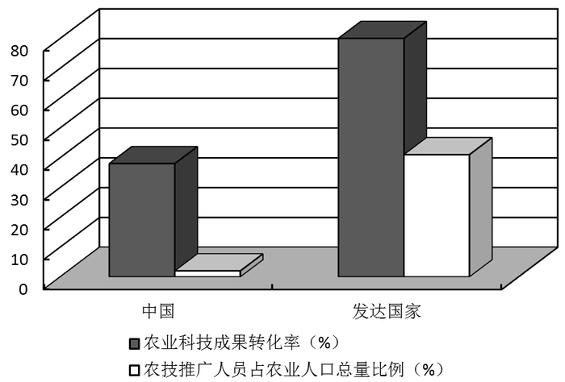

图：中国与发达国家农业科技推广状况比较

        材料3:2012年中央一号文件强调，农业科技具有公共性、基础性、社会性，政府要发挥主导作用，大幅度增加农业科技投入。要采取引导高等学校、科研院所等开展农技服务，培育和支持农业社会化服务组织；完善教育科技培训政策，造就新型农业科技人才队伍；开展农村实用人才培训，培育新型职业农民等措施，提升农业技术推广能力。

### 第 121 题

材料1反映了我们党对“三农”工作的重视，这种重视具体体现在：

A. 中国共产党坚持科学执政，以科学的思想、制度和方法领导“三农”工作

B. 全面建成小康社会，重点在农村、难点在农村、希望在农村

C. 中国共产党以文件的形式指导“三农”工作，加快了城乡社会一体化发展

D. 以农业发展作为龙头推动经济社会的快速发展

第 121 题 · 答案与解析

**参考答案（粉笔题库参考内容）**

ABC

**解析**

A、B、C三项正确，根据材料1所示，新世纪以来，9个中央一号文件连续锁定“三农”，突出了“三农”重中之重的地位，体现了中国共产党以文件的形式指导“三农”工作，加快了城乡社会一体化发展，同时也说明中国共产党坚持科学执政，以科学的思想、制度和方法领导“三农”工作，因为全面建成小康社会，重点在农村、难点在农村、希望在农村。

D项错误，农业是国民经济的基础，也是经济发展、社会稳定的基础，而不是龙头。我们应该巩固和加强农业基础地位，促进经济的快速发展。

故正确答案为A、B、C。

**考点**：经济建设

**来源**：2014年上海市公务员录用考试《行测》题（A类）第121题

### 第 122 题

结合材料2，关于农业发展，尤其是农业科技发展的现状，下列表述正确的是：

A. 与发达国家相比，我国农业科技成果转化率、农技推广人员占农业人口总量的比例都有较大差距，农业科技推广能力较低

B. 我国农业科技推广现状与基层农技推广机构专业人员流失、人员老化、推广能力不强等问题有关

C. 我国农业科技推广现状与政府对农业的重视程度有关

D. 我国农业科技推广现状与我国农村的“家庭联产承包”经营政策有关

第 122 题 · 答案与解析

**参考答案（粉笔题库参考内容）**

ABCD

**解析**

A项正确，根据材料可知，中国农业经济水平与英国相差约150年，与美国相差108年。与发达国家相比，我国农业科技成果转化率、农技推广人员占农业人口总量的比例都有较大差距，农业科技推广能力较低，当选。

B项正确，根据材料可知，我国农业科技推广现状与基层农技推广机构专业人员流失、人员老化、推广能力不强等问题有关，当选。

C项正确，近年来，虽然中国政府越发重视农业科技创新的投入，但是，从另一个角度来看，中国农业创新的投入又是相对不足的。2009年以来，中国每年的农业科技创新经费投入占总科研经费的比例始终维持在6.4% —7.4%,2012年之后还出现了下降趋势。总体而言，虽然中国政府对农业科技创新的关注度和投入力度都在增加，但其增长并未跟上整体科技创新的脚步，农业科技创新还应当受到更多的关注，当选。

D项正确，我国农村实行的是“家庭联产承包”经营政策，土地也承包到户，农民自主经营，对技术的选择余地大，其生产方式和行为以自己的目标利益为主，对政府农业推广项目的配合有一定的局限性，也影响了农业技术的推广，当选。

故正确答案为A、B、C、D。

**考点**：经济建设

**来源**：2014年上海市公务员录用考试《行测》题（A类）第122题

### 第 123 题

结合材料1和材料3，我国采取措施提升农业科技推广能力，原因在于：

A. 农业的根本出路在科技

B. 科技人才是技术产生的源泉，是技术传播、应用的载体

C. 加强对农民科技培训，能够直接提高科技成果转化率

D. 农村经济发展的关键是农民科技意识的提高

第 123 题 · 答案与解析

**参考答案（粉笔题库参考内容）**

ABC

**解析**

A项正确，农业的根本出路在于科技，农业科技创新是现代农业发展的重要支撑。农业科技的创新和应用不仅可以提高要素生产率，而且可以通过作物品种改良、灾害防护等措施，提高农业抗风险能力。农业科技的不断发展，为农业生产率的提高和现代农业发展提供有力支撑，当选。

B项正确，科技人才是技术产生的源泉，是技术传播、应用的载体，为进一步造就新型农业农村人才队伍，一方面，要出台政策提高农业科技人员的地位和待遇水平。另一方面，要完善教育科技培训政策，造就一支能够深入一线的高效率科技成果转化队伍,为现代农业发展提供人才保障，当选。

C项正确，人是生产力中起主导地位的要素，农民是农业科技成果的实施主体。加强对农民科技培训，能够直接提高科技成果转化率，当选。

D项错误，习近平总书记曾指出：“农村经济社会发展，说到底，关键在人。要通过富裕农民、提高农民、扶持农民，让农业经营有效益，让农业成为有奔头的产业，让农民成为体面的职业。”，排除。

故正确答案为A、B、C。

**考点**：经济建设

**来源**：2014年上海市公务员录用考试《行测》题（A类）第123题

### 第 124 题

从文化角度看，材料3中的做法的理论依据是：

A. 文化与经济相互联系，经济是文化的基础

B. 文化与经济相互交融，给经济以重大影响

C. 教育是文化传播的重要途径

D. 农民是农村社会主义精神文明建设的主体

第 124 题 · 答案与解析

**参考答案（粉笔题库参考内容）**

BCD

**解析**

文化与经济融合催生文化经济。“文化经济”这个新概念的特点，就是文化和经济紧密结合，互相渗透，形成以经济为依托的新文化形态，或以文化为内涵的新经济形态，即“文化的经济化”和“经济的文化化”，B项正确，当选。教育是文化传播的重要途径，C项正确，当选。建设社会主义新农村，农民是主体。精神文明建设的根本任务是提高广大干部群众的思想道德和科学文化素质，只有农民的整体素质提高了，才能自觉地参与社会主义新农村建设，因此必须以民为本，着力提高农民整体素质，D项正确，当选。

故正确答案为B、C、D。

**考点**：文化建设

**来源**：2014年上海市公务员录用考试《行测》题（A类）第124题

## 材料 8

2013年9月27日，国务院批准《中国（上海）自由贸易试验区总体方案》。9月29日，中国上海自由贸易试验区和中国上海自由贸易试验区管委会挂牌，这标志着中国上海自由贸易试验区正式启动运作，自贸区建设将促进政府职能转变，积极探索管理模式创新，形成可复制、可推广的经验，更好地服务全国发展。

        “自由贸易区”通常指两个以上的国家或地区，通过签订自由贸易协定，相互取消绝大部分货物的关税和非关税壁垒，取消绝大多数服务部门的市场准入限制，开放投资。从而促进商品、服务和资本技术、人员等生产要素的自由流动，实现优势互补，促进共同发展，有时它也用来形容一国国内一个或多个消除了关税和贸易配额，并且对经济的行政干预较小的区域。

### 第 125 题

国务院印发的《中国（上海）自由贸易试验区总体方案》，提出经过两年至三年的改革试验，力争将其建设成为有国际水准的，\_\_\_\_\_\_\_\_\_的自由贸易试验区。

A. 货币兑换自由

B. 监管高效便捷

C. 金融领域开放

D. 法制环境规范

第 125 题 · 答案与解析

**参考答案（粉笔题库参考内容）**

ABD

**解析**

《中国（上海）自由贸易试验区总体方案》第二条中指出：经过两至三年的改革试验，加快转变政府职能，积极推进服务业扩大开放和外商投资管理体制改革，大力发展总部经济和新型贸易业态，加快探索资本项目可兑换和金融服务业全面开放，探索建立货物状态分类监管模式，努力形成促进投资和创新的政策支持体系，着力培育国际化和法治化的营商环境，力争建设成为具有国际水准的投资贸易便利、货币兑换自由、监管高效便捷、法制环境规范的自由贸易试验区，为我国扩大开放和深化改革探索新思路和新途径，更好地为全国服务。

故正确答案为A、B、D。

**来源**：2014年上海市公务员录用考试《行测》题（B类）第121题

### 第 126 题

中国（上海）自由贸易试验区服务企业扩大开放的领域包括：

A. 金融服务领域，航运服务领域，商贸服务领域

B. 金融服务领域，旅游服务领域，信息服务领域

C. 专业服务领域，文化服务领域，社会服务领域

D. 专业服务领域，文化服务领域，信息服务领域

第 126 题 · 答案与解析

**参考答案（粉笔题库参考内容）**

AC

**解析**

《中国（上海）自由贸易试验区总体方案》中第二条指出：扩大服务业开放。选择金融服务、航运服务、商贸服务、专业服务、文化服务以及社会服务领域扩大开放，暂停或取消投资者资质要求、股比限制、经营范围限制等准入限制措施（银行业机构、信息通信服务除外），营造有利于各类投资者平等准入的市场环境。

故正确答案为A、C。

**来源**：2014年上海市公务员录用考试《行测》题（B类）第122题

### 第 127 题

为了推进自贸区建设达到预期成效，必须采取多种配套改革措施。在政府管理方面，要进一步推进政府职能转变，深化行政体制改革。《中国（上海）自由贸易试验区总体方案》强调，要建立\_\_\_\_\_\_\_\_的服务模式。

A. 公开透明

B. 一口受理

C. 综合审批

D. 高效运作

第 127 题 · 答案与解析

**参考答案（粉笔题库参考内容）**

BCD

**解析**

《中国（上海）自由贸易试验区总体方案》中第一条指出：深化行政管理体制改革。加快转变政府职能，改革创新政府管理方式，按照国际化、法治化的要求，积极探索建立与国际高标准投资和贸易规则体系相适应的行政管理体系，推进政府管理由注重事先审批转为注重事中、事后监管。建立一口受理、综合审批和高效运作的服务模式，完善信息网络平台，实现不同部门的协同管理机制。

故正确答案为B、C、D。

**来源**：2014年上海市公务员录用考试《行测》题（B类）第123题

### 第 128 题

中国（上海）自由贸易试验区建设是国家战略，是先行先试、深化改革、扩大开放的重大举措，意义深远。这项重大改革是\_\_\_\_\_\_\_\_\_。重在提升软实力，各项工作影响大、难度高。

A. 以金融领域开放为重点

B. 以制度创新为着力点

C. 以政府职能转变为核心

D. 以完善法制保障为关键

第 128 题 · 答案与解析

**参考答案（粉笔题库参考内容）**

B

**解析**

上海市在2013年7月5日举行的通报会上指出：中国（上海）自由贸易试验区建设是国家战略，是先行先试、深化改革、扩大开放的重大举措，意义深远。这项重大改革是以制度创新为着力点，重在提升软实力，各项工作影响大、难度高。上海要按照国家的部署，扎扎实实抓推进、认认真真抓突破。

故正确答案为B。

**来源**：2014年上海市公务员录用考试《行测》题（B类）第124题

## 材料 9

B市的张女士在H区将私家车停在马路边，到饭店吃饭，吃完饭后发现车上有一张“停车记录告知单”。张女士不明白这张“告知单”是什么，通过网络查询，得知如下信息：B市从2011年4月1日起，交通协管员发现机动车未在道路停车泊位内停放的，按规定须填写两份单子：一份是《B市交通协管员道路停车记录告知单》（简称《告知单》），一份是《B市交通协管员道路停车记录报告单（简称《报告单》）。交通协管员在违章车辆前车门的玻璃上粘贴《告知单》后，通过相机或摄像记录停车事实，将《报告单》和图像视频资料报告交管部门，由交警审核确认属于违章停放机动车行为的，交管部门将会对违法行为人处以200元罚款的行政处罚，并邮寄信函将违法行为告知机动车所有人，驾驶人收到《告知单》后，可以在24小时后登录交管部门对外网站查询是否属于违法停放机动车的行为。

### 第 129 题

对交通协管员贴《告知单》的行为，从行政法律关系的角度判断正确的是：

A. 协管员是行政主体

B. 张女士是行政相对人

C. 这是一种对外部的行政法律关系

D. 协管员是受委托实施行政行为的个人

第 129 题 · 答案与解析

**参考答案（粉笔题库参考内容）**

BC

**解析**

行政主体是指享有行政权力，能以自己的名义行使行政权力，做出影响行政相对人权利和义务的行政行为，并能独立承担由此产生的相应法律责任的社会组织。协管员是社会招募的人员，不属于国家公职人员，A项错误。

行政相对人是指行政管理法律关系中与行政主体相对应的另一方当事人，即行政主体的行政行为影响其权益的个人或组织。这是行政法学上的概念，而非制定法上的概念。在制定法上“行政相对人”一般称“公民、法人和其他组织”。B项正确。

外部行政法律关系指的是公共行政关系，主要是行政机关和行政相对人之间的关系。C项正确。

行政行为是指行政主体行使行政职权，做出的能够产生行政法律效果的行为。协管员贴告知单不属于行政行为。D项错误。

故正确答案为B、C。

**考点**：行政法

**来源**：2014年上海市公务员录用考试《行测》题（B类）第129题

### 第 130 题

从行政处罚的角度，下列判断正确的是：

A. 《告知单》和《报告单》结合在一起，就构成了完整的行政处罚行为

B. 在交警在场的情况下，交通协管员可以直接作出罚款200元的决定

C. 如果获得了交管部门的明确授权，交通协管员可以直接作出罚款200元的决定

D. 如果交警直接开具罚款200元的行政处罚，交通协管员可以进行一些协助行为

第 130 题 · 答案与解析

**参考答案（粉笔题库参考内容）**

D

**解析**

行政处罚是指具有行政处罚权的行政主体为维护公共利益和社会秩序，保护公民、法人或其他组织的合法权益，依法对行政相对人违反行政法律法规而尚未构成犯罪给予法律制裁的行政行为。A项中《告知单》和《报告单》并不能构成行政处罚行为。A项错误。根据我国《行政处罚法》第三章第十八条规定：行政机关依照法律、法规或者规章的规定，可以在其法定权限内委托符合本法第十九条规定条件的组织实施行政处罚。行政机关不得委托其他组织或者个人实施行政处罚。可知B、C两项均为干扰项。协管员的义务就是协助交警工作，所以D项是正确的。

故正确答案为D。

**考点**：行政法

**来源**：2014年上海市公务员录用考试《行测》题（B类）第130题

### 第 131 题

若张女士后来收到200元罚款通知，从行政救济的角度判断正确的是：

A. 张女士可以向H区公安局申请复议

B. 张女士可以向H区人民法院提起行政诉讼

C. 张女士提起行政诉讼应以H区公安局为被告

D. 张女士不能同时申请复议和提起行政诉讼

第 131 题 · 答案与解析

**参考答案（粉笔题库参考内容）**

ABD

**解析**

A项正确，根据《行政复议法》第十五条第二款规定：对政府工作部门依法设立的派出机构依照法律、法规或者规章规定，以自己的名义作出的具体行政行为不服的，向设立该派出机构的部门或者该部门的本级地方人民政府申请行政复议。

B项正确，根据《行政诉讼法》第二条规定：公民、法人或者其他组织认为行政机关和行政机关工作人员的具体行政行为侵犯其合法权益，有权依照本法向人民法院提起诉讼。

C项错误，根据《行政诉讼法》第二十六条规定：公民、法人或者其他组织直接向人民法院提起诉讼的，作出行政行为的行政机关是被告。题中，张女士应以交通管理部门为被告。

D项正确，根据《行政复议法》第十六条规定：公民、法人或者其他组织申请行政复议，行政复议机关已经依法受理的，或者法律、法规规定应当先向行政复议机关申请行政复议、对行政复议决定不服再向人民法院提起行政诉讼的，在法定行政复议期限内不得向人民法院提起行政诉讼。

故正确答案为ABD。

**考点**：行政法

**来源**：2014年上海市公务员录用考试《行测》题（B类）第131题

### 第 132 题

如果张女士仅在交管部门的网站上查询到属于违法停放机动车行为和罚款200元的情况。但没有收到罚款200元的行政处罚决定书，则：

A. 张女士可以申请复议

B. 张女士可以提起行政诉讼

C. 张女士应当向公安局查询

D. 罚款200元的决定不具有效力

第 132 题 · 答案与解析

**参考答案（粉笔题库参考内容）**

D

**解析**

《行政处罚法》第五章第二节三十九条规定：行政机关给予行政处罚，应当制作行政处罚决定书。《行政处罚法》第四十条规定：行政处罚决定书应当在宣告后当场交付当事人；当事人不在场的，行政机关应当在七日内依照民事诉讼法的有关规定，将行政处罚决定书送达当事人。题中没有收到行政处罚决定书，那么处罚是无效的。

故正确答案为D。

**考点**：行政法

**来源**：2014年上海市公务员录用考试《行测》题（B类）第132题

## 材料 10

xx市发展和改革委员会

关于转发国家能源局《关于申报分布式光伏发电规模化应用示范区的通知》的

通    知

X发改能源（2012）0164号

  各有关单位：

  为落实可再生能源发展“十二五”规划，促进太阳能发电产业可持续发展，今日国家能源局下发了《关于申报分布式光伏发电规模化应用示范区的通知》。先转发给你们，请按照《通知》要求，在落实建筑屋顶、消纳用户和电力接入等实施条件的基础上，抓紧编制申报项目实施方案，于2012年10月10日前报市发展改革委。

联系人：黄xx

联系电话：xxxxxxxx

附件：《国家能源局关于申报分布式光伏发电规模化应用示范区的通知》（国能新能【2012】298号）

xx市发展和改革委员会

二〇一二年九月二十八日

### 第 133 题

关于上述公文的标题，下列表述正确的是：

A. 分行不当

B. “转发”前不应该加“关于”

C. 不应该使用书名号

D. 最后“的通知”多余

第 133 题 · 答案与解析

**参考答案（粉笔题库参考内容）**

AB

**解析**

公文格式，即公文规格样式，是指公文中各个组成部分的构成方式，它和文种是公文外在形式的两个重要方面，直接关系到公文效用的发挥。包括公文组成、公文用纸和装订要求等。公文标题由发文机关、发文事由、公文种类三部分组成，称为公文标题“三要素”。发文机关名称、发文事由、公文种类，字数较多，可以排列为梯形或者菱形，但是严禁拆词。故A项正确，D项错误。

B项正确，一个标题中只有一个“关于”，因此转发前的“关于”应该省略。

C项错误，属于引用公文，所以应该使用书名号。

故正确答案为A、B。

**来源**：2014年上海市公务员录用考试《行测》题（B类）第137题

### 第 134 题

关于上述公文的发文字号，下列表述正确的是：

A. 年份外括号使用有误

B. 年份使用阿拉伯数字不对

C. 顺序号“0164”写法不对，不应该加“0”

D. 顺序号“0164”写法不对，应该前加“第”字

第 134 题 · 答案与解析

**参考答案（粉笔题库参考内容）**

AC

**解析**

发文字号又称发文编号、文号，它是发文机关在某一年度内所发各种不同文件总数的顺序编号。发文字号由发文机关的办公厅（室）负责统一编排。发文字号应当包括机关代字、年份、序号；联合行文，只标明主办机关发文字号。发文字号应该是由机关代字、年份和序号组成。年份用阿拉伯数字全称，用六角括号括起来，序号前不加“第”字，不加“0”。

故正确答案为A、C。

**来源**：2014年上海市公务员录用考试《行测》题（B类）第138题

### 第 135 题

下列对公文正文的修改意见正确的是：

A. 应该在“《关于申报分布式光伏发电规模化应用示范区的通知》”后加括号注明此通知的发布字号

B. “请按照《通知》要求”一句中的“《通知》”所指不明，应该在文中有所说明

C. 联系人和联系电话应该移到发文日期的左下方

D. 附件说明中应该去掉书名号、括号及括号中内容也可去掉

第 135 题 · 答案与解析

**参考答案（粉笔题库参考内容）**

ABCD

**解析**

A项引用标题应该是“《公文标题》（发文字号）”的格式；B项《通知》指代不明，需要说明；C项附注应该位于成文日期的左下方；D项附件应当去掉书名号。

故正确答案为A、B、C、D。

**来源**：2014年上海市公务员录用考试《行测》题（B类）第139题

### 第 136 题

下列关于公文发文机关署名和成文日期的编排，表述正确的是：

A. 成文日期中的数字应该用阿拉伯数字

B. 成文日期右空4字

C. 不用署名、在成文日期处加盖发文机关“xx市发展和改革委员会”印章

D. 发文机关“xx市发展和改革委员会”在成文日期之上，以成文日期为准居中编排

第 136 题 · 答案与解析

**参考答案（粉笔题库参考内容）**

ABD

**解析**

按照格式规范，一般是要有落款的，如果没有落款，在特定情况下文件的真实性可能会被质疑，正常的程序应该是先署名后用印，用印的位置为年月日部分，骑年盖月。所以C项错误。其他选项正确。

故正确答案为ABD。

**来源**：2014年上海市公务员录用考试《行测》题（B类）第140题

## 材料 11

（五）阅读下列材料，回答第137-140题。

        2000年，“中国地方政府改革与创新”研究与奖励计划联合组织国内几十名政治学、行政学、社会学等专家学者，根据创新程度、自愿程度、效益程度、重要程度、节约程度和推广程度等六项标准，开展了首届“中国地方政府创新奖”评选和奖励活动，在320多个地市（含）以下地方政府的创新项目中，评选出10名优胜奖和10名提名奖。这是我国历史上第一个由学术机构按照科学的评估程序和评选标准产生的“政府创新奖”。

        “政府创新”就是公共权力机关为了提高行政效率和增进公共利益而进行的创造性改革。政府创新的过程，是一个持续不断地对政府部门进行改革和完善的过程。与其他创新行为一样，政府创新还具有明显不同于一般创新行为的某些特征。首先，政府创新的主体是公共部门，特别是公共权力部门；政府创新的最终目的也是为了改善公共服务，增进公共利益。其次，政府创新的受惠者，主要不是政府部门自身，而是广大的公民。由于政府掌握着社会的政治权力，政府创新的结果通常对社会有着广泛而深刻的影响。最后，政府创新是政治体制改革的重要内容，它直接涉及权力关系和利益关系，十分敏感。风险性也比其他创新行为更大。

        2013年10月19日，第七届“中国地方政府创新奖”入围项目在北京正式揭晓，共有20个项目入围。具体入围项目名单如下（按项目名称拼音排列）：

1.江西省司法厅：创新安置帮教模式

2.共青团贵州省委春晖行动发展中心：春晖行动

3.内蒙古自治区开鲁县委县政府：嘎查村“532”工作法

4.江苏省昆山市张浦镇党委镇政府：经济发达镇行政改革与流程再造

5.四川省残疾人联合会：“量体裁衣”式残疾人服务模式

6.广东省中山市社会工作委员会：流动人员积分制管理

7.陕西省紫阳县委：民意导向的干部选任新机制

8.四川省成都市政府：农村产权制度改革

9.广东省肇庆市公安局：“平安肇庆”公安微博

10.吉林省安图县委县政府：群众诉求服务平台创新

11.山东省青岛市南区八大湖街道：社会组织“伴生”模式

12.河南省焦作市财政局：“四权分离”的财政权力制衡机制建设

13.重庆市金融工作办公室：小额贷款保证保险试点

14.陕西省安康市岚皋县政府：镇办卫生院新农合报销制度改革

15.浙江省庆元县纪律检查委员会：异地便民服务中心

16.浙江省杭州市上城区委区政府：政府管理与公共服务标准化

17.山东省淄博市淄川区审计局：政府直审“村官”模式

18.江苏省太仓市政府：“政社互动”创新实践

19.福建省厦门市海沧区委区政府：政务综合体社会管理机制创新

20.北京市总工会：职工服务公益孵化项目

### 第 137 题

材料中提到的“中国地方政府改革与创新”是一项公开透明的第三方评价，在具体评价地方政府的各种创新项目时，主要依据创新程度、自愿程度、效益程度、重要程度、＿＿＿＿＿＿等基本维度进行。

A. 节约程度

B. 科学程度

C. 推广程度

D. 好评程度

第 137 题 · 答案与解析

**参考答案（粉笔题库参考内容）**

AC

**解析**

“中国地方创新政府榜样”应具备以下条件：大力推进行政机关自身的改革，确立依法行政和法治政府目标，提高政府机关的绩效；改善政府的公共服务体制，简化审批，减少管制，提高效率，方便群众，建设服务型政府；推行政务公开，建设透明政府；推广电子政务，提高行政效率，改善公共服务质量；扩大社会保障的范围，促进社会的公平正义，推动和谐社会建设。评委会委员根据申请项目的创新程度、自愿程度、效益程度、重要程度、节约程度、推广程度等六个标准进行评选。

故正确答案为AC。

**来源**：2014年上海市公务员录用考试《行测》题（A类）第137题

### 第 138 题

从内容上看，政府管理创新主要包括观念创新、制度创新和技术创新等，其中制度创新是关键。下列选项中，属于政府管理制度创新的是：

A. 政府角色的重新定位

B. 全面质量管理

C. 公共服务的市场化、社会化

D. 公共管理职能分权化

第 138 题 · 答案与解析

**参考答案（粉笔题库参考内容）**

ABCD

**解析**

转变政府职能是深化行政管理体制改革、加强政府自身建设的重点。多年来，我们在转变政府职能方面做了大量工作，取得了明显成效。继续推进政企分开，政企分开是政府职能转变的关键。必须重申，凡是应该由企业自主行使的生产经营和投资决策权，都要由企业自行决定、自行负责，各级政府及其部门都不得包办企业投资决策、干预企业正常的生产经营活动。A项、B项、C项、D项均为政府管理制度创新。

故正确答案为ABCD。

**来源**：2014年上海市公务员录用考试《行测》题（A类）第138题

### 第 139 题

基于上述材料，从行政管理基本原理的角度考查，关于“中国地方政府创新奖”中的“地方政府”的表述，正确的是：

A. “地方政府”的概念是广义政府的概念

B. “地方政府”的概念是狭义政府的概念

C. “地方政府”既指“条条”部门，也指“块块”部门

D. “地方政府”的概念并未严格局限于政府机构，它还包括党组织，人民团体和事业单位

第 139 题 · 答案与解析

**参考答案（粉笔题库参考内容）**

BCD

**解析**

广义上的政府可以包括所有的国家机关，如1949至1954年间的中央人民政府；狭义的政府专指行政机关。B项正确。又从后面的获奖单位可知，“地方政府”既指“条条”部门，也指“块块”部门。C项正确。“地方政府”的概念并未严格局限于政府机构，它还包括党组织、人民团体和事业单位。D项正确。

故正确答案为BCD。

**来源**：2014年上海市公务员录用考试《行测》题（A类）第139题

### 第 140 题

依据上述材料，仔细分析和比较第七届“中国地方政府创新奖”入围的具体项目名称和内容，可以得出的基本结论是：

A. 当前地方政府管理创新多集中于公共服务领域

B. 基层政府更加愿意推动政府管理创新

C. 发达地区政府更加愿意推动政府管理创新

D. “块块”部门更加愿意推动政府管理创新

第 140 题 · 答案与解析

**参考答案（粉笔题库参考内容）**

ABD

**解析**

从入围名单来看，并没有表示发达地区的政府更加愿意推动政府管理创新。所以排除C项。其余三项均可以从获奖名单中得出结论。

故正确答案为ABD项。

**来源**：2014年上海市公务员录用考试《行测》题（A类）第140题

