# 2014年上海市公务员录用考试《行测》题（B类）

<!-- gwy:overview:start -->
> **上海 · 2014 · 行测 · B类** ｜ 140 题 · 图片 133 处 · 答案随题折叠

| 题型模块 | 题量 | 题号 |
| --- | ---: | ---: |
| 言语理解与表达能力 | 25 | 1–25 |
| 判断推理能力 | 40 | 26–65 |
| 数理能力 | 25 | 66–90 |
| 常识应用能力 | 30 | 91–120 |
| 综合分析能力 | 20 | 121–140 |
| **合计** | **140** | |

导航：[题型与作答说明](#题型与作答说明) · [题目](#题目) · [材料 1](#材料-1)
<!-- gwy:overview:end -->

> 候选采集稿。参考答案及解析来自粉笔页面，不代表官方答案或真实高分答卷；来源使用许可与原卷对应关系仍需人工核实。

## 题型与作答说明

言语理解与表达能力

（25题）

言语理解与表达能力部分包括逻辑填空、片段阅读与文章阅读三种类型题目，均为单项选择题。

判断推理能力

（40题）

判断推理能力部分包括科学推理、定义判断、图形推理与逻辑判断四种类型的题目，均为单项选择题。

数理能力

（25题）

数理能力部分包括数字推理与数学运算两种类型的题目，均为单项选择题。

常识应用能力

（30题）

本部分均为不定项选择题，每小题给出的4个选项中，至少有1个选项符合题意。

综合分析能力

（20题）

本部分均为不定项选择题，每小题给出的4个选项中，至少有1个选项符合题意。

## 题目

### 第 1 题

我们的社会已经进入了一个特别需要讲道理、讲清道理的时代，没有以理服人的态度和论述，人们凭什么来接受你的结论；\_\_\_\_\_\_\_我不反对你的结论，\_\_\_\_\_\_\_\_\_我要求，迫切地要求，请说清这些结论的来龙去脉，其实哪怕论点相左，\_\_\_\_\_\_\_\_你的论题重要，论据扎实、论述充分，我们都会认真阅读，\_\_\_\_\_\_\_\_心悦诚服地接受，并用来修改自己既定的想法。

依次填入画横线部分最恰当的一项是：

A. 尽管 但是 所以 因此

B. 甚至 但是 只要 以至

C. 因此 但是 如果 以至

D. 因为 可是 只要 以致

第 1 题 · 答案与解析

**参考答案（粉笔题库参考内容）**

B

**解析**

第一空考查对文段结构的理解。第一句是文段的总括句，第二、三句是对总括句的分述；“尽管”表示让步假设关系，后跟“还是”“但是”“却”等呼应，表示意思的转折；“甚至”表示所提出的是突出的、进一步的事例，是对第二句的进一步说明。排除C、D选项。

第二空考查转折关联词。“但是”“可是”意思相近，都表示转折关系，强调转折之后的内容。根据此空无法确定选项。

第三空考查充分条件的关联词。“只要”表示具有充分的条件，常与“就”“也”“都”“便”相呼应，表明由这种条件产生的一种结果；“只有”表示必需的条件，常与“才”“方”呼应。根据“我们都会认真阅读”，确定此空为“只要”。排除A选项。

第四空考查近义词辨析。“以至”是连词，①表示时间、数量、程度、范围等的延伸；②用于下半句开头，表示上述情况所达到的深度或结果。“以致”也是连词，常用在下半句的开头，表示下文是上述情况造成的结果，多指不好的。

故正确答案为B。

**考点**：关联关系-转折关系、词的辨析-程度轻重

**来源**：2014年上海市公务员录用考试《行测》题（B类）第1题

### 第 2 题

天文学家们宣布，他们通过太空望远镜\_\_\_\_\_\_\_\_\_到了三颗与地球非常相似的行星，其环境似乎很适宜生命生存，而且，其中一颗的表面可能\_\_\_\_\_\_着大片海洋，因此它\_\_\_\_\_\_\_\_与地球一样，呈现出美丽而迷人的蓝色，这是迄今为止人类找到的最像地球的行星。虽然这是一个重要的科学发现，但却带有哲学意味。

依次填入划横线部分最恰当的一项是（  ）。

A. 观察 覆盖 也许

B. 观测 覆盖 也许

C. 观测 存在 一定

D. 观察 存在 可能

第 2 题 · 答案与解析

**参考答案（粉笔题库参考内容）**

B

**解析**

第一空，比较“观察”和“观测”。“观察”指仔细察看（事物或现象），是一种有目的，有计划，比较持久的知觉活动；“观测”常指对自然现象进行观察或测定，文段中提到的对象是行星，因此用“观测”更合适，据此可排除A、D项。

再看第三空，根据前文“似乎”“可能”，提示此处填入的词语应表示不确定的意思，C项“一定”不符合文意，故排除。

第二空，对B项进行验证。“表面覆盖”，符合语境。

故正确答案为B。

【文段出处】《地球即将告别“孤独”? 科学家发现最像地球的遥远行星》

**考点**：关联关系-因果关系、实词填空、对应关系-前后呼应、词的辨析-搭配对象、词的辨析-词义侧重

**来源**：2014年上海市公务员录用考试《行测》题（B类）第2题

### 第 3 题

心是一棵树，爱与希望的根须扎在土里，智慧与情感的枝叶\_\_\_\_\_在蓝天下。无论是岁月的风雨扑面而来，还是滚滚尘埃遮蔽了翠叶青枝，它总是静默地\_\_\_\_\_\_\_在那里等待，并接受一切来临，既不倨傲，也不卑微。

依次填入划横线部分最恰当的一项是：

A. 招摇 耸立

B. 摇曳 屹立

C. 摇摆 伫立

D. 招展 矗立

第 3 题 · 答案与解析

**参考答案（粉笔题库参考内容）**

D

**解析**

第一空，搭配“智慧和情感的枝叶”，体现枝叶特点且偏积极，A项“招摇”指张扬炫耀以引人注意，消极色彩，与题目感情倾向不符且与“枝叶”不搭，排除；C项“摇摆”是指摇动，摆动，晃动，不符合题中的诗意的美感，排除。B项“摇曳”指摇摆不停，形容枝叶在风中摆动；D项“招展”是飘扬，摇曳的意思，二者均符合，保留。

第二空，根据“它总是静默地\_\_\_\_\_\_\_在那里等待，并接受一切来临”，是形容树站在那里。B项“屹立”像山峰一样高耸而稳固地挺立着，通常形容人的意志坚定，侧重“稳”；D项“矗立”意为高大笔直地挺立，多用于物。文段未体现坚定无法动摇之意，只说站立，D项当选。

故正确答案为D。

**考点**：实词填空、对应关系-前后呼应、词的辨析-感情色彩、词的辨析-搭配对象

**来源**：2014年上海市公务员录用考试《行测》题（B类）第3题

### 第 4 题

中国经学，假使我们慎重点说，上追到西汉初年为止，也已经有二千一百多年的历史。这两千多年中，经部书籍，因为传统的因袭的思想关系，只就量说，也可以配得说“\_\_\_\_\_\_\_”。不说别的，我们只要一看纳兰性德汇刊的《通志堂经解》，阮元、王先谦汇刊的《正、续清经解》，也几乎使你目眩；至若列举朱彝尊《经义考》的书目，那真所谓“\_\_\_\_\_\_\_”了。

依次填入划横线部分最恰当的一项是：

A. 汗牛充栋 更仆难数

B. 罄竹难书 博大精深

C. 不胜枚举 洋洋大观

D. 数不胜数 望洋兴叹

第 4 题 · 答案与解析

**参考答案（粉笔题库参考内容）**

A

**解析**

第一空，“汗牛充栋”形容著作或藏书极多，使用范围较窄，多用于书面语。“罄竹难书”比喻事实（多指罪恶）很多，难以说完。“不胜枚举”指不能一个个地列举出来，形容数量很多，偏重于所举的是同一类的人或事物。“数不胜数”形容数量极多，很难计算。此空可根据语义排除B项。

第二空，“更仆难数”形容人或事物很多，数也数不过来。“博大精深”用来形容思想和学术广博高深，多用于形容理论、学识、思想、作品等广博丰富，深奥精微，其形容对象多为某某内容。“洋洋大观”形容事物复杂繁多，丰富多彩。“望洋兴叹”原指在伟大事物面前感叹自己的渺小，现多比喻做事时因力不胜任或没有条件而感到无可奈何。

故正确答案为A。

**考点**：对应关系-前后呼应、成语填空、词的辨析-搭配对象

**来源**：2014年上海市公务员录用考试《行测》题（B类）第4题

### 第 5 题

在中国人心目中，“圣人”是道德修养的楷模。中国人尤其是知识分子，往往以君子\_\_\_\_\_，却不以圣人\_\_\_\_\_\_。可见圣人的道德境界是一种崇高的理想，圣人也就只是人们心目中的崇拜偶像。\_\_\_\_\_\_，圣人的道德境界，也不是天生的，而是一点一滴积累起来的。荀子认为，圣人不仅是崇拜的偶像，普通人也能经过坚持不懈的实践，从日常生活中不断地积累德行，提高自己的道德修养，达到尽善尽美的境地，成为一个圣人。

依次填入划横线部分最恰当的一项是：

A. 自称 自居 因此

B. 自居 自夸 其次

C. 自封 标榜 所以

D. 自诩 自居 然而

第 5 题 · 答案与解析

**参考答案（粉笔题库参考内容）**

D

**解析**

本题可从第三空入手。根据横线前可以得知圣人的道德境界是崇高的，和普通人是有区别的，根据横线后可知圣人崇高的道德境界也是一点一滴积累起来的，换句话说普通人也能够成为圣人，前后语意不同，横线处要填入一个表示转折的词语，锁定D项“然而”。A项“因此”、C项“所以”均表示因果关系，B项“其次”表示次要，均与文意不符，排除。

验证第一空和第二空。

第一空，“自诩”指自夸，表示知识分子经常自夸为君子，符合文意。

第二空，“自居”指自以为具有某种身份，说明知识分子不认为自己达到圣人的境界，符合文意。

故正确答案为D。

拓展：

“自称”指自己称呼自己，如项羽自称西楚霸王

“自封”指自己给自己加头衔；子明，如自封专家

**考点**：关联关系-转折关系、对应关系-前后呼应、混搭填空、词的辨析-词义侧重

**来源**：2014年上海市公务员录用考试《行测》题（B类）第5题

### 第 6 题

下列语句表达准确无误的是：

A. 不久前落幕的“上交会”上，来了一群重量级“服务生”——为了让来自15个国家和地区的专业观众沟通无障碍，十来个教授级专业译员坐镇会场。

B. 《中华人民共和国老年人权益保障法》虽然要求子女常看望问候父母，也规定了单位应保障赡养人探亲休假的权利。

C. 沪语文化在多个文学艺术领域出现复苏迹象，这一现象引发了文化界的普遍关注。

D. 为什么对于这种浪费资源的现象至今没有引起有关部门的重视呢？

第 6 题 · 答案与解析

**参考答案（粉笔题库参考内容）**

C

**解析**

A项，成分残缺，“不久前落幕的‘上交会’上”在句中做状语，本句缺少主语，可以将“上”去掉，存在语病，排除；

B项，关联词搭配不当，“也”应与“不仅”搭配，不能与“虽然”搭配，应改为“不仅······也······”，存在语病，排除；

C项，表述正确，没有语病，当选；

D项，滥用介词造成主语残缺，应删除“对于”，或改为“对于为什么”，存在语病，排除。

故正确答案为C。

**来源**：2014年上海市公务员录用考试《行测》题（B类）第6题

### 第 7 题

下列句子中，句子类型不同于其他三句的是：

A. 外部资源，尤其是世界一流教育资源，正越来越多地成为上海垒石造峰的“他山之石”。

B. 方案清晰具体了，就比较可行，如果模糊笼统，实施起来就会缺少可操作性。

C. 我国首个实验型深海移动工作站经过十年科技攻关，和“蛟龙号”载人深潜器一样，是我国探索深海科学奥秘的利器。

D. 改革的智慧，说到底，仍然是洞悉规律、把握规律。

第 7 题 · 答案与解析

**参考答案（粉笔题库参考内容）**

B

**解析**

A、C、D三项都是主语+补语+谓语+宾语结构的单句。

A项主语是“外部资源”，“尤其是世界一流教育资源”是补语，“成为”是谓语，宾语是“他山之石”。

C项主语是“我国首个实验型深海移动工作站经过十年科技攻关”，补语是“和‘蛟龙号’载人深潜器一样”，谓语是“是”，宾语是“利器”。

D项主语是“智慧”，补语是“说到底”，谓语是“是”，宾语是“洞悉规律、把握规律”。

故正确答案为B。

**来源**：2014年上海市公务员录用考试《行测》题（B类）第7题

### 第 8 题

下列各选项中的“然”与“虽有槁暴，不复挺者，𫐓使之然也”一句中的“然”用法相同的是\_\_\_\_\_\_。

A. 然后可以尽天下之大观而无憾者矣。

B. 人之视己，如见其肺肝然，则何益矣？

C. 然不自意能先入关破秦，得复见将军于此。

D. 望之蔚然而深秀者，琅琊也。

第 8 题 · 答案与解析

**参考答案（粉笔题库参考内容）**

A

**解析**

本题考查的是“然”在古代汉语中的用法。例句“虽有槁暴，不复挺者，𫐓使之然也”的“然”是代词，常译为“这样”。A项“然后可以尽天下之大观而无憾者矣”的“然”为代词，代指上文，译为“这样”，与例句中的意思一致。

B项“人之视己，如见其肺肝然，则何益矣”中“然”的用法为助词，用于句尾，表示比拟 ，与例句中的用法不一致。

C项“然不自意能先入关破秦，得复见将军于此”的“然”为连词，表示转折，有“然而、但是”之意，与例句中的用法不一致。

D项“望之蔚然而深秀者，琅琊也”的“然”为助词，用在形容词、副词之后表示状态。译为“······的样子”，与例句中的用法不一致。

故正确答案为A。

**来源**：2014年上海市公务员录用考试《行测》题（B类）第8题

### 第 9 题

下列句子的语法结构与例句相同的是：

例句：中共中央总书记、国家主席、中央军委主席习近平视察国防科学技术大学时指出，要紧紧围绕强军目标来进行思想政治建设，使思想政治建设成为实现这一目标的强大推力和助力。

A. 农村改革是我国当前的重要组成部分，黑龙江松嫩平原和三江平原是国务院今年批准的国家首个现代农业综合配套改革试验区。

B. 上海市委书记在中国（上海）自由贸易实验区管理委员中心，接受了人民日报、新华社、解放日报、文汇报记者的集体采访。

C. 大家一致认为，通过参加培训，不仅提高了理论水平，了解了当今教育现状及发展方向，并且还使我们深深地体会到要彻底改变过去传统的教学观念。

D. 当下，各级政府应当旗帜鲜明地阐明医疗行为的客观规律，维护医生的人格尊严，维护医疗机构的正常秩序。

第 9 题 · 答案与解析

**参考答案（粉笔题库参考内容）**

B

**解析**

例句的结构为“主语+状语+谓语+宾语”。

A项有两套主谓宾结构，“农村改革是我国当前的重要组成部分”和“黑龙江松嫩平原和三江平原是国务院今年批准的国家首个现代农业综合配套改革试验区”，排除。

B项主语是“上海市委书记”，状语是“在中国（上海）自由贸易实验区管理委员中心”，谓语是“接受”，宾语是“集体采访”，当选。

C项虽然也有状语，但是和文段例句不同，文段例句的状语是直接修饰主语的，而C项其实是方式状语，更多的是修饰后面的宾语，排除。

D项是主谓宾+谓宾+谓宾，没有状语，排除。

故正确答案为B。

**来源**：2014年上海市公务员录用考试《行测》题（B类）第9题

### 第 10 题

下列相似意思，不同形式的表达，按语气由轻到重依次排列正确的是：

（1）机动车冒黑烟应该重罚！

（2）机动车冒黑烟难道不应该重罚吗？

（3）机动车冒黑烟不能不重罚！

（4）机动车冒黑烟不重罚是不对的！

（5）机动车冒黑烟应该重罚。

A. （4）（5）（2）（1）（3）

B. （4）（5）（1）（3）（2）

C. （5）（1）（4）（2）（3）

D. （5）（4）（1）（3）（2）

第 10 题 · 答案与解析

**参考答案（粉笔题库参考内容）**

C

**解析**

观察选项，对比首句。首句为（4）、（5）两句，（4）句为带有批评语气的双重否定句，（5）句为陈述句，对比可知，陈述句的语气轻于双重否定句，故（5）句应为首句，排除A、B两项，保留C、D两项。

继续观察C、D两项，判断（1）句与（4）句的先后顺序。（1）句仅说“应该重罚”，（4）句为带有批评语气的双重否定句，（1）句语气轻于（4）句，故（1）句应在（4）句之前，排除D项，C项当选。

故正确答案为C。

**来源**：2014年上海市公务员录用考试《行测》题（B类）第10题

### 第 11 题

为什么不逃跑的麋鹿反而容易在与狼的对决中生存下来？<u>这</u>其实是一种勇气和习惯的较量。麋鹿身体强壮，长着长角，在力量对比上讲，如果狭路相逢，麋鹿能与狼僵持好几个小时，再加上长角，它们同样能威胁到狼的生命。所以，在面对不逃跑的麋鹿时，狼是充满戒心的。此外，还有一个更重要的原因，追赶正在奔跑的动物，是狼在生存过程中形成的本能。<u>这</u>仿佛是一种诱惑，让它们难以抗拒。所以，奔跑的麋鹿永远是它们的目标。

对这段文字中的两个划线的“这”，理解正确的是：

A. 前一个“这”指“为什么不逃跑的麋鹿反而容易在与狼的对决中生存下来”，后一个“这”指“追赶正在奔跑的动物，是狼在生存过程中形成的本能”。

B. 前一个“这”指“逃跑的麋鹿反而容易在与狼的对决中生存下来”，后一个“这”指“狼在生存过程中形成的本能”。

C. 前一个“这”指“麋鹿与狼的对决”，后一个“这”指“奔跑的动物”。

D. 前一个“这”指“不逃跑的麋鹿”，后一个“这”指“奔跑的麋鹿”。

第 11 题 · 答案与解析

**参考答案（粉笔题库参考内容）**

C

**解析**

本题为词语指代题。

第一个“这”出现在第二句话，应该指代第一句话的内容，且根据后文“一种勇气和习惯的较量”可知，代词可以体现出二者的关系，对应C项“麋鹿与狼的对决”。第二个“这”出现在倒数第二句话，指代前文，且根据后文“仿佛是一种诱惑”可知，这应该是诱惑，产生吸引力的东西，对应C项“奔跑的动物”。

A项只是客观现实，并不是代词的具体所指对象，排除；B项第二个代词是一种诱惑，而非本能，排除；D项第一个代词指代二者的关系，而非单指麋鹿，排除。

故正确答案为C。

**考点**：代词

**来源**：2014年上海市公务员录用考试《行测》题（B类）第11题

### 第 12 题

中央纪委监察部发出通知，要求党员领导干部在2013年元旦、春节期间，切实改进工作作风，加强廉洁自律。不仅整体要求，还规定了细节。比如：“严禁领导干部擅自驾驶公车”“严禁用公款搞相互走访、送礼、宴请等拜年活动”。但只靠规定力度有限，关键在于一切放在阳光下，让所有的公务支出、官员财产都置于纳税人的监督之下，才能达到真正的廉洁。

这段文字的关键词是：

A. 通知 廉洁

B. 规定 廉洁

C. 廉洁 节日

D. 廉洁 监督

第 12 题 · 答案与解析

**参考答案（粉笔题库参考内容）**

D

**解析**

阅读文段判断每句话的主要内容，本文段可以分为两部分，从“但”字划分，转折词前是对2013年双节期间改进工作作风，加强廉洁自律提出的各项规定，则前半部分的关键词为“廉洁”；文段的后半部分，提出问题为“只靠规定力度有限”即只依靠规定是远远不够的，而解决问题的对策是一切“都置于纳税人的监督之下”，解决问题的对策是重点，而对策即监督，则第二个关键词是“监督”。

故正确答案为D。

**考点**：主题词

**来源**：2014年上海市公务员录用考试《行测》题（B类）第12题

### 第 13 题

就实际情况看，赤道上的物体还远未到被甩入空中的程度。但是肯定有过这种倾向，例如赤道上的人不费太大的力气就能跳过6英尺，比在其他地区要省劲很多，因为地球每小时1000英里的转速帮助克服了一点地球引力。正因为如此，在不同纬度创造的运动记录并不严格一致。

这段文字意在说明：

A. 赤道上的物体有可能被抛入空中

B. 赤道地区的地球引力相对较小

C. 不同纬度运动记录标准不同

D. 地球运动克服了一部分地球引力

第 13 题 · 答案与解析

**参考答案（粉笔题库参考内容）**

C

**解析**

“正因为如此”说明最后一句是总结句，表明文段的主旨为不同纬度创造的运动记录并不严格一致，与主旨思想符合的是C项。

A项，第一句“远未到被甩入空中的程度”；B项赤道地区转速帮助克服了一点地球引力，不是引力小；D项“地球运动克服了一部分引力”都是文段未表达内容。

故正确答案为C。

**考点**：关联词-因果

**来源**：2014年上海市公务员录用考试《行测》题（B类）第13题

### 第 14 题

去年全年汽车产量已经达到8400万辆，而最引人瞩目的是中国的迅速崛起，2002年中国的汽车产量只占全球产量的6%，金砖四国的产量仅占11%，而去年中国的产量已经占到全球的23%，金砖四国的产量已经占全球总量的35%，中国对世界汽车产业的推动不仅是规模上的迅速增长，而且影响力也在增长。

这段话为了证明：

A. 全球汽车数量骤增在造福人类的同时也带来了一系列负面效应

B. 中国正在走向世界汽车大国的行列中

C. 金砖四国对世界汽车产业将产生巨大影响力

D. 中国在金砖四国中汽车产量最大

第 14 题 · 答案与解析

**参考答案（粉笔题库参考内容）**

B

**解析**

文段第一句话“而”字引出文段重点，“最引人瞩目的是中国的迅速崛起”。下文则是对本句话的举例论证，拿2002年汽车产量与去年产量的对比，印证“中国对世界汽车产业的推动不仅是规模上的迅速增长，而且影响力也在增长”。

统观全文段均在说明中国在汽车产量中影响力越来越强，也就预示着中国正在走向世界汽车大国的行列中。

故正确答案为B。

**考点**：主题词

**来源**：2014年上海市公务员录用考试《行测》题（B类）第14题

### 第 15 题

词藻的妙用，在乎能显示印象，从片段里生出完整来。有些境界可用白描的手法，有些非词藻不为功，这个道理自然也有人领会的，依我个人的偏嗜，词中的温飞卿是很懂得用词藻的，六朝文之所以大胜唐宋四六文者，会用词藻至少是一个原因。词藻，文学的色泽，也是应某种需要而生，并非无聊的东涂西抹，专以炫人耳目为业的。俗滥是不善用之故，不是词藻本身的毛病。

根据这段文字，下面说法中错误的是：

A. 作者认为有些场合非用词藻不可

B. 作者认为温飞卿作词善用词藻

C. 作者认为六朝文远胜于唐宋文

D. 作者认为善用词藻不会俗滥

第 15 题 · 答案与解析

**参考答案（粉笔题库参考内容）**

C

**解析**

A项与文段“有些境界可用白描的手法，有些非词藻不为功”意思一致，即作者认为有些场合非用词藻不可，表述正确，排除；

B项，文中作者指明“依我个人的偏嗜，词中的温飞卿是很懂得用词藻的”，故作者认为温飞卿作词善用词藻，表述正确，排除；

C项，文中作者认为“六朝文之所以大胜唐宋四六文者，会用词藻至少是一个原因”，故六朝文远胜于“唐宋四六文”，而非“唐宋文”，概念偷换，表述错误，当选；

D项，在段尾指出“俗滥是不善用之故，不是词藻本身的毛病”，这说明作者认为善用词藻不会俗滥，表述正确，排除。

本题为选非题，故正确答案为C。

**考点**：细节判断题

**来源**：2014年上海市公务员录用考试《行测》题（B类）第15题

### 第 16 题

如果可以有“教育过度”这样一个命题的话，其本质应该是，由于劳动力市场功能和教育质量等方面的因素，导致人力资本供给与需求之间的匹配不当，而不应该是人力资本总量的过度。国际经验表明，因短期内的教育回报率降低，迫于社会上不恰当的压力而控制教育发展，或者政府未能弥补人力资本回报率下降的市场失灵导致教育停滞的结果，通常是灾难性的。

下面说法与上文不符的是：

A. “教育过度”会导致人力资本供给与需求之间的匹配不当

B. 人力资本供给与需求之间的匹配不当时，会影响教育回报率

C. 不能因为短期内的教育回报率降低而忽视人力资本积累

D. 抑制教育发展将会影响经济的发展

第 16 题 · 答案与解析

**参考答案（粉笔题库参考内容）**

D

**解析**

A项文中“由于劳动力市场功能和教育质量等方面的因素，导致人力资本供给与需求之间的匹配不当”就是“教育过度”的陈述，A项是对文意的凝练压缩，故A项正确。

B项“教育过度”就是“人力资本供给与需求匹配不当”“短期内的教育回报率降低”，所以B项正确。

C项对应文段最后一句，因短期回报率的降低导致教育停滞的结果，通常是灾难性的，说明不能因为短期内的教育回报率降低而忽视人力资本积累，故C项正确。

D项阐述的是教育会影响经济，但文段中并未提到教育和经济的关系，故D项不正确。

本题为选非题，故正确答案为D。

**考点**：细节判断题

**来源**：2014年上海市公务员录用考试《行测》题（B类）第16题

### 第 17 题

红杉树是地球上仅存的红木科树种之一，美国红杉树公园有一片高大挺拔的红杉，躯干通体绛红，冠上枝桠通天遮日，根部直径达到8米。据说世界上最大的红杉树在澳大利亚，不幸其主干毁于雷电，最终定格在75.2米。树木的生长也是竞争的过程，在成长中尽快长高、长大就能争取到更多的阳光，根部粗壮之后，从地下获得的水分也会增加。所以，＿＿＿＿＿＿＿＿＿＿＿＿。

填入划横线部分最恰当的一句是：

A. 大树的长成也需要天时、地利

B. 没有竞争就没有生存，也就没有发展

C. 万物生长靠太阳

D. 能生存下来的是最能够适应变化的那种

第 17 题 · 答案与解析

**参考答案（粉笔题库参考内容）**

B

**解析**

划线部分出现在句尾，说明此句意在对整个文段进行总结。

本文先是对红杉树在地球上存在的现状进行阐述，引出“树木的生长也是竞争的过程”，在竞争的作用下，树木才能生存、发展，即没有竞争就没有生存，也就没有发展。

故正确答案为B。

**考点**：横线在结尾

**来源**：2014年上海市公务员录用考试《行测》题（B类）第17题

### 第 18 题

当初我说这些话时，原自犹豫未有决断，到现在我还是犹豫未有决断，不过当初疑其或是，现在疑其或非罢了。从前疑其或是，现在疑其或非，这自有所值有所悔，而我兹所痛切悔悟的实在当时不应该以未能自信的话来发表；或者发表，也要作疑词，不应该作决定语。以决定语来发表未能自信的见解，这全出于强撑门面之意，欺弄不学的人。

这段话的主要意思可以概括为：

A. 实迷途其未远，觉今是而昨非

B. 朝闻道，夕死可矣

C. 往者不可谏，来者犹可追

D. 亦余心之所善兮，虽九死其尤未悔

第 18 题 · 答案与解析

**参考答案（粉笔题库参考内容）**

A

**解析**

文段摘自梁漱溟的《东西文化及其哲学》，文段的主要意思是自己在疑惑不定的状态下做了决定，发表了见解。而今觉得自己这种做法欺弄了他人而痛悟。

A项指实在是误入迷途还不算太远，已经觉悟到现在是对的而之前是不对的，与文段表达意思一致，因此正确。

B项“朝闻道，夕死可矣”指早上听了圣人之道，即使晚上死了也了无遗憾，与文意无关。

C项“往者不可谏，来者犹可追”指过去的不能挽回弥补，未来的还是能赶得上的，要努力争取。后多用作鼓励之辞，与文意无关。

D项“亦余心之所善兮，虽九死其犹未悔。”指这些都是我内心之所珍爱，就是让我九死（或多死）还是不后悔。后来人们在表达坚持理想、为实现目标而奋斗时常引用这一名句表达心志，与文意无关。

故正确答案为A。

**考点**：关联词-因果

**来源**：2014年上海市公务员录用考试《行测》题（B类）第18题

## 材料 1

阅读下面的文章，回答第19-22题。

        你曾经在白天看过星星吗？当你蹲了太久又起身太快，或者刚好被球场上飞来的足球砸中脑袋，那你就一定看见过或经历过“眼冒金星”的感觉。这个现象有个学名，叫做“压眼闪光”。

        你也许发现了，看见“金星”跟看见别的东西不太一样：即使你闭上眼睛，冒出来的星星也不会消失不见，不过你可能不知道的是，盲人们虽然看不见，却同样会有“眼冒金星”的感觉。这是因为控制双眼闪光现象的是大脑的初级视皮层（俗称作V1区域）。这个区域即使在久经数十年后依然不会受到损伤。

        既然失去视觉的人不会丧失“看见金星”的能力，那能不能利用这一点帮助人恢复视觉呢？来自麻省理工学院的彼特·希勒博士带着这个念头，对压眼闪光开始了新的探索。

        对于人的压眼闪光现象已有过不少研究，可以肯定的是我们看到的“金星”大致是星星般散落分布的点或小圆形，比较暗，白色或彩色都有，但这些有限的了解距离找到视觉恢复方法的目标还差很远，探索过程中很多实验无法直接在人体实行，所以寻找适合的动物作为“替身”很有必要。

        恒河猴算是实验的常客了，在压眼闪光的研究中心，它也是非常理想的实验对象。它们的视觉系统与人类相近，且初级视皮层面积大，无沟回，便于定位和操作，想要推进人类视觉恢复的研究，就先要在恒河猴上进行较为透彻全面的了解，过去的一些研究已经把恒河猴的视野向“金星”出现的位置和初级视皮层对应神经元位置定位，刺激V1的什么位置产生的“金星”会出现在哪里，尽在科学家的掌握之中。

        但只知道位置还远远不够，想要利用“金星”成像，我们还需要知道一些重要信息，恒河猴看到的金星具有什么样的特点？这就是希勒此次研究的主题。

       假如猴子会说话，这个问题就好办多了，但鉴于我们和这灵长类的亲戚无法进行语言交流，想知道“金星”的具体特征就需要依靠精巧的实验了。

        希勒对猴子进行了特殊的训练，使它们在视野中出现两个点时，目光会移向更大、更亮的点，这个巧妙的训练方法，和猴子目光的移动方向，成为判断“金星”特征的利器。

        在这个实验中，猴子的视野会出现一个光点（对照点），接着对照点下方会出现另一个光点（实验点），如果猴子的注视方向没有变化，说明实验点比对照点更小或者更暗，如果猴子的目光下移，则说明实验点比对照点更大或者更亮。

        通过插入恒河猴V1区域的电极刺激，产生不同大小的“金星”，让它们判断大小。猴子先生在重复70多次实验后，“告诉”实验者们“金星”的大小约为9~26角分，（衡量视野中光斑半径的单位），并且改变电流大小对“金星”的大小影响不大。

        这组实验中，猴子的视野正中心会预设一个很小的光点（对照点）。而电极激发产生的光点（实验点）在对照点下方，在实验中视野的背景颜色会不停改变。当背景颜色与实验点颜色不同时，猴子可以看到实验点，于是会一直盯着实验点看。一旦视野背景颜色与实验点相同，实验点将消失，猴子的目光便会上移，看着中心的对照点，每当这时研究人员就会知道激发产生的光点的颜色就为当前的背景颜色。

        同样经过70多次实验后，研究者发现“金星”其实色彩多变，但总体而言，颜色比较暗淡，都是不饱和色，包括灰暗的粉色、蓝色、绿色、黄色等。不单调的色彩对于视觉恢复是个大好消息，假如技术研发成功，盲人们大有可能看到一个色彩还算丰富的世界。

        希勒的终极目标是实现摄像机影像向电刺激的转换，使用一台电脑，一端连接摄像机，一端连接用以刺激人脑V1区域的电极，将摄像机拍下的景象转换成刺激人脑的电信号，让产生的“金星”组成相应的图像，让盲人以一种独特的方式“看见”这个世界。

        他希望更好地了解人的大脑来帮助自己达成目标。但目前的研究进展还只是漫漫长路的第一步，倘若有一天这项技术得以实现，将会是一件多么美好的事——盲人眼中本不起眼的黯淡“星空”竟可以照亮他们的世界，让他们有机会看到真正的星空。

### 第 19 题

根据上文，用猴子来进行实验的原因不包括：

A. 很多实验无法在人体中进行

B. 猴子的视觉系统与人类相近

C. 猴子的初级视觉层与人类相同

D. 在猴子身上已经取得了很大研究成果

第 19 题 · 答案与解析

**参考答案（粉笔题库参考内容）**

C

**解析**

通读文段，发现第四段段尾指出“探索过程中很多实验无法直接在人体实行”引出动物“替身”这一概念，也说明A项正确，排除。

引出动物“替身”后，文段对为什么经常用猴子（恒河猴）做实验进行详细的阐述：“它们的视觉系统与人类相近”与B项相符，故B项正确，排除。

且第五段最后一句“尽在科学家的掌握之中”说明科学家已经在猴子这个实验常客身上取得了很大的研究成果，故D项正确，排除。

而文中只说明“初级视皮层面积大，无沟回，便于定位和操作”，并没有说与人类相同，与文意不符，故选C，当选。

本题为选非题，故正确答案为C。

**来源**：2014年上海市公务员录用考试《行测》题（B类）第19题

### 第 20 题

关于猴子眼中的“金星”下列说法错误的是：

A. 改变初级视皮层的刺激对“金星”的大小影响不大

B. 经过训练，猴子能准确地指出金星的大小和颜色

C. 金星颜色多变，但颜色暗淡

D. 猴子产生“金星”的原理与人类相同

第 20 题 · 答案与解析

**参考答案（粉笔题库参考内容）**

B

**解析**

实验原理是：实验点与对照点因大小、明暗、背景、颜色的不同引起猴子目光的不同变化，推断出“金星”的大小和颜色，而不是经过训练，猴子准确地指出金星的大小和颜色，所以B项是错误的。

本题为选非题，故正确答案为B。

**来源**：2014年上海市公务员录用考试《行测》题（B类）第20题

### 第 21 题

对于“压眼闪光”治疗盲人的研究速度，下列说法最合适的是：

A. 尚处于理论假设阶段

B. 已进入动物实验阶段

C. 已开始临床应用

D. 在动物身上已经实现，等待人体实验

第 21 题 · 答案与解析

**参考答案（粉笔题库参考内容）**

A

**解析**

文段倒数第三段最后一句“假如技术研发成功，盲人们大有可能看到一个色彩还算丰富的世界。”说明技术未研发成功。还由全文可知动物实验只不过是能够通过对其一脑区域的刺激发现“压眼闪光”为多种不饱和色，此技术尚未进入实验阶段。说明此项技术没有在动物身上实现，没有进入动物实验阶段，更没有进入临床应用，仅仅停留在理论假设阶段。

故正确答案为A。

**来源**：2014年上海市公务员录用考试《行测》题（B类）第21题

### 第 22 题

根据上文，用“压眼闪光”来治疗盲人的工作原理是：

A. 修复盲人的视网膜

B. 让初级视皮层代替视网膜

C. 让盲人直接看摄像机的图像

D. 让盲人感知到闪光显示的图像

第 22 题 · 答案与解析

**参考答案（粉笔题库参考内容）**

D

**解析**

第三段中提到“既然失去视觉的人不会丧失‘看见金星’的能力，那能不能利用这一点帮助人恢复视觉呢？”说明这项研发的基本原理是利用盲人没有丧失的“看见金星”的能力，使盲人拥有闪光成像的可能，利用闪光成像、显示图像，完成治疗盲人的过程。

故正确答案为D。

**来源**：2014年上海市公务员录用考试《行测》题（B类）第22题

## 材料 2

阅读下面的文章，回答第23-25题。
        偏见从字面上看就是指前判断，即在考察证据之前就把一个论点拒斥了。偏见，乃是强烈地感情用事的结果，而不是运用可靠推理的结果。假若我们希望找到一事的真理，那我们就必须尽可能以完全开放的头脑去处理问题，而且还要深刻意识到我们自己的局限性和癖好。另一方面，当我们对某个主张的证据作了仔细而全面的考察之后，如果我们拒斥它，那就不是偏见。这或许可以叫“灼见”。它无疑是获得知识的必要条件。
        批判的、怀疑的考察乃是日常事务以及科学中所使用的方法，当我们买了一辆新汽车或用过的汽车时，我们总是郑重其事地索取书面保证，试车并检查其特殊部件。<u>对于汽车出售者在这些方面的推诿逼问，我们都将非常严谨地对待，然而许多介乎科学与非科学边缘信念的倡导者们当需要经受类似的严密考察时，却往往怒不可遏，许多声称具有超感官知觉的人也宣称，当他们被细心观察时，他们的能力就会减弱</u>。魔术师尤里·盖勒于当着科学家的面把钥匙和餐具弄弯曲，而这些科学家惯于作为诚实搏斗的对手面对自然界；但对于值得怀疑的魔术师愚弄观众却放任自流。这些科学家懂得人类的局限性，他们自己也能用巧妙的技术表演类似的动作。

        凡是压制细研深察和认真讨论的地方，真理就会被掩盖。那些介乎科学边缘的信仰的提倡者，每当受到批评时，往往用过去的天才受到奚落来作辩解。但是，某些天才受到嘲笑并不暗含着所有被嘲笑的人都是天才。他们嘲笑过哥伦布，他们嘲笑过富尔敦，他们嘲笑过莱特兄弟。<u>但他们也曾嘲笑过头脑简单的小丑</u>。我坚信，科学是伪科学的最好解毒剂。

### 第 23 题

根据第一段的内容，下列关于“偏见”和“灼见”的说法中，错误的是：

A. 偏见是强烈的感情用事的结果

B. 偏见是尽可能以完全开放的头脑去处理问题

C. 灼见是认真考察某个主张的证据之后拒斥了它

D. 灼见是获得知识的必要条件

第 23 题 · 答案与解析

**参考答案（粉笔题库参考内容）**

B

**解析**

阅读文段第一段“偏见，乃是强烈地感情用事的结果，而不是运用可靠推理的结果”。

而B项是在希望找到真理时所要做的事情不是偏见，而是对偏见相反的方法，应选B项。

A项是对此句的原文陈述，故A项是正确描述。而文中对灼见的描述为“当我们对某个主张的证据作了仔细而全面的考察之后，如果我们拒斥它”，则可以叫“灼见”。C项是对此句的陈述，故C项是正确描述。

而第一段段尾“它无疑是获得知识的必要条件”，即灼见是获得知识的必要条件，则D项陈述正确。

本题为选非题，故正确答案为B。

**来源**：2014年上海市公务员录用考试《行测》题（B类）第23题

### 第 24 题

第二段中划线部分的内容意在说明：

A. 批判的、怀疑的考察乃是日常事务中所使用的方法

B. 汽车出售者总会提出各种推诿

C. 人们对于买车这类事都会非常谨慎地对待

D. 许多人在经受类似的严密考察时往往怒不可遏

第 24 题 · 答案与解析

**参考答案（粉笔题库参考内容）**

A

**解析**

划线文段为此段第二句话，此段话为举例子，举例论证论点。而本段的论点为首句，即批判的、怀疑的考察乃是日常事务中所使用的方法。

故正确答案为A。

**来源**：2014年上海市公务员录用考试《行测》题（B类）第24题

### 第 25 题

第三段中划线部分内容的意思是：

A. 天才总会受到别人的嘲笑

B. 嘲笑会阻碍天才的成长

C. 被嘲笑的并不都是天才

D. 嘲笑会激励天才的成长

第 25 题 · 答案与解析

**参考答案（粉笔题库参考内容）**

C

**解析**

划线部分是“但他们也曾嘲笑过头脑简单的小丑”，也就是说他们也嘲笑其他不是天才的人，即被嘲笑的不都是天才。

故正确答案为C。

**来源**：2014年上海市公务员录用考试《行测》题（B类）第25题

### 第 26 题

如图所示，把一个气球放进一个瓶子里，把气球口绷在瓶口上，然后用力往里吹气。根据理想气体状态方程pV/T=C(P为气体压强，V为气体体积，T为气体温度，C为常量），下列说法正确的是：

A. 只要肺活量足够，气球一定会被吹大

B. 如果把瓶子浸在热水中做这个实验，气球就可以被吹大

C. 要使气球被吹大，至少要在瓶子钻两个孔保证瓶中空气可以流通

D. 气球一有膨胀，瓶中气体压力就会增大，所以气球不能被吹大

第 26 题 · 答案与解析

**参考答案（粉笔题库参考内容）**

D

**解析**

根据理想气体状态方程，温度不变时，体积减小、压强增大。当往瓶口吹气时，瓶内空气的气压同步增大，气球内外两侧气压相等，不会吹大。瓶子放入热水中，瓶内气体温度上升，压强增大，则会将气球向外吹。只要内外气体能够连通，则气压不变，气球就可以被吹大，所以只需要打一个孔即可，不需要两个。

故正确答案为D。

**来源**：2014年上海市公务员录用考试《行测》题（B类）第26题

### 第 27 题

如图所示，火柴盒从空中某一高度下落，它与地面相碰后便倒下，如果将盒芯向上抽出一些，再让它从这个高度下落，发现它能稳稳地站立在地面上，几乎不发生弹跳。关于这个小实验现象的解释不合理的是：

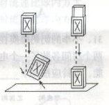

A. 落地时外盒对盒芯的摩擦力向上、使盒芯减速所以不发生弹跳

B. 落地时盒芯对外盒的摩擦力向下、阻止其向上跳起

C. 盒芯向上抽出一些后，落地的动量减小，受力就会减小，因此可平稳落地

D. 盒芯向上抽出一些后，落地要克服摩擦力做功，机械能减少，所以不易反弹

第 27 题 · 答案与解析

**参考答案（粉笔题库参考内容）**

C

**解析**

火柴盒盒芯向上抽起时，落地时盒芯相对于外盒向下运动，盒芯给外盒向下的摩擦力，外盒受到盒芯向下的摩擦力，阻碍外盒向上弹起，同时摩擦力做功，减少了机械能。根据动量，向上抽起盒芯会不明显地改变下落距离，使整体落地速度变化很小。

故正确答案为C。

**来源**：2014年上海市公务员录用考试《行测》题（B类）第27题

### 第 28 题

多米诺骨牌的游戏规则是将骨牌按一定的间距排成行，推倒第一张骨牌，其余发生连锁反应依次倒下。其中的物理原理是骨牌竖着时，重心较高，倒下时重心下降，将其重力势能转化为动能。

由此可推论下列说法正确的是：

A. 每块骨牌的重力势能转化为动能都是定值，所以每块骨牌倒下的速度是一样的

B. 由于空气阻力作用，骨牌的能量不断消耗，所以骨牌倒下的速度会变慢

C. 骨牌倒下时的能量增加与空气阻力导致的能量消耗差不多，所以骨牌能量基本不变，倒下的速度是一样的

D. 由于每块骨牌的动能都有一部分传递到下一块，骨牌的能量不断增加，所以骨牌倒下的速度会加快

第 28 题 · 答案与解析

**参考答案（粉笔题库参考内容）**

D

**解析**

骨牌竖着时，重心较高，倒下时重心下降。倒下过程中，将其重力势能转化为动能，它倒在第二张牌上，这个动能就转移到第二张牌上，第二张牌将第一张牌转移来的动能和自己倒下过程中由本身具有的重力势能转化来的动能之和，再传到第三张牌上。所以每张牌倒下的时候，具有的动能都比前一块牌大，因此它们的速度一个比一个快。也就是说，它们依次推倒的能量一个比一个大。

故正确答案为D。

**来源**：2014年上海市公务员录用考试《行测》题（B类）第28题

### 第 29 题

如图所示，A、B两个箱子叠放在一起，爸爸和小明分别用大小为F的恒力用力拉，使两个箱子沿水平做匀速直线运动：爸爸个子高，着力点在A箱子上，小明个子矮，着力点在B箱子上。

下列说法中，正确的是：

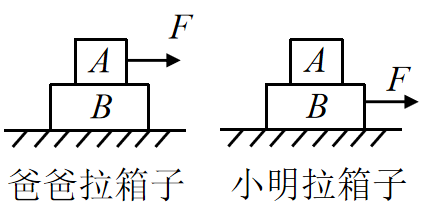

A. 无论是爸爸还是小明拉箱子，箱子A所受的摩擦力大小都为F

B. 无论是爸爸还是小明拉箱子，箱子B受到地面对它的摩擦力均为F

C. 爸爸拉箱子时，箱子A受到的摩擦力为0，箱子B受到地面对它的摩擦为F

D. 小明拉箱子时，箱子A受到的摩擦力为F，箱子B受到地面对它的摩擦力为F

第 29 题 · 答案与解析

**参考答案（粉笔题库参考内容）**

B

**解析**

因A、B之间没有相对运动，可以看作一个整体。由其做匀速直线运动可知，箱子受力平衡，故不论爸爸拉箱子还是小明拉箱子，箱子与地面之间的摩擦力大小均为F。当爸爸拉箱子的时候，F作用在A上，为保持B匀速运动，则A、B之间有与地面摩擦力方向相反、大小为F的摩擦力作用在B上。当小明拉箱子时B箱受拉力与地面摩擦力两者平衡，故与A之间没有摩擦力。

故正确答案为B。

**来源**：2014年上海市公务员录用考试《行测》题（B类）第29题

### 第 30 题

下列各装置中，能构成原电池的是：

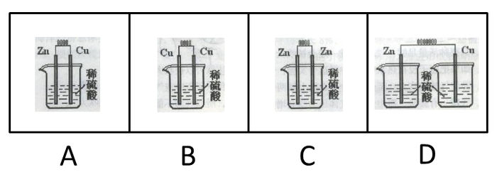

A. A

B. B

C. C

D. D

第 30 题 · 答案与解析

**参考答案（粉笔题库参考内容）**

A

**解析**

原电池的工作原理：原电池反应属于放热的氧化还原反应，但区别于一般的氧化还原反应，电子转移不是通过氧化剂和还原剂之间的有效碰撞完成的，而是还原剂在负极上失电子发生氧化反应，电子通过外电路输送到正极上，氧化剂在正极上得电子发生还原反应，从而完成还原剂和氧化剂之间电子的转移。两极之间溶液中离子的定向移动和外部导线中电子的定向移动构成了闭合回路，使两个电极反应不断进行，发生有序的电子转移过程，产生电流，实现化学能向电能的转化。

B、C两项使用的是同样的金属棒，故不会产生电势差，不会产生电流，排除；D选项没有形成闭合回路，也不会产生电流；A项为原电池；正极：；负极：；总反应式：，排除。

故正确答案为A。

**来源**：2014年上海市公务员录用考试《行测》题（B类）第30题

### 第 31 题

小李的奶奶瘫痪在床，行动不便，小李让保姆住在他奶奶房间的隔壁房间，并且在两个房间各装了一个电铃，使任何一方按下电铃都能让对方的电铃发声。

要实现这种功能，电铃应按如下哪种电路图所示安装：

A. A

B. B

C. C

D. D

第 31 题 · 答案与解析

**参考答案（粉笔题库参考内容）**

C

**解析**

任何一方按开关都能使对方的电铃发声，说明两个用电器工作时互不影响，则该电路为并联电路，支路电铃由支路的开关控制。因为该电路为并联电路，且支路有各自的开关控制，故选项C正确。

A选项当乙房间闭合开关的时候，两个铃铛都不响，而甲房间闭合开关的时候，乙房间铃铛会响，排除；

B选项电路已经是断路，并且开关不在房间内，排除；

C选项正确，当选；

D选项甲房间的铃铛一直响，没有开关控制，排除。

故正确答案为C。

**来源**：2014年上海市公务员录用考试《行测》题（B类）第31题

### 第 32 题

汽车头灯灯碗用的是凹面镜，灯丝所发出的光经反射后成为一束平行光向前射出很远，这就产生远距离照明效果，即我们说的远光灯；灯丝所发出的光经反射后呈现发散状态，可以照到近处较大范围内的物体，这就是我们说的近光灯。如图所示为凹面镜示意图。ƒ代表焦距，则远光灯丝与近光灯丝分别位于：

A. A处，D处

B. B处，A处

C. A处，C处

D. A处，B处

第 32 题 · 答案与解析

**参考答案（粉笔题库参考内容）**

C

**解析**

凹面镜对光线有会聚作用，从其焦点发出的光线，经反射后变成平行光射出，故远光灯丝应该位于焦点A处。D点发出的光线不会汇聚，不适合放置。B点和C点都可以会聚光线，但2倍焦距处，会聚光线照射的范围较小，不适合放置近光灯，故放置在C点更合理。

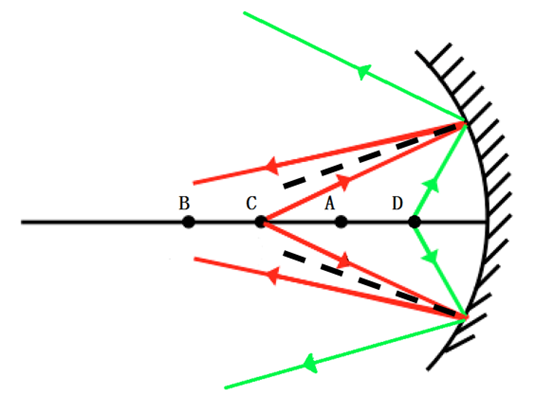

故正确答案为C。

**来源**：2014年上海市公务员录用考试《行测》题（B类）第32题

### 第 33 题

偏振光是具有一定振动方向的光，自然光在玻璃、水面等表面反射时，反射光可视为偏振光。偏振片中存在着某种特征性的方向，叫做透振方向，偏振片只允许平行于透振方向的振动通过，同时吸收垂直于该方向振动的光。在拍摄表面光滑的物体，如玻璃器皿、水面时为使影像清晰，我们都需要调节镜头前偏振片，其目的是：

A. 使偏振片透振方向与反射光的振动方向垂直，减弱反射光

B. 使偏振片透振方向与反射光的振动方向垂直，增强反射光

C. 使偏振片透振方向与反射光的振动方向平行，减弱反射光

D. 使偏振片透振方向与反射光的振动方向平行，增强反射光

第 33 题 · 答案与解析

**参考答案（粉笔题库参考内容）**

A

**解析**

拍摄表面光滑物体，因物体反光可能进入镜头，造成画面不清晰，故要减弱反射光，则需要让偏振片透振方向与反射光波振动方向垂直。

故正确答案为A。

**来源**：2014年上海市公务员录用考试《行测》题（B类）第33题

### 第 34 题

流体在流动过程中，流速大的地方，压强小，流速小的地方，压强大。当固体与流体有相对运动时，物体除受到一定阻力外，有时还可能受到与相对速度方向垂直的力。运动员在足球比赛中发角球时，可以发出“香蕉球”——球飞到球门前方时会拐弯进入球门，如图(俯视)所示，这是因为：

A. 球向前飞进时，绕重心顺时针方向旋转，球外方空气相对流速比球内方小

B. 球向前飞进时，绕重心顺时针方向旋转，球外方空气相对流速比球内方大

C. 球向前飞进时，绕重心逆时针方向旋转，球外方空气相对流速比球内方小

D. 球向前飞进时，绕重心逆时针方向旋转，球外方空气相对流速比球内方大

第 34 题 · 答案与解析

**参考答案（粉笔题库参考内容）**

C

**解析**

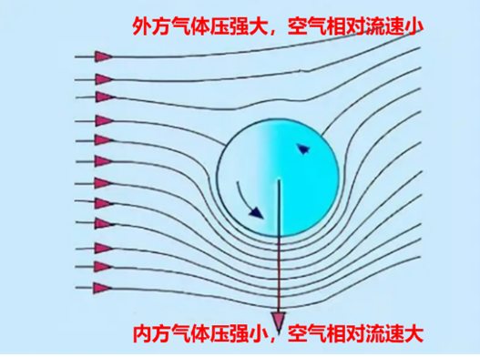

如上图所示，若使球在球门前向球门方向偏转，那么球需要受到偏向内方的力，这个力就是空气对球的压力。

根据气体压强，气体流速大的地方压强小，因为球受到偏向内方的压力，所以外方的压强更大，空气相对流速更小，B、D两项错误。

球和空气有摩擦，球的旋转会改变空气流速，下方空气流速因为球的旋转而变大，所以球就应该绕重心逆时针方向旋转，此时球上方的空气，也会因为球的转动而流速变小，C项正确，D项错误。

故正确答案为C。

**来源**：2014年上海市公务员录用考试《行测》题（B类）第34题

### 第 35 题

电磁感应现象是闭合电路中的一部分导体做切割磁感线运动，该电路中产生感应电流的现象。下列四幅图中，能说明电磁感应现象的是：

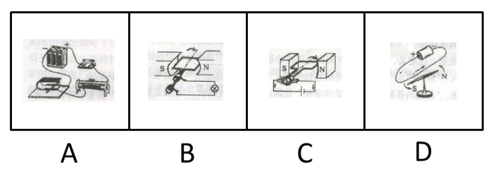

A. A

B. B

C. C

D. D

第 35 题 · 答案与解析

**参考答案（粉笔题库参考内容）**

B

**解析**

闭合电路的一部分导体在磁场中做切割磁感线运动时，导体中就会产生电流，该现象就称为电磁感应现象。

A项错误，该电路中有电源，即通电后，磁场中的金属棒会受力运动，是利用通电导线在磁场中受力的作用的原理工作的，故该选项错误；

B项正确，在该闭合电路中没有电源，当线圈转动时，其恰好切割磁感线运动，于是灯泡中就会有电流通过，这就是电磁感应现象，故该选项正确；

C项错误，该装置中有电流通过时，磁场中的线圈会转动，是利用通电导线在磁场中受力的作用的原理工作的，故该选项错误；

D项错误，该实验是著名的奥斯特实验，该实验说明了通电导线周围存在着磁场，故该选项错误。

故正确答案为B。

**来源**：2014年上海市公务员录用考试《行测》题（B类）第35题

### 第 36 题

碳足迹是指由企业机构、活动、产品或个人引起的温室气体排放的集合，它表示一个人或者团体的碳耗用量。碳，就是石油、煤炭、木材等由碳元素构成的自然资源。碳耗用得多，导致地球暖化的元凶二氧化碳也制造得多，碳足迹就大，反之碳足迹就小。

根据上述定义，下列行为不一定能减少个人碳足迹的是：

A. 早睡早起锻炼身体

B. 倡导不养宠物

C. 多吃蔬菜少吃肉

D. 选择公交减少自驾

第 36 题 · 答案与解析

**参考答案（粉笔题库参考内容）**

A

**解析**

第一步：抓住定义中的关键词。

碳足迹表示一个人或团体的“碳耗用量”。碳足迹大，制造的二氧化碳就多。

第二步：逐一判断选项。

B、C、D三项均能减少一个人的碳足迹；而A项早睡早起锻炼身体后，寿命可能更长，制造的二氧化碳也多，显然不一定能够减少个人的碳足迹。

本题为选非题，故正确答案为A。

**考点**：原因结果

**来源**：2014年上海市公务员录用考试《行测》题（B类）第36题

### 第 37 题

文化变迁是指由于族群社会内部的发展或由于不同族群之间的接触而引起的一个族群文化的改变。由于发明或借用而增添新的事物，由此导致旧事物丧失，是一种文化变迁；由于生态环境及社会生活变化，在没有替代物的情况下有些文化因素自动消失，也属于文化变迁。

根据上述定义，下列不属于文化变迁的是：

A. 拥有灿烂文化的庞贝古城在维苏威火山的大爆发中消失了

B. 古代玛雅人和玛雅文化一起在历史长河中消亡了

C. 随着英国的殖民与发展，英语成为许多亚洲国家的官方语言

D. 由于汽车的出现，伦敦的出租马车渐渐退出了历史舞台

第 37 题 · 答案与解析

**参考答案（粉笔题库参考内容）**

A

**解析**

第一步：抓住定义中的关键词。

文化变迁由于发展、与不同族群的接触、发明或借用新事物或没有替代物而引起的文化变化或消失。

满足下列条件之一，都可以称作文化变迁：①由于族群社会内部的发展，引起的族群文化的改变；②由于不同族群之间的接触，引起的族群文化的改变；③由于发明或借用而增添新的事物，由此导致旧事物丧失；④由于生态环境及社会生活变化，在没有替代物的情况下有些文化因素自动消失。

第二步：逐一分析选项。

A项不符合文化变迁的定义；

B选项符合定义条件④；

C选项符合定义条件②；

D选项符合定义条件③。

本题为选非题，故正确答案为A。

**考点**：原因结果

**来源**：2014年上海市公务员录用考试《行测》题（B类）第37题

### 第 38 题

偷换概念是指在思维和论辩过程中自觉或不自觉地违反同一律的逻辑要求，用一个概念去替换另一个不同的概念而产生的逻辑错误。

根据上述定义，下列属于偷换概念的是：

A. 这件事情我没有问过只是侧面了解一下情况，提点意见，仅供参考

B. 如果把丈夫定义为妻子的爱人，那么，妻子就是丈夫的爱人

C. 为了加快中国的发展，必须大力发展航天工业，因为在发达国家，航天工业发展很快

D. 有西方记者问：“在你们中国，明明是人走的路为什么叫马路？”周恩来答道： “我们走的是马克思主义道路，简称马路。”

第 38 题 · 答案与解析

**参考答案（粉笔题库参考内容）**

D

**解析**

第一步：抓住定义中的关键词。

偷换概念是指在思维或论辩中违反“同一律”的逻辑要求，替换了“不同的概念”，而产生逻辑错误。

第二步：逐一判断选项。

A项没有替换概念，显然不属于偷换概念；

B项只是调换了主客体，也不属于偷换概念；

C项只是提出了中国发展航天工业的原因，并没有偷换概念；

D选项周总理在两个“马路”之间偷换了概念。

故正确答案为D。

**考点**：单定义-其他句式

**来源**：2014年上海市公务员录用考试《行测》题（B类）第38题

### 第 39 题

陈述性知识是有关“世界是什么”的知识，能够直接陈述，要求的心理过程主要是记忆。程序性知识是有关“怎么办”的知识，不能直接陈述，只能通过某种作业形式简单推测其存在。

根据上述定义，下列归类正确的是：

A. “修自行车”是陈述性知识，“音乐欣赏”需要程序性知识

B. “美国的首都是华盛顿”是陈述性知识，“加减运算”需要程序性知识

C. “水到100℃沸腾”是陈述性知识，“水的分子式是”是程序性知识

D. “骑马射箭”是陈述性知识，“红灯停，绿灯行”是程序性知识

第 39 题 · 答案与解析

**参考答案（粉笔题库参考内容）**

B

**解析**

第一步：找出定义关键词。

陈述性知识的关键词是：①有关“世界是什么”；②直接陈述；③心理过程主要是记忆。

程序性知识的关键词是：①有关“怎么办”；②不能直接陈述；③只能通过某种作业形式简单推测其存在。

第二步：逐一分析选项。

A项：“修自行车”侧重于“怎么办”，属于程序性知识，归类错误，排除；

B项：归类正确，当选；

C项：“水的分子式是” 侧重于“世界是什么”，属于陈述性知识，归类错误，排除；

D项：“骑马射箭”侧重于“怎么办”，属于程序性知识，归类错误；“红灯停，绿灯行” 侧重于“世界是什么”，属于陈述性知识，归类错误，排除。

故正确答案为B。

**考点**：特殊问法

**来源**：2014年上海市公务员录用考试《行测》题（B类）第39题

### 第 40 题

软科学是一门新兴的综合性学科，综合运用自然科学、社会科学以及数学和哲学的理论和方法，解决现代科学技术发展而带来的各种复杂社会问题，研究经济、科学、技术、管理、教育等社会环节之间的内在联系及其发展规律，从而为它们的发展提供优化的方案和决策。

根据上述定义，下列不属于软科学的是：

A. 心理学

B. 管理学

C. 预测学

D. 决策学

第 40 题 · 答案与解析

**参考答案（粉笔题库参考内容）**

A

**解析**

第一步：抓住定义中的关键词。

软科学是综合性的学科，为经济、社会等问题提供方案和决策。

第二步：逐一判断选项。

B项管理学：是一门综合性的交叉学科，也是系统研究管理活动的基本规律和一般方法的科学。管理学是适应现代社会化大生产的需要产生的，它的目的是：研究在现有的条件下，如何通过合理的组织和配置人、财、物等因素，提高生产力的水平；

C项预测学：现代预测学科学或称预测的科学，研究无所不在的不确定性，旨在控制随机性以及减少无知的程度。预测学通过开发数学模型和程序，制定事物未来发展的可靠预测，揭示过去发生事件的准确结果；

D项决策学：决策学以决策为研究对象的综合性学科。主要研究决策原理、决策程序和决策方法，探索如何作出正确决策的规律。是社会化大生产的直接产物，对于实现决策的科学化和民主化具有十分重要的意义；

B、C、D三项都属于软科学。而心理学是一门研究人类及动物的心理现象、精神功能和行为的科学，既是一门理论学科，也是应用学科，包括理论心理学与应用心理学两大领域，所以A项不属于软科学。

本题为选非题，故正确答案为A。

**考点**：方式目的

**来源**：2014年上海市公务员录用考试《行测》题（B类）第40题

### 第 41 题

归谬法是指对一错误论题不直接否定，而是先假定其真，然后据此导出荒谬的结果，由结果的荒谬推出该论题的荒谬，从而直接地否定错误论题的论证手法。

根据上述定义，下列不属于归谬法的是：

A. 有个病人对住院处的护士说：“请把我安排在三等病房，我很穷。”“没有人能帮助您吗？”“没有，我只有一个姐姐，她是修女，也很穷。”护士听了生气地说： “修女富得很，因为她和上帝结婚。”“好，您就把我安排在一等病房吧，以后把账单寄给我姐夫就行了。”

B. 甲向乙解释：“我演奏的是高雅的流行乐曲。”乙反问一句：“流行的乐曲就是高雅的吗？”甲听了很是吃惊：“不高雅的东西怎么能够流行呢?”乙笑着说：“那么，流行感冒也是高雅的了？”

C. 某人坚决反对杀生，他劝告人们说：“你如果在世时杀了一头猪，来生就要变成一头猪；你在世时杀一头牛，来生就要变成一头牛。”这时一个听众说：“那不如去杀人吧。”

D. 有一次，一位英国女记者读了文学大师钱钟书的作品，对钱钟书很仰慕，非要见他，在电话中钱钟书对该女士说：“假如你吃了个鸡蛋，觉得味道不错，就够了，何必非要认识那只下蛋的母鸡呢？”

第 41 题 · 答案与解析

**参考答案（粉笔题库参考内容）**

D

**解析**

第一步：抓住定义中的关键词。

归谬法其实就是假定命题正确，然后推出错误的结论，从而否定命题的错误。

第二步：逐一判断选项。

A项“不可能收到账单的上帝姐夫”，B项“高雅的流行感冒”，C项“为了下辈子成为人而杀人”都是错误的结论，从而可以得出其命题也是错误的，均符合定义，排除；

D项不存在错误命题，不符合定义，当选。

本题为选非题，故正确答案为D。

**考点**：单定义-其他句式

**来源**：2014年上海市公务员录用考试《行测》题（B类）第41题

### 第 42 题

补偿贸易是指进口者购买外国技术设备以及某些原料的货款，约定在一定期限内用产品或劳务分期偿还的一种贸易方式。

根据上述定义，下列不属于补偿贸易的是：

A. 某国的甲摩托车厂引进一日本公司的技术，双方约定该厂先支付30%的费用，一年后使用厂里制造的摩托车偿还余款

B. 某国的甲公司向S国的乙公司购买番茄酱成套设备和技术服务，双方约定甲公司分三年以本国的竹制品偿还全部款项

C. 某国的甲电厂向他国乙煤炭企业购买五万吨焦炭，双方约定甲电厂一两年后向乙煤炭企业提供采掘设备来偿还全部款项

D. 某国的甲公司向一外资公司购买咨询服务，由于甲公司资金紧张，双方项目结束三个月后，甲公司再支付咨询项目全款

第 42 题 · 答案与解析

**参考答案（粉笔题库参考内容）**

D

**解析**

第一步：抓住定义中的关键词。

补偿贸易是“进口者”赊购产生的一个行为，并在一定期限内用“产品或劳务”分期偿还。

第二步：逐一判断选项。

A项甲公司引进日本公司的技术，一年后用产品偿还，符合定义；

B项购买技术和设备并用竹制品（产品）偿还，符合定义；

C项也同样是购买产品，然后用产品来偿还，符合定义；

D项在约定期间内支付的款项并不是产品或劳务，不符合定义。

本题为选非题，故正确答案为D。

**考点**：单定义-其他句式

**来源**：2014年上海市公务员录用考试《行测》题（B类）第42题

### 第 43 题

激情群体是指一种临时性的、高效率的，往往为某项富有挑战性的工作而临时组建的工作群体。

根据上述定义，下列属于激情群体的是：

A. 某画家发起、多位画家一起聚居的创意和设计社区

B. 某人因见义勇为而受伤的事迹感动了网友，数位网友发起募捐活动

C. 为尽快完成多品牌战略规划，某汽车公司集结了公司内数名专家组成项目组

D. 数十名自行车爱好者组成骑车团队，相约在某个周末从上海骑自行车去苏州

第 43 题 · 答案与解析

**参考答案（粉笔题库参考内容）**

C

**解析**

第一步：抓住定义中的关键词。

激情群体的定义要点：为某项富有挑战性的工作而临时组建的工作群体。

第二步：逐一判断选项。

A项不是临时性的；

B、D两项不具有挑战性；

C项符合定义。

故正确答案为C。

**考点**：单定义-其他句式

**来源**：2014年上海市公务员录用考试《行测》题（B类）第43题

### 第 44 题

共生是指两种生物共同生活在一起，相互依赖，彼此有利，徜若彼此分开，则双方或其中一方便无法生存。

根据上述定义，下列属于共生的是：

A. 双锯鱼喜欢在海葵的触手间游动，既得到海葵的保护，又能分享海葵吐出的食物

B. 白蚁在吃了木材后，其肠道中的多鞭毛虫能分泌纤维素水解酶，帮助白蚁将木质纤维消化分解

C. 文鸟将巢筑在蜂窝旁以获得蜜蜂的保护，蜜獾喜欢吃蜂蜜，便追随着文鸟生活

D. 赤眼蜂在玉米螟虫的卵内产卵，以其为营养源生长发育

第 44 题 · 答案与解析

**参考答案（粉笔题库参考内容）**

B

**解析**

第一步：抓住定义中的关键词。

共生定义的要点是：①两种生物共同生活在一起；②相互依赖，彼此有利；③彼此分开则双方或其中一方无法生存。

第二步：逐一判断选项。

A项中的双锯鱼和海葵和C项中的文鸟和蜜獾都不是离开彼此就无法生活，不符合要点③；

B项白蚁与多鞭毛虫相互依赖，彼此有利，彼此分开则双方无法生存，符合定义；

D项赤眼蜂对玉米螟虫不利，不符合要点②。

故正确答案为B。

**考点**：单定义-其他句式

**来源**：2014年上海市公务员录用考试《行测》题（B类）第44题

### 第 45 题

牛鞭效应是供应链上的一种需求变异放大的现象，指信息流从最终客户端向原始供应商端传递时，无法有效地实现信息的共享，使得信息扭曲现象逐级放大，导致需求信息出现越来越大的波动。

根据上述定义，下列属于“牛鞭效应”的是：

A. 在各地禽流感流行期间，零售商甲听说醋可以预防流感。他将此视为不错的商机，大量囤积袋装醋，以待未来高价销售

B. 某新产品上市，供不应求，零售商甲根据产品的销售情况临时增加向批发商乙的订货量，乙根据不同零售商提交的订货量向商品销售中心订货

C. 零售商甲根据上月销量估算出一个订货量，为保证该订货量及时可得，在稍微增加订货量之后提交给批发商乙，乙出于同样的考虑向某商品销售中心订货

D. 某商品销售中心根据市场动向和年销售目标，加大该商品投放市场的力度，越来越多的零售商选择了该商品

第 45 题 · 答案与解析

**参考答案（粉笔题库参考内容）**

C

**解析**

第一步：抓住定义中的关键词。

牛鞭效应是“信息流”，“从最终客户端向原始供应商”传递，“信息被扭曲放大”，导致“需求信息越来愈大”。

第二步：逐一判断选项。

A选项“零售商囤货”是个人行为，没有信息的传递的过程，不符合定义，排除；

B选项零售商甲向供应商乙的需求信息增加，但供应商乙结束了这种信息放大的传递，而是根据定额向上提交订货量，不符合定义，排除；

C选项“从零售商甲到供应商乙再到销售中心”的传递过程，订货量逐渐增加，即需求信息放大，符合定义，当选；

D选项没有最终客户端，也没有信息的传递，也没有信息的放大，不符合定义，排除。

故正确答案为C。

**考点**：原因结果

**来源**：2014年上海市公务员录用考试《行测》题（B类）第45题

### 第 46 题

下列选项中，符合所给图形的变化规律的是：

 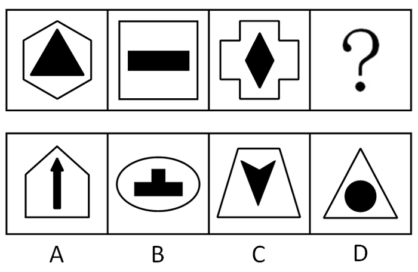

A. A

B. B

C. C

D. D

第 46 题 · 答案与解析

**参考答案（粉笔题库参考内容）**

B

**解析**

元素组成不同，优先考虑属性规律，题干图形都分为内外两个部分，考虑分开看，外部图形对称轴数量依次为6、4、4，内部图形对称轴的数量为3、2、2，外部图形对称轴数量为内部图形的2倍，只有B项符合。

故正确答案为B。

**考点**：属性规律-对称性

**来源**：2014年上海市公务员录用考试《行测》题（B类）第46题

### 第 47 题

下列选项中，符合所给图形的变化规律的是：

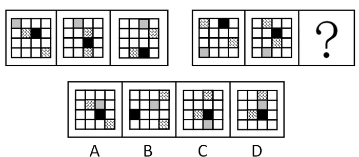

A. A

B. B

C. C

D. D

第 47 题 · 答案与解析

**参考答案（粉笔题库参考内容）**

C

**解析**

元素组成相同，优先考虑位置规律。第一组图中，灰色方块向右移动一格，第二行斜纹方块向右移动一格，黑色方块向下移动一格，第四行斜纹方块向左移动一格；第二组图的前两幅中，第一行斜纹方块向右移动一格，黑色方块向下移动一格，第三行斜纹方块向左移动一格，第四行灰色方块向右移动一格，因此？处图形应符合此规律，只有C项符合。

故正确答案为C。

**考点**：位置规律-平移

**来源**：2014年上海市公务员录用考试《行测》题（B类）第47题

### 第 48 题

下列选项中，符合所给图形的变化规律的是：

A. A

B. B

C. C

D. D

第 48 题 · 答案与解析

**参考答案（粉笔题库参考内容）**

A

**解析**

元素组成相同，优先考虑位置规律。观察发现，相邻两行图形中，前一行第一、三、五位置上的小图形会移至下一行的最后三个位置，故问号处图形最后三个位置的图形应是第四行中第一、三、五位置上的小图形，只有A项符合。

故正确答案为A。

**考点**：位置规律-平移

**来源**：2014年上海市公务员录用考试《行测》题（B类）第48题

### 第 49 题

下列选项中，符合所给图形的变化规律的是：

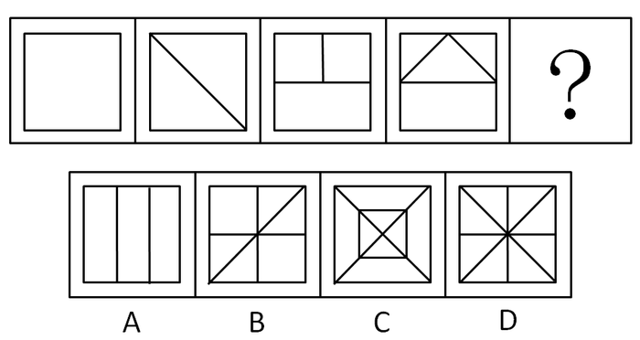

A. A

B. B

C. C

D. D

第 49 题 · 答案与解析

**参考答案（粉笔题库参考内容）**

D

**解析**

元素组成凌乱，本题考点为数正方形中的直线数。图形中不变的为正方形外框，可变元素为正方形外框内的直线数，分别为0、1、2、3，则问号处应选择含有正方形外框且框内包含4条直线的图形。

故正确答案为D。

**考点**：数量规律-线

**来源**：2014年上海市公务员录用考试《行测》题（B类）第49题

### 第 50 题

下列选项中，符合所给图形的变化规律的是：

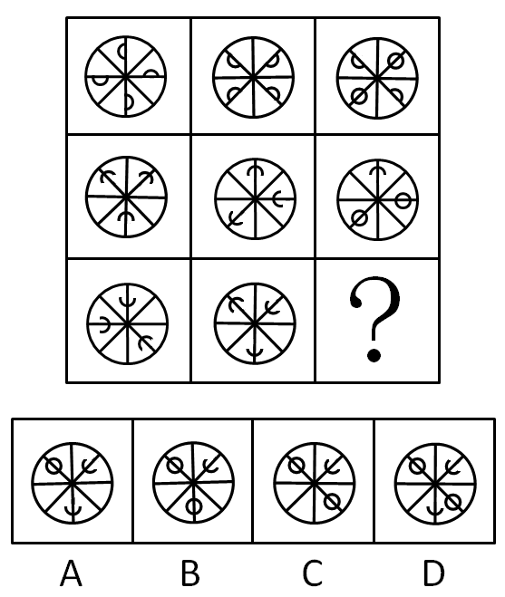

A. A

B. B

C. C

D. D

第 50 题 · 答案与解析

**参考答案（粉笔题库参考内容）**

B

**解析**

元素组成相似，且相同线条重复出现，考虑加减同异。九宫格优先看横行，第一行中的图一顺时针旋转45°后，再与图二叠加得到图三；经验证，第二行满足此规律；第三行应用此规律，只有B项符合。

故正确答案为B。

**考点**：样式规律-加减同异

**来源**：2014年上海市公务员录用考试《行测》题（B类）第50题

### 第 51 题

下列选项中，符合所给图形的变化规律的是：

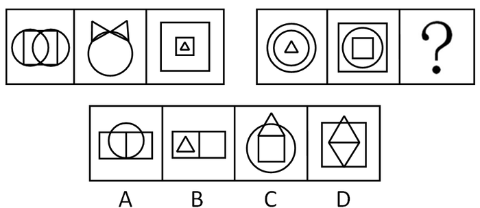

A. A

B. B

C. C

D. D

第 51 题 · 答案与解析

**参考答案（粉笔题库参考内容）**

D

**解析**

元素组成凌乱，两组的组成元素是相同的，本题考点为数图形中元素种类的个数。从整体来看，每组都有3个正方形、3个圆和3个三角形。

故正确答案为D。

**考点**：数量规律-素

**来源**：2014年上海市公务员录用考试《行测》题（B类）第51题

### 第 52 题

下列选项中，符合所给图形的变化规律的是：

A. A

B. B

C. C

D. D

第 52 题 · 答案与解析

**参考答案（粉笔题库参考内容）**

A

**解析**

以行为单位，元素组成相同，本题考点为旋转和周遍。按图示从出发到结束，夹角依次顺时针旋转90，每隔两个图形呈现一个空白，可得最后一个图形为开口向右的夹角。

故正确答案为A。

注意：题目中元素很简单，需要注意的是箭头的推理路线。

**考点**：位置规律-旋转

**来源**：2014年上海市公务员录用考试《行测》题（B类）第52题

### 第 53 题

下列选项中，符合所给图形的变化规律的是：

A. A

B. B

C. C

D. D

第 53 题 · 答案与解析

**参考答案（粉笔题库参考内容）**

B

**解析**

元素组成相似，本题的考点为元素叠加运算。每组前两个图形叠加得到第三个图形，叠加规律为黑+黑=白，-+黑=-，-+白=-，黑+白=白，-+-=黑。依据此规律，问号处应为B项图形。

故正确答案为B。

**考点**：样式规律-黑白运算

**来源**：2014年上海市公务员录用考试《行测》题（B类）第53题

### 第 54 题

下列选项中，符合所给图形的变化规律的是：

A. A

B. B

C. C

D. D

第 54 题 · 答案与解析

**参考答案（粉笔题库参考内容）**

B

**解析**

元素组成相同，黑色阴影本身与图形共同旋转。图形整体顺时针旋转90°，同时黑色填充部分于图形内部顺时针平移，得到B项图形。

故正确答案为B。

**考点**：位置规律-综合

**来源**：2014年上海市公务员录用考试《行测》题（B类）第54题

### 第 55 题

下列选项中，除了（         ），都能够展开成为左边的平面图。

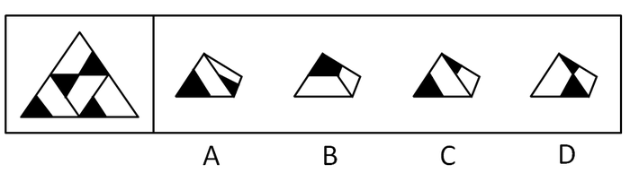

A. A

B. B

C. C

D. D

第 55 题 · 答案与解析

**参考答案（粉笔题库参考内容）**

B

**解析**

本题考查四面体的相邻面关系。

观察左边图形可知，没有两个黑色三角形有共同的边，由此可知B项不能由左边图形折叠而成。

本题为选非题，故正确答案为B。

**来源**：2014年上海市公务员录用考试《行测》题（B类）第55题

### 第 56 题

环保人士担心塑料包装的大量使用会污染环境，力图使制造商想方设法回收塑料材料。然而，尽管他们做出了努力，但塑料制品的回收率只有6.5%。而玻璃容器的回收率却为33%。

以下哪项如果为真，对于解释塑料制品回收率相对较低的现象没有帮助：

A. 许多工厂都能将玻璃回收再利用，但只有少数工厂能利用回收塑料进行生产

B. 许多塑料制品是不兼容的，不能统一回收利用，而大部分玻璃制品是可兼容的

C. 制造新型塑料需要耗费更多的石油，而制造新型玻璃则可使用再生资源

D. 利用回收塑料生产出的产品质量差，而玻璃的再生品则不存在这样的问题

第 56 题 · 答案与解析

**参考答案（粉笔题库参考内容）**

C

**解析**

第一步：找到论点论据。

题干中指出了塑料制品和玻璃容器的回收率差别大，前者回收率低，后者回收率高。没有明显论据。

第二步：逐一分析选项的作用。

A项“少数工厂处理塑料”；

B项“不兼容，不能统一回收”；

C项制造新型塑料和玻璃所耗费的能源的多少和回收无关，不能解释论点；

D项“回收塑料生产出的产品质量差”，A、B、D三项均说出了塑料制品回收率低的原因。

本题为选非题，故正确答案为C。

**考点**：原因解释

**来源**：2014年上海市公务员录用考试《行测》题（B类）第56题

### 第 57 题

某天夜里，同宿舍的小赵、小钱、小孙、小李在谈论各自以及隔壁宿舍小周喜欢的电视频道。

小赵说：“我和小钱都喜欢看教育频道，小孙喜欢看艺术频道。”

小钱说：“我与小李都喜欢看财经频道，小孙喜欢看艺术频道。”

小孙说：“我与小赵都不喜欢看教育频道，小周喜欢看纪实频道。”

小李说：“小赵和小钱都喜欢看教育频道，我喜欢看新闻频道。”

若他们都只说对了两个人对电视频道的喜好，则小周喜欢的电视频道是：

A. 纪实频道

B. 教育频道

C. 新闻频道

D. 艺术频道

第 57 题 · 答案与解析

**参考答案（粉笔题库参考内容）**

A

**解析**

第一步，找突破口。

已知每个人只说对了两个人对电视频道的喜好，而小赵和小李的话中都提到了“小赵和小钱都喜欢看教育频道”，先假设这句话为真，根据小赵的话推出小孙不喜欢艺术，根据小李的话推出小李不喜欢看新闻；此时小钱的话中关于小钱和小孙两人的喜好都说错了，不符合要求；所以我们可以得出“小赵和小钱都喜欢看教育频道”这句话只有一个喜好猜对了；进一步推出小孙喜欢看艺术，小李喜欢看新闻。

第二步：逐一分析。

结合小钱的话，小李喜欢财经为假，推出小钱喜欢看财经；再根据“小赵和小钱都喜欢看教育频道”这句话只有一个喜好猜对了，推出小赵喜欢看教育；再看小孙说的话，此时小赵不喜欢看教育为假，所以小周一定看喜欢纪实。

故正确答案为A。

**考点**：假设

**来源**：2014年上海市公务员录用考试《行测》题（B类）第57题

### 第 58 题

随着移动设备的流行，手机、平板电脑(PAD）逐渐渗透到人们的生活中。很多人也由“离不开电视”变为“离不开手机和PAD”。有人认为，过多地使用电脑会减少人们看电视的时间，毕竟时间是有限的。但有调查显示，“用电脑的时间”增多的人并没有减少看电视的时间。

为了验证上述调查结果的准确性，以下哪项是最需要考虑的：

A. 在不用或很少使用电脑的人群中，是否看电视的时间也在减少

B. 除了参与调查的这部分人群，其他人群是否很多人都说自己经常看电视

C. 在参与调查的人中，所看电视节目的类型是否会随着用电脑的时间上升而改变

D. 被调查者所谓的“用电脑的时间”是否包括了工作中使用电脑的时间

第 58 题 · 答案与解析

**参考答案（粉笔题库参考内容）**

D

**解析**

第一步：找到论点，即调查结果。

调查显示的结果是“用电脑的时间”多的人并没有减少看电视的时间。

第二步：逐一分析选项的作用。

A选项、B选项、C选项均为无关选项，看电视与使用电脑的时间不冲突，不能作为参考依据；

为验证上述结果的准确性，需要考虑“用电脑的时间”是否包括工作中使用电脑的时间，如果包括，则题干结果是不科学的，D选项符合题意。

故正确答案为D。

**来源**：2014年上海市公务员录用考试《行测》题（B类）第58题

### 第 59 题

人口平均预期寿命是反映一个国家和地区人民健康水平的重要指标。第六次全国人口普查显示，2010年我国人口平均预期寿命达74.83岁，而建国初期我国人口平均预期寿命只有35岁左右。因此，六十多年前人们认为的老年人现在看起来其实只是中年人。

以下哪项如果为真，最能削弱上述观点：

A. 建国以来，新生婴儿死亡数量的减少是人口平均预期寿命增加的最重要原因

B. 建国初期，国家正从战乱转向和平，全国形势仍不稳定，人口数量远低于现在

C. 建国初期，生活环境比较艰苦，人们的营养水平比现在差得多

D. 随着医学的发展，医疗水平比建国初期有很大提高

第 59 题 · 答案与解析

**参考答案（粉笔题库参考内容）**

A

**解析**

第一步：找出论点和论据。

论点：六十多年前人们认为的老年人现在看起来其实只是中年人。

论据：2010年我国人口平均预期寿命达74.83岁，而建国初期我国人口平均预期寿命只有35岁左右。而人口平均预期寿命是反映一个国家和地区人民健康水平的重要指标。

第二步：逐一判断选项的作用。

A项，说明新生婴儿死亡数量的减少是人口平均预期寿命增加的最重要原因，也就表示建国初期的人口平均预期寿命低是因为新生婴儿死亡数量多，有削弱作用，当选；

B项，阐述了人口数量，而不是人的寿命，与题干无关，排除；

C、D两项，均表明现在人的寿命比以前长的原因在于营养和医疗，与健康有直接关系，与题干观点一致，无法削弱，排除。

故正确答案为A。

**考点**：拆桥

**来源**：2014年上海市公务员录用考试《行测》题（B类）第59题

### 第 60 题

某神经内科医生对病人说：“市场上所出现的合成药S对失眠有较好的疗效，但由于对S的长期副作用不清楚，因此我不建议使用此药。”有病人反驳道：“你的言行不一，你开了很多有副作用的药给我，所以你拒绝使用S药的真正原因并不是药物的副作用。”

病人的观点是有缺陷的，因为：

A. 用过一段时间后，S药的副作用自然会表现出来

B. 已知的风险可用特定方法来降低，而未知的风险则不行

C. 医生有可能不相信S药的功效，而不是担心它的副作用

D. 合成药物与天然药物的副作用以及应对方法是不相同的

第 60 题 · 答案与解析

**参考答案（粉笔题库参考内容）**

B

**解析**

第一步：找出论点和论据。

病人的论点是：拒绝使用S药的真正原因并不是药物的副作用。

病人的论据是：病人认为医生言行不一，医生之前开了很多有副作用的药。

第二步：逐一判断选项的作用。

A项“副作用的时间论”与题干不符，医生认为S药的长期副作用不清楚，如果是一段时间后副作用会表现出来，则间接证明了病人的论点是正确的，排除；

B项说明医生之前开有副作用的药是因为已知的风险，可用特定方法来降低，而S药的副作用还不清楚，因此反驳了病人的观点，削弱论点，当选；

C选项直接加强了病人的论点，排除；

D选项的说法与题干无关，属于无关选项，排除。

故正确答案为B。

**考点**：削弱论点

**来源**：2014年上海市公务员录用考试《行测》题（B类）第60题

### 第 61 题

适合于实验用的小动物必须要繁殖快而且其基因要尽可能多的与人的相似；有些小动物虽然繁殖快但与人相似的基因很少；所以，有些繁殖快的小动物并不适合用于实验。

以下哪项的逻辑结构与题干的最为类似：

A. 按相关规定，要获得国家贫困生奖学金，申请者必须家庭贫困并且成绩优秀；有些这一奖学金的获得者家庭非常贫困，但成绩并不优秀；显然，评定国家贫困生奖学金的规定没有得到严格的执行

B. 一部电影要获得好的票房，必须既有可看性又有成功的市场发行；有些票房好的电影其实可看性并不强；所以，有些电影的票房之所以好主要靠的是成功的市场发行

C. 要修读《认知科学的哲学》这门课，必须已经修过《知识论》，并且对认知科学感兴趣；有些学生虽然对认知科学很感兴趣，但没有修过《知识论》；因此，有些对认知科学感兴趣的学生不能修读《认知科学的哲学》这门课

D. 一般来说，不是每周进行系统维护的电脑在使用一年后都要拿到专卖店去维修；有些电脑在用了很长时间后也不需要拿到专卖店去维修；因此，有些电脑每周都进行了系统维护

第 61 题 · 答案与解析

**参考答案（粉笔题库参考内容）**

C

**解析**

第一步：翻译题干。

题干翻译为：适用实验→繁殖快且基因与人相似多；有些小动物繁殖快且（-基因与人相似多）→有些小动物适用实验。题干的推理形式是：否定了且关系两个后件的其中一个，得到否定前件的结论。

第二步：逐一分析选项。

A项：获得国家贫困生奖学金→家庭贫困且成绩优秀；有些一奖学金获得者家庭贫困且（-成绩优秀）→规定没有严格执行。规定是否执行严格在选项表述前一句中没有提到，因此推理形式与题干不同，排除；

B项：好票房→可看性且成功的市场发行；有些好票房且（-可看性强）→成功的市场发行。最后得到的结论是第一句话中的且关系两个后件的其中一个，而不是得到否定前件的结论，因此推理形式与题干不同，排除；

C项：修读《认知科学的哲学》→修过《知识论》且对认知科学感兴趣；有些学生对认知科学感兴趣且（-修过《知识论》）→有些学生修读《认知科学的哲学》，与题干推理形式一致，当选；

D项：“不是每周进行系统维护的电脑在使用一年后都要拿到专卖店去维修”，即“有些每周进行系统维护的电脑在使用一年后不需要拿到专卖店去维修”，翻译后为：有些电脑每周进行系统维护且使用一年后→需要拿到专卖店修；有些电脑用了长时间且（-需要拿到专卖店修）→有些电脑每周都进行了系统维护，第一句话且关系是前件，不是后件，因此与题干推理形式不一致，排除。

故正确答案为C。

**考点**：推理形式

**来源**：2014年上海市公务员录用考试《行测》题（B类）第61题

### 第 62 题

赤橙黄绿青蓝紫7只彩球在桌上自左至右排成一排，要求：（1）橙色要放在第三；（2）青色和紫色不能相邻；（3）绿色要在黄色和紫色的前面；（4）赤色和黄色必须相邻。

如果青色在黄色之前一位，那么以下安排中哪项必定为真：

A. 紫色在绿色后一位

B. 蓝色在第一位或第二位

C. 绿色在橙色的前面

D. 赤色在青色的前面

第 62 题 · 答案与解析

**参考答案（粉笔题库参考内容）**

C

**解析**

由题干要求可知青色、黄色、赤色三个为相邻的一组，因为绿色在黄色的前面，故青色、黄色、赤色一定在橙色的右边；又因为绿色在紫色前面而紫色和青色不能相邻，故绿色只能在橙色前面。紫色和蓝色不能确定。

故正确答案为C。

**考点**：从确定信息开始推

**来源**：2014年上海市公务员录用考试《行测》题（B类）第62题

### 第 63 题

政府环保部门的官员若要在这次民间环保研讨会上发言，他就必须是民间环保组织的成员。但是，会议规定，作为一个民间环保组织的成员，不允许既是政府环保部门的官员又在这次民间环保研讨会上发言。

如果上述断定为真，以下哪项也为真：

A. 在这次研讨会上发言的人中，没有政府环保部门的官员

B. 只有民间环保组织的成员才能在这次研讨会上发言

C. 除了政府环保部门的官员，没有人在这次研讨会上发言

D. 在这次研讨会上发言的人中，没有民间环保组织的成员

第 63 题 · 答案与解析

**参考答案（粉笔题库参考内容）**

A

**解析**

第一步：翻译题干。

①政府环保部门的官员 且 在这次民间环保研讨会上发言→民间环保组织的成员；

②民间环保组织的成员→（政府环保部门的官员 且 在这次民间环保研讨会上发言）

①②合并可得出：政府环保部门的官员 且 在这次民间环保研讨会上发言→（政府环保部门的官员 且 在这次民间环保研讨会上发言），即A→A，则-A必为真。因此，-（政府环保部门的官员 且 在这次民间环保研讨会上发言）为真，进一步推导为“-政府环保部门的官员 或 -在这次民间环保研讨会上发言”为真。

第二步：逐一分析选项。

A项：发言→政府官员，根据或关系否一推一，可以推出，当选；

B项：“发言”→“民间环保组织的成员”，无法推出，排除；

C项：“发言”→“政府官员”，无法推出，排除；

D项：发言→环保组织成员，无法推出，排除。

故正确答案为A。

**考点**：常规翻译

**来源**：2014年上海市公务员录用考试《行测》题（B类）第63题

### 第 64 题

如果高等学校能够大量聘用海外一流大学获得博士学位的毕业生，无疑将有助于提升教学质量与科研水平。因此，录用获得国内高校博士学位的毕业生，将无助于提升教学质量和科研水平。

以下哪项如果为真，将对上述观点构成最有力的质疑：

A. 高等学校不可能做到完全聘用在海外一流大学获得博士学位的毕业生

B. 在许多高等学校，有相当一部分教师毕业于国内高校，并没有海外留学的经历

C. 在海外一流大学获得博士学位的毕业生更愿意留在海外就业，即便回国后也倾向于在外企上班

D. 高等学校聘用的在海外一流大学获得博士学位的毕业生通常都是国内高校与海外大学联合培养的，他们也拥有国内大学颁发的博士学位证书

第 64 题 · 答案与解析

**参考答案（粉笔题库参考内容）**

D

**解析**

第一步：找出论点和论据。

论点：录用获得国内高校博士学位的毕业生，将无助于提升教学质量和科研水平。

论据：大量聘用海外一流大学获得博士学位的毕业生有助于提升教学质量与科研水平。

第二步：逐一判断选项的作用。

题干中由高等学校大量聘用在海外一流大学获得博士学位的毕业生有助于提升教学质量和科研水平，推出录用获得国内高校博士学位的毕业生将无助于提升教学质量和科研水平。当“获得国内高校博士学位的毕业生”=“在海外一流大学获得博士学位的毕业生”时，即可对题干观点构成质疑，即D项。

A、B、C三项并没有说明获得国内高校博士学位的毕业生并非无助于提升教学质量和科研水平，不能构成质疑，均排除。

故正确答案为D。

**考点**：削弱论点

**来源**：2014年上海市公务员录用考试《行测》题（B类）第64题

### 第 65 题

在使用了各种常规的广告和促销手段后，某电商的网络销售收入并没有如预期那样得到提高，为此管理层重金聘请专业人士进行市场分析。分析报告提出，开通了移动支付（通常指使用智能手机对所消费的商品或服务进行账务支付）功能的人群才是该电商真正潜在的顾客群。于是管理层决定与某大型商业银行合作，在新开通移动支付功能的人群中开展宣传和促销。但一个月后，效果并不理想，网络销售收入没有明显增长。

以下哪项如果为真，最能解释上述结果：

A. 由于交易的安全性受到质疑，最近开通移动支付功能的人有所减少

B. 由于移动支付是一项新兴业务，消费者对其态度比较谨慎

C. 一般来说，新开通移动支付功能的人需要经过一段时间后才有可能进行此类的网络购物

D. 网络购物在白领中较为普及，但他们更希望电商能够提供一些有特色的服务

第 65 题 · 答案与解析

**参考答案（粉笔题库参考内容）**

C

**解析**

第一步：找出论点和论据。

论点：在新开通移动支付功能的人群中开展宣传和促销，但一个月后，某电商的网络销售收入没有明显增长。

论据：无明显论据。

第二步：逐一分析选项。

A项：说明最近开通移动支付功能的人有所减少，开通的人减少并不代表使用的人一定减少，为无关项，排除；

B项：说明消费者对移动支付态度谨慎，但是开通移动支付功能的人是大量存在的，不能说明为什么没有更多的人参与到该电商的网购，排除；

C项：说明新开通支付功能的人需要一段时间才能进行网络购物，很好地解释了仅一个月的时间，某电商的网络销售收入没有明显增长，当选；

D项：提到的特色服务是无关内容，该电商是否提供特色服务题干并未提及，为无关项，排除。

故正确答案为C。

**考点**：原因解释

**来源**：2014年上海市公务员录用考试《行测》题（B类）第65题

### 第 66 题

甲每工作5天休息周六周日2天，法定节假日如非周六周日也要加班。已知甲某年休息了106天，那么他下一年12月的第一个休息日是：

A. 12月1日

B. 12月2日

C. 12月3日

D. 12月4日

第 66 题 · 答案与解析

**参考答案（粉笔题库参考内容）**

A

**解析**

一年或为365天或为366天，其中包含52个完整周。在这个完整周中共休息104天，而甲在该年休息了106天，多出的两天一定是周六日，说明该年共计366天且最后一天即12月31号为周日，因此下一年的12月31日为周一、则12月份第一个周一为12月3日，故下一年12月的第一个休息日为12月1日星期六。

故正确答案为A。

**考点**：周期余数问题、星期日期问题

**来源**：2014年上海市公务员录用考试《行测》题（B类）第66题

### 第 67 题

某水果店新进一批时令水果，在运输过程中腐烂了1/4，卸货时又损失了1/5，剩下的水果当天全部售出，计算后发现还获利10%，则这批水果的售价是进价的多少倍：

A. 1.6

B. 1.8

C. 2

D. 2.2

第 67 题 · 答案与解析

**参考答案（粉笔题库参考内容）**

C

**解析**

赋值该水果量为20，成本价为10，则可知运输腐烂量为5，卸货时损失量为4，还剩余11。根据获利为10%，假设售价为M，可得，解得M=20。因此售价是进价的2倍。

故正确答案为C。

**考点**：经济利润问题

**来源**：2014年上海市公务员录用考试《行测》题（B类）第67题

### 第 68 题

某慈善机构募捐，按捐款数额排名前五位的依次是甲、乙、丙、丁、戊，五人共捐款10万元，且数额都不相同。如果甲的捐款刚好是乙、丙之和，乙的捐款刚好是丁、戊之和，那么丙的捐款最多为多少元：（捐款金额均是1000元的整数倍）

A. 17000

B. 18000

C. 19000

D. 20000

第 68 题 · 答案与解析

**参考答案（粉笔题库参考内容）**

A

**解析**

根据捐款金额为1000元的整数倍，可知问题实际为将100拆分为5个互不相同的整数，且满足题意。直接以甲、乙、丙、丁、戊代表捐款，可得：甲=乙+丙，乙=丁+戊，甲+乙+丙+丁+戊=100。将前两式代入第三式可得：3乙+2丙=100，于是可知（100-2丙）能够被3整除，将各选项除以1000后代入验证，可知仅A、D项符合要求。若为D项，即丙=20，则根据前式可得乙=20，与五个数字互不相同矛盾。

故正确答案为A。

**考点**：和差倍比问题

**来源**：2014年上海市公务员录用考试《行测》题（B类）第68题

### 第 69 题

小张投资6万元买了甲、乙两个股票，一段时间后股票上涨，甲股票涨了45%，乙股票涨了40%，小张看行情好就想再等等。没想到后来股票下跌，甲股票跌了20%，乙股票跌了10%，小张马上卖出所有股票，最终获利11000元（不计交易费用）。那么在这两个股票中，小张投入较多的股票投资了多少元：

A. 40000

B. 42000

C. 44000

D. 46000

第 69 题 · 答案与解析

**参考答案（粉笔题库参考内容）**

D

**解析**

设小张投资甲、乙股票分别为x、y元，可得：x+y=60000，(1+45%)(1-20%)x+(1+40%)(1-10%)y=60000+11000，解得：x＝46000，y＝14000。因此小张投入较多的股票投入了46000元。

故正确答案为D。

**考点**：经济利润问题

**来源**：2014年上海市公务员录用考试《行测》题（B类）第69题

### 第 70 题

某工厂某种产品每月的产能为8000个，1月的销量为5000个，且预计每月销量环比增加10%，则当年该产品库存最高的月份是：

A. 4月

B. 5月

C. 6月

D. 7月

第 70 题 · 答案与解析

**参考答案（粉笔题库参考内容）**

B

**解析**

由题意可知，只要该月销量低于产能，库存就会继续增加。因此库存最高的月份为销量低于产能的最大月份。x个月后销量为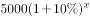，因此可知库存增加的月份满足，解得。因此4个月后也即5月份库存达到最高。

故正确答案为B。

**考点**：数列问题、非典型最值问题

**来源**：2014年上海市公务员录用考试《行测》题（B类）第70题

### 第 71 题

某学校在400米跑道上举行万米长跑活动，为鼓励学生积极参与，制定了积分规则：每跑满半圈积1分，此外，跑满1圈加1分，跑满2圈加2分，跑满3圈加3分······以此类推。那么坚持跑满一万米的同学一共可以得到的积分是多少分：

A. 325

B. 349

C. 350

D. 375

第 71 题 · 答案与解析

**参考答案（粉笔题库参考内容）**

D

**解析**

跑完一万米共计10000÷400＝25圈，因此跑满半圈的累积积分为25×2＝50分。跑满整圈的积分为分。合计375分。

故正确答案为D。

**考点**：数列问题

**来源**：2014年上海市公务员录用考试《行测》题（B类）第71题

### 第 72 题

一艘从广州开往大连的货轮，沿途依次在上海、青岛、天津停靠。出发时船上装满有240个集装箱，每次停靠都只装所停靠城市的集装箱，卸下其他城市的集装箱，每个城市的集装箱在沿途停靠的每个港口卸下数量相同，且每次离港时货轮都保持满载。则货轮到达大连时，船上有多少个天津的集装箱：

A. 20

B. 40

C. 60

D. 120

第 72 题 · 答案与解析

**参考答案（粉笔题库参考内容）**

D

**解析**

由题干可知，每个城市的集装箱在沿途停靠的每个港口卸下数量相同的集装箱，因此可知广州的240个集装箱在此后的每个城市均卸下60个，即在上海港口将卸下60个集装箱。而每次离港时货轮要保持满载，因此上海港口要装上60个集装箱。由此继续，可知完成过程如下表所示：

因此在达到大连港口时，船上有120个天津的集装箱。

故正确答案为D。

**考点**：和差倍比问题

**来源**：2014年上海市公务员录用考试《行测》题（B类）第72题

### 第 73 题

一艘海军的训练船上共有60人，其中有驾驶员、船员、见习驾驶员、见习船员、还有一些陆战队员。已知见习人员的总人数是驾驶员和船员总数的1/4，船员（含见习船员）总人数是驾驶员（含见习驾驶员）总数的7倍，则船上有多少个陆战队员：

A. 12

B. 15

C. 20

D. 25

第 73 题 · 答案与解析

**参考答案（粉笔题库参考内容）**

C

**解析**

根据“见习人员的总人数是驾驶员和船员总数的1/4”，可知：，则这四种人的总数是1+4=5的倍数······①；同理，根据“船员总人数是驾驶员总数的7倍”， 可知：，则这四种人之和是7+1=8的倍数······②。

方法一：船上共有60人，则这四种人的总数=60人-陆战队员人数。代入选项：

A项：这四种人的总数=60-12=48人，不满足结论①，排除；

B项：这四种人的总数=60-15=45人，不满足结论②，排除；

C项：这四种人的总数=60-20=40人，满足题意，当选；

D项：这四种人的总数=60-25=35人，不满足结论②，排除。

方法二：结合结论①②可知，这四种人之和应为5和8的公倍数，即40的倍数。结合船上共有60人，则这四种人之和只能是40人，则陆战队员=60-40=20人。

故正确答案为C。

**考点**：和差倍比问题

**来源**：2014年上海市公务员录用考试《行测》题（B类）第73题

### 第 74 题

研究表明，某消毒剂含有一种杀菌物质，如果按规定使用，使用后1小时环境中这种物质的含量最高（每升空气中含6毫克），随后逐步减少，使用后7小时环境中这种物质的含量降到每升空气中含3毫克。当每升空气中该物质的含量不少于4毫克时，有抑菌作用，那么使用这种消毒剂后发挥抑菌作用的时间能持续：（设环境中该物质的释放和稀释的过程是均匀的）

A. 4小时20分钟

B. 5小时

C. 5小时30分钟

D. 6小时

第 74 题 · 答案与解析

**参考答案（粉笔题库参考内容）**

A

**解析**

释放阶段，1小时从0毫克增长至6毫克，因此超过4毫克的时间占1/3，即20分钟；稀释阶段，6小时从6毫克降低至3毫克，因此超过4毫克的时间占，即4小时。因此发挥抑菌作用的时间能持续4小时20分钟。

故正确答案为A。

**来源**：2014年上海市公务员录用考试《行测》题（B类）第74题

### 第 75 题

甲、乙、丙三人打羽毛球，每一局由两人上场，另一人做裁判。第一局抽签决定裁判，往后每一局的比赛在上一局的胜者和上一局的裁判之间进行。打了若干场之后，甲胜了10局，则乙和丙各负了8局，则他们至少打了多少局：

A. 20

B. 21

C. 22

D. 23

第 75 题 · 答案与解析

**参考答案（粉笔题库参考内容）**

B

**解析**

甲胜了10场，乙和丙各负了8局，那么乙和丙进行了8×2－10＝6场比赛。而这6场比赛不能连续进行，需要穿插每一场胜者与甲之间的比赛，因而还需要插入5场比赛，因此至少需要局数为10＋6＋5＝21局。

故正确答案为B。

**来源**：2014年上海市公务员录用考试《行测》题（B类）第75题

## 材料 3

根据下列资料，回答第76~80题。

        某机构对A国科研工作者进行了调查，发现现阶段女性科研工作者的申请基金情况以及薪资水平仍然不乐观。下面是A国科研工作者的人数，以及男性、女性科研工作者申请A国NIH基金和平均工资水平的比较。

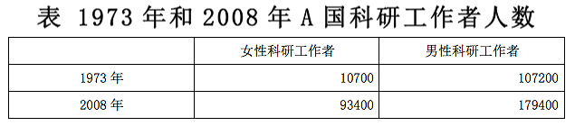

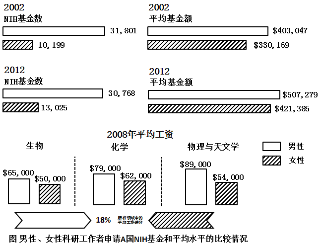

### 第 76 题

2012年A国科研工作者申请到NIH基金共约多少美元：

A. 98亿

B. 134亿

C. 180亿

D. 211亿

第 76 题 · 答案与解析

**参考答案（粉笔题库参考内容）**

D

**解析**

根据题干“2012年，A国······共申请到的基金约多少美元”，结合图表的“平均基金额”，可判定本题为现期平均数问题。定位图表，2012年男、女申请NIH基金数分别为30768个、13025个，平均基金额分别为507279美元、421385美元。2012年A国科研工作者申请到的NIH基金=男性申请基金美元美元=207.6亿美元，与D项最为接近。

故正确答案为D。

**考点**：现期平均数、综合资料

**来源**：2014年上海市公务员录用考试《行测》题（B类）第76题

### 第 77 题

与2002年相比，十年来A国NIH基金数量中，女性申请者的占比约提高了：

A. 3.6%

B. 5.5%

C. 9.8%

D. 12.1%

第 77 题 · 答案与解析

**参考答案（粉笔题库参考内容）**

B

**解析**

根据题干“与2002年相比，十年来······占比约提高了”，可判定本题为两期比重计算问题。定位图表，2012年女性申请者比例为：；

2002年女性申请者比例为：。

则两者相比占比提高了0.295-0.238=0.057=5.7%，与B项最为接近。

故正确答案为B。

**考点**：两期比重、综合资料

**来源**：2014年上海市公务员录用考试《行测》题（B类）第77题

### 第 78 题

假设科研工作者都是博士学位，在2008年取得博士学位的女性为46000人，其中36%从事科研工作，则在2008年的女性科研工作者中，有多少人不是在2008年取得博士学位的：

A. 96840

B. 86840

C. 76840

D. 66840

第 78 题 · 答案与解析

**参考答案（粉笔题库参考内容）**

C

**解析**

根据题干“2008年取得博士学位的女性为46000人，其中36%······”，可判定本题为现期比重问题。定位表格，2008年，女性科研工作者共计93400人（全为博士学位），其中在2008年考取博士学位的科研工作者，则不是在2008年取得博士学位的科研工作者的人数为：人。

故正确答案为C。

**考点**：现期比重、综合资料

**来源**：2014年上海市公务员录用考试《行测》题（B类）第78题

### 第 79 题

根据所给材料，下列说法正确的是：

A. 与1973年相比，2008年女性科研工作者的增长速度大约是男性的7.2倍

B. 2002-2012年，男性科研工作者和女性科研工作者申请到的NIH平均基金额的差距在缩小

C. 2008年各领域平均工资中，物理与天文学的男性、女性平均工资均为最高

D. 女性在科研工作者中所占的比例从1973年的9.1%提高到了2008年的34.2%

第 79 题 · 答案与解析

**参考答案（粉笔题库参考内容）**

D

**解析**

A项：定位表格，1973年男、女性科研工作者的人数分别为107200人、10700人,2008年的人数分别为179400人、93400人，则与1973年相比，2008年女性科研工作的增长速度；而男性科研工作的增长速度为：，则女性的增长速度约为男性的：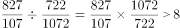倍，错误；

B项：定位图表，2002年男性科研工作者的平均基金额为403047美元，女性为330169美元，二者相差72878。2012年男性平均基金额为507279，女性为421385，二者相差85894，72878＜85894，因此二者的差距进一步扩大了，错误；

C项：定位图表，化学的女性平均工资最高，物理与天文学中的女性平均工资并非最高，错误；

D项：定位表格，1973年，女性在科研工作者中的比例为；2008年女性在科研工作者中的比例为，正确。

故正确答案为D。

**考点**：综合分析、综合资料

**来源**：2014年上海市公务员录用考试《行测》题（B类）第79题

### 第 80 题

就2008年而言，在下列选项中，男性科研工作者和女性科研工作者的平均工资之比最小的是：

A. 生物

B. 化学

C. 物理与天文学

D. 所有领域的平均

第 80 题 · 答案与解析

**参考答案（粉笔题库参考内容）**

D

**解析**

根据题干“2008年，······和······之比最小的是”，可判定本题为比值比较问题。定位图表，各选项数据如下：

A项：生物领域，男女平均工资之比为；

B项：化学领域，男女平均工资之比为；

C项：物理与天文学领域，男女平均工资之比为；

D项：材料中指出所有领域中平均工资差异为18%，意为男性平均工资比女性多18%，即男女之比为1.18:1，通过比较可得，D项所有领域的平均工资之比最小。

故正确答案为D。

**考点**：比值比较、综合资料

**来源**：2014年上海市公务员录用考试《行测》题（B类）第80题

## 材料 4

注：

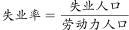

### 第 81 题

在下列年龄段的年满16岁以上的自由公民中，失业率超过10%的是：

A. 16~19岁

B. 25~34岁

C. 45~54岁

D. 65岁及以上

第 81 题 · 答案与解析

**参考答案（粉笔题库参考内容）**

A

**解析**

根据题干“失业率超过10%的是”，结合备注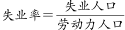 ，可判定本题为现期比重计算问题。

A项： 16~19岁群体的失业率为 ，满足题意，当选；B项：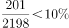，排除；C项：，排除；D项： 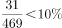，排除。

故正确答案为A。

**考点**：现期比重、统计表

**来源**：2014年上海市公务员录用考试《行测》题（B类）第81题

### 第 82 题

男性失业人口在全部劳动力人口中所占比重比女性失业人口：

A. 约少0.6个百分点

B. 约少0.7个百分点

C. 约多0.6个百分点

D. 约多0.7个百分点

第 82 题 · 答案与解析

**参考答案（粉笔题库参考内容）**

D

**解析**

根据题干“······所占比重比······”，结合选项为“约多/少······个百分点”，可判定本题为现期比重问题。定位表格，男性失业人口数量为418千人，女性失业人口数量为352千人，全部劳动力人口为9476千人，则男性失业人口在全部劳动力人口中所占的比重比女性多，即约多0.7个百分点。

故正确答案为D。

**考点**：现期比重、统计表

**来源**：2014年上海市公务员录用考试《行测》题（B类）第82题

### 第 83 题

下图为劳动力人口结构情况，结合表中信息可判断A、B、C、D分别代表：

                        图  劳动力人口结构情况

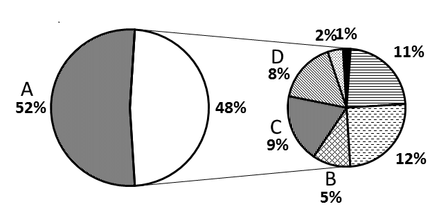

A. 男性劳动力、20~24岁女性劳动力、35~44岁女性劳动力、55~64岁女性劳动力

B. 男性劳动力、20~24岁女性劳动力、55~64岁女性劳动力、25~34岁女性劳动力

C. 男性劳动力、65岁及以上女性劳动力、16~19岁女性劳动力、35~44岁女性劳动力

D. 女性劳动力、20~24岁男性劳动力、55~64岁男性劳动力、16~19岁男性劳动力

第 83 题 · 答案与解析

**参考答案（粉笔题库参考内容）**

A

**解析**

定位表格，男性劳动力数量为4968，女性劳动力数量为4509，女性数量小于男性数量，故A区域代表的应为男性劳动力，D项排除。那么可得第二个饼形图应代表的为女性劳动力的年龄段数量分配，B区域5%位于第5名，C区域9%位于第3名，D区域8%位于第4名。从表格数据中对应得出的女性年龄段人群按数量大小排序，第3名为35~44岁女性劳动力，对应C区域，第4名为55~64岁女性劳动力，对应D区域，第5名为20~24岁女性劳动力，对应B区域。

故正确答案为A。

**考点**：直接找数、统计表

**来源**：2014年上海市公务员录用考试《行测》题（B类）第83题

### 第 84 题

关于各年龄段就业人数与失业人数的相关情况，下列说法正确的是：

A. 从失业、就业两方面看，各年龄段男性人数都多于女性人数

B. 失业率最高的为16~19岁的男性，其失业率为24.1%

C. 就业人口最多的年龄段为45~54岁

D. 失业率最低的为45~54岁的女性

第 84 题 · 答案与解析

**参考答案（粉笔题库参考内容）**

C

**解析**

A项：定位表格，就业人口方面，20~24岁男性就业人口数量为363，而20~24岁女性就业人口数量为392，女性人口数量大于男性，错误；

B项：定位表格，结合备注，16~19岁阶段的男性失业率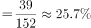，错误；

C项：定位表格可知，就业人口最多的年龄段为45~54岁，正确；

D项：定位表格，结合备注，45~54岁的女性失业率为；而55~64岁的女性失业为，分子近似相等，分母越大，分数越小，则后者小于前者的失业率，错误。

故正确答案为C。

**考点**：统计表、综合分析

**来源**：2014年上海市公务员录用考试《行测》题（B类）第84题

### 第 85 题

根据资料，下列表述中正确的是：

A. 各年龄段的男性和女性相比，劳动力人口占比最大的年龄段是相同的

B. 已婚男性的就业人口占比、失业率、劳动力人口占比普遍高于已婚女性

C. 女性公民的人口、劳动力人口和就业人口都高于男性

D. 男性在各个年龄段的失业率都高于女性

第 85 题 · 答案与解析

**参考答案（粉笔题库参考内容）**

B

**解析**

A项：定位表格第四列，在男性中劳动力人口占比最大的年龄段为35~44岁，而在女性中劳动力人口占比最大的年龄段为45~54岁，错误；

B项：定位表格最后两行，结合备注，已婚男性的失业率为，已婚女性的失业率为，已婚女性较小。劳动力人口占比已婚男性为72.7，已婚女性为59.6，已婚女性较小。由备注公式可知，就业人口已婚男性占比为，已婚女性占比为，已婚女性较小，正确；

C项：定位表格，女性公民的劳动力人口数量为4509千人，而男性公民的劳动力人口数量为4968千人，男性劳动力人口数量大于女性，错误；

D项：定位表格，结合备注，男性25~34岁的失业率为，女性25~34岁的失业率为，女性失业率较大，错误。

故正确答案为B。

**考点**：统计表、综合分析

**来源**：2014年上海市公务员录用考试《行测》题（B类）第85题

## 材料 5

（一）根据下列资料，回答第76-79题。

        2013年1-7月份，某市规模以上工业增加值同比增长12.0%，增速比去年同期提高1.4个百分点。

        1-7月份，全市国有及国有控股企业完成增加值同比下降3.5%；民营企业完成增加值同比增长24.8%；外商控股企业完成增加值同比下降3.1%。三者增加值占全市规模以上工业增加值总量的比重为20:62:18。轻工业完成增加值同比增长17.4%；重工业完成增加值同比增长10.1%。轻重工业增加值占全市规模工业总量的比重为28:72，与去年同期持平。

        在37个行业中，向上拉动全市工业经济增长较大的行业有：化工行业完成增加值176.2亿元，同比增长81.3%；医药制造业完成增加值21.2亿元，同比增长24.7%；农副食品加工业完成增加值223.5亿元，同比增长19.6%；服装行业完成增加值56.7亿元，同比增长19.4%；专用设备制造业完成增加值118.4亿元，同比增长16.0%；通用设备制造业完成增加值272.9亿元，同比增长15.5%；汽车制造业完成增加值57.4亿元，同比增长9.3%。向下拉动工业经济增长较大的行业有：石油加工业完成增加值168.5亿元，同比下降1.5%；电子信息业完成增加值63.4亿元，同比下降12.2%；铁路船舶制造业完成增加值89.2亿元，同比下降26.9%。

         1-7月份，全市完成销售产值6258.1亿元，同比增长12.7%，其中，完成国内销售产值4995.2亿元，同比增长15.7%；完成出口交货值1262.9亿元。

         1-7月份，全市实现软件销售收入712亿元，同比增长25.8%，出口22亿美元，同比增长19.5%。实现利润50.8亿元，同比增长20.9%，实现税金51.2亿元，同比增长26.8%。

### 第 86 题

该市2013年1-7月份规模以上工业增加值约比2011年同期增长了：

A. 1.4%

B. 13.4%

C. 22.6%

D. 23.9%

第 86 题 · 答案与解析

**参考答案（粉笔题库参考内容）**

D

**解析**

根据题干“2013年1-7月······比2011年同期增长”，结合选项为百分数，可判定本题为间隔增长率问题。定位材料第一段，2013年1-7月份，某市规模以上工业增加值同比增长12%，增速比去年同期提高1.4个百分点，则2012年1-7月份的增速为12%-1.4%=10.6%。则所求，与D项较为接近。

故正确答案为D。

**考点**：文字资料、间隔增长率

**来源**：2014年上海市公务员录用考试《行测》题（B类）第86题

### 第 87 题

以下对该市各行业按2012年1-7月份完成增加值从高到低排序正确的是：

A. 专用设备制造业、农副食品加工业、电子信息业

B. 铁路船舶制造业、医药制造业、通用设备制造业

C. 石油加工业、化工行业、汽车制造业

D. 服装行业、汽车制造业、电子信息业

第 87 题 · 答案与解析

**参考答案（粉笔题库参考内容）**

C

**解析**

根据题干“2012年1-7月······从高到低”，结合材料数据为2013年1-7月，可判定本题为基期比较问题。定位材料第三段，根据公式：，各选项2012年的值为：

A项：专用设备制造业所完成增加值为： ，农副食品加工业为： ，电子信息业为： 。农副产品加工业分子约为专用设备制造业的2倍，分母近似相等，估算可知，农副产品加工业明显大于专用设备制造业，错误；

B项：铁路船舶制造业：，医药制造业为： ，通用设备制造业为： ，通用设备制造业大于医药制造业，错误；

C项：石油加工业为： ，化工行业为： ，汽车制造业为： ，正确；

D项：服装行业为：，汽车制造业为： ，电子信息业为： ，电子信息业大于汽车制造业，错误。

故正确答案为C。

**考点**：基期比较、文字资料

**来源**：2014年上海市公务员录用考试《行测》题（B类）第87题

### 第 88 题

2013年1-7月份该市完成出口交货值比上年约增长了：

A. \-2.6%

B. 2.2%

C. 9.7%

D. 18.7%

第 88 题 · 答案与解析

**参考答案（粉笔题库参考内容）**

B

**解析**

根据材料可知，全市销售产值=国内销售产值+出口交货值。故已知全市销售产值与国内销售产值数据，求出口交货值同比增速，可判定本题为混合增长率计算问题。定位材料第四段，2013年1-7月份全市销售产值6258.1亿元，同比增长12.7%，国内销售产值4995.2亿元，同比增长15.7%，完成出口交货值1262.9亿元。根据混合增长率结论，居中但不中，偏向基期较大的。故可得出口交货值同比增速一定＜12.7%，且12.7%应更接近于15.7%，因此排除C、D两项。

根据线段法，距离与量成反比可得：，解得，与B项接近。

故正确答案为B。

**考点**：文字资料、混合增长率

**来源**：2014年上海市公务员录用考试《行测》题（B类）第88题

### 第 89 题

下列统计图中，哪项最接近2012年1-7月份该市国有及国有控股企业、民营企业和外商控股企业完成增加值占全市规模以上工业增加值总量的比重构成：

A. A

B. B

C. C

D. D

第 89 题 · 答案与解析

**参考答案（粉笔题库参考内容）**

B

**解析**

根据题干“2012年1-7月∙∙∙···占∙∙···∙的比重”，结合材料数据为2013年1-7月，可判定本题为基期比重问题。定位材料第一段，2013年1-7月份，某市规模以上工业增加值同比增长12%；定位材料第二段，2013年1\-7月份该市国有及国有控股企业、民营企业和外商控股企业的增加值占全市规模以上工业增加值总量的比重为20:62:18。由国有及国有控股企业着手，如果全市规模以上工业增加值为100，则国有及控股企业的工业增加值为20，同比下降3.5%，则其2012年增加值占规模以上的工业增加值的比重，略大于22.4%，只有B项满足。

故正确答案为B。

**考点**：基期比重、文字资料

**来源**：2014年上海市公务员录用考试《行测》题（B类）第89题

### 第 90 题

关于2013年1-7月份该市规模以上工业运行情况，下列表述正确的是：

A. 轻工业完成增加值同比增量高于重工业

B. 在37个行业中，完成增加值最高的行业也是同比增速最快的行业

C. 完成销售产值比上年同期增长1000亿元以上

D. 软件行业利润率低于上年同期水平

第 90 题 · 答案与解析

**参考答案（粉笔题库参考内容）**

D

**解析**

A项：定位材料第二段，轻重工业增加值占全市的比重为28:72，轻工业完成增加值同比增长17.4%，重工业同比增长10.1%，设2013年1-7月规模以上工业完成增加值为100，则2013年1-7月轻重工业增加值分别为28、72。那么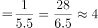，，故重工业增加值同比增量应高于轻工业，错误；

B项：定位材料第三段，并没有列出37个行业的具体增加值和增长率，因此无法确定完成增加值最高的行业是否是同比增长最快的行业，错误；

C项：定位材料倒数第二段，全市完成销售产值6258.1亿元，同比增长12.7%，则2013年1-7月完成销售产值同比增长量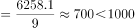，错误；

D项：定位材料最后一段，2013年1~7月软件行业，利润同比增长20.9%，而收入同比增长25.8%，因为，根据两期比重比较结论，利润同比增长率小于收入同比增长率，故利润率同比去年应该是下降了，正确。

故正确答案为D。

**考点**：文字资料、综合分析

**来源**：2014年上海市公务员录用考试《行测》题（B类）第90题

### 第 91 题

既要确保效率，也要维护公平；既要鼓励竞争，也要保障底线；既要尊重差异，也要凝聚共识。面对“众口难调”的困扰，政府包办一切，简单命令式，完全行政化的管理是无所适从的。十八届三中全会提出，全面深化改革的总目标是完善和发展中国特色社会主义制度，推进：

A. 政府行政体系与行政能力制度化

B. 社会管理体系和管理能力多元化

C. 国家法律体系和法治建设现代化

D. 国家治理体系和治理能力现代化

第 91 题 · 答案与解析

**参考答案（粉笔题库参考内容）**

D

**解析**

党的十八届三中全会指出，全面深化改革的总目标是完善和发展中国特色社会主义制度，推进国家治理体系和治理能力现代化。这一总目标，深刻表明了改革的鲜明性质和根本任务。改革开放是决定当代中国命运的关键抉择，这面旗帜绝不能有丝毫动摇；改革开放是一场深刻革命，必须牢牢坚持沿着中国特色社会主义道路的正确方向推进。

故正确答案为D。

**考点**：政治建设

**来源**：2014年上海市公务员录用考试《行测》题（B类）第91题

### 第 92 题

随着互联网技术的广泛应用和迅猛发展，泄露和贩卖公民个人信息，网上诈骗，网络谣言等行为也“应运而生”。2012年底，全国人大常委会公布施行《关于加强网络信息保护的决定》。加强网络信息保护的立法，除了以法律的形式保护公民及法人信息安全，还旨在：

A. 控制网络平台的信息传播

B. 确立网络身份管理制度

C. 明确网络服务提供者的义务和责任

D. 赋予政府主管部门必要的监管手段

第 92 题 · 答案与解析

**参考答案（粉笔题库参考内容）**

BCD

**解析**

十一届全国人大常委会第三十次会议上在表决通过各项议案后，常委会认真总结网络发展和管理的实践经验，分析国外网络立法情况，广泛听取各方面意见，作出关于加强网络信息保护的决定，以法律形式保护公民个人及法人信息安全，确立网络身份管理制度，明确网络服务提供者的义务和责任，并赋予政府主管部门必要的监管手段，重点解决我国网络信息安全立法滞后的问题，有利于保护公民个人及法人电子信息安全、促进社会和谐稳定，有利于维护国家安全和政治稳定、确保国家长治久安。有关方面要做好宣传普及工作，抓紧制定和修改相关配套法规，确保《关于加强网络信息保护的决定》全面正确有效实施。

故正确答案为B、C、D。

**考点**：其他法律法规

**来源**：2014年上海市公务员录用考试《行测》题（B类）第92题

### 第 93 题

征信业是市场经济条件下专业化的信用信息服务行业。2013年3月15日起，我国首部征信业法规——《征信业管理条例》正式开始实施。为了在征信业活动中切实保护个人信息安全，该条例：

A. 严格规范了个人征信业务规则

B. 明确规定了禁止和限制征信机构采集的个人信息

C. 明确规定了个人不良信息的保存期限是永久保存

D. 规定了个人对本人信息享有查询、异议和投诉等权利

第 93 题 · 答案与解析

**参考答案（粉笔题库参考内容）**

ABD

**解析**

为在征信业务活动中切实保护个人信息安全，《征信业条例》以下简称《条例》，主要作了以下规定：

一是严格规范个人征信业务规则，包括：除依法公开的个人信息外，采集个人信息应当经信息主体本人同意，未经同意不得采集；向征信机构提供个人不良信息的，应当事先告知信息主体本人；征信机构对个人不良信息的保存期限不得超过5年，超过的应予删除；除法律另有规定外，他人向征信机构查询个人信息的，应当取得信息主体本人的书面同意并约定用途，征信机构不得违反规定提供个人信息。

二是明确规定禁止和限制征信机构采集的个人信息，包括：禁止采集个人的宗教信仰、基因、指纹、血型、疾病和病史信息以及法律、行政法规规定禁止采集的其他个人信息；征信机构不得采集个人的收入、存款、有价证券、不动产的信息和纳税数额信息，但征信机构明确告知信息主体提供该信息可能产生的不利后果，并取得其书面同意采集的除外。

三是明确规定个人对本人信息享有查询、异议和投诉等权利，包括：个人每年可以免费两次向征信机构查询自己的信用报告；个人认为信息错误、遗漏的，可以向征信机构或信息提供者提出异议，异议受理部门应当在规定时限内处理；个人认为合法权益受到侵害的，可以向征信业监督管理部门投诉，征信业监督管理部门应当及时核查处理并限期答复。个人对违反《条例》规定，侵犯自己合法权利的行为，还可以依法直接向人民法院提起诉讼。

四是严格法律责任，对征信机构或信息提供者、信息使用者违反《条例》规定，侵犯个人权益的，由监管部门依照《条例》的规定给予行政处罚；造成损失的，依法承担民事责任；构成犯罪的，依法追究刑事责任。

C项错误，应为不超过5年，而不是永久保存。

故正确答案为A、B、D。

**考点**：其他法律法规

**来源**：2014年上海市公务员录用考试《行测》题（B类）第93题

### 第 94 题

为激励公务员忠于职守，勤政廉政，提高工作效能，充分调动公务员工作的积极性，我国对公务员实行奖励制度。

以下有关公务员奖励的说法不正确的是：

A. 公务员奖励的对象既包括工作表现突出，有显著成绩和贡献，或者有其他突出事迹的公务员，也包括公务员集体

B. 公务员奖励坚持公开、公平和公正的原则，坚持精神奖励与物质奖励相结合，以物质奖励为主的原则

C. 对公务员、公务员集体的奖励分为：嘉奖、记三等功、记二等功、记一等功、授予荣誉称号

D. 授予荣誉称号，由县级以上党委、政府或者市（地）级以上机关批准

第 94 题 · 答案与解析

**参考答案（粉笔题库参考内容）**

BD

**解析**

A项正确，根据《公务员奖励规定(试行)》第二条规定：“公务员奖励是指对工作表现突出，有显著成绩和贡献，或者有其他突出事迹的公务员、公务员集体，依据本规定给予的奖励。公务员集体是指按照编制序列设置的机构或者为完成专项任务组成的工作集体。”

B项错误，根据《公务员奖励规定(试行)》第三条规定：“公务员奖励坚持公开、公平和公正的原则，坚持精神奖励与物质奖励相结合、以精神奖励为主的原则，及时奖励与定期奖励相结合，按照规定的条件、种类、标准、权限和程序进行。”

C项正确，根据《公务员法》第五十三条规定：“奖励分为：嘉奖、记三等功、记二等功、记一等功、授予称号。 对受奖励的公务员或者公务员集体予以表彰，并对受奖励的个人给予一次性奖金或者其他待遇。”

D项错误，根据《公务员法》第五十四条规定：“给予公务员或者公务员集体奖励，按照规定的权限和程序决定或者审批。”

本题为选非题，故正确答案为BD。

**考点**：行政法

**来源**：2014年上海市公务员录用考试《行测》题（B类）第94题

### 第 95 题

改革开放以来，我国收入分配制度改革逐步推进，破除了传统计划经济体制下平均主义的分配方式，按劳分配为主体、多种分配方式并存的分配制度基本确立，以＿＿＿＿＿为主要手段的再分配调节框架初步形成，有力地推动了社会主义市场经济体制的建立。

A. 税收

B. 保险

C. 社会保障

D. 转移支付

第 95 题 · 答案与解析

**参考答案（粉笔题库参考内容）**

ACD

**解析**

《关于深化收入分配制度改革的若干意见》中指出：改革开放以来，我国收入分配制度改革逐步推进，破除了传统计划经济体制下平均主义的分配方式，在坚持按劳分配为主体的基础上，允许和鼓励资本、技术、管理等要素按贡献参与分配，不断加大收入分配调节力度。经过三十多年的探索与实践，按劳分配为主体、多种分配方式并存的分配制度基本确立，以税收、社会保障、转移支付为主要手段的再分配调节框架初步形成，有力地推动了社会主义市场经济体制的建立，极大地促进了国民经济快速发展，城乡居民人均实际收入平均每十年翻一番，家庭财产稳定增加，人民生活水平显著提高。实践证明，我国收入分配制度是与基本国情、发展阶段总体相适应的。

故正确答案为ACD。

**考点**：经济建设、重要文件

**来源**：2014年上海市公务员录用考试《行测》题（B类）第95题

### 第 96 题

奥巴马签发行政命令，以国家安全为由禁止中国S集团关联公司在美建风力发电厂。S集团因此起诉奥巴马，并获美国当地法院受理。这一事件被认为是中国企业从产品、投资“走出去”发展到法律规则、市场观念“走出去”的标志。

这里的“市场观念”是指：

A. 完善规范市场的法律

B. 认识市场经济的作用

C. 遵守市场要求的道德

D. 把握市场特征和原则

第 96 题 · 答案与解析

**参考答案（粉笔题库参考内容）**

BD

**解析**

A项错误，完善规范市场的法律的主体是国家，并不是中国企业，排除；

B、D两项正确，只有真正认识市场经济的作用，把握市场的特征和原则，才能真正做到市场观念“走出去”，当选；

C项错误，遵守市场要求的道德是作为一个企业的要求，并不是市场观念的标志，排除。

故正确答案为B、D。

**考点**：市场经济

**来源**：2014年上海市公务员录用考试《行测》题（B类）第96题

### 第 97 题

某政府部门公共服务网络平台屡次出现各类故障，引起许多市民抱怨，某律师向该政府部门发函，申请公开该网站建设、设计及招投标过程中的全部信息。

对此，下列表述正确的是：

A. 该律师提交书面申请时应提供本人有效身份证明

B. 该律师可以就公开信息的形式提出要求

C. 该律师应说明申请信息用途

D. 该政府部门公开信息时，可向该律师收取检索成本费用

第 97 题 · 答案与解析

**参考答案（粉笔题库参考内容）**

BD

**解析**

A项错误，《政府公开信息条例》第二十五条规定：公民、法人或者其他组织向行政机关申请提供与其自身相关的税费缴纳、社会保障、医疗卫生、登记等政府信息的，应当出示有效身份证件或者证明文件。题中该律师所申请公开的为网站建设、设计及招投标过程中的全部信息。所以，律师不用提供身份信息；

B项正确，第二十四条规定：行政机关依法申请公开政府信息的，申请人可以选择邮寄、递送、传真、当面领取等方式获取政府信息，并可以选择纸质、光盘、磁盘等政府信息载体形式；

C项错误，《上海市政府信息公开规定》中第二十一条规定：公民、法人或者其他组织依照《政府信息公开条例》第十三条规定向行政机关申请公开政府信息的，应当提交载明下列内容的申请书：（一）申请人的姓名或者名称、联系方式；（二）明确的政府信息内容，包括能够据以指向特定政府信息的文件名称、文号或者其他特征描述；（三）获取政府信息的方式及其载体形式。公民、法人或者其他组织向行政机关申请公开政府信息的，行政机关可以询问申请人获取政府信息的用途。所以律师不用说明信息用途；

D项正确，行政机关依照申请向公民、法人或者其他组织提供政府信息的，可以收取实际发生的检索、复制、邮寄等成本费用，但不得收取其他费用。

故正确答案为B、D。

**考点**：行政法

**来源**：2014年上海市公务员录用考试《行测》题（B类）第97题

### 第 98 题

2003年以来，北京、上海、浙江、无锡、广东等地方政府向社会组织购买公共服务的探索不断增多，国务院会议提出，要围绕着\_\_\_\_\_\_\_\_\_\_\_等重要目标进一步推进政府向社会力量购买公共服务。

A. 增加公共产品的供应，让人民群众更多地分享经济发展的成果

B. 加强社会建设，建立健全社会组织教育发展机制

C. 发展产业，主要是现代服务业

D. 政府自身的变革

第 98 题 · 答案与解析

**参考答案（粉笔题库参考内容）**

ACD

**解析**

推进政府向社会力量购买服务，围绕着三个重要目标。第一是增加公共产品的供应，让人民群众更多地分享经济发展的成果。为此，会议明确，“创新方式，提供更好的公共服务，是惠及人民群众、深化社会领域改革的重大措施”。经济和社会是中国发展的两个主要“轮子”，既相互支撑，又彼此制约。经济发展服务于人的需求满足，强大的内需又是经济发展的持续动力；反过来，经济发展需要不断投入，增加满足需求的公共服务供应，又必定分流可以用于投资的资金。第二是发展产业，主要是现代服务业。会议指出，推进政府购买社会力量的公共服务，“又是加快服务业发展、扩大服务业开放、引导有效需求的关键之举”。第三是政府自身的变革。会议强调，推进政府购买公共服务“也是推动政府职能转变，推进政事、政社分开，建设服务型政府的必然要求”。

故正确答案为A、C、D。

**考点**：经济建设、重要会议讲话

**来源**：2014年上海市公务员录用考试《行测》题（B类）第98题

### 第 99 题

2013年7月1日以后，上海市派出所均可以办理身份证登记指纹信息，此举措可以有效防范冒用他人居民身份证以及伪造、变造居民身份证等违法犯罪行为的发生，更好地保护公民合法权益，下列关于身份证的表述不正确的是：

A. 公民身份证号码编码对象是具有中华人民共和国国籍的公民

B. 十六周岁至四十五周岁的公民，发给有效期二十年的居民身份证

C. 四十六周岁以上的公民，发给长期有效居民身份证

D. 未满十六周岁的公民，由监护人代为申请领取居民身份证

第 99 题 · 答案与解析

**参考答案（粉笔题库参考内容）**

BD

**解析**

依据我国《居民身份证号码编制标准》规定，公民身份号码的编码对象是具有中华人民共和国国籍的公民。十六周岁至二十五周岁的，发给有效期十年的居民身份证；二十六周岁至四十五周岁的，发给有效期二十年的居民身份证；四十六周岁以上的，发给长期有效的居民身份证。法律同时规定，未满十六周岁的公民，自愿申请领取居民身份证的，发给有效期五年的居民身份证。

本题为选非题，故正确答案为BD。

**考点**：其他法律法规

**来源**：2014年上海市公务员录用考试《行测》题（B类）第99题

### 第 100 题

2013年初，国务院印发的《全国海洋经济发展“十二五”规划》提出，我国将进一步提升海洋经济总体实力，海洋生产总值年均增长8%，2015年占国内生产总值的比重达到10%。根据该规划，我国应充分发挥\_\_\_\_\_\_\_\_\_\_\_的引领作用，推进形成我国的海洋经济圈。

A. 环渤海经济区

B. 长江三角洲经济区

C. 海峡西岸经济区

D. 珠江三角洲经济区

第 100 题 · 答案与解析

**参考答案（粉笔题库参考内容）**

ABD

**解析**

2013年初，国务院印发的《全国海洋经济发展“十二五”规划》提出，“十二五”时期我国海洋科技创新能力进一步加强，2015年海洋科技成果转化率达到50％以上，海洋科技对海洋经济的贡献率达到60％以上。海洋可持续发展能力进一步增强。规划还提出，“十二五”时期我国海洋产业结构进一步优化，海洋新兴产业实现突破性进展，2015年增加值较“十一五”期末翻一番，规划同时要求，“十二五”时期我国海洋经济调控体系进一步完善，对外开放水平明显提高。规划提出充分发挥环渤海、长江三角洲和珠江三角洲三个经济区的引领作用，推进形成我国北部、东部和南部三个海洋经济圈，结合落实国家关于沿海区域发展的部署，着力培育一批重要的海洋经济增长极。

故正确答案为A、B、D。

**考点**：经济建设、重要文件

**来源**：2014年上海市公务员录用考试《行测》题（B类）第100题

### 第 101 题

协调机制伴随着政府权力运行的每一个环节和层次，协调机制的目的是调整政府与市场、社会的关系，实现社会资源的优先配置，公共事务的良好治理，增强政府系统对外界环境的敏感性和回应性，提高政府权力运行的合法性和有效性。

下列属于政府系统与外部环境系统协调方法的是：

A. 党政联席会议

B. 听证会

C. 新闻发布会

D. 政务微博

第 101 题 · 答案与解析

**参考答案（粉笔题库参考内容）**

BCD

**解析**

A项错误，党政联席会议是一种领导班子集体议事的会议形式。加强党的领导、协调党政联系、保障集体领导，可促进工作决策的民主化，及时调度、安排、研究、处理重大问题，及时交流和沟通思想，统一行动，提高工作效率和决策水平，但是是属于政府系统内部协调的方法；

B、C、D三项正确，听证会、新闻发布会、政务微博均属于政府系统与外部环境协调的方法。

故正确答案为BCD。

**考点**：政治建设

**来源**：2014年上海市公务员录用考试《行测》题（B类）第101题

### 第 102 题

某热电有限公司高温高压背压机组三期扩建项目报批环境影响评价文件未经批准，擅自开工建设。根据《环境影响评估法》规定，建设项目环境影响评价未经批准，建设单位擅自开工建设的，由有权审批该项目环境影响评价文件的环境保护行政主管部门责令停止建设，可以处五万元以上三十万元以下的罚款。对建设单位直接负责的主管人员和其他直接责任人员，依法给予行政处分，环境保护部决定责令其停止建设，并罚款二十万元。

环境保护部依照处罚标准上限处罚：

A. 应当向当事人说明做出该处罚决定的理由

B. 当事人可以以行政处罚有失公正为理由提起行政诉讼

C. 与本案违法行为的情节相同或者相似，社会危害程度相当的，行政处罚种类和幅度应当相当

D. 当事人逾期不申请行政复议、不提起行政诉讼，又不履行处罚决定的，由环境保护部强制执行

第 102 题 · 答案与解析

**参考答案（粉笔题库参考内容）**

ABC

**解析**

A选项正确，《行政处罚法》第四十四条规定：“行政机关在作出行政处罚决定之前，应当告知当事人拟作出的行政处罚内容及事实、理由、依据，并告知当事人依法享有的陈述、申辩、要求听证等权利。”

B选项正确，《行政处罚法》第七条规定：公民、法人或者其他组织对行政机关所给予的行政处罚，享有陈述权、申辩权；对行政处罚不服的，有权依法申请行政复议或者提起行政诉讼。公民、法人或者其他组织因行政机关违法给予行政处罚受到损害的，有权依法提出赔偿要求。

C选项正确，《行政处罚法》第五条规定：行政处罚遵循公正、公开的原则。设定和实施行政处罚必须以事实为依据，与违法行为的事实、性质、情节以及社会危害程度相当。对违法行为给予行政处罚的规定必须公布；未经公布的，不得作为行政处罚的依据。

D选项错误，《行政处罚法》第七十二条第一款规定：“当事人逾期不履行行政处罚决定的，作出行政处罚决定的行政机关可以采取下列措施：（一）到期不缴纳罚款的，每日按罚款数额的百分之三加处罚款，加处罚款的数额不得超出罚款的数额；（二）根据法律规定，将查封、扣押的财物拍卖、依法处理或者将冻结的存款、汇款划拨抵缴罚款；（三）根据法律规定，采取其他行政强制执行方式；（四）依照《中华人民共和国行政强制法》的规定申请人民法院强制执行。”D项中应为人民法院强制执行。

故正确答案为ABC。

**考点**：行政法

**来源**：2014年上海市公务员录用考试《行测》题（B类）第102题

### 第 103 题

根据国家有关规定，下列关于定密的事项，做法正确的是：

A. 机关、单位执行上级确定的国家秘密事项，需要定密的，根据所执行的国家秘密事项的密级确定

B. 下级机关、单位认为本机关、本单位产生的有关定密事项属于上级机关、单位的定密权限，应当先行采取保密措施，并立即报请上级机关、单位确定

C. 机关、单位确定，变更和解除本机关、本单位的国家秘密，应当由定密责任人提出具体意见，交由上级机关、单位审核批准

D. 没有上级机关、单位认为需要定密的，应当立即提请有相应定密权限的业务主管部门或者保密行政管理部门确定

第 103 题 · 答案与解析

**参考答案（粉笔题库参考内容）**

ABD

**解析**

A、B、D三项正确，根据《中华人民共和国保守国家秘密法》第十三条：机关、单位执行上级确定的国家秘密事项，需要定密的，根据所执行的国家秘密事项的密级确定。下级机关、单位认为本机关、本单位产生的有关定密事项属于上级机关、单位的定密权限，应当先行采取保密措施，并立即报请上级机关、单位确定；没有上级机关、单位的，应当立即提请有相应定密权限的业务主管部门或者保密行政管理部门确定；

C项错误，根据《中华人民共和国保守国家秘密法》第十二条：机关、单位负责人及其指定的人员为定密责任人，负责本机关、本单位的国家秘密确定、变更和解除工作。机关、单位确定、变更和解除本机关、本单位的国家秘密，应当由承办人提出具体意见，经定密责任人审核批准。

故正确答案为A、B、D。

**考点**：其他法律法规

**来源**：2014年上海市公务员录用考试《行测》题（B类）第103题

### 第 104 题

随着城市里养宠物的人越来越多，被宠物猫、狗等动物咬伤、抓伤的情况也越来越多，如果不慎被猫狗抓咬伤，正确的处理措施是：

A. 马上用肥皂水清洗冲洗伤口15分钟以上

B. 清洗后用碘酒或医用酒精治疗伤口

C. 及时全程足量地注射狂犬症疫苗

D. 在36小时之内注射一次狂犬症疫苗

第 104 题 · 答案与解析

**参考答案（粉笔题库参考内容）**

ABC

**解析**

如果被狗或猫咬、抓伤应马上采取三步紧急应对措施：

第一步：冲洗伤口。要马上用流动的水冲洗伤口，尽可能把病毒冲走，把血挤出去。如果有条件，最好用20％的肥皂水进行冲洗，连续冲上20~30分钟。接着用碘酒消毒伤口，再用酒精洗掉碘酒，如此反复3次。

第二步：马上到当地防疫部门注射狂犬疫苗，越快越好。

第三步：如果伤口被咬得严重，一定要注射抗病毒血清，与疫苗同时使用。

故正确答案为A、B、C。

**考点**：生活常识

**来源**：2014年上海市公务员录用考试《行测》题（B类）第104题

### 第 105 题

人体内免疫系统能发现和清除外来入侵的病原微生物，还能识别和清除体内发生突变的肿瘤细胞、衰老细胞、死亡细胞或其他有害的成分，并且通过自身免疫耐受和免疫调节使免疫系统内环境保持稳定。

下列属于免疫系统疾病的是：

A. 冠心病

B. 艾滋病

C. 尿毒症

D. 红斑狼疮

第 105 题 · 答案与解析

**参考答案（粉笔题库参考内容）**

BD

**解析**

一般地说，免疫系统疾病的症状主要表现在易患感冒及其他感染性疾病，易疲劳或易过敏。根据病因及特性不同，大致常见的有：艾滋病、过敏性疾病、风湿性关节炎、过敏性哮喘、慢性疲劳、II型糖尿病、枯草热、红斑狼疮及多发性硬化症。其中最严重的是艾滋病、红斑狼疮，比较轻的是过敏性疾病。

故正确答案为B、D。

**考点**：生物常识

**来源**：2014年上海市公务员录用考试《行测》题（B类）第105题

### 第 106 题

根据《中华人民共和国水土保持法》，为了预防和治理水土流失，保护和合理利用水土资源，减轻水、旱、风沙灾害，改善生态环境，保障经济社会可持续发展，国家鼓励和支持在山区、丘陵区、风沙区以及容易发生水土流失的其他区域，采取的有利于水土保持的措施包括：

A. 免耕

B. 以煤电气代替薪柴

C. 舍饲圈养

D. 从生态脆弱地区向外移民

第 106 题 · 答案与解析

**参考答案（粉笔题库参考内容）**

ABCD

**解析**

《中华人民共和国水土保持法》第四章第39条规定：国家鼓励和支持在山区、丘陵区、风沙区以及容易发生水土流失的其他区域，采取下列有利于水土保持的措施：

（一）免耕、等高耕作、轮耕轮作、草田轮作、间作套种等；

（二）封禁抚育、轮封轮牧、舍饲圈养；

（三）发展沼气、节柴灶，利用太阳能、风能和水能，以煤、电、气代替薪柴等；

（四）从生态脆弱地区向外移民；

（五）其他有利于水土保持的措施。

故正确答案为ABCD。

**考点**：其他法律法规

**来源**：2014年上海市公务员录用考试《行测》题（B类）第106题

### 第 107 题

风电是一种可再生能源发电方式，2010年，我国建设了100MW东海大桥海上风电场，这是亚洲第一座海上风电场，与陆上风电场相比，海上风电场具有\_\_\_\_\_\_\_\_\_等优势，因此已成为风能利用的主要发展趋势。

A. 不占用土地资源

B. 风机单机容量大

C. 风速大

D. 效率高

第 107 题 · 答案与解析

**参考答案（粉笔题库参考内容）**

ABCD

**解析**

海上风电场多指水深10米左右的近海风电。相较陆上风电而言，海上风电具有三大优势：一是海上的风速较大，也更为稳定，年利用小时长，使机组发电量稳定、单机由于容量大而能量产出较大、效率高、使用寿命更长。二是海上风电场多建造在东南部沿海地区的潮间带、沿岸滩涂及近海海域，不占用土地资源，这里成本低，空间广阔，有着允许风机机组更为大型化等优势。三是减少电力运输成本，海上风电场接近人口稠密、对用电需求量巨大的大中型城市。发展海上风电场将有效实现这部分电力的短距离消费，并在一定程度上减轻我国在陆上风电行业中一向存在的西部地区产能过剩，而剩余电力难以顺利向东部地区传输的问题。

故正确答案为A、B、C、D。

**考点**：科技理论与成就

**来源**：2014年上海市公务员录用考试《行测》题（B类）第107题

### 第 108 题

在地震、矿难等灾害现场，生命体征探测仪能为及时发现幸存者提供很大的帮助，它是通过捕捉被探测者的人体信号来进行搜寻的仪器。

目前，生命体征探测仪能探测到的人体信号主要有：

A. 呼吸频率信号

B. 心脏电场的超低频信号

C. 人体红外热信号

D. 大脑皮层电信号

第 108 题 · 答案与解析

**参考答案（粉笔题库参考内容）**

ABCD

**解析**

生命探测仪，即一种探测生命迹象的仪器，常用于救援中，目前常见的有光学探生仪、音频生命探测仪、红外生命探测仪和雷达生命探测仪等。

声波／振动探生仪是一个由高灵敏度传感器、高精度专用数据采集系统及多功能专用数据采集系统和多功能专用计算机处理系统组成的探测系统，能探测和分析幸存者的移动、敲击和呼叫通过介质发出的微小振动呼救信号，确定被困人员的位置。

红外生命探测仪：人体存在红外辐射，但人体的红外辐射特性与周围环境的红外辐射特性不同，热成像生命探测仪利用了他们之间的差别，以成像的方式把要搜索的目标与背景分开。这种光谱段是设计热成像生命探测仪的一个重要技术依据。

雷达生命探测仪：雷达式生命探测仪是通过雷达发射高频电磁波，对接收到的脑电波回波信号经过放大、滤波及特殊的数字信号处理而得到相关人体生命状况的信息。由于呼吸频率低，一般1~2次/s，因此可把呼吸运动和其他较高频率运动区分开来。

故正确答案为A、B、C、D。

**考点**：科技理论与成就

**来源**：2014年上海市公务员录用考试《行测》题（B类）第108题

### 第 109 题

海洋观测是了解认识海洋自然和环境特征的基本手段，我国在东海建立了第一个海底综合观测试验与示范系统，目前，海洋观测主要是依靠什么方式进行：

A. 科学考察船

B. 海底光缆

C. 卫星遥感技术

D. 海底观测网络

第 109 题 · 答案与解析

**参考答案（粉笔题库参考内容）**

D

**解析**

所谓海底观测系统，就是将观测仪器放在海底，通过有线和无线网络向各个观测点供应能量、收集信息，从而实现全天候、长期、连续的自动观测。海底观测系统可提供多要素、多学科的长期、综合、实时观测，观测范围包括海底地壳深部、海底表面、海水水体及海面，观测内容涉及物理、化学、地质、生物等学科参数及其互相关系。

故正确答案为D。

**考点**：科技理论与成就

**来源**：2014年上海市公务员录用考试《行测》题（B类）第109题

### 第 110 题

2013年，随着《中国汉字听写大会》《汉字英雄》等节目的热播，社会上出现了“汉字热”，汉字这一优美的文字，经历了甲骨文到金文，再到大篆、六国古文，进而到小篆、再到隶书，进而到楷书、草书、行书的演变过程。

其中，哪项是古文字和现代文字的分水岭：

A. 金文演变为大篆

B. 六国古文演变为小篆

C. 小篆演变为隶书

D. 隶书演变为楷书

第 110 题 · 答案与解析

**参考答案（粉笔题库参考内容）**

C

**解析**

汉字的古今划分：汉字由篆书到隶书的演变，称“隶变”。隶变是汉字古文字与今文字的分水岭。隶变前的汉字是“古文字”，隶变后的汉字是“今文字”。

故正确答案为C。

**考点**：文学常识

**来源**：2014年上海市公务员录用考试《行测》题（B类）第110题

### 第 111 题

黑匣子是飞机专用的电子记录设备之一，具有极强的抗火、耐压、耐冲击、耐浸泡、抗磁干扰等能力，即便飞机已完全损坏，黑匣子里的记录数据也能完好保存。

下列选项中，属于黑匣子的是：

A. 机舱视频监控器

B. 飞行数据记录仪

C. 机舱话音记录器

D. 机舱红外传感器

第 111 题 · 答案与解析

**参考答案（粉笔题库参考内容）**

BC

**解析**

“黑匣子”是飞机专用的电子记录设备之一，名为航空飞行记录器。里面装有飞行数据记录仪和机舱话音录音器。它能把飞机停止工作或失事坠毁前半小时的有关技术参数和驾驶舱内的声音记录下来，需要时把所记录的参数重新放出来，供飞行实验、事故分析之用。黑匣子具有极强的抗火、耐压、耐冲击振动、耐海水（或煤油）浸泡、抗磁干扰等能力，即便飞机已完全损坏，黑匣子里的记录数据也能完好保存。世界上大部分的空难原因都是通过黑匣子找出来的。

故正确答案为B、C。

**考点**：科技理论与成就

**来源**：2014年上海市公务员录用考试《行测》题（B类）第111题

### 第 112 题

地震带是地震集中分布的地带。在地震带内地震密集，在地震带外，地震分布零散。

世界上的地震主要集中分布在：

A. 环太平洋地震带、印度洋地震带和海岭地震带

B. 环太平洋地震带、地中海——喜马拉雅地震带和海岭地震带

C. 地中海——喜马拉雅地震带、北冰洋地震带和环太平洋地震带

D. 印度洋地震带、北冰洋地震带和环太平洋地震带

第 112 题 · 答案与解析

**参考答案（粉笔题库参考内容）**

B

**解析**

世界上主要有三大地震带：

（1）环太平洋地震带：分布在太平洋周围，包括南北美洲太平洋沿岸和从阿留申群岛、堪察加半岛、日本列岛南下至我国台湾省，再经菲律宾群岛转向东南，直到新西兰。这里是全球分布最广、地震最多的地震带，所释放的能量约占全球的四分之三。

（2）欧亚地震带：地中海向东，一支经中亚至喜马拉雅山，然后向南经我国横断山脉，过缅甸，呈弧形转向东，至印度尼西亚；另一支从中亚向东北延伸，至堪察加半岛，分布比较零散。

（3）海岭地震带：分布在太平洋、大西洋、印度洋中的海岭地区（海底山脉）。

故正确答案为B。

**考点**：世界地理、中国地理

**来源**：2014年上海市公务员录用考试《行测》题（B类）第112题

### 第 113 题

被废弃不再使用的电器和电子产品，比如废旧电脑、废旧手机，俗称“电子垃圾”。下列关于“电子垃圾”，说法正确的是：

A. 电子垃圾可以进行化学处理

B. 电子垃圾可以进行焚烧处理

C. 电子垃圾不能填埋处理，这样会污染环境

D. 电子垃圾应该进行综合处理，对有用的部分回收再利用

第 113 题 · 答案与解析

**参考答案（粉笔题库参考内容）**

ABCD

**解析**

电子垃圾，是指被废弃不再使用的电器或电子设备，主要包括电冰箱、空调、洗衣机、电视机等家用电器和计算机等通讯电子产品的淘汰品。电子垃圾需要谨慎处理，在一些发展中国家，随意丢弃电子垃圾的现象十分严重，造成的环境污染威胁着当地居民的身体健康。广东的贵屿镇是我国民间电子垃圾回收分解最为集中的地区，当地人由此获得丰厚收益的同时也面临着极为严重的污染威胁。常见的处理方式有：化学处理、火法处理、微生物处理、机械处理。虽然前两种方法对环境有所污染，但包括我国在内的部分国家和地区都在使用。电子垃圾填埋处理会严重影响土壤成分、造成地下水污染。

故正确答案为A、B、C、D。

**考点**：生活常识

**来源**：2014年上海市公务员录用考试《行测》题（B类）第113题

### 第 114 题

在现代军事装备的研发过程中，大量运用了仿生学原理。例如潜艇借鉴鲸鱼，战斗机借鉴山鹰，而雷达的研制则借鉴了：

A. 向日葵

B. 捕蝇草

C. 响尾蛇

D. 蝙蝠

第 114 题 · 答案与解析

**参考答案（粉笔题库参考内容）**

D

**解析**

仿生学是指人类模仿生物功能，来发明创造技术结构的科学，它是在上世纪中期，出现的一门新型边缘学科。仿生学的研究对象是生物体的结构、功能和工作原理，并将这些原理移植于人造工程技术之中，用以发明、创造新技术。在仿生学诞生、发展的几十年里，研究成果丰硕。仿生学的问世，说明人类开辟了独特的制造技术发展道路，这就是向生物界索取灵感的道路，这条路大大开阔了人类的技术眼界，显示了巨大的发展潜力。蝙蝠采用回声定位的方式来探测目标。它在喉内产生超声波，通过口或鼻孔发射出来。被物体反射回来的超声信号，由蝙蝠的耳朵接收，蝙蝠就根据反射信号判定目标的性质和距离。雷达的工作原理和蝙蝠的回声定位方式相似。

故正确答案为D。

**考点**：科技理论与成就

**来源**：2014年上海市公务员录用考试《行测》题（B类）第114题

### 第 115 题

2013年7月24日晚，一列高速火车在西班牙北部加西利亚地区脱轨，导致数十人死亡。而导致脱轨的直接原因是列车在弯道处严重超速，因为列车转弯速度过快，以致＿＿＿＿＿发生侧翻。

A. 向心力太小

B. 离心力太小

C. 向心力太大

D. 离心力太大

第 115 题 · 答案与解析

**参考答案（粉笔题库参考内容）**

D

**解析**

转弯速度越快，角速度越大，离心力也越大。这样一来抓地力就不够，车子就容易发生侧翻。

故正确答案为D。

**考点**：物理常识

**来源**：2014年上海市公务员录用考试《行测》题（B类）第115题

### 第 116 题

页岩气是指赋存于页岩中的非常规天然气，往往分布在沉积盆地的烃源岩地层中，随着常规油气资源的日益紧缺，页岩气资源日益受到各国的重视，但是由于目前的页岩气开采技术会导致\_\_\_\_\_\_\_\_\_，因此如何最大限度减少环境影响，是友好开采页岩气面临的主要难题。

A. 水资源大量消耗

B. 空气污染严重，雾霾天气增加

C. 地下水污染

D. 植被受到严重破坏、生物多样性减少

第 116 题 · 答案与解析

**参考答案（粉笔题库参考内容）**

C

**解析**

本题考查科技常识。

页岩气，是从页岩层中开采出来的一种非常重要的非常规天然气资源。页岩气的形成和富集有着自身独特的特点，往往分布在盆地内厚度较大、分布广的页岩烃源岩地层中。较常规天然气相比，页岩气开发具有开采寿命长和生产周期长的优点，大部分产气页岩分布范围广、厚度大，且普遍含气，这使得页岩气井能够长期地以稳定的速率产气。页岩气开采可能导致气井周围半径一公里范围内的饮用水被甲烷、乙烷和丙烷污染。

故正确答案为C。

**考点**：物理常识、自然地理

**来源**：2014年上海市公务员录用考试《行测》题（B类）第116题

### 第 117 题

3D打印是一种以数字模型文件为基础，运用粉末状金属或塑料等可粘合材料，通过逐层打印的方式来构造物体的技术。

下列关于3D打印说法不正确的是：

A. 激光快速成型技术属于3D打印技术、采用分层加工，叠加成型来完成打印

B. 3D打印技术可大幅降低生产，提高原材料和能源的使用效率

C. 目前3D打印还停留在塑料制品阶段，不能用于打印金属制品和实物

D. 今后3D打印技术的成熟发展将改变现有的制造业模式

第 117 题 · 答案与解析

**参考答案（粉笔题库参考内容）**

AC

**解析**

3D打印，即快速成型技术的一种，它是一种以数字模型文件为基础，运用粉末状金属或塑料等可粘合材料，通过逐层打印的方式来构造物体的技术。激光快速成型技术是上个世纪80年代发展起来的一门高新技术，它是利用激光技术、CAX技术、自动控制技术、新材料技术，直接造型，快速制造产品模型的一门多学科综合技术。激光快速成型技术并不是3D打印。因此A项错误。虽然3D打印技术还不是十分地成熟，但目前可以打印金属、ABS、PLA、石膏等材质。C项错误。

本题为非选题，故正确答案为A、C。

**考点**：科技理论与成就

**来源**：2014年上海市公务员录用考试《行测》题（B类）第117题

### 第 118 题

中国神话中，龙生九子，九子各有不同。比如，喜欢饮食，立于顶盖的是饕餮；喜欢负重、立于碑下的是赑屃；嗜杀喜斗，刻镂于刀环、剑柄等兵器之上的是：

A. 睚眦

B. 狻猊

C. 狴犴

D. 貔貅

第 118 题 · 答案与解析

**参考答案（粉笔题库参考内容）**

A

**解析**

睚眦，龙之四子，龙首豺身，性格刚烈，好勇擅斗，嗜杀好斗，总是嘴衔宝剑，怒目而视，刻镂于刀环、剑柄吞口，以增加自身的强大威力。睚眦便成了克煞一切邪恶的化身。相貌似豺，好腥杀。常被雕饰在刀柄剑鞘上。睚眦的本意是怒目而视，所谓“一饭之德必偿，睚眦之怨必报”。报则不免腥杀。

故正确答案为A。

**考点**：文化常识

**来源**：2014年上海市公务员录用考试《行测》题（B类）第118题

### 第 119 题

新石器时代始于距今8000年前的人类原始氏族的繁荣时期，以磨制的石斧、石铸、石锛和石铲，琢制的磨盒和打制的石锤、石片、石器为主要工具。

下列中国著名的文化遗址中，属于新石器时代的是：

A. 河姆渡遗址

B. 半坡遗址

C. 三星堆遗址

D. 周口店遗址

第 119 题 · 答案与解析

**参考答案（粉笔题库参考内容）**

AB

**解析**

河姆渡遗址是中国南方早期新石器时代遗址，全国重点文物保护单位，位于距宁波市区约20公里的余姚市河姆渡镇，面积约4万平方米，1973年开始发掘，是中国已发现的最早的新石器时期文化遗址之一。半坡遗址位于陕西省西安市东郊灞桥区浐河东岸，是黄河流域一处典型的原始社会母系氏族公社村落遗址，属新石器时代仰韶文化，距今6000年左右。三星堆古遗址位于四川省广汉市西北的鸭子河南岸，分布面积12平方公里，距今已有3000至5000年历史，是迄今在西南地区发现的范围最大、延续时间最长、文化内涵最丰富的古城、古国、古蜀文化遗址。周口店遗址属全国重点文物保护单位，位于北京市西南房山区周口店镇龙骨山北部，是世界上材料最丰富、最系统、最有价值的旧石器时代早期的人类遗址。

故正确答案为A、B。

**考点**：中国历史

**来源**：2014年上海市公务员录用考试《行测》题（B类）第119题

### 第 120 题

我国的军事著作历史悠久，北宋颁布的《武经七书》，作为军事教育官方课程，流传至今。

下列不属于《武经七书》的是：

A. 《孙子兵法》

B. 《孙膑兵法》

C. 《六韬》

D. 《三略》

第 120 题 · 答案与解析

**参考答案（粉笔题库参考内容）**

B

**解析**

《武经七书》是北宋朝廷作为官书颁行的兵法丛书，是中国古代第一部军事教科书。它由《孙子兵法》《吴子兵法》《六韬》《司马法》《三略》《尉缭子》《李卫公问对》七部著名兵书汇编而成。宋朝以来一直作为武学必读的《武经七书》，集中了古代汉族军事著作的精华。注重军事史学也是汉族文化史的一个突出的特点。

本题为选非题，故正确答案为B。

**考点**：文学常识

**来源**：2014年上海市公务员录用考试《行测》题（B类）第120题

## 材料 6

2013年9月27日，国务院批准《中国（上海）自由贸易试验区总体方案》。9月29日，中国上海自由贸易试验区和中国上海自由贸易试验区管委会挂牌，这标志着中国上海自由贸易试验区正式启动运作，自贸区建设将促进政府职能转变，积极探索管理模式创新，形成可复制、可推广的经验，更好地服务全国发展。

        “自由贸易区”通常指两个以上的国家或地区，通过签订自由贸易协定，相互取消绝大部分货物的关税和非关税壁垒，取消绝大多数服务部门的市场准入限制，开放投资。从而促进商品、服务和资本技术、人员等生产要素的自由流动，实现优势互补，促进共同发展，有时它也用来形容一国国内一个或多个消除了关税和贸易配额，并且对经济的行政干预较小的区域。

### 第 121 题

国务院印发的《中国（上海）自由贸易试验区总体方案》，提出经过两年至三年的改革试验，力争将其建设成为有国际水准的，\_\_\_\_\_\_\_\_\_的自由贸易试验区。

A. 货币兑换自由

B. 监管高效便捷

C. 金融领域开放

D. 法制环境规范

第 121 题 · 答案与解析

**参考答案（粉笔题库参考内容）**

ABD

**解析**

《中国（上海）自由贸易试验区总体方案》第二条中指出：经过两至三年的改革试验，加快转变政府职能，积极推进服务业扩大开放和外商投资管理体制改革，大力发展总部经济和新型贸易业态，加快探索资本项目可兑换和金融服务业全面开放，探索建立货物状态分类监管模式，努力形成促进投资和创新的政策支持体系，着力培育国际化和法治化的营商环境，力争建设成为具有国际水准的投资贸易便利、货币兑换自由、监管高效便捷、法制环境规范的自由贸易试验区，为我国扩大开放和深化改革探索新思路和新途径，更好地为全国服务。

故正确答案为A、B、D。

**来源**：2014年上海市公务员录用考试《行测》题（B类）第121题

### 第 122 题

中国（上海）自由贸易试验区服务企业扩大开放的领域包括：

A. 金融服务领域，航运服务领域，商贸服务领域

B. 金融服务领域，旅游服务领域，信息服务领域

C. 专业服务领域，文化服务领域，社会服务领域

D. 专业服务领域，文化服务领域，信息服务领域

第 122 题 · 答案与解析

**参考答案（粉笔题库参考内容）**

AC

**解析**

《中国（上海）自由贸易试验区总体方案》中第二条指出：扩大服务业开放。选择金融服务、航运服务、商贸服务、专业服务、文化服务以及社会服务领域扩大开放，暂停或取消投资者资质要求、股比限制、经营范围限制等准入限制措施（银行业机构、信息通信服务除外），营造有利于各类投资者平等准入的市场环境。

故正确答案为A、C。

**来源**：2014年上海市公务员录用考试《行测》题（B类）第122题

### 第 123 题

为了推进自贸区建设达到预期成效，必须采取多种配套改革措施。在政府管理方面，要进一步推进政府职能转变，深化行政体制改革。《中国（上海）自由贸易试验区总体方案》强调，要建立\_\_\_\_\_\_\_\_的服务模式。

A. 公开透明

B. 一口受理

C. 综合审批

D. 高效运作

第 123 题 · 答案与解析

**参考答案（粉笔题库参考内容）**

BCD

**解析**

《中国（上海）自由贸易试验区总体方案》中第一条指出：深化行政管理体制改革。加快转变政府职能，改革创新政府管理方式，按照国际化、法治化的要求，积极探索建立与国际高标准投资和贸易规则体系相适应的行政管理体系，推进政府管理由注重事先审批转为注重事中、事后监管。建立一口受理、综合审批和高效运作的服务模式，完善信息网络平台，实现不同部门的协同管理机制。

故正确答案为B、C、D。

**来源**：2014年上海市公务员录用考试《行测》题（B类）第123题

### 第 124 题

中国（上海）自由贸易试验区建设是国家战略，是先行先试、深化改革、扩大开放的重大举措，意义深远。这项重大改革是\_\_\_\_\_\_\_\_\_。重在提升软实力，各项工作影响大、难度高。

A. 以金融领域开放为重点

B. 以制度创新为着力点

C. 以政府职能转变为核心

D. 以完善法制保障为关键

第 124 题 · 答案与解析

**参考答案（粉笔题库参考内容）**

B

**解析**

上海市在2013年7月5日举行的通报会上指出：中国（上海）自由贸易试验区建设是国家战略，是先行先试、深化改革、扩大开放的重大举措，意义深远。这项重大改革是以制度创新为着力点，重在提升软实力，各项工作影响大、难度高。上海要按照国家的部署，扎扎实实抓推进、认认真真抓突破。

故正确答案为B。

**来源**：2014年上海市公务员录用考试《行测》题（B类）第124题

## 材料 7

材料一  下表为2008—2012年我国研究与试验发展（Ｒ＆Ｄ）经费支出与经济发展情况。

注：Ｒ＆Ｄ经费支出占ＧＤＰ比重是目前国际通用的衡量科技活动规模、科技投入水平和科技创新能力高低的重要指标。目前，发达国家和地区该指标平均水平为3%。

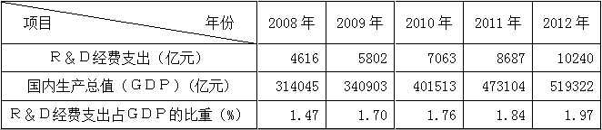

材料二  近年来，为推进科技创新，国家采取了一系列措施：不断加大财政科技投入力度；完善国家科技奖励制度，健全与岗位职责、工作业绩、实际贡献紧密联系和鼓励创新创造的分配激励机制；加快构建以企业为主体、市场为主导、产学研相结合的技术创新体系。

材料三  科技发展丰富了公民的政治生活，政府网站、政务微博拉近了公民与政府的距离，使表达和倾听更加贴近；科技发展振奋了国人的精神，航母入列、“神九”飞天、“蛟龙”入海······我们在世界民族之林中更加自信。

### 第 125 题

材料1反映了我国R&D经费支出与经济发展情况之间的关系，主要表明了：

A. 2008—2012年我国R&D经费支出不断增加

B. 2008—2012年我国R&D经费支出占GDP的比重不断上升

C. 2008—2012年我国R&D经费支出增加较快，科研经费浪费现象严重

D. 我国越来越重视科技创新，但与发达国家和地区相比仍有一定差距

第 125 题 · 答案与解析

**参考答案（粉笔题库参考内容）**

ABD

**解析**

由表格数据可知A、B项是正确的，文中只是说明了加大科技投入，并没有提及科研经费浪费现象严重，所以C项错误。由材料一中Ｒ＆Ｄ经费支出占ＧＤＰ比重是目前国际通用的衡量科技活动规模、科技投入水平和科技创新能力高低的重要指标。目前，发达国家和地区该指标平均水平为3%，可知我国与发达国家和地区相比仍有一定差距。D项正确。故正确答案为ABD项。

**考点**：宏观经济与调控政策

**来源**：2014年上海市公务员录用考试《行测》题（B类）第125题

### 第 126 题

材料2反映出近年来我国所采取的推进科技创新的一系列措施，之所以这样做，其依据主要在于：

A. 财政具有促进资源合理配置的作用，增加财政的科技投入可以为科技创新提供物质保障

B. 完善科技奖励制度和激励机制可以调动科技工作者的积极性和创新性

C. 企业是市场经济活动的主要参加者，以企业为主体可以充分发挥企业在科技创新中的作用

D. 市场在资源配置中起决定性作用，以市场为导向可以在科技创新过程中优化人财物的配置

第 126 题 · 答案与解析

**参考答案（粉笔题库参考内容）**

ABCD

**解析**

科技创新是原创性科学研究和技术创新的总称，是指创造和应用新知识、新技术、新工艺，采用新的生产方式和经营管理模式，开发新产品，提高产品质量，提供新服务的过程。科技创新可以被分成三种类型：知识创新、技术创新和现代科技引领的管理创新。科技创新之所以能够蓬勃发展，有以下四个原因：（1）财政具有促进资源合理配置的作用，增加财政科技投入可以为科技创新提供物质保障；（2）我国实行按劳分配为主体、多种分配方式并存的分配制度，完善科技奖励制度和激励机制可以调动科技工作者的积极性和创造性；（3）企业是市场经济活动的主要参加者，以企业为主体可以充分发挥企业在科技创新中的作用；（4）市场在资源配置中起决定性作用，以市场为导向可以在科技创新过程中优化人财物的配置。

故正确答案为ABCD。

**考点**：宏观经济与调控政策

**来源**：2014年上海市公务员录用考试《行测》题（B类）第126题

### 第 127 题

材料3说明了科技发展对于政治生活的意义，下列关于科技发展与政治生活关系的说法正确的有：

A. 科技发展拓宽了公民表达诉求的渠道，有利于公民更好地参与政治生活

B. 科技发展有利于政府更好地控制民意，强化意识形态控制

C. 科技发展有利于政府更好地实施政务公开，接受人民监督

D. 科技发展有利于增强我国的综合国力，提高我国的国际地位

第 127 题 · 答案与解析

**参考答案（粉笔题库参考内容）**

ACD

**解析**

科技发展使公民能够借助网络平台如微博、微信等等表达诉求的渠道，让公民更好地参与政治生活，A项正确；政府应该尊重民意，倾听民意，而不能说控制民意，所以B项错误；科技发展有利于政府更好地实施政务公开，接受人民监督，C项正确；科技发展有利于增强我国的综合国力，提高我国的国际地位，D项正确。

故正确答案为ACD。

**考点**：宏观经济与调控政策

**来源**：2014年上海市公务员录用考试《行测》题（B类）第127题

### 第 128 题

“蛟龙”号是我国第一台自行设计、自主集成研制的载人深潜器。可以说它是一条地地道道的“中国龙”，这充分表明：

A. 这是我国在海洋高科技领域的一种突破，标志着我国具备了深海探测的能力

B. 这一重大成就极大地提升了我国科技实力

C. 我国已经步入科技发达国家的行列

D. “蛟龙”号的设计和研制增强了我国的综合能力

第 128 题 · 答案与解析

**参考答案（粉笔题库参考内容）**

ABD

**解析**

蛟龙号的下潜是我国在海洋高科技领域的一种突破，标志着我国具备了深海探测的能力，它的设计和研制增强了我国的综合能力，这一重大成就极大地提升了我国科技实力，但是我国并没有步入科技发达国家的行列。

故正确答案为ABD。

**考点**：宏观经济与调控政策

**来源**：2014年上海市公务员录用考试《行测》题（B类）第128题

## 材料 8

B市的张女士在H区将私家车停在马路边，到饭店吃饭，吃完饭后发现车上有一张“停车记录告知单”。张女士不明白这张“告知单”是什么，通过网络查询，得知如下信息：B市从2011年4月1日起，交通协管员发现机动车未在道路停车泊位内停放的，按规定须填写两份单子：一份是《B市交通协管员道路停车记录告知单》（简称《告知单》），一份是《B市交通协管员道路停车记录报告单（简称《报告单》）。交通协管员在违章车辆前车门的玻璃上粘贴《告知单》后，通过相机或摄像记录停车事实，将《报告单》和图像视频资料报告交管部门，由交警审核确认属于违章停放机动车行为的，交管部门将会对违法行为人处以200元罚款的行政处罚，并邮寄信函将违法行为告知机动车所有人，驾驶人收到《告知单》后，可以在24小时后登录交管部门对外网站查询是否属于违法停放机动车的行为。

### 第 129 题

对交通协管员贴《告知单》的行为，从行政法律关系的角度判断正确的是：

A. 协管员是行政主体

B. 张女士是行政相对人

C. 这是一种对外部的行政法律关系

D. 协管员是受委托实施行政行为的个人

第 129 题 · 答案与解析

**参考答案（粉笔题库参考内容）**

BC

**解析**

行政主体是指享有行政权力，能以自己的名义行使行政权力，做出影响行政相对人权利和义务的行政行为，并能独立承担由此产生的相应法律责任的社会组织。协管员是社会招募的人员，不属于国家公职人员，A项错误。

行政相对人是指行政管理法律关系中与行政主体相对应的另一方当事人，即行政主体的行政行为影响其权益的个人或组织。这是行政法学上的概念，而非制定法上的概念。在制定法上“行政相对人”一般称“公民、法人和其他组织”。B项正确。

外部行政法律关系指的是公共行政关系，主要是行政机关和行政相对人之间的关系。C项正确。

行政行为是指行政主体行使行政职权，做出的能够产生行政法律效果的行为。协管员贴告知单不属于行政行为。D项错误。

故正确答案为B、C。

**考点**：行政法

**来源**：2014年上海市公务员录用考试《行测》题（B类）第129题

### 第 130 题

从行政处罚的角度，下列判断正确的是：

A. 《告知单》和《报告单》结合在一起，就构成了完整的行政处罚行为

B. 在交警在场的情况下，交通协管员可以直接作出罚款200元的决定

C. 如果获得了交管部门的明确授权，交通协管员可以直接作出罚款200元的决定

D. 如果交警直接开具罚款200元的行政处罚，交通协管员可以进行一些协助行为

第 130 题 · 答案与解析

**参考答案（粉笔题库参考内容）**

D

**解析**

行政处罚是指具有行政处罚权的行政主体为维护公共利益和社会秩序，保护公民、法人或其他组织的合法权益，依法对行政相对人违反行政法律法规而尚未构成犯罪给予法律制裁的行政行为。A项中《告知单》和《报告单》并不能构成行政处罚行为。A项错误。根据我国《行政处罚法》第三章第十八条规定：行政机关依照法律、法规或者规章的规定，可以在其法定权限内委托符合本法第十九条规定条件的组织实施行政处罚。行政机关不得委托其他组织或者个人实施行政处罚。可知B、C两项均为干扰项。协管员的义务就是协助交警工作，所以D项是正确的。

故正确答案为D。

**考点**：行政法

**来源**：2014年上海市公务员录用考试《行测》题（B类）第130题

### 第 131 题

若张女士后来收到200元罚款通知，从行政救济的角度判断正确的是：

A. 张女士可以向H区公安局申请复议

B. 张女士可以向H区人民法院提起行政诉讼

C. 张女士提起行政诉讼应以H区公安局为被告

D. 张女士不能同时申请复议和提起行政诉讼

第 131 题 · 答案与解析

**参考答案（粉笔题库参考内容）**

ABD

**解析**

A项正确，根据《行政复议法》第十五条第二款规定：对政府工作部门依法设立的派出机构依照法律、法规或者规章规定，以自己的名义作出的具体行政行为不服的，向设立该派出机构的部门或者该部门的本级地方人民政府申请行政复议。

B项正确，根据《行政诉讼法》第二条规定：公民、法人或者其他组织认为行政机关和行政机关工作人员的具体行政行为侵犯其合法权益，有权依照本法向人民法院提起诉讼。

C项错误，根据《行政诉讼法》第二十六条规定：公民、法人或者其他组织直接向人民法院提起诉讼的，作出行政行为的行政机关是被告。题中，张女士应以交通管理部门为被告。

D项正确，根据《行政复议法》第十六条规定：公民、法人或者其他组织申请行政复议，行政复议机关已经依法受理的，或者法律、法规规定应当先向行政复议机关申请行政复议、对行政复议决定不服再向人民法院提起行政诉讼的，在法定行政复议期限内不得向人民法院提起行政诉讼。

故正确答案为ABD。

**考点**：行政法

**来源**：2014年上海市公务员录用考试《行测》题（B类）第131题

### 第 132 题

如果张女士仅在交管部门的网站上查询到属于违法停放机动车行为和罚款200元的情况。但没有收到罚款200元的行政处罚决定书，则：

A. 张女士可以申请复议

B. 张女士可以提起行政诉讼

C. 张女士应当向公安局查询

D. 罚款200元的决定不具有效力

第 132 题 · 答案与解析

**参考答案（粉笔题库参考内容）**

D

**解析**

《行政处罚法》第五章第二节三十九条规定：行政机关给予行政处罚，应当制作行政处罚决定书。《行政处罚法》第四十条规定：行政处罚决定书应当在宣告后当场交付当事人；当事人不在场的，行政机关应当在七日内依照民事诉讼法的有关规定，将行政处罚决定书送达当事人。题中没有收到行政处罚决定书，那么处罚是无效的。

故正确答案为D。

**考点**：行政法

**来源**：2014年上海市公务员录用考试《行测》题（B类）第132题

## 材料 9

百步亭社区地处H省W市江岸区，是位于城市规划中最大的后湖居住新区。目前，这里已建住宅120万平方米，入住3万多人。8年前，这里一片荒凉，遍地烂泥。水、路、电全无，先后有七家开发商进入，均因其恶劣的开发条件难以获得经济效益而先后退出。而后，W市安居工程发展有限公司（以下简称为“安居公司”）作为第八家进入百步亭社区的开发企业，坚持以人为本、与时俱进，创新以企业为主导的“四结合”的社区建管模式，建设温馨家园，走出了一条具有中国特色社会主义现代文明社区的发展之路。成为H省精神文明建设的一面旗帜，安居公司成为全市房地产第一强。百步亭社区被评为全国文明社区示范点和全国城市物业管理优秀示范小区，百步亭楼盘获“首届中国人居环境范例奖”。

        百步亭把一片乱泥塘建设为绿色社区，得益于创新体制，构建以企业为主导的“四结合“的社区管理模式，即房地产开发公司回报社会的义举，物业管理公司的管理、居民委员会的建设、党和政府的指导及社区党组织建设和党员作用。这种模式以“党的领导、政府指导、企业主导、居民自治”为社区基本运作机制；以企业为主导，将“建、管、育”融于一体；以“全心爱民、热心助民、倾心为民，给居民最好的生活，建人生最温馨的家园”为理念；以实现企业、老百姓和国家“多赢”为目的，集聚社会力量，鼓励社会义举，追求理性利润，实现可持续发展。

        百步亭社区管理模式打破了层级管理，形成扁平式的组织结构和高效的管理运行机制，这里形成了“一个中心、两层网络”的管理体制，促成了开发、管理和服务环节的良性循环和无缝对接。“一个中心”是指社区党委会领导下的社区管理委员会帮助社区协调社区内部组织机构与工商、税务、环保、卫生、计生等政府职能部门、执法部门的关系，使其结成一种利益共同体。“两层网络”：一层是以开发公司为主体，以追求“理性利润”为基本原则，负责社区的住宅开发、环境建设、公益性设施投资等事务，追求长远利润和社区可持续发展；另一层是以物业公司为主体，融商业性服务、福利性服务、家政服务和社会公益性服务于一体，把管物与服务群众有机结合起来，微利或无利经营，不仅为居民提供了便捷的服务和完善的社区服务网络体系，也使社区服务真正成为社区建设可持续发展的生长点和拉动力，成为安排就业的重要渠道，成为密切社区人际关系的重要载体。这种“一个中心、两层网络”的管理体制，实现社区资源的合理配置，协调整合社区事务，克服了以往城市建设和管理过程中的城市通病，杜绝了“亭棚经济”“马路经济”，使社区建设和管理走向科学化、法制化、社会化、市场化的道路，小区内居民生活轻松有序。

### 第 133 题

社区是聚居在一定地域范围内的人们所组成的社会共同体。从案例可以看出目前W市城市社区的范围，是指经过社区改革后做了规模调整的\_\_\_\_\_\_\_\_的辖区。

A. 街道办事处

B. 居民委员会

C. 党委

D. 小区物业

第 133 题 · 答案与解析

**参考答案（粉笔题库参考内容）**

B

**解析**

社区是我们生活中不可缺少的一个综合的群众基础机构。它为我们居住在一个固定区域的居民群体的居民起着一种媒介桥梁作用。为我们广大居民群众做着一些日常生活中所需的与社会团体调节沟通连贯的事情。是我们信任的一个基础机构，是与居民群众生活息息相关的基层组织。城市社区是指大多数人从事工商业及其他非农业劳动的社区，它是人类居住的基本形式之一，是一定区域内由特定生活方式并且具有成员归属感的人群所组成的相对独立的社会共同体。目前城市社区的范围，一般是指经过社区体制改革后作了规模调整的居民委员会辖区。

故正确答案为B。

**来源**：2014年上海市公务员录用考试《行测》题（B类）第133题

### 第 134 题

社区管理是在政府的指导下，社区职能部门、社区单位、社区居民对社区的各项公共事务和公益事业进行的自我管理，社区管理和物业管理的区别在于：

A. 管理主体不同

B. 管理范畴不同

C. 管理性质不同

D. 管理作用不同

第 134 题 · 答案与解析

**参考答案（粉笔题库参考内容）**

ABCD

**解析**

从管理主体来讲，所谓物业管理，是指业主通过选聘物业管理企业，由业主和物业管理企业按照物业服务合同约定，对房屋及配套的设施设备和相关场地进行维修、养护、管理，维护相关区域内的环境卫生和秩序的活动。社区管理，也可称之为社区行政，主要是指一定的社区内部各种组织，为了维护社区的正常秩序，满足社区居民物质生活、精神生活等特定需要而进行一系列的自我管理或行政管理的活动。

从管理范畴来讲，社区管理管辖的范围广，往往不限于一个物业管理区域；物业管理则是针对一个物业管理区域讲的。

从管理性质来讲，社区管理除包括主管部门、居（村）委会指导和监督业主委员会和物业管理企业的工作外，还包括计划生育、市容、环卫、城建等部门在社区的各项行政管理；物业管理包括物业管理企业对小区管辖范围内进行的物业管理有偿服务，还包括业主大会、业主委员会的自治管理和规范运作。

从管理作用来讲，社区管理内容要比物业管理范围广得多，除包括公共部分、设施设备的物业管理外，还包括居民的计划生育、户口、社会治安、社区文化、党的政策宣传等方面；而物业管理仅仅是与物业相关事务的管理。

故正确答案为ABCD。

**来源**：2014年上海市公务员录用考试《行测》题（B类）第134题

### 第 135 题

百步亭模式以“党的领导、政府指导、企业主导、居民自治”为社区基本运作机制，其中居民委员会的价值在于：

A. 居民委员会接受街道办事处的领导并成为基层政权的重要依靠力量

B. 居民委员会是党和政府联系群众的桥梁和纽带

C. 居民委员会是实现基层民主的重要组织形式

D. 居民委员会促进社会稳定和两个文明建设

第 135 题 · 答案与解析

**参考答案（粉笔题库参考内容）**

BCD

**解析**

居民委员会是居民自我管理、自我教育、自我服务的基层群众性自治组织，是中国人民民主专政和城市基层政权的重要基础，也是党和政府联系人民群众的桥梁和纽带之一。在中国的城市地区有4亿多居民通过这一制度直接行使宪法赋予的自治权和民主管理经济、文化和社会事务的权利，B、D两项正确；在我国，人民有管理国家事务、管理经济和文化事业、管理社会事务的权利，而居委会则是城市居民实现民主权利的重要形式，C项正确；居民委员会在市辖区人民政府、不设区的市人民政府或者它的派出机关—街道办事处的指导下进行工作，市、市辖区人民政府的有关部门也可以对居民委员会有关的下属委员会进行业务指导，A项错误。

故正确答案为BCD。

**来源**：2014年上海市公务员录用考试《行测》题（B类）第135题

### 第 136 题

物业管理公司是具备相应物资条件并按照法定程序成立的从事物业管理服务的经营性企业法人。百步亭社区的物业管理公司履行公司的义务包括：

A. 执行物业管理合同，依法经营

B. 使用物业维修基金

C. 接受业主委员会和小区居民监督

D. 实行多种经营、补充小区管理经费

第 136 题 · 答案与解析

**参考答案（粉笔题库参考内容）**

AC

**解析**

城市新建住宅小区管理办法第八条规定：

物业管理公司的权利：

（一）物业管理公司应当根据有关法规，结合实际情况，制定小区管理办法；

（二）依照物业管理合同和管理办法对住宅小区实施管理；

（三）依照物业管理合同和有关规定收取管理费用；

（四）有权制止违反规章制度的行为；

（五）有权要求管委会协助管理；

（六）有权选聘专营公司（如清洁公司、保安公司等）承担专项管理业务；

（七）可以实行多种经营，以其收益补充小区管理经费。

物业管理公司的义务：

（一）履行物业管理合同，依法经营；

（二）接受管委会和住宅小区内居民的监督；

（三）重大的管理措施应当提交管委会审议，并经管委会认可；

（四）接受房地产行政主管部门、有关行政主管部门及住宅小区所在地人民政府的监督指导。

物业管理公司需向工商行政管理部门申请注册登记，领取营业执照后，方可开业。

选项中，A、C两项为义务，正确；B、D两项为权利，错误。

故正确答案为AC。

**来源**：2014年上海市公务员录用考试《行测》题（B类）第136题

## 材料 10

xx市发展和改革委员会

关于转发国家能源局《关于申报分布式光伏发电规模化应用示范区的通知》的

通    知

X发改能源（2012）0164号

  各有关单位：

  为落实可再生能源发展“十二五”规划，促进太阳能发电产业可持续发展，今日国家能源局下发了《关于申报分布式光伏发电规模化应用示范区的通知》。先转发给你们，请按照《通知》要求，在落实建筑屋顶、消纳用户和电力接入等实施条件的基础上，抓紧编制申报项目实施方案，于2012年10月10日前报市发展改革委。

联系人：黄xx

联系电话：xxxxxxxx

附件：《国家能源局关于申报分布式光伏发电规模化应用示范区的通知》（国能新能【2012】298号）

xx市发展和改革委员会

二〇一二年九月二十八日

### 第 137 题

关于上述公文的标题，下列表述正确的是：

A. 分行不当

B. “转发”前不应该加“关于”

C. 不应该使用书名号

D. 最后“的通知”多余

第 137 题 · 答案与解析

**参考答案（粉笔题库参考内容）**

AB

**解析**

公文格式，即公文规格样式，是指公文中各个组成部分的构成方式，它和文种是公文外在形式的两个重要方面，直接关系到公文效用的发挥。包括公文组成、公文用纸和装订要求等。公文标题由发文机关、发文事由、公文种类三部分组成，称为公文标题“三要素”。发文机关名称、发文事由、公文种类，字数较多，可以排列为梯形或者菱形，但是严禁拆词。故A项正确，D项错误。

B项正确，一个标题中只有一个“关于”，因此转发前的“关于”应该省略。

C项错误，属于引用公文，所以应该使用书名号。

故正确答案为A、B。

**来源**：2014年上海市公务员录用考试《行测》题（B类）第137题

### 第 138 题

关于上述公文的发文字号，下列表述正确的是：

A. 年份外括号使用有误

B. 年份使用阿拉伯数字不对

C. 顺序号“0164”写法不对，不应该加“0”

D. 顺序号“0164”写法不对，应该前加“第”字

第 138 题 · 答案与解析

**参考答案（粉笔题库参考内容）**

AC

**解析**

发文字号又称发文编号、文号，它是发文机关在某一年度内所发各种不同文件总数的顺序编号。发文字号由发文机关的办公厅（室）负责统一编排。发文字号应当包括机关代字、年份、序号；联合行文，只标明主办机关发文字号。发文字号应该是由机关代字、年份和序号组成。年份用阿拉伯数字全称，用六角括号括起来，序号前不加“第”字，不加“0”。

故正确答案为A、C。

**来源**：2014年上海市公务员录用考试《行测》题（B类）第138题

### 第 139 题

下列对公文正文的修改意见正确的是：

A. 应该在“《关于申报分布式光伏发电规模化应用示范区的通知》”后加括号注明此通知的发布字号

B. “请按照《通知》要求”一句中的“《通知》”所指不明，应该在文中有所说明

C. 联系人和联系电话应该移到发文日期的左下方

D. 附件说明中应该去掉书名号、括号及括号中内容也可去掉

第 139 题 · 答案与解析

**参考答案（粉笔题库参考内容）**

ABCD

**解析**

A项引用标题应该是“《公文标题》（发文字号）”的格式；B项《通知》指代不明，需要说明；C项附注应该位于成文日期的左下方；D项附件应当去掉书名号。

故正确答案为A、B、C、D。

**来源**：2014年上海市公务员录用考试《行测》题（B类）第139题

### 第 140 题

下列关于公文发文机关署名和成文日期的编排，表述正确的是：

A. 成文日期中的数字应该用阿拉伯数字

B. 成文日期右空4字

C. 不用署名、在成文日期处加盖发文机关“xx市发展和改革委员会”印章

D. 发文机关“xx市发展和改革委员会”在成文日期之上，以成文日期为准居中编排

第 140 题 · 答案与解析

**参考答案（粉笔题库参考内容）**

ABD

**解析**

按照格式规范，一般是要有落款的，如果没有落款，在特定情况下文件的真实性可能会被质疑，正常的程序应该是先署名后用印，用印的位置为年月日部分，骑年盖月。所以C项错误。其他选项正确。

故正确答案为ABD。

**来源**：2014年上海市公务员录用考试《行测》题（B类）第140题

