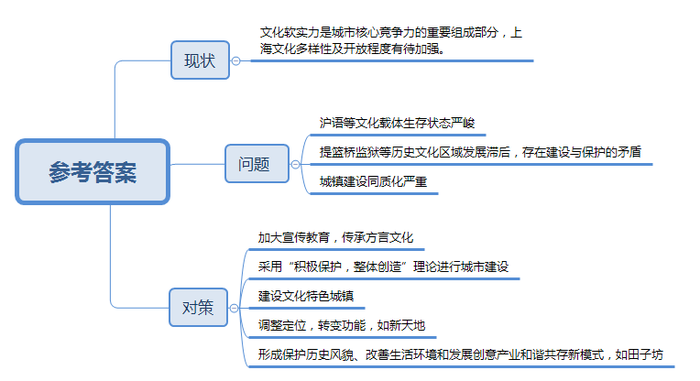
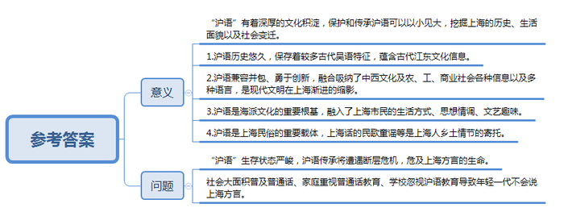
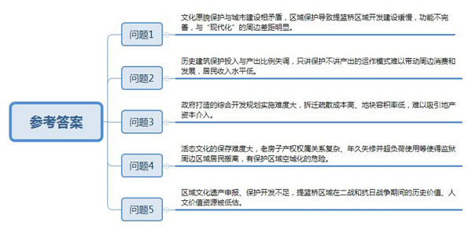
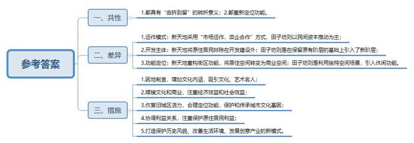
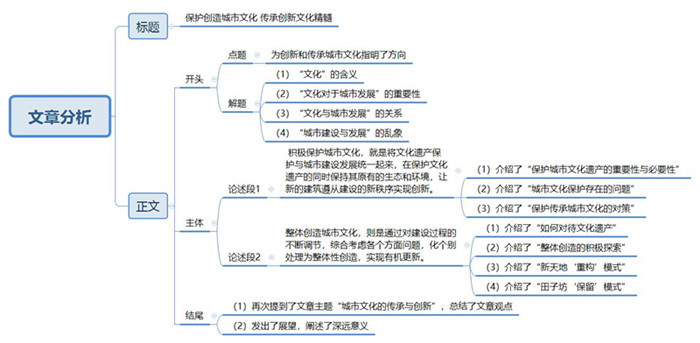

# 2015年上海市公考《申论》题（B卷）

<!-- gwy:overview:start -->
> **上海 · 2015 · 申论 · B类** ｜ 5 题 · 图片 5 处 · 答案随题折叠

导航：[题目](#题目) · [材料 1](#材料-1)
<!-- gwy:overview:end -->

> 候选采集稿。参考答案及解析来自粉笔页面，不代表官方答案或真实高分答卷；来源使用许可与原卷对应关系仍需人工核实。

## 给定材料

### 材料 1

优秀传统文化凝聚着中华民族自强不息的精神追求和历久弥新的精神财富，是发展社会主义先进文化的深厚基础，是建设中华民族共有精神家园的重要支撑。文化是人类社会存在、发展和互动的基石。城市是文化、社会和经济活动的摇篮。在这里各种社会活动的互动、碰撞和创新，创造出了新的理念和协作。一座城市，特别是大型城市，如果没有文化带来的软实力，核心竞争力无从谈起。

据“2013国际文化大都市排行榜”，纽约、伦敦、北京和巴黎分列前四，上海位列第14位。本次国际文化大都市排行榜指标设计的核心理念遵循“3D”原则，即活力（Dynamism）、多元（Diversity）和差异（Difference）。排行榜以“综合性”和“特殊性”为标准选取了世界上100所城市，样本之大是既往城市排行榜无法比拟的。所有数据均来源于各城市政府官方网站、各城市文化年鉴、联合国教科文组织、世界银行等权威机构的统计结果。由此可见，上海的文化多样性以及开放程度方面还有待加强。

### 材料 2

上海话是上海悠久历史中形成的方言，有着深厚的文化积淀。上海原处于吴地并不发达的海滩，开埠前，上海话是吴语中发展相对滞后的语言，因此在上海话中至今保存着比别的地方更多的古代语音、词语和语法现象，反映出古代江东文化信息。

上海话在开埠后汇入了各种语言和方言，在文化碰撞、交汇和发展过程中汇聚了农业社会、工业社会和商业社会的各种词汇、成语和谚语。发达的商业活动使大量的商业词语，如“撬边”、“卖相”和“套牢”等，被引入到上海的日常用语中来。上海文化又是在中西文化交融中勇于创新的文化。当年，对层出不穷的新事物，上海人发现一件就创造一个名词，大量新词如自来水、电灯泡、马路、洋房、书局、报馆、沙发、课程、马达、麦克风、敲竹杠、小儿科等等，这些词语后来大多为普通话所吸收，反映了现代文明在上海的渐进。上海方言中所包容的文化积淀，与上海的石库门等近代建筑这些物质文明相融合，是上海人民智慧的结晶和勤奋的遗产，成为中西交融的、博大多元的、雅俗同赏的海派文化的重要根基。上海市民的生活方式、思想情调以及多样化的文艺趣味都溶化在上海话的海派文化中。吴侬软语伴随着上海人的亲乡情节，荡漾在那些具有浓厚乡土情的上海话民歌、童谣、绕口令、顺口溜、谜语、老古闲话和文艺作品里，萦绕在闾里巷间。充分挖掘上海方言这个丰富的宝藏，可以将上海人民的生活细貌、民俗文化和社会变迁展现得栩栩如生。

上世纪90年代后，上海方言成为上海人排外、不尊重外地人，并依赖语言设置交流障碍的“罪魁”之一。曾任教小学的退休教师谢阿姨回忆当年校园沪语“禁令”，对一条标语印象深刻：“不说脏话、不说方言、做文明的好孩子”。从小生长在上海的谢阿姨对此深表忧虑，“上小学的孙子虽然听得懂上海话，却说不好”，心痛之余，她得空就教孩子念老上海童谣。

时至今日，沪语的生存状态十分严峻。不少已过而立之年的“80后”上海人所说的沪语已略微走样。“90后”口中的沪语，从发音、词汇到语法已接近普通话了。至于“00后”的孩子们，情形更糟糕。在“不要输在起跑线上”的心理暗示面前，家长大部分选择了用普通话或英语与孩子交流，鲜有说上海话的。

某杂志就上海方言、建筑、文化、教育等核心竞争优势开展的网上调查显示，只有31.4%的中学生表示会说上海话，超过四分之一的学生不会说。某沪语专家表示，近年出生的幼儿们如果再不开口说上海话，沪语传承就会出现一个长达30年的断层，这将危及上海方言的生命。

多元的娱乐消费使地方戏剧的观众日趋老龄、小众。而今，地域文化最好的载体就是方言。为留存沪语的血脉，上海文化工作者做了不少工作。《新民晚报》的“上海闲话”栏目大受读者好评；沪语输入法业已问世；2012年6月，上海电视台的《新闻坊》试播沪语版后，反响热烈，观众猛增三成。不少网友表示：“沪语播报每周一次太少，最好每天都有”；“能不能每天用上海话讲啊？我保证天天看”。

新学期伊始，沪语兴趣班走进学校。虽然是选修的拓展课程，但很受学生喜爱，报名者众多。不久前上架的首部小学沪语教材——《小学生学说上海话》，旨在从称呼和习俗等方面教孩子讲上海话，该教材已进入小学课堂，不少家长和师生点赞。

### 材料 3

有“远东第一监狱”之称的上海提篮桥监狱最初由英国人修建，一直使用至今，是国内历史悠久的监狱。提篮桥区域也是二战期间最著名的犹太人聚居地之一。2013年7月，一则该监狱即将搬迁的消息引发关注。7月24日，上海虹口区提篮桥街道一商用地块以总价10.44亿元被拍卖，折合楼面地价26831元/平方米，溢价率为49.1%。地产界普遍认为，这是对提篮桥监狱搬迁后周边楼市的“价格测试”。如何在城市建设与保护地域文化之间寻找平衡点？这道老题目成为我国沿海最大开放城市的新课题。

因为监狱的存在，提篮桥区域在上海翻天覆地的城市建设变化中，显得格格不入。政府和当地居民都将其视为发展障碍，但学者又呼吁保护它，矛盾重重。50多岁的严小妹（化名），在离提篮桥监狱高墙10米外的街口开了一家香烛店。往监狱反方向走几十米，就是下海庙——上海历史最悠久的寺庙之一。她自幼生活在这里的一间15平米的临街房子里，儿子在大学住校了，留下她和老伴。“小时候这里很热闹。提篮桥是市中心，离外滩近，不比南京路差。杨浦区很多地方那时候还是乡下。”严小妹说，但这种优越感随着城市建设进程逐年下降。“50年来，这里几乎没有变化。”在上海人的词汇里，“提篮桥”已经成了监狱的代名词。当地居民王老伯说：“年轻人一结婚就搬走了，儿媳不肯住在这里，谁愿意住在监狱旁边？”“这里谁不希望监狱搬走啊？搬走了我们才能拆迁，谁不想住新房子？”这是严小妹现在的想法。附近很多条件好的住户都搬走了，把这里的旧房子出租。离监狱一两公里的地方，某国际金融广场正在热火朝天的赶工建设，一家超五星精品酒店即将投入使用，上海港国际客运码头与东方明珠隔江相望……附近还有浦西第一豪宅、上海第三代写字楼，这些都时时刺激着严小妹和她的邻居们，他们也渴望着“现代化”。

提篮桥街道办的一位工作人员形容，监狱成了上海北外滩地区发展的“绊脚石”。附近居委会的马书记介绍，这里的商店不上档次，吸引不了人，只能满足居民的日常需求。为数不多的游客来参观时不会在此消费，不会增加地区的收入。“保护历史建筑只有支出没有收入，应该更全面地综合考虑投入与产出的关系。只讲保护的投入会是个无底洞”。此外，当地有些居民的人均居住水平还停留在20年前，三代蜗居很普遍。随着上海房价的飙升，政府的拆迁、疏散成本也在节节攀高。

根据上海虹口区公布的规划，提篮桥地块将以提篮桥监狱这座国家级文物保护单位为中心，整合临近的摩西会堂、舟山路-霍山路历史文化街区，与轨道交通12号线提篮桥站点、海门路55号等周边地块联动，打造大型综合性区域。在地产商眼里，历史文化保护区旁边的地块，容积率必然严格限制，付出高昂的拆迁成本去建低容积率的房子，何况旁边还有个大监狱，谁愿意？

为什么很多居民不愿意住在这些老房子里？据复旦大学专项课题调研，主要涉及三个问题：第一，房子年久失修，但现在没人维修。第二，超负荷使用，原来是一家一户，现在要住七八户人家。第三，这些老房子都经历了多次产权变更，很难厘清权属关系。提篮桥监狱需要保护，这已经达成共识。但具体如何实施，看法就众说纷纭了。专家们既不同意政府卖地、大规模重新开发，也不同意居民全搬走，留下空荡荡的展览馆。

2003年，提篮桥地区被增补列入上海市历史文化风貌区，其特色为“特殊建筑和里弄住宅、宗教场所”。二战期间，其附近的摩西会馆成为犹太难民的宗教活动中心，两万多名犹太人逃难到上海时主要就居住在这里，现在则是“犹太难民在上海纪念馆”，是许多犹太游客访沪的必到之处。区域内德文招牌的商店和奥地利式露天咖啡馆鳞次栉比，令这里有“小维也纳”之称。

以色列驻沪总领事表示，除了提篮桥地区，全世界所有犹太人在二战中聚集过的地方都成了世界文化遗产，但展示的都是扭曲和杀戮，只有提篮桥展示的是友谊、阳光、生命。犹太人聚居地纪念活动中，美国卡特政府时期的国家银行行长，虽然已经92岁高龄，到了故地，无需别人指路，就找到了自己家的原址。他动情地告诉周围人：“瞧这间房，爸爸妈妈睡大床，这边是姐姐的床，那边是我的小床。”边说着，眼泪掉了下来：“真的感谢上海，在我们犹太人被全世界赶尽杀绝时，这里收留了我们。”

与建筑本身的历史价值相对应的“人文景观”，是曾经被关押在提篮桥监狱的众多历史名人。其中最著名的当属章太炎和邹容。他们因为《苏报》案被囚禁在此，章太炎得以出狱，邹容却病死狱中。任弼时、张爱萍、江上青（皖东北革命根据地创始人之一）等一大批革命先辈也都曾被秘密关押在提篮桥监狱。抗战胜利后，提篮桥监狱先后关押了数百名日本战犯，包括台湾“总督”安藤利吉、香港“总督”田中久一、南京大屠杀主犯谷寿夫等人。1946年初，盟军在提篮桥监狱设立军事法庭，审判了47名日本战犯，这是抗战胜利后中国境内最早的战犯审判场所。

### 材料 4

旧城区的复兴是对城市文化基因的抢救、延续。如果说建筑是石头的史书，那么街区则是城市的年轮，深深地镌刻着城市的记忆。旧城区的老屋旧居虽然承载了城市的文化基因，但在现代化的机器面前却十分脆弱。旧城一旦坍塌将无法重建，这不仅是建筑的坍塌，更是城市文化的断层。一个只有摩天大楼丛林，没有厚重、深沉的老街区的城市无疑是乏味的，同时也会因缺乏底蕴而变得浮躁。

旧城区的复兴不仅是恢复它的活力，还要考虑复兴带来的经济效益和社会效益。旧城区的老屋旧居对抗的最可怕的不是建筑的衰老，而是各种复杂利益关系。旧城区现在一般都处于城市较好的地段，寸土寸金，被各种利益集团盯上是在所难免的，利益的博弈可想而知。

当外国游客询问街头上的上海路人，“到哪里寻找老上海”，答案是田子坊或新天地的概率基本一样。1998年12月，田子坊艺术街在泰康路揭开序幕；1999年2月，太平桥地区改造项目之一的“上海新天地”工程开工。两者差不多是在同一起跑线上开跑的，间距只有约3公里；两者在上海城市的更新模式上都具有“由拆到留”转折点的意义，两种新的改造模式从此建立，更掀起了沪上怀旧风潮。

新天地所处的太平桥地区是位于上海繁华的淮海中路南、马当路东和黄陂南路西的一个独具上海特色的石库门街区。石库门是上海开埠以来形成的一种中西合璧的建筑形式，见证了中国传统建筑文化在上海这个大都市与西方文化相互融合的过程。石库门最早是富商、地主、官绅的居住之处，随着城市的变迁，逐渐沦为城市下层居民的住所。石库门承载了太多关于上海的记忆，对上海市民文化的形成产生了深远的影响，是上海文化的一个重要符号。

20世纪90年代末，卢湾区政府与香港瑞安集团签署《沪港合作改造上海市卢湾区太平桥地区意向书》实施改造，美国SOM公司承担控制性详细规划编制工作。整个改造计划占地52公顷，分为新天地、翠湖天地、企业天地三部分。新天地为首期工程，已于2001年6月竣工，次年全面开业。

新天地是政府和开发商联合进行的大规模旧城区开发，其中原住居民不参与开发建设。瑞安集团通过土地使用权有偿转让获取开发权，并与卢湾区政府采用“市场运作、政企合作”的方式参与建设，项目耗资14亿。高昂成本使改造后的“新天地”注定要将原住居民“置之度外”。新天地建成后在运营中不断调整定位，转变功能，每次转变都是一次飞跃。新天地的改造无疑是旧城区复兴的一个典型。

当石库门蜘蛛网般的电线、厚厚的灰尘被清理掉时，石库门的上海符号重新焕发出其独特的魅力。穿梭于新天地朴素而宁静的里弄中，看到江南传统石头门框、乌漆门、坡屋顶与西式阳台、老虎窗相得益彰时，不得不赞叹石库门的魅力，也不由得畅想一番当年石库门中的生活场景。

旧城区本来就是充满活力的生活空间，保护旧城区的最好方式就是恢复它的活力，在城市中重新发挥其功能。新天地重新对石库门的功能进行定位，将石库门从居住空间转变成了商业空间。石库门深厚的老上海文化底蕴为其向商业功能的转变创造了条件，而现代人对老上海生活场景的向往为石库门的文化价值向商业价值转变奠定了市场基础。因此，也可以说新天地是文化与商业嫁接的一个典范。新天地弄堂里的人头攒动，加上屋内的灯火阑珊，令人陶醉的爵士乐，可见其活力不减当年。当黄昏临近，与三五好友坐在店外遮阳伞下，痛快地喝上一杯德国生啤，或者吃上几块法式面包，旁边还有来自异国他乡的服务生……好像这一切天然就属于石库门，属于上海。

田子坊是位于上海思南路东、瑞金二路西，建国中路南和泰康路北的一片民国时建造的街区。田子坊给人的感觉非常朴素，甚至有些破旧，但却散发着原汁原味的上海生活气息，完全就是一个鲜活的上海生活博物馆。在田子坊，楼下是别致的小店，抬头一望，空中还晾着衣服，蜘蛛网般的电线随处可见，厚重的铸铁下水管强烈地冲击着视觉……一切都很朴实，没有遮掩，但却很和谐。相比新天地，田子坊在复兴中进行了另一种探索。

田子坊的发展主要源于民间资本推动。开始并不被政府重视，发展中几经拆除危机，最终民间力量获胜，得到政府认可。田子坊并没有像其他旧城区改造一样将原住居民搬迁出去，而是充分利用其独特的空间场景，引进了都市休闲功能，吸引了众多的文化创意人士、都市潮人、私营业者等新阶层的进驻，创造了一种新型邻里关系。新阶层的进驻不仅优化了原来的阶层结构，而且引进了现代都市文明，为街区注入了新的活力。并使原住居民也分享到了现代都市文明的成果。田子坊的一些居民将底层楼面出租，穿梭在田子坊的里弄中，工艺品店、饰品店、服装店、酒吧、咖啡店……琳琅满目，这无疑增加了原住居民的经济来源，增强了中下层民众的生活保障。同时，这种对原住居民利益的关照，也减轻了街区改造的阻力。

田子坊厚重的砖墙、浓烈的色彩、暴露的管道与电线……洋溢着浓浓的艺术气息，在蓝天白云的映衬下，就像一幅暖色调的油画。田子坊虽然处在上海这个国际大都市，但却闹中取静，深深的弄堂阻挡了都市的喧嚣，正好为艺术家构筑起一个清静的精神家园。也许田子坊天然就是艺术的，是艺术家抒发灵感之地，一些知名艺术家的工作室相继进驻。众多艺术家的聚集，一方面在田子坊吹起了一股文化艺术之风，增加了田子坊的文化内涵；另一方面，凭借艺术家这个精英团体的凝聚力和影响力，田子坊也名扬海内外，吸引着全球众多文化、艺术名人的到来。

如果说新天地“重构”了石库门的街区功能，创造了一片新天地，那么田子坊则是“保留”，包括建筑、街区的保留，最重要的是将生活在这个街区中的阶层保留了下来。生活本来就是一个阶层在某个空间所发生的事，田子坊这种创造式的保留，才使得这个阶层在这个街区中的故事得以继续延续，原汁原味的上海生活才得以在现代都市空间中绵延。也许正是田子坊原汁原味的上海味道，吸引了海内外众多的游客光顾。

2005年4月，田子坊被授予“上海创意产业集聚区”，如今已形成保护历史风貌、改善生活环境和发展创意产业和谐共存新模式。

### 材料 5

“故人西辞黄鹤楼，烟花三月下扬州”。假如扬州不是绿杨城郭、二分明月，李白的诗句怎会如此诗情画意？“小楼一夜听春雨，深巷明朝卖杏花。”假如深巷不是粉墙黛瓦、小桥流水，陆游的诗句怎会如此含意隽永？遗憾的是，一些曾孕育无数文人墨客深情诗篇的民居，正在城市改造中渐渐消失。旧城改造，必然意味着推倒重来吗？如何留住城市的“根”与“魂”，近年来始终是两会代表委员热议的话题。

这些年的大拆大建、大兴土木，使太多城市建筑失去地方特色。“我到外地出差，不论身在何处，推开窗子一望，几乎所有城市都是一模一样的高楼大厦。”某委员表示。现在的城市建设从外貌到文化都在走一条高度同质化、缺少独特性的道路。早在2003年，十余位院士专家曾提出在历史文化名城停止原有“旧城改造”的政策建议。十多年过去了，“千城一面”还是让不少城市陷入特色危机。许多中小城市盲目模仿大城市，至今仍把高层、超高层建筑当作现代化标志，寄希望于短时间内拥有更多“新、奇、怪”的建筑，迅速改变城市形象，反而使城市面貌变得生硬、浅薄和单调。有委员在不同城市见过数个版本的“山寨白宫”后感慨：“这实在是城市文化的悲剧。”某建筑学家感慨，在欧洲很多城市，还能找到15世纪的建筑，甚至一整条街。而在我们这里，明代的房屋都已经十分稀有。有代表委员认为，在许多大城市，旧城区一般有较好的区位优势，多位于房地产商高价争夺的黄金地段，为追求经济利益最大化，旧城改造往往变成了大拆大建。一些代表委员将之归结为某些领导者热衷政绩工程，而将文化遗产视为城市规划的包袱和障碍。2011年，我国的城镇化比例已超50%。随着经济的快速发展和劳动力向城镇转移，城镇化比例攀升已经成为必然趋势。此种状况下，如何实现城市建设与城市文脉的和谐共生？

面对城市的快速进程，今天文化遗产保护正处于危险而紧迫的关键历史阶段。文化遗产资源是一座城市珍贵的资产，在城市文化的公共性、公益性日益加强的今天，文化遗产不应该仅仅是专业工作者呵护的对象，而应融入社会生活，在保护中利用，在利用中进一步诠释和丰富它们的综合价值。应关注文化遗产对于提升民众生活质量、创造城市文化环境所具有的不可替代的作用。保护文化遗产不应排斥对其合理利用，而且合理利用恰恰是最好的保护。2007年9月，著名建筑学家吴良镛教授在城市文化国际研讨会提出了“积极保护，整体创造”的理论观点。“积极保护”，即将文化遗产保护与城市建设发展统一起来，不仅保护文化遗产本身，还要保持其原有的生态和环境，新的建筑可以并且也需要创新，但应遵从建设的新秩序，而不是“就建筑论建筑”、“就保护论保护”。“整体创造”，即通过建设过程中的不断调节，追求城市组成部分之间成长中的整体秩序，把各方面的问题综合起来考虑，化建筑的个别处理为整体性创造，既保持和发展城市建筑群原有的文化风范，又使新建筑富有时代风貌，实现有机更新。

### 材料 6

《国家新型城镇化规划（2014-2020年）》指出，根据不同地区的自然历史文化禀赋，体现区域差异性，提倡形态多样性，防止千城一面，发展有历史记忆、文化脉络、地域风貌、民族特点的美丽城镇，形成符合实际、各具特色的城镇化发展模式。

2013年中央城镇化工作会议强调，推进城镇化，既要坚持使市场在资源配置中起决定性作用，又要更好地发挥政府在创造制度环境、编制发展规划、建设基础设施、提供公共服务、加强社会治理等方面的职能；中央制定大政方针，确定城镇化总体规划和战略布局，地方则从实际出发，贯彻落实总体规划，制定相应规划，创造性开展建设和管理工作。

## 题目

### 第 1 题

**概括给定资料的主要内容。（10分）**

关联材料：材料 1、材料 2、材料 3、材料 4、材料 5、材料 6

作答要求：

要求：语言精练，层次要点清楚，字数不超过200字。

第 1 题 · 答案与解析

**参考答案（粉笔题库参考内容）**

一、文化软实力是城市核心竞争力的重要组成部分，上海文化多样性及开放程度有待加强。二、问题：沪语等文化载体生存状态严峻；提篮桥监狱等历史文化区域发展滞后，存在建设与保护的矛盾；城镇建设同质化严重。三、对策：加大宣传教育，传承方言文化；采用“积极保护，整体创造”理论进行城市建设；建设文化特色城镇；调整定位，转变功能，如新天地；形成保护历史风貌、改善生活环境和发展创意产业和谐共存新模式，如田子坊。

**解析**

**参考答案说明：**本参考答案分别从“总体介绍”“问题”“对策”等不同层次进行分条撰写。各条要点之间在内容上是并列关系，没有重复。

**考点**：概括主要内容类

**来源**：2015年上海市公考《申论》题（B卷）

### 第 2 题

**结合给定资料，简要论述“沪语”保护和传承的必要性。（15分）**

关联材料：材料 1、材料 2、材料 3、材料 4、材料 5、材料 6

作答要求：

要求：表述准确到位，语言简明扼要，字数不超过300字。

第 2 题 · 答案与解析

**参考答案（粉笔题库参考内容）**

一、“沪语”有着深厚的文化积淀，保护和传承沪语可以以小见大，挖掘上海的历史、生活面貌以及社会变迁。1.沪语历史悠久，保存着较多古代吴语特征，蕴含古代江东文化信息；2.沪语兼容并包、勇于创新，融合吸纳了中西文化及农、工、商业社会各种信息以及多种语言，是现代文明在上海渐进的缩影。3.沪语是海派文化的重要根基，融入了上海市民的生活方式、思想情调、文艺趣味。4.沪语是上海民俗的重要载体，上海话的民歌童谣等是上海人乡土情节的寄托。

二、“沪语”生存状态严峻，沪语传承将遭遇断层危机，危及上海方言的生命。社会大面积普及普通话、家庭重视普通话教育、学校忽视沪语教育导致年轻一代不会说上海方言。

**解析**

**参考答案说明：**本参考答案宏观上从“保护‘沪语’的意义”及“‘沪语’保护存在的问题”两个方面说明保护和传承“沪语”的必要性。微观上，书写时采用总分结构，在“保护‘沪语’的意义”这方面，先整体说明“沪语的总体意义”，再具体从“传承历史文化”“兼容创新”“海派文化的根基”“民俗的载体”等不同的方面进行了分条撰写。在“‘沪语’保护存在的问题”这方面，先整体说明“沪语生存状态严峻”，再具体说明“社会大面积推广普通话”这方面的问题。各条要点之间没有重复。

**考点**：原因类

**来源**：2015年上海市公考《申论》题（B卷）

### 第 3 题

**结合给定资料，分析上海提篮桥区域保护与发展过程中所遭遇的瓶颈问题。（15分）**

关联材料：材料 1、材料 2、材料 3、材料 4、材料 5、材料 6

作答要求：

要求：准确简明，语言精练，条理清楚，字数不超过300字。

第 3 题 · 答案与解析

**参考答案（粉笔题库参考内容）**

一、文化原貌保护与城市建设相矛盾，区域保护导致提篮桥区域开发建设缓慢，功能不完善，与“现代化”的周边差距明显。二、历史建筑保护投入与产出比例失调，只讲保护不讲产出的运作模式难以带动周边消费和发展，居民收入水平低。三、政府打造的综合开发规划实施难度大，拆迁疏散成本高、地块容积率低，难以吸引地产资本介入。四、活态文化的保存难度大，老房子产权权属关系复杂、年久失修并超负荷使用等使得监狱周边区域居民搬离，有保护区域空城化的危险。五、区域文化遗产申报、保护开发不足，提篮桥区域在二战和抗日战争期间的历史价值、人文价值资源被低估。

**解析**

**参考答案说明**：本参考答案从“文化原貌保护与城市建设”“历史建筑保护投入与产出比例”“政府打造的综合开发规划实施”“活态文化的保存”“区域文化遗产申报、保护开发”这五个方面进行了分条撰写。各条要点之间在内容上是并列关系，没有交叉。

**考点**：问题类

**来源**：2015年上海市公考《申论》题（B卷）

### 第 4 题

**结合给定资料，比较并说明新天地与田子坊地块改造模式的共性与差异，阐述如何进行旧城区的改造与更新。（20分）**

关联材料：材料 2、材料 3、材料 4、材料 5、材料 6

作答要求：

要求：概括准确，条理清晰，观点明确，语言精练，字数不超过350字。

第 4 题 · 答案与解析

**参考答案（粉笔题库参考内容）**

一、共性：1.都具有“由拆到留”的转折意义；2.都重新定位功能。

二、差异：1.运作模式：新天地采用“市场运作，政企合作”方式，田子坊则以民间资本推动为主；2.开发主体：新天地将原住居民排除在开发建设外；田子坊则是在保留原有阶层的基础上引入了新阶层；3.功能定位：新天地重构街区功能，将居住空间转变为商业空间；田子坊则是利用独特空间场景，引入休闲功能。

三、旧城区改造与更新的措施：1.因地制宜，增加文化内涵，吸引文化、艺术名人；2.嫁接文化和商业，注重经济效益和社会效益；3.恢复旧城区活力，合理定位功能，保护和传承城市文化基因；4.协调利益关系，注重保护原住居民利益；5.打造保护历史风貌、改善生活环境、发展创意产业的新模式。

**解析**

**参考答案说明**：针对“新天地与田子坊的改造模式”，本参考答案首先从“意义”“功能”这两个角度入手，对比分析了相同点；其次又从“运作模式”“开发主体”“功能定位”这三个角度入手，对比了不同点；最后总结性地给了对策。

**考点**：对比分析类

**来源**：2015年上海市公考《申论》题（B卷）

### 第 5 题

**阅读给定资料，以“城市文化的传承与创新”为主题写一篇文章。（40分）**

关联材料：材料 1、材料 2、材料 3、材料 4、材料 5、材料 6

作答要求：

要求：

（1）自选角度，自拟题目；

（2）观点明确，联系实际，分析具体，条理清楚，语言流畅；

（3）总字数800-1000字。

第 5 题 · 答案与解析

**参考答案（粉笔题库参考内容）**

**保护创造城市文化 传承创新文化精髓**

文化可以作为衡量一个城市文明程度高低和社会兴衰的标尺，它是城市的“根”与“魂”，是人们寻求文化记忆与民族认同的载体，也是城市核心竞争力的重要组成部分。然而，近年来“大拆大建”“乱拆乱建”者屡见不鲜，“贪大求快”“猎奇寻怪”者不胜枚举，“空城鬼城”“千城一面”频现报端，在错误城市发展理念的误导下，城市文化岌岌可危。著名建筑学家吴良镛教授提出了**“积极保护，整体创造”的观点，为创新和传承城市文化指明了方向**。

如何在城市文化的传承与创新中“积极保护，整体创造”？即通过**积极保护，实现文化遗产的传承；通过“整体创造”，实现文化的创新。**

**积极保护城市文化，就是将文化遗产保护与城市建设发展统一起来，在保护文化遗产的同时保持其原有的生态和环境，让新的建筑遵从建设的新秩序实现创新。**城市文化是历史遗留给我们的珍贵财富，在城市中扮演着越来越重要的角色，成为城市生命的有力见证，一旦消失，无法复原，需要即时保护。上海方言是海派文化的重要根基，是上海人亲乡情节的寄托。然而上海方言曾因不受重视、遭受误解而面临断层30年的危机。幸有上海文化工作者及时觉醒，积极行动，才使得沪语传承下来，查其关键，是采取了与时俱进、民众喜闻乐见的方式传承，如开设沪语电视节目、创造沪语输入法等，不单单“就保护而谈保护”，而是让沪语应用在生活的方方面面，实现了活态传承。

**整体创造城市文化，则是通过对建设过程的不断调节，综合考虑各个方面问题，化个别处理为整体性创造，实现有机更新。**文化遗产不是城市规划的包袱和障碍，完全可以融入社会生活，在保护中利用，在利用中进一步诠释和丰富它们的综合价值。上海旧城区改造的新天地“重构”模式和田子坊“保留”模式就是整体创造的积极探索。新天地通过对石库门的功能进行定位，利用石库门深厚的老上海文化底蕴，吸引了大量向往老上海生活场景的现代人，将石库门整体从居住空间转变成了商业空间。田子坊则充分利用自身独特的空间场景，保留生活在这个街区中的阶层，引进了都市休闲功能，由于保留了原汁原味的上海味道，吸引了众多新阶层进驻和海内外众多的游客光顾，为街区发展带来活力和效益，原住居民也得以受惠。

文化犹如一座城市的指纹，不同地区的自然历史文化禀赋都存在区域差异性，我们应该让历史记忆、文化脉络、地域风貌、民族风情成为一座城市独一无二的印记。因此，**只有秉承“积极保护，整体创造”的理念，才能实现城市文化的传承与创新**，才能建设出融合传统与现代的魅力之城！

**文章分析**

**保护创造城市文化 传承创新文化精髓**

【**标题的优点：**首先，范文的标题“保护创造城市文化 传承创新文化精髓”突出了“城市文化的传承与创新”这一主题。其次，形式上，文字简洁明快。】

（1）文化可以作为衡量一个城市文明程度高低和社会兴衰的标尺，（2）它是城市的“根”与“魂”，是人们寻求文化记忆与民族认同的载体，（3）也是城市核心竞争力的重要组成部分。然而，（4）近年来“大拆大建”“乱拆乱建”者屡见不鲜，“贪大求快”“猎奇寻怪”者不胜枚举，“空城鬼城”“千城一面”频现报端，在错误城市发展理念的误导下，城市文化岌岌可危。著名建筑学家吴良镛教授提出了**“积极保护，整体创造”的观点，为创新和传承城市文化指明了方向。**

如何在城市文化的传承与创新中“积极保护，整体创造”？即通过**积极保护，实现文化遗产的传承；通过“整体创造”，实现文化的创新。**

【**开头的优点：**★内容方面。范文的开头是紧扣题目给定的“城市文化的传承与创新”这一主题展开的。首先，开头点出主题，做到了主题明确。其次，对“城市文化的传承与创新”这一主题进行了分析阐述，指出了（1）“文化”的含义。（2）“文化对于城市发展”的重要性。（3）“文化与城市发展”的关系。（4）“城市建设与发展”的乱象。★文字表达方面：使用了关联词“然而”，使语言表达有逻辑性；使用了排比、比喻等修辞手法，使文字表达更加形象、有力。】

**积极保护城市文化，就是将文化遗产保护与城市建设发展统一起来，在保护文化遗产的同时保持其原有的生态和环境，让新的建筑遵从建设的新秩序实现创新。**（1）城市文化是历史遗留给我们的珍贵财富，在城市中扮演着越来越重要的角色，成为城市生命的有力见证，一旦消失，无法复原，需要即时保护。上海方言是海派文化的重要根基，是上海人亲乡情节的寄托。（2）然而上海方言曾因不受重视、遭受误解而面临断层30年的危机。（3）幸有上海文化工作者及时觉醒，积极行动，才使得沪语传承下来，查其关键，是采取了与时俱进、民众喜闻乐见的方式传承，如开设沪语电视节目、创造沪语输入法等，不单单“就保护而谈保护”，而是让沪语应用在生活的方方面面，实现了活态传承。

【**论述段1的优点：**★观点句：范文的观点句是紧扣“城市文化的传承与创新”这一文章主题提出的。形式上，它在段首处直接写出，位置突出，容易发现。内容上，关键词突出，内容要点明确，可以明显看出它是从“对策”的角度入手，指出了要“积极保护城市文化”。★论述内容：（1）介绍了“保护城市文化遗产的重要性与必要性”。（2）介绍了“城市文化保护存在的问题”。（3）介绍了“保护传承城市文化的对策”。注意：以上几个方面的内容都是紧扣“积极保护城市文化”这个观点句进行分析论述的，论述的针对性强，内容层次丰富。最后，在论述方法和论据的选取上做到了讲道理、举例子相结合，做到了丰富多样。】

**整体创造城市文化，则是通过对建设过程的不断调节，综合考虑各个方面问题，化个别处理为整体性创造，实现有机更新。**（1）文化遗产不是城市规划的包袱和障碍，完全可以融入社会生活，在保护中利用，在利用中进一步诠释和丰富它们的综合价值。（2）上海旧城区改造的新天地“重构”模式和田子坊“保留”模式就是整体创造的积极探索。（3）新天地通过对石库门的功能进行定位，利用石库门深厚的老上海文化底蕴，吸引了大量向往老上海生活场景的现代人，将石库门整体从居住空间转变成了商业空间。田子坊则充分利用自身独特的空间场景，保留生活在这个街区中的阶层，引进了都市休闲功能，由于保留了原汁原味的上海味道，吸引了众多新阶层进驻和海内外众多的游客光顾，为街区发展带来活力和效益，原住居民也得以受惠。

【**论述段2的优点：**★观点句：范文的观点句是紧扣“城市文化的传承与创新”这一文章主题提出的。形式上，它在段首处直接写出，位置突出，容易发现。关键词突出，内容上，关键词突出，内容要点明确，可以明显看出它是从“对策”的角度入手，指出了要“整体创造城市文化”。★论述内容：（1）介绍了“如何对待文化遗产”。（2）介绍了“整体创造的积极探索”。（3）介绍了“新天地‘重构’模式”。（4）介绍了“田子坊‘保留’模式”。注意：以上几个方面的内容都是紧扣“整体创造城市文化”这个观点句进行分析论述的，论述的针对性强，内容层次丰富。最后，在论述方法和论据的选取上做到了讲道理、举例子、打比方相结合，做到了丰富多样。】

【**论述段之间的关系**：★内容的内在逻辑：范文的论述段之间是依照“并列”的逻辑展开的。论述段1先写了“积极保护城市文化”，论述段2再写了“整体创造城市文化”。★段与段的外在衔接：论述段1和段2的段首处的“就是”和“则是”，突出了论述段之间并列与承接的关系。】

文化犹如一座城市的指纹，不同地区的自然历史文化禀赋都存在区域差异性，我们应该让历史记忆、文化脉络、地域风貌、民族风情成为一座城市独一无二的印记。因此，（1）只有秉承“积极保护，整体创造”的理念，才能实现城市文化的传承与创新，（2）才能建设出融合传统与现代的魅力之城！

【**结尾的优点：**范文的结尾回扣了“城市文化的传承与创新”这一主题。（1）再次提到了文章主题“城市文化的传承与创新”，总结了文章观点；（2）发出了展望，阐述了深远意义。】

**解析状态：unknown（来源未提供）**

**考点**：文章写作题

**来源**：2015年上海市公考《申论》题（B卷）

