# 2015年上海市公务员录用考试《行测》题（A类）

<!-- gwy:overview:start -->
> **上海 · 2015 · 行测 · A类** ｜ 140 题 · 图片 63 处 · 答案随题折叠

| 题型模块 | 题量 | 题号 |
| --- | ---: | ---: |
| 言语理解与表达能力 | 25 | 1–25 |
| 判断推理能力 | 40 | 26–65 |
| 数理能力 | 25 | 66–90 |
| 常识应用能力 | 30 | 91–120 |
| 综合分析能力 | 20 | 121–140 |
| **合计** | **140** | |

导航：[题型与作答说明](#题型与作答说明) · [题目](#题目) · [材料 1](#材料-1)
<!-- gwy:overview:end -->

> 候选采集稿。参考答案及解析来自粉笔页面，不代表官方答案或真实高分答卷；来源使用许可与原卷对应关系仍需人工核实。

## 题型与作答说明

言语理解与表达能力

（25题）

言语理解与表达能力部分包括逻辑填空、片段阅读与文章阅读三种类型题目，均为单项选择题。

判断推理能力

（40题）

判断推理能力部分包括科学推理、定义判断、图形推理与逻辑判断四种类型的题目，均为单项选择题。

数理能力

（25题）

数理能力部分包括数字推理与数学运算两种类型的题目，均为单项选择题。

常识应用能力

（30题）

本部分均为不定项选择题，每小题给出的4个选项中，至少有1个选项符合题意。

综合分析能力

（20题）

本部分均为不定项选择题，每小题给出的4个选项中，至少有1个选项符合题意。

## 题目

### 第 1 题

人活在世界上有多少幸福就有多少苦难。生活不能等待别人来安排，要自己去争取和奋斗。而\_\_\_\_\_\_\_\_其结果是喜是悲，可以慰藉的是你总不枉在这世界上活了一场。有了这样的认识，你就会珍重生活，\_\_\_\_\_\_\_\_不会玩世不恭，\_\_\_\_\_\_\_\_也会给人自身注入一种强大的内在力量。

依次填入画横线部分最恰当的一项是：

A. 不论 却 此外

B. 尽管 而 同时

C. 不论 而 同时

D. 尽管 却 此外

第 1 题 · 答案与解析

**参考答案（粉笔题库参考内容）**

C

**解析**

第一空，A、C两项“不论”指条件或情况不同而结果不变，后通常接两种情况。B、D两项“尽管”后通常只接一种情况。根据文段可知，情况有喜和悲两种，故排除B、D两项。

第二空，空后“不会玩世不恭”与空前“珍重生活”表意相同。A项“却”表转折，前后语意应相反，故不符合文意，排除。C项“而”在此处表承接，符合文意。

验证第三空，“同时”填入横线表意恰当。

故正确答案为C。

【文段出处】

《平凡的世界》

**来源**：2015年上海市公务员录用考试《行测》题（A类）第1题

### 第 2 题

依次填入横线处的词语是\_\_\_\_\_\_\_\_。

(1)一粒绿豆大的金粒，可\_\_\_\_\_\_\_\_成0.6平方米面积的金箔，可见其延展性之好。

(2)灌木丛长不高——它们都热衷于在低处相互掣肘、撕扯，所以，谁也不能\_\_\_\_\_\_\_\_。

(3)小产权房之所以有市场，\_\_\_\_\_\_\_\_，是因为民众对廉租、廉价房有强烈的需求。

A. 蹍 脱颖而出 死灰复燃

B. 碾 脱颖而出 屡禁不止

C. 蹍 一枝独秀 死灰复燃

D. 碾 一枝独秀 屡禁不止

第 2 题 · 答案与解析

**参考答案（粉笔题库参考内容）**

B

**解析**

第二空，根据文意可知，灌木丛里的灌木，谁都不能长高。A、B两项“脱颖而出”本意指锥尖透过布袋显露出来，也指人的本领全部显露出来。符合灌木无法长高，即无法凸显、显露出来的语意，且根据“掣肘、撕扯”可知，作者运用了拟人的手法，故A、B两项符合文意。C、D两项“一枝独秀”本意是其他花都没有开放，只有这一枝在开着，也指技高一筹，优势明显。文段并非强调“优势”，而是无法长高“显露出来”，故排除。

第三空，根据文段可知，小产权房一直有市场。A项“死灰复燃”指已经消失了的恶势力又重新活动起来，“已经消失”不符合文意，排除。B项“屡禁不止”指多次发布禁止做某件事情的命令却没有达到目的，符合小产权房一直有市场的语意。

故正确答案为B。

**考点**：关联关系-因果关系、对应关系-前后呼应、混搭填空

**来源**：2015年上海市公务员录用考试《行测》题（A类）第2题

### 第 3 题

为了自己想过的生活，勇于放弃一些东西。这个世界没有公正之处，你也永远得不到两全之计。若要自由，就得\_\_\_\_\_\_\_\_安全；要闲散，就不能\_\_\_\_\_\_\_\_别人评价中的成就；要愉悦，就别\_\_\_\_\_\_\_\_身边人给予的态度；要前行，就得\_\_\_\_\_\_\_\_你现在停留的地方。

依次填入画横线部分最恰当的是：

A. 放弃 获得 计较 牺牲

B. 放弃 计较 获得 离开

C. 牺牲 计较 获得 放弃

D. 牺牲 获得 计较 离开

第 3 题 · 答案与解析

**参考答案（粉笔题库参考内容）**

D

**解析**

第二空，搭配“成就”。B、C两项“计较”指计算比较得失，与“成就”搭配不当，排除。A、D两项“获得”指得到、取得，与“成就”搭配合适。

第四空，搭配“地方”，A项“牺牲”与“地方”搭配不当，排除。D项“离开地方”搭配合适，当选。

故正确答案为D。

【文段出处】《微语录》

**考点**：实词填空、词的辨析-搭配对象

**来源**：2015年上海市公务员录用考试《行测》题（B类）第10题

### 第 4 题

在今天的社会语境中，思想观念千帆竞发，观点表达百舸争流，不同的社会群体拥有不同的利益诉求、价值取向和思维方式。这是“分众时代”的鲜明特点，也是培育核心价值观的现实起点。如果目标上\_\_\_\_\_\_\_\_，不能分解成具体可操作的任务，如何避免脱离实际、凌空蹈虚？如果措施上\_\_\_\_\_\_\_\_，不能根据不同群体的特点分类施策、精确制导，那么举措再多、政令再繁，又如何能赢得认同、激起\_\_\_\_\_\_\_\_？

依次填入画横线部分最恰当的是：

A. 粗枝大叶 心有余而力不足 兴趣

B. 大而无当 各人自扫门前雪 兴致

C. 大而化之 眉毛胡子一把抓 共鸣

D. 飘忽不定 挑得篮里便是菜 共振

第 4 题 · 答案与解析

**参考答案（粉笔题库参考内容）**

C

**解析**

第一空，根据后文解释可知，横线处所填词语形容“不能将目标分解成具体任务”，即形容目标不细致、到位。A项“粗枝大叶”比喻做事粗心大意，C项“大而化之”形容做事情不够谨慎，疏忽大意，均符合文意，保留。B项“大而无当”原指大得无边际，后多指表示大得不切合实际、不合用，与文意无关，排除；D项“飘忽不定”指人四处流浪，或思想、看法时常变动，与文意无关，排除。

第二空，根据后文解释可知，强调没有将措施进行分类。C项“眉毛胡子一把抓”指做事情不分轻重缓急，即可形容没有区别对待，符合文意，保留。A项“心有余而力不足”指心里非常想做，但力量不够，与文意无关，排除。

验证第三空，与“认同”并列，即大家意见达成一致，C项“共鸣”指思想上或感情上的相互感染，符合文意，当选。

故正确答案为C。

【文段出处】《细处着眼，润物无声》

**考点**：对应关系-前后呼应、混搭填空

**来源**：2015年上海市公务员录用考试《行测》题（B类）第11题

### 第 5 题

中央八项规定之所以取得成效，关键是中央政治局以身作则、\_\_\_\_\_\_\_\_。各级领导干部要充分认识自己在作风建设中的关键地位和重要作用，以及对党和国家前途命运的重大责任，以\_\_\_\_\_\_\_\_、如临深渊的小心和谨慎，对待自己的一言一行，一举一动。要带头改进作风，不是说给大家听，而是做给大家看，一级抓一级，一级带一级，层层\_\_\_\_\_\_\_\_。

依次填入画横线部分最恰当的是：

A. 身先士卒 如箭在弦 真抓实干

B. 率先垂范 如履薄冰 求真务实

C. 严于律己 如临大敌 贯彻落实

D. 公平正直 小心翼翼 廉洁自律

第 5 题 · 答案与解析

**参考答案（粉笔题库参考内容）**

B

**解析**

第一空，与“以身作则”并列，即以自己的行动作出榜样。C项“严于律己”指严格地约束自己；D项“公平正直”指公道平等，均为自身的素养，而没有“以行动作出榜样”之意，排除。A项“身先士卒”指领导带头，走在群众前面；B项“率先垂范”指带头给下级或晚辈做示范，符合文意，均保留。

第二空，与“如临深渊”并列，即比喻存有戒心，行事极为谨慎。A项“如箭在弦”指势在必行，无法形成语意并列，排除。B项“如履薄冰”指行事极为谨慎，有戒心，符合文意，保留。

验证第三空，根据“做给大家看”可知，强调实干精神，“求真务实”，符合文意，当选。

故正确答案为B。

【文段出处】《改进作风任重道远》

**考点**：关联关系-并列关系、成语填空

**来源**：2015年上海市公务员录用考试《行测》题（B类）第12题

### 第 6 题

下列广告语中没有语病的是＿＿＿＿＿＿＿＿＿＿。

A. 国庆期间促销，独家限量发售！无与伦比的顶级钻石，只给追求完美幸福的你！

B. 本产品精选优质小麦、上等腿肉、新鲜蔬菜，以祖传秘方30多种名贵配方烤制而成，营养丰富，口感独特。

C. 你最爱的上班服装：清新简洁又百搭正值青春的少女们，显得更有活力，上班族女生们都来逛逛。

D. 所有奶源都来自新疆最后净土阿勒泰，在俄罗斯、哈萨克斯坦和印度，医生将驼奶当成一种处方推荐给身体虚弱的人。

第 6 题 · 答案与解析

**参考答案（粉笔题库参考内容）**

D

**解析**

A项，“无与伦比”指事物非常完美，没有能够与它相比的同类的东西。与“顶级”表意重复，排除；

B项，“祖传秘方”与“配方”表意重复，排除；

C项，“清新简洁又百搭”形容衣服，与“正值青春的少女”搭配不当，排除。

故正确答案为D。

**来源**：2015年上海市公务员录用考试《行测》题（B类）第13题

### 第 7 题

将以下6个句子重新排列，语序正确的是\_\_\_\_\_\_\_\_。

①由俭入奢易，由奢入俭难。

②况且作风问题具有反复性和顽固性，作风建设不可能一蹴而就，毕其功于一役，必须经常抓、长期抓。

③作风建设给干部队伍带来的变化，令老百姓拍手称快。

④观念不转，“官念”难正。

⑤但也应看到，有一些干部观念并没有彻底转变，而是暂时收敛、回避，甚至暗地里还在做着锦衣玉食的“好梦”。

⑥转观念，其实不易。

A. ④②③⑤⑥①

B. ⑥②④⑤③①

C. ③⑤④⑥①②

D. ①③②⑤④⑥

第 7 题 · 答案与解析

**参考答案（粉笔题库参考内容）**

C

**解析**

根据选项判断首句，④、⑥、③、①四句话均为陈述句，不好判断。观察发现，⑤句中存在转折词“但”，故前后表意相反。⑤句转折后说明，有一些干部的观念没有发生转变。故⑤句之前应表明，干部发生了转变，对应③句，故③⑤两句捆绑，排除B、D两项。又可知，①、②两句均在叙述观念难转的原因，且②句中的“况且”是对①句的进一步说明，故①②两句捆绑，排除A项。

故正确答案为C。

【文段出处】《观念不转，“官念”难正》

**考点**：确定捆绑

**来源**：2015年上海市公务员录用考试《行测》题（B类）第14题

### 第 8 题

下列句子中，划线词语含义与其他三句不同的一句是\_\_\_\_\_\_\_\_。

A. 有人信奉着这句话：干了不说或干了<u>再说</u>。

B. 话说到这里，不好往下<u>再说</u>了。

C. 考虑到企业以后的发展，只好等等<u>再说</u>。

D. 不等我<u>再说</u>什么，他扭头就走。

第 8 题 · 答案与解析

**参考答案（粉笔题库参考内容）**

C

**解析**

A项指干完工作再去说自己做了哪些事情；B项指不好意思继续说了；C项指为了企业的发展，等等再做进一步的打算；D项指没有等我接着说什么，他就走了。

故A、B、D三项的“再说”，指接着谈论或讨论，均指说话。C项“再说”指留待以后考虑或处理，不指说话。C项含义与其他三项不同。

故正确答案为C。

**来源**：2015年上海市公务员录用考试《行测》题（A类）第8题

### 第 9 题

下列文言句式特点与其他三项不同的是\_\_\_\_\_\_\_\_。

A. 则今之高爵显位，一旦抵罪，或脱身以逃，不能容于远近。

B. 今不速往，恐为操所先。

C. 山水之乐，得之心而寓之酒也。

D. 吾长见笑于大方之家。

第 9 题 · 答案与解析

**参考答案（粉笔题库参考内容）**

C

**解析**

A项，意为，那么今天爵位显赫的高官，一旦犯罪受罚，可能脱身逃跑，不能被远近的人容纳。为被动句；

B项，意为，现在不赶快去，就会被曹操占了先机。为被动句；

C项，意为，游玩山水的乐趣，领会在心里，寄托在酒上。为主动句；

D项，意为，（如果这样）我就会被有大学问的人所嘲笑了。为被动句。

故正确答案为C。

**来源**：2015年上海市公务员录用考试《行测》题（B类）第15题

### 第 10 题

下列句子中，表达最连贯、最通顺的是\_\_\_\_\_\_\_\_。

A. 法国的巴士底狱作为建筑物或许是美的，因为它囚禁过许多追求自由和民主的知识分子，因而凡具有批评意识的美学家都不会把它作为审美的对象来谈论。

B. 法国的巴士底狱作为建筑物是美的，或许它囚禁过许多追求自由和民主的知识分子，因而一些具有批评意识的美学家都不会把它作为审美的对象来谈论。

C. 法国的巴士底狱作为建筑物或许是美的，但它囚禁过许多追求自由和民主的知识分子，因而凡具有批评意识的美学家都不会把它作为审美的对象来谈论。

D. 或许法国的巴士底狱作为建筑物是美的，但凡具有批评意识的美学家却不会把它作为审美的对象来谈论，因为它囚禁过许多追求自由和民主的知识分子。

第 10 题 · 答案与解析

**参考答案（粉笔题库参考内容）**

C

**解析**

A、B、C、D四个选项的差别在于关联词。表示积极含义的“巴士底狱建筑物或许是美的”与表示消极含义的“囚禁过许多追求自由和民主的知识分子”意思相反，故两者间应为转折关系，排除A、B两项；

D项，“但凡”不表转折关系，可以表述为“不过，但凡有批评意识的······”，排除。

故正确答案为C。

【文段出处】《自觉的当代意识是理解历史的钥匙》

**来源**：2015年上海市公务员录用考试《行测》题（A类）第10题

### 第 11 题

我觉得倘若苦闷而不致陷入悲观厌世，有矛盾而能解决，那么苦闷与矛盾并不可怕。所要避免的乃是因苦闷而致身心失常或者玩世不恭，变作游戏人生的态度。由此得出一个结论，我们不怕经常苦闷，经常矛盾，但必须不让这苦闷与矛盾妨碍我们愉快的心情。

作者认为我们对苦闷和矛盾应该抱有的态度是\_\_\_\_\_\_\_\_。

A. 逃避退缩

B. 迎难而上

C. 视而不见

D. 坦然面对

第 11 题 · 答案与解析

**参考答案（粉笔题库参考内容）**

D

**解析**

作者首先指出“苦闷与矛盾并不可怕”，随后指出我们要避免的是因苦闷带来的游戏人生的态度，尾句得出结论“不让苦闷和矛盾妨碍我们愉快的心情”，可知作者对苦闷和矛盾保持积极正面的态度，D项“坦然面对”符合作者积极的态度,当选。A项“逃避退缩”和C项“视而不见”过于消极，与作者的态度不符，排除。B项“迎难而上”形容不怕困难，不怕挫折，勇敢地挑战，文段并未提及遇到困难和挫折，且“迎难而上”侧重行为而非态度，排除。

故正确答案为D。

**考点**：关联词-因果、关联词-转折

**来源**：2015年上海市公务员录用考试《行测》题（A类）第11题

### 第 12 题

孔子说：“笃信好学，守死善道。危邦不入，乱邦不居。天下有道则见，无道则隐。邦有道，贫且贱焉，耻也。邦无道，富且贵焉，耻也。”

孟子说：“富贵不能淫，贫贱不能移，威武不能屈，此之谓大丈夫。”

荀子说：“贵而不为夸，信而不处谦，任重而不敢专。财利至则善而不及也，必将尽辞让之义然后受；福事至则和而理，祸事至则静而理。富则施广，贫则用节。可贵可贱也，可富可贫也，可杀而不可使为奸也。”

对上面三段话的理解正确的是\_\_\_\_\_\_\_\_。

A. 上面三段话都强调了道德的重要性

B. 上面三段话都强调了“人的地位境遇有变化，人的道德操守不能变”

C. 孔子和荀子的观点一致，强调的是人无论贫富贵在懂道理；孟子强调的是人要守信

D. 孔子强调的是无论什么情况下都要好学，讲道德；孟子和荀子的话都是强调如何做有骨气的人

第 12 题 · 答案与解析

**参考答案（粉笔题库参考内容）**

B

**解析**

根据文意，孔子主张坚定信念、好学，出世入世、个人贫富都应恪守善道；孟子强调不为金钱和地位迷惑，意志坚定不屈从暴力；荀子的观点是，富贵而不骄奢淫逸，得信于上而不招惹嫌疑，担负重任而不专制，对于贫富、福祸应坦然面对，不能失去气节。三人的观点均强调人在不同的处境中要坚持道德操守，对应B项；A项中“道德的重要性”表述不明确，没有体现出人所处的环境是不同的，排除；C项，孟子强调意志坚定而非“守信”，排除；D项，孟子和荀子的话强调的是不管境遇如何都要保持道德操守，而非如何做有骨气的人，排除。

故正确答案为B。

**考点**：句子

**来源**：2015年上海市公务员录用考试《行测》题（B类）第16题

### 第 13 题

虽然“发展”和“增长”在有些场合被替换使用，但其确切含义是有区别的。“增长”通常指经济增长，是指一个国家和地区生产的物质产品和服务的增加，即社会财富的增长、生产或产出的增长；“发展”则是指以经济增长为核心的社会进步，包括投入产出、产业形态、收入分配、消费方式、社会福利、文化教育、生态环境等各方面的改善。

对于上面语段的意思理解有误的是\_\_\_\_\_\_\_\_。

A. 没有“增长”就不可能有“发展”

B. “增长”强调财富“量”的增加，“发展”强调的是经济、政治、社会的“质”的提高

C. “增长”注重“有多少”，“发展”注重“有多好”

D. “发展”以“增长”为核心

第 13 题 · 答案与解析

**参考答案（粉笔题库参考内容）**

A

**解析**

根据文意可知，“增长”通常指经济增长，是指一个国家和地区生产的物质产品和服务的增加，“发展”则是指以经济增长为核心的社会进步，包括各方面的改善，故B项、D项表述正确；C项“增长”注重“量”，即“有多少”，而“发展”注重“质”，即“有多好”，表述正确；A项“不可能”表述过于绝对，文段只提及“发展”以经济增长为核心，故A项表述错误。

本题为选非题，故正确答案为A。

**考点**：细节判断题

**来源**：2015年上海市公务员录用考试《行测》题（B类）第17题

### 第 14 题

中国古代书画鉴定，是书画鉴定中最复杂、最具难度的部分。近日的《功甫帖》真伪之争，最终演变为媒体论战。“全民收藏”的背景下，资讯发达快捷的网络时代，越来越多的人熟悉了“双钩廓填”等学术术语，但绝大多数人面对针锋相对、繁杂的考证文章莫衷一是，冷僻的学术问题变成了热闹的娱乐焦点。

接下去作者要探讨的问题中最不可能涉及\_\_\_\_\_\_\_\_。

A. 如何正确认识中国古代书画鉴定

B. 中国古代书画鉴定该如何发展

C. 网络时代学术该保持怎样的警醒

D. 中国古代是如何鉴定书画真伪的

第 14 题 · 答案与解析

**参考答案（粉笔题库参考内容）**

D

**解析**

文段首先指出中国古代书画鉴定复杂且具有难度，然后以《功甫帖》为例，提出当前“冷僻的学术问题变成了热闹的娱乐焦点”的现状，故文段谈论的话题是“中国古代书画鉴定”，A、B两项涉及这一核心话题，由此可知A、B两项可能在下文进行论述，排除；文段提及在网络时代，学术问题变成了娱乐焦点，故C项也有可能在下文论述，排除；D项“中国古代如何鉴定书画”，偷换概念，文段强调是中国古代书画如何鉴定，并非强调中国古代的做法，故D项与文段无关，当选。

本题为选非题，故正确答案为D。

**考点**：接语选择题

**来源**：2015年上海市公务员录用考试《行测》题（B类）第18题

### 第 15 题

老年性黄斑变性是一种年龄相关性眼底黄斑部疾病，可分为湿性和干性两类，其中90%的视力丧失都是由湿性黄斑变性造成。湿性黄斑变性主要由异常生长的新生血管所致，可造成不可逆的中心视力下降及丧失、对比敏感度下降、暗点、视物变形、阅读能力下降，但早期症状不明显，极易延误治疗，甚至会被误诊为白内障。

下列说法不符合文意的是\_\_\_\_\_\_\_\_。

A. 患湿性黄斑变性会出现视物存在暗点、变形等视力下降症状

B. 湿性黄斑变性可能造成老年人的视力永久性丧失

C. 90%的老年人丧失视力主要由异常生长的新生血管所致

D. 老年人阅读能力下降要警惕患老年性黄斑变性的风险

第 15 题 · 答案与解析

**参考答案（粉笔题库参考内容）**

C

**解析**

根据文意，C项“90%的老年人”偷换概念，文段说的是在眼底黄斑部疾病中的90%，而并非90%的老年人，故C项与文意不符；A项对应文段“对比敏感度下降、暗点、视物变形、阅读能力下降”；B项对应文段“可造成不可逆的中心视力下降及丧失”；D项根据文段“湿性黄斑变性可造成阅读能力下降”可以推知。

本题为选非题，故正确答案为C。

**考点**：细节判断题

**来源**：2015年上海市公务员录用考试《行测》题（A类）第15题

### 第 16 题

当地震爆发时，震波从破裂处向地球的各个方向传播，就像向池塘水中投一石子，波纹从石头在水池的撞击点向四面传播而传遍池塘一样。当这种震波在地球表面出现时，它们带有大量关于震波从地球内部向地表传播的长途中所遇到的地质状况的信息。因此，这些震波将由分布在世界各地地面上数百个地震台或观察站记录下来，供科学家们研究。

根据这段文字，科学家研究震波是为了获得关于\_\_\_\_\_\_\_\_的信息。

A. 地震爆发

B. 地质状况

C. 震波传递路线

D. 震波传递方向

第 16 题 · 答案与解析

**参考答案（粉笔题库参考内容）**

B

**解析**

由于震波出现在地表，带有大量在传播长途中所遇到的地质状况的信息，有关“地质状况”的信息，被各地的地震台或观察站记录，供科学家们研究，对应B项。A、C、D三项均为无中生有的表述，排除。

故正确答案为B。

**考点**：细节判断题

**来源**：2015年上海市公务员录用考试《行测》题（A类）第16题

### 第 17 题

从上世纪90年代初始，上海的幼儿园、中小学规定学生在校期间不准说上海话。在学习语言的最佳阶段，孩子们不能在交际中学会上海话，不能养成说上海话的习惯，自然不会关注说唱上海话的沪剧了。沪剧吸引不了观众，也就失去了从业人员的后继。业内人员趋于老化，而有才华的人才不愿进来受苦。好剧本难觅，好演员难觅，好编曲难觅……于是，以往一年中出现十几个新戏、一台戏中出现好几个新人的沪剧文化生态，再无踪影。

对上面语段的主要意思概括最准确的是\_\_\_\_\_\_\_\_。

A. 提示了沪语不被重视的“后遗症”

B. 分析了沪剧创演人才和观众消减的原因

C. 表达了沪剧舞台后继无人的感慨

D. 回顾了沪剧文化生态每况愈下的历史

第 17 题 · 答案与解析

**参考答案（粉笔题库参考内容）**

B

**解析**

文段首先指出孩子从小教育不准说上海话，不关注沪剧，使沪剧吸引不了观众，也就失去了从业人员的后继，最终导致沪剧出新剧出新人的文化生态再无踪影，可见文段内容是在分析沪剧缺乏观众与后继之人的原因，对应B项。

A项，为解释说明的内容，且没有出现文段的主题词“沪剧”，偏离中心，排除。

C项，“沪剧舞台后继无人”表述片面，文段还提到观众的减少，排除。

D项，“回顾历史”非重点，文段在分析沪剧缺乏观众与后继之人的原因，排除。

故正确答案为B。

【文段来源】《沪剧，缀起传统与时代之链》

**考点**：关联词-因果

**来源**：2015年上海市公务员录用考试《行测》题（B类）第19题

## 材料 1

“侯世达”是Douglas Hofstadter的中文名，这个1997年由他的中文出版商所定的名字，如今已是他在中文世界里的通称，这个名字也确实比他的父亲、1961年诺贝尔物理学奖得主、物理学家罗伯特•霍夫施塔特(Robert Hofstadter)按照姓名音译规则对应过来的中文名要好听。不过，侯世达还有一个更私密，也更漂亮的中文名，那就是1976年他的第一位中文老师高先生为他取的“侯道仁”。

　　与他的中文名字同样精彩的，是侯世达的成名作“Godel, Escher, Bach: an Eternal Golden Braid”的译名——《哥德尔、埃舍尔、巴赫：集异璧之大成》，侯世达的这本书在英文世界里被简称为“GEB”——取哥德尔(Godel)、埃舍尔(Escher)、巴赫(Bach)的首字母，而中文则以“集异璧”应对。

　　《集异璧》探讨了庞杂的主题。正如侯世达本人在该书出版20周年的再版前言中所写：“……包括赋格和卡农，逻辑和真理，几何学、递归、句法结构、意义的本质、佛教禅宗、悖论、脑和意识、还原论与整体论、蚂蚁群落、概念和心理表征、翻译、计算机和计算机语言、DNA、蛋白质、基因编码、人工智能、创造性、意识和自由意志——偶尔还写到了音乐和艺术，它写到了所有的一切！很多人觉得不可能找到这本书的重点。”

　　但这本书还是有重点的。总体上说，《集异璧》被归为人工智能的经典著作，就像研究认知科学、心智哲学(Philosophy of Mind)、计算机科学、心理学、比较文学和物理学的侯世达被视为人工智能领域不可忽视的代表一样。上世纪70年代，侯世达痴迷于“思考是什么？”，投身于其时刚刚兴起的人工智能领域，他在《集异璧》中对计算机、程序、思考和大脑的描绘，开启了整整一代年轻人对人工智能的探索。但是，在人工智能领域掀起一个高潮后，侯世达却从公众的视野中消失了。

　　原因很简单：算法很巧妙、也能完成不少实际任务，但依托这种思路做出来的计算机并没有真正在“思考”。意识到这一点，侯世达对普通的人工智能彻底失去了兴趣，他自己的研究也转而建立在跟常规人工智能完全不同的技术上面。侯世达在美国印第安纳大学的研究小组叫做灵活类比研究小组(Fluid Analogies Research Group，FARG)，“在FARG我们没有致力于开发实际的应用，诸如翻译引擎、答问机器、网络搜索软件此类的东西。我们只是在努力地理解人类概念的本质和人类思考的根本机制。我们更像是哲学家或试图探究人类心智奥秘的心理学家，而非旨在制造聪明的计算机或机灵程序的工程师。我们是一群老派的纯粹主义者，我们的动力源于内心深处的哲学好奇心，而不是制造实用设备的欲望(遑论赢得大笔金钱的欲望！)。”

　　这些年来，关于“思考是什么”，侯世达取得了一定进展，但更多的还是失败——FARG开发的程序常常得出可笑的结果，远远谈不上“智能”。不过，侯世达看着这些失败“很开心”，因为“要是我们的任何系统真的在其微领域中获得了与人类相颉颃的智力，我们将痛心至极，因为那将是很可怕的：这意味着人的智力并非如我们所想的那样复杂或深奥。这意味着短短几十年的研究就足够人类解开人类思维的奥秘”。在他看来，程序真正具有智能将是人类的悲剧。

　　侯世达认为，思考的关键在于美、在于品味，与逻辑或真理无关。这与大数据、大算法的现代人工智能格格不入。“形式化的研究方法得出的是极其生硬的‘智能’，毫无洞见可言。”他的人生目标是创造出许多绝美的事物。他选择了一条少有人走的研究道路，他在路上遇到了许许多多至臻至美的事物，他说“我宁愿当个独立思考的人，不总是站在人们注意力的最前端。我觉得不被大多数人注意到没什么不好；但我相信最终我的想法会被更多的人知道。”

　　“至于有没有可能我选错了路，这当然是可能的，但我并不担心这一点。人生苦短，我相信我自己的观点，而且我会捍卫它们。毕竟，俗话说得好，你都不相信自己，谁还会呢？”

### 第 18 题

关于本文主人公的名字，下列说法正确的是\_\_\_\_\_\_\_\_。

A. “侯世达”和“罗伯特•霍夫施塔特”是同一个人

B. “侯道仁”和“侯世达”是同一个人

C. “侯道仁”比“侯世达”这个名字更广为人知

D. “侯世达”是Robert Hofstadter的中文名字

第 18 题 · 答案与解析

**参考答案（粉笔题库参考内容）**

B

**解析**

由“这个名字也确实比他的父亲、1961年诺贝尔物理学奖得主、物理学家罗伯特•霍夫施塔特(Robert Hofstadter)按照姓名音译规则对应过来的中文名要好听”可知，侯世达与罗伯特•霍夫施塔特(Robert Hofstadter)并非是同一个人，侯世达也并非是Robert Hofstadter的中文名字，A、D两项错误；由“侯世达还有一个更私密、也更漂亮的中文名，那就是1976年他的第一位中文老师高先生为他取的‘侯道仁’”可知，B项正确；文中没有提及到“侯道仁”与“侯世达”名字的流传广泛程度比较，C项错误。

故正确答案为B。

【文段出处】《集异璧作者侯世达：关于思考，我一直在思考》

**来源**：2015年上海市公务员录用考试《行测》题（B类）第1题

### 第 19 题

关于《集异璧》，下列说法错误的是\_\_\_\_\_\_\_\_。

A. 《集异璧》探讨了庞杂的主题，但仍可归入人工智能领域

B. 很多人找不到《集异璧》的重点，但这本书还是有重点的

C. 《集异璧》建构了跟常规人工智能完全不同的技术线路

D. 《集异璧》开启了整整一代年轻人对人工智能的探索热情

第 19 题 · 答案与解析

**参考答案（粉笔题库参考内容）**

C

**解析**

由“《集异璧》被归为人工智能的经典著作”可知，A项正确；由“很多人觉得不可能找到这本书的重点”“但这本书还是有重点的”可知，B项正确；由“他在《集异璧》中对计算机、程序、思考和大脑的描绘，开启了整整一代年轻人对人工智能的探索”可知，D项与文段相符合，正确；C项技术线路文中没有提到，无中生有，错误。

本题为选非题，故正确答案为C。

【文段出处】《集异璧作者侯世达：关于思考，我一直在思考》

**来源**：2015年上海市公务员录用考试《行测》题（B类）第2题

### 第 20 题

“灵活类比研究小组”的主要研究目的是\_\_\_\_\_\_\_\_。

A. 解决机器翻译的算法

B. 开发实际实用程序

C. 培养聪明而灵活的工程师

D. 理解人类思考的机制

第 20 题 · 答案与解析

**参考答案（粉笔题库参考内容）**

D

**解析**

由原文的“我们只是在努力地理解人类概念的本质和人类思考的根本机制。我们更像是哲学家或试图探究人类心智奥秘的心理学家，而非旨在制造聪明的计算机或机灵程序的工程师”可知“灵活类比研究小组”的主要研究目的是理解人类思考的机制，对应为D项。A、B、C三项均不是主要目的，排除。

故正确答案为D。

【文段出处】《集异璧作者侯世达：关于思考，我一直在思考》

**来源**：2015年上海市公务员录用考试《行测》题（B类）第3题

### 第 21 题

侯世达领导的小组开发的程序经常失败，但他却很开心，其原因是＿＿＿＿＿＿＿＿＿＿。

A. 失败是成功之母

B. 每一次失败都能排除一种错误的研究路径

C. 每一次失败都证明了人类智能的复杂性

D. 不论成败，研究本身就能给人带来乐趣

第 21 题 · 答案与解析

**参考答案（粉笔题库参考内容）**

C

**解析**

由原文中描述的原因“要是我们的任何系统真的在其微领域中获得了与人类相颉颃的智力，我们将痛心至极，因为那将是很可怕的：这意味着人的智力并非如我们所想的那样复杂或深奥。这意味着短短几十年的研究就足够人类解开人类思维的奥秘”，可以概括得知失败意味着人类智力是复杂深奥的，只有C项表述与之相符合。A、B、D三项在文中均没有体现，无中生有，错误。

故正确答案为C。

【文段出处】《集异璧作者侯世达：关于思考，我一直在思考》

**来源**：2015年上海市公务员录用考试《行测》题（B类）第4题

### 第 22 题

根据文章内容可以判断，这是一篇＿＿＿＿＿＿＿＿＿＿。

A. 《集异璧》书评

B. 侯世达介绍

C. 人工智能最新进展的科普文章

D. 侯世达专访

第 22 题 · 答案与解析

**参考答案（粉笔题库参考内容）**

D

**解析**

文章既有对侯世达和他的作品《集异璧》以及侯世达研究的介绍，又有大量的侯世达本人的话语引用，可以看出这是一篇专访，D项当选；A项“《集异璧》书评”、B项“侯世达介绍”均是文章的部分内容，表述片面，排除；C项中“人工智能最新进展的科普文章”与文章内容不契合，无中生有，排除。

故正确答案为D。

【文段出处】《集异璧作者侯世达：关于思考，我一直在思考》

**来源**：2015年上海市公务员录用考试《行测》题（B类）第5题

## 材料 2

“全球疾病、伤害和危险因素负担研究2010(GBD2010)”由华盛顿大学健康测量与评估研究所牵头，囊括了来自世界各地的研究人员。论文对比了中国与20国集团中的其他国家，凸显了中国在卫生健康方面的急剧变化。举例来讲，在考虑了人口结构以后，中国2010年的60岁以下死亡率低于20国集团中的所有新兴经济体，仅略高于美国的同期水平。

　　在1990年，中国的健康状况与包括越南和伊拉克等在内的许多发展中国家非常类似。当时，导致中国健康损失的主要疾病是慢性阻塞性肺部疾患、下呼吸道感染、中风、先天性畸形和新生儿脑病。然而20年后，这些情况发生了显著的变化。在2010年，中国健康损失的主要原因是中风、缺血性心脏病、慢性阻塞性肺病、腰背疼痛和道路伤害。

　　在非传染性疾病中，与其他高收入的国家相比，中国的癌症情况相对来讲比较特殊。在2010年，中国女性的乳腺癌死亡率低于20国集团中大多数的高收入国家，这其中包括美国、英国和日本。但是，肺癌、肝癌、胃癌、食管癌和大肠癌都是在中国位列前15位导致早亡的主要病因。非传染性疾病正在成为中国一个越来越重要的问题。

　　同时从1990年到2010年，传染性疾病、孕产妇和新生儿疾病下降了59%，儿童死亡数从100万左右减少了近80%到21.3万。自1990年以来，死于痢疾和下呼吸道感染的5岁以下儿童减少了90%以上。

　　在包括滥用药物、自杀等在内的对青年人有显著影响的行为上，中国优于大多数国家。在全球范围内，20到24岁的年龄段中滥用药物者在1990年和2010年间增长了38%，而在中国则下降了5%。就自杀而言，在过去的20年中，中国年轻女性自杀率急剧下降了75%，年轻男性自杀率下降了49%。

　　　“中国在减少一些传染性疾病导致的死亡和残疾方面取得了非凡成就。中国在这些领域的成功给其他发展中国家树立了榜样。”健康测量与评估研究所主任Christopher Murray教授说，“年度疾病负担评估将使中国在国际对比中更好把握自己发展和改善的进程，<u>并由此更加妥善地明确政策的优先之处。</u>”

### 第 23 题

根据上文，在2010年，和发展中国家相比，中国的特别之处在于\_\_\_\_\_\_\_\_。

A. 中国青少年的死亡率很低

B. 中国导致健康损失的主要疾病变得不同

C. 中国癌症死亡率低

D. 中国传染性疾病下降迅速

第 23 题 · 答案与解析

**参考答案（粉笔题库参考内容）**

B

**解析**

根据提问，可将答案锁定到第二段，文段分析，中国在2010年导致健康损失的疾病与20年前相比发生显著变化，也就是说与其他发展中国家的区别之处在于导致健康损失的疾病变得不同，对应选项为B项，A、C、D三项为无中生有的表述，排除。

故正确答案为B。

【文段来源】《20年来中国公众健康变化，喜忧参半》

**来源**：2015年上海市公务员录用考试《行测》题（A类）第23题

### 第 24 题

根据上文，中国在1990至2010年间，在公众健康方面取得的显著成果不包括\_\_\_\_\_\_\_\_。

A. 儿童死亡率的下降

B. 癌症得病率降低

C. 下呼吸道感染等传染病得病率下降

D. 青少年自杀行为急剧减少

第 24 题 · 答案与解析

**参考答案（粉笔题库参考内容）**

B

**解析**

根据提问，可将答案锁定到第三到五段，其中A、C两项对应文段第四段，D项对应第五段。B项对应到文段第三段，正确的论述为“中国女性的乳腺癌死亡率低于大多数高收入国家，而肺癌、肝癌、胃癌等类型的得病率很高”，故“癌症得病率降低”范围扩大，表述错误。

本题为选非题，故正确答案为B。

【文段来源】《20年来中国公众健康变化，喜忧参半》

**来源**：2015年上海市公务员录用考试《行测》题（A类）第24题

### 第 25 题

文末划线的“更加妥善地明确政策的优先之处”是指\_\_\_\_\_\_\_\_。

A. 将更多经费投入公共卫生事业

B. 将卫生事业发展方向从治疗调整为预防

C. 根据变化制定政策优先解决主要问题

D. 妥善地学习发达国家的医疗经验

第 25 题 · 答案与解析

**参考答案（粉笔题库参考内容）**

C

**解析**

根据提问，对应文章最后一段，根据“年度疾病负担评估将使中国在国际对比中更好把握自己发展和改善的进程，并由此更加妥善地明确政策的优先之处”可知，中国是根据每年的疾病负担评估的变化而相应的制定政策，对应C项，A、B、D均为无中生有的表述，排除。

故正确答案为C。

【文段来源】《20年来中国公众健康变化，喜忧参半》

**来源**：2015年上海市公务员录用考试《行测》题（A类）第25题

### 第 26 题

如图所示是一条麦比乌斯带，它是将一条带子的两端扭转180度后结合而成的。麦比乌斯带的概念被广泛地应用到了建筑、艺术、工业生产中。人们创造性地把传送带制成麦比乌斯带形状，这样做的主要目的是\_\_\_\_\_\_\_\_。

              　

A. 使得传送物体的速度增加一倍

B. 实现双面传输，使传输物体的数量增加一倍

C. 使传输带的距离延长一倍

D. 使传输带的寿命延长一倍

第 26 题 · 答案与解析

**参考答案（粉笔题库参考内容）**

D

**解析**

麦比乌斯带的特点是将一条带子原本两个不相交的面连接在一起，将传送带制成麦比乌斯带的形状，那么整条传送带环面各处均匀地承受磨损，避免了普通传送带单面受损的情况，使得其寿命可以延长一倍。（下图为该案例的原文)

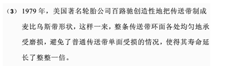

故正确答案为D。

**来源**：2015年上海市公务员录用考试《行测》题（A类）第26题

### 第 27 题

一个容器中装满了水，三个体积相同的铁块、铜块和木块均浸没在水中(如图)，下列选项中正确的是\_\_\_\_\_\_\_\_。

           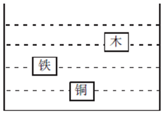

A. 铜块受到的浮力大于木块，因为其在水中沉没得更深

B. 铜的密度是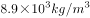，铁的密度是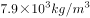，铜块的浮力大于铁块

C. 铜块的重量大于木块，因此它受到的浮力要大于木块

D. 铁块和木块在水中受到的浮力是一样的

第 27 题 · 答案与解析

**参考答案（粉笔题库参考内容）**

D

**解析**

体积相同的三个物体都浸没在水中，排开的水的体积相等，则受到水的浮力大小相等。

故正确答案为D。

浮力相关知识：物体在液体中所受浮力与排开液体的体积成正比，与物体在液体中的深浅无关。

**来源**：2015年上海市公务员录用考试《行测》题（A类）第27题

### 第 28 题

为增加汽车的摩擦力，车轮胎表面都有凹凸不平的花纹，不同功能的车会安装不同类型的轮胎以应对不同的路面情况。根据以下轮胎印迹，\_\_\_\_\_\_\_\_轮胎更适合翻越雪地。

A. A

B. B

C. C

D. D

第 28 题 · 答案与解析

**参考答案（粉笔题库参考内容）**

A

**解析**

雪地轮胎的特点是相较普通轮胎抓地力更强，摩擦力更大，在相同压力的条件下，轮胎与地面接触越粗糙，轮胎和地面的摩擦力越大，则雪地轮胎相较普通轮胎需要有更密集的纹路以增加粗糙程度，比较四幅图片可知，A项纹路更密集。

故正确答案为A。

**来源**：2015年上海市公务员录用考试《行测》题（A类）第28题

### 第 29 题

如图所示，水平桌面上摆着一台杠杆，杠杆的左边悬挂着三个砝码，此时，如果在杠杆右边的相同位置施加一个向下的拉力，以保证杠杆的平衡，那么，拉力在图示竖直平面内从左往右沿逆时针旋转的过程中，拉力的大小变化是\_\_\_\_\_\_\_\_。(F表示拉力的大小，t表示从左往右逆时针旋转的时间。)

                            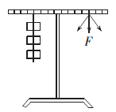

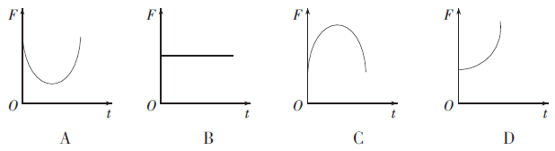

A. A

B. B

C. C

D. D

第 29 题 · 答案与解析

**参考答案（粉笔题库参考内容）**

A

**解析**

由杠杆定理可知：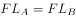, 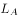和L_1是支点到力的垂直距离。当拉力按照图示逆时针进行旋转时，支点到力的垂直距离先增大，当力的方向与杠杆垂直时距离达到最大，随着力继续旋转，支点到力的垂直距离逐渐减小，所以若要保证杠杆的平衡，力F与支点到力的距离的乘积恒为定值，即拉力先减小后增大，故A项正确。

故正确答案为A。

**来源**：2015年上海市公务员录用考试《行测》题（A类）第29题

### 第 30 题

家庭电路的供电线路由两根线组成：火线和零线。在正常情况下，零线与地之间没有电压，火线与地有220V电压，为了安全用电，以下电路符合安装要求的是\_\_\_\_\_\_\_\_。

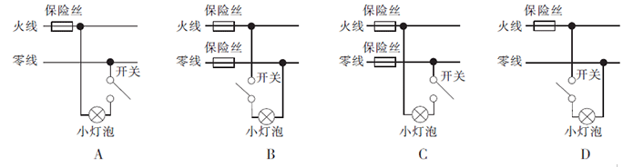

A. A

B. B

C. C

D. D

第 30 题 · 答案与解析

**参考答案（粉笔题库参考内容）**

D

**解析**

用电器开关应与火线一端相连，以保证在断开开关后，用电器与大地之间没有电压，保证对用电器操作时更加安全；保险丝安装在火线上，保证在保险丝熔断后火线与大地之间无电压，电路的检修更加安全，故D项正确。

故正确答案为D。

**来源**：2015年上海市公务员录用考试《行测》题（A类）第30题

### 第 31 题

太阳光是由七种单色光混合而成的，从物理角度来看，深色的东西对太阳光的辐射热吸收多，反射少；而浅色的东西则反射多，吸收少。下列说法中，不正确的是\_\_\_\_\_\_\_\_。

A. 锡纸可以隔热的原因是大量的光线和辐射热都被反射掉了

B. 白色的东西能够反射所有颜色的光线，因此看起来就是白色的

C. 在积雪上撒上碳黑有助于积雪的融化是因为碳黑更容易吸收太阳的辐射热

D. 红衣服呈现红色的原因是衣服吸收了太阳光中的红色光

第 31 题 · 答案与解析

**参考答案（粉笔题库参考内容）**

D

**解析**

A项：锡纸具有很好的保温作用，可以反射光线和辐射，所以隔热性能良好，即A项正确，故不选A项。

B项：白光是七种颜色的光混合而成，白色可以反射所有颜色的光线，故看起来是白色的，即B项正确，故不选B项。

C项：积雪上撒上碳黑，黑色可以吸收所有颜色的光线，吸热性能好，有助于积雪的融化，即C项正确，故不选C项。

D项：红色衣服呈红色是因为我们看到反射到眼睛的红色光线，所以红色衣服反射了太阳光中的红色光，即D项错误，故选D项。

本题为选非题，故正确答案为D。

**来源**：2015年上海市公务员录用考试《行测》题（A类）第31题

### 第 32 题

烧杯内盛有0摄氏度的水，一块0摄氏度的冰浮在水面上，水面正好在杯口处，最后冰全部融化成0摄氏度的水，在这过程中\_\_\_\_\_\_\_\_。

A. 无水溢出杯口，最终水面下降

B. 无水溢出杯口，水面在杯口处

C. 有水溢出杯口，水面在杯口处

D. 有水溢出杯口，最终水面下降

第 32 题 · 答案与解析

**参考答案（粉笔题库参考内容）**

B

**解析**

杯子中水面高度的变化由放入的冰（以及融化成的水）排开水的体积决定，故本题需要分析冰在融化的过程中冰和水共同排开水的体积的变化。

冰在融化的过程中，始终漂浮在水面静止，受力平衡，所受的浮力等于其所受的重力，由于冰融化前后所受的总重力不变（未融化与融化的冰的总重力不变），故其所受的总浮力也不变，根据阿基米德原理，其排开水的重力不发生变化，所以排开水的体积不变，则杯中水面不发生变化，因此，从冰开始融化到全部融化过程中，水面始终在杯口处，无水溢出杯口。

故正确答案为B。

**来源**：2015年上海市公务员录用考试《行测》题（A类）第32题

### 第 33 题

甲、乙和丙去公园游玩，三个人分别乘坐三个热气球。甲看见楼房在下降，乙看见甲和丙都在下降，丙看见甲和乙都在上升。那么三人相对于地面的运动情况完全不可能的是\_\_\_\_\_\_\_\_。

A. 甲、乙和丙都在上升

B. 甲和乙在上升，丙在下降

C. 甲和乙在上升，丙静止

D. 甲和丙在上升，乙在下降

第 33 题 · 答案与解析

**参考答案（粉笔题库参考内容）**

D

**解析**

楼房是静止的，楼房相对于甲在下降，则甲相对于楼房在上升，甲在上升；甲相对于乙在下降，则乙相对于甲在上升，由于甲在上升，故乙也在上升，且速度大于甲的速度；甲和乙相对于丙在上升，则丙相对于甲和乙在下降，由于甲和乙在上升，故丙相对于地面的运动状态不能确定，故A、B、C项正确，D项错误。

本题为选非题，故正确答案为D。

**来源**：2015年上海市公务员录用考试《行测》题（A类）第33题

### 第 34 题

如下图所示，一U型潜望镜，由两块平面镜组成，若用该潜望镜去观察一只台钟，看到的钟面上时刻为7：25，那么此时的实际时刻是\_\_\_\_\_\_\_\_。

A. 10：05

B. 7：25

C. 4：35

D. 1：55

第 34 题 · 答案与解析

**参考答案（粉笔题库参考内容）**

D

**解析**

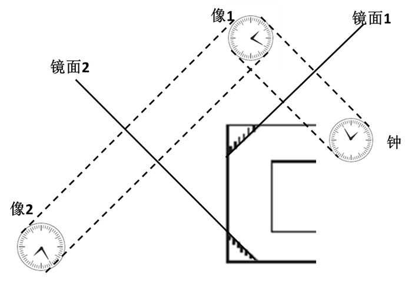

如图所示，根据平面镜成像原理，钟通过镜面1形成像1，像1又通过镜面2形成像2，而人通过此潜望镜看到的为像2。因此看到的像2时刻为7：25，那么此时的钟实际时刻是1：55。

故正确答案为D。

**来源**：2015年上海市公务员录用考试《行测》题（A类）第34题

### 第 35 题

民间常用“拔火罐”来治疗某些疾病，方法是将点燃的纸片放入一个小罐内，当纸片燃烧完时，迅速将火罐开口端紧压在皮肤上，火罐就会紧紧地被“吸”在皮肤上。其原因是，当火罐内的气体\_\_\_\_\_\_\_\_。

A. 温度不变时，体积减小，压强增大

B. 体积不变时，温度降低，压强减小

C. 压强不变时，温度降低，体积减小

D. 质量不变时，压强增大，体积减小

第 35 题 · 答案与解析

**参考答案（粉笔题库参考内容）**

B

**解析**

当纸片燃烧完后，将火罐的开口端紧压在皮肤上，则罐内的气体体积不变，随着温度的降低，罐内气体的压强逐渐减小，大气压大于罐内气体的压强，故将皮肤紧压在罐口，故B项正确。

故正确答案为B。

**来源**：2015年上海市公务员录用考试《行测》题（A类）第35题

### 第 36 题

语流音变是单个语音组合成连续的语音流时，连在一起的几个音由于说话时语速快慢、音量高低、语气强弱的不同，相互影响、相互适应，由此而产生的语音的变化。

根据上述定义，以下属于语流音变的是\_\_\_\_\_\_\_\_。

A. 北京人说话喜欢加儿化音，几乎每个名词后面都可以加

B. 安徽方言中“n”、“l”不分，会把“美女”读成“美铝”

C. 英语里名词复数词尾-s本来读清音\[s\]，假如前面名词的最后一个音是浊音，就会受影响而变成浊音\[z\]

D. 英语国家的学习者受到母语的影响，在学汉语时会把“爸爸”说成“趴趴”

第 36 题 · 答案与解析

**参考答案（粉笔题库参考内容）**

C

**解析**

第一步：找到定义关键词。

“单个语音组合成连续的语音流”、“连在一起的几个音由于说话时语速快慢、音量高低、语气强弱的不同，相互影响、相互适应”，产生变化。

第二步：逐一分析选项。

A项：在名词后面“加儿化音”，不是由于说话时语速快慢、音量高低、语气强弱带来的影响，不符合定义，排除；

B项：安徽方言中“n”、“l”不分，不是由于说话时语速快慢、音量高低、语气强弱带来的影响，不符合定义，排除；

C项：英语里名词复数词尾，两个相邻的音，后一个受前一个的影响，产生变化，如dogs、legs中清辅音变成与浊音\[g\]相近的\[z\]，符合定义，当选；

D项：英语国家的学习者受到母语的影响，而不是连在一起的几个音相互影响，不符合定义，排除。

故正确答案为C。

**考点**：原因结果

**来源**：2015年上海市公务员录用考试《行测》题（B类）第26题

### 第 37 题

代币奖励是心理学中行为治疗的一种方法，它以象征钱币、奖状、奖品等标记物为奖励手段，强化良好的行为。

根据上述定义，以下属于代币奖励的是\_\_\_\_\_\_\_\_。

A. 对多动症儿童的治疗中，当儿童没有捣乱时，治疗师给予奖励卡

B. 当小朋友表现好时，一些幼儿园老师会给他们奖品以奖励

C. 在慢性精神病患者出现摔打盘子的行为时，医师给予惩罚卡

D. 当小狗在正确的地方大小便时，主人马上给小狗一块它爱吃的饼干

第 37 题 · 答案与解析

**参考答案（粉笔题库参考内容）**

A

**解析**

第一步：找到定义关键词。

“象征钱币、奖状、奖品等标记物为奖励手段”、“强化良好的行为”。

第二步：逐一分析选项。

A项：儿童没有捣乱是良好的行为，治疗师给予的奖励卡是象征的标记物，是用象征的标记物为奖励手段，强化良好的行为，符合定义，当选；

B项：奖品是实物，不是象征性的标记物，不符合定义，排除；

C项：慢性精神病患者出现摔打盘子的行为是不好的行为，医师给予惩罚卡是为了避免不好的行为再次出现，而不是强化良好的行为，不符合定义，排除；

D项：饼干是实物，不是象征性的标记物，不符合定义，排除。

故正确答案为A。

**考点**：方式目的

**来源**：2015年上海市公务员录用考试《行测》题（B类）第27题

### 第 38 题

否定之否定是指在事物的发展过程中，经过两次否定所达到的阶段，否定之否定阶段的特征是“重新达到了原来的出发点，但这是在更高阶段上达到的”。

根据上述定义，以下关于否定之否定的说法错误的是\_\_\_\_\_\_\_\_。

A. 否定之否定并不是否定已有的事物，而是对旧事物的扬弃

B. 否定之否定规律表明事物的发展不是直线式前进的，而是螺旋式上升的

C. “同则存，异则变”、“求同存异”都是否定之否定的表现

D. “学习—实践—再学习—再实践”就是否定之否定的一种表现

第 38 题 · 答案与解析

**参考答案（粉笔题库参考内容）**

C

**解析**

第一步：找到定义关键词。

“经过两次否定所达到的阶段”，特征是“重新达到了原来的出发点，但这是在更高阶段上达到的”。

第二步：逐一分析选项。

A项：不是否定已有的事物说明与出发点一致，对旧事物的扬弃说明达到了一个更高的阶段，符合定义，排除；

B项：事物是螺旋式上升的说明达到了更高的阶段，符合定义，排除；

C项：“同则存，异则变”、“求同存异”的意思是善于在对立中把握统一，都没有否定的过程存在，不符合定义，当选；

D项：不断地在再学习与再实践之间是一个不断肯定与否定的过程，每一次再学习和再实践都是达到了一个更高的阶段，符合定义，排除。

本题为选非题，故正确答案为C。

**考点**：单定义-其他句式

**来源**：2015年上海市公务员录用考试《行测》题（B类）第28题

### 第 39 题

派生需求又称为引致需求，它是指对生产要素的需求，意味着它是由对该要素参与生产的产品的需求派生出来的。

根据上述定义，以下属于派生需求的是\_\_\_\_\_\_\_\_。

A. 为了举办会议，某公司预订了一家五星级酒店

B. 某小姐买了手提包后，需要再买与包相配的衣服和鞋子

C. 某公司组织架构调整后，需要马上招聘一位成熟的业务经理

D. 某物流公司随着业务量的增长，购买船舱的费用随着增加

第 39 题 · 答案与解析

**参考答案（粉笔题库参考内容）**

D

**解析**

第一步：找出定义关键词。

“对生产要素的需求”、“由对该要素参与生产的产品的需求派生出来的”。

第二步：逐一分析选项。

A项：举办会议不属于生产要素，不符合定义，排除；

B项：买衣服和鞋子与买手提包一样，都不属于生产要素，不符合定义，排除；

C项：调整组织架构不属于生产要素，不符合定义，排除；

D项：购买船舱的费用是由船舱参与了物流运输的需求派生出来的，符合定义，当选。

故正确答案为D。

**考点**：单定义-其他句式

**来源**：2015年上海市公务员录用考试《行测》题（A类）第39题

### 第 40 题

同人作品指由爱好者对漫画、动画、游戏、小说、影视等作品进行衍生创作而形成的文章及相关图片、影音、游戏等。

根据上述定义，以下关于同人作品的观点错误的是\_\_\_\_\_\_\_\_。

A. 同人作品属于“粉丝创作”

B. 同人作品属于二次创作

C. 同人作品不会侵犯版权

D. 同人作品包含了对艺术形式的改变

第 40 题 · 答案与解析

**参考答案（粉笔题库参考内容）**

C

**解析**

第一步：找到定义关键词。

“爱好者”、“衍生创作”、“文章及相关图片、影音、游戏等”。

第二步：逐一分析选项。

A项：定义中提到同人作品的主体是爱好者，因此是“粉丝创作”，符合定义，排除；

B项：定义中提到同人作品是一种衍生创作，衍生就是在原基础上演变出来的，因此是二次创作，符合定义，排除；

C项：同人作品是与原作品有关的图片、影音，因此并不能保证不侵犯版权，不符合定义，当选；

D项：定义中提到同人作品最后形成的可能是文章、图片等各种形式，而原本的形式可能是漫画、动画等，两种形式可能不同，因此包含了对艺术形式的改变，符合定义，排除。

本题为选非题，故正确答案为C。

**考点**：单定义-其他句式

**来源**：2015年上海市公务员录用考试《行测》题（B类）第29题

### 第 41 题

文化扩散是指思想观念、经验技艺和其他文化特质从一个社会传到另一个社会，从一地传到另一地的过程。

根据上述定义，以下属于文化扩散的是\_\_\_\_\_\_\_\_。

A. 某新娘从甲地嫁到乙地，到乙地的亲友们感受到了不一样的婚俗

B. 某阿姨的厨艺很好，她通过在小区的美食爱好者小组将厨艺分享给他人

C. 近代，大量的欧洲和非洲移民迁居美洲，他们将各地的节日美食和传统带了过去

D. 美国人杰克在中国旅游，中国特有的民俗和文化激起了他学习中文的兴趣

第 41 题 · 答案与解析

**参考答案（粉笔题库参考内容）**

C

**解析**

第一步：找到定义关键词。

“思想观念”、“经验技艺和其他文化特质”、“从一个社会传到另一个社会”、“从一地传到另一地”。

第二步：逐一分析选项。

A项：到乙地的亲友们感受到了不一样的婚俗，婚俗属于其他文化特质，但是关键词为感受，并非从乙地传到了另外一地，乙地的婚俗仍然是属于乙地的婚俗，并没有传播到甲地，仅仅是感受，不属于思想观念、经验技艺等范畴，因此不符合定义，排除；

B项：阿姨只是将厨艺分享给小区的其他人，还是在小区的范围内，并没有从一个社会传到另一个社会，或从一地传到另一地，因此不符合定义，排除；

C项：节日美食和传统属于“思想观念、经验技艺和其他文化特质”，欧洲和非洲移民迁居美洲符合定义中的“从一个社会传到另外一个社会”，并且明确带了过去，即已经发生了传播，符合定义，当选；

D项：杰克只是被激起了学习中文的兴趣，并不能体现出思想观念等文化特质的传播，不符合定义，排除。

故正确答案为C。

**考点**：单定义-其他句式

**来源**：2015年上海市公务员录用考试《行测》题（A类）第41题

### 第 42 题

下列选项中，符合所给图形的变化规律的是＿＿＿＿＿＿＿＿。

A. A

B. B

C. C

D. D

第 42 题 · 答案与解析

**参考答案（粉笔题库参考内容）**

C

**解析**

元素组成不同，优先看属性和数量规律。属性中曲直、对称、封闭均无规律，观察图形发现每组图都有相交的点，考虑数交点，第一组图交点为8-11-15，单看无规律，总和为34，第二组图形的交点为14-16-？，选项中没有交点为4的图形；再次观察图形发现图形与图形之间的交点比较明显，第一组图形与图形的交点为4-4-8，前两个图形交点之和等于第三幅图交点数；同理，第二组图形与图形的交点为：2-4-？，？号处图形与图形的交点数应为6，只有C项符合。

故正确答案为C。

**考点**：数量规律-点

**来源**：2015年上海市公务员录用考试《行测》题（B类）第37题

### 第 43 题

下列四个图形中，与其他三个图形不相称的一个图形是＿＿＿＿＿＿＿＿。

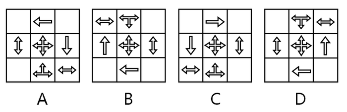

A. A

B. B

C. C

D. D

第 43 题 · 答案与解析

**参考答案（粉笔题库参考内容）**

B

**解析**

元素组成相同，考虑位置关系。观察图形A上下翻转可以得到图形D，左右翻转可以得到图形C，图形B是无法通过此规律得出的，当选。

故正确答案为B。

**考点**：位置规律-翻转

**来源**：2015年上海市公务员录用考试《行测》题（B类）第30题

### 第 44 题

下列选项中，符合所给图形的变化规律的是＿＿＿＿＿＿＿。

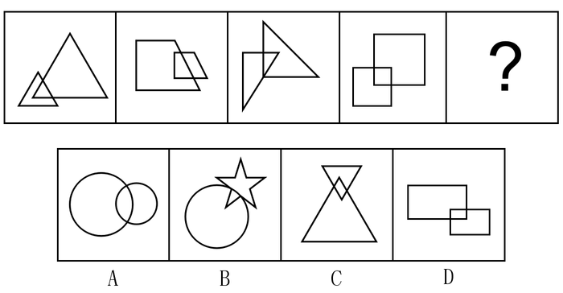

A. A

B. B

C. C

D. D

第 44 题 · 答案与解析

**参考答案（粉笔题库参考内容）**

D

**解析**

所有图形都是由两个相同元素组成，且元素都存在相交部分，观察元素相交部分发现，相交部分的形状与两个图形的形状一样，故问号处也应保持一致，选项中只有D选项符合此规律。

故正确答案为D。

**考点**：数量规律-素、特殊规律-图形间关系

**来源**：2015年上海市公务员录用考试《行测》题（B类）第38题

### 第 45 题

下列选项中，符合所给图形的变化规律的是＿＿＿＿＿＿＿。

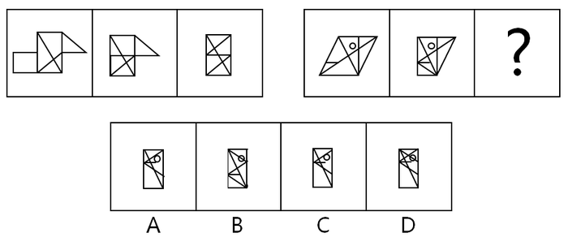

A. A

B. B

C. C

D. D

第 45 题 · 答案与解析

**参考答案（粉笔题库参考内容）**

B

**解析**

元素组成相似，考虑样式规律。第一组图中，图1的左侧长方形翻转到中间部分叠加形成图2，图2的右侧三角形翻转到中间部分叠加形成图3。第二组图也应符合此规律，所得到的图形为B选项的样式。

故正确答案为B。

**考点**：位置规律-翻转

**来源**：2015年上海市公务员录用考试《行测》题（B类）第39题

### 第 46 题

下列选项中，符合所给图形的变化规律的是＿＿＿＿＿＿。

A. A

B. B

C. C

D. D

第 46 题 · 答案与解析

**参考答案（粉笔题库参考内容）**

B

**解析**

图形组成相同，考虑样式规律。题干中为金字塔型，考虑紧邻形成三角形图形之间的关系，观察发现，第三层的图1图2黑白求异后顺时针旋转90度可得第二层的图1，第三层的图2图3黑白求异后顺时针旋转90度可得第二层的图2，则问号处也应保持这一规律，即第二层的两个图形黑白求异后顺时针旋转90度得到问号处图形，即为B选项样式。

故正确答案为B。

**考点**：样式规律-加减同异

**来源**：2015年上海市公务员录用考试《行测》题（B类）第40题

### 第 47 题

下列选项中，符合所给图形的变化规律的是＿＿＿＿＿＿＿。

A. A

B. B

C. C

D. D

第 47 题 · 答案与解析

**参考答案（粉笔题库参考内容）**

C

**解析**

观察图形发现为类九宫格图形，最中间的部分比较特殊，为空白，考虑米字形规律，发现米字形两端图形一样，则问号处应与左上角图形一样。

故正确答案为C。

**考点**：位置规律-平移

**来源**：2015年上海市公务员录用考试《行测》题（B类）第41题

### 第 48 题

下列选项中，符合所给图形的变化规律的是＿＿＿＿＿＿＿＿。

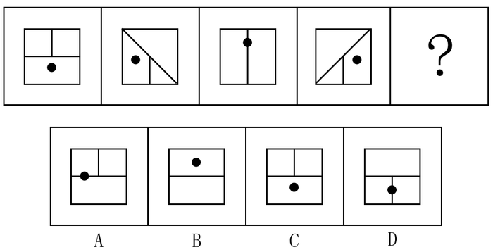

A. A

B. B

C. C

D. D

第 48 题 · 答案与解析

**参考答案（粉笔题库参考内容）**

C

**解析**

观察图形发现黑点沿着正方形内部的十字框线每次顺时针旋转90度，则问号处应移动到正方形的下方，排除A、B两项；比较C、D两项，发现短线段的方向不一样，再看题干，观察正方形的内部线段发现长线段每次顺时针旋转45度，短线段每次旋转180度，则问号处短线段应在正方形的上方，排除D项。

故正确答案为C。

**考点**：位置规律-旋转

**来源**：2015年上海市公务员录用考试《行测》题（A类）第48题

### 第 49 题

下列选项中，按共同特征或规律分类正确的是＿＿＿＿＿＿＿＿。

A. ①③⑤，②④⑥

B. ①④⑤，②③⑥

C. ①⑤⑥，②③④

D. ①②⑥，③④⑤

第 49 题 · 答案与解析

**参考答案（粉笔题库参考内容）**

B

**解析**

元素组成凌乱，考虑属性规律和数量规律。因图⑤不对称，因此不能考虑对称性。曲直性可以发现，图①④⑤为既有曲线又有直线，图②③⑥只有直线，但是规律不是很严谨。再观察发现图形的窟窿较多，可以考虑数面。面的数量依次为5、6、6、5、5、6，因此①④⑤一组，②③⑥一组。

故正确答案为B。

**考点**：数量规律-面

**来源**：2015年上海市公务员录用考试《行测》题（B类）第42题

### 第 50 题

下列选项中，符合所给图形的变化规律的是＿＿＿＿＿＿＿＿。

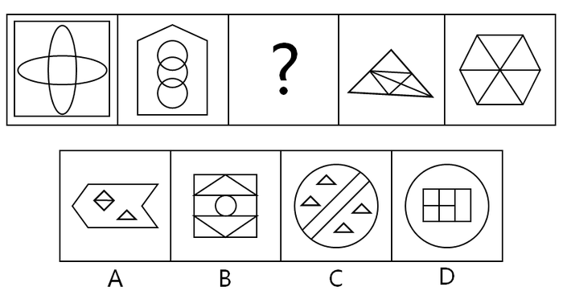

A. A

B. B

C. C

D. D

第 50 题 · 答案与解析

**参考答案（粉笔题库参考内容）**

D

**解析**

元素组成凌乱，属性规律没有规律，考虑数数。图形的特点是窟窿较多，可以考虑数面。面的数量依次为6、6、？、6、6，因此？处应该选择面是6的图形。选项A为4个面，选项B为9个面，选项C为7个面，选项D为6个面。

故正确答案为D。

**考点**：数量规律-面

**来源**：2015年上海市公务员录用考试《行测》题（A类）第50题

### 第 51 题

下列选项中，符合所给图形的变化规律的是＿＿＿＿＿＿＿。

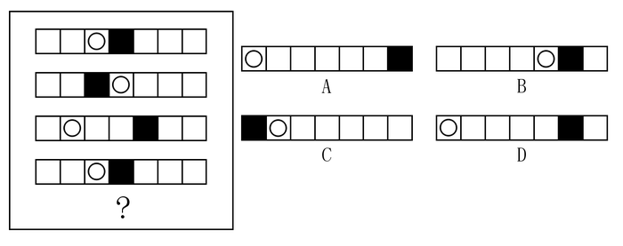

A. A

B. B

C. C

D. D

第 51 题 · 答案与解析

**参考答案（粉笔题库参考内容）**

D

**解析**

元素组成相同，考虑位置规律。图形中有○和黑框两个小元素，可以分开看。○先向右移动1个格子，再向左移动2个格子，然后又向右移动1个格子，可以看出按照前两个规律交替进行，因此？处○应位于最左侧，排除B、C两项。黑框先向左移动1个格子，然后向右移动2个格子，然后又向左移动1个格子，可以看出也是按照前两个规律交替进行，因此？处黑框应处在倒数第二个格子上，排除A选项。

故正确答案为D。

**考点**：位置规律-平移

**来源**：2015年上海市公务员录用考试《行测》题（A类）第51题

### 第 52 题

下列选项中，符合所给图形的变化规律的是＿＿＿＿＿＿＿。

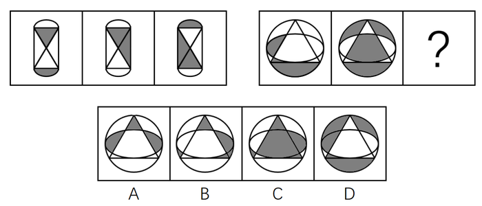

A. A

B. B

C. C

D. D

第 52 题 · 答案与解析

**参考答案（粉笔题库参考内容）**

B

**解析**

元素组成相似，考虑样式规律。图形的轮廓一致，内部颜色不一致，因此考虑黑白叠加。第一组图的叠加规律为：白+白=黑，黑+黑=白，白+黑=白，黑+白=白。第二组应该遵循此规律，左上角和右上角以及最中心都是白+黑=白，因此排除C、D选项。再观察A、B选项，发现左边部分不一致。左边部分的叠加规律为黑+白=白，因此排除A选项。

故正确答案为B。

**考点**：样式规律-黑白运算

**来源**：2015年上海市公务员录用考试《行测》题（A类）第52题

### 第 53 题

下列选项中，由左边图形折叠而成的是＿＿＿＿＿＿＿＿。

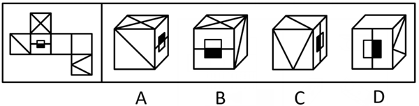

A. A

B. B

C. C

D. D

第 53 题 · 答案与解析

**参考答案（粉笔题库参考内容）**

C

**解析**

A项：如下图所示画箭头，在平面图中面1在面2的左面，A选项中面1在面2的右面，排除；

B项：如下图所示画箭头，在平面图中面1在面2的左面，B选项中面1在面2的右面，排除；

C项：无法排除，暂时搁置；

D项：平面图中面6的尖端与面4有交点，而D选项中面6的尖端与面2有交点，排除。

故正确答案为C。

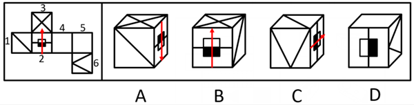

**考点**：空间类-空间重构-六面体

**来源**：2015年上海市公务员录用考试《行测》题（A类）第53题

### 第 54 题

慕课(MOOC)是新近涌现的一种在线课程开发模式。这种课程不同于面对面的课堂授课，其教学材料散布于互联网；人们上课地点不受局限，只需要一台接入网络的电脑即可。有专家称，相较于传统的课堂教学模式，慕课能够提高教学效果。即使慕课所使用的教学材料仅仅是传统板书的在线化，而没有充分利用和实现互联网的功效，也能够起到节省时间的作用。

以下＿＿＿＿＿＿项如果为真，是上述专家论证所依赖的假设。

A. 在线课程比使用板书的面对面传统课程有明显优势

B. 相较于传统面对面课程的板书，慕课将教学材料上传到互联网，节省了板书时间，大大提高了教学效率

C. 在慕课中直接搬用传统面对面课程的板书，并不会降低板书的教学效果

D. 有些慕课使用的多媒体课件过于简单，并不能真正发挥在线课程的功效

第 54 题 · 答案与解析

**参考答案（粉笔题库参考内容）**

B

**解析**

第一步：找到论点论据。

论点：相较于传统的课堂教学模式，慕课能够提高教学效果。即使慕课所使用的教学材料仅仅是传统板书的在线化，而没有充分利用和实现互联网的功效，也能够起到节省时间的作用。

论据：慕课的教学材料散布于互联网；人们上课地点不受局限，只需要一台接入网络的电脑即可。

第二步：逐一分析选项。

A项：指出在线课程比使用板书的面对面传统课程有明显优势，但并不明确具体有哪些优势，为不明确项，排除；

B项：指出慕课将教学材料上传到互联网，节省了板书时间，大大提高了教学效率，补充论据说明慕课能够提高教学效果的原因，可以加强，当选；

C项：指出慕课不会降低板书的教学效果，该项讨论的是板书的教学效果是否下降，与论点讨论的慕课能否提高教学效果以及能否节省时间无关，为无关项，排除；

D项：指出有些慕课不能真正发挥在线课程的功效，但并不明确慕课与传统板书相比是否能提升教学效果，以及是否能节省时间，为不明确项，排除。

故正确答案为B。

注：B、C两项存在一定的争议，即另外一种观点认为应该选C，原因如下：

B项：指出慕课将教学材料上传到互联网，节省了板书时间，提高了教学效率，补充论据说明慕课能够提高教学效果的原因，可以加强，保留；

C项：如果慕课会降低板书的教学效果，那么慕课无法提高教学效果，为论点成立的必要条件，可以加强，保留；

对比B、C两项，B项为补充论据，并非上述论证依赖的假设，C项为必要条件，是上述论证依赖的假设，C项当选。

故正确答案为C。

综上，本题为争议题，争议点在于对C项的定性，若将C项看做无关项，则选B；若将C项看做必要条件，则选C。

**考点**：补充论据

**来源**：2015年上海市公务员录用考试《行测》题（B类）第31题

### 第 55 题

学校的校长坚持认为，学生的成绩不及格是由于老师没有教好造成的。新学期开学不久，上学期学习成绩还不及格的学生已经没有不及格的了。因此，校长高兴地认为，这是学校教学质量得到改善的证据。

以下＿＿＿＿＿＿＿项推理的缺陷与题干相似。

A. 营养学家坚持认为，队员们的体重增加是由于暴饮暴食引起的。在较短时间段内，所有队员都停止暴饮暴食。因此，营养学家认为，队员们的体重将不会增加

B. 团队成员在抱怨体重增加，但营养学家认为体重增加仅仅是队员们的想象，为此向队员们发放了过去三个月的体重变化表。因此，营养学家很高兴关于体重增加的投诉减少了

C. 经理坚持认为，工人投诉是由于他们的工作任务太复杂。经理简化了工作，工人的抱怨停止了。因此，经理高兴地认为工作环境得到了改善

D. 经理坚持认为，工人提出投诉是由于工作量不饱和。不久以后，工厂里没有出现投诉。因此，经理高兴地认为，这是因为工人们的工作越来越充实了

第 55 题 · 答案与解析

**参考答案（粉笔题库参考内容）**

D

**解析**

第一步：分析题干推理形式。

老师没有教好（A）导致学生成绩不及格（B），成绩及格（-B），所以教学质量得到改善，即老师教好了（-A），题干的逻辑关系为-B→-A。

第二步：逐一分析选项。

A项：暴饮暴食（A）导致体重增加（B），停止暴饮暴食（-A），所以体重不会增加（-B），题干的逻辑关系为-A→-B，与题干推理形式不一致，排除；

B项：想象（A）导致抱怨体重增加（B），发放体重表，即不想象（-A），所以投诉减少（-B），题干的逻辑关系为-A→-B，与题干推理形式不一致，排除；

C项：工作任务复杂（A）导致投诉（B），简化工作（-A）且没有投诉（-B），所以工作环境得到了改善(C)，题干逻辑关系为-A且-B→C，与题干推理形式不一致，排除；

D项：工作量不饱和（A）导致投诉（B），没有投诉（-B），所以充实，即工作量饱和（-A），题干的逻辑关系为-B→-A，与题干推理形式一致，当选。

故正确答案为D。

**考点**：推理形式

**来源**：2015年上海市公务员录用考试《行测》题（B类）第32题

### 第 56 题

每四年一届的世界哲学大会在希腊雅典举行。H大学的张教授、马教授和李教授中至少有一人参加了这届国际哲学盛会。已知：

Ⅰ.只有向大会组委会提交一篇英文论文并经评审通过的报名者，才能获得组委会发出的会议邀请函。

Ⅱ.由于张教授和马教授是同一教研室的同事而且经常合作进行研究，如果张教授前往雅典参加这次大会，那么马教授也肯定会一同参加。

Ⅲ.李教授在受聘H大学之前曾留学德国，他向大会组委会提交了一篇用德语撰写的有关德国哲学家康德的学术论文。

根据以上情况，以下＿＿＿＿＿＿项一定为真。

A. 李教授参加了这届世界哲学大会

B. 张教授参加了这届世界哲学大会

C. 张教授和马教授均参加了这届世界哲学大会

D. 马教授参加了这届世界哲学大会

第 56 题 · 答案与解析

**参考答案（粉笔题库参考内容）**

D

**解析**

第一步：分析题干。

①获得邀请函→提交英文论文且评审通过

②张→马

③李提交德语论文

第二步：进一步分析。

通过条件③李提交德语论文可知李没有提交英文论文，根据逆否原则可从条件①得到条件④没有提交英文论文或评审没有通过→没有获得邀请函，即李没有获得邀请函，则一定无法参加此次大会，排除A。

根据条件②逆否原则可得⑤-马→-张，如果马没去，则张一定也没有去，与题干中的“至少有一人参加了大会”矛盾，所以马一定去了，张是否参加大会无法确定。

故正确答案为D。

**考点**：常规翻译

**来源**：2015年上海市公务员录用考试《行测》题（B类）第56题

### 第 57 题

统计数据表明，最近几年来，M大学的师生从校图书馆外借出的书籍数量逐年递减，不过由此还不能得出M大学图书馆藏书的利用率在逐渐递减的结论。

以下＿＿＿＿＿＿＿项如果为真，最能加强上述推论。

A. 图书馆藏书的利用率其实很难统计

B. 虽然M大学图书馆的图书外借量在逐年递减，但统计数据表明，刷卡进入图书馆的师生人数却在逐年递增

C. 不仅图书的外借量，而且M大学举办的讲座数量也在逐年下降

D. 最近几年，M大学的师生通过互联网借阅校图书馆的电子书数量每年都有较大幅度的增长

第 57 题 · 答案与解析

**参考答案（粉笔题库参考内容）**

B

**解析**

第一步：找出论点和论据。

论点：M大学图书馆藏书的利用率不一定在逐渐递减。

论据：M大学的师生从校图书馆外借出的书籍数量逐年递减。

本题论据讨论外图书馆“外借书籍减少”，论点讨论图书馆“藏书利用率不一定递减”，话题不一致，加强优先考虑搭桥。

第二步：逐一分析选项。

A项：图书馆藏书的利用率很难统计，但“很难统计”不代表“无法统计”，也无法证明利用率是否递减，无法加强，排除；

B项：刷卡进入图书馆的师生人数逐年递增，指出利用图书馆藏书的另一种方式，说明即使外借书籍减少，图书馆藏书的利用率也不一定递减，建立了“外借书籍减少”和“藏书利用率不一定递减”之间的关系，搭桥项，可以加强，当选；

C项：M大学举办的“讲座数量”在逐年下降，而论点讨论M大学图书馆“藏书利用率”不一定递减，话题不一致，无关项，无法加强，排除；

D项：M大学图书馆的“电子书”被借阅数量大幅增长，而论点讨论M大学图书馆“藏书利用率”不一定递减，藏书指实体书，主体不一致，无关项，无法加强，排除。

故正确答案为B。

**考点**：补充论据

**来源**：2015年上海市公务员录用考试《行测》题（B类）第33题

### 第 58 题

长假期间，媒体曝光了不少游客在风景名胜地的不文明行为，并配发了相关的照片。有人在读到这些照片时说：“如果不想被拍照曝光，那就应该举止文明。”

以下＿＿＿＿＿＿项所表达的意思与上面这句话的意思不同。

A. 如果做不到举止文明，就要准备被拍照曝光

B. 如果做不到举止文明而被拍照曝光，就只能自认倒霉了

C. 或者因不文明行为而被拍照曝光，或者做到举止文明

D. 只有举止文明，才能避免被拍照曝光

第 58 题 · 答案与解析

**参考答案（粉笔题库参考内容）**

B

**解析**

第一步：分析题干。

如果······那么，前推后，即-拍照曝光→举止文明。

第二步：逐一分析选项。

A项：如果······就，前推后，即:-举止文明→拍照曝光，为题干的逆否命题，意思相同；

B项：-举止文明 且 拍照曝光→自认倒霉，从题干信息无法得出；

C项：或者······或者，必有一个为真，根据否一推一可得：-拍照曝光→举止文明，与题干一致，意思相同；

D项：只有······才，后推前，即：-拍照曝光→举止文明，与题干一致，意思相同。

故正确答案为B。

**考点**：常规翻译

**来源**：2015年上海市公务员录用考试《行测》题（A类）第58题

### 第 59 题

某汽车企业在传统车型的基础上新增了自动上锁装置，能保证汽车和车内财产的安全性。因此，这款自动上锁车型的销售量将大大高于传统车型。

以下＿＿＿＿＿＿＿项如果为真，最能对上述推理提出质疑。

A. 传统车型中有一些最常用的功能并没有在新车型中体现

B. 新车型使用者与传统车型使用者的生活环境不同

C. 无论是装有自动上锁的新车型还是传统车型，使用习惯都是因人而异的

D. 该企业生产的这款自动上锁装置获得了专利权，是目前市面上其他汽车所不具备的

第 59 题 · 答案与解析

**参考答案（粉笔题库参考内容）**

A

**解析**

第一步：找到论点论据。

论点：这款自动上锁车型的销售量将大大高于传统车型。

论据：在传统车型的基础上新增了自动上锁装置，能保证汽车和车内财产的安全性。

第二步：逐一分析选项。

A项：强调新车型中没有最常用的功能，会降低新车型的销售量，为削弱选项；

B项：强调车型使用者的生活环境不同，生活环境不同则说明自动上锁车型与传统车型为不同的品类，销售量是否将高于传统车型无法确定，为不确定选项；

C项：强调使用习惯的不同，但使用习惯同样与自动上锁装置和安全性无关，也和销量无关，为无关选项；

D项：强调市面上其他汽车没有自动上锁装置，新型车具有功能上的优势，会提高销售量，为加强选项。

故正确答案为A。

**考点**：拆桥

**来源**：2015年上海市公务员录用考试《行测》题（A类）第59题

### 第 60 题

某公司四位业务员在为本月的业绩进行排名。张三说：“本月我的业绩最高。”李四说：“我的业绩不是最低的。”王五说：“我的业绩没有张三的高，但是还有人比我低。”马六说：“我的业绩最低。”但事实上，这四个人中只有一个人说错了。

那么，以下表述不正确的是＿＿＿＿＿＿。

A. 张三说错了

B. 马六的业绩最低

C. 张三的业绩比王五低

D. 李四的业绩最高

第 60 题 · 答案与解析

**参考答案（粉笔题库参考内容）**

C

**解析**

第一步：找到突破口。

四人中没有相矛盾的陈述。

第二步：逐一假设。

如果张三说错了，业绩不是最高，其他三人都说对了，则马六第四，张三第二，王五第三，李四第一，可以得出；

如果李四说错了，业绩最低，与马六的业绩最低相矛盾；

如果王五说错了，业绩比张三高，与张三的业绩最高相矛盾；

如果马六说错了，业绩不是最低，其他三人都说对了，则张三第一，王五和李四不是第四，马六同样也不是第四，矛盾。

本题为选非题，故正确答案为C。

**考点**：假设

**来源**：2015年上海市公务员录用考试《行测》题（A类）第60题

### 第 61 题

研究人员发现，某种昆虫在晴天的夜里能够准确地沿直线飞到目的地，但在阴天的夜里看不见星星时，这种昆虫在飞行过程中就经常会兜圈或绕路。因此研究人员认为，这种昆虫能够利用夜空中星星的位置进行导航。

以下\_\_\_\_\_\_\_项如果为真，最能削弱研究人员的判断。

A. 这种昆虫在阴天的白天飞行时，寻路的准确性同样比晴天差

B. 在外界有光线照明时，这种昆虫在夜间也能沿直线飞到目的地

C. 除了这种昆虫，该地区其他昆虫都能在阴天的夜里准确地寻路

D. 在有模拟星光的室内实验环境中，这种昆虫同样能准确地飞出直线

第 61 题 · 答案与解析

**参考答案（粉笔题库参考内容）**

D

**解析**

第一步：找出论点和论据。

论点：这种昆虫能够利用夜空中星星的位置进行导航。

论据：某种昆虫在晴天的夜里能够准确地沿直线飞到目的地，但在阴天的夜里看不见星星时，这种昆虫在飞行过程中就经常会兜圈或绕路。

本题论点讨论的是某种昆虫在夜间飞行能利用星星的位置导航，论据讨论的是这种昆虫晴天的夜里能飞到目的地，但在看不见星星的夜里飞行会找不到方向，论据可以合理推出论点，二者话题一致，削弱优先考虑削弱论点。

第二步：逐一分析选项。

A项：选项讨论的是这种昆虫在“白天”的飞行状态，与论点讨论的昆虫利用“夜空”中的星星导航无关，属于无关选项，无法削弱，排除；

B项：选项强调了“光线”对昆虫夜间飞行的影响，与论点讨论的昆虫利用夜空中的“星星”导航无关，属于无关选项，无法削弱，排除；

C项：选项讨论的是该地区其他昆虫的飞行情况，而论点讨论的是这种昆虫，主体不一致，无法削弱，排除；

D项：选项说明在模拟星光的实验室中也能直线飞行，因此是“星光”对飞行产生了影响，并不是星星的“位置”对飞行有影响，削弱论点，当选。

故正确答案为D。

**考点**：削弱论点

**来源**：2015年上海市公务员录用考试《行测》题（B类）第34题

### 第 62 题

据某项调查，三到五年驾龄的司机出车祸的概率比新手司机还要高，因为他们经常出于对驾驶技术的自信而忽略对路况的仔细观察。

如果上述情况属实，则以下\_\_\_\_\_\_\_项最适合作为上文论述的推论。

A. 新手司机的驾驶技术低于三到五年驾龄的司机

B. 对驾驶技术没有自信的司机会仔细观察路况

C. 没有仔细观察路况是导致车祸的一个主要原因

D. 驾驶技术高的司机不容易出车祸

第 62 题 · 答案与解析

**参考答案（粉笔题库参考内容）**

C

**解析**

第一步：抓住题干主要信息。

“三到五年驾龄的司机出车祸的概率比新手司机还要高，因为他们经常出于对驾驶技术的自信而忽略对路况的仔细观察”。

第二步：逐一分析选项。

A项：题干中只提到新手司机和三到五年驾龄司机出车祸的概率比较，并不知道驾驶技术谁高谁低，无中生有，排除；

B项：原文中只提到对驾驶技术自信会忽略路况，并没有说不自信会怎么样，无中生有，排除；

C项：原文中提到三到五年驾龄司机出车祸概率高是因为忽略对路况的仔细观察，那么就说明没有仔细观察路况是导致车祸的一个主要原因，当选；

D项：原文中并没有提到驾驶技术与出车祸之间的关系，无中生有，排除。

故正确答案为C。

**考点**：日常结论

**来源**：2015年上海市公务员录用考试《行测》题（B类）第35题

### 第 63 题

甲体育场是乙市的地标性建筑，经常举行大型体育赛事或文娱活动。该体育场除了平时正常使用的出入口，还有5个平时不开放的、仅供紧急情况下使用的出入口。这些紧急出入口的启用需要遵守以下规则：

Ⅰ.如果启用1号门，那么必须同时启用2号门并且关闭5号门

Ⅱ.只有关闭4号门，才能启用2号门或者5号门

Ⅲ.同时关闭3号门和4号门是不允许的

如果要启用1号门，同时还要启用\_\_\_\_\_\_\_\_。

A. 2号门和4号门

B. 3号门和5号门

C. 2号门和3号门

D. 4号门和5号门

第 63 题 · 答案与解析

**参考答案（粉笔题库参考内容）**

C

**解析**

第一步：翻译题干。

（1）启用1号门→启用2号且关闭5号；（2）启用2号或5号→关闭4号；（3）不能同时关闭3号和4号。

第二步：根据题干信息进行推导。

已知启用了1号门，根据条件（1）可知：启用2号且关闭5号，又由条件（2）可推出关闭4号门，又因条件（3）可知，3号门必须是启用的。故还要启用的是2号门和3号门。

故正确答案为C。

**考点**：常规翻译

**来源**：2015年上海市公务员录用考试《行测》题（B类）第36题

### 第 64 题

对比目鱼捕捞量做进一步的限制会影响到消费者。由于供求关系，这种捕捞量的限制可能会导致比目鱼价格的上涨。

如果增加以下\_\_\_\_\_\_\_\_项假设，最能支持比目鱼的价格会上升这一结论。

A. 在新的限制捕捞的政策发布后，对于比目鱼的需求量不会有本质的下降

B. 比目鱼的供应与需求量有比较紧密的联系

C. 其他鱼类产量的增加不能取代比目鱼的减产量

D. 其他鱼类的需求量也会受到新捕捞政策的影响

第 64 题 · 答案与解析

**参考答案（粉笔题库参考内容）**

A

**解析**

第一步：找到论点和论据。

论点：对比目鱼捕捞量做进一步的限制会影响到消费者。

论据：由于供求关系，这种捕捞量的限制可能会导致比目鱼价格的上涨。

第二步：逐一分析选项。

A项：说明需求量不会下降，那么供应量 受到了限制，供小于求就会导致价格上涨而影响到消费者，通过补充论据支持论点，当选；

B项：虽然强调了供应量与需求量之间联系紧密，但是不知道需求量有没有发生变化，无法支持论点，排除；

C项：论点和论据讨论的是比目鱼的供求关系对价格的影响，C选项说的是其他鱼类产量的增加不能取代比目鱼的减少量，未涉及比目鱼需要量的变化，不能支持论点，排除；

D项：新捕捞政策对其他鱼类的影响与论点无关，属于无关选项，排除。

故正确答案为A。

**考点**：补充论据

**来源**：2015年上海市公务员录用考试《行测》题（A类）第64题

### 第 65 题

在某地，每逢假日，市区主干道A和主干道B就会发生堵车现象。

如果上述情况属实，则下列\_\_\_\_\_\_\_\_项也是正确的。

Ⅰ.如果主干道A和B在堵车，那么这天就是假日。

Ⅱ.如果主干道A发生堵车，但主干道B没有堵车，那么这天就不是假日。

Ⅲ.如果这一天不是假日，那么主干道A和B都不会堵车。

A. 只有Ⅰ

B. 只有Ⅱ

C. 只有Ⅱ和Ⅲ

D. Ⅰ、Ⅱ、Ⅲ都不正确

第 65 题 · 答案与解析

**参考答案（粉笔题库参考内容）**

B

**解析**

第一步：翻译题干。

假日→主干道A和B发生堵车。

第二步：根据题干信息进行推导。

Ⅰ：主干道A和B堵车→假日，肯后不能得出肯定性结论，错误；

Ⅱ：A堵车 且 B没有堵车→不是节假日，根据逆否原则，可以推出，正确；

Ⅲ：不是节假日→A和B都不堵车，否前不能得出肯定性结论，错误。

故正确答案为B。

**考点**：常规翻译

**来源**：2015年上海市公务员录用考试《行测》题（A类）第65题

### 第 66 题

一列高铁列车A车长420米，另一列高铁列车B车长300米，在平行的轨道上相向而行，从两个车头相遇到车尾相离经过30秒。如果两车同向而行，列车B在前，列车A在后，从列车A车头遇到列车B车尾再到列车A车尾离开列车B车头经过120秒。那么列车A的速度为（    ）。

A. 每小时54公里

B. 每小时100公里

C. 每小时200公里

D. 每小时300公里

第 66 题 · 答案与解析

**参考答案（粉笔题库参考内容）**

A

**解析**

设A列车每秒速度为x，B列车每秒速度为y。两车相向而行，从车头相遇到车尾相离经过30秒，此时两车共行驶420+300=720米。两车同向而行，从相遇到相离是120秒，此时两车的路程差是420+300=720米。建立方程组：

（x+y）×30=720…①

（x-y）×120=720…②

解得，x=15米/秒。则A列车时速为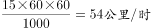。

故正确答案为A。

**考点**：相遇追及

**来源**：2015年上海市公务员录用考试《行测》题（A类）第66题

### 第 67 题

公司四名促销员某月共推销新产品100件，甲与丁共推销64件，甲与乙推销量的比例为5∶3，丙与丁推销量的比例为1∶2，则甲该月推销了\_\_\_\_\_\_\_\_件。

A. 20

B. 28

C. 38

D. 40

第 67 题 · 答案与解析

**参考答案（粉笔题库参考内容）**

D

**解析**

方法一：甲与乙推销量的比例为5∶3，则甲的推销量是5的整数倍，排除B、C两项。代入A，甲=20，则乙=12，丁=44，丙=22，得到甲+乙+丙+丁=98，与已知条件100矛盾，A项排除。

方法二：根据题目，建立方程组，

甲+乙+丙+丁=100…①；甲+丁=64……②

甲：乙=5：3……③；丙：丁=1：2……④

解方程组，甲=40，乙=24，丙=12，丁=24。

故正确答案为D。

**考点**：和差倍比问题

**来源**：2015年上海市公务员录用考试《行测》题（A类）第67题

### 第 68 题

某工程流水线有甲、乙、丙三道工序，为保证甲工序进程优先，开始安排的工人数甲是乙的2倍，一周后发现乙工序有滞后倾向，于是从甲工序抽调10名工人到乙工序，从丙工序抽调3名工人到乙工序。这样乙工序的工人数就为甲工序的2倍，则最初甲工序安排了\_\_\_\_\_\_\_\_名工人。

A. 18

B. 22

C. 24

D. 28

第 68 题 · 答案与解析

**参考答案（粉笔题库参考内容）**

B

**解析**

设乙最初人数为x人，则甲最初人数为2x人。根据题意人数变化，及“这样乙工序的工人数就为甲工序的2倍”可列式：2（2x-10）=x+10+3，解得x=11，则甲最初人数为2x=22人。

故正确答案为B。

**考点**：和差倍比问题

**来源**：2015年上海市公务员录用考试《行测》题（A类）第68题

### 第 69 题

有一段公路如图所示，在B路口处为三车道，到A路口处并为两车道，已知A路口处每条车道平均约5秒钟通过一辆车，若要在A路口处不造成拥堵，B路口处每条车道平均约\_\_\_\_\_\_\_\_秒钟通过一辆车。

A. 6.5

B. 7

C. 7.5

D. 8

第 69 题 · 答案与解析

**参考答案（粉笔题库参考内容）**

C

**解析**

设B路口每条道每x秒通过1辆车。B路口1分钟内通过车辆数：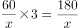。A路口每条车道平均约5秒钟通过一辆车，则1分钟内A路口通过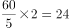辆车。两路口单位时间内通过的车辆总数相等，24=180/x，x=7.5。

故正确答案为C。

**考点**：和差倍比问题

**来源**：2015年上海市公务员录用考试《行测》题（B类）第66题

### 第 70 题

“嫦娥一号”卫星在未打开太阳翼时，外形是长222厘米，宽172厘米，高220厘米的长方体，若在表面包裹1厘米厚的防震材料层，在这外面还有1厘米厚的木板包装箱，则木板包装箱所需木材的体积至少为\_\_\_\_\_\_\_\_立方厘米。

A. 224×174×222-222×172×220

B. 223×173×221-221×171×219

C. 225×175×223-224×174×222

D. 226×176×224-224×174×222

第 70 题 · 答案与解析

**参考答案（粉笔题库参考内容）**

D

**解析**

木材体积＝包裹防震材料和木材之后的体积－包裹防震材料层之后的体积。表面包裹防震材料层之后，每面均加厚1厘米，体积为（222+2）×（172+2）×（220+2）=224×174×222。再包裹木材之后，每面又加厚1厘米，体积变为226×176×224。所求应为226×176×224-224×174×222。

故正确答案为D。

**考点**：几何公式类-立体图形

**来源**：2015年上海市公务员录用考试《行测》题（B类）第67题

### 第 71 题

某年2月份有5个星期日，4个星期六，则2月1日是\_\_\_\_\_\_\_\_。

A. 星期四

B. 星期五

C. 星期六

D. 星期日

第 71 题 · 答案与解析

**参考答案（粉笔题库参考内容）**

D

**解析**

2月份有5个星期日，4个星期六，则该月为29天，且29日这天是星期日，所以2月1日也为星期日。

故正确答案为D。

**考点**：星期日期问题

**来源**：2015年上海市公务员录用考试《行测》题（B类）第70题

### 第 72 题

如图，自行车每节链的长度为2.5cm，重叠部分的圆的直径为0.8cm，如果某种型号自行车的链条（没有安装前）由60节链条组成，那么链条的总长度是\_\_\_\_\_\_\_\_。

A. 100cm

B. 85.8cm

C. 85cm

D. 102.8cm

第 72 题 · 答案与解析

**参考答案（粉笔题库参考内容）**

D

**解析**

1节链长度2.5；2节链时，因重叠一个圆环，故长度应为2.5×2-0.8=4.2 cm；以此类推，3节链长度2.5×3-0.8×2=5.9 cm；4节链的长度2.5×4-0.8×3=7.6 cm；······60节链长度2.5×60-0.8×59=150-47.2=102.8 cm。

故正确答案为D。

**考点**：数列问题

**来源**：2015年上海市公务员录用考试《行测》题（A类）第72题

### 第 73 题

小张参加一个会议，会议下午2点多开始时小张看表发现时针与分针呈直角。会议开到下午5点多结束时，小张发现时针与分针完全重合。则会议开了\_\_\_\_\_\_\_\_。

A. 3小时整

B. 3小时整或3.5小时

C. 3小时1分到3小时5分之间

D. 3小时25分到3小时29分之间

第 73 题 · 答案与解析

**参考答案（粉笔题库参考内容）**

A

**解析**

下午两点时，时针与分针夹角是60°。至时针与分针呈直角时，分针追时针150°。此时经过时间为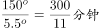，时间为2点300/11分。下午5点时，时针与分针夹角是150°，至时针与分针重合，分针追时针150°。经过时间同样为300/11分钟，此时时间为5点300/11分。所以时间相差3小时整。

故正确答案为A。

**来源**：2015年上海市公务员录用考试《行测》题（B类）第68题

### 第 74 题

国际象棋棋盘为64方格，用铅笔从第一格开始填写1，第二格填写2，第三格填写3，以此类推至64，然后用橡皮将所有能被3整除的数全部擦掉，则所剩数字的总和是\_\_\_\_\_\_\_\_。

A. 2408

B. 1387

C. 1408

D. 1487

第 74 题 · 答案与解析

**参考答案（粉笔题库参考内容）**

B

**解析**

棋盘上所有数字和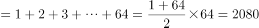。所有被3整除的数字和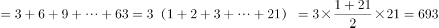。剩余数字总和=2080-693=1387。

故正确答案为B。

**考点**：数列问题

**来源**：2015年上海市公务员录用考试《行测》题（A类）第74题

### 第 75 题

在电脑里先输入一个数，它会按给定的指令进行如下运算：如果输入的数是偶数，就把它除以2；如果输入的是奇数，就把它加上3；对产生的数继续进行同样的运算。这样进行了3次，得出结果是27。原来输入的数有\_\_\_\_\_\_\_\_种情况。

A. 五

B. 四

C. 三

D. 一

第 75 题 · 答案与解析

**参考答案（粉笔题库参考内容）**

C

**解析**

27为奇数，若由+3得到，则上一级数为24，24为偶数，不应+3。所以27的上一级只能由除以2得来，即54。54的上一级有两种情况，108和51。若为108，再上一级可能为216和105，均符合条件。若为51，再上一级为102或48（偶数，不应+3，舍去）。原来输入的数有3种情况，即216-108-54-27，105-108-54-27，102-51-54-27。

故正确答案为C。

**考点**：排列组合问题-其他

**来源**：2015年上海市公务员录用考试《行测》题（B类）第69题

## 材料 3

2013年1~11月，全国汽车商品累计进出口总额为1458.72亿美元，比上年同期增长4.1%。其中：进口金额745.63亿美元，比上年同期增长3.2%；出口金额713.09亿美元，比上年同期增长5.2%。

　　1~11月，汽车整车共进口107.34万辆，比上年同期增长1.8%。在汽车主要进口品种中，越野车进口45.50万辆，比上年同期增长8.7%；轿车进口38.39万辆，比上年同期下降8.5%；小型客车进口20.25万辆，比上年同期增长23%。1~11月，上述三大类汽车品种共进口104.14万辆，占汽车进口总量的97%。

　　1~11月，汽车整车共出口87.24万辆，比上年同期下降6.4%。在汽车主要出口品种中，轿车出口38.76万辆，比上年同期下降14.7%；载货车出口26.58万辆，比上年同期下降9.7%；客车出口15.32万辆，比上年同期增长32.3%。1~11月，上述三大类汽车品种共出口80.66万辆，占汽车出口总量的92.5%。

        1~11月，汽车整车进口来源国前五位国家依次是：德国、日本、美国、英国和韩国，分别进口22.29万辆、21.09万辆、20.01万辆、10.81万辆和8.02万辆。

### 第 76 题

2012年1~11月，全国汽车商品进出口贸易呈现以下\_\_\_\_\_\_\_\_种状况。

A. 顺差32.5亿美元

B. 顺差44.7亿美元

C. 逆差32.5亿美元

D. 逆差44.7亿美元

第 76 题 · 答案与解析

**参考答案（粉笔题库参考内容）**

D

**解析**

由题干“2012年1~11月，全国汽车进出口贸易呈现”，结合材料给的时间是2013年，可判定该题是基期和差的问题。定位材料第一段，2013年1~11月，全国汽车商品进口金额745.63亿美元，比上年同期增长3.2%；出口金额713.09亿美元，比上年同期增长5.2%。

2012年1~11月，2012年1~11月。所以所求=677.8-722.5=-44.7亿美元，因此2012年1~11月，全国汽车商品进出口贸易逆差44.7亿美元。

故正确答案为D。

**考点**：基期和差、文字资料

**来源**：2015年上海市公务员录用考试《行测》题（A类）第76题

### 第 77 题

2012年1~11月，汽车整车进口量比出口量多\_\_\_\_\_\_\_\_。

A. 不到10万辆

B. 10~20万辆之间

C. 20~30万辆之间

D. 30万辆以上

第 77 题 · 答案与解析

**参考答案（粉笔题库参考内容）**

B

**解析**

由题干“2012年1~11月，汽车整车进口量比出口量多”，结合材料给的时间是2013年，可判定该题是基期和差问题。定位材料二、三段，2013年1~11月，汽车整车共进口107.34万辆，比上年同期增长1.8%；2013年1~11月，汽车整车共出口87.24万辆，比上年同期下降6.4%。2012年1~11月进口量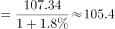万辆，2012年1~11月出口量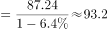万辆，因此2012年1~11月，汽车整车进口量比出口量多=105.4-93.2=12.2万辆。

故正确答案为B。

**考点**：基期和差、文字资料

**来源**：2015年上海市公务员录用考试《行测》题（A类）第77题

### 第 78 题

2012年1~11月，全国共进口轿车约\_\_\_\_\_\_\_\_万辆。

A. 35.4

B. 38.4

C. 42.0

D. 46.5

第 78 题 · 答案与解析

**参考答案（粉笔题库参考内容）**

C

**解析**

由题干“2012年1~11月，全国共进口轿车约”，结合材料给的时间是2013年，可判定该题是基期计算问题。定位材料第二段，2013年1~11月轿车进口38.39万辆，比上年同期下降8.5%，所以2012年1~11月。

故正确答案为C。

**考点**：基期计算、文字资料

**来源**：2015年上海市公务员录用考试《行测》题（A类）第78题

### 第 79 题

德、日、美三国出口中国的汽车占2013年1~11月中国汽车整车进口总量的\_\_\_\_\_\_\_\_。

A. 43%

B. 59%

C. 73%

D. 93%

第 79 题 · 答案与解析

**参考答案（粉笔题库参考内容）**

B

**解析**

由题干“占2013年1~11月中国汽车整车进口总量”，结合材料给的时间是2013年，可判定该题是现期比重问题。定位材料第二段和最后一段，2013年1~11月汽车整车共进口107.34万辆，德国、日本、美国分别进口22.29万辆、21.09万辆、20.01万辆。可列式：比重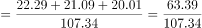，所以，直除首位商5，只有B项满足。

故正确答案为B。

**考点**：文字资料、现期比重

**来源**：2015年上海市公务员录用考试《行测》题（A类）第79题

### 第 80 题

下列关于2013年1~11月全国汽车整车进出口状况的描述，与资料相符的是\_\_\_\_\_\_\_\_。

A. 轿车占汽车整车进出口总量的比重高于上年水平

B. 越野车进出口贸易总量低于载货车

C. 进口英国整车数量超过汽车整车进口总量的一成

D. 平均每月自德国进口汽车数量不到2万辆

第 80 题 · 答案与解析

**参考答案（粉笔题库参考内容）**

C

**解析**

A项：定位材料二三段，2013年1~11月，汽车整车共进口107.34万辆，比上年同期增长1.8%，轿车进口38.39万辆，比上年同期下降8.5%，汽车整车共出口87.24万辆；比上年同期下降6.4%，轿车出口38.76万辆，比上年同期下降14.7%。根据混合增长率的性质（居中但不正中）可判定，整车进出口总量的增长率b，-6.4%＜b＜1.8%，轿车进出口量增长率为a，-14.7%＜a＜-8.5%，则a&lt;b，依据两期比重比较规律，可知轿车占汽车整车进出口总量的比重低于上年水平，错误；

B项：定位材料二三段，2013年1~11月，汽车整车共进口107.34万辆，1~11月越野车进口45.50万辆，上述三大类汽车品种共进口104.14万辆；载货车出口26.58万辆。贸易总量=进口量+出口量 ，因此2013年1~11月载货车最多26.58+（107.34-104.14）=29.78万辆&lt;45.50万辆，已经小于越野车的进口量，必然小于越野车的贸易总量，错误；

C项：定位材料第二、第四段，2013年1~11月，汽车整车共进口107.34万辆，英国进口10.81万辆，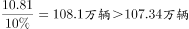，正确；

D项：定位材料最后一段，2013年1~11月，德国进口22.29万辆，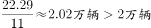，错误；

故正确答案为C。

**考点**：文字资料、综合分析

**来源**：2015年上海市公务员录用考试《行测》题（A类）第80题

## 材料 4

2014年一季度，上海市六个重点发展的工业行业共完成工业总产值5168.47亿元，增长3.6%，增幅低于全市规模以上工业平均水平0.4个百分点。其中，汽车制造业产销两旺，共完成工业总产值1372.12亿元，增长15%。一季度生产汽车67.33万辆，增长15.9%。其中，排量在1升到1.6升之间(含1.6升)的轿车41.57万辆，增长23.9%；运动型多用途乘用车7.96万辆，增长44.1%。汽车制造业对全市工业增长的贡献率为59%，拉动全市工业增长2.4个百分点。

### 第 81 题

2014年一季度，上海市规模以上工业总产值同比增量比同期销售产值同比增量约多\_\_\_\_\_\_\_\_亿元。

A. 70

B. 140

C. 210

D. 280

第 81 题 · 答案与解析

**参考答案（粉笔题库参考内容）**

B

**解析**

由问题所求“······同比增量比…同比增量约多多少亿元”，可判定此题为增长量比较问题，定位表格可得，规模以上工业总产值为7719.26，同比增长4.0%，销售产值为7622.27，同比增长2.1%，根据增长量计算公式，，，二者同比增量差=300-150=150，B项最接近。

故正确答案为B。

**考点**：增长量计算、综合资料

**来源**：2015年上海市公务员录用考试《行测》题（B类）第76题

### 第 82 题

2014年一季度，上海市六个重点发展的工业行业销售产值占总规模以上工业的比重约为\_\_\_\_\_\_\_\_。

A. 60%

B. 67%

C. 72%

D. 79%

第 82 题 · 答案与解析

**参考答案（粉笔题库参考内容）**

B

**解析**

由问题所求“2014年一季度······占······的比重”，结合材料给的时间是2014年一季度，可判定此题为现期比重问题，定位表格可得，六个重点发展的工业行业销售产值=5087.19亿元，规模以上工业销售产值=7622.27亿元，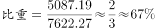。

故正确答案为B。

**考点**：现期比重、综合资料

**来源**：2015年上海市公务员录用考试《行测》题（B类）第77题

### 第 83 题

上海市六个重点发展的工业行业中，2014年一季度产销率高于上年同期水平的有\_\_\_\_\_\_\_\_个。

A. 0

B. 2

C. 4

D. 6

第 83 题 · 答案与解析

**参考答案（粉笔题库参考内容）**

A

**解析**

问题求“六个重点发展的工业行业中，产销率高于上年同期水平”的行业个数，根据，可判定此题为两期比重比较问题，根据公式，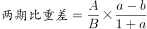，高于上年同期水平，即行业的销售产值增长率a＞总产值增长率b，定位表格可得，六行业中①a=-6.1%，b=-4.7%，a＜b；②a=14%，b=15%，a＜b；③a=-5.3%，b=-2.7%，a＜b；④a=4.6%，b=5.6%，a＜b；⑤a=5.7%，b=7.5%，a＜b；⑥a=5%，b=14.6%，a＜b，因此a＞b的个数为0，产销率高于去年同期水平的有0个。

故正确答案为A。

**考点**：两期比重、综合资料

**来源**：2015年上海市公务员录用考试《行测》题（B类）第78题

### 第 84 题

2014年一季度，上海市生产的汽车中，运动型多用途乘用车的比重比上年同期上升了约\_\_\_\_\_\_\_\_个百分点。

A. 0

B. 2

C. 8

D. 15

第 84 题 · 答案与解析

**参考答案（粉笔题库参考内容）**

B

**解析**

由问题所求“······比重比上年同期上升了多少个百分点”，可判定此题为两期比重比较问题，定位文字材料第三、四、五行可得，运动型多用途乘用车现期量A=7.96万辆，增长率a=44.1%，总生产汽车的现期量B=67.33万辆，增长率b=15.9%，根据公式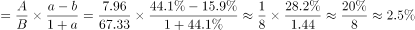，B项最接近。

故正确答案为B。

**考点**：两期比重、综合资料

**来源**：2015年上海市公务员录用考试《行测》题（B类）第79题

### 第 85 题

关于2014年一季度上海市规模以上工业行业发展状况，下列表述与资料相符的是\_\_\_\_\_\_\_\_。

A. 在六个重点行业中，产销率最低的行业也是产值增速最快的行业

B. 成套设备制造业的产值增量高于精品钢材制造业

C. 排量在1升以下或超过1.6升的汽车产量增幅超过2成

D. 汽车制造业平均每生产一辆汽车，创造的产值约为12万元

第 85 题 · 答案与解析

**参考答案（粉笔题库参考内容）**

B

**解析**

A项：定位表格可得，产销率最低的是⑥生物医药制造业（93.5%），产值增速最快的是②汽车制造业（15%），并非同一行业，错误；

B项：定位表格可得，⑤成套设备制造业产值总产值825.65亿元，同比增长7.5%，④精品钢材制造业产值总产值376.28亿元，同比增长5.6%，增长量大小比较，根据“大大则大”原则，⑤的现期量、增长率都大于④，因此⑤成套设备制造业的产值增长量较高，正确；

C项：定位文字材料可得，一季度生产汽车67.33万辆，增长15.9%，其中，排量在1升到1.6升之间(含1.6升)的轿车41.57万辆，增长23.9%，根据混合增长率居中的原则，排量在1升以下或超过1.6升的汽车产量的增长率必然小于15.9%，因此增幅低于两成，错误；

D项：定位文字材料可得，汽车制造业完成工业总产值1372.12亿元，生产汽车67.33万辆，每辆汽车创造产值=1372.12÷67.33≈20万元，错误。

故正确答案为B。

**考点**：综合分析、综合资料

**来源**：2015年上海市公务员录用考试《行测》题（B类）第80题

## 材料 5

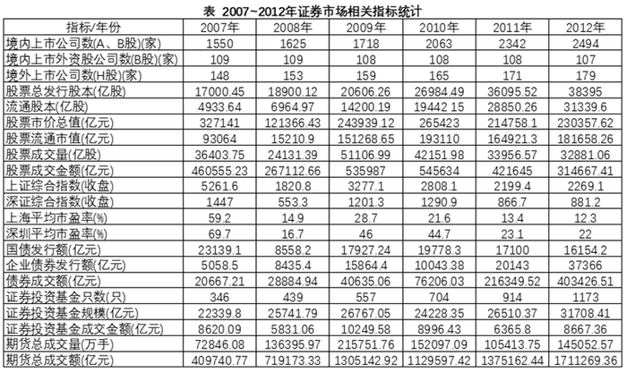

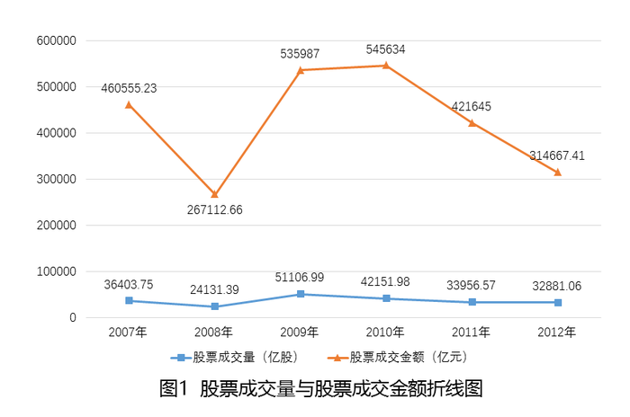

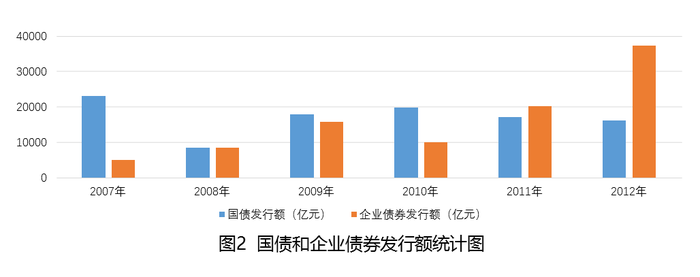

### 第 86 题

下列关于2007~2012年证券市场的表述，错误的是\_\_\_\_\_\_\_\_。

A. 股票总发行股本增速最快的年份是2011年

B. 2007年至2012年，A、H股的个数均有所增加

C. 2007年至2012年，国债发行额先升后降

D. 2007年至2012年，证券投资基金只数逐年增加

第 86 题 · 答案与解析

**参考答案（粉笔题库参考内容）**

C

**解析**

A项：定位表格“股票总发行股本”一行可知，2008—2012年的同比增速分别约为：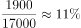、 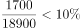、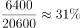、 、。增速最快的为2011年，说法正确，排除；

B项：定位表格，H股的个数均有所增加，说法正确，排除；A、B股总数逐年增加，而B股数呈持平或下降趋势，则A股数逐年增加。说法正确，排除；

C项：定位表格可知，国债发行额在2008年出现了下降，并非先升后降，说法错误，当选；

D项：定位表格可知，2007年至2012年证券投资基金只数逐年增加，说法正确，排除。

本题为选非题，故正确答案为C。

**考点**：综合分析、综合资料

**来源**：2015年上海市公务员录用考试《行测》题（B类）第81题

### 第 87 题

下列关于2007~2012年证券市场相关指标，说法正确的是\_\_\_\_\_\_\_\_。

A. 期货总成交量和总成交额呈相同方向变化

B. 上证综合指数和深证综合指数呈同方向变化

C. 上海平均市盈率比深圳平均市盈率相对波动小

D. 债券成交额增长值最大的是2010年至2011年

第 87 题 · 答案与解析

**参考答案（粉笔题库参考内容）**

C

**解析**

A项：定位表格最后两行可知，期货总成交量和总成交额并非呈完全相同的方向变化，2011年成交量下降，但成交额增加，说法错误；

B项：定位表格可知，上证综合指数和深证综合指数并非呈完全相同的方向变化，2010年上证下降，而深证上升，说法错误；

C项：由表格可以推出，深圳平均市盈率相对波动更大一些，说法正确；

D项：定位表格可知，2011至2012年债券成交额

增长值=403426-216349≈18万+；2010年至2011年债券成交额增长值=216349-76206≈14万+。故最大的不是2010年至2011年，说法错误。

故正确答案为C。

**考点**：综合分析、综合资料

**来源**：2015年上海市公务员录用考试《行测》题（B类）第82题

### 第 88 题

下列关于股票成交量与成交金额，说法正确的是\_\_\_\_\_\_\_\_。

A. 股票成交量与成交金额呈同方向变化

B. 股票成交均价最低的年份是2007年

C. 股票成交均价最高的年份是2010年

D. 股票成交量逐年递增

第 88 题 · 答案与解析

**参考答案（粉笔题库参考内容）**

C

**解析**

A项：定位图一可知，股票成交量在2010年出现下降，而成交金额上涨，并非同方向变化，说法错误；

B项：定位图一可知：2007年股票成交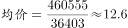，2008年股票成交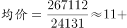。故最低并非2007年，说法错误；

C项：定位图一可知：2010年股票成交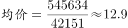，其他年均低于12.9，说法正确；

D项：定位图一可知，股票成交量并非逐年递增，说法错误。

故正确答案为C。

**考点**：综合分析、综合资料

**来源**：2015年上海市公务员录用考试《行测》题（B类）第83题

### 第 89 题

下列关于企业债券和国债发行额的表述，说法错误的是\_\_\_\_\_\_\_\_。

A. 2008年，国债与企业债券发行额约为1∶1

B. 企业债券发行额最高的年份是2012年

C. 企业债券发行额在2011年首次超过国债发行额

D. 2007年，国债发行额大约是企业债券发行额的3倍

第 89 题 · 答案与解析

**参考答案（粉笔题库参考内容）**

D

**解析**

A项：由图2可知，2008年国债与企业债券发行额相等，即1：1，说法正确，排除；

B项：由图2可知，企业债券发行额最高的年份是2012年，说法正确，排除；

C项：由图2可知，企业债券发行额首次超过国债发行额是在2011年，说法正确，排除；

D项：由图2可知，2007年国债发行额约为25000亿元，企业债券发行额约为5000亿元，二者呈5倍关系，说法错误，当选。

本题为选非题，故正确答案为D。

**考点**：综合分析、综合资料

**来源**：2015年上海市公务员录用考试《行测》题（B类）第84题

### 第 90 题

下列关于上市公司的说法，正确的是\_\_\_\_\_\_\_\_。

A. 2012年，A股上市公司数目比前一年增加152家

B. 2011年，A股上市公司数目比前一年增加279家

C. B股上市公司数目逐年增加

D. 境内上市公司数增加最快的是2011年

第 90 题 · 答案与解析

**参考答案（粉笔题库参考内容）**

B

**解析**

A项：定位表格，2012年A股上市公司数=2494-107，2011年其值=2342-108。2012年比2011年增加：（2494-107）-（2342-108）=2494-2342+1=153家。说法错误；

B项：定位表格，2011年A股上市公司数=2342-108，2010年其值=2063-108。2011年比2010年增加：2342-2063=279家。说法正确；

C项：定位表格发现，B股上市公司数从2009年开始出现下降，并非逐年增加。说法错误；

D项：定位表格，境内上市公司数2010年增加2063-1718=345家，2011年增加2342-2063=279家，2011年的增长量较2010年要少，且基期量更高，故增速要比2010年要慢。说法错误。

故正确答案为B。

**考点**：综合分析、综合资料

**来源**：2015年上海市公务员录用考试《行测》题（B类）第85题

### 第 91 题

法律是治国之重器，良法是善治之前提。纵观我国立法现状，社会主义法律体系已经建立起来，但随着社会形势的发展，一些法律还需要及时修改和制定。《中共中央关于全面推进依法治国若干重大问题的决定》指出，明确立法权力边界，从体制机制和工作程序上有效防止\_\_\_\_\_\_\_\_。

A. 权责交叉、多头执法

B. 部门利益和地方保护主义法律化

C. 地方立法权限和范围扩大化

D. 地方政府损害法律尊严和权威的立法行为

第 91 题 · 答案与解析

**参考答案（粉笔题库参考内容）**

B

**解析**

B项正确：《决定》指出，明确立法权力边界，从体制机制和工作程序上有效防止部门利益和地方保护主义法律化。对部门间争议较大的重要立法事项，由决策机关引入第三方评估，充分听取各方意见，协调决定，不能久拖不决。加强法律解释工作，及时明确法律规定含义和适用法律依据。明确地方立法权限和范围，依法赋予设区的市地方立法权。

故正确答案为B。

**考点**：宪法

**来源**：2015年上海市公务员录用考试《行测》题（B类）第91题

### 第 92 题

2014年2月21日，国务院印发《关于建立统一的城乡居民基本养老保险制度的意见》，决定将新农保和城居保两项制度合并实施，在全国范围内建立统一的城乡居民基本养老保险制度。建立统一的城乡居民基本养老保险制度是基于\_\_\_\_\_\_\_\_。

A. 统筹城乡发展，打破城乡制度的“二元化”差异

B. 居民当前可支配收入的增加可以拉动经济增长

C. 促进城乡养老待遇公平，推动城乡一体化发展目标的实现

D. 实现社会公平，为创造经济效率提供坚强物质保证

第 92 题 · 答案与解析

**参考答案（粉笔题库参考内容）**

AC

**解析**

本题考查新思想。

A、C项正确：2013年11月召开的中共十八届三中全会提出，城乡二元结构是制约城乡发展一体化的主要障碍。社会保障的对接已成为打破城乡二元结构建立城乡一体化的关键一步。社保制度已严重滞后城镇化速度，新型城镇化过程中应加速推进社会保障制度的衔接与整合。所以建立统一的保险制度是基于打破“二元结构”和推动城乡一体化发展。

故正确答案为AC。

**考点**：中国地理、社会建设

**来源**：2015年上海市公务员录用考试《行测》题（A类）第92题

### 第 93 题

中国共产党在领导全国各族人民改造半殖民地半封建的旧中国的过程中，高度重视主观世界的改造，开展反腐倡廉斗争，以保持自身肌体的先进与纯洁。在1927年召开的中国共产党第五次全国代表大会上，选举产生了维护和执行党的纪律的第一个专门机构——\_\_\_\_\_\_\_\_。

A. 中央纪律检查委员会

B. 中央纪律执行委员会

C. 中央监察局

D. 中央监察委员会

第 93 题 · 答案与解析

**参考答案（粉笔题库参考内容）**

D

**解析**

D项正确：1927年4月中国共产党第五次全国代表大会在武汉召开，诞生了中国共产党第一个纪律检查机构——中央监察委员会，由正式委员7人、候补委员3人组成。

故正确答案为D。

**来源**：2015年上海市公务员录用考试《行测》题（A类）第93题

### 第 94 题

下列情况中，应该给予行政赔偿的是\_\_\_\_\_\_\_\_。

A. 某事业单位工作人员甲驾驶单位车辆外出办事，途中顺路买菜，在菜场附近撞塌了菜贩乙的摊位，导致乙受到损失

B. 交通警察甲与货运车司机乙有矛盾，甲诬陷乙违反交通规则，并吊销其驾照，导致乙的车辆两个月不能投入运营

C. 某市食药监局发现某公司涉嫌销售假冒伪劣药品而将其扣押，该公司以此举给公司造成损失为由要求赔偿

D. 检验检疫局扣留了甲公司从海外订购的一批植物种子，因该批种子属于危险物种。甲公司认为此举给公司带来了损失，并要求赔偿

第 94 题 · 答案与解析

**参考答案（粉笔题库参考内容）**

B

**解析**

B项正确：根据《中华人民共和国国家赔偿法》第四条：行政机关及其工作人员在行使行政职权时有下列侵犯财产权情形之一的，受害人有取得赔偿的权利：1.违法实施罚款、吊销许可证和执照、责令停产停业、没收财物等行政处罚的；2.违法对财产采取查封、扣押、冻结等行政强制措施的；3.违法征收、征用财产的；4.造成财产损害的其他违法行为。题干中甲故意诬陷并吊销了乙的驾照，对乙造成了损失，乙应该要求赔偿。

A、C、D项错误：根据《中华人民共和国国家赔偿法》第五条：属于下列情形之一的，国家不承担赔偿责任：1.行政机关工作人员与行使职权无关的个人行为；2.因公民、法人和其他组织自己的行为致使损害发生的；3.法律规定的其他情形。A项中是由于甲的个人行为给乙造成了损失，所以应由他自己赔偿；CD项都是合法的行为，不应赔偿。

故正确答案为B。

**考点**：行政法

**来源**：2015年上海市公务员录用考试《行测》题（B类）第92题

### 第 95 题

行政合同是以行政主体为一方当事人的发生、变更或消灭行政法律关系的合意。行政合同的主要种类有\_\_\_\_\_\_\_\_。

A. 国有土地使用权出让合同

B. 办公用品购置合同

C. 公务委托合同

D. 行政机关委托的科研合同

第 95 题 · 答案与解析

**参考答案（粉笔题库参考内容）**

AD

**解析**

本题主要考查法律常识。行政合同是指行政机关为实现行政职能，同公民、法人和其他组织经过协商达成一致设立、变更和终止双方行政法上权利义务的协议，其本质是利用协商机制和市场机制实现行政职能。行政合同具有以下特征：行政当事人是行政合同的主体；在内容上，行政当事人的合同自由范围受到限制，这是因为行政合同必须维护公共利益和公共安全；行政合同双方承担更多的公法责任。我国现在的行政合同的种类主要包括：（1）国有土地使用权出让合同；（2）全民所有制工业企业承包合同；（3）公用征收补偿合同；（4）国家科研合同；（5）农村土地承包合同；（6）国家订购合同；（7）公共工程承包合同；（8）计划生育合同。

A、D项正确，都属于行政合同的范畴。

B项错误，办公用品购置合同，是国家（行政机关）作为民事主体，而不是行政主体与市场主体签订的办公用品购置合同，它属于民事合同范畴，不属于行政合同。

C项错误，公务委托合同，属于行政委托范畴，行政委托是行政机关在其职权职责范围内依法将其行政职权或行政事项委托给有关行政机关、社会组织或者个人，受委托者以委托机关的名义实施管理行为和行使职权，并由委托机关承担法律责任。行政委托，不属于行政合同。

故正确答案为AD。

**考点**：行政法

**来源**：2015年上海市公务员录用考试《行测》题（A类）第95题

### 第 96 题

网格化管理是一种新型数字化城市管理模式，它借助信息技术和社会力量在政府层级、职能和部门之间努力进行全方位的打通。下列关于网格化管理表述正确的是\_\_\_\_\_\_\_\_。

A. 它是继“无缝隙政府”模式后在政府管理流程上的一个重大变革和突破

B. 它利用信息技术推进信息共享，进而进一步打破职能的边界

C. 它更加适合“对人的管理”而非“对事的管理”

D. 目前，城市应急联动中心属于一种网格化管理模式

第 96 题 · 答案与解析

**参考答案（粉笔题库参考内容）**

ABD

**解析**

A、B项正确：网格化城市管理新模式是运用数字化、信息化手段，以街道、社区、网格为区域范围，以事件为管理内容，以处置单位为责任人，通过城市网格化管理信息平台，实现市区联动、资源共享的一种城市管理新模式，AB项正确。

D项正确：城市应急联动中心就是综合各种城市应急服务资源，统一指挥、联合行动，为市民提供相应的紧急救援服务，为城市的公共安全提供强有力的保障，所以城市应急联动中心也属于一种网格化管理。

C项错误：网格化管理是以事件管理为内容，而不是更适合对人的管理。

故正确答案为ABD。

**来源**：2015年上海市公务员录用考试《行测》题（B类）第93题

### 第 97 题

公共预算不仅能够引导国家和地方的经济增长与发展，还可以促使公共管理者对从公民手中征得的、用于公共项目的资金承担法律责任。这体现了公共预算的\_\_\_\_\_\_\_\_。

A. 政治性和管理性

B. 政治性和经济性

C. 经济性和责任性

D. 管理性和责任性

第 97 题 · 答案与解析

**参考答案（粉笔题库参考内容）**

C

**解析**

C项正确：公共预算是经济平衡工具，公共预算的分配往往承担着刺激经济增长或稳定经济、促进就业、抑制通货膨胀等宏观经济职能。所以题干中公共预算能够引导经济发展体现了经济性；公共预算具有问责功能，题干中的后半部分提到要承担法律责任，这是体现了公共预算的责任性。

A、B项错误：公共预算的政治性是指公共资源是稀缺的，公共预算分配公共资源时必须考虑不同利益相关者的需求，最终的预算分配实际上反映了政府政策的优先性，是不同的参与者讨价还价的结果，这反映了公共预算的政治性。

D项错误：公共预算的管理性指公共预算也是管理的工具，因为有效的分配并不能保证资源都被有效地使用，所以公共预算不只是简单的财政资源分配，还要求利用特定的管理方法和技术使得公共服务和公共项目的提供更有效。

故正确答案为C。

**来源**：2015年上海市公务员录用考试《行测》题（B类）第94题

### 第 98 题

2014年4月24日，十二届全国人大常委会第八次会议表决通过了修订后的《中华人民共和国环境保护法》。该法增加了“对拒不改正的排污企业实施按日计罚”“对严重的违法行为采取行政拘留”以及“政府的主要负责人在面对政府的违法行为造成严重后果时要引咎辞职”等内容，被称为“史上最严”的环保法。这是国家运用\_\_\_\_\_\_\_\_。

A. 经济手段和法律手段规范环境保护工作的开展

B. 宏观调控手段保障环境保护工作健康发展

C. 财政政策和货币政策保证环境保护工作快速发展

D. 经济手段和行政手段对环境保护进行调控

第 98 题 · 答案与解析

**参考答案（粉笔题库参考内容）**

B

**解析**

本题主要考查经济常识。

国家宏观调控的手段主要包括经济手段、法律手段和行政手段。（1）经济手段，是指政府在自觉依据和运用价值规律的基础上借助于经济杠杆的调节作用，对国民经济进行宏观调控。经济杠杆是对社会经济活动进行宏观调控的价值形式和价值工具，主要包括价格、税收、信贷、工资等。（2）法律手段，是指政府依靠法制力量，通过经济立法和司法，运用经济法规来调节经济关系和经济活动，以达到宏观调控目标的一种手段。（3）行政手段，是指依靠行政机构，采取强制性的命令、指示、规定等行政方式来调节经济活动，以达到宏观调控目标的一种手段。

A项错误，题干材料阐述的是国家通过新的《环保法》，并且在环保法中添加了按日计罚、行政拘留和引咎辞职等对违反环保法的处罚方式。这些都是国家通过立法的形式，即宏观调控的法律手段，保护环境。经济手段主要是政府运用经济政策来调控，题干未有涉及。

B项正确，题干材料主要反映的是国家通过立法活动（环保法），保护环境，这体现了国家运用宏观调控手段中的法律手段调控经济活动，保护环境。

C项错误，财政政策和货币政策是宏观调控经济手段的两大调控政策。财政政策是指国家通过财政支出与税收政策来影响和调节总需求进而影响就业和国民收入的政策，主要包括税收、预算、发行国债、购买性支出和财政转移支付等手段；货币政策是指中央银行运用各种货币政策工具调节货币供应量来调控市场正常运行，主要货币政策工具为法定准备金率、公开市场业务和贴现政策。题干主要反映的国家通过立法（法律手段），调控经济活动，保护环境，而未体现财政政策和货币政策的经济手段调控经济活动，保护环境。

D项错误，题干材料未涉及经济手段；虽然在题干中有“按日计罚、行政拘留和引咎辞职”这些国家宏观调控行政手段措施，但是这些行政手段措施只是法律规定，题干材料并未涉及行政机关在实际环境执法中运用这些措施，即题干材料未涉及行政手段。

故正确答案为B。

**考点**：其他法律法规

**来源**：2015年上海市公务员录用考试《行测》题（B类）第95题

### 第 99 题

下列关于公务员职务升降的做法，错误的是\_\_\_\_\_\_\_\_。

A. 甲在省司法厅表现出特别优秀的才能，直接从科长晋升为处长

B. 市财政局政策法规处副处长退休，乙在全市财政局公务员系统内通过公开竞争上岗

C. 市工商局宣传处副处长辞职，丙通过面向社会的公开选拔，任职该岗位

D. 丁在区公安局试用期后第一年度定期考核中被确定为不称职，被辞退

第 99 题 · 答案与解析

**参考答案（粉笔题库参考内容）**

A

**解析**

A项错误：根据《公务员职务任免与职务升降规定（试行）》第十九条：“晋升县处级以上领导职务的公务员，应当具备《党政领导干部选拔任用工作条例》和有关法律、法规、章程规定的资格。”《党政领导干部选拔任用工作条例》第九条：“党政领导干部应当逐级提拔。特别优秀或者工作特殊需要的干部，可以突破任职资格规定或者越级提拔担任领导职务。破格提拔的特别优秀干部，应当德才素质突出、群众公认度高，并且符合下列条件之一：在关键时刻或者承担急难险重任务中经受住考验、表现突出、做出重大贡献；在条件艰苦、环境复杂、基础差的地区或者单位工作实绩突出；在其他岗位上尽职尽责，工作实绩特别显著。”选项A不能直接晋升为处长；

B项正确：根据《公务员职务任免与职务升降规定（试行）》第二十三条：“机关内设机构厅局级正职以下领导职务出现空缺时，可以在本机关或者本系统内通过竞争上岗的方式，产生任职人选。”B项中副处长退休，乙可以在全市公务员系统内通过公开竞争上岗；

C项正确：根据《公务员职务任免与职务升降规定（试行）》第二十三条：“厅局级正职以下领导职务或者副调研员以上及其他相当职务层次的非领导职务出现空缺，可以面向社会公开选拔，产生任职人选。”C项中副处长辞职，所以丙可以通过社会的公开选拨任职该岗位；

D项正确：根据《中华人民共和国公务员法》第三十二条：“新录用的公务员试用期为一年。试用期满合格的，予以任职；不合格的，取消录用。”丁在试用期被确定为不称职，所以应取消录用。

本题为选非题，故正确答案为A。

**考点**：行政法

**来源**：2015年上海市公务员录用考试《行测》题（B类）第96题

### 第 100 题

根据《上海市查处车辆非法客运办法》新规定，上海在采用乘客作证的传统取证方式基础上，加大了采用视频取证方式查处的工作力度，并取得了成效。以视频监控依法取证，\_\_\_\_\_\_\_\_。

A. 获得的视听资料，可以作为认定车辆非法客运的证据

B. 获得的视听资料，必须经过公证才能作为认定车辆非法客运的证据

C. 其采集主体，可以是交通行政执法机构和公安机关

D. 其采集主体，只能是公安机关

第 100 题 · 答案与解析

**参考答案（粉笔题库参考内容）**

AC

**解析**

A、C项正确：根据《上海市查处车辆非法客运办法》第十一条：（证据采集）1.交通行政执法机构和公安机关依法收集的录音、录像等视听资料、证人证言以及检查笔录等，可以作为认定车辆非法客运的证据。2.交通行政执法机构和公安机关的工作人员不得采用威胁、引诱、欺骗等方式收集车辆非法客运的证据。采用上述方式取得的证据，不得作为查处车辆非法客运的依据。

故正确答案为AC。

**考点**：其他法律法规

**来源**：2015年上海市公务员录用考试《行测》题（B类）第97题

### 第 101 题

特许是由行政机关代表国家依法向被许可人授予某种权利，主要适用于自然资源的开发利用、有限公共资源的配置，直接关系公共利益的垄断性企业的市场准入。

下列选项不属于行政许可中特许情况的是\_\_\_\_\_\_\_\_。

A. 海域使用许可

B. 工商企业注册登记

C. 出租车经营许可

D. 无线电频率占用许可

第 101 题 · 答案与解析

**参考答案（粉笔题库参考内容）**

B

**解析**

B项错误：工商企业注册登记属于普通许可。特许情况是指行政机关代表国家向被许可人授予某种权利或者对有限资源进行有效配置的管理方式。主要适用于自然资源的开发利用（A项的海域使用许可）、有限公共资源的配置，直接关系公共利益的垄断性企业的市场准入。如C项的出租车经营许可、排污许可等。特许有两个主要特征：一是相对人取得特许后，一般应依法支付一定的费用，所取得的特许可以转让、继承；二是特许一般有数量限制，往往通过公开招标、拍卖等公开、公平的方式决定是否授予特许。ACD项均符合题意。

本题为选非题，故正确答案为B。

**考点**：行政法

**来源**：2015年上海市公务员录用考试《行测》题（A类）第101题

### 第 102 题

大数据作为一种新兴数据处理技术，用数字化的方式记录了整个社会经济活动，是不可或缺的管理和决策的依据。上海市各政府部门高度注重运用技术手段对数据资源进行深度的价值挖掘，在推进应用大数据技术提升政府治理能力方面取得了初步成效。

大数据之所以成为当代不可或缺的管理与决策依据，是因为\_\_\_\_\_\_\_\_。

A. 大数据是数据量巨大、来源多样和类型多样的数据集

B. 大数据是一种新型的数据处理和分析技术

C. 大数据的核心是运用数据分析形成价值

D. 大数据是难以用现有数据库管理工具处理的数据集

第 102 题 · 答案与解析

**参考答案（粉笔题库参考内容）**

ABCD

**解析**

A选项正确：大数据具有海量的数据规模、快速的数据流转、多样的数据类型和价值密度低四大特征。

B、D项正确：大数据指无法在一定时间范围内用常规软件工具进行捕捉、管理和处理的数据集合，是需要新处理模式才能具有更强的决策力、洞察发现力和流程优化能力的海量、高增长率和多样化的信息资产。所以是新型的数据处理和分析技术。

C项正确：大数据技术的战略意义不在于掌握庞大的数据信息，而在于对这些含有意义的数据进行专业化处理，从而运用数据分析形成价值。

故正确答案为ABCD。

**考点**：科技理论与成就

**来源**：2015年上海市公务员录用考试《行测》题（A类）第102题

### 第 103 题

《国家发展改革委关于降低国内成品油价格的通知》（发改电〔2014〕296号）称：根据近期国际市场油价变化情况，按照现行成品油价格形成机制，决定降低成品油价格。

上述信息属于\_\_\_\_\_\_\_\_。

A. 文字形态的指挥性信息

B. 声像形态的相关信息

C. 记忆形态的本单位信息

D. 文字形态的政策法规信息

第 103 题 · 答案与解析

**参考答案（粉笔题库参考内容）**

D

**解析**

D项正确：信息的形式包括文字形态信息、声像形态信息和记忆形态信息，题干中通知类的属于文字形态，从而排除B、C项；信息的主要内容包括：政策法规信息、指挥性信息、本单位信息、社会反馈信息、可比信息、相关信息和未来信息，而这个文件是《国家发展改革委关于降低国内成品油价格的通知》，属于政策法规信息，进而排除A项。

故正确答案为D。

**考点**：其他

**来源**：2015年上海市公务员录用考试《行测》题（B类）第98题

### 第 104 题

某县针对进城务工人员是否有利于城镇建设的问题，选择了发展较快的、进城务工人员占职工总数较多的一个镇进行了调查，通过调查分析得出了结论：推动该镇发展的一个重要因素是该镇吸收了大量进城务工人员。

此类调查属于\_\_\_\_\_\_\_\_。

A. 重点调查

B. 个案调查

C. 典型调查

D. 抽样调查

第 104 题 · 答案与解析

**参考答案（粉笔题库参考内容）**

ABCD

**解析**

A项正确：重点调查是指在全体调查对象中选择一部分重点单位进行调查，以取得统计数据的一种非全面调查方法。题干中选择了进城务工人员占职工总数较多的一个镇进行调查，属于重点调查。

B项正确：个案调查亦称个案调查法，是对一个人、一个群体、一件事、一个社会集团或一个社区所进行的深入全面的调查。题干中是针对一个镇进行调查，属于个案调查。

C项正确：典型调查，就是从调查对象中选择具有代表性的单位作为典型，并通过对典型的调查来认识同类社会现象的本质和发展规律方法。题干中是针对进城务工人员是否有利于城镇建设的问题，从而选择了一个重点的镇进行调查，属于典型调查。

D项正确：抽样调查是根据随机的原则从总体中抽取部分实际数据进行调查，并运用概率估计方法，根据样本数据推算总体相应的数量指标的一种统计分析方法。题干中的结论是推动城镇发展的重要因素是因为吸收了大量的进城务工人员，运用概率推算结论，属于抽样调查。

故正确答案为ABCD。

**来源**：2015年上海市公务员录用考试《行测》题（A类）第104题

### 第 105 题

某市公安局要发通报表彰公安民警甲在人民群众生命财产安全受到威胁的关键时刻，挺身而出，舍己救人的先进事迹。

根据通报的写作要求，下列对这份通报正文的写作提示，正确的是\_\_\_\_\_\_\_\_。

A. 首先要详细描述甲救人的经过

B. 要对甲舍己救人先进事迹的意义进行简要分析

C. 在分析意义之后写对甲进行表彰的决定

D. 正文最后号召大家向甲学习

第 105 题 · 答案与解析

**参考答案（粉笔题库参考内容）**

ABCD

**解析**

A、B、C、D选项正确：通报由标题、主送单位、正文、发文机关和日期组成。表彰性通报和批评性通报一般分为三部分：（一）主要事实。表彰性通报要突出主要先进事迹，批评性通报要抓住主要错误事实；（二）分析指出事例的教育意义。表彰性通报，要在阐述先进事迹的基础上，提炼出主要经验、意义和值得学习与发扬的精神。批评性通报要分析错误的性质、危害，产生的根源和责任，指出应吸取的主要教训等；（三）决定要求。表彰性和批评性的通报，应写明组织结论与予以表彰或处理的决定，同时提出对表彰或批评对象与读者的希望、要求。为了防范和杜绝类似错误发生，批评性通报的结尾处，通常要有针对性地提出防范的措施或规定。传达性通报一般不写决定要求。（四）生效标识。在正文右下方标明发文机关名称，加盖印章，写明发文日期。

故正确答案为ABCD。

**来源**：2015年上海市公务员录用考试《行测》题（B类）第99题

### 第 106 题

中国的行政监督制度始于战国时期，到宋元明清时期才算比较完备。

下列制度中，不属于中国古代行政监督制度的是\_\_\_\_\_\_\_\_。

A. 春秋战国时的进谏奖励制度

B. 魏晋南北朝时的九品中正制

C. 秦汉时的监察御史和刺史制度

D. 唐朝的三院分察制度

第 106 题 · 答案与解析

**参考答案（粉笔题库参考内容）**

B

**解析**

本题考查人文历史。

A项正确，春秋战国时期君主普遍实行广泛的舆论监督，如《战国策·齐策一》中记载的战国时期齐国谋士邹忌劝说君主纳谏，使之广开言路，改良政治的故事，因此属于行政监督制度。

B项错误，九品中正制是魏晋南北朝时期重要的选官制度，不涉及行政监督的内容。

C项正确，御史始设于秦，为监察性质的官职，负责监察朝廷百官。刺史设立于西汉时期，代表中央巡视地方，为地方监察官。属于秦汉时期的行政监督制度。

D项正确，唐代御史台为最高监察部门，下设台院、殿院、察院三院，分别掌管不同监察内容，分工明确。属于唐代的行政监督制度。

本题为选非题，故正确答案为B。

**考点**：中国历史

**来源**：2015年上海市公务员录用考试《行测》题（B类）第100题

### 第 107 题

第68届联合国大会通过决议，决定自2014年起将每年的10月31日设为\_\_\_\_\_\_\_\_。这一国际日是由联合国、国际展览局、上海世博会组委会于2010年10月31日上海世博会闭幕之时，共同发表《上海宣言》提出的倡议。这也是中国首次在联合国推动设立的国际日。

A. 世界城市日

B. 世界博览会日

C. 世界宜居日

D. 国际博览会日

第 107 题 · 答案与解析

**参考答案（粉笔题库参考内容）**

A

**解析**

A项正确：12月6日，第68届联合国大会第二委员会通过有关人类住区问题的决议，决定自2014年起将每年的10月31日设为“世界城市日”。这是中国首次在联合国推动设立的国际日，获得了联合国全体会员国的支持。

故正确答案为A。

**考点**：时事政治-其他

**来源**：2015年上海市公务员录用考试《行测》题（A类）第107题

### 第 108 题

青草沙水源地位于长江流域最末端的河口江心区域，是亚洲最大的河口浅滩型水库，承担了上海市约50%的原水供应。

就地理位置而言，对青草沙水源地可能造成影响的最大隐患是\_\_\_\_\_\_\_\_。

A. 重金属污染

B. 水体富营养化

C. 蓝藻暴发

D. 咸潮入侵

第 108 题 · 答案与解析

**参考答案（粉笔题库参考内容）**

D

**解析**

D项正确：咸潮是指受太阳和月亮对海水的引力影响，当淡水河流量不足时，令海水倒灌入河，造成上游河道水体变咸的现象。青草沙水源地地处长江河口，极易受到咸潮影响。地理位置上的最大隐患就是咸潮。

A、B、C项错误：由于长江口两岸人口密集、工厂林立，大量生活和工业废水排向长江，导致长江口水体重金属超标、富营养化严重，更因此会导致蓝藻暴发。但排入工业废水和垃圾污染等不属于地理位置角度，因此A、B、C项不选。

故正确答案为D。

**考点**：其他

**来源**：2015年上海市公务员录用考试《行测》题（B类）第101题

### 第 109 题

《三十六计》是我国古代的三十六个兵法策略，起源于南北朝，成书于明清时期。

下列选项中属于“三十六计”的是\_\_\_\_\_\_\_\_。

①上屋抽梯 ②暗度陈仓

③浑水摸鱼 ④攻心为上

⑤反戈一击 ⑥借尸还魂

⑦指桑骂槐 ⑧反客为主

A. ②③④⑤⑥

B. ①②③⑥⑦⑧

C. ①②③④⑧

D. ②④⑤⑥⑦⑧

第 109 题 · 答案与解析

**参考答案（粉笔题库参考内容）**

B

**解析**

B项符合题意：三十六计包括：瞒天过海、围魏救赵、借刀杀人、以逸待劳、趁火打劫、声东击西；无中生有、暗度陈仓、隔岸观火、笑里藏刀、李代桃僵、顺手牵羊；打草惊蛇、借尸还魂、调虎离山、欲擒故纵、抛砖引玉、擒贼擒王；釜底抽薪、浑水摸鱼、金蝉脱壳、关门捉贼、远交近攻、假道伐虢；偷梁换柱、指桑骂槐、假痴不癫、上屋抽梯、树上开花、反客为主；美人计、空城计、反间计、苦肉计、连环计、走为上计。故①②③⑥⑦⑧出自《三十六计》。④攻心为上出自《孙子兵法》。⑤反戈一击出自《三国演义》。

故正确答案为B。

**考点**：文化常识

**来源**：2015年上海市公务员录用考试《行测》题（B类）第102题

### 第 110 题

当物质达到纳米尺度以后，大约是在0.1~100纳米这个范围空间，物质的性能就会发生突变，出现一些特殊性能。这种由既不同于微观原子、分子，也不同于宏观物质的特殊性能构成的材料，即为纳米材料。

下列关于纳米材料，说法不正确的是\_\_\_\_\_\_\_\_。

A. 在卫星上用纳米集成器件，卫星将更小，更容易发射

B. 在布料上涂上纳米材质，能够使布具有防污抗菌作用

C. 在汽车表面进行纳米镀膜就可以防止不同程度的刮伤

D. 纳米材料制成的雨伞不沾水，轻轻一甩，就可以让伞面保持干燥

第 110 题 · 答案与解析

**参考答案（粉笔题库参考内容）**

C

**解析**

C项错误：纳米汽车镀膜可以避免车漆氧化，达到使漆面增亮、抗酸碱、抗氧化、抗紫外线等多重功效。纳米汽车镀膜硬度较高，可以适度防止轻微刮痕，但不可能防止不同程度的刮伤。

A项正确：用纳米材料制作的器材重量更轻、硬度更强、寿命更长、维修费更低、设计更方便。因此将纳米材料应用在卫星上的确可以使卫星更小，更易发射。

B项正确：纳米布料是用一种特殊的物理和化学处理技术将纳米原料融入面料纤维中，从而在普通面料上形成保护层，增加和提升面料的防水、防油、防污、透气、抑菌、环保、固色等功能。

D项正确：英国的研究人员利用纳米科技，制造了一种类似荷叶结构的新型材料。水汽无法穿透这种纳米材料制成的伞面，因此可以保持伞面干燥。

本题为选非题，故正确答案为C。

**考点**：科技理论与成就

**来源**：2015年上海市公务员录用考试《行测》题（A类）第110题

### 第 111 题

自1948年12月发行第一套人民币以来，中国人民银行已陆续发行五套人民币。第五套人民币是由中国人民银行首次完全独立设计与印制的货币，它标志着中国货币的设计印制体系已经成熟，印制技术达到了国际先进水平。

第五套人民币应用了多种具有国际先进水平的防伪技术，其中首次采用了\_\_\_\_\_\_\_\_提高防伪性能。

A. 埋入安全线

B. 磁性标记

C. 机读技术

D. 水印防伪

第 111 题 · 答案与解析

**参考答案（粉笔题库参考内容）**

BC

**解析**

B、C项正确：用特定的检测仪检测，100元、50元的黑色横号码；20元、10元、5元的双色横号码的黑色部分以及各面额人民币的安全线有磁性，可供机读。A、D项防伪技术在之前的人民币中已有应用。

故正确答案为BC。

**考点**：科技理论与成就

**来源**：2015年上海市公务员录用考试《行测》题（B类）第103题

### 第 112 题

据统计，在国际自然保护联盟公布的最具危害性的100种外来入侵物种中，中国有50多种，其中危害最严重的有11种。

外来生物入侵的途径包括\_\_\_\_\_\_\_\_。

A. 主动引入物种

B. 海洋生物漂流

C. 旅游

D. 国际贸易的货物吞吐

第 112 题 · 答案与解析

**参考答案（粉笔题库参考内容）**

ABCD

**解析**

A、B、C、D项正确：外来生物入侵的途径包括人为有意传入（如主动引入物种）、人为无意传入（如旅游、国际贸易的货物吞吐）及自然传入（如海洋生物漂流）。

故正确答案为ABCD。

**考点**：生物常识

**来源**：2015年上海市公务员录用考试《行测》题（B类）第104题

### 第 113 题

2014年初，我国“雪龙”号在营救被困南极浮冰区的俄罗斯客船时，因破冰能力有限也遭遇厚冰围困，多日之后才突围成功。这一事件引发人们对破冰船及其破冰能力的关注。

破冰船是专用于在结冰的水面上开辟航道的特种船舶，以下表述正确的是\_\_\_\_\_\_\_\_。

A. 破冰船长宽比值小，船身短而宽，有利于辟开较宽的航道

B. 破冰船长宽比值大，船身为狭长型，有利于切碎冰层

C. 一般冰层较薄时多采用连续式破冰法，冰层较厚时采用冲撞式破冰法

D. 第一艘核动力破冰船由美国制造

第 113 题 · 答案与解析

**参考答案（粉笔题库参考内容）**

AC

**解析**

A项正确：船身短而宽，长宽比值小，底部首尾上翘，首柱尖削前倾，总体强度高，首尾和水线区用厚钢板和密骨架加强。

C项正确：当冰层不超过1.5米厚时，多采用“连续式”破冰法，通过反复冲击，把冰层冲破。而当冰层较厚时，则采用破冰船冲上冰面，将冰层压为碎块。然后倒退一段距离，再开足马力冲上前面的冰层，把船下的冰层压碎的方法。

B项错误：船身为狭长破冰面积小，不利于开拓冰面航道。

D项错误：第一艘核动力破冰船是前苏联制造的“列宁”号。

故正确答案为AC。

**考点**：科技理论与成就

**来源**：2015年上海市公务员录用考试《行测》题（B类）第105题

### 第 114 题

HEPA，即高效空气过滤器，达到HEPA标准的过滤网，对于0.1~0.3微米的微粒有效率达到99.7%，HEPA网的特点是空气可以通过，但细小的微粒却无法通过。下列关于HEPA应用，说法正确的是\_\_\_\_\_\_\_\_。

A. 用在吸尘器中，HEPA过滤器可滤除引发过敏和哮喘症状的微粒，对哮喘和过敏者有利

B. 在生物医学领域，HEPA过滤器主要用于滤除空气中的细菌和病毒等有机体

C. 用在空气净化器中，HEPA可有效过滤PM2.5可入肺颗粒

D. 对空气中的PM10微粒，HEPA过滤器无效

第 114 题 · 答案与解析

**参考答案（粉笔题库参考内容）**

ABC

**解析**

A、B、C项正确：引发过敏和哮喘症状的微粒、空气中的细菌和病毒、PM2.5可入肺颗粒直径都在0.1~0.3微米以上，可以被HEPA过滤器滤除。

D项错误：PM10微粒直径在0.1~0.3微米以上，可以被HEPA过滤器滤除，因此HEPA过滤器有效。

故正确答案为ABC。

**考点**：生物常识

**来源**：2015年上海市公务员录用考试《行测》题（B类）第106题

### 第 115 题

钢化玻璃属于安全玻璃，通常使用化学或物理的方法，提高了玻璃的承载能力，增加玻璃自身抗压性、寒暑性、冲击性等。下列关于钢化玻璃，描述不正确的是\_\_\_\_\_\_\_\_。

A. 钢化玻璃受外力破坏时，碎片会成类似蜂窝状的钝角碎小颗粒，不易对人体造成严重的伤害

B. 钢化玻璃具有良好的热稳定性，比普通玻璃能承受更高的温差

C. 钢化玻璃其实就是防弹玻璃

D. 钢化后的玻璃不能再进行切割和加工

第 115 题 · 答案与解析

**参考答案（粉笔题库参考内容）**

C

**解析**

C项错误：防弹玻璃是由玻璃（或有机玻璃）和优质工程塑料经特殊加工得到的一种复合型材料，它通常是透明的材料，通常包括聚碳酸酯纤维层夹在普通玻璃层之中。它与钢化玻璃不同。其余三项说法正确。

本题为选非题，故正确答案为C。

**考点**：物理常识

**来源**：2015年上海市公务员录用考试《行测》题（A类）第115题

### 第 116 题

触电伤员呼吸和心跳均停止时，应立即按心肺复苏法抢救伤员，下列措施正确的是\_\_\_\_\_\_\_\_。

A. 使伤员平躺并进行严密观察

B. 保持伤员气道通畅

C. 口对口(鼻)人工呼吸

D. 胸外按压(人工循环)

第 116 题 · 答案与解析

**参考答案（粉笔题库参考内容）**

BCD

**解析**

B、C、D项正确：触电伤员呼吸和心跳均停止时，应立即按心肺复苏法支持生命的三项基本措施，正确进行就地抢救。包括：通畅气道、口对口(鼻)人工呼吸、胸外按压(人工循环)。

故正确答案为BCD。

**考点**：生活常识

**来源**：2015年上海市公务员录用考试《行测》题（A类）第116题

### 第 117 题

电视剧里出现的一些古代场景，常有令人啼笑皆非的文史错误。下列电视剧中的场景没有违背史实的是\_\_\_\_\_\_\_\_。

A. 秦始皇在宴会上招待群臣吃石榴

B. 汉将军李广和部下约定以烟火爆炸为进攻号令

C. 三国曹植痛饮葡萄酒一醉方休

D. 唐太宗李世民背诵三字经教导百姓

第 117 题 · 答案与解析

**参考答案（粉笔题库参考内容）**

C

**解析**

C项正确：葡萄是汉武帝时期张骞出使西域后传入中国的，曹植生活的三国时期晚于西汉，因此葡萄酒很有可能在三国时期出现。

A项错误：石榴也是西汉时期张骞出使西域后传入中国的，秦代早于汉代，因此石榴在秦代时还没有传入中国，秦始皇不可能吃到。

B项错误：火药发明于唐宋时期，晚于李广生活的汉代。

D项错误：一般认为《三字经》成书于南宋时期，晚于唐太宗生活的唐代。

故正确答案为C。

**考点**：中国历史

**来源**：2015年上海市公务员录用考试《行测》题（A类）第117题

### 第 118 题

辛弃疾《永遇乐•京口北固亭怀古》中写道：“千古江山，英雄无觅，孙仲谋处。舞榭歌台，风流总被，雨打风吹去。斜阳草树，寻常巷陌，人道寄奴曾住。想当年，金戈铁马，气吞万里如虎。”此阙中涉及到两个著名的历史人物，分别是\_\_\_\_\_\_\_\_。

A. 三国孙权，南朝刘裕

B. 三国孙权，西汉班固

C. 三国孙策，战国廉颇

D. 三国孙策，北魏拓跋珪

第 118 题 · 答案与解析

**参考答案（粉笔题库参考内容）**

A

**解析**

A项符合题意：词中提到的两个历史人物分别是“孙仲谋”和“寄奴”。其中孙仲谋就是三国时期吴国太祖孙权，字仲谋。寄奴是南朝刘宋开国皇帝刘裕的小名。

故正确答案为A。

**考点**：中国历史

**来源**：2015年上海市公务员录用考试《行测》题（B类）第120题

### 第 119 题

中国古代诗歌中包含了大量的物候资料，下面诗句中反映了“高海拔地区一年四季天气寒冷”这一气候现象的是\_\_\_\_\_\_\_\_。

A. 五月天山雪，无花只有寒。笛中闻折柳，春色未曾看

B. 月黑雁飞高，单于夜遁逃。欲将轻骑逐，大雪满弓刀

C. 千山鸟飞绝，万径人踪灭。孤舟蓑笠翁，独钓寒江雪

D. 黄河远上白云间，一片孤城万仞山。羌笛何须怨杨柳，春风不度玉门关

第 119 题 · 答案与解析

**参考答案（粉笔题库参考内容）**

A

**解析**

A项正确：出自唐代诗仙李白的《塞下曲》，写了天山五月飞雪，无花无春色的物候现象。反映了高海拔地区一年四季天气寒冷的特点。

B项错误：出自唐代诗人卢纶的《塞下曲》，描写将军雪夜准备率兵追敌的壮举。但与高海拔地区一年四季天气寒冷无关。

C项错误：出自唐代诗人柳宗元的《江雪》，描写了江南地区的冬日雪景，与高海拔地区无关。

D项错误：出自唐代诗人王之涣的《凉州词》，描写了边塞地区壮阔、荒凉的景色，及戍边将士的思乡之情。玉门关地处内陆中温带干旱区，属大陆性季风气候，不存在四季天气寒冷的气候现象。

故正确答案为A。

**考点**：文学常识

**来源**：2015年上海市公务员录用考试《行测》题（B类）第107题

### 第 120 题

中国文学史上有很多父子作家，如曹操和曹丕、曹植，王羲之和王献之，苏洵和苏轼、苏辙，南唐中主李璟和后主李煜。以下诗歌名句是由父子两人分别创作的是\_\_\_\_\_\_\_\_。

A. 月明星稀，乌鹊南飞。——本是同根生，相煎何太急!

B. 无边落木萧萧下，不尽长江滚滚来。——一骑红尘妃子笑，无人知是荔枝来。

C. 但愿人长久，千里共婵娟。——幽居一室少尘缘，妻子相看意自闲。

D. 落花人独立，微雨燕双飞。——春花秋月何时了，往事知多少。

第 120 题 · 答案与解析

**参考答案（粉笔题库参考内容）**

A

**解析**

A项正确：两句诗分别出自三国时期曹操的《短歌行》和他儿子曹植的《七步诗》，两人为父子关系。

B项错误：两句诗分别出自杜甫的《登高》和杜牧的《过华清池》，两人均为唐代诗人，但不是父子关系。

C项错误：两句诗词分别出自北宋文学家苏轼的《水调歌头·明月几时有》和他弟弟苏辙的《南斋竹》，两人为兄弟关系。

D项错误：两句词分别出自北宋词人晏几道的《临江仙·梦后楼台高锁》和南唐后主李煜的《虞美人》，两人不是父子关系。

故正确答案为A。

**考点**：文学常识

**来源**：2015年上海市公务员录用考试《行测》题（B类）第119题

## 材料 6

材料1：全面推进依法治国，总目标是建设中国特色社会主义法治体系，建设社会主义法治国家。这就是，在中国共产党领导下，坚持中国特色社会主义制度，贯彻中国特色社会主义法治理论，形成完备的法律规范体系、高效的法治实施体系、严密的法治监督体系、有力的法治保障体系，形成完善的党内法规体系，坚持依法治国、依法执政、依法行政共同推进，坚持法治国家、法治政府、法治社会一体建设，实现科学立法、严格执法、公正司法、全民守法，促进国家治理体系和治理能力现代化。

　　材料2：司法被称为维护社会公平正义的最后一道防线，为此，必须加大司法体制改革力度，建设公正高效权威的社会主义司法制度，不断提高司法公信力，努力让人民群众在每一个案件中都能感受到公平正义。党的十八届三中全会对深化司法体制改革作了全面部署。2014年6月6日，中央全面深化改革领导小组第三次会议审议通过《关于司法体制改革试点若干问题的框架意见》，对若干重点难点问题确定了政策导向。2014年10月23日中国共产党第十八届中央委员会第四次全体会议通过《中共中央关于全面推进依法治国若干重大问题的决定》，明确要求“完善司法体制，推动实行审判权和执行权相分离的体制改革试点”。

　　材料3：推进严格司法。坚持以事实为根据、以法律为准绳，健全事实认定符合客观真相、办案结果符合实体公正、办案过程符合程序公正的法律制度。加强和规范司法解释和案例指导，统一法律适用标准。推进以审判为中心的诉讼制度改革，确保侦查、审查起诉的案件事实证据经得起法律的检验。全面贯彻证据裁判规则，严格依法收集、固定、保存、审查、运用证据，完善证人、鉴定人出庭制度，保证庭审在查明事实、认定证据、保护诉权、公正裁判中发挥决定性作用。明确各类司法人员工作职责、工作流程、工作标准，实行办案质量终身负责制和错案责任倒查问责制，确保案件处理经得起法律和历史检验。

### 第 121 题

十八届四中全会强调：必须完善司法管理体制和司法权力运行机制，规范司法行为，加强对司法活动的监督，努力让人民群众在每一个司法案件中感受到公平正义。

下列有助于实现司法公正，提高司法公信力的措施有\_\_\_\_\_\_\_\_。

A. 优化司法职权配置

B. 完善确保依法独立公正行使审判权和检察权的制度

C. 推进严格司法

D. 推动实行审判权和执行权相统一的体制改革试点

第 121 题 · 答案与解析

**参考答案（粉笔题库参考内容）**

ABC

**解析**

本题考查时事政治。2014年十八届四中全会审议通过了《中共中央关于全面推进依法治国若干重大问题的决定》（以下简称《决定》），提出全面推进依法治国，总目标是建设中国特色社会主义法治体系，建设社会主义法治国家。

A项正确，《决定》明确要求“优化司法职权配置”，即健全公安机关、检察机关、审判机关、司法行政机关各司其职，侦查权、检察权、审判权、执行权相互配合、相互制约的体制机制；

B项正确，《决定》明确要求“完善确保依法独立公正行使审判权和检察权的制度”，即各级党政机关和领导干部要支持法院、检察院依法独立公正行使职权。建立领导干部干预司法活动、插手具体案件处理的记录、通报和责任追究制度；

C项正确，《决定》明确要求“推进严格司法”，即坚持以事实为根据、以法律为准绳，健全事实认定符合客观真相、办案结果符合实体公正、办案过程符合程序公正的法律制度。加强和规范司法解释和案例指导，统一法律适用标准；

D项错误，《决定》明确要求“完善司法体制，推动实行审判权和执行权相分离的体制改革试点”，即完善刑罚执行制度，统一刑罚执行体制，改革司法机关人财物管理体制，探索实行法院、检察院司法行政事务管理权和审判权、检察权相分离。而非“审判权和执行权相统一”。

故正确答案为ABC。

**考点**：其他建设、重要文件

**来源**：2015年上海市公务员录用考试《行测》题（B类）第121题

### 第 122 题

我国司法制度总体上是适应我国国情和发展要求的，但在司法活动中还存在一些突出问题。

出现这些问题，原因是多方面的，其中司法体制机制方面存在的主要问题有\_\_\_\_\_\_\_\_。

A. 司法人财物受制于地方

B. 司法行政化问题突出

C. 司法审判中的集体负责制

D. 司法不公开不透明

第 122 题 · 答案与解析

**参考答案（粉笔题库参考内容）**

ABD

**解析**

本题考查法律常识，主要考查司法体制机制存在的问题。

A项正确，司法人财物受制于地方的形成有着复杂的原因，按照《宪法》规定，地方各级人民代表大会产生各级法院院长和检察院检察长，加之“分灶吃饭”的财政体制，事实上形成了地方各级人民检察院的人权与财权掌握在地方；

B项正确，司法行政化问题虽然按照宪法规定上下级法院之间只是监督与被监督的关系，但事实上由于整个国家行政化体制的强大渗透力，不同级别法院之间往往被视为上下级的关系。下级法院就一些拿不准、不好定性的疑难案件，形成了向上级法院层层请示、汇报的惯例，二审终审制度形同虚设；

C项错误，选项说法错误，集体负责制是指机关的全体人员和领导成员在重大问题的决策或决定上权利平等，全体成员集体讨论，并按照少数服从多数的原则作出决定，集体承担责任，集体负责制在很大程度上可以避免部分案件错判冤判，因此题目中所说的问题不是存在的主要问题；

D项正确，相当一部分法院的司法公开工作仍处于应付状态，无网站、网站运行较差、有栏目而无内容等现象不同程度存在，法院概况、诉讼指南、审判信息、执行信息和司法统计数据不公开不透明的现象存在妨碍了司法工作。

故正确答案为ABD。

**考点**：法理学

**来源**：2015年上海市公务员录用考试《行测》题（B类）第122题

### 第 123 题

党的十八届四中全会通过的《中共中央关于全面推进依法治国若干重大问题的决定》指出：优化司法职权配置，完善审级制度。

对此，下列表述正确的是\_\_\_\_\_\_\_\_。

A. 一审重在解决事实法律争议

B. 实现二审终审制

C. 再审重在解决依法纠错、维护裁判权威

D. 死刑复核权下放至高级人民法院

第 123 题 · 答案与解析

**参考答案（粉笔题库参考内容）**

BC

**解析**

本题考查时事政治。党的十八届四中全会通过的《中共中央关于全面推进依法治国若干重大问题的决定》（以下简称《决定》）指出：优化司法职权配置，完善审级制度。主要内容是：完善审级制度，一审重在解决事实认定和法律适用，二审重在解决事实法律争议、实现二审终审，再审重在解决依法纠错、维护裁判权威。完善对涉及公民人身、财产权益的行政强制措施实行司法监督制度。检察机关在履行职责中发现行政机关违法行使职权或者不行使职权的行为，应该督促其纠正。探索建立检察机关提起公益诉讼制度。

A项错误，按照《决定》，一审重在解决事实认定和法律适用，事实法律争议在二审解决；

B项正确，二审终审制是指一个案件经过两级人民法院审判即告终结的制度，对于第二审人民法院作出的终审判决、裁定，当事人等不得再提出上诉，人民检察院不得按照上诉审程序抗诉。其中非诉讼民事案件适用一审终审，主要包括人民法院适用特别程序、督促程序、公示催告程序审理的案件；

C项正确，公正是法治的生命线，必须完善司法管理体制和司法权力运行机制，规范司法行为，加强对司法活动的监督，努力让人民群众在每一个司法案件中感受到公平正义。对确有错误和瑕疵的案件，要敢于排除干扰，坚决依法予以纠正、补正，再审重在解决依法纠错、维护裁判权威；

D项错误，死刑复核是《中华人民共和国刑事诉讼法》规定的刑事诉讼程序的一个环节。《中华人民共和国刑法》规定死刑除依法由最高人民法院判决的以外，都应当报请最高人民法院核准。死刑缓期执行的，可以由高级人民法院判决或者核准。因此，不存在死刑复核权下放一说。

故正确答案为BC。

**考点**：其他建设、重要文件

**来源**：2015年上海市公务员录用考试《行测》题（B类）第123题

### 第 124 题

随着司法体制改革一系列举措的出台，我国人权司法保障制度将进一步完善，对人权的司法保障将得到切实加强。

下列有助于保障人权的司法措施有\_\_\_\_\_\_\_\_。

A. 强化诉讼过程中当事人和其他诉讼参与人的各项权利的制度保障

B. 完善对限制人身自由司法措施和侦查手段的司法监督

C. 对不服司法机关生效裁判、决定的申诉，逐步实行强制结案制度

D. 规范查封、扣押、冻结、处理涉案财物的司法程序

第 124 题 · 答案与解析

**参考答案（粉笔题库参考内容）**

ABD

**解析**

本题考查时事政治。党的十八届四中全会通过的《中共中央关于全面推进依法治国若干重大问题的决定》（以下简称《决定》）指出：加强人权司法保障。

A项正确，《决定》明确指出加强人权司法保障，要强化诉讼过程中当事人和其他诉讼参与人的知情权、陈述权、辩护辩论权、申请权、申诉的制度保障；

B项正确，《决定》明确指出加强人权司法保障，要完善对限制人身自由司法措施和侦查手段的司法监督，加强对刑讯逼供和非法取证的源头预防，健全冤假错案有效防范、及时纠正机制；

C项错误，《决定》明确指出加强人权司法保障，要落实终审和诉讼终结制度，实行诉访分离，保障当事人依法行使申诉权利。对不服司法机关生效裁判、决定的申诉，逐步实行由律师代理制度。对聘不起律师的申诉人，纳入法律援助范围。因此，“强制结案制度”是错误的；

D项正确，《决定》明确指出加强人权司法保障，要切实解决执行难，制定强制执行法，规范查封、扣押、冻结、处理涉案财物的司法程序。

故正确答案为ABD。

**考点**：其他建设、重要文件

**来源**：2015年上海市公务员录用考试《行测》题（B类）第124题

## 材料 7

2014年9月，上海市政府公布《上海市深化高等学校考试招生综合改革实施方案》，决定今年启动上海市高等学校考试招生综合改革，2017年整体实施。根据方案，高考不再分文理科，语文、数学和外语3门实行统一考试，考生再选择3门科目参加等级性考试，总分为660分。语文、数学、外语参加在6月的统一高考，满分各为150分，外语考试一年举行两次，另一次安排在每年1月，选择较好成绩计入总分。考生可从思想政治、历史、地理、物理、化学、生命科学6门高中学业水平测试科目中选择3门参加等级性考试，每门考试以满分70分计入总分。高校可以根据专业要求和办学特色选择不超过3门的科目要求，考生只要满足其中1门即符合报考条件。

        根据上海改革方案，从2014年秋季新入学的高一新生开始，普通高中学业水平考试设置语文、数学、外语、思想政治、历史等13门科目，所有科目均设合格性考试，成绩以“合格”或“不合格”呈现，“合格”是高中生取得毕业资格的必要条件；此外，思想政治、历史、地理、物理、化学、生命科学6门科目除合格性考试外，还增设等级性考试，学生可根据自身特长和兴趣选择学习其中3门并参加考试，6门科目的合格性和等级性考试由全市统一命题和阅卷，成绩按等第呈现为A、B、C、D、E五等。13门科目的合格考与等级考分散在高中三年，学生均只能参加一次，随教随考随清。

        从2010年《上海中长期教育改革和发展规划纲要（2010-2020年）》发布，到2014年9月19日上海版的高考改革方案公布，四年的时间里，上海始终在系统完整地考虑开展教育考试改革。这次的高考改革方案，被认为是恢复高考以来最全面、最系统也最复杂的改革，最终出台的方案是平衡公平性和科学性、理想方向和现实条件的结果。

### 第 125 题

下列关于上海高考新方案的判断，正确的是＿＿＿＿。

A. 新方案要求学生在语、数、外之外再选考3门，将有利于引导学生拓宽知识面

B. 新方案把原先的分散考试变为统一考试，有利于缓解考生的学习压力和心理压力

C. 按照新方案确定的改革思路，在高中学习过程中扩大了学生的选择权

D. 实施新方案以后，高校招生录取既考虑总分、又兼顾单科成绩，赋予高校选拔学生的自主权

第 125 题 · 答案与解析

**参考答案（粉笔题库参考内容）**

ACD

**解析**

本题考查对材料的细节把握，需要依据材料内容进行判断。上海市政府公布了《上海市深化高等学校考试招生综合改革实施方案》（以下简称《方案》），启动上海市高等学校考试招生综合改革。

A项正确，根据《方案》，高考不再分文理科，语文、数学和外语3门实行统一考试，学生根据自身特长和兴趣选择学习再选择学习3门科目3门并参加等级考试。

B项错误，根据《方案》，外语考试一年举行两次，13门科目的合格考与等级考分散在高中三年，学生均只能参加一次，随教随考随清。也就是说“由统一考试变为分散考试”。

C项正确，根据《方案》，学生根据自身特长和兴趣从思想政治、历史、地理、物理、化学、生命科学6门高中学业水平测试科目中选择3门参加等级性考试，扩大了学生的选择权。

D项正确，根据《方案》，高校可以根据专业要求和办学特色选择不超过3门的科目要求，考生只要满足其中1门即符合报考条件。

故正确答案为ACD。

**来源**：2015年上海市公务员录用考试《行测》题（B类）第137题

### 第 126 题

在上海高考新方案的出台过程中，有关部门调研多达71次，政策方案十易其稿，多次向中学、大学校长以及教育专家征询意见，这说明了公共政策的制定过程需要\_\_\_\_\_\_\_\_。

A. 考虑不同部门的利益诉求

B. 多渠道优化公众参与

C. 多方面综合意见，对方案不断优化调整

D. 做好多渠道的政策信息公开

第 126 题 · 答案与解析

**参考答案（粉笔题库参考内容）**

C

**解析**

本题考查对题干所述情况的理解。政策制定是公共政策过程的首要环节，通过剖析题干，我们看到有关部门在公共政策的制定过程中综合了各方意见，多易其稿，最终确定高考新方案。

A项错误，政策制定过程中向中学、大学校长以及教育专家征询意见，主要是考虑公共政策的科学性，以及实施之后对社会的影响，而不是出于对不同部门利益诉求的考虑。

B项错误，题干中政策制定过程中征求意见的对象不是普通大众，而是具有教育从业经验和教育研究背景的校长和专家，所以并不是优化公众参与。

C项正确，政策方案十易其稿，多次向中学、大学校长以及教育专家征询意见，体现了多方面综合意见，并且征求意见的对象是具有教育从业经验和教育研究背景的校长和专家，体现了方案进行不断优化调整。

D项错误，选项本身说法没有错误，但是题干中没有体现“多渠道的政策信息公开”，即选项与题意无关。

故正确答案为C。

**来源**：2015年上海市公务员录用考试《行测》题（B类）第138题

### 第 127 题

上海高考新方案颁布后，社会舆论出现了多元的不同声音，如认为新方案增加了学生的复读难度，增加了学生区域间转学的难度等，这说明\_\_\_\_\_\_\_\_。

A. 政策方案的形成是个渐进完善的过程

B. 政策方案的落地需要完善配套措施

C. 政策方案的最终实施不可避免会给部分利益相关者造成损失

D. 政策方案的制定需要兼顾实施的可行性

第 127 题 · 答案与解析

**参考答案（粉笔题库参考内容）**

AB

**解析**

本题考查对题干所述情况的理解，题干说的是方案颁布后给学生造成的影响，如复读难度、转学难度等。

A项：正确，任何一个方案不可能一出就能应对所有问题，必然会出现一些未知的情况，所以政策方案的形成是渐进完善的，而非一蹴而就的。

B项：正确，政策方案颁布后可能会对学生造成不好的影响，为了规避或者减少负面影响，要完善配套措施。

C项：错误，虽然题干中说了社会舆论的不同声音，但是并非“不可避免”给部分利益相关者造成损失，对于学生可能面临的困难，政府可以采取措施规避。

D项：错误，题干中说的是政策方案制定给考生造成的困难，并未涉及政策制定与实施的可行性的讨论。

故正确答案为AB。

**来源**：2015年上海市公务员录用考试《行测》题（B类）第139题

### 第 128 题

完善和实施上海高考新方案需要考虑诸多政策影响因素，下列选项中，\_\_\_\_\_\_\_\_与优化此项政策方案实施有关。

A. 构建科学的高中学生综合素质评价体系

B. 政府要进一步转变职能，加强事前事中事后监管

C. 优化高考招录模式，扩大高校自主招生权

D. 减少和规范考试加分，大幅减少、严格控制高考加分项目

第 128 题 · 答案与解析

**参考答案（粉笔题库参考内容）**

ACD

**解析**

A项，根据尾句“最终出台的方案是平衡公平性和科学性、理想方向和现实条件的结果”可知，优化此项政策方案实施的目的之一是为了实现教育的平衡和公平，因此“构建综合素质评价体系”可保障教育的公平性，有利于方案优化，当选。且符合《上海市深化高等学校考试招生综合改革实施方案》主要任务和措施的第二条“建立高中学生综合素质评价制度”，故A项正确。

B项，侧重于强调政府职能转变，与尾句教育方案的目标并无直接联系，排除。

C项，由文段中“高校可以根据专业要求和办学特色选择不超过3门的科目要求，考生只要满足其中1门即符合报考条件”可知，优化高考招录模式，扩大高校自主招生权利于方案的有效实施。且符合《上海市深化高等学校考试招生综合改革实施方案》主要任务和措施的第五条“完善和规范高等学校自主招生”，故C项正确。

D项：文段虽然未提及高考加分政策，但根据尾句“最终出台的方案是平衡公平性和科学性、理想方向和现实条件的结果”可知，减少和规范考试加分有助于考试公平，且符合《上海市深化高等学校考试招生综合改革实施方案》第八条“减少和规范考试加分”，故D项正确。

故正确答案为ACD。

**来源**：2015年上海市公务员录用考试《行测》题（B类）第140题

## 材料 8

基本案情：2013年2月19日，张某向S市规划和国土资源管理局申请获取“本市116地块项目土地出让金缴款凭证”的政府信息。S市规划和国土资源管理局经至其档案中心以“缴款凭证”为关键词进行手工查找，未找到名为“缴款凭证”的116地块项目土地出让金缴款凭证的政府信息，遂认定其未制作过原告申请获取的政府信息，根据《政府信息公开条例》第二十一条第（三）项答复张某，其申请公开的政府信息不存在。张某不服，提起诉讼，要求撤销该政府信息公开答复。

        裁判结果：经法院审理认为，原告申请公开的相关缴款凭证，应泛指被告收取土地使用权受让人缴纳本市116地块国有土地使用权出让金后形成的书面凭证。在日常生活中，这种证明缴纳款项凭证的名称或许为缴款凭证，或许为收据、发票等，并不局限于缴款凭证的表述。原告作为普通公民，认为其无法知晓相关缴款凭证的规范名称，仅以此缴款凭证描述其申请获取的政府信息内容的主张具有合理性。而与之相对应，被告系本市土地行政管理部门，应知晓其收取土地使用权出让金后开具给土地使用权受让人的凭证的规范名称，但在未与原告确认的前提下，擅自认为原告仅要求获取名称为缴款凭证的相关政府信息，并仅以缴款凭证为关键词至其档案中心进行检索，显然检索方式失当，应为未能尽到检索义务，据此所认定的相关政府信息不存在的结论，也属认定事实不清，证据不足。判决撤销被诉政府信息公开答复，责令被告重新作出答复。一审宣判后，当事人均未上诉，一审判决发生法律效力。

### 第 129 题

关于“本市116地块项目土地出让金缴款凭证”的政府信息，下列说法正确的是\_\_\_\_\_\_\_\_。

A. 涉及公民、法人或者其他组织切身利益，应当主动公开

B. 张某可以根据生产、生活、科研等特殊需要，向S市规划和国土资源管理局申请公开

C. 该信息是否涉及商业秘密，法院应当做出认定

D. 张某对该政府信息名称的描述符合常理

第 129 题 · 答案与解析

**参考答案（粉笔题库参考内容）**

ABD

**解析**

本题考查政府信息公开条例的相关知识。

A项正确，根据《政府信息公开条例》第9条规定：“行政机关对涉及公民、法人或者其他组织切身利益的政府信息应当主动公开。”

B项正确，根据《政府信息公开条例》第13条规定：“除本条例第九条、第十条、第十一条、第十二条规定的行政机关主动公开的政府信息外，公民、法人或者其他组织还可以根据自身生产、生活、科研等特殊需要，向国务院部门、地方各级人民政府及县级以上地方人民政府部门申请获取相关政府信息。”

C项错误，根据《政府信息公开条例》第21条第二款规定：“属于不予公开范围的，应当告知申请人并说明理由。”如果是涉及商业秘密，由行政机关作出说明，而非法院认定。

D项正确，原告作为普通公民，认为其无法知晓相关缴款凭证的规范名称，仅以此缴款凭证描述其申请获取的政府信息内容的主张具有合理性。

故正确答案为ABD。

**考点**：行政法

**来源**：2015年上海市公务员录用考试《行测》题（B类）第136题

### 第 130 题

《政府信息公开条例》第二十一条第（三）项的规定是：“依法不属于本行政机关公开或者该政府信息不存在的，应当告知申请人，对能够确定该政府信息的公开机关的，应当告知申请人该行政机关的名称、联系方式”这是本案中被告做出答复的法律依据，根据案例，下列说法不正确的是\_\_\_\_\_\_\_\_。

A. 被告适用法律错误

B. 被告应当告知张某到其他行政机关申请信息公开

C. 被告应当尽到信息查询检索义务，以证明信息是否存在

D. 被告在以“缴款凭证”检索未果时，应与张某沟通确认信息内容

第 130 题 · 答案与解析

**参考答案（粉笔题库参考内容）**

B

**解析**

本题考查政府信息公开条例的相关知识，且需要结合案例进行分析。

A项正确，案例中张某基于常识作出了“缴款凭证”的检索要求，但行政机关作为专业从业人员，如果未能检索到，应适用《政府信息公开条例》第二十一条第（四）项规定：“申请内容不明确的，应当告知申请人作出更改、补充。”而非第三项规定。

B项错误，张某向S市规划和国土资源管理局申请获取“本市116地块项目土地出让金缴款凭证”的政府信息属于被告信息公开的内容，不应当告知张某到其他行政机关申请信息公开。

C项正确，原告申请公开的相关缴款凭证，应泛指被告收取土地使用权，受让人缴纳本市116地块国有土地使用权出让金后形成的书面凭证。在日常生活中，这种证明缴纳款项凭证的名称或许为缴款凭证，或许为收据、发票等，并不局限于缴款凭证的表述。因此，被告应换检索词进行检索，尽到查询义务。

D项正确，根据《政府信息公开条例》第二十一条第（四）项规定：“申请内容不明确的，应当告知申请人作出更改、补充。”确认信息内容符合上述表述。

本题为选非题，故正确答案为B。

**考点**：行政法

**来源**：2015年上海市公务员录用考试《行测》题（B类）第133题

### 第 131 题

张某不服S市规划和国土资源管理局的政府信息公开答复，提起行政诉讼，要求撤销该政府信息公开答复。起诉时，张某\_\_\_\_\_\_\_\_。

A. 应当向法院提供该政府信息公开答复

B. 应当聘请律师作为诉讼代理人

C. 应当提供证据证明被告存有该政府信息

D. 提起行政诉讼的时效应从知道被告做出信息公开答复之日开始计算

第 131 题 · 答案与解析

**参考答案（粉笔题库参考内容）**

D

**解析**

本题考查法律常识。

A项错误，根据《行政诉讼法》第37条规定：“原告可以提供证明行政行为违法的证据。原告提供的证据不成立的，不免除被告的举证责任。”张某可以提供证据，而非“应当”提供。

B项错误，根据《行政诉讼法》第31条规定：“当事人、法定代理人，可以委托一至二人作为诉讼代理人。下列人员可以被委托为诉讼代理人：(一)律师、基层法律服务工作者；(二)当事人的近亲属或者工作人员；(三)当事人所在社区、单位以及有关社会团体推荐的公民。”并非一定要聘请律师。

C项错误，根据《行政诉讼法》第34条规定：“被告对作出的行政行为负有举证责任，应当提供作出该行政行为的证据和所依据的规范性文件。被告不提供或者无正当理由逾期提供证据，视为没有相应证据。但是，被诉行政行为涉及第三人合法权益，第三人提供证据的除外。”证据应由S市规划和国土资源管理局提供，而非张某。

D项正确，根据《行政诉讼法》第46条规定：“公民、法人或者其他组织直接向人民法院提起诉讼的，应当自知道或者应当知道作出行政行为之日起六个月内提出。法律另有规定的除外。因不动产提起诉讼的案件自行政行为作出之日起超过二十年，其他案件自行政行为作出之日起超过五年提起诉讼的，人民法院不予受理。”

故正确答案为D。

**考点**：行政法

**来源**：2015年上海市公务员录用考试《行测》题（B类）第134题

### 第 132 题

法院在审理后作出判决：撤销被诉政府信息公开答复，责令被告重新作出答复。其主要理由是\_\_\_\_\_\_\_\_。

A. 被告做出的信息不存在的答复事实不清，证据不足

B. 被告未以合理方式履行职责

C. 原告提供的证据非常充分，被法院采信

D. 具体行政行为主要证据不足的，人民法院可以判决被告重新作出具体行政行为

第 132 题 · 答案与解析

**参考答案（粉笔题库参考内容）**

ABD

**解析**

本题考查法律常识，需要结合材料案例进行判断。

由案例可知，经法院审理，被告在未与原告确认的前提下，擅自认为原告仅要求获取名称为缴款凭证的相关政府信息，并仅以缴款凭证为关键词至其档案中心进行检索，显然检索方式失当，应为未能尽到检索义务。因此，A、B正确。

C项：错误，由案例可知，原告张某未向法院提供证据，举证责任由被告负责。

D项：正确，由案例可知，法院判决撤销被诉政府信息公开答复，责令被告重新作出答复。

故正确答案为ABD。

**考点**：行政法

**来源**：2015年上海市公务员录用考试《行测》题（B类）第135题

## 材料 9

上海(Shanghai)，简称“沪”或“申”，拥有中国最大的外贸港口、最大的工业基地，是中国大陆第一大城市和四个中央直辖市之一。

        上海位于长江三角洲冲积平原前缘，东濒东海，北界长江，南临杭州湾，与江苏省和浙江省接壤，是中国海岸线的中心位置。全市面积6340.5平方公里，南北最长处约120公里，东西最宽处约100公里。其中市区面积为2648.6平方公里。

        上海历史悠久，已有两千多年历史。上海在春秋为吴国地，战国时为楚国春申君封邑，开始建城。“申城”是上海地区最早的城市。1840年鸦片战争以后中国几乎所有重要的沿海港口城市都被强辟租界或完全割让，上海也不例外。1842年，英帝国主义强迫清政府签订了《南京条约》，将上海列为5个通商口岸之一。以后美、法帝国主义也相继在上海强辟租界，那时的上海作为“冒险家的乐园”惨遭帝国主义的各种掠夺。当时由于租界提供了相对自由安全的环境，避免了反动政府、军阀以及战乱的侵袭打扰，加之作为自由贸易港的便利，使得上海各项民族产业得以迅猛发展。

        新中国成立后，揭开了上海发展的新篇章。在中国共产党领导下，上海人民经过60多年的艰苦奋斗，使上海的经济和社会面貌发生了巨大变化。特别是1978年以来，上海不断扩大开放，深化改革，率先走出一条具有特大城市特点的科学发展之路。进入21世纪后，上海坚持创新驱动发展、经济转型升级，努力开创改革开放和现代化建设的新局面。根据国家对上海的战略定位和要求，到2020年上海要基本建成与我国经济实力和国际地位相适应、具有全球资源配置能力的国际经济、金融、贸易、航运中心，基本建成经济繁荣、社会和谐、环境优美的社会主义现代化国际大都市，为建设具有较强国际竞争力的长三角世界级城市群做出贡献。

### 第 133 题

“上海位于长江三角洲冲积平原前缘，东濒东海，北界长江，南临杭州湾，与江苏省和浙江省接壤，是中国海岸线的中心位置。”历史上，上海因独特的地理区位优势得到了一个“\_\_\_\_\_\_\_\_”的美称。

A. 江海之咽喉，东南之都城

B. 江海之咽喉，东南之都会

C. 江海之通津，东南之都城

D. 江海之通津，东南之都会

第 133 题 · 答案与解析

**参考答案（粉笔题库参考内容）**

D

**解析**

本题考查上海市情。

由于上海独特的区位优势，1291年上海独立设县建治开始，上海成为商贾云集，贸易繁荣之地，获得了“江海之通津，东南之都会”的美称，意思是江流河海四通八达的津渡，东南部经济发达的都会。

故正确答案为D。

**考点**：中国地理

**来源**：2015年上海市公务员录用考试《行测》题（B类）第125题

### 第 134 题

轻工业是上海发展最早也是最为成熟的工业部门，在计划经济时期，上海是中国最重要的轻工业生产基地，\_\_\_\_\_\_\_\_等均为其著名代表，“上海制造”曾经作为高质量产品的代名词行销全国。

A. 永久牌自行车

B. 上海牌手表

C. 蝴蝶牌缝纫机

D. 飞鸽牌自行车

第 134 题 · 答案与解析

**参考答案（粉笔题库参考内容）**

ABC

**解析**

本题考查上海市情。轻工业指以提供生活消费品为主的工业，通常指纺织业或加工业这种二次性的工业，与重工业相对，轻工业主要是指生产消费资料的工业部门。如：食品、纺织、皮革、造纸、日用化工、文教艺术体育用品工业等。首先要判定以下品牌是否为轻工业，再判定是否为上海制造。

A项正确，自行车制造属于轻工业，永久牌自行车是上海永久股份有限公司生产的自行车品牌。

B项正确，手表制造属于轻工业，上海牌手表是上海手表厂出产的。

C项正确，缝纫机制造属于轻工业，蝴蝶牌缝纫机是上海上工蝴蝶缝纫机有限公司生产的。

D项错误，自行车制造属于轻工业，飞鸽牌自行车是天津飞鸽车业制造有限公司生产的自行车品牌，不是上海制造。

故正确答案为ABC。

**考点**：中国地理

**来源**：2015年上海市公务员录用考试《行测》题（B类）第126题

### 第 135 题

上海拥有中国最大的外贸港口、最大的工业基地，是中国大陆第一大城市和四个中央直辖市之一。下列选项中，\_\_\_\_\_\_\_\_反映了上海解放60多年来所经历的发展历程。

A. 20世纪60年代中期成为共和国的“两个基地”：综合性工业基地和科学技术基地

B. 20世纪80年代成为中国改革开放的“前锋”

C. 20世纪90年代成为中国特大型中心城市

D. 21世纪开始了社会主义现代化国际大都市建设的新征程

第 135 题 · 答案与解析

**参考答案（粉笔题库参考内容）**

ABD

**解析**

本题考查上海市经济发展情况。

A项正确，1963年，上海根据中共中央提出的“调整、巩固、充实、提高”八字方针，提出把上海建设成为中国一个先进的工业基地和科学技术基地的目标。因此“两个基地”是：综合性工业基地和科学技术基地。

B项正确，改革开放三十年，作为一个中国最为开放的都市，上海一直走在改革开放的前沿，在饮食、文化、交通、消费和经济等多方面，上海都以先行者的身份，见证了中国的改革开放。

C项错误，1843年后上海成为对外开放的商埠并迅速发展成为远东第一大城市，并非20世纪90年代才成为中心城市。

D项正确，根据国务院批复的《上海市城市总体规划（1999年至2020年）》：“上海是我国的直辖市之一，全国重要的经济中心”，要“把上海建设成为经济繁荣、社会文明、环境优美的国际大都市，国际经济、金融、贸易、航运中心”。

故正确答案为ABD。

**考点**：中国地理

**来源**：2015年上海市公务员录用考试《行测》题（B类）第127题

### 第 136 题

统计显示，2013年上海港完成集装箱吞吐量3362万标准箱，同比增长3.3%，连续四年位列世界第一大港。上海自由贸易试验区建设的不断深化，将给上海国际航运中心的发展带来新航向。推进上海国际航运中心建设，应做到\_\_\_\_\_\_\_\_。

A. 着力构建长三角地区综合运输体系，进一步扩大长三角地区对外开放的广度和深度

B. 与推进上海加快发展现代服务业和先进制造业、加快建设国际金融中心和现代国际大都市紧密结合起来

C. 重点在于参与国际航运市场竞争，而非参与国际航运规则制定

D. 注重软实力建设，完善现代航运服务体系，提高航运服务业的国际竞争力

第 136 题 · 答案与解析

**参考答案（粉笔题库参考内容）**

ABD

**解析**

本题考查上海市情。

A项正确，长三角地处中国沿海经济带与沿江经济带的交汇点，构建长三角综合运输体系，拓展经济腹地，发挥区域经济优势，有利于上海国际航运中心的建立。

B项正确，制造业是产业的根，服务业是产业的未来，上海全面调整优化产业结构，加快信息化与工业化两相融合，让先进制造业与现代服务业比翼齐飞，有利于上海国际航运中心的建立。

C项错误，参与国际航运规则制定对于建立上海国际航运中心、增强全球经济话语权具有重大战略意义，上海自贸区是我国适应经济全球化新形势，参与构建高标准、全覆盖全球经贸治理平台的现实选择。

D项正确，完善现代航运服务体系有利于推进上海国际航运中心建设。

故正确答案为ABD。

**考点**：中国地理

**来源**：2015年上海市公务员录用考试《行测》题（B类）第128题

## 材料 10

开车去公司上班晚了，没停车位；晚上下班回家晚了，没停车位；周末带家人到郊区游玩，没停车位······城市机动车保有量的快速增长，伴随而来的停车难问题也成了S市有车族的最大困扰。据S市公安、交通、房管部门提供的相关数据显示，目前S市中心城区停车泊位大约78万个，缺口高达36.7万个，缺口比例为32%。其中，居住小区车位缺口27.2万个，缺口比例37%；办公、商业车位缺口10.4万个，缺口比例26%。目前，市政府正在进行《S市停车场（库）管理办法》的修订工作。为提高政府规章制定的公众参与度，进一步增强立法的科学性和民主性，市政府法制办要向市民和各有关单位公开征求意见，并于2014年8月中下旬召开《S市停车场（库）管理办法（修订草案）》立法听证会。

### 第 137 题

从上述材料可看出，市政府对《S市停车场（库）管理办法》进行修订是在调查研究基础上作出的决定。材料中“停车难”结论的得出运用了调研中常用的\_\_\_\_\_\_\_\_。

A. 归纳法

B. 演绎法

C. 比较法

D. 分类法

第 137 题 · 答案与解析

**参考答案（粉笔题库参考内容）**

A

**解析**

本题考查翻译推理的区分。

A项正确，归纳论证是一种由个别到一般的论证方法，它通过许多个别的事例或分论点，然后归纳出它们所共有的特性，从而得出一个一般性的结论。由材料可知“开车去公司上班晚了，没停车位；晚上下班回家晚了，没停车位；周末带家人到郊区游玩，没停车位”推出S市停车难的结论，属于归纳推理；

B项错误，演绎法是指人们以一定的反映客观规律的理论认识为依据，从服从该认识的已知部分推知事物的未知部分的思维方法，是由一般到个别的认识方法。如果是由S市停车难推出S市周末停车难则为演绎法；

C项错误，比较法是指把两个相互联系的指标进行比较以得出结论。如果是把S市和A市的停车情况进行比较得出S市停车难的结论则为比较法；

D项错误，分类法是指将类或组按照相互间的关系，组成系统化的结构，并体现为许多类目按照一定的原则和关系组织起来的体系表，作为分类工作的依据和工具。分类法有交叉分类法，树状分类法等等。如果是把S市的城市问题分为多种，停车难为其中一种，则为分类法。

故正确答案为A。

**来源**：2015年上海市公务员录用考试《行测》题（B类）第129题

### 第 138 题

参加《S市停车场（库）管理办法（修订草案）》立法听证会的代表组成应该包括\_\_\_\_\_\_\_\_。

A. 市民代表

B. 停车行业协会、市停车场(库)经营者(管理者)代表

C. 专家学者代表

D. 市律师协会代表

第 138 题 · 答案与解析

**参考答案（粉笔题库参考内容）**

ABCD

**解析**

本题考查立法听证会。立法听证会是指由法案的起草单位主持，由代表不同利益的双方或多方参加，对立法草案内容的必要性、合理性等进行辩论，起草单位根据辩论结果，确定草案内容。

A项正确，市民作为停车场的使用者，是利益相关者，应该选取代表出席；

B项正确，停车行业协会、市停车场（库）经营者（管理者）代表作为停车场的管理者，是利益相关者，应该选取代表出席；

C项正确，专家学者为停车场管理办法提供专业意见，应该选取代表出席；

D项正确，律师为停车场管理办法提供专业意见，应该选取代表出席。

故正确答案为ABCD。

**考点**：行政法

**来源**：2015年上海市公务员录用考试《行测》题（B类）第130题

### 第 139 题

如果市政府法制办拟召开《S市停车场（库）管理办法（修订草案）》立法听证会，听证代表有15位，又在报名的市民中遴选部分市民旁听，会场布置最适宜的形式应当是\_\_\_\_\_\_\_\_。

A. 礼堂式，即在会议厅内面向讲台摆放一排排座椅，中间留有较宽的过道，在留有过道的情况下，最大程度地摆放座椅，最大限度地将空间利用起来，在有限的空间里可以最大限度容纳人数

B. 教室式，即在会议室内将桌椅按排端正摆放或成“V”型摆放，按教室式布置会议室，每个座位的空间将根据桌子的大小而有所不同

C. 方形中空式，即将会议室里的桌子摆成方形中空，前后不留缺口，椅子摆在桌子外围

D. 马蹄形或“U”形，即将桌子连接着摆放成长方形，在长方形的前方开口，椅子摆在桌子外围或内外都摆放

第 139 题 · 答案与解析

**参考答案（粉笔题库参考内容）**

C

**解析**

本题考查立法听证会。

听证会是政府或者立法机关在重大决策之前，或者在重大决策实施之后，为充分听取社会各界的意见而设计的一项制度，这项制度有助于立法机关和行政机关广纳善言，科学决策。

A项错误，参加听证会的人员应少而精，采取一定程序听取各方意见，而礼堂式的布置形式不利于参会人员交流；

B项错误，教室式的布置会议的主持者处于主导地位，没有充分发挥参会人员的平等地位，不利于发挥听证会作用；

C项正确，方形中空式的会场布置，参会人员能较好的进行交流，表达意见，发挥听证会的作用；

D项错误，马蹄形或“U”形的会议布置形式，椅子内外都摆放的话不利于进出。

故正确答案为C。

**考点**：行政法

**来源**：2015年上海市公务员录用考试《行测》题（B类）第131题

### 第 140 题

关于《S市停车场(库)管理办法(修订草案)》立法听证会的情况，市政府法制办拟编发一份简报，此简报的报头必不可少的格式内容是\_\_\_\_\_\_\_\_。

A. 简报名称、期数、编发单位、印发日期

B. 标题、编号、编发单位、印发日期

C. 简报名称、期数、编发单位、编者按、印发日期

D. 导语、期数、编发单位、印发日期、紧急程度、印发份数

第 140 题 · 答案与解析

**参考答案（粉笔题库参考内容）**

A

**解析**

本题考查公文常识。简报即简明情况的报道，是党政机关、企事业单位、社会团体为及时反映情况、汇报工作、交流经验、揭示问题而编发的一种内部文件。简报的格式分为：报头、报核、报尾三部分。其中，首页间隔横线以上为报头，由简报名称、期数、编发机关、日期、保密提示等项目组成。

A项：正确，选项中为必不可少的格式内容；

B项：错误，“编号”不等于“期数”，不是必不可少的格式内容；

C项：错误，“编者按”并非简报必不可少的格式；

D项：错误，“导语”“紧急程度”“印发份数”不是必不可少的格式内容。

故正确答案为A。

**来源**：2015年上海市公务员录用考试《行测》题（B类）第132题

