# 2015年上海市公务员录用考试《行测》题（B类）

<!-- gwy:overview:start -->
> **上海 · 2015 · 行测 · B类** ｜ 140 题 · 图片 26 处 · 答案随题折叠

| 题型模块 | 题量 | 题号 |
| --- | ---: | ---: |
| 言语理解与表达能力 | 25 | 1–25 |
| 判断推理能力 | 40 | 26–65 |
| 数理能力 | 25 | 66–90 |
| 常识应用能力 | 30 | 91–120 |
| 综合分析能力 | 20 | 121–140 |
| **合计** | **140** | |

导航：[题型与作答说明](#题型与作答说明) · [题目](#题目) · [材料 1](#材料-1)
<!-- gwy:overview:end -->

> 候选采集稿。参考答案及解析来自粉笔页面，不代表官方答案或真实高分答卷；来源使用许可与原卷对应关系仍需人工核实。

## 题型与作答说明

言语理解与表达能力

（25题）

言语理解与表达能力部分包括逻辑填空、片段阅读与文章阅读三种类型题目，均为单项选择题。

判断推理能力

（40题）

判断推理能力部分包括科学推理、定义判断、图形推理与逻辑判断四种类型的题目，均为单项选择题。

数理能力

（25题）

数理能力部分包括数字推理与数学运算两种类型的题目，均为单项选择题。

常识应用能力

（30题）

本部分均为不定项选择题，每小题给出的4个选项中，至少有1个选项符合题意。

综合分析能力

（20题）

本部分均为不定项选择题，每小题给出的4个选项中，至少有1个选项符合题意。

## 题目

## 材料 1

“侯世达”是Douglas Hofstadter的中文名，这个1997年由他的中文出版商所定的名字，如今已是他在中文世界里的通称，这个名字也确实比他的父亲、1961年诺贝尔物理学奖得主、物理学家罗伯特•霍夫施塔特(Robert Hofstadter)按照姓名音译规则对应过来的中文名要好听。不过，侯世达还有一个更私密，也更漂亮的中文名，那就是1976年他的第一位中文老师高先生为他取的“侯道仁”。

　　与他的中文名字同样精彩的，是侯世达的成名作“Godel, Escher, Bach: an Eternal Golden Braid”的译名——《哥德尔、埃舍尔、巴赫：集异璧之大成》，侯世达的这本书在英文世界里被简称为“GEB”——取哥德尔(Godel)、埃舍尔(Escher)、巴赫(Bach)的首字母，而中文则以“集异璧”应对。

　　《集异璧》探讨了庞杂的主题。正如侯世达本人在该书出版20周年的再版前言中所写：“……包括赋格和卡农，逻辑和真理，几何学、递归、句法结构、意义的本质、佛教禅宗、悖论、脑和意识、还原论与整体论、蚂蚁群落、概念和心理表征、翻译、计算机和计算机语言、DNA、蛋白质、基因编码、人工智能、创造性、意识和自由意志——偶尔还写到了音乐和艺术，它写到了所有的一切！很多人觉得不可能找到这本书的重点。”

　　但这本书还是有重点的。总体上说，《集异璧》被归为人工智能的经典著作，就像研究认知科学、心智哲学(Philosophy of Mind)、计算机科学、心理学、比较文学和物理学的侯世达被视为人工智能领域不可忽视的代表一样。上世纪70年代，侯世达痴迷于“思考是什么？”，投身于其时刚刚兴起的人工智能领域，他在《集异璧》中对计算机、程序、思考和大脑的描绘，开启了整整一代年轻人对人工智能的探索。但是，在人工智能领域掀起一个高潮后，侯世达却从公众的视野中消失了。

　　原因很简单：算法很巧妙、也能完成不少实际任务，但依托这种思路做出来的计算机并没有真正在“思考”。意识到这一点，侯世达对普通的人工智能彻底失去了兴趣，他自己的研究也转而建立在跟常规人工智能完全不同的技术上面。侯世达在美国印第安纳大学的研究小组叫做灵活类比研究小组(Fluid Analogies Research Group，FARG)，“在FARG我们没有致力于开发实际的应用，诸如翻译引擎、答问机器、网络搜索软件此类的东西。我们只是在努力地理解人类概念的本质和人类思考的根本机制。我们更像是哲学家或试图探究人类心智奥秘的心理学家，而非旨在制造聪明的计算机或机灵程序的工程师。我们是一群老派的纯粹主义者，我们的动力源于内心深处的哲学好奇心，而不是制造实用设备的欲望(遑论赢得大笔金钱的欲望！)。”

　　这些年来，关于“思考是什么”，侯世达取得了一定进展，但更多的还是失败——FARG开发的程序常常得出可笑的结果，远远谈不上“智能”。不过，侯世达看着这些失败“很开心”，因为“要是我们的任何系统真的在其微领域中获得了与人类相颉颃的智力，我们将痛心至极，因为那将是很可怕的：这意味着人的智力并非如我们所想的那样复杂或深奥。这意味着短短几十年的研究就足够人类解开人类思维的奥秘”。在他看来，程序真正具有智能将是人类的悲剧。

　　侯世达认为，思考的关键在于美、在于品味，与逻辑或真理无关。这与大数据、大算法的现代人工智能格格不入。“形式化的研究方法得出的是极其生硬的‘智能’，毫无洞见可言。”他的人生目标是创造出许多绝美的事物。他选择了一条少有人走的研究道路，他在路上遇到了许许多多至臻至美的事物，他说“我宁愿当个独立思考的人，不总是站在人们注意力的最前端。我觉得不被大多数人注意到没什么不好；但我相信最终我的想法会被更多的人知道。”

　　“至于有没有可能我选错了路，这当然是可能的，但我并不担心这一点。人生苦短，我相信我自己的观点，而且我会捍卫它们。毕竟，俗话说得好，你都不相信自己，谁还会呢？”

### 第 1 题

关于本文主人公的名字，下列说法正确的是\_\_\_\_\_\_\_\_。

A. “侯世达”和“罗伯特•霍夫施塔特”是同一个人

B. “侯道仁”和“侯世达”是同一个人

C. “侯道仁”比“侯世达”这个名字更广为人知

D. “侯世达”是Robert Hofstadter的中文名字

第 1 题 · 答案与解析

**参考答案（粉笔题库参考内容）**

B

**解析**

由“这个名字也确实比他的父亲、1961年诺贝尔物理学奖得主、物理学家罗伯特•霍夫施塔特(Robert Hofstadter)按照姓名音译规则对应过来的中文名要好听”可知，侯世达与罗伯特•霍夫施塔特(Robert Hofstadter)并非是同一个人，侯世达也并非是Robert Hofstadter的中文名字，A、D两项错误；由“侯世达还有一个更私密、也更漂亮的中文名，那就是1976年他的第一位中文老师高先生为他取的‘侯道仁’”可知，B项正确；文中没有提及到“侯道仁”与“侯世达”名字的流传广泛程度比较，C项错误。

故正确答案为B。

【文段出处】《集异璧作者侯世达：关于思考，我一直在思考》

**来源**：2015年上海市公务员录用考试《行测》题（B类）第1题

### 第 2 题

关于《集异璧》，下列说法错误的是\_\_\_\_\_\_\_\_。

A. 《集异璧》探讨了庞杂的主题，但仍可归入人工智能领域

B. 很多人找不到《集异璧》的重点，但这本书还是有重点的

C. 《集异璧》建构了跟常规人工智能完全不同的技术线路

D. 《集异璧》开启了整整一代年轻人对人工智能的探索热情

第 2 题 · 答案与解析

**参考答案（粉笔题库参考内容）**

C

**解析**

由“《集异璧》被归为人工智能的经典著作”可知，A项正确；由“很多人觉得不可能找到这本书的重点”“但这本书还是有重点的”可知，B项正确；由“他在《集异璧》中对计算机、程序、思考和大脑的描绘，开启了整整一代年轻人对人工智能的探索”可知，D项与文段相符合，正确；C项技术线路文中没有提到，无中生有，错误。

本题为选非题，故正确答案为C。

【文段出处】《集异璧作者侯世达：关于思考，我一直在思考》

**来源**：2015年上海市公务员录用考试《行测》题（B类）第2题

### 第 3 题

“灵活类比研究小组”的主要研究目的是\_\_\_\_\_\_\_\_。

A. 解决机器翻译的算法

B. 开发实际实用程序

C. 培养聪明而灵活的工程师

D. 理解人类思考的机制

第 3 题 · 答案与解析

**参考答案（粉笔题库参考内容）**

D

**解析**

由原文的“我们只是在努力地理解人类概念的本质和人类思考的根本机制。我们更像是哲学家或试图探究人类心智奥秘的心理学家，而非旨在制造聪明的计算机或机灵程序的工程师”可知“灵活类比研究小组”的主要研究目的是理解人类思考的机制，对应为D项。A、B、C三项均不是主要目的，排除。

故正确答案为D。

【文段出处】《集异璧作者侯世达：关于思考，我一直在思考》

**来源**：2015年上海市公务员录用考试《行测》题（B类）第3题

### 第 4 题

侯世达领导的小组开发的程序经常失败，但他却很开心，其原因是＿＿＿＿＿＿＿＿＿＿。

A. 失败是成功之母

B. 每一次失败都能排除一种错误的研究路径

C. 每一次失败都证明了人类智能的复杂性

D. 不论成败，研究本身就能给人带来乐趣

第 4 题 · 答案与解析

**参考答案（粉笔题库参考内容）**

C

**解析**

由原文中描述的原因“要是我们的任何系统真的在其微领域中获得了与人类相颉颃的智力，我们将痛心至极，因为那将是很可怕的：这意味着人的智力并非如我们所想的那样复杂或深奥。这意味着短短几十年的研究就足够人类解开人类思维的奥秘”，可以概括得知失败意味着人类智力是复杂深奥的，只有C项表述与之相符合。A、B、D三项在文中均没有体现，无中生有，错误。

故正确答案为C。

【文段出处】《集异璧作者侯世达：关于思考，我一直在思考》

**来源**：2015年上海市公务员录用考试《行测》题（B类）第4题

### 第 5 题

根据文章内容可以判断，这是一篇＿＿＿＿＿＿＿＿＿＿。

A. 《集异璧》书评

B. 侯世达介绍

C. 人工智能最新进展的科普文章

D. 侯世达专访

第 5 题 · 答案与解析

**参考答案（粉笔题库参考内容）**

D

**解析**

文章既有对侯世达和他的作品《集异璧》以及侯世达研究的介绍，又有大量的侯世达本人的话语引用，可以看出这是一篇专访，D项当选；A项“《集异璧》书评”、B项“侯世达介绍”均是文章的部分内容，表述片面，排除；C项中“人工智能最新进展的科普文章”与文章内容不契合，无中生有，排除。

故正确答案为D。

【文段出处】《集异璧作者侯世达：关于思考，我一直在思考》

**来源**：2015年上海市公务员录用考试《行测》题（B类）第5题

## 材料 2

在启蒙思想家的眼中，中国的科举制度是当时世界上最公平最理性的创制了。除了推崇教育的文明中国，他们想不出还有哪一个国家能够用考试这么科学的方法择仕选官。用考试去决定社会的上升流动，实在要比靠出身和阶级公平得多、理性得多。从历史角度来看，说中国是个考试的国度，并不完全是种贬称。

        然而，考试的缺陷也十分明显，它是一套硬化的标准，并不适合每一个人。有些孩子不大会考试，但他可能具有考试考不出来的惊人才华。所以由古至今，制度总会为少数人开一扇方便之门，比如说“举荐”。如今欧美许多名牌大学都有各式各样的方式去吸收考试不行的“特优生”，或者凭学生被公认的惊人成就破格录取，或者倚重某些可信人物的大力担保。

       考试本来是公平的，考试之外的多样途径本来也能弥补考试的不足。但是每一个社会都还有贫富差距的问题，有钱人的孩子的确能得到更好的教育，因为他家有钱请家教，能送他上学费比较贵的名校，所以他考试成功的机会也就比较大了。就算不看考试，理论上富家子弟的表现也可能会好一点，因为他见过世面，面试的时候比较有自信，而且他会得到不少音乐艺术等校外教育的熏陶，容易发展出一般同龄人所没有的能力。

        教育是种社会再分配的体系，怎样不让富者恒富，精英永远是精英，这一直是个令人头疼的问题。就拿英国的牛津和剑桥来说吧，大家对它们的印象就是“精英贵族名校”，也就是说它们不只精英，而且贵族。如果你中学是在伊顿或哈罗这些地方上的，你进牛津、剑桥就有一半的保证了。于是英国的“重点大学”都有扶助困难学生的奖学金，几十年前还开始了中学校长推荐的计划。他们会请一些较贫困地区的中学校长推介少数极有潜力的学生，给他们特殊的面试机会。饶是如此，直到2007年，牛津大学也还是只有1/10的学生来自穷困家庭。

        去年8月，备受舆论压力的牛津大学终于公布了一项惊人的计划：它的入学导师会在挑选学生的时候格外注意学生的地址，看看他是不是住在较为差劲的小区，如果是的话就要优先对待了。牛津入学登记处总监麦克•尼克松（Mike Nicholson）说：“只看成绩太残忍了。我想确认一个学生是否来自高等教育机会比较稀少的地区，我们应该让他们打破障碍。”这个计划用心良苦，但又有不少人嘲讽它是“住址博彩”，以学生的住址掩盖了学生的真正的能力。怎么做都不是，可见教育的公平实在是个不容易对付的难题。

### 第 6 题

文章开头讨论“科举制度”主要是为了说明\_\_\_\_\_\_\_\_。

A. 科举是中国古代的伟大发明

B. 中国考试制度源远流长

C. 通过考试选拔人才有其合理性

D. 中国是个考试的国度

第 6 题 · 答案与解析

**参考答案（粉笔题库参考内容）**

C

**解析**

定位第一段，首句指出在启蒙思想家眼中中国的科举制度是当时世界上最公平最理性的创制，接下来指出用考试去决定社会的上升流动要理性得多，尾句从历史的角度指出，中国是个考试的国度，并不完全是种贬称，可知第一段重点强调的是通过考试选拔人才的合理性，对应C项。A、B、D三项均没有体现出考试的合理性，偏离中心，均排除。

故正确答案为C。

【文段出处】《精英的机会还不够多》

**来源**：2015年上海市公务员录用考试《行测》题（B类）第6题

### 第 7 题

作者对考试的态度是\_\_\_\_\_\_\_\_。

A. 大加鞭挞

B. 不置可否

C. 赞誉有加

D. 基本认可

第 7 题 · 答案与解析

**参考答案（粉笔题库参考内容）**

B

**解析**

文段第一段首先指出考试是公平和合理的制度，第二段通过转折词“然而”指出考试制度的缺陷，文段是在客观陈述考试的利弊，没有表明作者自身对考试的态度，A项“大加鞭挞”程度过重，文中没有体现，排除；C项和D项持一种积极的态度，文段为客观陈述，排除。

故正确答案为B。

【文段出处】《精英的机会还不够多》

**来源**：2015年上海市公务员录用考试《行测》题（B类）第7题

### 第 8 题

作者认为贫富差距会导致\_\_\_\_\_\_\_\_。

A. 社会阶层固化

B. 社会分配不公

C. 考试失去意义

D. 考试标准僵化

第 8 题 · 答案与解析

**参考答案（粉笔题库参考内容）**

C

**解析**

定位第三段，首句提到了“贫富差距的问题”，根据后文“所以他考试成功的机会也就比较大了。就算不看考试，理论上富家子弟的表现也可能会好一点”可知，贫富差距产生的结果是让考试失去意义，对应C项。

故正确答案为C。

【文段出处】《精英的机会还不够多》

**来源**：2015年上海市公务员录用考试《行测》题（B类）第8题

### 第 9 题

牛津大学的一系列做法是为了\_\_\_\_\_\_\_\_。

A. 让精英永远保持精英身份

B. 破格录取优秀人才

C. 增加底层学生上升机会

D. 吸引媒体关注

第 9 题 · 答案与解析

**参考答案（粉笔题库参考内容）**

C

**解析**

定位最后两段，由“于是英国的‘重点大学’都有扶助困难学生的奖学金，几十年前还开始了中学校长推荐的计划”以及牛津入学登记处总监麦克·尼克松提到的“我想确认一个学生是否来自高等教育机会比较稀少的地区，我们应该让他们打破障碍”可知，牛津大学的做法是为了让贫困家庭的孩子有更多的机会入学，对应C项。

A项，这些做法与“精英”无关，排除；

B项“破格录取”和D项“吸引媒体关注”文中没有提到，无中生有，排除。

故正确答案为C。

【文段出处】《精英的机会还不够多》

**来源**：2015年上海市公务员录用考试《行测》题（B类）第9题

### 第 10 题

为了自己想过的生活，勇于放弃一些东西。这个世界没有公正之处，你也永远得不到两全之计。若要自由，就得\_\_\_\_\_\_\_\_安全；要闲散，就不能\_\_\_\_\_\_\_\_别人评价中的成就；要愉悦，就别\_\_\_\_\_\_\_\_身边人给予的态度；要前行，就得\_\_\_\_\_\_\_\_你现在停留的地方。

依次填入画横线部分最恰当的是：

A. 放弃 获得 计较 牺牲

B. 放弃 计较 获得 离开

C. 牺牲 计较 获得 放弃

D. 牺牲 获得 计较 离开

第 10 题 · 答案与解析

**参考答案（粉笔题库参考内容）**

D

**解析**

第二空，搭配“成就”。B、C两项“计较”指计算比较得失，与“成就”搭配不当，排除。A、D两项“获得”指得到、取得，与“成就”搭配合适。

第四空，搭配“地方”，A项“牺牲”与“地方”搭配不当，排除。D项“离开地方”搭配合适，当选。

故正确答案为D。

【文段出处】《微语录》

**考点**：实词填空、词的辨析-搭配对象

**来源**：2015年上海市公务员录用考试《行测》题（B类）第10题

### 第 11 题

在今天的社会语境中，思想观念千帆竞发，观点表达百舸争流，不同的社会群体拥有不同的利益诉求、价值取向和思维方式。这是“分众时代”的鲜明特点，也是培育核心价值观的现实起点。如果目标上\_\_\_\_\_\_\_\_，不能分解成具体可操作的任务，如何避免脱离实际、凌空蹈虚？如果措施上\_\_\_\_\_\_\_\_，不能根据不同群体的特点分类施策、精确制导，那么举措再多、政令再繁，又如何能赢得认同、激起\_\_\_\_\_\_\_\_？

依次填入画横线部分最恰当的是：

A. 粗枝大叶 心有余而力不足 兴趣

B. 大而无当 各人自扫门前雪 兴致

C. 大而化之 眉毛胡子一把抓 共鸣

D. 飘忽不定 挑得篮里便是菜 共振

第 11 题 · 答案与解析

**参考答案（粉笔题库参考内容）**

C

**解析**

第一空，根据后文解释可知，横线处所填词语形容“不能将目标分解成具体任务”，即形容目标不细致、到位。A项“粗枝大叶”比喻做事粗心大意，C项“大而化之”形容做事情不够谨慎，疏忽大意，均符合文意，保留。B项“大而无当”原指大得无边际，后多指表示大得不切合实际、不合用，与文意无关，排除；D项“飘忽不定”指人四处流浪，或思想、看法时常变动，与文意无关，排除。

第二空，根据后文解释可知，强调没有将措施进行分类。C项“眉毛胡子一把抓”指做事情不分轻重缓急，即可形容没有区别对待，符合文意，保留。A项“心有余而力不足”指心里非常想做，但力量不够，与文意无关，排除。

验证第三空，与“认同”并列，即大家意见达成一致，C项“共鸣”指思想上或感情上的相互感染，符合文意，当选。

故正确答案为C。

【文段出处】《细处着眼，润物无声》

**考点**：对应关系-前后呼应、混搭填空

**来源**：2015年上海市公务员录用考试《行测》题（B类）第11题

### 第 12 题

中央八项规定之所以取得成效，关键是中央政治局以身作则、\_\_\_\_\_\_\_\_。各级领导干部要充分认识自己在作风建设中的关键地位和重要作用，以及对党和国家前途命运的重大责任，以\_\_\_\_\_\_\_\_、如临深渊的小心和谨慎，对待自己的一言一行，一举一动。要带头改进作风，不是说给大家听，而是做给大家看，一级抓一级，一级带一级，层层\_\_\_\_\_\_\_\_。

依次填入画横线部分最恰当的是：

A. 身先士卒 如箭在弦 真抓实干

B. 率先垂范 如履薄冰 求真务实

C. 严于律己 如临大敌 贯彻落实

D. 公平正直 小心翼翼 廉洁自律

第 12 题 · 答案与解析

**参考答案（粉笔题库参考内容）**

B

**解析**

第一空，与“以身作则”并列，即以自己的行动作出榜样。C项“严于律己”指严格地约束自己；D项“公平正直”指公道平等，均为自身的素养，而没有“以行动作出榜样”之意，排除。A项“身先士卒”指领导带头，走在群众前面；B项“率先垂范”指带头给下级或晚辈做示范，符合文意，均保留。

第二空，与“如临深渊”并列，即比喻存有戒心，行事极为谨慎。A项“如箭在弦”指势在必行，无法形成语意并列，排除。B项“如履薄冰”指行事极为谨慎，有戒心，符合文意，保留。

验证第三空，根据“做给大家看”可知，强调实干精神，“求真务实”，符合文意，当选。

故正确答案为B。

【文段出处】《改进作风任重道远》

**考点**：关联关系-并列关系、成语填空

**来源**：2015年上海市公务员录用考试《行测》题（B类）第12题

### 第 13 题

下列广告语中没有语病的是＿＿＿＿＿＿＿＿＿＿。

A. 国庆期间促销，独家限量发售！无与伦比的顶级钻石，只给追求完美幸福的你！

B. 本产品精选优质小麦、上等腿肉、新鲜蔬菜，以祖传秘方30多种名贵配方烤制而成，营养丰富，口感独特。

C. 你最爱的上班服装：清新简洁又百搭正值青春的少女们，显得更有活力，上班族女生们都来逛逛。

D. 所有奶源都来自新疆最后净土阿勒泰，在俄罗斯、哈萨克斯坦和印度，医生将驼奶当成一种处方推荐给身体虚弱的人。

第 13 题 · 答案与解析

**参考答案（粉笔题库参考内容）**

D

**解析**

A项，“无与伦比”指事物非常完美，没有能够与它相比的同类的东西。与“顶级”表意重复，排除；

B项，“祖传秘方”与“配方”表意重复，排除；

C项，“清新简洁又百搭”形容衣服，与“正值青春的少女”搭配不当，排除。

故正确答案为D。

**来源**：2015年上海市公务员录用考试《行测》题（B类）第13题

### 第 14 题

将以下6个句子重新排列，语序正确的是\_\_\_\_\_\_\_\_。

①由俭入奢易，由奢入俭难。

②况且作风问题具有反复性和顽固性，作风建设不可能一蹴而就，毕其功于一役，必须经常抓、长期抓。

③作风建设给干部队伍带来的变化，令老百姓拍手称快。

④观念不转，“官念”难正。

⑤但也应看到，有一些干部观念并没有彻底转变，而是暂时收敛、回避，甚至暗地里还在做着锦衣玉食的“好梦”。

⑥转观念，其实不易。

A. ④②③⑤⑥①

B. ⑥②④⑤③①

C. ③⑤④⑥①②

D. ①③②⑤④⑥

第 14 题 · 答案与解析

**参考答案（粉笔题库参考内容）**

C

**解析**

根据选项判断首句，④、⑥、③、①四句话均为陈述句，不好判断。观察发现，⑤句中存在转折词“但”，故前后表意相反。⑤句转折后说明，有一些干部的观念没有发生转变。故⑤句之前应表明，干部发生了转变，对应③句，故③⑤两句捆绑，排除B、D两项。又可知，①、②两句均在叙述观念难转的原因，且②句中的“况且”是对①句的进一步说明，故①②两句捆绑，排除A项。

故正确答案为C。

【文段出处】《观念不转，“官念”难正》

**考点**：确定捆绑

**来源**：2015年上海市公务员录用考试《行测》题（B类）第14题

### 第 15 题

下列文言句式特点与其他三项不同的是\_\_\_\_\_\_\_\_。

A. 则今之高爵显位，一旦抵罪，或脱身以逃，不能容于远近。

B. 今不速往，恐为操所先。

C. 山水之乐，得之心而寓之酒也。

D. 吾长见笑于大方之家。

第 15 题 · 答案与解析

**参考答案（粉笔题库参考内容）**

C

**解析**

A项，意为，那么今天爵位显赫的高官，一旦犯罪受罚，可能脱身逃跑，不能被远近的人容纳。为被动句；

B项，意为，现在不赶快去，就会被曹操占了先机。为被动句；

C项，意为，游玩山水的乐趣，领会在心里，寄托在酒上。为主动句；

D项，意为，（如果这样）我就会被有大学问的人所嘲笑了。为被动句。

故正确答案为C。

**来源**：2015年上海市公务员录用考试《行测》题（B类）第15题

### 第 16 题

孔子说：“笃信好学，守死善道。危邦不入，乱邦不居。天下有道则见，无道则隐。邦有道，贫且贱焉，耻也。邦无道，富且贵焉，耻也。”

孟子说：“富贵不能淫，贫贱不能移，威武不能屈，此之谓大丈夫。”

荀子说：“贵而不为夸，信而不处谦，任重而不敢专。财利至则善而不及也，必将尽辞让之义然后受；福事至则和而理，祸事至则静而理。富则施广，贫则用节。可贵可贱也，可富可贫也，可杀而不可使为奸也。”

对上面三段话的理解正确的是\_\_\_\_\_\_\_\_。

A. 上面三段话都强调了道德的重要性

B. 上面三段话都强调了“人的地位境遇有变化，人的道德操守不能变”

C. 孔子和荀子的观点一致，强调的是人无论贫富贵在懂道理；孟子强调的是人要守信

D. 孔子强调的是无论什么情况下都要好学，讲道德；孟子和荀子的话都是强调如何做有骨气的人

第 16 题 · 答案与解析

**参考答案（粉笔题库参考内容）**

B

**解析**

根据文意，孔子主张坚定信念、好学，出世入世、个人贫富都应恪守善道；孟子强调不为金钱和地位迷惑，意志坚定不屈从暴力；荀子的观点是，富贵而不骄奢淫逸，得信于上而不招惹嫌疑，担负重任而不专制，对于贫富、福祸应坦然面对，不能失去气节。三人的观点均强调人在不同的处境中要坚持道德操守，对应B项；A项中“道德的重要性”表述不明确，没有体现出人所处的环境是不同的，排除；C项，孟子强调意志坚定而非“守信”，排除；D项，孟子和荀子的话强调的是不管境遇如何都要保持道德操守，而非如何做有骨气的人，排除。

故正确答案为B。

**考点**：句子

**来源**：2015年上海市公务员录用考试《行测》题（B类）第16题

### 第 17 题

虽然“发展”和“增长”在有些场合被替换使用，但其确切含义是有区别的。“增长”通常指经济增长，是指一个国家和地区生产的物质产品和服务的增加，即社会财富的增长、生产或产出的增长；“发展”则是指以经济增长为核心的社会进步，包括投入产出、产业形态、收入分配、消费方式、社会福利、文化教育、生态环境等各方面的改善。

对于上面语段的意思理解有误的是\_\_\_\_\_\_\_\_。

A. 没有“增长”就不可能有“发展”

B. “增长”强调财富“量”的增加，“发展”强调的是经济、政治、社会的“质”的提高

C. “增长”注重“有多少”，“发展”注重“有多好”

D. “发展”以“增长”为核心

第 17 题 · 答案与解析

**参考答案（粉笔题库参考内容）**

A

**解析**

根据文意可知，“增长”通常指经济增长，是指一个国家和地区生产的物质产品和服务的增加，“发展”则是指以经济增长为核心的社会进步，包括各方面的改善，故B项、D项表述正确；C项“增长”注重“量”，即“有多少”，而“发展”注重“质”，即“有多好”，表述正确；A项“不可能”表述过于绝对，文段只提及“发展”以经济增长为核心，故A项表述错误。

本题为选非题，故正确答案为A。

**考点**：细节判断题

**来源**：2015年上海市公务员录用考试《行测》题（B类）第17题

### 第 18 题

中国古代书画鉴定，是书画鉴定中最复杂、最具难度的部分。近日的《功甫帖》真伪之争，最终演变为媒体论战。“全民收藏”的背景下，资讯发达快捷的网络时代，越来越多的人熟悉了“双钩廓填”等学术术语，但绝大多数人面对针锋相对、繁杂的考证文章莫衷一是，冷僻的学术问题变成了热闹的娱乐焦点。

接下去作者要探讨的问题中最不可能涉及\_\_\_\_\_\_\_\_。

A. 如何正确认识中国古代书画鉴定

B. 中国古代书画鉴定该如何发展

C. 网络时代学术该保持怎样的警醒

D. 中国古代是如何鉴定书画真伪的

第 18 题 · 答案与解析

**参考答案（粉笔题库参考内容）**

D

**解析**

文段首先指出中国古代书画鉴定复杂且具有难度，然后以《功甫帖》为例，提出当前“冷僻的学术问题变成了热闹的娱乐焦点”的现状，故文段谈论的话题是“中国古代书画鉴定”，A、B两项涉及这一核心话题，由此可知A、B两项可能在下文进行论述，排除；文段提及在网络时代，学术问题变成了娱乐焦点，故C项也有可能在下文论述，排除；D项“中国古代如何鉴定书画”，偷换概念，文段强调是中国古代书画如何鉴定，并非强调中国古代的做法，故D项与文段无关，当选。

本题为选非题，故正确答案为D。

**考点**：接语选择题

**来源**：2015年上海市公务员录用考试《行测》题（B类）第18题

### 第 19 题

从上世纪90年代初始，上海的幼儿园、中小学规定学生在校期间不准说上海话。在学习语言的最佳阶段，孩子们不能在交际中学会上海话，不能养成说上海话的习惯，自然不会关注说唱上海话的沪剧了。沪剧吸引不了观众，也就失去了从业人员的后继。业内人员趋于老化，而有才华的人才不愿进来受苦。好剧本难觅，好演员难觅，好编曲难觅……于是，以往一年中出现十几个新戏、一台戏中出现好几个新人的沪剧文化生态，再无踪影。

对上面语段的主要意思概括最准确的是\_\_\_\_\_\_\_\_。

A. 提示了沪语不被重视的“后遗症”

B. 分析了沪剧创演人才和观众消减的原因

C. 表达了沪剧舞台后继无人的感慨

D. 回顾了沪剧文化生态每况愈下的历史

第 19 题 · 答案与解析

**参考答案（粉笔题库参考内容）**

B

**解析**

文段首先指出孩子从小教育不准说上海话，不关注沪剧，使沪剧吸引不了观众，也就失去了从业人员的后继，最终导致沪剧出新剧出新人的文化生态再无踪影，可见文段内容是在分析沪剧缺乏观众与后继之人的原因，对应B项。

A项，为解释说明的内容，且没有出现文段的主题词“沪剧”，偏离中心，排除。

C项，“沪剧舞台后继无人”表述片面，文段还提到观众的减少，排除。

D项，“回顾历史”非重点，文段在分析沪剧缺乏观众与后继之人的原因，排除。

故正确答案为B。

【文段来源】《沪剧，缀起传统与时代之链》

**考点**：关联词-因果

**来源**：2015年上海市公务员录用考试《行测》题（B类）第19题

### 第 20 题

＿＿＿＿建国以来城镇化发展的道路并非平坦顺畅，＿＿＿＿我国城镇化的总体发展速度，明显快于欧美发达国家与众多发展中国家。＿＿＿＿，城镇化进程并不是越快越好，要与我国的经济增长、新增就业岗位、资源、生态环境保持协调、可持续的关系，不能依靠透支土地、透支资源、透支环境推进城镇化。＿＿＿＿一味地将长期累积的城镇化压力在短期内完全释放，＿＿＿＿极有可能会带来一系列的社会问题与社会矛盾。

依次填入画横线处最恰当的一项是：

A. 鉴于，可是，然而，如果，就

B. 虽然，然而，因而，如果，那么

C. 虽然，但，然而，倘若，则

D. 虽然，可是，所以，由于，就

第 20 题 · 答案与解析

**参考答案（粉笔题库参考内容）**

C

**解析**

第一空，由“建国以来城镇化发展的道路并非平坦顺畅”与“我国城镇化的总体发展速度，明显快于欧美发达国家与众多发展中国家”可知，两句话形成了转折关系，A项“鉴于”指“考虑到”，与文意逻辑不符，排除。

第三空，由“我国城镇化的总体发展速度，明显快于欧美发达国家与众多发展中国家”与“城镇化进程并不是越快越好”可知，两句为转折关系，只有C项“然而”表示转折，当选；B项“因而”、D项“所以”均表示因果，排除。

故正确答案为C。

【文段出处】《中国特色新型城镇化道路的科学思辨》

**来源**：2015年上海市公务员录用考试《行测》题（B类）第20题

### 第 21 题

过多信息摄入或过度信息\_\_\_\_\_\_\_\_让我的人生不自由。十五年来，我把一生中最宝贵的光阴都花在互联网上，花在许多与我的人生并无关系的\_\_\_\_\_\_\_\_上。我热爱生活，并且喜欢安静，我更想坐在阳台上读几本书，\_\_\_\_\_\_\_\_地过一上午，而不是坐在电脑前，与世界抱成一团。

依次填入画横线处最恰当的一项是：

A. 爆炸，名人轶事，美滋滋

B. 爆炸，奇闻异事，懒洋洋

C. 依赖，奇闻异事，懒洋洋

D. 依赖，名人轶事，美滋滋

第 21 题 · 答案与解析

**参考答案（粉笔题库参考内容）**

C

**解析**

第一空，“或”表并列，横线处词语的意思应与“摄入”相近，“摄入”指获取信息，其中“过多信息摄入”体现出作者与互联网信息联系密切。“依赖”指各个事物或现象互为条件而不可分离，可体现出作者与信息联系密切，C、D两项保留。“信息爆炸”指一种客观情况，体现不出作者自身与信息的紧密联系，排除A、B两项。

第二空，“名人轶事”指名人一些未经史书记载过的事情，“奇闻异事”指难以理解、不可思议的事，文段并未强调“名人”这一特定对象，故排除D项，C项保留。

第三空，代入验证，C项“懒洋洋”形容一种身体和精神放松到极致的状态，与文段语境相符，当选。

故正确答案为C。

**考点**：对应关系-前后呼应、混搭填空、词的辨析-搭配对象

**来源**：2015年上海市公务员录用考试《行测》题（B类）第21题

### 第 22 题

下列句子表达上有问题的是\_\_\_\_\_\_\_\_。

A. 小型客机，速度不亚于大型喷气式客机，只容纳十几位乘客，可以在中小城镇的简易跑道上起飞降落。

B. 油菜籽可以榨油，种仁的含油量高达59.2%，是我国产油最高的植物之一，茶油是植物油中的珍品，容易被人体消化利用。

C. 为了便于阅读和流传，姑苏抱瓮老人将“三言”“二拍”加以选编，辑为《今古奇观》，是当今流传最广的古代白话短篇小说选本。

D. 在辽阔的宇宙海洋里，太阳只是一名很普通的成员，恒星世界中的巨人——红超巨星的直径要比太阳大几十倍或几百倍！

第 22 题 · 答案与解析

**参考答案（粉笔题库参考内容）**

D

**解析**

D项“大几十倍或几百倍”表述不准确，几百倍与几十倍相比，范围更大，程度更重，正确表述应为“大几十倍到/至几百倍”。其他三项表达均正确。

本题为选非题，故正确答案为D。

**来源**：2015年上海市公务员录用考试《行测》题（B类）第22题

### 第 23 题

下列句子中，表达最连贯、最通顺的是\_\_\_\_\_\_\_\_。

A. 在通常的情况下，历史学家是借助于历史资料进行自己的研究活动的，因而越往古代追溯，历史学家亲历历史事件的可能性就越小。然而，在长时间的流传过程中，历史资料的可靠性进一步降低了。

B. 越往古代追溯，历史学家亲历历史事件的可能性就越小，因而在通常的情况下，历史学家是借助于历史资料进行自己的研究活动的。然而，在长时间的流传过程中，历史资料的可靠性进一步降低了。

C. 越往古代追溯，历史学家亲历历史事件的可能性就越小，然而，在长时间的流传过程中，历史资料的可靠性进一步降低了，因而在通常的情况下，历史学家是借助于历史资料进行自己的研究活动的。

D. 虽然越往古代追溯，历史学家亲历历史事件的可能性就越小，然而在通常的情况下，历史学家是借助于历史资料进行自己的研究活动的。因而，在长时间的流传过程中，历史资料的可靠性进一步降低了。

第 23 题 · 答案与解析

**参考答案（粉笔题库参考内容）**

B

**解析**

分析句子之间的逻辑关系，正是因为“越往古代追溯，历史学家亲历历史事件的可能性就越小”，所以才导致“在通常的情况下，历史学家是借助于历史资料进行自己的研究活动的”，故可知这两句话之间互为因果，排除A项；再分析“在长时间的流传过程中，历史资料的可靠性进一步降低了”，该句主体为“历史资料”，且“进一步”表递进，故应接在前两句之后，为转折表述，B项符合，当选；而C、D两项表转折的句子位于结果之前，衔接不当，均排除。

故正确答案为B。

**来源**：2015年上海市公务员录用考试《行测》题（B类）第23题

### 第 24 题

地壳均衡论表明，总的高度至少能部分地互相弥补。因为当山上的土石被冲下山来，山脉失去了重量，因而就漂得高一点，补充了一点失去的高度；而海底接受了河流冲来的大量泥沙而变得重了，于是就会下降，从而部分地抵消了因大量泥沙的沉积而增加了的高度。

根据这段文字，下列说法中正确的一项是\_\_\_\_\_\_\_\_。

A. 地壳均衡论认为，水土流失不会影响山的高度

B. 地壳均衡论认为，泥沙淤积会使海洋变得更深

C. 地壳均衡论认为，地球表面总的高度有所增加

D. 地壳均衡论认为，地面高度差距得到一定弥补

第 24 题 · 答案与解析

**参考答案（粉笔题库参考内容）**

D

**解析**

根据提问可知，本题为细节判断题。

A项，对应文段“补充了一点失去的高度”，故可知水土流失对山的高度有影响，表述过于绝对，排除；

B项，对应文段“从而部分地抵消了因大量泥沙的沉积而增加了的高度”，故泥沙淤积并不会使海洋变得更深，表述错误，排除；

C项，“地球表面总的高度”无法从文段得知，无中生有，排除；

D项，为文段第一句的同义置换，表述正确，当选。

故正确答案为D。

**考点**：细节判断题

**来源**：2015年上海市公务员录用考试《行测》题（B类）第24题

### 第 25 题

在原先电调模式下，乘客想要一辆出租车，每次只能与一家公司联系，如果这家公司没有车，那他就要打另外一家公司的叫车电话，在这中间乘客要耗费更多的时间和金钱。打车软件则不分出租车公司，你只要在客户端上提交了叫车请求，那么该软件就会向周边装有该App的出租车发送请求。

上面这段话是为了说明\_\_\_\_\_\_\_\_。

A. 打车软件使用范围广

B. 打车软件增加了交易的可能性

C. 打车软件节省了行车时间和金钱

D. 打车软件的出现改变了信息不对称状况

第 25 题 · 答案与解析

**参考答案（粉笔题库参考内容）**

B

**解析**

文段提出“原先”电调模式下乘客打车的缺点，又引出“现在”的乘车模式“打车软件”，双时代对比，“现在”的乘车模式“打车软件”为该文段论述的重点，即强调打车软件的出现加大了乘客打车成功的可能性，对应B项。

A项，“使用范围广”无中生有，排除；

C项，文段仅提到“打车时间”，“行车时间”无中生有，排除；

D项，“信息不对称状况”无中生有，排除。

故正确答案为B。

**考点**：关联词-并列

**来源**：2015年上海市公务员录用考试《行测》题（B类）第25题

### 第 26 题

语流音变是单个语音组合成连续的语音流时，连在一起的几个音由于说话时语速快慢、音量高低、语气强弱的不同，相互影响、相互适应，由此而产生的语音的变化。

根据上述定义，以下属于语流音变的是\_\_\_\_\_\_\_\_。

A. 北京人说话喜欢加儿化音，几乎每个名词后面都可以加

B. 安徽方言中“n”、“l”不分，会把“美女”读成“美铝”

C. 英语里名词复数词尾-s本来读清音\[s\]，假如前面名词的最后一个音是浊音，就会受影响而变成浊音\[z\]

D. 英语国家的学习者受到母语的影响，在学汉语时会把“爸爸”说成“趴趴”

第 26 题 · 答案与解析

**参考答案（粉笔题库参考内容）**

C

**解析**

第一步：找到定义关键词。

“单个语音组合成连续的语音流”、“连在一起的几个音由于说话时语速快慢、音量高低、语气强弱的不同，相互影响、相互适应”，产生变化。

第二步：逐一分析选项。

A项：在名词后面“加儿化音”，不是由于说话时语速快慢、音量高低、语气强弱带来的影响，不符合定义，排除；

B项：安徽方言中“n”、“l”不分，不是由于说话时语速快慢、音量高低、语气强弱带来的影响，不符合定义，排除；

C项：英语里名词复数词尾，两个相邻的音，后一个受前一个的影响，产生变化，如dogs、legs中清辅音变成与浊音\[g\]相近的\[z\]，符合定义，当选；

D项：英语国家的学习者受到母语的影响，而不是连在一起的几个音相互影响，不符合定义，排除。

故正确答案为C。

**考点**：原因结果

**来源**：2015年上海市公务员录用考试《行测》题（B类）第26题

### 第 27 题

代币奖励是心理学中行为治疗的一种方法，它以象征钱币、奖状、奖品等标记物为奖励手段，强化良好的行为。

根据上述定义，以下属于代币奖励的是\_\_\_\_\_\_\_\_。

A. 对多动症儿童的治疗中，当儿童没有捣乱时，治疗师给予奖励卡

B. 当小朋友表现好时，一些幼儿园老师会给他们奖品以奖励

C. 在慢性精神病患者出现摔打盘子的行为时，医师给予惩罚卡

D. 当小狗在正确的地方大小便时，主人马上给小狗一块它爱吃的饼干

第 27 题 · 答案与解析

**参考答案（粉笔题库参考内容）**

A

**解析**

第一步：找到定义关键词。

“象征钱币、奖状、奖品等标记物为奖励手段”、“强化良好的行为”。

第二步：逐一分析选项。

A项：儿童没有捣乱是良好的行为，治疗师给予的奖励卡是象征的标记物，是用象征的标记物为奖励手段，强化良好的行为，符合定义，当选；

B项：奖品是实物，不是象征性的标记物，不符合定义，排除；

C项：慢性精神病患者出现摔打盘子的行为是不好的行为，医师给予惩罚卡是为了避免不好的行为再次出现，而不是强化良好的行为，不符合定义，排除；

D项：饼干是实物，不是象征性的标记物，不符合定义，排除。

故正确答案为A。

**考点**：方式目的

**来源**：2015年上海市公务员录用考试《行测》题（B类）第27题

### 第 28 题

否定之否定是指在事物的发展过程中，经过两次否定所达到的阶段，否定之否定阶段的特征是“重新达到了原来的出发点，但这是在更高阶段上达到的”。

根据上述定义，以下关于否定之否定的说法错误的是\_\_\_\_\_\_\_\_。

A. 否定之否定并不是否定已有的事物，而是对旧事物的扬弃

B. 否定之否定规律表明事物的发展不是直线式前进的，而是螺旋式上升的

C. “同则存，异则变”、“求同存异”都是否定之否定的表现

D. “学习—实践—再学习—再实践”就是否定之否定的一种表现

第 28 题 · 答案与解析

**参考答案（粉笔题库参考内容）**

C

**解析**

第一步：找到定义关键词。

“经过两次否定所达到的阶段”，特征是“重新达到了原来的出发点，但这是在更高阶段上达到的”。

第二步：逐一分析选项。

A项：不是否定已有的事物说明与出发点一致，对旧事物的扬弃说明达到了一个更高的阶段，符合定义，排除；

B项：事物是螺旋式上升的说明达到了更高的阶段，符合定义，排除；

C项：“同则存，异则变”、“求同存异”的意思是善于在对立中把握统一，都没有否定的过程存在，不符合定义，当选；

D项：不断地在再学习与再实践之间是一个不断肯定与否定的过程，每一次再学习和再实践都是达到了一个更高的阶段，符合定义，排除。

本题为选非题，故正确答案为C。

**考点**：单定义-其他句式

**来源**：2015年上海市公务员录用考试《行测》题（B类）第28题

### 第 29 题

同人作品指由爱好者对漫画、动画、游戏、小说、影视等作品进行衍生创作而形成的文章及相关图片、影音、游戏等。

根据上述定义，以下关于同人作品的观点错误的是\_\_\_\_\_\_\_\_。

A. 同人作品属于“粉丝创作”

B. 同人作品属于二次创作

C. 同人作品不会侵犯版权

D. 同人作品包含了对艺术形式的改变

第 29 题 · 答案与解析

**参考答案（粉笔题库参考内容）**

C

**解析**

第一步：找到定义关键词。

“爱好者”、“衍生创作”、“文章及相关图片、影音、游戏等”。

第二步：逐一分析选项。

A项：定义中提到同人作品的主体是爱好者，因此是“粉丝创作”，符合定义，排除；

B项：定义中提到同人作品是一种衍生创作，衍生就是在原基础上演变出来的，因此是二次创作，符合定义，排除；

C项：同人作品是与原作品有关的图片、影音，因此并不能保证不侵犯版权，不符合定义，当选；

D项：定义中提到同人作品最后形成的可能是文章、图片等各种形式，而原本的形式可能是漫画、动画等，两种形式可能不同，因此包含了对艺术形式的改变，符合定义，排除。

本题为选非题，故正确答案为C。

**考点**：单定义-其他句式

**来源**：2015年上海市公务员录用考试《行测》题（B类）第29题

### 第 30 题

下列四个图形中，与其他三个图形不相称的一个图形是＿＿＿＿＿＿＿＿。

A. A

B. B

C. C

D. D

第 30 题 · 答案与解析

**参考答案（粉笔题库参考内容）**

B

**解析**

元素组成相同，考虑位置关系。观察图形A上下翻转可以得到图形D，左右翻转可以得到图形C，图形B是无法通过此规律得出的，当选。

故正确答案为B。

**考点**：位置规律-翻转

**来源**：2015年上海市公务员录用考试《行测》题（B类）第30题

### 第 31 题

慕课(MOOC)是新近涌现的一种在线课程开发模式。这种课程不同于面对面的课堂授课，其教学材料散布于互联网；人们上课地点不受局限，只需要一台接入网络的电脑即可。有专家称，相较于传统的课堂教学模式，慕课能够提高教学效果。即使慕课所使用的教学材料仅仅是传统板书的在线化，而没有充分利用和实现互联网的功效，也能够起到节省时间的作用。

以下＿＿＿＿＿＿项如果为真，是上述专家论证所依赖的假设。

A. 在线课程比使用板书的面对面传统课程有明显优势

B. 相较于传统面对面课程的板书，慕课将教学材料上传到互联网，节省了板书时间，大大提高了教学效率

C. 在慕课中直接搬用传统面对面课程的板书，并不会降低板书的教学效果

D. 有些慕课使用的多媒体课件过于简单，并不能真正发挥在线课程的功效

第 31 题 · 答案与解析

**参考答案（粉笔题库参考内容）**

B

**解析**

第一步：找到论点论据。

论点：相较于传统的课堂教学模式，慕课能够提高教学效果。即使慕课所使用的教学材料仅仅是传统板书的在线化，而没有充分利用和实现互联网的功效，也能够起到节省时间的作用。

论据：慕课的教学材料散布于互联网；人们上课地点不受局限，只需要一台接入网络的电脑即可。

第二步：逐一分析选项。

A项：指出在线课程比使用板书的面对面传统课程有明显优势，但并不明确具体有哪些优势，为不明确项，排除；

B项：指出慕课将教学材料上传到互联网，节省了板书时间，大大提高了教学效率，补充论据说明慕课能够提高教学效果的原因，可以加强，当选；

C项：指出慕课不会降低板书的教学效果，该项讨论的是板书的教学效果是否下降，与论点讨论的慕课能否提高教学效果以及能否节省时间无关，为无关项，排除；

D项：指出有些慕课不能真正发挥在线课程的功效，但并不明确慕课与传统板书相比是否能提升教学效果，以及是否能节省时间，为不明确项，排除。

故正确答案为B。

注：B、C两项存在一定的争议，即另外一种观点认为应该选C，原因如下：

B项：指出慕课将教学材料上传到互联网，节省了板书时间，提高了教学效率，补充论据说明慕课能够提高教学效果的原因，可以加强，保留；

C项：如果慕课会降低板书的教学效果，那么慕课无法提高教学效果，为论点成立的必要条件，可以加强，保留；

对比B、C两项，B项为补充论据，并非上述论证依赖的假设，C项为必要条件，是上述论证依赖的假设，C项当选。

故正确答案为C。

综上，本题为争议题，争议点在于对C项的定性，若将C项看做无关项，则选B；若将C项看做必要条件，则选C。

**考点**：补充论据

**来源**：2015年上海市公务员录用考试《行测》题（B类）第31题

### 第 32 题

学校的校长坚持认为，学生的成绩不及格是由于老师没有教好造成的。新学期开学不久，上学期学习成绩还不及格的学生已经没有不及格的了。因此，校长高兴地认为，这是学校教学质量得到改善的证据。

以下＿＿＿＿＿＿＿项推理的缺陷与题干相似。

A. 营养学家坚持认为，队员们的体重增加是由于暴饮暴食引起的。在较短时间段内，所有队员都停止暴饮暴食。因此，营养学家认为，队员们的体重将不会增加

B. 团队成员在抱怨体重增加，但营养学家认为体重增加仅仅是队员们的想象，为此向队员们发放了过去三个月的体重变化表。因此，营养学家很高兴关于体重增加的投诉减少了

C. 经理坚持认为，工人投诉是由于他们的工作任务太复杂。经理简化了工作，工人的抱怨停止了。因此，经理高兴地认为工作环境得到了改善

D. 经理坚持认为，工人提出投诉是由于工作量不饱和。不久以后，工厂里没有出现投诉。因此，经理高兴地认为，这是因为工人们的工作越来越充实了

第 32 题 · 答案与解析

**参考答案（粉笔题库参考内容）**

D

**解析**

第一步：分析题干推理形式。

老师没有教好（A）导致学生成绩不及格（B），成绩及格（-B），所以教学质量得到改善，即老师教好了（-A），题干的逻辑关系为-B→-A。

第二步：逐一分析选项。

A项：暴饮暴食（A）导致体重增加（B），停止暴饮暴食（-A），所以体重不会增加（-B），题干的逻辑关系为-A→-B，与题干推理形式不一致，排除；

B项：想象（A）导致抱怨体重增加（B），发放体重表，即不想象（-A），所以投诉减少（-B），题干的逻辑关系为-A→-B，与题干推理形式不一致，排除；

C项：工作任务复杂（A）导致投诉（B），简化工作（-A）且没有投诉（-B），所以工作环境得到了改善(C)，题干逻辑关系为-A且-B→C，与题干推理形式不一致，排除；

D项：工作量不饱和（A）导致投诉（B），没有投诉（-B），所以充实，即工作量饱和（-A），题干的逻辑关系为-B→-A，与题干推理形式一致，当选。

故正确答案为D。

**考点**：推理形式

**来源**：2015年上海市公务员录用考试《行测》题（B类）第32题

### 第 33 题

统计数据表明，最近几年来，M大学的师生从校图书馆外借出的书籍数量逐年递减，不过由此还不能得出M大学图书馆藏书的利用率在逐渐递减的结论。

以下＿＿＿＿＿＿＿项如果为真，最能加强上述推论。

A. 图书馆藏书的利用率其实很难统计

B. 虽然M大学图书馆的图书外借量在逐年递减，但统计数据表明，刷卡进入图书馆的师生人数却在逐年递增

C. 不仅图书的外借量，而且M大学举办的讲座数量也在逐年下降

D. 最近几年，M大学的师生通过互联网借阅校图书馆的电子书数量每年都有较大幅度的增长

第 33 题 · 答案与解析

**参考答案（粉笔题库参考内容）**

B

**解析**

第一步：找出论点和论据。

论点：M大学图书馆藏书的利用率不一定在逐渐递减。

论据：M大学的师生从校图书馆外借出的书籍数量逐年递减。

本题论据讨论外图书馆“外借书籍减少”，论点讨论图书馆“藏书利用率不一定递减”，话题不一致，加强优先考虑搭桥。

第二步：逐一分析选项。

A项：图书馆藏书的利用率很难统计，但“很难统计”不代表“无法统计”，也无法证明利用率是否递减，无法加强，排除；

B项：刷卡进入图书馆的师生人数逐年递增，指出利用图书馆藏书的另一种方式，说明即使外借书籍减少，图书馆藏书的利用率也不一定递减，建立了“外借书籍减少”和“藏书利用率不一定递减”之间的关系，搭桥项，可以加强，当选；

C项：M大学举办的“讲座数量”在逐年下降，而论点讨论M大学图书馆“藏书利用率”不一定递减，话题不一致，无关项，无法加强，排除；

D项：M大学图书馆的“电子书”被借阅数量大幅增长，而论点讨论M大学图书馆“藏书利用率”不一定递减，藏书指实体书，主体不一致，无关项，无法加强，排除。

故正确答案为B。

**考点**：补充论据

**来源**：2015年上海市公务员录用考试《行测》题（B类）第33题

### 第 34 题

研究人员发现，某种昆虫在晴天的夜里能够准确地沿直线飞到目的地，但在阴天的夜里看不见星星时，这种昆虫在飞行过程中就经常会兜圈或绕路。因此研究人员认为，这种昆虫能够利用夜空中星星的位置进行导航。

以下\_\_\_\_\_\_\_项如果为真，最能削弱研究人员的判断。

A. 这种昆虫在阴天的白天飞行时，寻路的准确性同样比晴天差

B. 在外界有光线照明时，这种昆虫在夜间也能沿直线飞到目的地

C. 除了这种昆虫，该地区其他昆虫都能在阴天的夜里准确地寻路

D. 在有模拟星光的室内实验环境中，这种昆虫同样能准确地飞出直线

第 34 题 · 答案与解析

**参考答案（粉笔题库参考内容）**

D

**解析**

第一步：找出论点和论据。

论点：这种昆虫能够利用夜空中星星的位置进行导航。

论据：某种昆虫在晴天的夜里能够准确地沿直线飞到目的地，但在阴天的夜里看不见星星时，这种昆虫在飞行过程中就经常会兜圈或绕路。

本题论点讨论的是某种昆虫在夜间飞行能利用星星的位置导航，论据讨论的是这种昆虫晴天的夜里能飞到目的地，但在看不见星星的夜里飞行会找不到方向，论据可以合理推出论点，二者话题一致，削弱优先考虑削弱论点。

第二步：逐一分析选项。

A项：选项讨论的是这种昆虫在“白天”的飞行状态，与论点讨论的昆虫利用“夜空”中的星星导航无关，属于无关选项，无法削弱，排除；

B项：选项强调了“光线”对昆虫夜间飞行的影响，与论点讨论的昆虫利用夜空中的“星星”导航无关，属于无关选项，无法削弱，排除；

C项：选项讨论的是该地区其他昆虫的飞行情况，而论点讨论的是这种昆虫，主体不一致，无法削弱，排除；

D项：选项说明在模拟星光的实验室中也能直线飞行，因此是“星光”对飞行产生了影响，并不是星星的“位置”对飞行有影响，削弱论点，当选。

故正确答案为D。

**考点**：削弱论点

**来源**：2015年上海市公务员录用考试《行测》题（B类）第34题

### 第 35 题

据某项调查，三到五年驾龄的司机出车祸的概率比新手司机还要高，因为他们经常出于对驾驶技术的自信而忽略对路况的仔细观察。

如果上述情况属实，则以下\_\_\_\_\_\_\_项最适合作为上文论述的推论。

A. 新手司机的驾驶技术低于三到五年驾龄的司机

B. 对驾驶技术没有自信的司机会仔细观察路况

C. 没有仔细观察路况是导致车祸的一个主要原因

D. 驾驶技术高的司机不容易出车祸

第 35 题 · 答案与解析

**参考答案（粉笔题库参考内容）**

C

**解析**

第一步：抓住题干主要信息。

“三到五年驾龄的司机出车祸的概率比新手司机还要高，因为他们经常出于对驾驶技术的自信而忽略对路况的仔细观察”。

第二步：逐一分析选项。

A项：题干中只提到新手司机和三到五年驾龄司机出车祸的概率比较，并不知道驾驶技术谁高谁低，无中生有，排除；

B项：原文中只提到对驾驶技术自信会忽略路况，并没有说不自信会怎么样，无中生有，排除；

C项：原文中提到三到五年驾龄司机出车祸概率高是因为忽略对路况的仔细观察，那么就说明没有仔细观察路况是导致车祸的一个主要原因，当选；

D项：原文中并没有提到驾驶技术与出车祸之间的关系，无中生有，排除。

故正确答案为C。

**考点**：日常结论

**来源**：2015年上海市公务员录用考试《行测》题（B类）第35题

### 第 36 题

甲体育场是乙市的地标性建筑，经常举行大型体育赛事或文娱活动。该体育场除了平时正常使用的出入口，还有5个平时不开放的、仅供紧急情况下使用的出入口。这些紧急出入口的启用需要遵守以下规则：

Ⅰ.如果启用1号门，那么必须同时启用2号门并且关闭5号门

Ⅱ.只有关闭4号门，才能启用2号门或者5号门

Ⅲ.同时关闭3号门和4号门是不允许的

如果要启用1号门，同时还要启用\_\_\_\_\_\_\_\_。

A. 2号门和4号门

B. 3号门和5号门

C. 2号门和3号门

D. 4号门和5号门

第 36 题 · 答案与解析

**参考答案（粉笔题库参考内容）**

C

**解析**

第一步：翻译题干。

（1）启用1号门→启用2号且关闭5号；（2）启用2号或5号→关闭4号；（3）不能同时关闭3号和4号。

第二步：根据题干信息进行推导。

已知启用了1号门，根据条件（1）可知：启用2号且关闭5号，又由条件（2）可推出关闭4号门，又因条件（3）可知，3号门必须是启用的。故还要启用的是2号门和3号门。

故正确答案为C。

**考点**：常规翻译

**来源**：2015年上海市公务员录用考试《行测》题（B类）第36题

### 第 37 题

下列选项中，符合所给图形的变化规律的是＿＿＿＿＿＿＿＿。

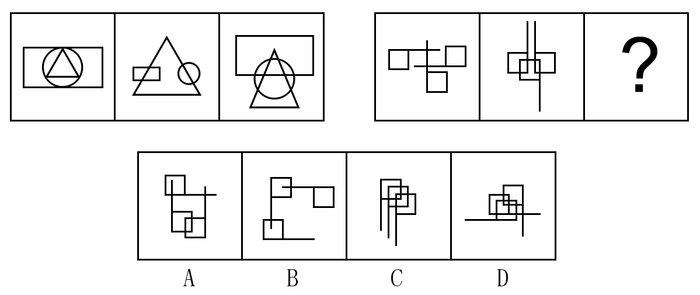

A. A

B. B

C. C

D. D

第 37 题 · 答案与解析

**参考答案（粉笔题库参考内容）**

C

**解析**

元素组成不同，优先看属性和数量规律。属性中曲直、对称、封闭均无规律，观察图形发现每组图都有相交的点，考虑数交点，第一组图交点为8-11-15，单看无规律，总和为34，第二组图形的交点为14-16-？，选项中没有交点为4的图形；再次观察图形发现图形与图形之间的交点比较明显，第一组图形与图形的交点为4-4-8，前两个图形交点之和等于第三幅图交点数；同理，第二组图形与图形的交点为：2-4-？，？号处图形与图形的交点数应为6，只有C项符合。

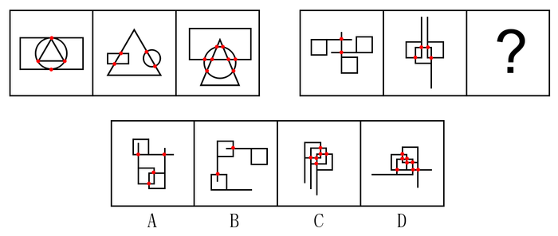

故正确答案为C。

**考点**：数量规律-点

**来源**：2015年上海市公务员录用考试《行测》题（B类）第37题

### 第 38 题

下列选项中，符合所给图形的变化规律的是＿＿＿＿＿＿＿。

A. A

B. B

C. C

D. D

第 38 题 · 答案与解析

**参考答案（粉笔题库参考内容）**

D

**解析**

所有图形都是由两个相同元素组成，且元素都存在相交部分，观察元素相交部分发现，相交部分的形状与两个图形的形状一样，故问号处也应保持一致，选项中只有D选项符合此规律。

故正确答案为D。

**考点**：数量规律-素、特殊规律-图形间关系

**来源**：2015年上海市公务员录用考试《行测》题（B类）第38题

### 第 39 题

下列选项中，符合所给图形的变化规律的是＿＿＿＿＿＿＿。

A. A

B. B

C. C

D. D

第 39 题 · 答案与解析

**参考答案（粉笔题库参考内容）**

B

**解析**

元素组成相似，考虑样式规律。第一组图中，图1的左侧长方形翻转到中间部分叠加形成图2，图2的右侧三角形翻转到中间部分叠加形成图3。第二组图也应符合此规律，所得到的图形为B选项的样式。

故正确答案为B。

**考点**：位置规律-翻转

**来源**：2015年上海市公务员录用考试《行测》题（B类）第39题

### 第 40 题

下列选项中，符合所给图形的变化规律的是＿＿＿＿＿＿。

A. A

B. B

C. C

D. D

第 40 题 · 答案与解析

**参考答案（粉笔题库参考内容）**

B

**解析**

图形组成相同，考虑样式规律。题干中为金字塔型，考虑紧邻形成三角形图形之间的关系，观察发现，第三层的图1图2黑白求异后顺时针旋转90度可得第二层的图1，第三层的图2图3黑白求异后顺时针旋转90度可得第二层的图2，则问号处也应保持这一规律，即第二层的两个图形黑白求异后顺时针旋转90度得到问号处图形，即为B选项样式。

故正确答案为B。

**考点**：样式规律-加减同异

**来源**：2015年上海市公务员录用考试《行测》题（B类）第40题

### 第 41 题

下列选项中，符合所给图形的变化规律的是＿＿＿＿＿＿＿。

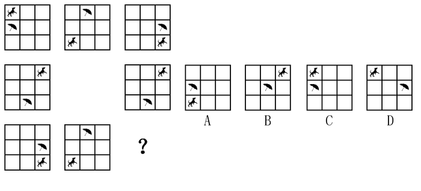

A. A

B. B

C. C

D. D

第 41 题 · 答案与解析

**参考答案（粉笔题库参考内容）**

C

**解析**

观察图形发现为类九宫格图形，最中间的部分比较特殊，为空白，考虑米字形规律，发现米字形两端图形一样，则问号处应与左上角图形一样。

故正确答案为C。

**考点**：位置规律-平移

**来源**：2015年上海市公务员录用考试《行测》题（B类）第41题

### 第 42 题

下列选项中，按共同特征或规律分类正确的是＿＿＿＿＿＿＿＿。

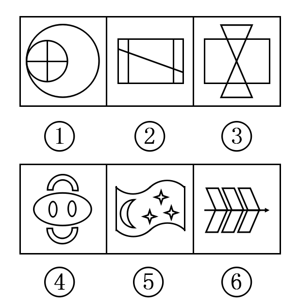

A. ①③⑤，②④⑥

B. ①④⑤，②③⑥

C. ①⑤⑥，②③④

D. ①②⑥，③④⑤

第 42 题 · 答案与解析

**参考答案（粉笔题库参考内容）**

B

**解析**

元素组成凌乱，考虑属性规律和数量规律。因图⑤不对称，因此不能考虑对称性。曲直性可以发现，图①④⑤为既有曲线又有直线，图②③⑥只有直线，但是规律不是很严谨。再观察发现图形的窟窿较多，可以考虑数面。面的数量依次为5、6、6、5、5、6，因此①④⑤一组，②③⑥一组。

故正确答案为B。

**考点**：数量规律-面

**来源**：2015年上海市公务员录用考试《行测》题（B类）第42题

### 第 43 题

心电图仪是用来记录心脏生物电的变化规律的装置，如图是甲、乙两人在同一台心电图仪上作出的心电图，医生通过测量后记下甲的心率是60次/分。那么，该心电图仪图纸移动的速度和乙的心率分别为\_\_\_\_\_\_\_\_。

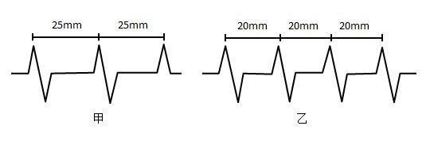

A. 20mm/s，75次/分

B. 20mm/s，60次/分

C. 25mm/s，75次/分

D. 25mm/s，60次/分

第 43 题 · 答案与解析

**参考答案（粉笔题库参考内容）**

C

**解析**

根据题干所给的信息，甲的心率是60次/分，甲的心电图两个波峰的间隔为25mm，每分钟跳动60次，那么心电图纸每秒的移动速度为：25mm × 60 ÷ 60s = 25mm/s。乙的心电图两个波峰的间隔为20mm，则乙的心率为：25mm/s × 60s ÷ 20mm = 75次/分。乙的心率为75次/分。

故正确答案为C。

**考点**：日常结论

**来源**：2015年上海市公务员录用考试《行测》题（B类）第43题

### 第 44 题

抚养比就是需要经济供养的少年与老年人口之和与劳动年龄人口数量之比，反映了劳动力的抚养负担程度。 根据上述定义，以下现象不会增加抚养比的是\_\_\_\_\_\_\_\_。

A. 婴幼儿死亡率下降

B. 人均寿命提高

C. 失业率增加

D. 退休年龄提前

第 44 题 · 答案与解析

**参考答案（粉笔题库参考内容）**

C

**解析**

第一步：找到定义关键词。

关键词为“需要经济供养的少年与老年人口之和与劳动年龄人口数量之比”，如果增加抚养比，说明需要经济供养的人口（少年与老年）增加或者劳动年龄人口数量减少。

第二步：逐一分析选项。

A项：“婴幼儿死亡率下降”说明婴儿的成活率增高，需要供养的少年增加，抚养比加大，排除；

B项：“人均寿命提高”会导致老年人口增加，加大抚养比，排除；

C项：失业人口也是包含在劳动人口中的，所以失业人口的增加并不会对“劳动年龄人口数量”造成影响，也就不会导致抚养比增加，当选；

D项：“退休年龄提前”不仅增加了需要抚养的老年人口，而且还减少了劳动年龄人口，增加了抚养比，排除。

本题为选非题，故正确答案为C。

**考点**：单定义-其他句式

**来源**：2015年上海市公务员录用考试《行测》题（B类）第44题

### 第 45 题

完全无弹性是指需求对价格的变化不敏感，无论商品的价格如何变化，都会有特定的需求量存在而不会发生变化。根据上述定义，以下属于完全无弹性现象的是\_\_\_\_\_\_\_\_。

A. 某抗癌药品对癌症患者来说是必需品，即便该药品价格上涨，它仍能保持稳定的销售量

B. 虽然房价上涨的速度高于多数人工资增长的速度，但仍有许多人购买

C. 某种进口水果的价格昂贵，即便如此，总还是有人愿意买

D. 果农不能以高于当前市场零售价的价格出售他的水果，否则水果将出现滞销

第 45 题 · 答案与解析

**参考答案（粉笔题库参考内容）**

A

**解析**

第一步：找到定义关键词。

关键词为“需求对价格的变化不敏感”、“无论商品的价格如何变化，都会有特定的需求量存在而不会发生变化”。

第二步：逐一分析选项。

A项：抗癌药品对癌症患者来说是维持生命的必需品，即使价格上涨，它仍能保持稳定的销售量，符合商品价格变化时“需求量不会发生变化”，符合定义，当选；

B项：当房价上涨过快时，虽然有人购买，不能说明需求量没有发生变化，对于“需求量会不会发生变化”是不明确的，不符合定义，排除；

C项：进口水果价格昂贵，虽然有人购买，不能说明需求量没有发生变化，对于“需求量会不会发生变化”是不明确的，不符合定义，排除；

D项：果农以高于当前市场零售价的价格出售他的水果时出现滞销，说明销量受到了价格的影响，不符合定义，排除。

故正确答案为A。

**考点**：单定义-其他句式

**来源**：2015年上海市公务员录用考试《行测》题（B类）第45题

### 第 46 题

下列选项中，符合所给图形的变化规律的是\_\_\_\_\_\_\_\_。

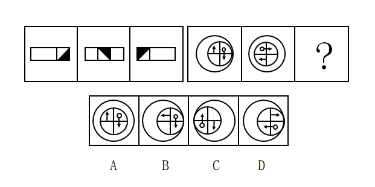

A. A

B. B

C. C

D. D

第 46 题 · 答案与解析

**参考答案（粉笔题库参考内容）**

C

**解析**

观察图形发现，元素组成相同，考虑位置规律。第一组图中小方格每次向左移动一步，内部小黑三角形逆时针旋转90°；第二组图形遵循此规律，中间的小圆每次向左移动一步，中间小圆内部的小元素分别逆时针旋转90°，对应到C选项。

故正确答案为C。

**考点**：位置规律-综合

**来源**：2015年上海市公务员录用考试《行测》题（B类）第46题

### 第 47 题

下列选项中，符合所给图形的变化规律的是\_\_\_\_\_\_\_\_。

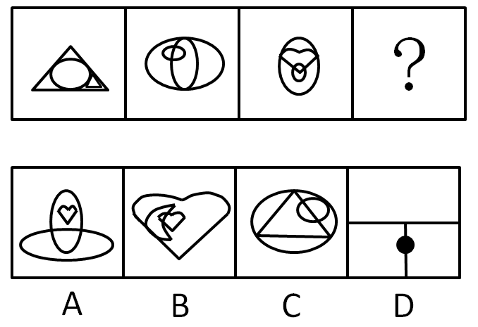

A. A

B. B

C. C

D. D

第 47 题 · 答案与解析

**参考答案（粉笔题库参考内容）**

B

**解析**

图形组成相似，考虑样式规律。观察发现，每个图形都由三个元素组成，均为一个外部元素包含两个内部元素，且前一个图的两个内部元素中较大的元素是后一个图的外部元素，则问号处外部元素应为心形，仅B项符合此规律。

故正确答案为B。

**考点**：样式规律-遍历

**来源**：2015年上海市公务员录用考试《行测》题（B类）第47题

### 第 48 题

下列选项中，选择最合适的一项填在问号处，使之呈现一定的规律性：

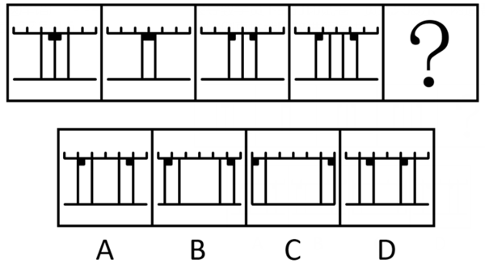

A. A

B. B

C. C

D. D

第 48 题 · 答案与解析

**参考答案（粉笔题库参考内容）**

A

**解析**

元素组成相同，考虑位置规律。图形中右上角有黑点标记的长方形每次向右移动半格，左上角有黑点标记的长方形每次向左移动半格，则问号处应为第四幅图继续接此规律移动，如A项所示。

故正确答案为 A。

**考点**：位置规律-平移

**来源**：2015年上海市公务员录用考试《行测》题（B类）第48题

### 第 49 题

下列选项中，选择最合适的一项填入问号处，使之呈现一定的规律性：

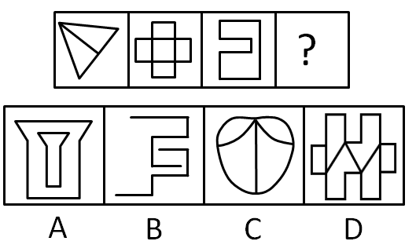

A. A

B. B

C. C

D. D

第 49 题 · 答案与解析

**参考答案（粉笔题库参考内容）**

D

**解析**

图形元素组成不同，且无明显的属性规律，考虑数量规律。每个图都是由直线组成，优先考虑数直线，发现直线数量分别为4、8、8，没有规律。再观察，发现三个图形都是一笔画图形，A、B、C三项均为两笔画图形，只有D项为一笔画图形。

故正确答案为D。

**考点**：数量规律-线

**来源**：2015年上海市公务员录用考试《行测》题（B类）第49题

### 第 50 题

左边给定的是正方体的外表面展开图，下面哪一项能由它折叠而成？

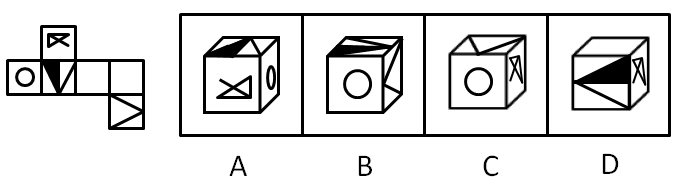

A. A

B. B

C. C

D. D

第 50 题 · 答案与解析

**参考答案（粉笔题库参考内容）**

B

**解析**

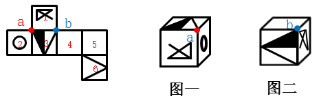

A项：由面1、2、3构成，如图一所示，展开图中这三个面的公共点a引出黑色的三角形，选项中则引出了白色三角形，排除；

B项：由面2、3、6构成，由于面2、6相隔较远，暂不判断；

C项：由面1、2、6构成，展开图中面1与面6为相对面，不可能同时出现，排除；

D项：由面1、3、4或5构成，展开图中面3与面5为相对面，不可能同时出现，所以选项由面1、3、4构成。如图二所示，在展开图中1、3、4面的公共点b，引出了白色三角形，而选项中引出了黑色三角形，排除。

故正确答案为B。

**考点**：空间类-空间重构-六面体

**来源**：2015年上海市公务员录用考试《行测》题（B类）第50题

### 第 51 题

对实验小鼠小剂量地使用某种激素药物来治疗哮喘不会造成副作用，而且可以有效缓解病情。因此该药物也可以在临床上用来治疗人类哮喘。 要得出上述结论，需要以下\_\_\_\_\_\_\_\_项为前提。

A. 激素药物总是能够对哮喘起到缓解作用

B. 该药物治疗小鼠哮喘的机理与治疗人类哮喘的机理是相似的

C. 对实验小鼠使用的激素药物剂量与人类相当

D. 实验小鼠使用该药物后未出现的副作用可能会在人类身上出现

第 51 题 · 答案与解析

**参考答案（粉笔题库参考内容）**

B

**解析**

第一步：找出论点论据。

论点：对实验小鼠使用的某种激素药物可以在临床上用来治疗人类哮喘。

论据：对实验小鼠小剂量地使用某种激素药物来治疗哮喘不会造成副作用，而且可以有效缓解病情。

第二步：逐一分析选项。

A项：只强调了对哮喘能起到缓解作用，是否有副作用不明确，是否可以在临床上用来治疗人类哮喘不明确，为不明确选项，排除；

B项：说明该药物治疗哮喘的机理相似，在小鼠和人类之间进行了搭桥，加强论证，当选；

C项：小鼠与人是两种生物，使用的激素药物剂量相当不一定在人身上就不会出现副作用，为不明确选项，排除；

D项：在人类身上可能会出现副作用说明该药物不可以在临床上用来治疗人类哮喘，直接削弱论点，为削弱选项，排除。

故正确答案为B。

**考点**：加强-实验类、搭桥

**来源**：2015年上海市公务员录用考试《行测》题（B类）第51题

### 第 52 题

近年来，G市的私家车数量猛增，中心城区的交通拥堵日益严重。有关部门决定实施“优化调整停车场差别化收费方案”，将中心城区商业配套、路边咪表停车场的停车计时周期由“半小时”调整为“15分钟”以提高车位周转率，白天的最高限价均为4元/15分钟，希望由此能缓解中心城区的交通拥堵状况。

以下\_\_\_\_\_\_\_\_项如果为真，能够最有力地削弱上述结论。

A. G市各单位的公车保有量占该市机动车总量的25%，是造成中心城区交通拥堵的主要原因之一

B. 大型三甲医院主要位于中心城区，一些需要就医的市民仍然会乘坐出租车到达这些医院

C. 开私家车前往中心城区上班或购物的多数车主属于高收入阶层，停车费上涨对于这部分人群几乎没有影响

D. 停车费上涨后，部分私家车主转而利用公共交通出行，势必加剧公共交通的拥挤程度，降低公交出行的舒适性

第 52 题 · 答案与解析

**参考答案（粉笔题库参考内容）**

C

**解析**

第一步：找出论点和论据。

论点：实施“优化调整停车场差别化收费方案”，希望由此能缓解中心城区的交通拥堵状况。

论据：无明显论据。

第二步：逐一分析选项。

A项：占该市机动车总量的25%的公车是造成中心城区交通拥堵的主要原因之一，与题干论点中的收费方案的优化调整能缓解因数量猛增的私家车造成的交通拥堵状况无关，为无关选项，排除；

B项：仍然会乘坐出租车到达中心城区的医院与题干中收费方案的调整使得交通拥堵状况缓解无关，为无关选项，排除；

C项：说明停车费的上涨不会减少中心城区的私家车数量，因此不能缓解中心城区的交通拥堵状况，削弱了题干论点，当选；

D项：利用公共交通出行加剧了公共交通的拥挤程度，并不是加剧了整体城区交通的拥堵程度，同时公交出行的舒适性与题干论点无关，为无关选项，排除。

故正确答案为C。

**考点**：削弱论点

**来源**：2015年上海市公务员录用考试《行测》题（B类）第52题

### 第 53 题

已知：①任何在三环路上行驶的交通工具的最低限速是80公里/小时。②电动助动车的最高时速是45公里/小时。③小张的轿车号牌尾号是单号，只能在单日才被允许驶入三环路。④今天是10月11日。

如果上述断定为真，以下\_\_\_\_\_\_\_\_项断定也一定为真。

Ⅰ.如果小张某天驾驶轿车的时速超过了80公里/小时，那么当日一定是单日。

Ⅱ.电动助动车不允许驶入三环路。

Ⅲ.今天小张的轿车仍然有可能不被允许驶入三环路。

A. Ⅰ、Ⅱ、Ⅲ

B. Ⅰ和Ⅲ

C. Ⅰ和Ⅱ

D. Ⅱ和Ⅲ

第 53 题 · 答案与解析

**参考答案（粉笔题库参考内容）**

D

**解析**

本题为翻译推理题型。第一步，翻译题干：①三环路上行驶→最低限速是80公里/小时；②电动助动车最高时速45公里/小时；③小张被允许驶入三环路→单日。④今日是单日。

第二步，逐一分析Ⅰ、Ⅱ、Ⅲ三个断定。

Ⅰ超过80公里/小时→单日，肯定了①的后件，不能得出任何确定性结论，无法从题干中推出；

Ⅱ电动助动车→不允许驶入三环路。由②电动助动车最高时速45公里/小时可知，电动助动车的时速小于80公里/小时，否定了①的后件，否后必否前，则电动车→不允许驶入三环路，能从题干中推出；

Ⅲ小张轿车→可能不被允许驶入三环路。根据④今日是单日，肯定了③的后件，因此可以得出可能性结论，即小张轿车可能不被允许驶入三环路，能从题干中推出。

Ⅱ和Ⅲ能从题干中推出。

故正确答案为D。

**考点**：常规翻译

**来源**：2015年上海市公务员录用考试《行测》题（B类）第53题

### 第 54 题

某办公室有张、王、李、刘、陈五人，其中张、王、李对五人年终评优的结果推测如下：

张：如果陈没有被评定为优秀，则我也不会被评定为优秀。

王：我和刘、陈三人要么都优秀，要么都不优秀。

李：如果我被评定为优秀，则王也被评定为优秀。

评定结果出来后，发现三个人的预测都是错的，则最终有\_\_\_\_\_\_\_\_个人优秀。

A. 1

B. 2

C. 3

D. 4

第 54 题 · 答案与解析

**参考答案（粉笔题库参考内容）**

C

**解析**

题干中出现明显的逻辑关联词，先翻译出来。

结合题干最后一句，三个人的预测都是错的，即否定了张、王、李三人的观点。

①-张：-（-陈→\-张），即张且-陈；

②-王：王、刘、陈不是都优秀，也不是都不优秀；

③-李：-（李→王），即李且-王。

由①和③可知，张、李优秀，陈、王不优秀，再根据②“王、刘、陈不是都优秀，也不是都不优秀”可知刘优秀。即张、李、刘三人优秀。

故正确答案为C。

**考点**：常规翻译

**来源**：2015年上海市公务员录用考试《行测》题（B类）第54题

### 第 55 题

根据对最新卫星云图的分析，早前预报的“梅花”台风下周将正面影响上海的情况不一定会发生。

以下\_\_\_\_\_\_\_\_项最接近题干所表述的含义。

A. “梅花”台风下周将正面影响上海一定不会发生

B. “梅花”台风下周将正面影响上海可能会发生

C. “梅花”台风下周将正面影响上海可能不会发生

D. “梅花”台风下周将正面影响上海的可能性并不比不影响的可能性大

第 55 题 · 答案与解析

**参考答案（粉笔题库参考内容）**

C

**解析**

本题考查模态命题。题干中出现了不一定，交换否定词与模态词的位置，就要同时改变模态词的类型。即不一定等价于可能不，不可能等价于必然不。故此命题可表述为：“梅花”台风下周将正面影响上海的情况可能不会发生。

故正确答案为C。

**来源**：2015年上海市公务员录用考试《行测》题（B类）第55题

### 第 56 题

每四年一届的世界哲学大会在希腊雅典举行。H大学的张教授、马教授和李教授中至少有一人参加了这届国际哲学盛会。已知：

Ⅰ.只有向大会组委会提交一篇英文论文并经评审通过的报名者，才能获得组委会发出的会议邀请函。

Ⅱ.由于张教授和马教授是同一教研室的同事而且经常合作进行研究，如果张教授前往雅典参加这次大会，那么马教授也肯定会一同参加。

Ⅲ.李教授在受聘H大学之前曾留学德国，他向大会组委会提交了一篇用德语撰写的有关德国哲学家康德的学术论文。

根据以上情况，以下＿＿＿＿＿＿项一定为真。

A. 李教授参加了这届世界哲学大会

B. 张教授参加了这届世界哲学大会

C. 张教授和马教授均参加了这届世界哲学大会

D. 马教授参加了这届世界哲学大会

第 56 题 · 答案与解析

**参考答案（粉笔题库参考内容）**

D

**解析**

第一步：分析题干。

①获得邀请函→提交英文论文且评审通过

②张→马

③李提交德语论文

第二步：进一步分析。

通过条件③李提交德语论文可知李没有提交英文论文，根据逆否原则可从条件①得到条件④没有提交英文论文或评审没有通过→没有获得邀请函，即李没有获得邀请函，则一定无法参加此次大会，排除A。

根据条件②逆否原则可得⑤-马→-张，如果马没去，则张一定也没有去，与题干中的“至少有一人参加了大会”矛盾，所以马一定去了，张是否参加大会无法确定。

故正确答案为D。

**考点**：常规翻译

**来源**：2015年上海市公务员录用考试《行测》题（B类）第56题

### 第 57 题

煤炭采掘业发言人提出建议：为了维持国产煤炭的价格，必须限制较便宜的国外煤炭的进口，否则，我国的煤炭采掘业将难以经营。有色金属冶炼业发言人对上述建议的回应：我国有色金属冶炼业购买的煤炭75%都是国产的。如果煤炭的价格不是按国际价格支付，那么，由于成本的提高，国产的有色金属就会卖不出去，这样对国产煤炭的需求就会下跌。

以下（    ），是对有色金属冶炼业发言人的论证的最恰当评价。

A. 该论证无的放矢，和煤炭采掘业发言人的建议无关

B. 该论证是循环论证，它预先假设了为了评论煤炭采掘业发言人的建议而需要证明的东西

C. 该论证说明煤炭采掘业发言人的建议如果实施的话将会对其自身产生负面影响

D. 该论证没有给出理由说明为什么上述建议的实施并不能减轻煤炭采掘业难以经营的担心

第 57 题 · 答案与解析

**参考答案（粉笔题库参考内容）**

C

**解析**

第一步：翻译题干。

煤炭采掘业发言人：

①维持国产煤炭的价格→限制较便宜的国外煤炭进口

②—限制较便宜的国外煤炭进口→我国的煤炭采掘业将难以经营

有色金属冶炼业发言人：

③不按国际价格支付→对国产煤炭的需求就会下跌

第二步：逐一分析选项。

A项：两个行业的发言人都在谈论的是煤炭的价格，并不是无关，排除；

B项：循环论证是指用来证明论题的论据本身的真实性要依靠论题来证明的逻辑错误。如证明“鸦片能催眠”，所用的论据是“它有催眠的力量”。而“鸦片有催眠的力量”，又要借助于“它能催眠”来证明。这就是犯了循环论证的自证。通过题干的逻辑关系①②③可知，有色金属冶炼业发言人的建议并没有循环论证，排除；

C项：根据条件①②可知，煤炭采掘业发言人是在说明不维持国产煤炭的价格，也就是按国际价格支付会使我国煤炭采掘业难以经营，因此煤炭采掘业发言人的观点是想“不要按国际价格支付”；而有色金属冶炼业发言人是在说明如果不按国际价格支付，会导致国产煤炭需求下跌，即会产生负面影响，当选；

D项：有色金属冶炼业发言人说明了不按国际价格支付会使国产煤炭需求下跌，那么就给出理由说明了为什么上述建议的实施并不能减轻对煤炭采掘业难以经营的担心，排除。

故正确答案为C。

**考点**：论证结构

**来源**：2015年上海市公务员录用考试《行测》题（B类）第57题

### 第 58 题

在超市里有四个存物柜，打开柜子后发现，第一个柜子里写着：“所有的柜子里都装着购物袋”；第二个柜子里写着：“本柜子中有购物礼品”；第三个柜子里写着：“本柜子里没有食品”；第四个柜子里写着：“有些柜子里没有购物袋”。

如果只有一个柜子里的描述是真实的，以下肯定为真的是：

A. 所有的柜子里都有购物袋

B. 所有的柜子里都没有购物袋

C. 所有的柜子里都没有购物礼品

D. 第三个柜子里有食品

第 58 题 · 答案与解析

**参考答案（粉笔题库参考内容）**

D

**解析**

第一步：找突破口。

突破口为第一个柜子和第四个柜子是矛盾关系，两个断定必有一真一假。

第二步：分析其他选项。

题干说只有一个柜子的描述为真，那么第二个柜子和第三个柜子的描述必定均为假，即第二个柜子里没有购物礼品，第三个柜子里有食品。

故正确答案为D。

**考点**：只有一真/一假

**来源**：2015年上海市公务员录用考试《行测》题（B类）第58题

### 第 59 题

当前人们越来越热爱旅游，许多游客会到一些著名的城市旅游。常常有这样一种现象：在前往游览风景名胜的路上，导游小姐总会在几个工艺品加工厂前停车，劝大家去厂里参观，说产品便宜，而且买不买都没有关系。为此，一些游客常有怨言，但此种行为仍在继续，甚至一年胜似一年。

以下最不可能成为造成上述现象原因的是：

A. 虽然有的人不满意，但许多游客是愿意的，他们从厂里出来时的笑容就是证据

B. 绝大多数游客经济上都是富裕的，他们只想省时间，不在意商品的价格

C. 有些游客来旅游的一项重要任务就是购物，若是空手回家，家里人会不高兴的

D. 厂家产品直销，质量有保证，价格也确实便宜，何乐而不为

第 59 题 · 答案与解析

**参考答案（粉笔题库参考内容）**

B

**解析**

第一步：找到题干矛盾点。

矛盾点：虽然一些游客常有怨言，但是导游小姐仍然会把车停在加工厂前，建议游客去里面参观这一行为，甚至一年胜似一年。

第二步：逐一分析选项。

A项：从游客的角度解释为什么这种现象持续存在，因为很多的游客还是很喜欢旅游购物的，可以解释，排除；

B项：大多数游客想省时间而不在意商品价格，则说明工艺品加工厂产品便宜对游客没有吸引力，因此不能作为解释旅游购物持续存在的原因，当选；

C项：游客来旅游的一项重要任务就是购物，因此从游客的角度解释了这种现象持续存在的原因，可以解释，排除；

D项：产品物美价廉，肯定是受绝大多数游客的喜爱，因此可以从游客的角度解释旅游购物持续存在的原因，排除。

本题为选非题，故正确答案为B。

**考点**：原因解释

**来源**：2015年上海市公务员录用考试《行测》题（B类）第59题

### 第 60 题

三段论推理是演绎推理中的一种简单推理判断。它包含：一个一般性的原则（大前提），一个附属于前面大前提的特殊化陈述（小前提），以及由此引申出的特殊化陈述符合一般性原则的结论。

依据以上定义，下列推理过程正确的是：

A. 骄兵必败，我们胜利，所以我们是骄兵

B. 勇者无畏，我无畏，所以我是勇者

C. 英雄难过美人关，我是英雄，所以我难过美人关

D. 狭路相逢勇者胜，我们胜利，所以勇者胜

第 60 题 · 答案与解析

**参考答案（粉笔题库参考内容）**

C

**解析**

第一步：找出定义关键词。

“一个一般性的原则（大前提）”、“一个附属于前面大前提的特殊化陈述（小前提）”、“由此引申出的特殊化陈述符合一般性原则的结论”。（可表示为：A→B，C是附属于A的小前提，则C→B）

第二步：逐一分析选项。

A项：骄兵→必败，“我们胜利”与“骄兵”没有附属关系，不符合关键词“一个附属于前面大前提的特殊化陈述（小前提）”，不符合定义，排除；

B项：勇者→无畏，“我无畏”与“勇者”没有附属关系，不符合关键词“一个附属于前面大前提的特殊化陈述（小前提）”，不符合定义，排除；

C项：英雄→难过美人关，“我是英雄”是附属于“英雄”的特殊化表述，可以引申出结论：“我→难过美人关”，符合定义，当选；

D项：狭路相逢→勇者胜，“我们胜利”与“狭路相逢”没有附属关系，不符合关键词“一个附属于前面大前提的特殊化陈述（小前提）”，不符合定义，排除。

故正确答案为C。

**考点**：单定义-其他句式

**来源**：2015年上海市公务员录用考试《行测》题（B类）第60题

### 第 61 题

请从四个选项中选出正确的一项，使得该项的两个词或词组依次代入题干的括号中，能够最大限度地满足题干所表达的类比关系。

喜乐  之于  （    ）  相当于  （    ）  之于  美德

A. 快乐 伦理

B. 情绪 诚信

C. 后悔 丑恶

D. 健康 心理

第 61 题 · 答案与解析

**参考答案（粉笔题库参考内容）**

B

**解析**

逐一代入选项验证。

A项：喜乐与快乐为近义词关系；伦理指的是人与人以及人与自然的关系和处理这些关系的规则，与美德没有明显的逻辑关系，排除；

B项：喜乐是一种情绪，为种属关系；诚信是一种美德，为种属关系，前后逻辑关系一致，当选；

C项：喜乐与后悔没有明显的逻辑关系；丑恶多指人的面相，与美德没有明显的逻辑关系，排除；

D项：喜乐可能会让人身体健康；但是心理与美德没有明显的逻辑关系，排除。

故正确答案为B。

**考点**：逻辑关系-包容关系

**来源**：2015年上海市公务员录用考试《行测》题（B类）第61题

### 第 62 题

左边这个图形是由右边四个图形中的某一个作为外表面折叠而成，请指出它是哪一个？

A. A

B. B

C. C

D. D

第 62 题 · 答案与解析

**参考答案（粉笔题库参考内容）**

D

**解析**

本题属于空间重构类，逐一分析选项，将题干所给的黑三角面和灰三角面标上序号。

由题干图形可知，1面和2面为相邻面，标红的线即为两个面的公共边，可以观察到，2面上的灰色三角形有条边挨着这条标红的公共边，而1面上的黑三角形没有边与标红的公共边挨着。

A项：

如图所示，A选项中，1面和2面的公共边即为标红的线条，可以发现在公共边上灰色三角形和黑色三角形都有边与公共边挨着，和题干已知图形不一致，排除；

B项：

如图所示，B选项中，1面和2面的公共边即为标红的线条，可以发现在公共边上灰色三角形和黑色三角形都没边与公共边挨着，和题干已知图形不一致，排除；

C项：

如图所示，C选项中，1面和2面的公共边即为标红的线条，可以发现在公共边上灰色三角形和黑色三角形都有边与公共边挨着，和题干已知图形不一致，排除。

A、B、C三项均排除，答案选D项。

故正确答案为D。

**来源**：2015年上海市公务员录用考试《行测》题（B类）第62题

### 第 63 题

玉石：雕琢：玉器

A. 蚕丝：织造：丝绸

B. 粮食：酿造：美酒

C. 生铁：冶炼：钢材

D. 蚊香：点燃：烟雾

第 63 题 · 答案与解析

**参考答案（粉笔题库参考内容）**

A

**解析**

第一步：分析题干词语的逻辑关系。

玉石指未经雕琢的玉，玉石经过雕琢成为玉器，且发生的是物理变化，题干三词为原材料、工艺和成品之间的对应。

第二步：逐一分析选项。

A选项：蚕丝经过织造成为丝绸，且发生的是物理变化，为原材料、工艺和成品之间的对应，与题干逻辑关系一致，当选；

B选项：粮食经过酿造成为美酒，为原材料、工艺和成品之间的对应，但是在这个过程中发生了化学变化，酿酒经过了发酵的过程，通过化学变化生成乙醇，与题干逻辑关系不一致，排除；

C选项：生铁通过冶炼成为钢材，为原材料、工艺和成品之间的对应，但中间存在化学变化，与题干逻辑关系不一致，排除；

D选项：点燃蚊香产生烟雾，烟雾不是一种成品，与题干逻辑关系不一致，排除。

故正确答案为A。

**考点**：逻辑关系-对应关系

**来源**：2015年上海市公务员录用考试《行测》题（B类）第63题

### 第 64 题

法律移植是指一个国家对同时代其他国家法律制度的吸收和借鉴。

根据上述定义，下列属于法律移植的是：

A. 非西方国家在西方列强殖民主义的扩张之后，被迫地或主动地施行西方国家法律

B. 张某认为雅典城邦的法律思想体现了公平，认为我国法律也体现了公平

C. 非洲某落后国家研究发达国家的法律史，并根据实际情况修改了本国的法律制度

D. 法国18世纪借鉴了中国的科举考试，设置了本国的公务员考试

第 64 题 · 答案与解析

**参考答案（粉笔题库参考内容）**

A

**解析**

第一步：找出定义关键词。

“国家”、“同时代其他国家法律制度的吸收和借鉴”。

第二步：逐一分析选项。

A项：落后国家的做法是对西方列强国家法律的吸收和借鉴，符合定义，当选；

B项：雅典城邦和我国不是同一时代的国家，同时也没有体现出吸收和借鉴，不符合定义，排除；

C项：研究发达国家的法律史，说明不是同一时代的国家，不符合定义，排除；

D项：18世纪法国设立了公务员考试，借鉴的是古代中国的科举考试，但是并不是法律制度，排除。

故正确答案为A。

**考点**：主客体

**来源**：2015年上海市公务员录用考试《行测》题（B类）第64题

### 第 65 题

感知综合障碍是指病人在感知某一现实事物时，作为一个客观存在的整体来说是正确的，但对该事物的个别属性，如大小、形状、颜色、空间距离等产生与该事物不相符合的感知。

根据上述定义，下列属于感知综合障碍的是：

A. 王某由于沉迷于游戏而经常出现幻觉，眼前浮现游戏中打斗的场景

B. 张某最近一段时间以来经常觉得正在摆动着的钟摆停止了摆动

C. 由于眼睛高度近视，李某在大街上经常会认错人，心里非常苦闷

D. 孙某对颜色的辨别能力差，经医生检查发现这是色弱的表现

第 65 题 · 答案与解析

**参考答案（粉笔题库参考内容）**

B

**解析**

第一步：找出定义关键词。

关键词为“感知某一现实事物”、“作为整体正确”、 “个别属性如大小、形状、颜色、空间距离等产生与该事物不相符合的感知”。

第二步：逐一分析选项。

A项：王某是出现幻觉了，且是虚拟场景，不符合关键词“作为整体正确”，不符合定义，排除；

B项：张某觉得钟摆停止了摆动，对于钟摆的认识是正确的，但对于摆动的钟摆产生了不摆动的认知，是在空间距离产生与该事物不符合的感知，符合定义，当选；

C项：李某是眼睛近视导致的认错人，对整体的认识就是错误的，不符合定义，排除；

D项：孙某是对颜色的辨别能力差，但不一定和实际不相符，没有体现对事物整体的认知是否正确，不符合定义，排除。

故正确答案为B。

**考点**：单定义-其他句式

**来源**：2015年上海市公务员录用考试《行测》题（B类）第65题

### 第 66 题

有一段公路如图所示，在B路口处为三车道，到A路口处并为两车道，已知A路口处每条车道平均约5秒钟通过一辆车，若要在A路口处不造成拥堵，B路口处每条车道平均约\_\_\_\_\_\_\_\_秒钟通过一辆车。

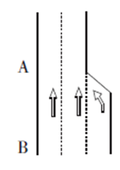

A. 6.5

B. 7

C. 7.5

D. 8

第 66 题 · 答案与解析

**参考答案（粉笔题库参考内容）**

C

**解析**

设B路口每条道每x秒通过1辆车。B路口1分钟内通过车辆数：60/x × 3 = 180/x。A路口每条车道平均约5秒钟通过一辆车，则1分钟内A路口通过60/5 × 2 = 24辆车。两路口单位时间内通过的车辆总数相等，24=180/x，x=7.5。

故正确答案为C。

**考点**：和差倍比问题

**来源**：2015年上海市公务员录用考试《行测》题（B类）第66题

### 第 67 题

“嫦娥一号”卫星在未打开太阳翼时，外形是长222厘米，宽172厘米，高220厘米的长方体，若在表面包裹1厘米厚的防震材料层，在这外面还有1厘米厚的木板包装箱，则木板包装箱所需木材的体积至少为\_\_\_\_\_\_\_\_立方厘米。

A. 224×174×222-222×172×220

B. 223×173×221-221×171×219

C. 225×175×223-224×174×222

D. 226×176×224-224×174×222

第 67 题 · 答案与解析

**参考答案（粉笔题库参考内容）**

D

**解析**

木材体积＝包裹防震材料和木材之后的体积－包裹防震材料层之后的体积。表面包裹防震材料层之后，每面均加厚1厘米，体积为（222+2）×（172+2）×（220+2）=224×174×222。再包裹木材之后，每面又加厚1厘米，体积变为226×176×224。所求应为226×176×224-224×174×222。

故正确答案为D。

**考点**：几何公式类-立体图形

**来源**：2015年上海市公务员录用考试《行测》题（B类）第67题

### 第 68 题

小张参加一个会议，会议下午2点多开始时小张看表发现时针与分针呈直角。会议开到下午5点多结束时，小张发现时针与分针完全重合。则会议开了\_\_\_\_\_\_\_\_。

A. 3小时整

B. 3小时整或3.5小时

C. 3小时1分到3小时5分之间

D. 3小时25分到3小时29分之间

第 68 题 · 答案与解析

**参考答案（粉笔题库参考内容）**

A

**解析**

下午两点时，时针与分针夹角是60°。至时针与分针呈直角时，分针追时针150°。此时经过时间为150°/5.5°=300/11分钟，时间为2点300/11分。下午5点时，时针与分针夹角是150°，至时针与分针重合，分针追时针150°。经过时间同样为300/11分钟，此时时间为5点300/11分。所以时间相差3小时整。

故正确答案为A。

**来源**：2015年上海市公务员录用考试《行测》题（B类）第68题

### 第 69 题

在电脑里先输入一个数，它会按给定的指令进行如下运算：如果输入的数是偶数，就把它除以2；如果输入的是奇数，就把它加上3；对产生的数继续进行同样的运算。这样进行了3次，得出结果是27。原来输入的数有\_\_\_\_\_\_\_\_种情况。

A. 五

B. 四

C. 三

D. 一

第 69 题 · 答案与解析

**参考答案（粉笔题库参考内容）**

C

**解析**

27为奇数，若由+3得到，则上一级数为24，24为偶数，不应+3。所以27的上一级只能由除以2得来，即54。54的上一级有两种情况，108和51。若为108，再上一级可能为216和105，均符合条件。若为51，再上一级为102或48（偶数，不应+3，舍去）。原来输入的数有3种情况，即216-108-54-27，105-108-54-27，102-51-54-27。

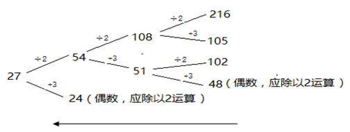

故正确答案为C。

**考点**：排列组合问题-其他

**来源**：2015年上海市公务员录用考试《行测》题（B类）第69题

### 第 70 题

某年2月份有5个星期日，4个星期六，则2月1日是\_\_\_\_\_\_\_\_。

A. 星期四

B. 星期五

C. 星期六

D. 星期日

第 70 题 · 答案与解析

**参考答案（粉笔题库参考内容）**

D

**解析**

2月份有5个星期日，4个星期六，则该月为29天，且29日这天是星期日，所以2月1日也为星期日。

故正确答案为D。

**考点**：星期日期问题

**来源**：2015年上海市公务员录用考试《行测》题（B类）第70题

### 第 71 题

甲、乙两人同时从相距2000米的两地相向而行，甲每分钟行55米，乙每分钟行45米，如果一只狗与甲同时同向而行，每分钟行120米，遇到乙后，立即回头向甲跑去，遇到甲再向乙跑去。这样不断的来回，直到甲和乙相遇为止，狗跑过的距离为\_\_\_\_\_\_\_\_米。

A. 800

B. 1200

C. 1800

D. 2400

第 71 题 · 答案与解析

**参考答案（粉笔题库参考内容）**

D

**解析**

甲、乙两人从出发至相遇需要经过2000/(55+45)=20分钟。因为狗与甲同时出发，一直奔跑到甲、乙相遇为止，故狗跑了20分钟，每分钟120米，则狗跑过的距离为120 × 20 = 2400米。

故正确答案为D。

**考点**：相遇追及

**来源**：2015年上海市公务员录用考试《行测》题（B类）第71题

### 第 72 题

某公司售出了一批水泥共450吨，计划使用同等数量的A型卡车和B型卡车进行运输。A型卡车每辆可运输25吨，而B型卡车由于被指派了其他运输任务，由载重量多了5吨的C型卡车来替代其运输。结果在使用的A型卡车数量不变的情况下，总的用车量减少了2辆，则B型卡车每辆可运输\_\_\_\_\_\_\_\_吨。

A. 40

B. 25

C. 32

D. 20

第 72 题 · 答案与解析

**参考答案（粉笔题库参考内容）**

D

**解析**

方法一：设需用n辆A型卡车，B型卡车每辆可运x吨。则有

（25+x）n=450…①

25n+（x+5）(n-2)=450…②

整理得到，5n-2x=10，代入①，得n=10，x=20。

故正确答案为D。

方法二：根据（25+x）n=450可知，450能被25+x整除，排除A、C选项。代入B选项，可得需要A型卡车9辆。25 × 9 + 30 × 7.5 = 450，车辆总数是小数，且与总用车辆减少2辆不符，排除B。

故正确答案为D。

**考点**：和差倍比问题

**来源**：2015年上海市公务员录用考试《行测》题（B类）第72题

### 第 73 题

某工程由10名工人承担，5天后，为了要提前10天完成任务，需增加4名工人，那按计划完成该工程需要\_\_\_\_\_\_\_\_天（假设所有工人的工作效率相同）。

A. 35

B. 40

C. 65

D. 80

第 73 题 · 答案与解析

**参考答案（粉笔题库参考内容）**

B

**解析**

方法一：赋值工人的效率为1，原计划完成时间为t。因为5天后的工作量固定，原计划10人t-5天完成，现在14人t-5-10天完成，有10（t-5）=14（t-5-10），解得t=40天。

方法二：5天之后剩余的工作量固定，则效率比和时间比成反比。则有10/14 = 5/7 = 剩余工作量所用新时间/剩余工作量所用原时间，则“原计划总时间—5”是7的倍数。只有B项符合。

故正确答案为B。

**考点**：给效率比例型

**来源**：2015年上海市公务员录用考试《行测》题（B类）第73题

### 第 74 题

考场有16排座位，第一排有16个座位，以后各排都比前一排多一个座位，如果允许考生任意坐，但不能坐在其他考生的旁边，这考场最多能容纳\_\_\_\_\_\_\_\_名考生。

A. 188

B. 192

C. 196

D. 200

第 74 题 · 答案与解析

**参考答案（粉笔题库参考内容）**

B

**解析**

若一排座位数为偶数，最多坐n/2个考生；若一排座位数为奇数，最多坐(n+1)/2个考生。因为各排都比前一排多一个座位，且第一排是16个，则每排最多坐的考生数依次为：8、9、9、10、10、······ 15、15、16，总的人数 = (8 + 15)/2 × 8 + (9 + 16)/2 × 8 = 192名。

故正确答案为B。

**考点**：数列问题、非典型最值问题

**来源**：2015年上海市公务员录用考试《行测》题（B类）第74题

### 第 75 题

一游泳池有进出水管各一根。单独开放进水管20分钟可注满全池，单独开放出水管40分钟可放空满池水。一次注水2分钟后发现出水管并未关闭，及时关闭出水管后接着注水。那么再需\_\_\_\_\_\_\_\_分钟可注满游泳池。

A. 18

B. 18.5

C. 19

D. 20

第 75 题 · 答案与解析

**参考答案（粉笔题库参考内容）**

C

**解析**

设游泳池的总注水量为40，进水管的效率为40/20=2，则出水管的效率为40/40=1。进水管出水管同时工作2分钟，共进水(2−1)×2=2。则关闭出水管后注满还需时间 = (40-2)/2 = 19分钟。

故正确答案为C。

**考点**：给完工时间型

**来源**：2015年上海市公务员录用考试《行测》题（B类）第75题

## 材料 3

2014年一季度，上海市六个重点发展的工业行业共完成工业总产值5168.47亿元，增长3.6%，增幅低于全市规模以上工业平均水平0.4个百分点。其中，汽车制造业产销两旺，共完成工业总产值1372.12亿元，增长15%。一季度生产汽车67.33万辆，增长15.9%。其中，排量在1升到1.6升之间(含1.6升)的轿车41.57万辆，增长23.9%；运动型多用途乘用车7.96万辆，增长44.1%。汽车制造业对全市工业增长的贡献率为59%，拉动全市工业增长2.4个百分点。

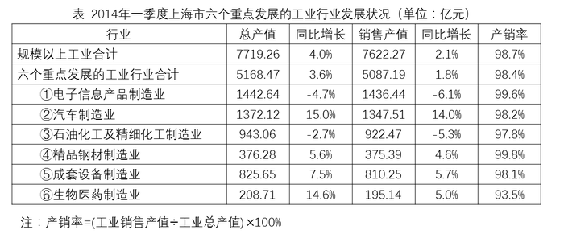

### 第 76 题

2014年一季度，上海市规模以上工业总产值同比增量比同期销售产值同比增量约多\_\_\_\_\_\_\_\_亿元。

A. 70

B. 140

C. 210

D. 280

第 76 题 · 答案与解析

**参考答案（粉笔题库参考内容）**

B

**解析**

由问题所求“······同比增量比…同比增量约多多少亿元”，可判定此题为增长量比较问题，定位表格可得，规模以上工业总产值为7719.26，同比增长4.0%，销售产值为7622.27，同比增长2.1%，根据增长量计算公式，总产值增量 = 7719.26/(1+4%)×4% = 7719.26/(1+1/25)×1/25 = 7719.26/26 ≈ 300，销售产值增量 = 7622.27/(1 + 2.1%) × 2.1% ≈ 7622.27/(1 + 1/50) × 1/50 = 7622.27/51 ≈ 150，二者同比增量差=300-150=150，B项最接近。

故正确答案为B。

**考点**：增长量计算、综合资料

**来源**：2015年上海市公务员录用考试《行测》题（B类）第76题

### 第 77 题

2014年一季度，上海市六个重点发展的工业行业销售产值占总规模以上工业的比重约为\_\_\_\_\_\_\_\_。

A. 60%

B. 67%

C. 72%

D. 79%

第 77 题 · 答案与解析

**参考答案（粉笔题库参考内容）**

B

**解析**

由问题所求“2014年一季度······占······的比重”，结合材料给的时间是2014年一季度，可判定此题为现期比重问题，定位表格可得，六个重点发展的工业行业销售产值=5087.19亿元，规模以上工业销售产值=7622.27亿元，比重 = 5087.19/7622.27 ≈ 2/3 ≈ 67%。

故正确答案为B。

**考点**：现期比重、综合资料

**来源**：2015年上海市公务员录用考试《行测》题（B类）第77题

### 第 78 题

上海市六个重点发展的工业行业中，2014年一季度产销率高于上年同期水平的有\_\_\_\_\_\_\_\_个。

A. 0

B. 2

C. 4

D. 6

第 78 题 · 答案与解析

**参考答案（粉笔题库参考内容）**

A

**解析**

问题求“六个重点发展的工业行业中，产销率高于上年同期水平”的行业个数，根据产销率 = 工业销售产值/工业总产值 × 100%，可判定此题为两期比重比较问题，根据公式，两期比重差 = A/B × (a − b)/(1 + a)，高于上年同期水平，即行业的销售产值增长率a＞总产值增长率b，定位表格可得，六行业中①a=-6.1%，b=-4.7%，a＜b；②a=14%，b=15%，a＜b；③a=-5.3%，b=-2.7%，a＜b；④a=4.6%，b=5.6%，a＜b；⑤a=5.7%，b=7.5%，a＜b；⑥a=5%，b=14.6%，a＜b，因此a＞b的个数为0，产销率高于去年同期水平的有0个。

故正确答案为A。

**考点**：两期比重、综合资料

**来源**：2015年上海市公务员录用考试《行测》题（B类）第78题

### 第 79 题

2014年一季度，上海市生产的汽车中，运动型多用途乘用车的比重比上年同期上升了约\_\_\_\_\_\_\_\_个百分点。

A. 0

B. 2

C. 8

D. 15

第 79 题 · 答案与解析

**参考答案（粉笔题库参考内容）**

B

**解析**

由问题所求“······比重比上年同期上升了多少个百分点”，可判定此题为两期比重比较问题，定位文字材料第三、四、五行可得，运动型多用途乘用车现期量A=7.96万辆，增长率a=44.1%，总生产汽车的现期量B=67.33万辆，增长率b=15.9%，根据公式= A/B × (a − b)/(1 + a) = 7.96/67.33 × (44.1% − 15.9%)/(1 + 44.1%) ≈ 1/8 × 28.2%/1.44 ≈ 20%/8 ≈ 2.5%，B项最接近。

故正确答案为B。

**考点**：两期比重、综合资料

**来源**：2015年上海市公务员录用考试《行测》题（B类）第79题

### 第 80 题

关于2014年一季度上海市规模以上工业行业发展状况，下列表述与资料相符的是\_\_\_\_\_\_\_\_。

A. 在六个重点行业中，产销率最低的行业也是产值增速最快的行业

B. 成套设备制造业的产值增量高于精品钢材制造业

C. 排量在1升以下或超过1.6升的汽车产量增幅超过2成

D. 汽车制造业平均每生产一辆汽车，创造的产值约为12万元

第 80 题 · 答案与解析

**参考答案（粉笔题库参考内容）**

B

**解析**

A项：定位表格可得，产销率最低的是⑥生物医药制造业（93.5%），产值增速最快的是②汽车制造业（15%），并非同一行业，错误；

B项：定位表格可得，⑤成套设备制造业产值总产值825.65亿元，同比增长7.5%，④精品钢材制造业产值总产值376.28亿元，同比增长5.6%，增长量大小比较，根据“大大则大”原则，⑤的现期量、增长率都大于④，因此⑤成套设备制造业的产值增长量较高，正确；

C项：定位文字材料可得，一季度生产汽车67.33万辆，增长15.9%，其中，排量在1升到1.6升之间(含1.6升)的轿车41.57万辆，增长23.9%，根据混合增长率居中的原则，排量在1升以下或超过1.6升的汽车产量的增长率必然小于15.9%，因此增幅低于两成，错误；

D项：定位文字材料可得，汽车制造业完成工业总产值1372.12亿元，生产汽车67.33万辆，每辆汽车创造产值=1372.12÷67.33≈20万元，错误。

故正确答案为B。

**考点**：综合分析、综合资料

**来源**：2015年上海市公务员录用考试《行测》题（B类）第80题

## 材料 4

### 第 81 题

下列关于2007~2012年证券市场的表述，错误的是\_\_\_\_\_\_\_\_。

A. 股票总发行股本增速最快的年份是2011年

B. 2007年至2012年，A、H股的个数均有所增加

C. 2007年至2012年，国债发行额先升后降

D. 2007年至2012年，证券投资基金只数逐年增加

第 81 题 · 答案与解析

**参考答案（粉笔题库参考内容）**

C

**解析**

A项：定位表格“股票总发行股本”一行可知，2008—2012年的同比增速分别约为：1900/17000≈11%、 1700/18900＜10%、6400/20600 ≈ 31%、 9100/26980≈33%、2300/36100＜10%。增速最快的为2011年，说法正确，排除；

B项：定位表格，H股的个数均有所增加，说法正确，排除；A、B股总数逐年增加，而B股数呈持平或下降趋势，则A股数逐年增加。说法正确，排除；

C项：定位表格可知，国债发行额在2008年出现了下降，并非先升后降，说法错误，当选；

D项：定位表格可知，2007年至2012年证券投资基金只数逐年增加，说法正确，排除。

本题为选非题，故正确答案为C。

**考点**：综合分析、综合资料

**来源**：2015年上海市公务员录用考试《行测》题（B类）第81题

### 第 82 题

下列关于2007~2012年证券市场相关指标，说法正确的是\_\_\_\_\_\_\_\_。

A. 期货总成交量和总成交额呈相同方向变化

B. 上证综合指数和深证综合指数呈同方向变化

C. 上海平均市盈率比深圳平均市盈率相对波动小

D. 债券成交额增长值最大的是2010年至2011年

第 82 题 · 答案与解析

**参考答案（粉笔题库参考内容）**

C

**解析**

A项：定位表格最后两行可知，期货总成交量和总成交额并非呈完全相同的方向变化，2011年成交量下降，但成交额增加，说法错误；

B项：定位表格可知，上证综合指数和深证综合指数并非呈完全相同的方向变化，2010年上证下降，而深证上升，说法错误；

C项：由表格可以推出，深圳平均市盈率相对波动更大一些，说法正确；

D项：定位表格可知，2011至2012年债券成交额

增长值=403426-216349≈18万+；2010年至2011年债券成交额增长值=216349-76206≈14万+。故最大的不是2010年至2011年，说法错误。

故正确答案为C。

**考点**：综合分析、综合资料

**来源**：2015年上海市公务员录用考试《行测》题（B类）第82题

### 第 83 题

下列关于股票成交量与成交金额，说法正确的是\_\_\_\_\_\_\_\_。

A. 股票成交量与成交金额呈同方向变化

B. 股票成交均价最低的年份是2007年

C. 股票成交均价最高的年份是2010年

D. 股票成交量逐年递增

第 83 题 · 答案与解析

**参考答案（粉笔题库参考内容）**

C

**解析**

A项：定位图一可知，股票成交量在2010年出现下降，而成交金额上涨，并非同方向变化，说法错误；

B项：定位图一可知：2007年股票成交均价 = 460555/36403 ≈ 12.6，2008年股票成交均价=267112/24131≈11^+。故最低并非2007年，说法错误；

C项：定位图一可知：2010年股票成交均价 = 545634/42151 ≈ 12.9，其他年均低于12.9，说法正确；

D项：定位图一可知，股票成交量并非逐年递增，说法错误。

故正确答案为C。

**考点**：综合分析、综合资料

**来源**：2015年上海市公务员录用考试《行测》题（B类）第83题

### 第 84 题

下列关于企业债券和国债发行额的表述，说法错误的是\_\_\_\_\_\_\_\_。

A. 2008年，国债与企业债券发行额约为1∶1

B. 企业债券发行额最高的年份是2012年

C. 企业债券发行额在2011年首次超过国债发行额

D. 2007年，国债发行额大约是企业债券发行额的3倍

第 84 题 · 答案与解析

**参考答案（粉笔题库参考内容）**

D

**解析**

A项：由图2可知，2008年国债与企业债券发行额相等，即1：1，说法正确，排除；

B项：由图2可知，企业债券发行额最高的年份是2012年，说法正确，排除；

C项：由图2可知，企业债券发行额首次超过国债发行额是在2011年，说法正确，排除；

D项：由图2可知，2007年国债发行额约为25000亿元，企业债券发行额约为5000亿元，二者呈5倍关系，说法错误，当选。

本题为选非题，故正确答案为D。

**考点**：综合分析、综合资料

**来源**：2015年上海市公务员录用考试《行测》题（B类）第84题

### 第 85 题

下列关于上市公司的说法，正确的是\_\_\_\_\_\_\_\_。

A. 2012年，A股上市公司数目比前一年增加152家

B. 2011年，A股上市公司数目比前一年增加279家

C. B股上市公司数目逐年增加

D. 境内上市公司数增加最快的是2011年

第 85 题 · 答案与解析

**参考答案（粉笔题库参考内容）**

B

**解析**

A项：定位表格，2012年A股上市公司数=2494-107，2011年其值=2342-108。2012年比2011年增加：（2494-107）-（2342-108）=2494-2342+1=153家。说法错误；

B项：定位表格，2011年A股上市公司数=2342-108，2010年其值=2063-108。2011年比2010年增加：2342-2063=279家。说法正确；

C项：定位表格发现，B股上市公司数从2009年开始出现下降，并非逐年增加。说法错误；

D项：定位表格，境内上市公司数2010年增加2063-1718=345家，2011年增加2342-2063=279家，2011年的增长量较2010年要少，且基期量更高，故增速要比2010年要慢。说法错误。

故正确答案为B。

**考点**：综合分析、综合资料

**来源**：2015年上海市公务员录用考试《行测》题（B类）第85题

## 材料 5

2013年全国社会物流总额197.8万亿元，同比增长9.5%，增幅比上年回落0.3个百分点。分季度看，一季度增长9.4%，上半年增长9.1%，前三季度增长9.5%。其中，工业品物流总额181.5万亿元，同比增长9.7%，增幅比上年回落0.3个百分点。进口货物物流总额12.1万亿元，同比增长6.4%，增幅比上年回落1.3个百分点。

       2013年全国社会物流总费用10.2万亿元，同比增长9.3%，增幅比上年回落2.1个百分点。其中，运输费用5.4万亿元，同比增长9.2%；保管费用3.6万亿元，同比增长8.9%；管理费用1.3万亿元，同比增长10.8%。

       2013年全国物流业增加值3.9万亿元，同比增长8.5%，增幅比上年回落0.7个百分点。物流业增加值占GDP的比重为6.8%，占服务业增加值的比重为14.8%。其中，交通运输物流业增加值同比增长7.2%，增幅比上年回落1.5个百分点。贸易物流业增加值同比增长9.5%，增幅比上年回落0.3个百分点。仓储物流业增加值同比增长9.2%，增幅比上年回升2.4个百分点。邮政物流业增加值同比增长33.8%，增幅比上年回升7.1个百分点。

### 第 86 题

2013年全国社会物流总额同比增速最高的季度是\_\_\_\_\_\_\_\_。

A. 第一季度

B. 第二季度

C. 第三季度

D. 第四季度

第 86 题 · 答案与解析

**参考答案（粉笔题库参考内容）**

C

**解析**

根据“2013年······同比增速”且材料中出现累计增速判断本题为混合增长率问题。定位材料第一段，2013年全国社会物流总额同比增长9.5%，分季度看，一季度增长9.4%，上半年增长9.1%，前三季度增长9.5%。根据混合增长率居中原则，一季度（9.4%）>上半年（9.1%），则第二季度同比增速小于9.1%。上半年（9.1%）&lt;前三季度（9.5%），则第三季度大于9.5%。全年和前三季度同比增速都为9.5%，则第四季度同比增速等于9.5%。因此，最大的是第三季度。

故正确答案为C。

**考点**：文字资料、混合增长率

**来源**：2015年上海市公务员录用考试《行测》题（B类）第86题

### 第 87 题

下列选项中，\_\_\_\_\_\_\_\_占2013年全国社会物流总费用的比重高于上年水准。

A. 运输费用

B. 保管费用

C. 运输费用和保管费用

D. 管理费用

第 87 题 · 答案与解析

**参考答案（粉笔题库参考内容）**

D

**解析**

根据“······的比重高于上年水准”判断本题为两期比重问题。直接判断部分增长率和整体增长率的大小，若a>b，比重上升。

A项，定位材料第二段：运输费用同比增长率9.2%&lt;全国社会物流总费用同比增长率9.3%，错误；

B项，定位材料第二段：保管费用同比增长率8.9%&lt;全国社会物流总费用同比增长率9.3%，错误；

C项，定位材料第二段：运输费用和保管费用的增长率需要先用混合增长率考虑，较繁琐，待定即可；

D项，定位材料第二段，只有管理费用同比增长率（10.8%）> 全国社会物流总费用同比增长率（9.3%），正确。

故正确答案为D。

**考点**：两期比重、文字资料

**来源**：2015年上海市公务员录用考试《行测》题（B类）第87题

### 第 88 题

2013年我国服务业增加值占GDP的比重约为\_\_\_\_\_\_\_\_。

A. 42%

B. 46%

C. 50%

D. 54%

第 88 题 · 答案与解析

**参考答案（粉笔题库参考内容）**

B

**解析**

根据题干“2013年······占······的比重约为”判断本题为现期比重问题。定位材料第三段，2013年全国物流业增加值3.9万亿元，物流业增加值占GDP的比重为6.8%，占服务业增加值的比重为14.8%。比重 = 3.9/14.8% ÷ 3.9/6.8% = 6.8%/14.8% ≈ 6.8/15 ≈ 45%，B项最接近。

故正确答案为B。

**考点**：文字资料、现期比重

**来源**：2015年上海市公务员录用考试《行测》题（B类）第88题

### 第 89 题

2012年邮政物流业增加值增速比当年全国物流业增加值增速高\_\_\_\_\_\_\_\_个百分点。

A. 7.8

B. 17.5

C. 25.3

D. 33.1

第 89 题 · 答案与解析

**参考答案（粉笔题库参考内容）**

B

**解析**

定位材料第三段，2013年，邮政物流业增加值同比增长33.8%，增幅比上年回升7.1个百分点；全国物流业增加值同比增长8.5%，增幅比上年回落0.7个百分点。2012年邮政物流业增加值增速为33.8%-7.1%=26.7%。2012年全国物流业增加值增速为8.5%+0.7%=9.2%。26.7%-9.2%=17.5个百分点。

故正确答案为B。

**考点**：文字资料、简单加减计算

**来源**：2015年上海市公务员录用考试《行测》题（B类）第89题

### 第 90 题

下列关于我国物流行业状况的描述，与资料相符的是\_\_\_\_\_\_\_\_。

A. 2012年全国社会物流总费用同比增速快于物流总额同比增速

B. 2013年工业品物流总额不到全国社会物流总额的九成

C. 2013年社会物流总费用比上年增长了1万亿元以上

D. 与2011年相比，2013年交通运输物流业增加值增长了接近20%

第 90 题 · 答案与解析

**参考答案（粉笔题库参考内容）**

A

**解析**

A项：定位材料第一、二段，2012年全国社会物流总费用同比增速为9.3%+2.1%=11.4%；物流总额同比增速9.5%+0.3%=9.8%。11.4%>9.8%，正确；

B项：定位材料第一段，2013年全国社会物流总额197.8万亿元，工业品物流总额181.5万亿元，181.5/197.8 ＞ 181.5/200 ≈ 91%，大于九成，错误；

C项：定位材料第二段，2013年全国社会物流总费用10.2万亿元，同比增长9.3%，根据公式：增长量=现期率/(1+增长率)×增长率可得10.2/(1+9.3%) × 9.3% ≈ 10.2/(1+1/11) × 1/11 ≈ 10.2/12 ＜ 1万亿元，错误；

D项：定位材料第三段，交通运输物流业增加值同比增长7.2%，增幅比上年回落1.5个百分点。2012年的同比增速为7.2%+1.5%=8.7%。7.2% + 8.7% + 7.2% × 8.7% ≈ 15.9% + 0.6% = 16.5%，错误。

故正确答案为A。

**考点**：文字资料、综合分析

**来源**：2015年上海市公务员录用考试《行测》题（B类）第90题

### 第 91 题

法律是治国之重器，良法是善治之前提。纵观我国立法现状，社会主义法律体系已经建立起来，但随着社会形势的发展，一些法律还需要及时修改和制定。《中共中央关于全面推进依法治国若干重大问题的决定》指出，明确立法权力边界，从体制机制和工作程序上有效防止\_\_\_\_\_\_\_\_。

A. 权责交叉、多头执法

B. 部门利益和地方保护主义法律化

C. 地方立法权限和范围扩大化

D. 地方政府损害法律尊严和权威的立法行为

第 91 题 · 答案与解析

**参考答案（粉笔题库参考内容）**

B

**解析**

B项正确：《决定》指出，明确立法权力边界，从体制机制和工作程序上有效防止部门利益和地方保护主义法律化。对部门间争议较大的重要立法事项，由决策机关引入第三方评估，充分听取各方意见，协调决定，不能久拖不决。加强法律解释工作，及时明确法律规定含义和适用法律依据。明确地方立法权限和范围，依法赋予设区的市地方立法权。

故正确答案为B。

**考点**：宪法

**来源**：2015年上海市公务员录用考试《行测》题（B类）第91题

### 第 92 题

下列情况中，应该给予行政赔偿的是\_\_\_\_\_\_\_\_。

A. 某事业单位工作人员甲驾驶单位车辆外出办事，途中顺路买菜，在菜场附近撞塌了菜贩乙的摊位，导致乙受到损失

B. 交通警察甲与货运车司机乙有矛盾，甲诬陷乙违反交通规则，并吊销其驾照，导致乙的车辆两个月不能投入运营

C. 某市食药监局发现某公司涉嫌销售假冒伪劣药品而将其扣押，该公司以此举给公司造成损失为由要求赔偿

D. 检验检疫局扣留了甲公司从海外订购的一批植物种子，因该批种子属于危险物种。甲公司认为此举给公司带来了损失，并要求赔偿

第 92 题 · 答案与解析

**参考答案（粉笔题库参考内容）**

B

**解析**

B项正确：根据《中华人民共和国国家赔偿法》第四条：行政机关及其工作人员在行使行政职权时有下列侵犯财产权情形之一的，受害人有取得赔偿的权利：1.违法实施罚款、吊销许可证和执照、责令停产停业、没收财物等行政处罚的；2.违法对财产采取查封、扣押、冻结等行政强制措施的；3.违法征收、征用财产的；4.造成财产损害的其他违法行为。题干中甲故意诬陷并吊销了乙的驾照，对乙造成了损失，乙应该要求赔偿。

A、C、D项错误：根据《中华人民共和国国家赔偿法》第五条：属于下列情形之一的，国家不承担赔偿责任：1.行政机关工作人员与行使职权无关的个人行为；2.因公民、法人和其他组织自己的行为致使损害发生的；3.法律规定的其他情形。A项中是由于甲的个人行为给乙造成了损失，所以应由他自己赔偿；CD项都是合法的行为，不应赔偿。

故正确答案为B。

**考点**：行政法

**来源**：2015年上海市公务员录用考试《行测》题（B类）第92题

### 第 93 题

网格化管理是一种新型数字化城市管理模式，它借助信息技术和社会力量在政府层级、职能和部门之间努力进行全方位的打通。下列关于网格化管理表述正确的是\_\_\_\_\_\_\_\_。

A. 它是继“无缝隙政府”模式后在政府管理流程上的一个重大变革和突破

B. 它利用信息技术推进信息共享，进而进一步打破职能的边界

C. 它更加适合“对人的管理”而非“对事的管理”

D. 目前，城市应急联动中心属于一种网格化管理模式

第 93 题 · 答案与解析

**参考答案（粉笔题库参考内容）**

ABD

**解析**

A、B项正确：网格化城市管理新模式是运用数字化、信息化手段，以街道、社区、网格为区域范围，以事件为管理内容，以处置单位为责任人，通过城市网格化管理信息平台，实现市区联动、资源共享的一种城市管理新模式，AB项正确。

D项正确：城市应急联动中心就是综合各种城市应急服务资源，统一指挥、联合行动，为市民提供相应的紧急救援服务，为城市的公共安全提供强有力的保障，所以城市应急联动中心也属于一种网格化管理。

C项错误：网格化管理是以事件管理为内容，而不是更适合对人的管理。

故正确答案为ABD。

**来源**：2015年上海市公务员录用考试《行测》题（B类）第93题

### 第 94 题

公共预算不仅能够引导国家和地方的经济增长与发展，还可以促使公共管理者对从公民手中征得的、用于公共项目的资金承担法律责任。这体现了公共预算的\_\_\_\_\_\_\_\_。

A. 政治性和管理性

B. 政治性和经济性

C. 经济性和责任性

D. 管理性和责任性

第 94 题 · 答案与解析

**参考答案（粉笔题库参考内容）**

C

**解析**

C项正确：公共预算是经济平衡工具，公共预算的分配往往承担着刺激经济增长或稳定经济、促进就业、抑制通货膨胀等宏观经济职能。所以题干中公共预算能够引导经济发展体现了经济性；公共预算具有问责功能，题干中的后半部分提到要承担法律责任，这是体现了公共预算的责任性。

A、B项错误：公共预算的政治性是指公共资源是稀缺的，公共预算分配公共资源时必须考虑不同利益相关者的需求，最终的预算分配实际上反映了政府政策的优先性，是不同的参与者讨价还价的结果，这反映了公共预算的政治性。

D项错误：公共预算的管理性指公共预算也是管理的工具，因为有效的分配并不能保证资源都被有效地使用，所以公共预算不只是简单的财政资源分配，还要求利用特定的管理方法和技术使得公共服务和公共项目的提供更有效。

故正确答案为C。

**来源**：2015年上海市公务员录用考试《行测》题（B类）第94题

### 第 95 题

2014年4月24日，十二届全国人大常委会第八次会议表决通过了修订后的《中华人民共和国环境保护法》。该法增加了“对拒不改正的排污企业实施按日计罚”“对严重的违法行为采取行政拘留”以及“政府的主要负责人在面对政府的违法行为造成严重后果时要引咎辞职”等内容，被称为“史上最严”的环保法。这是国家运用\_\_\_\_\_\_\_\_。

A. 经济手段和法律手段规范环境保护工作的开展

B. 宏观调控手段保障环境保护工作健康发展

C. 财政政策和货币政策保证环境保护工作快速发展

D. 经济手段和行政手段对环境保护进行调控

第 95 题 · 答案与解析

**参考答案（粉笔题库参考内容）**

B

**解析**

本题主要考查经济常识。

国家宏观调控的手段主要包括经济手段、法律手段和行政手段。（1）经济手段，是指政府在自觉依据和运用价值规律的基础上借助于经济杠杆的调节作用，对国民经济进行宏观调控。经济杠杆是对社会经济活动进行宏观调控的价值形式和价值工具，主要包括价格、税收、信贷、工资等。（2）法律手段，是指政府依靠法制力量，通过经济立法和司法，运用经济法规来调节经济关系和经济活动，以达到宏观调控目标的一种手段。（3）行政手段，是指依靠行政机构，采取强制性的命令、指示、规定等行政方式来调节经济活动，以达到宏观调控目标的一种手段。

A项错误，题干材料阐述的是国家通过新的《环保法》，并且在环保法中添加了按日计罚、行政拘留和引咎辞职等对违反环保法的处罚方式。这些都是国家通过立法的形式，即宏观调控的法律手段，保护环境。经济手段主要是政府运用经济政策来调控，题干未有涉及。

B项正确，题干材料主要反映的是国家通过立法活动（环保法），保护环境，这体现了国家运用宏观调控手段中的法律手段调控经济活动，保护环境。

C项错误，财政政策和货币政策是宏观调控经济手段的两大调控政策。财政政策是指国家通过财政支出与税收政策来影响和调节总需求进而影响就业和国民收入的政策，主要包括税收、预算、发行国债、购买性支出和财政转移支付等手段；货币政策是指中央银行运用各种货币政策工具调节货币供应量来调控市场正常运行，主要货币政策工具为法定准备金率、公开市场业务和贴现政策。题干主要反映的国家通过立法（法律手段），调控经济活动，保护环境，而未体现财政政策和货币政策的经济手段调控经济活动，保护环境。

D项错误，题干材料未涉及经济手段；虽然在题干中有“按日计罚、行政拘留和引咎辞职”这些国家宏观调控行政手段措施，但是这些行政手段措施只是法律规定，题干材料并未涉及行政机关在实际环境执法中运用这些措施，即题干材料未涉及行政手段。

故正确答案为B。

**考点**：其他法律法规

**来源**：2015年上海市公务员录用考试《行测》题（B类）第95题

### 第 96 题

下列关于公务员职务升降的做法，错误的是\_\_\_\_\_\_\_\_。

A. 甲在省司法厅表现出特别优秀的才能，直接从科长晋升为处长

B. 市财政局政策法规处副处长退休，乙在全市财政局公务员系统内通过公开竞争上岗

C. 市工商局宣传处副处长辞职，丙通过面向社会的公开选拔，任职该岗位

D. 丁在区公安局试用期后第一年度定期考核中被确定为不称职，被辞退

第 96 题 · 答案与解析

**参考答案（粉笔题库参考内容）**

A

**解析**

A项错误：根据《公务员职务任免与职务升降规定（试行）》第十九条：“晋升县处级以上领导职务的公务员，应当具备《党政领导干部选拔任用工作条例》和有关法律、法规、章程规定的资格。”《党政领导干部选拔任用工作条例》第九条：“党政领导干部应当逐级提拔。特别优秀或者工作特殊需要的干部，可以突破任职资格规定或者越级提拔担任领导职务。破格提拔的特别优秀干部，应当德才素质突出、群众公认度高，并且符合下列条件之一：在关键时刻或者承担急难险重任务中经受住考验、表现突出、做出重大贡献；在条件艰苦、环境复杂、基础差的地区或者单位工作实绩突出；在其他岗位上尽职尽责，工作实绩特别显著。”选项A不能直接晋升为处长；

B项正确：根据《公务员职务任免与职务升降规定（试行）》第二十三条：“机关内设机构厅局级正职以下领导职务出现空缺时，可以在本机关或者本系统内通过竞争上岗的方式，产生任职人选。”B项中副处长退休，乙可以在全市公务员系统内通过公开竞争上岗；

C项正确：根据《公务员职务任免与职务升降规定（试行）》第二十三条：“厅局级正职以下领导职务或者副调研员以上及其他相当职务层次的非领导职务出现空缺，可以面向社会公开选拔，产生任职人选。”C项中副处长辞职，所以丙可以通过社会的公开选拨任职该岗位；

D项正确：根据《中华人民共和国公务员法》第三十二条：“新录用的公务员试用期为一年。试用期满合格的，予以任职；不合格的，取消录用。”丁在试用期被确定为不称职，所以应取消录用。

本题为选非题，故正确答案为A。

**考点**：行政法

**来源**：2015年上海市公务员录用考试《行测》题（B类）第96题

### 第 97 题

根据《上海市查处车辆非法客运办法》新规定，上海在采用乘客作证的传统取证方式基础上，加大了采用视频取证方式查处的工作力度，并取得了成效。以视频监控依法取证，\_\_\_\_\_\_\_\_。

A. 获得的视听资料，可以作为认定车辆非法客运的证据

B. 获得的视听资料，必须经过公证才能作为认定车辆非法客运的证据

C. 其采集主体，可以是交通行政执法机构和公安机关

D. 其采集主体，只能是公安机关

第 97 题 · 答案与解析

**参考答案（粉笔题库参考内容）**

AC

**解析**

A、C项正确：根据《上海市查处车辆非法客运办法》第十一条：（证据采集）1.交通行政执法机构和公安机关依法收集的录音、录像等视听资料、证人证言以及检查笔录等，可以作为认定车辆非法客运的证据。2.交通行政执法机构和公安机关的工作人员不得采用威胁、引诱、欺骗等方式收集车辆非法客运的证据。采用上述方式取得的证据，不得作为查处车辆非法客运的依据。

故正确答案为AC。

**考点**：其他法律法规

**来源**：2015年上海市公务员录用考试《行测》题（B类）第97题

### 第 98 题

《国家发展改革委关于降低国内成品油价格的通知》（发改电〔2014〕296号）称：根据近期国际市场油价变化情况，按照现行成品油价格形成机制，决定降低成品油价格。

上述信息属于\_\_\_\_\_\_\_\_。

A. 文字形态的指挥性信息

B. 声像形态的相关信息

C. 记忆形态的本单位信息

D. 文字形态的政策法规信息

第 98 题 · 答案与解析

**参考答案（粉笔题库参考内容）**

D

**解析**

D项正确：信息的形式包括文字形态信息、声像形态信息和记忆形态信息，题干中通知类的属于文字形态，从而排除B、C项；信息的主要内容包括：政策法规信息、指挥性信息、本单位信息、社会反馈信息、可比信息、相关信息和未来信息，而这个文件是《国家发展改革委关于降低国内成品油价格的通知》，属于政策法规信息，进而排除A项。

故正确答案为D。

**考点**：其他

**来源**：2015年上海市公务员录用考试《行测》题（B类）第98题

### 第 99 题

某市公安局要发通报表彰公安民警甲在人民群众生命财产安全受到威胁的关键时刻，挺身而出，舍己救人的先进事迹。

根据通报的写作要求，下列对这份通报正文的写作提示，正确的是\_\_\_\_\_\_\_\_。

A. 首先要详细描述甲救人的经过

B. 要对甲舍己救人先进事迹的意义进行简要分析

C. 在分析意义之后写对甲进行表彰的决定

D. 正文最后号召大家向甲学习

第 99 题 · 答案与解析

**参考答案（粉笔题库参考内容）**

ABCD

**解析**

A、B、C、D选项正确：通报由标题、主送单位、正文、发文机关和日期组成。表彰性通报和批评性通报一般分为三部分：（一）主要事实。表彰性通报要突出主要先进事迹，批评性通报要抓住主要错误事实；（二）分析指出事例的教育意义。表彰性通报，要在阐述先进事迹的基础上，提炼出主要经验、意义和值得学习与发扬的精神。批评性通报要分析错误的性质、危害，产生的根源和责任，指出应吸取的主要教训等；（三）决定要求。表彰性和批评性的通报，应写明组织结论与予以表彰或处理的决定，同时提出对表彰或批评对象与读者的希望、要求。为了防范和杜绝类似错误发生，批评性通报的结尾处，通常要有针对性地提出防范的措施或规定。传达性通报一般不写决定要求。（四）生效标识。在正文右下方标明发文机关名称，加盖印章，写明发文日期。

故正确答案为ABCD。

**来源**：2015年上海市公务员录用考试《行测》题（B类）第99题

### 第 100 题

中国的行政监督制度始于战国时期，到宋元明清时期才算比较完备。

下列制度中，不属于中国古代行政监督制度的是\_\_\_\_\_\_\_\_。

A. 春秋战国时的进谏奖励制度

B. 魏晋南北朝时的九品中正制

C. 秦汉时的监察御史和刺史制度

D. 唐朝的三院分察制度

第 100 题 · 答案与解析

**参考答案（粉笔题库参考内容）**

B

**解析**

本题考查人文历史。

A项正确，春秋战国时期君主普遍实行广泛的舆论监督，如《战国策·齐策一》中记载的战国时期齐国谋士邹忌劝说君主纳谏，使之广开言路，改良政治的故事，因此属于行政监督制度。

B项错误，九品中正制是魏晋南北朝时期重要的选官制度，不涉及行政监督的内容。

C项正确，御史始设于秦，为监察性质的官职，负责监察朝廷百官。刺史设立于西汉时期，代表中央巡视地方，为地方监察官。属于秦汉时期的行政监督制度。

D项正确，唐代御史台为最高监察部门，下设台院、殿院、察院三院，分别掌管不同监察内容，分工明确。属于唐代的行政监督制度。

本题为选非题，故正确答案为B。

**考点**：中国历史

**来源**：2015年上海市公务员录用考试《行测》题（B类）第100题

### 第 101 题

青草沙水源地位于长江流域最末端的河口江心区域，是亚洲最大的河口浅滩型水库，承担了上海市约50%的原水供应。

就地理位置而言，对青草沙水源地可能造成影响的最大隐患是\_\_\_\_\_\_\_\_。

A. 重金属污染

B. 水体富营养化

C. 蓝藻暴发

D. 咸潮入侵

第 101 题 · 答案与解析

**参考答案（粉笔题库参考内容）**

D

**解析**

D项正确：咸潮是指受太阳和月亮对海水的引力影响，当淡水河流量不足时，令海水倒灌入河，造成上游河道水体变咸的现象。青草沙水源地地处长江河口，极易受到咸潮影响。地理位置上的最大隐患就是咸潮。

A、B、C项错误：由于长江口两岸人口密集、工厂林立，大量生活和工业废水排向长江，导致长江口水体重金属超标、富营养化严重，更因此会导致蓝藻暴发。但排入工业废水和垃圾污染等不属于地理位置角度，因此A、B、C项不选。

故正确答案为D。

**考点**：其他

**来源**：2015年上海市公务员录用考试《行测》题（B类）第101题

### 第 102 题

《三十六计》是我国古代的三十六个兵法策略，起源于南北朝，成书于明清时期。

下列选项中属于“三十六计”的是\_\_\_\_\_\_\_\_。

①上屋抽梯 ②暗度陈仓

③浑水摸鱼 ④攻心为上

⑤反戈一击 ⑥借尸还魂

⑦指桑骂槐 ⑧反客为主

A. ②③④⑤⑥

B. ①②③⑥⑦⑧

C. ①②③④⑧

D. ②④⑤⑥⑦⑧

第 102 题 · 答案与解析

**参考答案（粉笔题库参考内容）**

B

**解析**

B项符合题意：三十六计包括：瞒天过海、围魏救赵、借刀杀人、以逸待劳、趁火打劫、声东击西；无中生有、暗度陈仓、隔岸观火、笑里藏刀、李代桃僵、顺手牵羊；打草惊蛇、借尸还魂、调虎离山、欲擒故纵、抛砖引玉、擒贼擒王；釜底抽薪、浑水摸鱼、金蝉脱壳、关门捉贼、远交近攻、假道伐虢；偷梁换柱、指桑骂槐、假痴不癫、上屋抽梯、树上开花、反客为主；美人计、空城计、反间计、苦肉计、连环计、走为上计。故①②③⑥⑦⑧出自《三十六计》。④攻心为上出自《孙子兵法》。⑤反戈一击出自《三国演义》。

故正确答案为B。

**考点**：文化常识

**来源**：2015年上海市公务员录用考试《行测》题（B类）第102题

### 第 103 题

自1948年12月发行第一套人民币以来，中国人民银行已陆续发行五套人民币。第五套人民币是由中国人民银行首次完全独立设计与印制的货币，它标志着中国货币的设计印制体系已经成熟，印制技术达到了国际先进水平。

第五套人民币应用了多种具有国际先进水平的防伪技术，其中首次采用了\_\_\_\_\_\_\_\_提高防伪性能。

A. 埋入安全线

B. 磁性标记

C. 机读技术

D. 水印防伪

第 103 题 · 答案与解析

**参考答案（粉笔题库参考内容）**

BC

**解析**

B、C项正确：用特定的检测仪检测，100元、50元的黑色横号码；20元、10元、5元的双色横号码的黑色部分以及各面额人民币的安全线有磁性，可供机读。A、D项防伪技术在之前的人民币中已有应用。

故正确答案为BC。

**考点**：科技理论与成就

**来源**：2015年上海市公务员录用考试《行测》题（B类）第103题

### 第 104 题

据统计，在国际自然保护联盟公布的最具危害性的100种外来入侵物种中，中国有50多种，其中危害最严重的有11种。

外来生物入侵的途径包括\_\_\_\_\_\_\_\_。

A. 主动引入物种

B. 海洋生物漂流

C. 旅游

D. 国际贸易的货物吞吐

第 104 题 · 答案与解析

**参考答案（粉笔题库参考内容）**

ABCD

**解析**

A、B、C、D项正确：外来生物入侵的途径包括人为有意传入（如主动引入物种）、人为无意传入（如旅游、国际贸易的货物吞吐）及自然传入（如海洋生物漂流）。

故正确答案为ABCD。

**考点**：生物常识

**来源**：2015年上海市公务员录用考试《行测》题（B类）第104题

### 第 105 题

2014年初，我国“雪龙”号在营救被困南极浮冰区的俄罗斯客船时，因破冰能力有限也遭遇厚冰围困，多日之后才突围成功。这一事件引发人们对破冰船及其破冰能力的关注。

破冰船是专用于在结冰的水面上开辟航道的特种船舶，以下表述正确的是\_\_\_\_\_\_\_\_。

A. 破冰船长宽比值小，船身短而宽，有利于辟开较宽的航道

B. 破冰船长宽比值大，船身为狭长型，有利于切碎冰层

C. 一般冰层较薄时多采用连续式破冰法，冰层较厚时采用冲撞式破冰法

D. 第一艘核动力破冰船由美国制造

第 105 题 · 答案与解析

**参考答案（粉笔题库参考内容）**

AC

**解析**

A项正确：船身短而宽，长宽比值小，底部首尾上翘，首柱尖削前倾，总体强度高，首尾和水线区用厚钢板和密骨架加强。

C项正确：当冰层不超过1.5米厚时，多采用“连续式”破冰法，通过反复冲击，把冰层冲破。而当冰层较厚时，则采用破冰船冲上冰面，将冰层压为碎块。然后倒退一段距离，再开足马力冲上前面的冰层，把船下的冰层压碎的方法。

B项错误：船身为狭长破冰面积小，不利于开拓冰面航道。

D项错误：第一艘核动力破冰船是前苏联制造的“列宁”号。

故正确答案为AC。

**考点**：科技理论与成就

**来源**：2015年上海市公务员录用考试《行测》题（B类）第105题

### 第 106 题

HEPA，即高效空气过滤器，达到HEPA标准的过滤网，对于0.1~0.3微米的微粒有效率达到99.7%，HEPA网的特点是空气可以通过，但细小的微粒却无法通过。下列关于HEPA应用，说法正确的是\_\_\_\_\_\_\_\_。

A. 用在吸尘器中，HEPA过滤器可滤除引发过敏和哮喘症状的微粒，对哮喘和过敏者有利

B. 在生物医学领域，HEPA过滤器主要用于滤除空气中的细菌和病毒等有机体

C. 用在空气净化器中，HEPA可有效过滤PM2.5可入肺颗粒

D. 对空气中的PM10微粒，HEPA过滤器无效

第 106 题 · 答案与解析

**参考答案（粉笔题库参考内容）**

ABC

**解析**

A、B、C项正确：引发过敏和哮喘症状的微粒、空气中的细菌和病毒、PM2.5可入肺颗粒直径都在0.1~0.3微米以上，可以被HEPA过滤器滤除。

D项错误：PM10微粒直径在0.1~0.3微米以上，可以被HEPA过滤器滤除，因此HEPA过滤器有效。

故正确答案为ABC。

**考点**：生物常识

**来源**：2015年上海市公务员录用考试《行测》题（B类）第106题

### 第 107 题

中国古代诗歌中包含了大量的物候资料，下面诗句中反映了“高海拔地区一年四季天气寒冷”这一气候现象的是\_\_\_\_\_\_\_\_。

A. 五月天山雪，无花只有寒。笛中闻折柳，春色未曾看

B. 月黑雁飞高，单于夜遁逃。欲将轻骑逐，大雪满弓刀

C. 千山鸟飞绝，万径人踪灭。孤舟蓑笠翁，独钓寒江雪

D. 黄河远上白云间，一片孤城万仞山。羌笛何须怨杨柳，春风不度玉门关

第 107 题 · 答案与解析

**参考答案（粉笔题库参考内容）**

A

**解析**

A项正确：出自唐代诗仙李白的《塞下曲》，写了天山五月飞雪，无花无春色的物候现象。反映了高海拔地区一年四季天气寒冷的特点。

B项错误：出自唐代诗人卢纶的《塞下曲》，描写将军雪夜准备率兵追敌的壮举。但与高海拔地区一年四季天气寒冷无关。

C项错误：出自唐代诗人柳宗元的《江雪》，描写了江南地区的冬日雪景，与高海拔地区无关。

D项错误：出自唐代诗人王之涣的《凉州词》，描写了边塞地区壮阔、荒凉的景色，及戍边将士的思乡之情。玉门关地处内陆中温带干旱区，属大陆性季风气候，不存在四季天气寒冷的气候现象。

故正确答案为A。

**考点**：文学常识

**来源**：2015年上海市公务员录用考试《行测》题（B类）第107题

### 第 108 题

基于电子地图的网络游戏、社区网、搜寻网、交友网等服务平台，都离不开地理信息服务的支撑。2014年7月，《国家地理信息产业发展规划（2014-2020年）》发布，这是我国国家层面上的首个地理信息产业规划。下列关于该规划的出台对我国地理信息产业的影响，表述不正确的是\_\_\_\_\_\_\_\_。

A. 为地理信息产业发展营造了良好的政策环境

B. 使政府成为地理信息技术创新平台的主体

C. 使产业发展的重点和方向更加明确

D. 促进地理信息产业做大做强，进而为调整经济结构作出贡献

第 108 题 · 答案与解析

**参考答案（粉笔题库参考内容）**

B

**解析**

B项错误：《国家地理信息产业发展规划（2014-2020年）》总体要求中提到：基本原则为需求牵动、市场主导。充分发挥市场需求对产业发展的引领作用，将政府、企业、公众等各方面对地理信息产品和服务的需求作为产业发展的内生动力。故地理信息技术创新平台的主体为市场而非政府。

A、C、D三项均正确。

本题为选非题，故正确答案为B。

**考点**：经济建设、重要文件

**来源**：2015年上海市公务员录用考试《行测》题（B类）第108题

### 第 109 题

混合所有制改革是国企改革的重头戏。今年年初中石化通过《启动中国石化销售业务重组、引入社会和民营资本实现混合所有制经营的议案》，率先揭开央企混合所有制改革序幕；中石油随后也表示已搭建六个合作合资平台，将采用产品分成的模式引入民资，打破一体化经营模式以推进混合所有制。目前已经有多家央企开启了混合所有制的改革和试点工作。这样做\_\_\_\_\_\_\_\_。

A. 减少了政府对市场主体经济活动的干预

B. 把发展混合所有制经济作为基本经济制度的实现形式

C. 进一步激活国有经济活力，增强了国有经济主体地位

D. 推动了国有企业产权的流动和重组，改善了企业产权结构

第 109 题 · 答案与解析

**参考答案（粉笔题库参考内容）**

ACD

**解析**

A项正确：发展混合所有制改革，意味着将在国有资本中引入非国有资本，可以降低代理成本，并减少政府对市场的干预；

C项正确：发展混合所有制改革，有利于提高国有资本配置和运行效率，激发国有经济活力，增强国有经济控制力和主体地位；

D项正确：混合所有制改革有助于各种所有制资本取长补短、相互促进，推动国有产业产权流通和重组，改善企业产业结构；

B项错误：基本经济制度是由我国的社会性质及基本国情所决定的，我国现处于并将长期处于社会主义初级阶段，因而我国的基本经济制度依然会是以公有制为主体，多种所有制经济共同发展的经济制度。

故正确答案为A、C、D。

**考点**：宏观经济与调控政策

**来源**：2015年上海市公务员录用考试《行测》题（B类）第109题

### 第 110 题

“兵马未动，粮草先行”，没有“财”便无“政”，财政在公共行政中具有十分重要的作用，而经济的运行，必然要求政府建立公共财政。下列不属于公共财政职能的是\_\_\_\_\_\_\_\_。

A. 社会管理

B. 资源配置

C. 稳定经济

D. 调节收入分配

第 110 题 · 答案与解析

**参考答案（粉笔题库参考内容）**

A

**解析**

A项符合题意，公共财政的主要职能包括：资源配置、收入分配、调控经济、监督管理。社会管理的范围过于宽泛，不包含在公共财政的职能范围内。

本题为选非题，故正确答案为A。

**考点**：宏观经济与调控政策

**来源**：2015年上海市公务员录用考试《行测》题（B类）第110题

### 第 111 题

某市出入境检验检疫局举行新闻发布会，公布5起典型案例。根据《政府信息公开条例》规定，公布典型案例\_\_\_\_\_\_\_\_。

A. 是行政机关主动公开政府信息

B. 公开的内容一般不能涉及被处理企业的商业秘密

C. 公开的内容应征得被监督检查企业的同意

D. 应当以便于公众知晓的方式公开

第 111 题 · 答案与解析

**参考答案（粉笔题库参考内容）**

ABD

**解析**

A项正确：《政府信息公开条例》第十五条规定：行政机关应当将主动公开的政府信息，通过政府公报、政府网站、新闻发布会以及报刊、广播、电视等便于公众知晓的方式公开；

B项正确：《政府信息公开条例》第十四条规定：行政机关不得公开涉及国家秘密、商业秘密、个人隐私的政府信息。但是，经权利人同意公开或者行政机关认为不公开可能对公共利益造成重大影响的涉及商业秘密、个人隐私的政府信息，可以予以公开；

D项正确：《政府信息公开条例》第十五条规定：行政机关应当将主动公开的政府信息，通过政府公报、政府网站、新闻发布会以及报刊、广播、电视等便于公众知晓的方式公开；

C项错误：《政府信息公开条例》第二十三条规定：行政机关认为申请公开的政府信息涉及商业秘密、个人隐私，公开后可能损害第三方合法权益的，应当书面征求第三方的意见；第三方不同意公开的，不得公开。但是，行政机关认为不公开可能对公共利益造成重大影响的，应当予以公开，并将决定公开的政府信息内容和理由书面通知第三方。

故并非所有公开的内容都需要征得被监督检查企业的同意，需分情况区别对待。

故正确答案为A、B、D。

**考点**：行政法

**来源**：2015年上海市公务员录用考试《行测》题（B类）第111题

### 第 112 题

2014年2月24日，上海举行了上海市行政审批制度改革工作电视电话会议，会议强调要把深化行政审批制度改革作为全面贯彻落实十八届三中全会精神的重要抓手，突出先行先试，突出制度突破，突出务实高效，通过进一步\_\_\_\_\_\_\_\_，在放开、放手、放活上下功夫，确保审改工作年年有突破，集小胜为大胜，充分激发企业和社会活力，真正发挥市场配置资源的决定性作用。

A. 取消调整审批事项

B. 推行审批标准化管理

C. 加强事中事后监管

D. 推进负面清单管理

第 112 题 · 答案与解析

**参考答案（粉笔题库参考内容）**

ABC

**解析**

A、B、C三项正确：在2014年2月24日下午举行的上海市行政审批制度改革工作电视电话会议上，上海市委副书记、市长杨雄在主会场讲话强调，要把深化行政审批制度改革作为全面贯彻落实十八届三中全会精神的重要抓手，突出先行先试，突出制度突破，突出务实高效，进一步取消调整审批事项，进一步推行审批标准化管理，进一步加强事中事后监管，在放开、放手、放活上下功夫，确保审改工作年年有突破，集小胜为大胜，充分激发企业和社会活力，真正发挥市场配置资源的决定性作用。

故正确答案为ABC。

**来源**：2015年上海市公务员录用考试《行测》题（B类）第112题

### 第 113 题

2014年10月24日，H市市长主持召开了办公会议，研究了建设用地规范管理工作，以及《关于进一步加强河道矿产资源开采管理的意见》和《关于卫生系统招考卫生专业合同工的意见》。此次会议的纪要正文采用\_\_\_\_\_\_\_\_结构方式最为恰当。

A. 概括叙述

B. 分项归纳

C. 发言记录

D. 时间序列

第 113 题 · 答案与解析

**参考答案（粉笔题库参考内容）**

B

**解析**

B项正确：本次会议的重点在于针对两项问题的意见，需要进行分项，且这些意见中有可能出现重复或者堆叠的内容，需要加以归纳，故此次会议纪要正文采取分项归纳结构方式最为恰当。

A项错误：概括叙述适用于叙事形式的会议纪要。

C项错误：发言记录适用于有多人轮番发言的会议纪要。

D项错误：时间序列适用于延续时间较长的系列会议。

故正确答案为B。

**来源**：2015年上海市公务员录用考试《行测》题（B类）第113题

### 第 114 题

2014年6月，第38届世界遗产大会审议并通过中国大运河项目和中国、哈萨克斯坦、吉尔吉斯斯坦跨国联合申报的丝绸之路项目，“大运河”和“丝绸之路”正式列入世界遗产名录。丝绸之路是指古代以中国为始发点，向亚洲中部、西部及非洲、欧洲等地运送丝绸等货物的商业贸易路线，按运输方式可分为陆上丝绸之路和海上丝绸之路。在西汉，陆上丝绸之路的起点为\_\_\_\_\_\_\_\_。

A. 敦煌

B. 张掖

C. 金城（今兰州）

D. 长安（今西安）

第 114 题 · 答案与解析

**参考答案（粉笔题库参考内容）**

D

**解析**

D项正确：陆上丝绸之路起源于汉武帝时期张骞出使西域，形成以长安（今西安）为起点、经河西走廊到达西域的基本干道。

故正确答案为D。

**考点**：中国历史

**来源**：2015年上海市公务员录用考试《行测》题（B类）第114题

### 第 115 题

在雷电交加时，如果皮肤感到刺痛，头皮发麻，就是雷电将至的先兆，应该立即躲避。以下正确的防雷击方法有\_\_\_\_\_\_\_\_。

A. 若在空旷的地方，应立即双手抱膝蹲下，膝盖紧贴胸部，头尽量低下

B. 若在小汽车内，应马上下车，就近到街边屋檐下躲避

C. 雷雨天气时尽量不要使用手机，可改用座机通话

D. 若在室内，要关好门窗，不接触天线、水管、金属门窗等金属装置

第 115 题 · 答案与解析

**参考答案（粉笔题库参考内容）**

AD

**解析**

A项正确：雷电天气若在空旷的地方，应立即双手抱膝蹲下，膝盖紧贴胸部，头尽量低下，这样可以降低被雷电击中的概率；

D项正确：雷电天气若在室内，要关好门窗，以防侧击雷和球状雷侵入，不接触天线、水管、金属门窗等金属装置以防雷电击中金属后发生触电事故；

B项错误：雷电天气若在小汽车内，应关好汽车门窗躲在车内，因为车辆轮胎材质是橡胶，可以与大地形成绝缘；即使轮胎是潮湿的，雷击时躲在车内的人只要没有接触到汽车的金属部件，雷击的电流就不会直接通过人体传导，所以也是安全的；

C项错误：雷电天气最好不要使用座机通话，因为暴露在室外的电话线容易将雷电引入室内导致通话人触电。

故正确答案为A、D。

**考点**：生活常识

**来源**：2015年上海市公务员录用考试《行测》题（B类）第115题

### 第 116 题

生物质能就是太阳能以化学能形式贮存在生物质中的能量形式，即以生物质为载体的能量。它直接或间接地来源于绿色植物的光合作用，可转化为常规的固态、液态和气态燃料。下列关于生物质能，说法正确的是\_\_\_\_\_\_\_\_。

A. 生物质能是一种可再生能源

B. 沼气不属于生物质能转化来的燃料

C. 生物质的直接燃烧是生物质能利用的主要方式之一

D. 生物甲醇是由生物质制成的液体燃料

第 116 题 · 答案与解析

**参考答案（粉笔题库参考内容）**

ACD

**解析**

A项正确：生物质能取之不尽、用之不竭，是一种可再生能源，同时也是唯一可再生的碳源；

C项正确：生物质能的利用主要有直接燃烧、热化学转换和生物化学转换等多种途径；

D项正确：生物甲醇是由天然生物发酵制成的液体燃料；

B项错误：沼气是由生物质能转换的一种可燃气体。沼气是一种混合物，主要成分是甲烷，是有机物质在厌氧条件下，经过微生物的发酵作用而生成的一种混合气体。

故正确答案为ACD。

**考点**：化学常识

**来源**：2015年上海市公务员录用考试《行测》题（B类）第116题

### 第 117 题

金属疲劳是指在循环应力或循环应变作用下，金属材料发生破坏的现象。历史上，一些大桥断裂、房屋倒塌、车祸及飞机失事等重大事故都是因金属疲劳而引发的重大事故。下列可增强金属抗疲劳效果或延缓金属疲劳的有效方法是\_\_\_\_\_\_\_\_。

A. 连接件和紧固件拧得越紧越好

B. 在钢铁和有色金属里添加适量稀土元素

C. 在使用金属构件时，对产生震动的机械设备采取减震措施

D. 定期清洁金属表面

第 117 题 · 答案与解析

**参考答案（粉笔题库参考内容）**

BCD

**解析**

B项正确：稀土元素加到合金中会细化晶粒，从而提高合金的韧性和抗疲劳性能；

C项正确：对产生震动的机械设备采取减震措施，有助于减缓金属构件所受的冲击力，从而达到延缓金属疲劳的效果；

D项正确：定期清洁金属表面可以防止金属生锈，从而提高金属的抗疲劳能力；

A项错误：连接件和紧固件拧得过紧会造成金属间的过度挤压，造成金属疲劳，影响金属寿命。

故正确答案为BCD。

**考点**：物理常识

**来源**：2015年上海市公务员录用考试《行测》题（B类）第117题

### 第 118 题

随着数据通信与多媒体业务需求的发展，适应移动数据、移动计算及移动多媒体运作需要的第四代移动通信开始兴起。在国际电信联盟2012年无线电通信全会上，我国主导研制的\_\_\_\_\_\_\_\_正式被确定为4G国际标准，标志着中国在移动通信标准制定领域再次走到了世界前列。

A. TD-LTE

B. FDD-LTE

C. WiMAX

D. TD-SCDMA

第 118 题 · 答案与解析

**参考答案（粉笔题库参考内容）**

A

**解析**

A项正确：在国际电信联盟2012年无线电通信全会上，我国主导研制的TD-LTE正式被确定为4G国际标准。

故正确答案为A。

**考点**：科技理论与成就

**来源**：2015年上海市公务员录用考试《行测》题（B类）第118题

### 第 119 题

中国文学史上有很多父子作家，如曹操和曹丕、曹植，王羲之和王献之，苏洵和苏轼、苏辙，南唐中主李璟和后主李煜。以下诗歌名句是由父子两人分别创作的是\_\_\_\_\_\_\_\_。

A. 月明星稀，乌鹊南飞。——本是同根生，相煎何太急!

B. 无边落木萧萧下，不尽长江滚滚来。——一骑红尘妃子笑，无人知是荔枝来。

C. 但愿人长久，千里共婵娟。——幽居一室少尘缘，妻子相看意自闲。

D. 落花人独立，微雨燕双飞。——春花秋月何时了，往事知多少。

第 119 题 · 答案与解析

**参考答案（粉笔题库参考内容）**

A

**解析**

A项正确：两句诗分别出自三国时期曹操的《短歌行》和他儿子曹植的《七步诗》，两人为父子关系。

B项错误：两句诗分别出自杜甫的《登高》和杜牧的《过华清池》，两人均为唐代诗人，但不是父子关系。

C项错误：两句诗词分别出自北宋文学家苏轼的《水调歌头·明月几时有》和他弟弟苏辙的《南斋竹》，两人为兄弟关系。

D项错误：两句词分别出自北宋词人晏几道的《临江仙·梦后楼台高锁》和南唐后主李煜的《虞美人》，两人不是父子关系。

故正确答案为A。

**考点**：文学常识

**来源**：2015年上海市公务员录用考试《行测》题（B类）第119题

### 第 120 题

辛弃疾《永遇乐•京口北固亭怀古》中写道：“千古江山，英雄无觅，孙仲谋处。舞榭歌台，风流总被，雨打风吹去。斜阳草树，寻常巷陌，人道寄奴曾住。想当年，金戈铁马，气吞万里如虎。”此阙中涉及到两个著名的历史人物，分别是\_\_\_\_\_\_\_\_。

A. 三国孙权，南朝刘裕

B. 三国孙权，西汉班固

C. 三国孙策，战国廉颇

D. 三国孙策，北魏拓跋珪

第 120 题 · 答案与解析

**参考答案（粉笔题库参考内容）**

A

**解析**

A项符合题意：词中提到的两个历史人物分别是“孙仲谋”和“寄奴”。其中孙仲谋就是三国时期吴国太祖孙权，字仲谋。寄奴是南朝刘宋开国皇帝刘裕的小名。

故正确答案为A。

**考点**：中国历史

**来源**：2015年上海市公务员录用考试《行测》题（B类）第120题

## 材料 6

材料1：全面推进依法治国，总目标是建设中国特色社会主义法治体系，建设社会主义法治国家。这就是，在中国共产党领导下，坚持中国特色社会主义制度，贯彻中国特色社会主义法治理论，形成完备的法律规范体系、高效的法治实施体系、严密的法治监督体系、有力的法治保障体系，形成完善的党内法规体系，坚持依法治国、依法执政、依法行政共同推进，坚持法治国家、法治政府、法治社会一体建设，实现科学立法、严格执法、公正司法、全民守法，促进国家治理体系和治理能力现代化。

　　材料2：司法被称为维护社会公平正义的最后一道防线，为此，必须加大司法体制改革力度，建设公正高效权威的社会主义司法制度，不断提高司法公信力，努力让人民群众在每一个案件中都能感受到公平正义。党的十八届三中全会对深化司法体制改革作了全面部署。2014年6月6日，中央全面深化改革领导小组第三次会议审议通过《关于司法体制改革试点若干问题的框架意见》，对若干重点难点问题确定了政策导向。2014年10月23日中国共产党第十八届中央委员会第四次全体会议通过《中共中央关于全面推进依法治国若干重大问题的决定》，明确要求“完善司法体制，推动实行审判权和执行权相分离的体制改革试点”。

　　材料3：推进严格司法。坚持以事实为根据、以法律为准绳，健全事实认定符合客观真相、办案结果符合实体公正、办案过程符合程序公正的法律制度。加强和规范司法解释和案例指导，统一法律适用标准。推进以审判为中心的诉讼制度改革，确保侦查、审查起诉的案件事实证据经得起法律的检验。全面贯彻证据裁判规则，严格依法收集、固定、保存、审查、运用证据，完善证人、鉴定人出庭制度，保证庭审在查明事实、认定证据、保护诉权、公正裁判中发挥决定性作用。明确各类司法人员工作职责、工作流程、工作标准，实行办案质量终身负责制和错案责任倒查问责制，确保案件处理经得起法律和历史检验。

### 第 121 题

十八届四中全会强调：必须完善司法管理体制和司法权力运行机制，规范司法行为，加强对司法活动的监督，努力让人民群众在每一个司法案件中感受到公平正义。

下列有助于实现司法公正，提高司法公信力的措施有\_\_\_\_\_\_\_\_。

A. 优化司法职权配置

B. 完善确保依法独立公正行使审判权和检察权的制度

C. 推进严格司法

D. 推动实行审判权和执行权相统一的体制改革试点

第 121 题 · 答案与解析

**参考答案（粉笔题库参考内容）**

ABC

**解析**

本题考查时事政治。2014年十八届四中全会审议通过了《中共中央关于全面推进依法治国若干重大问题的决定》（以下简称《决定》），提出全面推进依法治国，总目标是建设中国特色社会主义法治体系，建设社会主义法治国家。

A项正确，《决定》明确要求“优化司法职权配置”，即健全公安机关、检察机关、审判机关、司法行政机关各司其职，侦查权、检察权、审判权、执行权相互配合、相互制约的体制机制；

B项正确，《决定》明确要求“完善确保依法独立公正行使审判权和检察权的制度”，即各级党政机关和领导干部要支持法院、检察院依法独立公正行使职权。建立领导干部干预司法活动、插手具体案件处理的记录、通报和责任追究制度；

C项正确，《决定》明确要求“推进严格司法”，即坚持以事实为根据、以法律为准绳，健全事实认定符合客观真相、办案结果符合实体公正、办案过程符合程序公正的法律制度。加强和规范司法解释和案例指导，统一法律适用标准；

D项错误，《决定》明确要求“完善司法体制，推动实行审判权和执行权相分离的体制改革试点”，即完善刑罚执行制度，统一刑罚执行体制，改革司法机关人财物管理体制，探索实行法院、检察院司法行政事务管理权和审判权、检察权相分离。而非“审判权和执行权相统一”。

故正确答案为ABC。

**考点**：其他建设、重要文件

**来源**：2015年上海市公务员录用考试《行测》题（B类）第121题

### 第 122 题

我国司法制度总体上是适应我国国情和发展要求的，但在司法活动中还存在一些突出问题。

出现这些问题，原因是多方面的，其中司法体制机制方面存在的主要问题有\_\_\_\_\_\_\_\_。

A. 司法人财物受制于地方

B. 司法行政化问题突出

C. 司法审判中的集体负责制

D. 司法不公开不透明

第 122 题 · 答案与解析

**参考答案（粉笔题库参考内容）**

ABD

**解析**

本题考查法律常识，主要考查司法体制机制存在的问题。

A项正确，司法人财物受制于地方的形成有着复杂的原因，按照《宪法》规定，地方各级人民代表大会产生各级法院院长和检察院检察长，加之“分灶吃饭”的财政体制，事实上形成了地方各级人民检察院的人权与财权掌握在地方；

B项正确，司法行政化问题虽然按照宪法规定上下级法院之间只是监督与被监督的关系，但事实上由于整个国家行政化体制的强大渗透力，不同级别法院之间往往被视为上下级的关系。下级法院就一些拿不准、不好定性的疑难案件，形成了向上级法院层层请示、汇报的惯例，二审终审制度形同虚设；

C项错误，选项说法错误，集体负责制是指机关的全体人员和领导成员在重大问题的决策或决定上权利平等，全体成员集体讨论，并按照少数服从多数的原则作出决定，集体承担责任，集体负责制在很大程度上可以避免部分案件错判冤判，因此题目中所说的问题不是存在的主要问题；

D项正确，相当一部分法院的司法公开工作仍处于应付状态，无网站、网站运行较差、有栏目而无内容等现象不同程度存在，法院概况、诉讼指南、审判信息、执行信息和司法统计数据不公开不透明的现象存在妨碍了司法工作。

故正确答案为ABD。

**考点**：法理学

**来源**：2015年上海市公务员录用考试《行测》题（B类）第122题

### 第 123 题

党的十八届四中全会通过的《中共中央关于全面推进依法治国若干重大问题的决定》指出：优化司法职权配置，完善审级制度。

对此，下列表述正确的是\_\_\_\_\_\_\_\_。

A. 一审重在解决事实法律争议

B. 实现二审终审制

C. 再审重在解决依法纠错、维护裁判权威

D. 死刑复核权下放至高级人民法院

第 123 题 · 答案与解析

**参考答案（粉笔题库参考内容）**

BC

**解析**

本题考查时事政治。党的十八届四中全会通过的《中共中央关于全面推进依法治国若干重大问题的决定》（以下简称《决定》）指出：优化司法职权配置，完善审级制度。主要内容是：完善审级制度，一审重在解决事实认定和法律适用，二审重在解决事实法律争议、实现二审终审，再审重在解决依法纠错、维护裁判权威。完善对涉及公民人身、财产权益的行政强制措施实行司法监督制度。检察机关在履行职责中发现行政机关违法行使职权或者不行使职权的行为，应该督促其纠正。探索建立检察机关提起公益诉讼制度。

A项错误，按照《决定》，一审重在解决事实认定和法律适用，事实法律争议在二审解决；

B项正确，二审终审制是指一个案件经过两级人民法院审判即告终结的制度，对于第二审人民法院作出的终审判决、裁定，当事人等不得再提出上诉，人民检察院不得按照上诉审程序抗诉。其中非诉讼民事案件适用一审终审，主要包括人民法院适用特别程序、督促程序、公示催告程序审理的案件；

C项正确，公正是法治的生命线，必须完善司法管理体制和司法权力运行机制，规范司法行为，加强对司法活动的监督，努力让人民群众在每一个司法案件中感受到公平正义。对确有错误和瑕疵的案件，要敢于排除干扰，坚决依法予以纠正、补正，再审重在解决依法纠错、维护裁判权威；

D项错误，死刑复核是《中华人民共和国刑事诉讼法》规定的刑事诉讼程序的一个环节。《中华人民共和国刑法》规定死刑除依法由最高人民法院判决的以外，都应当报请最高人民法院核准。死刑缓期执行的，可以由高级人民法院判决或者核准。因此，不存在死刑复核权下放一说。

故正确答案为BC。

**考点**：其他建设、重要文件

**来源**：2015年上海市公务员录用考试《行测》题（B类）第123题

### 第 124 题

随着司法体制改革一系列举措的出台，我国人权司法保障制度将进一步完善，对人权的司法保障将得到切实加强。

下列有助于保障人权的司法措施有\_\_\_\_\_\_\_\_。

A. 强化诉讼过程中当事人和其他诉讼参与人的各项权利的制度保障

B. 完善对限制人身自由司法措施和侦查手段的司法监督

C. 对不服司法机关生效裁判、决定的申诉，逐步实行强制结案制度

D. 规范查封、扣押、冻结、处理涉案财物的司法程序

第 124 题 · 答案与解析

**参考答案（粉笔题库参考内容）**

ABD

**解析**

本题考查时事政治。党的十八届四中全会通过的《中共中央关于全面推进依法治国若干重大问题的决定》（以下简称《决定》）指出：加强人权司法保障。

A项正确，《决定》明确指出加强人权司法保障，要强化诉讼过程中当事人和其他诉讼参与人的知情权、陈述权、辩护辩论权、申请权、申诉的制度保障；

B项正确，《决定》明确指出加强人权司法保障，要完善对限制人身自由司法措施和侦查手段的司法监督，加强对刑讯逼供和非法取证的源头预防，健全冤假错案有效防范、及时纠正机制；

C项错误，《决定》明确指出加强人权司法保障，要落实终审和诉讼终结制度，实行诉访分离，保障当事人依法行使申诉权利。对不服司法机关生效裁判、决定的申诉，逐步实行由律师代理制度。对聘不起律师的申诉人，纳入法律援助范围。因此，“强制结案制度”是错误的；

D项正确，《决定》明确指出加强人权司法保障，要切实解决执行难，制定强制执行法，规范查封、扣押、冻结、处理涉案财物的司法程序。

故正确答案为ABD。

**考点**：其他建设、重要文件

**来源**：2015年上海市公务员录用考试《行测》题（B类）第124题

## 材料 7

上海(Shanghai)，简称“沪”或“申”，拥有中国最大的外贸港口、最大的工业基地，是中国大陆第一大城市和四个中央直辖市之一。

        上海位于长江三角洲冲积平原前缘，东濒东海，北界长江，南临杭州湾，与江苏省和浙江省接壤，是中国海岸线的中心位置。全市面积6340.5平方公里，南北最长处约120公里，东西最宽处约100公里。其中市区面积为2648.6平方公里。

        上海历史悠久，已有两千多年历史。上海在春秋为吴国地，战国时为楚国春申君封邑，开始建城。“申城”是上海地区最早的城市。1840年鸦片战争以后中国几乎所有重要的沿海港口城市都被强辟租界或完全割让，上海也不例外。1842年，英帝国主义强迫清政府签订了《南京条约》，将上海列为5个通商口岸之一。以后美、法帝国主义也相继在上海强辟租界，那时的上海作为“冒险家的乐园”惨遭帝国主义的各种掠夺。当时由于租界提供了相对自由安全的环境，避免了反动政府、军阀以及战乱的侵袭打扰，加之作为自由贸易港的便利，使得上海各项民族产业得以迅猛发展。

        新中国成立后，揭开了上海发展的新篇章。在中国共产党领导下，上海人民经过60多年的艰苦奋斗，使上海的经济和社会面貌发生了巨大变化。特别是1978年以来，上海不断扩大开放，深化改革，率先走出一条具有特大城市特点的科学发展之路。进入21世纪后，上海坚持创新驱动发展、经济转型升级，努力开创改革开放和现代化建设的新局面。根据国家对上海的战略定位和要求，到2020年上海要基本建成与我国经济实力和国际地位相适应、具有全球资源配置能力的国际经济、金融、贸易、航运中心，基本建成经济繁荣、社会和谐、环境优美的社会主义现代化国际大都市，为建设具有较强国际竞争力的长三角世界级城市群做出贡献。

### 第 125 题

“上海位于长江三角洲冲积平原前缘，东濒东海，北界长江，南临杭州湾，与江苏省和浙江省接壤，是中国海岸线的中心位置。”历史上，上海因独特的地理区位优势得到了一个“\_\_\_\_\_\_\_\_”的美称。

A. 江海之咽喉，东南之都城

B. 江海之咽喉，东南之都会

C. 江海之通津，东南之都城

D. 江海之通津，东南之都会

第 125 题 · 答案与解析

**参考答案（粉笔题库参考内容）**

D

**解析**

本题考查上海市情。

由于上海独特的区位优势，1291年上海独立设县建治开始，上海成为商贾云集，贸易繁荣之地，获得了“江海之通津，东南之都会”的美称，意思是江流河海四通八达的津渡，东南部经济发达的都会。

故正确答案为D。

**考点**：中国地理

**来源**：2015年上海市公务员录用考试《行测》题（B类）第125题

### 第 126 题

轻工业是上海发展最早也是最为成熟的工业部门，在计划经济时期，上海是中国最重要的轻工业生产基地，\_\_\_\_\_\_\_\_等均为其著名代表，“上海制造”曾经作为高质量产品的代名词行销全国。

A. 永久牌自行车

B. 上海牌手表

C. 蝴蝶牌缝纫机

D. 飞鸽牌自行车

第 126 题 · 答案与解析

**参考答案（粉笔题库参考内容）**

ABC

**解析**

本题考查上海市情。轻工业指以提供生活消费品为主的工业，通常指纺织业或加工业这种二次性的工业，与重工业相对，轻工业主要是指生产消费资料的工业部门。如：食品、纺织、皮革、造纸、日用化工、文教艺术体育用品工业等。首先要判定以下品牌是否为轻工业，再判定是否为上海制造。

A项正确，自行车制造属于轻工业，永久牌自行车是上海永久股份有限公司生产的自行车品牌。

B项正确，手表制造属于轻工业，上海牌手表是上海手表厂出产的。

C项正确，缝纫机制造属于轻工业，蝴蝶牌缝纫机是上海上工蝴蝶缝纫机有限公司生产的。

D项错误，自行车制造属于轻工业，飞鸽牌自行车是天津飞鸽车业制造有限公司生产的自行车品牌，不是上海制造。

故正确答案为ABC。

**考点**：中国地理

**来源**：2015年上海市公务员录用考试《行测》题（B类）第126题

### 第 127 题

上海拥有中国最大的外贸港口、最大的工业基地，是中国大陆第一大城市和四个中央直辖市之一。下列选项中，\_\_\_\_\_\_\_\_反映了上海解放60多年来所经历的发展历程。

A. 20世纪60年代中期成为共和国的“两个基地”：综合性工业基地和科学技术基地

B. 20世纪80年代成为中国改革开放的“前锋”

C. 20世纪90年代成为中国特大型中心城市

D. 21世纪开始了社会主义现代化国际大都市建设的新征程

第 127 题 · 答案与解析

**参考答案（粉笔题库参考内容）**

ABD

**解析**

本题考查上海市经济发展情况。

A项正确，1963年，上海根据中共中央提出的“调整、巩固、充实、提高”八字方针，提出把上海建设成为中国一个先进的工业基地和科学技术基地的目标。因此“两个基地”是：综合性工业基地和科学技术基地。

B项正确，改革开放三十年，作为一个中国最为开放的都市，上海一直走在改革开放的前沿，在饮食、文化、交通、消费和经济等多方面，上海都以先行者的身份，见证了中国的改革开放。

C项错误，1843年后上海成为对外开放的商埠并迅速发展成为远东第一大城市，并非20世纪90年代才成为中心城市。

D项正确，根据国务院批复的《上海市城市总体规划（1999年至2020年）》：“上海是我国的直辖市之一，全国重要的经济中心”，要“把上海建设成为经济繁荣、社会文明、环境优美的国际大都市，国际经济、金融、贸易、航运中心”。

故正确答案为ABD。

**考点**：中国地理

**来源**：2015年上海市公务员录用考试《行测》题（B类）第127题

### 第 128 题

统计显示，2013年上海港完成集装箱吞吐量3362万标准箱，同比增长3.3%，连续四年位列世界第一大港。上海自由贸易试验区建设的不断深化，将给上海国际航运中心的发展带来新航向。推进上海国际航运中心建设，应做到\_\_\_\_\_\_\_\_。

A. 着力构建长三角地区综合运输体系，进一步扩大长三角地区对外开放的广度和深度

B. 与推进上海加快发展现代服务业和先进制造业、加快建设国际金融中心和现代国际大都市紧密结合起来

C. 重点在于参与国际航运市场竞争，而非参与国际航运规则制定

D. 注重软实力建设，完善现代航运服务体系，提高航运服务业的国际竞争力

第 128 题 · 答案与解析

**参考答案（粉笔题库参考内容）**

ABD

**解析**

本题考查上海市情。

A项正确，长三角地处中国沿海经济带与沿江经济带的交汇点，构建长三角综合运输体系，拓展经济腹地，发挥区域经济优势，有利于上海国际航运中心的建立。

B项正确，制造业是产业的根，服务业是产业的未来，上海全面调整优化产业结构，加快信息化与工业化两相融合，让先进制造业与现代服务业比翼齐飞，有利于上海国际航运中心的建立。

C项错误，参与国际航运规则制定对于建立上海国际航运中心、增强全球经济话语权具有重大战略意义，上海自贸区是我国适应经济全球化新形势，参与构建高标准、全覆盖全球经贸治理平台的现实选择。

D项正确，完善现代航运服务体系有利于推进上海国际航运中心建设。

故正确答案为ABD。

**考点**：中国地理

**来源**：2015年上海市公务员录用考试《行测》题（B类）第128题

## 材料 8

开车去公司上班晚了，没停车位；晚上下班回家晚了，没停车位；周末带家人到郊区游玩，没停车位······城市机动车保有量的快速增长，伴随而来的停车难问题也成了S市有车族的最大困扰。据S市公安、交通、房管部门提供的相关数据显示，目前S市中心城区停车泊位大约78万个，缺口高达36.7万个，缺口比例为32%。其中，居住小区车位缺口27.2万个，缺口比例37%；办公、商业车位缺口10.4万个，缺口比例26%。目前，市政府正在进行《S市停车场（库）管理办法》的修订工作。为提高政府规章制定的公众参与度，进一步增强立法的科学性和民主性，市政府法制办要向市民和各有关单位公开征求意见，并于2014年8月中下旬召开《S市停车场（库）管理办法（修订草案）》立法听证会。

### 第 129 题

从上述材料可看出，市政府对《S市停车场（库）管理办法》进行修订是在调查研究基础上作出的决定。材料中“停车难”结论的得出运用了调研中常用的\_\_\_\_\_\_\_\_。

A. 归纳法

B. 演绎法

C. 比较法

D. 分类法

第 129 题 · 答案与解析

**参考答案（粉笔题库参考内容）**

A

**解析**

本题考查翻译推理的区分。

A项正确，归纳论证是一种由个别到一般的论证方法，它通过许多个别的事例或分论点，然后归纳出它们所共有的特性，从而得出一个一般性的结论。由材料可知“开车去公司上班晚了，没停车位；晚上下班回家晚了，没停车位；周末带家人到郊区游玩，没停车位”推出S市停车难的结论，属于归纳推理；

B项错误，演绎法是指人们以一定的反映客观规律的理论认识为依据，从服从该认识的已知部分推知事物的未知部分的思维方法，是由一般到个别的认识方法。如果是由S市停车难推出S市周末停车难则为演绎法；

C项错误，比较法是指把两个相互联系的指标进行比较以得出结论。如果是把S市和A市的停车情况进行比较得出S市停车难的结论则为比较法；

D项错误，分类法是指将类或组按照相互间的关系，组成系统化的结构，并体现为许多类目按照一定的原则和关系组织起来的体系表，作为分类工作的依据和工具。分类法有交叉分类法，树状分类法等等。如果是把S市的城市问题分为多种，停车难为其中一种，则为分类法。

故正确答案为A。

**来源**：2015年上海市公务员录用考试《行测》题（B类）第129题

### 第 130 题

参加《S市停车场（库）管理办法（修订草案）》立法听证会的代表组成应该包括\_\_\_\_\_\_\_\_。

A. 市民代表

B. 停车行业协会、市停车场(库)经营者(管理者)代表

C. 专家学者代表

D. 市律师协会代表

第 130 题 · 答案与解析

**参考答案（粉笔题库参考内容）**

ABCD

**解析**

本题考查立法听证会。立法听证会是指由法案的起草单位主持，由代表不同利益的双方或多方参加，对立法草案内容的必要性、合理性等进行辩论，起草单位根据辩论结果，确定草案内容。

A项正确，市民作为停车场的使用者，是利益相关者，应该选取代表出席；

B项正确，停车行业协会、市停车场（库）经营者（管理者）代表作为停车场的管理者，是利益相关者，应该选取代表出席；

C项正确，专家学者为停车场管理办法提供专业意见，应该选取代表出席；

D项正确，律师为停车场管理办法提供专业意见，应该选取代表出席。

故正确答案为ABCD。

**考点**：行政法

**来源**：2015年上海市公务员录用考试《行测》题（B类）第130题

### 第 131 题

如果市政府法制办拟召开《S市停车场（库）管理办法（修订草案）》立法听证会，听证代表有15位，又在报名的市民中遴选部分市民旁听，会场布置最适宜的形式应当是\_\_\_\_\_\_\_\_。

A. 礼堂式，即在会议厅内面向讲台摆放一排排座椅，中间留有较宽的过道，在留有过道的情况下，最大程度地摆放座椅，最大限度地将空间利用起来，在有限的空间里可以最大限度容纳人数

B. 教室式，即在会议室内将桌椅按排端正摆放或成“V”型摆放，按教室式布置会议室，每个座位的空间将根据桌子的大小而有所不同

C. 方形中空式，即将会议室里的桌子摆成方形中空，前后不留缺口，椅子摆在桌子外围

D. 马蹄形或“U”形，即将桌子连接着摆放成长方形，在长方形的前方开口，椅子摆在桌子外围或内外都摆放

第 131 题 · 答案与解析

**参考答案（粉笔题库参考内容）**

C

**解析**

本题考查立法听证会。

听证会是政府或者立法机关在重大决策之前，或者在重大决策实施之后，为充分听取社会各界的意见而设计的一项制度，这项制度有助于立法机关和行政机关广纳善言，科学决策。

A项错误，参加听证会的人员应少而精，采取一定程序听取各方意见，而礼堂式的布置形式不利于参会人员交流；

B项错误，教室式的布置会议的主持者处于主导地位，没有充分发挥参会人员的平等地位，不利于发挥听证会作用；

C项正确，方形中空式的会场布置，参会人员能较好的进行交流，表达意见，发挥听证会的作用；

D项错误，马蹄形或“U”形的会议布置形式，椅子内外都摆放的话不利于进出。

故正确答案为C。

**考点**：行政法

**来源**：2015年上海市公务员录用考试《行测》题（B类）第131题

### 第 132 题

关于《S市停车场(库)管理办法(修订草案)》立法听证会的情况，市政府法制办拟编发一份简报，此简报的报头必不可少的格式内容是\_\_\_\_\_\_\_\_。

A. 简报名称、期数、编发单位、印发日期

B. 标题、编号、编发单位、印发日期

C. 简报名称、期数、编发单位、编者按、印发日期

D. 导语、期数、编发单位、印发日期、紧急程度、印发份数

第 132 题 · 答案与解析

**参考答案（粉笔题库参考内容）**

A

**解析**

本题考查公文常识。简报即简明情况的报道，是党政机关、企事业单位、社会团体为及时反映情况、汇报工作、交流经验、揭示问题而编发的一种内部文件。简报的格式分为：报头、报核、报尾三部分。其中，首页间隔横线以上为报头，由简报名称、期数、编发机关、日期、保密提示等项目组成。

A项：正确，选项中为必不可少的格式内容；

B项：错误，“编号”不等于“期数”，不是必不可少的格式内容；

C项：错误，“编者按”并非简报必不可少的格式；

D项：错误，“导语”“紧急程度”“印发份数”不是必不可少的格式内容。

故正确答案为A。

**来源**：2015年上海市公务员录用考试《行测》题（B类）第132题

## 材料 9

基本案情：2013年2月19日，张某向S市规划和国土资源管理局申请获取“本市116地块项目土地出让金缴款凭证”的政府信息。S市规划和国土资源管理局经至其档案中心以“缴款凭证”为关键词进行手工查找，未找到名为“缴款凭证”的116地块项目土地出让金缴款凭证的政府信息，遂认定其未制作过原告申请获取的政府信息，根据《政府信息公开条例》第二十一条第（三）项答复张某，其申请公开的政府信息不存在。张某不服，提起诉讼，要求撤销该政府信息公开答复。

        裁判结果：经法院审理认为，原告申请公开的相关缴款凭证，应泛指被告收取土地使用权受让人缴纳本市116地块国有土地使用权出让金后形成的书面凭证。在日常生活中，这种证明缴纳款项凭证的名称或许为缴款凭证，或许为收据、发票等，并不局限于缴款凭证的表述。原告作为普通公民，认为其无法知晓相关缴款凭证的规范名称，仅以此缴款凭证描述其申请获取的政府信息内容的主张具有合理性。而与之相对应，被告系本市土地行政管理部门，应知晓其收取土地使用权出让金后开具给土地使用权受让人的凭证的规范名称，但在未与原告确认的前提下，擅自认为原告仅要求获取名称为缴款凭证的相关政府信息，并仅以缴款凭证为关键词至其档案中心进行检索，显然检索方式失当，应为未能尽到检索义务，据此所认定的相关政府信息不存在的结论，也属认定事实不清，证据不足。判决撤销被诉政府信息公开答复，责令被告重新作出答复。一审宣判后，当事人均未上诉，一审判决发生法律效力。

### 第 133 题

《政府信息公开条例》第二十一条第（三）项的规定是：“依法不属于本行政机关公开或者该政府信息不存在的，应当告知申请人，对能够确定该政府信息的公开机关的，应当告知申请人该行政机关的名称、联系方式”这是本案中被告做出答复的法律依据，根据案例，下列说法不正确的是\_\_\_\_\_\_\_\_。

A. 被告适用法律错误

B. 被告应当告知张某到其他行政机关申请信息公开

C. 被告应当尽到信息查询检索义务，以证明信息是否存在

D. 被告在以“缴款凭证”检索未果时，应与张某沟通确认信息内容

第 133 题 · 答案与解析

**参考答案（粉笔题库参考内容）**

B

**解析**

本题考查政府信息公开条例的相关知识，且需要结合案例进行分析。

A项正确，案例中张某基于常识作出了“缴款凭证”的检索要求，但行政机关作为专业从业人员，如果未能检索到，应适用《政府信息公开条例》第二十一条第（四）项规定：“申请内容不明确的，应当告知申请人作出更改、补充。”而非第三项规定。

B项错误，张某向S市规划和国土资源管理局申请获取“本市116地块项目土地出让金缴款凭证”的政府信息属于被告信息公开的内容，不应当告知张某到其他行政机关申请信息公开。

C项正确，原告申请公开的相关缴款凭证，应泛指被告收取土地使用权，受让人缴纳本市116地块国有土地使用权出让金后形成的书面凭证。在日常生活中，这种证明缴纳款项凭证的名称或许为缴款凭证，或许为收据、发票等，并不局限于缴款凭证的表述。因此，被告应换检索词进行检索，尽到查询义务。

D项正确，根据《政府信息公开条例》第二十一条第（四）项规定：“申请内容不明确的，应当告知申请人作出更改、补充。”确认信息内容符合上述表述。

本题为选非题，故正确答案为B。

**考点**：行政法

**来源**：2015年上海市公务员录用考试《行测》题（B类）第133题

### 第 134 题

张某不服S市规划和国土资源管理局的政府信息公开答复，提起行政诉讼，要求撤销该政府信息公开答复。起诉时，张某\_\_\_\_\_\_\_\_。

A. 应当向法院提供该政府信息公开答复

B. 应当聘请律师作为诉讼代理人

C. 应当提供证据证明被告存有该政府信息

D. 提起行政诉讼的时效应从知道被告做出信息公开答复之日开始计算

第 134 题 · 答案与解析

**参考答案（粉笔题库参考内容）**

D

**解析**

本题考查法律常识。

A项错误，根据《行政诉讼法》第37条规定：“原告可以提供证明行政行为违法的证据。原告提供的证据不成立的，不免除被告的举证责任。”张某可以提供证据，而非“应当”提供。

B项错误，根据《行政诉讼法》第31条规定：“当事人、法定代理人，可以委托一至二人作为诉讼代理人。下列人员可以被委托为诉讼代理人：(一)律师、基层法律服务工作者；(二)当事人的近亲属或者工作人员；(三)当事人所在社区、单位以及有关社会团体推荐的公民。”并非一定要聘请律师。

C项错误，根据《行政诉讼法》第34条规定：“被告对作出的行政行为负有举证责任，应当提供作出该行政行为的证据和所依据的规范性文件。被告不提供或者无正当理由逾期提供证据，视为没有相应证据。但是，被诉行政行为涉及第三人合法权益，第三人提供证据的除外。”证据应由S市规划和国土资源管理局提供，而非张某。

D项正确，根据《行政诉讼法》第46条规定：“公民、法人或者其他组织直接向人民法院提起诉讼的，应当自知道或者应当知道作出行政行为之日起六个月内提出。法律另有规定的除外。因不动产提起诉讼的案件自行政行为作出之日起超过二十年，其他案件自行政行为作出之日起超过五年提起诉讼的，人民法院不予受理。”

故正确答案为D。

**考点**：行政法

**来源**：2015年上海市公务员录用考试《行测》题（B类）第134题

### 第 135 题

法院在审理后作出判决：撤销被诉政府信息公开答复，责令被告重新作出答复。其主要理由是\_\_\_\_\_\_\_\_。

A. 被告做出的信息不存在的答复事实不清，证据不足

B. 被告未以合理方式履行职责

C. 原告提供的证据非常充分，被法院采信

D. 具体行政行为主要证据不足的，人民法院可以判决被告重新作出具体行政行为

第 135 题 · 答案与解析

**参考答案（粉笔题库参考内容）**

ABD

**解析**

本题考查法律常识，需要结合材料案例进行判断。

由案例可知，经法院审理，被告在未与原告确认的前提下，擅自认为原告仅要求获取名称为缴款凭证的相关政府信息，并仅以缴款凭证为关键词至其档案中心进行检索，显然检索方式失当，应为未能尽到检索义务。因此，A、B正确。

C项：错误，由案例可知，原告张某未向法院提供证据，举证责任由被告负责。

D项：正确，由案例可知，法院判决撤销被诉政府信息公开答复，责令被告重新作出答复。

故正确答案为ABD。

**考点**：行政法

**来源**：2015年上海市公务员录用考试《行测》题（B类）第135题

### 第 136 题

关于“本市116地块项目土地出让金缴款凭证”的政府信息，下列说法正确的是\_\_\_\_\_\_\_\_。

A. 涉及公民、法人或者其他组织切身利益，应当主动公开

B. 张某可以根据生产、生活、科研等特殊需要，向S市规划和国土资源管理局申请公开

C. 该信息是否涉及商业秘密，法院应当做出认定

D. 张某对该政府信息名称的描述符合常理

第 136 题 · 答案与解析

**参考答案（粉笔题库参考内容）**

ABD

**解析**

本题考查政府信息公开条例的相关知识。

A项正确，根据《政府信息公开条例》第9条规定：“行政机关对涉及公民、法人或者其他组织切身利益的政府信息应当主动公开。”

B项正确，根据《政府信息公开条例》第13条规定：“除本条例第九条、第十条、第十一条、第十二条规定的行政机关主动公开的政府信息外，公民、法人或者其他组织还可以根据自身生产、生活、科研等特殊需要，向国务院部门、地方各级人民政府及县级以上地方人民政府部门申请获取相关政府信息。”

C项错误，根据《政府信息公开条例》第21条第二款规定：“属于不予公开范围的，应当告知申请人并说明理由。”如果是涉及商业秘密，由行政机关作出说明，而非法院认定。

D项正确，原告作为普通公民，认为其无法知晓相关缴款凭证的规范名称，仅以此缴款凭证描述其申请获取的政府信息内容的主张具有合理性。

故正确答案为ABD。

**考点**：行政法

**来源**：2015年上海市公务员录用考试《行测》题（B类）第136题

## 材料 10

2014年9月，上海市政府公布《上海市深化高等学校考试招生综合改革实施方案》，决定今年启动上海市高等学校考试招生综合改革，2017年整体实施。根据方案，高考不再分文理科，语文、数学和外语3门实行统一考试，考生再选择3门科目参加等级性考试，总分为660分。语文、数学、外语参加在6月的统一高考，满分各为150分，外语考试一年举行两次，另一次安排在每年1月，选择较好成绩计入总分。考生可从思想政治、历史、地理、物理、化学、生命科学6门高中学业水平测试科目中选择3门参加等级性考试，每门考试以满分70分计入总分。高校可以根据专业要求和办学特色选择不超过3门的科目要求，考生只要满足其中1门即符合报考条件。

        根据上海改革方案，从2014年秋季新入学的高一新生开始，普通高中学业水平考试设置语文、数学、外语、思想政治、历史等13门科目，所有科目均设合格性考试，成绩以“合格”或“不合格”呈现，“合格”是高中生取得毕业资格的必要条件；此外，思想政治、历史、地理、物理、化学、生命科学6门科目除合格性考试外，还增设等级性考试，学生可根据自身特长和兴趣选择学习其中3门并参加考试，6门科目的合格性和等级性考试由全市统一命题和阅卷，成绩按等第呈现为A、B、C、D、E五等。13门科目的合格考与等级考分散在高中三年，学生均只能参加一次，随教随考随清。

        从2010年《上海中长期教育改革和发展规划纲要（2010-2020年）》发布，到2014年9月19日上海版的高考改革方案公布，四年的时间里，上海始终在系统完整地考虑开展教育考试改革。这次的高考改革方案，被认为是恢复高考以来最全面、最系统也最复杂的改革，最终出台的方案是平衡公平性和科学性、理想方向和现实条件的结果。

### 第 137 题

下列关于上海高考新方案的判断，正确的是＿＿＿＿。

A. 新方案要求学生在语、数、外之外再选考3门，将有利于引导学生拓宽知识面

B. 新方案把原先的分散考试变为统一考试，有利于缓解考生的学习压力和心理压力

C. 按照新方案确定的改革思路，在高中学习过程中扩大了学生的选择权

D. 实施新方案以后，高校招生录取既考虑总分、又兼顾单科成绩，赋予高校选拔学生的自主权

第 137 题 · 答案与解析

**参考答案（粉笔题库参考内容）**

ACD

**解析**

本题考查对材料的细节把握，需要依据材料内容进行判断。上海市政府公布了《上海市深化高等学校考试招生综合改革实施方案》（以下简称《方案》），启动上海市高等学校考试招生综合改革。

A项正确，根据《方案》，高考不再分文理科，语文、数学和外语3门实行统一考试，学生根据自身特长和兴趣选择学习再选择学习3门科目3门并参加等级考试。

B项错误，根据《方案》，外语考试一年举行两次，13门科目的合格考与等级考分散在高中三年，学生均只能参加一次，随教随考随清。也就是说“由统一考试变为分散考试”。

C项正确，根据《方案》，学生根据自身特长和兴趣从思想政治、历史、地理、物理、化学、生命科学6门高中学业水平测试科目中选择3门参加等级性考试，扩大了学生的选择权。

D项正确，根据《方案》，高校可以根据专业要求和办学特色选择不超过3门的科目要求，考生只要满足其中1门即符合报考条件。

故正确答案为ACD。

**来源**：2015年上海市公务员录用考试《行测》题（B类）第137题

### 第 138 题

在上海高考新方案的出台过程中，有关部门调研多达71次，政策方案十易其稿，多次向中学、大学校长以及教育专家征询意见，这说明了公共政策的制定过程需要\_\_\_\_\_\_\_\_。

A. 考虑不同部门的利益诉求

B. 多渠道优化公众参与

C. 多方面综合意见，对方案不断优化调整

D. 做好多渠道的政策信息公开

第 138 题 · 答案与解析

**参考答案（粉笔题库参考内容）**

C

**解析**

本题考查对题干所述情况的理解。政策制定是公共政策过程的首要环节，通过剖析题干，我们看到有关部门在公共政策的制定过程中综合了各方意见，多易其稿，最终确定高考新方案。

A项错误，政策制定过程中向中学、大学校长以及教育专家征询意见，主要是考虑公共政策的科学性，以及实施之后对社会的影响，而不是出于对不同部门利益诉求的考虑。

B项错误，题干中政策制定过程中征求意见的对象不是普通大众，而是具有教育从业经验和教育研究背景的校长和专家，所以并不是优化公众参与。

C项正确，政策方案十易其稿，多次向中学、大学校长以及教育专家征询意见，体现了多方面综合意见，并且征求意见的对象是具有教育从业经验和教育研究背景的校长和专家，体现了方案进行不断优化调整。

D项错误，选项本身说法没有错误，但是题干中没有体现“多渠道的政策信息公开”，即选项与题意无关。

故正确答案为C。

**来源**：2015年上海市公务员录用考试《行测》题（B类）第138题

### 第 139 题

上海高考新方案颁布后，社会舆论出现了多元的不同声音，如认为新方案增加了学生的复读难度，增加了学生区域间转学的难度等，这说明\_\_\_\_\_\_\_\_。

A. 政策方案的形成是个渐进完善的过程

B. 政策方案的落地需要完善配套措施

C. 政策方案的最终实施不可避免会给部分利益相关者造成损失

D. 政策方案的制定需要兼顾实施的可行性

第 139 题 · 答案与解析

**参考答案（粉笔题库参考内容）**

AB

**解析**

本题考查对题干所述情况的理解，题干说的是方案颁布后给学生造成的影响，如复读难度、转学难度等。

A项：正确，任何一个方案不可能一出就能应对所有问题，必然会出现一些未知的情况，所以政策方案的形成是渐进完善的，而非一蹴而就的。

B项：正确，政策方案颁布后可能会对学生造成不好的影响，为了规避或者减少负面影响，要完善配套措施。

C项：错误，虽然题干中说了社会舆论的不同声音，但是并非“不可避免”给部分利益相关者造成损失，对于学生可能面临的困难，政府可以采取措施规避。

D项：错误，题干中说的是政策方案制定给考生造成的困难，并未涉及政策制定与实施的可行性的讨论。

故正确答案为AB。

**来源**：2015年上海市公务员录用考试《行测》题（B类）第139题

### 第 140 题

完善和实施上海高考新方案需要考虑诸多政策影响因素，下列选项中，\_\_\_\_\_\_\_\_与优化此项政策方案实施有关。

A. 构建科学的高中学生综合素质评价体系

B. 政府要进一步转变职能，加强事前事中事后监管

C. 优化高考招录模式，扩大高校自主招生权

D. 减少和规范考试加分，大幅减少、严格控制高考加分项目

第 140 题 · 答案与解析

**参考答案（粉笔题库参考内容）**

ACD

**解析**

A项，根据尾句“最终出台的方案是平衡公平性和科学性、理想方向和现实条件的结果”可知，优化此项政策方案实施的目的之一是为了实现教育的平衡和公平，因此“构建综合素质评价体系”可保障教育的公平性，有利于方案优化，当选。且符合《上海市深化高等学校考试招生综合改革实施方案》主要任务和措施的第二条“建立高中学生综合素质评价制度”，故A项正确。

B项，侧重于强调政府职能转变，与尾句教育方案的目标并无直接联系，排除。

C项，由文段中“高校可以根据专业要求和办学特色选择不超过3门的科目要求，考生只要满足其中1门即符合报考条件”可知，优化高考招录模式，扩大高校自主招生权利于方案的有效实施。且符合《上海市深化高等学校考试招生综合改革实施方案》主要任务和措施的第五条“完善和规范高等学校自主招生”，故C项正确。

D项：文段虽然未提及高考加分政策，但根据尾句“最终出台的方案是平衡公平性和科学性、理想方向和现实条件的结果”可知，减少和规范考试加分有助于考试公平，且符合《上海市深化高等学校考试招生综合改革实施方案》第八条“减少和规范考试加分”，故D项正确。

故正确答案为ACD。

**来源**：2015年上海市公务员录用考试《行测》题（B类）第140题

